# پژوهش معاملات هوشمند؛ از ادعا تا شواهد

<div class="lead">نسخهٔ فارسیِ آموزشی و یکپارچه از پروندهٔ پژوهشی دربارهٔ یادگیری ماشین مالی، بازارهای پیش‌بینی، اجرای سفارش، حافظه و گردش‌کار عامل‌ها و بررسی نرم‌افزار مبتنی بر شواهد.</div>

این متن برای خواننده‌ای نوشته شده که با برنامه‌نویسی و مبانی معامله آشناست و می‌خواهد هنگام مطالعه، میان «ابزار قابل استفاده»، «روش علمی»، «ادعای نویسنده» و «نتیجهٔ مستقلاً تأییدشده» فرق بگذارد. مبنای تدوین، فایل RESEARCH.md و افزوده‌های پژوهشی تا ۲۴ اکتبر ۲۰۲۶ است. تکرارها ادغام شده‌اند و اصلاحات در محل موضوع مربوط یا فصل تازهٔ دارای ارجاع اعمال می‌شوند. فصل‌های ۱۶ به بعد، ممیزی پوشش، مدل‌های بنیادی، آمار و علیت، اجرای سفارش و دفتر ادامهٔ پژوهش را عمیق‌تر می‌کنند. شناسه‌های O، N، E، F، G، H و I برای بازگشت به منابع حفظ شده‌اند.

<aside class="callout important"><strong>نتیجهٔ محوری پرونده</strong><p>منابع بررسی‌شده، روش‌ها و ابزارهای ارزشمندی برای پژوهش، اعتبارسنجی، بازیابی شواهد و مطالعهٔ اجرا معرفی می‌کنند؛ اما از آن‌ها یک راهبرد سودآورِ بازتولیدشده، عملکرد مالیِ احرازشده برای حساب‌های شبکه‌های اجتماعی یا پیاده‌سازی کامل یک سامانهٔ خصوصی به دست نیامده است.</p></aside>

## ۱. چگونه این کتاب را بخوانیم؟

متن اصلی مسیر مفهومی دارد: ابتدا معیار شواهد، سپس داده و اعتبارسنجی، بعد اقتصاد معامله و اجرای سفارش، و در ادامه عامل‌ها، حافظه، زیرساخت پژوهش و مهندسی معکوس. پیوست‌ها برای مراجعهٔ دقیق‌اند: منابع ورودی، مقصدهای کشف‌شده، نسخه‌ها، اثرانگشت فایل‌ها و کارهای باز. مطالعهٔ آن‌ها به ترتیب سطرها لازم نیست؛ ولی وضعیت هر منبع بخشی از نتیجهٔ پژوهش است.

عبارت «بررسی شده» همیشه باید مفعول داشته باشد: صفحهٔ معرفی، بدنهٔ مقاله، کد یک تابع، شکل‌ها، داده، آزمون یا اجرای کامل؟ این‌ها درجات متفاوتی از مشاهده‌اند. اینکه فایل آزمون وجود دارد، نشان نمی‌دهد آزمون در محیط ما موفق بوده؛ دانلود PDF نیز با خواندن همهٔ شکل‌ها و اثبات‌ها یکی نیست.

### ۱.۱ زبان شواهد

| نشان | معنی دقیق | نتیجهٔ مجاز |
|---|---|---|
| P | صفحهٔ اصلی مستقیماً در دسترس بوده | می‌توان گفت منبع اصلی چه نوشته؛ درستی مستقل ادعا هنوز مسئله‌ای جداست |
| C | مخزن اصلی و مستندات، با دامنهٔ ذکرشده بررسی شده | ساختار و بخشی از پیاده‌سازی قابل مشاهده است؛ اجرای کامل تأیید نشده |
| M | متن اصلی از آینه یا ثبت ثانویه بازیابی شده | متن قابل بازسازی است؛ رسانه، ویرایش‌ها، پاسخ‌ها و هویت حساب لزوماً احراز نشده |
| I | فقط قطعهٔ نمایه‌شده یا زمینهٔ مجاور موجود است | سرنخ پژوهشی؛ نمی‌توان آن را خواندن کامل متن دانست |
| U | مورد دقیق در دسترس نبوده | دربارهٔ محتوای دیده‌نشده نتیجه نمی‌گیریم |
| D | تکرار، نام مستعار یا انشعاب منبع قبلی | شاهد مستقل دیگری به شمار نمی‌رود |

ارزش پژوهشی با جذابیت سرمایه‌گذاری فرق دارد. یک مطالعهٔ شکست ممکن است برای پژوهش بسیار ارزشمندتر از نمایشی با بازده چشمگیر باشد؛ چون داده، فرض، خطا و راه ابطال را روشن می‌کند. معیارهای ارزیابی این پرونده عبارت‌اند از قابلیت ردیابی منبع، عمق پیاده‌سازی، امکان آزمون مستقل، ارزیابی کمّی، افشای شکست، اعتبار هزینه و اجرا، بلوغ عملیاتی، مجوز و امنیت و میزان استقلال از منابع دیگر.

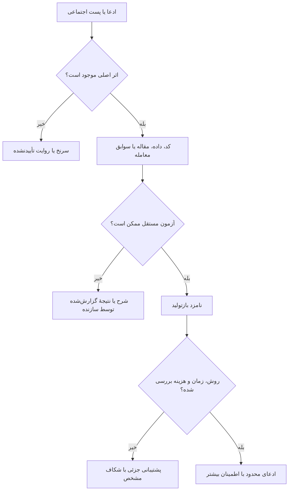

این نمودار رتبه‌بندی همیشگی منابع نیست. یک ادعای محدود دربارهٔ رابط یک تابع ممکن است با مشاهدهٔ کد خوب پشتیبانی شود؛ همان مشاهده برای ادعای سودآوری زنده کافی نیست. سطح شاهد باید با وسعت همان ادعا متناسب باشد.

### ۱.۲ چه کارهایی در پروندهٔ اصلی انجام شده است؟

گزارش اصلی، متن همهٔ ۲۷ وضعیت متمایز X را با شناسهٔ دقیق از ثبت‌های ثانویه بازیابی کرده؛ ۲۸ رکورد اجتماعی وجود دارد، چون O20 و N17 یک وضعیت‌اند. بدنهٔ پنج مقالهٔ پیوست‌شده و چند مقالهٔ نقل‌شده، بخش‌هایی از مخازن اصلی و متن استخراج‌شدهٔ کامل مقالات DSR، PBO و آولاندا–استویکوف بررسی شده‌اند. برای برخی موارد نیز محاسبات ریاضی یا توابع جداشده از کد آزموده شده‌اند.

در مقابل، خروجی احرازشدهٔ X شامل همهٔ رسانه‌ها و ویرایش‌ها، همهٔ کتاب‌ها و مراجع مقالات، مجموعه‌آزمون کامل مخازن، بازسازی سود و زیان زنجیره‌ای با احراز مالک حساب، یا تحلیل نرم‌افزارهای خصوصی انجام نشده است. در این نسخهٔ فارسی، این سوابق به پروندهٔ مبدأ نسبت داده می‌شوند؛ بازنویسی آن‌ها به معنی اجرای دوباره‌شان نیست. پژوهش تکمیلی این نسخه نیز با برچسب «توضیح تکمیلی» و ارجاع مشخص آمده است.

<aside class="callout note"><strong>اصلاح مهم در خواندن وضعیت‌ها</strong><p>بررسی ۴۰ مورد E/F/G یعنی هویت و ارزیابی هر ۴۰ مورد ثبت شده است؛ نه اینکه همهٔ منابعِ تو‌در‌تو، مخازن بزرگ، کتاب‌ها و خدمات بسته کاملاً بازتولید شده‌اند. تیکِ خواندن یک بدنه، تیکِ اجرای محصول نیست.</p></aside>

### ۱.۳ چهار پرسش مستقل

| پرسش | شاهد مناسب | چیزی که جای آن را نمی‌گیرد |
|---|---|---|
| آیا عامل گردش‌کار را درست طی کرده؟ | ورودی، خروجی، فراخوانی ابزار و معیار پذیرش ثبت‌شده | اعلام موفقیت خود عامل |
| آیا حسابداری و مدل اجرا درست است؟ | توالی رویداد قابل پیش‌بینی و تطبیق مانده‌ها | نمودار سرمایهٔ زیبا |
| آیا روش آماری معتبر است؟ | دامنهٔ جست‌وجو، دادهٔ زمانی، فرض‌ها و عدم‌قطعیت | نام DSR یا CPCV روی گزارش |
| آیا راهبرد در بازار جدید پس از هزینه تعمیم می‌یابد؟ | آزمون تأییدیِ دست‌نخورده و سپس ارزیابی آینده‌نگر | موفقیت روی دوره‌ای که بارها دیده شده |

برای مثال، عاملی ممکن است همهٔ مراحل پژوهش را بی‌نقص ثبت کند، ولی شبیه‌سازش حجم نامحدود را در بهترین قیمت پر کند. یا شبیه‌ساز از نظر حسابداری درست باشد، اما راهبرد از میان هزاران گزینهٔ نویزی انتخاب شده باشد. عبور از یکی از این چهار پرسش پاسخ بقیه نیست.

## ۲. داده: ساعت، نسخه و حق استفاده

هر نتیجهٔ مالی بر اطلاعاتی بنا می‌شود که باید در زمان تصمیم واقعاً در دسترس بوده باشند. ستون تاریخ به‌تنهایی این شرط را ثابت نمی‌کند. چهار زمان را جدا نگه دارید: زمان وقوع رویداد، نخستین زمان انتشار یا دسترس‌پذیری، زمان دریافت در سامانه و زمان اصلاح. گزارش مالی مربوط به یک فصل، در پایان همان فصل الزاماً منتشر نشده است؛ مقدار امروزِ یک سری اقتصاد کلان ممکن است نسخهٔ اصلاح‌شدهٔ عددی باشد که معامله‌گر آن زمان می‌دید.

### ۲.۱ نمونهٔ آموزشیِ اصلاح دیرهنگام

فرض کنید رویداد در روز اول رخ می‌دهد، خبر روز سوم منتشر می‌شود و روز دهم اصلاحیه می‌آید. تصمیم روز دوم حق استفاده از خبر را ندارد؛ تصمیم روز پنجم می‌تواند از نسخهٔ اولیه استفاده کند؛ تصمیم روز دوازدهم می‌تواند اصلاحیه را ببیند. فیلترکردن بر اساس تاریخ رویداد، هر سه تصمیم را به‌اشتباه به یک خبر وصل می‌کند. ذخیرهٔ صرفِ آخرین مقدار نیز امکان بازسازی روز پنجم را از بین می‌برد.

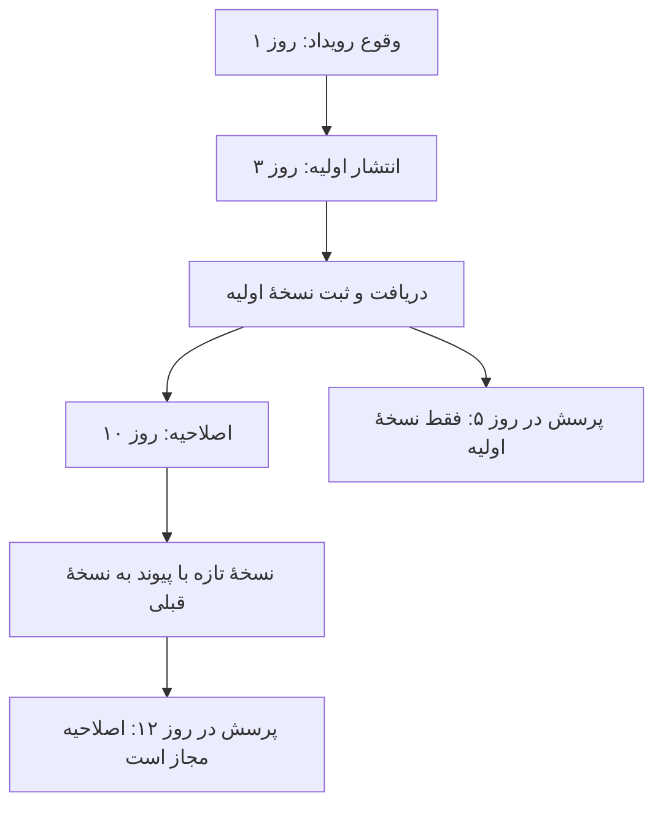

این مثال ساخته‌شده برای آموزش است؛ تاریخ یا رفتار یک منبع خاص را گزارش نمی‌کند. نتیجهٔ طراحی آن روشن است: نسخهٔ خام را حفظ کنید و هر خلاصه، ویژگی و حافظهٔ مشتق‌شده را به نسخهٔ ورودی پیوند دهید. حذف متنِ اصلاحیه از جست‌وجو کافی نیست اگر خلاصهٔ ساخته‌شده از آن همچنان قابل بازیابی باشد.

### ۲.۲ چک‌لیست کیفیت داده

| لایه | پرسش ضروری | خطای پنهان محتمل |
|---|---|---|
| هویت نماد و قرارداد | تغییر نام، سررسید، ضریب و نوع دارایی مشخص است؟ | وصل‌کردن دو ابزار متفاوت با یک نماد ظاهری |
| ساعت بازار | منطقهٔ زمانی، تغییر ساعت فصلی، نشست و تعطیلات چیست؟ | جابه‌جایی یک کندل یا استفاده از دادهٔ دیررس |
| قیمت | تعدیل‌شده، خام، آخرین معامله، میانه یا قیمت قابل اجراست؟ | معامله در میانهٔ فاصلهٔ خریدوفروش بدون پرداخت آن |
| جهان دارایی‌ها | نمادهای حذف‌شده و اعضای تاریخی شاخص حفظ شده‌اند؟ | سوگیری بقا و استفاده از اعضای آینده |
| نسخهٔ داده | اصلاح، دریافت مجدد و انتشار اولیه ثبت می‌شود؟ | تزریق اطلاعات تازه در گذشته |
| مشتقات | تأمین مالی، استقراض، بهره، وجه تضمین و تسویه چیست؟ | سود ناخالص بدون هزینهٔ نگهداری |
| بازار پیش‌بینی | شناسهٔ رویداد، قرارداد، ابطال و مرجع نتیجه چیست؟ | فرض مکمل‌بودن دو توکن نامرتبط |
| قرارداد تأمین‌کننده | حق دریافت، نگهداری و بازتوزیع روشن است؟ | برابرگرفتن دسترسی فنی با مجوز استفاده |

### ۲.۳ بستهٔ ml4t/data و قراردادهای مشترک

[ml4t/data](https://github.com/ml4t/data) آداپترهایی برای سهام، آتی، ارز، رمزارز، اقتصاد کلان، عوامل و بازارهای پیش‌بینی معرفی می‌کند. فراهم‌کنندهٔ مصنوعیِ بدون اعتبارنامه برای آزمون‌های قطعی، طرح یکسان داده و ذخیرهٔ محلی از نقاط مفید آن‌اند. اما تعداد آداپترها تضمین نمی‌کند هر بازار به یک اندازه کامل و بالغ باشد. باید قرارداد زمانی و تعدیل هر تأمین‌کننده جدا بررسی شود.

[ml4t/specs](https://github.com/ml4t/specs) تعریف‌های سریال‌پذیر و مستقل از محیط اجرا برای کندل، داده، آثار پژوهش و چرخهٔ راهبرد دارد. این قراردادها صرفاً سلیقهٔ نوع‌دهی نیستند: «زمان کندل» اگر در یک بخش آغاز بازه و در بخش دیگر پایان بازه باشد، یک راهبرد واحد معنای دیگری پیدا می‌کند. شمار شش یا هفت کتابخانه در معرفی‌های این خانواده نیز به نسخه و شمول models و specs وابسته است؛ فهرست وابستگی واقعی را از نسخهٔ مشخص استخراج کنید.

### ۲.۴ ساخت ویژگی و برچسب با ml4t/engineer

[ml4t/engineer](https://github.com/ml4t/engineer) بر پایهٔ Polars، در نسخهٔ معرفی‌شده ۱۲۰ ویژگی در ۱۱ گروه، برچسب‌های افق ثابت و مسیرمحور، سه‌مانع، ATR، صدکی، اسکن روند و فرابرچسب‌گذاری را شرح می‌دهد. کندل‌های تیک، حجم، ارزش دلاری، عدم‌تعادل و دنباله نیز در دامنهٔ مستندات‌اند. این اعداد ویژگی‌های گزارش‌شدهٔ نسخه‌اند، نه تضمین صحت تمام پیاده‌سازی‌ها.

در کندل رویدادمحور، واحد مشاهده انتخاب مدل است: ده مشاهده لزوماً ده دقیقه نیست. در حالت calendar=None، دورهٔ اندیکاتور بر حسب سطر مشاهده محاسبه می‌شود، نه زمان تقویمی یا نشست معاملاتی. این رفتار اگر عمدی باشد درست است، اما RSI یا ATR روی سطرهای نامنظم همان تعبیر زمانیِ کندل‌های منظم را ندارد. مستندات توسعه و بستهٔ منتشرشده باید به نسخهٔ یکسانی ارجاع دهند.

سه‌مانع، نتیجه را با برخورد قیمت به حد سود، حد زیان یا پایان مهلت تعریف می‌کند. اگر در یک کندل هم حد سود و هم حد زیان لمس شده باشد، OHLC ترتیب واقعی را معلوم نمی‌کند. انتخاب همیشهٔ حد مطلوب، بهبود مدل نیست؛ خوش‌بینی شبیه‌ساز است. پارامترهای مانع، تبدیل داده و مقیاس‌گذاری نیز باید فقط بر اطلاعات آموزش برازش شوند.

<aside class="callout important"><strong>مدل تمیز، برچسب آلوده را نجات نمی‌دهد</strong><p>نرمال‌سازی کل نمونه، پنجرهٔ متقارن، اعضای امروزی شاخص، گزارش اصلاح‌شده و برچسب‌هایی که از مرز آموزش عبور می‌کنند، همگی می‌توانند آینده را به گذشته ببرند. همین خطر دربارهٔ جست‌وجوی وب امروزی و حافظهٔ امروزِ یک عامل در بازآزمایی تاریخی وجود دارد.</p></aside>


## ۳. اعتبارسنجی: آیا برتری از جست‌وجوی زیاد آمده است؟

پژوهش مالی دو مرز دارد: مرز زمان، که اطلاعات آینده را کنار می‌گذارد؛ و مرز انتخاب، که مانع استفادهٔ مکرر از نتیجهٔ آزمون برای ساخت مدل می‌شود. اگر هر هفته نتیجهٔ مجموعهٔ آزمون را ببینید و پارامترها را تغییر دهید، آن مجموعه عملاً بخشی از فرایند آموزش شده است، حتی اگر در کد نام test داشته باشد.

### ۳.۱ پیشروی زمانی، پاک‌سازی هم‌پوشانی و فاصلهٔ محافظ

در ارزیابی با مبدأ پیش‌بینیِ غلتان، هر پیش‌بینی از داده‌های پیش از خودش ساخته می‌شود. در هر دور باید مقیاس‌گذار، انتخاب ویژگی، تنظیم مدل و سایر تبدیل‌های آموختنی دوباره در همان محدودهٔ مجاز برازش شوند. جداکردن آخرین ستونِ هدف کافی نیست؛ وابستگی میان مشاهده‌ها و بازهٔ اطلاعات برچسب‌ها نیز مهم است.

| روش | مسئله‌ای که پاسخ می‌دهد | محدودیت |
|---|---|---|
| آزمون زمانیِ نهایی | ارزیابی پس از پایان انتخاب مدل | دیدن و تنظیم مکرر روی آن، استقلالش را از بین می‌برد |
| پیشروی زمانی | رفتار آموزش مجدد و آزمون در دوره‌های بعد | هنوز می‌توان با انتخاب پنجره و پارامتر روی آن بیش‌برازش کرد |
| پاک‌سازی یا Purging | حذف نمونه‌های آموزشی با بازهٔ اطلاعاتِ هم‌پوشان با آزمون | به تعریف درست آغاز و پایان اطلاعات هر نمونه نیاز دارد |
| فاصلهٔ محافظ یا Embargo | دور نگه‌داشتن نمونه‌های نزدیک به مرز | فاصلهٔ ثابت جای بررسی واقعی هم‌پوشانی رویدادها را نمی‌گیرد |
| CPCV | ساخت مسیرهای ترکیبی برای حساسیت و توزیع نتایج | مسیرها تاریخچه‌های مستقل بازار نیستند |
| CSCV و PBO | رتبهٔ برندهٔ درون‌نمونه در بیرون‌نمونه نسبت به خانوادهٔ نامزدها | جای آزمون زمانیِ استقرار، هزینه و کیفیت داده را نمی‌گیرد |

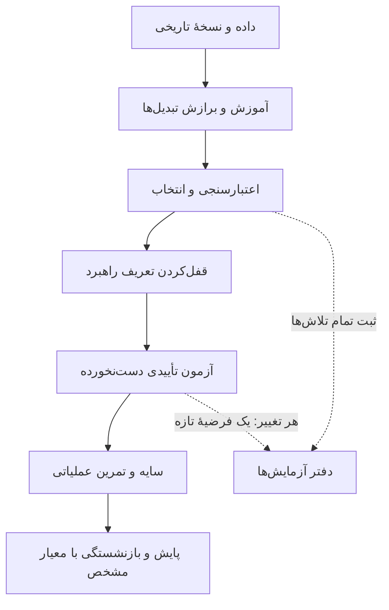

**توضیح تکمیلی با منبع اصلی:** [مستندات TimeSeriesSplit در scikit-learn](https://scikit-learn.org/stable/modules/generated/sklearn.model_selection.TimeSeriesSplit.html) نشان می‌دهد gap تعداد سطرهای حذف‌شده از انتهای آموزش پیش از آزمون است. مستندات برای مقایسه‌پذیری مدتِ آزمون‌ها فرض فاصلهٔ برابر نمونه‌ها را ذکر می‌کند. بنابراین gap=5 روی پنج کندل رویدادمحور، الزاماً پنج دقیقه یا افق اطلاعاتیِ برچسب نیست. این ابزار تقسیم زمانی می‌سازد؛ پاک‌سازی بازه‌های برچسبِ مالی باید جدا طراحی و بررسی شود. برای مبنای سادهٔ پیشروی زمانی، [کتاب Forecasting: Principles and Practice](https://otexts.com/fpp3/toolbox.html) مسیر آموزشی مناسبی است.

اگر مدل چنددارایی مشترک آموزش می‌دهید، پاک‌سازی جداگانهٔ هر نماد ممکن است کافی نباشد: اطلاعات مربوط به همان تاریخ یا رویداد می‌تواند از نماد دیگر عبور کند. واحدِ جداسازی باید با سؤال آماری و منشأ مشترک اطلاعات سازگار باشد.

### ۳.۲ چرا بیشترین شارپ فریبنده است؟

اگر یک راهبرد را از پیش تعریف کنید، با زمانی که بهترین راهبرد را از میان سه هزار ترکیب انتخاب می‌کنید مسئلهٔ یکسانی ندارید. حتی نویز محض هم در یک جست‌وجوی بزرگ برنده‌ای چشمگیر می‌سازد. ثبت فقط برنده، ورودی لازم برای ارزیابی انتخاب را حذف می‌کند.

[نسبت شارپ تعدیل‌شده برای تورش انتخاب، DSR](https://www.davidhbailey.com/dhbpapers/deflated-sharpe.pdf) به مسئلهٔ جست‌وجو و غیرنرمال‌بودن بازده می‌پردازد. تعداد مؤثر تلاش‌ها، وابستگی نامزدها، طول نمونه، پراکندگی و گشتاورها باید با تعریف روش هماهنگ باشند. «تعداد فولدها» همان «تعداد راهبردهای امتحان‌شده» نیست. همبستگی زیاد بین نامزدها نیز می‌تواند تعداد مؤثر تلاش‌های مستقل را از تعداد خام کمتر کند؛ فرض استقلال کامل همیشه اصلاح محافظه‌کارانهٔ معناداری تولید نمی‌کند.

<aside class="callout important"><strong>اصلاح مشخص دربارهٔ ml4t/diagnostic</strong><p>پروندهٔ اصلی در نسخهٔ 7f9444c… از فراخوانی خودکار DSR در ValidatedCrossValidation گزارش می‌کند: بیشترین شارپ فولدها، واریانس میان فولدها، تعداد تلاش برابر تعداد فولدها، تعداد نمونهٔ ثابت ۲۵۲ و چولگی و کشیدگی اضافیِ صفر. این تنظیمات به‌طور خودکار تاریخچهٔ واقعی جست‌وجو و طول و توزیع بازده شما را نمایندگی نمی‌کنند. این ایرادِ مسیر مشخص، ابطال همهٔ توابع بسته نیست.</p></aside>

واحد شارپ اهمیت دارد. عدد سالانه‌شده را نمی‌توان بدون سازگارکردن تعداد مشاهدات و مقیاس در فرمولی قرار داد که شارپ هر مشاهده را می‌خواهد. ضرب شارپ دقیقه‌ای در ریشهٔ تعداد دقیقه‌های سال نیز در حضور وابستگی سریالی شدید، موجودیِ حمل‌شده و اجراهای ناهم‌زمان قابل اتکای ساده نیست.

### ۳.۳ PBO چه می‌گوید و چه نمی‌گوید؟

[احتمال بیش‌برازش بک‌تست](https://www.davidhbailey.com/dhbpapers/backtest-prob.pdf) بررسی می‌کند برندهٔ درون‌نمونه نسبت به خانوادهٔ نامزدها در بیرون‌نمونه چه رتبه‌ای می‌گیرد. این عدد «احتمال ضررکردن» نیست. خانواده‌ای که همهٔ اعضایش زیان‌ده‌اند می‌تواند یک برندهٔ نسبتاً باثبات و PBO پایین داشته باشد. افزودن عمدی راهبردهای بسیار بد نیز رتبه‌ها و تعبیر نتیجه را تغییر می‌دهد.

در نمونهٔ هشت گروه و انتخاب دو گروه برای آزمون، ۲۸ تقسیم ممکن وجود دارد، اما هفت مسیر CPCV داریم؛ ۲۸ تاریخچهٔ مستقل بازار به وجود نیامده است. CSCV، CPCV و آزمون زمانیِ استقرار سؤال‌های متفاوتی می‌پرسند و نباید صرفاً به علت شباهت نام جای یکدیگر قرار گیرند.

[Reality Check وایت](https://doi.org/10.1111/1468-0262.00152) و [آزمون SPA هانسن](https://doi.org/10.1198/073500105000000063) نیز مقایسهٔ بهترین عضو یک خانواده را با توجه به جست‌وجوی داده‌ای مطرح می‌کنند. خانواده باید تلاش‌های ناموفق را هم نمایندگی کند و بازنمونه‌گیری با وابستگی داده سازگار باشد. انتخاب آزمونی که پس از دیدن نتایج معناداری بیشتری می‌دهد، خودش یک انتخاب پژوهشی تازه است.

### ۳.۴ شواهد محاسباتیِ ثبت‌شده در پرونده

این جدول سوابق آزمون‌های کوچک پروندهٔ مبدأ است؛ نه اجرای دوبارهٔ مقالات یا تأیید کامل کتابخانه‌ها در این نسخهٔ فارسی.

| بررسی | ورودی و نتیجهٔ ثبت‌شده | برداشت درست |
|---|---|---|
| بیشینهٔ نویز نرمال مستقل | ۱۰هزار تکرار؛ برای ۱۰۰ نامزد تقریب ۲٫۵۳۰۶۰۳ و شبیه‌سازی ۲٫۵۰۹۹۱۰؛ برای ۱۰۰۰ نامزد ۳٫۲۵۵۱۲۲ در برابر ۳٫۲۴۷۱۷۱؛ خطا کمتر از ۰٫۰۶ | تأیید همان تقریب در آزمایش تهی مشخص؛ نه آزمون کامل DSR مالی |
| CSCV مستقل | ۸ گروه، انتخاب ۴: ۷۰ ترکیب؛ ۴۸۰ سطر، ۳۰ راهبرد نویزی، ۲۵ مجموعه با بذر مشخص؛ میانگین PBO برابر ۰٫۵۰۲۸۵۷؛ افزودن برندهٔ مصنوعی قوی: صفر | بررسی جهت رتبه و رفتار تهی؛ نه شواهد آلفا |
| مثال PSR | ۰٫۹۴۹۹۹۹۸۵۷۹ و حداقل طول سابقه ۵۹٫۸۹۵۰۹۸۶۹ | بازتولید مثال منتخب با تعاریف بررسی‌شده؛ فرض استقلال هنوز جداست |
| مدل AR(1) در DD1 | ۲۵ گام، ضریب ۰٫۵، میانگین ۱، انحراف شوک ۲، آغاز ۱؛ صدک پایین ۹۵٪ تحلیلی −۶٫۷۸۱۵۹۱۵۱ و شبیه‌سازی −۶٫۷۳۳۶۹۴۰۵ در ۱۰۰هزار مسیر | صدک تجمعیِ مدل محدود؛ توزیع عام افت سرمایهٔ بیشینه نیست |
| دادهٔ CLA | ماتریس متقارن ۱۰×۱۰؛ کمترین مقدار ویژه ۰٫۱۰۴۴۳۳۰۲ | یک بررسیِ داده؛ حل کامل بهینه‌سازی و شرایط KKT بازتولید نشده |

### ۳.۵ ml4t/diagnostic و معیارهای سیگنال

[این بسته](https://github.com/ml4t/diagnostic) ضریب اطلاعات IC، آمارهٔ آن، بازده و فاصلهٔ چندک‌ها، گردش معاملات، اعتبارسنجی پیش‌رونده و ترکیبی، DSR، PBO، کنترل کشف کاذب، Reality Check، اهمیت ویژگی، برهم‌کنش، رانش و انتساب را معرفی می‌کند. ارزش آن در آشکارکردن سازوکار ارزیابی است؛ نام ابزار، صحت پارامترگذاری را تضمین نمی‌کند.

IC معمولاً برای سنجش ارتباط رتبهٔ پیش‌بینی و نتیجه مفید است. ممکن است ارتباطی غیرصفر پیدا شود، ولی آن‌قدر ضعیف یا کوتاه‌عمر باشد که هزینهٔ معامله از بینش ببرد. گردش بالا نیز توضیح می‌دهد چرا آلفای ناخالص به سود خالص تبدیل نمی‌شود. مرجع ریاضی، نمونهٔ کوچک، وابستگی زمانی، بازنمونه‌گیری بلوکی و نمونه‌های خصمانهٔ مصنوعی باید در بررسی عددی حضور داشته باشند.

### ۳.۶ دقت طبقه‌بندی، سود نیست

برای مدل ساده‌ای با احتمال برد p، متوسط سود برد W، متوسط اندازهٔ زیان L و هزینهٔ رفت‌وبرگشت C، امید سود هر معامله چنین است:

<div class="formula" dir="ltr">E[Π] = p × W − (1 − p) × L − C</div>

مثال آموزشی: با برد ۶۰٪، سود یک واحدی و زیان دو واحدی، امید ناخالص برابر منفی ۰٫۲ واحد است. با برد ۴۵٪، سود دو واحدی و زیان یک واحدی، امید ناخالص مثبت ۰٫۳۵ واحد می‌شود؛ سپس هزینه کم می‌شود. این‌ها فرض آموزشی‌اند، نه نتیجهٔ یک راهبرد واقعی. پوشش سیگنال، امتناع از معامله، اندازه‌گذاری، وابستگی زیان‌ها و دنباله‌های بد نیز باید گزارش شوند.

<div class="chart-frame"><canvas id="accuracy-chart" role="img" aria-label="مثال آموزشی: رابطهٔ نرخ برد و امید سود با دو نسبت متفاوت سود به زیان">نمودار مقایسهٔ امید سود در نرخ‌های برد مختلف؛ داده‌ها آموزشی‌اند.</canvas></div>

مدل سریع فقط وقتی ارزش اقتصادی دارد که ارزش افزوده‌اش از هزینهٔ استنتاج، تأخیر و معامله بیشتر باشد و در برابر یک مبنای ارزان آزموده شود. در سیستم خرید/نگهداری/فروش، شمارش نگهداری به‌عنوان درست یا غلط بدون تعریف هزینهٔ فرصت، دقت را گمراه‌کننده می‌کند.

## ۴. ادبیات علمی: هر خانواده چه مسئله‌ای حل می‌کند؟

| خانواده و منبع | ایده و کاربرد | خطای رایج در تعمیم | عمق بررسی ثبت‌شده |
|---|---|---|---|
| DSR، PBO، Reality Check و SPA | عدم‌قطعیت و انتخاب پس از تلاش‌های متعدد | شارپ بالای بهترین بات یعنی مهارت | متن استخراج‌شدهٔ ۲۲ صفحهٔ DSR و ۳۴ صفحهٔ PBO؛ وایت و هانسن در حد چکیدهٔ اصلی؛ شکل‌ها و همهٔ اثبات‌ها مستقلاً بررسی نشده |
| [پیشرفت‌ها در یادگیری ماشین مالی](https://www.wiley.com/en-us/Advances+in+Financial+Machine+Learning-p-9781119482086) | برچسب، نمونه‌گیری رویدادی، تفاضل کسری، پاک‌سازی، فرابرچسب و بیش‌برازش | یک فاصلهٔ محافظ ثابت همهٔ نشت را حل می‌کند | اطلاعات ناشر؛ کتاب کامل خوانده نشده |
| [DeepLOB](https://arxiv.org/abs/1808.03668) | یادگیری نمایش دفتر سفارش با مدل‌های کانولوشنی و بازگشتی | دقت برچسب بالا یعنی سود پس از فاصلهٔ خریدوفروش | داده، پیش‌پردازش، برچسب و ارزیابی؛ همهٔ ضمائم نه |
| [عدم‌تعادل عمیق جریان سفارش](https://doi.org/10.1111/mafi.12413) | اطلاعات پیش‌بین جریان سفارش در افق‌های مختلف | افق تجربی سهام نقدشونده مستقیماً به رمزارز کم‌عمق منتقل می‌شود | ثبت ادبیات؛ مطالعه و بازتولید کامل باز است |
| [اثر قیمتی رویدادهای دفتر سفارش](https://arxiv.org/abs/1011.6402) | مبنایی ساده برای رابطهٔ رویدادها و حرکت قیمت | رگرسیون توضیح‌دهندهٔ قیمت یک راهبرد سودآور است | هویت و چکیده؛ روش کامل باز است |
| [آولاندا–استویکوف](https://math.nyu.edu/inmemoriam/avellaneda/HighFrequencyTrading.pdf) | قیمت‌گذاری بازارسازی با ریسک موجودی، افق و شدت ورود سفارش | فرمول بسته در همهٔ صرافی‌ها بهینه است | متن استخراج‌شدهٔ ۸ صفحه؛ کالیبراسیون زنده انجام نشده |
| [قیمت‌گذاری تجربی دارایی با ML](https://doi.org/10.1093/rfs/hhaa009) | ویژگی‌های غیرخطی و برهم‌کنش برای پیش‌بینی مقطعی | هر پیش‌بینی را می‌توان در قیمت پایانی گذشته معامله کرد | منبع مطالعاتی؛ بازتولید کامل باز است |
| [خودرمزگذار قیمت‌گذاری دارایی](https://doi.org/10.1016/j.jeconom.2020.07.009) | عوامل نهفته و ساختار مقطعی | بازسازی عامل همان پیش‌بینی حق‌بیمهٔ آینده است | فراداده و چکیدهٔ اصلی |
| [هم‌وزنی ریسک سلسله‌مراتبی، HRP](https://papers.ssrn.com/sol3/papers.cfm?abstract_id=2708678) | وزن‌دهی با خوشه‌بندی و حساسیت کمتر به وارون‌سازی کوواریانس | درخت همیشه بهتر از روش‌های ساده است | روش و کد منتخب؛ بازتولید کامل جداول باز است |
| [پوشش ریسک عمیق](https://arxiv.org/abs/1802.03042) | یادگیری کنترل پوشش با اصطکاک و هدف ریسک | پیش‌بینی سود یا آربیتراژ بی‌ریسک | چکیدهٔ اصلی؛ متن کامل باز است |
| [TimeGAN](https://papers.nips.cc/paper/8789-time-series-generative-adversarial-networks) | ساخت توالی مصنوعی با ساختار زمانی | دادهٔ مصنوعی مزیت اقتصادیِ فاقد شاهد ایجاد می‌کند | بخشی از روش و متن؛ شکل‌ها و ضمیمه کامل نه |
| [TradingAgents](https://arxiv.org/abs/2412.20138) | تفکیک نقش تحلیلگر، پژوهشگر و بازبین | مناظرهٔ عامل‌ها تکرار مستقل آماری است | بخش‌های منتخب ارزیابی؛ نه همهٔ پرامپت‌ها و ضمائم |
| [FinMem](https://arxiv.org/abs/2311.13743) | حافظهٔ لایه‌ای، بازاندیشی و بازیابی زمانی | ذخیرهٔ گفت‌وگوی بیشتر آلفا می‌سازد | بخش‌های منتخب روش حافظه و آموزش/آزمون |
| [مطالعهٔ تیم متخصص سرمایه‌گذاری](https://arxiv.org/abs/2602.23330) | تخصص‌گرایی ریزدانه در آزمایش محدود | عامل بیشتر الزاماً بازده بهتر دارد | روش، نتیجه، هزینه و برخی حذف‌مولفه‌ها |
| [چه چیزی از ارزیابی صادقانه جان سالم به در می‌برد؟](https://arxiv.org/abs/2608.27734) | شواهد مخالف انتخاب خوش‌بینانه و نشت در کشف راهبرد با ویژگی قیمت | همهٔ کاربردهای متنی LLM شکست می‌خورند | بخش‌های منتخب؛ محدودیت بقای اعضای فعلی باقی است؛ اثر DOI کشف شده ولی دریافت نشده |

### ۴.۱ ظرافت‌های انتقال روش

در DeepLOB، برچسبِ هموارشدهٔ آینده قیمت اجرایی آینده نیست. اول تعریف برچسب و زمان‌ها را بازتولید کنید، سپس با OFI و یک مدل سادهٔ لجستیک در دادهٔ یکسان مقایسه کنید، و در آخر هزینه و صف را وارد کنید. تفاوت نماد، تعادل کلاس، افق، نشست و مکان معامله می‌تواند نتیجه را تغییر دهد.

در آولاندا–استویکوف، قیمت مرجع براونی، مطلوبیت CARA و ورودهای پواسونیِ مشخص مبنای تقریبِ قیمت رزرو و فاصلهٔ مظنه‌اند. کژکردن مظنه با موجودی ریسک را کنترل می‌کند؛ شبیه‌سازی مقاله کاهش پراکندگی سود را نشان می‌دهد، نه تضمین افزایش میانگین. نوسان قیمت مطلق را نیز نمی‌توان بی‌تغییر به احتمال محدود در بازهٔ صفر و یک منتقل کرد. انتخاب نامطلوب، ورود خوشه‌ای سفارش، تغییر رژیم و تأخیر باید جدا سنجیده شوند.

در RL، فضای عمل، تابع پاداش، ساعت حالت، مدل محیط، بذرها، هزینه، اهرم و قوی‌ترین مبنای غیرتقویتی را ثبت کنید. پاداشی که موجودی، استقراض یا نقدشدن اجباری را حذف کند، سؤال دیگری از معاملهٔ واقعی می‌پرسد. در دادهٔ مصنوعی نیز حفظ میانگین و ساختار زمانی به معنی حفظ دنبالهٔ ریسک، هم‌وابستگی میان دارایی‌ها یا نبود حفظ‌کردن دادهٔ آموزش نیست.

مطالعهٔ تیم متخصص، ۵۰ اجرای LLM را روی یک تاریخچهٔ ۲۷ماههٔ TOPIX100 تکرار کرده؛ ۵۰ تاریخچهٔ مستقل بازار نیست. در برخی حذف‌مولفه‌ها، حذف تیم نتیجه را بهتر کرده است. برابری مبلغ خرید و فروش استقراضی هم به‌خودی‌خود بتای خنثی ایجاد نمی‌کند. در TradingAgents نیز سه سهم آمریکا و دورهٔ ژوئن تا نوامبر ۲۰۲۴ دامنه‌ای محدودند. دانش پیش‌آموزش مدل، نسخهٔ مدل، زمان اخبار، بودجه و هزینه باید کنترل شوند.

در FinMem، پیامد آینده اگر در زمان آموزش کاملاً بالغ شده و پیش از آزمون در دسترس بوده، خودبه‌خود نشت نیست؛ مشکل وقتی است که بازاندیشیِ ساخته‌شده از پیامد آزمون به تصمیم زودتر برگردد. آلودگی ناشی از پیش‌آموزش مدل موضوعی جداگانه است.


## ۵. بازارهای پیش‌بینی: هویت حسابداری در برابر سود قابل اجرا

در یک رویداد واقعاً دودویی، با نتایج ناسازگار و جامع و پرداخت نهایی مجموعاً یک دلار، یک سهم بله و یک سهم خیر یک مجموعهٔ کامل می‌سازند. این هویت به دو توکن دلخواه با موضوع مشابه تعمیم ندارد؛ هویت قرارداد، قواعد ابطال، وثیقه و نتیجه باید یکی باشند.

### ۵.۱ حساب سود، موجودی و هزینه

<div class="formula" dir="ltr">Πgross = q × (1 − cY − cN)</div>

cY و cN قیمت‌های خریدِ واقعاً اجراشده‌اند؛ نه مظنهٔ کهنه یا بهترین قیمت برای یک سهم وقتی حجم شما صد سهم است. اگر کارمزد در قیمت منظور شده، دوباره کم‌کردن آن اشتباه است. صورت گستردهٔ تحلیل جریان نقدیِ کل تلاش‌ها چنین است:

<div class="formula" dir="ltr">Πnet = q(1 − cY − cN) − Ftrade − Fsettle − Cfunding − Chedge − Lfailed-leg</div>

زیان پای ناقص، در ارزیابی پیشینیِ همهٔ تلاش‌ها معنا دارد؛ اگر سودوزیانِ تطبیق‌شدهٔ همان موجودی قبلاً آن زیان را در بر گرفته، نباید دوباره از آن کسر شود. در مجموعه‌ای از تلاش‌ها باید سفارش‌های ردشده، ناقص، لغوشده، هج و خروج ناموفق هم باقی بمانند؛ حذف آن‌ها فقط نمونه‌های موفق را نمایش می‌دهد.

<div class="formula" dir="ltr">H = min(Y, N) &nbsp;&nbsp; R = Y − N</div>

H تعداد جفت‌ها و R موجودی جهت‌دارِ باقیمانده است. مثال آموزشی: ۱۲۰ بله و ۸۰ خیر یعنی ۸۰ جفت و ۴۰ بلهٔ جهت‌دار. سود کل را باید به بخش جفت‌شده، باقیمانده، بازتوازن، مشوق بازارسازی و هزینه تفکیک کرد. این تجزیهٔ حسابداری، تبدیل فوری و بی‌هزینه یا نبود ریسک تأمین مالی را تضمین نمی‌کند. ارزان‌شدن پای دوم در آینده نیز یقین نیست.

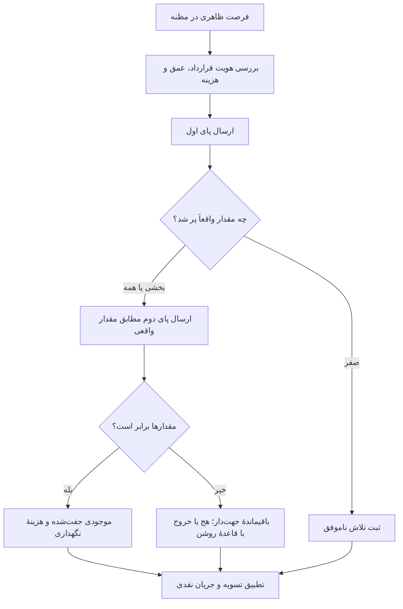

### ۵.۲ کارمزد می‌تواند فاصلهٔ ظاهری را معکوس کند

**توضیح تکمیلیِ بررسی‌شده با منبع اصلی:** [صفحهٔ رسمی کارمزد Polymarket](https://docs.polymarket.com/trading/fees) برای گروه‌های مختلف، نرخ‌های متفاوت و گردکردن کارمزد تا پنج رقم اعشار را شرح می‌دهد. مثال‌های زیر با ضریب ۰٫۰۷ برای هر پای گیرندهٔ نقدشوندگیِ رمزارزی و پیش از گردکردن‌اند؛ نرخ ثابت و جهانی برای همهٔ بازارها یا همهٔ تاریخ‌ها نیستند.

<div class="formula" dir="ltr">Fleg = q × 0.07 × p × (1 − p)</div>

| قیمت بله | قیمت خیر | سود ناخالص هر جفت | کارمزد دو پا | خالص پیش از هزینه‌های دیگر |
|---|---|---|---|---|
| ۰٫۴۲ | ۰٫۵۵ | ۰٫۰۳۰۰۰۰ دلار | ۰٫۰۳۴۳۷۷ دلار | −۰٫۰۰۴۳۷۷ دلار |
| ۰٫۴۷ | ۰٫۵۲ | ۰٫۰۱۰۰۰۰ دلار | ۰٫۰۳۴۹۰۹ دلار | −۰٫۰۲۴۹۰۹ دلار |

<div class="chart-frame"><canvas id="fees-chart" role="img" aria-label="مقایسهٔ سود ناخالص، هزینه و خالص دو مثال مجموعهٔ مکمل">در هر دو مثال، کارمزدِ فرض‌شده سود ناخالص را به زیان تبدیل می‌کند.</canvas></div>

این محاسبه، هزینهٔ تاریخیِ تصویرهای شبکه‌های اجتماعی را اثبات نمی‌کند. نرخ مخصوص همان بازار، تاریخ، گردکردن، سازنده یا گیرندهٔ نقدشوندگی بودن، تخفیف و مشوق باید از سوابق واقعی استخراج شود.

### ۵.۳ FOK برای یک سفارش است

[مستندات رسمی ثبت سفارش](https://docs.polymarket.com/trading/place-orders) میان پذیرش، استقرار در دفتر، تطبیق فوری و تأخیر تفاوت می‌گذارد. در پرونده، ارسال دسته‌ایِ ۱ تا ۱۵ سفارش با پذیرش یا رد مستقل ثبت شده است. FOK یعنی یک سفارش باید فوراً کامل اجرا شود یا لغو شود؛ این شرط برای دو سفارش مستقل، تراکنش اتمیِ دوپا نمی‌سازد. FAK مقدار موجود را می‌گیرد و باقی را لغو می‌کند. GTC تا اجرا یا لغو و GTD تا مهلت مشخص می‌ماند.

<aside class="callout important"><strong>پذیرفته‌شدن، پرشدن و تسویه‌شدن سه چیزند</strong><p>کد آموزشی O16 ابتدا بله و سپس خیر را می‌فرستد و خروج اضطراری را به تابعی با پیاده‌سازی نامشخص می‌سپارد. از چنین اسکلت کدی، هم‌زمانی دوپا، تطبیق مقدار ناقص یا کران زیان خروج نتیجه نمی‌شود.</p></aside>

شناسهٔ سفارش، اجرا و تراکنش را نگه دارید؛ تأیید دیررس، رقابت لغو و اجرا، تکرار درخواست و بازیابی پس از قطع ارتباط را از روی مرجع معتبر تطبیق دهید. دو فراخوانی موفق API، شاهدِ یک آربیتراژ بدون ریسک نیستند.

### ۵.۴ احتمال، لبه و اندازهٔ موقعیت

پرونده سه محاسبهٔ مقالهٔ O20 را بازبینی کرده است: پیشین ۰٫۴۳ و نسبت درست‌نمایی ۱٫۵، پسین ۰٫۵۳۰۸۶۴ می‌دهد؛ ۰٫۵۳ منهای قیمت ۰٫۴۸۲ و هزینه‌های ۰٫۰۰۶، ۰٫۰۰۵ و ۰٫۰۰۹، لبهٔ ۰٫۰۲۸ می‌دهد؛ و ۲۰٪ از کِلیِ مثال با احتمال ۰٫۵۹ و قیمت ۰٫۴۸، حدود ۰٫۰۴۲۳۰۸ از سرمایه است. این‌ها حسابِ شرطی‌اند؛ نه تأیید اینکه احتمال‌ها درست کالیبره شده‌اند.

لبهٔ ۲٫۸ واحد درصد در احتمال یا ارزش هر سهم، همان بازده ۲٫۸٪ روی سرمایه نیست. کِلی نیز به احتمال معتبر، ساختار پرداخت، محدودیت زیان و وابستگی موقعیت‌ها وابسته است. بیشترکردن مسیرهای مونت‌کارلو فقط خطای نمونه‌گیری را تحت پویاییِ فرض‌شده کم می‌کند؛ مدل براونی هندسی را درست یا مالکیت الگوریتم یک کیف پول را ثابت نمی‌کند.

### ۵.۵ منابع قابل استفاده در این حوزه

| منبع | چیزی که می‌توان از آن آموخت | شرط استفادهٔ پژوهشی |
|---|---|---|
| [Polymarket/py-sdk](https://github.com/Polymarket/py-sdk)، [ts-sdk](https://github.com/Polymarket/ts-sdk) و [CLI](https://github.com/Polymarket/polymarket-cli) | قرارداد حساب، بازار، امضا و سفارش در رابط‌های رسمی | نسخه، مجوز کیف پول و تغییرات API؛ مثال قدیمیِ py-clob-client الزاماً رابط جاری نیست |
| [ohadbachner/polymarket-arb](https://github.com/ohadbachner/polymarket-arb) | بررسی خواندنی مجموعهٔ کامل، عمق، بهینه‌سازی، کلی و مونت‌کارلو | سابقهٔ کوچک و نبود اجرای قابل اتکا؛ مرجع ریاضی، نه اثبات آربیتراژ |
| [Gonzih/polymarket-arb](https://github.com/Gonzih/polymarket-arb) | اختلاف میان Binance و بازار پیش‌بینی | هم‌زمانی، کهنگی احتمال، نقدشوندگی، کارمزد و ریسک دوپا |
| [bl888m/assay](https://github.com/bl888m/assay) | میز پژوهش کاغذی، رد فرصت و دروازهٔ پذیرش | حسابداری مصنوعی و نبود شاهدِ بازده زنده |

## ۶. شبیه‌سازی و اجرا: نمودار قیمت، موتور تطبیق نیست

یک شبیه‌ساز می‌تواند برای یادگیری عالی باشد و برای برآورد سودِ حساس به اجرا نامناسب. کافی است سؤال آن را درست نام‌گذاری کنیم. نمایش دادهٔ زنده یا عمق دفتر سفارش، به‌تنهایی نمی‌گوید سفارش فرضیِ ما چه جایگاهی در صف می‌گیرد، چه مقدار پر می‌شود و چه اثری بر قیمت بعدی دارد.

### ۶.۱ سه محیط و سه نوع واقع‌گرایی

| محیط | چه اتفاقی می‌افتد؟ | چیزی که هنوز ثابت نشده |
|---|---|---|
| حالت سایه | داده مصرف می‌شود و سبد مجازی تغییر می‌کند؛ سفارش بیرونی ارسال نمی‌شود | پاسخ کارگزار و نقدشوندگی واقعی |
| حساب تمرینی کارگزار | سفارش به محیط آزمایشی کارگزار می‌رود | مدل پرشدن آن می‌تواند خوش‌بینانه باشد |
| معاملهٔ زنده | سفارش با زیرساخت و نقدشوندگی واقعی تعامل دارد | یک دورهٔ خوب به‌تنهایی تعمیم آینده را اثبات نمی‌کند |
| اعتبارسنجی درخواست | فقط قالب، احراز یا قیود سفارش بررسی می‌شود | اصلاً شبیه‌سازی اجرا و سودوزیان نیست |
| پاسخ ساختگیِ ثابت | رابط نرم‌افزاری پاسخ از پیش تعیین‌شده می‌دهد | بازار زنده یا دفتر سفارش پویا وجود ندارد |

نوع داده را نیز جدا کنید: کندل فقط OHLC و احتمالاً حجم می‌دهد؛ بازپخش رویداد، توالی ثبت‌شده را برمی‌گرداند؛ شبیه‌سازی تعاملی اجازهٔ واکنش عامل‌های ساختگی را می‌دهد. بازپخش نمی‌تواند مسیر تاریخی را در واکنش به سفارش شما تغییر دهد؛ محیط تعاملی می‌تواند واکنش بسازد، ولی اعتبار واکنش به کالیبراسیون جمعیت عامل‌ها بستگی دارد.

### ۶.۲ محدودیت‌های ml4t/backtest

[محدودیت‌های رسمی](https://github.com/ml4t/backtest/blob/main/LIMITATIONS.md) از ارزشمندترین بخش‌های این پروژه است. موتور رویدادمحور با حالت پرشدن در کندل بعد یا همان کندل، ارزش‌گذاری با سمت مظنه، خروج پیش از ورود، حد زیان/سود، حد دنبال‌کننده، قیود مواجهه و حساب‌های گوناگون معرفی شده است. اما دادهٔ کندلی ترتیب داخل کندل و جای صف را بازسازی نمی‌کند.

اگر راهبرد ابتدا قیمت پایانی را ببیند و بعد همان قیمت را به‌عنوان اجرای قابل دستیابی بگیرد، حالت SAME_BAR می‌تواند آینده‌نگر باشد. دستور بازار در پایان نشست که بعد از مشاهدهٔ همان پایان ساخته شده نیز مشکل مشابهی دارد. NEXT_BAR مبنای علّیِ پیش‌فرض معرفی شده، ولی باید ساعت تصمیم و ارسال واقعی هم سازگار باشند. بدون محدودیت حجم یا مظنه، مقدار خواسته‌شده ممکن است در قیمت مدل‌شده قابل پرشدن فرض شود.

ترتیب خروج، FIFO و پردازش ترتیبی وجه نقد قابل استفاده را تغییر می‌دهد. خرید روی ask و فروش روی bid با معامله روی میانه برابر نیست. تأخیر تسویه در نسخهٔ بررسی‌شده بر حسب کندل شمارش می‌شود؛ تک‌ارزی‌بودن و حذف برخی هزینه‌های استقراض، تأمین مالی، سود نقدی، بهره و مالیات دامنهٔ برابری با واقعیت را محدود می‌کند. تعدیل شرکتی نیز باید در ورودی آماده شده باشد.

### ۶.۳ ml4t/live و آزمون‌های عملیاتی

[ml4t/live](https://github.com/ml4t/live) موتور زنده، SafeBroker، سبد مجازی سایه، اتصال‌هایی برای IB و Alpaca و مسیرهایی برای CCXT، OKX و داده‌های دیگر شرح می‌دهد. بعضی آداپترها یا خوراک‌ها آزمایشی‌اند. یکسان‌بودن نام Strategy در بک‌تست و اجرا، تضمین هم‌معنایی همهٔ رفتارها نیست.

آزمون‌های تعیین‌کننده عبارت‌اند از اتصال مجدد و تطبیق مانده، جلوگیری از سفارش تکراری، اجراهای جزئی، تأیید خارج از ترتیب، لغو/جایگزینی، دادهٔ کهنه، بازیابی پس از سقوط، تأمین مالی و استقراض، اعتبارنامه و پایدارماندن توقف اضطراری. وجود SafeBroker در معرفی، سابقهٔ مدیریت حادثهٔ واقعی را ثابت نمی‌کند.

### ۶.۴ مقایسهٔ منابع زیرساخت و پژوهش

| منبع | ارزش متمایز | محدودیت و بررسی لازم |
|---|---|---|
| [NautilusTrader](https://github.com/nautechsystems/nautilus_trader) | هستهٔ Rust و رابط راهبرد Python؛ رویداد و حسابداری مشترک پژوهش و اجرا | آزمون آداپتر مکان معامله، مرز دو زبان، بازیابی و تعهدات LGPL |
| [Hummingbot](https://github.com/hummingbot/hummingbot) | بازارسازی، اتصال صرافی و چرخهٔ سفارش | سلامت اتصال، نرخ درخواست، تطبیق اجرا و خطای مخصوص هر صرافی |
| [Condor](https://github.com/hummingbot/condor-docs) | تفکیک استدلال احتمالی از اجرای قطعی؛ جداسازی سودوزیان عامل و بازپخش تصمیم | وعدهٔ مستندات را با مجوز، بودجه، ثبت و اجرای واقعی آزمون کنید |
| [LEAN](https://github.com/QuantConnect/Lean) | موتور چنددارایی و رابط داده/کارگزاری | داده و خدمات اختصاصی ممکن است قابلیت انتقال را محدود کند |
| [vectorbt](https://github.com/polakowo/vectorbt) | غربال سریع آرایه‌ای و فضای پارامتر | ترتیب پویا، صف و ابهام درون‌کندلی ممکن است پنهان بماند |
| [Qlib](https://github.com/microsoft/qlib) | چرخهٔ داده، ویژگی، مدل و آزمایش ML مالی | بازار جغرافیایی، بقا و دادهٔ قابل دسترس در زمان |
| [Freqtrade](https://github.com/freqtrade/freqtrade) | پژوهش و dry-run رمزارزی، پیکربندی و مدیریت سبد | بیش‌برازش Hyperopt، فرض کندل و نقدشدن مشتقات |
| [hftbacktest](https://github.com/nkaz001/hftbacktest) | مدل صف، تأخیر و پرشدن جزئی | بازپخش اثر سفارش خودمان را روی آینده ایجاد نمی‌کند؛ نسخه و سطح داده را یکسان کنید |
| [ABIDES](https://github.com/abides-sim/abides) و [ABIDES-Gym](https://arxiv.org/abs/2110.14771) | شبیه‌سازی تعاملیِ رویدادگسسته و رابط عمل/مشاهده | جمعیت عامل، تأخیر و قواعد باید کالیبره شوند؛ طراحی الهام‌گرفته از NASDAQ قواعد Binance نیست |

در [راهنمای نسخهٔ ۲٫۱ hftbacktest](https://hftbacktest.readthedocs.io/en/py-v2.1.0/order_fill.html)، مدل بدون پرشدن جزئی می‌تواند مقدار گیرندهٔ نقدشوندگی را در بهترین قیمت، مستقل از اندازهٔ نمایش‌داده‌شده، اجرا کند. مدل جزئی هم باعث واکنش تاریخچه به سفارش فرضی نمی‌شود. با دادهٔ تجمیعیِ قیمت، جای صف برآورد است. پشتیبانی نسخه‌های تازه، از جمله سطح داده، نباید با راهنمای نسخهٔ قدیمی مخلوط شود.

### ۶.۵ یازده منبع شبیه‌ساز: ارزیابی نهاییِ یکپارچه

| شناسه و محصول | کاربرد و یافتهٔ قابل اتکا در پرونده | مرز نتیجه و آزمون لازم |
|---|---|---|
| G01؛ Simul8or | تمرین مهمان، بازپخش و سرمایهٔ مجازی؛ matcher عمومی یک قیمت را با آستانه مقایسه می‌کند و ورودی عمق/صف ندارد؛ reduce-only مقدار را به موجودی محدود می‌کند | تابعِ جداشده با شرط قیمت، یک میلیارد واحد را کامل برگرداند؛ این اثبات پذیرش چنین سفارشی در رابط برنامه نیست. پیش‌فرضِ لحاظ کمیسیون false و مقدار صفر بوده؛ حساب، عمق، تأخیر و قطع ارتباط کامل آزموده نشده |
| G02؛ Trade Nation | صفحهٔ جایگزین رسمی demo سرمایهٔ مجازی و TN Trader را شرح می‌دهد و تفاوت لغزش و margin call زنده را می‌پذیرد | تمرین ابزار و سفارش CFD؛ نه بازسازی تطبیق، funding یا liquidation بایننس؛ spread به ابزار و زمان وابسته است |
| G03؛ CME | راهنمای ژوئیهٔ ۲۰۲۵: سفارش آتی/اختیار، روزانه/GTC، بازار/محدود/توقف، برنامهٔ معامله و یادداشت | توضیح اجراشدن کل سفارش بازار در بهترین bid/offer، عمق‌پیمایی را ثابت نمی‌کند؛ نمایش تاریخچهٔ برخی ابزارک‌ها روزانه پاک می‌شود؛ ضریب، تیک، سررسید و خروجی مستقل را ثبت کنید |
| G04؛ Investopedia | هدف آموزشی سبد مجازی از منابع ناشر قابل پشتیبانی است | بدنهٔ جاری محصول و راهنما در دسترس نبوده؛ تأخیر، کارمزد، reset و قواعد اختیار مجهول‌اند؛ اطلاعات قدیمی یا ثالث جای آن‌ها نیست |
| G05؛ NinjaTrader | Sim101، پرشدن تاریخی و Playback سه رژیم متفاوت‌اند؛ Tick Replay برای بازسازی پرشدن سفارش طراحی نشده | دادهٔ آخرین معامله همهٔ تغییرات bid/ask را ندارد؛ جایگزینی quote، محدودیت چندسری و ناسازگاری بعضی حالت‌ها مهم است؛ Playback101 هم‌زمان و فوری است، برخلاف تأخیر شبیه‌سازی‌شدهٔ Sim101 |
| G06؛ MultiCharts | بازپخش هماهنگ و Bar Magnifier برای دادهٔ ریزتر | اگر زیرکندل موجود نباشد، بازگشت به فرض OHLC ممکن است؛ روشن‌بودن گزینه، وجود تیک واقعی در تمام دوره را ثابت نمی‌کند؛ حذف تیک هم‌قیمت می‌تواند حجم را تغییر دهد |
| G07؛ denguir/binance-simulator | هر ۸ فایل نسخهٔ مشخص بررسی شده؛ نمونهٔ کوچک حساب spot کندلی؛ حالت پیش‌فرض مشاهدهٔ قبل و بازشدن کندل بعد است | صف، عمق، اثر قیمت، funding و liquidation ندارد؛ چهار خطای حسابداری زیر ثبت شده‌اند؛ مجوز مستقل در هشت فایل دیده نشده |
| G08؛ TradesViz | واردکردن اجرا به ژورنال، کارمزد و ارز کارمزد، شناسهٔ اجرا و تاریخ UTC | API/MCP ژورنال سفارش کارگزار نمی‌گذارد؛ پشتیبانی وب از Binance تضمین پوشش REST نیست؛ استثنای ATAS برای برخی جفت‌های خطی USDT/USDC، کشف داراییِ مجازِ همان اتصال را ضروری می‌کند |
| G09؛ مقالهٔ Kraken | مقایسهٔ تجاری مکان‌های معامله و تمایز محیط‌های آزمون | validate=true فقط درخواست را بررسی می‌کند و شناسهٔ سفارش نمی‌سازد؛ FAQ و اطلاعیهٔ محیط مشتقات تعارض دارند؛ نسبت‌دادن رخداد ۲۰۲۵ به OKX از زنجیرهٔ شاهد تأیید نشد؛ سند FBI مشخصاً دربارهٔ Bybit است |
| G10؛ Goat Funded Trader | فهرست هفت ابزار: Bitcoin Flip، Gainium، Roostoo، TradingView، 3Commas، Bitsgap و Cryptohopper | آمار ۷۰٪ افزایش اعتماد و تحلیل منسوب به SSA به پژوهش پشتیبان قابل تشخیص نرسید؛ sandbox رسمی Coinbase نمونهٔ پاسخ‌های ساختگی ثابت است، نه بازار زنده |
| G11؛ Bitsgap | راهنمای رسمی: تغییر وضعیت demo، سبد مجازی، سفارش دستی و خانواده‌های بات؛ دستیار AI از demo مستثناست | ادعای تکرار دفتر سفارش، جای صف، پرشدن، رد، تأخیر و اثر قیمت را مشخص نمی‌کند؛ هیچ بات یا حسابی در پرونده فعال نشده |

### ۶.۶ چهار ضدنمونهٔ حسابداری در شبیه‌ساز Binance

| ورودی کنترل‌شده | نتیجهٔ مشاهده‌شده در توابع بررسی‌شده | اصل لازم |
|---|---|---|
| خرید منفی یک واحد در قیمت ۱۰ با ماندهٔ ۱۰۰ USDT | ۱۰ واحد اعتبار افزوده و موجودی پایه منفی شد | مقدار متناهی و مثبت و قیود حساب پیش از حسابداری |
| خرید ۱ واحد با کارمزد پایهٔ ۰٫۰۷۵٪ و فروش دریافتی | دریافتی ۰٫۹۹۹۲۵، اما موقعیت باز ۱ ثبت شد؛ با فروش مانده، باقیمانده ماند | مقدار خالص، ارز کارمزد و بستن موقعیت باید تطبیق کنند |
| ثبت تاریخچه و سپس تغییر سبد جاری | رکورد قبلی هم تغییر کرد چون دیکشنری مشترک بود | عکس تاریخی باید مستقل و تغییرناپذیر باشد |
| ETH/BTC برابر ۰٫۰۵ و BTC/USDT برابر ۱۰۰ | ارزش مورد انتظار ۵، اما مسیر بررسی‌شده صفر برگرداند | تبدیل ارز واسط و ارزش سبد باید آزمون مستقل داشته باشد |

این آزمایش‌ها توابع بررسی‌شده را بدون کلاینت Binance و بدون بازار یا اجرای راهبرد کامل اجرا کرده‌اند. برای جداکردن خطای مقدار و کارمزد، ستون مقدار بسته‌شده در fixture به اعشاری تبدیل شده؛ زیرا pandas 3 انتساب اعشاری به ستون صحیح اولیه را نمی‌پذیرد. این سازگارکردن آزمون، اجرای بدون تغییرِ محیط قدیمی نیست.

یافته‌های دیگر همان مخزن: نمونهٔ README پارامتر n_jobs می‌دهد که در امضای نشان‌داده‌شدهٔ run نیست؛ ta در کد وارد شده ولی در وابستگی مستقیم نیست؛ فیلتر صرافی با جایگاه انتخاب می‌شود نه نوع؛ تاریخچهٔ نمادها با اندیس مکانی هم‌تراز می‌شود نه الزاماً زمان؛ توضیح پایان اجرا وعدهٔ بستن می‌دهد ولی آن رفتار پیاده نشده است. جهان فعلی نمادها، جهان تاریخی نیست. دکوراتور ناقص cache مسیر فعال شبیه‌ساز نبوده و نباید همهٔ خطاها به آن نسبت داده شود.

### ۶.۷ پروتکل کوچک اما تعیین‌کنندهٔ شبیه‌ساز

نسخهٔ کد، تنظیم، قرارداد و خوراک را ثابت کنید. سپس لمس حد بدون معامله، عمق ناکافی، اجرای جزئی، لغو سفارش جلوتر در صف، رقابت لغو/اجرا، جهش تأخیر، شکاف داده و اتصال مجدد را بسازید. پس از هر رویداد، نقد، دارایی، کارمزد، سود محقق و سود محقق‌نشده را تطبیق دهید. برای مشتقات، funding، وجه تضمین، نقدشدن و سررسید را اضافه کنید. حساسیت یک سیگنال ثابت به این فرض‌ها از یک منحنی سرمایهٔ خوش‌بینانه آموزنده‌تر است.


## ۷. عامل‌های معامله‌گر: نقش بیشتر، اطلاعات مستقل بیشتر نیست

تقسیم کار به تحلیلگر خبر، تحلیلگر قیمت، پژوهشگر، منتقد و مجری می‌تواند ورودی و مسئولیت‌ها را روشن کند. اما اگر همه از یک خلاصهٔ آلوده، یک مدل و یک داده استفاده کنند، توافقشان تأیید مستقل نیست. مقایسهٔ منصفانه باید داده، بودجهٔ محاسبه، تعداد توکن، نسخهٔ مدل و معیار پذیرش را یکسان نگه دارد و حذف نقش‌ها را هم بسنجد.

### ۷.۱ Jev: افق، فراخوانی و برچسب را جدا کنیم

[مطالعهٔ Siim](https://github.com/Siim/jev-claim-vs-measured) در نسخهٔ d2682e5…، ۲۹۸٬۵۴۹ معاملهٔ هم‌پوشان با افق‌های ۱۵ تا ۶۰ دقیقه، دقت جهت ۴۸٫۳۷٪ و میانگین ناخالص منفی ۰٫۳۰۴ واحد پایه گزارش می‌کند. این‌ها مشاهدات مستقل یا همین تعداد فراخوانی مدل نیستند. نوار تصمیم ۲۹۸٬۷۸۷ مورد روی BTC و ETH در پنج روز، ۳۵٬۶۸۵ فراخوانی ذخیره‌شده و فضای lookup با ۱۵٬۶۲۵ حالت دارد.

نتیجهٔ یک کندل دیرتر، ۵۳٫۴٪ و حدود مثبت ۰٫۰۴ واحد پایهٔ ناخالص بوده است. زمان API حدود ۲۹۵ میلی‌ثانیه نیز تأخیر همهٔ استقرارهای مبتنی بر cache را اندازه نمی‌گیرد. دقت غربال متن ۹۹٫۳٪ روی ۱۱۴۵ نمونهٔ پذیرفته‌شده از ۱۳۱۳ عنوان با برچسب regex گزارش شده؛ بدون دروازه ۸۸٫۲٪ است. این‌ها یک وظیفه و یک مخرج واحد ندارند.

<aside class="callout note"><strong>برداشت متوازن</strong><p>نمونهٔ کوتاه و هم‌بسته می‌تواند ادعای مشخصِ پیش‌بینی کوتاه‌مدت را به چالش بکشد؛ ولی ناتوانی همهٔ مدل‌ها در همهٔ وظایف را ثابت نمی‌کند. دسته‌بندی معناییِ متن رویداد ناآشنا با پیش‌بینی جهت قیمت از دادهٔ عددیِ ریزساختار سؤال یکسانی نیست.</p></aside>

| مخزن | ارزش پژوهشی | احتیاط |
|---|---|---|
| [liorg2007/JevTrader](https://github.com/liorg2007/JevTrader) | MNQ، دفتر سفارش، کنترل مصنوعی و کنترل ریسک سخت | بازگویی همان ویژگی‌ها اطلاعات تازه نیست؛ هزینه و نشت را بررسی کنید |
| [justinhe16/trade-jev](https://github.com/justinhe16/trade-jev) | دادهٔ سطح ۱۰ NQ و پاسخ‌های ذخیره‌شده | cache هزینهٔ استنتاج را از جست‌وجوی آستانه جدا می‌کند؛ نشت و بیش‌برازش را درمان نمی‌کند |
| [Waxmell114514/jev-trade](https://github.com/Waxmell114514/jev-trade) | آزمون‌های خصمانه، مصنوعی و تأخیر | مدل باید با قواعد سادهٔ مناسب همان سیگنال مقایسه شود |
| [buberlo/jev-trader](https://github.com/buberlo/jev-trader) | تفکیک استنتاج نوع‌دار، سیاست و وتوی سخت | شاهد رابط روشن از شاهد بلوغ عملیاتی قوی‌تر است |
| [aowang-ai/jev-trade](https://github.com/aowang-ai/jev-trade) | چند بخش راهبرد و اتصال، از جمله Hyperliquid | اتصال، اثبات سود نیست |
| [Drex decision models](https://github.com/nace-ai/drex-decision-models) | حالت ساختاریافته و تصمیم دسته‌ای؛ آثار مدل | خانوادهٔ متفاوت؛ کالیبراسیون، مجوز، آلودگی و سخت‌افزار باید مستقل سنجیده شوند |

### ۷.۲ نمونه‌های عامل و مرز اختیار

[TradingAgents](https://github.com/TauricResearch/TradingAgents) مرجع اصلیِ چارچوب هم‌نام است؛ مالک مخزن نباید از انشعاب یا نام مشابه حدس زده شود. [merrymen](https://github.com/millw14/merrymen) برای مجوز امضاشده، بودجه و تمامیت دفتر ثبت، [OpenTrade-Agent](https://github.com/MariusOTB/OpenTrade-Agent) برای هماهنگی ابزار کارگزاری، [assayhq](https://github.com/wraithioner/assayhq) برای انضباط اندازه‌گیری و افشای نمونهٔ ناکافی و [bodkin](https://github.com/Phosphenq/bodkin) برای dry-run و قیود زنجیره‌ای سرنخ‌های مفیدند. هیچ‌یک صرفاً با ارائهٔ این سازوکارها بازده تضمین نمی‌کنند.

[Drex night desk](https://github.com/velesxbt/drex-night-desk) بازپخش گزارش سود به عمل نوع‌دار را نشان می‌دهد و خطر دانستن پیامد تاریخی را افشا می‌کند؛ این نمایش پس‌نگر با بک‌تست پاک یا معاملهٔ زنده یکی نیست. [AI Hedge Fund](https://github.com/virattt/ai-hedge-fund) نیز سامانهٔ آموزشی معرفی شده، نه صندوق واقعیِ احرازشده.

در N03، هشت نقش میز میم‌کوین، نشست مشترک، شناسهٔ سرگروه، تأیید امضا و گزارش مطرح شده‌اند. نقش RUG ابتدا از بستن مستقل منع و سپس برای خروج اضطراری مستثنا می‌شود؛ تقدم قواعد باید روشن باشد. نبود کلید در متن گفت‌وگو، نبود اختیار نیست: نشست احرازشده و ابزار امضاکننده می‌توانند همان اختیار را حمل کنند. کلیدِ بدون حق برداشت نیز از راه سفارش‌های زیان‌ده می‌تواند سرمایه را از دست بدهد.

## ۸. حافظهٔ عامل: چه چیزی را نگه می‌داریم و با چه تضمینی؟

«حافظه» یک قابلیت واحد نیست. متن خام، برداشت استخراج‌شده، خلاصه، مهارت اجرایی، checkpoint گفت‌وگو و ماندهٔ معتبر حساب نقش‌های جدا دارند. اشتباه‌گرفتن آن‌ها می‌تواند یک حدس را به حقیقت یا یک یادداشت را به دستور اجرایی تبدیل کند.

| نوع | کارکرد | آزمون تعیین‌کننده |
|---|---|---|
| حافظهٔ کاری و نشست | زمینهٔ کوتاه‌مدت و ادامهٔ نوبت | آیا در محدودهٔ همان نشست درست بازیابی می‌شود؟ |
| حافظهٔ معنایی | واقعیت‌ها و روابط استخراج‌شده | منبع، نسخه، تناقض و زمان معلوم است؟ |
| حافظهٔ رویدادی | تجربه و مسیر اجرای گذشته | نتیجه واقعاً تأیید شده و شرایط انتقال روشن است؟ |
| حافظهٔ رویه‌ای | مهارت و دستورالعمل | مالک، بازبین، مجوز و نسخهٔ برگشت‌پذیر دارد؟ |
| checkpoint | حالت جریان اجرا و بازیابی | پس از توقف فرایند برمی‌گردد و اثر بیرونی تکرار نمی‌شود؟ |
| ذخیرهٔ منبع | متن و آثار خامِ قابل ارجاع | تمامیت، دسترسی، حذف و سابقه حفظ می‌شود؟ |
| وضعیت عملیاتی معتبر | سفارش، اجرا، مانده و تعهد | با مرجع بیرونی تطبیق می‌کند؛ از خلاصهٔ LLM گرفته نشده؟ |
| KV cache | حالت محاسباتی مدل برای کارایی استنتاج | سرعت/منابع؛ معیار صحت بازیابی واقعیت نیست |

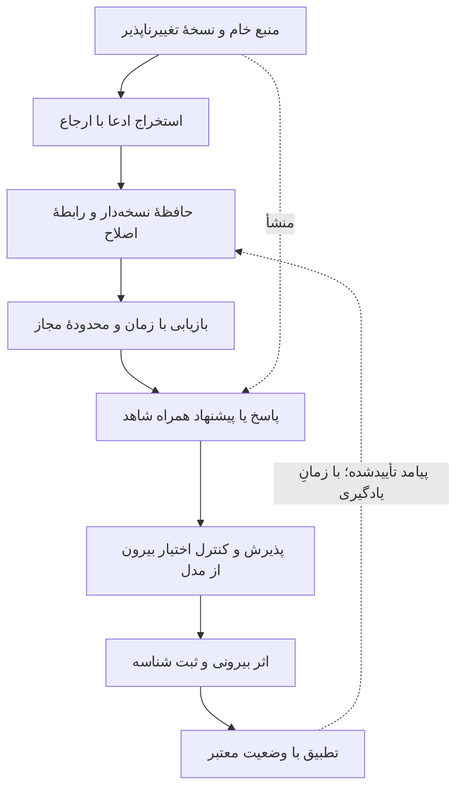

### ۸.۱ Hindsight: حفظ، بازیابی و بازاندیشی

[Hindsight](https://github.com/vectorize-io/hindsight) و [مستنداتش](https://hindsight.vectorize.io/) عملیات retain، recall و reflect، واقعیت، مشاهده و صفحات دانش ترکیبی را شرح می‌دهند. بازیابی چگال، کلیدواژه، گراف و زمان می‌تواند شواهد متفاوتی پیدا کند. عمق جست‌وجو با بودجهٔ توکن خروجی متفاوت است؛ ادغام رتبه‌ها و بازرتبه‌بندی نیز لایه‌های دیگری‌اند. توافق چند بازوی جست‌وجو، تأیید مستقل واقعیت نیست اگر همه به یک منبع برگردند.

سند retain میان زمان وقوع و زمان یادگیری تفاوت می‌گذارد؛ بااین‌حال استخراج روایی می‌تواند علت را استنباط کند و تشخیص موجودیت نام‌های مشابه را اشتباه ادغام کند. برچسب رابطهٔ causal شناسایی اثر علّی نیست. نقل مستقیم، استخراج و تفسیر علّی را جدا ذخیره کنید و قطعهٔ منبع را نگه دارید.

در بررسی توابع و آزمون‌های زمانیِ نسخهٔ مشخص، فیلتر updated_at از جمله برای همسایهٔ گراف و مشاهده‌ها آزمون داشته و کنترل مثبتِ بدون فیلتر مانع اشتباه‌گرفتن نتیجهٔ خالی با موفقیت شده است. اما فیلتر آخرین ردیف، محتوای پیش از به‌روزرسانی آن را بازسازی نمی‌کند. آزمون‌های متکی به PostgreSQL نیز بک‌اند دیگر را تأیید نمی‌کنند. استخراج زمانیِ طبیعی در شکست ممکن است قید تولید نکند؛ اگر برش تاریخی اجباری است باید بیرون از این استنباط اعمال شود.

پسوند tenant پیش‌فرض، احراز هویت ایجاد نمی‌کند؛ افزونهٔ کلید API نیز در دامنهٔ بررسی‌شده یک schema مشترک را احراز می‌کند، نه الزاماً هر کاربر را جدا. تگ، bank ID یا فیلتر انتخابی کاربر به‌تنهایی مجوز نیست. سیاست باید ورودی، نوشتن، بازیابی، گسترش گراف، خلاصه و حذف را پوشش دهد.

[Memory Defense](https://hindsight.vectorize.io/developer/memory-defense) لایهٔ اختیاریِ الگومحور برای پوشاندن یا مسدودکردن داده معرفی می‌کند؛ در نسخهٔ پرونده پیش‌فرض خاموش و اثرش بر نگهداری‌های آینده بوده است، نه پاک‌سازی گذشته. این سازوکار دفاع کاملِ اثبات‌شده در برابر تزریق دستور یا تضمین حذف همهٔ اطلاعات شخصی نیست.

[مقالهٔ نسخهٔ اول Hindsight](https://arxiv.org/html/2512.12818v1) از داور LLM و نتایج LongMemEval-S و LoCoMo استفاده می‌کند؛ جای‌خالی بودجهٔ بازیابی، مقایسه با گزارش‌های دارای داور متفاوت و اختلاف امتیاز LoCoMo در متن و جدول، بازتولید دقیق را محدود می‌کنند. همکاری مؤسسه‌های ذکرشده در همان مقاله، خودبه‌خود تکرار بیرونیِ مستقل نیست. امتیاز داشبورد تازه را نباید با تنظیمات مقالهٔ ۲۰۲۵ یا دقت معامله مخلوط کرد.

### ۸.۲ معیارهای حافظه را هم‌نام فرض نکنیم

**توضیح تکمیلی با منبع اصلی:** [LongMemEval](https://arxiv.org/abs/2410.10813) پنج توانایی را هدف می‌گیرد: استخراج اطلاعات، استدلال چندنشستی، استدلال زمانی، به‌روزرسانی دانش و خودداری از پاسخِ بی‌اطلاع. بازیابی یک نشست مرتبط فقط یکی از گام‌های رسیدن به پاسخ درست است. نتیجهٔ این بنچمارک، دقت تصمیم معاملاتی در زمان انتشار خبر را اندازه نمی‌گیرد.

| معیار | پرسش | نمونهٔ شکست با وجود امتیاز بالا |
|---|---|---|
| retrieval_any یا R@K از نوع «حداقل یکی» | یکی از نشست‌های طلایی در K مورد اول هست؟ | سؤال دو منبع می‌خواهد؛ فقط یکی برگشته |
| پوشش همهٔ شواهد لازم | تمام ورودی‌های پشتیبان جواب موجودند؟ | مدرک لازم آمده ولی خواننده آن را غلط ترکیب می‌کند |
| صحت پاسخ نهایی | جواب با معیار داور سازگار است؟ | داور تحمل یک روز اختلاف دارد ولی زمان سفارش به دقیقه حساس است |
| خودداری | در نبود شاهد، ندانستن اعلام می‌شود؟ | بازیابی خالی است و مدل حدس می‌زند |
| درستی تاریخی | فقط اطلاعاتِ در دسترسِ آن زمان وارد شده؟ | پاسخ درست امروز، در گذشته ناممکن بوده |
| جداسازی دسترسی | شاهد از کاربر/پروژهٔ مجاز آمده؟ | پاسخ درست اما از حافظهٔ محرمانهٔ دیگری است |

[Agent Memory Benchmark](https://github.com/vectorize-io/agent-memory-benchmark) متعلق به همان سازمان Hindsight است؛ بازبودن کد آن را خودبه‌خود مستقل نمی‌کند. جداسازی ingest، retrieve، generate و judge و ثبت زمان/هزینه مفید است. در نسخهٔ شرح‌داده‌شده، تولید و قضاوت از Gemini استفاده می‌کنند؛ PrecisionMemBench در مقابل، مجموعهٔ بازیابی را با assertion می‌سنجد. حالت oracle بازیابی عادی نیست؛ «ارائه‌دهندهٔ کامل» فقط انطباق امتیازدهنده را کنترل می‌کند.

آداپتر LongMemEval برای هر پرسش bank جدا می‌سازد و نشانِ نشستِ پاسخ‌دار را از سندِ دریافتی حذف می‌کند. این احتیاط مفید، همهٔ نشت را منتفی نمی‌کند. داور زمانی تحمل یک روز دارد و داور به‌روزرسانی ممکن است جوابِ دارای مقدار قدیم و جدید را بپذیرد. در بررسیِ جداشده، رشتهٔ 2023/05/20 (Sat) 02:21 به نیمه‌شب UTC تبدیل شد، چون بخش پس از پرانتز حذف می‌شود؛ تاریخ حفظ ولی ساعت گم می‌شود.

حالت RAG اگر پاسخ خام ارائه‌دهنده موجود باشد همان را سریال می‌کند و وگرنه از زمینهٔ نرمال‌شده استفاده می‌کند. پس خوانندهٔ یکسان لزوماً زمینه و بودجهٔ یکسان نمی‌بیند. فیلتر محدوده فقط وقتی عبور می‌کند که آداپتر پشتیبانی آن را اعلام کند؛ نبود پشتیبانی معادل اعمال جداسازی نیست. نسخه، آداپتر، زمان انتظار ورود/تجمیع، برش متن، خواننده، داور، بذر و هزینه باید همراه نتیجه باشند.

### ۸.۳ TencentDB Agent Memory: مرز اختیار واقعی

[F01](https://github.com/TencentCloud/TencentDB-Agent-Memory) حافظهٔ تیمی، مهارت، ویکی و گراف کد با مفاهیم مالکیت و ACL را معرفی می‌کند. جهش PersonaMem از ۴۸٪ به ۷۶٪، ۲۸ واحد درصد یا حدود ۵۸٫۳٪ افزایش نسبی است؛ ۵۹ واحد درصد نیست و مستقلاً بازتولید نشده است.

در middleware بررسی‌شدهٔ MemoryKnowledge، کلید خالی عبور می‌دهد و حتی با کلید تنظیم‌شده، مسیرهای خواندنی معاف‌اند؛ بعضی endpointهای POST جست‌وجو/ابزار نیز خواندنی طبقه‌بندی می‌شوند. خواندن می‌تواند دادهٔ محرمانه افشا کند. اما این مشاهدهٔ یک لایه است؛ gateway بالادستی یا سیاست دیگری ممکن است آن را محدود کند و زنجیرهٔ کامل استقرار آزموده نشده است.

در MemoryProxy، نبود تنظیم احراز به passthrough می‌رسد؛ فعال‌کردن احراز با URL خالی نیز می‌تواند به نبود تنظیم برسد. وقتی احراز واقعاً پیکربندی شده، رد یا شکست به رد منجر می‌شود. سرویس فراداده مسیر دیگری دارد و کلیدِ غایب/نامعتبر را رد می‌کند. بنابراین تعبیر کلیِ «همه‌چیز بدون احراز است» نادرست است. مسیر COS در factory ذخیره، نبود اعتبارنامه یا شکست import را رد می‌کند، ولی شاخهٔ پیش‌فرض محلی است. تفاوت «عمداً خاموش» و «الزامی ولی بدپیکربندی‌شده» باید آزمون شود.

### ۸.۴ Agentra: شمار بلوک، recall معنایی نیست

در [agentralabs/agentic-memory](https://github.com/agentralabs/agentic-memory)، نگهداری محلی، گراف، زنجیرهٔ جایگزینی و پرسش زمانی ایده‌های قابل مطالعه‌اند. در مسیر v3 بررسی‌شده، پوشش از شمارهای سقف‌دارِ بلوکِ انتخابی/۱۰۰، بلوک اخیر/۵۰ و تصمیم/۱۰ ساخته می‌شود. این شاخص داخلی، recall اندازه‌گیری‌شده یا صحت زمانی نیست. بودجهٔ توکن برآورد بایتی است و تشخیص موجودیت در آن مسیر عمدتاً به نشانه‌های slash و dot تکیه دارد.

در transport اختیاری SSE، هویت از X-User-ID می‌آید و bearer token مشترکِ حمل‌ونقل به‌تنهایی مالکیت آن هویت را ثابت نمی‌کند. بدون کنترلِ اتصال هویت در لایهٔ بالاتر، مجوز مشترک با جداسازی کاربر یکی نیست. نام فایلِ ساخته‌شده از هویت نیز به نرمال‌سازی و محصوربودن مسیر نیاز دارد. این‌ها نگرانی‌های شرطیِ کدند؛ نفوذ به سرویس مستقر نشان داده نشده است.

سه PDF پروژه با متن استخراج‌شدهٔ کامل ۱۰، ۹ و ۷ صفحه در پرونده خوانده شده‌اند؛ شکل‌ها و بازاجرای بنچمارک جدا مانده‌اند. مقالهٔ اول گراف مصنوعی با بردار ۱۲۸بعدی دارد و اندازهٔ سامانه‌های دیگر را برآورد می‌کند؛ ۲۱ آزمون عبور کرده و یکی رد نشده بلکه اجرا نشده است. پرس‌وجوی الگو در ۱۰۰هزار گره ۶۰۹ میلی‌ثانیه گزارش شده، پس ادعای کلیِ زیر ۱۰ میلی‌ثانیه برای همهٔ عملیات درست نیست. مقالهٔ دوم تشخیص شکاف ۲۹۷ ثانیه و قیاس ۲۲۹ ثانیه گزارش می‌کند و نشانگرهای ارجاع حل‌نشده دارد. میانگین‌های میکروثانیه‌ای مقالهٔ سوم روی ۱۰۰ گره‌اند و بعضی دنباله‌ها بالای ۱۰۰ میکروثانیه‌اند؛ مقایسهٔ فرضی با اجرای مستقل یکسان نیست.

ادعای ذخیره‌شدن حتمی با Drop هنگام پایان غیرمنتظره نیز بیش‌ازحد کلی است: [مرجع Rust](https://doc.rust-lang.org/reference/destructors.html#process-termination-without-unwinding) پایان بدون بازکردن پشته را مستثنا می‌کند. آزمون سقوط، نوشتن اتمی، خرابی فایل، هم‌زمانی و دوام نوشتنِ تأییدشده لازم است. پیوند بنچمارک به سازمان دیگر و اختلاف عددهای README/سند نیز باید با نسخه و اثر واقعی حل شود.

### ۸.۵ agentmemory: ارزیابی تازه تعبیر قبلی را اصلاح می‌کند

[F16](https://github.com/rohitg00/agentmemory) حالت محلیِ بدون کلید با BM25 و embedding اختیاری با دانلود اولیه معرفی می‌کند. امتیاز قبلیِ ۹۵٫۲٪ از نوع retrieval_any بوده، نه پاسخ انتهابه‌انتهای LongMemEval؛ با امتیاز پاسخ Hindsight قابل رتبه‌بندی مستقیم نیست.

گزارش ۹ اکتبر ۲۰۲۶ recall سخت‌گیرانه را ۳۹۸ از ۴۷۰، یعنی ۸۴٫۶۸٪، در برابر ۳۰۹ از ۴۷۰، یعنی ۶۵٫۷۴٪ قبلی می‌دهد؛ ۹۲ بازیابی و ۳ پسرفت، افزایش خالص ۸۹ را می‌سازد. نویسنده آن را تشخیص توسعه روی دادهٔ عمومی می‌نامد، نه مقایسهٔ دست‌نخوردهٔ رقبا یا داوریِ پاسخ با LLM. از ۱۱ بررسی چرخهٔ عمر، ۹ عبور و ۲ شکست، از جمله فیلتر میان‌پروژه‌ای و گسترش پایدار، گزارش شده؛ باقی‌بودن آن خطاها در اجرای جاری مستقل آزموده نشده است.

در پیاده‌سازی قدیمی‌ترِ بنچمارک، اسناد زمان جاری می‌گیرند، embedding از پیشوند متن ساخته می‌شود و خطاهای آن بی‌صدا کنار می‌روند. مسیرهای غیر BM25 ساختار hybrid مشترک دارند؛ برچسب vector را نباید بدون بررسی «فقط بردار» دانست. آزمون recall-access ثبت مصرف بازیابی را می‌سنجد، نه مجوز امنیتیِ tenant. نام فایل، دامنهٔ تضمین نیست.

### ۸.۶ حافظهٔ محصول، آموزش و orchestration

| منبع | سازوکار مفید | اصلاح و محدودیت |
|---|---|---|
| F06؛ [حافظهٔ Copilot](https://github.blog/ai-and-ml/github-copilot/building-an-agentic-memory-system-for-github-copilot/) | بازبینی ارجاع کد در شاخهٔ جاری پیش از مصرف حافظه | ۹۰ در برابر ۸۳، هفت واحد درصد و حدود ۸٫۴۳٪ نسبی؛ ۷۷ در برابر ۷۵، دو واحد درصد؛ مخرج و دادهٔ خام منتشرشده لازم است. تنظیمات مقالهٔ آغازین با مستندات جاری یکی نیست |
| F09؛ [درس Microsoft](https://microsoft.github.io/ai-agents-for-beginners/13-agent-memory/) | دسته‌بندی حافظه و نمونه‌های ترجیح | نوت‌بوک با نام Mem0 از دیکشنری درون‌فرایندیِ نمایشی استفاده می‌کند؛ ساخت دوبارهٔ نشست در همان فرایند آزمون دوام نیست |
| F12؛ [پنج الگوی حافظه](https://machinelearningmastery.com/5-architectural-patterns-for-persistent-memory-and-state-in-ai-agents/) | تفکیک حالت، checkpoint، رویداد، معنا و محدوده | checkpoint، دوام یا اثر دقیقاً یک‌بار را خودکار تضمین نمی‌کند |
| F13؛ [Agent Builder](https://www.langchain.com/blog/how-we-built-agent-builders-memory-system) | فایل مجازیِ پشتوانه‌دار با Postgres، schema و تأیید ویرایش | فایل مجازی دیسک عادی نیست؛ کار پس‌زمینه و حافظهٔ رویدادی در آن نوشته برنامهٔ آینده بوده‌اند، نه قابلیت همان نسخه |
| F14؛ [LangGraph persistence](https://docs.langchain.com/oss/python/langgraph/persistence) | checkpoint برای thread و store برای دادهٔ میان‌گفت‌وگویی | InMemorySaver و InMemoryStore با راه‌اندازی مجدد از بین می‌روند؛ بازگرداندن state سفارش پذیرفته‌شدهٔ کارگزار را برنمی‌گرداند |
| F15؛ [LangGraph Swarm](https://github.com/langchain-ai/langgraph-swarm-py) | تحویل کار و تغییر عامل فعال با انتشار تاریخچه | تاریخچهٔ مشترک کمترین اختیار نیست؛ در بررسی تابع، کلید غایب عامل پیش‌فرض می‌دهد ولی null صریح به null خارج از مقصدهای مجاز می‌رود |
| F17؛ [Dataiku](https://www.dataiku.com/blog/ai-agent-memory) | عملیات، کهنگی، منشأ و حاکمیت | ماندگاری، ردِ واقعیِ آنچه عامل دیده را ثابت نمی‌کند؛ دادهٔ بیشتر می‌تواند تضاد، حواس‌پرتی و هزینه را زیاد کند |
| F18؛ [Tacnode](https://tacnode.io/post/ai-agent-memory-architecture-explained) | تمایز شاهد رویدادی، تفسیر معنایی و وضعیت معتبر | [استدلال ترکیب‌ناپذیری](https://arxiv.org/abs/2601.17019) شرطی به تعریف‌ها و نبود کنترل دیدپذیری بیرونی است؛ اثبات شکست همهٔ معماری‌ها یا برتری یک فروشنده نیست |

در دو نوت‌بوک Microsoft، همهٔ سلول‌های کد و Markdown در پرونده خوانده شده‌اند. تابع جست‌وجوی هتل تعریف شده ولی در ساخت عاملِ بعدی فقط ذخیره/خواندن ترجیح ثبت شده است؛ در نمونهٔ Cognee نیز ابزارهای جست‌وجو تعریف شده ولی ساخت عاملِ نشان‌داده‌شده ابزار ثبت نمی‌کند. درخواست متنیِ «جست‌وجو کن»، تابع ثبت‌نشده را وصل نمی‌کند. setup نمونهٔ Cognee ذخیرهٔ تنظیم‌شده را prune می‌کند؛ سلول‌ها در پرونده اجرا نشده‌اند و اجرای بی‌دقت می‌تواند دادهٔ موجود را حذف کند.

مستندات Copilotِ بررسی‌شده در پرونده، انقضای ۲۸روزهٔ حافظهٔ استفاده‌نشده و پیش‌فرض وابسته به طرح را توصیف کرده‌اند؛ این تنظیمات باید با تاریخشان حفظ شوند. ارجاعی که هنوز باز می‌شود شرط ردیابی است، نه اثبات تفسیر درست یا دسترس‌پذیری تاریخیِ آن.

### ۸.۷ نقد معماری MinIO و پیگیری منبع

مقالهٔ F11 برای رده‌بندی ذخیره، منشأ، جداسازی و هزینه مفید است؛ اما دوگانهٔ «RAG بی‌حالت و حافظهٔ عامل باحالت» کلی‌تر از واقعیت است: سامانهٔ بازیابی می‌تواند ذخیرهٔ پایدار و قابل به‌روزرسانی داشته باشد. قیمت‌های فروشنده نیز بدون حجم داده، سخت‌افزار، تکثیر، بار و هزینهٔ عملیات، اندازه‌گیری هزینهٔ کل مالکیت نیستند.

پرونده با رجوع به [سیاست امنیت ردیفی PostgreSQL](https://www.postgresql.org/docs/current/ddl-rowsecurity.html)، نبودِ مطلق جداسازی بومی را رد می‌کند؛ نقش‌های superuser و BYPASSRLS و معمولاً مالک از سیاست عبور می‌کنند، پس وجود RLS هم به‌تنهایی استقرار را تأیید نمی‌کند. ادعای ماندن همیشگی فیزیکیِ دادهٔ شخصی اروپا در اروپا نیز کلی است؛ [فصل پنجم GDPR](https://eur-lex.europa.eu/legal-content/EN/TXT/?uri=CELEX:32016R0679) برای انتقال بین‌المللی شرط می‌گذارد. این تصحیح یک تعمیم است، نه ارزیابی حقوقیِ استقرار خاص.

مطالعهٔ نزدیک به ادعای ۱۲۰پرسشیِ مقاله، [arXiv:2605.17625v1](https://arxiv.org/html/2605.17625v1) تشخیص داده شد. بحث مقاله تقریب‌های متن فروشنده را تکرار می‌کند، اما جدول ۵ برای Dual Process، دقت وضعیت اخیر ۷۵٪ و توالی زمانی ۲۰٪ در برابر صفرِ همان baseline RAG می‌دهد. baseline فقط پنج همسایهٔ شباهت و بدون بازرتبه‌بندی زمانیِ هم‌بودجه است؛ نتیجه شکست همهٔ RAGها نیست. گفت‌وگوها مصنوعی‌اند. یک سطر جدول ۶ به‌جای ۱۲۰، ۱۱۶ مورد دارد؛ جمع تکمیل‌شده ۱۴۳۶ است نه ۱۴۴۰ برنامه‌ریزی‌شده. پیوند کد/داده هنوز جای‌نگهدار ناشناسِ داوری است؛ بازتولید دقیق باز می‌ماند.

### ۸.۸ فهرست‌ها، موضوع‌ها و نظرسنجی‌ها

F03، F04 و F08 صفحهٔ موضوع GitHub‌اند؛ در مشاهدهٔ پرونده، دو مورد اول ۳۲۸ و ۲۵۹۱ نتیجه نشان داده‌اند و تنها صفحهٔ نخستِ قابل بازیابی بررسی شده است. ترتیب «آخرین به‌روزرسانی» فعالیت است، نه کیفیت. F05 و F10 فهرست‌های بزرگ حافظه‌اند؛ طبقه‌بندی پذیرش، تجمیع، فراموشی، تمامیت، تراکنش، شخصی‌سازی و تجربه مفید است، ولی همهٔ مقاله‌ها خوانده نشده‌اند.

[کالبدشناسی حافظهٔ عامل](https://arxiv.org/abs/2602.19320) نشان می‌دهد رتبه به امتیازدهی واژگانی/معنایی و پرامپت داور حساس است؛ بخشی از تحلیل اشباع، ساختاری نامیده شده و آزمایش اشباع تجربی نیست. [مرور حافظه در عصر عامل‌ها](https://arxiv.org/abs/2512.13564) در حد چکیده و فراداده ثبت شده؛ چارچوب شکل/کارکرد/پویایی مسیر مطالعه است، نه شاهد اجرای همهٔ سیستم‌های نام‌برده. شناسهٔ DOI، arXiv و مالک مخزن را برای حذف تکرار به کار ببرید؛ حضور در دو فهرست و README فروشنده سه تأیید مستقل نیست.

### ۸.۹ پروتکل پذیرش حافظه

| آزمون | شرط پذیرش | شکست قابل مشاهده |
|---|---|---|
| پوشش منبع | تمام قطعات لازم و ارجاع دقیق برگردد | یک شاهد از سؤال چندمنبعی گم است |
| اصلاح و تضاد | نسخهٔ تازه با سابقهٔ جایگزینی؛ ارجاع وابسته بازبینی شود | تکرار زیاد، واقعیت منسوخ را برنده کند |
| بازسازی تاریخی | اصلاحیه و خلاصهٔ بعدی در پرسشِ پیشین دیده نشوند | جواب گذشته با دانستهٔ آینده عوض شود |
| توقف و ادامه | حالت و اثر بیرونی با هم تطبیق شوند | سفارش یا نوشتن دوباره انجام شود |
| جداسازی و لغو دسترسی | کاربر بیگانه، همسایهٔ گراف و خروجی مشتق رد شوند | داده پس از لغو از cache یا خلاصه برگردد |
| حذف | مشتقات حذف یا بازتولید و دامنه روشن شود | متن خام حذف ولی بردار و خلاصه باقی بماند |
| تزریق دستور ذخیره‌شده | سند، شاهد بماند و اختیار را عوض نکند | نوشتهٔ داخل حافظه، قانون ابزار را تغییر دهد |
| ارزش اقتصادیِ ابزار | تکمیل پذیرفته‌شده در بودجهٔ یکسان بهتر شود | recall بهتر با نتیجهٔ کار بدتر و هزینهٔ نامتناسب |

این آزمون‌ها پیشنهاد پذیرش‌اند؛ در پرونده هیچ سرویس حافظهٔ میزبانی‌شده، مجموعهٔ مقایسهٔ زندهٔ چندارائه‌دهنده یا استقرار عامل معاملاتی اجرا نشده است.


## ۹. مهار اجرای عامل: تکمیل را چگونه ثابت می‌کنیم؟

واژهٔ harness در این پرونده به مجموعهٔ دستور، ابزار، محیط، وضعیت و بازخورد برای اجرای قابل پیگیری عامل اشاره دارد. هر جزء باید یک خطای واقعی را کاهش دهد؛ افزودن عامل یا فایل دستور بیشتر، به‌خودی‌خود مزیت نیست. یک ثبت پیشرفت کوتاه با معیار پذیرش روشن، مبنای مناسبی برای مقایسه با سامانهٔ پیچیده‌تر است.

### ۹.۱ دورهٔ Learn Harness Engineering

E01 و E02 مخزن و سایت یک برنامهٔ درسی‌اند، نه دو آزمایش مستقل. در پروندهٔ مبدأ، ۱۴ درس انگلیسی و ۸ شرح پروژه از آرشیو ۲۷۵۰فایلی بررسی شده‌اند؛ ترجمه‌ها، کتاب‌های تولیدشده، تمام مثال‌ها و اجرای واقعی تمرین‌ها کامل نشده‌اند.

| گروه درس | سازوکار مفید | شرط یا تصحیح |
|---|---|---|
| ۱–۲؛ تشخیص شکست و پنج زیرسامانه | جداکردن دستور، ابزار، محیط، وضعیت و بازخورد؛ نسبت‌دادن شکست و حذف‌مولفه | عددهای ساخته‌شدهٔ آموزشی، شاهد تجربی نیستند؛ نبود هر جزء در هر مسئله الزاماً شکست نمی‌آورد |
| ۳–۴؛ مرجع ثبت و افشای تدریجی | تصمیم نسخه‌دار نزدیک پیاده‌سازی، نقشهٔ ورود و بررسی نشست تازه | ابزار اتصال می‌تواند بیرون مخزن را ببیند؛ فایل مخزن بالاترین مرجع دستور نیست |
| ۵–۶؛ تداوم و آغاز | تحویل نسخه، تصمیم، بررسی، مانع و قدم بعد | تصمیم کوتاه ذخیره شود؛ آستانهٔ ساعت/درصد زمینه و برتری قالب، فرض آموزشی‌اند |
| ۷–۸؛ دامنه و وضعیت قابلیت | یک واحد فعال و معیار رفتاریِ آشکار | C/k مدل اعتبارسنجی‌شدهٔ ظرفیت نیست؛ قانون لیتل به‌تنهایی شکست با کار هم‌زمان را اثبات نمی‌کند؛ قابلیتِ پسرفت‌کرده باید باز شود |
| ۹–۱۰؛ تکمیل و یکپارچگی | اجرای مسیر واقعی کاربر و پذیرش بیرون از پرچم موفقیتِ سازنده | E2E نبود همهٔ عیب‌ها را ثابت نمی‌کند؛ unit، integration و E2E مجموعه‌های تو‌در‌تو از خطاهای قابل کشف نیستند؛ مدل دوم هم خطاپذیر است |
| ۱۱–۱۲؛ مشاهده و تحویل | رد اجرا و اثر پذیرش برای فهم و ادامه | rubric تضمین توافق نیست؛ راز ثبت نشود؛ وضعیت تمیز مجوز پاک‌کردن کار نامرتبط نیست |
| ۱۳–۱۴؛ حلقه و مسیریابی | سقف تلاش و هزینه، مالک، وتو، ادغام و checkpoint | worktree جداسازی checkout است، نه مجوز فایل یا سرویس؛ شکل گراف استقلال یا اثر دقیقاً یک‌بار ایجاد نمی‌کند |

مقایسهٔ بازی‌ساز با ۹ دلار/۲۰ دقیقه در برابر ۲۰۰ دلار/۶ ساعت، در درس ۹ و [گزارش اصلی Anthropic](https://www.anthropic.com/engineering/harness-design-long-running-apps) دارای بودجه و زمان نامساوی، گسترش دامنه و خطاهای باقیمانده است. نباید همهٔ تفاوت را به یک جزء نسبت داد. همان گزارش حذف بعضی داربست‌های غیرلازم با مدل قوی‌تر را نیز توصیف می‌کند. [مقالهٔ عامل‌های طولانی‌مدت](https://www.anthropic.com/engineering/effective-harnesses-for-long-running-agents) برای پیشرفت ماندگار و بازخورد اجرایی مفید است؛ ولی ثبت موفقیت توسط خود عامل داوری مستقل نیست.

[مطالعهٔ ETH دربارهٔ AGENTS.md](https://www.sri.inf.ethz.ch/publications/gloaguen2026agentsmd) در تنظیمات خود افزایش موفقیت نشان نمی‌دهد و هزینهٔ استنتاج را بیشتر گزارش می‌کند. [مطالعهٔ کاراییِ زوجی](https://arxiv.org/abs/2601.20404) کاهش زمان/توکن خروجی را گزارش می‌کند، ولی بررسی جامع صحت عملکرد را صریحاً کنار می‌گذارد و همهٔ میانه‌های توکن ورودی/کل بهتر نشده‌اند. این یافته‌های شرطی با هم ناسازگار نیستند؛ هیچ‌کدام قانون «همیشه دستور اضافه کن» یا «هرگز اضافه نکن» نمی‌سازند.

<aside class="callout important"><strong>خودِ معیار پذیرش هم باید آزمون شود</strong><p>فرمان نمونهٔ درس ۸، مقایسه‌ای با jq دارد. مطابق <a href="https://jqlang.org/manual/#invoking-jq">راهنمای jq</a>، بدون گزینهٔ -e، نتیجهٔ false معمولاً همچنان خروج صفر می‌دهد. دروازه باید نتیجهٔ غلط، شکست انتقال، JSON خراب و وضعیت HTTP نامناسب را جدا رد کند.</p></aside>

پروژه‌های هشت‌گانه از baseline، فضای قابل خواندن، ادامه پس از توقف، تشخیص، تفکیک نقش، پروژهٔ نهایی، حلقه و مسیر تأیید پیش می‌روند. وجود راه‌حلِ خواهر یا شواهد قبلاً قبول‌شده می‌تواند baseline را آلوده کند؛ شاخه و worktree تضمین نادیدنی‌بودن آن‌ها نیست. فایل‌های در دسترس، کد آغازین، بودجه و معیار داور باید متقارن و ترتیب اجرا تصادفی باشد. نمره‌های rubric موجود در مخزن، تا وقتی منشأ اجرای آن‌ها روشن نشده، مثال‌اند.

### ۹.۲ Harness و Harnesscode دو محصول متفاوت‌اند

[harness/harness](https://github.com/harness/harness) بستر میزبانی کد، CI/CD، محیط توسعه و رجیستری اثر است. ارزش پژوهشیِ آن پیوند نسخه، ورودی، محیط و نتیجهٔ ساخت است؛ جانشین حافظه یا شبیه‌ساز صرافی نیست. درخت مشاهده‌شده ۶۲۴۹ فایل داشته و بررسی سرویس‌گسترده انجام نشده است. دسترسی Docker socket در شروع سریع اختیار مهم میزبان است و «داخل کانتینر» مترادف sandbox نیست. نمونهٔ PAT در متن یک‌سال نامیده شده ولی آرگومان ۲٬۵۹۲٬۰۰۰ ثانیه برابر ۳۰ روز است؛ معنی واقعی در کد باید بررسی شود.

[yzddp/harnesscode](https://github.com/yzddp/harnesscode) حلقهٔ Python برای عامل کدنویس، با فایل‌های قابلیت، آزمون و بازبینی است. در نسخهٔ 7cef5db…، backend Claude بی‌قید پرچم‌های عبور از مجوز را اضافه می‌کند؛ توصیف «انسان در حلقه» ضمانت اجرایی نیست. ادغام تنظیم OpenCode نیز پس از خطای parse به تنظیم خالی برمی‌گردد. نصب‌کننده می‌تواند وابستگی نصب و تنظیم عامل را تغییر دهد؛ فراخوان آغاز، false بودن نتیجهٔ initializer را فوراً متوقف نمی‌کند. بازگردانی backup روی فایل جاری می‌نویسد و به مالکیت و تازگی نیاز دارد. این مسیرها خوانده شده‌اند و روی تنظیم این دستگاه اجرا نشده‌اند.

| ضدنمونهٔ ثبت‌شده | پیامد | معیار اصلاح |
|---|---|---|
| قابلیت blocked، صفر از یک تکمیل؛ فیلتر فقط pending را می‌بیند | فهرست انتظار خالی با تکمیل واقعی اشتباه می‌شود | همهٔ قابلیت‌ها باید حالت پذیرش معتبر داشته باشند |
| وجود عبارت نقل‌شدهٔ PROJECT COMPLETE در متن | parser جایگزین می‌تواند آن را تکمیل بداند | نتیجهٔ ساختاریافته و متصل به نسخه، با شواهد تازه |
| گزارش آزمون غایب یا قدیمی | دروازه فقط گزارش موجود و صریحاً شکست‌خورده را رد می‌کند | نبود، خرابی یا کهنگیِ شاهد باید مانع تکمیل شود |
| ذخیرهٔ دو الگوی خطا در یک ثانیه | نام فایل یکسان؛ رکورد اول با دوم جایگزین شد | شناسهٔ مقاوم به برخورد، نوشتن اتمی و نسخهٔ منبع |

ضدنمونهٔ آخر با کلاس بررسی‌شده، ساعت ثابت و پوشهٔ آزمایشی اجرا شده است؛ مدل، نصب‌کننده و CLI خارجی اجرا نشده‌اند. «خودآموخته» نامیدن یک رکورد نشان نمی‌دهد اصلاح پیشنهادی واقعاً کار کرده است.

### ۹.۳ آزمون منصفانهٔ مهار اجرا

مدل، مسئله، بودجه و داورِ نگه‌داشته‌شده را ثابت کنید. ثبت پیشرفت کمینه را با حافظهٔ غنی‌تر و الگوی سازنده/بازبین مقایسه کنید. تکمیل پذیرفته‌شده، پسرفت، هزینه، زمان و دخالت انسانی را در تکرارها بسنجید. شکست داور و تغییر یا حذف آزمون پذیرش نیز باید ثبت شود. این طرحِ آزمایش است؛ در پرونده اجرا نشده است.

## ۱۰. QuantResearch: روش ارزشمند با کد تاریخی

E09، E10 و E11 به‌ترتیب فهرست نرم‌افزار، انتشارات و نوآوری‌ها هستند. متن فهرست را باید از بدنهٔ هر منبعِ پیوندشده جدا کرد. مقالهٔ روش، سرمقاله، مصاحبه و کار در دست انتشار وزن تجربی یکسان ندارند.

### ۱۰.۱ دامنهٔ بررسی فایل‌ها

پرونده تمام ۲۹ فایل متنیِ کد/دادهٔ فهرست Software را دریافت و خوانده: ۲۶ اسکریپت Python و ۳ fixture CSV، جمعاً ۸۷٬۶۱۰ بایت. هفت اسکریپت در Python 3.12 parse شده و ۱۹ مورد نشده‌اند. عبور parse نه import را بررسی می‌کند، نه اجرا و نه صحت عددی. GUI، پوستر، شبیه‌ساز آنلاین و مقاله‌ها موارد جداگانه‌اند. مجوز صفحه از یک سو GPL و از سوی دیگر غیرتجاری‌بودن و حفظ حقوق تجاری را می‌گوید؛ پیش از استفاده باید تعارضِ دقیقِ توزیع حل شود.

| فایل یا گروه | سازوکار | نکتهٔ فنیِ تعیین‌کننده |
|---|---|---|
| HRP.py و HRP_MC.py | خوشه‌بندی، شبه‌قطری‌سازی و تخصیص بازگشتی؛ مقایسه با واریانس معکوس و CLA | تقسیم Python 2، xrange و pandas append قدیمی؛ ماتریس فاصلهٔ مربعی به linkage داده می‌شود، ولی SciPy ورودی دوبعدی را سطرهای مشاهده می‌فهمد، نه فاصلهٔ فشرده |
| DSR.py | تقریب بیشینهٔ نرمال و شبیه‌سازی شمار تلاش | تمام استنباط DSR با گشتاور بازده نیست؛ مقیاس پراکندگی را که مثال تبلیغاتی حذف کرده دارد |
| KCA_1.py | مدل حالتِ سینماتیکی، EM و هموارسازی | برازش/هموارسازی روی کل سری از آیندهٔ نقاط قبلی استفاده می‌کند؛ ویژگی زنده به برازش گذشته و فیلتر پیشرو نیاز دارد |
| KCA_2.py | انتخاب فرکانس FFT از خودهمبستگی باقیمانده | بازسازی سراسری پس‌نگر است؛ شکل آرایه و API نسخهٔ statsmodels باید منطبق شود |
| KCA_3.py و KCA_4.py | مقایسهٔ مصنوعی تناوب با FFT و LOWESS | نام ماژول محلی با فایل دانلود متفاوت؛ KCA_4 تابع getPeriodic را بدون تعریف/import می‌خواند |
| OTR.py | جست‌وجوی سود/زیان تحت فرایند OU گسسته | پیش‌بینی، نیمه‌عمر و پخش، نتیجه را تعیین می‌کنند؛ رفع بدون‌مدلِ سوگیری انتخاب نیست |
| SFD_1.py و SFD_2.py | گراف AR/VAR/SVAR و تبدیل همبستگی | فرض‌های فهرست/range و .ix قدیمی؛ یال گراف شناسایی علّی نیست |
| CSCV_1.py و CSCV_2.py | مثال مونت‌کارلو و دقت EVT | import و تقسیم قدیمی و شمار شناور؛ پیاده‌سازی آمادهٔ عمومی CSCV روی ماتریس بازده نیستند |
| CSCV_3.py | جست‌وجوی فصلی روی قیمت تولیدشده و PSR | شرط isoweekday کمتر از ۵ جمعه را حذف می‌کند، helper کمتر از ۶ است؛ تقویم بورس واقعی نیست |
| DD1.py | صدک تجمعیِ تحلیلی AR(1) در برابر شبیه‌سازی | توزیع عام بیشینهٔ افت سرمایه نیست |
| DD2.py تا DD4.py | جست‌وجوی حداقل منحنی صدک و بازیابی روی خلاصهٔ HFR | حلقهٔ تا مثبت‌شدن به دامنه و توقف نیاز دارد؛ مسیر محلی و وابستگی باقی است |
| Data1.csv و Data2.csv | در هرکدام ۲۶ سطر خلاصهٔ شاخص HFR | تاریخچهٔ خام بازده نیست؛ دادهٔ دوم مقدار مرجع افت/بازیابی با AR صفر دارد |
| CLA.py، CLA_Main.py و CLA_Data.csv | نقاط برگشت روش خط بحرانی، کوواریانس/قید ۱۰ دارایی | تورفتگی، مقایسه/تکرار Python 2، مسیر ثابت و وارون‌سازی؛ امکان‌پذیری، تکینگی و KKT با حل‌کنندهٔ مستقل لازم است |
| ERC.py | سهم برابر ریسک و هج تکراری | معنای ضرب ماتریسی، range تغییرپذیر، بذر و توقف عددی مهم‌اند |
| MMSC.py | بهینه‌سازی زیرمجموعهٔ همبستگی | هزینهٔ ترکیبی و روش ابتکاری؛ گواه بهینگی سراسری ثبت نشده |
| Clustering.py | گروه‌بندی با مقایسهٔ عدد وضعیت | مسیر ثابت و API قدیمی؛ عدد وضعیت کمتر، تخصیص بهترِ بیرون‌نمونه را ثابت نمی‌کند |
| PSR.py | PSR و حداقل طول سابقه با ورودی غیرسالانه | مثال منتخب عبور کرده؛ وابستگی نمونه خارج از آن بررسی است |
| PSR_Optimal_Constrained.py | جست‌وجوی پرتفوی با گشتاور بالاتر | پیش‌فرض bounds=None فوراً len(None) می‌زند و TypeError بازتولید شده؛ جدا از ناسازگاری print قدیمی |
| OEH.py | حجم اجرای بهینهٔ تکه‌ای با پارامتر عدم‌تعادل | واحد، مرز و اثر قیمت باید کالیبره شود |
| EF3M.py | تطبیق گشتاورِ مخلوط دو نرمال | آغاز تصادفی، exception گسترده، مقیاس مثبت، احتمال و تقارن برچسب‌ها و برازش بیرون‌نمونه لازم است |

[قرارداد linkage در SciPy](https://docs.scipy.org/doc/scipy/reference/generated/scipy.cluster.hierarchy.linkage.html) مرجع تشخیص ورودی مربعی و بردار فاصلهٔ فشرده در پرونده بوده است. آزمون‌های عددیِ منتخب با تعریف توابعِ خوانده‌شده و جایگزین NormalDist برای CDF/quantile انجام شده‌اند؛ اجرای بدون تغییرِ محیط اصلی یا بازتولید همهٔ جدول‌های مونت‌کارلو نیستند.

### ۱۰.۲ خانوادهٔ روش‌ها و راه ابطال

| خانواده | ارزش قابل آزمون | شرطی که حذفش نتیجه را عوض می‌کند |
|---|---|---|
| سه‌مانع، فرابرچسب، اندازه‌گذاری | هماهنگی برچسب با سیاست خروج و انتخاب شرطی سیگنال | آموزشِ مانع، مدل جهت و اندازه فقط روی گذشته؛ F1 بهتر الزاماً سود خالص بهتر نیست |
| یکتایی و bootstrap ترتیبی | کاهش وزن اطلاعات تکراریِ برچسب‌های هم‌پوشان | تعداد سطر با مقدار اطلاعات مستقل برابر نیست |
| پاک‌سازی، embargo، CPCV و PBO | حساسیت مرز اطلاعات و انتخاب | دادهٔ اصلاح‌شده، بقا یا سؤال علّی نادرست را تعمیر نمی‌کنند |
| PSR، MinTRL، MinBTL و DSR | آشکارکردن عدم‌قطعیت و جست‌وجو | واحد دوره، گشتاور، وابستگی، تلاش واقعی و توزیع تهی |
| HRP، NCO، A2A-MCOS، TIC و CLA | پایداری تخصیص زیر خطای برآورد و پیشین ساختاری | جهان، بازتوازن، هزینه و قید یکسان؛ برتری شبیه‌سازی جهان‌شمول نیست |
| VPIN، BVC و نمونه‌گیری عدم‌تعادل | جریان معامله با ساعت حجم/رویداد | طبقه‌بندی معامله و پارامتر حجم؛ مقایسه با کنترل سادهٔ حجم/نوسان |
| OU، افق اجرا و بودجهٔ ریسک | قاعدهٔ شرطی به فرایند و هدف روشن | ایستایی، ثبات پارامتر و نقدشوندگی |
| KCA، جریان تصادفی و مخلوط | ساختار حالت/نویز و عدم‌قطعیت | فیلتر و هموارسازی و شناسایی باید جدا باشند |
| عوامل علّی | تفکیک پیش‌بینی، مداخله و انتساب | فرض شناسایی و حساسیت؛ اجرای PC یا رسم DAG ساختار درست را تضمین نمی‌کند |

انتشارات تازهٔ استنباط شارپ، از جمله [چارچوب یکپارچهٔ ۲۰۲۶](https://doi.org/10.3905/jpm.2026.070)، در سطح فرادادهٔ ناشر تأیید شده و متن کامل محدود بوده است. نسخه‌های مکان، مقیاس و توزیع کامل جست‌وجو را نباید صرف نام DSR یک تابع یکسان دانست. [کد پژوهش شارپ ۲۰۲۵](https://github.com/zoonek/2025-sharpe-ratio) نیز اثر نسخه‌دار جداست. فرمول بهینه‌سازی کوانتومی، به‌تنهایی سرعت عملی یا مزیت بازار نمی‌سازد؛ Triple Penance قانون جهانی زمان بازیابی نیست.

### ۱۰.۳ برازش بهتر می‌تواند انتساب علّی را بدتر کند

[راهنمای علّیتِ CFA](https://rpc.cfainstitute.org/sites/default/files/docs/research-reports/rf_lopezdeprado_causalityprimer_online.pdf) در پرونده با متن و کتاب‌نامه خوانده شده است. ۲۶ سطر نمونهٔ آن مدل‌های مرتبطِ long/short هستند، نه ۲۶ آزمایش تصادفی مستقل. دادهٔ اصلی اختصاصی و فرض‌های کشف علّی محدودیت بازتولید دارند. پیام درست، تفاوتِ پیش‌بینی و انتساب است؛ نه اینکه هر رابطهٔ همبستگی برای پیش‌بینی بی‌فایده است.

مثال مصنوعی مستقلِ پرونده: X، E و U نرمال استاندارد و مستقل‌اند؛ Y=X+E و Z=X+Y+0.5U. اثر کل واقعی X بر Y برابر یک است. افزودن Z که برخوردگاهِ مسیرها و وابسته به Y است، ضریب X در رگرسیون را به −۰٫۶ می‌برد. با بذر ۲۰۲۶۱۰۱۹ و ۲۰۰هزار مشاهده، ضریب بدون Z برابر +۱٫۰۰۱۳۵۶۸ و با Z برابر −۰٫۵۹۹۰۳۸۶ شده؛ R² از ۰٫۵۰۱۴۱۲۵ به ۰٫۹۰۰۰۵۱۶ رسیده است.

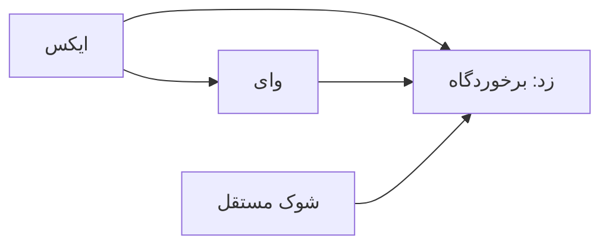

<aside class="callout important"><strong>بهبود برازش، اثبات علت نیست</strong><p>کنترلِ نامناسب می‌تواند علامت اثر را برگرداند و هم‌زمان R² را بهتر کند. این مثال، سازوکار مصنوعی با فرض معلوم را نشان می‌دهد؛ آزمایش اختصاصی Barra یا سود یک راهبرد را بازتولید نمی‌کند. چون Z به Y وابسته است، برازش بهترش شاهد پیش‌بینیِ قابل دسترس در زمان زودتر هم نیست.</p></aside>

### ۱۰.۴ سرمقاله‌ها و جایگاه آن‌ها

E07 از Fabozzi دربارهٔ انتخاب کمّی‌کاران در آکادمی‌ها، فرایند مهندسی تصمیم مالی و خط تولید راهبرد می‌گوید؛ آزمایش کنترل‌شدهٔ سودآوری ارائه نمی‌دهد. خبر تکمیلی ADIA Lab مورخ ۲ ژوئیهٔ ۲۰۲۶ متن اعلام‌کننده دربارهٔ انتخاب و مراسم برنامه‌ریزی‌شدهٔ اکتبر است، نه تأیید مستقل همهٔ سوابق یا روش‌ها. E08 در شمارهٔ فوریهٔ ۲۰۲۵، جلد ۵۱(۴)، صفحات ۱–۲ و DOI دارای جزء ۲۰۲۴، دربارهٔ تقدیر و منفعت عمومی است؛ این دو تاریخ فیلدهای متفاوت فراداده‌اند. مجموعهٔ مصاحبهٔ پیوندشده در دسترسی بعدی ۴۰۳ داده و همچنان جداگانه باز است.


## ۱۱. ترمینال، محصول تجاری و مهندسی معکوس

### ۱۱.۱ OpenTerminal: الگوی رابط و آداپتر، با کیفیت دادهٔ مشروط

[N01؛ OpenTerminal](https://github.com/ErTasselli/OpenTerminal) با MIT، در snapshot پرونده حدود ۱۸۰۰ ستاره، ۳۲۰ انشعاب و ۳۲ commit داشته؛ این اعداد توصیفی‌اند، نه امتیاز کیفیت. ساختار server و web، CI، آزمون، داده و screenshot دیده شده است. رابط پنلِ جابه‌جاشونده با react-grid-layout، انتخاب نماد با صفحه‌کلید، کندل Lightweight Charts و اندیکاتورهای SMA، EMA، VWAP، Bollinger، RSI و MACD معرفی می‌کند.

فهرست امکانات مستند شامل سهام/ETF، RSS، غربال و نقشهٔ درختی بخش‌ها، زنجیرهٔ اختیار، رمزارز، نرخ‌های کلان و جانشین VIX، تقویم سود و اقتصاد، دفتر تراکنش SQLite و دستیار اختیاری Claude است. پشتهٔ توصیف‌شده Next.js 15، React 19، TypeScript، Zustand، TanStack Query، D3/Recharts، Express و better-sqlite3 در حالت WAL است. این فهرست امکانات معرفی‌شده است؛ همهٔ رفتارهای اجرایی آزموده نشده‌اند.

تأمین‌کننده‌ها در README از endpoint عمومی Nasdaq با جایگزین Yahoo و Stooq، scanner/search عمومی TradingView، RSS یاهو/گوگل، CoinGecko/Binance، FRED و Forex Factory نام می‌برند. آداپتر جدا و زنجیرهٔ جایگزین مفید است، اما دسترسی عمومی یا مهندسی‌معکوس‌شده، مجوز بازتوزیع، کیفیت بورس یا تازگی را تضمین نمی‌کند. خود نویسنده استفادهٔ آموزشی/شخصی و پرهیز از تصمیم سرمایه‌گذاری بر این قیمت‌ها را تصریح کرده است.

بررسی دقیق‌تر نسخهٔ aed097c… دو برداشت اولیه را اصلاح می‌کند. cache، ذخیرهٔ stale بدون سقف سنی جدا دارد؛ helper ابتدا منتظر refresh می‌ماند و پس از شکست به قدیمی برمی‌گردد، بدون اینکه خودش کهنگی را به خروجی آشکار کند. بنابراین این مسیر، refresh پس‌زمینهٔ اثبات‌شده نیست و دفعات تازه‌سازی، تازگی منبع را ثابت نمی‌کند. در دفتر سبد نیز فروش بیشتر از موجودی به مقدار دارایی محدود می‌شود: خرید یک سهم با قیمت ۱۰ و ثبت فروش دو سهم با ۱۲، فقط یک سهم را می‌فروشد، سود ۲ و ماندهٔ صفر می‌دهد و اضافهٔ فروش بی‌صدا نادیده می‌ماند. این یافتهٔ کد/حساب است، نه آزمون ترمینالِ در حال اجرا.

loopback، راز API محلی، Docker، Vitest و CI الگوهای قابل مطالعه‌اند. در مقابل، TRUST_PROXY نادرست می‌تواند اجازه دهد header انتقالِ جعل‌شده از محدودسازی عبور کند. تازگی مظنه، اختیار، تعدیل شرکتی، P&L، فشار بازگشایی بازار، outage، proxy خارجی، امنیت زمینهٔ AI و توصیه‌های وابستگی باز می‌مانند. Greeks بلک–شولز، ابزار رسم، هشدار و PostgreSQL در roadmap ذکر شده‌اند؛ نباید همه را قابلیت حاضر فرض کرد.

### ۱۱.۲ ML4T: یک مسیر آموزشیِ سرتاسری

[N04؛ مخزن رسمی Stefan Jansen](https://github.com/stefan-jansen/machine-learning-for-trading) در شاخهٔ پیش‌فرض، ویرایش سوم با ۲۷ فصل و ۹ مطالعهٔ سرتاسری را معرفی می‌کند؛ شاخهٔ second-edition قدیمی را نگه می‌دارد. [مخزن Packt](https://github.com/PacktPublishing/Machine-Learning-for-Algorithmic-Trading-Second-Edition) انشعاب ویرایش دوم با ۲۳ فصل و پیوست و بیش از ۱۵۰ notebook است، نه تأیید مستقل ویرایش سوم. شمارهای snapshot مانند ۲۱٫۴هزار ستاره و ۱۱۳۵ commit برای رسمی یا حدود ۳۵۳ commit برای Packt، شاخص پایداری نتیجهٔ مالی نیستند.

مزیت اصلی کتاب، پیوند داده و برچسب با پیش‌بینی، هزینه، ریسک، تصمیم استقرار، پایش و بازنشستگی و مرز میان توسعه و تأیید است. بازارهای ETF، دائمی رمزارز، سهام درون‌روزی، اختیار، ارز، آتی و عوامل مقطعی در دامنهٔ مطالعات‌اند. گرادیان‌بوستینگ، PatchTST، iTransformer، TSMixer، TCN، Mamba، TabPFN/TabM، خودرمزگذار شرطی، ML علّی، دادهٔ مصنوعی، RL، RAG گزارش‌های SEC و GraphRAG فهرست روش‌ها هستند؛ حضور روش در کتاب شاهد برتری زندهٔ آن نیست.

ویرایش دوم برای بازسازی ITCH، عوامل، Zipline/backtrader، متن گزارش و مثال مقاله‌ها ارزش تاریخی دارد؛ وابستگی قدیمیِ pandas، TensorFlow، Python و Zipline اجرای بی‌دردسر روی سامانهٔ تازه را تضمین نمی‌کند. نسخهٔ مثال، داده و محیط باید با هم ثبت شوند.

[ml4t/skills](https://github.com/ml4t/skills) در snapshot، ۶۱ فایل مهارت در گروه‌های داده، ویژگی، بک‌تست، اعتبارسنجی، تولید و زیرساخت داشته؛ کتابخانهٔ Python یا runtime npm نیست. نصب‌کننده ساختار را برای کشف مهارت مسطح می‌کند؛ قراردادن کل مخزنِ گروه‌بندی‌شده یک لایه پایین ممکن است آن‌ها را پنهان کند. فقط پنج مهارتِ DSR، پاک‌سازی/embargo، CPCV، حاکمیت عامل و اجرای زنده کامل خوانده شده‌اند. دستورِ خوب باید معیار سنجیدنی و API واقعی داشته باشد؛ متن چک‌لیست نشان نمی‌دهد عامل آن را رعایت کرده است. دورهٔ چهار هفته‌ای paper، مثال عملیاتی است نه آستانهٔ جهانی معناداری.

[ml4t/models](https://github.com/ml4t/models) PCA، RP-PCA، IPCA، خودرمزگذار شرطی، عامل تنزیل تصادفی و یادگیری سبد خطی/LSTM/عمیق با پنل و قالب تبادل نوع‌دار معرفی می‌کند. بازسازی عامل درون‌نمونه، تخمین حق‌بیمه و پیش‌بینی پیشینی بازده سه هدف متفاوت‌اند. بار عاملیِ دقیق، به‌تنهایی قیمت آیندهٔ عامل را پیش‌بینی نمی‌کند.

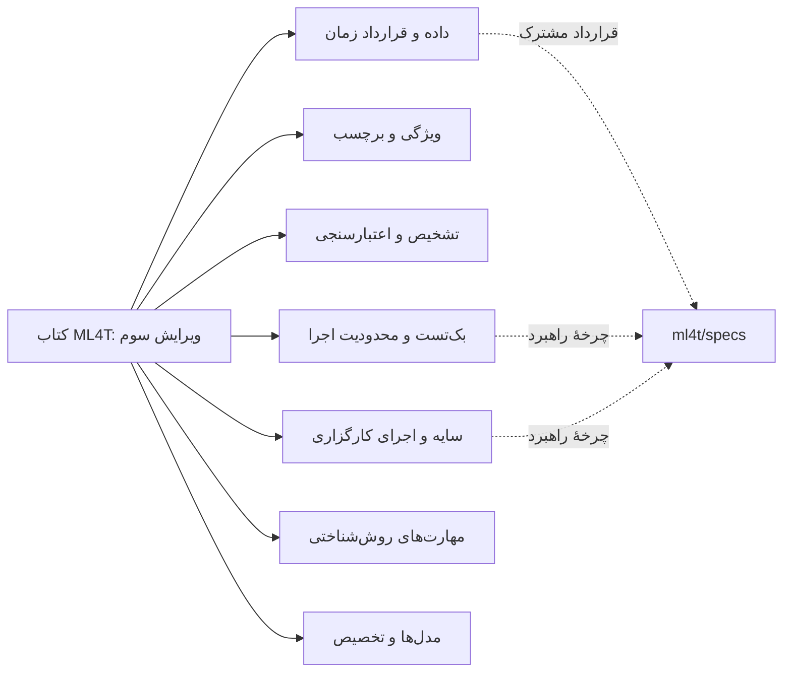

این نمودار تبار پژوهشی و ارتباط موضوع‌هاست؛ پیشنهاد معماری برای پروژهٔ شما نیست.

### ۱۱.۳ Horizon: قابلیتِ اعلام‌شده با پیاده‌سازی خصوصی فرق دارد

[N15؛ horizon.trade](https://horizon.trade/) فرایند نوشتن راهبرد به زبان طبیعی، بازبینی/ویرایش قواعد، بک‌تست و تمرین، اشتراک راهبرد سازنده و اتصال کارگزار را تبلیغ می‌کند. فهرست بررسی‌شده سهام/ETF آمریکا و کارگزارانی مانند Robinhood، Webull، moomoo، E*TRADE، tastytrade، TradeStation و Tradier، سهم ۸۰٪ سازنده و سطوح Discover/Builder را ذکر می‌کند. قیمت و اتصال را باید تاریخ‌دار دانست.

سایت می‌گوید وجوه نزد کارگزار می‌ماند، حق برداشت ندارد و کاربر مواجهه را کنترل و راهبرد را متوقف می‌کند. ادعای بازده راهبردهای پول واقعی، هنوز با ممیزی مستقل، معیار ورود/حذف راهبرد، هزینه، حسابِ تطبیق‌شده و سوگیری بقا در پرونده تأیید نشده است. SOC 2 Type II و ISO 27001 در حال ممیزی معرفی شده‌اند؛ گواهی اخذشده نیستند.

صفحهٔ محصول نمی‌گوید compiler زبان طبیعی، بهینه‌ساز، مدل fill، محاسبهٔ اندیکاتور، برنامه‌ریزی سفارش، دامنهٔ اعتبارنامه یا اعتبارسنجی حساب سازنده چگونه پیاده شده است. قرارداد ورودی/خروجیِ قابل مشاهده در حساب مجاز، کد پشتیِ سرویس را آشکار نمی‌کند. این منبع برای مطالعهٔ تجربهٔ کاربر و قابلیت‌های ادعاشده نگه داشته می‌شود، نه برای حدس معماری خصوصی.

### ۱۱.۴ QuantGPT: افشای خوب و تعارض نسخهٔ داده

N14 گردش مشاهده، فرضیه، تنش‌آزمایی، تصمیم استقرار و بازخورد را با لایهٔ تجاری QuantGPT شرح می‌دهد. برابرگرفتن آن با میز نهادی، حذف جهانی سوگیری یا آستانهٔ ثابت استحکام اثبات نشده است. N23 نیز دربارهٔ شش راهبرد منتشرشده و QuantGPT است؛ نسبت‌دادن قبلی آن به Drex پس گرفته شده است.

مقالهٔ N23 برای حدود ۹٪ دادهٔ بنیادی از تاریخ پایان فصل به‌عنوان جایگزین و جایگزینی با اعداد تجدیدارائه‌شده سخن می‌گوید؛ [افشای محصول](https://quantgpt.co/disclosures) در مقابل اتصال بر تاریخ filing و حفظ نخستین عدد گزارش‌شده، پوشش ناقص نمادهای حذف‌شده از ۱۹۹۸، تعدیل خروج تخمینی در بعضی موارد و ارزیابی شبه‌بیرون‌نمونه را شرح می‌دهد. این تعارض سیاست/نسخه حل نشده است؛ هیچ متن به‌تنهایی نسخه‌های ذخیره‌شده را اثبات نمی‌کند.

[کتابخانهٔ راهبرد](https://quantgpt.co/library/) تفاوت‌ها را افشا می‌کند: جانشین Magic Formula همان EBIT/EV و بازده سرمایهٔ اصلی نیست؛ F-score هشت‌جزئی بازسازی دقیق قانون نه‌جزئی Piotroski نیست؛ جهان نقدشونده و بازتوازن ماهانه با مطالعهٔ اصلی فرق دارند. تنها بخش آغازین کتابخانه خوانده شده است. endpoint بررسی عمومی دریافت نشده و تطبیق مستقل پنج کندل یا بازتولید حاصل نشده؛ شمار راهبردهای سایت شمار موجودیِ نسخه‌دار است، نه شاهد سودآوری.

### ۱۱.۵ REA: ابزار مشاهده و زنجیرهٔ شاهد

[N20؛ morluto/rea](https://github.com/morluto/rea)، [سایت رسمی](https://rea.tools/) و [راهنمای CLI](https://github.com/morluto/rea/blob/main/docs/cli.md) لایهٔ MCP، CLI و هماهنگی فراهم‌کننده/شاهد را شرح می‌دهند؛ ابزار جایگزینِ اختراع‌شده‌ای برای Ghidra یا IDA نیست. پشتیبانی Node 22/24/26 به حداقل patch مشخص وابسته است و برخی مسیرها به ابزار و سیستم‌عامل خارجی نیاز دارند.

دامنهٔ مستند شامل JS/Electron، import، IPC و source map، HAR مرورگر، .NET/CIL، Android/ADB/JADX، باینری با Hopper/Ghidra/IDA، EVM، Go/Rust، WASM، firmware، بستهٔ شبکه، crash و SQLite است. هیچ‌کدام کد سرور ابریِ در دسترس‌نبوده را استخراج نمی‌کند. شبه‌کد بازسازی‌شده نیز کد اصلیِ سطح بالا نیست.

ایدهٔ ارزشمند، نگهداری شاهد حجیم با منشأ و سپس projection، صفحه‌بندی و پرس‌وجوی کوچک است؛ خلاصه باید به محل اصلی برگردد. مثال‌های ماشین‌حساب، دایناسور مرورگر و export یادداشت، موارد محدودِ گزارش‌شده‌اند؛ «هر محصول را کامل کپی می‌کند» از آن‌ها نتیجه نمی‌شود. در بررسی پرونده README، CLI، امنیت و ۲۰۰ خط اول از راهنمای ۶۶۵خطی بازسازی خوانده شده؛ ZIP مثال Notes با ۴۰۳ دریافت نشده و هیچ fixture یا برنامهٔ خصوصی اجرا نشده است.

| سطح مشاهده | چه چیزی قابل ثبت است؟ | چه چیزی به‌تنهایی اثبات نمی‌شود؟ |
|---|---|---|
| مخزن با commit ثابت | فایل، امضا، وابستگی، آزمون و مجوز | اجرای موفق، تنظیم استقرار و سرویس پنهان |
| بستهٔ محلی Electron/JS مجاز | ماژول، IPC، حالت و رفتار کلاینت | الگوریتم سرور، وزن خصوصی مدل و پایگاه پنهان |
| صفحهٔ عمومی یا تعامل مجاز مرورگر | متن، فرم، تجربه و بعضی قراردادهای درخواست | سازوکار واقعی compiler و موتور ریسک |
| باینری مجاز | فرضیهٔ اسمبلی/شبه‌کد و رفتار پویا | کد اصلی دقیق، همهٔ مرزها و حق بازتوزیع |
| تراکنش کیف پول | انتقال و تعامل همان نشانی | مالک، تصمیم خارج زنجیره و همهٔ دارایی‌های CEX/فیات |
| تصویر و روایت اجتماعی | آنچه نشان داده یا ادعا شده | صحت تاریخی، سود خالص و رابطهٔ علّی |

REA sandbox نیست. parser بومی، نمونهٔ نامطمئن، مجوز ابزار، راز و اطلاعات شخصی HAR، نسخهٔ provider و خروجی احتمالی به مدل خارجی باید روشن باشند. محلی‌بودن تحلیل با محلی‌ماندن همهٔ متن‌های ارسالی به LLM فرق دارد. قابلیت session token و ACL خصوصی Windows نیز دامنهٔ همهٔ importها و وابستگی‌ها را تأیید نمی‌کند.

N19 آموزش ثانویهٔ REA است، نه کشف مستقل دیگر. ادعای آزادشدن همهٔ نرم‌افزارهای بسته، نسبت‌دادن بازسازی بازی‌های نامرتبط به REA و اطمینان حقوقیِ عام، با شواهد رسمی پشتیبانی نشده‌اند. مرجع [EFF دربارهٔ مهندسی معکوس](https://www.eff.org/issues/coders/reverse-engineering-faq) در پرونده برای مرز موضوع آمده است؛ جواز دقیق به حوزهٔ قضایی، مجوز، قرارداد، حق مؤلف، اسرار تجاری و قواعد دورزدن محدودیت وابسته است. داشتن اشتراک، حقِ کپی الگوریتم سرور یا عبور از مجوز را خودکار نمی‌دهد.

خواندن کد اختصاصی توسط همان عامل و نوشتن نسخهٔ نزدیک، خودبه‌خود فرایند clean-room مستقل نیست. کاربرد پژوهشیِ قابل دفاع در این پرونده، نسخه/هش، مشاهدهٔ مجاز، مشخصات رفتاری مستقل، مثال عادی/مرزی/خراب و آزمون انطباق است. شباهت رابط، برابری ویژگی و بازتولید سرویس سه ادعای متفاوت‌اند.

## ۱۲. ادعاهای اجتماعی و اصلاح انتساب‌ها

جدول زیر متن نهاییِ اصلاح‌شدهٔ O/N را یک‌جا می‌آورد. پیوند اصلی و حالت اولیهٔ هر رکورد در پیوست قابل جست‌وجوست. تمام متن‌های X از ثبت ثانویه بازیابی شده‌اند؛ رسانه، پاسخ، ویرایش، هویت و سود لزوماً احراز نشده‌اند.

| شناسه | آنچه متن پشتیبانی می‌کند | اصلاح یا حد شاهد |
|---|---|---|
| O01 | نام ده مخزن Jev؛ پیوندها در نظرها وعده داده شده | انتساب قبلی به قیمت‌گذار اختیار و هزار کسب‌وکار پس گرفته شد؛ مالک openhuman، yao، memsearch، hippo-memory، jev-chat-jarvis، agentconnect، fast-jev-compaction، jev-mcp، jev-router و ollaya بدون نظرها نامعلوم است |
| O02 | روایت ۵۵ به ۸۷۱۰ دلار در بازار سود شرکت‌ها | رد اجرای احرازشده نیست؛ پیوند assay در همان پست نیست |
| O03 | انباشت ناهم‌زمان دو سهم مکمل Jarvisen و باقیمانده | حساب موجودی مفید؛ سود و الگوریتم خصوصی نامعلوم |
| O04 | روایت تأخیر/مومنتوم/برگشت nj23adsknml3 | کیف پول و فرضیه با O03 متفاوت؛ الگوریتم خوراک خارجی استنباط شده |
| O05 | تبلیغ Chameleon: رابط تطبیقی، فیلتر کلاهبرداری، نهنگ و دروازهٔ احتمال/هزینه | ادعای قبلیِ آزمون throughput و مسیریابی هزینه پس گرفته شد؛ benchmark عمومی ندارد |
| O06 | پست Alpha Assembly Line در LinkedIn بازیابی شد | متن پست و رونویسی صفحه خوانده شد؛ به‌روزرسانی و حدود در فصل ۱۶ |
| O07 | بیش‌برازش AI، مومنتوم/کری و ارجاع Horizon | مقالهٔ نقل‌شده خوانده شده؛ سازگارکردن BTC و هفت ارز بازتولید دقیق مقاله نیست؛ شکست جهانی carry و throughput نهادی ثابت نیست؛ داستان قبلیِ زیان زنده و حذف لغزش پس گرفته شد |
| O08 | Bosona، کژکردن موجودی، مجموعهٔ کامل و referral | الگوریتم خصوصی و سود احراز نشده |
| O09 | شبیه‌ساز آتی Aria و frontend | فقط مرجع رابط و چرخهٔ نمایشی؛ نه موتور margin، liquidation و تطبیق صرافی |
| O10 | هشت مخزن AI Hedge Fund، Freqtrade، CCXT، NautilusTrader، Hummingbot، Eliza، FinRL و Jesse | توصیف قبلیِ دسترسی رایگان مدل پس گرفته شد؛ خود پست نقطهٔ شروع پژوهش می‌نامد |
| O11 | پانزده مخزن پشتهٔ عامل | انتساب قبلی Minecraft و کنترل‌گر کند/سریع پس گرفته شد؛ فهرست مقصدها در پیوست حفظ است |
| O12 | نمایش ۱۴ عامل مرورگری با دادهٔ Kraken، نشست، جلسه و vault | مدل Jev، اجرای کارگزار و انتقال واقعی ثابت نیست؛ قیمت زنده با معاملهٔ ساختگی سازگار است |
| O13 | ادعای سامانهٔ داخلی Anthropic برای NQ با footprint/DOM و بازده جلسه‌ای | منشأ نهادیِ اصلی و statement معتبر پیدا نشده؛ برچسب قرارداد به رسانهٔ اصلی نیاز دارد؛ توصیف قبلی چک‌لیست روش پس گرفته شد |
| O14 | بات لغو رویداد و رشد ماندهٔ کیف پول | واریز/برداشت، هزینه، مالک و تصمیم نامعلوم؛ پیوند assay در متن نیست |
| O15 | ده مخزن نرم‌افزار از جمله TradingAgents و FinceptTerminal | داستان قبلیِ سرمایهٔ کوچک و referral پس گرفته شد؛ کشف منبع مفید است |
| O16 | تبلیغ آربیتراژ مکمل و مقالهٔ مبتدی با کد | ارسال ترتیبی، خروج نامشخص و نبود تضمین مقدار/زیان؛ دو سنت ناخالص همیشه از هزینه عبور نمی‌کند |
| O17 | گرید passive-maker و موجودی 98euf98a | همان کیف پول O21 با توضیح دیگر؛ از اجرا الگوریتم یکتا شناسایی نمی‌شود |
| O18 | بازده ماهانه و مقالهٔ Schrödinger’s Bag با QUBO/annealing | انتساب Blender پس گرفته شد؛ بهینه‌سازی زیرمجموعهٔ کلاسیک، ضرایب تصادفی و تضمین‌نشدن تعداد/بهینگی |
| O19 | Polkadot-Frog، مجموعهٔ کامل و باقیمانده | جفت ۹۹سنتی به کارمزد، عمق واقعی و شکست دوپا نیاز دارد |
| O20=N17 | مقالهٔ ده بات Polymarket، تفکیک موجودی، عمق، تعداد fill/تصمیم، احتمال و کلی جزئی | بدنه و کد خوانده شده؛ دادهٔ ادعایی ده‌میلیون اجرا و بازسازی قابل تکرار ارائه نشده |
| O21 | قیمت‌گذاری GBM/مونت‌کارلو منسوب به 98euf98a | تعداد مسیر، کالیبراسیون واقعی یا انتساب علّی را ثابت نمی‌کند |
| N02 | هفت عامل و رشد کاغذی ۲۵۰ به ۲۳۱۰ دلار | پنج سود ۱۴۰+۲۶۵−۷۱+۴۰۲+۱۳۲۴=۲۰۶۰؛ معاملهٔ DOGE سهم ۶۴٫۲۷٪ از سود؛ بدون آن مانده ۹۸۶؛ مخزن نام‌گذاری نشده |
| N03 | هشت نقش، نشست مشترک، سرگروه و تأیید امضا | تقدم اختیار خروج اضطراری حل شود؛ کد بازتولید و سود معتبر ندارد |
| N14 | مقالهٔ گردش‌کار QuantGPT | راهنمای تجاری؛ برابری نهادی و حذف جهانی سوگیری ثابت نیست |
| N16 | Aroon Up/Down و oscillator، PBot-6 و ادعای ۲۶۸۸۰۵ دلار طی ۱۷۷ روز | میانگین روزانه حدود ۱۵۱۹ حساب می‌شود؛ مالک، مخرج معامله، هزینه و مدل نامعلوم؛ referral پشتیبانی مکان معامله را ثابت نمی‌کند |
| N18 | صحنهٔ رندرشده با جفت ساختگی JEV و بدون P&L | فاصلهٔ ۰٫۰۳، امتیاز ۰٫۸۲ و اندازهٔ ۱٫۳ بدون واحد/کالیبراسیون؛ شبه‌فراخوانی URL واقعی نیست |
| N19 | مقالهٔ REA با آینهٔ کامل و ارجاع رسمی | مثال و استنتاج نویسنده، شاهد جدا لازم دارد |
| N22 | ترکیب بسته‌ها؛ ۴۰۹۶ نامزد، ۳۹۷۷ رد هزینه و سه استقرار ادعایی | ۱۱۶ مورد میانی توضیح داده نشده؛ ۳۹۷۷+۳+۱۱۶=۴۰۹۶، اما سرنوشت آن ۱۱۶ معلوم نیست؛ چند شبیه‌ساز همچنان اجرای فرضی می‌سازند |
| N23 | مقالهٔ شش راهبرد QuantGPT | انتساب Drex پس گرفته شد؛ تعارض vintage داده باز است |

<div class="chart-frame"><canvas id="concentration-chart" role="img" aria-label="سودهای کاغذی گزارش N02؛ تمرکز سود در یک معامله">پنج سود کاغذی ۱۴۰، ۲۶۵، منفی ۷۱، ۴۰۲ و ۱۳۲۴ دلار؛ سهم معاملهٔ بزرگ ۶۴٫۲۷ درصد است.</canvas></div>

فهرست‌ها و پست‌های O10 و O15 به علت اشتباه توصیف قبلی نباید یک‌سره کم‌ارزش شمرده شوند. در مقابل تصویر، nickname، تعداد ستاره، انیمیشن و نسبت نهادیِ تأییدنشده، سودآوری را ثابت نمی‌کنند. این داوری دربارهٔ ادعاست، نه حکم کلی دربارهٔ صاحب حساب.

### ۱۲.۱ مقالهٔ تبلیغاتیِ «پشتهٔ ۲۰۰هزار دلاری»

کدِ مقالهٔ نقل‌شده در پرونده بررسی شده: تابع DSR ورودی را سالانه می‌نامد ولی مقیاس پراکندگی بیشینهٔ مورد انتظار را حذف می‌کند؛ پیش‌فرض walk-forward آزمون ۶۰سطری می‌سازد، در حالی که metrics زیر ۱۰۰ سطر خطا می‌دهد و دسترسی بعدی به ستون sharpe شکست می‌خورد. days در نام پارامتر، سطر می‌شمارد. شروع تازهٔ هر فولد، موقعیتِ حمل‌شده و گردش مرزی را حذف می‌کند. ضرب بازده لگاریتمی در اهرم/فروش استقراضی مدل دقیق ثروتِ خودتأمین نیست؛ یک سطر shift نیز اجرای قابل دستیابی را ثابت نمی‌کند. این‌ها دلیل اصلاح و بازآزمون‌اند؛ آستانهٔ ثابت شارپ به‌تنهایی نشت را اثبات نمی‌کند.

مطالب نقل‌شدهٔ پنج‌نفرهٔ کسب‌وکار، درآمد ویدیوی AI و روال Dots دربارهٔ گردش‌کار یا درآمد تبلیغاتی/پلتفرمی/referral‌اند؛ بازده معامله نیستند. زنجیرهٔ درآمد مستقل ندارند و قیمت، زمان و قابلیت‌های محصول در آن‌ها بدون تأیید اصلی به‌عنوان واقعیت پذیرفته نمی‌شود.

### ۱۲.۲ QUBO: جریمهٔ نرم، قید سخت نیست

پرونده فقط سه تعریف تابعِ مقالهٔ O18 را compile و هر ۱۲۸ حالت نمونه را برای همانی انرژی با ثابتش بررسی کرده است. ضدنمونه: تعداد هدف ۱، سه بازده مثبت، همبستگی صفر و جریمهٔ ۰٫۰۰۱، اما بهینه سه دارایی را انتخاب می‌کند. جریمهٔ مربعی با ضریب محدود قید دقیقِ تعداد نمی‌سازد. annealing محدود نیز گواه بهینگی سراسری نیست؛ ماتریس تصادفی نامتقارن، ماتریس همبستگی تجربی معتبر به شمار نمی‌رود.


## ۱۳. چه چیزی را نگه داریم و مطالعه را چگونه ادامه دهیم؟

«نگه‌داشتن» در این متن یعنی صرف توجه پژوهشی، نه پیشنهاد خرید یا معامله. اولویت بالا زمانی معنا دارد که منبع یک سؤال مشخص را روشن کند و راه ابطال آن معلوم باشد.

| دستهٔ تصمیم | موارد مهم | شرط ادامه |
|---|---|---|
| مطالعهٔ عمیقِ روش | کتاب رسمی ML4T، diagnostic، engineer، data، backtest، skills، models/specs؛ DSR، PBO، SPA و Reality Check | نسخهٔ یکسان، تعریف ریاضی و دادهٔ زمانی، همهٔ تلاش‌ها و آزمون عددی |
| مطالعهٔ عمیقِ اجرا | NautilusTrader، Hummingbot/Condor، LEAN، live و SDK رسمی بازار مورد نظر | تطبیق سفارش و مانده، مجوز، اتصال مجدد و موارد مرزی |
| مبنای پژوهش | vectorbt، Qlib، Freqtrade، مطالعات منفی Jev، TradingAgents و FinMem | هدف محدود، baseline، هزینه، زمان و حذف‌مولفه |
| مرجع محدود | OpenTerminal، ویرایش دوم Packt، Aria، ژورنال TradesViz و نمونه‌های UI | کاربرد آموزشی/رابط با موتور مالی واقعی یکی گرفته نشود |
| مشروط به آزمایش | Drex، آربیتراژ میان‌مکان، حافظه‌ها، ابزارهای مهار و شبیه‌سازها | کالیبراسیون، دامنهٔ اختیار، نسخه، دوام و آزمون ابطال مشخص |
| کشف منبع | awesome listها، موضوع‌های GitHub، آموزش اجتماعی REA و Horizon | دنبال‌کردن اثر اصلی؛ حذف تکرار؛ عدم ارتقای بازاریابی به شاهد |
| خوانده‌نشده/مسدود | محصول جاری G04، منابع فرزند و کتاب‌های باز | دربارهٔ محتوا حکم داده نشود؛ مانع و راه بازیابی ثبت شود |

### ۱۳.۱ منابع تکمیلی و دلیل ورودشان

جدول زیر دلیل انتخاب منابع را نگه می‌دارد. بررسی تازهٔ کد و مثال‌های اجرایی در فصل ۱۹ و روش‌های آماری و تخصیص در فصل ۱۸ آمده است؛ بنابراین عبارت‌های تاریخی «کشف/معرفی» در این جدول سقفِ بررسی کنونی نیستند. محدودهٔ دقیق تکمیل هر فایل یا صفحه در دفتر ماندگار منابع ثبت شده است. مطالعهٔ منتخب همچنان به معنی تمام‌شدن همهٔ فصل‌ها و فایل‌ها نیست.

| منبع | ارزش افزودهٔ مشخص | دامنهٔ بررسی در پروندهٔ مبدأ |
|---|---|---|
| [OpenBB](https://github.com/OpenBB-finance/OpenBB) | قرارداد تأمین‌کننده، پرس‌وجوی نرمال و منشأ داده | README و FAQ مجوز؛ ODP با Workspace متفاوت است؛ Apache 2.0 نسخهٔ ۵ و AGPL نسخهٔ ۴ مخلوط نشوند |
| [FinceptTerminal](https://github.com/Fincept-Corporation/FinceptTerminal) | پیمایش ترمینال و ترکیب پژوهش/آداپتر | کشف README؛ نسخه و توزیع سازمانی و مجوز جداست |
| [FinRL](https://github.com/AI4Finance-Foundation/FinRL)، [Jesse](https://github.com/jesse-ai/jesse)، [CCXT](https://github.com/ccxt/ccxt) | محیط RL، پژوهش رمزارز و معنای آداپتر صرافی | کشف/معرفی منتخب؛ پاداش، هزینه، زمان ویژگی و precision هر صرافی باید بررسی شود |
| [PyPortfolioOpt](https://github.com/PyPortfolio/PyPortfolioOpt)، [Riskfolio-Lib](https://github.com/dcajasn/Riskfolio-Lib)، [arch](https://github.com/bashtage/arch) | برآورد سبد، قید، تخصیص و آزمون آماری | وابستگی کامل ممیزی نشده؛ کوواریانس و پارامتر در هر آموزش برازش شود |
| [Lightweight Charts](https://github.com/tradingview/lightweight-charts) | به‌روزرسانی سری، شکاف و رفتار بصری | renderer شامل داده، Pine یا شبیه‌ساز کارگزار نیست |
| [یادگیری ماشین مالی، Kelly–Xiu](https://bfi.uchicago.edu/wp-content/uploads/2023/07/BFI_WP_2023-100.pdf) | نسخهٔ دریافت‌شدهٔ ۱۶۱صفحه‌ای دربارهٔ پیش‌بینی، قیمت‌گذاری و سبد | در مرحلهٔ تازه تمام متن استخراج‌شدهٔ ۱۶۱ صفحه و تصویر ۱۹ صفحهٔ مرکزی بررسی شد؛ فصل ۲۲ و شواهد LB10 مقدم‌اند. بقیهٔ تصویرها و بازتولید مطالعات ارجاع‌شده باز است |
| [معاملات الگوریتمی و پربسامد؛ Cartea و همکاران](https://assets.cambridge.org/97811070/91146/frontmatter/9781107091146_frontmatter.pdf) | اجرا، موجودی، انتخاب نامطلوب و کنترل تصادفی | پیشگفتار ناشر؛ کتاب و تمرین‌ها خوانده نشده |
| [معاملات و بورس‌ها؛ Harris](https://academic.oup.com/book/52292) | فصل‌های ۴–۶ برای سفارش/اولویت و ۱۴/۲۱ برای spread و هزینه | چکیده و فهرست ناشر؛ فصل‌های دارای مجوز باز است |
| [استنباط علّی: اگر چه؟](https://miguelhernan.org/whatifbook) | تعریف اثر هدف، شناسایی و مخدوش‌گر زمان‌متغیر | مسیر قانونی متن/کد/داده شناخته شده؛ کتاب کامل نه؛ نسخه به‌دلیل اصلاحات باید ثابت شود |
| [درآمدی بر یادگیری آماری](https://www.statlearning.com/) | عدم‌قطعیت، منظم‌سازی و آزمون نگه‌داشته‌شده | مسیر رسمی دریافت شناسایی شده؛ کتاب کامل نه |

### ۱۳.۲ صف پژوهش بعدی با خروجی قابل تحویل

این صف معیار بستن کارها را مشخص می‌کند؛ وضعیت تحویل تازهٔ تک‌تک دوازده ردیف در جدول پایانی فصل ۲۰ آمده است. آزمایش محدودِ موفق، فقط همان خروجی را می‌بندد و تیک کل مسیر پژوهش را کامل نمی‌کند.

| اولویت | کار | خروجی لازم برای بستن کار |
|---|---|---|
| بسیار بالا | بازسازی سود حساب‌های اجتماعی | هویت/مالکیت در حد ممکن، همهٔ جریان‌های ورود و خروج، اجرا، بازار، هزینه و تطبیق مانده؛ نه تصویر مانده |
| بسیار بالا | زمان و نسخهٔ داده | فایل خام و هش، انتشار/دریافت/اصلاح، آزمون قدیم‌به‌جدید و نبود خلاصهٔ آلوده |
| بسیار بالا | DSR/PBO/CV | تعریف واحد، خانوادهٔ کامل جست‌وجو، موارد مصنوعیِ تهی/سیگنال و مقایسه با فرمول اصلی |
| بسیار بالا | مدل اجرای بک‌تست | توالی کوچک با fill و نقد مورد انتظار؛ stop/target مبهم، عمق ناکافی و هزینه |
| بالا | برابری موتورهای پژوهش | یک خوراک، یک سیگنال، یک زمان اجرا، یک هزینه و توضیح اختلاف‌ها در LEAN/vectorbt/Qlib/Freqtrade |
| بالا | مدارک باقی‌ماندهٔ اجتماعی | رسانه/پاسخ/ویرایش، نظرهای O01، نام مخزن N02 و بدنهٔ موارد ناقص |
| بالا | حافظه و مهار | restart، برخورد نوشتن، tenant، اصلاح/حذف مشتقات، شاهد پذیرش تازه و اثر بیرونی تکرارنشدنی |
| بالا | مقاله‌های ریزساختار | تعریف برچسب و ساعت، baseline OFI، spread، صف، تأخیر و ظرفیت |
| بالا | عامل‌های مالی | زمان داده، بذر، نسخه/دانش مدل، بودجه، حذف نقش و آزمون بیرون از بازار منتخب |
| میانه | تخصیص و مدل مولد | universe و قید یکسان، کوواریانس فقط آموزش، گردش؛ حفظ دنباله، هم‌وابستگی و آزمون حفظ‌کردن داده |
| میانه | کد تاریخی QuantResearch | حفظ اصل، انتقال کنترل‌شده، آزمون عددی و مجوز دقیق؛ نه فقط رفع خطای syntax |
| میانه | منابع فهرست‌ها و کتاب‌ها | هویت یکتا با DOI/arXiv، نسخه، روش، شکل، ضمیمه، داده و نتیجهٔ بازتولید |

برای OpenTerminal، آداپتر، TTL و stale، دفتر سبد، اندیکاتور، auth و proxy مهم‌اند. برای engineer، بازهٔ برچسب، calendar، مانع و fit؛ برای data، نسخه و raw/adjust؛ برای live، idempotency، reconnect و kill switch؛ برای Condor، بودجه، جداسازی P&L و replay؛ برای SDK، امضا و تسویه؛ برای REA، provider و بازگشت خلاصه به شاهد. برای Horizon تنها مستندات عمومی، رفتارِ حسابِ مجاز و افشاهای مستقل می‌تواند دامنهٔ مشاهده را گسترش دهد؛ کد خصوصی حدس زده نمی‌شود.

### ۱۳.۳ قالب ثبت یک پژوهش تازه

هر ورودی باید هویت اصلی و نسخه، منبع والد، وضعیت دسترسی، عمقِ بدنه/کد/شکل/ضمیمه، ادعای نویسنده، مشاهدهٔ مستقل، داده/بذر/محیط/هزینه، نتیجهٔ آزمون، شرایط مجوز، ویژگی قابل استفاده و یک آزمون ابطال داشته باشد. «دریافت شد»، «خوانده شد»، «اجرا شد» و «بازتولید شد» چهار حالت جدا هستند. شکست دسترسی می‌تواند ناشی از احراز، محدودسازی یا خطای موقت باشد؛ نه اثبات نامعتبر بودن اثر.

چهار هدف نقل‌شده با شناسه‌های 2091951419989573990، 2085766554407317704، 2100486325564477856 و 2096964317107077567 در گزارش قدیمی بدنهٔ ناقص داشتند؛ متن استخراج‌شدهٔ آن‌ها در بازبینی تازه بازیابی و خوانده شد. O06 نیز برای بدنه و متن پیاده‌شدهٔ عرضه‌شده در صفحه بازیابی شد. وضعیت تازهٔ فصل ۱۶ و دفتر منابع بر آمار تاریخیِ «۹ بدنهٔ باز» مقدم است. این بازیابی به معنی مشاهدهٔ همهٔ تصویرها، ویدئو، نظرها و نسخه‌های ویرایش‌شده نیست. مصاحبه‌های E08 و رسانه‌های خوانده‌نشده همچنان دامنهٔ باز دارند.

### ۱۳.۴ نقشهٔ تطبیق با فایل مبدأ

| بخش مبدأ | محل مطالب در این نسخه |
|---|---|
| ۱؛ روش و استاندارد | فصل ۱ و معیارهای پیوست |
| ۲؛ دفتر O/N | فصل ۱۲ و پیوست منابع ورودی |
| ۳؛ چهار نقشهٔ پژوهش | نمودارهای فصل‌های ۱، ۷، ۸ و ۱۱؛ رابطه‌ها با توضیح فارسی ادغام شده‌اند |
| ۴ و ۵؛ یافته‌های منابع | فصل‌های ۲ تا ۱۲ و جدول اصلاح انتساب |
| ۶ و ۷؛ مخازن و مقاله‌ها | فصل‌های ۴، ۶، ۷ و ۱۳ |
| ۸؛ دام‌های کمّی | فصل‌های ۳، ۵ و ۱۲ |
| ۹؛ مهندسی معکوس | فصل ۱۱ |
| ۱۰؛ حکمِ ارزش پژوهشی | فصل ۱۳ |
| ۱۱؛ صف و manifest | فصل ۱۳ و دفتر کارهای باز در پیوست |
| ۱۲؛ کتاب‌نامه | پیوندهای درون متن و نمایهٔ کامل نشانی‌ها |
| ۱۳؛ رندر و تمامیت | این نسخهٔ آفلاین، راهنمای مطالعه و اثرانگشت مبدأ |
| ۱۴؛ ممیزی و اصلاحات | کنار موضوع مربوط، با اولویت بر برداشت اولیه؛ اثرانگشت‌ها در پیوست |
| ۱۵؛ چهل منبع افزوده | پیوست E/F/G و فصل‌های ۶، ۸، ۹ و ۱۰ |
| ۱۶؛ مهار و QuantResearch | فصل‌های ۹ و ۱۰ |
| ۱۷؛ حافظه و ارزیابی | فصل ۸ و فهرست مقصدهای فرزند |
| ۱۹؛ Harness² و RRSI و پژوهش مرتبط | فصل ۱۵؛ به‌روزرسانی ۲۰ اکتبر ۲۰۲۶ و پیوست‌های منبع و اثرانگشت |
| ۱۸؛ بازبینی عمیق | اصلاحات در فصل‌های ۴ تا ۱۲، سوابق بررسی و اثرانگشت در پیوست |

### ۱۳.۵ واژه‌نامهٔ کاربردی برای خواندن منابع

| اصطلاح منابع | برابر و معنی در این متن |
|---|---|
| Alpha | آلفا؛ مزیت پیش‌بینی یا بازده نسبت به مبنای تعریف‌شده؛ با سود ناخالص یکی نیست |
| Baseline | مبنا؛ روش ساده یا مرجع که همان داده و بودجه را می‌گیرد |
| Benchmark | محک یا مجموعهٔ ارزیابی؛ وظیفه، داده و امتیازدهندهٔ مشخص دارد |
| Snapshot / vintage | تصویر ثابت / نسخهٔ تاریخی؛ وضعیت داده یا نرم‌افزار در زمان مشخص |
| Point-in-time / as-of | قابل دسترس در همان زمان؛ نه مقدار اصلاح‌شدهٔ امروز |
| Look-ahead / leakage | نگاه به آینده / نشت؛ ورود اطلاعات نامجاز به تصمیم یا ارزیابی |
| Survivorship | سوگیری بقا؛ حذف دارایی یا راهبرد شکست‌خورده از نمونهٔ ارزیابی |
| Holdout | مجموعهٔ کنارگذاشته‌شده؛ فقط تا وقتی انتخاب‌ها از نتیجه‌اش اثر نگیرند مستقل می‌ماند |
| Ablation | حذف‌مولفه؛ برداشتن نقش یا جزء برای سنجش سهم واقعی آن |
| Calibration | کالیبراسیون احتمال؛ سازگاری احتمال‌های گفته‌شده با فراوانی رخدادها در نمونهٔ مناسب |
| Basis point / bp | واحد پایه؛ یک‌صدم واحد درصد؛ ۱ bp برابر ۰٫۰۱٪ است |
| Turnover | گردش معاملات؛ میزان تغییر موقعیت که هزینه و ظرفیت را تحت تأثیر قرار می‌دهد |
| Slippage | لغزش؛ اختلاف قیمت مورد انتظار با قیمت اجرا، با قرارداد اندازه‌گیریِ مشخص |
| Market impact | اثر سفارش خود بر قیمت و نقدشوندگی؛ در بازپخش ثابت به‌طور درون‌زا ایجاد نمی‌شود |
| Adverse selection | انتخاب نامطلوب؛ پرشدن مظنه در موقعیتی که حرکت بعدی به زیان بازارساز است |
| Fill / partial fill | اجرای سفارش / اجرای بخشی از مقدار؛ با پذیرش درخواست متفاوت است |
| Maker / taker | سازنده / گیرندهٔ نقدشوندگی؛ نقش اجرای واقعی، نه صرف نام سفارش |
| Inventory | موجودی؛ دارایی و مواجههٔ نگه‌داشته‌شده، از جمله باقیماندهٔ جهت‌دار |
| Funding / borrow | پرداخت تأمین مالی / هزینهٔ استقراض؛ دو هزینه با منشأ و قواعد جدا |
| Fixture | داده یا محیط کنترل‌شدهٔ آزمون؛ برای نتیجهٔ مورد انتظارِ قابل پیش‌بینی |
| Parse / AST | تحلیل نحوی / درخت نحو؛ دیدن ساختار کد، بدون اثبات اجرای درست آن |
| Checkpoint / state | نقطهٔ بازیابی / حالت اجرا؛ دوام به ذخیره‌ساز انتخابی وابسته است |
| Idempotency | هم‌توانیِ تکرار؛ درخواست مجدد نباید اثر ناخواستهٔ اضافی بسازد |
| Reconciliation | تطبیق؛ مقایسهٔ ثبت داخلی با سفارش، اجرا و ماندهٔ مرجع معتبر |
| Tenant / scope / ACL | حوزهٔ کاربر یا سازمان / محدوده / فهرست کنترل دسترسی؛ باید اجرایی باشد |
| Provenance / lineage | منشأ / تبار داده؛ زنجیرهٔ منبع تا تبدیل و نتیجه |
| Supersession / retraction | جایگزینی / پس‌گرفتن؛ حفظ رابطهٔ اصلاح با ادعای قبلی |
| Recall | پوشش بازیابی؛ تعریفِ «یکی از شواهد» با «همهٔ شواهد» فرق دارد |
| RAG / reranking | تولید با بازیابی شاهد / بازرتبه‌بندی؛ کیفیت جواب به هر دو و خواننده وابسته است |
| Oracle | حالت شاهدِ ایدئال؛ برای کنترل یا سقف یک مؤلفه، نه عملکرد بازیابی عادی |
| F1 | میانگین هماهنگ precision و recall طبقه‌بندی؛ هزینه و سود معامله را به‌طور مستقیم نمی‌سنجد |
| CPCV / CSCV | اعتبارسنجی ترکیبیِ پاک‌سازی‌شده / اعتبارسنجی متقارن ترکیبی؛ هدف و واحد مسیر متفاوت دارند |


## ۱۴. راهنمای پیوست‌ها و حدود استفاده

پیوست‌ها هم برای حفظ منابع و هم برای قابل ممیزی‌بودن بازنویسی‌اند. همهٔ نشانی‌های متن مبدأ، شامل تکرارهای دارای والد متفاوت، حفظ می‌شوند؛ برخی نشانی‌ها از استخراج اولیه ناقص، قدیمی یا نمونه‌اند. لینکِ نمایشیِ localhost، endpoint نمونه و جای‌نگهدارِ ناشناس را نباید منبع مستقل یا مقصدی برای خزش دانست. مقدار هش، شناسهٔ commit، نام API، نماد و نام رسمیِ مخزن برای امکان جست‌وجو و تطبیق به خط اصلی نگه داشته شده‌اند.

در فهرست‌های اکتشافی، تیک فقط کارِ نوشته‌شده کنار همان سطر را می‌بندد. خواندن README همهٔ ارجاع‌های آن را نمی‌بندد. مقایسهٔ دو فهرست معامله‌گری نشان داده که هر ۱۲۵ نشانی خام owini در مجموعهٔ ۱۲۷تایی cbailes حضور دارد؛ این شمار شامل badge و پیوند جانبی هم هست، نه ۱۲۷ مقاله. مراجع DSR/PBO/آولاندا نیز در متن استخراج‌شده دیده شده‌اند، ولی بدنهٔ تک‌تک آن‌ها خوانده نشده است. صفحات topic فقط دامنهٔ قابل مشاهده و نه صفحه‌بندی نامحدود را پوشش می‌دهند.

آزمون قدیمی دسترسی مستقیم ۱۰۹ نشانی یکتا، ۶۷ پاسخ ۲۰۰ و ۴۲ پاسخ دیگر ثبت کرده است. ثبت‌های موفقِ بعدی از آینه یا مرورگر بر شکست قدیمی مقدم‌اند؛ HTTP 200 هم ممکن است پوستهٔ خطا باشد. بنابراین نتیجهٔ پروب شبکه، گواه خواندن محتوا نیست. پیوست رخداد دسترسی را با همین تعبیر نگه می‌دارد.

فایل برای مطالعهٔ آفلاین طراحی شده: فونت و کتابخانه‌ها داخل HTML هستند؛ فقط بازکردنِ منابع خارجی به اینترنت نیاز دارد. از فهرست فصل‌ها، جست‌وجوی مرورگر، تنظیم اندازهٔ متن و حالت روشن/کاغذی/تیره استفاده کنید. جدول‌های عریض فقط در قاب خود حرکت افقی دارند. فرمول، مسیر و شناسه چپ‌به‌راست‌اند و متن اصلی راست‌به‌چپ است. نمودارهای کمی بدیل متنی دارند؛ چاپ، فهرست جانبی و کنترل‌ها را حذف می‌کند.

<aside class="callout note"><strong>حدود این نسخه</strong><p>این اثر بازنویسی آموزشیِ یکپارچه است؛ تکرارهای تاریخی و هشدارهای مشابه ادغام شده‌اند. ترجمهٔ دوبارهٔ نام فایل، کد، URL، commit و هش، امکان راستی‌آزمایی را از بین می‌برد و انجام نشده است. سوابق اجرای پرونده به همان پرونده نسبت داده شده؛ نه اینکه در این نوبت همهٔ نرم‌افزارها، مقاله‌ها، حساب‌ها و خدمات دوباره اجرا یا مستقلاً احراز شده باشند.</p></aside>


## ۱۵. بهبود بازگشتی مهار عامل؛ Harness² و RRSI

<div class="lead">افزودهٔ ۲۰ اکتبر ۲۰۲۶: دو پروژهٔ تازهٔ Google Research، روش‌های مرتبط، بررسی مستقیم کد و آزمون‌های محلی؛ با تفکیک روشن میان نتیجهٔ نویسندگان و مشاهدهٔ این پژوهش.</div>

مدل ثابت می‌ماند، اما محیط عمل آن تغییر می‌کند: چه چیزی در زمینه قرار بگیرد، ابزار چگونه معرفی شود، عامل چه زمانی بررسی یا دوباره تلاش کند و چه تجربه‌ای برای کار بعد بماند. این تغییرات می‌توانند نتیجهٔ کار را بهتر کنند؛ ولی نام «خودبهبودی» به‌تنهایی نه درستی خودکار می‌سازد، نه تعمیم را تضمین می‌کند و نه سود معاملاتی اثبات می‌کند.

### ۱۵.۱ هویت، نسخه و عمق بررسی

| شناسه و منبع | نسخهٔ ثابت | آنچه بررسی شده و مرز آن |
|---|---|---|
| H01؛ [google-research/harness2](https://github.com/google-research/harness2) | [1cfe254e8d25b15f37048c3730134686abe60335](https://github.com/google-research/harness2/tree/1cfe254e8d25b15f37048c3730134686abe60335) | معرفی، راهنمای نصب/آزمایش/محک، فرادادهٔ بسته، بخش‌های منتخب اجرا، انتخاب، کتابخانه و گزارش و بدنهٔ هر پنج آزمون گردش‌کار؛ بررسی‌های تابعی اجرا شد، ولی مجموعهٔ گردش‌کار در ویندوز موفق نشد |
| H02؛ [google-research/rrsi](https://github.com/google-research/rrsi) | [be50316e1db05914068a973f322770ef08ed7ba1](https://github.com/google-research/rrsi/tree/be50316e1db05914068a973f322770ef08ed7ba1) | معرفی، تنظیم سه حوزه، بخش‌های منتخب جست‌وجو، پذیرش، ارزیابی، تاریخچه، منتقد و آداپتر؛ هشت آزمون هسته و بررسی‌های مرزی محلی اجرا شد؛ تکامل کامل و خدمات مدل اجرا نشد |
| [مقالهٔ Harness²](https://arxiv.org/html/2610.14224v1) | نسخهٔ اول، ۹ اکتبر ۲۰۲۶ | روش، جدول‌های اصلی، بخش‌های منتخب تحلیل و ضمیمه، محدودیت‌ها و تعدادی از دستورهای عامل؛ همهٔ شکل‌ها، منابع و آثار بازتولید مستقلاً بررسی نشده‌اند |
| [مقالهٔ RRSI](https://arxiv.org/html/2609.24972v1) | نسخهٔ اول، ۲۱ سپتامبر ۲۰۲۶ | روش، جدول‌های اصلی، بخش‌های منتخب جزئیات و پذیرش و محدودیت‌ها؛ بازتولید کامل و همهٔ آثار پیوندشده باز است |
| [سایت Harness²](https://harness2.github.io/) و [سایت RRSI](https://regularized-rsi.com/) | مشاهدهٔ این به‌روزرسانی | توضیح و خلاصهٔ گروه سازنده؛ تأیید مستقل مقاله‌ها نیستند |

درخت کاملِ بازگشتی Git برای Harness² شامل ۱۵۲ مدخل و برای RRSI شامل ۱۵۶ مدخل بوده و خروجی ناقص نبوده است. از اولی ۵۸ فایل متنیِ منتخبِ دست‌اول، جمعاً ۵۹۰٬۶۴۷ بایت، و از دومی ۷۸ فایل، جمعاً ۵۲۰٬۴۱۶ بایت، دریافت شد. «دریافت همهٔ این فایل‌ها» با «خواندن کامل همهٔ فایل‌ها» یکسان نیست؛ عمق خواندن در این فصل و دفتر اثرانگشت‌ها مشخص است.

هر دو مخزن مجوز Apache 2.0 اعلام می‌کنند؛ کد، داده و محکِ طرف سوم مجوز جدا دارد. Harness² صریحاً محصول رسمیِ پشتیبانی‌شدهٔ Google نیست. مالکیت سازمانی، ستاره و مجوز باز نه بلوغ تولید را اثبات می‌کند، نه امنیت را و نه مزیت اقتصادیِ معامله را.

### ۱۵.۲ دو سؤال متفاوت دربارهٔ بهبود

| موضوع | Harness² | RRSI |
|---|---|---|
| مسئلهٔ اصلی | سازگارکردن مهار با کار تازهٔ جاری بدون دادن نمرهٔ حقیقت‌مبنا به اصلاح‌کننده | تکامل روی مجموعهٔ محدودِ دارای ارزیاب، با هدف کاهش بیش‌برازش و حفظ انتقال |
| شاهد انتخاب تغییر | تفاوت رفتاری میان اجراها، مسیر ابزار و خروجی همان کار | نمره، هزینه، مسیر اجرا، تاریخچهٔ تغییر و بازخورد منتقد |
| چیزی که میان کارها می‌ماند | کتابخانهٔ مهارهای پذیرفته و درسِ دارای شاهد؛ کار بعد از پایهٔ مشترک شروع می‌شود | مهارِ نسخه‌دارِ جاری و تاریخچهٔ دورها؛ نامزدها از نسخهٔ جاری منشعب می‌شوند |
| کنترل رشد | بودجهٔ بازگشت و اعتبارسنجی مرحله؛ بدون تضمین رسمیِ درستیِ ترکیب | بودجهٔ تغییر، منتقد نشت، کف نمره، قاعدهٔ هزینه، اکتشاف و پیشنهاد هرس |
| خطر کلیدی | داوری هم‌بسته، هزینهٔ اضافه و دسترسی ابزار به معیارهای عمومیِ محک | بیش‌برازش تطبیقی، خطای منتقد، تنظیم آستانه و ناقص‌بودن سنجش هزینه |
| نتیجهٔ مجاز | فرایند قابل مطالعه برای اصلاح مهار هنگام کار | قاعدهٔ قابل پیاده‌سازی برای پیشنهاد و پذیرش که در آزمایش نویسندگان انتقال را بهتر کرده است |

اسم مشترک یک محک کافی نیست تا دو عدد، مقایسهٔ کنترل‌شده شوند. مدل، مهار آغازین، تقسیم داده، دسترسی به بازخورد، بودجه و روش شمارش هزینهٔ این دو پروژه متفاوت است. این مرور آزمایش مشترکی برای رتبه‌بندی Harness² در برابر RRSI اجرا نکرده است.

### ۱۵.۳ Harness² چگونه کار می‌کند؟

گام اصلی سه بخش دارد: «پیشنهاد»، «کاوش با اجرا» و «ترکیب». نخست یک اجرای مرجع رفتار مهار را نشان می‌دهد؛ خروجی آن هنوز پاسخِ درستِ احرازشده نیست. یک نامزد، ضعف عمومی عامل مانند استفاده از ابزار، مدیریت زمینه یا بازبینی خروجی را هدف می‌گیرد؛ نامزد دیگر، روش و قیدِ حوزهٔ همان کار را. هر دو در شرایط همسان مدل و محیط روی همان کار اجرا می‌شوند.

ترکیب‌کننده، فایل‌های تغییرکرده، تفاوت کد، مسیر اجرا و خروجی‌ها را می‌بیند. می‌تواند بخش‌های پشتیبانی‌شده را ادغام کند، تعارض را اصلاح کند، یک نامزد را برگزیند یا مهار قبلی را نگه دارد. جانشین دوباره اجرا می‌شود. تفاوت رفتاری نشان می‌دهد یک تغییر چه اثری داشته؛ ولی خطای مشترک مدل و تصادفی‌بودن اجرا مانعِ برابرگرفتن آن با حقیقت‌سنجی است.

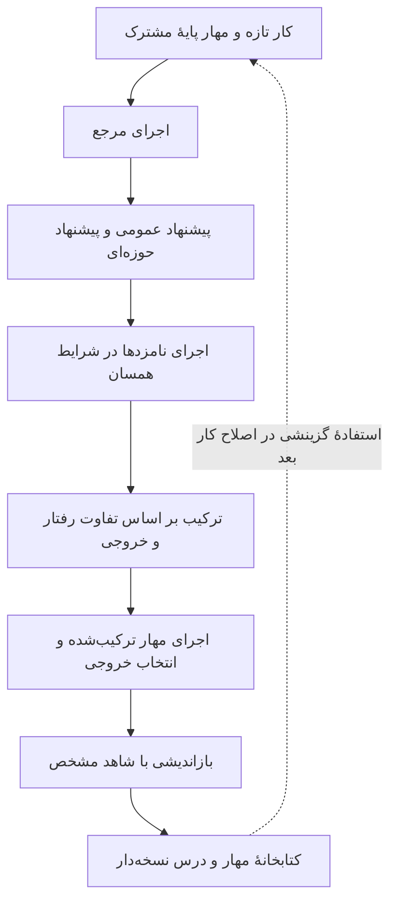

مهارِ اصلاح‌کننده درون یک کار ثابت می‌ماند و کتابخانه پس از کار به‌روزرسانی می‌شود. هر مدخل می‌تواند مهار اجرایی و EXPERIENCE.md شامل وضعیت کاربرد، درس و شاهد داشته باشد. بدون شاهد کافی، نوشتن مدخل الزامی نیست. کار بعد مهار بسیار تخصصیِ کار قبلی را خودکار به ارث نمی‌برد؛ از پایهٔ مشترک آغاز و مؤلفهٔ مرتبط را گزینشی بازاستفاده می‌کند.

هشت دستهٔ قابل ویرایش عبارت‌اند از دستور سیستمی، قیود رفتاری، حافظه، راهنمای ابزار، زیرعامل، مهارت، اسکریپت و افزونه. این دسته‌ها با فایل در محیط نصب می‌شوند. نام‌گذاریِ فایل به‌عنوان guardrail مرز امنیتی ایجاد نمی‌کند.

| حالت | معنای بودجهٔ k | حساب اجرای بررسی‌شده |
|---|---|---|
| موازی | k اجرای پایه، k نامزد عمومی و k نامزد حوزه‌ای، سپس k ترکیب مستقل از شواهد همهٔ نامزدها | 4k اجرای عامل و 3k مرحلهٔ اصلاح برای هر حالت و کار |
| ترتیبی | k مرجع آغازین و k دور زنجیره‌ایِ پیشنهاد عمومی/حوزه‌ای/ترکیب، همراه شواهد قبلی | همان 4k و 3k؛ ترکیب‌ها در نقاط متوالی‌اند |
| k=1 | یک جفت پیشنهاد و یک ترکیب | روش دو حالت یکی است؛ اختلاف مشاهده‌شدهٔ اجرا نویز است، نه مزیت روش متفاوت |

در k=5 این حساب برابر ۲۰ اجرای عامل و ۱۵ مرحلهٔ اصلاح است. [ledger.py](https://github.com/google-research/harness2/blob/1cfe254e8d25b15f37048c3730134686abe60335/harness2/core/ledger.py) هم تعداد و هم تکراری‌نبودن برچسب‌ها را بررسی می‌کند. انتخاب نهایی، بازاندیشی و فراخوانی‌های دوباره‌تلاش حساب‌های افزوده‌اند؛ بنابراین «یک گام اصلاح» یک فراخوانی مدل نیست. موازی‌سازی در صورت وجود منابع می‌تواند زمان دیواری را کم کند، ولی محاسبهٔ کل را حذف نمی‌کند.

در [selection_pool](https://github.com/google-research/harness2/blob/1cfe254e8d25b15f37048c3730134686abe60335/harness2/core/selection.py)، انتخاب‌کننده فقط k خروجی ترکیب‌شده را می‌گیرد و خروجی مرجع عمداً در مجموعه نیست. حفظ مهار قبلی توسط ترکیب‌کننده با امکان بازگرداندن همان خروجی مرجع توسط انتخاب‌کننده فرق دارد. در k بزرگ‌تر از یک، خروجی‌ها ناشناس می‌شوند؛ در یک، انتخاب مقایسه‌ای لازم نیست.

### ۱۵.۴ نتیجه‌های Harness² با واحد و بودجهٔ درست

همهٔ عددهای این قسمت گزارش نویسندگان‌اند؛ اجراهای مدلِ این پژوهش نیستند. جدول‌های اصلی میانگین و انحراف معیار سه اجرا با ترتیب کارِ درهم‌آمیخته دارند. امتیاز WorkBuddy میانگین کلانِ کد، وب و امور اداری است؛ LAB Partial اعتبارِ معیارهای rubric است، نه درصد کارهایی که همهٔ شرط‌ها را پاس کرده‌اند.

| مدل / مهار اولیه | WorkBuddy؛ پایه ← یک گام | JobBench؛ پایه ← یک گام | LAB Partial؛ پایه ← یک گام |
|---|---|---|---|
| Gemini 3.5 Flash / OpenCode | ۷۲٫۴ (۰٫۹) ← ۷۷٫۵ (۲٫۵) | ۳۱٫۵ (۱٫۱) ← ۳۶٫۰ (۲٫۳) | ۷۹٫۹ (۰٫۶) ← ۸۱٫۹ (۰٫۶) |
| Gemini 3.5 Flash / Codex | ۷۴٫۵ (۱٫۶) ← ۷۷٫۵ (۲٫۰) | ۳۳٫۹ (۲٫۶) ← ۳۵٫۳ (۳٫۵) | ۷۱٫۶ (۱٫۳) ← ۷۵٫۶ (۴٫۵) |
| GLM-5 / OpenCode | ۶۴٫۲ (۱٫۴) ← ۷۵٫۷ (۲٫۲) | ۲۰٫۶ (۲٫۰) ← ۲۴٫۲ (۰٫۹) | ۵۹٫۶ (۲٫۷) ← ۷۱٫۴ (۲٫۹) |
| GLM-5 / Codex | ۶۴٫۴ (۱٫۲) ← ۷۵٫۳ (۱٫۳) | ۲۳٫۶ (۲٫۳) ← ۲۴٫۸ (۰٫۲) | ۵۸٫۱ (۲٫۳) ← ۶۵٫۹ (۲٫۷) |

در جدول، مسیر از پایه به نتیجهٔ یک گام است و مقدار پرانتز انحراف معیار است. حداکثرهای ۱۱٫۵ امتیاز WorkBuddy و ۱۱٫۸ واحد درصد LAB از میان این تنظیم‌ها آمده‌اند؛ افزایش مورد انتظار هر کار دلخواه نیستند. افزایش k از یک به پنج در حالت موازی، در جدول‌ها ۲٫۹ تا ۳٫۹ امتیاز WorkBuddy، ۳ تا ۴٫۲ امتیاز JobBench و ۲٫۶ تا ۶٫۷ واحد درصد LAB بیشتر از یک گام می‌دهد.

<div class="chart-frame"><canvas id="harness2-results-chart" role="img" aria-label="امتیاز گزارش‌شدهٔ WorkBuddy برای مهار پایه و یک گام Harness² در چهار تنظیم همسان">چهار جفت پایه/یک گام: ۷۲٫۴/۷۷٫۵، ۷۴٫۵/۷۷٫۵، ۶۴٫۲/۷۵٫۷ و ۶۴٫۴/۷۵٫۳. داده‌ها از جدول مقاله‌اند و مستقلاً بازاجرا نشده‌اند.</canvas></div>

<aside class="callout important"><strong>گامِ اجرای نهایی با هزینهٔ کل یکی نیست</strong><p>کاهش تعداد اقدام‌های مسیرِ خروجی انتخاب‌شده، هزینهٔ کاوش‌ها و ویرایش‌کننده‌ها را نمی‌شمارد. مقاله، تحلیل توکنِ کلِ پیش از تحویل را جدا ارائه می‌کند. برای داوری اقتصادی، هر دو باید دیده شوند.</p></aside>

این روش همهٔ خانه‌های جدول را نمی‌برد: در LAB با Gemini/Codex و k=1، Meta-Harness برابر ۷۶٫۵ در برابر ۷۵٫۶ جلوتر است. خود مقاله با Meta-Harness، ReasoningBank و Harness Scaling مقایسه دارد؛ توصیف ثانویهٔ «هیچ مقایسه‌ای با روش‌های مرتبط ندارد» نادرست است.

| حذف‌مولفه؛ Gemini/OpenCode و یک گام | WorkBuddy | JobBench |
|---|---|---|
| کامل | ۷۷٫۵ | ۳۶٫۰ |
| بدون کتابخانه | ۷۴٫۴ | ۳۴٫۲ |
| بدون تفکیک دامنهٔ دو پیشنهاد | ۷۴٫۶ | ۳۲٫۳ |
| بدون ترکیب | ۷۵٫۹ | ۳۴٫۱ |

در آزمایش بدون تفکیک دامنه، تعداد دو پیشنهاد و بودجه حفظ شده ولی هر دو عمومی‌اند؛ در حذف ترکیب، انتخاب بین نامزدها جای ترکیب را می‌گیرد. بنابراین این جدول نسبت به صرفِ افزودن محاسبه اطلاعات بیشتری دربارهٔ سازوکار می‌دهد؛ همچنان آزمایش خود نویسندگان است.

کتابخانهٔ ساخته‌شده از JobBench در انتقال به WorkBuddy، در اصلاح یک‌گامی به‌ترتیب ۰٫۶، ۰٫۵ و ۲٫۹ امتیازِ کد/وب/اداری افزوده است. آزمایش حذف مدخل خودِ کار، از تجربهٔ کارهای بعدی هم استفاده می‌کند؛ این بازاستفادهٔ پس‌نگر است، نه ارزیابی آنلاینِ تاریخی. همین تفاوت برای حافظهٔ پژوهش مالی حیاتی است.

### ۱۵.۵ یافته‌های کد Harness² و محدودیت اجرا

**دسترسی به معیار ارزیابی:** [راهنمای آزمایش](https://github.com/google-research/harness2/blob/1cfe254e8d25b15f37048c3730134686abe60335/docs/EXPERIMENTS.md) صریحاً می‌گوید یک اجرای اعتبارسنجی، RUBRICS.json کار JobBench را بدون درخواست صریح از اینترنت دریافت کرده است. انتشار فعلی شبکهٔ مجری را محدود نمی‌کند و دستور Codexِ بررسی‌شده، دروازه‌های تأیید، sandbox و اعتماد hook را کنار می‌گذارد. حذف rubric از پوشهٔ زمینه، مرز شبکه نیست. از این یافته نمی‌توان آلودگی همهٔ آزمایش‌های مقاله را نتیجه گرفت؛ اما برای صلاحیت همین انتشار، محدودیت بیرونی و گزارش‌شدهٔ شبکه لازم است.

**مخرجِ نمره:** [report.py](https://github.com/google-research/harness2/blob/1cfe254e8d25b15f37048c3730134686abe60335/harness2/core/report.py) سطرهای نمره‌نگرفته را از مخرج حذف می‌کند؛ کارهایی که اصلاً کامل نشده‌اند نیز در مجموعهٔ نمره‌دار نیستند. در بررسی کنترل‌شدهٔ این پژوهش، یک موفقیت و یک سطر نمره‌نگرفته، ۱۰۰٪ روی یک کار نمره‌دار تولید کرد. باید تعداد برنامه‌ریزی‌شده، آغازشده، تکمیل‌شده و نمره‌دار و علت فقدان داده کنار امتیاز بیاید. این مشاهدهٔ سیاست اندازه‌گیری است، نه اثبات گزینش عمدی.

**ادامه‌پذیری و شواهد:** هویت بودجه، تشخیص برچسب تکراری، نشانِ تکمیل وابسته به تنظیم/مهار، نگه‌داشتن فقط پیشوند مجاز کتابخانه و امکان ننوشتن تجربه، قراردادهای مفیدی‌اند. آزمون این قراردادها هم صحت داوری مدل یا پاکی محک را تضمین نمی‌کند.

**شکاف مستندات:** README می‌گوید .env.example را کپی کنید، ولی آن مسیر در درخت کاملِ نسخهٔ ثابت وجود ندارد. این نتیجه از فهرست کامل و غیرناقص گرفته شده، نه از گم‌شدن فایل در دانلود منتخب. در این پژوهش هیچ اعتبارنامه‌ای ساخته نشد. پیش از پیروی از شروع سریع، نمونهٔ غایب باید بازیابی شود یا تنظیم‌های صریح مستند به‌کار روند.

**محیط و بازتولید:** فراداده Python از ۳٫۱۲ تا پیش از ۳٫۱۴ و POSIX را پشتیبانی می‌کند؛ راهنمای محک‌ها لینوکس، Node نسخهٔ ۲۰ به بعد و تنظیم ابری را می‌خواهد. WorkBuddy به Docker و مجوز طرف سومِ دارای محدودیت سرزمینی وابسته است؛ LAB ابزار سند می‌خواهد. نسخهٔ دادهٔ JobBench هنگام دانلود تعیین و بعد ثبت می‌شود. seed ترتیب کار را کنترل می‌کند، نه نمونه‌گیری مدل. max-tasks سقف هر دامنه است، نه سقف کل اجرا. پلِ متصل به همهٔ رابط‌ها نیز مرز دسترسی جدا می‌خواهد؛ بررسی نصب، موجودبودن واقعی مدل را اثبات نمی‌کند.

### ۱۵.۶ RRSI چگونه جست‌وجو را منظم می‌کند؟

ایده، محدودکردن فضای آنچه مهار می‌تواند در نهایت داشته باشد نیست؛ محدودکردن مسیر پیشنهاد و پذیرش تغییرهاست. اگر عامل بارها مجموعهٔ محدودی را ببیند، می‌تواند به همان کارها عادت کند، نویز را برنده بگیرد یا اجزای پرهزینه را بی‌دلیل نگه دارد.

| سازوکار | رفتار پیاده‌سازی | شرط تعبیر |
|---|---|---|
| بودجهٔ کاهش‌یابندهٔ تغییر | سقف تعداد تغییر مستقل در هر نامزد، با برنامهٔ کسینوسی | تشبیه به L0 است؛ حل یک مسئلهٔ پیوستهٔ منظم‌سازی نیست |
| تاریخچهٔ شاهددار | فرضیه، جزء، تفاوت کد، تغییر نمره/هزینه و حکم در JSONL | ذخیرهٔ کامل با زمینهٔ پیش‌فرضِ ۴۰رکوردی یکی نیست |
| اکتشاف ساختاری | هنگام رکود در نوار نویز، بخشی از نامزدها به اجزای ناآزموده می‌روند | نوآوریِ جزء مهار، اطلاعات مستقل اقتصادی نیست |
| منتقد نشت | پیش‌بررسی regex، داوری مدل و تعداد محدود اصلاح | مانع خطاپذیر است؛ اثباتِ نبود حفظ‌کردن یا مرز امنیتی نیست |
| کف و قاعدهٔ هزینه | حساب صریح برای کف تاریخی، تغییر هزینه و نمره | آستانهٔ تجربی تضمین تعمیم به همهٔ جست‌وجوها نیست |
| هرس | اجزای کم‌بازدهِ اخیر برای حذف به پیشنهاددهنده معرفی می‌شوند | حذف هنوز باید اجرا و ارزیابی شود؛ حذف‌مولفهٔ کاملِ خودکار نیست |
| منشأ نامزد | شاخه و worktree، commit و هش درخت مهار | جداسازی checkout امنیت یا پنهان‌ماندن اطلاعات را تضمین نمی‌کند |

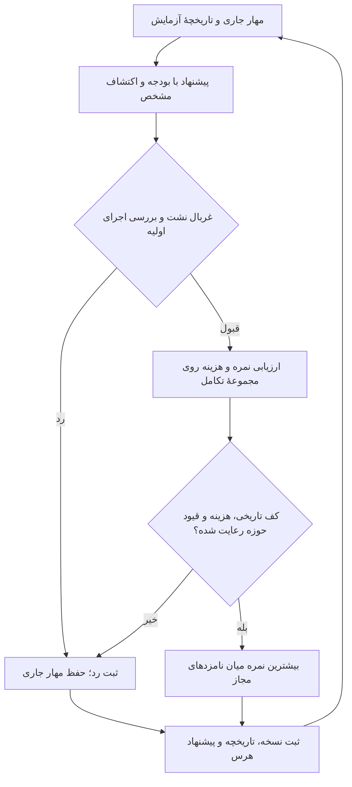

نمادها را دقیق بخوانیم: S′ نمرهٔ نامزد، S_t نمرهٔ جاری، S* بهترینِ تاریخی و C میانگین توکن سیاست در هر اجراست. δ نوار تحمل نویز است. در [کد انتخاب](https://github.com/google-research/rrsi/blob/be50316e1db05914068a973f322770ef08ed7ba1/rrsi/selection.py)، ابتدا کف تاریخی باید رعایت شود:

<div class="formula" dir="ltr">S′ ≥ S* − δ</div>

اگر افزایش نمره از δ بیشتر باشد، افزایش نسبی هزینه باید از بودجهٔ مجاز کمتر باشد:

<div class="formula" dir="ltr">ΔC ≤ β₀ + β₁ × ΔS</div>

داخل نوار، معیار ترکیبی باید مثبت شود:

<div class="formula" dir="ltr">wₛ × ΔS − w꜀ × ΔC + wₙ × novelty &gt; 0</div>

قید حوزه می‌تواند نامزدِ پذیرفتنی از نظر این حساب را رد کند. از میان نامزدهای مجاز، بیشترین نمره انتخاب می‌شود؛ اگر هیچ‌کدام مجاز نباشند، مهار جاری می‌ماند. بنابراین تغییر پذیرفته‌شده الزاماً افزایش سخت‌گیرانهٔ دقت نیست: کاهش کوچکِ داخل نوار می‌تواند برای صرفه‌جویی یا جزء ساختاری تازه پذیرفته شود. تعبیرهای L1 و L2 در مقاله تشبیه کیفی‌اند؛ قرارداد واقعی همین قواعد اجرایی است.

| حوزه | دور / تکرار هر کار / نامزد هر دور | حدود تعداد تغییر | δ | β₀ / β₁ |
|---|---|---|---|---|
| کدنویسی | ۲۰ / ۲ / ۲ | ۱ تا ۴ | ۰٫۰۱۷ | ۰٫۱۰ / ۴۴٫۵ |
| کار اسنادی | ۲۰ / ۲ / ۲ | ۱ تا ۳ | ۰٫۰۰۴ | ۰٫۱۰ / ۳۵٫۴ |
| طراحی مهندسی | ۴۰ / ۴ / ۲ | ۱ تا ۴ | ۰٫۰۲۰ | ۰٫۱۵ / ۲۴٫۴ |

این عددها از سه rrsi.json نسخهٔ ثابت‌اند. نمره در کد کسری میان صفر و یک است، نه عددی میان صفر و صد؛ تبدیل واحد روی ضریب هزینه و وزن‌ها اثر می‌گذارد. δ در این تنظیم‌ها ثابت است؛ null کردن آن مسیر جداگانهٔ کالیبراسیون با اجرای پایه یا bootstrap تکرارهای هر کار را فعال می‌کند. این مسیر خودکار معادل اصلاح همهٔ فرضیه‌های تطبیقیِ امتحان‌شده نیست.

### ۱۵.۷ نتیجه‌های RRSI؛ شمارش درست و هزینهٔ درست

جدول زیر با سیاستِ ثابتِ اعلام‌شدهٔ Claude Opus 4.8 از README و جدول‌های اصلی نقل عددی می‌کند. داده‌ها نتیجهٔ نویسندگان‌اند. تکرار همان کار و معیارهای داخل یک rubric، مسئله‌های مستقل تازه نیستند.

| محک و نقش | پایه | RRSI | تغییر مطلق | واحد |
|---|---|---|---|---|
| Terminal-Bench 2.1؛ تکامل | ۷۴٫۲ | ۸۰٫۲ | +۶٫۰ | واحد درصد نرخ عبور |
| SWE-bench Verified؛ بیرون‌توزیع | ۸۲٫۰ | ۸۳٫۸ | +۱٫۸ | واحد درصد نرخ عبور |
| Harvey LAB؛ تکامل | ۸۹٫۴ | ۹۰٫۵ | +۱٫۱ | واحد درصدِ اعتبار معیارها |
| Harvey LAB؛ کنارگذاشته‌شدهٔ هم‌توزیع | ۸۶٫۹ | ۸۹٫۲ | +۲٫۳ | واحد درصدِ اعتبار معیارها |
| JobBench؛ بیرون‌توزیع | ۳۶٫۰ | ۴۰٫۷ | +۴٫۷ | امتیازِ گزارش‌شدهٔ محک |
| GDPval؛ بیرون‌توزیع | ۴۸٫۸ | ۵۲٫۳ | +۳٫۵ | واحد درصد برد نسبت به مرجع انسانی |
| APEX-Agents؛ بیرون‌توزیع | ۳۴٫۲ | ۳۷٫۹ | +۳٫۷ | واحد درصد موفقیت در یک تلاش؛ ۴۸۰ کار |
| EngDesign؛ تکامل | ۵۰٫۰ | ۵۴٫۹ | +۴٫۹ | واحد درصد عبور از شبیه‌ساز |
| Frontier-Eng؛ بیرون‌توزیع | ۱۷٫۷ | ۲۲٫۰ | +۴٫۳ | امتیاز Medal؛ نه درصد بازده |

پیوست A جزئیات مهمی دربارهٔ مخرج امتیاز می‌دهد. در APEX-Agents، موفقیت در یک تلاش روی تمام ۴۸۰ کار سنجیده می‌شود و خروجیِ نرسیده به‌علت زیرساخت، شکست محسوب می‌شود. در Frontier-Eng، مخرجِ نسخهٔ اول ۴۷ کار است و مدال‌ها اعتبار ۱، ۰٫۶۷ و ۰٫۳۳ دارند. کارهای هم‌پوشان با EngDesign از پاداش کنار گذاشته می‌شوند؛ طبق پروتکل گزارش‌شده، ۳۸ کار از ۴۷ کار امکان کسب اعتبار دارند و کارهای مجاز در دو بازو یکسان‌اند. این قاعده، یک کنترل مشخص برای هم‌پوشانی است؛ جامع‌بودن همهٔ کنترل‌های نشت را اثبات نمی‌کند.

> **ابهام حل‌نشده در شمارش GDPval:** پیوست A.5 از ۱۸۵ کار، هر دو ترتیب نمایش و رأی اکثریت سه داور می‌گوید، اما سپس برای هر داور ۲۰۴ مقایسه به‌ازای هر هارنس اعلام می‌کند. دو ترتیب برای ۱۸۵ کار، پیش از حذف‌های مستند، ۳۷۰ مقایسه برای هر داور می‌دهد. همان بند، تفاوتِ ۲۰۴ و این شمارش را توضیح نمی‌دهد. برای بازسازی مستقل نرخ برد باید شناسهٔ کارهای ارزیابی‌شده و گزارش رأی هر داور در هر ترتیب منتشر شود؛ هیچ‌یک از این مخرج‌ها را نباید بی‌توضیح جای دیگری نشاند. این ناسازگاری به‌تنهایی نادرستی نتیجهٔ اصلی را ثابت نمی‌کند.

هشت محک متمایز داریم، اما نه سطر؛ چون Harvey LAB هم مجموعهٔ تکامل دارد و هم کنارگذاشته‌شدهٔ هم‌توزیع. شش تقسیم کنارگذاشته‌شده یعنی پنج محک بیرون‌توزیع به‌علاوهٔ همین تقسیم هم‌توزیع؛ شش محک بیرون‌توزیع نیست.

عدد حداکثر +۱۴٫۱ از جست‌وجوی مستقل با Gemini 3.5 Flash می‌آید: Terminal-Bench از ۶۴٫۶ به ۷۸٫۷ و SWE-bench از ۷۶٫۸ به ۷۹٫۰ می‌رود. انتقالِ بدون تغییر همان مهار به Gemini 3.1 Flash Lite در Terminal-Bench، ۱۱٫۲ به ۱۴٫۶ گزارش شده؛ +۳٫۴ واحد درصد، حدود +۳۰٫۴٪ نسبت به پایهٔ کوچک است، نه ۳۰٫۴ واحد درصد.

| حذف‌مولفه در محیط اسنادی | تکامل | آزمون هم‌توزیع | میانگین بیرون‌توزیع | میلیون توکن سیاست / اجرا |
|---|---|---|---|---|
| پایه | ۸۹٫۴ | ۸۶٫۹ | ۳۹٫۷ | ۱٫۵۶ |
| بدون منظم‌سازی | ۹۲٫۸ | ۸۸٫۹ | ۴۰٫۳ | ۳٫۸۰ |
| بدون قیود پیشنهاد | ۹۰٫۷ | ۸۸٫۸ | ۴۱٫۹ | ۲٫۶۹ |
| بدون قیود پذیرش | ۹۱٫۵ | ۸۸٫۷ | ۴۱٫۰ | ۳٫۵۹ |
| RRSI کامل | ۹۰٫۵ | ۸۹٫۲ | ۴۳٫۶ | ۲٫۴۲ |

<div class="chart-frame"><canvas id="rrsi-tradeoff-chart" role="img" aria-label="رابطهٔ توکن سیاست و امتیاز انتقال در پنج حالتِ جدول حذف‌مولفهٔ RRSI">پایه: ۱٫۵۶ میلیون توکن و ۳۹٫۷ امتیاز؛ بدون منظم‌سازی: ۳٫۸۰ و ۴۰٫۳؛ بدون قیود پیشنهاد: ۲٫۶۹ و ۴۱٫۹؛ بدون قیود پذیرش: ۳٫۵۹ و ۴۱٫۰؛ RRSI: ۲٫۴۲ و ۴۳٫۶.</canvas></div>

<aside class="callout important"><strong>صرفه‌جویی نسبت به چه چیزی؟</strong><p>جدول ۲ مقاله برای تکامل بدون منظم‌سازی ۳٫۸۰ و برای RRSI برابر ۲٫۴۲ میلیون توکن می‌دهد: کاهش حدود ۳۶٫۳۲٪ است، هماهنگ با عدد گرد‌شدهٔ ۳۶٪ سایت. چکیده حدود ۳۰٪ می‌گوید. نسبت به پایهٔ ۱٫۵۶میلیونی، RRSI حدود ۵۵٫۱۳٪ بیشتر مصرف می‌کند. مخرج و نسخه را باید کنار عدد نگه داشت.</p></aside>

این شمارش، توکن سیاستِ مهار نهایی در هر اجراست؛ همهٔ هزینهٔ جست‌وجو، تحلیلگر، پیشنهاددهنده، منتقد، داور، نصب و تلاش ناموفق را در بر نمی‌گیرد و صرفه‌جویی قطعی دلار یا زمان را اثبات نمی‌کند. بالاترین نمرهٔ تکامل در جدول به بهترین انتقال تبدیل نشده است. این یک شاهد مفیدِ نویسندگان علیه انتخاب صرفاً بر اساس نمرهٔ توسعه است، نه بازاجرای مستقل ما. ارزیاب قطعیِ شبیه‌ساز، واریانس داور LLM را حذف می‌کند ولی همهٔ عدم‌قطعیتِ نمونه‌گیری، مدل، شبیه‌ساز و انتخاب را نه.

### ۱۵.۸ چه چیزی در این نوبت واقعاً اجرا شد؟

بررسی‌ها با Python 3.12 محلی، بدون اعتبارنامهٔ مدل، استنتاج پولی، نصب محیط محک، کارگزار، صرافی یا سفارش واقعی انجام شدند. نصب‌کنندهٔ دوردست، حلقهٔ کاملِ تکامل و اسکریپت پاک‌سازی مخازن اجرا نشد. خطای اولیهٔ مجوز پوشهٔ موقتِ محیط جداشده با انتخاب پوشهٔ موقتِ متعلق به همین پژوهش تفکیک شد؛ برای نمایش موفقیت، منبع upstream دست‌کاری نشد.

| بررسی | نتیجهٔ مشاهده‌شده | مرز نتیجه |
|---|---|---|
| آزمون‌های هستهٔ RRSI | هر ۸ آزمون عبور کرد: برنامهٔ بودجه، برآورد وزن‌دار، کالیبراسیون، دو شاخهٔ هزینه، انتخاب/قید، تاریخچه/هرس/اکتشاف، برچسب جزء و تنظیم/سریال‌سازی | هستهٔ بدون API؛ نه اجرای حوزه یا بازتولید تکامل |
| مجموعهٔ گردش‌کار Harness² | پنج متد آزمون اجرا شد؛ مجموعه با ۴ شکست assertion/زیرآزمون و ۳ خطا موفق نشد؛ نبود fcntl و خلاصه‌های تولیدنشده در خطاها دیده شد؛ آزمون retry جدا هم به حفظ مهار قبلی رسید | هدفِ مستند POSIX/لینوکس است؛ این هفت رخداد را هفت عیب مستقل نخوانیم؛ عبور روی لینوکس ادعا نمی‌شود |
| توابع مستقل Harness² | در k=5 حساب ۲۰/۱۵؛ حذف پایه از مجموعهٔ انتخاب؛ یک موفقیت و یک نمره‌نگرفته، امتیاز ۱۰۰٪ روی n=1 | قرارداد بودجه و سیاست مخرج را تأیید می‌کند، نه صحت کار عامل |
| انتهای برنامهٔ RRSI | T=20 و حدود ۱/۴ در دورهای صفر تا ۱۹ به ۲ ختم شد؛ بودجهٔ ۱ در t=20 است که در آن حلقه اجرا نمی‌شود | در این تنظیم، وعدهٔ رسیدن واقعی به یک تغییر با برنامهٔ سقف‌دار یکسان نیست |
| شمارش هزینهٔ غایب | relative_cost_change(None,1000) صفر شد و نامزد با نمرهٔ بالاتر، هزینهٔ ناموجود و قاعدهٔ پیش‌فرض پذیرفته شد | صفرِ جایگزین شاهد صفر یا ثابت‌بودن هزینهٔ واقعی نیست |
| معاملهٔ داخل نوار | نمرهٔ ۰٫۹۵۰ به ۰٫۹۴۵ همراه توکن ۱۰۰۰ به ۹۰۰ با δ=0.02 پذیرفته شد | رفتار طراحی‌شدهٔ مبادلهٔ هزینه/نمره؛ افزایش یکنواخت دقت نیست |
| تصویر تاریخچه | ۶۰ رکوردِ اندازه‌گیری‌شدهٔ ذخیره‌شده، در History.render پیش‌فرض ۴۰ رکورد داد؛ loop همین را به propose می‌دهد | کامل‌بودن دفتر با کامل‌بودن ورودی عادی پیشنهاددهنده فرق دارد |
| فهرست کامل مخزن | .env.example در نسخهٔ ثابت Harness² غایب بود | بدون نصب یا استفاده از راز نتیجه گرفته شد |
| بازبینی حساب جدول‌ها | صرفه‌جویی ۳۶٫۳۲٪ در برابر تکاملِ نامنظم، افزایش ۵۵٫۱۳٪ در برابر پایه و تطبیق ۸/۹/۶/۵ | حساب روی عددهای گزارش‌شده؛ نه شاهد مستقل عملکرد محک |

[aggregate در RRSI](https://github.com/google-research/rrsi/blob/be50316e1db05914068a973f322770ef08ed7ba1/rrsi/evaluate.py) آرایهٔ پاداش و وزنِ دریافتی را میانگین می‌گیرد؛ آداپترهای بررسی‌شده جای تکرارهای غایب را با پاداش صفر پر می‌کنند تا مخرج برنامه‌ریزی‌شده باقی بماند. آداپترِ تازه باید همین قرارداد را رعایت کند. میانگین توکن در مقابل، دادهٔ غایب یا غیرمثبت را کنار می‌گذارد؛ هزینهٔ همهٔ شکست‌ها از آن به دست نمی‌آید. سیاست حذف نمره‌نگرفتهٔ Harness² و سیاست صفرگذاری RRSI را بدون تطبیق مخرج و وزن نباید همسان دانست.

### ۱۵.۹ منابع تکمیلی: هرکدام کدام شکاف را روشن می‌کند؟

| شناسه و منبع اصلی | ارزش افزوده | عمق و احتیاط |
|---|---|---|
| X19-01؛ [GEPA](https://arxiv.org/abs/2507.19457) و [راهنمای رسمی DSPy](https://dspy.ai/current/tutorials/gepa_ai_program/) | اصلاح بازتابیِ دستور/برنامه و جست‌وجوی پارتو؛ مبنایی کوچک‌تر از تغییر همهٔ مهار | چکیده، هویت و معرفی رسمی؛ متن/کد کامل بازتولید نشده؛ بهینه‌سازی دستور همهٔ کد runtime را عوض نمی‌کند و تضمینِ پاکی holdout نیست |
| X19-02؛ [Meta-Harness](https://arxiv.org/abs/2603.28052) | جست‌وجوی حلقهٔ بیرونی روی کد، با دیدن منبع، نمره و رد نامزدهای پیشین | چکیدهٔ اصلی و جایگاه در مقایسه‌های دو مقاله؛ انتقال گزارش‌شده شرطی است و بازخوردش با اصلاح جاریِ بدون داور یکی نیست |
| X19-03؛ [ReasoningBank](https://arxiv.org/abs/2509.25140) | استخراج راهبرد از تجربهٔ موفق و ناموفقِ خودداوری‌شده و مقیاس‌دادن تجربه با محاسبه | چکیده و مقایسهٔ Harness²؛ بازیابی تجربه با تکامل کد یکسان نیست؛ خودداوری حقیقت ایجاد نمی‌کند |
| X19-04؛ [مهندسی زمینهٔ عامل، ACE](https://arxiv.org/abs/2510.04618) | نگهداری زمینهٔ ساختاریافته و قابل بازاستفاده، به‌جای بازنویسی فشردهٔ مکرر | چکیده/فراداده؛ کد، همهٔ آزمایش‌ها و کاربرد مالی ممیزی نشده؛ قید منبع، زمان و محدوده همچنان لازم است |
| X19-05؛ [ماشین داروین–گودل](https://arxiv.org/abs/2505.22954) | خوداصلاحی تجربی و آرشیو عامل‌های کدنویس | چکیده/فراداده؛ اجرای کامل نه؛ انتخاب تجربی روی محک، اثبات رسمیِ بهبود هر خوداصلاحی نیست |
| X19-06؛ [تحلیل تطبیقی و استفادهٔ دوباره از آزمون](https://arxiv.org/abs/1506.02629) | مبنای آماریِ خطرِ بارها نگاه‌کردن به مجموعهٔ محدود ارزیابی | چکیده و مقدمهٔ اصلی؛ اثبات کامل ممیزی نشده؛ کف تجربیِ RRSI خودبه‌خود سازوکارِ holdoutِ دارای تضمین آن نظریه نیست |
| X19-07؛ [آیا بهینه‌ساز عامل بهبود را انباشته می‌کند؟](https://arxiv.org/abs/2607.14004) | آزمون دو مرحله‌ایِ انتقال، بهینه‌سازی دوباره و حفظ دستاورد | چکیده/فراداده؛ گزارش فنی RELAI روش خودِ آن را هم مقایسه می‌کند؛ امتیازهای ۷۶٫۴ در برابر ۶۶٫۰، ۶۴٫۶ و ۵۸٫۷ ادعای نویسنده و سرنخ‌اند، نه گواه مستقلِ برتری عمومی |

این منابع، یادگیری از حافظه، بهینه‌سازی زمینه، تکامل کد، منظم‌سازی جست‌وجو و اعتبار آماری را از هم جدا می‌کنند. برای مقایسهٔ منصفانه باید مسئله، مدل، مهار آغازین، مجوز ابزار، دسترسی بازخورد، بودجهٔ نامزد، ارزیاب و کل مخارج مشخص باشد. خواندن چکیده، همهٔ منابع فرزند را نمی‌بندد.

### ۱۵.۱۰ این روش‌ها برای پژوهش معامله چه معنایی دارند؟

**استنتاج پژوهشی، نه نتیجهٔ آزمایش مالی:** تنظیم مهار با پیامدهای تاریخی بازار، نوع دیگری از جست‌وجوی تطبیقیِ راهبرد است. انتقال محل انتخاب از وزن مدل به دستور، مهارت یا orchestration، سوگیری جست‌وجو را حذف نمی‌کند. بهبود کار سند حقوقی یا کدنویسی، شاهد بهترشدن پیش‌بینی، اجرا یا بازده تعدیل‌شده با ریسک نیست.

| سازوکار | کوچک‌ترین کاربرد پژوهشیِ قابل آزمون | شکست تعیین‌کننده |
|---|---|---|
| کاوش مقایسه‌ای | تطبیق شواهد، پیوند زمانی و بازکردن خروجی در دادهٔ ثابت و عمومی | گزارش زیباتر شود ولی منبع نامطلوب حذف یا تغییر کند |
| دفتر تغییر نسخه‌دار | فرضیه، داده/کد/تنظیم، همهٔ تلاش‌ها و نامزدهای ردشده | فقط دستور برنده یا ماه مطلوب باقی بماند |
| پذیرش حساس به نویز | ارزیابی تکراریِ زوجی و عدم‌قطعیت متناسب با وابستگی، از پیش تعریف‌شده | افزایش کوچک با بذر یا اجرای ثابت بعدی ناپدید شود |
| انتقالِ کنارگذاشته‌شده | قفل‌کردن دورهٔ آینده، نماد/مکان و مجموعهٔ پذیرش مستقل | بهینه‌ساز در انتخاب، بازده آینده، filing بعدی یا داور را ببیند |
| حافظهٔ شاهد | قطعهٔ اصلی و نسخهٔ معلوم در زمان؛ جدایی روش عمومی از برچسب پیامد | بازاندیشیِ سودوزیان بعدی وارد تصمیم زودتر شود |
| هزینه و هرس | دریافت، پیشنهاد، منتقد، مجری، داور، retry، شکست و نگهداری همگی ثبت شوند | صرفه‌جویی، جست‌وجو را حذف یا telemetry غایب را پنهان کند |
| مرز ثابت اختیار | حد ریسک، اعتبارنامه، اعتبارسنجی سفارش و تطبیق اثر بیرونی خارج از سطح ویرایش پژوهش | برای بالا‌بردن نمره، کنترل ایمنی خاموش شود |

با fixture قطعی برای حسابداری، زمان و سفارش شروع کنید و سپس به ارزیابی کنترل‌شده بروید. DSR و PBO هنوز به خانوادهٔ واقعیِ تلاش‌ها و فرض مالی نیاز دارند. δ ثابتِ یک محک، دورهٔ چهار هفته‌ایِ paper یا نمرهٔ حقوقی آستانهٔ جهانی معناداری نیست. آزمون ظرفیت، هزینه، تأمین مالی و اجرا نیز از فصل‌های قبلی باقی است؛ هیچ استقرار معاملاتی از این مرور نتیجه نمی‌شود.

### ۱۵.۱۱ ادامهٔ پژوهش با خروجی قابل سنجش

۱. مجموعهٔ گردش‌کارِ تغییرنیافتهٔ Harness² روی لینوکسِ هدف اجرا شود؛ سپس انتقال ابزار، نشت، کنترل شبکه و مخرجِ شکستِ داور جدا بررسی شوند. نمونهٔ .env غایب در این نسخه حل شود.

۲. آزمایش کوچکِ هم‌بودجه با پایه و Harness²، نسخهٔ داده و مدل، ترتیب، ارزیاب، شبکه، k و حالتِ یکسان تکرار شود. همهٔ اقدام‌های پیش از تحویل و تعداد کارهای آغازشده/نمره‌دار ثبت شوند؛ فقط گام‌های خروجی نهایی مقایسه نشوند.

۳. اجراکننده‌های حوزهٔ RRSI و چهار حالتِ بدون منظم‌سازی، فقط قیود پیشنهاد، فقط قیود پذیرش و کامل، با مجموعهٔ کنارگذاشته‌شدهٔ دست‌نخورده بازتولید شوند. δ ثابت و دوباره‌کالیبره‌شده و منشأ شمارش توکن مشخص باشند.

۴. تاریخچهٔ بلند، انتهای برنامه، هزینهٔ جزئی/غایب، تکرار شکست‌خورده، برچسب جزء، رد/قبول غلطِ منتقد و برگشتِ هرس آزموده شوند. خود منتقد مدل هم خطا دارد و نیازمند ارزیابی است.

۵. شکل‌ها، ضمائم، پرامپت‌ها، logها و متن کاملِ منابع تکمیلی پیگیری شوند. فهرست والد–فرزند و اثرانگشتِ این افزوده، کشف/هویت را ثبت می‌کند؛ مجوز اعلام تکمیل همهٔ مراجع نیست.

۶. پیش از کاربرد مالی، داده و حافظهٔ قابل دسترس در زمان و مرز تغییرناپذیر اختیار اعمال شوند. صحت پژوهش، صحت شبیه‌ساز و تعمیم اقتصادی سه نتیجهٔ جدا باقی بمانند.

### ۱۵.۱۲ منشأ و تمامیت این افزوده

مسیریابی در کد با شاخص codebase-memory روی نسخه‌های محلی انجام شد. پوشش، مستنداتِ کنارگذاشته‌شده و مسیرهای دارای تغییر فراداده را علامت زد؛ بخش‌های مرتبط مستقیماً از منبع خوانده شدند. شاخص برای یافتن مسیر بود، نه شاهد مستقلِ رفتار. هش‌ها هویت بایت‌ها را ثابت می‌کنند، نه حقیقت، اجرای موفق یا خواندن همهٔ فایل‌ها را.

شناسه‌های فایل، وضعیت منابع فرزند، اثرانگشت‌ها و نشانی‌های تازه در پیوست‌های همین نسخه حفظ شده‌اند. متن انگلیسیِ مبنا، اکنون بخش ۱۹ را دارد؛ این فصل فارسی با همان یافته‌ها تدوین شده است. تاریخ قدیمیِ آزمایش‌های قبلی تغییر داده نشده؛ تاریخ این افزوده جداست.


## فصل ۱۶. پوشش همهٔ منابع؛ بازیابی تازه و خواندن عمیق‌تر

> **وضعیت واقعی:** همهٔ ورودی‌ها در دفتر پژوهش شناسه دارند؛ همهٔ کتاب‌ها، مقاله‌ها، شکل‌ها، کدها و آزمایش‌ها هنوز کامل بررسی نشده‌اند. دریافت متن با خواندن آن فرق دارد؛ خواندن متن هم با بازتولید نتیجه فرق دارد. این فصل پیشرفت تازه و مانع‌های باقی‌مانده را دقیق ثبت می‌کند.

### ۱۶.۱ چگونه هیچ منبعی گم نشود؟

در شروع این بازبینی، پرونده شامل **۸۶ رکورد ورودی، ۱۷۶۶ رشتهٔ نشانی متمایز و ۳۸۵ شناسهٔ متفاوت arXiv** بود. شناسهٔ متفاوت لزوماً پژوهش مستقل نیست: یک مقاله ممکن است دوباره ارسال شده باشد، یا چند مخزن به همان کتاب و داده تکیه کنند. این شمارش به همان نسخهٔ آغازین مربوط است؛ کشف‌های بعدی جدا ثبت می‌شوند.

روش کار، دفتر نسخه‌دارِ هر دارایی است: مقاله، کد همراه، داده، کتاب، دفترچهٔ آموزشی و سرویس بسته، هرکدام وضعیت جدا می‌خواهند. نسخه، هش و نشانی اصلی امکان تطبیق می‌دهند؛ خودشان صحت ادعا را ثابت نمی‌کنند.

| مرحله | چه چیزی باید مشخص باشد؟ | چه چیزی برای تکمیل کافی نیست؟ |
|---|---|---|
| شناسایی | نشانی، تغییر مسیر، نویسنده، نسخه، تکراری یا پس‌گرفته‌شدن | شباهت نام یا قطعهٔ نتیجهٔ جست‌وجو |
| دسترسی | بدنهٔ عمومی یا نسخهٔ قانونی محلی؛ اندازه و هش | پاسخ ۲۰۰ که فقط صفحهٔ ورود است |
| خواندن | وضعیت بخش‌ها و صفحه‌ها؛ بازبینی معادله و شکل مبهم | دانلود، جست‌وجوی واژه یا شمار صفحه |
| تحلیل | پرسش، داده، زمان، مقایسه، عدم‌قطعیت و شرط شکست | بازگویی نتیجهٔ چکیده |
| بازتولید | داده و محیط مشخص؛ فرمان و خروجی واقعی | وجود پوشهٔ آزمون یا گذشتن آزمونی نامرتبط |

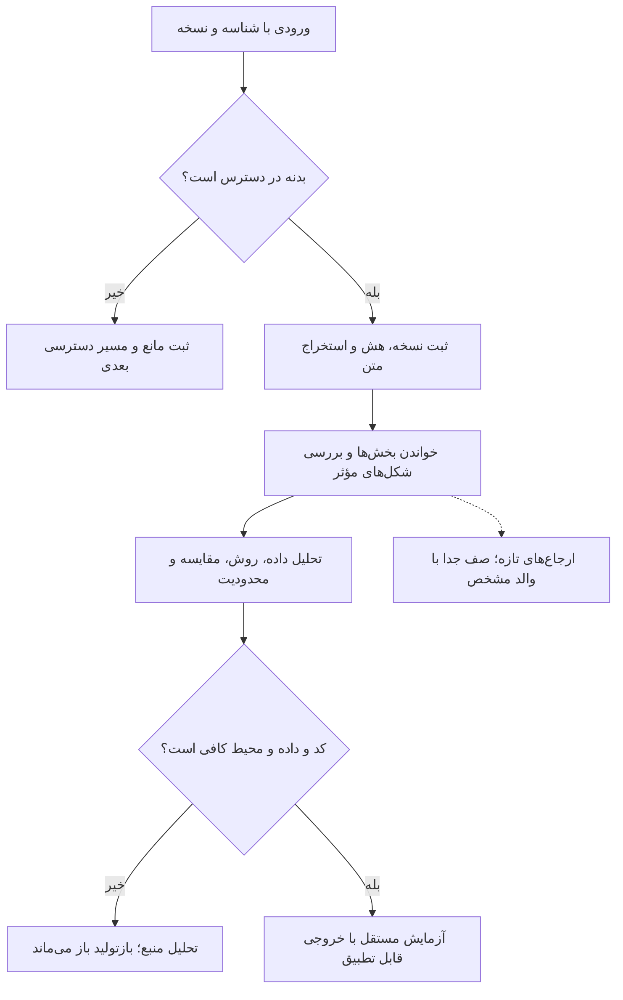

فهرست بستهٔ فعلی را می‌توان تمام کرد؛ دنبال‌کردن همیشگیِ تمام ارجاع‌های تازه و «همهٔ منابع مشابه» پایان جهان‌شمولی ندارد. برای همین، هیچ لینک تازه‌ای بی‌صدا مخرجِ ادعای تکمیل را تغییر نمی‌دهد. دفتر دسترسی در انتهای این فصل، وضعیت هر مقصد را نشان می‌دهد. خطای دسترسیِ امروز هم خواندن موفقِ ثبت‌شدهٔ دیروز را باطل نمی‌کند.

### ۱۶.۲ منبع O06 بالاخره مشخص شد

[کوتاه‌پیوند اولیهٔ LinkedIn](https://lnkd.in/p/eDSs6P-7) اکنون به [پست مشخص مارکوس لوپز د پرادو دربارهٔ Alpha Assembly Line](https://www.linkedin.com/posts/lopezdeprado_quantitativeinvesting-machinelearning-quantresearch-ugcPost-7508524727091658753-dJZw/) باز شد. متن پست و رونویسیِ ویدئوی ارائه‌شده در صفحه خوانده شد. خود ویدئو، همهٔ نظرها و تاریخچهٔ ویرایش احراز نشده‌اند. وضعیت قدیمیِ «انتساب نامشخص» با همین دامنه اصلاح می‌شود.

استدلال اصلی، تقسیم کار میان متخصصانِ مراحل پژوهش است. این دیدگاه برای طراحی مسئولیت و تحویل شواهد مفید است؛ دادهٔ بازده نهادی ارائه نمی‌کند. کشف علّی از داده به فرض‌های شناسایی نیاز دارد، حذف هم‌پوشانی برچسب‌ها همهٔ وابستگی‌ها را حذف نمی‌کند، و بریدن خودکار داده‌های پرت ممکن است رویداد واقعی بازار را پاک کند. این جمله‌ها نباید به تضمین علمیِ سود تبدیل شوند.

### ۱۶.۳ شبیه‌ساز تعاملی را چگونه باید قضاوت کرد؟

متن استخراج‌شده و فهرست ارجاع‌های سه مقالهٔ زیر کامل خوانده شد؛ این عبارت شامل ممیزی کامل شکل‌ها، کد و آزمایش نیست.

| مقاله | یافتهٔ مهم | حد نتیجه |
|---|---|---|
| [ABIDES؛ نسخهٔ اول ۲۰۱۹](https://arxiv.org/html/1904.12066v1) | پیام‌رسانی، تأخیر محاسبه/شبکه، تطبیق قیمت/زمان و مولد تصادف جدا برای عامل‌ها | طرح تاریخی است؛ حراج آغاز بازار در نسخهٔ توصیف‌شده پیاده نشده؛ تأیید آداپتر امروزی نیست |
| [ABIDES-Gym؛ نسخهٔ اول](https://arxiv.org/html/2110.14771v1) | توقف و ادامهٔ هسته برای مشاهده و کنش عامل | فرمول چاپ‌شدهٔ پاداش فروش و جریمهٔ کار ناتمام نیاز به تطبیق با کد دارد |
| [Get Real؛ نسخهٔ اول](https://arxiv.org/html/1912.04941v1) | جمعیت متنوع‌تر برخی توزیع‌ها را بهتر بازسازی می‌کند | خود مقاله شکست در خودهمبستگی بازده، زمان‌بندی سفارش و الگوی حجم روزانه را گزارش می‌کند |

> **دو بررسی مشخص:** عبارت پنجرهٔ مومنتومِ چاپ‌شده در ABIDES، یعنی `(history + [last])[:lookback]`، با ورودی‌های ۱ تا ۶ و پنجرهٔ ۳، سه مشاهدهٔ اول را نگه می‌دارد؛ پنجرهٔ غلتان باید ۴ تا ۶ را نگه دارد. این رفتار مستقلاً بررسی شد و به مثال مقاله مربوط است. در صفحهٔ ۶ PDF مقالهٔ ABIDES-Gym نیز ضریب فروش صفر و «جریمهٔ» ناتمام‌ماندن به‌صورت قدرمطلقِ نامنفی چاپ شده است؛ همان صفحه به‌صورت تصویری کنترل شد. مقصود نویسنده یا رفتار نسخهٔ جاری کد از این نوشته حدس زده نمی‌شود.

ادعای بی‌نیازی کامل از یادگیری تقویتی در بازپخش، بیش از حد کلی است: حتی با قیمت بیرونیِ ثابت، کنش امروز موجودی، وجه نقد، هزینه و کنش‌های مجاز فردا را تغییر می‌دهد. مسئله هنوز می‌تواند کنترل دنباله‌ای باشد؛ برتری یادگیری تقویتی بر راه‌حل ساده باید جدا آزموده شود.

برای سنجش واقع‌گرایی، تنها شباهت نمودار قیمت کافی نیست. **پیشنهاد پژوهشی این پرونده**، گزارش جداگانهٔ اسپرد و عمق، زمان نخستین و آخرین پرشدن، رقابت لغو/اجرا، وابستگی جریان سفارش، الگوی فعالیت روزانه، زوال اثر سفارش و وابستگی میان دارایی‌هاست. معیارهای لازم باید از ریسک راهبرد انتخاب شوند و روی دورهٔ کنارگذاشته‌شده هم بررسی شوند. این ماتریس هنوز روی دادهٔ تاریخی کالیبره نشده است.

### ۱۶.۴ محک بازار پیش‌بینی؛ نتیجهٔ محدود و یک اصلاح حسابی

متن کامل استخراج‌شدهٔ [PredictionMarketBench، همراه پیوست پرامپت](https://arxiv.org/html/2602.00133v1) خوانده شد. چهار قسمت تاریخی دارد. سود گزارش‌شدهٔ Bollinger Bands برابر ۶۶٫۶۸ دلار، زیان عامل زبانی ۱۱۰٫۶۲ دلار و زیان عامل تصادفی ۵٫۱۳ دلار است. **حدود ۹۶٫۱۳٪ سود کل راهبرد مثبت از یک قسمت بیت‌کوین آمده است**؛ این نسبت جداگانه محاسبه شد. نتیجهٔ بازپخشِ چهار قسمت، اثبات سودآوری عمومی نیست.

در مثالِ پرامپت، ورود ۵۰ سنت و کارمزد ۱٫۷۵ سنت با آستانهٔ ۵۳٫۵٪ همراه شده است. برای یک خرید تا تسویهٔ صفر/یک دلاری، بدون هزینهٔ خروج و پیش از سایر هزینه‌ها، امید خالص برابر است با:

<div dir="ltr" class="formula">E[net] = p − 0.50 − 0.0175</div>

پس احتمال سربه‌سر **۵۱٫۷۵٪** است. اگر خروج یا رفت‌وبرگشت هم هزینه داشته باشد، معادله باید همان جریان نقد را نشان دهد. این بررسی، اجرای کد محک یا تأیید کارمزد فعلیِ صرافی نیست. نمایش نرخ پرشدن ۱۰۰٪ برای حالتی با صفر سفارش نیز به تعریف صریحِ مخرج تهی نیاز دارد.

### ۱۶.۵ افت عملکرد، به‌تنهایی علت را مشخص نمی‌کند

متن کامل استخراج‌شدهٔ [Look-Ahead-Bench](https://arxiv.org/html/2601.13770v1) و ارجاع‌هایش خوانده شد. مطالعه پنج سهم و دو دوره را مقایسه می‌کند. «آلفا»ی جدول آن اختلاف بازده با خریدونگهداری است؛ آلفای تعدیل‌شده با ریسک نیست. تغییر رژیم و مواجهه نیز می‌تواند افت بازده ایجاد کند، پس افت به‌تنهایی سهم حفظ‌کردن آینده را شناسایی نمی‌کند.

در جدول خود مقاله، آلفای دورهٔ دوم Llama 70B برابر ۴٫۰۲ و مدل 8B برابر منفی ۳٫۴۲ واحد درصد است؛ اختلاف **۷٫۴۴ واحد درصد به‌نفع مدل بزرگ‌تر** است. این دو سطر شاهد افتِ ناشی از بزرگ‌شدن در همان خانواده نیستند. ادعای حذف نشت در مدل‌های بسته هم به شواهد مستقل نیاز دارد.

**طرح مقایسهٔ قوی‌تر:** نسخهٔ مدل، داده و ابزار ثابت؛ چند پنجرهٔ واقعاً پس از برش آموزش؛ کنترل هویت شرکت؛ تاریخچهٔ مصنوعیِ خلاف‌واقع؛ بودجه و ریسک یکسان؛ و ثبت پیش‌بینی پیش از روشن‌شدن نتیجه. این‌ها پیشنهاد آزمون‌اند و در این بررسی اجرا نشده‌اند.

### ۱۶.۶ حافظهٔ باتجربه؛ محک تازه سؤال دیگری می‌پرسد

از [LongMemEval-V2](https://arxiv.org/html/2605.12493)، بخش‌های ساخت داده، صورت‌بندی، نتایج، تأخیر و محدودیت‌های پیوست E خوانده شد؛ تمام پیوست‌ها هنوز خوانده نشده‌اند. ۴۵۱ پرسش و تاریخچه‌های ازپیش‌جمع‌آوری‌شدهٔ عامل وب دارد. سنجش با خوانندهٔ ثابت انجام می‌شود؛ توان گردآوری شاهد را می‌سنجد، نه موفقیت آنلاینِ کامل عامل را.

دو ردهٔ حدود ۲۵ و ۱۱۵ میلیون توکن و امتیازهای ۷۴٫۹٪ و ۷۰٫۱٪ AgentRunbook-C را نمی‌توان مستقیم با R@5 یا پاسخ‌گویی LongMemEval اولیه مقایسه کرد. کنترل‌گر، خواننده، دامنه، معیار و تأخیر فرق دارند. اجرای مستقلِ محک انجام نشده است.

### ۱۶.۷ کتاب‌ها؛ کدام متن را داریم و کدام بخش خوانده شده؟

| کتاب | دسترسی و خواندن این مرحله | باقی‌مانده |
|---|---|---|
| [Causal Inference: What If](https://miguelhernan.org/s/hernanrobins_WhatIf_2jan25.pdf)؛ نسخهٔ ۲ ژانویهٔ ۲۰۲۵ | PDF رسمی ۳۵۹صفحه‌ای دریافت شد؛ متن فصل ۳ کامل، صفحه‌های ۳۶–۵۱ PDF، خوانده شد | سایر فصل‌ها، شکل‌ها و تمرین‌ها |
| [Financial Machine Learning](https://bfi.uchicago.edu/wp-content/uploads/2023/07/BFI_WP_2023-100.pdf)؛ Kelly–Xiu، ۲۰۲۳ | فایل ۱۶۱ صفحهٔ PDF دارد؛ عدد قدیمیِ ۱۵۹ به کل این فایل منطبق نیست. بخش ۳٫۲، صفحه‌های ۳۷–۴۲ PDF خوانده شد | بقیهٔ مرور و منابعش |
| [Introduction to Statistical Learning with Applications in Python](https://www.statlearning.com/) | پیوند رسمی نویسندگان به PDF عمومی هدایت شد؛ ۶۱۳ صفحه دریافت شد. صفحه‌های ۵۷۹–۵۹۲ PDF، شامل ۱۳٫۴–۱۳٫۵ و بخشی از آزمایشگاه، خوانده شد | سایر بخش‌ها و اجرای آزمایشگاه |
| [Forecasting: Principles and Practice؛ ویرایش سوم](https://otexts.com/fpp3/) | متن قانونی آنلاین موجود است؛ بررسی کاملِ قبلیِ بخش CV زمانی حفظ شده | سایر بخش‌ها و تمرین‌ها |
| [Advances in Financial Machine Learning](https://www.wiley.com/en-gb/advances-in-financial-machine-learning-p-9781119482086)؛ Marcos López de Prado | هویت و ناشر مشخص؛ مسیر نسخهٔ قانونی محلی از کاربر درخواست شده | متن کامل |
| [Trading and Exchanges: Market Microstructure for Practitioners](https://academic.oup.com/book/52292)؛ Larry Harris | فهرست و مشخصات ناشر؛ نسخهٔ قانونی محلی درخواست شده | متن کامل |
| [Algorithmic and High-Frequency Trading](https://assets.cambridge.org/97811070/91146/frontmatter/9781107091146_frontmatter.pdf)؛ Cartea، Jaimungal، Penalva | فقط صفحات ابتدایی ناشر؛ نسخهٔ کامل درخواست شده | متن کامل |
| [Machine Learning for Algorithmic Trading؛ ویرایش دوم](https://www.packtpub.com/en-us/product/machine-learning-for-algorithmic-trading-9781837027095)؛ Stefan Jansen | مخزن همراه با کتاب فرق دارد؛ نسخهٔ کامل درخواست شده | کتاب، دفترچه‌ها و تطبیق محیط |
| [Machine Learning for Trading؛ ویرایش سوم](https://www.packtpub.com/en-us/product/machine-learning-for-trading-9781803246970)؛ Stefan Jansen | مخزن همراه و مشخصات ناشر؛ نسخهٔ کامل درخواست شده | کتاب، دفترچه‌ها و تطبیق محیط |

محتوای کتاب‌های دریافت‌شده در بستهٔ عمومیِ این گزارش بازنشر نمی‌شود. هش و وضعیت خواندن برای تطبیق ثبت می‌شود. «دریافت ۶۱۳ صفحه» به‌معنای «خواندن ۶۱۳ صفحه» نیست.

### ۱۶.۸ از خواندن کتاب تا یک مثال قابل حساب

فصل ۳ کتاب What If سه شرطِ مبادله‌پذیری، مثبت‌بودن احتمال دریافت مداخله و سازگاریِ مداخله با داده را جدا می‌کند. پرسش باید بگوید کدام مداخله را بر کدام جمعیت و در چه افقی مقایسه می‌کند. کیفیت پیش‌بینی جای این شرط‌ها را نمی‌گیرد.

**مثال ساخته‌شدهٔ این پرونده:** دو رژیم کم‌ریسک و پرریسک به یک اندازه فراوان‌اند. احتمال انتخاب روش تازه در آن‌ها ۲۰٪ و ۸۰٪ است؛ پیامد پایه صفر و ۱۰٪ و اثر واقعیِ روش در هر دو رژیم یک واحد درصد است. اختلاف خامِ گروه انتخاب‌شده و انتخاب‌نشده **هفت واحد درصد** می‌شود؛ با استانداردسازی یا وزن‌دهی درست، **یک واحد درصد** به دست می‌آید. این جمعیت مصنوعی دقیقاً با همین فرض‌ها ساخته و حساب شد؛ شاهد تجربی بازار نیست.


علت اختلاف این است که روش بیشتر در رژیمی انتخاب شده که از ابتدا پیامد پایهٔ بالاتری دارد. در دادهٔ واقعی، معلوم‌بودن همهٔ مخدوش‌کننده‌ها تضمین نشده است؛ نمی‌توان صرفاً با اجرای یک الگوریتم، این فرض را صحیح اعلام کرد.

در بخش ۳٫۲ مرور Kelly–Xiu، دادهٔ آموزش، دادهٔ تنظیم و آزمونِ دست‌نخورده نقش جدا دارند. بازبرازش با اطلاعات تا دیروز می‌تواند با آزمون رو به جلو سازگار باشد؛ تغییر پروتکل بعد از دیدن آزمون نهایی، آن را دوباره وارد انتخاب می‌کند.

بخش خوانده‌شدهٔ ISLP میان احتمالِ حداقل یک کشف کاذب و میانگینِ سهم کشف‌های کاذب فرق می‌گذارد. کنترل FDR تضمین نمی‌کند سهم خطا در همین فهرست خاص کمتر از حد انتخابی باشد. همچنین، جابه‌جاکردن تصادفی دادهٔ سری زمانی به‌خودی‌خود آزمون معتبر نمی‌سازد؛ ناورداییِ لازم تحت فرض صفر باید برقرار باشد.

<div class="chart-frame"><canvas id="multiple-testing-chart" role="img" aria-label="مثال نظری: احتمال حداقل یک مثبت کاذب با آزمون‌های مستقل و فرض صفر درست">برای بیست آزمون مستقل با سطح پنج درصد، احتمال حداقل یک مثبت کاذب حدود ۶۴٫۱۵ درصد است.</canvas></div>

نمودار از رابطهٔ نظریِ <bdi>1 − (1 − α)<sup>m</sup></bdi> ساخته شده و **استقلال آزمون‌ها و درست‌بودن همهٔ فرض‌های صفر** را فرض می‌کند؛ تخمین مستقیمِ تعداد آزمون مستقلِ راهبردهای واقعی نیست. محاسبهٔ نمونهٔ پنج p-value چاپ‌شدهٔ کتاب نیز انجام شد: BH مدیران ۱ و ۳ و Bonferroni فقط مدیر ۱ را رد می‌کند. دادهٔ اصلی Fund و کل آزمایشگاه بازاجرا نشده‌اند.

### ۱۶.۹ مقالهٔ پس‌گرفته‌شده را دوباره شاهد مستقل نشماریم

صفحهٔ اصلی [MARS با شناسهٔ 2503.19271](https://arxiv.org/abs/2503.19271) صریحاً می‌گوید نسخهٔ دوم به‌علت تکرار [ارسال 2409.00872](https://arxiv.org/abs/2409.00872) پس گرفته شده است. هر دو شناسه در دفتر می‌مانند، اما رابطهٔ تکرار ثبت می‌شود. این علتِ اعلام‌شده، به‌معنای احراز تخلف علمی یا رد پژوهش‌های دیگر حافظه نیست.

### ۱۶.۱۰ نه متن نقل‌شدهٔ دیگر؛ پست اصلی را با نقل‌قولش اشتباه نگیریم

بازیابیِ شناسهٔ دقیق، **۱۷ مقالهٔ پیوست یا نقل‌شدهٔ متمایز** را در میان منابع اجتماعی نشان داد. متن استخراج‌شدهٔ نه مورد دیگر در این مرحله از ابتدا تا انتها خوانده شد؛ هشت مورد در بررسی‌های قبلی خواندن بدنه داشتند. تصویرهای حاوی کد/پرامپت، ویدئو، همهٔ پاسخ‌ها و نسخه‌های تاریخی همچنان دامنهٔ جدا هستند.

| والد | مقالهٔ نقل‌شده | نتیجهٔ بررسی |
|---|---|---|
| O01 | [روایت کاربرد و صرفه‌جویی Dots](https://x.com/i/article/2105595682136469504) | ادعاهای نویسنده دربارهٔ محصول و قیمت؛ با فهرست مخزن‌های پستِ اشتراک‌گذار متفاوت است؛ شاهد معامله نیست |
| O02 | [درآمد ویدئوهای کوتاه AI](https://x.com/i/article/2100591640771727360) | ادعای ۱۳هزار درآمد پلتفرم، ۵هزار تبلیغ و ۲هزار ارجاع؛ سود خالص یا مؤید بازده بازار پیش‌بینی نیست |
| O03/O04/O17/O19 | [چهار ساختار بات Polymarket](https://x.com/i/article/2091941929646772224) | درصدهای دوسویه و میانگین خرید گزارش می‌شوند؛ دادهٔ معاملات، قواعد انتخاب و الگوریتم خصوصی برای بازتولید ارائه نشده‌اند |
| O08 | [سازوکار بیش از ۵۰ بات](https://x.com/i/article/2085733167101616128) | فرقِ انتظار برای پای دوم و جفتِ تکمیل‌شده، و ریسک اجرای ناقص را توضیح می‌دهد؛ ادعای درآمد ماهانه ممیزی نشده |
| O11 | [کسب‌وکار یک‌نفره با Viktor](https://x.com/i/article/2100322887253348352) | همکاری تبلیغاتی پولی و ارجاع صریح دارد؛ متنِ وظیفه، اجرای واقعیِ مجوز کانال را ثابت نمی‌کند |
| O12 | [راهنمای ترمینال Robinhood Chain](https://x.com/i/article/2096943990025105408) | حالت فرمولیِ شبیه‌سازی با مدلِ زنده فرق دارد؛ در نقشهٔ راه فقط انتشار ۰۱ انجام‌شده برچسب خورده؛ پرچم حالت، برابری اجرای واقعی را اثبات نمی‌کند |
| O13 | [راهنمای پشتهٔ پژوهش کمّی](https://x.com/i/article/2094078837889945600) | نویسنده کد را نمونه می‌نامد؛ شارپ بالا اثبات قطعی نشت نیست، walk-forward هم می‌تواند خوش‌شانس یا انتخاب‌شده باشد، یک shift درمان همهٔ زمان‌بندی‌ها نیست |
| O14 | [گردش کار تجاری Grok Bot](https://x.com/i/article/2094086182884052992) | موضوع کار اداری/بازاریابی است؛ شاهد سود بات لغو رویداد نیست؛ ادعاهای نشست مشترک و ماندگاری باید جدا آزموده شوند |
| N18 | [راهنمای REA و بازسازی مستقل](https://x.com/i/article/2111178912977895424) | آمار تطبیق و آزمون‌های ویترین به اثر اصلی نیاز دارد؛ مجموعهٔ کوچک ورودی/خروجی برابری همگانی را ثابت نمی‌کند؛ نتیجهٔ حقوقی تأیید نشده است |

چهار شناسهٔ نقل‌قولِ قبلاً جزئی، یعنی <bdi>2091951419989573990</bdi>، <bdi>2085766554407317704</bdi>، <bdi>2100486325564477856</bdi> و <bdi>2096964317107077567</bdi> اکنون متنِ بدنه در دامنهٔ بالا دارند. شناسهٔ مقاله با شناسهٔ پستِ نقل‌کننده فرق دارد. فضاهای خالیِ میان بندها ممکن است محل تصویر باشند؛ متنِ تصویر را از روی جمله‌های اطراف حدس نزده‌ایم.

### ۱۶.۱۱ مرزِ بررسی مستقل و ادامهٔ کار

شش بررسی جداشدهٔ حسابی/منطقی اجرا و تأیید شد: پنجرهٔ مثال ABIDES، معادلهٔ خرید تا تسویه، تمرکز سود، مقایسهٔ دو مدل هم‌خانواده، تصمیم p-valueهای گرد‌شده و مثال مصنوعیِ مخدوش‌گری. کد دانلودشدهٔ پروژه‌ها، مدل ابری، آموزش و معامله در این مرحله اجرا نشده‌اند.

دفتر پایین، پوشش دسترسی و خواندن تازه را کنار هم می‌گذارد. برای خواندن کامل کتاب‌های دارای حق نشر، مسیر فایل قانونی لازم است. سایر متن‌های دریافت‌شده هم تا وقتی واقعاً خوانده نشده‌اند در صف می‌مانند. پنج متن کاملِ مقاله و نه متن کاملِ استخراج‌شدهٔ اجتماعی، به‌معنای ممیزی کامل کد، رسانه، داده و آزمایشِ آن منابع نیست.

### ۱۶.۱۲ ادامهٔ بررسی RRSI: کنترل اجرا با شاهد علمی فرق دارد

در کامیت ثابت `be50316e1db05914068a973f322770ef08ed7ba1`، سه فایل `rrsi/llm.py`، ‏`rrsi/driver.py` و `rrsi/__init__.py` به‌طور کامل خوانده شدند؛ تنظیمات بسته نیز برای فهم محیط اجرا دوباره کنترل شد. کلاینت مدل، پروژه‌های پیکربندی‌شدهٔ Vertex را در تلاش‌های مجدد جابه‌جا می‌کند. اما وقتی فهرست پروژه‌ها خالی باشد، تابع `generate()` پیش از ورود به بلوک تلاش مجدد، باقیماندهٔ تقسیم بر تعداد پروژه‌ها را محاسبه می‌کند و خطای `ZeroDivisionError` می‌دهد؛ پیام توضیحیِ موردنظر برای نبود پیکربندی اصلاً اجرا نمی‌شود. آزمون آفلاینِ ذخیره‌شده، فهرست را صریحاً خالی و ساخت کلاینت را ممنوع کرد؛ تعداد فراخوانی ارائه‌دهنده صفر بود. این یک ایراد تشخیص خطا در شروع کارِ همان کد ثابت است و نادرستی امتیازهای علمی مقاله را ثابت نمی‌کند. [کد ثابت کلاینت](https://github.com/google-research/rrsi/blob/be50316e1db05914068a973f322770ef08ed7ba1/rrsi/llm.py).

راه‌انداز از مسیرِ ثبت‌شدهٔ وضعیت برای ردشدن از دورهای پایان‌یافته، فایل STOP برای توقف بین دورها، و آستانهٔ سه شکست پیاپیِ زیرساخت استفاده می‌کند. این‌ها به ادامهٔ اجرا و محدودکردن بخشی از اتلاف کمک می‌کنند، اما سقف سختِ زمان، توکن یا هزینهٔ یک فراخوانیِ در حال اجرا نیستند: راه‌انداز منتظر بازگشت فرایند فرزند می‌ماند و STOP کلید توقف فوریِ مستقل نیست. در پژوهش معامله، سقف هزینهٔ ارائه‌دهنده، دروازهٔ پذیرش نتیجهٔ پژوهش و کنترل ریسک سفارش زنده باید هرکدام اختیار و سازوکار روشن داشته باشند. این بررسی، اجرای راه‌انداز، بنچمارک دامنه‌ها یا ارائه‌دهندهٔ پولی را ادعا نمی‌کند. هش فایل‌ها و آزمون مرزی در `deep-repositories/rrsi/continuation-evidence.json` و `check_empty_projects.py` ثبت شده‌اند؛ فایل‌های خارج از محدوده‌های پیشین و این سه فایل همچنان باز هستند.


متن کامل فایل‌های تحلیلگر، خلاصه‌ساز مسیر اجرا و رابط دامنه نیز خوانده شد. سه زاویهٔ «سازوکار شکست، کمبود قابلیت، و عادت موفقی که باید حفظ شود» روش مفیدی برای فشرده‌کردن ردپای اجراست. اما نمونه‌برداری از چند موفقیت و شکست منتخب، نمونهٔ تشخیصی می‌سازد و برآورد بی‌سوگیری از فراوانی شکست‌ها نیست. تحلیلگر به JSON خلاصه‌ها تکیه می‌کند و فهرست نهایی شکست‌ها را با شمار وظایفِ گزارش‌شده مرتب می‌کند؛ وزن‌دهی براساس شدت زیان و انضباط ارجاعیِ خواسته‌شده در پرامپت، فقط با این مرتب‌سازی اعتبارسنجی نمی‌شوند. ردپای خام، مخرج شمارش وظایف، افت امتیاز و نشانی شواهد باید قابل‌ممیزی بمانند. امتیازدهی و محدودیت‌های غیرقابل‌جبران را پیاده‌سازیِ هر دامنه تعیین می‌کند؛ تابع پایهٔ `guards()` فهرست خالی برمی‌گرداند.

> **ادعای دسترسی صرفاً خواندنی، با فیلترهای همین برنامه تضمین نمی‌شود.** دو تابع واقعیِ نسخهٔ ثابت، بدون اجرای هیچ فرمان پوسته یا فراخوانی ارائه‌دهنده آزموده شدند. تابع `_safe()` پیشوند رشته‌ای مسیر را مقایسه می‌کند؛ بنابراین مسیر پوشهٔ همسایه‌ای به نام `traces-copy` از بررسی ریشه‌ای به نام `traces` عبور می‌کند. مقایسه باید رابطهٔ واقعیِ زیرمسیر را بسنجد، نه شباهت آغاز نام را. تابع `_bash_ok()` انتقال سادهٔ خروجی به فایل را رد می‌کند، اما رشته‌های فرمانِ شامل خواندن مسیر والد، دستور نوشتن sed و فراخوانی `system()` در awk را مجاز می‌شمارد. فقط خودِ گزاره‌های مجوزدهی ارزیابی شدند؛ هیچ‌یک از این فرمان‌ها اجرا نشد و هیچ فایل خصوصی یا بیرونی خوانده نشد. یافته، شکست مرز فیلتر است؛ نفوذ مشاهده‌شده به محیط عملیاتی نیست. یک محدودیت مستقل سیستم‌عامل یا کانتینر شاید حفاظت دیگری فراهم کند، اما در این بررسی احراز نشده است. [کد ثابت خلاصه‌ساز](https://github.com/google-research/rrsi/blob/be50316e1db05914068a973f322770ef08ed7ba1/rrsi/digester.py).

| ویژگی کد | نتیجهٔ دقیق آزمون محدود | چیزی که اثبات نشده |
|---|---|---|
| محدودیت مسیر با پیشوند رشته‌ای | مسیر همسایه با آغاز نام یکسان پذیرفته شد | خواندن فایل خصوصی دیگران |
| فهرست فرمان‌های مجاز پوسته | چند رشتهٔ بالقوه اثرگذار از گزارهٔ مجوز عبور کرد | اجرای فرمان‌ها یا نفوذ به سرویس عملیاتی |
| پرامپتِ «فقط خواندن ردپا» | سیاست موردنظر به‌روشنی بیان شده | اعمال واقعیِ اختیار فایل‌سیستم با پرامپت |
| رابط کنترل دامنه | امکان ردکردن پسرفتِ غیرقابل‌جبران وجود دارد | کافی‌بودن کنترلِ همهٔ دامنه‌ها |

برای ایجنت پژوهشی، چهار لایه را جدا بسنجید: **دستور، اعتبارسنجی برنامه، مجوز فرایند و قاعدهٔ پذیرش علمی**. بهترشدن یکی، سه لایهٔ دیگر را ثابت نمی‌کند. اگر مرحله‌ای ظاهراً خواندنی بتواند مصنوع ارزیابی را تغییر دهد یا خارج از محدوده ببیند، مرز شواهد مخدوش می‌شود. هش کد و تابع‌ها، آزمون روی مسیرهای متعلق به همین پژوهش، رشته‌های پذیرفته و ردشده و محدودیتِ «بدون اجرای فرمان» در `check_digester_boundaries.py` و `digester-boundary-results.json` ثبت شده‌اند.

با جمع محدوده‌های قبلیِ همان کامیت و این ادامه، متن همهٔ ۱۸ فایل پایتونیِ هستهٔ عمومی و رابط فرمان خوانده شده است: فایل‌های `rrsi/*.py` و `rrsi.py` ریشه. فایل‌های اختصاصی دامنه‌ها و اجرای کامل مخزن همچنان جدا و باز هستند. رابط فرمان امکان داوری دوبارهٔ اندازه‌گیری‌های ذخیره‌شده پس از تغییر آستانه یا وزن‌های انتخاب را می‌دهد. این قابلیت عملیاتی مفید است، اما گزارش علمی باید قاعدهٔ نخست، همهٔ قواعد اصلاح‌شده و دادهٔ مؤثر در هر اصلاح را حفظ کند. تغییر مکرر قاعده تا پذیرفته‌شدن یک نامزد، جست‌وجوی تطبیقی دیگری است و تأیید روی دادهٔ دست‌نخورده محسوب نمی‌شود.


## ۱۷. مدل‌های بنیادی پیش‌بینی: منابع تازه واقعاً چه چیزی را نشان می‌دهند؟

تاریخ ثبت منابع: ۲۱ اکتبر ۲۰۲۶. هر هشت نشانی ارسالی دریافت شد. یافته‌های مربوط به پیاده‌سازی از مسیرهای مشخص کد به دست آمده‌اند، نه صرفاً معرفی مخزن. در این بررسی، ممیزی محدود منابع و هفت آزمون کوچک آفلاین انجام شده است؛ دقت مدل‌های ازپیش‌آموزش‌دیده بازتولید نشده، همهٔ فایل‌های مخزن‌ها خط‌به‌خط خوانده نشده و سودآوری معاملاتی نیز سنجیده نشده است. نسخه‌ها و مرز دقیق مطالعه در پروندهٔ `evidence.json` ثبت شده‌اند.

### ۱۷.۱ هویت منابع، نسخه‌ها و مجوز استفاده

| شناسه | منبع و نسخهٔ ثابت | ارزش پژوهشی | مرز شواهد |
|---|---|---|---|
| I01 | [مخزن TimesFM](https://github.com/google-research/timesfm/tree/e51928e27119cb17bebc005be2696b75e0a9e688) | پیش‌پردازش، ماسک‌ها، توجه، رمزگشایی و معنای خروجی در نسخهٔ PyTorch مدل ۳ | ۱۲۷ فایل متنی دریافت شد؛ مسیرهای اصلی منتخب بررسی شد؛ همهٔ نسخه‌های قدیمی و پیاده‌سازی‌های دیگر ممیزی نشده‌اند |
| I02 | [معرفی رسمی گوگل](https://research.google/blog/timesfm-3-a-zero-shot-foundation-model-for-multivariate-forecasting/)، ۳۱ اوت ۲۰۲۶ | توضیح نویسندگان دربارهٔ معماری و ادعای رتبه در معیارها | متن اصلی خوانده شد؛ نمودارهای آزمایش مستقلاً بازتولید نشد |
| I03 | [مجموعهٔ انتشارهای TimesFM](https://huggingface.co/collections/google/timesfm-release) | هشت بسته از نسخهٔ ۱ تا ۳، شامل بسته‌های مخصوص محیط‌های مختلف | فهرست انتشار است؛ هشت آزمایش مستقل یا هشت الگوریتم متفاوت نیست |
| I04 | [کارت مدل TimesFM 3](https://huggingface.co/google/timesfm-3.0-pytorch/tree/43046b85ec22d584a13f8098c2ed39c889e129c2) | تنظیمات رسمی، شرح داده و مجوز وزن‌ها | کارت، تنظیمات و مجوز خوانده شد؛ وزن‌ها دریافت نشد |
| I05 | [کارت Amazon Chronos-2](https://huggingface.co/amazon/chronos-2/tree/29ec3766d36d6f73f0696f85560a422f50e8498c) | مدل رسمی و روش استفاده | کارت و تنظیمات خوانده شد؛ هویت وزن‌ها با فرادادهٔ مخزن بررسی شد |
| I06 | [کارت AutoGluon Chronos-2](https://huggingface.co/autogluon/chronos-2/tree/60088152a34e242427b44c3100014473a0157d53) | انتشار دیگری از Chronos-2 | هش تنظیمات و شیء وزن با I05 یکسان است؛ تأیید تجربی مستقل دوم محسوب نمی‌شود |
| I07 | [کتابخانهٔ سری زمانی TSL](https://github.com/thuml/Time-Series-Library/tree/4e938a1767106324dd753b2a44832bf870a0252e) | مدل‌های مبنا، خواندن داده و مسیر ارزیابی | ۹۰ فایل متنی دریافت شد؛ تقسیم سفارشی و ETT، مسیر آزمون، معیارها و چند مدل منتخب بررسی شد |
| I08 | [مقالهٔ مقدماتی IBM](https://www.ibm.com/think/topics/time-series-model)، ۵ ژوئن ۲۰۲۵ | آشنایی با اصطلاحات و خانواده‌های مدل | متن اصلی خوانده شد؛ مقالهٔ آموزشی است و آزمایش مقایسه‌ای ارائه نمی‌کند |

[مخزن پیاده‌سازی Chronos](https://github.com/amazon-science/chronos-forecasting/tree/1224fafa91e1ecd6674f5204066b159e40b5e4a1) نیز جداگانه ثابت شد و ۵۲ فایل متنی آن دریافت شد. فرادادهٔ Hugging Face در هر دو فضای Amazon و AutoGluon، شیء وزن با هش `ddcda3c7508bf2528087723e98a20707cc04b7f370ae275a9fd88078ddba4f42` و اندازهٔ ۴۷۷٬۹۳۰٬۴۷۲ بایت را نشان می‌دهد. این مشاهده در ثبت اولیهٔ ۲۱ اکتبر فقط هویت اعلام‌شده را تأیید می‌کرد؛ ادامهٔ ۲۲ اکتبر در پایان فصل، دریافت و اجرای CPU وزن Amazon را با هش واقعی ثبت می‌کند.

> **نکتهٔ تعیین‌کننده برای استقرار:** مجوز کد TimesFM برابر Apache-2.0 است، اما وزن‌های TimesFM-3 با **TimesFM Non-Commercial License v1.0** منتشر شده‌اند. متن مجوز، تصمیم‌گیری تجاری و استفادهٔ عملیاتی را صریحاً در محدودیت‌ها آورده است. مجوز Apache مخزن به‌تنهایی مجوز اجرای محلی این وزن‌ها برای معاملهٔ تجاری نیست. مخزن از دسترسی تجاری ابری با مجوز جداگانه نام می‌برد؛ هیچ سرویس پولی در این بررسی استفاده نشد. کارت‌های هر دو انتشار Chronos-2 مجوز Apache-2.0 را اعلام می‌کنند. [مجوز وزن‌های TimesFM](https://huggingface.co/google/timesfm-3.0-pytorch/blob/43046b85ec22d584a13f8098c2ed39c889e129c2/LICENSE)، [توضیح مخزن](https://github.com/google-research/timesfm/tree/e51928e27119cb17bebc005be2696b75e0a9e688#license-notice-for-pretrained-weights).

### ۱۷.۲ پیش از انتخاب معماری، مسئلهٔ پیش‌بینی را تعریف کنیم

در لحظهٔ تصمیم `t`، مجموعهٔ اطلاعات `F_t` را با **زمان در دسترس قرار گرفتن** داده تعریف می‌کنیم، نه صرفاً تاریخی که روی رکورد نوشته شده است. فرض کنیم `Y` شامل D سری هدف، `Xpast` شامل متغیرهایی با گذشتهٔ مشاهده‌شده و `Xknown` شامل مقادیر آینده‌ای باشد که در لحظهٔ t واقعاً معلوم‌اند. پیش‌بینی مجاز چنین است:

`q̂(τ,h,d|F_t) = fθ(Y[≤t], Xpast[≤t], Xknown[≤t+H]; τ,h,d)`

تمام ورودی‌ها باید با اطلاعات منتشرشده تا t قابل ساخت باشند. قیمت پایانی فردا، حجم تحقق‌یافتهٔ معاملات فردا و آمار اقتصادی اصلاح‌شده‌ای که بعداً منتشر می‌شود، متغیر «آیندهٔ معلوم» نیستند. تقویم تعطیلی بورس می‌تواند آیندهٔ معلوم باشد. پیش‌بینی هواشناسی صادرشده پیش از t نیز می‌تواند ورودی باشد، اما آب‌وهوای تحقق‌یافتهٔ فردا نمی‌تواند. برای داده‌های رویدادی باید زمان رویداد، اولین زمان انتشار و نسخهٔ اصلاحیه نگهداری شود. اگر تصمیم پس از بسته‌شدن بازار گرفته می‌شود، فرض پرشدن سفارش در همان قیمت پایانی هم به سازوکار اجرایی قابل‌دفاع نیاز دارد.

عبارت «بدون آموزش روی مسئلهٔ مقصد» یا zero-shot را باید به سه ادعای جدا تقسیم کرد: **بدون به‌روزرسانی وزن در مقصد**، **مجموعه‌دادهٔ دیده‌نشده** و **بازهٔ زمانی دیده‌نشده**. ممکن است ادعای اول درست باشد، اما مدل در پیش‌آموزش گذشتهٔ همان مجموعه‌داده را دیده باشد. عبارت zero-shot و ماسک توجه علّی، پاک‌بودن پس‌آزمایی تاریخی معامله را تضمین نمی‌کنند؛ خود وزن‌ها ممکن است بعد از تاریخ تصمیم شبیه‌سازی‌شده آموزش دیده باشند. آزمایش گذشته‌نگر با یک وزن ثابت امروزی را باید از آزمون مدلی که در همان تاریخ واقعاً قابل‌استفاده بوده، متمایز گزارش کرد.

ورودی چندمتغیره یعنی چند بعد می‌توانند بر پیش‌بینی اثر بگذارند. این ویژگی به‌خودی‌خود توزیع مشترک کامل دارایی‌ها و تاریخ‌های آینده را تولید نمی‌کند. چندک‌های حاشیه‌ای، هم‌بستگی، احتمال سقوط هم‌زمان، ارزش در معرض ریسک سبد یا احتمال برخورد مسیر قیمت به حد زیان را مشخص نمی‌کنند. این کاربردها به مدل وابستگی یا نمونه‌های مشترک معتبر نیاز دارند.

### ۱۷.۳ TimesFM-3: جزئیاتی که در استفادهٔ واقعی اهمیت دارند

تنظیمات رسمی شامل ۲۰ لایه، بعد پنهان ۱۲۸۰، ۱۶ سر توجه، وصلهٔ ورودی ۳۲ و وصلهٔ خروجی ۶۴ است. معرفی گوگل اندازهٔ مدل را ۳۳۰ میلیون پارامتر و اندازهٔ پیکره را بیش از یک تریلیون نقطه اعلام می‌کند. نه خروجی چندکی به τهای ۰٫۱ تا ۰٫۹ تعلق دارند. رابط عمومی PyTorch بررسی‌شده، گذشته را به ۱۵٬۳۶۰ نقطه محدود می‌کند، طول آن را به مرز وصله می‌رساند و ورودی را می‌بُرد یا از سمت چپ پر می‌کند. این‌ها ویژگی همین نسخهٔ رابط‌اند؛ تضمین نمی‌کنند که مدل تمام وقفه‌های این بازه را به‌طور مفید به خاطر بسپارد. [تنظیمات ثابت](https://huggingface.co/google/timesfm-3.0-pytorch/blob/43046b85ec22d584a13f8098c2ed39c889e129c2/config.json)، [رابط پیش‌بینی](https://github.com/google-research/timesfm/blob/e51928e27119cb17bebc005be2696b75e0a9e688/src/timesfm3/torch/timesfm3_forecaster.py).

بلوک توجه ابتدا آرایهٔ `(دسته،متغیر،وصله،بعد)` را برای توجه زمانی به `(دسته×متغیر،وصله،بعد)` تبدیل می‌کند، سپس برای توجه میان متغیرها به `(دسته×وصله،متغیر،بعد)` می‌برد. توجه زمانی در این تنظیمات علّی است؛ توجه میان متغیرها در همان وصله، محدودیت علّیِ ترتیبی بین متغیرها ندارد. کانال‌های آیندهٔ معلوم، مقادیر وصله‌های جلوتر را دریافت می‌کنند؛ آیندهٔ هدف و متغیرهای صرفاً تاریخی پوشانده می‌شود. این مرز، معنایی است: ماسک درست نمی‌تواند تشخیص دهد که کاربر بازده تحقق‌یافتهٔ فردا را اشتباهاً به‌عنوان متغیر بیرونی معلوم معرفی کرده است. [ترنسفورمر](https://github.com/google-research/timesfm/blob/e51928e27119cb17bebc005be2696b75e0a9e688/src/timesfm3/torch/transformer.py)، [ساخت ماسک و رمزگشایی](https://github.com/google-research/timesfm/blob/e51928e27119cb17bebc005be2696b75e0a9e688/src/timesfm3/torch/model.py).

برای M متغیر و N وصله، تعداد امتیازهای دو نوع توجه، به‌ازای هر نمونه و سر توجه، تقریباً با `O(MN²+NM²)` رشد می‌کند؛ توجه نامحدود روی همهٔ توکن‌های تخت‌شده با `O(M²N²)` رشد می‌کرد. هزینهٔ نگاشت‌ها و شبکهٔ پیش‌خور همچنان وجود دارد، پس این رابطه پیش‌بینی زمان اجرا نیست. تبادل اطلاعات میان سری‌ها زمانی معتبر است که مشاهدات هم‌تراز و هم‌زمان در دسترس باشند. کنار هم گذاشتن قیمت پایانی آمریکا با قیمت پایانی دیرتر یک بازار خارجی، به مدیریت منطقهٔ زمانی و زمان انتشار نیاز دارد.

در رمزگشایی، وصله‌های پوشیدهٔ افق به ورودی افزوده می‌شوند، ترنسفورمر یک بار اجرا می‌شود و پیش‌بینی‌های هم‌پوشان به هم دوخته می‌شوند. بااین‌حال، پالایش اختیاری CPM RevIN **روی وصله‌ها حلقه دارد** و آمار جاری را با تخمین مدل از مقادیر پوشیدهٔ قبلی به‌روز می‌کند. بنابراین «یک گذر رو به جلو» یعنی ترنسفورمر برای هر وصلهٔ آینده به شکل خودبازگشتی دوباره اجرا نمی‌شود؛ به معنی حذف هرگونه کار ترتیبی نیست. تنظیم پیش‌فرض وزن منتشرشده این پالایش را فعال می‌کند. [کد پالایش](https://github.com/google-research/timesfm/blob/e51928e27119cb17bebc005be2696b75e0a9e688/src/timesfm3/torch/cpm_revin_refine.py).

رابط، شکاف‌های داخلی را با درون‌یابی خطی پُر می‌کند؛ تابع کمکی، ردیف کاملاً ناموجود را صفر می‌کند. استانداردسازی اختیاری، میانگین‌گیری از ورودی و قرینهٔ منفی آن، مثبت‌کردن خروجی و مرتب‌کردن چندک‌ها، تنظیمات مستقل آزمایش‌اند و باید ثبت شوند. مرتب‌سازی از تقاطع عددی چندک‌ها جلوگیری می‌کند، اما کالیبراسیون را ثابت نمی‌کند. تقارن علامت و غیرمنفی‌بودن برای بازده چوله یا فاصلهٔ قیمت علامت‌دار الزاماً مناسب نیستند. متغیرهای گذشته‌ـ‌آینده نیز مطابق آرایهٔ داده‌شده درون‌یابی می‌شوند؛ پس جبران دادهٔ گمشده باید فقط روی برش مجاز همان مبدأ انجام شود. استفاده از مشاهده‌ای بعد از مبدأ برای درون‌یابی، حتی با مدل علّی، نشت اطلاعات است.

شرح دادهٔ کارت، مجموعه‌های GiftEvalPretrain مشترک با fev-bench را کنار می‌گذارد و برای داده‌های ویکی‌پدیا و Trends تاریخ قطع اعلام می‌کند. این افشا مفید است، اما تأیید مستقل کل دادهٔ پیش‌آموزش نیست. ارجاع کتاب‌شناختی کارت به مقالهٔ اصلی سال ۲۰۲۳ می‌رود؛ نباید آن مقاله را ارزیابی وزن نسخهٔ ۳ معرفی کرد. رتبهٔ اعلام‌شدهٔ گوگل در اوت ۲۰۲۶ ادعای نویسندگان است و در این بررسی بازتولید نشده است.

### ۱۷.۴ Chronos-2: گروه‌بندی، چندک‌ها و دام‌های رابط

تنظیمات مدل ۱۲۰میلیونی، ۱۲ لایه، بعد ۷۶۸، ۱۲ سر توجه، وصلهٔ ورودی و خروجی ۱۶، گذشتهٔ ۸۱۹۲ و ۶۴ وصلهٔ خروجی دارد؛ یعنی ۱۰۲۴ گام پیش از سازوکار امتداد افق. رمزگذار، توجه زمانی و توجه گروهی را به‌تناوب اعمال می‌کند. ماسک گروه فقط تبادل اطلاعات میان کانال‌های با شناسهٔ گروه مشترک را مجاز می‌کند. توجه گروهی در هر وصله روی محور دسته عمل می‌کند و برای ترتیب قراردادی سری‌ها جایگاه‌گذاری ترتیبی ندارد. تفاوت آن با رمزگشای زمانی علّی TimesFM را نباید به «رمزگذار نشت دارد» تقلیل داد؛ مقادیر هدفِ آینده ناموجود و پوشیده‌اند، درحالی‌که متغیر آیندهٔ معلوم عمداً قابل‌مشاهده است. [مدل](https://github.com/amazon-science/chronos-forecasting/blob/1224fafa91e1ecd6674f5204066b159e40b5e4a1/src/chronos/chronos2/model.py)، [لایه‌ها](https://github.com/amazon-science/chronos-forecasting/blob/1224fafa91e1ecd6674f5204066b159e40b5e4a1/src/chronos/chronos2/layers.py).

پیش‌پردازش، ردیف‌ها را با ترتیب هدف‌ها، متغیرهای صرفاً تاریخی و متغیرهای آیندهٔ معلوم می‌چیند؛ هدف آینده NaN است. برای هدف تک‌بعدی، متغیر دسته‌ای با میانگین هدف هموارشده رمزگذاری می‌شود؛ برای هدف چندبعدی، رمزگذاری ترتیبی به کار می‌رود. کد بررسی‌شده فقط از هدف تاریخی ورودی استفاده می‌کند. دستهٔ دیده‌نشده به میانگین تاریخی همان قلم برمی‌گردد. این کار فقط هنگامی با مبدأ سازگار است که گذشتهٔ ورودی واقعاً در مبدأ تمام شود. رمزگذاری ردیف‌های گذشته، رمزگذاری علّیِ حذف‌تک‌مشاهده برای هر ردیف تاریخی نیست؛ بنابراین نباید آن را بدون بررسی دوباره به‌عنوان ویژگی آمادهٔ یک مسئلهٔ یادگیری نظارت‌شدهٔ دیگر استفاده کرد. [پیش‌پردازش](https://github.com/amazon-science/chronos-forecasting/blob/1224fafa91e1ecd6674f5204066b159e40b5e4a1/src/chronos/chronos2/preprocess.py).

| رفتار مشاهده‌شده در رابط | پیامد برای آزمایش |
|---|---|
| `predict_quantiles` خروجی نقطه‌ای را `mean` می‌نامد، اما صریحاً چندک ۰٫۵ را انتخاب می‌کند | خروجی **میانه** است؛ نمی‌توان آن را بدون فرض اضافه امید ریاضی بازده در بهینه‌سازی دانست |
| شبکهٔ آموزش‌دیده ۲۱ چندک از ۰٫۰۱ تا ۰٫۹۹ دارد | چندک بیشتر، تأیید کالیبراسیون دنباله نیست |
| چندک بین نقاط شبکه درون‌یابی می‌شود؛ درخواست خارج از بازه به مقدار انتهایی محدود می‌شود | درخواست ۰٫۰۰۱، مدل معتبر دنبالهٔ یک‌دهم درصد ایجاد نمی‌کند |
| `cross_learning=False` پیش‌فرض است؛ فعال‌کردن آن، اطلاعات را بین مسئله‌های ورودی به اشتراک می‌گذارد | اعضای دسته، سیاست ترتیب و اندازهٔ دسته، مبدأ مشترک و گروه‌بندی باید ثابت و ثبت شوند |
| رابط جدول، زمان‌های منظم و شناسه‌ها و ردیف‌های آیندهٔ منطبق می‌خواهد؛ `freq` صریح با داده تطبیق داده نمی‌شود | تقویم جلسات بورس و فاصله‌های نامنظم به نمایه‌سازی آگاهانه نیاز دارند |
| افق بلند با امتداد خودبازگشتی چندک‌ها و یک تقریب جرم احتمال ساخته می‌شود | آزمایش مستقیم تا ۱۰۲۴ گام را از افق‌های طولانی‌تر جدا کنید؛ توزیع دقیق مسیر حاصل نشده است |

این رفتارها در [نسخهٔ ثابت مسیر پیش‌بینی](https://github.com/amazon-science/chronos-forecasting/blob/1224fafa91e1ecd6674f5204066b159e40b5e4a1/src/chronos/chronos2/pipeline.py) قابل مشاهده‌اند. با فعال‌شدن یادگیری بین سری‌ها، اندازهٔ دسته بخشی از مدل آماری مؤثر است، نه فقط تنظیم سرعت. قرار دادن مسئله‌ای با مبدأ سال ۲۰۲۰ کنار مشاهدات پوشانده‌نشدهٔ سری مرتبط تا ۲۰۲۶ و نامیدن آن «پیش‌بینی ۲۰۲۰» معتبر نیست.

[گزارش Chronos-2، نسخهٔ اول، ۱۷ اکتبر ۲۰۲۵](https://arxiv.org/html/2510.15821v1)، برای آموزش چندمتغیره دادهٔ مصنوعی، برای تک‌متغیره ترکیب واقعی و مصنوعی، و برای ورودی، نرمال‌سازی تاریخی و تبدیل asinh را شرح می‌دهد. هدف آموزش، زیان چندکی است. گزارش، fev-bench را دیده‌نشده معرفی می‌کند، اما از هم‌پوشانی بعضی پیشوندهای آموزشی GIFT-Eval با حذف پسوند آزمون خبر می‌دهد. مقایسه شامل مدل‌های آماری و ازپیش‌آموزش‌دیده است و شبکه‌های عمیق مخصوص هر مسئله را کنار می‌گذارد. عدد ۳۰۰ سری بر ثانیه مربوط به یک A10G، دستهٔ ۱۰۲۴تایی، گذشتهٔ ۲۰۴۸ و افق ۶۴ است. این شرایط گزارش نویسندگان است؛ سرعت CPU یا ارزش معاملاتی را ثابت نمی‌کند. مقایسهٔ سال ۲۰۲۵ با TimesFM-2.5، تأیید یا رد مقایسهٔ جدید گوگل در ۲۰۲۶ نیست.

### ۱۷.۵ کتابخانهٔ TSL: ابزار مفید آزمایش، با مرزی مشخص

اطلاعیهٔ نگهدارندگان در آوریل ۲۰۲۶ از محدودشدن افزودن قابلیت‌ها و لزوم توجه به معیارهای جدیدتر در مسئله‌های اشباع‌شده می‌گوید. این مخزن را منبع پیاده‌سازی و مدل‌های مبنا بدانیم. پشتیبانی از انواع مسئله، به معنی وجود سفارش، مدل پرشدن، فاصلهٔ خریدوفروش، اثر بازار، دسترسی به فروش استقراضی یا حسابداری سبد نیست. [معرفی ثابت مخزن](https://github.com/thuml/Time-Series-Library/blob/4e938a1767106324dd753b2a44832bf870a0252e/README.md).

خوانشگر سفارشی بررسی‌شده، ۷۰٪ آموزش، ۱۰٪ اعتبارسنجی و ۲۰٪ آزمون را به ترتیب زمان جدا می‌کند و مقیاس‌ساز را فقط روی پیشوند آموزش برازش می‌دهد. اعتبارسنجی و آزمون، پنجره‌ای از گذشتهٔ پیش از مرزشان دارند؛ این کار مجاز است: ورودی تاریخی می‌تواند با بخش قبلی مشترک باشد، اما **برچسب آینده باید در بخش کنارگذاشته‌شده باقی بماند**. خوانشگرهای ETT از مرزهای ماه‌مانند ثابت استفاده می‌کنند. نسخهٔ فعلی سازندهٔ دسته `drop_last=False` دارد؛ این مشاهده را نمی‌توان به همهٔ نسخه‌های قدیمی تعمیم داد. مسیر آزمون بلندمدت، ورودی رمزگشا را از برچسب‌های تاریخی و صفر برای آینده می‌سازد و سپس آیندهٔ واقعی کنارگذاشته‌شده را امتیاز می‌دهد. در حالت `MS` آخرین کانال هدف انتخاب می‌شود؛ در `M` همهٔ کانال‌ها. تنظیم بازگردانی مقیاس تعیین می‌کند خطا در واحد استانداردشده گزارش شود یا در واحد اصلی. [خوانشگر](https://github.com/thuml/Time-Series-Library/blob/4e938a1767106324dd753b2a44832bf870a0252e/data_provider/data_loader.py)، [مسیر آزمون](https://github.com/thuml/Time-Series-Library/blob/4e938a1767106324dd753b2a44832bf870a0252e/exp/exp_long_term_forecasting.py).

معیارها روی خانه‌های پیش‌بینی میانگین می‌گیرند. در پنجره‌های هم‌پوشان، یک تاریخ ممکن است در افق‌های متفاوت چند بار امتیاز بگیرد؛ این می‌تواند زیان پیش‌بینی معتبری باشد، اما منحنی سرمایه نیست. MAPE و MSPE مستقیماً بر هدف تقسیم می‌کنند و محافظ صفر ندارند. بازده صفر و نزدیک صفر در دادهٔ مالی، آن‌ها را برای معیار اصلی نامناسب می‌کند. اجرای CPU تابع واقعی MAPE برای `واقعیت=[0,1]` و `پیش‌بینی=[1,1]` مقدار بی‌نهایت داد. [کد معیارها](https://github.com/thuml/Time-Series-Library/blob/4e938a1767106324dd753b2a44832bf870a0252e/utils/metrics.py).

یک مجموعهٔ کوچک مبنا باید فرضیه‌های معماری را بسنجد:

| مدل مبنا | پرسشی که پاسخ می‌دهد | مرز بررسی |
|---|---|---|
| تداوم قیمت، بازده صفر، سادهٔ فصلی | آیا ادامهٔ آخرین وضعیت یا الگوی فصلی کافی است؟ | هدف و مبدأ باید با مدل اصلی یکسان باشد |
| DLinear | آیا تجزیه و یک نگاشت خطی کوچک کافی است؟ | پیاده‌سازی TSL، تاریخ روند و جزء فصلی را به افق نگاشت می‌کند؛ خودبه‌خود مدل فرایند قیمت نیست |
| PatchTST | آیا وصله‌های محلی و وزن مشترکِ مستقل برای هر کانال کافی‌اند؟ | مسیر پیش‌بینی، کانال‌ها را مستقل پردازش می‌کند؛ ورودی چندمتغیره مساوی توجه میان کانال‌ها نیست |
| iTransformer | آیا توجه میان توکن‌های متغیرها سود دارد؟ | نرمال‌سازی و مسیر پیش‌بینی خوانده شد؛ نشانی HTML نسخهٔ پنجم مقاله در تلاش انجام‌شده در دسترس نبود |
| Chronos-2 و TimesFM-3 | آیا وزن ثابتِ پیش‌آموخته، انتقال دانش و استفاده از متغیر بیرونی را بهتر می‌کند؟ | اجرای محدود CPU برای Chronos-2 در ادامهٔ فصل ثبت شده؛ TimesFM-3 اجرا نشده و مجوز آن باید پیش از استقرار بررسی شود |

[مقالهٔ PatchTST](https://arxiv.org/html/2211.14730v2) و [مقالهٔ DLinear](https://arxiv.org/html/2205.13504v2) دریافت شدند و بخش‌های مرتبط با معماری بررسی شدند. این‌ها منابع اصلیِ توضیح کنترل‌های معماری‌اند، نه رتبه‌بندی جهان‌شمول امروز. پیاده‌سازی‌های منتخب TSL مستقیماً خوانده شدند. پیچیدگی اضافهٔ شبکهٔ بزرگ باید با همان پروتکل مقایسهٔ ثابت توجیه شود.

### ۱۷.۶ از اصطلاحات مقدماتی تا گزارهٔ آماری درست

مرور IBM برای شروع مفید است، اما چند ساده‌سازی نباید به قانون مدل‌سازی تبدیل شود. تک‌متغیره‌بودن یعنی یک بعد هدف؛ استفاده از وقفه‌های همان متغیر همچنان ممکن است. ایستایی ضعیف، میانگین ثابت و کوواریانس وابسته فقط به فاصلهٔ زمانی می‌خواهد. میانگین فصلیِ قطعی با این تعریف ناسازگار است، مگر مدل‌سازی یا حذف شود؛ چرخه‌های نامنظم بحث دیگری‌اند. آزمون ریشهٔ واحد، فرض صفر مشخصی را با فرض‌های روند و وقفه می‌آزماید؛ ردنشدن، اثبات ایستایی نیست. ARIMA تفاضل‌گیری را در بر دارد و SARIMA جزء فصلی می‌افزاید. GARCH واریانس شرطی را پیش‌بینی می‌کند، نه جهت سودآور. MAE میانگین خطای **مطلق** است؛ MAPE میانگین درصد خطای تک‌مشاهده‌ای است و در هدف صفر مشکل دارد. این اصلاح‌ها با [فصل ARIMA در FPP3](https://otexts.com/fpp3/arima.html) و [ابزارها و معیارهای پیش‌بینی](https://otexts.com/fpp3/toolbox.html) سازگارند.

### ۱۷.۷ قرارداد کامل و سبک برای ارزیابی

اگر `e=y−ŷ` باشد، MAE میانگین `|e|` و RMSE برابر `sqrt(mean(e²))` است. پیش‌بینی بهینه برای MAE، میانهٔ شرطی و برای خطای مربعی، میانگین شرطی است. در توزیع چوله این دو فرق دارند: خروجی‌های `[0,0,9]` میانهٔ صفر و میانگین ۳ دارند. بنابراین نام‌گذاری رابط Chronos از نظر اقتصادی مهم است.

برای چندک‌ها از زیان سنجاقی استفاده می‌کنیم: `ρτ(u)=max(τu,(τ−1)u)` با `u=y−q̂τ`. برای بازهٔ ۸۰٪ برابر `[q̂.1,q̂.9]` باید هم پوشش و هم عرض را گزارش کرد؛ بازهٔ بسیار پهن می‌تواند پوشش بالایی داشته باشد. کالیبراسیون را جداگانه در هر افق، دارایی، رژیم نوسان و دورهٔ زمانی بسنجیم. شبکهٔ محدود چندک‌ها، تقریب امتیاز توزیعی می‌دهد؛ برای هر کاربرد ریسک، توزیع پیوستهٔ کامل نمی‌سازد. مخرج MASE باید خطای روش ساده روی **دادهٔ آموزش** باشد؛ سری آموزشی ثابت ممکن است آن را تعریف‌ناپذیر کند. رفتار مخرج صفر را پیش از میانگین‌گیری مشخص کنیم. خطاهای هر مسئله را کنار میانگین کل منتشر کنیم؛ خطای تجمیعی قیمت می‌تواند زیر سلطهٔ دارایی‌های گران‌تر قرار بگیرد. [معیارهای نقطه‌ای و توزیعی FPP3](https://otexts.com/fpp3/toolbox.html).

| مرحله | الزامِ از پیش ثابت‌شده | خطایی که آشکار می‌کند |
|---|---|---|
| هدف | قیمت، بازده یا نوسان؛ افق، واحد و نحوهٔ رویداد شرکتی | RMSE خوب قیمت بدون اطلاعات مفید بازده |
| دسترسی | زمان رویداد و انتشار، نسخه، منطقهٔ زمانی و ساعت تصمیم و اجرا | اصلاحیهٔ آینده یا معامله در قیمت پایانی دست‌نیافتنی |
| تقسیم | آزمون بیرونی به ترتیب زمان؛ حذف برچسب آموزشی عبورکننده از مرز | برچسبی که آیندهٔ آزمون را وارد آموزش می‌کند |
| تبدیل | برازش فقط روی آموزش؛ جبران فقط با گذشتهٔ در دسترس | استانداردسازی کل نمونه و درون‌یابی از آینده |
| مدل | هش وزن و کد، طول گذشته، چندک، گروه‌بندی و تنظیمات | تغییر پنهان نسخه یا وابستگی نتیجه به دسته‌بندی |
| انتخاب | انتخاب مدل، گذشته، هزینه و آستانه فقط با اعتبارسنجی | استخراج تنظیمات و راهبرد از آزمون |
| امتیاز پیش‌بینی | مبدأ و هدف مشترک؛ خطای هر افق و کالیبراسیون | مقایسهٔ معیارها با مخرج متفاوت |
| امتیاز معامله | سیگنال قابل‌اجرا با تأخیر، موقعیت، گردش، هزینه و عدم‌قطعیت | نامیدن دقت پیش‌بینی به‌عنوان آلفای خالص |

برای یک قاعدهٔ ساده، `w_t=g(forecast_t)` را فقط با اعتبارسنجی تعیین می‌کنیم. با قرارداد اجرایی یک‌گامی مشخص، حسابداری نمونه چنین است: `net_{t+1}=w_t r_{t+1}−c_t|w_t−w_{t−1}|`. این صرفاً طرح حسابداری است و مدل جهان‌شمول پرشدن سفارش نیست. افق چندگامی به سیاست روشن موقعیت‌های هم‌پوشان نیاز دارد. نباید پنجره‌های تکراری پیش‌بینی را مثل معاملات مستقل جمع کرد. برای عدم‌قطعیت از روش سازگار با وابستگی زمانی، مانند بلوک‌بندی زمانی، استفاده کنیم و همهٔ تنظیمات امتحان‌شده را ثبت کنیم. فاصلهٔ اطمینان عمومی یک معیار یا یک تقسیم آموزش/آزمون، سوگیری انتخاب راهبرد را برطرف نمی‌کند.


### ۱۷.۸ مثال عددی و نتیجهٔ آزمون‌های واقعاً اجراشده

فایل همراه `validate.py` آفلاین و با NumPy اجرا می‌شود. فقط تابع‌های خالصِ نام‌برده را با AST از کد ثابت استخراج می‌کند؛ بسته‌های مدل را وارد نمی‌کند و وزن نمی‌گیرد. علاوه بر آن، مثال‌های صریح مرزبندی و دسترسی زمانی را می‌آزماید. **هفت آزمون گذشت**؛ خروجی کامل عددی در `validation-results.json` ثبت است.

**مثال مرزی الف:** تعداد داده N=100، طول گذشته L=8 و افق H=3. بازسازی حساب مرزهای خوانشگر سفارشی، مبدأهای آموزش ۷ تا ۶۶ با برچسب‌های ۸ تا ۶۹، مبدأهای اعتبارسنجی ۶۹ تا ۷۶ با برچسب‌های ۷۰ تا ۷۹ و مبدأهای آزمون ۷۹ تا ۹۶ با برچسب‌های ۸۰ تا ۹۹ می‌دهد. گذشتهٔ اولین نمونهٔ اعتبارسنجی، ۶۲ تا ۶۹، مجاز است؛ برچسب آن، ۷۰ تا ۷۲، کنار گذاشته شده است. این آزمون حساب مرزهاست و اجرای کامل بارگذار آموزشی TSL نیست.

**مثال دسترسی ب:** N=60، برچسب‌های آموزش تا ۳۵، اعتبارسنجی ۳۶ تا ۴۷، آزمون ۴۸ تا ۵۹ و افق ۳ است. آخرین مبدأ آموزش ۳۲ است تا برچسب‌های ۳۳ تا ۳۵ معلوم باشند؛ مبدأهای ۳۳ تا ۳۵ نمی‌توانند نمونهٔ آموزشی مدلی باشند که در ۳۵ ثابت شده است. مبدأهای غیرهم‌پوشان آزمون ۴۷، ۵۰، ۵۳ و ۵۶، پسوند آزمون را دقیقاً یک بار می‌پوشانند. رکورد بنیادی با زمان رویداد i در i+2 منتشر می‌شود؛ پس مبدأ ۴۷ فقط بنیادی‌ها را تا رویداد ۴۵ می‌بیند. افزودن یک میلیون به تمام مشاهدات ۳۶ تا ۵۹، میانگین آموزشی ۱۷٫۵ را تغییر نمی‌دهد، اما میانگین کل نمونه را عوض می‌کند: یک آزمون عملی برای آشکارکردن استانداردسازی نشت‌دار.

**مثال چندکی پ:** بازده تحقق‌یافته ۰٫۰۲ و چندک‌های ۰٫۱، ۰٫۵ و ۰٫۹ به‌ترتیب منفی ۰٫۰۱، صفر و ۰٫۰۱ هستند. زیان‌های سنجاقی ۰٫۰۰۳، ۰٫۰۱۰ و ۰٫۰۰۹ و میانگین آن‌ها ۰٫۰۰۷۳۳۳۳ است. بازهٔ ۰٫۱ تا ۰٫۹ این مشاهده را پوشش نمی‌دهد؛ یک عدم‌پوشش به‌تنهایی نمی‌تواند پوشش بلندمدت ۸۰٪ را رد یا تأیید کند. آزمون تابع‌های واقعی همچنین تأیید کرد: درون‌یابی TimesFM، `[1,NaN,3]` را به `[1,2,3]` و ردیف کاملاً گمشده را به صفر تبدیل می‌کند؛ دستهٔ دیده‌نشده در Chronos به میانگین تاریخی همان قلم برمی‌گردد؛ MAPE در TSL با هدف صفر بی‌نهایت می‌شود.

> **محدودیت بررسی اولیه و ادامهٔ آن:** در ثبت اولیهٔ ۲۱ اکتبر، اجرای وزن و سنجش سرعت انجام نشده بود؛ ادامهٔ ۲۲ اکتبر در پایین، اجرای محدود Chronos-2 و زمان یک فراخوانی CPU را ثبت می‌کند. بازتولید بنچمارک مقاله، مطالعهٔ جامع کالیبراسیون، آزمایش مالی تاریخی و سودآوری معامله همچنان انجام نشده‌اند. این‌ها کمبود شواهدِ ثبت‌شده‌اند، نه خروجی تکمیل‌شده. منابع متنی ثابت، قرارداد ریاضی ارزیابی و مثال‌های اجرایی تحویل شده‌اند؛ ادعاهای عملکرد مدل همچنان به نویسندگان اصلی منتسب‌اند.


### ۱۷.۹ اجرای واقعیِ محدود Chronos-2 روی CPU — ادامهٔ ۲۲ اکتبر ۲۰۲۶

وزن Amazon در نسخهٔ ثابت دریافت شد، هش واقعی آن با شیء ثبت‌شدهٔ مخزن تطبیق یافت و مدل در همین دستگاه اجرا شد. اندازهٔ فایل ۴۷۷٬۹۳۰٬۴۷۲ بایت و تعداد پارامترهای شمرده‌شده در مدل بارگذاری‌شده ۱۱۹٬۴۷۷٬۶۶۴ بود. محیط اجرا Python 3.12.14، ‏PyTorch 2.14.1+cpu، کد Chronos 2.3.3.dev0 با کامیت ثابت و Transformers 5.20.2 بود؛ چهار ریسمان CPU استفاده شد. نسخه‌ها و هش بسته‌ها در شواهد هستند. وزن‌ها و محیط مجازی داخل ZIP خواندنی بازنشر نشده‌اند.

پیش از پیش‌بینی، بذر 20261022، تاریخچهٔ ۱۲۸ مشاهده، افق ۸ گام و هشت مسیر از هر خانواده ثابت شدند: یک موج سینوسیِ پرنویز با دورهٔ ۱۶ و یک گام تصادفی گاوسی. فقط پیشوند تاریخی وارد مدل شد و آینده برای امتیازدهی کنار ماند. تنظیم پارامتر یا دستور انجام نشد و یادگیری مشترک بین مسیرها خاموش بود. دو مبنا، آخرین مقدار و وقفهٔ فصلی ۱۶ هستند؛ دورهٔ مبنای دوم، مشخصهٔ ازپیش‌معلوم مولد است، نه تنظیمی که پس از دیدن امتیاز انتخاب شده باشد.

| خانواده؛ هرکدام ۸ مسیر | MAE میانهٔ مدل | MAE آخرین مقدار | MAE وقفهٔ ۱۶ | میانگین زیان پینبال سه صدک | پوشش مشاهده‌شدهٔ ۱۰ تا ۹۰ | عرض میانگین بازه |
|---|---:|---:|---:|---:|---:|---:|
| فصلیِ پرنویز | 0.135681 | 1.979900 | 0.183479 | 0.042506 | 65.62٪ | 0.358740 |
| گام تصادفی | 0.426146 | 0.428182 | 0.992356 | 0.132227 | 67.19٪ | 1.183749 |

در این آزمایش کوچک، نتیجهٔ فصلی مطلوب است؛ خطای مدل و آخرین مقدار در گام تصادفی بسیار نزدیک‌اند. این اختلاف، شاهد برتری آماریِ اثبات‌شده یا مزیت معامله نیست. هر خانواده ۶۴ نقطهٔ پیش‌بینی ولی فقط هشت مسیر تولیدشده دارد؛ هشت افقِ داخل یک مسیر وابسته‌اند. تازه‌بودن بذر تصادفی هم ثابت نمی‌کند خانوادهٔ مولد در پیش‌آموزش نبوده است.

> **بازهٔ اسمی با پوشش اندازه‌گیری‌شده فرق دارد.** فاصلهٔ صدک‌های ۱۰ و ۹۰، بازهٔ اسمی ۸۰ درصد است. پوشش مشاهده‌شده در این نمونه کمتر بود. برای حکم دربارهٔ کالیبراسیون جمعیت، مبدأهای بیشتر و تنوع توزیعی لازم است؛ این ۶۴ نقطه را نباید ۶۴ آزمون مستقل دانست.

<div class="chart-frame"><canvas id="chronos-cpu-chart" role="img" aria-label="نمایش مسیر ساختگی فصلی، آیندهٔ کنارگذاشته‌شده و صدک‌های مدل"></canvas></div>
<p>شکل: مسیر نخستِ سری‌های فصلی برای نمایش؛ آمار جدول از همهٔ مسیرهاست. ناحیهٔ رنگی، بازهٔ صدکیِ حاشیه‌ای در هر گام است و تضمین نمی‌کند کل مسیر آینده داخل آن بماند.</p>

همهٔ مقادیر پیش‌بینی متناهی بودند. میان سه صدک درخواستی ۰٫۱، ۰٫۵ و ۰٫۹ تقاطع دیده نشد؛ این مشاهده ممیزی تمام صدک‌های بومی مدل نیست. خروجی نقطه‌ایِ برگشتی در همین فراخوانی با میانه برابر بود. بیشینهٔ اختلاف اجرای یک مسیر با همان مسیر در دستهٔ شانزده‌تایی حدود 9.53674316e-07 بود. فراخوانی دستهٔ ۱۶ مسیر حدود 0.170193 ثانیه و بارگذاری مدل، جداگانه، حدود 0.451508 ثانیه طول کشید. دریافت فایل، واردکردن کتابخانه و آماده‌سازی داده داخل این زمان نیستند؛ یک مشاهدهٔ زمانی، تأخیر دُم توزیع یا بنچمارک سامانهٔ عملیاتی نیست.

این خروجی، کارِ محدودِ اجرای وزن ازپیش‌آموزش‌دیدهٔ Amazon Chronos-2 را می‌بندد. رتبه‌های بنچمارک مقاله، عملکرد چندمتغیره و متغیر کمکی، پوشش AutoGluon، سود مالی یا وزن TimesFM در این آزمایش بازتولید نشده‌اند. ورودی، خروجی، هش‌ها و اسکریپت دقیق کنار شواهد نگه‌داری شده‌اند.

<script type="application/json" id="chronos-cpu-data">{"labels": ["مبدأ", "۱", "۲", "۳", "۴", "۵", "۶", "۷", "۸"], "truth": [8.739456176757812, 8.01345443725586, 8.270556449890137, 8.181351661682129, 8.466602325439453, 9.0706787109375, 9.62682819366455, 10.470799446105957, 11.068967819213867], "lower": [8.739456176757812, 8.104098320007324, 7.8623456954956055, 7.806121826171875, 8.15488052368164, 8.693239212036133, 9.444191932678223, 10.187582015991211, 10.90692138671875], "median": [8.739456176757812, 8.28249740600586, 8.032926559448242, 7.98537015914917, 8.314492225646973, 8.855721473693848, 9.626559257507324, 10.3632230758667, 11.094722747802734], "upper": [8.739456176757812, 8.452926635742188, 8.202241897583008, 8.156785011291504, 8.486129760742188, 9.03451919555664, 9.784388542175293, 10.535470008850098, 11.260007858276367], "naive": [8.739456176757812, 8.739456176757812, 8.739456176757812, 8.739456176757812, 8.739456176757812, 8.739456176757812, 8.739456176757812, 8.739456176757812, 8.739456176757812]}</script>

### ۱۷.۱۰ متغیرِ آیندهٔ واقعاً معلوم: آزمایش اجرایی حذف و افزودن اطلاعات

آزمایش دوم با همان وزن ثابت Chronos-2، محیط CPU و هشت مسیر مستقلِ تولیدشده انجام شد. هر مسیر ۱۲۸ مشاهدهٔ گذشته و هشت گامِ کنارگذاشته‌شده برای ارزیابی دارد. ابتدا یک برنامهٔ زمانی تصادفی x تولید شد که بنا بر تعریف آزمایش، مقدار کل افق آن در مبدأ پیش‌بینی معلوم است؛ پاسخ از رابطهٔ `y = 5 + 2x + 0.1ε` ساخته شد. مقدارهای برنامه و نویز پاسخ، گاوسی مستقل‌اند. هیچ مقدار آیندهٔ پاسخ به ورودی مدل نرفته است. این فرض می‌تواند نمونه‌ای از تقویم یا برنامهٔ عملیاتیِ از پیش اعلام‌شده باشد؛ قیمت یا حجم تحقق‌یافتهٔ فردای بازار در این دسته قرار نمی‌گیرد.

چهار حالت پیش از اجرای مدل تعیین شدند: فقط گذشتهٔ پاسخ؛ گذشتهٔ پاسخ همراه گذشتهٔ برنامه؛ همان گذشته به‌اضافهٔ برنامهٔ درستِ آینده؛ و برنامهٔ آینده با ترتیب وارونه به‌عنوان کنترلِ اطلاعات غلط. یک رگرسیون خطیِ دارای عرض از مبدأ نیز فقط روی گذشتهٔ هر مسیر برازش شد و همان برنامهٔ درستِ آینده را دریافت کرد. تنظیم پارامتر یا انتخاب حالت‌ها پس از دیدن نتیجه انجام نشد.

| حالت | میانگین خطای مطلق در افق ارزیابی | میانگین زیان سه صدک | پوشش مشاهده‌شدهٔ بازهٔ صدکی ۱۰ تا ۹۰ | میانگین عرض بازه |
|---|---:|---:|---:|---:|
| Chronos؛ فقط گذشتهٔ پاسخ | ۱٫۵۸۰۷۱۳ | ۰٫۵۰۳۱۲۶ | ۷۹٫۶۹٪ | ۵٫۳۵۰۳۹۸ |
| Chronos؛ فقط متغیر کمکیِ گذشته | ۱٫۵۸۰۲۷۵ | ۰٫۵۰۳۰۷۰ | ۷۹٫۶۹٪ | ۵٫۳۵۱۴۵۲ |
| Chronos؛ برنامهٔ درست و معلومِ آینده | ۰٫۱۴۱۶۲۶ | ۰٫۰۵۳۶۶۲ | ۱۰۰٫۰۰٪ | ۰٫۹۰۱۷۱۸ |
| Chronos؛ برنامهٔ وارونه، کنترلِ اطلاعات غلط | ۱٫۹۲۵۰۳۳ | ۰٫۸۵۰۰۶۶ | ۱۰٫۹۴٪ | ۰٫۹۲۳۱۷۵ |
| رگرسیون خطی برازش‌شده بر گذشته، برنامهٔ درستِ آینده | **۰٫۰۹۳۳۵۴** | برآورد نشده | برآورد نشده | برآورد نشده |
| آخرین مقدار مشاهده‌شدهٔ پاسخ | ۱٫۹۳۶۰۷۲ | برآورد نشده | برآورد نشده | برآورد نشده |

گذشتهٔ متغیر کمکی تقریباً بهبودی نداد، چون مقدار آیندهٔ یک برنامهٔ مستقلِ تصادفی را نمی‌توان از گذشتهٔ آن آموخت. دادن آیندهٔ واقعاً معلوم، مجموعهٔ اطلاعات مسئله را عوض می‌کند. وارونه‌کردن همان مقدارها پیش‌بینیِ گمراه‌کننده‌ای با بازهٔ باریک تولید کرد: عدم قطعیتِ پاسخ به شرط درست‌بودن متغیر کمکی، با عدم قطعیت دربارهٔ غلط‌بودن یا دردسترس‌نبودن خود آن متغیر فرق دارد. این درصدهای پوشش فقط توصیف همین نمونه‌اند؛ نه ۷۹٫۶۹٪ و نه ۱۰۰٪ کالیبراسیون در جمعیت را ثابت نمی‌کنند. هشت گامِ هر مسیر نیز آزمون‌های مستقل نیستند.

> **مدل ساده در مسئلهٔ مناسب بهتر بود.** رگرسیون خطی از خانوادهٔ واقعیِ رابطه استفاده می‌کند، اما ضرایب آن فقط از گذشته برآورد شدند. توانایی مدل بنیادی در مصرف متغیر کمکی، شاهد مفیدی دربارهٔ رابط و اجرای آن است؛ برتری بر یک مدل سادهٔ مناسب را ثابت نمی‌کند. مقایسه باید با اطلاعات یکسان و با احتساب هزینه و قابلیت اتکای تهیهٔ متغیرهای آینده انجام شود.

در یک کنترل جداگانهٔ جداسازی گروه‌ها، گذشتهٔ پاسخِ وظیفهٔ دوم به یک روند بسیار بزرگ تغییر کرد و وظیفهٔ اول ثابت ماند. با تنظیم `cross_learning=False`، بیشترین تغییر مطلق صدک‌های وظیفهٔ اول در این اجرا **صفر** بود. این مشاهده، بررسی قرارداد برای همین دو وظیفه است و همهٔ تنظیم‌های گروه‌بندی را اثبات نمی‌کند. خروجی‌ها متناهی بودند، شکل آرایه‌ها مطابق انتظار بود و آرایه‌های ورودی پاسخ تغییر نکردند. اسکریپت `chronos_covariate_experiment.py`، ورودی‌های ذخیره‌شده، خروجی همهٔ حالت‌ها و فایل `chronos-covariate-experiment/run.json` شواهد بازتولید هستند. بذر دیگر، رابطهٔ غیرخطی، خطای متغیر کمکی یا گروه‌بندی دیگر می‌تواند نتیجه را تغییر دهد؛ هیچ دادهٔ مالی، سود معامله یا بنچمارک منتشرشده‌ای در این آزمایش بازتولید نشده است.


## ۱۸. اعتبار آماری، شناسایی علّی و تخصیص سرمایه: از ادعا تا آزمون قابل اجرا

این بخش، اقلام آماری و تخصیص سرمایه در صف پژوهش ۱۳.۲ را به معادله، قرارداد ورودی، آزمون و نتیجهٔ قابل بررسی تبدیل می‌کند. شواهد آن به گزارش قبلی افزوده می‌شود؛ وضعیت ناتمامِ مطالعهٔ کامل کتاب‌ها و بازتولید کتابخانه‌ها همچنان در دفتر ثبت باقی می‌ماند. نسخهٔ دقیق مخزن‌ها در `update-2026-10-21/statistics/snapshots.json` و محدودهٔ مطالعه، هش محتوا و کار باقی‌مانده در `evidence.json` ثبت شده است. آزمایش‌ها با پایتون ۳.۱۲.۱۴، نامپای ۲.۳.۵ و بذر تصادفی ۲۰۲۶۱۰۲۱ اجرا شدند. دادهٔ بازار، معاملهٔ واقعی، حل‌گر کتابخانه‌های پرتفوی، آموزش شبکهٔ مولد و بازتولید کامل جدول‌های مقالات در این اجرا وجود ندارد.

> **نکتهٔ کلیدی:** معناداری آماری، دقت پیش‌بینی، شناسایی علّی، امکان اجرای معامله و ارزش اقتصادی، پرسش‌های متفاوتی هستند. قبولی در یکی، بقیه را اثبات نمی‌کند. بازده‌های مصنوعی این بخش برای آزمودن منطق روش‌اند و شاهد عملکرد سرمایه‌گذاری نیستند.

### ۱۸.۱ چهار پرسش که چهار نوع شاهد می‌خواهند

| پرسش | ورودی ضروری | ابزار مناسب | آنچه با پاسخ مثبت هنوز روشن نشده است |
|---|---|---|---|
| آیا یک راهبرد از پیش مشخص‌شده، از آستانهٔ شارپ عبور می‌کند؟ | بازده در یک بسامد معین، اندازهٔ نمونه و گشتاورها | نسبت شارپ احتمالاتی یا PSR | انتخاب همین راهبرد از میان تلاش‌های قبلی، وابستگی زمانی و تغییر رژیم |
| آیا جست‌وجوی راهبردهای متعدد، برنده را خوش‌بینانه کرده است؟ | دفتر همهٔ تلاش‌ها و ماتریس بازده هم‌زمان راهبردها | DSR، روش CSCV و PBO، آزمون Reality Check یا SPA؛ هرکدام با فرض صفر خود | تلاش‌های ثبت‌نشده، تغییرات بعدی، هزینه و امکان اجرا |
| آیا تغییر دادن یک عامل، پیامد را تغییر می‌دهد؟ | مداخلهٔ تعریف‌شده، کمیت علّی هدف و فرض‌های شناسایی | نمودار علّی، طرح شناسایی و تحلیل حساسیت | مخدوش‌گری اندازه‌گیری‌نشده و تعمیم به جمعیتی دیگر |
| آیا برآورد ریسک به یک سبد عملی تبدیل می‌شود؟ | کوواریانس فقط از آموزش، قیود، موقعیت پیش از معامله و سیاست هزینه | کنترل قیود و شرایط KKT، مقایسهٔ غلتان خارج از نمونه | آلفای بازار، ظرفیت، اثر بازار، تأمین مالی و قابلیت اتکا در عملیات |

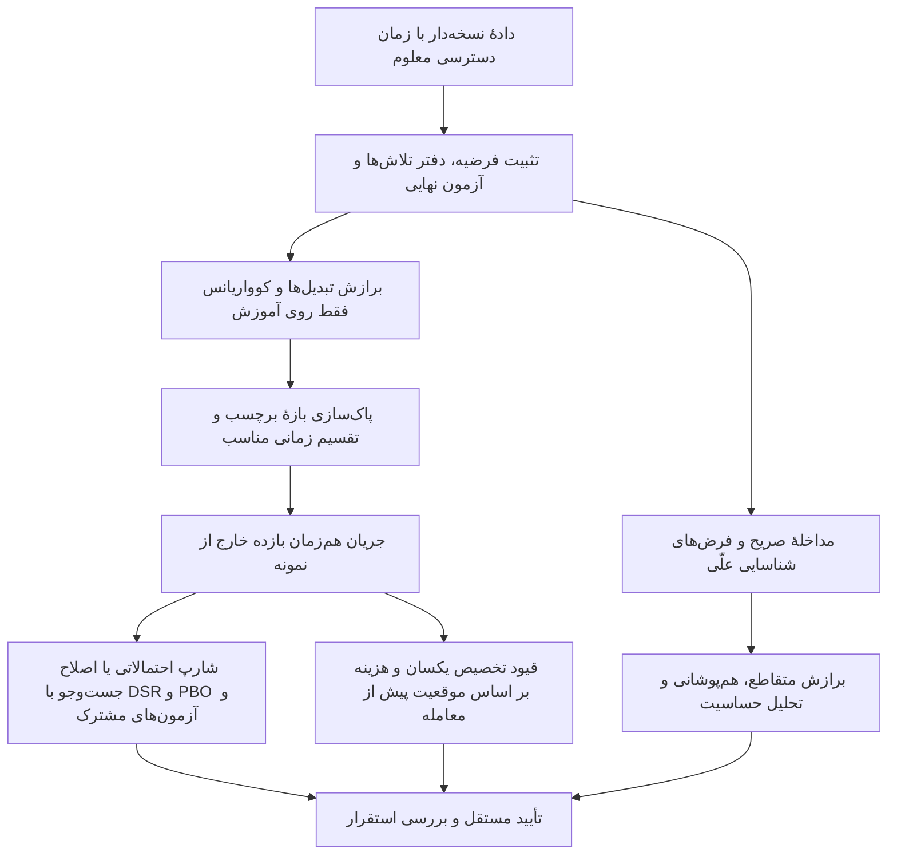

### ۱۸.۲ نسبت‌های PSR و DSR: واحد اندازه‌گیری و سابقهٔ جست‌وجو جزئی از آماره‌اند

فرض کنید بازده مازاد در یک بسامد مشخص اندازه‌گیری شده است. `SRhat` میانگین نمونه تقسیم بر انحراف معیار نمونه، `T` تعداد مشاهدات، `gamma3` چولگی و `gamma4` **کشیدگی پیرسون** است؛ کشیدگی توزیع نرمال در این قرارداد ۳ است، نه صفر. تقریب مجانبی PSR سال ۲۰۱۴، با فرض استقلال و هم‌توزیعی مشاهدات، در پیاده‌سازی مستقل ما چنین است:

$$PSR(SR_0)=\Phi\left(\frac{(\widehat{SR}-SR_0)\sqrt{T-1}}{\sqrt{1-\gamma_3\widehat{SR}+\frac{\gamma_4-1}{4}\widehat{SR}^{2}}}\right).$$

تابع `Phi` تابع توزیع تجمعی نرمال استاندارد است. DSR همین مقایسه را در برابر آستانه‌ای انجام می‌دهد که اثر انتخاب برنده را لحاظ می‌کند. برای بیش از یک تلاشِ مؤثراً مستقل و میانگین صفر تحت فرض صفر، تقریب امید بیشینهٔ شارپ عبارت است از:

$$SR^*_N=s_{SR}\left[(1-\gamma)\Phi^{-1}(1-1/N)+\gamma\Phi^{-1}(1-1/(Ne))\right].$$

در این رابطه، `s_SR` انحراف معیار شارپ‌های تلاش‌ها و `gamma=0.5772156649…` ثابت اویلر–ماسکرونی است. در حالت یک تلاش، تعدیل انتخاب صفر است؛ قرار دادن کورکورانهٔ `N=1` در صدک معکوس نرمال معتبر نیست. DSR یک آمارهٔ مبتنی بر احتمال دنباله است؛ صرفاً کم کردن امید بیشینه از شارپ مشاهده‌شده، «کاهش شارپ بابت انتخاب» است و به‌تنهایی DSR محسوب نمی‌شود. [مقالهٔ اصلی بیلی و لوپز د پرادو، ۲۰۱۴](https://www.davidhbailey.com/dhbpapers/deflated-sharpe.pdf).

همهٔ اجزای رابطه باید در یک بسامد باشند. اگر فقط شارپ مشاهده‌شده سالانه شود، همان جزء تقریباً در ریشهٔ ۲۵۲ ضرب می‌شود و دیگر با بقیهٔ رابطه هم‌واحد نیست. اگر کتابخانه کشیدگی مازاد می‌دهد، باید ابتدا ۳ به آن اضافه کرد. صدها تغییر کوچک و به‌شدت هم‌بستهٔ پارامترها معادل صدها تلاش مستقل نیستند؛ تعداد مؤثر تلاش‌ها به روش تخمین وابسته است. بنابراین تعداد خام، تعداد مؤثر و روش برآورد باید کنار نتیجه بیایند. اصلاح با خودهم‌بستگی مرتبهٔ اول نیز درمان عمومی همهٔ وابستگی‌های زمانی یا تغییر رژیم نیست.

**آزمون اجراشده:** در ۲۵۰ آزمایش مستقل، هر بار ۱۰۰ راهبرد نویزی با بازده نرمالِ میانگین صفر و طول ۲۵۲ جست‌وجو شدند. اگر پس از انتخاب برنده، PSR ساده با آستانهٔ صفر و معیار بیش از ۰٫۹۵ ملاک قرار گیرد، **۲۴۸ بار از ۲۵۰ بار، یعنی ۹۹٫۲٪** نتیجه ظاهراً معنادار شد. با مرجع DSR سال ۲۰۱۴، این تعداد **صفر از ۲۵۰** بود. در یک آزمایش جداگانه با سیگنال قویِ تزریق‌شده، راهبرد درست انتخاب شد و DSR برابر **۰٫۹۹۹۹۹۱** شد.

این آزمایش نشان می‌دهد اصلاح در این مثال در جهت مورد انتظار عمل می‌کند؛ سطح خطای دقیق ۵٪ را اثبات نمی‌کند. حتی صفر رد مشاهده‌شده نیز، با فرض آزمایش‌های مستقل، در اطمینان یک‌طرفهٔ ۹۵٪ با نرخ رد واقعی تا حدود **۱٫۱۹٪** سازگار است. مرجع امید بیشینه در این نمونه می‌تواند محافظه‌کارانه باشد. همچنین در ۲۰ آزمون مستقل با خطای ۵٪، احتمال دست‌کم یک مثبت کاذب `1−.95^20` یا **۶۴٫۱۵٪** است؛ وقوع آن قطعی نیست.

> **تفاوت نسخه‌ها:** در نسخهٔ سنجاق‌شدهٔ `ml4t-diagnostic`، تابع DSR، واریانس شارپ را در آستانهٔ تعدیل‌شده و با جملهٔ خودهم‌بستگی مرتبهٔ اول و ضریب مقیاس وابسته به تعداد تلاش محاسبه می‌کند؛ نویسندگان آن را فرمول سال ۲۰۲۵ معرفی کرده‌اند. این محاسبه با مرجع سادهٔ مستقل و هم‌توزیعِ ۲۰۱۴ که اینجا اجرا شد یکسان نیست. زنجیرهٔ فراخوانی و بخش‌های مربوط خوانده شد؛ استنتاج ریاضیِ ادعاشدهٔ ۲۰۲۵ و اجرای خود بسته هنوز مستقلاً تأیید نشده‌اند. [تابع اصلی در نسخهٔ دقیق](https://github.com/ml4t/diagnostic/blob/6d72655ea704a62e5b473cd3ec12ec37b52a7302/src/ml4t/diagnostic/evaluation/stats/deflated_sharpe_ratio.py)، [تابع واریانس](https://github.com/ml4t/diagnostic/blob/6d72655ea704a62e5b473cd3ec12ec37b52a7302/src/ml4t/diagnostic/evaluation/stats/sharpe_inference.py).

### ۱۸.۳ تفاوت CSCV/PBO با CPCV: ترکیب‌های شبیه، پرسش‌های متفاوت

در CSCV، ابتدا ماتریس `T×N` از بازده یا سودوزیان **هم‌زمان** تمام راهبردهای آزموده‌شده ساخته می‌شود. ردیف‌ها به تعداد زوج `S` بلوک پیوسته تقسیم می‌شوند و تمام `C(S,S/2)` انتخاب مکمل بررسی می‌شوند. در هر نیمهٔ درون نمونه، با معیار از پیش تعیین‌شده یک راهبرد انتخاب می‌شود؛ سپس **همان راهبرد** در نیمهٔ مکمل، میان همهٔ راهبردها رتبه می‌گیرد. اگر رتبهٔ صعودی `r` باشد، با ۱ برای بدترین راهبرد، تعریف عملی مورد استفاده این است:

$$\omega=r/(N+1),\qquad\lambda=\log\{\omega/(1-\omega)\},\qquad\widehat{PBO}=\frac{1}{C(S,S/2)}\sum_c 1\{\lambda_c<0\}.$$

برای تساوی در رتبهٔ خارج از نمونه، رتبهٔ میانگین و برای تساوی در انتخاب درون نمونه، نخستین برنده انتخاب شده است. شرط منفی بودن لگیت نیز سخت‌گیرانهٔ `<0` است؛ استفاده از `<=0` در حضور تساویِ دقیق در میانه نتیجه را تغییر می‌دهد و باید اعلام شود. چارچوب اصلی دربارهٔ **انتخاب میان جریان عملکرد راهبردها** است و به‌خودی‌خود به معنی بازآموزی مدل پیش‌بینی روی هر نیمه نیست. PBO احتمال پسینِ تقلبی بودن راهبرد نیست و آستانهٔ کمتر از ۰٫۵ نیز معیار جهانی پذیرش نیست. [مقالهٔ اصلی PBO، الگوریتم بخش ۲٫۲](https://www.davidhbailey.com/dhbpapers/backtest-prob.pdf).

| دادهٔ مصنوعی مستقل | تعداد بلوک / تقسیم مکمل | PBO مشاهده‌شده | معنای نتیجه |
|---|---:|---:|---|
| ده راهبرد نویزی، یک مجموعه‌دادهٔ تصادفی | ۸ / ۷۰ | ۰٫۳۸۵۷ | انتظار نداریم هر نمونهٔ تصادفی دقیقاً ۰٫۵ بدهد |
| سیگنال قوی و پایدار | ۸ / ۷۰ | ۰٫۰۰۰۰ | راهبرد واقعاً غالب، در هر دو نیمه خوب می‌ماند |
| دو راهبرد با وارونگی مزیت در نیمهٔ زمان | ۸ / ۷۰ | ۰٫۸۲۸۶ | انتخاب مطلوب درون نمونه، غالباً در مکمل ضعیف است |

در مقابل، CPCV مدل‌ها را روی تمام `C(N,k)` انتخابِ `k` گروه آزمون برازش می‌کند و از آن‌ها `phi = k*C(N,k)/N = C(N−1,k−1)` مسیر می‌سازد. برای شش گروه و دو گروه آزمون، ۱۵ تقسیم برازش و ۵ مسیر حاصل می‌شود. این مسیرها داده و مدل مشترک دارند؛ پنج مسیر، پنج تاریخ مستقل نیستند.

همچنین در CPCV ممکن است برای آزمودن یک دورهٔ تنش قدیمی، از مشاهدات پس از آن دوره در آموزش استفاده شود. این کار پرسش تعمیم به سناریو را بررسی می‌کند و شبیه‌سازیِ آنچه در همان تاریخ قابل استقرار بود نیست؛ بخش ۱۲٫۳ AFML این تفاوت را صریح توضیح می‌دهد. برای ادعای عملکرد تاریخی قابل اجرا، آزمون پیش‌روندهٔ زمانی با رعایت زمان دسترسی ویژگی و پایان برچسب لازم است. تنظیم مکرر مدل با نگاه به نتیجهٔ هرکدام از این ارزیابی‌ها نیز دوباره سوگیری انتخاب ایجاد می‌کند.

### ۱۸.۴ پاک‌سازی برچسب، عمل روی بازه است؛ فاصلهٔ حفاظتی سیاست اضافه‌ای برای وابستگی است

هر برچسب بازهٔ اطلاعاتی `[t0_i,t1_i]` دارد، نه فقط یک تاریخ روی ردیف. در قرارداد بازهٔ بستهٔ این آزمایش، هم‌پوشانی آموزش و آزمون دقیقاً هنگامی رخ می‌دهد که:

$$t0_{train}\le t1_{test}\quad\text{و}\quad t0_{test}\le t1_{train}.$$

اگر فقط آغاز برچسب آموزش کنترل شود، برچسبی که **کل بازهٔ آزمون را در خود می‌گیرد** جا می‌افتد. نامساوی سخت نیز ممکن است اشتراک در نقطهٔ مرزی را نادیده بگیرد. در قرارداد بازهٔ نیمه‌باز باید منطق مقایسه به‌طور هماهنگ تغییر کند. در دادهٔ چنددارایی نیز اطلاعات بازار مشترک است؛ پاک‌سازی جداگانهٔ هر نماد لزوماً کافی نیست.

| بازهٔ آموزش در برابر آزمون `[10,20]` | حذف بابت هم‌پوشانی؟ | حذف با فاصلهٔ حفاظتی سه‌واحدی پس از آزمون؟ |
|---|---|---|
| `[0,9]` | خیر | خیر |
| `[2,10]`، `[0,30]`، `[12,13]`، `[20,25]` | بله؛ شامل تماس مرزی و دربرگرفتن کامل | پیش‌تر حذف شده است |
| `[21,22]` | خیر | بله |
| `[24,25]` | خیر | خیر |

همهٔ انتظارات این جدول با گزاره‌های کنترلی برنامه تأیید شدند. این آزمون مرجع بازه‌ای است، نه اجرای تقسیم‌کنندهٔ ML4T. اندازهٔ فاصلهٔ حفاظتی باید با ماندگاری اطلاعات و طول نگاه‌به‌عقب ویژگی سازگار باشد؛ یک درصد ثابت از ردیف‌ها تضمین عمومی نیست. مقیاس‌بندی، جای‌گذاری مقدار گمشده، انتخاب ویژگی، برازش کوواریانس و انتخاب ابرپارامتر نیز باید داخل مرز آموزش انجام شوند. پاک‌سازی برچسب، مقیاس‌سازی‌ای را که روی کل داده برازش شده است اصلاح نمی‌کند.

### ۱۸.۵ آزمون Reality Check و SPA: زیان‌ها را مشترک و وابستگی را حفظ کنید

تعریف کنید `d[k,t] = benchmark_loss[t] − model_loss[k,t]`؛ پس مقدار مثبت به نفع مدل است. فرض صفر مشترک می‌گوید **برای همهٔ مدل‌ها** `E[d_k]≤0`، یا معادل آن `max_k E[d_k]≤0`. جابه‌جا نوشتن کمینه و بیشینه بر حسب زیان خام می‌تواند معنای فرض را عوض کند.

آمارهٔ خام وایت، بیشینهٔ میانگین بهبود زیان را می‌سنجد. SPA هانسن آن را بر خطای معیار تقسیم می‌کند و برای مدل‌های بسیار ضعیف، مرکز توزیع بازنمونه‌گیری را متفاوت تعیین می‌کند. مقاله برای بردار **تفاوت زیان**، ایستایی، اختلاط، وجود گشتاورهای کافی و واریانس مثبت فرض می‌کند؛ دربارهٔ استثنای مدل‌های تو‌در‌توی با تخمین بازگشتی نیز بحث دارد. این شروط در دادهٔ مالی صرفاً جزئیات فنی نیستند. [نسخهٔ اصلی مقالهٔ هانسن، ۲۰۰۵](https://www.ssc.wisc.edu/~bhansen/papers/spa.pdf).

بوت‌استرپ ایستا از دنباله‌هایی با طول تصادفی استفاده می‌کند؛ امید طول بلوک `ell` و احتمال شروع بلوک جدید `1/ell` است. **شاخص‌های بازنمونه‌گیری باید میان تمام راهبردها مشترک باشند** تا وابستگی هم‌زمان حفظ شود؛ بازنمونه‌گیری مستقل هر ستون، آزمایش جست‌وجوی اصلی را تغییر می‌دهد. در مرکزگذاری سازگار SPA، میانگین منفیِ مدل‌های به‌اندازهٔ کافی ضعیف حفظ می‌شود؛ مرز تشخیص با `−SE_k*sqrt(2 log log T)` تعیین می‌شود و هدف آن کاهش تأثیر گزینه‌های بسیار بد بر آزمون است.

پیاده‌سازی آموزشی این بررسی از برآوردگر HAC با هستهٔ بارتلت و وقفهٔ ۱۰، خطای معیار ثابتِ کل نمونه، ۹۹۹ بوت‌استرپ ایستای مشترک و مقدار احتمال `(1+exceedances)/(B+1)` استفاده می‌کند. خروجی بیشینهٔ بدون استانداردسازی، «مرجع Reality Check وایت» و خروجی استانداردشده صریحاً **گونهٔ آموزشی SPA** نامیده شده است؛ خروجی دقیق بستهٔ `arch` نیست.

در مثال دارای سیگنال قوی، هر دو مقدار احتمال **۰٫۰۰۱** شدند؛ این کف تفکیک بازنمونه‌گیری متناهی است و نباید صفر نوشته شود. در مثال نویزی، مقدار RC برابر **۰٫۹۱۳** و گونهٔ SPA برابر **۰٫۷۴۷** شد. با افزودن صد مدل بسیار بد، نتیجهٔ سیگنال قوی در همان کف باقی ماند؛ این حالت اشباع‌شده، مزیت عمومی توان یک آزمون را اثبات نمی‌کند. سنجش حساسیت به طول بلوک و تکرار مونت‌کارلو برای اندازه و توان همچنان لازم است.

> **دام نام API:** در نسخهٔ دقیق `arch` با شناسهٔ `cd31bc2…`، کلاس `RealityCheck` یک زیرکلاس خالی از `SPA` است؛ صرف تغییر نام کلاس، دو روش آماری متفاوت اجرا نمی‌کند. کد بررسی‌شدهٔ SPA در هر بازنمونه خطای معیار را دوباره برآورد می‌کند، درحالی‌که مرجع سبک این بخش خطای معیار ثابت دارد. نام روش، نسخه و تنظیمات باید با هم ثبت شوند. [کد سنجاق‌شده](https://github.com/bashtage/arch/blob/cd31bc2e524a9cc128ffb6199633cf507ab24c65/arch/bootstrap/multiple_comparison.py)، [مثال‌های رسمی](https://bashtage.github.io/arch/multiple-comparison/multiple-comparison_examples.html).

### ۱۸.۶ استنباط علّی: پیش از انتخاب تخمین‌گر، مداخله را بنویسید

برای مداخلهٔ دودویی `D`، متغیرهای پیش از مداخله `X` و پیامد `Y`، اثر متوسط مداخله یا ATE برابر `E[Y(1)−Y(0)]` است. تحت سازگاری تعریف مداخله و پیامد، تبادل‌پذیری شرطی `(Y(0),Y(1)) independent of D | X` و شرط هم‌پوشانی `0<P(D=1|X)<1`، می‌توان آن را از `E_X[m1(X)−m0(X)]` شناسایی کرد. این‌ها فرض‌های **شناسایی** هستند؛ امتیاز پیش‌بینی بالا همهٔ آن‌ها را آزمون نمی‌کند. نمودار علّی نیز دفتر فرض‌هاست، نه شاهدی که درستی پیکان‌ها را ثابت کند.

فرمول تخمین افزوده با وزن‌دهی معکوس احتمال، یا AIPW، تفاوت برآورد مدل‌های کمکی با شناسایی اثر علّی را روشن می‌کند:

$$\widehat\tau=\frac1n\sum_i\left[\widehat m_1(X_i)-\widehat m_0(X_i)+\frac{D_i\{Y_i-\widehat m_1(X_i)\}}{\widehat e(X_i)}-\frac{(1-D_i)\{Y_i-\widehat m_0(X_i)\}}{1-\widehat e(X_i)}\right].$$

در اینجا `e(X)` احتمال دریافت مداخله و `m0,m1` مدل‌های پیامدند. با برقرار بودن فرض‌های شناسایی، هم‌پوشانی و شروط منظم، درست بودن یکی از مدل احتمال مداخله یا مدل‌های پیامد می‌تواند برای سازگاری کافی باشد. این ویژگی «مقاومت دوگانه» به معنی جبران مخدوش‌گرِ پنهان به‌کمک دو مدل غلط نیست.

برای مدل‌های کمکی انعطاف‌پذیر، برازش متقاطع لازم است تا باقی‌مانده‌ها روی همان نمونهٔ آموزش بیش‌برازش نشوند. وابستگی زمانی و چندداراییِ مالی، علاوه بر آن به تقسیم بلوکی و استنباط مناسب نیاز دارد؛ کد تقسیم تصادفی با فرض استقلال را نباید بی‌تغییر منتقل کرد. امتیاز متعامد، حساسیت به خطای تخمین مدل‌های کمکی را کاهش می‌دهد و فرض علّی نادرست را اصلاح نمی‌کند. [مقالهٔ اصلی یادگیری ماشین دوگانه/رفع‌سوگیری‌شده](https://arxiv.org/abs/1608.00060).

در آزمایش مصنوعی با نمودار معلوم `Z→D`، `Z→Y` و `D→Y`، رابطه‌ها چنین بودند: `D=.8Z+noise` و `Y=2D+3Z+noise`. اثر ساختاری واقعی **۲** است. رگرسیون بدون کنترل مخدوش‌گر، **۳٫۴۴۲۴** و رگرسیون با کنترل `Z`، **۱٫۹۹۰۹** به دست داد. این مثال عمداً شناسایی‌پذیر ساخته شده است و شاهد علّیت در بازار نیست.

فصل پنجم روزنبام زبان کمیِ مناسبی برای حساسیت می‌دهد: در یک جفت همتاشده، پارامتر `Gamma≥1` نسبت شانس تخصیص مداخله را به علت سوگیری پنهان محدود می‌کند. در این مدل جفتی، `1/(1+Gamma) ≤ p_j ≤ Gamma/(1+Gamma)`؛ در نتیجه گامای ۲ احتمال‌هایی از یک‌سوم تا دوسوم را مجاز می‌کند. این عدد به معنی «متغیر پنهان ۲۰٪ بازده را توضیح می‌دهد» نیست و اندازهٔ اثر معمولی هم نیست. کران حساسیت، شکنندگی نتیجه را تحت یک مدل مشخص تخصیص بیان می‌کند؛ وجود یا نبود متغیر پنهان را اثبات نمی‌کند.

در کاربرد معاملاتی، سیاست یا مداخلهٔ قابل تغییر، واحد تحلیل، افق پیامد و متغیرهای پیش از مداخله باید مشخص باشند. کنترل میانجی و برخوردگر بر اساس کمیت هدف تعیین می‌شود؛ نباید هر متغیر در دسترس را وارد کرد. تداخل اثر میان مشارکت‌کنندگان بازار و بازخورد مداخله–مخدوش‌گر نیز می‌تواند تحلیل AIPW تک‌دوره‌ای را نامعتبر کند.

### ۱۸.۷ تخصیص سرمایه: برآوردگر، بهینه‌ساز و سیاست بازتنظیم هر سه اثر دارند

سبد کمینه‌واریانسِ بدون فروش استقراضی، مسئلهٔ `min w' Sigma w` با قیود `1'w=1,w≥0` را حل می‌کند. یک جمع‌شدگی ساده به قطر عبارت است از `Sigma_lambda=(1−lambda)S+lambda diag(S)`. مقدار ثابت ۰٫۲ در آزمایش زیر یک انتخاب آموزشی است و برآوردگر بهینهٔ تأییدشده نیست. ترمیم نیمه‌مثبت‌معین بودن ماتریس توسط حل‌گر نیز ثابت نمی‌کند که ماتریس بدون دادهٔ آینده ساخته شده است.

در کد بررسی‌شدهٔ PyPortfolioOpt، تابع `sample_cov` کوواریانس **تمام ردیف‌های ورودی** را محاسبه و سالانه می‌کند؛ تابع `transaction_cost` نیز `k*||w−w_prev||_1` است. در Riskfolio، تابع `assets_stats` گشتاورها را از `self.returns` می‌گیرد و ممکن است کوواریانس را عددی ترمیم کند. هیچ‌یک از این نقاط ورود، تقسیم آموزش/آزمون پژوهشگر را به‌جای او انجام نمی‌دهند. پس داده باید پیش از برآورد بریده شود و همهٔ برازش‌ها داخل پنجرهٔ آموزش بمانند. [کوواریانس در نسخهٔ دقیق PyPortfolioOpt](https://github.com/PyPortfolio/PyPortfolioOpt/blob/a6638d2e06dae6f444fd022cfd4b3c528902a85b/pypfopt/risk_models.py)، [تابع هزینه](https://github.com/PyPortfolio/PyPortfolioOpt/blob/a6638d2e06dae6f444fd022cfd4b3c528902a85b/pypfopt/objective_functions.py)، [کد Riskfolio](https://github.com/dcajasn/Riskfolio-Lib/blob/7b1b26ac9760974c12ecefe290a9d3bd37b66b7a/riskfolio/src/Portfolio.py).

برای هزینه نیز باید وزن **پیش از معامله و پس از تغییر قیمت‌ها** معلوم باشد. گردش یک‌طرفهٔ نیمهٔ L1 با ارزش کل معامله‌شدهٔ L1 دو برابر تفاوت دارد؛ نرخ هزینه باید بگوید بر کدام مبنا اعمال می‌شود.

**آزمون اجراشدهٔ مرز زمانی:** در مثال سه‌دارایی، همهٔ ۲۰۰ ردیف آزمون در هزار ضرب شدند؛ تغییر وزن‌های برآوردشده از آموزش **دقیقاً صفر** بود. وزن روی شبکهٔ یک‌درصدی `[.21,.45,.34]` و کوچک‌ترین مقدار ویژهٔ کوواریانس **۰٫۰۰۰۱۸۳۶۲** بود. این آزمون دست‌کاری آینده، کنترل مفیدی برای این مرز است و همهٔ مسیرهای نشت اطلاعات را رد نمی‌کند.

آزمایش دوم، پنج پیاده‌سازی مستقل نامپای را روی شش دارایی مصنوعی و شرایط مشترک مقایسه کرد: آموزش غلتان ۱۲۰ مشاهده، بازتنظیم هر ۲۰ مشاهده، ۴۸۰ دورهٔ آزمون، بدون فروش استقراضی، سرمایه‌گذاری کامل، جمع‌شدگی ثابت ۰٫۲ و هزینهٔ ۱۰ واحد پایه بر هر واحد ارزش معامله‌شدهٔ کامل L1. در HRP، فاصلهٔ مبتنی بر هم‌بستگی و پیوند میانگین، سپس نصف‌کردن بازگشتی استفاده شد. در NCO، همان خوشه‌بندی در سه خوشه قطع شد و مسئلهٔ کمینه‌واریانس ابتدا درون خوشه‌ها و سپس بین خوشه‌ها حل شد. مسائل کوچک کمینه‌واریانس با شمارش زیرمجموعه‌های فعال حل شدند؛ پیچیدگی این روش نمایی و برای دارایی‌های زیاد نامناسب است. بیشینهٔ نقض قید **۲٫۲۲×۱۰⁻¹⁶** و باقیماندهٔ شرایط KKT برای کمینه‌واریانس **۱٫۳۶×۱۰⁻²⁰** بود.

| تخصیص‌گر مستقل روی دادهٔ مصنوعی | بازده مرکب خالص | شارپ خالص سالانه‌شده | بیشترین افت سرمایه | ارزش کل معامله‌شدهٔ L1 |
|---|---:|---:|---:|---:|
| وزن مساوی | ۱۸٫۷۳٪ | ۰٫۹۶۷ | ۱۳٫۱۱٪− | ۰٫۷۳۳ |
| معکوس واریانس | ۱۷٫۶۸٪ | ۰٫۹۲۴ | ۱۲٫۸۹٪− | ۱٫۵۶۲ |
| کمینه‌واریانسِ بدون فروش استقراضی | ۱۳٫۲۶٪ | ۰٫۷۱۸ | ۱۲٫۹۶٪− | ۲٫۸۵۶ |
| HRP با پیوند میانگین | ۱۸٫۵۵٪ | ۰٫۹۶۳ | ۱۲٫۵۳٪− | ۲٫۵۰۹ |
| NCO با سه خوشه | ۱۵٫۷۵٪ | ۰٫۸۳۲ | ۱۲٫۷۹٪− | ۲٫۸۴۶ |

حتی در این مثال ساده نیز روش پیچیده‌تر برندهٔ همیشگی نیست. این جدول یک شبیه‌سازی با بذر معین و حسابداری تقریبی هزینهٔ خطی است؛ اثر بازار، تأمین مالی، مالیات و ورود اولیه از وجه نقد را ندارد. ارزش آن در یکسان‌کردن شرایط آزمون است و پیش‌بینی بازده آینده نیست.

کدهای قدیمی Python 2 در QuantResearch، شامل CLA و HRP و EF3M، اسناد جداگانه‌اند. حل‌گر فعال‌مجموعه و HRP/NCO مستقل این بررسی، **انتقال کامل همهٔ اسکریپت‌های اصلی به پایتون جدید یا بازتولید جدول‌های آن‌ها نیست**. کنترل‌های نحو و دادهٔ نمونهٔ ثبت‌شده در بخش ۱۶ نیز فقط در محدودهٔ همان ثبت معتبرند.

**مقایسهٔ عددی کد قدیمی؛ قلم ۱۱ صف پژوهش:** تمام بدنهٔ ذخیره‌شدهٔ `HRP.py.txt` خوانده شد. تابع اصلی، ماتریس مربع فاصلهٔ هم‌بستگی را مستقیم به `linkage(...,'single')` می‌دهد. SciPy میان بردار فشردهٔ فاصله‌ها و آرایهٔ دوبعدیِ بردارهای مشاهده تفاوت می‌گذارد. برای سنجش اثر این تفاوت، پیوند تکی به‌صورت مستقل برای دو هندسه پیاده شد: فاصله‌های مستقیم `D_ij=sqrt((1−rho_ij)/2)` و فاصلهٔ اقلیدسی میان ردیف‌های `D`. در نخستین مثال شش‌دارایی با کوواریانس مثبت‌معین و بذر ۲۰۲۶۱۰۲۲، ترتیب برگ‌ها به‌ترتیب `[0,5,2,4,1,3]` و `[0,2,4,5,1,3]` شد. با تخصیص بازگشتی یکسان، مجموع قدرمطلق اختلاف وزن‌ها **۰٫۴۸۶۶۲۲** و وزن دارایی اول **۴۵٫۹۳٪** در برابر **۶۷٫۳۵٪** شد.

این مثال مشخص می‌کند که تغییر ظاهراً سادهٔ قرارداد ورودی، می‌تواند وزن سبد را عوض کند؛ تعیین نمی‌کند کدام هندسه مقصود روش اصلی است. آن انتخاب باید صریحاً با مقاله تطبیق داده شود. تابع اصلی Python 2 و خود SciPy اجرا نشدند و انتقال کامل CLA/EF3M و جدول‌های اصلی باز مانده است. [قرارداد رسمی ورودی SciPy](https://docs.scipy.org/doc/scipy/reference/generated/scipy.cluster.hierarchy.linkage.html)، [نشانی کد اصلی HRP؛ بدنهٔ ذخیره‌شدهٔ U0417 موجود است](https://quantresearch.org/HRP.py.txt).

### ۱۸.۸ اعتبارسنجی مولد باید حفظ‌کردن داده و انتخاب مدل را آشکار کند

در کنترل منفی اجراشده، «مولد» فقط نمونه‌های آموزش را عیناً کپی کرد. خطای میانگین‌های حاشیه‌ای و کوواریانس **صفر** شد، اما **۱۰۰٪** نمونه‌ها همسایهٔ دقیقِ یک نمونهٔ آموزش بودند. در نمونهٔ مستقل آزمون، تکرار دقیق آموزش **صفر درصد** بود. بنابراین انطباق چند واقعیت آماری می‌تواند یک حافظهٔ کپی‌کننده را هم تأیید کند.

ارزیابی کامل باید یک دورهٔ آزمون را ثابت نگه دارد، مولد را فقط روی گذشته آموزش دهد و علاوه بر توزیع‌های حاشیه‌ای، دنباله‌ها، خوشه‌بندی نوسان، وابستگی بین دارایی‌ها و دنباله‌ها، طول رژیم‌ها و آزمون‌های نزدیک‌ترین همسایه/عضویت را بررسی کند. سپس راهبردهای از پیش ثابت باید هم روی دادهٔ مولد و هم روی دادهٔ واقعیِ دست‌نخوردهٔ خارج از نمونه ارزیابی شوند. بازآموزی یا انتخاب مولد با نگاه به همان دورهٔ آزمون، تلاش پژوهشی جدید مصرف می‌کند. در این بخش شبکهٔ GAN آموزش داده نشد.

### ۱۸.۹ قراردادهای واقعی مخزن‌های ML4T و میان‌برهای گمراه‌کننده

| منبعِ سنجاق‌شده | محدودهٔ واقعاً خوانده‌شده | نتیجهٔ عملی |
|---|---|---|
| `ml4t-data` | قسمت‌های مشخص `prepare_adjusted_history` و تمام `select_revisions` | مقدار `as_of=None` صریحاً بازنگری نهاییِ پس‌نگر را می‌خواهد. با زمان قطع علّی، انتخاب بازنگری در پایین‌دست، دسترسی نامعلوم و بازنگری مبهم را رد می‌کند. فیلتر میانیِ ظاهراً آسان‌گیر، به‌تنهایی دلیل نشت نیست. |
| `ml4t-engineer` | پوشش عمومی برچسب سه‌مانعی، خطوط ۴۵۰ تا ۵۷۴ | پیکربندی صریح، مرتب‌سازی پنل و تعیین ستون زمان/گروه دارد. طبق قرارداد مستند، اگر یک کندل هر دو مانع را بزند، توقف/مانع پایین مقدم است و شکاف بازگشایی ممکن است در قیمت باز اجرا شود. برچسب، اثبات امکان پرشدن سفارش نیست؛ همهٔ هسته‌های داخلی بررسی نشده‌اند. |
| `ml4t-diagnostic` | زنجیرهٔ DSR و تابع واریانس مربوط | بسامد بومی، گشتاورها، آستانه و روش تعداد مؤثر تلاش باید همراه نتیجه باشند؛ ادعای فرمول ۲۰۲۵ هنوز اعتبارسنجی مستقل می‌خواهد. |
| `ml4t-models` | فقط قراردادهای README | پنل پایدار، مقطع، استخراج عامل، پیش‌بینی صرف عامل و نگاشت به دارایی را جدا می‌کند. «وفاداری به مقاله» ادعای نویسنده است تا معادله، آموزش و بازتولید بررسی شوند. |
| `ml4t-specs` | فقط توضیح انواع مشترک در README | طرح‌واره می‌تواند معناشناسی زمان، داده و اجرا را منتقل کند؛ صحت واقعی تاریخ‌ها یا فرض‌های اقتصادی را اثبات نمی‌کند. |
| `ml4t-skills` | دو فایل بیش‌برازش بک‌تست و شناسایی علّی | راهنمای عملی‌اند، نه مرجع نهایی علم. پنج سال دادهٔ لازم برای همه، شارپ بالاتر از ۲ به‌عنوان نشانهٔ قطعی نشت، هم‌بستگی ثابتِ برخوردگر و درصد ثابت حساسیت، قضیهٔ عمومی نیستند؛ به اندازهٔ اثر، وابستگی و سازوکار داده بستگی دارند. |

### ۱۸.۱۰ مرز مطالعه و تکمیل

عنوان هر ۲۲ فصل AFML نگاشت شد. در این نوبت، متن استخراج‌شدهٔ فصل ۷ و بخش‌های منتخب ۱۱٫۱ تا ۱۱٫۶، ۱۲٫۱ تا ۱۲٫۴٫۳ و بخشی از ۱۲٫۵ خوانده شد. **تمام تصویرهای معادله و کد EPUB بررسی نشدند.** از روزنبام، قسمت منتخب فصل پنجم در صفحات PDF ۱۰۴ تا ۱۱۶ و خلاصهٔ فصل‌به‌فصلِ پس‌گفتار خوانده شد؛ از فاکوره، بازه‌های دقیق منتخب در فصل‌های ۳، ۵ و ۷؛ از کانینگهام و نسخهٔ ارسالی What If سال ۲۰۲۰، در این نوبت فقط فهرست و نسخه نگاشت شد. این‌ها برچسب‌های تکمیل متفاوت دارند.

مطالعهٔ کامل همهٔ کتاب‌ها، اجرای دقیق بسته‌های arch و پرتفوی، بررسی استنتاج DSR سال ۲۰۲۵، انتقال کامل CLA/EF3M و اعتبارسنجی با دادهٔ واقعی بازار همچنان در دفتر ثبت باز هستند. موجود بودن متن استخراج‌شده، هیچ‌یک از این کارها را خودبه‌خود کامل نمی‌کند.


## ۱۹. پژوهش اجرای معامله: قراردادهای دقیق، مثال‌های بازتولیدپذیر و انتخاب مخزن‌ها

> **دامنهٔ واقعی این بررسی — ۲۱ اکتبر ۲۰۲۶:** نسخهٔ مشخص ۱۸ مخزن و فایل مجوز آن‌ها ثبت شد؛ در ۱۶ مخزن مسیرهای منتخب پیاده‌سازی خوانده شد و دو کیت قدیمی/موازی Polymarket فقط در سطح دریافت نسخه و مجوز باقی ماندند. ۲۵ بررسی آفلاین موفق بود. این نتیجه، برابری کامل موتورهای LEAN، ‏vectorbt، ‏Qlib و Freqtrade، ممیزی تمام مخزن‌ها یا مطالعهٔ کامل کتاب‌ها نیست. فایل `evidence.json` مسیر، محدودهٔ خطوط، هش، آزمون و کار باقی‌ماندهٔ هر منبع را جداگانه ثبت می‌کند.

### ۱۹.۱ پیش‌بینی چه زمانی به معاملهٔ قابل اجرا تبدیل می‌شود؟

یک راهبرد چند ساعت متفاوت دارد: زمان رخداد در صرافی، دریافت محلی، قابل‌استفاده‌شدن ویژگی، تصمیم، ارسال و تأیید سفارش، هر اجرای جزئی و تطبیق نهایی حساب. برچسب «۱۰:۰۰» روی کندل ممکن است آغاز یا پایان بازه را نشان دهد. اگر ویژگی از قیمت بسته‌شدن کندل ساخته شود اما خرید در قیمت بازشدن همان کندل انجام گیرد، تصمیم از آینده خبر دارد. جابه‌جایی سادهٔ سیگنال به ردیف بعد نیز کافی نیست؛ مظنه ممکن است کهنه باشد یا ارائه‌دهنده دادهٔ تاریخی را بعداً اصلاح کرده باشد.

قرارداد پژوهش باید دقیقاً بگوید کدام فیلد در چه زمانی در دسترس است، سفارش چه نوع و جهتی دارد، مقدار آن با چه واحدی بیان می‌شود، چه گردکردن و محدودیت موجودی اعمال می‌شود، هزینه و لغزش چگونه محاسبه می‌شوند و باقیماندهٔ سفارش چه سرنوشتی دارد. برای دارایی نقدی با ضریب قرارداد یک، هویت پایهٔ حسابداری چنین است:

$$q_{t+1}=q_t+sQ,\qquad C_{t+1}=C_t-sQP-F$$

در این رابطه، خرید با علامت مثبت و فروش با علامت منفی، مقدار اجرا با $Q$، قیمت با $P$ و هزینه با $F$ نمایش داده شده است. در قرارداد آتی، ضریب قرارداد، وجه تضمین و تسویه باید جداگانه مدل شوند. درست‌بودن حساب نقدی، درستی وجه تضمین یا تسویهٔ روزانهٔ مشتقه را ثابت نمی‌کند.

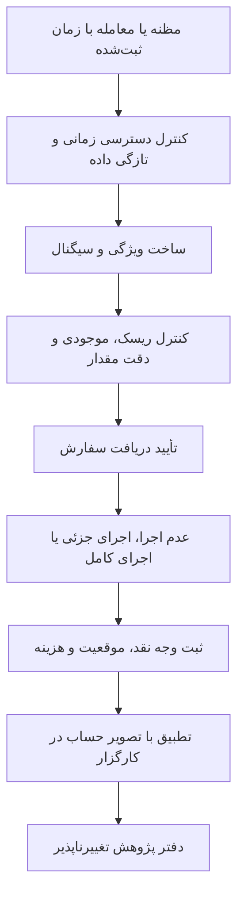

### ۱۹.۲ یک مثال مشترک که می‌توان نتیجه‌اش را با دست کنترل کرد

فایل `fixture.json` موجودی اولیهٔ ۱۰۰۰، دارایی نقدی بدون استقراض و کارمزد **صرفاً آموزشیِ یک درصد** از ارزش هر اجرای معامله را مشخص می‌کند. این نرخ، تعرفهٔ واقعی هیچ صرافی نیست. سیگنال پیش از اجرا در دسترس است. مقدار و قیمت ثابت‌اند تا حسابداری از کیفیت پیش‌بینی جدا شود.

| حالت | رخداد دقیق | نتیجهٔ مورد انتظار |
|---|---|---|
| ورود پایه | خرید ۲ واحد در قیمت ۱۰۱؛ هزینهٔ ۲٫۰۲ | وجه نقد ۷۹۵٫۹۸ و موقعیت ۲ |
| خروج پایه | فروش ۲ واحد در قیمت ۱۰۳؛ هزینهٔ ۲٫۰۶ | وجه نقد ۹۹۹٫۹۲، موقعیت صفر و مجموع هزینهٔ ۴٫۰۸ |
| کمبود موجودی | موجودی ۱۵۰؛ درخواست ۲ واحد در قیمت ۱۰۱؛ هزینهٔ یک درصد؛ مقدار صحیح | حداکثر یک واحد؛ در صورت مجازبودن کاهش اندازه، وجه نقد ۴۷٫۹۹ |
| ابهام کندل | ۲ واحد از قبل در قیمت ۱۰۰ خریداری شده؛ باز/بیشینه/کمینه/بسته برابر ۱۰۰/۱۱۰/۹۰/۱۰۲؛ حد زیان ۹۵ و هدف ۱۰۵ با لغو متقابل | اگر هدف زودتر لمس شود: ۱۰۰۵٫۹۰؛ اگر حد زیان زودتر برسد: ۹۸۶٫۱۰ |
| عمق ناکافی با اجرای فوری و لغو باقیمانده | خرید ۱۰ واحد؛ فقط ۲ واحد فروش در ۱۰۱ و ۳ واحد در ۱۰۲ | اجرای ۵، ارزش ۵۰۸، هزینهٔ ۵٫۰۸، وجه نقد ۴۸۶٫۹۲ و لغو ۵ واحد |
| همان عمق با الزام اجرای کامل فوری | همهٔ ۱۰ واحد باید فوراً قابل اجرا باشند | اجرای صفر، هزینهٔ صفر و موجودی ۱۰۰۰ |

دو مسیر `۱۰۰ ← ۱۱۰ ← ۹۰ ← ۱۰۲` و `۱۰۰ ← ۹۰ ← ۱۱۰ ← ۱۰۲` را در معنای توالی زمانیِ اعداد در نظر بگیرید؛ برای رفع ابهام جهت نوشتار، مسیر اول «بازشدن، بیشینه، کمینه، بسته‌شدن» و مسیر دوم «بازشدن، کمینه، بیشینه، بسته‌شدن» است. هر دو همان کندل را می‌سازند. در مسیر اول، هدف ۱۰۵ اجرا و سفارش حد زیان لغو می‌شود؛ در مسیر دوم، حد زیان ۹۵ اجرا و هدف لغو می‌شود. اختلاف ۱۹٫۸۰ ناشی از فقدان اطلاعات ترتیب رخدادهاست. موتور کندلی باید فرض خود را اعلام کند، دادهٔ ریزتر را بازپخش کند یا بازهٔ نتیجه ارائه دهد؛ ترتیب واقعی از چهار عدد قابل بازیابی نیست.

در مثال عمق، میانگین وزنی قیمت اجرای پنج واحد برابر ۱۰۱٫۶ است. اجرای ده واحد در بهترین قیمت ۱۰۱، نقدشوندگی‌ای را وارد آزمایش می‌کند که در دفتر سفارشِ داده‌شده وجود ندارد. حتی این مثال دقیق نیز نقدشوندگی پنهان، ورود سفارش تازه، لغوها، مسیریابی و تأخیر را مدل نمی‌کند.

### ۱۹.۳ تفاوت‌هایی که در کد واقعی پیدا شد

پیوندهای جدول به نسخهٔ ثابتِ بررسی‌شده اشاره می‌کنند. «مدل پایه» با تمام مدل‌های تخصصی یک چارچوب یکسان نیست.

| موتور یا جزء | قرارداد مشاهده‌شده در کد | اثر بر تفسیر پژوهش |
|---|---|---|
| [مدل پایهٔ LEAN](https://github.com/QuantConnect/Lean/blob/de116c0de654108bc9b3bcb643571ab0b754cbb4/Common/Orders/Fills/FillModel.cs) | داده‌ای که پایانش هم‌زمان یا پیش از سفارش باشد در مسیر سفارش محدود پذیرفته نمی‌شود؛ خرید به کمینهٔ **کمتر از** قیمت محدود و فروش به بیشینهٔ **بیشتر از** آن نیاز دارد؛ در این مسیر تمام مقدار سفارش اجرا می‌شود. `ImmediateFillModel` از مدل پایه ارث می‌برد. | لمس دقیق قیمت و برابری زمان، حالت مرزی‌اند. این مسیر مقدار را با عمق دفتر محدود نمی‌کند؛ نتیجه را به همهٔ انواع دارایی تعمیم ندهید. |
| [توابع خریدوفروش vectorbt](https://github.com/polakowo/vectorbt/blob/dd8eb3a3fe9ed918b1cdaf177455759ae4ac68cb/vectorbt/portfolio/nb.py) | لغزش نامساعد ضربی، هزینهٔ درصدی و ثابت، گام مقدار، محدودیت وجه نقد و انتخاب کاهش جزئی اندازه یا رد سفارش. | سیگنال برابر الزاماً مقدار برابر تولید نمی‌کند. این توابع صف سطح دوم را بازسازی نمی‌کنند. ترتیب استفاده از وجه نقد مشترک و زمان‌بندی سیگنال به آزمون جدا نیاز دارد. |
| [صرافی شبیه‌سازی Qlib](https://github.com/microsoft/qlib/blob/54355232463878d2eebb91fe0ee5fa7fa1f5976c/qlib/backtest/exchange.py) | محدودکردن مقدار با حجم، گردکردن واحد معامله، محدودیت موجودی/موقعیت و هزینهٔ بزرگ‌ترِ «هزینهٔ نسبی» و «حداقل هزینه». نسبت اثر بازار برابر `impact_cost*(trade_value/total_trade_value)^2` است. | حداقل هزینه و تعدیل واحد معامله می‌توانند مزیت ظاهری را حذف کنند. توضیح خود کد هشدار می‌دهد که محدودیت‌های بعدی موجودی ممکن است اثر بازار را بیش‌برآورد کنند. موتور کامل Qlib اینجا اجرا نشد. |
| [محاسبهٔ خروج توقف در Freqtrade](https://github.com/freqtrade/freqtrade/blob/0db79d391f646eafbdf3c0976dd55dc90b296522/freqtrade/optimize/backtesting.py) | قیمت توقف/تسویهٔ اجباری، شکاف نسبت به کران کندل، اهرم و فرض بدبینانه برای توقف متحرک در کندل ورود را لحاظ می‌کند. | بازده بسته‌به‌بسته جایگزین این سیاست اجرا نیست. مطالعهٔ این تابع، تقدم همهٔ انواع خروج در کل موتور را ثابت نمی‌کند. |
| [محیط سهام FinRL](https://github.com/AI4Finance-Foundation/FinRL/blob/c0018c25de864157dc8470f0047b0d10ec721715/finrl/meta/env_stock_trading/env_stocktrading.py) | قیمت از وضعیت جاری، هزینهٔ مختص دارایی و مقدار قابل خرید گرفته می‌شود. `step` کنش را در `hmax` ضرب و صحیح می‌کند؛ فروش‌ها پیش از خریدها انجام و سپس روز/وضعیت جلو برده می‌شود. | خروجی پیوستهٔ سیاست، اندازهٔ نهایی سفارش نیست. استفاده از ویژگیِ قیمت بسته‌شدن همان وضعیت باید قرارداد علّی صریح داشته باشد. آزمون دو تابع، چرخهٔ پاداش و وضعیت Gym را پوشش نمی‌دهد. |
| [شرط‌های اجرای ml4t](https://github.com/ml4t/backtest/blob/da223f904cfa03744152311e3c617c15fdc1ddcd/src/ml4t/backtest/core/fill_engine.py) | سفارش محدود خرید با `low<=limit` فعال می‌شود؛ توقف فروش نیز برابری را می‌پذیرد و هنگام عبور شکافی از توقف، قیمت بازشدن را به کار می‌گیرد. | لمس دقیق قیمت با مدل پایهٔ منتخب LEAN تفاوت دارد. این اختلاف سیاست است؛ با تلرانس عددی حل نمی‌شود. |
| [ثبت اجرای ml4t](https://github.com/ml4t/backtest/blob/da223f904cfa03744152311e3c617c15fdc1ddcd/src/ml4t/backtest/execution/fill_executor.py) | سقف مشارکت اختیاری، اثر بازار، لغزش، هزینه، میانگین وزنی اجرای تجمعی، باقیماندهٔ جزئی، ضریب قرارداد، نگهداشت وجه تسویه و لغو سفارش هم‌گروه پس از اجرای کامل. | وجود قابلیت با پیکربندی واقع‌گرایانه یکسان نیست. اجرای جزئی و سفارش‌های محافظ نیازمند بازپخش چرخهٔ عمرند. |
| [مدل‌های اجرای NautilusTrader](https://github.com/nautechsystems/nautilus_trader/blob/e88439b64dfe818e395401b8baef7a79b874ca68/crates/execution/src/models/fill.rs) | احتمال پیش‌فرض اجرای محدود یک و لغزش صفر است و مدل پایه به منطق استاندارد دفتر واگذار می‌کند. `BestPriceFillModel` نقدشوندگی مصنوعیِ «نامحدود» می‌سازد و اجرای داخل فاصلهٔ خریدوفروش را مجاز می‌کند؛ مدل سفارشی می‌تواند دفتر خودش را برگرداند. | نام چارچوب واقع‌گرایی را تعیین نمی‌کند؛ نوع دفتر و مدل واقعی باید ثبت شود. نقدشوندگی مصنوعی برای ادعای ظرفیت مناسب نیست. موتور Rust اینجا ساخته و اجرا نشد. |

[آزمون مقایسهٔ چند موتور در ml4t](https://github.com/ml4t/backtest/blob/da223f904cfa03744152311e3c617c15fdc1ddcd/tests/contracts/test_cross_engine_contracts.py) سناریوهایی در برابر vectorbt، ‏Backtrader و Zipline دارد، اما اگر وابستگی‌ها نباشند یا متغیر `ML4T_COMPARISON_INPROC` برابر `1` نباشد، آزمون رد می‌شود و اجرا نمی‌گردد. وجود فایل آزمون یا سبزبودن گردش کاری با آزمون‌های اجرا‌نشده، بازتولید برابری روی این سیستم را ثابت نمی‌کند.

### ۱۹.۴ بررسی موفق دقیقاً چه چیزی را ثابت می‌کنند؟

اسکریپت `verify_contracts.py` بدنهٔ توابع منتخب اصلی را از درخت نحوی پایتون استخراج می‌کند، پوشش‌های اجرایی را کنار می‌گذارد و وابستگی‌های محدودِ مثال را فراهم می‌کند؛ محاسبات بدنه بازنویسی نشده‌اند. توابع اصلی خریدوفروش vectorbt، دو تابع معاملهٔ FinRL و تابع شبیه‌ساز Fincept موجودی نهایی ۹۹۹٫۹۲ را بازتولید کردند. در شبیه‌ساز Fincept، سیگنال ردیف صفر در ردیف یک وارد و سیگنال ردیف یک در ردیف دو خارج شد. سه بررسی ml4t، لمس مساوی، لمس‌نشدن حد و توقف ۹۵ با بازشدن شکافی ۹۰ را کنترل کردند. ماژول واقعی دقت اعشاری CCXT برای عدد ۱٫۲۳۴۹ و گام ۰٫۰۰۱، با قطع اعشار خروجی ۱٫۲۳۴ و با گردکردن خروجی ۱٫۲۳۵ داد. سایر بررسی‌ها مرجع مستقلِ حسابداری دقیق برای ابهام کندل و کمبود عمق‌اند.

vectorbt به‌صورت تفسیر پایتون، بدون کامپایل Numba یا حلقهٔ کامل پرتفوی اجرا شد. FinRL وضعیت مصنوعی داشت و آموزش سیاست یا `step` کامل Gym اجرا نشد. Fincept با pandas/numpy و تابع کامل منتخب اجرا شد، اما برنامهٔ Qt، پل دریافت دادهٔ کارگزار و سازندهٔ درخواستِ بالادستی اجرا نشدند. مرجع مستقل با درست‌بودن محاسبات خودش، یک موتور دیگر را تأیید نمی‌کند. این تفکیک، مرز میان بررسی واقعی و ادعای بزرگ‌ترِ اثبات‌نشده است.

### ۱۹.۵ کارگزار، ترمینال و نمودار یک مسئولیت ندارند

[کنترل بودجهٔ Hummingbot](https://github.com/hummingbot/hummingbot/blob/9af100d6822da7d2d0291a906c730ef172284ee2/hummingbot/connector/budget_checker.py) وثیقهٔ فرضی را در میان چند سفارش پیشنهادی قفل می‌کند، مقدار را با موجودی تطبیق می‌دهد و مقدار کاهش‌یافته را به گام مجاز می‌برد؛ بنابراین چند سفارش ظاهراً مستقل، یک موجودی را چند بار مصرف نمی‌کنند. این کنترل وعدهٔ اجرای سفارش نیست. [ردیاب سفارش](https://github.com/hummingbot/hummingbot/blob/9af100d6822da7d2d0291a906c730ef172284ee2/hummingbot/connector/client_order_tracker.py) به‌روزرسانی معامله را به سفارش در حال اجرا می‌دهد و فقط با گزارش تغییر وضعیت رویداد اجرای معامله را فعال می‌کند؛ حذف تکرار در جزء پایین‌دستی در دامنهٔ این خواندن نبود.

[Condor](https://github.com/hummingbot/condor/blob/8e4860fa3d7efd4b55c2b74dd7f1f439e5a4f32c/condor/backtesting.py) کار بک‌تست را به سرویس ارسال می‌کند، وضعیت را می‌پرسد، نتیجهٔ کامل و بدون خطا می‌خواهد و همان بستهٔ نتیجه را ذخیره می‌کند. این مسیر هماهنگ‌کنندهٔ بک‌تست است؛ منطق تطبیق مستقل از آن نتیجه نمی‌شود. [محیط آزمایشی Jesse](https://github.com/jesse-ai/jesse/blob/4fcbcdd500b9cd14ca9bdb142e4f46a34884a1ae/jesse/exchanges/sandbox/Sandbox.py) رکورد سفارش بازار، محدود و توقف را از طریق سرویس سفارش می‌سازد؛ ساختن رکورد، درستی تطبیق بعدی را ثابت نمی‌کند.

[درخواست استاندارد ml4t/live](https://github.com/ml4t/live/blob/04f5fa2b25a0005d1545f2922ba364b3a6683760/src/ml4t/live/orders.py) مقدار نامتناهی یا صفر، ناسازگاری علامت مقدار و جهت صریح، ترکیب نادرست قیمت‌ها و قابلیت اعلام‌نشدهٔ کارگزار را رد می‌کند. نتیجهٔ کارگزار با همان درخواست، حدود اجرای تجمعی و زمان دارای منطقهٔ زمانی کنترل می‌شود. بخش منتخبِ به‌روزرسانی Alpaca کاهش مقدار اجرای تجمعی و اجرای نهایی/جزئی نامعتبر را نمی‌پذیرد. بازیابی پس از خرابی، اتصال مجدد، جلوگیری پایدار از ارسال تکراری و تطبیق حساب هنوز در آزمون یکپارچه اجرا نشده‌اند.

[دقت مقدار در CCXT](https://github.com/ccxt/ccxt/blob/51dfc972cb980ec0ebb3727a1a5306452e8a2a13/python/ccxt/base/exchange.py) با فرادادهٔ بازار اعشار را قطع می‌کند و نتیجهٔ صفر را رد می‌کند. این کنترل با حداقل ارزش سفارش، حداقل مقدار، اهرم و محدودیت اختصاصی صرافی متفاوت است. ارسال دوبارهٔ سفارش پس از بی‌پاسخ‌ماندن درخواست نیز به شناسهٔ تکرارناپذیر و تطبیق وضعیت نیاز دارد؛ وجود ابزار تکرار درخواست کافی نیست.

[دریافت‌کنندهٔ OpenBB](https://github.com/OpenBB-finance/OpenBB/blob/78020ee4b864ab50b8c1f56373877c2b4e7fb623/openbb_platform/core/openbb_core/provider/abstract/fetcher.py) تبدیل پرس‌وجو، استخراج و تبدیل داده به نوع استاندارد یا جریان را جدا می‌کند. آزمون‌های مرحله‌ای نوع، تهی‌نبودن و فیلدها را می‌سنجند؛ درست‌بودن تاریخی اطلاعات در زمان تصمیم را ثابت نمی‌کنند. یکسان‌سازی ارائه‌دهنده، مجوز بازتوزیع، تاریخچهٔ اصلاحات یا پوشش نماد حذف‌شده از بورس را تضمین نمی‌کند.

> **یافتهٔ مهم دربارهٔ نام موتور در رابط:** [ماژول پرتفویِ موسوم به vectorbt در Fincept](https://github.com/Fincept-Corporation/FinceptTerminal/blob/3d8617cae3f13c93874d4bee4fb0f2846e9c83bc/fincept-qt/scripts/Analytics/backtesting/vectorbt/vbt_portfolio.py) شبیه‌ساز مستقل خریدِ صرف با numpy/pandas و رابط‌های سازگار می‌سازد. حد زیان و هدف را روی **قیمت بسته‌شدن** بررسی و در حالت منتخب، کندل بعد اجرا می‌کند. اگر قیمت بازشدن داده نشده باشد، قیمت اجرا می‌تواند به بسته‌شدن برگردد. موقعیت باقی‌مانده در پایان داده با هزینهٔ خروج بسته می‌شود. برچسب vectorbt اثبات استفاده از معنای اجرای کتابخانهٔ اصلی نیست.

در مسیر C++ منتخب Fincept، دادهٔ کارگزار به‌صورت شرطی برای این ارائه‌دهنده وارد می‌شود و در نبود داده، بازگشت به yfinance ممکن است. منشأ داده و زمان این بازگشت باید قابل مشاهده باشد. [رابط سریِ Lightweight Charts](https://github.com/tradingview/lightweight-charts/blob/efa9bd49e8116a33cb0c1dee61c5bef74b8d0dea/src/api/series-api.ts) ترتیب و نوع مقادیر ورودی را کنترل و تغییر داده را منتشر می‌کند؛ آلفا، وجه تضمین، دسترسی زمانی داده یا قیمت اجرای معامله را اعتبارسنجی نمی‌کند. الزامات مجوز و اعلام انتساب نیز هنگام توزیع رابط پابرجا هستند.

### ۱۹.۶ بازار پیش‌بینی: تطبیق سفارش با تسویهٔ نهایی متفاوت است

[سازندهٔ سفارش بازار در SDK جدید پایتون Polymarket](https://github.com/Polymarket/py-sdk/blob/7032ed06175b0bbea77b2d9e898bd9f252af2041/src/polymarket/_internal/actions/orders/market.py) برای خرید، مبلغ وجه و برای فروش، تعداد سهم می‌گیرد؛ FAK و FOK را می‌پذیرد و حفاظت حداکثر/حداقل قیمت و سقف هزینهٔ شامل کارمزد را لحاظ می‌کند. [سازندهٔ پیام ارسال](https://github.com/Polymarket/py-sdk/blob/7032ed06175b0bbea77b2d9e898bd9f252af2041/src/polymarket/_internal/actions/orders/post.py) شرط «فقط سفارش‌گذار» را برای انواع فوری نمی‌پذیرد. هیچ کیف پول یا API سفارش در این بررسی استفاده نشد.

[مستندات رسمی چرخهٔ سفارش](https://docs.polymarket.com/concepts/order-lifecycle) تطبیق بیرون زنجیره، تسویه روی زنجیره و تأیید نهایی را جدا می‌کند: **FOK اجرای کامل فوری یا لغو کامل است؛ FAK مقدار موجود را اجرا و باقیمانده را لغو می‌کند.** وضعیت تطبیق‌یافته هنوز تأیید نهایی تسویه نیست. تأخیر و امکان لغو به بازار وابسته‌اند و باید در ماشین حالت ثبت شوند. نسخهٔ قدیمی `py-clob-client` و SDK موازی TypeScript ثبت شدند، اما برابری رفتار یا صحت مهاجرت میان آن‌ها آزموده نشد.

### ۱۹.۷ ریزساختار بازار: مطالعهٔ گزینشی با اصلاح خطاهای منبع

**حدود مطالعهٔ محلی:** از کتاب *High-Frequency Trading* آلدریج، نسخهٔ دارای حق نشر ۲۰۱۰، صفحات PDF شمارهٔ ۷۵ تا ۸۴، برابر صفحات چاپی ۶۱ تا ۷۰ خوانده شد؛ از *Trading and Exchanges* هریس، ۲۰۰۳، صفحات PDF شمارهٔ ۴۳۵ تا ۴۴۵، برابر صفحات چاپی ۴۲۲ تا ۴۳۲ مطالعه شد. باقی صفحات علامت مطالعهٔ کامل نگرفتند. فایل ۱۶ صفحه‌ای مقدمهٔ Cartea متن کامل کتاب نیست.

آلدریج راه‌رفتن روی سطوح دفتر، هزینهٔ فرصت اجرا‌نشدن، افشای سفارش و سفارش کوه‌یخی را توضیح می‌دهد. خلاصه‌های تاریخیِ سفارش بازار نباید به تضمین امروزیِ همهٔ بازارها تبدیل شوند. در صفحهٔ PDF شمارهٔ ۸۳، چاپی ۶۹، تعریف‌های FOK و FAK در خود تصویر صفحه جابه‌جا شده‌اند؛ خطا صرفاً از استخراج متن نیست. تصویر کنترل‌شده با نام LB05-PDF83.png ثبت شده و متن حاضر از تعریف رسمیِ فعلی استفاده می‌کند. اعتبار کتاب، نیاز به وارسی را از بین نمی‌برد.

هریس میان قیمت میانی هم‌زمان، قیمت میانی پس از معامله، معیار زمان تصمیم و میانگین وزنی قیمت تفکیک می‌کند. با علامت جهت معامله $s$، فاصلهٔ مؤثر برابر $2s(P-M_t)$ و فاصلهٔ محقق‌شده پس از افق $h$ برابر $2s(P-M_{t+h})$ است. اختلاف آن‌ها $2s(M_{t+h}-M_t)$ می‌شود. باید روشن باشد هزینه یک‌طرفه است یا فاصلهٔ دوبرابرشده، با واحد پول گزارش می‌شود یا نقطهٔ پایه و مظنه‌ها چگونه هم‌زمان شده‌اند. کنترل تصویری نشان داد در خود نسخهٔ اسکن‌شده، صفحهٔ چاپی ۴۲۳ جهت معاملهٔ تهاجمی کنار bid/ask وارونه نوشته شده و صفحهٔ ۴۲۵ نیز یک جملهٔ خریدوفروش وارونه دارد، با آنکه مثال رفت‌وبرگشتِ پیش از آن درست است؛ این‌ها صرفاً خطای OCR نیستند. در حالت معمول سفارش بازار، خرید نزدیک ask و فروش نزدیک bid اجرا می‌شود؛ مبنا [تعریف رسمی Investor.gov](https://www.investor.gov/introduction-investing/investing-basics/how-stock-markets-work/types-orders) و [تعریف فاصلهٔ مؤثر SEC](https://www.sec.gov/rules-regulations/2001/03/disclosure-order-execution-routing-practices) است. مثال تحلیلی این متن از قیمت میانی زمان معامله استفاده می‌کند؛ معیار اجرای سفارش SEC قیمت میانی زمان دریافت سفارش را مبنا می‌گیرد، پس تفاوت این دو ساعت باید ثبت شود.

برای سفارش مادرِ خرید با مقدار موردنظر $Q$، قیمت میانی زمان تصمیم $P_0$، اجراهای $(q_i,P_i)$ و مقدار اجرا‌نشدهٔ $Q_u$ که در قیمت نهاییِ مشخص $P_T$ ارزش‌گذاری می‌شود، افت پیاده‌سازی چنین ثبت می‌شود:

$$IS=\sum_i q_i(P_i-P_0)+Q_u(P_T-P_0)+\sum_i F_i$$

**مثال عددی با دادهٔ فرضیِ خودمان:** بهترین خرید ۹۹٫۹۰، بهترین فروش ۱۰۰٫۱۰ و قیمت میانی ۱۰۰ است. چهار واحد در ۱۰۰٫۰۸ با هزینهٔ صریح کل ۰٫۰۴ خریداری می‌شود. فاصلهٔ مؤثر در زمان معامله ۰٫۱۶ به‌ازای هر واحد است. اگر قیمت میانی بعدی ۱۰۰٫۰۵ باشد، فاصلهٔ محقق‌شده ۰٫۰۶ و اختلاف اثر قیمت ۰٫۱۰ می‌شود. برای سفارش مادر ده‌واحدی با شش واحد اجرا‌نشده و قیمت نهایی ۱۰۰٫۲۰، افت پیاده‌سازی برابر «۴ ضرب‌در ۰٫۰۸، به‌علاوهٔ ۶ ضرب‌در ۰٫۲۰، به‌علاوهٔ ۰٫۰۴» یعنی **۱٫۵۶** است: هزینهٔ قیمت اجرا ۰٫۳۲، هزینهٔ فرصت ۱٫۲۰ و کارمزد ۰٫۰۴. هزینهٔ یک‌طرفهٔ چهار اجرا نسبت به قیمت میانی، ۰٫۳۲ است؛ نباید آن را با چهار برابر فاصلهٔ مؤثرِ دوبرابرشده اشتباه گرفت. چهار بررسی اعشاریِ جدید این اعداد را کنترل کردند.

این معیار هزینهٔ اجرا‌نشدن را نیز می‌بیند؛ کارگزاری که تمام سفارش‌های دشوار را اجرا نمی‌کند صرفاً با هزینهٔ ظاهری کم برنده نمی‌شود. میانگین وزنی قیمت معیار مفیدی است، اما سفارش بزرگی که بخش مهمی از حجم روز را می‌سازد می‌تواند معیار خودش را جابه‌جا کند. شکستن سفارش مادر نیز قیمت میانیِ اجرای فرزندان بعدی را تغییر می‌دهد. زمان تصمیم مادر و همهٔ اجراهای فرزند را نگه دارید. افزایش نمونه، نویز را کم می‌کند؛ سوگیری طراحی معیار را حذف نمی‌کند.

بخش‌های منتخب [مقالهٔ Cont، ‏Kukanov و Stoikov](https://arxiv.org/html/1011.6402) عدم‌توازن جریان سفارش را از تغییر قیمت و اندازهٔ بهترین خریدوفروش، شامل لغو و ورود سفارش، می‌سازند. دادهٔ آن‌ها ۵۰ سهم آمریکا در آوریل ۲۰۱۰ است؛ رابطهٔ قیمت و جریان در بازهٔ هم‌زمان، پیش‌بینی ده ثانیهٔ بعد نیست. خود مقاله ورود رخدادهای تغییردهندهٔ قیمت به متغیر توضیحی را نقد می‌کند. در کاربرد پیش‌بینی، ویژگی باید عقب‌افتاده و واقعاً در دسترس باشد و پیامد قابل اجرای آینده سنجیده شود.

بخش‌های منتخب [DeepLOB](https://arxiv.org/abs/1808.03668) ورودی ۱۰۰×۴۰ از ده سطح دفتر، استانداردسازی با پنج روز گذشته، برچسب جهت با هموارسازی آینده و تفکیک زمانی دادهٔ لندن را شرح می‌دهند. افق رخداد با ثانیهٔ ثابت یکی نیست. دقت طبقه‌بندی قیمت میانی، قیمت قابل معامله یا بازده خالص نیست. پیشنهاد پژوهشی این گزارش، مقایسه با خط مبنای عدم‌توازن و رگرسیون لجستیک در تأخیر، برچسب، هزینه و ظرفیت یکسان و حذف هم‌پوشانی برچسب آینده در مرز آموزش/آزمون است. هیچ مدلی اینجا آموزش یا دادهٔ لندن بازتولید نشد.

### ۱۹.۸ نسخه و مجوز: مشخصات ثبت‌شده برای همین بررسی

هش کامل ۴۰ نویسه‌ای commit و هش SHA256 هر فایل در `evidence.json` آمده است. جدول فقط پیشوند را برای خوانایی نشان می‌دهد. تغییر نسخه، بررسی مجدد مجوز و قرارداد رفتاری را لازم می‌کند.

| مخزن | پیشوند نسخه | مجوز مشاهده‌شده |
|---|---|---|
| LEAN | de116c0de654 | Apache-2.0 |
| vectorbt | dd8eb3a3fe9e | Apache-2.0 **با شرط Commons Clause** |
| Qlib |543552324638|MIT|
| Freqtrade |0db79d391f64|GPL-3.0|
| FinRL |c0018c25de86|MIT|
| Jesse |4fcbcdd500b9|MIT|
| CCXT |51dfc972cb98|MIT|
| OpenBB |78020ee4b864|Apache-2.0|
| FinceptTerminal |3d8617cae3f1|AGPL-3.0-or-later|
| NautilusTrader |e88439b64dfe|LGPL-3.0|
| Hummingbot |9af100d6822d|Apache-2.0|
| Condor |8e4860fa3d7e|MIT|
| ml4t/backtest |da223f904cfa|MIT|
| ml4t/live |04f5fa2b25a0|MIT|
| Polymarket py-clob-client |b076b04d6113|MIT؛ فقط نسخه و مجوز|
| Polymarket py-sdk |7032ed06175b|MIT|
| Polymarket ts-sdk |2975d87e19bc|MIT؛ فقط نسخه و مجوز|
| Lightweight Charts |efa9bd49e811|Apache-2.0 به‌همراه NOTICE|

### ۱۹.۹ خروجی تحویل‌شده و مرز پذیرشِ باقی‌مانده در ۱۳.۲

مثال مشترک و ۲۵ بررسی، قسمت «تعریف قرارداد و محاسبات اجزای منتخب» را پوشش می‌دهند. برای برابری کامل موتورها باید نسخه‌های سازگار نصب شوند، ساعت/قیمت/واحد/هزینهٔ یکسان تنظیم شود، همهٔ سفارش‌ها و اجراها صادر و علت هر اختلاف طبقه‌بندی شود. آمادگی اجرای واقعی نیز بازپخش معاملهٔ تکراری، تأیید خارج از ترتیب، لغو/جایگزینی پس از اجرای جزئی، تصویر حساب کهنه، قطع ارتباط، انقضای درخواست و بازیابی پس از خرابی را برای هر اتصال انتخاب‌شده لازم دارد. **این موارد در این نوبت انجام‌شده علامت نخورده‌اند.** تغییر commit در منطق تطبیق، موجودی، دقت یا انتقال وضعیت، افزودن ارائه‌دهنده یا تغییر سیاست بازار، محرک بررسی دوباره است.


## ۲۰. ادعای سود، حافظهٔ پایدار و دفتر ادامهٔ پژوهش

### ۲۰.۱ از نام کاربری تا شواهد حسابداری

در متن مقاله‌های شبکهٔ اجتماعی دو نشانی کیف پول به‌صورت صریح آمده است: `0xb55fa1296e6ec55d0ce53d93b9237389f11764d4` در منابع O03/O04/O17/O19 و `0x4cea338e37835dfe624ee77d1031c73cf4f71286` در O16. برای آن‌ها دادهٔ عمومی پروفایل و فعالیت دریافت شد. جست‌وجوی عمومی نام‌های 98euf98a، nj23adsknml3، PBot-6، Polkadot-Frog و Jarvisen نیز نامزدهای متناظر را برگرداند. برای Bonereaper چهار نام مشابه پیدا شد؛ تطابق دقیق نام نمایشی فقط یک نامزد است. نام نمایشی تغییرپذیر است؛ مالکیت تاریخی، نویسندگی الگوریتم خصوصی یا فهرست کامل حساب‌های یک فرد را ثابت نمی‌کند.

پیش از دریافت صفحه‌های فعالیت، [قرارداد رسمی این رابط](https://docs.polymarket.com/api-reference/feeds/list-account-activity) بررسی شد. درخواست‌ها ورود و خروج وجه را صریحاً فعال کردند، انتقال‌های TIP را هم خواستند و با نشانگر ادامهٔ صعودی، نقطهٔ پایان ثابت **۲۱ اکتبر ۲۰۲۶، ساعت صفر UTC** داشتند. این جزئیات حسابداری اهمیت دارد: پیش‌فرض معمول، ورود و خروج وجه را حذف می‌کند. نشانی درخواست و هش هر پاسخ حفظ شده است.

| کیف پول | دریافت واقعاً انجام‌شده | معنای دقیق |
|---|---|---|
| نشانی آغازشونده با `0xb55` | ۲۵ صفحه و ۲۵٬۰۰۰ ردیف؛ هنوز نشانگر ادامه دارد | فقط ابتدای تاریخچهٔ ۳۰ آوریل/۱ مه دریافت شده؛ برای سود کل دوره کافی نیست |
| نشانی آغازشونده با `0x4cea` | ۱۳ صفحه و ۱۲٬۸۶۹ ردیف؛ نشانگر رابط به پایان رسید | پیمایش همین رابط تا نقطهٔ پایان تمام شد؛ حسابرسی مستقل زنجیره و سود هنوز تمام نشده است |

در کیف دوم، پاسخ شامل دو واریز، ۱٬۳۵۰ تبدیل وثیقه به توکن‌های مکمل، ۱٬۳۸۱ تسویه، ۱۰٬۱۰۳ معامله، ۲۲ بازپرداخت کارمزد سفارش‌بردار، ۹ بازپرداخت سفارش‌گذار و دو ادغام بود. پایان نشانگر رابط فقط پایان همین خوراک داده است. موجودی آغاز، ارزش‌گذاری پایان، هزینهٔ گس، انتقال بیرون از رابط، نوع واحد وثیقه و تجمیع تراکنش‌ها هنوز باید تطبیق داده شوند. دادهٔ موقعیت که بعداً گرفته شده نیز خودبه‌خود ارزش موقعیت در زمان تاریخی ثابت نیست.

<div class="callout important"><strong>فیلد مبلغ را بی‌دلیل به کارمزد تبدیل نکنیم</strong><p>در بعضی ردیف‌های واقعی، حاصل‌ضرب <bdi>size × price</bdi> با <bdi>usdc_size</bdi> یکسان نیست. نام فیلد، قرارداد کامل آن را توضیح نمی‌دهد. تفاوت ممکن است به قواعد مبلغ، تبدیل وثیقه، کارمزد یا تجمیع مربوط باشد؛ تا قرارداد و تراکنش تطبیق داده نشود، این اختلاف «کارمزد اندازه‌گیری‌شده» یا «سود قطعی» نیست.</p></div>

اگر ثروت را مجموع وجه نقد و ارزش‌گذاری محافظه‌کارانهٔ موقعیت‌ها و جریان خارجی خالص را واریز منهای برداشت تعریف کنیم، رابطهٔ پایه چنین است:

<div class="formula">Profit = W<sub>end</sub> − W<sub>start</sub> − Net external contributions</div>

این مقدار سود است؛ هنوز نرخ بازده نیست. وجود واریز میان‌دوره‌ای، انتخاب یک قرارداد روشن برای بازده زمانی یا بازده پولی را لازم می‌کند. تقسیم سود بر ماندهٔ نهایی چنین قراردادی نمی‌سازد. پاداش، بازپرداخت کارمزد و درآمد معرفی نیز باید از سودِ پیش‌بینی جدا گزارش شوند. تبدیل وثیقه به دو توکن مکمل، خرید دو دارایی از هیچ نیست؛ وجه نقد به موجودی تبدیل می‌شود. ادغام، حرکت معکوس است. تسویهٔ هر نتیجه فقط پرداخت همان ردیف را دارد؛ نتیجهٔ بازنده می‌تواند توکن بسوزاند و پرداخت صفر داشته باشد.

### ۲۰.۲ یک مثال حسابداری با اعشار دقیق

این مثال مستقل با محاسبات اعشاری دقیق اجرا شد. مبلغ‌ها و کارمزدها فرض مثال هستند و جدول تعرفهٔ جاری هیچ بازار خاصی محسوب نمی‌شوند. موجودی اولیه صفر است؛ در پایان هم هیچ موقعیت بازِ ارزش‌گذاری‌نشده باقی نمی‌ماند.

| رویداد | تغییر وجه نقد | وجه نقد پس از رویداد | وضعیت موجودی |
|---|---:|---:|---|
| واریز خارجی | ۱۰۰+ | ۱۰۰ | تأمین سرمایه؛ سود نیست |
| خرید ۱۰ توکن بله به قیمت ۰٫۴۰، کارمزد ۰٫۱۰ | ۴٫۱۰− | ۹۵٫۹۰ | ۱۰ بله |
| تبدیل ۳ واحد وثیقه | ۳− | ۹۲٫۹۰ | ۱۳ بله و ۳ خیر |
| فروش ۳ خیر به قیمت ۰٫۵۵، کارمزد ۰٫۰۳ | ۱٫۶۲+ | ۹۴٫۵۲ | ۱۳ بله |
| تسویهٔ ۱۳ بلهٔ برنده | ۱۳+ | ۱۰۷٫۵۲ | توکن برنده باقی نمانده |
| تسویهٔ نتیجهٔ بازنده | صفر | ۱۰۷٫۵۲ | پرداخت صفر دوباره شمرده نمی‌شود |

سود مثال **۷٫۵۲** است: ۱۰۷٫۵۲ منهای واریز ۱۰۰. سه ناوردا برای وجه نقد نهایی، سود پس از جریان خارجی و جمع پرداخت نتیجه‌ها بررسی شد. این مثال روش حسابداری را روشن می‌کند؛ هیچ‌یک از ادعاهای سود کیف پول‌های واقعی را تأیید نمی‌کند.

### ۲۰.۳ حافظهٔ خوب چهار قرارداد جدا دارد

پایداری، دسترسی زمانی، مجوز و تکرارنشدن اثر خارجی، مسئله‌های جدا هستند. یک نقطهٔ بازیابی می‌تواند داده‌ای قدیمی یا بدون مجوز را با دقت نگه دارد. نام‌فضا ممکن است داده را جدا کند ولی مجوز رابط را درست نکند. حذف سند هم وقتی نمایهٔ برداری یا خلاصهٔ مشتق‌شده هنوز زنده است، الزاماً حذف دانستهٔ عامل نیست. آزمون باید همین مرزها را هدف بگیرد و شاهد منفی داشته باشد.

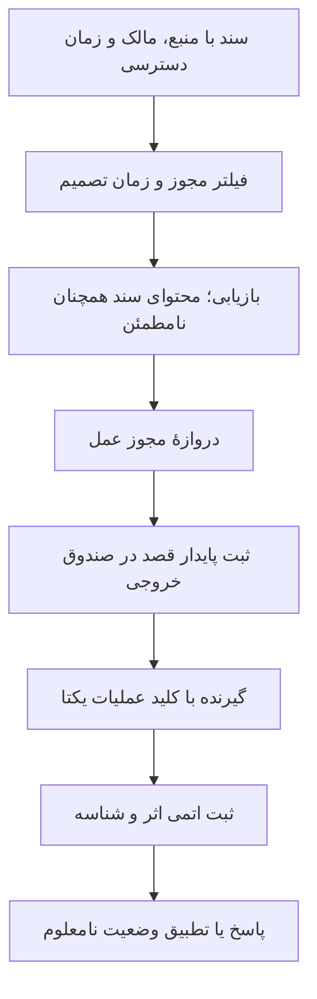

در آزمون مرجع تازه، هشت بررسی محدود روی SQLite اجرا شد: هشت فرایند مستقل مقدار را اتمی افزایش دادند؛ اتصال دوباره جمع هشت را حفظ کرد؛ فیلتر مستأجر و زمان تصمیم، دادهٔ مستأجر دیگر و اصلاح آینده را کنار گذاشت؛ نوشتن تأییدنشده بازگردانده شد؛ حذف منبع، خلاصه و بردار وابستهٔ تعریف‌شده در همین پایگاه را حذف کرد؛ دستور تزریق‌شده در سند از دروازهٔ مجوز عبور نکرد؛ دو تحویل پس از گم‌شدن تأیید فقط یک اثر منطقی داشت؛ و شاهد منفی بدون حذف تکرار دو بار اثر کرد. این بررسی‌ها واقعاً فرایند و پایگاه محلی را اجرا می‌کنند، اما آزمون سرویس Hindsight یا LangGraph نیستند. سرویس Docker در دسترس نبود؛ نصب بودن کارخواه آن به معنی اجرای سرویس نیست.

| مرز | نتیجهٔ مرجع | چیزی که هنوز ثابت نشده است |
|---|---|---|
| هم‌زمانی و بازیابی | افزایش اتمی هشت فرایند و حفظ پس از اتصال دوباره | رفتار سرویس اصلی زیر بار، مجوز PostgreSQL و بازیابی آن |
| حذف | حذف مشتق‌ها در جدول‌های دارای رابطهٔ صریح | پاک‌سازی نمایهٔ خارجی، کش، لاگ، نسخهٔ پشتیبان یا وزن مدل |
| تزریق دستور | شاخهٔ مجوز صریح، دستور بازیابی‌شده را رد کرد | مقاومت مدل زبانی در برابر تزریق دلخواه؛ در این آزمون مدل زبانی اجرا نشد |
| اثر تکراری | گیرنده شناسهٔ یکتا را همراه اثر اتمی ثبت کرد | تکرارنشدن سفارش در کارگزاری فاقد کلید یکتا یا استعلام معتبر |

فرض آزمون صندوق خروجی تعیین‌کننده است: **گیرنده باید شناسه و اثر را با هم و اتمی ثبت کند**. اگر کارگزاری چنین امکانی نداشته باشد، ثبت پایدار محلی به‌تنهایی اجرای دقیقاً یک‌باره نمی‌سازد. پس از پاسخ نامعلوم، وضعیت درست «نامعلوم و نیازمند تطبیق» است؛ ارسال دوبارهٔ کورکورانه ممکن است سفارش دوم بسازد. همین دقت دربارهٔ حذف لازم است: حذف جدول فعال، پاک‌شدن لاگ و نسخهٔ پشتیبان را نشان نمی‌دهد.

> **مرز محیط اجرای ثبت‌شده در ۲۲ اکتبر:** تلاش برای روشن‌کردن Docker Desktop مشترک، پنج سرویس موجودِ نامرتبط با این پژوهش را برای مدتی کوتاه خودکار آغاز کرد. اجرا بی‌درنگ متوقف شد؛ اثر آن فاصله نامعلوم است، چون داده و گزارش آن سرویس‌ها بازرسی نشد. هیچ آزمایش پژوهشیِ سرویس انجام نشد. بنابراین هشت وارسی SQLite همچنان آزمون مرجع هستند و دوام Hindsight/LangGraph یا اجرای زنده را ثابت نمی‌کنند. آزمون بعدیِ سرویس به محیط جدا نیاز دارد که کارهای نامرتبط را خودکار آغاز نکند. مشاهده و اقدام توقف در `update-2026-10-21/runtime-recheck-2026-10-22.json` محفوظ است.

### ۲۰.۴ آزمایش عامل مالی باید ابطال‌پذیر باشد

واحد ارزیابی، یک تصمیم زمان‌دار با دادهٔ ثبت‌شده است؛ تصویر توافق چند عامل کافی نیست. زمان رویداد، انتشار، دریافت و اصلاح داده را نگه دارید و شرط کنید انتشار و دریافت، هر دو پیش از تصمیم باشند. نسخهٔ مدل یا دقیق‌ترین شناسهٔ موجود، احتمال آگاهی مدل از آیندهٔ آزمون، پیام‌ها، ورودی و خروجی ابزار، منشأ حافظه، بودجهٔ توکن و پول، تنظیم تصادفی و همهٔ اجرای ناموفق باید ثبت شوند. حتی پنجرهٔ تاریخی ثابت هم وقتی مدل از نتیجهٔ بعدی خبر دارد، لزوماً آزمون آینده‌نگر نیست.

مقایسهٔ بدون عامل، عامل بدون ابزار، عامل بدون حافظه و نسخهٔ کامل باید بودجهٔ هم‌تراز داشته باشد. حذف حافظه همراه کاهش ابزار، اثر حافظه را از اثر محاسبه جدا نمی‌کند. ورودی فقط قیمت و ورودی با هویت دارایی پوشانده‌شده، کنترل‌های مفیدی برای آگاهی پیشین هستند؛ جای آزمایش جمع‌آوری‌شده از آینده را نمی‌گیرند. ده بذر تصادفی در یک پنجره هم ده محیط بازار مستقل نیست. تجمیع و عدم‌قطعیت باید هم‌پوشانی دوره‌ها را رعایت کند و هزینهٔ اجرا و سهم اقدام نامعتبر را گزارش دهد. انتخاب بهترین عامل یا پیام از روی آزمون، خودش یک بُعد جست‌وجوی آماری است. این به‌روزرسانی چنین آزمایش آینده‌نگری را اجرا نکرده و نتیجهٔ ساختگی به آن نسبت نمی‌دهد.

### ۲۰.۵ بررسی بخش‌های کد و جدولِ پست‌ها: مثال خلاف چه چیزی را ثابت می‌کند؟

در بازنمایی نگه‌داری‌شدهٔ مقاله‌ها، بخشی از کدها، دستورهای نمونه و جدول‌ها جدا از نثر ذخیره شده‌اند. در این ادامه، **هر ۱۱۱ بخش Markdown موجود**، با ۳۸٬۴۸۳ نویسهٔ محتوا، در مجموعهٔ ۱۷ مقاله خوانده شد. مقاله‌ای که چنین بخشی ندارد، واحد اضافه‌ای ایجاد نمی‌کند. این تیک فقط همین متن‌های دقیق را کامل می‌کند؛ تصویرِ حاوی کد، ویدئو، پاسخ، ویرایش حذف‌شده و احراز مستقیم پست اصلی جدا هستند. هش هر بخش، شناسهٔ والد و محدوده‌های خواندن در شواهد پایدار آمده‌اند. دستورهای داخل منبع موضوع تحلیل‌اند؛ اجرا نشده‌اند.

چند تابع خالص جدا و بدون عملیات پیرامونیِ دریافت، کارگزاری یا نصب آزموده شدند. در مقالهٔ 2094078837889945600، تابع DSR ورودی سالانه می‌گیرد، مقیاس برآوردشدهٔ پراکندگی شارپِ آزمون‌ها را در بیشینهٔ موردانتظار ندارد و حالت یک آزمون را جدا نمی‌کند. بک‌تست آن وزن موقعیت را در تغییر لگاریتم قیمت ضرب می‌کند. تابع QUBO مقالهٔ 2099179943905083394 تعداد انتخاب را با جریمهٔ نرم مدل می‌کند. اینها مشاهدهٔ کد نگه‌داری‌شده‌اند؛ سود ادعایی یا نسخهٔ فعلی پست تأیید نشده است.

| آزمون مستقل | نتیجهٔ مشاهده‌شده | معنای محدود نتیجه |
|---|---|---|
| یک آزمون، شارپ منفی ۰٫۵ و ۱۰۰ مشاهده | تابع DSR نتیجهٔ ۱ و قبول می‌دهد؛ صدک مرزی منفی بی‌نهایت است | تقریب بیشینهٔ چند آزمون، آزمون تک‌فرضیه‌ای معتبر نیست |
| سرمایهٔ ۱۰هزار، وزن فروش منفی یک، قیمت ۱۰۰ تا ۵۰، هزینهٔ صفر | کد: ۲۰هزار؛ حسابداری وزنِ سرمایه: ۱۵هزار | مواجههٔ لگاریتمی علامت‌دار با حسابداری دقیق ثروت فرق دارد |
| همان مسیر، وزن خرید نیم | کد: ۷٬۰۷۱٫۰۷؛ حسابداری وزن: ۷٬۵۰۰ | اختلاف بدون اهرم و فروش استقراضی هم وجود دارد |
| بهترین قیمت خرید هر پیامد ۰٫۴۹، هزینهٔ فرضی کل ۰٫۰۳ | فاصلهٔ ناخالص ۰٫۰۲، خالص منفی ۰٫۰۱ | فاصلهٔ ظاهری دو قیمت، مزیت خالص قابل اجرا نیست |
| انتخاب دو مورد از سه، بازده برآوردی هرکدام ۱۰۰، همبستگی صفر، جریمهٔ پیش‌فرض | شمارش دقیق همهٔ حالت‌ها، سه انتخاب را برمی‌گزیند | جریمهٔ متناهی، قید تعداد را قطعی نمی‌کند |
| قیمت پیشنهادی موجودی با ورودی‌های حدی | مقدار منفی ممکن است | دامنهٔ قیمت احتمال و واحد پارامتر باید کنترل شود |

اگر w کسر ثروت در دارایی و R بازده ساده باشد، در قرارداد قابل اجرای وزن سرمایه، ضریب ثروتِ بدون هزینه در یک دوره 1+wR است. پس بازده لگاریتمی ثروت چنین است:

<div class="formula" dir="ltr">r_wealth = log(1+wR) ≠ w log(1+R)　(in general).</div>

این یک هویت حسابداری تحت قرارداد مشخص است؛ هیچ حساب واقعی بازسازی نشده است. برای تفسیر ضریبِ شانس نیز مدل شواهد لازم است: یک امتیاز مثبت دلخواه با عبور از تبدیل شانس، خودکار به نسبت درست‌نمایی کالیبره تبدیل نمی‌شود. آزمون‌های کوچک، حساب موقعیت مکمل و رابطهٔ کلیِ کسری را هم در فرض‌های ایدئالشان تأیید کردند؛ این تأیید به احتمال برآوردی، هزینه، مواجههٔ مشترک یا سود آینده سرایت نمی‌کند.

> **حاصل بررسی:** نه گروه آزمون محدود موفق شد. برای محاسبات نرمال DSR، به‌دلیل نبود SciPy از ابزار استاندارد NormalDist استفاده شده و حالت مرزی صریح است. مدل تاریخی، سفارش واقعی، انتقال دارایی، دستور نصب یا صرفه‌جویی ادعایی اجرا یا تأیید نشده است.

قیمت خدمات، اندازهٔ داده و عملکرد تاریخی در جدول‌های نگه‌داری‌شده، تا زمان تطبیق مستقل با شاهد اولیه، ادعای نویسنده می‌مانند. درست‌بودن جمع و تفریق، ورودی را احراز نمی‌کند. نام تابعی که وعدهٔ بستن سمت ناموفق را می‌دهد نیز پیاده‌سازی، اتمی‌بودن، مقدار پرشدن یا نبود ریسک باقی‌مانده را ثابت نمی‌کند. تأیید دریافت نامعلوم، به تطبیق نیاز دارد؛ ارسال مجددِ بی‌بررسی می‌تواند مواجههٔ ناخواسته را بیشتر کند.


### ۲۰.۶ دفتر ماندگار: چه چیزی تیک می‌خورد و چه چیزی دوباره خوانده نمی‌شود؟

فایل `SOURCE_REVIEW_REGISTER.json` رکورد قابل‌خواندن برای ابزار است؛ نسخهٔ Markdown فهرست انسانی و نسخهٔ HTML دفتر جست‌وجوی آفلاین با پرستوی تعبیه‌شده است. هر رکورد شناسه، نسخه یا هش، محدوده‌های تکمیل‌شده، شاهد بررسی، کار باقی‌مانده و دلیل بازگشایی دارد. تیکِ یک فایل یا فصل به کل مخزن یا کتاب سرایت نمی‌کند. بخش خوانده‌شدهٔ بدون تغییر دوباره خوانده نمی‌شود؛ نسخهٔ تازه، شاهد متناقض یا اصلاح خطا، دلیل بازگشایی همان محدوده است.

در فهرست دسترسیِ منجمدشده، ۱٬۷۸۹ رکورد برای پوشش ۱٬۷۶۶ نشانی خام اولیه ثبت شده است: ۱٬۴۳۰ استخراج، ۳۵۷ خطای دسترسی و دو دارایی غیرمتنی که دریافت نشده‌اند. این اعداد **آمار دسترسی** هستند و درصد مطالعهٔ کامل نیستند. دفتر مطالعه، شواهد خواندن و آزمون را جدا به آن‌ها اضافه می‌کند. نسخه‌های هم‌نام، پیوندهای تکراری و کتاب‌های ویرایش متفاوت، به‌اشتباه شاهد مستقل یا مطالعهٔ کامل شمرده نمی‌شوند.

### ۲۰.۷ وضعیت همهٔ ردیف‌های صف ۱۳٫۲

| کار اصلی | خروجی ملموس این نوبت | کار باز؛ تیک کل ردیف هنوز کامل نیست |
|---|---|---|
| بازسازی سود شبکهٔ اجتماعی | نامزد هویت، دو پیمایش فعالیت و مثال حسابداری اعشاری | ادامهٔ کیف اول؛ مالکیت، مانده‌ها و تطبیق وثیقه و هزینه با زنجیره |
| زمان و نسخهٔ داده | آزمون مرز زمانی و مسموم‌کردن آینده؛ رهگیری رد زمان نامعلوم | ممیزی دریافت و اصلاح در کل زنجیرهٔ دادهٔ واقعی |
| DSR، PBO، اعتبارسنجی و SPA | فرمول‌ها، آزمایش بذر ثابت و تمایز پیاده‌سازی‌ها | بازتولید مستقل همهٔ نتایج مقاله‌ها و بسته‌ها |
| وجه نقد و پرشدن | آزمون روش‌های واقعی کد، کارمزد، عمق و ابهام حد سود/زیان | اجرای کل فرایند موتور و آزمایش با دادهٔ تیک مناسب |
| برابری موتورها | قراردادهای نسخه‌بندی‌شده و توضیح تفاوت‌ها | اجرای چهار موتور کامل روی خوراک و تنظیمات واقعاً هم‌ارز |
| پست و پاسخ‌ها | ردیابی متن پست‌ها و ۱۷ مقالهٔ پیوست؛ بازیابی O06 | کد تصویری، نظرها، ویرایش حذف‌شده و مخزن‌های بی‌نام O01/N02 |
| حافظه و مهار | شواهد قبلی Harness²/RRSI و هشت آزمون مرجع محلی | سرویس اصلی، مجوز، حذف خارجی و قطع واقعی اثر بیرونی |
| ریزساختار | انواع سفارش، هزینه و شرایط OFI/DeepLOB | آزمایش صف، ساعت تیک، تأخیر و ظرفیت با دادهٔ مناسب |
| عامل مالی | قرارداد زمان، آگاهی مدل، بودجه و حذف مؤلفه | اجراهای آینده‌نگر تکراری و عملکرد بیرون توزیع |
| تخصیص و دادهٔ مولد | کوواریانس آموزش، قیدها و شاهد منفی حفظ‌کردن داده | گردش واقعی، ظرفیت و وابستگی دنباله در آزمون بیرون نمونه |
| QuantResearch قدیمی | مقایسهٔ منبع و عدد و حدود در فصل آماری | نوسازی کامل، تفسیر مجوز و بازتولید با دادهٔ تاریخی |
| کتاب‌نامهٔ کامل | فهرست همهٔ نشانی‌های اولیه، نسخه‌بندی کتاب و محدودهٔ دقیق مطالعه | فصل‌های نخوانده، شکل و اثبات و ضمیمه و بازتولید کامل |

این جدول خروجی هر مسیر را مشخص می‌کند؛ اعلام تکمیل همهٔ کارهای گسترده نیست. ۱۸ فایل محلی با هش متفاوت فهرست شده‌اند. دو اسکن Harris همان اثر با بایت‌های متفاوت‌اند؛ دو نام فایل Cunningham با هش یکسان، دو کتاب مستقل نیستند. WhatIf سال ۲۰۲۰ با نسخهٔ عمومی ۲۰۲۵ یک شیء مطالعاتی نیست. کاربر تأیید کرد متن کامل Cartea/Jaimungal/Penalva سال ۲۰۱۵ و ویرایش دوم Jansen سال ۲۰۲۰ فعلاً موجود نیست؛ پیش‌گفتار ۱۶صفحه‌ای اولی و ویرایش سوم دومی جای آن‌ها تیک نمی‌خورند.


## ۲۱. خواندن انتقادی LB07: از آموزش یادگیری ماشین تا آزمایش معاملاتی قابل‌دفاع

کتاب ارسالی **Machine Learning in Trading: Step by Step Implementation of Machine Learning Models**، نوشتهٔ Ishan Shah و Rekhit Pachanekar از QuantInsti، راهنمای مقدماتی مفیدی برای پیاده‌سازی است. این بررسی پس از خواندن پیوستهٔ متن استخراج‌شدهٔ تمام ۲۰۵ صفحهٔ PDF، شامل فهرست منابع، و مشاهدهٔ تصویری ۲۶ صفحهٔ منتخب نوشته شده است. شماره‌ها در این فصل، **شمارهٔ صفحهٔ PDF** هستند و با شماره‌گذاری فصل‌های فهرست فرق دارند. هش SHA-256 فایل اصلی `8f68930591d1506d98916771c796acf1dc90f71a63cf86f47adf85a74617e880` است. مطالعهٔ تمام واحدهای متن استخراج‌شده کامل شده؛ بررسی همهٔ شکل‌ها، ممیزی دفترچه‌های همراه و بازتولید نتایج تاریخی کامل نشده است. کتاب در صفحهٔ ۷ مجوز CC BY-SA 4.0 را اعلام می‌کند؛ متن حاضر تحلیل مستقل و انتقادی است، نه رونویسی جایگزین کتاب.

### ۲۱.۱ هر بخش چه چیزی می‌آموزد و چه چیزی باید به آن افزوده شود؟

| صفحه‌های PDF | محتوای واقعاً خوانده‌شده | ارزش آموزشی | تکمیل ضروری |
|---|---|---|---|
| ۱–۱۷ | آغاز کتاب، انگیزه، یادگیری نظارت‌شده، بدون‌نظارت و تقویتی | تفکیک رگرسیون، طبقه‌بندی، خوشه‌بندی و یادگیری کنش | جداکردن مثال آموزشی و ادعاهای تاریخی صنعت از شواهد اندازه‌گیری‌شدهٔ سرمایه‌گذاری |
| ۱۸–۳۲ | مسئله، هدف و ویژگی؛ مثال ۱۵دقیقه‌ای JPM؛ اندیکاتور، ایستایی و هم‌بستگی | تعریف صریح ویژگی و برچسب کندل بعد | ساعت دسترسی، انتخاب ویژگی فقط روی آموزش و معنای درست اندیکاتور |
| ۳۳–۵۳ | تقسیم زمانی، برازش و پیش‌بینی جنگل تصادفی، ماتریس خطا و معیارها | نمایش روشن اشکال تقسیم تصادفی زمان | حذف برچسب عبورکننده از مرز؛ احتمال، عدم‌قطعیت و زیان اقتصادی |
| ۵۴–۷۱ | تأخیر سیگنال، مرکب‌سازی، سالانه‌سازی، افت، شارپ، آزمون پیش‌رونده و مسائل عملیاتی | پیوند پیش‌بینی با موقعیت و تصریح حذف هزینه‌ها | قیمت اجرای ممکن، هزینهٔ وابسته به گردش، انتخاب تودرتو و نسخهٔ مدل |
| ۷۲–۱۴۶ | رگرسیون خطی و لجستیک، بیز ساده، درخت، جنگل، XGBoost و شبکهٔ عصبی | معرفی قابل‌فهم خانواده‌های مدل و رابط برازش/پیش‌بینی | قیدهای ریاضی درست؛ مقایسهٔ مشترک روی آزمون؛ جلوگیری از انتخاب مدل با آزمون |
| ۱۴۷–۱۸۹ | خوشه‌بندی، k-means، روش سلسله‌مراتبی و PCA | معرفی بازنمایی بدون‌نظارت | مقیاس و هندسهٔ یکسان، تفکیک محور از امتیاز، بنیادیِ دارای زمان انتشار و اعتبارسنجی |
| ۱۹۰–۲۰۵ | پردازش زبان، یادگیری تقویتی، نتیجه‌گیری و منابع | معرفی مسیر متن تا ویژگی و حالت/کنش/پاداش | تأخیر انتشار، حذف رویداد تکراری، نمادگذاری بلمن و ارزیابی سیاست |

چارچوب تکرارشوندهٔ کتاب ارزش حفظ‌کردن دارد: تصمیم را تعریف کنیم، ویژگی و برچسب بسازیم، زمان را تقسیم کنیم، مدل را برازش دهیم، پیش‌بینی و ارزیابی کنیم، خروجی را به موقعیت تبدیل کنیم و استقرار را پایش کنیم. قوت کتاب، همراه‌کردن خوانندهٔ تازه‌کار در تمام این مراحل است. محدودیت آن هنگامی مهم می‌شود که انتخاب‌های سادهٔ کلاس درس، شاهد موفقیت راهبرد قابل‌استقرار تلقی شوند.

### ۲۱.۲ زمان برچسب، ویژگی و اجرای معامله باید سازگار باشد

صفحه‌های ۲۵–۲۸، هدف را با علامت بازده قیمت پایانی کندل بعد تعریف می‌کنند، درحالی‌که ورودی شامل OHLC، بازده و اندیکاتور کندل جاری است. صورت دقیق آن `r(t,t+1)=C(t+1)/C(t)−1` و `y(t)=1[r(t,t+1)>0]` است. انتقال منفی برای ساخت **برچسب** درست است؛ برای اطلاعات واردشونده به پیش‌بینی در t درست نیست. آخرین ردیف برچسب آیندهٔ معلوم ندارد و باید پیش از تبدیل مقایسهٔ مقدار گمشده به کلاس صفر حذف شود.

این برچسب پاسخ می‌دهد آیا قیمت پایانی بعدی از قیمت پایانی جاری بالاتر است. پاسخ نمی‌دهد سفارشی که پس از مشاهدهٔ قیمت پایانی جاری ارسال می‌شود، می‌تواند در همان قیمت بخرد. اگر تصمیم از کندل کامل استفاده می‌کند، قیمت پیشنهادی یا بازشدن بعدیِ قابل‌دستیابی و پایان نگهداری را مشخص کنیم و بازده و برچسب را مطابق آن بسازیم. تأخیر یک‌کندلی سیگنال، خطای سادهٔ حسابداری هم‌ردیف را رفع می‌کند، اما دسترسی به قیمت اجرای فرض‌شده را ثابت نمی‌کند.

کد اصلی کتاب در صفحهٔ ۵۶ از `signal.shift(1) × pct_change` استفاده می‌کند. با قرارداد سادهٔ آن، سیگنال قبلی به بازده مشاهده‌شدهٔ بعدی تعلق می‌گیرد. فصل XGBoost در صفحهٔ ۱۲۶، سیگنال همان مبدأ را در بازدهی که قبلاً به آینده انتقال یافته ضرب می‌کند. این دو، در صورت هم‌ترازی درست، دو قرارداد نمایه‌گذاری سازگارند. اعمال هر دو انتقال با هم تأخیر اضافه می‌سازد. یک مثال کوچک با زمان تصمیم، ورود و خروج باید قرارداد را اثبات کند.

صفحهٔ ۲۷، که تصویر آن بررسی شد، **open** را به‌عنوان ورودی سوم ADX می‌دهد. امضای رسمی تابع `ADX(high, low, close, timeperiod)` است. فراخوانی نمایش‌داده‌شده ممکن است از نظر نوع داده اجرا شود، اما ویژگی دیگری می‌سازد و نباید ADX متعارف نامیده شود. همچنین ۲۶ مشاهدهٔ ۱۵دقیقه‌ای فقط با قرارداد جلسهٔ کامل، برابر یک جلسهٔ ۶٫۵ساعته است؛ تعطیلی، جلسهٔ کوتاه، کندل گمشده و مرز شبانه مدیریت جدا می‌خواهند. [مستندات رسمی اندیکاتورهای TA-Lib](https://ta-lib.github.io/ta-lib-python/func_groups/momentum_indicators.html).

### ۲۱.۳ تقسیم زمانی، پیش‌پردازش انجام‌شده روی کل نمونه را اصلاح نمی‌کند

کتاب ابتدا تقسیم تصادفی را نشان می‌دهد و در صفحه‌های ۳۵–۳۹ آن را با `shuffle=False` اصلاح می‌کند. این اصلاح ضروری است. بااین‌حال، آزمون ایستایی و حذف ویژگی براساس هم‌بستگی در صفحه‌های ۳۰–۳۲، **پیش از تقسیم** و با کل تاریخ ویژگی انجام می‌شود. حتی بدون برچسب، اطلاعات توزیع دورهٔ آزمون وارد انتخاب ویژگی شده است. ترتیب درست این است: ابتدا آزمون بیرونی را ثابت کنیم؛ سپس هر تبدیل و انتخاب آموختنی را روی پیشوند آموزشی مجاز برازش دهیم و همان قاعده را به اعتبارسنجی و آزمون اعمال کنیم. پارامتر جبران داده، غربال ADF در صورت استفاده، آستانهٔ هم‌بستگی، مقیاس‌ساز، PCA و انتخاب ویژگی همگی مشمول‌اند. کد فصل لجستیک و شبکهٔ عصبی در صفحه‌های ۸۸ و ۱۴۰، مقیاس‌ساز را درست فقط روی آموزش برازش می‌دهد، هرچند نثر اطراف آن به این دقت نیست. [راهنمای رسمی جلوگیری از نشت](https://scikit-learn.org/stable/common_pitfalls.html).

معلوم‌شدن برچسب، مرزی مستقل است. برای برچسب H‌کندلی و آموزشی که در T ثابت می‌شود، فقط مبدأ t با شرط `t+H≤T` مجاز است. مثلاً H=3 و T=35، آخرین مبدأ آموزش را ۳۲ می‌کند، نه ۳۵. اگر تقسیم صرفاً براساس ردیف، مبدأهای ۳۳–۳۵ را در آموزش نگه دارد، برچسب‌های آن‌ها به ۳۶–۳۸ می‌رسند. برای برچسب رویدادی با طول متغیر، زمان پایان هر برچسب را ذخیره و بازه‌های متقاطع را حذف کنیم؛ یک فاصلهٔ ثابت ردیفی همیشه کافی نیست.

آزمون پیش‌روندهٔ صفحه‌های ۶۱–۶۳ قدم مفیدی است، اما تمام **الگوریتم انتخاب** باید پیش‌رونده باشد. غربال ویژگی، جست‌وجوی ابرپارامتر، کالیبراسیون احتمال و انتخاب آستانهٔ معامله باید در هر پنجرهٔ آموزشی/اعتبارسنجی مجاز تکرار شوند. پیشنهاد انتخاب نسخهٔ صرفاً خرید پس از دیدن معیار کلاس‌ها در آزمون XGBoost، صفحهٔ ۱۲۵، آن بازه را به دادهٔ توسعه تبدیل می‌کند؛ سپس به آزمون بیرونی دست‌نخورده نیاز است. تغییر پی‌درپی راهبرد تا رضایت از همان پس‌آزمایی، بهینه‌سازی روی آزمون است، حتی اگر هر برازش فقط روی ردیف‌های قدیمی‌تر انجام شود.

### ۲۱.۴ دقت طبقه‌بندی، سود موردانتظار نیست؛ F1 آستانهٔ جهان‌شمول معاملاتی ندارد

کتاب عدم‌توازن رویداد نادر را خوب توضیح می‌دهد: پیش‌بینی همیشگی «سقوط رخ نمی‌دهد» می‌تواند در ۱۰هزار مشاهده، ۹۹٫۸٪ درست باشد و هر ۲۰ سقوط را از دست بدهد؛ صفحه‌های ۵۰–۵۲. اما گزارهٔ کفایت دقت بالای ۵۰٪ یا F1 بالای ۰٫۵ نباید به تصمیم معامله منتقل شود. فراوانی کلاس، مبنای پیش‌بینی کلاس غالب، عدم‌قطعیت، نامتقارن‌بودن سودوزیان، گردش و هزینهٔ اجرا اهمیت دارند.

برای معاملهٔ خرید، p را احتمال کالیبرهٔ صعود، G را میانگین شرطی سود، L را قدرمطلق میانگین شرطی زیان و c را هزینهٔ موردانتظار ورود و خروج بگیریم. امید سود ساده برابر `pG−(1−p)L−c` است. اگر G و L مثبت و برای معاملات منتخب مناسب باشند، شرط سود مثبت `p>(L+c)/(G+L)` می‌شود. آستانه فقط در حالت خاصِ متقارن و بی‌هزینه برابر ۰٫۵ است. برآورد سود و زیان شرطی نیز باید با انضباط آموزش/اعتبارسنجی انجام شود؛ نمی‌توان آن‌ها را از آزمون نهایی استخراج و سپس معلوم فرض کرد.

یک مثال عددیِ اجراشده: هشت سود مثبت ۰٫۱٪ و دو زیان منفی ۰٫۶٪، نرخ برد ۸۰٪ دارند، اما جمع حسابی منفی ۰٫۴٪ و بازده مرکب تقریباً منفی ۰٫۴۰۳۲٪ است. چهار سود مثبت ۰٫۴٪ و شش زیان منفی ۰٫۱٪، فقط ۴۰٪ برد دارند، اما جمع حسابی مثبت ۱٪ و بازده مرکب تقریباً مثبت ۱٫۰۰۱۵٪ است؛ هر دو پیش از هزینه. مثال‌ها تفاوت معیارها را اثبات می‌کنند و نتیجهٔ تاریخی راهبرد نیستند.

ماتریس خطای صفحهٔ ۴۸ در مشاهدهٔ تصویری، TN=985، FP=951، FN=921 و TP=1007 دارد. جمع ۳۸۶۴ و دقت `(985+1007)/3864≈51.5528%` با کتاب سازگار است. گزارش کامل‌تر، معیار هر کلاس، مبنا، کالیبراسیون یا زیان لگاریتمی در صورت استفاده از احتمال، و عدم‌قطعیت سازگار با وابستگی زمانی می‌افزاید. در مثال پیش‌بینی همیشگی سقوط، دقت مثبت ۰٫۰۰۲ و بازیابی ۱ است؛ F1 درست `2PR/(P+R)=.003992…`، تقریباً ۰٫۰۰۴ می‌شود. عدد چاپ‌شدهٔ ۰٫۰۰۳ گردکردن درست نیست. چیدمان فرمول PDF نیز خراب است؛ فرمول باید از تعریف بازسازی شود، نه از شکل یا متن استخراج‌شده کپی شود.

### ۲۱.۵ هزینه، سالانه‌سازی و ریسک: کد مفید را حفظ و دامنهٔ ادعا را محدود کنیم

مثال کتاب در صفحه‌های ۵۷–۶۱، بازده تجمعی ۲۸٫۱۰٪، بازده سالانه‌شدهٔ ۵۲٫۲۰٪، نوسان سالانه‌شدهٔ ۱۴٫۹۰٪، بیشینهٔ افت مشاهده‌شدهٔ ۷٫۹۴٪ و شارپ ۲٫۸۹ گزارش می‌کند. خود کتاب تصریح می‌کند هزینه و لغزش حذف شده و نرخ بدون‌ریسک صفر فرض شده است. این اعداد، نتیجهٔ ناخالص آموزشیِ گزارش‌شدهٔ نویسندگان‌اند؛ نتیجهٔ خالص بازتولیدشده نیستند.

| کمیت | تفسیر درست | چیزی که مثال ثابت نمی‌کند |
|---|---|---|
| ثروت `V_n=V_0∏(1+g_t)` | مرکب‌کردن بازده **خالص** با قرارداد سرمایهٔ مشخص | اجرای ممکن و تأمین مالی از مرکب‌سازی حاصل نمی‌شود |
| رشد سالانه `(V_n/V_0)^(1/years)−1` | تبدیل هندسی بازهٔ مشاهده‌شده | نمونهٔ کوتاه، بازده سال بعد را پیش‌بینی نمی‌کند |
| نوسان `sd(g)√A` | مقیاس‌گذاری متعارف با فرض‌های فاصله و وابستگی | به معنی قرارگرفتن تغییر قیمت در ±نوسان سالانه در ۶۸٪ زمان‌ها نیست |
| افت `V_t/max(V_0,…,V_t)−1` | زیان تاریخی نسبت به قلهٔ قبلی ثروت | بیشینهٔ افت گذشته، سقف زیان آینده نیست |
| شارپ `mean(g−rf)/sd(g−rf)×√A` | خلاصهٔ بازده اضافی با دوره‌های سازگار | مقیاس ریشهٔ زمان در وابستگی سریالی خودبه‌خود معتبر نیست |

برای بازده کندلی r و وزن هدف w، یک قاعدهٔ حسابداری نمونه `g(t+1)=w(t)r(t+1)−c(t)|w(t)−w(t−1)|` است؛ c هزینهٔ یک‌طرفهٔ هر واحد معامله است و زمان کسر آن باید مشخص شود. مسیر ۰→۱→۱→۰ دو واحد گردش دارد، نه سه کارمزد روزانهٔ یکسان. تغییر منفی۱→مثبت۱ دو واحد گردش دارد. فاصلهٔ خریدوفروش، کارمزد، اثر بازار، استقراض و تأمین مالی را در صورت کاربرد اضافه کنیم؛ نرخ ثابتِ واحد شاید فقط تحلیل حساسیت باشد. ورود اولیه و نقدکردن نهایی را سازگار حساب کنیم.

عامل `252×6.5×4=6552` کتاب، قرارداد مشخص کندل‌های جلسهٔ عادی آمریکا را فرض می‌کند. بازده شبانه ۱۵ دقیقه طول نمی‌کشد، حتی اگر یک ردیف را اشغال کند. پیش از سالانه‌سازی و برآورد عدم‌قطعیت، به روزهای کامل معاملاتی تجمیع کنیم یا قرارداد زمانی موجه بنویسیم. گردش، میزان حضور در بازار، تعداد معامله، تمرکز و حساسیت هزینه کنار شارپ گزارش شوند. راهبردی که اندکی از هزینهٔ تخمینی عبور می‌کند، به بازهٔ عدم‌قطعیت مزیت و هزینه نیاز دارد، نه صرفاً منحنی ناخالص جذاب.

### ۲۱.۶ خانواده‌های مدل: معرفی‌ها مفیدند، تعمیم‌های آماری باید اصلاح شوند

| موضوع و صفحه | ایدهٔ مفید | قید یا اصلاح لازم |
|---|---|---|
| ایستایی و هم‌بستگی،۲۲–۳۲ | تغییر توزیع و افزونگی مهم‌اند | ردنشدن ADF اثبات ناایستایی نیست؛ همهٔ مدل‌های ML ورودی ایستا نمی‌خواهند. ایستایی ضعیف کوواریانس وقفه‌ای را هم محدود می‌کند؛ هم‌بستگی بالا اثبات نبود ارزش افزوده نیست |
| رگرسیون خطی و R²،۷۲–۸۳ | رابطه را مدل و باقیمانده را بررسی کنیم | R² بیرون نمونه می‌تواند منفی باشد؛ برابری با مربع هم‌بستگی شروط خاص OLS و عرض از مبدأ دارد. رگرسیون قیمت هم‌زمان، پیش‌بینی یا هم‌انباشتگی را ثابت نمی‌کند |
| لجستیک،۸۴–۹۱ | `p=1/(1+exp(−(b+xᵀβ)))` امتیاز خطی را به احتمال می‌برد | احتمال پیش از آستانهٔ کلاس وجود دارد؛ ۰٫۵ قرارداد طبقه‌بندی است، نه بهینهٔ معامله؛ ضریب، ارتباط شرطی است |
| بیز ساده،۹۲–۹۸ | حاصل‌ضرب درست‌نمایی‌های کلاس، مبنای سریع است | استقلال **مشروط به کلاس** است؛ پسین با پیشین×حاصل‌ضرب درست‌نمایی متناسب است و برای احتمال باید نرمال شود. هموارسازی، شبه‌شمارش می‌افزاید؛ احتمال صفر را ۱ نمی‌کند |
| درخت و جنگل،۹۹–۱۱۵ | تقسیم غیرخطی و ترکیب مدل‌ها | `min_samples_leaf` حداقل نمونه در هر برگ است، نه تعداد برگ. بوت‌استرپ جنگل، نمونه‌برداری مشاهدات با جایگذاری است؛ نمونه‌برداری ویژگی عملیات دیگری است؛ بهبود ترکیب تضمین نیست |
| XGBoost،۱۱۵–۱۲۹ | بهینه‌سازی ترتیبی زیان با منظم‌سازی | اهمیت ویژگی، علیت یا شواهد اطلاعات مالی نیست؛ تعریف معیار و برچسب نمودار مهم است؛ انتخاب نیازمند اعتبارسنجی است |
| شبکهٔ عصبی،۱۲۹–۱۴۵ | لایه، گرادیان و مقیاس‌سازی آموزشی | پس‌انتشار گرادیان را محاسبه و بهینه‌ساز وزن را به‌روز می‌کند. بهینه‌سازی تصادفی تضمین کمینهٔ جهانی نیست. سیگموید با MSE می‌تواند هدفی از جنس Brier باشد و ذاتاً اشتباه نیست، اما کالیبراسیون باید سنجیده شود |

اصلاح R² آزمودنی است: واقعیت `[1,2,3]` و پیش‌بینی `[3,2,1]` مقدار `1−8/2=−3` می‌دهند. برازش خوب دو قیمت رونددار ممکن است کاذب باشد؛ بازگشت‌به‌میانگین قابل‌معامله به تعریف درست باقیمانده و تحلیل و اجرای بیرون نمونه نیاز دارد. بازتولید جدید باید نسخهٔ کتابخانه را ثابت کند؛ کتاب پارامتر و API قدیمی دارد و نباید مثال متنی را کد فعلیِ آزموده‌شده معرفی کرد. [مستندات R²](https://scikit-learn.org/stable/modules/generated/sklearn.metrics.r2_score.html)، [تعریف بیز ساده](https://scikit-learn.org/stable/modules/naive_bayes.html)، [نمونه‌برداری جنگل](https://scikit-learn.org/stable/modules/ensemble.html#random-forests-and-other-randomized-tree-ensembles).

مشاهدهٔ تصویری صفحهٔ ۱۲۴ هشدار مشخص دیگری می‌دهد: متن `pct_change_40` را مهم‌ترین می‌نامد، اما نمودار `pct_change_20` و `pct_change_55` را بالا نشان می‌دهد. عنوان محور «F score» این نمودار، امتیاز اهمیت است و F1 طبقه‌بندی نیست. تعریف اهمیت باید ثبت و ارزش حذف/نگهداری ویژگی با آزمایش بیرون نمونه سنجیده شود.

### ۲۱.۷ خوشه‌بندی و PCA: شیء موردتحلیل را مشخص و هندسه را ثابت نگه داریم

فصل k-means ابتدا ROE و بتا را استاندارد و `df_values` را برازش می‌کند، سپس ستون `cluster` را به جدول کاری می‌افزاید؛ صفحه‌های ۱۵۷–۱۵۸. حلقهٔ آرنج در صفحهٔ ۱۶۰، `df` را برازش می‌کند؛ بنابراین مقیاس را عوض و برچسب خوشهٔ تولیدشده را هم وارد ویژگی می‌کند. این دیگر همان هدف دوویژگی نیست. تمام kها باید روی همان ماتریس پیش‌پردازش‌شده و تغییرناپذیر برازش شوند و برچسب خروجی جدا نگهداری شود. شکل صفحهٔ ۱۵۹ عنوان k=4 دارد ولی دو دسته نشان می‌دهد و نثر، هویت عددی آن‌ها را برعکس می‌کند. شناسهٔ خوشه قراردادی است؛ عضویت و ویژگی اقتصادی را مقایسه کنیم، نه اینکه ۰ و ۱ را کد پایدار صنعت بدانیم.

فصل سلسله‌مراتبی، دندروگرام را از `df` خام در صفحهٔ ۱۶۸ می‌سازد، ولی خوشه‌بندی نهایی را روی `df_values` استانداردشده در صفحهٔ ۱۶۹ برازش می‌دهد. پس نمودار خودبه‌خود توجیه آن افراز نیست. هندسهٔ فاصله و روش پیوند باید مشترک باشند. ROE پس از انتشار معلوم می‌شود و با حقوق صاحبان سهام منفی یا کوچک مسئله دارد؛ بتا نیز به شاخص مرجع و پنجرهٔ برآورد وابسته است. شباهت این دو ویژگی، هم‌انباشتگی یا تنوع‌بخشی در سقوط را تضمین نمی‌کند. بازنماییِ مطابق زمان را روی آموزش برازش و پایداری عضویت را در پنجره‌های بعد بسنجیم.

برای مشاهدات مرکززدایی‌شدهٔ `X` با شکل ۵۰۱×۲۰، امتیاز PCA با ۱۸ مؤلفه، شکل ۵۰۱×۱۸ دارد: `Z=(X−μ)Vᵀ`. کتاب در صفحه‌های ۱۸۷–۱۸۸، `components_.T` با شکل ۲۰×۱۸ را خوشه‌بندی می‌کند. این می‌تواند بازنمایی معتبر **محورهای سهام** برای خوشه‌بندی دارایی باشد، اما کاهش ۵۰۱ مشاهدهٔ تاریخی به ۲۰ مشاهده نیست. زمان‌ها، ابعاد دارایی، محور مؤلفه و امتیاز را تفکیک کنیم. PCA واریانس ویژگی را توضیح می‌دهد؛ اطلاعات پیش‌بینی ممکن است در جهت کم‌واریانس باشد. مؤلفه‌ها داخل آموزش انتخاب و هدف معامله جدا ارزیابی شود. [رابط رسمی PCA](https://scikit-learn.org/stable/modules/generated/sklearn.decomposition.PCA.html).

ماتریس عمومی مثال بردار ویژه، مقادیر ویژهٔ ۱۴ و منفی۲ دارد. ماتریس کوواریانس معتبر، متقارن و نیمه‌معین مثبت است و مقدار ویژهٔ منفیِ معنادار ندارد. بردارهای مثال `[-3,2]` و `[1,2]` ضرب داخلی ۱ دارند؛ بردار ویژهٔ عمومی الزاماً متعامد نیست. محورهای متعامد PCA از مسئلهٔ کوواریانس متقارن یا SVD می‌آیند. ماتریس دادهٔ مستطیلی با بردار تکین یا ماتریس مربعی کوواریانس/گرام تحلیل می‌شود، نه بردار ویژهٔ معمولی همان ماتریس مستطیلی. جمع مقادیر ویژهٔ کوواریانس، تا دقت عددی برابر رد ماتریس و مجموع واریانس‌هاست.

مثال t-SNE در تصویر صفحهٔ ۱۸۸، perplexity=25 را برای ورودی ۲۰×۱۸ می‌گذارد، درحالی‌که API مقدار کوچک‌تر از تعداد نمونه می‌خواهد. شکل صفحهٔ بعد را نمی‌توان بازتولید همان ورودی و پارامتر نمایش‌داده‌شده دانست. مقدار معتبر، نسخه و بذر ثابت لازم‌اند و تصویر باید اکتشافی تلقی شود؛ فاصلهٔ تصویری و رنگ جدا اثبات رژیم اقتصادی نیست. آزمون محلی فقط شرط پارامتر را سنجید؛ sklearn و برازش t-SNE اجرا نشد. [شرط رسمی t-SNE](https://scikit-learn.org/stable/modules/generated/sklearn.manifold.TSNE.html).

### ۲۱.۸ زبان و یادگیری تقویتی، مرز ارزیابی را حذف نمی‌کنند

صفحه‌های ۱۹۰–۱۹۴ مسیر جمع‌آوری، پیش‌پردازش، امتیاز احساس، سیگنال و پس‌آزمایی را می‌دهند. هر رکورد متن باید اولین انتشار، دریافت فروشنده، اصلاحیه، نگاشت موجودیت و شناسهٔ خبر تکراری داشته باشد. یک خبر در ده خوراک، ده مشاهدهٔ مستقل نیست. تقسیم زمانی و گروه‌بندی خبر مرتبط لازم است؛ واژگان، TF–IDF، مدل احساس و کالیبراسیون فقط روی آموزش برازش شوند. منشن و هشتگ می‌توانند هویت و احساس حمل کنند؛ حذف آن‌ها باید آزموده شود. تفاوت متن قالب‌دار با پست غیررسمی مفید است، اما به معنی نداشتن متن بدون‌ساختار در گزارش مالی یا نبود مدل قابل‌استفادهٔ مجدد نیست. احساس، ویژگی برآوردی است، نه پیش‌بینی عینی بازده.

مقدمهٔ تقویتی در صفحه‌های ۱۹۵–۲۰۳، حالت، کنش، پاداش، سیاست و محیط را اضافه می‌کند. مشاهدهٔ قابل‌استفادهٔ معامله به موقعیت، وجه نقد، سفارش باز و محدودیت هم نیاز دارد؛ اندیکاتور قیمت معمولاً حالت کامل تصمیم نیست. هزینه را در پاداش بگنجانیم و کندل آینده را از مشاهده دور نگه داریم. پاداش ارزش‌گذاری جاری مانع پنهان‌شدن ریسک موقعیت باز تا زمان بستن آن می‌شود. بازپخش تاریخی شاید تقریب قیمت‌پذیر را بسنجد؛ اثبات نمی‌کند عامل به اثر خودش بر بازار به شکل امن سازگار می‌شود.

مثال بلمن صفحهٔ ۲۰۱، γ را نرخ یادگیری می‌نامد؛ γ در واقع عامل تنزیل پاداش آینده است. به‌روزرسانی نمونه‌ای Q-learning جدولی چنین است: `Q(s,a)←Q(s,a)+α[r+γ(1−done)max(a′)Q(s′,a′)−Q(s,a)]`. α نرخ یادگیری است و پایان اپیزود ادامهٔ پاداش را حذف می‌کند. معادلهٔ بلمن بهینه، امیدگیری روی گذارها دارد؛ پرکردن عقب‌گرد جدول با قیمت نهایی معلوم سهام، مثال آموزشیِ پس‌نگر است، نه سیاست بیرون نمونه. شبکهٔ Q ارزش کنش را تقریب می‌زند؛ حافظهٔ بازپخش به `(s,a,r,s′,done)` نیاز دارد و تابع یادگرفته‌شده باید روی اپیزود کنارگذاشته‌شده با قواعد انتخاب ثابت ارزیابی شود. [مفاهیم اصلی تقویتی](https://spinningup.openai.com/en/latest/spinningup/rl_intro.html)، [بلمن، حافظهٔ بازپخش و شبکهٔ هدف](https://spinningup.openai.com/en/latest/algorithms/ddpg.html).

### ۲۱.۹ آزمایش جایگزین قابل‌بازتولید و آزمون‌های تکمیل‌شده

ساختار داده باید زمان رویداد و دسترسی، ابزار، قرارداد قیمت خام/تعدیل‌شده و نسخهٔ منبع را داشته باشد. ویژگی را از گذشتهٔ قابل‌مشاهده بسازیم و آغاز و پایان برچسب را نگه داریم. مرز تقویمی آموزش/اعتبارسنجی/آزمون را ثابت کنیم. غربال، تبدیل و مدل در هر پنجرهٔ آموزش دوباره برازش شوند؛ آستانه با مطلوبیت خالص اعتبارسنجی انتخاب و آزمون بیرونی یک بار امتیازدهی شود. هش کد و داده، ستون منتخب، تبدیل برازش‌شده، مدل، آستانه، آخرین زمان آموزش، نسخهٔ محیط و بذرها با هم ذخیره شوند. بذر کتابخانهٔ `random` پایتون در کتاب، قطعی‌بودن NumPy و چارچوب شبکهٔ عصبی را ثابت نمی‌کند.


خود بازآموزی یک سیاست است. پنجرهٔ پایش، بلوغ برچسب، حداقل نمونه، محرک، فاصلهٔ انتظار، جایگزین و بازگشت نسخه باید از قبل مشخص شوند. چند زیان، اثبات تغییر مفهوم نیست؛ آزمون تکراری افت می‌تواند هشدار کاذب بسازد. بستهٔ مدل معتبر را ذخیره و هنگام نیاز بارگذاری کنیم؛ خواندن دیسک در هر قیمت، انتخاب پیاده‌سازی است، نه الزام پژوهشی. هشدار کتاب دربارهٔ pickle نامطمئن همچنان مهم است؛ ذخیرهٔ عمومی JSON هم روش جهان‌شمول ذخیرهٔ هر برآوردگر نیست.

هفت بررسی عددی مستقل در `validate.py` گذشت: F1 رویداد نادر؛ R² منفی؛ وارونگی رابطهٔ دقت و سود؛ شرط پارامتر t-SNE؛ شکل PCA و هویت واریانس با SVD در NumPy؛ نامتعامدبودن و مقدار ویژهٔ منفی ماتریس عمومی مثال؛ و حسابداری تأخیر بازده و گردش. این‌ها اصلاح‌های گفته‌شده را می‌سنجند، **نه عملکرد تاریخی کتاب را**. دفترچهٔ همراه، طبقه‌بند تاریخی، برازش خوشه‌بندی یا اجرای کارگزار آزمایشی/واقعی اجرا نشد.

> **وضعیت ماندگار مطالعه:** متن استخراج‌شدهٔ ۲۰۵ از ۲۰۵ صفحه خوانده شد؛ تصویر ۲۶ از ۲۰۵ صفحه بررسی شد. بررسی تمام کتاب هنوز کامل نیست، چون همهٔ شکل‌ها و مکمل‌های بیرونی ممیزی نشده‌اند. برای کشف دوبارهٔ این یافته‌ها نیازی به بازخوانی متن بدون تغییر نیست. ادامه باید از صفحه‌های تصویریِ مشخصاً بررسی‌نشده، کد و دادهٔ همراه یا بازتولید تاریخی تعریف‌شده باشد؛ بازخوانی متن فقط با تغییر هش یا نسخه لازم می‌شود.


## ۲۲. LB10 — کلی و شیو: از پیش‌بینی تا قیمت‌گذاری و پرتفوی قابل اجرا

**دامنهٔ مطالعه:** متن استخراج‌شدهٔ هر ۱۶۱ صفحهٔ کتاب‌مانندِ *Financial Machine Learning* نوشتهٔ برایان کلی و داچنگ شیو، نسخهٔ ژوئیهٔ ۲۰۲۳، مطالعه شد؛ ۳۹ صفحهٔ PDF اصلی نیز به‌صورت تصویر بررسی شدند و همهٔ ۱۸ شکل شماره‌دار، ۸ جدول شماره‌دار و معادلات محوری پوشش گرفتند. متن روی‌هم‌افتادهٔ صفحهٔ PDF ۶۳ از صفحهٔ متناظر و خوانای ۶۲ در نسخهٔ رسمی NBER بازیابی شد؛ کل آن نسخهٔ ۱۶۰صفحه‌ای دوباره مطالعه نشده است. شماره‌های این فصل شمارهٔ صفحهٔ PDF هستند؛ در متن اصلی پنج واحد از شمارهٔ چاپی بیشترند. خواندن فهرست منابع به معنای مطالعهٔ مستقل تمام مقالات ارجاع‌شده نیست. آزمون‌های عددی همراه فصل فقط همانی‌های ریاضی را با دادهٔ مصنوعی بررسی می‌کنند و بازتولید سودآوری تاریخی نیستند. [نسخهٔ عمومی منبع](https://bfi.uchicago.edu/wp-content/uploads/2023/07/BFI_WP_2023-100.pdf).

### ۲۲.۱ سه پرسش متفاوت که نباید با هم اشتباه شوند

معادلهٔ آغازین Pᵢₜ = Eₜ[Mₜ₊₁Xᵢ,ₜ₊₁] قیمت امروز را به پرداخت آینده و «عامل تنزیل تصادفی» یا SDF پیوند می‌دهد. عامل تنزیل وزن ارزش‌گذاری پرداخت در وضعیت‌های مختلف اقتصاد است. از این رابطه نمی‌توان نتیجه گرفت هر مدلی که بازده را خوب پیش‌بینی می‌کند، علت اقتصادی آن بازده را هم توضیح داده است. مدل پیش‌بینی امید شرطی بازده را با اطلاعات موجود در زمان تصمیم تخمین می‌زند؛ مدل قیمت‌گذاری توضیح می‌دهد چه ریسکی مستحق صرف بازده است؛ و قاعدهٔ پرتفوی می‌گوید با چه موقعیتی، هزینه‌ای و محدودیتی باید اقدام کرد. اشتراک معماری شبکه این سه پرسش را یکی نمی‌کند. خود منبع نیز پیش‌بینی را از مدل‌سازی رابطهٔ ریسک و بازده جدا می‌کند؛ صفحات PDF ۷–۱۹ و ۸۴.

| پرسش پژوهش | خروجی مناسب | چیزی که امتیاز پیش‌بینی بالا اثبات نمی‌کند |
|---|---|---|
| آیا بازده پیش‌بینی‌پذیر است؟ | پیش‌بینی واقعاً پیش‌نگر با زیان و خط مبنای روشن | نبود نشت اطلاعات، بازنگری داده یا مصرف مکرر دورهٔ آزمون |
| آیا بازده، جبران ریسک است؟ | مواجههٔ شناسایی‌شده با عامل‌ها و محدودیت قیمت‌گذاری | نبود عامل حذف‌شده یا ضعیف؛ تفسیر علّی |
| آیا می‌توان از آن استفاده کرد؟ | مطلوبیت خالص با سرمایه و محدودیت مشخص | نقدشوندگی، ظرفیت، فروش استقراضی و پایداری برآورد ریسک |

پنل مالی ممکن است هزاران سهم و فقط چند دهه تاریخ داشته باشد. هزار سهم در یک رکود، هزار رکود مستقل نیستند. شوک مشترک، تغییر مقررات و تغییر رفتار معامله‌گران اطلاعات مؤثر را محدود می‌کنند. همچنین فرض یک تابع مشترک برای همهٔ شرکت‌ها و همهٔ دوره‌ها، خود نوعی محدودسازی مدل است؛ قانون مشاهده‌شدهٔ طبیعت نیست. اندازهٔ نمونه باید علاوه بر تعداد ردیف‌ها با تعداد دوره‌ها و رژیم‌های اقتصادی توصیف شود؛ صفحات ۱۳–۱۹ و ۳۳–۳۶.

> **نکتهٔ تفسیری مهم:** رابطهٔ پیش‌بینی‌کننده، علت اقتصادی را شناسایی نمی‌کند. سودآوری یک راهبرد به‌تنهایی ناکارایی بازار را ثابت نمی‌کند؛ رد آماری یک مدل قیمت‌گذاری نیز به‌تنهایی آربیتراژ قابل اجرا نیست.

### ۲۲.۲ پیچیدگی چه زمانی کمک می‌کند؟

فصل دوم نسبت c = P/T، یعنی تعداد ویژگی به تعداد مشاهدات زمانی، را جدی می‌گیرد. برای ماتریس ویژگی S و میانگین زیان مربعی، برآورد ریج برابر است با β̂ = (S′S/T + zI)⁻¹S′y/T. نزدیک مرز درون‌یابی P≈T، مدل تقریباً بدون تنظیم ممکن است نویز را شدیداً تقویت کند. پس از عبور از این مرز، انتخاب جواب با کمترین نرم می‌تواند بخش دوم منحنی نزول خطا را ایجاد کند. مقدار انقباض، شکل این منحنی را تغییر می‌دهد؛ شمار پارامترها به‌تنهایی معیار تعمیم نیست؛ صفحات ۲۰–۳۲.

نتیجهٔ مثبت دربارهٔ مدل بزرگ‌تر در چارچوبی با ساخت مشخص ویژگی‌ها، فرض توزیع سیگنال، رژیم مجانبی و تنظیم مناسب به دست می‌آید. این نتیجه مجوز افزودن هر متغیر بی‌ربط یا افزایش بی‌قید عمق شبکه نیست. خود نویسندگان نیز چنین تعمیمی را رد می‌کنند. نمودارهای این بخش کالیبراسیون نظری با مفروضات معین هستند، نه اندازه‌گیری بازده قابل دستیابی در بازار. برای بررسی ادعا باید نگاشت ویژگی، مقیاس جریمه، روش انتخاب، تعداد دوره‌ها و هدف اقتصادی از ابتدا ثبت شود.

یک ظرافت مهم در معیار عملکرد وجود دارد. مخرج رابطهٔ ۲٫۵ در صفحهٔ ۲۴، ریشهٔ E[R²] است؛ مخرج شارپ متعارف انحراف معیار بازده است. اگر شارپ متعارف S=μ/σ باشد، نسبت نخست q=S/√(1+S²) می‌شود. ترتیب مقایسه در واریانس مثبت حفظ می‌شود، اما مقدار عددی یکسان نیست: شارپ ۲ به q حدود ۰٫۸۹۴۴ تبدیل می‌شود. این مخرج با تصویر صفحه کنترل شد. مقایسهٔ بی‌توضیح عدد این نسبت با شارپ گزارش‌های دیگر نادرست است، حتی اگر رتبه‌بندی عوض نشود.

### ۲۲.۳ طراحی آزمایشی که واقعاً آینده را شبیه‌سازی کند

اعتبارسنجی برای انتخاب معماری و پارامتر تنظیم مصرف می‌شود؛ بنابراین ارزیابی دست‌نخورده نیست. در آزمون پیش‌رونده باید در هر مبدأ زمانی، کل فرایند انتخاب و بازبرازش با اطلاعات همان زمان تکرار شود. استفادهٔ مکرر جامعهٔ پژوهشی از یک بازهٔ تاریخی نیز استقلال آن را از تصمیم‌های پژوهش کاهش می‌دهد؛ حتی اگر برنامهٔ آموزش مستقیماً برچسب‌های آن بازه را نخواند؛ صفحات ۳۵–۴۱.


منبع در صفحهٔ ۴۰ استفاده از K-fold معمولی را در شرایط هم‌بستگی زمانی کم مطرح می‌کند. اما نبود خودهم‌بستگی بازده، ثبات رژیم، مستقل بودن داده‌ها یا دسترسی به گزارش‌های بازنگری‌شده را ثابت نمی‌کند. برای ادعای استقرار، همهٔ سهم‌های یک تاریخ باید در یک سمت تقسیم باشند؛ مقیاس‌بندی و کاهش بُعد در پنجرهٔ آموزش برازش شوند؛ و بازهٔ تحقق برچسب آموزشی نباید وارد دورهٔ اعتبارسنجی یا آزمون شود. فاصلهٔ حفاظتی زمانی مکمل خط زمانی اطلاعات است؛ تاریخ انتشار ناموجود یا مدل ازپیش‌آموزش‌دیده روی آینده را اصلاح نمی‌کند. این توصیه‌ها استنتاج طراحی پژوهش از هدف پیش‌نگر هستند، نه ادعای بازتولید همهٔ مطالعات کتاب.

حتی تعریف R² هم باید دقیق باشد. در جدول ۳٫۴، خط مبنا پیش‌بینی بازده صفر است: R²₀ = 1 − Σ(r−r̂)²/Σr². اگر مخرج به خطای پیش‌بینی میانگین تاریخی تغییر کند، امتیاز ممکن است با همان پیش‌بینی‌ها بهتر شود؛ چون سؤال مقایسه عوض شده است. بنابراین هر امتیاز باید خط مبنا، افق، جامعهٔ سهم‌ها، وزن‌دهی و واحد را همراه داشته باشد. R² پیش‌بینی سهم با R² بازسازی بازده به کمک عامل تحقق‌یافته، یک کمیت نیست؛ صفحات ۶۹–۷۱ و ۹۶–۹۷.

### ۲۲.۴ خانوادهٔ مدل، فرض اقتصادی متفاوتی تحمیل می‌کند

| خانواده | آنچه یاد می‌گیرد | احتیاط اصلی |
|---|---|---|
| شبکهٔ کشسان | ترکیب خطی کم‌تراکم یا منقبض | در قرارداد کتاب ρ=۱ ریج و ρ=۰ لاسو است؛ جهت آن با قرارداد رایج `l1_ratio` متفاوت است. |
| PCA و رگرسیون مؤلفه‌ای | جهت‌های پُرواریانس ویژگی | واریانس زیاد لزوماً سیگنال بازده زیاد نیست. |
| PLS و PCA نظارت‌شده | جهت‌های وابسته به پاسخ | غربال ویژگی و برازش مؤلفه باید فقط در آموزش انجام شود. |
| درخت و تقویت گرادیانی | تعامل‌ها و تقسیم‌های شرطی | پیچیدگی درخت و شیوهٔ ساخت پرتفوی باید پیش‌نگر انتخاب شوند. |
| شبکهٔ عصبی | نگاشت انعطاف‌پذیر غیرخطی | افزایش عمق حتی در یک آزمایش ثابت هم الزاماً بهبود نمی‌دهد. |
| متن و تصویر | بازنمایی دادهٔ قابل دسترس | زمان انتشار، تاریخ آموزش مدل و روش ساخت تصویر تعیین‌کننده‌اند. |

این تمایزها از بخش‌های ۳٫۳ تا ۳٫۱۰ می‌آیند؛ صفحات ۴۲–۸۳. تصویر قطعیِ ساخته‌شده از قیمت و حجم، اطلاعات خام جدیدی تولید نمی‌کند؛ بازنمایی و سوگیری معماری را تغییر می‌دهد. اگر مدل زبانی از قبل نتیجهٔ دورهٔ آزمون را در آموزش دیده باشد، امتیاز آن نیز ممکن است بازتاب آلودگی ارزیابی باشد.

کتاب میان کوواریانس هم‌زمان و قابلیت پیش‌بینی بین دارایی‌ها نیز فرق می‌گذارد. تحلیل پرتفوی اصلی از Π=E[Rₜ₊₁Sₜ′] استفاده می‌کند؛ نه صرفاً کوواریانس بازده‌ها. برای Π مربعی، جمع بخش متقارن (Π+Π′)/2 و پادمتقارن (Π−Π′)/2 خود ماتریس را بازمی‌سازد. این همانی جبری به‌تنهایی ناکارایی بازار را شناسایی نمی‌کند؛ تفسیر اقتصادی به مدل و ابزارها وابسته است؛ صفحات ۵۴–۵۸.

دو جدولِ بررسی‌شده با تصویر، اهمیت این جزئیات را روشن می‌کنند. جدول ۳٫۳، دورهٔ آموزش ۱۹۵۷–۱۹۷۴، اعتبارسنجی ۱۹۷۵–۱۹۸۶ و آزمون ۱۹۸۷–۲۰۱۶ را مشخص می‌کند. برای پرتفوی تفاضل دهک بالا و پایینِ NN3، شارپ سالانه با وزن مساوی ۲٫۳۶ و با وزن ارزشی ۱٫۲۰ گزارش شده است؛ میانگین ماهانه نیز به‌ترتیب ۳٫۲۷٪ و ۲٫۱۲٪ است. این‌ها نتیجهٔ نقل‌شده در منبع هستند؛ بازده خالص بازتولیدشده نیستند. جدول ۳٫۴، R² ماهانهٔ NN3 را ۰٫۴۰٪ و NN5 را ۰٫۳۶٪ گزارش می‌کند؛ پس عمق بیشتر در همین مقایسه هم برندهٔ قطعی نیست. فاصلهٔ وزن مساوی و ارزشی ضرورت بررسی سهم‌های کوچک و هزینهٔ اجرا را نشان می‌دهد؛ صفحات ۶۷ و ۷۰. ارقام بسیار بالای مدل تصویری در صفحات ۸۱–۸۳ نیز پیش از تبدیل شدن به مبنای سرمایه‌گذاری به بررسی جامعه، وزن‌دهی و اجرای مستقل نیاز دارند.

### ۲۲.۵ عامل پنهان: توضیح گذشته با پیش‌بینی آینده فرق دارد

در مدل Rₜ=α+βFₜ+εₜ، عامل‌های پنهان تا یک تبدیل وارون‌پذیر یکتا نیستند: جایگزینی F با HF و β با βH⁻¹ همان بازده برازش‌شده را می‌دهد. بنابراین نام اقتصادی عامل به نرمال‌سازی یا هدف ناوردا نسبت به چرخش نیاز دارد. روش سه‌مرحله‌ای تخمین صرف ریسک، با شروط قوت عامل و پوشش فضای دارایی‌ها، مشکل عامل حذف‌شده و اندازه‌گیری نویزی را کاهش می‌دهد؛ اما هر رابطهٔ کلان را علّی نمی‌کند؛ صفحات ۸۴–۹۳.

در PCA ابزاری یا IPCA، ویژگی‌های وقفه‌دار، مواجهه با عامل را تعیین می‌کنند: Rₜ₊₁=ZₜΓα+ZₜΓβFₜ₊₁+εₜ₊₁. این مدل در چارچوب مفروضاتش سهم ویژگی‌ها در آلفا را از سهم آن‌ها در مواجههٔ ریسکی جدا می‌کند. چنین تفکیکی محدودیت شناسایی می‌خواهد؛ هر باقی‌مانده‌ای را نباید فوراً قیمت‌گذاری نادرست نامید؛ صفحات ۹۴–۹۹.

> **مرز حیاتی نشت:** بازسازی بازده با عامل تحقق‌یافتهٔ Fₜ₊₁ می‌تواند برای تخمین عامل معتبر باشد؛ اما قرار دادن همان عامل در پیش‌بینی زمان t، اطلاعات آینده را وارد می‌کند.

جدول ۴٫۲ مقایسهٔ درون‌نمونه‌ای است و «R² کل» را از «R² پیش‌بینی» جدا می‌کند. در شکل خودرمزگذار شرطی، شاخهٔ عامل واقعاً بازده تحقق‌یافته یا پرتفوی ساخته‌شده از آن را ورودی می‌گیرد. غیرخطی شدن شاخهٔ مواجهه، شاخهٔ عامل را به پیش‌بینی تبدیل نمی‌کند. برای معامله باید امید عامل در آینده جداگانه و با اطلاعات موجود تخمین زده شود؛ صفحات ۹۶–۱۰۰ که جدول و نمودار آن‌ها بصری کنترل شدند.

آلفا نیز به مدل ریسک وابسته است. آزمون مشترک صفر بودن همهٔ آلفاها با انتخاب تک‌تک کشف‌ها تحت کنترل نرخ کشف کاذب تفاوت دارد. FDR امید V/max(R,1) را کنترل می‌کند؛ تضمین نمی‌کند در هر فهرست تحقق‌یافته درصد خطا حتماً کمتر از حد معین باشد. معناداری آلفا یا شارپ بهینهٔ جامعه، قابل دستیابی بودن آن با پارامترهای برآوردشده و هزینهٔ واقعی را ثابت نمی‌کند؛ صفحات ۱۰۴–۱۰۹.

### ۲۲.۶ یادگیری پرتفوی: تغییر هدف، برآوردگر را عوض می‌کند

در مطلوبیت میانگین–واریانس U(w)=w′μ−γw′Σw/2، جواب نامقید w*=Σ⁻¹μ/γ است. معکوس‌گیری، خطای جهت‌هایی با مقدار ویژهٔ کوچک را تقویت می‌کند. افت مطلوبیت دقیقاً برابر است با U(w*)−U(w)=γ(w−w*)′Σ(w−w*)/2. بنابراین اندازهٔ خطای پیش‌بینی بدون توجه به جهت ریسک برای قضاوت اقتصادی کافی نیست. این همانی مربوط به مسئلهٔ درجه‌دو با کوواریانس مثبت‌معین و بدون قید است؛ حکم کلی دربارهٔ ترجیحات همهٔ سرمایه‌گذاران نیست؛ صفحات ۱۱۰–۱۱۷.

رگرسیون بیشینه‌سازی شارپ، عدد ثابت یک را با بازده‌های مازاد **بدون عرض از مبدأ** برازش می‌کند. اگر لحظه‌ها با مقسوم‌علیه T محاسبه شوند:

`w_OLS = (Σ + μμ′)⁻¹μ = Σ⁻¹μ / (1 + μ′Σ⁻¹μ)`.

این وزن با جهت پرتفوی مماس متناسب است؛ سطح اهرم آن با جواب دلخواه میانگین–واریانس یکی نیست. افزودن عرض از مبدأ، پاسخ ثابت را به‌طور بدیهی قابل برازش می‌کند. جایگزینی لحظهٔ دومِ مرکززدایی‌نشده با کوواریانس نیز فرمول را تغییر می‌دهد. بازده مدیریت‌شدهٔ Fₜ=Sₜ₋₁′Rₜ اجازه می‌دهد ترکیب ثابت چند پرتفوی مدیریت‌شده، قاعدهٔ وزن‌دهی پویای دارایی‌ها را نمایش دهد. برای ریج نیز باید مشخص باشد زیان جمع شده یا میانگین گرفته شده است؛ چون مقیاس جریمه عوض می‌شود؛ صفحات ۱۱۸–۱۲۴.

جریمهٔ نرم وزن‌ها خودبه‌خود مدل گردش معاملات نیست. هزینه به تغییر نسبت به موقعیت به‌ارث‌رسیده و رانش‌یافته، شکاف خریدوفروش، اثر بازار، مشارکت و سرمایه وابسته است. یادگیری مستقیم مطلوبیت خالص مفید است؛ اما انتخاب مدل با همین معیار باز هم اعتبارسنجی مصرف می‌کند و بیش‌برازش را حذف نمی‌کند.

صورت‌بندی SDF همین ساختار لحظه‌ای را آشکار می‌کند: اگر M=1−w′R، شرط E[MR]=0 می‌دهد E[RR′]w=E[R]. این یک تصویر خطی قابل معامله روی فضای دارایی‌های انتخاب‌شده است؛ مثبت بودن اکیدِ هستهٔ کامل قیمت حالت، شرط اضافه‌ای است. فاصلهٔ هانسن–جاگاناتان از وزن‌دهی مشترک مبتنی بر لحظهٔ دوم استفاده می‌کند. مقایسهٔ زیان GMM بهینه‌شده با وزن متفاوت برای هر مدل، ممکن است مقایسه با خط‌کش‌های متفاوت باشد. کوچک بودن خطای قیمت‌گذاری روی یک مجموعهٔ محدود نیز اعتبار در همهٔ بازار یا سود معاملاتی را ثابت نمی‌کند؛ صفحات ۱۲۴–۱۳۰.

در روش خصمانه، وزن‌های قیمت‌گذاری خطا را کم می‌کنند و ابزارهای دشوار آن را زیاد می‌کنند: کمینه روی وزن‌ها و بیشینه روی ابزارها. رابطهٔ ۵٫۲۲ و نمودار ۵٫۲ همین را نشان می‌دهند. متن نزدیک نمودار در صفحهٔ ۱۲۶ به‌اشتباه عملیات درونی را کمینه‌سازی می‌نامد؛ درحالی‌که رابطه و برچسبِ افزایش زیان در شاخهٔ منتقد، بیشینه‌سازی را تأیید می‌کنند. این اختلاف واژگانی موضعی است؛ نباید از آن نتیجه گرفت خود روش هر دو طرف را کمینه می‌کند. همچنین منتقد قویِ آموزش‌دیده، جای آزمون فشار مستقل در آینده را نمی‌گیرد.

### ۲۲.۷ هزینه و یادگیری تقویتی: پویایی تحت کنترل را مشخص کنید

قاعدهٔ دارای هزینه در کتاب، موقعیت به‌ارث‌رسیده را به‌تدریج به سمت پرتفوی هدف می‌برد. هدف ترکیبی از فرصت‌های بدون اصطکاک آینده است؛ لزوماً همان پیش‌بینی خام امروز نیست. نتیجه به پویایی بازده، هزینه و ریسک درجه‌دو و فرض کوواریانس وابسته است. سرمایهٔ تحت مدیریت در مقیاس هزینه وارد می‌شود؛ دو پرتفوی با وزن درصدی یکسان ولی سرمایهٔ متفاوت الزاماً اجرای یکسانی ندارند؛ صفحات ۱۳۱–۱۳۶، به‌ویژه رابطه‌های بصری صفحهٔ ۱۳۴.

برای مثالِ آموزشی تک‌دارایی و تک‌دوره‌ای، مطلوبیت μw−γσ²w²/2−λ(w−w_prev)²/2 را بیشینه کنید. جواب w=(μ+λw_prev)/(γσ²+λ) است. افزایش λ موقعیت را به موجودی قبلی نزدیک می‌کند. این مثالِ مصنوعی و کوتاه‌افق، بازتولید پرتفوی هدف پویای کتاب نیست.

یادگیری تقویتی وقتی دشوارتر می‌شود که اقدام، حالت آینده، اجرا یا قیمت را تغییر دهد. بازپخش تاریخ، واکنش خلاف‌واقع بازار به سفارش‌هایی که هرگز ارسال نشده‌اند را شناسایی نمی‌کند. حتی معامله‌گر قیمت‌پذیر هم موجودی خود را کنترل می‌کند؛ پس کنترل ترتیبی ممکن است. نکتهٔ محدودتر این است که با پویایی و هزینهٔ معلوم، گاهی بدون اکتشاف تقویتی هم می‌توان قاعده را بهینه کرد. اعتبار شبیه‌ساز اثر بازار باید جدا از پاداش عامل در همان شبیه‌ساز ارزیابی شود؛ صفحات ۱۳۱–۱۳۶.

### ۲۲.۸ تحویل قابل بازبینی و مرز باقی‌مانده

هشت آزمون عددی همراه، تبدیل معیار شارپ، مقیاس وزن رگرسیون، افت مطلوبیت، ناوردایی چرخش عامل، تجزیهٔ ماتریس پیش‌بینی، حساسیت به خط مبنا، برابری جواب اولیه و دوگان ریج و تعدیل دارای هزینه را بررسی می‌کنند. هیچ‌کدام بازتولید جدول بازده نیست. دفتر شواهد، هش PDF، هش متن هر ۱۶۱ صفحه، بازه‌های خواندن و بازیابی بخش بریده‌شده، ۱۹ بررسی تصویری و نواقص باقی‌مانده را ثبت می‌کند. خود منبع نیز پوشش جامع مشتقات، مدل‌سازی ریسک و مالی شرکتی را ادعا نمی‌کند؛ صفحات ۱۳۷–۱۳۸. این فصل نیز جای مطالعهٔ مستقل همهٔ آن حوزه‌ها را نمی‌گیرد.


### ۲۲.۹ ادامهٔ بررسی شکل‌ها: اطلاعات یکسان، هدف یکسان نمی‌سازد

هر ۱۸ شکل و ۸ جدول شماره‌دار، علاوه بر متن کامل و معادلات محوریِ بررسی‌شدهٔ قبلی، دیده شدند. یک مشکل کیفیت منبع هم بازیابی شد: در تصویر صفحهٔ PDF ۶۳ نسخهٔ BFI، متن اطراف شکل واردشدهٔ هرس درخت روی هم افتاده است. دریافت دوباره از BFI همان بایت‌های فایل محلی را داد؛ بنابراین صرف دانلود مجدد مشکل را برطرف نمی‌کند. صفحهٔ چاپی ۵۸ در [نسخهٔ رسمی NBER](https://www.nber.org/system/files/working_papers/w31502/w31502.pdf)، صفحهٔ PDF ۶۲ از ۱۶۰ صفحه، خواناست. فقط همان صفحه برای بازیابی متن و شکل مطالعه و دیده شد؛ نسخهٔ دیگر کپی بایتی یکسان نیست و مطالعهٔ مستقل همهٔ صفحاتش ادعا نمی‌شود. هش هر دو فایل و تطبیق صفحه‌ها ثبت شده‌اند.

جدول ۳٫۶ در صفحهٔ PDF ۷۲ نشان می‌دهد چرا رتبه‌بندی پیش‌بینی را نمی‌توان بی‌واسطه رتبه‌بندی معامله دانست. منبع، این نتایج اوراق بدهی شرکتی را از مطالعهٔ Bali و همکاران (۲۰۲۰) با ۴۳ ویژگی اوراق گزارش می‌کند:

| مدل | ضریب تعیین برون‌نمونه، درصد | میانگین بازده ماهانهٔ پرتفوی اختلاف دهک‌ها، درصد |
|---|---:|---:|
| حداقل مربعات معمولی | ۳٫۳۶− | ۰٫۱۶ |
| جنگل تصادفی | ۲٫۱۹ | ۰٫۷۹ |
| شبکهٔ پیش‌خور | **۲٫۳۷** | ۰٫۷۵ |
| شبکهٔ LSTM | ۲٫۲۸ | ۰٫۷۹ |

بیشترین ضریب تعیین این ردیف‌ها متعلق به شبکهٔ پیش‌خور است، اما بیشترین میانگین بازده گزارش‌شده میان جنگل تصادفی و LSTM مشترک است. این‌ها دو هدف متفاوت‌اند. ستون دوم معیار پیش‌بینی تابلویی است و ستون سوم آمارهٔ پرتفوی اختلاف دهک‌های موزون به ارزش. ستون سوم بازدهِ قابل‌سرمایه‌گذاری با همهٔ هزینه‌ها یا اثبات برتری معنادار نیست؛ داده، ساخت پرتفوی و تلاش‌های پژوهشی مقالهٔ اصلی همچنان به بازتولید مستقل نیاز دارند. این درصدها را با بازده سالانه، نسبت شارپ یا جامعهٔ دارایی متفاوت یکی نگیرید.

شکل ۳٫۷ (PDF ۶۹) برش‌های پاسخ شبکه را با ثابت‌گرفتن سایر ویژگی‌ها در میانه نشان می‌دهد. این برش‌ها تعامل‌های مدل را آشکار می‌کنند، نه اثر علّیِ تغییر ویژگی یک سهم؛ ترکیب‌های نامعمول نیز ممکن است در داده پشتیبانی ضعیفی داشته باشند. شکل ۴٫۱ (PDF ۹۲) فراوانی انتخاب عامل را در ۲۰۰ بذر تصادفی اعتبارسنجی نشان می‌دهد. این، تشخیص ناپایداری انتخاب است؛ فراوانی مزبور احتمالِ «صرف ریسک واقعی‌بودن» عامل نیست و جای آزمون آینده با رعایت ترتیب زمان را نمی‌گیرد. شکل ۴٫۴ (PDF ۱۰۷) نسبت شارپ شدنی به شارپِ آگاه به حقیقتِ مدل شبیه‌سازی را مقایسه می‌کند؛ برآورد بازار از آلفای قابل‌استخراج نیست. به همین دلیل، حتی پس از خواندن همهٔ شکل‌های محوری، پرسش پیش‌بینی، قیمت‌گذاری و تصمیم را جدا نگه می‌داریم.


## ۲۳. بررسی عمیق چهار مقالهٔ آماری: آنچه فراتر از چکیده باید بدانیم

در این نوبت، تمام متن نگهداری‌شدهٔ **DSR سال ۲۰۱۴، ۲۲ صفحه**، **PBO نسخهٔ فوریهٔ ۲۰۱۵، ۳۴ صفحه**، **SPA هانسن، ۱۶ صفحه** و **Reality Check وایت، ۳۰ صفحه**، همراه با پیوست‌ها و فهرست منابع خوانده شد. معادلات مرکزی، شکل‌ها و جدول‌های اصلی نیز در صفحات رندرشده بررسی شدند. متن استخراج‌شدهٔ وایت در نمادهای ریاضی آسیب دارد؛ گزاره‌ها و معادلات مرکزی با تصویر تطبیق داده شدند، اما بازسازی و اثبات مستقل تک‌تک سطرهای برهان انجام نشده است. خواندن فهرست منابع به معنی خواندن خود آن منابع نیست. نسخه، هش، صفحه‌های مطالعه‌شده و کارهای باز در `deep-papers/statistical/evidence.json` ثبت شده‌اند.

> **مرز شواهد:** «خواندن کامل متن این نسخه» با «تأیید مستقل همهٔ برهان‌ها»، «مطالعهٔ همهٔ منابع وابسته» و «بازتولید کامل آزمایش‌های اصلی» چهار وضعیت متفاوت است. محاسبات جدید زیر محدود و مشخص‌اند؛ اجرای کامل کد اصلی یا شاهد سودآوری بازار نیستند.

### ۲۳.۱ DSR: کدام بخش استنتاج است و کدام بخش تقریب پیشنهادی؟

نسخهٔ بررسی‌شده، دست‌نوشتهٔ **۳۱ ژوئیهٔ ۲۰۱۴ بیلی و لوپز د پرادو** است؛ نباید آن را با پیاده‌سازی جدیدی که اصلاح خودهم‌بستگی یا واریانس دیگری دارد یکسان دانست. ساختار مقاله دو لایه دارد: PSR، شارپ انتخاب‌شده را با یک مرجع و خطای معیار مجانبیِ وابسته به چولگی و کشیدگی مقایسه می‌کند؛ سپس مرجع به **امید بیشینهٔ شارپ حاصل از جست‌وجو** تحت فرض صفرِ نبود مهارت تغییر می‌کند. [نسخهٔ اصلی مقاله](https://www.davidhbailey.com/dhbpapers/deflated-sharpe.pdf).

در پیوست اول، برای آماره‌های مستقل نرمال `Y_i=mu+sigma Z_i`، ترتیب تحت تبدیل خطی با `sigma>0` حفظ می‌شود؛ بنابراین `E[max Y]=mu+sigma E[max Z]`. این رابطه دقیق است، اما تقریب امید بیشینهٔ نرمال استاندارد از مقاله‌ای قبلی وارد می‌شود و در اینجا از اصول اولیه اثبات نشده است. خود مقاله نیز آن را برای **تعداد تلاش زیاد** معرفی می‌کند. امید بیشینه، صدک بحرانی دقیقِ نمونهٔ متناهی نیست.

پیوست دوم، دقت تقریب امید بیشینه را با مونت‌کارلو می‌سنجد؛ این آزمایش به‌تنهایی کالیبراسیون دقیق خطای خانوادگیِ کل آزمون DSR برای همهٔ نمونه‌های متناهی را اثبات نمی‌کند. دو نقشهٔ حرارتیِ شکل‌های ۳٫۱ و ۳٫۲، خطای تقریب را برای واریانس آماره‌های تلاش برابر ۱ و ۴ نشان می‌دهند. دو برابر شدن انحراف معیار، خطای مطلق را نیز دو برابر می‌کند و با رابطهٔ خطی سازگار است. هر دو شکل بررسی شدند؛ انطباق این تقریب در شبیه‌سازی نرمال، فرض‌های دادهٔ واقعی بازار را ثابت نمی‌کند.

**بازمحاسبهٔ مستقل مثال اصلی مقاله:** ورودی‌های صفحه‌های ۹ و ۱۰ عبارت‌اند از شارپ سالانهٔ ۲٫۵، ۲۵۰ مشاهده در سال، پنج سال داده یعنی `T=1250`، واریانس شارپ سالانهٔ تلاش‌ها برابر ۰٫۵، چولگی بازده انتخاب‌شده ۳−، کشیدگی پیرسون ۱۰ و ۱۰۰ تلاش مستقل. شارپ بومی `2.5/sqrt(250)` و واریانس بومی `.5/250` است؛ سالانه‌سازی فقط یک جزء، رابطه را ناسازگار می‌کند.

| حالت مقاله | آستانهٔ بومیِ محاسبه‌شده | DSR مستقل | مقدار گرد‌شدهٔ مقاله |
|---|---:|---:|---:|
| ۱۰۰ تلاش؛ چولگی ۳− و کشیدگی ۱۰ | ۰٫۱۱۳۱۷۲۰۰ | ۰٫۹۰۰۳۹۶۸۳ | ۰٫۹۰۰۴ |
| ۴۶ تلاش؛ همان گشتاورهای غیرنرمال | ۰٫۱۰۰۳۶۲۳۷ | ۰٫۹۵۰۵۰۱۷۱ | ۰٫۹۵۰۵ |
| ۸۸ تلاش؛ چولگی صفر و کشیدگی ۳ | ۰٫۱۱۱۱۴۵۷۶ | ۰٫۹۵۰۴۹۰۸۲ | ۰٫۹۵۰۵ |

هر سه کنترل با تلورانس گردکردن `1e−4` قبول شدند. این نتیجه بازتولید **همین فرمول و مثال** است، نه همهٔ محیط کد و آزمایش‌های مقاله. آستانهٔ مورد استفاده امید بیشینه است، نه صدک ۹۵٪ آن. تعبیر DSR به «احتمال پسین بیزی وجود آلفا» یا «احتمال سود آینده» نیز از فرمول به‌تنهایی نتیجه نمی‌شود؛ مقاله برای چنین تعبیری مدل پیشین و درست‌نمایی مشخصی ارائه نمی‌کند.

**تعداد مؤثر تلاش، بازهٔ حساسیت می‌خواهد.** پیوست سوم رابطهٔ `Nhat = rho_bar+(1−rho_bar)M` را برای درون‌یابی بین هم‌بستگی کامل و میانگین هم‌بستگی صفر پیشنهاد می‌کند. خود نویسندگان، محدودیت هم‌بستگی در ثبت وابستگی غیرخطی و مشکل بدشرطی برآورد آن را می‌پذیرند. این درون‌یابی، قضیه‌ای نیست که بیشینهٔ هر ساختار وابستگی را با بیشینهٔ همین تعداد تلاش مستقل برابر کند.

ماتریس هم‌بستگی معتبر می‌تواند نیمه‌مثبت‌معین باشد؛ دو راهبرد کاملاً تکراری، ماتریس را تکین می‌کنند و همچنان دو نسخهٔ یک اطلاعات‌اند. همچنین نزدیک شدن کران پایین میانگین هم‌بستگی، `−1/(M−1)`، به صفر با بزرگ شدن M، ثابت نمی‌کند که مقدار واقعی حتماً مثبت می‌شود.

در کنترل جدید، دو ماتریس **مثبت‌معین ۸×۸** با میانگین هم‌بستگی خارج از قطر یکسان، **۰٫۳۸۵۷۱۴**، ساخته شدند. اولی هم‌بستگی یکسان میان همهٔ جفت‌ها دارد؛ دومی دو خوشهٔ چهارتایی با هم‌بستگی درون خوشهٔ ۰٫۹ و بین خوشهٔ صفر. رابطهٔ پیشنهادی برای هر دو **۵٫۳ تلاش مؤثر** می‌دهد. در صد هزار نمونهٔ نرمال جفت‌شده، میانگین بیشینه برای اولی **۱٫۱۱۵۰۲** و برای دومی **۰٫۸۷۴۷۳** شد؛ اختلاف **۰٫۲۴۰۲۹** با خطای معیار مونت‌کارلو **۰٫۰۰۱۹۲** بود. پس میانگین هم‌بستگی حتی امید بیشینه را یکتا مشخص نمی‌کند. این محدودیتِ خلاصه‌سازی وابستگی است، نه بی‌ارزش بودن کل ایدهٔ DSR.

دو توصیهٔ تاریخی مقاله نیز نباید به قضیهٔ عمومی تبدیل شوند. نخست، استدلال «حافظه باعث می‌شود بهینه‌سازی بک‌تست زیان آینده را بیشینه کند» به یک سازوکار جبرانی و نتیجهٔ ارجاعی متکی است؛ خودهم‌بستگی مثبت، منفی، حافظهٔ بلند و بازگشت به میانگین یک فرایند واحد نیستند. صرف داشتن حافظه، بازده منفی آینده را تضمین نمی‌کند. دوم، قانون «حدود ۳۷٪ گزینه‌ها را ببین و سپس نخستین رکورد جدید را انتخاب کن» از مسئلهٔ انتخاب بهینه با فرض‌های مشخص می‌آید. پژوهش راهبرد با گزینه‌های هم‌بسته، امتیاز نویزی، امکان بازگشت به گزینهٔ قبلی و تعداد نامعلوم نامزدها، خودکار همان بهینگی را ندارد. این توصیه باید با مدل تصمیم روشن استفاده شود.

### ۲۳.۲ PBO: رتبهٔ نسبی، زیان مطلق و عدم‌قطعیت را جدا کنید

نسخهٔ نگهداری‌شده **۲۷ فوریهٔ ۲۰۱۵**، ۳۴ صفحه و ۱۳ شکل شماره‌دار دارد. دستاورد عملی آن، ارزیابی شفافِ فرایند انتخاب است: برندهٔ درون نمونه انتخاب و رتبهٔ **همان نامزد** در خارج از نمونه، تحت یک توزیع تقسیم مشخص سنجیده می‌شود. PBO، احتمال زیان مطلق، افت عملکرد درون به بیرون نمونه و غلبهٔ تصادفی، چهار خروجی متفاوت‌اند. PBO کم می‌تواند با بازده منفی بیرون نمونه همراه باشد؛ PBO زیاد نیز ممکن است میان چند راهبرد واقعاً خوب اما شبیه رخ دهد. هر دو محدودیت در خود مقاله آمده‌اند. [مقالهٔ اصلی](https://www.davidhbailey.com/dhbpapers/backtest-prob.pdf).

مقاله دربارهٔ حذف تلاش‌های قبلی، افزودن عمدی نامزدهای بد، بهینه‌سازی مستقیم روی PBO، فرض هزینهٔ نادرست و پیش‌بینی شکست ساختاری‌ای که در داده حضور ندارد هشدار می‌دهد. برای جست‌وجوی هدایت‌شده، بخش ۵٫۲ پیشنهاد می‌کند ستون ماتریس، **خروجی نهایی هر جست‌وجوی همگراشده** باشد، نه هر گام میانی آن. دفتر پژوهش باید گام‌های میانی را نیز نگه دارد، اما جداگانه توضیح دهد چه چیزی یک نامزد CSCV محسوب می‌شود و چرا. این تعریف باید پیش از مشاهدهٔ نتیجه تثبیت شود.

**قرارداد رتبه و تساوی مهم است.** تعریف ۲٫۲ در صفحهٔ ۱۰ شرط `r<N/2` را چاپ می‌کند؛ الگوریتم صفحهٔ ۱۲، `omega=r/(N+1)` و لگیت منفی را به کار می‌برد که معادل `r<(N+1)/2` است. در N متناهی یکسان نیستند؛ برای N برابر ۲، رتبهٔ ۱ شرط دوم را برقرار می‌کند و شرط اول را نه. پیاده‌سازی باید تعریف عملی و نحوهٔ تساوی را صریح بنویسد. نتیجه‌گیری صفحهٔ ۲۸ هم از «میانگین بیرون نمونه» سخن می‌گوید، درحالی‌که بدنهٔ تعریف حول رتبه و میانه است. میانگین بازده، میانهٔ رتبه و میانهٔ بازده یک چیز نیستند.

**تبدیل لگیت، نرمال استاندارد تولید نمی‌کند.** صفحهٔ ۲۱ می‌گوید رتبه‌های تقریباً یکنواخت، لگیت تقریباً نرمال استاندارد می‌دهند. رابطهٔ دقیق این است: اگر `U~Uniform(0,1)` باشد، `log(U/(1−U))` توزیع **لجستیک استاندارد** با تابع توزیع `1/(1+exp(−x))` و واریانس `pi²/3≈3.28987` دارد؛ واریانس نرمال استاندارد ۱ است. رتبهٔ متناهی نیز نسخه‌ای گسسته می‌دهد. کنترل قطعی صدهزارنقطه‌ای، واریانس **۳٫۲۸۹۶۸** را به دست داد. مقدار تابع توزیع در ۱ برای لجستیک **۰٫۷۳۱۰۶** و برای نرمال استاندارد **۰٫۸۴۱۳۴** است. تقارن می‌تواند خط مبنای رتبه‌ای ۵۰٪ را توجیه کند؛ نرمال استاندارد بودن از این تبدیل نتیجه نمی‌شود.

**ترکیب بیشتر، تاریخ مستقل بیشتری نمی‌سازد.** صفحهٔ ۲۲ برای کسر ترکیب‌ها از خطای معیار دوجمله‌ای استفاده می‌کند؛ اما نتیجهٔ این تقسیم‌ها داده و راهبرد مشترک دارد. وقتی داده ثابت است و تمام تقسیم‌ها شمارش شده‌اند، کسر حاصل خطای مونت‌کارلو ناشی از نمونه‌گیری زیرمجموعه‌ها ندارد؛ عدم‌قطعیت دربارهٔ مجموعه‌دادهٔ تازه، پرسش دیگری است:

<div class="formula" dir="ltr">Var[(1/K) Σ<sub>c=1…K</sub> I<sub>c</sub>] = (1/K²) Σ<sub>c=1…K</sub> Σ<sub>d=1…K</sub> Cov(I<sub>c</sub>, I<sub>d</sub>)</div>

جایگزینی این عبارت با `p(1−p)/K`، کوواریانس تمام جفت تقسیم‌ها را صفر فرض می‌کند. در آزمون جدید، برای هر تنظیم ۱۰۰ مجموعه‌دادهٔ نویزی مستقل با ۱۹۲ ردیف و ۱۲ راهبرد ساخته شد؛ بلوک‌ها برابر و نیمه‌های مکمل کامل شمارش شدند:

| تعداد بلوک | تعداد ترکیب | انحراف معیار PBO میان داده‌های مستقل | خطای معیار بدترین حالت با فرض برنولی مستقل |
|---|---:|---:|---:|
| ۸ | ۷۰ | ۰٫۲۰۷۰ | ۰٫۰۵۹۸ |
| ۱۲ | ۹۲۴ | ۰٫۲۴۲۳ | ۰٫۰۱۶۴ |

این دو ستون، دو نوع عدم‌قطعیت متفاوت‌اند؛ افزایش ترکیب‌ها با دادهٔ محدود، تضمین خودکارِ بازهٔ اطمینان باریک نیست. این یک مثال نقض مستقل برای تعمیم محاسبهٔ دوجمله‌ای است، نه بازتولید طراحی مونت‌کارلوی پیوست نویسندگان. بلوک‌بندی ترتیب داخل بلوک را حفظ می‌کند، اما خودکار وابستگی بین مرز بلوک‌ها یا نمایندگی رژیم آینده را حل نمی‌کند.

**چند اختلاف مشخص میان متن و شکلِ همین نسخه:**

| محل | متن چاپ‌شده | نتیجهٔ بررسی تصویری |
|---|---|---|
| شکل ۲، صفحهٔ ۱۵ در برابر متن صفحهٔ ۱۶ | متن حدود ۷۸٪ شارپ منفی بیرون نمونه می‌گوید | برچسب شکل `.74` است؛ برچسب جداگانهٔ PBO نیز `.74` است. بدون دادهٔ خام، مقدار آشتی‌داده‌شده گزارش نمی‌کنیم. |
| شکل ۳، صفحهٔ ۱۷ در برابر متن صفحهٔ ۱۶ | یک جمله PBO را `0.04%` می‌نویسد | شکل `.04` و جملهٔ نزدیک آن ۴٪ می‌گوید؛ اختلاف صدبرابری است. |
| تعریف ۲٫۲ و الگوریتم لگیت | دو آستانهٔ رتبهٔ متفاوت | در تعداد نامزد متناهی باید قرارداد انتخاب شود. |
| مثال فصلی بخش ۶ | PBO نویز ۵۵٪ و سیگنال فصلی ۱۳٪ | شکل‌های ۸ و ۱۲، `.55` و `.13` را تأیید می‌کنند؛ این مثال‌ها حساسیت و ویژگی عمومی آزمون نیستند. |

**پیوست ریاضی جداگانه** با شناسهٔ SSRN 2568435، محل ادعاهای تکمیلی دربارهٔ دقت مونت‌کارلو و نظریهٔ مقادیر حدی است. رکورد اولیه آن را هشت‌صفحه‌ای معرفی می‌کند، ولی تلاش مستقیم دریافت PDF پاسخ **۴۰۳** داد. این پیوست در این نوبت خوانده نشده است. متن کامل PDF اصلی و تمام شکل‌هایش پوشش داده شد، اما این وابستگی باز می‌ماند. [رکورد منبع پیوست](https://papers.ssrn.com/sol3/Delivery.cfm/SSRN_ID2568435_code434076.pdf?abstractid=2568435&type=2).

### ۲۳.۳ SPA هانسن: قضیه دربارهٔ تفاوت زیان با فرض‌های صریح است

مقالهٔ سال ۲۰۰۵ در صفحات چاپی **۳۶۵ تا ۳۸۰** منتشر شده است. یک مجموعهٔ متناهی و ثابت از روش‌های پیش‌بینی/تصمیم را با زیان مورد انتظار مقایسه می‌کند؛ صرفاً آزمون ضریب رگرسیون نیست. مثال سوم صریحاً زیان را منفی سود یک قاعدهٔ معاملاتی می‌گیرد. بنابراین محدود کردن Reality Check به «مدل قابل نوشتن با چند معادلهٔ رگرسیون» توصیف دقیقی از دامنهٔ این چارچوب‌ها نیست. [مقالهٔ اصلی هانسن](https://doi.org/10.1198/073500105000000063).

با `d_k=L_benchmark−L_k`، فرض صفر مشترک می‌گوید برای همهٔ k، `mu_k=E[d_k]≤0`. آمارهٔ استانداردشده `max(0,max_k sqrt(n)*dbar_k/omega_hat_k)` است. فرض اول، ایستایی و اختلاط کافیِ **بردار تفاوت زیان**، گشتاورهای کافی و واریانس‌های حاشیه‌ای مثبت را می‌خواهد؛ لازم نیست تک‌تک زیان‌های خام ایستا باشند. برآورد ثابت با تفسیر شرطی و پنجرهٔ غلتان در چارچوب می‌گنجند، ولی **برازش بازگشتی با پنجرهٔ انباشتی** از چارچوب ایستای اعلام‌شده خارج است. آزمون مدل‌های تو‌در‌تو با برازش بازگشتی نیز می‌تواند حد متفاوتی داشته باشد. موفقیت یک شبیه‌سازی با هزار مدل و دویست مشاهده، قضیهٔ عمومی برای رشد دلخواه تعداد مدل‌ها نیست.

**منطق برهان:** قضیهٔ اول مختصات را به قیود مرزی `mu_k=0` و مختصات واقعاً منفی تقسیم می‌کند. پس از مقیاس‌کردن با ریشهٔ n، مختصات منفی به منفی بی‌نهایت می‌روند و از قسمت مثبت آماره کنار می‌روند؛ بنابراین ساختار حدی عمدتاً به قیود مرزی مربوط است. زیر فرض مقابل، مختصات مثبت باعث واگرایی آماره می‌شود. قضیهٔ دوم با یک تشخیص وابسته به داده، این ساختار مرزی را تقریب می‌زند؛ سازگار بودن تخمین میانگین به‌تنهایی برای استنباط روی مرز نابرابری کافی نیست. پیوست از قضیهٔ نگاشت پیوسته و نتیجهٔ ارجاعی سازگاری بوت‌استرپ استفاده می‌کند؛ برهان همهٔ منابع بیرونی در اینجا بازاثبات نشده است. در نمونهٔ متناهی، **مدل‌های بد حذف فیزیکی نمی‌شوند**؛ مرکز آن‌ها تغییر می‌کند. حذف هر مدل با میانگین نمونهٔ منفی، روش مقاله نیست.

**قرارداد بوت‌استرپ اصلی و تفاوت نسخه‌ها:** مقاله واریانس بلندمدت را با وزن `kappa(n,i)=((n−i)/n)(1−q)^i+(i/n)(1−q)^(n−i)` و کوواریانس‌های وقفه‌ای برآورد می‌کند. لم بوت‌استرپ فرض می‌کند `q_n→0` و `n*q_n²→infinity`. صفحهٔ ۸ صریحاً **همان واریانسِ کل نمونه** را در آمارهٔ مشاهده‌شده و بازنمونه‌ها استفاده می‌کند. نسخهٔ ۲۰۲۶ بستهٔ arch که قبلاً بررسی شد، داخل بازنمونه واریانس را دوباره می‌سازد؛ پس این جزئیات یک رونویسی دقیق از پیاده‌سازی ۲۰۰۵ نیستند. آزمون سبک قبلی ما نیز چون از هستهٔ بارتلت به‌جای هستهٔ متناظر بوت‌استرپ استفاده می‌کرد بازتولید دقیق نبود؛ اما ثابت بودن مخرج به‌تنهایی با خود مقالهٔ اصلی سازگار است و ایراد محسوب نمی‌شود.

**بازتولید تحلیلی محدودِ توان:** مثال چهارم، دو خطای مقایسهٔ نرمال مستقل با واریانس‌های ۴ و ۱ و جابه‌جایی مثبت ۲ در مختصهٔ دوم دارد. برای اندازهٔ ۵٪، حل توزیع دقیق بیشینه، مقدار بحرانی خام **۳٫۲۹۸۶۹** و توان **۱۴٫۱۸٪** می‌دهد؛ پس از استانداردسازی، مقدار بحرانی **۱٫۹۵۴۵۱** و توان **۵۳٫۰۳٪** می‌شود. این با توضیح تقریبی ۱۵٪/۵۳٪ شکل سازگار است. متن صفحهٔ ۴ در تابع توزیع فرض مقابل `Phi(x+2)` چاپ کرده؛ برای متغیر با انتقال مثبت ۲ باید `Phi(x−2)` باشد. محاسبهٔ مستقل همین علامت درست را استفاده می‌کند. این کنترل محدود معادله و علامت است، نه تکرار کل شبیه‌سازی Ox.

خود مقاله تصریح می‌کند استانداردسازی در **تمام** مسائل غلبهٔ یکنواخت توان ندارد. طراحی شبیه‌سازی آن، مدل ضعیف‌تر را با واریانس بیشتر پیوند می‌دهد؛ این طراحی برای نشان‌دادن مشکل گزینهٔ بدِ پرنوسان مناسب است. در جدول ۲ با صد مدل و دویست مشاهده، زیر فرض صفرِ همهٔ قیود مرزی، نرخ رد SPAc برابر ۰٫۰۶۰ در سطح اسمی ۰٫۰۵ است؛ در جدول ۳ با هزار مشاهده، همان ردیف ۰٫۰۴۸ می‌شود. در یک فرض مقابل از جدول ۲، پنل E و پارامتر محلی ۳−، توان RC خام ۰٫۰۰۶ و SPAc برابر ۰٫۸۴۳ است. این‌ها اعداد گزارش‌شدهٔ نویسنده‌اند که تصویری کنترل شدند؛ مستقلاً بازتولید نشده‌اند. توان بدون رفتار مثبت کاذب و مشخصات سازوکار داده، گزارش کامل نیست.

### ۲۳.۴ مثال تورم نشان می‌دهد جهان پژوهش را نمی‌توان دوباره صفر کرد

مطالعهٔ تجربی SPA، ۱۶۰ ارزیابی فصلی، تورم سالانه، برازش غلتان ۳۲‌مشاهده‌ای، زیان قدرمطلق خطا، ده هزار بازنمونه و `q=.25` دارد. جدول ۶ مستقیماً بررسی شد:

| مجموعهٔ نامزدها | تعداد مدل | مقدار احتمال SPA سازگار | مقدار احتمال RC خام با مرکزگذاری بالا |
|---|---:|---:|---:|
| جهان بزرگ رگرسیون‌ها | ۳۳۰۴ | ۰٫۷۴۱ | ۰٫۹۷۸ |
| جهان کوچک مدل‌های جمع‌شدگی | ۳۵۲ | ۰٫۰۴۸ | ۰٫۱۰۶ |
| اجتماع هر دو، مطابق جست‌وجوی انجام‌شده | ۳۶۵۶ | ۰٫۱۰۰ | ۰٫۹۶۳ |

نویسنده صریحاً می‌پذیرد گزارش جهان کوچک به‌تنهایی، جست‌وجوی قبلی را نادیده می‌گیرد. نتیجهٔ کامل **در ۱۰٪ مرزی** است؛ کشف در سطح ۵٪ نیست. پس جملهٔ چکیده دربارهٔ شکست معیار باید با این قید خوانده شود. بهترین مدل از نظر خطای مطلق نمونه نیز لزوماً بزرگ‌ترین بهبود استانداردشده را ندارد. وقفهٔ پنج‌فصلی برای تأخیر مشاهده لحاظ شده، اما این ثابت نمی‌کند دادهٔ جدیدی که امروز دانلود می‌شود همان بازنگری تاریخی قابل دسترس است؛ آن پرسش به ممیزی مستقل دادهٔ درلحظه نیاز دارد. بازسازی دادهٔ تاریخی، اجرای Ox و تکرار جدول‌های شبیه‌سازی/تجربی اینجا انجام نشده است.

### ۲۳.۵ مقالهٔ اصلی Reality Check وایت: دامنهٔ وسیع‌تر، شروط مهم‌تر

تمام متن ۳۰صفحه‌ای با صفحات چاپی **۱۰۹۷ تا ۱۱۲۶**، از جمله پیوست ریاضی، خوانده شد. گزاره‌های مرکزی، هر سه شکل و هر دو جدول تجربی نیز تصویری بررسی شدند. مثال ۲٫۲، بازده لگاریتمی قواعد معامله را مستقیم با معیار مقایسه می‌کند؛ بخش ۲٫c معیار را به تابع مشتق‌پذیرِ بردار میانگین‌ها گسترش می‌دهد و شارپ نمونهٔ پیش‌بینی را مثال می‌زند. این گسترش، مشتق‌پذیری، ژاکوبین غیرصفر و حد مشترک مناسب می‌خواهد؛ تضمین هر معیار عملکرد ناپیوسته نیست.

بوت‌استرپ، بهبود بازنمونه‌گیری‌شدهٔ هر مدل را با میانگین مشاهده‌شدهٔ همان مدل مرکز می‌کند و سپس بیشینهٔ مشترک مدل‌ها را می‌گیرد. شاخص‌های بازنمونه‌گیری باید از ابتدا **برای همهٔ نامزدها مشترک** باشند. تحت شروط قضیه، لازم نیست تمام پارامترهای پیش‌بینی در هر بازنمونه دوباره برازش شوند؛ اما این یک دستور بی‌قید نیست. قضیهٔ ۲٫۳ حالت بدون تخمین، حالت صفر بودن امید مشتق نسبت به پارامتر و شروط قوی‌تر میان طول آموزش R، طول ارزیابی n و پارامتر q را جدا می‌کند. اگر شروط برقرار نباشند، مقاله صریحاً به جملهٔ اضافیِ اثر تخمین اشاره می‌کند. پس بازنمونه‌گیری ماتریس بازده، نسخهٔ تضمین‌شده برای هر فرایند تطبیقی آموزش ML نیست.

برهان، آماره را به سه جزء می‌شکند: بازنمونه‌گیری ایده‌آل با پارامتر معلوم، باقیماندهٔ تخمین معمولی و باقیماندهٔ تخمین در بازنمونه. کنترل جزء آخر به شرط قانون لگاریتم مکرر، بسط مقدار میانگین و کران اختلاط متکی است. این استدلال خوانده و تجزیهٔ مرکزی در تصویر کنترل شد؛ همهٔ لم‌های ارجاعی وست و پولیتیس–رومانو مستقلاً بازسازی نشده‌اند. وایت حالت پنجرهٔ غلتان و پارامتر ثابت را جدا از چارچوب بازگشتی بررسی می‌کند. محدودیت برازش بازگشتی در SPA هانسن را نباید به عقب و به تمام نتایج وایت تعمیم داد.

ذخیرهٔ بیشینهٔ مشاهده‌شده و بیشینهٔ هر بازنمونه به‌صورت افزایشی، صرفه‌جویی حافظه و محاسبه است؛ **مجوز توقف اختیاری با اعتبار در هر زمان** برای اعلام معناداری نیست. نظریهٔ اصلی تعداد مدل ثابت دارد. رشد تعداد مشخصات با اندازهٔ نمونه، به‌عنوان کار بعدی و استدلال شهودی کنترل پیچیدگی مطرح می‌شود، نه قضیهٔ عمومی کامل.

| مثال S&P500 وایت | مقدار احتمال سادهٔ برنده | مقدار احتمال پس از احتساب جست‌وجو | نتیجهٔ همان مطالعه |
|---|---:|---:|---|
| خطای مربعی پیش‌بینی؛ ۳۶۵۴ رگرسیون نامزد | ۰٫۱۰۶۸ | ۰٫۳۶۷۴ | رد نشدن معیار میانگین ثابت در آن دوره |
| دقت جهت؛ همان جهان نامزدها | ۰٫۰۰۳۶ | ۰٫۲۰۴۰ | معناداری ظاهری تک‌مدلی پس از احتساب جست‌وجو از بین می‌رود |

مطالعه ۷۵۸ پیش‌بینی روزانه از ۳ ژوئن ۱۹۹۱ تا ۳۱ مه ۱۹۹۴، انتخاب سه شاخص از ۲۹ شاخص همراه عرض از مبدأ، ۵۰۰ بوت‌استرپ و `q=.5` دارد. دربارهٔ دقت جهت، خود مقاله تصریح می‌کند به علت تابع شاخص ناپیوسته و پارامتر تخمین‌زده‌شده، نتیجه **مستقیماً تحت نتیجهٔ فرعی ۲٫۴ نیست**؛ با استدلال تکمیلی و شبیه‌سازی ارجاعی به‌عنوان مثال استفاده می‌شود.

شکل‌ها نشان می‌دهند با افزودن نامزدها مقدار احتمال می‌تواند بالا برود و با رکورد عملکرد جدید پایین بیاید؛ ثابت نمی‌کنند هر جست‌وجوی اضافه همیشه مقدار احتمال را زیاد می‌کند. دقت جهت ۵۴٫۷۵٪ نیز به معنی سودآوری پس از هزینه نیست. قرارداد مقدار احتمال با درون‌یابی مقاله و قرارداد قبلی ما `(1+count)/(B+1)` جزئیات یکسانی ندارند. دادهٔ تاریخی یا کد اصلی این مثال بازتولید نشده است.

### ۲۳.۶ ثبت تکمیل و کار بعدی

خواندن متن نگهداری‌شده و بررسی تصویری مرکزی برای **این چهار نسخهٔ مشخص** انجام شده است. بررسی کل زنجیرهٔ پژوهش هنوز باز است: استنتاج‌های قبلی PSR و مقادیر حدی برای DSR؛ پیوست هشت‌صفحه‌ای جدا و مولد راهبرد اصلی PBO؛ وابستگی‌های برهان بوت‌استرپ، داده و اجرای دقیق SPA؛ بازسازی مستقل تمام معادلات برهان و داده/کد اصلی وایت. در دفتر، `body_text_complete` و `central_visual_audit_complete` جدا از `full_review` و `original_experiments_reproduced` نگهداری می‌شوند. نسخهٔ جدید با عنوان مشابه، تکمیل نسخهٔ قبلی را به ارث نمی‌برد؛ باید هش محتوا تطبیق داده شود.


## ۲۴. بررسی عمیق ریزساختار: چه زمانی بازپخش تاریخ، جهانِ بدون سفارش ما را بازنمایی نمی‌کند؟

> **دامنهٔ بررسی:** متن کامل چهار مقالهٔ ABIDES، ‏ABIDES-Gym، ‏Get Real و «ارزیابی راهبرد با بازپخش یا شبیه‌سازی تعاملی» تحلیل شده است. خواندن کامل متنِ سه مقالهٔ اول از بررسی قبلی بازاستفاده شد؛ مقالهٔ چهارم در این نوبت، همراه منابع پایانی، کامل خوانده شد. تمام شکل‌های اصلیِ شماره‌دار این چهار مقاله با صفحات PDF کنترل تصویری شدند. معادلات پاداش با خود PDF و کد نسخهٔ ثابت تطبیق و ۹ بررسی محدود روی توابع اصلی اجرا شد. آزمایش بازار یا آموزش تقویتی مقاله‌ها بازاجرا نشده است. مقاله‌های OFI و DeepLOB همچنان بررسیِ بخش‌های منتخب‌اند و به مطالعهٔ کامل ارتقا داده نشده‌اند.

### ۲۴.۱ سه آزمایش متفاوت پشت واژهٔ «بک‌تست»

بازپخش قیمت، دنبالهٔ تاریخی را بدون تغییر به راهبرد نشان می‌دهد. بازپخش پیام سفارش دقیق‌تر است: سفارش آزمایشی می‌تواند عمق را مصرف و دفتر بازسازی‌شده را جابه‌جا کند، اما پیام‌های تاریخیِ بعدی از قبل تعیین شده‌اند. شبیه‌سازی تعاملی به معامله‌گران پس‌زمینه اجازه می‌دهد به قیمت، اجرای معامله، موجودی و باورهای تغییرکرده واکنش نشان دهند. بنابراین بازپخش پیام می‌تواند **اثر مکانیکی** داشته باشد، بدون آنکه واکنش رفتاریِ جهان واقعی را بازسازی کند.

| روش | پس از سفارش ما چه تغییر می‌کند؟ | چه چیزی ثابت می‌ماند؟ | پرسش قابل مطالعه | خطر اصلی |
|---|---|---|---|---|
| بازپخش قیمت | وجه نقد، موقعیت و هزینهٔ انتخاب‌شده | قیمت، حجم و رفتار تاریخی دیگران | راهبرد با فرض اثر ناچیز بر بازار چگونه عمل می‌کند؟ | استفاده از قیمت و نقدشوندگی‌ای که با فعالیت خود راهبرد از بین می‌رود |
| بازپخش پیام سفارش | عمق و تطبیق مکانیکی سفارش آزمایشی | پیام‌های ثبت‌شدهٔ بعدی | مصرف عمق مقابل جریان ثبت‌شده چه اثری دارد؟ | پیام‌های آینده متعلق به جهانی‌اند که سفارش ما در آن وجود نداشته است |
| عامل‌های تعاملی | دفتر، موجودی، مظنه و واکنش مدل‌شده | جمعیت عامل‌ها، ورودی بیرونی و قواعد انتخاب‌شده | در یک مدل ساختاری مشخص چه پیامدی رخ می‌دهد؟ | سیاست، ضعف شبیه‌ساز را به‌جای مزیت بازار یاد می‌گیرد |

**استنباط ما:** موفقیت در هر دو نوع آزمون شواهد قوی‌تری می‌دهد، اما توافق آن‌ها نیز شناسایی اثر واقعی نیست؛ ممکن است هر دو خطای تطبیق، هزینهٔ حذف‌شده، موجودی ناممکن یا هدف کالیبراسیون مشترک داشته باشند.

### ۲۴.۲ ABIDES: مکانیک بازتولیدپذیر، با مرز تاریخی روشن

[مقالهٔ اصلی ABIDES](https://arxiv.org/abs/1904.12066) هستهٔ رخدادگسسته‌ای را توصیف می‌کند که همهٔ پیام‌ها از آن می‌گذرند. تأخیر محاسبات عامل و تأخیر شبکه زمان رسیدن دستور به صرافی را تعیین می‌کند. رخدادهای هم‌زمان در یک نانوثانیه ممکن است با ترتیب دلخواه پردازش شوند؛ دقت نمایش زمان، صحت تقدم صف یا کالیبراسیون تأخیر واقعی را ثابت نمی‌کند. نسخهٔ توصیف‌شده تطبیق بر پایهٔ قیمت و سپس ورود قدیمی‌تر، اجرای جزئی و لغو دارد و سفارش بازار را با سفارش محدود بسیار تهاجمی بازنمایی می‌کند؛ حراج گشایش در این نسخه پیاده‌سازی نشده بود.

مولد تصادفی مستقل برای هر عامل به کنترل آزمایش کمک می‌کند. اگر عامل آزمایشی چند عدد اضافی از یک مولد جهانی مشترک مصرف کند، رفتار دیگران ممکن است صرفاً به علت جابه‌جایی دنبالهٔ تصادف تغییر کند. مقاله مولدهای فرعی را جدا می‌کند تا آزمایش مداخله و کنترل، ورودی تصادفی بیرونی مشترک داشته باشند. بااین‌حال نسخه، تقدم رخدادها و نگاشت مولد به عامل نیز باید ثابت بمانند؛ یک seed صحیح به‌تنهایی مشخصات کامل بازتولید نیست.

عامل‌های پس‌زمینهٔ وابسته به مرجع تاریخی، مشاهدهٔ نویزی تاریخ را با باور خصوصی ترکیب می‌کنند. شباهت مسیر قیمت در شکل ۴ پیش‌بینی مستقل نیست، زیرا تاریخ بخشی از ورودی محیط است. مثال اثر بازار، تغییر قیمت‌های شبیه‌سازی‌شده و افت سود به‌ازای سهم با افزایش اندازه را نمایش می‌دهد؛ این نمایش شبیه‌ساز، اثبات سود قابل تکرار در بازار واقعی نیست. حتی ارزش‌گذاری موجودی باز می‌تواند با خرید تهاجمی خود عامل افزایش یابد؛ تحقق سود و هزینهٔ نقدکردن باید جدا سنجیده شوند.

شکل ۵ تمایز عددی مفیدی دارد: خرید ۲۵۰۰ واحد می‌تواند ۵۰۰ واحد در ۱۲۰٫۰۱، ‏۱۵۰۰ واحد در ۱۲۰٫۰۲ و ۵۰۰ واحد در ۱۲۰٫۰۳ مصرف کند؛ میانگین اجرا ۱۲۰٫۰۲ است. اگر بهترین خرید ۱۱۹٫۹۹ و بهترین فروش باقی‌مانده ۱۲۰٫۰۳ باشد، **قیمت میانی جدید ۱۲۰٫۰۱** و فاصلهٔ خریدوفروش ۰٫۰۴ است؛ پیش‌تر فاصله ۰٫۰۲ بود. آخرین اجرا، میانگین اجرا و قیمت میانی یک متغیر نیستند. مشاهده و پاداش باید مشخص کنند از کدام استفاده می‌کنند.

### ۲۴.۳ مقایسهٔ بازپخش و تعامل دقیقاً چه چیزی را آزمود؟

[مقالهٔ Balch و همکاران، ۲۰۱۹](https://arxiv.org/abs/1906.12010) در بازوی بازپخش از عامل صرافی، عامل بازپخش تاریخ و عامل اثرگذار استفاده می‌کند. دفتر اولیه از تصویر آغازین ساخته می‌شود، زیرا جریان پیام بعدی سفارش‌های پیش از شروع را ندارد. اجراهای تاریخی با لغو یا کاهش سفارش متناظرِ باقی‌مانده بازنمایی می‌شوند؛ این انتخاب بازسازی با تصمیم‌گیری دوبارهٔ همهٔ معامله‌گران تهاجمی یکسان نیست.

جریان گزارش‌شده از ۹:۳۰ تا ۱۰:۳۰، ‏۸۶۶۱۵ رخداد و ۴۱۸۴۴ شناسهٔ سفارش یکتا دارد. در صفحهٔ چهار PDF ناسازگاری عددی دیده می‌شود: فاصله‌های میانگین چاپ‌شدهٔ ۸۶۶ و ۹۲۸ میلی‌ثانیه برای ۴۱۵۵۴ ورود و ۳۸۷۹۱ لغو در یک ساعت سازگار نیستند؛ تقسیم سادهٔ طول بازه بر تعداد، تقریباً **۸۶٫۶ و ۹۲٫۸ میلی‌ثانیه** می‌دهد. مجموع سفارش‌های خریدوفروشِ درج‌شده نیز ۴۱۵۵۵ است، نه ۴۱۵۵۴. بنابراین این اعداد چاپی را پارامتر تأخیر کالیبره‌شده تلقی نمی‌کنیم.

آزمایش اصلی، یک خرید به اندازهٔ ۲۰۰ درصد بهترین عمق فروش یا یک فروش به اندازهٔ ۲۰۰ درصد بهترین عمق خرید را در اجراهای جداگانه، در صد زمان با فاصلهٔ پنج ثانیه وارد می‌کند. آزمایش اندازه، نسبت‌های ۵۰، ‏۲۰۰، ‏۳۰۰ و ۱۰۰۰ درصد را مقایسه می‌کند. قیمت میانیِ آزمایش نسبت به بازپخشِ بدون مداخله سنجیده و میانگین و پراکندگی رخدادها گزارش می‌شود. جدا بودن اجراها از تداخل چند سفارش آزمایشی جلوگیری می‌کند. شکل‌های ۳ و ۴ جابه‌جایی فوری و گرایش به بازگشت را نشان می‌دهند؛ واکنش خریدوفروش در آن نمونه متقارن نیست.

بازوی تعاملی صد عامل ZI، ارزش بنیادی بیرونی با بازگشت به میانگین، مشاهدهٔ نویزی و هزار واحد زمان قراردادی دارد. رخداد اثرگذار در زمان ۲۰۰، پس از گرم‌شدن دفتر است. اندازه بر پایهٔ نقدشوندگی در فاصلهٔ یک درصدی مظنه و پارامتر «greed» تعیین می‌شود؛ این معیار دقیقاً نسبتِ بهترین سطح در بازوی بازپخش نیست. معادل‌گرفتن هر واحد با صد میلی‌ثانیه جنبهٔ نمایشی دارد. مقایسهٔ نمودارها در نتیجه مقایسهٔ سازوکارهاست، نه آزمایش کالیبره‌ای که تعیین کند کدام منحنی اثر واقعی را درست می‌دهد.

صد جفت مداخله/کنترل با تصادف بیرونی مشترک، دویست شبیه‌سازی می‌سازند. شکل‌های ۵ و ۶ جابه‌جایی باقی‌مانده در افق مشاهده را نشان می‌دهند. سه سازوکار مطرح است: دفتر خالی‌شده تطبیق بعدی را عوض می‌کند؛ موجودی تازه ارزش حاشیه‌ای خصوصی عامل را تغییر می‌دهد؛ فاصلهٔ خریدوفروش تازه، تمایل عامل به اجرای فوری را از طریق قاعدهٔ eta تغییر می‌دهد. اولی مکانیکی و دو مورد بعد رفتاری‌اند. عاملِ موسوم به «هوش صفر» در این آزمایش فاقد وضعیت نیست؛ باور، موجودی و ارزش خصوصی نگه می‌دارد.

اثر باقی‌مانده در افق محدود، اثر دائمی در بی‌نهایت را اثبات نمی‌کند. خود مقاله نیز برتری قطعی یکی از روش‌ها را اعلام نمی‌کند؛ مسیر دقیقِ بازار واقعی بدون سفارش، قابل مشاهده نیست. نوار پراکندگی نمودار نیز خودبه‌خود فاصلهٔ اطمینان ۹۵ درصد نیست؛ چند زمان مداخله روی یک روز تاریخی معادل چند روز مستقل نیستند.

### ۲۴.۴ طرح کنترل‌شده‌ای که از این مقاله‌ها نتیجه می‌گیریم

موارد زیر **طرح پیشنهادی این گزارش** است؛ ادعای اجرای این آزمایش‌ها یا انجامشان در خود مقاله‌ها نیست.

۱. منطق تطبیق، گام قیمت/مقدار، هزینه، زمان داده و تأخیر مشاهده را ثابت کنید. پیش از ارزیابی سیاست، بازپخشِ بدون مداخله باید دفتر مرجع را بازسازی کند.

۲. سیاست یکسان را در بازپخش قیمت، بازپخش پیام و چند جمعیت تعاملیِ کالیبره اجرا کنید؛ کنترلِ بدون معامله و خط مبنای بازار/تقسیم زمانی ساده را نگه دارید.

۳. در هر جمعیت، جریان تصادفی هر عامل مستقل و در جفت آزمایش/کنترل مشترک باشد؛ عامل آزمایشی در کنترل حاضر بماند و فقط سفارش مداخله‌اش غیرفعال شود. نگاشت seed و ترتیب رخداد ثبت شود.

۴. اثر راه‌رفتن روی عمق را از واکنش رفتاری جدا کنید: مدل کامل را با حذف کنترل‌شدهٔ تغییر سیاست یا موجودی مقایسه کنید. این حذف عمداً مدل را تغییر می‌دهد؛ آزمون تشخیصی است، نه بازار واقعی.

۵. اندازه نسبت به عمق تک‌سطحی و چندسطحی، مشارکت، زمان‌بندی فرزندان، تأخیر، محدودیت موجودی و رژیم نوسان را تغییر دهید. انتخاب سیاست پیش از دیدن seed و روزهای نهایی انجام شود.

۶. نرخ اجرا، انتظار صف، انتخاب نامساعد، افت پیاده‌سازی، مسیر موجودی، بیشینهٔ مواجهه، لغو/رد و هزینهٔ نقدکردن نهایی گزارش شود. سود ارزش‌گذاری‌شدهٔ موقعیت باز، سود محقق نیست.

برای جفت اجرای $j$، پاسخ نسبیِ دارای جهت را می‌توان چنین تعریف کرد:

<div class="formula" dir="ltr">I<sub>j</sub>(u) = s × [m<sup>treat</sup><sub>j</sub>(t₀ + u) − m<sup>control</sup><sub>j</sub>(t₀ + u)] / m<sup>control</sup><sub>j</sub>(t₀)</div>

مخرج زمان رخداد و قرارداد علامت باید روشن باشد؛ نرمال‌سازی مقاله ممکن است متفاوت باشد. عدم‌قطعیت را روی seedها و روزهای مستقل بسنجید و رخدادهای مشترک در یک روز را خوشه‌بندی کنید. «اثر در شصت ثانیه» برآورد هدف متفاوتی از «اثر دائمی» است.

### ۲۴.۵ Get Real: واقع‌گرایی یک بردار آزمون است، نه یک مهر تأیید

[مقالهٔ Get Real](https://arxiv.org/abs/1912.04941) ویژگی‌های بازده، جریان سفارش، الگوی درون‌روزی، اثر بازار و چنددارایی را مرور می‌کند. صد عامل ZI با ترکیبِ یک بازارساز، پنجاه ZI، ‏۲۵ عامل یادگیری باور ابتکاری و ۲۴ عامل مومنتوم مقایسه می‌شوند. جمعیت مختلط در برخی توزیع‌ها نزدیک‌تر است، اما صفحات ۷ و ۸ شکست‌های مهمی دارند: هیچ‌کدام تمرکز تاریخیِ خودهمبستگی بازده نزدیک صفر را خوب نمی‌سازند؛ همبستگی حجم/نوسان متفاوت است؛ زمان ورودها بیش‌ازحد نزدیک صفر متمرکز می‌شود؛ الگوی فعالیت درون‌روزیِ جمعیت مختلط برخلاف U تاریخی است. دم سنگین و خوشه‌بندی نوسان برای تأیید واقع‌گرایی کافی نیستند.

مقایسهٔ بازده از پنجاه سهم آمریکا با نمونه‌گیری روزانه در ۲۰۱۱ استفاده می‌کند؛ مقایسهٔ جریان سفارش از JPM در NASDAQ در ژوئن ۲۰۱۹ است. دو جامعه و دوره یکی نیستند. انطباق یک توزیع حاشیه‌ای در یک دوره، صحت واکنش شرطی در دارایی و بازار دیگر را ثابت نمی‌کند. نماهای توزیع نیز به بازار و شیوهٔ نمونه‌گیری وابسته‌اند.

در فرمول‌بندی مشارکتِ دسته‌بندی‌شده، PDF تغییری در مشارکت می‌نویسد، درحالی‌که توضیح پیرامون از میانگین مشارکت حرف می‌زند. ترکیب عدم‌توازن بدون علامت با تغییر قیمتِ دارای علامت نیز می‌تواند اثر خریدوفروش را خنثی کند. پیش از بازتولید برازش، متغیر میانگین و جهت پاسخ را صریح تعریف کنید. این نقد مربوط به مشخصات چاپی است؛ کد نویسندگان یا نمای برازش‌شده در اینجا بازتولید نشد.

| خانوادهٔ سازوکار | هدف قابل مشاهده | آزمون شکست بیرون نمونه |
|---|---|---|
| تطبیق و عمق | بازسازی دفتر بدون مداخله و بقای مقدار اجرا | لمس دقیق، خالی‌شدن صف، لغو/جایگزینی جزئی و پیام پنهان/حذف‌شده |
| جریان و بازیابی عمق | اندازه، فاصلهٔ ورود، لغو و بازیابی نقدشوندگی | سفارش بزرگ در عمق کم، موج لغو و ورود دیرهنگام نقدشوندگی |
| پویایی بازده | دم‌ها و همبستگی بازده و مربع آن | جلسهٔ آرام/پرتلاطم و جابه‌جایی دورهٔ کالیبراسیون |
| ساختار درون‌روزی | حجم و فاصلهٔ خریدوفروش در ساعت‌های روز | فشار تسویهٔ موجودی پایان روز و مرز حراج |
| اثر و موجودی | پاسخ به اندازه/برنامهٔ اجرا و مظنهٔ وابسته به موجودی | مقدار نهایی برابر با برنامهٔ فرزندان و تهاجم متفاوت |
| چند دارایی | هم‌حرکتی معمول و دم توزیع | تنش همبستگی و تأخیر میان بازارها |

شبیه‌ساز می‌تواند نمودار بازده درست و اجرای محدود ناممکن داشته باشد؛ می‌تواند توزیع فاصله درست و موجودی تعیین‌کنندهٔ عرضهٔ بعدی را حذف کرده باشد. سازوکار لازم برای سیاست را اعتبارسنجی و استحکام سیاست را در چند کالیبراسیون معقول بسنجید.

### ۲۴.۶ پاداش ABIDES-Gym: متن چاپ‌شده با کد بررسی‌شده یکسان نیست

[ABIDES-Gym](https://arxiv.org/abs/2110.14771) هسته را توقف‌پذیر می‌کند تا حلقهٔ یادگیری بیرونی مشاهده بگیرد، کنش انتخاب کند و شبیه‌سازی را ادامه دهد. سادگی این رابط، مشاهدهٔ کاهش‌یافته را کاملاً مارکوفی نمی‌کند؛ باور، موجودی و پیام‌های در راهِ دیگران پنهان می‌مانند. مسئلهٔ سرمایه‌گذار روزانه و اجرای سفارش مادر نیز هدف اقتصادی متفاوت دارند.

صفحهٔ شش PDF ضریب جهت را برای خرید یک و برای غیرخرید صفر چاپ کرده است؛ این فرمول P&L فروش را صفر می‌کند. به‌روزرسانی پایانی نیز به شکل قدرمطلق مثبت چاپ شده، با آنکه جریمه نامیده می‌شود. هر دو ابهام در تصویر اصلی وجود دارند و خطای استخراج HTML نیستند. [کد پاداش اجرا در commit ثابت](https://github.com/jpmorganchase/abides-jpmc-public/blob/f9cbe51342b7dedd9587e4e069040d68a5c6477f/abides-gym/abides_gym/envs/markets_execution_environment_v0.py) بررسی شد؛ این نسخهٔ فعلی را همان کد آموزش ۲۰۲۱ فرض نمی‌کنیم.

تابع گام برای خرید مجموع «قیمت ورود منهای اجرا، ضرب‌در مقدار» و برای فروش مجموع «قیمت اجرا منهای ورود، ضرب‌در مقدار» را بر اندازهٔ مادر تقسیم می‌کند؛ علامت فروش درست است. ضرایب پایانی پیش‌فرض منفی‌اند: منفی هزار برای کم‌اجرا، منفی صد برای بیش‌اجرا و صفر برای تکمیل دقیق. اما شاخهٔ فروش موجودی را با هدف منفی مقایسه و فاصله را با **هدف مثبت** محاسبه می‌کند. تابع پایان و معیار مقدار اجراشده نیز تأیید می‌کنند که فروش کامل با موجودی منفی نمایش داده می‌شود. این ناسازگاری در روش محدود بازتولید شد.

| تابع اصلی با وضعیت مصنوعیِ ازپیش‌پردازش‌شده | خروجی مشاهده‌شده | تفسیر |
|---|---|---|
| مادر ۱۰۰؛ ورود ۱۰۰۰۰؛ خرید ۱۰ در ۹۹۹۰ | مثبت ۱ | خرید ارزان‌تر پاداش می‌گیرد |
| مادر ۱۰۰؛ ورود ۱۰۰۰۰؛ فروش ۱۰ در ۱۰۰۱۰ | مثبت ۱ | رفتار تابع فعلی با ضریب صفرِ چاپ‌شده متفاوت است |
| موجودی خرید ۱۰۰ | پاداش پایانی صفر | هدف دقیق رعایت می‌شود |
| موجودی خرید ۹۰ | منفی ۱۰۰ | ده واحد کمبود، با ضریب منفی هزار و تقسیم بر صد |
| موجودی فروش منفی ۱۰۰ | پایان درست، پاداش منفی ۲۰۰ | فروش کامل نیز جریمه می‌شود |
| موجودی فروش منفی ۹۰ | منفی ۱۹۰۰ | فاصلهٔ ۱۹۰ به‌جای کمبود جهت‌تعدیل‌شدهٔ ۱۰ |

`check_rewards.py` بدنهٔ توابع اصلی را با حذف پوشش اجرایی و وضعیت محدود اجرا می‌کند. خود پوشش نیز خوانده شد: بافرها را باز می‌کند و علامت موجودی را تغییر نمی‌دهد. نُه کنترل، خروجی مشاهده‌شده را تأیید می‌کنند؛ **شامل شکست قرارداد اقتصادی‌اند** و نه نُه گواهی ایمنی موفق. هستهٔ کامل یا آموزش اجرا نشد. اصلاح پیشنهادی، مقایسهٔ مقدار اجراشدهٔ جهت‌تعدیل‌شده با هدف مثبت و جداسازی کم‌اجرا/بیش‌اجراست؛ مخزن بیرونی در این بررسی تغییر نکرد.

[پاداش سرمایه‌گذار روزانه در کد](https://github.com/jpmorganchase/abides-jpmc-public/blob/f9cbe51342b7dedd9587e4e069040d68a5c6477f/abides-gym/abides_gym/envs/markets_daily_investor_environment_v0.py) تغییر ثروت را علاوه بر اندازهٔ ثابت سفارش، بر تعداد محاسبه‌شدهٔ گام‌های جلسه تقسیم می‌کند؛ معادلهٔ کوتاه مقاله تغییر خام ثروت را نشان می‌دهد. موجودی با آخرین معامله ارزش‌گذاری می‌شود، نه الزاماً قیمت نقدکردن سمت مقابل. صفحهٔ هفت، منحنی آموزش سه seed را نشان و جهش‌های مثبت اجرای سفارش را صریحاً به رفتار غیرواقعیِ نادر بازار مصنوعی نسبت می‌دهد. این‌ها نمایش یادگیری‌اند، نه شاهد مستقل سودآوری یا کران استحکام.

### ۲۴.۷ موارد بسته‌شده و مرز باقی‌مانده

متن کامل چهار مقاله و همهٔ شکل‌های اصلی تحلیل شد؛ ابهام معادلهٔ ABIDES-Gym با PDF و کد فعلی روشن و مثال محدودِ شکست هدف فروش ثبت شد. بازتولید آزمایش بازار، آموزش، داده‌های نویسندگان، کالیبراسیون میان بازارها یا ممیزی کل مخزن ادعا نشده است. OFI و DeepLOB همچنان بخش‌های منتخب‌اند. تغییر نسخه، بافر مشاهده یا مسئلهٔ یادگیری، بررسی دوبارهٔ واحد پاداش، علامت، خاتمه و نقدکردن موقعیت را لازم می‌کند. خواندن مقاله با بازتولید آزمایش یک وضعیت نیست.


## ۲۵. استنباط علّی: کتاب *What If* — خوانش تحلیلی نسخهٔ محلی

### ۲۵.۱ بازخوانی آغاز کتاب: پیش از انتخاب برآوردگر، کمیت علّی را تعریف کنیم

صفحه‌های PDF ۱–۲۰ از فایل محلی ۲۰۲۰ دوباره خوانده شدند. فصل آغازین، تضاد پیامدهای بالقوه برای یک فرد را از تضاد جمعیتی جدا می‌کند: معمولاً اثر فردی از داده شناسایی نمی‌شود، چون فقط پیامدِ کنشی که واقعاً رخ داده مشاهده می‌شود؛ میانگین جمعیت ممکن است با فرض‌های اضافی شناسایی‌پذیر باشد. بنابراین پرسش علّی باید جمعیت، پیامد، کنش‌های مورد مقایسه و بازهٔ پیگیری را مشخص کند. اثر میانگین صفر می‌تواند با سود و زیان افراد مختلف هم‌زمان باشد، و اختلاف خطر، نسبت خطر و نسبت شانس کمیت‌هایی در مقیاس‌های متفاوت‌اند.

نکته‌های آغازین دو قید در تعریف درمان را روشن می‌کنند: تداخل یعنی پیامد یک واحد ممکن است به تخصیص واحدهای دیگر وابسته باشد؛ چندنسخه‌ای‌بودن یعنی برچسب درمان می‌تواند کنش‌های واقعاً متفاوت را پنهان کند. در بازار، این مفاهیم به‌طور قیاسی به اثر بازار و تفاوت اجرای سفارش مربوط می‌شوند، اما مثال‌های کتاب شاهد تجربی دربارهٔ معامله نیستند. فصل همچنین تغییرپذیری نمونه‌گیری را از تصادفی‌بودن پیامدهای بالقوهٔ فردی جدا می‌کند و هشدار می‌دهد که سازگاری برآوردگر با سازگاری پیامد بالقوه یکی نیست.
فصل‌های مخدوش‌گری، مخدوش‌گری ناشی از علت مشترک را از سوگیری انتخاب بر اثر شرط‌گذاری بر برخوردگاه جدا می‌کنند. یک متغیر ممکن است جانشینِ علت اندازه‌گیری‌نشده باشد، اما صرف ارتباط با درمان و پیامد برای تعدیل کافی نیست. در پژوهش طولی، استانداردسازی، وزن‌دهی معکوس و g-estimation (روش‌های g) برای مخدوش‌گری زمان‌متغیرِ اندازه‌گیری‌شده به کار می‌آیند؛ طبقه‌بندی عادی می‌تواند مسئله‌ساز شود. اختلاف در اختلاف‌ها/کنترل‌های منفی و فرمول درِ جلو نیز به‌عنوان گزینه‌هایی با فرض‌های قوی خودشان مطرح‌اند، نه تضمین‌های خودکار.


صفحه‌های بازخوانی‌شدهٔ DAG، پیکان علّی را از مسیرهای انجمنی جدا می‌کنند. شرط‌گذاری بر میانجی یا علت مشترکِ غیرِبرخوردگاه می‌تواند مسیر را ببندد؛ شرط‌گذاری بر برخوردگاه یا پیامد آن ممکن است مسیر را باز کند. این قواعد به فرض‌های موضوعی دربارهٔ گراف وابسته‌اند و وفاداری می‌تواند بر اثر خنثی‌شدن دقیق اثرها یا تطبیق نقض شود. نمودار DAG به‌تنهایی جهتِ سود و زیان یا اندازهٔ اثر را نشان نمی‌دهد.

در طرح تصادفیِ شرطی، تصادفی‌سازی درون طبقه‌های متغیر پیش‌آگهیِ اندازه‌گیری‌شده، تبادل‌پذیری شرطی می‌دهد؛ حتی اگر گروه‌ها در حاشیه تبادل‌پذیر نباشند. با درمان گسسته و مثبت‌بودن احتمال، استانداردسازی و وزن‌دهی معکوس احتمال به یک میانگین جمعیتی می‌رسند؛ هم‌ارزی جبری آن‌ها مفروضه‌های علّی را اثبات نمی‌کند. فصل مطالعهٔ مشاهده‌ای، سازگاری، تبادل‌پذیری شرطی و مثبت‌بودن را سه شرط جدا برای شناسایی معرفی می‌کند.


**بررسی محتوای نسخهٔ محلی کامل است:** فایل ارسالیِ ۲۱ فوریهٔ ۲۰۲۰ (LB14)، شامل ۳۱۱ صفحهٔ PDF، با هش `9d16e8505ffc5037d02a025ed919566ea5dc750c2cdd1183a2dcfd419183138e`. اکنون هر ۳۱۱ صفحه گواه مطالعه دارد؛ هر ۸۲ صفحهٔ نامزدِ بررسی بصری جداگانه دیده شده و با احتساب صفحات منتخبِ قبلی، ۸۵ صفحهٔ یکتا بازبینی بصری شده‌اند. ابهام خروجی‌های بریده‌شدهٔ پیشین با بازخوانی‌های محدود و گزارش مطالعهٔ همین ادامه رفع شده است. بخشی از سابقهٔ خواندن و دیدن از خلاصهٔ همین اجرای پیوسته به ارث رسیده؛ متن خامِ آن خروجی‌های ابزار و مرز دقیق همهٔ قطعه‌ها باقی نمانده است. هش استخراج متنِ تاریخی در PDF۲۰۳–۲۹۶، یعنی ۹۱ صفحه، با استخراج تازهٔ pypdf متفاوت است؛ هر دو اثرانگشت حفظ و اختلاف ثبت شده، نه اینکه بی‌صدا جایگزین شوند. هشِ تأییدشدهٔ خود PDF تغییر نکرده است. منابع PDF۲۹۷–۳۱۱ برای راه‌یابی کتاب‌شناختی غربال شدند؛ این کار، خواندن مستقلِ همهٔ آثار ارجاعی نیست. کد، داده و آزمایش‌های همراه و ویرایش جداگانهٔ ۲۰۲۵ بازتولید یا تأیید نشده‌اند. [وبگاه نویسندگان](https://miguelhernan.org/whatifbook) اثر را شناسایی می‌کند؛ تحلیل حاضر به نسخهٔ محلی ۲۰۲۰ مربوط است.

### ۲۵.۲ انضباط اصلی کتاب: پرسش خلاف‌واقع را مشخص و شناسایی را از برآورد جدا کنیم

کتاب استنباط علّی را با پیامدهای خلاف‌واقع بنا می‌کند. برای درمان ثابت، اثر متوسط علّی اختلافی مانند `E[Y¹] − E[Y⁰]` است؛ پیامد مشاهده‌شده، خلاف‌واقع متناظر با درمان واقعاً دریافت‌شده است. تنها با شرایطی که افراد دریافت‌کننده و دریافت‌نکننده را برای آن خلاف‌واقع‌ها قابل‌مقایسه کند، می‌توان انجمن مشاهده‌شده را اثر علّی دانست. تصادفی‌سازی در انتظار، تبادل‌پذیری می‌سازد؛ در دادهٔ مشاهده‌ای، تبادل‌پذیری شرطی فرضی است که طراحی، دانش موضوعی و اندازه‌گیری از آن پشتیبانی می‌کنند و آزمون آماری اثباتش نمی‌کند. پروتکل کارآزمایی هدف، مداخله، جمعیت واجدشرایط، زمان صفر، پیگیری، پیامد و تضاد موردنظر را پیش از انتخاب برآوردگر روشن می‌کند.

شرط‌های شناسایی و مدل‌های آماری نقش‌های متفاوت دارند. سازگاری، نسخه‌های مشاهده‌شدهٔ درمان را به مداخلهٔ خلاف‌واقع پیوند می‌دهد؛ مثبت‌بودن، وجود حمایت برای درمان‌های موردنیاز را در طبقه‌های مخدوش‌گر تضمین می‌کند؛ تبادل‌پذیری، به علت‌های مشترک درمان و پیامد می‌پردازد. استانداردسازی، وزن‌دهی معکوس احتمال، رگرسیون پیامد و g-estimation روش‌هایی برای برآورد کمیتی هستند که شناسایی شده است و هرکدام مفروضات مدلی خود را دارند. پیش‌بینی بهتر، متغیرهای بیشتر یا برازش موفق، شرط شناسایی را اثبات نمی‌کند. مقیاس اثر و جمعیت هدف هم مهم‌اند: اختلاف خطر، نسبت خطر و نسبت شانس یکی نیستند؛ نامتغیرپذیری نسبت شانس می‌تواند کمیت‌های تعدیل‌شده و حاشیه‌ای را حتی بدون مخدوش‌گری متفاوت کند.

درمان باید به‌اندازهٔ کافی دقیق تعریف شود. اگر برچسب یکسان چند نسخه با اثر متفاوت را پنهان کند، سازگاری ممکن است برقرار نباشد. اثرهای جمعیتی عموماً اثر فردی را نشان نمی‌دهند. تعدیل اثر به مقیاس و جمعیت وابسته است و با پرسش برهم‌کنش اجزای علت تفاوت دارد. فصل‌های خلاف‌واقع، تبادل‌پذیری و نمودار علّی بارها یادآوری می‌کنند که الگوی انجمن مشاهده‌شده به‌تنهایی بین ساختارهای علّی رقیب داوری نمی‌کند.

### ۲۵.۳ نمودارها مسئلهٔ تعدیل را آشکار می‌کنند

گراف‌های جهت‌دار بدون دور و SWIGها ساختار علّی مفروض و مداخلهٔ خلاف‌واقع را بازنمایی می‌کنند. معیار backdoor راه گرافیکیِ کافی برای تعدیل می‌دهد: مسیرهای غیرعلّی به درمان را ببندیم، بی‌آنکه روی برخوردگاه یا پیامدهای آن شرط بگذاریم. شرط‌گذاری روی برخوردگاه می‌تواند مسیری را باز کند که پیش‌تر بسته بود؛ متن سوگیری انتخاب تحت فرض صفر را از سوگیری تحت فرض مقابل جدا می‌کند. گاهی متغیر جانشین می‌تواند مسیر backdoor را ببندد، هرچند خودش علت مشترک نباشد. شناسایی front-door گزینه‌ای خاص با شروط مخدوش‌گری و میانجی‌گری خودش است. نمودارها فرض‌ها را اثبات نمی‌کنند، ولی آن‌ها را وارسی‌پذیر می‌کنند و نشان می‌دهند چرا انتخاب خودکار متغیر بر اساس انجمن‌ها نمی‌تواند با اطمینان مخدوش‌گر، برخوردگاه، میانجی یا ابزار را تشخیص دهد.

گزینش و اندازه‌گیری خودشان فرایندهای علّی‌اند. سانسور یا قطع پیگیری می‌تواند جمعیت انتخاب‌شده‌ای بسازد و تعدیل لازم داشته باشد؛ پایان اداری پیگیری با ریزش آگاهی‌بخش فرق دارد. رخدادهای رقیب تعریف هدف را ناگزیر می‌کنند: سانسورکردن مرگ رقیب، جهانی را تصور می‌کند که آن مرگ حذف شده؛ نگه‌داشتن آن به‌عنوان رخداد، معنای پیامد را عوض می‌کند؛ پیامد مرکب نیز پرسش دیگری است. خطای اندازه‌گیری می‌تواند درمان و تعدیل مخدوش‌گر را منحرف کند؛ خطای افتراقی لزوماً اثر را به سوی صفر نمی‌برد. درمان تخصیص‌یافته، دریافت‌شده و پایبندی به پروتکل پرسش‌های جداگانه‌ای‌اند و تضادهای قصد درمان و مطابق پروتکل را شکل می‌دهند.

### ۲۵.۴ ابزارهای برآورد و محدودیت‌هایشان

بخش دوم رگرسیون پیامد، استانداردسازی یا g-formula پارامتری، وزن‌های معکوس احتمال و مدل‌های تو‌در‌توی ساختاری را معرفی می‌کند. استانداردسازی برای هر عضو جمعیت هدف، پیامد را تحت هر مداخله پیش‌بینی و سپس میانگین می‌گیرد. وزن‌دهی معکوس احتمال شبه‌جمعیتی می‌سازد که در آن مخدوش‌گرهای اندازه‌گیری‌شده از درمان مستقل‌اند؛ وزن پایدار می‌تواند رفتار عددی را بهتر کند، بدون آنکه تحت مدل‌های درست هدف را عوض کند. مثبت‌بودن هم شرط شناسایی است و هم منشأ بی‌ثباتی عملی: احتمال‌های نزدیک صفر، وزن‌های بزرگ و برآورد نامطمئن می‌سازند. بریدن وزن می‌تواند واریانس را در برابر سوگیری کاهش دهد؛ تشخیص و تحلیل حساسیت ضروری است.

مدل ساختاری حاشیه‌ای میانگین خلاف‌واقع تحت مداخله‌ها را پارامتری می‌کند؛ محدودیت پاسخ به مقدار درمان باید آشکار شود و از برچسب «MSM» نتیجه‌گیری نشود. g-formula پارامتری، مدل‌های شرطی پیامد و تغییر مخدوش‌گر را برازش و سپس روی توزیع هدف استاندارد می‌کند. مدل تو‌در‌توی ساختاری تضادهای علّی را پارامتری می‌کند، غالباً اثر درمان آخر را مشروط به تاریخچه؛ g-estimation پارامتری می‌جوید که با آن پیامدِ «خنثی‌شده» از درمان مستقل شود. ایدهٔ عمومی g-estimation به حفظ رتبهٔ خلاف‌واقع وابسته نیست. این برآوردگرها مفروضات مدلی یکسان ندارند؛ هم‌خوانی نتیجه‌ها می‌تواند برای مثلث‌سازی مفید باشد ولی تبادل‌پذیری را تأیید نمی‌کند.

فصل متغیر ابزاری عمداً محتاط است. ابزار نامزد به ارتباط با درمان، نبود اثر مستقیم بر پیامد و تبادل‌پذیری با پیامد نیاز دارد؛ در مطالعهٔ مشاهده‌ای تنها ارتباط مستقیماً آزمون‌پذیر است. نسبت والد، اختلاف ابزار‌ـ‌پیامد را بر اختلاف ابزار‌ـ‌درمان تقسیم می‌کند. بدون شروط اضافی، عموماً اثر متوسط جمعیت را شناسایی نمی‌کند. همگنی می‌تواند تحت قیدهای قوی اثر جمعیتی بدهد؛ یکنوایی به‌جای آن اثر موضعیِ پایبندان را در شرایطی می‌دهد که طبقات پایبندی معنادار و ابزار علّی باشد. ابزار ضعیف عدم‌قطعیت را زیاد و نقض شرط‌ها را تشدید می‌کند و ممکن است سوگیری بزرگ و پوشش کمتر از حد فاصلهٔ اطمینان بسازد. نام‌هایی مانند «ترجیح»، «دسترسی» یا «قیمت» اعتبار ابزار را ثابت نمی‌کنند.

### ۲۵.۵ بقا، انتخاب متغیر و برآورد انعطاف‌پذیر توابع مزاحم

برای زمان رخداد سانسورشده، کتاب بقا، خطر تجمعی و hazard را جدا می‌کند. Kaplan–Meier بقاهای شرطی برآوردشده را در هم ضرب می‌کند؛ مدل hazard زمان گسسته می‌تواند رخدادهای پراکنده را هموار کند. نسبت hazard به زمان شاخص می‌شود و تحت فرض hazardهای متناسب، خلاصه‌ای وزن‌دار است. بنیادی‌تر آنکه این نسبت بر زنده‌ماندن تا زمان موردنظر شرط می‌گذارد؛ زنده‌ماندن متغیری پس از درمان و برخوردگاه است و می‌تواند حتی وقتی درمان برای هیچ فردی سودمند نیست سوگیری انتخاب بسازد. بنابراین فصل بر بقا یا خطر در زمان‌های معین تأکید دارد و مفروضات مدل‌های بقای پارامتری و نیمه‌پارامتری را شرح می‌دهد. g-methodها تضاد علّی را به منحنی‌های بقای تعدیل‌شده گسترش می‌دهند؛ مدل زمان شتاب‌یافتهٔ تو‌در‌توی ساختاری سانسور اداری را با دقت مدیریت می‌کند، از جمله سانسور مصنوعی برای پرهیز از انتخاب.

انتخاب متغیر برای استنباط علّی با پیش‌بینی فرق دارد. تعدیل روی برخوردگاه، میانجی درحالی‌که هدف اثر کل است، یا ابزار می‌تواند سوگیری ایجاد یا تشدید کند؛ تعدیل بی‌تمایز حتی با دادهٔ بی‌نهایت هم امن نیست. در مقابل، ترتیب زمانی به‌تنهایی برخوردگاه یا میانجی‌بودن را تعیین نمی‌کند. برای مشخص‌کردن مجموعهٔ تعدیل، دانش موضوعی لازم است. در ابعاد بالا، یادگیری ماشین می‌تواند توابع مزاحم را انعطاف‌پذیر برآورد کند، ولی کنترل مخدوش‌گری را تضمین نمی‌کند. تحت شرط‌های مشخص، در برآوردگر دومقاوم سوگیری به حاصل‌ضرب خطاهای توابع مزاحم وابسته می‌شود. جداسازی نمونه و برازش متقاطع با شرط‌های نرخ همگرایی و نظم آماری می‌توانند استنباط معتبر را پشتیبانی کنند، اما ناحیهٔ بدون حمایت، ساختار علّی غلط یا مخدوش‌گری اندازه‌گیری‌نشده را حل نمی‌کنند. حتی واریانس درست ممکن است برای نتیجه‌گیری مفید بیش‌ازحد بزرگ باشد.

### ۲۵.۶ راهبردهای طولی درمان و بازخورد

بخش سوم اثر درمان متغیر با زمان را تضاد میان راهبردهای مشخص تعریف می‌کند، نه ضریب منفرد درمان در یک زمان. راهبرد می‌تواند ایستا باشد (برنامهٔ کنش یکسان برای همه) یا پویا (کنش به تاریخچهٔ درحال‌تغییر وابسته است)؛ راهبرد تصادفی احتمال دریافت درمان را تعیین می‌کند. تبادل‌پذیری ترتیبی، مثبت‌بودن ترتیبی و سازگاری ترتیبی شرط‌های ثابت را تعمیم می‌دهند. SWIGها نشان می‌دهند کدام راهبرد در یک ساختار علّی قابل‌شناسایی است: داده شاید راهبرد ایستا را شناسایی کند ولی قاعدهٔ پویایی را که به وضعیت میانیِ مخدوش‌شده یا مشاهده‌نشده وابسته است شناسایی نکند.

مخدوش‌گری متغیر با زمان زمانی رخ می‌دهد که متغیرهای درحال‌تغییر، درمان بعدی و پیامد را پیش‌بینی کنند؛ اگر درمان قبلی آن متغیرها را هم تغییر دهد، بازخورد ایجاد می‌شود. شرط‌گذاری رگرسیون معمولی روی چنین متغیری ممکن است بخشی از اثر درمان قبلی را ببندد یا سوگیری انتخاب بسازد، اما حذف آن، درمان بعدی را مخدوش می‌گذارد. g-methodها این ساختار را هدف می‌گیرند: مدل‌های ساختاری حاشیه‌ای با وزن احتمال درمان و سانسور بازتوزین می‌کنند؛ g-formula پارامتری، گذارهای مخدوش‌گر و پیامد را مدل و هر راهبرد را شبیه‌سازی می‌کند؛ مدل تو‌در‌توی ساختاری با g-estimation اثرهای شرطی را می‌سنجد. هر روش علاوه بر شرط‌های شناسایی، مدل ساختاری یا مزاحم درستِ خودش را می‌خواهد. مثال صفر کتاب نشان می‌دهد که رگرسیون عادی و مقایسهٔ مسیرهای مشاهده‌شده می‌توانند سوگیر باشند، با آنکه اثر واقعی راهبرد صفر است؛ g-formula درست و وزن‌دهی با احتمال معلوم صفر را بازیابی می‌کنند.

مثال محاسباتی نسخهٔ محلی ۲۰۲۰ (صفحات PDF ۲۵۶–۲۸۵؛ صفحات چاپی ۲۴۷–۲۷۶) در ادامه با جزئیات حفظ شده است. سلول‌های تجمیعی و هشت کنترل عددی آن از هر تحلیل تازهٔ بالینی یا مالی جدا هستند. در نمایش بازگشت رگرسیونی صفحهٔ چاپی ۲۶۷، به نظر می‌رسد عدد ثابت ۲ جای عبارت کنش انباشته را گرفته است؛ با حفظ کنش قبلی، عبارت آن مرحله `A0+1` می‌شود. بازگشت عمومیِ حافظ تاریخچه در نکتهٔ فنی ۲۱٫۳، صفحهٔ چاپی ۲۶۸، قرارداد روشن‌تری است. این یادداشت به همان نمادگذاری نسخه و صفحه محدود است و دربارهٔ کد همراه نویسندگان یا ویرایش‌های بعدی ادعایی نمی‌کند.

### ۲۵.۷ شبیه‌سازی کارآزمایی هدف، طراحی و تحلیل را به هم پیوند می‌دهد

فصل پایانی، تحلیل مشاهده‌ای را شبیه‌سازی یک کارآزمایی تصادفیِ مشخص می‌داند. پروتکل باید معیارهای واجدشرایط‌بودن، راهبردهای تخصیص یا شروع درمان، آغاز و پایان پیگیری، پیامد، تضاد علّی و برنامهٔ تحلیل را تعیین کند. زمان صفر باید با احراز شرایط و تخصیص یا شروع درمان سازگار باشد تا از زمان بی‌مرگ و سوگیری انتخاب دور بمانیم. اگر شرایط واجدشرایط‌بودن چندبار برقرار می‌شوند، می‌توان کارآزمایی‌های تو‌در‌توی متعدد را شبیه‌سازی و عدم‌قطعیتِ مشارکت تکراری را تعدیل کرد. مهلت مجازِ درمان، مداخله را عوض می‌کند؛ همانندسازی، سانسور مصنوعی هنگام خروج یک نسخه از راهبرد تخصیص‌یافته، و تعدیل معکوس احتمال می‌توانند مسیرهای سازگار را مدیریت کنند و رخدادهای داخل مهلت را نگه دارند.

کتاب اثر قصد درمان (تخصیص)، اثر مطابق پروتکل (پایبندی به راهبردهای روشن) و تضادهای دیگر را جدا می‌کند. در کارآزمایی تصادفی، تصادفی‌سازی پایه سوگیری انتخابِ پس از تصادفی‌سازی ناشی از ریزش را رفع نمی‌کند؛ همچنین وقتی عامل‌های پیش‌آگهی بر پایبندی اثر می‌گذارند، اثر مطابق پروتکل را به‌تنهایی شناسایی نمی‌کند. این تحلیل‌ها ممکن است همان g-methodهای طولیِ تحلیل کارآزمایی هدف مشاهده‌ای را بخواهند. مقایسهٔ «طبق درمان دریافتی» یا فقط پایبندان بدون تعدیل، برآورد معتبر مطابق پروتکل نیست. اثر مستقیم کنترل‌شده را می‌توان به مداخلات ترتیبی تبدیل کرد؛ اثر مستقیم طبیعی کمیت خلاف‌جهانی است که شرط‌های قوی‌تر و از نظر علمی آزمون‌ناپذیر دارد و فقط با یک کارآزمایی تصادفی معمول شناسایی نمی‌شود.

### ۲۵.۸ یک متغیر می‌تواند پیامد تصمیم قبلی و مخدوش‌گر تصمیم بعدی باشد

### ۲۵.۹ یک متغیر می‌تواند پیامد تصمیم قبلی و مخدوش‌گر تصمیم بعدی باشد

فرض کنیم `A0` تصمیم اول، `L1` وضعیت مشاهده‌شده پس از آن، `A1` تصمیم بعدی و `Y` پیامد نهایی باشد. اگر تصمیم اول وضعیت را تغییر دهد و وضعیت هم تصمیم بعدی را تغییر دهد، با بازخورد تصمیم و مخدوش‌گر روبه‌رو هستیم. صرف ثبت وضعیت پیش از تصمیم دوم، انتخاب روش تحلیل را حل نمی‌کند. همان وضعیت ممکن است در مسیر اثر تصمیم اول قرار داشته باشد و هم‌زمان برای اثر تصمیم دوم مخدوش‌گر باشد. حذف تمام متغیرهای پس از تصمیم، اطلاعات لازم را کنار می‌گذارد؛ واردکردن تمام آن‌ها در رگرسیون عادی هم ممکن است مسیر اثر را ببندد یا مسیر غیرعلّی باز کند.

در مثال کتاب که اثر علّی تصمیم‌ها صفر است، مسیر `A0 → L1 ← U1 → Y` تا وقتی روی `L1` شرط نگذاریم بسته است. `L1` در این مسیر برخوردگاه یا **collider** است. انتخاب افرادی با یک مقدار معین `L1` می‌تواند تصمیم اول را با عامل اندازه‌گیری‌نشدهٔ `U1` مرتبط کند؛ حتی اگر تصمیم اول تصادفی بوده باشد. از طرف دیگر، اگر `L1` بر تصمیم دوم اثر بگذارد، نادیده‌گرفتنش تحلیل آن تصمیم را مخدوش می‌کند. راه‌حل، تعریف دقیق اثر سیاست و روش مناسبِ چندمرحله‌ای است؛ پیچیده‌ترکردن رگرسیون عادی به‌تنهایی کافی نیست.

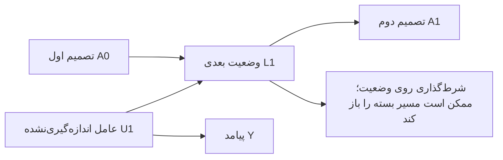

این نمودار، ساختار آموزشیِ مثال اثر صفر است؛ پیکان مستقیم تصمیم به پیامد در آن عمداً وجود ندارد. تطبیق آن با معامله **یک قیاس روش‌شناختی است، نه نتیجهٔ تجربی دربارهٔ بازار**: سفارش می‌تواند موجودی یا نقدشوندگی محلی را تغییر دهد؛ آن وضعیت بر سفارش بعدی و هزینهٔ نهایی اثر می‌گذارد. برای معامله‌گر بسیار کوچک شاید برخی اثرهای بازار قابل‌چشم‌پوشی باشند، ولی بازخورد موجودی همچنان باقی بماند. ثابت‌بودن قیمت در یک شبیه‌ساز بازپخش، نبود اثر واقعی سفارش را اثبات نمی‌کند. شوک مشترک بازار و تعامل معامله‌گران نیز اجازه نمی‌دهد هر دارایی‌ـ‌روز را خودکار یک واحد علّی مستقل فرض کنیم.

### ۲۵.۱۰ پیش از محاسبه، مداخله را تعریف کنیم

سیاست باید برای تاریخچه‌های مربوط، تصمیم، نوع سفارش، مقدار، بازار، اطلاعات مجاز، هزینه و ارزش پایانی را مشخص کند. «همیشه بخر» با «وقتی موجودی کم و شکاف محدود است بخر» یک مداخله نیست. نمونهٔ مشاهده‌شده‌ای که تصادفاً همان تصمیم‌های سیاست را داشته، معمولاً گزینش‌شده است؛ لزوماً جمعیتی نیست که با تحمیل آن سیاست ساخته می‌شد.

| شرط | معنای دقیق | چیزی که جای آن را نمی‌گیرد |
|---|---|---|
| سازگاری یا consistency | مسیر تصمیم مشاهده‌شده با همان نسخهٔ روشنِ مداخله متناظر باشد | واژهٔ مبهم «خرید» بدون مقدار، مکان، نوع سفارش و قرارداد اجرا |
| تبادل‌پذیری ترتیبی | در هر تصمیم، تاریخچهٔ اندازه‌گیری‌شده برای رفع مخدوش‌گری تصمیم و پیامد آینده کافی باشد | زیادبودن ویژگی‌ها یا دقت بالای پیش‌بینی تصمیم |
| مثبت‌بودن حمایت یا positivity | تصمیم موردنیاز سیاست در تاریخچه‌های مربوط، در دادهٔ تولیدشده حمایت داشته باشد | ساختن یک احتمال مثبت با مدل در منطقه‌ای که رفتار واقعی هرگز آن تصمیم را نگرفته است |

مدل زبانی، بریدن وزن و تغییر مقیاس، فقدان واقعیِ حمایت را به شناسایی تبدیل نمی‌کنند. اگر سیاست رفتاری همیشه در یک وضعیت کنش واحدی انجام داده باشد، ارزش کنش جایگزین ممکن است بدون فرض اضافی از همان داده قابل‌شناسایی نباشد.

در مثال دومرحله‌ای، با شرایط شناسایی مناسب، رابطهٔ درست چنین است:

<div class="formula">E[Y<sup>a₀,a₁</sup>] = Σ<sub>l</sub> E[Y | A₀=a₀, L₁=l, A₁=a₁] P(L₁=l | A₀=a₀)</div>

عامل دوم به تصمیم اول وابسته است. نمی‌توان تصمیم اول را عوض کرد ولی توزیع وضعیت پس از آن را بی‌دلیل همان توزیع حاشیه‌ای مشاهده‌شده نگه داشت. برای سیاست تصادفی و پویا، احتمال‌های مداخله و جمع یا انتگرال روی مسیرهای سازگارِ وضعیت و کنش نیز لازم‌اند؛ تعویض نام یک فرمولِ کنش ثابت کافی نیست. مدل انتقال وضعیت، مدل پیامد و هر انتخاب آموختنی باید فقط از اطلاعات آموزشی مجاز برازش شوند و ارزیابی نهایی دست‌نخورده بماند.

### ۲۵.۱۱ بازسازی عددی کامل یک مثال با اثر واقعی صفر

اسکریپت `longitudinal-checks.py` هشت سلول تجمیعی جدول‌های ۲۰٫۱ و ۲۱٫۱ کتاب را بازسازی کرد. شمار افراد و میانگین هر سلول در این آزمون دقیق فرض شدند؛ دادهٔ تازهٔ بیمار یا بازار تحلیل نشده است. جمعیت فرضی ۳۲٬۰۰۰ نفر دارد. احتمال تصمیم اول ۰٫۵ است؛ احتمال تصمیم دوم برای وضعیت صفر ۰٫۴ و برای وضعیت یک ۰٫۸ است. اما توزیع وضعیت با تصمیم اول فرق دارد: احتمال وضعیت یک پس از تصمیم اول صفر، برابر ۰٫۷۵ و پس از تصمیم اول یک، برابر ۰٫۵ است.

| روش | اختلاف «همیشه تصمیم یک» با «همیشه تصمیم صفر» | نتیجهٔ آموزشی |
|---|---:|---|
| مقایسهٔ خام مسیرهای مشاهده‌شده | ۵۴٫۶۶۶۶۶۷ منهای ۶۸؛ برابر ۱۳٫۳۳۳۳۳۳− | انتخاب مسیرهای مطابق سیاست، اینجا سوگیر است |
| مقایسه در هر طبقهٔ وضعیت | ۸− در هر دو طبقه | طبقه‌بندی عادی روی وضعیت، بازخورد را اصلاح نمی‌کند |
| رگرسیون عادی روی مجموع تصمیم‌ها و وضعیت | اثر دو واحد تصمیم، حدود ۸٫۸۱۸۸۹۸− | افزودن وضعیت به رگرسیون مقدار مواجهه، همان g-formula نیست |
| g-formula ترتیبی | ۶۰ منهای ۶۰؛ برابر صفر | توزیع درست وضعیت برای هر تصمیم اول به کار رفت |
| وزن‌دهی معکوس احتمال با احتمال‌های معلوم | صفر | تحت حمایت مثبت، همان تابع غیرپارامتری را برآورد می‌کند |
| مدل ساختاری حاشیه‌ایِ اشباع با وزن درست | عرض از مبدأ ۶۰؛ دیگر ضرایب در حد خطای عددی صفر | مدل وزن‌دار با هدف صحیح، صفر مثال را حفظ کرد |
| محدودکردن همهٔ وزن‌ها به سقف ۴ | حدود ۸٫۳۲۳۲۳۲− | بریدن وزن حتی با احتمال درست می‌تواند سوگیری بسازد |

برای سیاستِ هیچ‌گاه تصمیم یک، محاسبهٔ استانداردشده **۰٫۲۵×۸۴ + ۰٫۷۵×۵۲ = ۶۰** است. برای همیشه تصمیم یک، **۰٫۵×۷۶ + ۰٫۵×۴۴ = ۶۰** می‌شود. تغییر توزیع وضعیت، توضیح می‌دهد چرا میانگین کلِ مداخله می‌تواند یکسان باشد، درحالی‌که میانگین‌های شرطی متفاوت‌اند.

وزن مسیر در این مثال، معکوس حاصل‌ضرب احتمال تصمیم اول و احتمال تصمیم دوم مشروط به تاریخچه است. جمع وزن‌دار جمعیت ۱۲۸٬۰۰۰ شد، چون چهار سیاست را در شبه‌جمعیت نمایندگی می‌کند؛ **چهار برابر اطلاعات مستقل تولید نشده است**. شاخص متعارف اندازهٔ مؤثر مبتنی بر وزن، با درنظرگرفتن تکرار سلول‌ها حدود ۲۳٬۴۰۵٫۷ است. این شاخص، فاصلهٔ اطمینان علّی یا اصلاح وابستگی زمانی نیست. هشت کنترل عددی گذشت؛ برنامهٔ اصلی نویسندگان، بوت‌استرپ عدم‌قطعیت و ارزیابی سیاست معاملاتی اجرا نشدند.

<div class="callout important"><strong>توافق دو روش، فرض علّی را اثبات نمی‌کند</strong><p>برابری غیرپارامتری وزن‌دهی و استانداردسازی، یک رابطهٔ جبری است. اگر تبادل‌پذیری برقرار نباشد، هر دو می‌توانند بر سر یک کمیتِ بدون تعبیر علّی توافق کنند. عددهای مشابه، جای شناسایی را نمی‌گیرند.</p></div>

### ۲۵.۱۲ مقاوم‌بودن، قرارداد مشخص دارد

در ابعاد بالا، محاسبهٔ g به مدل شرطی پیامد و وضعیت نیاز دارد؛ وزن‌دهی به مدل تخصیص تصمیم نیاز دارد. خطاهای آن‌ها یکسان نیست. برآوردگرهای دومقاومِ طولی می‌توانند رگرسیون‌های ترتیبی پیامد و وزن‌های زمان‌دار را تحت الگوهای مشخصِ درستی مدل ترکیب کنند. معنی آن این نیست که هر ترکیبی از دو مدل غلط، خطای یکدیگر را خنثی می‌کند. برازش متقاطع هم تحت شرایط مناسب خطای تخمین را کنترل می‌کند؛ مخدوش‌گر پنهان، ناسازگاری مداخله یا فقدان حمایت را از بین نمی‌برد.

پارادوکس g-null در صفحهٔ چاپی ۲۶۵ دربارهٔ سازگاری بعضی مدل‌های پارامتریِ اشباع‌نشده در حضور بازخورد و فرض صفرِ دقیق است؛ نمی‌گوید رابطهٔ جمعیتی g-formula باطل است. مدل ساختاری حاشیه‌ای هم قیدهای خودش را دارد: ضریبِ مجموع تصمیم‌ها، رابطه‌ای مشخص را برای مسیرهای دارای مجموع برابر فرض می‌کند؛ تصمیم اول دوره با تصمیم آخر دوره لزوماً ارزش اقتصادی یکسان ندارد. مدل تو‌در‌توی ساختاری اثر آخرین تغییر تصمیم را مشروط به تاریخچه پارامتری می‌کند؛ افزایش کارایی آن با حذف تعدیل اثر، به بهای یک فرض اضافی است.

در تصویر صفحهٔ چاپی ۲۶۷ نسخهٔ ۲۰۲۰، مثال رگرسیون بازگشتی در جایی که تصمیم آخر روی یک تنظیم می‌شود، عدد ثابت ۲ را به جای عبارت مجموع تصمیم‌ها می‌گذارد. در پیاده‌سازی لفظی باید تصمیم قبلی مشاهده‌شده حفظ شود، یعنی در آن مرحله `A0+1`، تا مرحلهٔ قبلِ بازگشت روی `A0` مداخله کند. قرارداد عمومیِ حفظ تاریخچه در نکتهٔ فنی ۲۱٫۳، صفحهٔ چاپی ۲۶۸، معیار دقیق‌تری است. این هشدار محدود به نمادگذاریِ همان نسخه و صفحه است؛ کد همراه نویسندگان یا ویرایش بعدی در این بررسی خطاکار اعلام نشده است.

### ۲۵.۱۳ مسیر گمشده با زیان واقعی فرق دارد

فصل ۲۱ سانسور را یک فرایند زمان‌متغیر می‌داند. محدودکردن ارزیابی به مسیرهایی که پیامد کامل دارند، ممکن است نمونه را بر اساس وضعیت و تصمیم انتخاب کند. در پژوهش مالی، ابزارهای باقی‌مانده، خوراک دادهٔ همچنان متصل یا سفارش‌های دارای تأیید موفق نیز می‌توانند نمونهٔ انتخاب‌شده بسازند. بااین‌حال، زیان حذف نماد یا تسویهٔ اجباری، خودِ پیامد اقتصادی است؛ نباید آن را خودکار دادهٔ گمشدهٔ قابل‌حذف فرض کرد و با وزن‌دهی از راهبرد کنار گذاشت.

وزن تصمیم و وزن مشاهده، احتمال‌ها و تاریخچه‌های جدا می‌خواهند. دنبالهٔ وزن، هم‌پوشانی سیاست‌ها، حساسیت به سقف وزن، فرض انتقال وضعیت و قرارداد ارزش پایانی را گزارش کنید. واحد بوت‌استرپ باید مسیر و وابستگی را رعایت کند؛ هر مظنه یک فرد مستقل نیست. حتی تحلیل علّی معتبر نیز به قیمت اجرایی، سفارش ممکن و هزینه نیاز دارد تا ارزش اقتصادی قابل‌دفاع شود.

### ۲۵.۱۴ بازیابی دسترسی با مطالعهٔ علمی اشتباه نشود

در بازبینی ۳۵۷ ردیف شکست دسترسیِ تاریخی، ۱۹ ردیف نشانی محلیِ نمونه بودند؛ شش نشانی با حذف نشانهٔ نگارشی انتهایی به بدنهٔ ازپیش‌دریافت‌شده وصل شدند و ۳۳۲ ردیف هنوز بدنهٔ حل‌شده نداشتند. ۷۴ شناسهٔ یکتای DOI از مسیر ثبت رسمی Crossref پرسیده شد و برای ۶۹ ردیف اولیه فراداده بازیابی شد. این عدد، مقالهٔ خوانده‌شده نیست. E07 و E08 در مسیر عمومی وب همچنان پاسخ ۴۰۳ داشتند؛ تاریخچهٔ شکست پاک نشده است.

از کتاب Cartea نیز [گزیدهٔ رسمی ده‌صفحه‌ای ناشر](https://assets.cambridge.org/97811070/91146/excerpt/9781107091146_excerpt.pdf)، جدا از پیش‌گفتار ارسالی پیدا شد. متن، انگیزهٔ معامله‌گر را از گرفتن یا تأمین نقدینگی جدا می‌کند و تطبیق سفارش را معرفی می‌کند. این گزیده هش مستقل دارد و وسط یک بخش پایان می‌یابد؛ متن کامل کتاب ۲۰۱۵ نیست. کتاب کامل و ویرایش دوم Jansen همچنان در مجموعهٔ محلیِ تأییدشده موجود نیستند.
### ۲۵.۱۵ بازخوانی تکمیلی منبع: گزینش، اندازه‌گیری و پایبندی (صفحات PDF ۱۰۸ تا ۱۳۱)

سوگیری گزینش می‌تواند در مطالعات تصادفی و مشاهده‌ای رخ دهد، اگر تحلیل به گزینش پس از درمان یا بقا مشروط شود؛ تصادفی‌سازی تخصیص درمان را از مخدوش‌سازی پایه محافظت می‌کند، نه از گزینش میان پیامدهای مشاهده‌شده. در تعدیل سانسور، باقی‌ماندن در مشاهده به‌صورت فرایند گزینش مدل می‌شود و به تبادل‌پذیری، مثبت‌بودن و مداخله‌ای تعریف‌پذیر بر سانسور نیاز دارد. رخدادهای رقیب را نباید خودبه‌خود سانسور تلقی کرد. در ساختارهای خاص بقای ضربی، ممکن است سوگیری گزینش میان بازماندگان حذف شود؛ این استثنا قابل تعمیم نیست.

خطای اندازه‌گیری می‌تواند درمان، پیامد، مخدوش‌گرها و برخوردگرها را دربرگیرد. مستقل یا وابسته بودن خطاها و افتراقی یا غیرافتراقی بودنشان ساختار سوگیری را تعیین می‌کند؛ جهت آن عموماً قابل پیش‌بینی نیست. خطای اندازه‌گیری مخدوش‌گر، مخدوش‌سازی باقیمانده بر جا می‌گذارد و می‌تواند تعدیل اثر ظاهری بسازد. در مطالعه تصادفی، تخصیص Z و درمان دریافت‌شده A دو کمیت متفاوت‌اند: تحلیل قصد درمان اثر تخصیص را برآورد می‌کند، درحالی‌که مقایسه‌های مطابق درمان یا بر اساس درمان دریافتی ممکن است دوباره دچار مخدوش‌سازی و گزینش شوند. فرض محدودیت حذف، فرضی ماهوی است؛ برآورد قصد درمان لزوماً محافظه‌کارانه یا مرتبط‌ترین کمیت نیست.

### ۲۵.۱۶ بازخوانی تکمیلی منبع: نمره تمایل و هدف مدل (صفحات PDF ۱۹۳ تا ۲۰۲)

نمره تمایل یک نمره متوازن‌کننده است: با تحقق شرایط شناسایی، توازن متغیرهای اندازه‌گیری‌شده از راه نمره می‌تواند از طبقه‌بندی، تطبیق، استانداردسازی یا وزن‌دهی پشتیبانی کند. طبقات درشت ممکن است عدم‌توازن باقی بگذارند؛ تطبیق جمعیت هدف را تغییر می‌دهد و محدودکردن دامنه صرفاً بر اساس نمره، تفسیر قابلیت انتقال نتیجه را دشوار می‌کند. پارامترهای مدل تمایل مزاحم‌اند، اما پارامترهای درمان در مدل ساختاری به کنتراست علّی هدف دارند. انتخاب متغیر برای پیش‌بینی، قاعده تعدیل علّی نیست: پیش‌بین‌های قوی و غیرضروری درمان می‌توانند واریانس یا مشکل مثبت‌بودن را تشدید کنند و تعدیل برخوردگر می‌تواند سوگیری بیفزاید.

### ۲۵.۱۷ تکمیل خواندن متن باقیمانده و ثبت بازبینی دیداری (صفحات PDF ۵۰ تا ۷۴، ۹۵ و ۱۳۲ تا ۱۹۲)

صفحات ۵۰ تا ۷۴ فصل‌های تعدیل اثر و تعامل علّی را کامل می‌کنند. تعدیل اثر به مقیاس و جمعیت هدف وابسته است؛ تعامل علّی میان اجزای درمان با ناهمگنی اثر یک درمان در زیرگروه‌ها یکی نیست. «اثر در درمان‌شدگان» به جمعیت هدف جداگانه‌ای اشاره دارد و به نسخهٔ متناظر وزن‌دهی یا استانداردسازی نیاز دارد. بخش علل کافی، نمودارهای «پای علّی» را برای نمایش تعامل علّی به‌کار می‌برد، اما تعامل علّی را نمی‌توان با یک نام زیستی صرف یا فقط با مشاهدهٔ هم‌زمان دو مواجهه اثبات کرد. صفحهٔ ۹۵ نیز تفاوت مدل‌های FFRCISTG و NPSEM-IE را در رابطهٔ تبادل‌پذیری شرطی با معیار درِ پشتی ثبت می‌کند؛ استقلال‌های بین‌جهانیِ NPSEM-IE از دادهٔ یک کارآزمایی تصادفی قابل آزمون نیستند.

صفحات ۱۳۲ تا ۱۹۲ از تغییرپذیری تصادفی به مدل‌سازی و روش‌های علّی مدل‌محور می‌روند. کمیت هدف، برآوردگر، برآورد نمونه و بازهٔ اطمینان مفاهیم جدا هستند؛ بازهٔ والد در نمونهٔ کوچک می‌تواند بدکالیبره باشد و فقط خطای تصادفی را پوشش می‌دهد، نه عدم‌قطعیت سوگیری نظام‌مند. اصل شرطی‌بودن در نمونهٔ کم‌بعد از تعدیل متغیر کمکی پشتیبانی می‌کند، اما در ابعاد بالا، طبقه‌بندی شرطی می‌تواند بی‌اطلاع شود. مدل پارامتری برای قرض‌گرفتن اطلاعات میان مقادیر درمان، شکل تابعی را تحمیل می‌کند و مبادلهٔ سوگیری و واریانس دارد. در مثال NHEFS، وزن‌دهی احتمال معکوس و g-formula پارامتری هر دو افزایش میانگین وزن ۳٫۵ کیلوگرمی را پس از ترک سیگار برآورد می‌کنند؛ همخوانی‌شان به‌تنهایی تبادل‌پذیری، مثبت‌بودن، سازگاری، اندازه‌گیری درست یا مشخص‌سازی مدل را ثابت نمی‌کند. وزن‌های تثبیت‌شده پراکندگی را کم می‌کنند؛ مثبت‌بودن ساختاری، در نبود برون‌یابی مدل‌محور، شناسایی کل جمعیت را ناممکن می‌کند. g-estimation با «بلپ‌داون» پیامد و حذف ارتباط آن با درمان، پارامتر مدل ساختاری تو‌در‌تو را برآورد می‌کند؛ این روش فرض تبادل‌پذیری را آزمون نمی‌کند، رتبه‌پایداری فقط ابزار توضیح شهودی است و برای اثر میانگین لازم نیست. در حضور سانسور، g-estimation به‌تنهایی سوگیری گزینش را اصلاح نمی‌کند.

بازبینی دیداریِ تمام ۸۲ صفحهٔ کاندید اکنون با بازکردن تک‌تک رندرهای کامل انجام شده است. یادداشت‌های صفحه‌به‌صفحه در `visual-review/current-run-review.md` محتوای نمودار، جدول یا نکتهٔ فنی قابل مشاهده را خلاصه می‌کند؛ هش رندر فقط فایل را شناسایی می‌کند و به‌تنهایی مدرک بازبینی نیست. این بازبینی ۸۲ صفحه را به‌عنوان کاندیدهای تصویری پوشش می‌دهد، نه اینکه هر صفحهٔ دیگر کتاب تصویر مستقل داشته باشد.


## ۲۶. LB16 — یادگیری آماری از آماده‌سازی داده تا تصمیم و پایش

کتاب «مقدمه‌ای بر روش‌های آماری و یادگیری ماشین برای علم داده»، نوشتهٔ کارلوس آندره ریس پینیرو و مایک پاتتا، انتشارات SAS، اوت ۲۰۲۱، چرخهٔ تحلیل را با مثال‌های کسب‌وکار و مخابرات توضیح می‌دهد. ارجاع‌های این بخش شمارهٔ صفحهٔ PDF محلی ۱۷۰صفحه‌ای هستند؛ در متن اصلی، شمارهٔ چاپی ۱۶ واحد کمتر است. بازبین پیشین صفحات ۱–۱۰۱ را خوانده و این ادامه صفحات ۱۰۲–۱۷۰ را کامل خوانده است. تصویر ۳۰ صفحهٔ منتخب نیز بررسی شد. مطالعهٔ تمام متن استخراج‌شده کامل است؛ مشاهدهٔ تمام تصاویر، اجرای SAS، بازتولید نتایج تجاری و مطالعهٔ تمام منابع ارجاعی کامل نیست. این بخش بازنویسی آموزشی و نقد مستقل است.

ارزش اصلی کتاب اتصال مسئلهٔ کسب‌وکار، داده، مدل، ارزیابی و استقرار است. بااین‌حال چند تعریف و توصیهٔ ارزیابی آن خطای مهم دارد. بنابراین نباید توصیف یک کاربرد تجاری را بدون کنترل تعریف‌ها و طراحی آزمایش به شاهد علمی برای یک راهبرد معاملاتی تبدیل کرد.

### ۲۶.۱ ابتدا واحد مشاهده و زمان دسترسی را مشخص کنید

نمونه‌گیری مبتنی بر رخداد در صفحهٔ ۴۰، رخدادهای نادر را بیش‌نمونه‌گیری می‌کند تا دادهٔ آموزشی متوازن‌تر شود. این کار می‌تواند تخمین را کاراتر کند، اما احتمال حاصل الزاماً احتمال جامعه نیست. اگر انتخاب نمونه فقط به برچسب وابسته باشد و توزیع ویژگی‌ها در هر کلاس تغییر نکند، باید شانس نمونه را در نسبت شانس پیشین جامعه به شانس پیشین نمونه ضرب کرد. «شانس» برای احتمال p برابر p/(1−p) است. برای نمونه، احتمال کالیبره‌شدهٔ ۰٫۸ در نمونه‌ای با فراوانی رخداد ۵۰٪، در جامعه‌ای با فراوانی ۱٪ به حدود ۳٫۸۸۳۵٪ تبدیل می‌شود. این اصلاح انتخاب وابسته به ویژگی، نمرهٔ کالیبره‌نشده یا تغییر رابطهٔ هدف و ورودی را برطرف نمی‌کند.

جای‌گذاری دادهٔ مفقود و ساخت نشانگر مفقودی در صفحهٔ ۴۲ دو عمل متفاوت‌اند: اولی یک مقدار قابل‌استفاده تولید می‌کند و دومی اطلاعات فرایند ثبت داده را نگه می‌دارد. نشانگر ممکن است خرابی خوراک داده را یاد بگیرد. میانگین جای‌گذاری، مقیاس‌بندی، واژگان متن، PCA و انتخاب ویژگی باید فقط روی آموزش برازش و سپس برای آینده ثابت شوند. در دادهٔ مالی، تاریخ پایان دورهٔ گزارش مالی با زمان انتشار و دریافت آن یکی نیست؛ دادهٔ اصلاح‌شده نیز به نسخه‌های تاریخی نیاز دارد. این الزامات، کاربرد تحلیلی برای پژوهش مالی‌اند و نتیجهٔ بک‌تست کتاب محسوب نمی‌شوند.

تحلیل مؤلفه‌های اصلی در صفحهٔ ۴۶ بیشترین واریانس ورودی را با قید تعامد حفظ می‌کند؛ «۹۵٪ واریانس توضیح‌داده‌شده» به معنی حفظ ۹۵٪ اطلاعات پیش‌بینی هدف نیست. گاهی سیگنال در جهتی کم‌واریانس قرار دارد. خودرمزگذار صفحهٔ ۴۸ نیز بازسازی ورودی را بهینه می‌کند، نه سود آینده را. اگر تعداد مؤلفه‌ها یا معماری با امتیاز اعتبارسنجی انتخاب شود، این انتخاب باید داخل حلقهٔ ارزیابی انجام شود. نگه‌داشتن هم‌زمان یک متغیر و تبدیل آن نیز انتخاب مدل است و ممنوعیت عمومی ندارد.

### ۲۶.۲ توان تقریب با تخمین موفق و مقاومت در برابر پرت‌ها فرق دارد

رگرسیون خطی و لجستیک خط مبنای قابل‌فهمی فراهم می‌کنند. کمترین مربعات برای محاسبهٔ ضریب‌ها به خطای نرمال نیاز ندارد؛ فرض‌های توزیعی برای برخی نتیجه‌های استنباطیِ نمونهٔ محدود مطرح‌اند. ضریب لجستیک تغییر لگاریتم شانس شرطی را نشان می‌دهد و نمایی‌کردن آن نسبت شانس می‌دهد؛ این عدد تغییر مستقیم احتمال یا اثر یک مداخله نیست. معنی آن به کدگذاری و متغیرهای شرطی‌شده بستگی دارد؛ بحث صفحهٔ ۵۹ را با این تمایز باید خواند.

جنگل تصادفی در صفحهٔ ۶۹ از بازنمونه‌گیری و تجمیع استفاده می‌کند. درخت‌ها همچنان می‌توانند هم‌بسته باشند؛ عبارت استقلال در شکل، استقلال آماری کامل را اثبات نمی‌کند. تقویت گرادیانی در صفحهٔ ۷۰ مدل را مرحله‌به‌مرحله به‌صورت جمعی می‌سازد: F_m(x)=F_(m−1)(x)+ηh_m(x). یادگیرندهٔ تازه معمولاً گرادیان منفی زیان را تقریب می‌زند و برازش باقی‌مانده، حالت خاص زیان مربعی است. همان صفحه با وجود معادلهٔ جمعی، خروجی را «میانگین» نیز می‌نامد؛ این بیان با میانگین‌گیری معمول جنگل یکی نیست. ادعای برتری همیشگی سرعت، دقت یا تعمیم یکی از این روش‌ها نیز قابل دفاع نیست.

صفحهٔ ۷۴ از انعطاف شبکهٔ عصبی به مقاومت در برابر دادهٔ پرت می‌رسد؛ این نتیجه معتبر نیست. با زیان مربعی، چند باقی‌ماندهٔ بسیار بزرگ می‌توانند برازش را منحرف کنند. ظرفیت نمایش تابع، موفقیت بهینه‌سازی، تعمیم و مقاومت، چهار مسئلهٔ جدا هستند. منظم‌سازی و زیان مقاوم باید با هدف مشخص انتخاب شوند. شکل SVM در صفحهٔ ۸۱ نیز نمایش آموزشی جداسازی است؛ برای کلاس‌های هم‌پوشان باید حاشیهٔ نرم و جریمهٔ خطا را در نظر گرفت. وجود بردارهای پشتیبان نیاز به کنترل مقیاس، پیچیدگی کرنل یا ابعاد را حذف نمی‌کند.

تجزیهٔ ماتریس در صفحهٔ ۸۶ بازنمایی نهفتهٔ کاربر و محصول می‌سازد. امتیاز ثبت‌نشده معمولاً یک مشاهدهٔ تصادفیِ ازدست‌رفته نیست؛ مشتری خود انتخاب کرده چه چیزی را ببیند یا بخرد. پیش‌بینی علاقه با برآورد اثر توصیه تفاوت دارد. در کاربرد مالی نیز شباهت دارایی‌ها به‌خودی‌خود پیش‌بینی بازده نیست. در مدل دومرحله‌ای رخداد و شدت، اگر زیان بیرون رخداد صفر باشد، زیان مورد انتظار برابر «احتمال رخداد × میانگین زیان مشروط به رخداد» است. دروازهٔ سخت صفر و یک در صفحهٔ ۹۰ می‌تواند موارد کم‌احتمال اما پرزیان را حذف کند؛ این روش با حفظ احتمال و تصمیم بر اساس زیان مورد انتظار یکسان نیست.

### ۲۶.۳ خوشه‌بندی یک بازنمایی می‌سازد، نه حقیقت قطعی دربارهٔ رژیم‌ها

هدف متداول k-means با مرکز میانگین، مجموع مربع فاصله‌های اقلیدسی است؛ نه مجموع فاصلهٔ بدون مربع که بیان صفحهٔ ۱۰۳ القا می‌کند. با انتساب ثابت نقاط، میانگین کمینه‌کنندهٔ زیان مربعی است. تغییر مقیاس، هندسهٔ مسئله را تغییر می‌دهد؛ پس استانداردسازی صرفاً آرایش عددی نیست، بلکه وزن‌دهی به متغیرهاست. استقلال آماری ورودی‌ها شرط ریاضی این الگوریتم نیست، هرچند ویژگی‌های هم‌بسته ممکن است یک جهت را چندبار وزن دهند. مقداردهی اولیه، تکرارهای مستقل، پرت‌ها، خوشهٔ خالی و معیار توقف باید ثبت شوند؛ شکل صفحهٔ ۱۰۴ فقط سازوکار پایه را نشان می‌دهد.

خوشه‌بندی سلسله‌مراتبی معمولاً قاعدهٔ پیش‌فرض برای انتساب مشاهدهٔ جدید ندارد؛ این به معنی ناممکن‌بودن تعریف یک قاعدهٔ بیرونی نیست. قاعدهٔ افزوده باید جداگانه اعتبارسنجی شود. در نقشهٔ خودسازمان‌ده، نزدیک‌ترین نمونهٔ نماینده یا BMU برنده می‌شود و همسایه‌های آن به‌روزرسانی می‌شوند؛ شکل صفحهٔ ۱۰۷ این سازوکار را روشن می‌کند. نقشهٔ دوبعدی تضمین نمی‌کند همهٔ فاصله‌ها و رابطه‌های اصلی حفظ شده‌اند؛ خطای کمّی‌سازی و خطای توپولوژیک باید بررسی شوند.

شمارهٔ خوشه یک نام است. رگرسیون روی برچسب‌های عددی خوشه در صفحهٔ ۱۱۱، اگر این اعداد مانند کمیت پیوسته استفاده شوند، ترتیب ساختگی وارد می‌کند. از طبقه‌بندی، متغیرهای نشانگر یا تحلیل ناوابسته به جایگشت نام‌ها استفاده کنید. مدل جداگانه برای هر بخش در صفحات ۱۱۲–۱۱۳ ممکن است ناهمگنی را بهتر بگیرد، اما نمونهٔ هر مدل را کوچک‌تر می‌کند؛ برتری آن بر مدل کلی یا تجمیع جزئی تضمین ندارد. خوشه‌بندی باید داخل هر بخش آموزش انجام و تمام خط لوله خارج از زمان ارزیابی شود.

مثال نامهٔ وصول مطالبات در صفحهٔ ۱۱۰ نیز به یک تمایز علّی نیاز دارد: شناسایی مشتریانی که تحت سیاست موجود پرداخت می‌کنند، مشخص نمی‌کند پرداخت چه کسانی با ارسال نامه تغییر می‌کند. برای دومی به تصادفی‌سازی یا فرض‌های شناسایی مداخله نیاز داریم.

### ۲۶.۴ در قواعد انجمنی، مخرج و نرخ پایه را گم نکنید

برای قاعدهٔ A→B، پشتیبانی برابر P(A∩B)، اطمینان برابر P(B|A) و لیفت برابر P(A∩B)/(P(A)P(B)) است. پشتیبانی و لیفت متقارن‌اند؛ اطمینان متقارن نیست. فرمول عمومی صفحهٔ ۱۱۷ درست است، اما همان صفحه ۲/۵ را ۲۰٪ می‌نویسد؛ مقدار درست ۴۰٪ است. در توضیح پهن‌باند→بستهٔ داده نیز مخرج با تعداد بستهٔ داده توضیح داده شده، درحالی‌که باید تعداد مقدّم یعنی پهن‌باند باشد. مشاهدهٔ شکل صفحهٔ ۱۱۸ تأیید می‌کند هر دو تعداد اتفاقاً سه هستند و خطای مفهومی در عدد نهایی پنهان می‌ماند.

| کمیت در مثال صفحات ۱۱۹–۱۲۰ | مقدار دقیق | نتیجه |
|---|---|---|
| فراوانی پهن‌باند | ۸۵۰۰/۱۰۰۰۰ = ۸۵٪ | نرخ پایه بسیار بالاست |
| پهن‌باند مشروط به موبایل | ۵۰۰۰/۶۰۰۰ ≈ ۸۳٫۳۳۳٪ | احتمال شرطی بالا کافی نیست |
| لیفت | حدود ۰٫۹۸۰۳۹۲ | اندکی کمتر از استقلال |
| پهن‌باند در گروه بدون موبایل | ۳۵۰۰/۴۰۰۰ = ۸۷٫۵٪ | گروه مقایسه حتی فراوانی بیشتری دارد |

حتی لیفت بالاتر از یک نیز رابطهٔ علّی نیست. خود کتاب در صفحهٔ ۱۱۹ نسبت به تفسیر علت و معلول هشدار می‌دهد، هرچند عبارت‌های صفحهٔ ۱۱۸ گاهی رنگ علّی دارند. حداقل پشتیبانی ممکن است اقلام نادر و گران‌ارزش را حذف کند؛ جست‌وجوی هزاران قاعده نیز به کنترل چندآزمونی، عدم‌قطعیت و پایداری در آینده نیاز دارد. ترتیب رخداد در صفحات ۱۲۲–۱۲۸ تقدم زمانی می‌افزاید، نه شناسایی علّی. ترتیب اسکن کالا می‌تواند با ترتیب تصمیم مشتری فرق کند. «تحلیل مسیر» این فصل به مسیر رخداد و کلیک اشاره دارد و با تحلیل مسیر معادلات ساختاری یکی نیست.

### ۲۶.۵ متن نیز محصول یک فرایند اندازه‌گیری است

ماتریس سند–واژه، SVD، موضوع‌ها و خوشه‌های متن در صفحات ۱۲۹–۱۳۱ دادهٔ نامنظم را به ویژگی قابل‌تحلیل تبدیل می‌کنند، اما اعتبار برچسب را تضمین نمی‌کنند. دسته‌ای که اپراتور مرکز تماس از منو انتخاب کرده ممکن است دلیل واقعی تماس نباشد. خوشه‌بندی سخت با عضویت آمیختهٔ موضوعی فرق دارد و خوشه‌بندی نرم نیز وجود دارد. در متن مالی باید نفی، واحد، تاریخ و نام موجودیت حفظ شود؛ نسخه‌های بازنشرشده حذف و واژگان و IDF فقط روی متن‌های در دسترسِ آموزش برازش شوند. موضوعی با واریانس واژگانی بالا الزاماً اطلاعات بازده ندارد.

### ۲۶.۶ خطای تعریف گراف، نتیجهٔ تحلیل را تغییر می‌دهد

| صفحهٔ PDF | بیان مسئله‌دار | تعریف قابل‌استفاده |
|---|---|---|
| ۱۳۷ | هستهٔ k مانند انتخاب رأس‌های پُردرجهٔ گراف اولیه | زیرگراف بیشینه‌ای که درجهٔ داخلی همهٔ رأس‌هایش دست‌کم k باشد؛ حذف رأس‌ها تکراری است |
| ۱۳۷–۱۳۸ | مؤلفهٔ دوهمبند با حذف یک رأس شکسته می‌شود | مؤلفهٔ دوهمبند درون خود رأس برشی ندارد؛ حذف رأس برشی می‌تواند یک مؤلفهٔ همبند را بشکند |
| ۱۳۷ | یکی‌گرفتن دسترسی جهت‌دار و همبندی | همبندی ضعیف، همبندی قوی و دسترسی یک‌طرفه را جدا تعریف کنید |
| ۱۳۹–۱۴۰ | بیشینه‌کردن قدرت رابطه به‌جای تعریف کوتاه‌ترین مسیر | ابتدا معنای وزن و تبدیل موجه آن به فاصله را مشخص کنید؛ نزدیکی متداول بر کوتاه‌ترین فاصله‌ها بنا می‌شود |
| ۱۴۵ | معرفی MST به‌عنوان کمینه‌کردن تعداد رأس‌ها | تمام رأس‌ها حفظ و مجموع وزن یال‌های درخت پوشا کمینه می‌شود؛ درخت همبند n−1 یال دارد |
| ۱۴۶ | بستار تعدی مانند اتصال همهٔ جفت‌ها | یال جهت‌دار فقط برای جفت‌های قابل‌دسترسی اضافه می‌شود؛ قرارداد حلقهٔ خودی باید روشن باشد |

بند بعدی صفحهٔ ۱۴۵ تعریف وزنِ درخت پوشا را درست بیان می‌کند؛ بنابراین خطا مربوط به جملهٔ معرفی است و نباید تمام بحث را نادرست دانست. تعریف‌های اصلاح‌شده با مستندات اصلی [مؤلفه‌های دوهمبند NetworkX](https://networkx.org/documentation/stable/reference/algorithms/generated/networkx.algorithms.components.biconnected_components.html) و [هستهٔ k](https://networkx.org/documentation/stable/reference/algorithms/generated/networkx.algorithms.core.k_core.html) سازگارند. یک مثال کوچک کافی است: با حذف رأس میانیِ مسیر سه‌رأسی، اتصال از بین می‌رود، اما با حذف هر رأس مثلث، دو رأس باقی‌مانده متصل‌اند. در ستاره، مرکز درجهٔ بالایی دارد ولی هستهٔ ۲ تهی است. در گراف A→B همراه با C جداافتاده، بستار تعدی یال A→C نمی‌سازد.

اختلاف نرخ ریزش مشتریان در شبکهٔ مخابراتی صفحهٔ ۱۴۲ به‌تنهایی نفوذ همتا را اثبات نمی‌کند؛ مواجههٔ مشترک، انتخاب و تداخل شبکه‌ای توضیح‌های جایگزین‌اند. مرکزیت نیز خودبه‌خود اثرگذاری علّی نیست. شبکهٔ هم‌نویسندگی با شبکهٔ استناد معنای یال متفاوتی دارد. استنباط خانه یا محل کار از دکل‌ها در صفحات ۱۴۷–۱۴۹ به پوشش نمونه وابسته است و تجمیع داده به‌تنهایی ناشناس‌بودن را تضمین نمی‌کند.

### ۲۶.۷ آزمون نهایی را از فرایند انتخاب دور نگه دارید

صفحهٔ ۴۰ درست توضیح می‌دهد که پس از انتخاب مدل، آزمونی برای ارزیابی نهایی لازم است. صفحهٔ ۱۵۵ بعداً انتخاب مدل برنده با نتیجهٔ آزمون یا میانگین اعتبارسنجی و آزمون را مجاز می‌شمارد. این کار آزمون را مصرف می‌کند و استقلال ارزیابی را از بین می‌برد. آموزش برای برازش، اعتبارسنجی یا حلقهٔ درونی برای انتخاب ویژگی و ابرپارامتر و آستانه، و آزمون بیرونیِ دست‌نخورده برای برآورد نهایی است. [راهنمای رسمی اعتبارسنجی متقاطع scikit-learn](https://scikit-learn.org/stable/modules/cross_validation.html) این نقش‌ها را جدا می‌کند. در پژوهش معاملاتی باید زمان دسترسی ویژگی، افق بلوغ برچسب، رخدادهای هم‌پوشان و گروه‌بندی رعایت شوند؛ تقسیم تصادفی معمول همیشه آزمایش مناسبی نیست.

صفحهٔ ۱۵۶ ارزیابی چندبخشی و تجمیع مدل‌ها را مخلوط می‌کند. در هر دور k-fold معمول، تمام خط لوله باید از نو و بدون بخش کنارگذاشته‌شده برازش شود. میانگین امتیاز بخش‌ها یک آمارهٔ ارزیابی است؛ مدل تجمیعی نیازمند قاعدهٔ ترکیب پیش‌بینی‌های مدل‌های جداست. برای هدف ۱ و دو پیش‌بینی ۰ و ۲، میانگین زیان مربعی مدل‌ها ۱ است، اما زیان میانگین پیش‌بینی‌ها صفر است. این دو عمل یکی نیستند. ارزیابی دوبارهٔ یک مدل روی بخشی که قبلاً در آموزش آن بوده، ارزیابی خارج از نمونه نمی‌شود.


### ۲۶.۸ مخرج معیار و تابع هزینه باید آشکار باشد

در ماتریس صفحهٔ ۱۵۷، پیش‌بینی‌ها در سطر و واقعیت در ستون است؛ قرارداد نرم‌افزارها ممکن است متفاوت باشد. حساسیت TP/(TP+FN) و ویژگی TN/(TN+FP) است. فرمول‌های صفحهٔ ۱۵۸ درست‌اند، اما متن به‌اشتباه ویژگی را مکمل حساسیت می‌نامد. برای TP=8 و FN=2 و TN=81 و FP=9، حساسیت ۰٫۸ و ویژگی ۰٫۹ است؛ مکمل حساسیت ۰٫۲ است. رابطهٔ درست «نرخ منفی کاذب = ۱−حساسیت» و «نرخ مثبت کاذب = ۱−ویژگی» است.

فراوانی رخداد، آستانهٔ بهینهٔ عمومی نیست. با احتمال کالیبره‌شدهٔ جامعه، هزینهٔ صفر برای تصمیم درست و هزینه‌های ثابت مثبت و منفی کاذب، آستانه برابر C_FP/(C_FP+C_FN) است. قید ظرفیت، برش رتبه‌بندی می‌سازد؛ منفعت مداخله، سقف موقعیت و هزینهٔ غیرخطی به تابع تصمیم غنی‌تری نیاز دارند. AUC توان رتبه‌بندی را می‌سنجد، نه کالیبراسیون و سودآوری را. امتیاز احتمالاتی مناسب، کالیبراسیون و پیامد اقتصادی را در کنار تفکیک‌پذیری گزارش کنید.

مثال نمودار بهره و لیفت در صفحات ۱۶۰–۱۶۱ ابهام مخرج دارد: متن ۲۱٪ را نرخ پاسخ در ۵٪ بالای فهرست می‌نامد، اما شکل ۹٫۸ آن را سهم تجمعی از همهٔ مثبت‌ها نشان می‌دهد. اگر q سهم انتخاب‌شدهٔ جامعه، π فراوانی رخداد و r دقت مثبت در گروه انتخاب‌شده باشد، آنگاه یادآوری=q×r/π و لیفت=r/π=یادآوری/q است. وقتی q و π هر دو ۵٪ باشند، دقت مثبت و یادآوری اتفاقاً هر دو ۲۱٪ می‌شوند و لیفت ۴٫۲ است؛ همین برابری خطا را پنهان می‌کند. با π=۱۰٪ و q=۵٪ و r=۲۱٪، یادآوری ۱۰٫۵٪ و لیفت ۲٫۱ است. داشبورد باید مخرج را صریح بنویسد. پیش‌بینی پاسخ مشتری نیز افزایش پاسخِ ناشی از تماس را اثبات نمی‌کند.

### ۲۶.۹ استقرار باید زنجیرهٔ شواهد را حفظ کند

بحث مدل برنده و رقیب، ثبت، انتشار و پایش در صفحات ۱۶۳–۱۶۸ پایهٔ عملی مفیدی دارد. تمام زنجیرهٔ تبدیل، مدل، آستانه، طرح داده، نسخهٔ آموزش، وابستگی‌ها، تأخیر امتیازدهی و سیاست تصمیم باید نسخه‌بندی شود. مدل رقیبِ قبلی پس از تغییر محیط خودبه‌خود معتبر نمی‌شود و به ارزیابی جاری نیاز دارد. خرابی داده را از تغییر جمعیت و تغییر رابطهٔ پیش‌بینی جدا کنید؛ پیش از اعلام افت عملکرد، تأخیر رسیدن برچسب‌ها را لحاظ کنید. محرک بازآموزی و بازگشت نسخه، هزینه و هشدار کاذب باید از پیش مشخص باشند. امکان افت مدل یک ریسک است، نه قضیه‌ای که افت همهٔ مدل‌ها در هر افقی را تضمین کند.

آزمون همراه، حساب پشتیبانی، لیفت با نرخ پایه، تفاوت مخرج بهره و دقت، حساسیت و ویژگی، اصلاح شانس پیشین، آستانهٔ هزینه، مثال‌های نقض گراف و تفاوت میانگین زیان و زیان میانگین پیش‌بینی را مستقل بررسی می‌کند. این‌ها بازتولید مطالعهٔ تجاری، اجرای SAS یا اثبات سود راهبرد نیستند. تصاویر مشاهده‌نشده و منابع بیرونی همچنان در دفتر منابع باز می‌مانند.


## ۲۷. روزنبام: ادعای علّی به طراحی‌ای نیاز دارد که توضیح‌های رقیب را از هم جدا کند

**دامنهٔ بررسی.** متن استخراج‌شدهٔ تمام ۲۱۸ صفحهٔ PDF کتاب *Causal Inference* اثر پل آر. روزنبام، انتشارات MIT Press، سال ۲۰۲۳، با شناسهٔ LB11 خوانده شد؛ یادداشت‌ها، واژه‌نامه، کتاب‌نامه و نمایه نیز در این دامنه‌اند. هر ۱۲ شکل شماره‌دار در تصویر صفحهٔ اصلی کنترل شدند. شماره‌های این بخش صفحهٔ PDF هستند؛ شمارهٔ چاپی متن اصلی ۱۴ واحد کمتر است. این بررسی، تحلیل همین نسخهٔ فراهم‌شده را کامل می‌کند؛ خواندن همهٔ منابع کتاب یا بازتولید داده‌ها و آزمایش‌های آن را شامل نمی‌شود. متن حاضر تألیف تحلیلی و گزینشی است، نه ترجمهٔ کامل کتاب دارای حق نشر. مثال‌های پزشکی تاریخی فقط برای توضیح طراحی پژوهش‌اند و توصیه‌های زمان نگارش کتاب به‌عنوان راهنمای پزشکی امروز بازنشر نمی‌شوند.

### ۲۷.۱ پیش از انتخاب برآوردگر، وضعیت خلاف‌واقع را مشخص کنیم

در فصل‌های ۱ و ۲، صفحات ۱۵ تا ۶۰، اثر علّی فردی تفاوت دو پیامد بالقوهٔ **همان واحد** است: اگر مداخله را دریافت کند و اگر دریافت نکند. تفاوت مشاهده‌شده میان دو شخص متفاوت، به‌خودی‌خود چنین اثری نیست. مشکل این است که برای هر واحد فقط یکی از این دو وضعیت مشاهده می‌شود. بااین‌حال، میانگین اثر در یک جمعیت محدود را می‌توان با تخصیص تصادفی مشخص برآورد کرد:

<div class="formula" dir="ltr">τ = (1/N) Σᵢ [Yᵢ(1) − Yᵢ(0)].</div>

تصادفی‌سازی توزیع احتمالی **تخصیص‌ها** را ایجاد می‌کند؛ پیامدهای بالقوه را ثابت در نظر می‌گیریم. این روش هر دو پیامد فردی را آشکار نمی‌کند. حتی برآوردگر نااریب ممکن است در تک‌تک تحقق‌های یک آزمایش کوچک، با مقدار درست برابر نباشد. دو واحد را در نظر بگیرید که مداخله بر هیچ‌کدام اثر ندارد، ولی پیامد واحد اول همواره صفر و پیامد واحد دوم همواره یک است. اگر دقیقاً یکی تصادفی مداخله بگیرد، اختلاف مداخله و کنترل یا منفی یک است یا مثبت یک. امید ریاضی اختلاف صفر و برابر اثر واقعی است، اما هیچ‌یک از دو مشاهده صفر نیست. تعداد بیشتر جفت‌های تصادفی مستقل، با شرایط مناسب، دقت را بهتر می‌کند؛ تضمین امید ریاضی، تضمین سود در یک افق محدود معامله نیست.

| پرسش | کمیت هدف | طراحی چه چیزی را روشن می‌کند؟ | چه چیزی هنوز باز است؟ |
|---|---|---|---|
| آیا سیگنال، بازده فردا را پیش‌بینی می‌کند؟ | توزیع پیش‌بینی شرطی | خطای خارج از زمان و کالیبراسیون | اینکه تغییر تصمیم، بازده را تغییر می‌دهد |
| آیا مسیریاب جدید هزینهٔ اجرا را کاهش می‌دهد؟ | اختلاف هزینه تحت دو سیاست اجرایی | مقایسهٔ تصادفی با پروتکل ثابت | اثر سفارش‌ها بر یکدیگر و انتقال نتیجه به بازار دیگر |
| آیا دخالت اختیاری معامله‌گر مفید است؟ | سود خلاف‌واقع برای همان تصمیم‌های واجد شرایط | مطالعهٔ مشاهده‌ای با بررسی سازوکار انتخاب | اطلاعات خصوصی، فوریت پنهان و تصمیم‌های ثبت‌نشده |
| آیا پیشنهاد تصادفی، استفاده از سامانه را بهبود می‌دهد؟ | اثر پیشنهاد و شاید اثر استفاده در پذیرندگان تشویق | اثر پیشنهاد مستقیماً؛ اثر استفاده با فرض‌های بیشتر | اثر برای کسانی که همیشه یا هیچ‌وقت استفاده می‌کنند |

این کاربردهای معاملاتی، استنتاج روش‌شناختی ما هستند؛ کتاب در این مثال‌ها آزمایش مالی انجام نداده است. ابتدا واحد تحلیل، مانند سفارش، حساب یا روز، نسخهٔ مداخله، افق، هزینهٔ خالص، شرط ورود و سازوکار تخصیص را مشخص کنید. در بازار، سفارش مداخله‌گرفته می‌تواند قیمت اجرای سفارش کنترل را تغییر دهد. بنابراین استقلال یا نبود تداخل، فرضی است که باید بررسی شود.

> **صفر بودن میانگین اثر با بی‌اثر بودن مداخله برای همه فرق دارد.** فرض صفر تیز فیشر می‌گوید برای هر واحد دو پیامد بالقوه برابرند؛ میانگین صفر اجازه می‌دهد اثرهای مثبت و منفی همدیگر را خنثی کنند. آزمون تصادفی‌سازی که پیامدهای گم‌شده را تحت فرض صفر تیز پر می‌کند، خودبه‌خود همان تفسیر را برای فرض ضعیف‌تر میانگین صفر ندارد. مقدار p نیز احتمال درست بودن فرض صفر نیست.

توزیع مرجع باید با پروتکل تخصیص سازگار باشد: تعداد ثابت در هر بازو، پرتاب مستقل سکه، تصادفی‌سازی طبقه‌بندی‌شده و احتمال‌های معلوم نامساوی، توزیع‌های یکسانی ایجاد نمی‌کنند. کتاب ساده‌سازی سکه را در یادداشت ۲.۵، صفحهٔ ۱۹۶، تصریح می‌کند. برابر بودن احتمال تخصیص، شرط همیشگی همهٔ کارآزمایی‌های معتبر نیست.

در مثال ساده‌شدهٔ PALM، نسبت بقا ۱۱۳ از ۱۷۴ در برابر ۸۵ از ۱۶۹ است. اختلاف دقیق حدود ۰٫۱۴۶۴۶۷، یعنی **۱۴٫۶۵ واحد درصد** است؛ آن را نباید «افزایش نسبی ۱۴٫۶۵ درصدی» نامید. با شرط ثابت بودن تعدادها و ۱۹۸ بازمانده از ۳۴۳ نفر، محاسبهٔ فوق‌هندسی انجام شد. دوبرابر دُم کوچک‌تر، مقدار دوطرفهٔ ۰٫۰۰۸۲۹۸۴۵ می‌دهد؛ تعریف دوطرفه بر اساس ترتیب احتمال، ۰٫۰۰۶۴۳۵۷۵ می‌دهد. تفاوت این دو، یادآور ضرورت تعریف دقیق آزمون است. این محاسبه فقط حساب مثال کتاب را کنترل می‌کند؛ دادهٔ اصلی کارآزمایی، توقف میانی و اجرای پروتکل مستقل ممیزی نشده‌اند.

### ۲۷.۲ توازن مشاهده‌شده را اندازه می‌گیریم؛ نبود مخدوش‌گری را فرض می‌کنیم

فصل‌های ۳ و ۴، صفحات ۶۱ تا ۹۸، ۴۴۱ سیگاری روزانه را با ۱۵۰۶ فرد هرگزسیگاری مقایسه می‌کنند. شکل ۲ تفاوت سن، درآمد و تحصیلات را نشان می‌دهد؛ شکل ۳ جدایی امتیازهای گرایش برآوردشده را حتی با وجود هم‌پوشانی تک‌متغیرها آشکار می‌کند. هم‌پوشانی نمودارهای حاشیه‌ای، شباهت ترکیب مشترک متغیرها را تضمین نمی‌کند. تفاوت پیامد در شکل ۴ به‌تنهایی مشخص نمی‌کند که علت، مداخله است یا تفاوت پیشین گروه‌ها.

امتیاز گرایش، احتمال دریافت مداخله با داشتن متغیرهای پیش از مداخله است. خاصیت توازن آن دربارهٔ **احتمال واقعی تخصیص** و همان متغیرهای واردشده در مدل است. تبدیل مقایسهٔ شرطی به اثر علّی، علاوه بر این، به تبادل‌پذیری شرطی پیامدهای بالقوه و هم‌پوشانی نیاز دارد:

<div class="formula" dir="ltr">e(X)=P(A=1|X); &nbsp; (Y(0),Y(1)) ⟂ A | X; &nbsp; 0 &lt; e(X) &lt; 1.</div>

یک طبقه‌بند بسیار دقیق برای تشخیص دریافت‌کنندهٔ مداخله، شناسایی علّی را ثابت نمی‌کند؛ شاید دقیقاً به این دلیل دقیق است که هم‌پوشانی دو گروه ضعیف است. مدل بدِ احتمال تخصیص نیز خاصیت نظری امتیاز واقعی را به ارث نمی‌برد.

نمونهٔ تطبیق‌یافته همهٔ ۴۴۱ فرد مداخله و ۴۴۱ کنترل منتخب را نگه می‌دارد و ۱۰۶۵ کنترل حذف می‌شوند. شکل‌های ۵ تا ۷ توازن متغیرها و امتیاز را نشان می‌دهند؛ شکل ۸ نشان می‌دهد اختلاف پیامد باقی مانده است. انتخاب کنترل‌های شبیه گروه مداخله، جمعیت هدف را تغییر می‌دهد. چنین طرحی معمولاً به میانگین اثر برای دریافت‌کنندگان مداخله نزدیک است؛ خودبه‌خود میانگین اثر برای تمام ۱۹۴۷ نفر اولیه نیست. حذف برخی دریافت‌کنندگان با محدودیت فاصلهٔ سخت‌تر، هدف را دوباره تغییر می‌دهد. تعداد و ویژگی حذف‌شدگان بخشی از نتیجه است.

برابری امتیاز به معنای یکسان بودن افراد نیست. اگر دو واحد با احتمال یکسان p، مستقل مداخله بگیرند و شرط کنیم دقیقاً یکی مداخله گرفته است، احتمال هر آرایش درون جفت برابر نیم می‌شود؛ هم برای p برابر نیم و هم یک‌ششم:

<div class="formula" dir="ltr">P(first treated | exactly one treated) = p(1−p) / [2p(1−p)] = 1/2.</div>

شرط «دقیقاً یکی» ضروری است. در نمونهٔ محدود، تطبیق تنها بر امتیاز برآوردی ممکن است توازن متغیرهای فردی را برقرار نکند؛ کتاب به همین دلیل توازن اجباری ترکیب سن، جنس و تحصیلات را مطرح می‌کند. در مثال، ۵۴ طبقه به‌طور میانگین فقط حدود ۸٫۲ فرد مداخله دارند و در ۱۴ طبقه تعداد حداکثر سه است. بزرگی کل داده، کمیابی مقایسه‌های محلی را برطرف نمی‌کند.

در مطالعهٔ معامله، فاصلهٔ خرید و فروش، نوسان، اندازه و فوریت سفارش، محل اجرا و ساعت تصمیم را پیش از مداخله ثبت کنید. تنظیم بر متغیرهای پس از اجرا می‌تواند سوگیری تازه‌ای ایجاد کند. اختلاف استانداردشده، توزیع‌ها، هم‌پوشانی و برهم‌کنش‌های مرتبط را کنترل کنید. نامعنا بودن آزمون توازن، هم‌ارزی عملی دو گروه را ثابت نمی‌کند؛ تطبیق متغیرهای ثبت‌شده نیز فوریت پنهان را متوازن نمی‌کند.

### ۲۷.۳ حساسیت به سوگیری پنهان، اندازهٔ یک توضیح رقیب را روشن می‌کند

فصل ۵، صفحات ۹۹ تا ۱۱۶، میان «احتمال وجود مخدوش‌گر» و «توضیحی که از نظر مقدار قادر به ساختن این داده است» تمایز می‌گذارد. استدلال تاریخی کورنفیلد گام مهمی بود، اما خود کتاب محدودیت آن را می‌گوید: پیامد دودویی، خلط برآورد با مقدار جمعیتی و فرض نبود تعدیل قبلی متغیرها. آن استدلال را نباید کران عمومی همهٔ مطالعات معرفی کرد.

در مدل حساسیت جفت‌های تطبیق‌یافته، pⱼ احتمال شرطی مداخله گرفتن عضو اول جفت است، با فرض اینکه دقیقاً یکی از دو عضو مداخله گرفته است. پارامتر Γ که حداقل یک است، انحراف از تخصیص برابر را محدود می‌کند:

<div class="formula" dir="ltr">1/Γ ≤ pⱼ/(1−pⱼ) ≤ Γ ⇔ 1/(1+Γ) ≤ pⱼ ≤ Γ/(1+Γ).</div>

Γ برابر یک به تخصیص منصفانهٔ درون جفت مربوط است؛ Γ برابر دو اجازهٔ احتمال‌هایی از یک‌سوم تا دوسوم می‌دهد. این پارامتر، **سوگیری تخصیص** را کران می‌زند؛ اندازهٔ اثر، نسبت خطر یا درصد مخدوش‌گری نیست. کران مقدار p، بدترین تخصیص مجاز را برای آماره و فرض صفر مشخص بررسی می‌کند. نمودار حساسیت می‌گوید نتیجه در کدام دامنه تغییر می‌کند؛ Γ واقعی را از دادهٔ مشاهده‌شده برآورد نمی‌کند.

کتاب برای مثال بیماری لثه در Γ برابر دو، کران بالای احتمال ۰٫۰۰۰۰۱۸ گزارش می‌کند؛ صفحهٔ ۱۱۲. شکل ۹ اختلاف ۴۴۱ جفت واقعی را با سه نمونهٔ شبیه‌سازی‌شدهٔ بی‌اثر با چنین سوگیری مقایسه می‌کند. این سه نمودار صرفاً تصویر شهودی هستند و خودشان محاسبهٔ احتمال دُم نیستند. تعبیر لفظی کتاب که «یا سوگیری بزرگ‌تر است یا اثر وجود دارد» باید آماری فهمیده شود: حتی تحت فرض صفر و کران سوگیری، رویداد نادر ممکن است. رد آماری، ناممکن بودن منطقی را ثابت نمی‌کند.

توضیح تکمیلی کتاب، Γ برابر دو را به متغیری پنهان با ضریب‌های شانس سه و پنج ارتباط می‌دهد. حساب صورت‌بندی مربوط چنین است:

<div class="formula" dir="ltr">Γ = (ΛΔ+1)/(Λ+Δ) = (3×5+1)/(3+5) = 2.</div>

این رابطه به مدل مشخص وابسته است؛ نمی‌توان هر دو نسبت خطر دلخواه را در آن قرار داد. آستانهٔ Γ مطالعات متفاوت، بدون توجه به پیامد، آماره و طرح، مستقیماً قابل مقایسه نیست.

برای روشن شدن رفتار کران، مثال مستقلی با ۲۰ جفت و ۱۷ اختلاف مثبت ساختیم. آزمون علامت یک‌طرفه در بدترین حالت، دُم دوجمله‌ای با احتمال Γ/(۱+Γ) را به کار می‌گیرد:

| Γ | بیشترین احتمال عضو مساعد در هر جفت | کران مقدار p در مثال مصنوعی |
|---|---:|---:|
| ۱ | ۰٫۵ | ۰٫۰۰۱۲۸۸۴ |
| ۱٫۵ | ۰٫۶ | ۰٫۰۱۵۹۶۱۲ |
| ۲ | حدود ۰٫۶۶۶۷ | ۰٫۰۶۰۴۴۶۵ |
| ۳ | ۰٫۷۵ | ۰٫۲۲۵۱۵۶۰ |

این آزمون اندازهٔ اختلاف‌ها را نادیده می‌گیرد و **بازتولید آزمون بیماری لثهٔ کتاب نیست**. نامعنا شدن نتیجه با افزایش Γ وجود آن مخدوش‌گر را ثابت نمی‌کند؛ باقی ماندن معناداری تا یک Γ مشخص نیز نبود سوگیری بزرگ‌تر را اثبات نمی‌کند.

### ۲۷.۴ داده‌ای اضافه کنیم که یک توضیح رقیب مشخص را به چالش بکشد

فصل ۶، صفحات ۱۱۷ تا ۱۳۰، تحلیل حساسیت را از ابزار شبه‌آزمایشی جدا می‌کند. اولی دادهٔ موجود را با سوگیری مجاز بازتفسیر می‌کند؛ دومی **مقایسهٔ تازه** می‌افزاید تا یک ایراد قابل‌پیش‌بینی را بیازماید. دو کنترل تقریباً یکسان که همان ضعف را دارند، تنوع شواهد چندانی ایجاد نمی‌کنند.

در مثال تاریخی دارو، کنترل درمان‌نشده و کنترل دریافت‌کنندهٔ داروی جایگزین، ابهام‌های متفاوتی را هدف می‌گیرند. مقایسه فقط با افراد درمان‌نشده می‌تواند اثر بیماری زمینه‌ای را با اثر دارو مخلوط کند؛ مقایسه فقط با داروی جایگزین ممکن است زیان مشترک دو دارو را پنهان کند. توافق دو مقایسه یک توضیح رقیب مشخص را تضعیف می‌کند، اما همهٔ علل ممکن را کنار نمی‌زند.

در مثال اعتبار مالیاتی EITC، افزایش مشارکت گروه هدف ۱٫۸ واحد درصد است. دو گروه فاقد صلاحیت، تغییرهای منفی ۲٫۳ و مثبت ۰٫۹ واحد درصد دارند. تفاضلِ تفاضل‌های ساده در نتیجه مثبت ۴٫۱ و مثبت ۰٫۹ واحد درصد می‌شود. این دو مقایسه را نباید بدون استدلال میانگین گرفت. گروه شاهد روند، لازم نیست سطح اولیهٔ یکسانی داشته باشد؛ استفادهٔ علّی از روندش به دفاع از روند خلاف‌واقعِ بدون مداخله نیاز دارد. روند موازی، نبود پیش‌دستی، ثبات ترکیب و شوک هم‌زمان متفاوت باید بررسی شوند؛ هر دو کنترل ممکن است روند نامناسب داشته باشند.

| توضیح رقیب در معامله | مقایسهٔ تکمیلی پیشنهادی | چه ایرادی تضعیف می‌شود؟ | چه چیزی ثابت نمی‌شود؟ |
|---|---|---|---|
| تغییر مسیریاب با شوک نوسان هم‌زمان بوده | سفارش‌های واجد شرایط تغییرنیافته و یک محل اجرای دیگر | شوک مشترک میان گروه‌ها | نبود شوک اختصاصی محل اجرا یا سرریز |
| دخالت معامله‌گر به اطلاعات خصوصی متکی است | تشویق تصادفی با ثبت کامل تصمیم‌های واجد شرایط | انتخاب صرفاً بر اساس موارد ثبت‌شده | محدودیت حذف یا نبود همهٔ اطلاعات خصوصی |
| عامل فقط در یک رژیم تاریخی کار می‌کند | رژیم زمانی دیگر، محل دیگر و منبع اندازه‌گیری مستقل | توضیح اختصاصی رژیم یا داده | استقلال همهٔ مواجهه‌های اقتصادی |

این‌ها طراحی‌های پیشنهادی‌اند؛ در این بررسی آزمایش مالی متناظر اجرا نشده است.

### ۲۷.۵ آزمایش طبیعی فقط همان تغییری را تصادفی می‌کند که واقعاً تخصیص داده شده است

فصل ۷، صفحات ۱۳۱ تا ۱۶۲، قرعه‌کشی، ژنتیک خواهر و برادر، ناپیوستگی و ابزار تشویقی را بررسی می‌کند. **پیشنهاد** حاصل قرعه‌کشی تصادفی است؛ **پذیرش** پیشنهاد معمولاً تصادفی نیست. مقایسهٔ پذیرندگان با نپذیرندگان، محافظت تصادفی‌سازی را از دست می‌دهد. اثر متفاوت دو قرعه‌کشی مدرسه هم می‌تواند نتیجهٔ تفاوت واقعی مدرسه و جمعیت باشد.

در رگرسیون ناپیوستگی، نزدیکی به آستانه می‌تواند مقایسهٔ محلی معتبری بسازد، اگر پیامدهای بالقوهٔ بدون مداخله در آن نقطه پیوسته باشند، تخصیص اجرا شود و مرتب‌سازی دقیق یا سیاست هم‌زمان دیگری استدلال را خراب نکند. آستانه، تصادفی‌سازی سراسری نیست. پهنای بازه، تبعیت از تخصیص و بررسی دست‌کاری لازم‌اند. اثر محلی را نباید به همهٔ سفارش‌ها یا دارایی‌ها تعمیم داد؛ آستانهٔ اختیاری معامله‌گر هم معادل قاعدهٔ تخصیص بیرونی نیست.

برای تشویق دودویی Z و دریافت واقعی مداخله D، نسبت والد به‌صورت زیر نوشته می‌شود:

<div class="formula" dir="ltr">CACE = [E(Y|Z=1)−E(Y|Z=0)] / [E(D|Z=1)−E(D|Z=0)].</div>

تفسیر علّی به برون‌زایی تشویق، مرحلهٔ اول غیرصفر، **نبود اثر مستقیم تشویق بر پیامد**، یکنوایی دریافت مداخله و مداخلهٔ مشخص بدون تداخل مرتبط نیاز دارد. یکنوایی می‌گوید کسی نباشد که فقط در غیاب تشویق مداخله بگیرد و با تشویق از آن دست بکشد. این فرض دربارهٔ دو دریافت بالقوه است؛ نمی‌توان نوع هر فرد را از یک مشاهده تشخیص داد. نسبت، اثر متوسط برای **تبعیت‌کنندگان از تشویق** است، نه همهٔ جمعیت. مرحلهٔ اول کوچک حتی اگر صفر نباشد، برآورد را ناپایدار می‌کند.

در مثال ساده‌شدهٔ کتاب، اختلاف دریافت ۰٫۳۱ منهای ۰٫۰۶ برابر ۰٫۲۵ است؛ در صورت برقرار بودن فرض‌ها، تقسیم بر این عدد اثر پیشنهاد را چهار برابر می‌کند. این ضریب اصلاح عمومی عدم پذیرش نیست. در آزمایش مسیریاب، پیام تشویقی ممکن است مستقیماً ارسال سفارش را عقب بیندازد یا اندازه و فوریت را تغییر دهد؛ این مسیرها محدودیت حذف را تهدید می‌کنند. «ابزار مالی» و «متغیر ابزاری» از نظر واژه مشترک‌اند، نه از نظر شناسایی علّی. بحث ژنتیک کتاب نیز یافتن نشانگر نزدیک به علت را از اثبات علت بودن خود نشانگر جدا می‌کند؛ صفحات ۱۳۷ تا ۱۴۲.

### ۲۷.۶ بازآزمایی باید خطاهای محتمل را تغییر دهد

فصل ۸، صفحات ۱۶۳ تا ۱۷۲، تکرار همان مطالعهٔ آسیب‌پذیر را از مشاهدهٔ مسئله با طراحی‌های متفاوت جدا می‌کند. مقایسهٔ مکرر تکمیل‌کنندگان درمان با رهاکنندگان، ممکن است بارها همان انتخاب‌گری را بازتولید کند. دادهٔ بیشتر عمدتاً عدم‌قطعیت تصادفی را کم می‌کند؛ لزوماً خطای نظام‌مند را کاهش نمی‌دهد.

شکل ۱۱ مثال سرب را با سه مقایسه نشان می‌دهد: کودکِ پدر مواجه‌شده در برابر کنترل، شدت مواجههٔ پدر و بهداشت هنگام خروج از کارخانه. هر مقایسه به ایرادهای متفاوتی حساس است، پس ارزش مشترکشان بیش از تکرار یک نمودار است. کتاب برای ساختار خاص تقسیم پیاپی گروه‌ها، بحث فنی «عامل‌های شواهد» را به منابع دیگر ارجاع می‌دهد. از این مثال نباید نتیجه گرفت که هر تحلیل زیرگروهی دلخواه، چند دارایی هم‌بسته یا چند تقسیم اعتبارسنجی، شواهد مستقل تولید می‌کند. نمونهٔ مشترک، عامل بازار و انتخاب پژوهشگر می‌تواند تأییدهای ظاهری را وابسته کند. برای هر مطالعهٔ تازه ثبت کنید کدام توضیح رقیب را هدف می‌گیرد و کدام ضعف را هنوز با قبلی‌ها مشترک دارد.

فصل ۹، صفحات ۱۷۳ تا ۱۸۸، پیچیدگی را با اختلاف تاریخی دربارهٔ منحنی دوز کم الکل توضیح می‌دهد. درس روش‌شناختی را حفظ می‌کنیم: **انتخاب افرادِ گروه مرجع** می‌تواند سود ظاهری کوچک بسازد؛ حساسیت اثر کوچک و اثر بزرگ به سوگیری یکسان نیست؛ و تغییر پیامد، پرسش را عوض می‌کند. عدم‌قطعیت پزشکی زمان نگارش به توصیهٔ امروز تبدیل نمی‌شود. بحث خطرهای رقیب نیز هشدار می‌دهد که داستان «حذف یک علت با ثابت نگه داشتن بقیه» ممکن است کمیت‌های شناسایی‌نشده داشته باشد. مشابه مالی آن، بهتر شدن یک معیار اجرا در کنار نادیده گرفتن گردش معاملات، هزینهٔ فرصت و معاملات جابه‌جاشده است؛ این مشابهت، قضیهٔ علّی تازه‌ای دربارهٔ سود پرتفوی نیست.

### ۲۷.۷ خروجی قابل‌تحویل برای یک ادعای علّی

پیش از چسباندن برچسب علّی به نتیجهٔ معاملاتی، واحد و شرایط ورود، نسخه‌های مداخله، جمعیت هدف، تفاوت ATE/ATT/ITT/CACE، سازوکار تخصیص و اطلاعات در دسترس همان لحظه، افق پیامد و هزینه‌ها، هم‌پوشانی و توازن، تداخل و وابستگی زمانی، حساسیت اصلی به مخدوش‌گر پنهان، مقایسهٔ طراحی‌شده علیه یک توضیح رقیب مشخص، روش محاسبهٔ عدم‌قطعیت و برنامهٔ بازآزمایی با تغییر منبع خطا را ثبت کنید. یک پیش‌بینی خوب می‌تواند مفید باشد، درحالی‌که این زنجیرهٔ علّی هنوز کامل نیست.

> **وضعیت تیک این منبع:** تمام متن استخراج‌شده و ۱۲ شکل کتاب LB11 بررسی شد. چهار گروه کنترل محاسباتی و مفهومی در `checks.json` ذخیره شد: نااریبی جمعیت محدود، حساب شرطی مثال کارآزمایی، احتمال شرطی با امتیاز یکسان و حساسیت آزمون علامت همراه حساب تقویت پارامتر. این کنترل‌ها بازتولید تطبیق NHANES یا آزمون اصلی کتاب نیستند. منابع ارجاع‌شدهٔ کتاب، واحدهای بررسی جداگانه‌اند.

ارجاع‌های مهم برای عمق بیشتر که در خود کتاب شناسایی شدند عبارت‌اند از مقالهٔ روزنبام و روبین دربارهٔ امتیاز گرایش، ۱۹۸۳؛ مقالهٔ انگریست، ایمبنز و روبین دربارهٔ شناسایی با متغیر ابزاری، ۱۹۹۶؛ مقالهٔ روزنبام دربارهٔ حساسیت استنباط جایگشتی، ۱۹۸۷؛ کتاب *Design of Observational Studies*، ویرایش دوم، ۲۰۲۰؛ و کتاب *Replication and Evidence Factors in Observational Studies*، ۲۰۲۱. خواندن نام و مشخصات آن‌ها در کتاب‌نامه با مطالعهٔ متن کاملشان برابر نیست.


## ۲۸. آلدریج: از سیگنال پربسامد تا سامانهٔ معاملاتی قابل ممیزی

**دامنهٔ بررسی.** منبع LB05 کتاب *High-Frequency Trading: A Practical Guide to Algorithmic Strategies and Trading Systems*، نوشتهٔ Irene Aldridge، انتشارات Wiley با حق نشر ۲۰۱۰ و شابک 978-0-470-56376-2 است. متن استخراج‌شدهٔ تمام ۳۵۴ صفحهٔ PDF محلی، با استفاده از مطالعهٔ ثبت‌شدهٔ قبلی و ادامهٔ حاضر، خوانده شد. صفحهٔ اول جلد تصویری است و جداگانه دیده شد؛ چندین معادله و شکل مرکزی نیز با تصویر صفحه کنترل شدند. وضعیت دقیق «پوشش کامل متن و کنترل بصری منتخب» است؛ همهٔ شکل‌ها، همهٔ مقاله‌های ارجاع‌شده، وب‌سایت همراه و سودآوری واقعی تأیید نشده‌اند. در متن اصلی، شمارهٔ چاپی برابر شمارهٔ PDF منهای ۱۴ است. هش فایل و سیاههٔ صفحه‌ها کنار این فصل ذخیره شده است.

### ۲۸.۱ ارزش ماندگار کتاب چیست؟

نقطهٔ قوت کتاب، وصل‌کردن پژوهش آماری به عملیات واقعی است. فصل‌های ۱ تا ۴ محیط کسب‌وکار و ساختار بازار، فصل‌های ۵ تا ۹ ارزیابی، سفارش و دادهٔ تیک، فصل‌های ۱۰ تا ۱۳ موجودی، اطلاعات، خبر و ارزش نسبی، و فصل‌های ۱۴ تا ۱۹ تخصیص، بک‌تست، پیاده‌سازی، ریسک و هزینه را به هم متصل می‌کنند. این معماری همچنان آموزشی است. سهم بازار، کارمزد، نام بازارها، نرخ‌های مرجع، مقررات و فاصلهٔ زمانی پیشروـپسرو گزارش‌شده برای سال‌های ۲۰۰۸ و ۲۰۰۹، اطلاعات تاریخی‌اند؛ نباید به‌عنوان مشخصات فعلی وارد سامانه شوند.

| لایه | پرسش مفید کتاب | شاهد لازم برای پیاده‌سازی |
|---|---|---|
| داده | چه اطلاعاتی واقعاً به برنامه رسیده است؟ | زمان بازار و دریافت محلی، شکاف توالی، عدم‌قطعیت ساعت، کهنگی و هش آرشیو |
| سیگنال | رابطهٔ کشف‌شده چه پیامد تصمیمی را پیش‌بینی می‌کند؟ | ویژگی‌های در دسترس همان لحظه، افق و برچسب ثابت، مبنای ساده و ارزیابی زمانی دست‌نخورده |
| سبد | راهبردها چگونه سرمایه و ریسک مشترک دارند؟ | مخرج سرمایهٔ یکسان، عدم‌قطعیت کوواریانس، محدودیت ناخالص، خالص، موجودی و تأمین مالی |
| اجرا | آیا مقدار موردنظر پیش از زوال فرصت پر می‌شود؟ | فرض صف، پرشدن جزئی، لغو، توزیع تأخیر و قرارداد بازار |
| حسابداری | اختلاف سود موردانتظار و واقعی از کجاست؟ | دفتر نقد و موقعیت، هزینهٔ جهت‌دار، مقدار پرنشده و معیار مرجع مشخص |
| کنترل | هنگام خرابی داده، مدل یا زیرساخت چه اتفاقی می‌افتد؟ | محدودیت مستقل، توقف اضطراری، تطبیق پس از راه‌اندازی و آزمون تزریق خطا |

### ۲۸.۲ پیش‌بینی‌پذیری، گواه آربیتراژ نیست

جدول‌های فصل ۷، در PDF ۹۰ تا ۹۲، دامنهٔ بیشینه و کمینهٔ قیمت درون بازه را بررسی می‌کنند. جدول ۷٫۲ صریحاً بر پیش‌بینی کامل پس از مشاهدهٔ آینده تکیه دارد. جمع‌کردن دامنه‌های مطلوب و سالانه‌کردن نسبت میانگین به پراکندگی آنها، شارپ یک راهبرد قابل اجرا تولید نمی‌کند: نقاط بیشینه و کمینه بعداً معلوم می‌شوند؛ ترتیب قیمت، هزینه، گردش، عمق و رقابت سفارش‌ها نیز اهمیت دارند. این جدول‌ها توصیفی با کمک «اطلاع کامل از آینده» هستند.

آزمون دنباله‌ها، نسبت واریانس و خودرگرسیون، فرضیه‌های متفاوتی را می‌آزمایند. رد فرض صفر ممکن است ناشی از رفت‌وبرگشت معامله میان خرید و فروش، ناهمسانی واریانس، قیمت کهنه، فصل‌مندی روزانه یا یک مؤلفهٔ پیش‌بینی‌پذیر کوچک باشد. هیچ‌کدام به‌تنهایی سود خالص یا معاملهٔ بی‌ریسک را ثابت نمی‌کند. رفتار بازده صفر، جهت آزمون، توزیع آماره، تعداد دارایی‌ها، بسامدها و پنجره‌های جست‌وجوشده باید مشخص باشد؛ یک جدول یک‌روزه جای کنترل انتخاب و ارزیابی آینده را نمی‌گیرد.

دو نکته با تصویر صفحه تأیید شدند: در PDF ۹۶، عدد ۱٫۶۴۵ آستانهٔ نرمال «دوطرفهٔ ۹۵٪» نامیده شده، درحالی‌که آستانهٔ دوطرفه تقریباً ۱٫۹۶ است. در PDF ۹۴، احتمال دو تغییر هم‌علامت ۰٫۲۵ ذکر شده؛ این مقدار برای الگوی مشخص «مثبت، مثبت» درست است، اما احتمال هر دو حالت هم‌علامت، یعنی «مثبت، مثبت» یا «منفی، منفی»، برای علامت‌های مستقل و منصفانه ۰٫۵ است. خود وقوع یک دنباله نیز مزیت پیش‌بینی را ثابت نمی‌کند. رابطهٔ ۷٫۱۲ در PDF ۱۰۰، اگر به‌صورت نسبت R² معمولی مدل محدود به مدل نامحدود اجرا شود، با مدل محدودِ فقط عرض از مبدأ، برای هر R² مثبت مدل نامحدود به عدد یک فرو می‌ریزد. باید بهبود برازش یا زیان پیش‌بینی و عدم‌قطعیت آن را صریح تعریف کرد.

### ۲۸.۳ پیش از برازش، هویت ریاضی را کنترل کنیم

فصل ۸ خانواده‌های AR، MA، ARMA، هم‌انباشتگی، نوسان شرطی، تغییر رژیم، هسته و شبکهٔ عصبی را معرفی می‌کند. این فصل نقشهٔ مفهومی خوبی است، اما چند رابطهٔ چاپی برای انتقال مستقیم به کد مناسب نیستند:

| محل کنترل‌شده با تصویر | مسئلهٔ چاپی | رابطه یا کنترل عملی |
|---|---|---|
| PDF ۷۴ / چاپی ۶۰ | 2/√250 برابر 0.1054 نوشته شده | مقدار درست 0.126491 است؛ تبدیل بسامد و حداقل سابقه باید دوباره از فرض‌ها محاسبه شود |
| PDF ۱۰۶ / چاپی ۹۲، رابطهٔ ۸٫۲ | پس از تعریف R به‌عنوان بازده ساده، بازده لگاریتمی ln(R) نوشته شده | r=ln(1+R)=ln(Pt/Pt−1)؛ بازده ناخالص باید مثبت باشد |
| PDF ۱۰۸ / چاپی ۹۴ | میانگین بازده سادهٔ لگ‌نرمال علامت منفی دارد | اگر r نرمال با میانگین μ و واریانس σ² باشد، E[R]=exp(μ+σ²/2)−1 |
| PDF ۱۰۹ تا ۱۱۰ | مخرج خودهمبستگی توان دوم انحراف‌ها را ندارد؛ عبارت خطای معیار نیز مربع همبستگی‌ها را ندارد | برآوردگر مستند، قرارداد نمونه‌گیری و رفتار سری ثابت را مشخص کنیم |
| PDF ۱۱۸ تا ۱۱۹ | وزن داخل مربع اختلاف قرار گرفته و وزن‌های محدود نرمال نشده‌اند | وزن نامنفی را نرمال کنیم و Σw(R−میانگین وزنی)² بسازیم؛ بازده ثابت باید واریانس صفر بدهد |
| PDF ۱۲۵ / چاپی ۱۱۱ | 1/p1 و 1/p2 سهم زمان نامیده شده‌اند | اینها طول متوسط اقامت‌اند؛ سهم پایای دو حالت به‌ترتیب p2/(p1+p2) و p1/(p1+p2) است، با فرض‌های ارگودیک مدل |
| PDF ۲۱۹ / چاپی ۲۰۵ | جمع دوگانه مثلثی است و علامت کوواریانس برعکس آمده | واریانس سبد w′Σw است؛ Cov(X,Y)=E[XY]−E[X]E[Y] |
| PDF ۲۳۵ / چاپی ۲۲۱ | خطای نسبی تصادفی یکنواخت روی [0,1] فرض شده | خطای نسبی علامت‌دار با تبدیل انتگرال احتمال یکسان نیست؛ کالیبراسیون توزیعی قرارداد جداگانه می‌خواهد |

این ممیزی دربارهٔ همین ویرایش است. بازده ساده در زمان با ضرب عوامل ناخالص تجمیع می‌شود؛ بازده لگاریتمی با جمع. عدد ۳۰ به‌تنهایی مجوز استفاده از قضیهٔ حد مرکزی، استقلال یا ایستایی نیست. هم‌انباشتگی ترکیب خطی ایستای متغیرها با فرض‌های معین است؛ نه تضمین بازگشت اقتصادی و نه علیت مداخله‌ای. برای مدل واریانس شرطی، محدودهٔ پارامترها و تفاوت ایستایی اکید با وجود واریانس نامشروط محدود مهم است. واریانس تحقق‌یافتهٔ پربسامد نیز از نویز ریزساختار و ناهم‌زمانی مصون نیست.

### ۲۸.۴ دادهٔ تیک: نمونه‌برداری علّی و ساعت قابل اندازه‌گیری

فصل ۹ به‌درستی دریافت و ثبت داده را بخشی از راهبرد می‌داند. رابطهٔ درون‌یابی خطی و شکل ۹٫۳ در PDF ۱۳۸ تا ۱۳۹ از مشاهدهٔ بعدی استفاده می‌کنند. چنین کاری برای توصیف پسینی می‌تواند مجاز باشد، اما اگر مقدار درون‌یابی‌شده ورودی تصمیمی پیش از رسیدن آن مشاهده شود، نشت آینده رخ می‌دهد. آخرین مشاهدهٔ گذشته نیز فقط نسبت به زمان دسترس‌پذیری علّی است؛ سن داده و شاخص نبود مشاهده باید همراه آن باشد. بازپخش صرفاً بر پایهٔ زمان بازار نیز می‌تواند دیررسیدن یا بی‌ترتیبی پیام‌ها در برنامهٔ زنده را پنهان کند.

رابطهٔ رول، مدل محدودی برای رفت‌وبرگشت خرید و فروش است: تحت استقلال علامت معامله و فرض‌های تعامد مناسب، کوواریانس تغییر قیمت معامله با وقفهٔ یک برابر −s²/4 می‌شود. در این مدل، 2√(−کوواریانس) فاصلهٔ ضمنی ثابت خرید و فروش را برآورد می‌کند؛ نه عمق آینده و نه پرشدن سفارش را. کوواریانس مثبت تجربی نیز لزوماً خطای داده نیست. در مدل پواسون، λ نرخ ورود در واحد زمان و 1/λ زمان انتظار متوسط است؛ این دو را نباید جابه‌جا نام‌گذاری کرد. سکوت بازار نیز الزاماً نشانهٔ اطلاعات خصوصی نیست.

### ۲۸.۵ بازارسازی: دریافت فاصلهٔ قیمت در برابر ریسک مشروط

فصل‌های ۱۰ و ۱۱ توضیح موجودی و توضیح اطلاعاتیِ تأمین نقدشوندگی را جدا می‌کنند. ثروت علامت‌گذاری‌شده از نقد به‌علاوهٔ موجودی ضرب‌در قیمت میانی تشکیل می‌شود. تغییر قیمت پیشنهادی، هم نرخ ورود سفارش و هم ریسک موجودی را تغییر می‌دهد. کاهش هر دو پیشنهاد هنگام موجودی خرید و افزایش هر دو هنگام موجودی فروش می‌تواند موجودی را تعدیل کند؛ اما نتیجه به تابع مطلوبیت، افق، تسویهٔ نهایی و فرایند پرشدن بستگی دارد. فاصلهٔ اعلامی خرید و فروش، درآمد تضمین‌شده نیست: انتخاب نامساعد، اولویت صف، جریان سمی و تأخیر لغو دخالت دارند.

شکل‌های ۱۰٫۳ و ۱۰٫۴، در PDF ۱۵۴ تا ۱۵۵، عملکرد یک مدل موجودی و طرحی از عدم‌تعادل دفتر سفارش‌اند؛ شاهد سود واقعی کارگزار یا قاعدهٔ جهت‌گیری همیشگی نیستند. خلاصهٔ مدل آولانداـاستویکوف در PDF ۱۵۲ تا ۱۵۳، Δλ را به‌صورت تغییر نسبی اخیر ورود معرفی می‌کند، نمونهٔ صفر نیز می‌دهد و سپس آن را در مخرج می‌گذارد. پیش از تولید قیمت زنده باید به مقالهٔ اصلی و استنتاج ابعاد و دامنهٔ معتبر برگشت؛ خلاصهٔ کتاب به‌تنهایی پیاده‌سازی معتبر نیست.

مثال بیزی PDF ۱۶۷ تا ۱۷۰ برای تفکیک پیشین، درست‌نمایی و پسین مفید است. سود موردانتظار صفر بازارساز در یک مدل رقابتی ساده، مانع هر زیان تحقق‌یافته نمی‌شود. احتمال پسین «ارزش بالای دارایی» با احتمال پسین «مطلع‌بودن معامله‌گر» نیز رویداد یکسانی نیست. PIN در PDF ۱۶۲ برآورد یک مدل مخلوط پنهان با فرض‌های ورود و طبقه‌بندی است؛ برچسب مشاهده‌شده برای اثبات معامله با اطلاعات نهانی نیست. استنباط بیزی و الگوریتم ژنتیک نیز روش‌های متفاوتی‌اند، هرچند کتاب در PDF ۱۶۶ و ۲۲۳ آنها را خلط می‌کند.

### ۲۸.۶ خبر و ارزش نسبی: قرارداد اقتصادی را دقیق کنیم

فصل ۱۲، PDF ۱۷۹ تا ۱۹۸، خبر شرکتی، صنعتی و اقتصاد کلان را در ارز، سهام، اوراق، آتی، کالا و صندوق املاک بررسی می‌کند. متغیر پایدار آموزشی، «غافلگیری نسبت به انتظارِ قابل دسترس پیش از انتشار» است؛ صرف عدد اعلامی کافی نیست. انتشار اولیه، نسخهٔ بازبینی‌شده، زمان ثبت اجماع، زمان برنامه‌ریزی و انتشار واقعی، منطقهٔ زمانی و ساعت تابستانی، و زمان دریافت خوراک را ذخیره کنیم. پنجرهٔ رویداد و برآورد، هم‌پوشانی خبرها، هزینه و تأخیر باید پیشاپیش تعیین شوند. آزمون علامت فراوانی جهت را می‌سنجد؛ بازده خالص مثبت به اندازهٔ سود و زیان و کیفیت اجرا هم وابسته است. جدول‌های تاریخی این فصل، گزارش کتاب از پژوهش‌ها هستند؛ بازتولید مستقل آن مقاله‌ها انجام نشده است.

فصل ۱۳، PDF ۱۹۹ تا ۲۱۴، ارزش نسبی را به اختلاف قیمت، طبقات سهام، خنثایی عاملی، نقدشوندگی، تقدم زمانی، تبدیل مثلثی ارز، مبنای آتی، اجزای شاخص و منحنی اختیار متصل می‌کند. منطق اقتصادی برای ساخت فرضیهٔ ابطال‌پذیر مفید است؛ همگرایی را تحمیل نمی‌کند. اختلاف خام قیمت به ارز، واحد و تجزیهٔ سهام وابسته است. نسبت پوشش باید در دادهٔ آموزش برازش شود؛ شکست ساختاری، هزینهٔ هر دو پا، استقراض، تأمین مالی، ریسک اجرای نامتقارن و خروج اضطراری باید ارزیابی شوند. ردنشدن اختلاف بتا، اثبات برابری بتا نیست؛ خنثایی دلاری، بتایی و چندعاملی نیز یکسان نیستند.

در تبدیل مثلثی، قیمت‌های خرید و فروش باید هم‌زمان قابل اجرا و در جهت درست تبدیل باشند؛ محدودیت مقدار هر پا مهم است. برابری بهرهٔ پوشش‌داده‌شده با برابری بهرهٔ بدون پوشش تفاوت دارد؛ رابطهٔ متکی بر نرخ نقد آینده همچنان ریسک ارز دارد. حمل آتی به تأمین مالی، درآمد دارایی، انبارداری، بازده آسایش و قرارداد وابسته است. خود شاخص الزاماً قابل معامله نیست و ETF سازوکار ایجاد و ابطال، سبد، تأمین مالی و خطای تعقیب دارد. فاصلهٔ پیشروـپسرو تاریخی این فصل، بودجهٔ تأخیر فعلی نیست.

### ۲۸.۷ سبد، بک‌تست و کنترل باید یک مدل واحد باشند

ارزش فصل ۱۴، پیوند سود سبد و هزینه است: اگر G سود پیش از هزینه و C هزینه باشد، واریانس خالص برابر Var(G)+Var(C)−2Cov(G,C) است. هزینه ممکن است دقیقاً در وضعیت افت راهبرد افزایش یابد. دفتر دلاری خودتأمین باید تعداد سهم یا قرارداد، ضریب قرارداد، قیمت و نقد را نگه دارد؛ ضرب وزن سبد در قیمت بدون تبدیل سرمایه، واحد پولی درست نمی‌سازد. بهینه‌سازی را پس از هزینه و زیر محدودیت سرمایه، گردش، مشارکت، تمرکز و موجودی انجام دهیم؛ وزن مساوی مبنای ضروری است. بهینه‌سازی دوبه‌دو یک روش ابتکاری است و کوواریانس میان جفت‌ها را حذف می‌کند؛ بدون قید بازده یا مواجهه، موقعیت صفر نیز می‌تواند جواب کمینهٔ ریسک باشد. عدد ثابت «بیش از ۱۰ یا ۲۰ دارایی» و ضریب ریسک‌گریزی همگانی ۰٫۵، حد ریاضی عمومی نیستند.

در CPPI، مواجههٔ پرریسک مضربی از فاصلهٔ ارزش سبد تا کف است. جهش، بازتوازن گسسته، تغییر تأمین مالی، هزینه و شکست خروج می‌توانند کف را بشکنند؛ بازتوازن نظری به‌خودی‌خود حفاظت اصل سرمایه را تضمین نمی‌کند. استقراض و سپرده‌گذاری با یک نرخ بدون ریسک نیز فرض ایدئال مرز کاراست.

فصل‌های ۱۵ و ۱۶ بر جداسازی زمانی، استفادهٔ مشترک از هستهٔ کد، معاملهٔ کاغذی و تطبیق شبیه‌سازی و اجرا تأکید مفیدی دارند. تنظیم مجدد با همان پنجرهٔ «برون‌نمونه»، آن را به دادهٔ توسعه تبدیل می‌کند. دو سال تیک، توزیع آیندهٔ بی‌اریب یا هزاران رژیم مستقل نمی‌سازد. پیش‌بینی نقطه‌ای را با تداوم مقدار و مبنای سادهٔ مناسب مقایسه کنیم؛ خطای تغییر و بازده را هم بسنجیم. MAPE نزدیک صفر و R² سطح قیمت می‌توانند گمراه کنند. برای پیش‌بینی توزیعی، امتیازدهی مناسب و کالیبراسیون شرطی لازم است؛ یکنواختی تبدیل احتمال به‌تنهایی استقلال زمانی را ثابت نمی‌کند. منحنی TSA در PDF ۲۴۲ تا ۲۴۵ به ترتیب برخوردها و خطاها حساس است و خودبه‌خود ROC/AUC استانداردِ مرتب‌شده بر اساس امتیاز نیست؛ دقت، فراخوانی، امتناع، اندازهٔ پیامد، گردش و هزینه باید روشن گزارش شوند.

آینده برای ساخت **برچسب** مجاز است، نه ویژگی زنده. برچسب حد سود و زیان باید زمان شروع، پایان، افق و قرارداد خروج داشته باشد. برخورد هر دو مانع در یک کندل، ترتیب برخورد را معلوم نمی‌کند. برچسب‌های آموزشِ هم‌پوشان با بازهٔ اعتبارسنجی باید حذف شوند. فعال‌شدن حد زیان با قیمت پرشدن آن متفاوت است و جهش می‌تواند زیانی بزرگ‌تر از حد اسمی ایجاد کند.

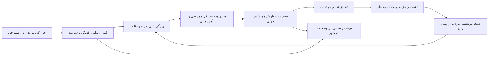

بحث صف و زمان در PDF ۲۵۷ تا ۲۶۰ بسیار مهم است: انباشت پیام، دادهٔ پردازش‌شده و زمان تصمیم را تغییر می‌دهد. صف بزرگ‌تر ممکن است حذف پیام را به تصمیم کهنه تبدیل کند؛ ظرفیت باید زیر بار انفجاری اندازه‌گیری شود. گم‌شدن تأیید، گزارش تکراری معامله، رقابت لغو و پرشدن، شکاف اتصال، پیام بی‌ترتیب، راه‌اندازی با سفارش باز و موقعیت کهنه را آزمایش کنیم. ضربان اتصال، تازگی داده یا صحت حساب را تضمین نمی‌کند. اشتراک کدِ منطق راهبرد مفید است، اما یکسانی کد، یکسانی پرشدن تاریخی و زنده را ثابت نمی‌کند.

### ۲۸.۸ ریسک و هزینه: از تضمین کاذب پرهیز کنیم

فصل ۱۷ ریسک بازار، طرف مقابل، نقدشوندگی، عملیات و حقوقی را جدا می‌کند. علامت زیان، سرمایه، ارز، افق و سطح اطمینان باید صریح باشند. VaR صدک زیان و ES میانگین دنباله با قرارداد مشخص است؛ هیچ‌یک بدترین حالت مطلق نیست. متن ES نودونه‌درصدی در PDF ۲۷۰ به‌اشتباه برش ۹۵٪ را تکرار می‌کند. برای زیان نرمال استاندارد، ES در ۹۵٪ تقریباً ۲٫۰۶۲۷ و در ۹۹٪ تقریباً ۲٫۶۶۵۲ است؛ VaRهای متناظر تقریباً ۱٫۶۴۴۹ و ۲٫۳۲۶۳ هستند. برون‌یابی دنباله به دامنه، آستانه و عدم‌قطعیت معتبر نیاز دارد؛ هر توزیع دنباله‌سنگین عیناً پارتو نیست و بازنمونه‌گیری، شاهد مستقلِ بحران مشاهده‌نشده نمی‌سازد. رتبه‌بندی دلخواه قیمت اوراق، احتمال نکول کالیبره‌شده نیست؛ زیان اعتباری به مواجهه، احتمال نکول، زیان مشروط به نکول، افق و وابستگی نیاز دارد. جمع چند VaR نامرتبط نیز صدک دقیق زیان مشترک نمی‌شود.

ادعای PDF ۲۸۲ مبنی بر ضرورت بیشتر‌بودن تعداد بردها از باخت‌ها برای پیامد نامتقارن درست نیست. راهبردی با احتمال برد ۴۰٪ و سود ۳ واحد، و احتمال باخت ۶۰٪ و زیان یک واحد، امید ناخالص مثبت ۰٫۶ واحد دارد. برعکس، نرخ برد بالا می‌تواند زیان‌ده باشد. امید مثبت نیز زیر اهرم، وابستگی و دنبالهٔ سنگین تضمین بقا نیست. حد زیان، پوشش و تعدد طرف مقابل، ریسک‌های خاص را محدود می‌کنند؛ شکست هم‌بسته را حذف نمی‌کنند.

فصل‌های ۱۸ و ۱۹ به قرارداد جهت‌دار کسری اجرا نیاز دارند. کارمزد، فاصلهٔ قیمت، تأخیر، روند، اثر بازار، ریسک زمان و اجرا‌نشدن ممکن است هم‌پوشان باشند؛ تجزیهٔ حسابداری باید از دوباره‌شماری جلوگیری کند. دفتر مشاهده‌شده فقط هزینهٔ فوری مشروط را تخمین می‌زند؛ بازارِ خلاف‌واقعِ بدون معاملهٔ ما را نشان نمی‌دهد. سفارش محدودِ قابل تطبیق فوری می‌تواند نقدشوندگی مصرف کند و اثر بازار داشته باشد؛ خود کتاب در PDF ۳۰۲ این موضوع را می‌گوید، بنابراین استثنای مطلق سفارش محدود در PDF ۳۰۵ معتبر نیست. کسری نسبت به معیار مرجع، اثر علّی خالص بازار نیست.

برای خرید Q واحد با قیمت تصمیم P0، پرشدن‌های qi در Pi، مقدار باقی‌مانده U=Q−Σqi و قیمت ارزیابی نهایی PT، یک کسری پولی سازگار برابر است با Σqi(Pi−P0)+U(PT−P0)+هزینهٔ صریح. برای فروش، علامت اختلاف قیمت‌ها را معکوس کنیم؛ تخفیف کارمزد، تأمین مالی و ضریب قرارداد را مستند کنیم. واحد پرنشده نباید از گزارش حذف شود. VWAP، TWAP، قیمت پایانی و قیمت تصمیم، پرسش‌های متفاوتی را پاسخ می‌دهند؛ قیمت پایانی مطلوب می‌تواند سیگنال جهت را خوب نشان دهد، بی‌آنکه اجرای بهتر ثابت شود.

مثال PDF ۳۱۵ باید مقایسهٔ سیاست‌ها باشد: با احتمال پرشدن ۲/۳، سود مشروط به پرشدن ۱۵ واحد پایه و سود صفر در صورت عدم اجرا، امید سود سفارش محدود برای هر فرصت ارسالی ۱۰ واحد پایه است؛ سیاست بازار با اجرای کامل و سود ۱۲ واحد پایه، پیش از سایر تفاوت‌ها بالاتر است. اجرای جایگزین، انتخاب نامساعد و وابستگی عدم اجرا به وضعیت بازار باید جدا مدل شوند. ضرب هزینهٔ فرصتِ ازپیش نامشروط در احتمال پرشدن، سطح‌های شرطی را مخلوط می‌کند.

**مرز بازتولید.** وب‌سایت همراهِ معرفی‌شده در PDF ۳۳۷ و کد و دادهٔ نیازمند ثبت‌نام آن دریافت و اجرا نشدند. خواندن فهرست منابع، صدها اثر ارجاع‌شده را «کامل بررسی‌شده» نمی‌کند. کنترل‌های عددی این فصل هویت‌های ریاضی و نمونه‌های شکست را می‌سنجند؛ بک‌تست بازار، آزمون کارگزار یا شاهد سود قابل دستیابی نیستند.


## ۲۹. دیپ‌لاب: آزمون ریاضی برچسب و فاصلهٔ پیش‌بینی تا اجرای معامله

**دامنهٔ شواهد.** متن نگه‌داری‌شدهٔ [مقالهٔ DeepLOB، نسخهٔ ششم](https://arxiv.org/pdf/1808.03668v6)، با شناسهٔ A011، کامل خوانده شد؛ هر ۹ شکل و ۴ جدول در تصویر صفحات ۳ تا ۱۰ کنترل شدند. شبکه، برچسب دفتر سفارش را پیش‌بینی می‌کند؛ مقایسهٔ معاملاتیِ مقاله بر قیمت میانی و پیش از کارمزد است. تحلیل زیر، استنتاج مستقل ماست؛ آموزش مدل یا بررسی کد پیوندشده بازتولید نشده است.

پنج نماد تازه در همان تقویم آزمون‌اند. در جدول II، افق ۱۰، صحت ۸۴٫۴۷ درصد از ۸۴٫۷۰ درصد C(TABL) کمتر است، هرچند F1 بالاتر است؛ برتری را باید برای معیار مشخص گفت.

### ۲۹.۱ آزمون قیمت ثابت؛ خطایی که دقت مدل آن را جبران نمی‌کند

در تصویر صفحهٔ ۴، فرمول ۲ برای میانگین گذشته، مجموع از صفر تا k را بر k تقسیم می‌کند. این مجموع k+1 جمله دارد. این ناسازگاریِ چاپ‌شده تأیید شده است؛ وجود همین اشکال در یک پیاده‌سازی مشخص هنوز بررسی نشده است.

برای تشخیص اثر، تمام قیمت‌ها را برابر عدد مثبت P بگذاریم. جای‌گذاری در عبارت چاپی چنین نتیجه‌ای دارد:

<div class="formula" dir="ltr">m₋ = P(k+1)/k;　m₊ = P;　(m₊−m₋)/m₋ = −1/(k+1).</div>

قیمت اصلاً تغییر نکرده، اما برای k=10 تغییر مصنوعی تقریباً منفی ۹٫۰۹ درصد تولید می‌شود. با بزرگ‌تر شدن افق، اندازهٔ خطا کم می‌شود، ولی برای هیچ k متناهی صفر نمی‌شود. آستانهٔ برچسب این میانگین نادرست را اصلاح نمی‌کند؛ فقط ممکن است در بعضی تنظیم‌ها اثر آن را پنهان کند.

دو تعریف سازگار وجود دارد: k مشاهدهٔ گذشته با احتساب زمان حاضر، یعنی شاخص‌های صفر تا k−1 و مقسوم‌علیه k؛ یا k+1 مشاهده با شاخص‌های صفر تا k و مقسوم‌علیه k+1. هر دو آزمون قیمت ثابت را می‌گذرانند، ولی روی مسیر متغیر الزاماً یک برچسب نمی‌سازند. مجموعهٔ دقیق شاخص‌ها، مقسوم‌علیه و آستانه باید همراه آزمایش ذخیره شود. اصلاح خاموش فرمول و سپس ادعای بازتولید دقیق، قابل دفاع نیست.

> **یافتهٔ تأییدشده و مرز آن:** اشکال شمارش جمله‌ها در PDF دیده شده و مثال خلاف عددی دارد. این مشاهده، به‌تنهایی ثابت نمی‌کند که نتایج تجربی مقاله با همان عبارت نادرست محاسبه شده‌اند؛ برای آن ادعا باید کد و دادهٔ دقیق آزمایش بررسی شوند.

فایل checks.py روی افق‌های ۱، ۱۰، ۲۰، ۵۰ و ۱۰۰، قیمت ثابت، دو تعریف سازگار و نتیجهٔ تحلیلی را کنترل می‌کند. یک مسیر غیرثابت هم نشان می‌دهد که دو اصلاح ممکن، از نظر تعریف مسئله یکسان نیستند. این‌ها آزمون جبر و قرارداد داده‌اند، نه تکرار امتیاز تجربی مقاله.

### ۲۹.۲ پیش از تقسیم ردیف‌ها، بازهٔ اطلاعات را مشخص کنیم

فرض کنیم تصمیم در رخداد t از W رخداد گذشته استفاده می‌کند و برچسب به k رخداد آینده نیاز دارد. پشتیبانی ویژگی از t−W+1 تا t است؛ پشتیبانی پیامد تا t+k ادامه دارد. ممکن است زمان یک ردیف آموزشی زودتر از اولین ردیف آزمون باشد، ولی برچسبش هنوز از قیمت داخل دورهٔ آزمون استفاده کند. بنابراین کنترل مرز باید بر پایان اطلاعاتِ پیامد اعمال شود، نه صرفاً ترتیب ردیف‌ها.

اشتراک تاریخچهٔ ویژگی با دورهٔ بعد، موضوع متفاوتی است: پیش‌بینی زنده معمولاً به گذشتهٔ قابل مشاهدهٔ بازار دسترسی دارد. این اشتراک را نباید بدون بررسی، با ورود پیامد آینده به آموزش یکسان دانست. برای مرز آزمون B، در قرارداد شامل‌بودن دو سر بازه، پایان برچسب هر ردیف آموزشی باید پیش از B باشد.

افق رخدادی، فاصلهٔ زمانی ثابت ندارد. در بازار پرتحرک، صد رخداد ممکن است بسیار سریع‌تر از بازار آرام اتفاق بیفتد. به همین ترتیب، فاصلهٔ محافظ ثابت بر حسب ثانیه، تعداد رخداد متفاوتی را کنار می‌گذارد. شمارهٔ توالی، زمان بورس، زمان دریافت و پایان برچسب را حفظ کنید تا پس از دریافت داده هم بتوان تقسیم را ممیزی کرد. تعداد پنجره‌های هم‌پوشان، تعداد مشاهدهٔ مستقل نیست.

| کنترل | ناوردایی لازم | معنای شکست |
|---|---|---|
| قیمت ثابت | تغییر نسبی قیمت مثبت ثابت صفر باشد | خطای شاخص، مقسوم‌علیه، مقدار مفقود یا نوع داده |
| بازپخش پیشوند | افزودن آینده، ویژگی قبلی را تغییر ندهد | ساخت ویژگی با اطلاعات آینده |
| مرز زمانی | پایان همهٔ برچسب‌های آموزش پیش از آزمون باشد | آلودگی پیامد در تقسیم داده |
| تغییر واحد پول | مقیاس مثبت مشترک، برچسب نسبی را تغییر ندهد | وابستگی ناخواسته به واحد اندازه‌گیری |
| محاسبهٔ مرجع | خروجی برداری با حلقهٔ صریح کوچک برابر باشد | خطای هم‌ترازی، برش یا پنجره |
| نرمال‌سازی علّی | پارامترهای مورد استفاده پیش از تصمیم معلوم باشند | برازش آمار با اطلاعات بعدی |

### ۲۹.۳ آزمون قیمت قابل اجرا با آزمون طبقه‌بندی فرق دارد

یک واحد را فوری در زمان t بخریم و در زمان u بفروشیم. قیمت میانی را m، فاصلهٔ کامل بهترین خرید و فروش را s و هزینهٔ صریح نامنفی را c بنامیم. با کنار گذاشتن عمق فقط برای این مثال، سود نقدی معامله چنین است:

<div class="formula" dir="ltr">P&amp;L = (mᵤ−mₜ) − (sₜ+sᵤ)/2 − c.</div>

اگر قیمت میانی از ۱۰۰ به ۱۰۰٫۰۲ برسد و فاصلهٔ خرید و فروش در هر دو زمان ۰٫۱۰ باشد، سود میانی ۰٫۰۲ است، اما رفت‌وبرگشت تهاجمی پیش از کارمزد، ۰٫۰۸ زیان دارد. این محاسبهٔ ساختگیِ مستقل ماست؛ معاملهٔ واقعی یا بازسازی معامله‌ای از مقاله نیست.

ورود منفعل، آزمایش را تغییر می‌دهد. قیمت می‌تواند بهتر باشد، اما پرشدن و زمان آن به جایگاه صف، جریان سفارش و لغو وابسته است. سودِ نشان‌گذاری با قیمت میانی، مشروط به یک پرشدن فرضی، سود نقدی نامشروط نیست. مقایسهٔ معتبر یا سیاست سفارش مشترک می‌خواهد، یا باید نشان دهد مدل چگونه سیاست، احتمال پرشدن، موجودی و هزینهٔ فرصت را تغییر می‌دهد. تعداد پیش‌بینی یا معاملهٔ متفاوت نیز الزاماً کارمزد یکسان ایجاد نمی‌کند.

```mermaid
flowchart TD
 A[قرارداد شاخص و برچسب] --> B[آزمون قیمت ثابت و پیشوند]
 B --> C[تقسیم بر اساس پایان پیامد]
 C --> D[پیش‌بینی خارج از زمان]
 D --> E[سیاست سفارش و صف و هزینه]
 E --> F[سود خالص و عدم قطعیت]
```

### ۲۹.۴ بودجهٔ زمان را برای مسیر کامل بسنجیم

زمان عبور یک ورودی از شبکه، فقط جزئی از زنجیرهٔ دریافت، رمزگشایی پیام، ساخت ویژگی، انتظار در صف، استنتاج، کنترل ریسک، ارسال و دریافت تأیید است. باید معلوم باشد کدام جزء اندازه‌گیری شده؛ سخت‌افزار، گرم‌شدن، اندازهٔ دسته و صدک‌های ۵۰، ۹۵ و ۹۹ در ترافیک جهشی هم لازم‌اند. میانگین فاصلهٔ دو رخداد، گواه کافی برای تأخیر انتهای این مسیر نیست.

در آزمون مستقل ما، فقط برای نمایش تفاوت میانگین و دُم توزیع، ۹۸ درصد تأخیرها ۰٫۲۵۳ میلی‌ثانیه و ۲ درصد آن‌ها ۵ میلی‌ثانیه فرض شده‌اند. میانگین حدود ۰٫۳۴۸ میلی‌ثانیه است، اما صدک ۹۹ پنج میلی‌ثانیه می‌شود. با بودجهٔ یک میلی‌ثانیه، میانگین آرامش‌بخش است ولی بخشی از تصمیم‌ها دیر می‌رسند. این مثال، بنچمارک هیچ دستگاه یا مدل اجراشده‌ای نیست.

### ۲۹.۵ توضیح‌پذیری و انتقال را با آزمون ابطال‌پذیر بسنجیم

ناحیهٔ ورودیِ مهم در یک توضیح محلی، حساسیت پیش‌بینی برازش‌شده را زیر یک شیوهٔ اغتشاش توصیف می‌کند. از آن به‌تنهایی اثر علّی، سود قابل اجرا یا پایداری در وضعیت معتبر بازار به دست نمی‌آید. اغتشاشی که بهترین خرید را بالاتر از بهترین فروش ببرد، حجم منفی بسازد یا ترتیب زمان را بشکند، از دامنهٔ معتبر داده خارج شده است. پیش از تکیه بر توضیح برای توجیه استراتژی، آن را زیر اغتشاش‌های مقید، باقیمانده‌های جداشده در زمان و یک خط مبنای ساده مقایسه کنید.

انتقال به نماد تازه نیز با انتقال به رژیم زمانی تازه یک پرسش نیست. طرح پیشنهادی ما ماتریسی دارد که نماد دیده‌شده/دیده‌نشده را با دورهٔ آشنا/تازه قطع می‌کند؛ تغییر محل معامله یا خوراک داده را در صورت نیاز جدا بیفزایید. سود خالص و عدم قطعیت هر خانه را گزارش کنید؛ میانگین کل نباید خانهٔ ناموفق را پنهان کند. این طرح ارزیابی پیشنهاد شده است، نه آزمایش انجام‌شدهٔ این نوبت.

> **تحویل و کار باز:** متن کامل نگه‌داری‌شده، شکل‌ها و جدول‌های اصلی، ناسازگاری شاخص و هشت گروه آزمون مستقل ثبت شدند. کد نسخه‌دار، آموزش، مجوز داده، بنچمارک استنتاج، شبیه‌سازی پرشدن قابل اجرا و منابع مستقلِ کتاب‌نامه همچنان بازند. مطالعهٔ بدون تغییر را تکرار نکنید؛ تغییر نسخه/هش، شاهد متناقض یا یکی از این کارهای مشخص، محرک بازبینی است.

### ۲۹.۶ ادامهٔ بررسی کد: خواندن برچسب با ساختن برچسب فرق دارد

کار بازِ بررسی پیاده‌سازی، در این مرحله بخشی پیش رفته است. متن تمام سلول‌های سه [دفترچهٔ رسمی در کامیت ثابت ff14d7c2](https://github.com/zcakhaa/DeepLOB-Deep-Convolutional-Neural-Networks-for-Limit-Order-Books/tree/ff14d7c2fd38bdfc143389786993d0f0236d4eb8) خوانده شد. تابع `get_label` پنج ردیفِ برچسب آماده را جدا می‌کند. نسخهٔ PyTorch احتمال softmax را به CrossEntropyLoss می‌دهد؛ نسخه‌های TensorFlow از زیان طبقه‌بندی و حذف تصادفیِ صریحاً فعال استفاده می‌کنند. اینها مشاهدهٔ کدند؛ آموزش اجرا نشده است.

بنابراین پرسش تولید برچسب به مرحلهٔ بالادستی، یعنی دادهٔ دقیق و فرایند ساخت آن منتقل می‌شود. یک برش کاملاً درست می‌تواند برچسب نادرست یا متفاوتی را بی‌کم‌وکاست عبور دهد. آزمونِ توابع واقعیِ استخراج‌شده، روی یک ماتریس نشانه‌دار، جدایی ویژگی و برچسب و هم‌ترازی برچسب با آخرین رخداد پنجره را در هر سه نسخه تأیید کرد. چسباندن نشست‌ها هم می‌تواند پنجره‌ای بسازد که مرزشان را قطع کند؛ قضاوت دربارهٔ مجازبودن این کار به نقشهٔ اصلی نشست و نماد نیاز دارد. مثال مصنوعی، آلودگی واقعی داده را ثابت نمی‌کند.

| مشاهده یا آزمون | نتیجهٔ محدود | نتیجه‌ای که هنوز نمی‌توان گرفت |
|---|---|---|
| برش ردیف‌های آخر در کد | برچسب آماده خوانده می‌شود | فرمول تولید برچسب درست یا نادرست است |
| آزمون ماتریس نشانه‌دار | برچسب با آخر پنجره هم‌تراز است | زمان و نماد همهٔ ردیف‌های واقعی درست‌اند |
| بررسی مسیر خروجی تا زیان | احتمال دوباره به‌عنوان نمرهٔ خام تفسیر می‌شود | افت عملکرد تاریخی اندازه‌گیری شده است |
| پرچم فعال حذف تصادفی | مسیر پیش‌بینی می‌تواند تصادفی باشد | تغییرپذیری روی مدل آموزش‌دیده اندازه‌گیری شده است |

طبق [تعریف رسمی زیان PyTorch](https://docs.pytorch.org/docs/2.14/generated/torch.nn.CrossEntropyLoss.html)، ورودی این حالت نمرهٔ خامِ نرمال‌نشده است. دادن بردار احتمال به‌جای آن، یک نرمال‌سازی دیگر داخل زیان ایجاد می‌کند. محاسبهٔ مستقلِ همان هویت برای احتمال هدف ۰٫۹۹۹، منفی لگاریتم درست را حدود ۰٫۰۰۱۰۰۰۵ و تفسیر احتمال به‌عنوان نمرهٔ خام را حدود ۰٫۵۵۲۰۸۰۸ می‌دهد. در سه کلاس، حتی با نزدیک‌شدن احتمال اولیهٔ هدف به یک، زیان دوم از مقدار زیر کمتر نمی‌شود:

<div class="formula" dir="ltr">L_min = log(e+2)−1 ≈ 0.5514447.</div>

ممکن است کلاسِ دارای بیشترین مقدار در دو حالت یکسان باشد، اما تابع هدف و گرادیان‌ها یکسان نیستند. این جبر، اندازهٔ تغییر امتیاز یک مدل آموزش‌دیده را اندازه نگرفته است و کد اصلی مخزن هم تغییر داده نشده است.

در مورد حذف تصادفی نیز [معنای پرچم صریح در مستندات Keras](https://keras.io/api/layers/regularization_layers/dropout/) کنترل شد. فعال‌ماندن آن می‌تواند برای استنتاج تصادفی عمدی باشد؛ در آن صورت تعداد نمونه‌گیری، روش تجمیع و گزارش عدم قطعیت باید معلوم باشد. یک پیش‌بینی تصادفی را نباید بدون اعلام این قرارداد با خروجی قطعی مقایسه کرد. دفترچه‌های تاریخی روی چارچوب‌های فعلی اجرا نشده‌اند؛ سازگاری اجرایی و اندازهٔ این نوسان هنوز سنجیده نشده است.

فایل آزمون، فقط سه تابع خالص NumPy را با تحلیل ساختار نحوی از هر دفترچه جدا و اجرا می‌کند؛ سلول دریافت داده، شیء ذخیره‌شده یا حلقهٔ آموزش اجرا نمی‌شود. ۱۸ بررسی تابع و ۳ بررسی هویت زیان موفق بود. جست‌وجوی گراف برای این کد پوشش نداشت و اتصال ابزار حافظهٔ کد هم در دسترس نبود؛ بررسی از منبع رسمی با کامیت ثابت انجام شد. هش فایل و شمارهٔ سلول‌ها در شواهد پایدار ثبت شده است. شکل‌های خروجیِ دفترچه، آرشیو داده و وزن مدل با خواندن متن کد تیک تکمیل نمی‌گیرند.


## ۳۰. راهنمای پژوهشی انتقادی AFML

**منبع:** Marcos López de Prado، کتاب *Advances in Financial Machine Learning* (2018)، EPUB محلی با شناسه منبع LB03.  
**هدف:** ترکیبی تحلیلی و اصیل برای پژوهش و پیاده‌سازی؛ این متن رونویسی کتاب یا جایگزین آن نیست.  
**حدود بررسی:** متن اصلی و پیوست‌ها تا پایان spine شماره ۶ بررسی شدند. نمایه پایانی کتاب (spine شماره ۷، خطوط ۱۲٬۲۳۲ تا ۱۳٬۳۱۴) خوانده نشد. معادلات و کدهای EPUB به‌صورت تصویر استخراج شده‌اند؛ فقط هشت رخداد تصویری به‌طور دیداری بررسی شد. بنابراین این گزارش ادعای پوشش کامل شکل‌ها، فرمول‌ها یا کدها را ندارد.

### ۳۰.۱ نتیجه اصلی

بیشترین ارزش AFML در ارائه یک چارچوب برای فرایند پژوهش است. کتاب نمونه‌برداری رویدادمحور، برچسب‌گذاری، اعتبارسنجی با لحاظ هم‌پوشانی، انتخاب مدل، هزینه اجرا و ساخت پرتفوی را به یک مسیر کاری پیوند می‌دهد. هشدار تکرارشونده آن نیز بجاست: بسیاری از بک‌تست‌ها آزمایش‌های تکراری‌اند و نتیجه تاریخی خوب ممکن است محصول انتخاب پس از مشاهده نتایج باشد، نه اثری پایدار.

روش‌های کتاب دستورالعمل‌هایی برای آزمودن هستند، نه تضمین خودکار. مثال‌ها و کدهای سال ۲۰۱۸ اغلب به رابط‌های قدیمی کتابخانه‌ها، داده‌های خاص بازار و فرض‌های قوی وابسته‌اند. ایستایی، پیش‌بینی‌پذیری را ثابت نمی‌کند؛ اهمیت ویژگی جای اعتبارسنجی را نمی‌گیرد؛ اعتبارسنجی متقاطع پاک‌سازی‌شده، سوگیری انتخاب را حذف نمی‌کند؛ بهینه شبیه‌سازی‌شده فقط به‌اندازه مدل مولد داده‌اش معتبر است؛ و شارپ شبیه‌سازی‌شده پیش‌بینی بازده زنده نیست. کاربرد قابل‌دفاع‌تر کتاب، تبدیل آن به پروتکلی نقطه‌درزمان، حساس به هزینه و بازتولیدپذیر است و در عین حال هر ادعای تجربی جداگانه آزموده شود.

### ۳۰.۲ طراحی پژوهش: آزمایش را ثبت کن، نه فقط امتیاز را

ایده «کارخانه پژوهش» در فصل ۱، آماده‌سازی داده، طراحی ویژگی، سازوکار اقتصادی، برازش مدل، اعتبارسنجی، اجرا و پایش را از هم جدا می‌کند. تخصصی‌سازی می‌تواند کیفیت را بهتر کند، اما محافظ اصلی، قابلیت ردیابی است: هر فرضیه، انتخاب پارامتر، تغییر ویژگی، تعریف برچسب و اجرای آزمایش را ثبت کن. وقتی پژوهشگر بارها یک مجموعه کنارگذاشته‌شده را می‌بیند، دیگر دست‌نخورده نیست. معامله آزمایشی نیز جایگاه در صف، پرشدن سفارش، اثر بازار یا ظرفیت اجرای زنده را تضمین نمی‌کند.

فصل ۲ نمونه‌برداری را بخشی از مدل‌سازی می‌داند. میله‌های زمانی، تعدادی معامله، حجمی، دلاری، عدم‌تعادل و دنباله‌ای از ساعت‌های متفاوت استفاده می‌کنند. میله‌های مبتنی بر فعالیت ممکن است مشاهدات را از نظر میزان فعالیت قابل‌مقایسه‌تر کنند و برخی سنجه‌های توزیعی را بهبود دهند، اما بازده را IID یا نرمال نمی‌کنند. آستانه‌ها باید فقط با داده گذشته برآورد و برای ابزار، جابه‌جایی قرارداد، ارز، اقدامات شرکتی و قواعد محل معامله تنظیم شوند. ترفند ETF یک سبد مصنوعی می‌سازد تا ترکیب دارایی‌ها را مدیریت کند؛ هزینه تأمین مالی، قیمت‌های ناهم‌زمان، رول، بازتوازن، ارز، اجرا یا مارجین را حذف نمی‌کند. قیمت خام را برای سرمایه و اندازه‌گذاری نگه دار و PnL را با موقعیت‌های واقعی و هزینه‌های روشن محاسبه کن.

فصل ۳ برچسب‌ها را حول رویداد و بازه نگهداری می‌سازد. روش سه‌مانعه حد سود، حد زیان و محدودیت زمانی را ترکیب می‌کند؛ فرابرچسب‌گذاری، سیگنال اولیه را از تصمیم ثانویه برای پذیرش آن جدا می‌کند. این نمایش‌ها مفیدند، اما عرض موانع، افق و محرک رویداد انتخاب‌های مدل‌اند و در نتیجه جزو آزمایش‌ها محسوب می‌شوند. برچسب‌ها از نظر زمانی هم‌پوشانی دارند؛ زمان شروع و پایانشان باید حفظ شود تا در گام‌های بعدی برچسب‌هایی که بازه اطلاعاتشان با مجموعه آزمون تلاقی می‌کند حذف شوند. رویداد CUSUM محرک نمونه‌برداری است، نه توصیه معامله.

فصل ۴ وزن‌دهی بر پایه یکتایی نمونه و بوت‌استرپ ترتیبی را برای مقابله با برچسب‌های هم‌پوشان مطرح می‌کند. شهود آن این است که ده برچسب هم‌پوشان، ده مشاهده مستقل نیستند. یکتایی می‌تواند افزونگی نمونه‌های آموزش را کاهش دهد، اما مشاهدات را مستقل نمی‌کند و وابستگی رژیمی را از بین نمی‌برد. وزن‌دهی بر اساس اندازه بازده، هدف یادگیری را تغییر می‌دهد و باید توجیه و از نظر برون‌زدها بررسی شود. هر بازنمونه‌گیری باید ساختار زمانی لازم برای مسئله را حفظ کند.

فصل ۵ تفاضل‌گیری کسری را پیشنهاد می‌کند تا نسبت به تفاضل‌گیری صحیح، حافظه بیشتری از سطح سری باقی بماند. پنجره وزن‌های افزایشی را با تفاضل‌گیری کسری پنجره‌ثابت (FFD) مقایسه می‌کند و مرتبه تفاضل‌گیری را با آزمون‌های ایستایی انتخاب می‌کند. بررسی تصویرهای اصلی، نگرانی ظاهری درباره آستانه‌گذاری Snippet 5.2 را روشن می‌کند: تابع `getWeights` بردار ضرایب را معکوس می‌کند؛ بنابراین مجموع تجمعی قدرمطلق وزن‌ها با وقفه‌های قدیمی و کوچک آغاز می‌شود. برای d=0.4، هزار وزن و آستانه 0.01، عبارت نمایش‌داده‌شده `skip = count(cumulative > threshold)` مقدار 388 می‌دهد. نخستین ردیف خروجی از 389 وزن جدیدتر استفاده می‌کند و 611 وزن قدیمی را کنار می‌گذارد که جرم قدرمطلق نرمال‌شدهٔ آن‌ها 0.9948 درصد است؛ اندکی کمتر از آستانه. نگرانی قبلی مبنی بر حذف کل وزن‌ها از محاسبه روی بردارِ معکوس‌نشده ناشی شده بود و شاهدی بر خطای تصویر منبع نیست. در Snippet 5.3، روش FFD جداگانه برداری با عرض ثابت می‌سازد و هنگامی متوقف می‌شود که قدرمطلق یک وزن از آستانه کمتر شود. در بازپیاده‌سازی، جهت ضرایب، شکل بردار، داده‌های گمشدهٔ ابتدایی و هم‌ترازی خروجی را بیازمایید. پذیرش آزمون ایستایی، فرایند پایدار یا پیش‌بینی مفید را اثبات نمی‌کند و انتخاب d بر اساس p-value خود یک انتخاب پژوهشی دیگر است.

### ۳۰.۳ یادگیری، اعتبارسنجی و انتخاب

فصل ۶ تجمیع، جنگل تصادفی و تقویت را مقایسه می‌کند. تجمیع وقتی می‌تواند واریانس را کم کند که خطاهای برآوردگرها بیش از حد هم‌بسته نباشند؛ مدل‌هایی را که به‌طور نظام‌مند بدتر از شانس هستند نجات نمی‌دهد. برچسب‌های هم‌پوشان اعضای بوت‌استرپ را مشابه‌تر می‌کنند و می‌توانند امتیاز خارج‌ازکیسه را متورم کنند. بوت‌استرپ ترتیبی راهی برای کاهش افزونگی نمونه است، نه راه‌حل عمومی وابستگی زمانی. امضاهای مشخص کلاس‌های scikit-learn در کتاب مثال‌های تاریخی‌اند.

فصل ۷ اعتبارسنجی متقاطع با پاک‌سازی و فاصله‌گذاری را برای برچسب‌هایی به‌کار می‌گیرد که اطلاعاتشان تا بازه آزمون امتداد دارد. پاک‌سازی، برچسب‌های آموزش متقاطع با بازه آزمون را حذف می‌کند؛ فاصله‌گذاری، در صورت امکان تداوم نشت، مشاهدات مجاور مرز آزمون را از آموزش کنار می‌گذارد. این روش برای برچسب رویدادمحور از فولدهای IID درهم‌ریخته مناسب‌تر است، اما اثبات عملکرد زنده نیست. پیش‌پردازش، انتخاب ویژگی، کالیبراسیون و تنظیم ابرپارامتر باید همگی درون هر فولد آموزش انجام شوند. حتی فولدهای معتبر نیز اگر بارها بررسی شوند، بخشی از فرایند جست‌وجو می‌شوند.

فصل ۸ روش‌های MDI، اهمیت جایگشتی/MDA، تک‌ویژگی/SFI و تحلیل مبتنی بر PCA را معرفی می‌کند. MDI سریع و ویژه درخت است، اما درون‌نمونه‌ای است و می‌تواند ویژگی‌هایی با فرصت‌های بیشتر برای شکستن گره را ترجیح دهد. اهمیت جایگشتی اگر بر فولدهای واقعاً مستقل از آموزش محاسبه شود، می‌تواند برون‌نمونه‌ای باشد؛ بااین‌حال جانشین‌های هم‌بسته ممکن است هر دو ویژگی را بی‌اهمیت نشان دهند. SFI سیگنال مستقل ویژگی را آشکار می‌کند، اما برهم‌کنش‌ها را از دست می‌دهد. PCA می‌تواند افزونگی خطی را کاهش دهد، ولی واریانس مؤلفه اصلی همان اطلاعات پیش‌بین نیست و PCA/نرمال‌سازی باید داخل فولد آموزش برازش شوند. رتبه اهمیت، ابزار تشخیصی است؛ توضیح علّی یا مدرک پایداری ویژگی نیست.

اصل فصل که اهمیت ویژگی ابزار پژوهش است و بک‌تست نیست، باید محدود تفسیر شود. اهمیت ویژگی می‌تواند برای تولید و فهم فرضیه مفید باشد؛ اما وقتی پژوهشگر با آن ویژگی‌ها را انتخاب می‌کند، یک مرحله انتخاب دیگر به فرایند اضافه می‌شود. این روش جایگزین پرسش اقتصادیِ ازپیش‌تعریف‌شده و ارزیابی نهایی مستقل نیست.

فصل ۹ جست‌وجوی شبکه‌ای و تصادفی را به‌عنوان انتخاب ابرپارامتر با اعتبارسنجی پاک‌سازی‌شده بررسی می‌کند. جست‌وجوی تصادفی وقتی تنها چند بُعد مهم‌اند ممکن است بودجه ثابت را کارآمدتر مصرف کند؛ هیچ‌یک سوگیری انتخاب برنده را حذف نمی‌کند. نمونه‌گیری لگاریتمی یکنواخت برای پارامترهای مثبت، زمانی مناسب است که مقیاس‌های ضربی معنا داشته باشند. کتاب برای تصمیم‌های حساس به احتمال، زیان لگاریتمی و برای برخی فرابرچسب‌های نامتوازن، F1 را ترجیح می‌دهد. زیان لگاریتمی خطاهای مطمئن را تنبیه می‌کند، اما با مطلوبیت معامله برابر نیست مگر آنکه کالیبراسیون، پرداخت، هزینه و میزان مواجهه این هم‌راستایی را ایجاد کنند. F1 به کلاس مثبت و آستانه وابسته است و کالیبراسیون را نادیده می‌گیرد. معیار را پیش از مشاهده برنده تعیین کن و تمام پیکربندی‌های آزموده‌شده را ثبت کن.

### ۳۰.۴ موقعیت‌ها و شواهد عملکرد

فصل ۱۰ احتمال‌ها و فاصله قیمت پیش‌بینی‌شده را به اندازه موقعیت تبدیل می‌کند، معاملات فعال را میانگین می‌گیرد، تغییرات را گسسته می‌کند و تحت تابع سیگموید یا توانی مشخص، قیمت حد سفارش را استخراج می‌کند. این‌ها قواعد ابتکاریِ مواجهه‌اند، نه تخصیص بهینه کلی. به احتمال‌های کالیبره‌شده و محدودیت‌های مستقل برای عدم‌قطعیت، اهرم، نقدشوندگی، تمرکز و هزینه نیاز دارند. عبارت فصل که در ساخت قیمت حد سفارش زیانی محقق نمی‌شود، فقط از فرض‌های تابع یکنواخت و قیمت پیش‌بینی ثابت پیروی می‌کند؛ شکاف قیمت، پرشدن جزئی، انتخاب نامطلوب، کارمزد و تغییر پیش‌بینی این تضمین را می‌شکنند.

فصل ۱۱ توضیح می‌دهد چرا آزمودن راهبردهای متعدد روی یک تاریخچه، شارپ منتخب را متورم می‌کند. فصل ۱۲ بک‌تست گام‌به‌جلو، اعتبارسنجی متقاطع و اعتبارسنجی متقاطع ترکیبیِ پاک‌سازی‌شده (CPCV) را مقایسه می‌کند؛ CPCV چند مسیر آموزش/آزمون می‌سازد تا توزیع نتایج را نشان دهد. ایده مفید آن، گزارش پراکندگی مسیرها و تعداد آزمایش‌هاست. ادعاهای آرمانی مبنی بر اینکه مسیرها نامرتبط می‌شوند، سوگیری انتخاب از بین می‌رود یا CPCV به‌راحتی بک‌تست بیش‌برازش‌شده پنهان را شکست می‌دهد، بیش از حد قوی‌اند: مسیرهای CPCV داده مشترک دارند و به ساخت فولد وابسته‌اند. این روش بخشی از عدم‌قطعیت را کم می‌کند، اما آزمایش را مستقل نمی‌کند و انتخاب‌های پژوهشی تکراری را حذف نمی‌کند. مقاله اصلی PBO، چارچوب CSCV را برای ارزیابی ارائه می‌کند، نه اثبات اعتبار راهبرد منتخب ([Bailey و همکاران، ۲۰۱۷](https://escholarship.org/uc/item/4w1110bb)).

فصل ۱۳ آستانه‌های قواعد معامله را از فرایندهای شبیه‌سازی‌شده استخراج می‌کند، نه از یک مسیر تاریخیِ تحقق‌یافته. مثال آن یک فرایند شبیه اورنشتاین–اولنبک را فرض می‌کند و شبکه‌ای از خروج‌ها را روی مسیرهای تولیدشده متعدد بهینه می‌کند. این کار نشان می‌دهد انتخاب آستانه با فرض یک مدل چگونه رفتار می‌کند، اما نشان نمی‌دهد مدل بازار را توصیف می‌کند. بهینه‌سازی شبکه همچنان انتخاب است. شارپ‌های بسیار بالای مثال آموزشی، هزینه‌های اجرایی واقع‌گرایانه را شامل نمی‌شوند و نباید پیش‌بینی عملکرد زنده تلقی شوند. حدس یکتایی فصل و ادعای ناچیز بودن احتمال خطای آن، با شبیه‌سازی محدود ارائه‌شده پشتیبانی نمی‌شوند.

فصل ۱۴ گزارش گسترده‌ای را پیشنهاد می‌کند: بازده، سرمایه، اهرم، ظرفیت، تعداد معاملات/فرصت‌ها، زمان نگهداری، گردش معاملات، هم‌بستگی با دارایی مبنا، افت سرمایه، زمان بازگشت به سقف، تمرکز، کسری اجرای سفارش، امتیاز طبقه‌بندی و انتساب. سالانه‌سازی شارپ با جذر زمان، فرض IID بودن بازده را دارد؛ خودهم‌بستگی و موقعیت‌های هم‌پوشان این مقیاس‌دهی ساده را نامعتبر می‌کنند. PSR تحت مدل خود اثر طول نمونه، چولگی و کشیدگی را لحاظ می‌کند؛ DSR تعداد و پراکندگی آزمایش‌ها را نیز وارد می‌کند. برآورد تعداد آزمایش‌های مستقل، وقتی پیکربندی‌ها هم‌بسته‌اند دشوار است؛ پس DSR تعدیل آماری است، نه گواه قطعی. F1 برای کلاس مثبت نامتوازن مفید است، اما همچنان ماتریس درهم‌ریختگی و هدف تصمیم را لازم دارد. انتساب PnL میان دسته‌های ریسک هم‌پوشان جمع‌پذیر نیست.

فصل ۱۵ ریسک شکست راهبرد را از نوسان دارایی یا پرتفوی جدا می‌کند. مثال‌های دوجمله‌ای نکته مفیدی دارند: در پرداخت‌های نامتقارن، دقت به‌تنهایی کافی نیست و بسامد نیز می‌تواند شارپ آرمانی را افزایش دهد. فرمول‌ها فرض می‌کنند شرط‌ها مستقل و هم‌توزیع‌اند، پرداخت ثابت است و هزینه یا تغییر اندازه موقعیت وجود ندارد. فرصت‌های واقعی خوشه‌ای‌اند، نتایج متغیرند و هزینه معامله معمولاً با افزایش بسامد بالا می‌رود. برآورد شکست مبتنی بر بوت‌استرپ/KDE در همین فصل نیز بازنمونه‌گیری نتایج مشاهده‌شده را فرض می‌کند؛ برای معاملات وابسته یا رژیم‌متغیر، عدم‌قطعیت باید وابستگی را لحاظ کند.

### ۳۰.۵ ساخت پرتفوی و ویژگی‌های بازار

فصل ۱۶ روش HRP را معرفی می‌کند: هم‌بستگی را به فاصله تبدیل می‌کند، دارایی‌ها را خوشه‌بندی می‌کند، ماتریس کوواریانس را بازچینش می‌کند و سپس وزن‌ها را به‌صورت بازگشتی بر اساس ریسک خوشه تقسیم می‌کند. تصویر بررسی‌شده فاصله d(i,j)=sqrt((1−rho(i,j))/2) را نشان می‌دهد؛ کد بررسی‌شده alpha=var1/(var0+var1) را برای تقسیم دو خوشه به‌کار می‌برد که با تقسیم کمینه‌واریانس در صورت قطری بودن کوواریانس خوشه‌ها منطبق است. HRP به وارون‌سازی کوواریانس نیاز ندارد و یک منبع بی‌ثباتی عددی را حذف می‌کند. بااین‌حال خوشه‌ها و برآورد ریسک آن همچنان به هم‌بستگی‌های پرنویز و متغیر وابسته‌اند؛ برتری گزارش‌شده در مونت‌کارلو نیز به مولد مصنوعی، قواعد بازتوازن، محدودیت‌ها و هزینه‌ها وابسته است. HRP را با وزن مساوی، ریسک‌پاریته/معکوس نوسان و بهینه‌سازهای منظم‌شده در آزمون‌های غلتان و برون‌نمونه یکسان مقایسه کن.

فصل ۱۷ آزمون‌های CUSUM، نوع چاو، SADF، ADF شرطی/چندکی و آزمون‌های زیر/فوق‌مارتینگل برای شکست و رفتار انفجاری را مرور می‌کند. فرضیه، وقفه‌ها، نقطه شروع، حداقل پنجره و مقادیر بحرانی اهمیت دارند. جست‌وجو در پنجره‌ها و تاریخ‌های متعدد باید با کالیبراسیون اندازه آزمون همراه باشد. آماره حباب، پیش‌بینی زمان‌بندی یا معامله نیست. هر ویژگی غلتان باید فقط از اطلاعات در دسترس تا همان لحظه استفاده کند.

فصل ۱۸ برآوردگرهای آنتروپی پلاگین و لمپل–زیو و رمزگذاری دودویی، چندکی و سیگما را پوشش می‌دهد. آنتروپی تخمینی با نمادگذاری، اندازه پنجره، طول نمونه و تغییر رژیم تغییر می‌کند. پنجره‌های تطبیقِ مرکزی در بحث LZ باید از نظر نگاه‌به‌آینده ممیزی شوند، پیش از آنکه به ویژگی آنلاین تبدیل شوند. آنتروپی پایین معادل ناکارایی بازار یا حباب نیست؛ آنتروپی بالا نیز به معنی معامله سودآور بر مبنای قوی سیاه نیست. آنتروپی میزان عدم‌قطعیت یا افزونگی در یک نمایش انتخاب‌شده را می‌سنجد، نه آلفای جهت‌دار.

فصل ۱۹ نشانه معاملات، برآوردهای اسپرد/نوسان رول و سقف-کف، اثر بازار کایل/آمیهود/هزبروک، PIN/VPIN، لغو سفارش، اندازه سفارش، اختیار معامله و تداوم جریان سفارش را مرور می‌کند. هر کدام تحت فرض‌هایی درباره طبقه‌بندی معامله، نمونه‌برداری، مشارکت‌کنندگان و محل معامله، یک شاخص جانشین است. اعتبار VPIN محل اختلاف است: کتاب نتیجه منفی آندرسن و بوندارنکو را نقل می‌کند، اما آن را به محدودیت مدل خطی نسبت می‌دهد؛ این پاسخ اعتبار پیش‌بینی را تعیین نمی‌کند. مطالعه آنان استدلال می‌کند محتوای پیش‌بینی ظاهری این معیار عمدتاً به‌طور مکانیکی به شدت معامله وابسته است ([Andersen و Bondarenko، ۲۰۱۳](https://papers.ssrn.com/sol3/papers.cfm?abstract_id=1881731)). سیگنال را در برابر هدف روشن و خط‌مبناهای مناسبِ حساس به شدت معامله آزمایش کن. پیشنهاد «پیش‌دستی» بر جریان TWAP را باید به مطالعه جریان سفارش عمومی و اثر اجرا تغییر داد؛ استفاده از اطلاعات سفارش مشتری یا رفتار دستکاری‌گرانه، ملاحظات حقوقی و اخلاقی جداگانه دارد.

پیشنهاد فصل پایانی برای تعریف اطلاعات ریزساختاری با زیان برون‌نمونه‌ای یک طبقه‌بند بازارساز، فرضیه جالبی است. ادعای اینکه این روش می‌توانست پیش از سقوط سریع بازار در ۲۰۱۰ هشدار دهد، پس‌نگرانه است مگر اینکه ویژگی‌ها، برچسب‌ها، کالیبراسیون غلتان، آستانه هشدار و قاعده واکنش از پیش مشخص و آزموده شوند.

### ۳۰.۶ محاسبات و ادعاهای کوانتومی

فصل ۲۰ الگوهای قابل‌استفاده‌ای برای برداری‌سازی، تقسیم کار متوازن، چندپردازشی ناهمگام و کاهش تدریجی خروجی‌های بزرگ ارائه می‌کند. گلوگاه محتمل ممکن است سریال‌سازی، حافظه، ورودی/خروجی یا عدم‌توازن کار باشد، نه محاسبه عددی. کتابخانه‌ها و سخت‌افزار روز را بنچمارک کن؛ جزئیات Python/GIL/قابل‌سریال‌سازی در کتاب و کدها به نسخه وابسته‌اند. تنها پس از بررسی صحت ترتیبی و خروجی قطعی، کار را موازی کن.

فصل ۲۱ مسئله مسیر پویای پرتفوی را به جست‌وجوی ترکیبی گسسته تبدیل می‌کند. شمارش کامل فقط در مجموعه امکان‌پذیر گسسته، و فقط در صورت بررسی درست تمام گزینه‌ها، بهینه را تضمین می‌کند؛ فضای حالت به‌سرعت بزرگ می‌شود. توضیح رایانش کوانتومی ساده‌سازی شده است: برهم‌نهی همه گزینه‌ها را رایگان در اختیار نمی‌گذارد. جست‌وجوی گروور جست‌وجوی نامرتب را از O(N) به O(sqrt(N)) پرس‌وجوی اوراکل می‌رساند؛ شتاب آن درجه‌دو است، نه نمایی، و مسئله NP-hard را به‌طور عمومی آسان نمی‌کند ([Grover، ۱۹۹۶](https://arxiv.org/abs/quant-ph/9605043)).

فصل ۲۲، نوشته هورست دی. سایمون و کشنگ وو، یک مطالعه تاریخی و جداگانه درباره HPC است. این فصل سامانه‌ها و بنچمارک‌های قدیمی را توصیف می‌کند. اعداد ۲۱ برابر برای دسترسی به داده و ۷۲۰ برابر برای VPIN دو چیز متفاوت را می‌سنجند: اولی مقایسه HDF5 با ASCII در آن مطالعه است؛ دومی صراحتاً به بهبود الگوریتم و ساختار داده پیش از موازی‌سازی MPI نسبت داده شده است. این‌ها نمایش امکان‌اند، نه راهنمای فعلی سرعت یا هزینه ابر/HPC. روی داده، کتابخانه، ذخیره‌ساز، شبکه و بارکاری واقعی خود دوباره بنچمارک بگیر.

### ۳۰.۷ برداشت عملی از کتاب

مسیر کاری قابل‌استفاده این است: نسخه‌های نقطه‌درزمان داده را ثابت کن؛ سازوکار اقتصادی را صورت‌بندی کن؛ رویدادها و بازه برچسب را تعریف کن؛ هر آزمایش را ثبت کن؛ تبدیل‌ها و انتخاب ویژگی را فقط داخل فولد آموزش برازش کن؛ بازه‌های هم‌پوشان برچسب را پاک‌سازی کن؛ معیار حساس به احتمال را فقط با احتمال کالیبره به‌کار ببر؛ سیگنال را تحت هزینه و محدودیت ریسک روشن به موقعیت تبدیل کن؛ اجرا و ظرفیت را بسنج؛ عدم‌قطعیت، پراکندگی مسیرها و همه آزمایش‌ها را گزارش کن؛ و تغییر رژیم و رانش زنده را پایش کن.

کتاب زمانی قوی است که به پژوهشگر بگوید چه چیزی را اندازه بگیرد و نشت یا انتخاب از کجا رخ می‌دهد. زمانی ضعیف‌تر است که یک روش پیشنهادی را از مثال یا شبیه‌سازی به ادعای عمومی تبدیل می‌کند. بخش اول را چک‌لیست بگیر و برای بخش دوم شواهد مستقل مطالبه کن.

### ۳۰.۸ شواهد و پوشش

- SHA-256 فایل EPUB: `3763828c757aebbf741e094f20407ae5798e1ee4193589c4a59cec313e4808f1`.
- SHA-256 متن کامل استخراج‌شده: `603a473d9dcd174da6e5e8d678ab5e095a0f4dc9eecf650e33610ee8fc42e75d`.
- متن استخراج‌شده بررسی شد: خطوط ۱ تا ۱۳٬۳۱۴، شامل هر هفت spine، نمایه و ارجاع EULA؛ بازه‌های دقیق در `progress.json` ثبت شده‌اند.
- موجودی تصویر: ۸۵۳ رخداد، ۷۶۸ تصویر یکتا با SHA-256 و ۸۵ رخداد تکراری. همهٔ تصاویر یکتا از نظر دیداری بررسی شدند؛ جلد و نشان Wiley صریحاً تزئینی هستند.
- بررسی تصویر FFD: با لحاظ جهت معکوس ضرایب و شکل وزن‌های `(n, 1)`، در نمونهٔ مستقل d=0.4 قاعدهٔ جرم تجمعی ۱٪ برای نخستین پنجره ۳۸۹ وزن را حفظ می‌کند؛ ایرادی در تصویر منبع تأیید نشد.
- `whole_source_complete=true` و `text_unit_complete=true` برای متن استخراج‌شده و دارایی‌های تصویری EPUB بررسی‌شده در این مطالعه.


## ۳۱. یادداشت تحلیلی کتاب «یادگیری عمیق برای مالی»

**نویسنده: سوفین کعبار؛ انتشارات O’Reilly؛ ویرایش اول، ۲۰۲۴**

منبع بررسی‌شده، فایل PDF با ۳۶۲ صفحه و هش SHA-256 زیر است:

<span dir="ltr">068e6191cf6c5f6f0aed13d0bae8d06137048f33d6a8d9ca16ff32b51bec81d3</span>

شماره‌صفحه‌هایی که در این یادداشت می‌آیند شماره صفحه PDF هستند؛ شماره چاپی کتاب معمولاً ۱۶ واحد کمتر است. این متن یک جمع‌بندی و ارزیابی مستقل است، نه جایگزین کتاب و نه توصیه مالی.

**دامنهٔ تکمیل:** متن و نمای بصریِ هر ۳۶۲ صفحهٔ نسخهٔ محلی بررسی شد؛ بازتولید کد، داده و آزمایش بیرونی همچنان باز است.

### ۳۱.۱ ارزیابی کلی

کتاب کعبار را بهتر است مقدمه‌ای گسترده و عملی بر روند کار با مدل‌های سری زمانی مالی بدانیم. کتاب داده‌های بازار، آمار اکتشافی، پایتون، یادگیری ماشین، شبکه‌های عصبی، ارزیابی پیش‌بینی و ریسک معامله را در یک مسیر آموزشی کنار هم می‌گذارد. ارزش عملی آن در ملموس‌کردن چرخه مدل‌سازی است: هدف را تعریف کنید، ورودی‌های گذشته را درست هم‌تراز کنید، داده را به‌ترتیب زمانی جدا کنید، یک خط مبنای ساده بسازید، پیش‌بینی‌ها را مقایسه کنید و به یاد داشته باشید که کیفیت پیش‌بینی با ارزش معاملاتی یکسان نیست. نویسنده بارها می‌گوید که مثال‌ها ساده‌سازی شده‌اند، در بعضی بخش‌ها هزینه‌ها و کنترل ریسک کنار گذاشته شده‌اند و تنظیم مکرر مدل بر اساس مجموعه آزمون می‌تواند به بیش‌برازش بینجامد.

این کتاب دستورالعمل اثبات‌شده‌ای برای پیدا کردن راهبرد سودآور نیست. بسیاری از مثال‌ها از داده کم یا ساختگی، ابرپارامترهای دلخواه، یک بار تقسیم داده یا یک بذر تصادفی استفاده می‌کنند و معیارهای پیش‌بینی را بدون عدم‌قطعیت، خط مبنای قوی یا نتیجه خالص معاملاتی گزارش می‌دهند. برخی توضیحات آماری و مالی نیز بیش از حد کلی هستند و بعضی کدهای چاپ‌شده با مخزن همراه تفاوت دارند یا ناقص‌اند. خواننده می‌تواند سازوکارهای مفیدی بیاموزد، اما هر نتیجه را باید فرضیه‌ای بداند که هنوز به داده زمان‌مند، اعتبارسنجی درست، اجرای واقع‌گرایانه و آزمون نهاییِ دست‌نخورده نیاز دارد.

تمایز اصلی این است:

> صرفاً برازش یا پیش‌بینی یک سری تاریخی، وجود مزیت معاملاتی پایدار، قابل‌اجرا و تعدیل‌شده برحسب ریسک را ثابت نمی‌کند.

### ۳۱.۲ دامنه و مخاطب

فصل‌های آغازین داده مالی و ساختار بازار، احتمال و نظریه اطلاعات، آمار توصیفی و ایستایی، جبر خطی و حسابان، تحلیل تکنیکال و پایتون را معرفی می‌کنند. فصل‌های میانی روند کار یادگیری نظارت‌شده برای سری زمانی را می‌سازند و سپس مدل‌های خطی و درختی، رگرسیون بردار پشتیبان، نزدیک‌ترین همسایه‌ها، شبکه‌های عصبی، RNN و LSTM و مدل‌های کانولوشنی را پوشش می‌دهند. بخش‌های پایانی به پیش‌بینی چندگامی، تفاضل‌گیری کسری، آستانه‌گذاری پیش‌بینی، بازآموزی، اعتبارسنجی زمانی، یادگیری تقویتی عمیق، موقعیت‌گیری COT، اندیکاتورهای تکنیکال، نوسان بیت‌کوین، محرک‌های بازار و مدیریت ریسک می‌پردازند.

این گستردگی برای آشنایی اولیه مفید است، اما باعث می‌شود بسیاری از موضوع‌ها در حد معرفی باقی بمانند و فرض‌ها، آزمون‌های تشخیصی و شیوه‌های شکست لازم برای استفاده مطمئن کامل نشوند. کتاب به‌عنوان مرور آموزشی و تمرین خواندن کد مناسب‌تر از مرجع دقیق استنباط آماری یا اعتبارسنجی راهبرد سیستماتیک است.

### ۳۱.۳ نکته‌های مفید

<ul dir="rtl" align="right">
<li>توجه به روند کار: کتاب ساخت نمونه‌های مبتنی بر وقفه، جداسازی زمانی و خط مبناهای ساده را نشان می‌دهد و بارها پیش‌بینی را از ارزیابی معامله جدا می‌کند.</li>
<li>جزئیات اجرایی پایتون: شکل آرایه‌ها، ساخت ویژگی، تانسور ورودی مدل و افق پیش‌بینی را ملموس می‌کند و پیوند کد با ایده مدل‌سازی را روشن‌تر می‌سازد.</li>
<li>بیان برخی محدودیت‌ها: نویسنده می‌پذیرد که بعضی نتایج شاهد تجربی معنادار نیستند، در برخی تمرین‌ها هزینه معامله و مدیریت ریسک لحاظ نشده و تنظیم مکرر بک‌تست می‌تواند بیش‌برازش ایجاد کند.</li>
<li>مروری بر مدل‌ها: نقشه‌ای از برآوردگرها و معماری‌های رایج ارائه می‌دهد و خواننده را با اعتبارسنجی زمانی، منظم‌سازی، بازآموزی و آستانه پیش‌بینی آشنا می‌کند.</li>
<li>توجه به بستر بازار: بحث ریزساختار، زمان‌بندی داده، تغییر رژیم و ریسک یادآوری می‌کند که داده بازار در خلأ و آزمایشگاه تولید نمی‌شود.</li>
</ul>

### ۳۱.۴ اصلاح‌ها و ملاحظه‌های مهم

#### ادعاهای آماری به فرض‌های خود نیاز دارند

چند توضیح، شرط‌های لازم را جا می‌اندازند:

<ul dir="rtl" align="right">
<li>فاصله اطمینان، تحت فرض‌های روش، پوشش بلندمدت مشخصی دارد. پس از مشاهده یک فاصله، نمی‌توان گفت احتمال ۹۵ درصد وجود دارد که پارامتر ثابت داخل همان فاصله باشد.</li>
<li>مقدار p نشان می‌دهد داده‌ها تحت یک فرض صفر معین چقدر افراطی‌اند؛ احتمال درست‌بودن فرض صفر یا احتمال دقیق اشتباه‌بودن نتیجه نیست.</li>
<li>خطای استاندارد، انحراف معیار توزیع نمونه‌گیری یک برآوردگر است، نه صرفاً انحراف معیار داده مشاهده‌شده. وابستگی زمانی محاسبه را تغییر می‌دهد.</li>
<li>قضیه حد مرکزی درباره مجموع یا میانگین نمونه‌ایِ استانداردشده و تحت شرایطی معین است. این قضیه نمی‌گوید مشاهدات خام نرمال می‌شوند یا ۳۰ مشاهده همیشه کافی است.</li>
<li>رد فرض ریشه واحد در آزمون ADF ایستایی را در همه معناهای مهم ثابت نمی‌کند؛ ردنکردن آن هم ریشه واحد را اثبات نمی‌کند. روند قطعی، شکست ساختاری، تعداد وقفه‌ها، توان آزمون و هدف تحلیل اهمیت دارند.</li>
<li>چولگی و کشیدگی را نباید به‌سادگی «تعداد مقادیر بالاتر از میانگین» یا «بلندی قله» تعبیر کرد. وزن دنباله‌ها، شکل توزیع، واحدها و قرارداد برآورد مهم‌اند.</li>
</ul>

این نکته‌ها مهم‌اند، چون مثال‌های بعدی برای انتخاب تبدیل داده به آزمون‌های ایستایی و همبستگی تکیه می‌کنند. تبدیل باید دلیل مدل‌سازی داشته باشد؛ نباید فقط به این علت انتخاب شود که مقدار p از یک آستانه عبور کرده است.

#### زمان‌مهر و ساخت داده جزئی از مدل‌اند

ویژگی فقط زمانی قابل‌استفاده است که در لحظه تصمیم شبیه‌سازی‌شده منتشر شده باشد. این مسئله درباره خبرها، داده‌های اقتصاد کلان و موقعیت‌های COT اهمیت دارد. کمیسیون معاملات آتی کالای آمریکا می‌گوید گزارش COT معمولاً جمعه ساعت ۳:۳۰ بعدازظهر به وقت شرق آمریکا منتشر می‌شود و موقعیت‌های سه‌شنبه قبل را نشان می‌دهد؛ تعطیلات ممکن است زمان را تغییر دهند. بنابراین اگر بک‌تست داده را به تاریخ مرجع سه‌شنبه وصل کند، اطلاعاتی را زودتر از انتشارش به راهبرد می‌دهد. ویژگی باید بر پایه زمان واقعی انتشار و تصمیم بعدیِ قابل‌اجرا هم‌تراز شود. [تقویم انتشار CFTC](https://www.cftc.gov/MarketReports/CommitmentsofTraders/ReleaseSchedule/index.htm)

مثال COT کعبار ستون‌های Traders in Financial Futures برای واسطه‌گران و صندوق‌های اهرمی را می‌گیرد، اما آن‌ها را معادل پوشش‌دهندگان تجاری و صندوق‌های غیرتجاری معرفی می‌کند. CFTC می‌گوید دسته‌های TFF با دسته‌بندی قدیمی تجاری/غیرتجاری یکی نیستند؛ اعضای هر دسته TFF می‌توانند از هر یک از دو گروه قدیمی باشند. این موقعیت‌ها ممکن است ویژگی مفیدی باشند، ولی دسته‌بندی و داستان رفتاری آن‌ها را نباید مترادف گرفت. [توضیح CFTC درباره دسته‌های TFF](https://www.cftc.gov/PressRoom/PressReleases/5857-10)

همین دقت در مثال‌های دیگر لازم است: تاریخ مشاهده CPI با تاریخ انتشار آن یکی نیست؛ سری‌های مختلف باید بر اساس زمان به هم وصل شوند، نه ردیف‌های هم‌شماره؛ پرکردن داده مفقود با مقدار آینده نشت اطلاعات ایجاد می‌کند؛ تقویم بازار و کندل ناتمام بر برچسب اثر می‌گذارند؛ و هم‌پوشانی پنجره‌های آموزش و آزمون باید در تعریف واحد ارزیابی روشن باشد.

دو گزاره واقعی در فصل‌های آغازین نیز نادرست‌اند. کتاب می‌گوید فدرال رزرو هدف تورمی مشخصی نداشته، درحالی‌که FOMC در ژانویه ۲۰۱۲ هدف بلندمدت عمومی ۲ درصدی را بر اساس شاخص PCE تصویب کرد؛ CPI شاخص دیگری است. کتاب همچنین می‌گوید برآورد اشتغال حقوق‌بگیری غیرکشاورزی، اشتغال دولت را حذف می‌کند؛ اما پیمایش Current Employment Statistics اداره آمار کار، سازمان‌های دولتی را نیز در کنار کسب‌وکارها پوشش می‌دهد. این اصلاح‌ها احتیاط‌های کلی درباره مدل‌سازی را تغییر نمی‌دهند، ولی پیش از اتکا به مثال‌های اقتصاد کلان باید اصلاح شوند. [بیانیه فدرال رزرو در سال ۲۰۱۲](https://www.federalreserve.gov/newsevents/pressreleases/monetary20120125c.htm)، [پرسش‌های متداول CES اداره آمار کار](https://www.bls.gov/web/empsit/cesfaq.htm)

#### امتیاز پیش‌بینی، مزیت معاملاتی را ثابت نمی‌کند

مثال‌های COT دقت جهت، RMSE و همبستگی پیش‌بینی با هدف را گزارش می‌کنند. مدل تک‌گامی دقت جهت آزمون نزدیک ۶۱ درصد و همبستگی ۰٫۸۸ دارد. این امتیازها ثابت نمی‌کنند که راهبردی می‌تواند بازده خالص کسب کند. مثال‌ها از نمونه‌های هفتگی کوتاه استفاده می‌کنند، خط مبنای پایدار و مقایسه چندباره با بذرها یا رژیم‌های مختلف ندارند و نمودار پیش‌بینی مستقیم فقط یک افق انتخاب‌شده را نشان می‌دهد.

مثال نوسان بیت‌کوین همبستگی آزمون ۰٫۵۶ و دقت جهت بالاتر از ۶۰ درصد گزارش می‌کند، اما هدف آن تفاضل انحراف معیار متحرکِ سطح قیمت بر حسب دلار است، نه سنجه معمول و مستقل از مقیاس نوسان که از بازده ساخته می‌شود. خطای آزمون بسیار بیشتر از خطای آموزش است و شکل، جهش‌های بزرگ آزمون را نمی‌گیرد. این یک نمایش پیش‌بینی است، نه شاهدی برای سیگنال معامله.

ارزیابی مالی باید قاعده تصمیم و اندازه موقعیت را مشخص کند، اسپرد، کارمزد، لغزش، تأمین مالی، استقراض و اثر بازار را در صورت نیاز لحاظ کند، با خط مبنای ساده و قابل‌سرمایه‌گذاری مقایسه شود، ریسک و گردش معاملات را گزارش کند و یک دوره نهایی دست‌نخورده نگه دارد. ممکن است دقت جهت بالا باشد ولی انتظار سود منفی شود؛ مثلاً وقتی زیان‌ها از سودها بزرگ‌ترند یا هزینه‌ها مزیت را می‌بلعند.

#### تابع چندگامی مستقیم، مجموعه آزمون را آلوده می‌کند

**واحد زمان در مثال چاپی پیش‌بینی.** صفحهٔ PDF ۱۹۵، ویژگی‌ها را ۵۰۰ اختلاف قیمتِ روزانهٔ اخیر EURUSD و هدف را مشاهدهٔ روزانهٔ بعد تعریف می‌کند. اما در صفحهٔ PDF ۱۹۷ فراخوانی `mass_import(0, 'H1')` آمده است، هرچند توضیح کد از دادهٔ روزانه می‌گوید. اگر همین ورودی ساعتی بدون مرحلهٔ جداگانهٔ بازنمونه‌گیری مصرف شود، ۵۰۰ مشاهده برابر ۵۰۰ میلهٔ ساعتی است، نه ۵۰۰ روز؛ هدفِ «مشاهدهٔ بعد» نیز ساعتی می‌شود. پیش از مقایسهٔ عملکرد، هم‌پوشانی، گردش و هزینهٔ اجرا، تایم‌فریم واقعی، هر بازنمونه‌گیری، تقویم بازار و افق تصمیم را تطبیق دهید. این ناسازگاریِ مثال چاپی با متن استخراج‌شدهٔ همان دو صفحه مستقلاً کنترل شد؛ نسخهٔ همراه و عملکرد مدل بازتولید نشده‌اند.

مخزن رسمی همراه برای بررسی مثال‌های چاپ‌شده مفید است، اما دقیقاً با کتاب یکی نیست. برای نمونه، در کد چاپی مدل تک‌گامی COT تعداد واحدهای پنهان با نام num_neurons_in_hidden_layers تعریف شده، اما بعد متغیر neurons به مدل داده می‌شود که در همان قطعه تعریف نشده است. مخزن از یک نام واحد استفاده می‌کند. کتاب برای داده COT از سال ۲۰۱۵ و افق مستقیم ۵۰ استفاده می‌کند، اما اسکریپت همراه از ۲۰۱۰ و افق ۱۰۰ استفاده می‌کند. [اسکریپت‌های رسمی همراه](https://github.com/sofienkaabar/deep-learning-for-finance/tree/main/Chapter%2011)

نکته مهم‌تر این است که تابع مشترک direct_mpf ابتدا همه پنجره‌های هدف چندگامی را می‌سازد و سپس آن‌ها را بدون فاصله به نسبت ۸۰/۲۰ تقسیم می‌کند. وقتی افق بیشتر از یک گام باشد، برچسب‌های آموزشی نزدیک مرز، مشاهده‌هایی از دوره آزمون را دربر می‌گیرند. این کار مجموعه آزمون را آلوده می‌کند. کد همراه سپس معیارها را فقط برای آخرین بردار افق گزارش می‌کند، نه همه مبدأهای پیش‌بینی در دوره آزمون. این یافته از ترتیب ساخت پنجره‌ها و تقسیم داده در کد نتیجه شده است؛ اعداد گزارش‌شده بازتولید نشده‌اند. [تابع آماده‌سازی و پیش‌بینی همراه](https://github.com/sofienkaabar/deep-learning-for-finance/blob/main/master_function.py)

برای آزمون مستقیم چندافقی تمیز، داده را بر اساس زمان هدف تقسیم کنید و پنجره‌های آموزشی را که برچسبشان از مرز عبور می‌کند حذف یا با فاصله امن جدا کنید. در پیش‌بینی بازگشتی، مبدأ پیش‌بینی را ثابت بگیرید و فقط پیش‌بینی‌ها را به ورودی بعدی بدهید. در ارزیابی مبدأ لغزان، نتیجه هر مبدأ و هر افق را جداگانه گزارش کنید و سپس با قاعده‌ای از پیش تعیین‌شده خلاصه کنید.

#### مثال‌های شبکه عصبی شکل داده را آموزش می‌دهند، نه برتری مدل را

مثال‌های MLP، RNN، LSTM و CNN برای شناخت معماری و شکل تانسورها مفیدند. یکی از نمونه‌های چاپی با عنوان پیاده‌سازی RNN در واقع شبکه Dense پیش‌خور است، نه SimpleRNN. بعضی مثال‌های دیگر برای سری کوتاه از مدل بزرگ، یک بذر تصادفی و صدها دوره آموزش بدون طراحی اعتبارسنجی استفاده می‌کنند. همبستگی درون‌نمونه‌ای بالا برای مدل منعطف عجیب نیست و ساختار مفید خارج از نمونه را ثابت نمی‌کند.

در بخش نوسان بیت‌کوین، کد چاپی تابع پیش‌بینی چندگامی مستقیم را صدا می‌زند و از forecast_horizon استفاده می‌کند، بی‌آنکه آن را در کد نشان‌داده‌شده تعریف کند؛ نسخه مخزن همراه به‌جای آن آماده‌سازی تک‌گامی دارد. خط optimizer در مثال اندیکاتورهای تکنیکال نیز در PDF بریده شده است. مخزن بعضی ناسازگاری‌های چاپ را اصلاح می‌کند، اما قابل‌اجرا بودن اسکریپت ثابت نمی‌کند که هدف، تقسیم داده یا تفسیر اقتصادی آن درست است.

#### پارامتر گاما در بخش یادگیری Q اشتباه معرفی شده است

در صفحه PDF شماره ۲۹۶، معادل صفحه چاپی ۲۸۰، گاما «نرخ یادگیری» نامیده شده و متن می‌گوید با صفرشدن گاما عامل چیزی یاد نمی‌گیرد. گاما ضریب تنزیل پاداش‌های آینده است؛ اندازه گام به‌روزرسانی معمولاً آلفا نام دارد. یک به‌روزرسانی استاندارد Q-learning:

<p dir="ltr">Q(s,a) ← Q(s,a) + α [ r + γ max<sub>a′</sub> Q(s′,a′) − Q(s,a) ]</p>

آلفا تعیین می‌کند برآورد فعلی چقدر تغییر کند و گاما مشخص می‌کند پاداش آینده چه وزنی داشته باشد. اگر حالت بعدی پایانی باشد، جمله ارزش آینده صفر می‌شود. فصل بعدتر تمایز اپسیلون و گاما را درست می‌گوید؛ بنابراین خود فصل با خودش تناقض دارد. نتیجه همگرایی اصلی نیز به فرایند تصمیم‌گیری مارکوفی مشخص و تکرار کافی نمونه‌گیری وابسته است و تضمینی برای بازار متغیر نیست. [واتکینز و دیان، مقاله «یادگیری Q» (۱۹۹۲)](https://www.gatsby.ucl.ac.uk/~dayan/papers/cjch.pdf)

شکل موج سینوسی صرفاً مسیر کد را نشان می‌دهد، نه نتیجه مالی. برای آزمایش یادگیری تقویتی در معامله باید حالت قابل‌مشاهده، کنش شدنی، محدودیت موقعیت، سازوکار انتقال و اجرا، زمان پاداش، هزینه و روش اعتبارسنجی تعریف شود. پاداش‌دادن به دقت پیش‌بینی با بهینه‌سازی بازده پرتفوی یکی نیست.

#### راهنمای ریسک باید محدودیت اجرا را در نظر بگیرد

فصل مدیریت ریسک به‌درستی تنوع‌بخشی، اندازه موقعیت، حد زیان، هدف سود، حد متحرک، تقویم اقتصادی و سوگیری‌های رفتاری را معرفی می‌کند. اما بعضی توصیه‌ها از چیزی که اجرا تضمین می‌کند قوی‌ترند. حد زیان در شکاف قیمت، لغزش یا ناپدیدشدن نقدشوندگی، زیان را در قیمت تعیین‌شده محدود نمی‌کند. حد متحرک هم خروج سر‌به‌سر یا سودآور را تضمین نمی‌کند. دستور «همیشه حد زیان و هدف بگذارید» قضیه‌ای همگانی نیست؛ نوع سفارش و قاعده ریسک باید با راهبرد و محل اجرا سازگار باشد.

اندازه‌گذاری کلی فرض می‌کند توزیع پرداخت‌ها و مزیت راهبرد معلوم یا با دقت تخمین زده شده است؛ خطای تخمین می‌تواند موقعیت را بیش از اندازه بزرگ کند. نسبت معاملات برنده به‌تنهایی انتظار سود را تعیین نمی‌کند، چون اندازه پرداخت، هزینه، وابستگی و افت سرمایه هم مهم‌اند. روش کسر ثابت باید روشن کند که کسر از ارزش اسمی موقعیت است یا از سرمایه در معرض زیان.

### ۳۱.۵ روش پیشنهادی برای خواندن کتاب

<ol dir="rtl" align="right">
<li>از کتاب برای یادگیری واژگان و دنبال‌کردن سازوکار کد استفاده کنید. مثال اکتشافی را از ادعای معاملاتی جدا نگه دارید.</li>
<li>داده را از منبع اصلی بازسازی کنید و زمان‌مهر، تأخیر انتشار، نسخه تاریخی داده، تقویم بازار و تعریف ابزار مالی را نگه دارید.</li>
<li>پیش از ساخت ویژگی، مبدأ پیش‌بینی، افق هدف و زمان تصمیم را مشخص کنید و بررسی کنید هر ورودی تا آن زمان واقعاً در دسترس بوده است.</li>
<li>ابتدا خط مبنای ساده بسازید: آخرین مقدار یا گام تصادفی برای سطح قیمت، میانگین تاریخی برای بازده و تداوم نوسان برای هدف نوسان.</li>
<li>پیش از برازش تبدیل‌ها یا انتخاب مدل، داده را زمانی تقسیم کنید. برای هدف چندگامی، تقسیم را بر اساس زمان هدف انجام دهید و فاصله امن بگذارید. برای تنظیم مدل از اعتبارسنجی لغزان یا گسترشی استفاده کنید و دوره نهایی را فقط یک بار ارزیابی کنید.</li>
<li>معیارهای پیش‌بینی و راهبرد را جدا گزارش کنید؛ عدم‌قطعیت، گردش معاملات، هزینه، افت سرمایه، میزان مواجهه و مقایسه با راهبرد ساده و قابل‌اجرا را بیاورید.</li>
<li>کد، نسخه داده، بذر تصادفی، نسخه بسته‌ها، تاریخ‌ها و همه تنظیم‌های امتحان‌شده را ثبت کنید. تنظیم مکرر بر اساس آزمون، اطلاعات آزمون را وارد آموزش می‌کند.</li>
<li>ادعای «بهتر از تصادف» را ناقص بدانید تا وقتی هدف، خط مبنا، حجم نمونه، عدم‌قطعیت و پرداخت اقتصادی روشن نشده است.</li>
</ol>

### ۳۱.۶ نتیجه برای خواننده

این کتاب نقشه اولیه مفیدی از مدل‌سازی سری زمانی مالی و مجموعه‌ای عملی از تمرین‌های کدنویسی است. درس‌های قوی آن به روند کار، خط مبنا، خطر بیش‌برازش و جدایی پیش‌بینی از معامله مربوط می‌شود. ضعف‌های اصلی آن توضیح‌های آماری ساده‌سازی‌شده، ناسازگاری کد، اعتبارسنجی ناکافی چندافقی در تابع همراه و گاهی تبدیل یک قاعده تجربی به قانون بازار است.

کتاب را با دفترچه‌ای انتقادی بخوانید: برای هر مثال هدف، زمان‌مهر، اطلاعات در دسترس، قاعده تقسیم داده، خط مبنا و هزینه‌ها را ثبت کنید. به این ترتیب، فهرستی از تکنیک‌ها به مجموعه‌ای از آزمایش‌های مفید تبدیل می‌شود.

### ۳۱.۷ خواندن شکل‌ها همراه با فرض‌های پنهان آن‌ها

بررسی بصری اکنون هر ۳۶۲ صفحهٔ PDF محلی را پوشش می‌دهد: ۲۰ صفحهٔ منتخبِ قبلی، ۱۱۹ صفحهٔ دیگرِ دارای عنوان شکل یا جدول، ۱۱۴ صفحهٔ ریاضی و کاربردی، و ۱۰۹ صفحهٔ باقی‌مانده. توالی شمارهٔ شکل‌ها و جدول‌های هر فصل، شمارهٔ میانیِ مفقود ندارد. شکل، محور، رابطه، کد و جدول در رندر خوانا و همراه با متن اطراف دیده و یادداشت و هش صفحه ثبت شدند. این تیک، تحلیل محتوای همین PDF را می‌بندد؛ ممیزی کل مخزن همراه، بازسازی دادهٔ اصلی، آموزش مدل، بازتولید بک‌تست و راستی‌آزمایی مستقلِ همهٔ مقاله‌های ارجاعی جدا هستند. پنج وارسی مستقلِ مفهومی و حسابی و آزمون عین تابعِ چاپیِ وقفه‌ها نیز ثبت شده‌اند؛ هیچ‌یک بازتولید سود بازار نیست.

#### میانگین بازده سبد، به وزن سرمایه نیاز دارد

در صفحهٔ PDF۱۸، میانگین پنج نرخ سود نقدی، ۵٫۱۶٪ محاسبه شده است. این عدد فقط با فرض وزن برابر سرمایه و تعریف سازگارِ نرخ‌ها، بازده نقدی سبد را نشان می‌دهد. در حالت عمومی، سود نقدی مورد انتظارِ کل را بر ارزش بازار کل سبد تقسیم می‌کنیم؛ به بیان معادل، نرخ هر سهم را در وزن سرمایهٔ آن ضرب و جمع می‌کنیم. اگر با همان پنج نرخ، ۸۰٪ سرمایه به سهمِ دارای نرخ ۶٫۹۴٪ و به هر سهم دیگر ۵٪ اختصاص دهیم، نتیجه ۶٫۴۹۵٪ می‌شود. تعداد سهم برابر، هنگام متفاوت‌بودن قیمت‌ها به معنای سرمایهٔ برابر نیست. سود نقدی هم بازده کل نیست؛ تغییر قیمت، زمان پرداخت، مالیات و رویدادهای شرکتی باید در قرارداد حسابداری روشن باشند.

صفحهٔ PDF۱۹ از مثبت‌بودن علامت همبستگی در هشت سال از نه سال صحبت می‌کند. فراوانی مشاهده‌شده ۸۸٫۸۹٪ است؛ حتی با فرض سادهٔ استقلال سال‌ها و احتمال ثابت، فاصلهٔ اطمینان ۹۵٪ ویلسون حدود ۵۶٫۵۰٪ تا ۹۸٫۰۱٪ می‌شود. استقلال سال‌های مجاور بازار، خود فرضی قابل تردید است. این فاصله دربارهٔ پارامتر احتمالِ ثابت در همان مدل است؛ علامت سال بعد را تضمین نمی‌کند، اندازهٔ همبستگی را نمی‌سنجد و سود حاصل از آن را نشان نمی‌دهد. شمارش نه سال، عدم قطعیت و تغییر رژیم را از بین نمی‌برد.

#### نمودار آرام‌تر ممکن است رخداد مهم را پنهان کند

در صفحات PDF۷۷–۷۸، نقاط بیرون از سبیل‌های نمودار جعبه‌ای در یک نسخه نمایش داده نمی‌شوند. دستور `showfliers=False` فقط نمایش را عوض می‌کند؛ مشاهده‌ها را از داده حذف یا وینزورایز نمی‌کند. در قرارداد معمول، سبیل‌ها تا آخرین مشاهدهٔ داخل حصارهای مبتنی بر چارک امتداد می‌یابند و مشاهده‌های بیرون از آن جدا رسم می‌شوند. این علامت، فاصلهٔ یک مشاهده از بدنهٔ نمونه را توصیف می‌کند؛ خطای داده‌بودن آن را ثابت نمی‌کند. در بازار، همین نقاط ممکن است جهش قیمت، زیان بزرگ یا واکنش به خبر باشند و بخش بزرگی از ریسک را توضیح دهند. پنهان‌کردن در نمایش، اصلاح خطای داده و انتخاب برآوردگر مقاوم سه کار متفاوت‌اند. [مستندات رسمی نمودار جعبه‌ای](https://matplotlib.org/stable/api/_as_gen/matplotlib.pyplot.boxplot.html)

نمودارهای پراکنش CPI و قیمت سهام در صفحات PDF۷۱–۷۹ هم‌حرکتی را نشان می‌دهند؛ عامل کلان مشترک، هم‌پوشانی پنجره‌های تغییر سالانه، روند مشترک و اثر علّی را از هم تفکیک نمی‌کنند. پیش از تبدیل آن‌ها به ویژگی، زمان انتشار و کمیت اقتصادی هدف را مشخص و خط مبنای ماندگاری را مقایسه کنید. محدودبودن دامنهٔ اندیکاتور نیز مسئله‌ای جداست: RSI به صرف قرارداشتن میان صفر و صد، مانا نمی‌شود. فرایند کرانداری که میانگینش پس از تغییر رژیم از ۲۰ به ۸۰ می‌رود، یک مثال نقض ساده است. بنابراین ادعای صفحهٔ PDF۳۲۱ که RSI و فاصلهٔ قیمت از میانگین متحرک به بررسی بیشتری از نظر مانایی نیاز ندارند، بیش از حد قوی است.

#### همبستگی کامل می‌تواند کنار خطای پیش‌بینی بسیار بد قرار بگیرد

صفحهٔ PDF۲۵۸ می‌گوید R² میان صفر و یک است و با مربع همبستگی برابر است. این دو گزاره دربارهٔ یک پیش‌بینی دلخواه روی دادهٔ آزمون برقرار نیستند. برای هدفِ غیرثابت، امتیاز معمول برابر است با یک منهای نسبت مجموع مربع خطاها به مجموع مربع فاصلهٔ هدف از میانگین آن. اگر مقادیر واقعی ۱، ۲ و ۳ و پیش‌بینی‌ها ۱۱، ۱۲ و ۱۳ باشند، مربع همبستگی برابر ۱ است، اما R² برابر منفی ۱۴۹ می‌شود. افزودن یک مقدار ثابت، همبستگی را عوض نمی‌کند؛ زیان پیش‌بینی آن جابه‌جایی را جریمه می‌کند. برازش کمترین مربعاتِ درون نمونه با عرض از مبدأ، همانی‌های ویژه‌ای دارد که خودکار به پیش‌بینی دلخواه یا خارج از نمونه منتقل نمی‌شوند. برای هدف ثابت نیز مخرج صفر است و باید قرارداد نرم‌افزار برای مقادیر نامتناهی گزارش شود. [مستندات رسمی امتیاز R²](https://scikit-learn.org/stable/modules/generated/sklearn.metrics.r2_score.html)

| مشاهدهٔ کتاب | آنچه واقعاً نشان می‌دهد | وارسی بعدیِ لازم |
|---|---|---|
| کاهش زیان آموزش؛ PDF۲۴۸ | هدف بهینه‌سازی روی دادهٔ آموزش در آن اجرا بهتر شده است | زیان اعتبارسنجی، حساسیت به بذر و آزمون دست‌نخورده |
| پیش‌بینی نرمِ همبستگی غلتان؛ PDF۲۹۱ | شباهت با هدفی که پنجره‌هایش شدیداً هم‌پوشانی دارند | خط مبنای ماندگاری، هم‌پوشانی و تطبیق مبدأ پیش‌بینی |
| بهترشدن خط برازش از دورهٔ ۱ تا ۶۲؛ PDF۳۳۶–۳۳۸ | مسیر برازش‌شده روی آموزش تغییر کرده است | تعمیم و رقابت با پیش‌بینی ثابت |
| نزدیکی ظاهری خط پیش‌بینی قیمت؛ PDF۲۰۹ | سطح قیمت در تصویر منتخب ماندگار است | بهبود خطا نسبت به آخرین قیمتِ قابل مشاهده |

وقتی اطلاعات ورودی سیگنال پایدار اندکی دارند، پیش‌بینی تقریباً ثابتِ بازده می‌تواند همان میانگین شرطی مناسب باشد. پرنوسان‌ترکردن خط، هدف مستقل مدل‌سازی نیست. همچنین خروجی بین صفر و یکِ سیگموید، به‌تنهایی کالیبراسیون احتمال را ثابت نمی‌کند. معیار قضاوت، تابع زیان و اطلاعاتِ در دسترس در لحظهٔ تصمیم است.

#### واحد و زمان، آستانه را به قاعدهٔ تصمیم تبدیل می‌کنند

صفحهٔ PDF۲۷۰ آستانه را درصدی معرفی می‌کند، اما در کد هدف با `np.diff(price)` ساخته می‌شود؛ این کمیت تغییر مطلق قیمت است. آستانهٔ ۰٫۰۰۱۵ در قیمت ۱٫۱۰، تقریباً معادل بازده سادهٔ ۰٫۱۳۶۳۶٪ است، نه یک ۰٫۱۵٪ همیشگی. با تغییر مقیاس قیمت یا جهت مظنه، معنای آن عوض می‌شود. بزرگی پیش‌بینی نیز احتمال اطمینان نیست. قاعدهٔ قابل ارزیابیِ معامله‌نکردن، پیش از تنظیم آستانه روی اعتبارسنجی، واحد هدف، افق، زمان دسترسی، اندازهٔ موقعیت، هزینهٔ مورد انتظار اجرا و عدم قطعیت را مشخص می‌کند؛ سپس نتیجهٔ خالص و سهم تصمیم‌های واقعاً معامله‌شده را روی آزمونی جدا می‌سنجد.

نمودارهای پنجرهٔ غلتان و گسترشی در PDF۲۷۶، آموزش را از اعتبارسنجیِ بعدی جدا می‌کنند. آزمون نهاییِ مشترک باید از همهٔ انتخاب‌ها بیرون بماند؛ حتی انتخاب ویژگی، آستانه یا معماری تازه. شکل‌های پیش‌بینی مستقیم در PDF۲۸۴–۲۸۶ فقط بردارِ آخرین مبدأ آزمون را نشان می‌دهند؛ اندیس `[-1]` در کد چاپی این را تأیید می‌کند. یک مسیر منتخب، میانگین همهٔ مبدأهای پیش‌بینی نیست. ماتریس خطا برحسب مبدأ و افق را گزارش و اثر هدف‌های هم‌پوشان را روشن کنید.

#### میان‌بر ریاضی را پیش از پیاده‌سازی اصلاح کنید

در PDF۲۱۷، پیش‌بینی اکثریت با استفاده از همهٔ همسایه‌ها با خطای بیز خلط شده است. رگرسیون KNN با وزن برابر و همهٔ مشاهده‌های آموزش، میانگین هدفِ آموزش را برمی‌گرداند؛ طبقه‌بندی با وزن برابر، کلاس اکثریت را. خطای بیز کمترین ریسک طبقه‌بندیِ قابل دستیابی با توزیع شرطی جامعه است، نه نام این قواعد ثابت. [مستندات رسمی نزدیک‌ترین همسایه‌ها](https://scikit-learn.org/stable/modules/neighbors.html)

دستور مشتق دوم در PDF۱۴۷ نیز نیازمند اصلاح است: برای تابع دوبار مشتق‌پذیر، نقطهٔ ایستایی با مشتق دوم مثبت، کمینهٔ محلیِ اکید و با مشتق دوم منفی، بیشینهٔ محلیِ اکید است. مشتق دوم صفر، نتیجه را نامعین می‌گذارد؛ مثلاً x⁴ در صفر کمینه دارد، اما تقعرش عوض نمی‌شود. هر نقطهٔ ایستایی لزوماً اکسترمم نیست و نقاط نامشتق‌پذیر یا مرزی وارسی جدا می‌خواهند. هنگام تعمیم تصویرهای ابتدایی منحنی به سطح زیان شبکهٔ عصبی یا تضمین همگرایی بهینه‌ساز، این شرط‌ها ضروری‌اند.

#### خطای مشخصِ مرزی در ساخت وقفه‌های دوری

تابع چاپی `multiple_data_preprocessing` در PDF۳۲۲ سه بار از انتقال دوریِ `np.roll` استفاده می‌کند، اما فقط مشاهدهٔ اول را حذف می‌کند. عین تابع استخراج‌شده را با دوازده مشاهدهٔ شماره‌گذاری‌شده و تابع کمکیِ ساده‌ای که چهار ستون صفر می‌افزاید اجرا کردم. برای نخستین هدفِ باقی‌مانده در زمان ۱، وقفهٔ اول از زمان ۰ می‌آید، اما وقفه‌های دوم و سوم از انتهای مجموعه، یعنی زمان‌های ۱۱ و ۱۰، برمی‌گردند. سطر دوم نیز زمان ۱۱ را وارد می‌کند. بنابراین حتی با تقسیم زمانیِ آموزش و آزمون، در سطرهای ابتدایی آموزش دادهٔ آینده وجود دارد.

| زمان هدفِ باقی‌مانده | زمان‌های مجازِ وقفه | زمان‌های واقعی در کد چاپی |
|---|---|---|
| ۱ | تاریخچه کافی نیست؛ سطر باید حذف شود | ۰، ۱۱، ۱۰ |
| ۲ | تاریخچه کافی نیست؛ سطر باید حذف شود | ۱، ۰، ۱۱ |
| ۳ | ۲، ۱، ۰ | ۲، ۱، ۰ |

وقفه را با انتقال علّی و مقدار گمشدهٔ ابتدایی بسازید؛ یا برای همین حداکثر وقفهٔ سه‌تایی، هر سه مشاهدهٔ اولیه را حذف کنید. سپس زمان هر ویژگی و زمان قابل‌دسترس‌شدن برچسب را پیش از تقسیم کنترل کنید. این آزمون کوچک، خطای دورزدنِ مرز در تابع چاپی را اثبات می‌کند؛ اندازهٔ اثر آن بر نتیجهٔ مدل‌های کتاب و وجود همین خطا در نسخهٔ جداگانهٔ مخزن همراه را اثبات نمی‌کند. هش تابع و صفحهٔ استخراج‌شده در `printed-lag-boundary-results.json` نگهداری شده است.

دو رابطهٔ چاپی دیگر نیز اصلاح می‌خواهند. SMA در PDF۱۵۹ از i تا i−n را با احتساب هر دو انتها جمع و بر n تقسیم می‌کند؛ یعنی n+۱ جمله. برای سری ثابتِ یک و n=۳، نتیجهٔ چاپی ۴/۳ است، درحالی‌که میانگین درستِ سه جمله برابر یک است و قدیمی‌ترین اندیس باید i−n+۱ باشد. این ایراد رابطهٔ چاپی است و به‌تنهایی وجود آن در کد جداگانهٔ SMA را نشان نمی‌دهد. ضریب تبدیل لگاریتم پایهٔ ده به لگاریتم طبیعی در PDF۱۳۸ نیز باید ln(۱۰)، تقریباً ۲٫۳۰۲۵۸۵، باشد؛ مقدار چاپی ۲٫۴۳۰۳ درست نیست.

نمونهٔ بازآموزی تدریجی در PDF۲۷۴ نتیجهٔ متفاوتی دارد: ابتدا پیش‌بینی‌کردن و سپس افزودن برچسبی که تازه مشاهده شده، می‌تواند ارزیابی معتبرِ پیش‌رونده باشد. اگر برچسب در زمان بازآموزی هنوز در دسترس نبوده، افق‌های هم‌پوشان نتیجهٔ آینده را زودتر فاش کنند، یا عملکرد آزمون برای انتخاب پنهانی ابرپارامتر استفاده شود، اعتبار آن از بین می‌رود. این قرارداد زمانیِ مجاز را با خطای مشخصِ انتقال دوری یکی نگیرید.

#### سنجهٔ اطلاعات به هدف، توزیع و زمان‌بندی نیاز دارد

مقدمهٔ نظریهٔ اطلاعات در PDF۴۸–۴۹ زمانی مفید است که کمیت‌ها از هم جدا بمانند. خوداطلاعیِ رخدادی با احتمال p برابر با −log₂(p) است: رخداد با احتمال یک‌دوم یک بیت و رخداد با احتمال یک‌چهارم دو بیت اطلاعات دارد. آنتروپی، میانگینِ وزن‌دارِ همین خوداطلاعی روی توزیع یک متغیر مشخص است. کسب اطلاعات به یک مقایسه نیاز دارد؛ مثلاً کاهش آنتروپی هدف پس از مشاهدهٔ یک ویژگی. شگفتیِ یک رخداد نادر به‌تنهایی میزان بهبود پیش‌بینی را نشان نمی‌دهد.

| کمیت | چه چیزی باید مشخص باشد؟ | چه چیزی را ثابت نمی‌کند؟ |
|---|---|---|
| شگفتی رخداد | رخداد، مدل احتمال و پایهٔ لگاریتم | پیش‌بینی قابل‌اتکا و سودآور |
| آنتروپی گسسته | توزیع روی مجموعهٔ مشخصی از نتیجه‌ها | جهت حرکت قیمت یا اثر علّی |
| اطلاعات متقابل | توزیع مشترک ویژگی و هدف، همراه با زمان هرکدام | جهت علیت، امکان اجرای به‌موقع یا بازده خالص |

میان‌بر کتاب دربارهٔ آنتروپیِ توزیع متقارن در برابر چوله، قاعدهٔ عمومی نیست. توزیع نرمال در میان توزیع‌های دارای واریانس ثابت بیشترین آنتروپی تفاضلی را دارد؛ با تغییر واریانس، آنتروپی تغییر می‌کند، درحالی‌که تقارن حفظ می‌شود. تغییر واحد یک متغیر پیوسته نیز آنتروپی تفاضلی را تغییر می‌دهد. برای ویژگی معاملاتی، واحد، روش گسسته‌سازی و پروتکل نمونه‌گیری را در مقایسه‌ها یکسان نگه دارید و انتخاب آن‌ها را فقط روی آموزش انجام دهید. ویژگی‌ای که پس از زمان تصمیم محاسبه شده ممکن است اطلاعات اندازه‌گیری‌شدهٔ زیادی داشته باشد، اما قابل‌استفاده نباشد. اطلاعات متقابل نسبت به جابه‌جایی دو متغیر متقارن است؛ مقدار بزرگ آن جهت علیت را تعیین نمی‌کند. به این ترتیب شکل‌های آموزشی به قرارداد قابل‌آزمونِ ویژگی تبدیل می‌شوند، نه ادعای کلیِ اینکه پیچیدگی ظاهری مزیت معاملاتی می‌سازد.

### ۳۱.۸ منابع

- [تقویم انتشار COT کمیسیون CFTC](https://www.cftc.gov/MarketReports/CommitmentsofTraders/ReleaseSchedule/index.htm)
- [توضیح CFTC درباره گروه‌های Traders in Financial Futures](https://www.cftc.gov/PressRoom/PressReleases/5857-10)
- [واتکینز و دیان، «یادگیری Q» (۱۹۹۲)](https://www.gatsby.ucl.ac.uk/~dayan/papers/cjch.pdf)
- [مخزن رسمی کعبار](https://github.com/sofienkaabar/deep-learning-for-finance)
- [اسکریپت‌های فصل ۱۱ کعبار](https://github.com/sofienkaabar/deep-learning-for-finance/tree/main/Chapter%2011)
- [توابع آماده‌سازی و پیش‌بینی همراه](https://github.com/sofienkaabar/deep-learning-for-finance/blob/main/master_function.py)
- [بیانیه فدرال رزرو درباره هدف تورمی ۲۰۱۲](https://www.federalreserve.gov/newsevents/pressreleases/monetary20120125c.htm)
- [پرسش‌های متداول آمار اشتغال جاری اداره آمار کار آمریکا](https://www.bls.gov/web/empsit/cesfaq.htm)


## ۳۲. لری هریس (۲۰۰۳): سفارش‌ها، نقدشوندگی، اسپرد و سنجش هزینهٔ اجرا

**منبع و محدوده.** این یادداشت LB08، کتاب *Trading and Exchanges: Market Microstructure for Practitioners* نوشتهٔ لری هریس، انتشارات دانشگاه آکسفورد، ۲۰۰۳، نسخهٔ PDF محلی با SHA-256 برابر `f222769f84db515cb154d7f3d585b30c7a1dea22be360e847d4ed69f437` را بررسی می‌کند. متن استخراج‌شدهٔ صفحات PDF ۸۱ تا ۱۰۱ (فصل ۴)، ۱۱۲ تا ۱۱۹ (بخش‌هایی از فصل ۵)، ۳۱۰ تا ۳۲۲ (بخش‌هایی از فصل ۱۴)، و ۴۳۵ تا ۴۴۵ (بخش فصل ۲۱ که قبلاً خوانده شده بود) پوشش داده شده است. این مطالعه محدود است و بررسی کامل کتاب نیست: صفحات ۱ تا ۸۰، ۱۰۲ تا ۱۱۱، ۱۲۰ تا ۱۲۴، ۱۴۱ تا ۳۰۹، ۳۲۳ تا ۴۳۴ و ۴۴۶ تا ۶۵۷ هنوز خوانده نشده‌اند. مدرک متن و هش هر صفحه در `evidence.json` آمده و فهرست صفحه‌ها این مرز را روشن می‌کند. پوشش کامل متن نادرست است. فقط برخی صفحه‌ها از نظر بصری بررسی شده‌اند، نه همهٔ شکل‌ها و معادله‌ها.

چارچوب عملی هریس این است که راهبرد معامله با شرایط سفارش، قواعد محل معامله، میزان دسترسی به اطلاعات و زمانی که سفارش یا لغو آن برای رسیدن به سامانهٔ تطبیق نیاز دارد محدود می‌شود. نمونه‌های سال ۲۰۰۳ از بورس‌ها، سامانه‌های مسیریابی، انواع سفارش، کارمزدها، چرخه‌های تسویه و مقررات، جهان بازار همان ویرایش را توصیف می‌کنند. این‌ها قرارداد فعلی محل معامله یا دستورالعمل مقرراتی امروز نیستند. خود فصل ۴ هشدار می‌دهد که ویژگی سفارش‌ها با ساختار بازار تغییر می‌کند؛ پیش از پیاده‌سازی هر رفتار، دفترچهٔ قواعد و مستندات جاری محل معامله را بررسی کنید.

### ۳۲.۱ سفارش‌ها انتخابی میان قیمت، فوریت و ریسک اجرا هستند

سفارش بازار، اجرای فوری را در بهترین قیمت‌های موجود در آن لحظه در اولویت می‌گذارد. یک سفارش خرید کوچک معمولاً نزدیک قیمت فروشنده و یک سفارش فروش کوچک نزدیک قیمت خریدار اجرا می‌شود. در دفتر ثابت، اسپرد اعلام‌شده هزینهٔ رفت‌وبرگشت است و هزینهٔ یک‌طرفه نسبت به نقطهٔ میانی نصف اسپرد است. سفارش بازار بزرگ عمق موجود را طی می‌کند و ممکن است قیمت را جابه‌جا کند؛ بنابراین قیمت داخل بازار تضمین قیمت اجرای سفارش نیست. تأخیر مسیریابی و تغییر مظنه نیز عدم‌قطعیت قیمت اجرا را اضافه می‌کنند.

سفارش محدود، مرز قیمت تعیین می‌کند. سفارش خرید فقط در قیمت حد یا پایین‌تر و سفارش فروش فقط در قیمت حد یا بالاتر می‌تواند اجرا شود. سفارش محدودِ قابل‌اجرا از دفتر فعلی عبور می‌کند، اما بدترین قیمت پذیرفتنی را محدود می‌سازد. سفارش محدودِ باقی‌مانده به دیگران حق انتخاب می‌دهد که با آن معامله کنند: هریس آن را یک اختیار معاملهٔ رایگان توصیف می‌کند، نه قرارداد اختیار معامله‌ای که برای آن وجه پرداخت شده باشد. نویسندهٔ سفارش تنها در صورت اجرا از بهبود قیمت بهره می‌برد. اگر بازار از سفارش دور شود، ممکن است معامله از دست برود و بعداً معامله‌گر ناچار شود قیمت را دنبال کند. اگر سفارش درست پیش از حرکت ارزش در جهت مخالف پر شود، در معرض گزینش نامساعد است. بنابراین «سازندهٔ بازار بودن» یا قیمت خوب در مقدار پرشده به‌تنهایی سودآوری راهبرد را ثابت نمی‌کند.

این انتخاب صرفاً معامله‌ای میان اسپرد و نبود اسپرد نیست. فوریت، احتمال پرشدن، هزینهٔ پایش و تغییر قیمت سفارش، جایگاه در صف، تأخیر، اندازهٔ سفارش و ریسک اطلاعاتی هم دخیل‌اند. لغو کند، مظنه‌های کهنه را در برابر اختیار زمانی قرار می‌دهد: معامله‌گر سریع‌تر می‌تواند منتظر تغییر ارزش بماند و فقط وقتی معامله کند که سفارش باز به سود اوست. در استدلال تعادلی ساده‌شده، هزینهٔ مدیریت سفارش و تأخیر اسپرد را بیشتر می‌کنند؛ نوسان نیز می‌تواند ارزش اختیاری را که سفارش‌دهنده به طرف مقابل داده است افزایش دهد. این‌ها سازوکارهای اقتصادی‌اند، نه جهت قطعی یا فرمول کالیبره‌شدهٔ اسپرد.

دستورهای سفارش ریسک را تغییر می‌دهند. سفارش توقف با رسیدن قیمت به محرک فعال می‌شود و سپس مانند نوع سفارش پایه رفتار می‌کند؛ قیمت توقف را تضمین نمی‌کند. سفارش توقف-محدود قیمت اجرا را محدود می‌کند، اما ممکن است پس از فعال‌شدن پر نشود. IOC بخش اجرا‌نشده را فوراً لغو می‌کند. دستورهای AON/FOK و حداقل‌مقدار، الگوی مجاز پرشدن را عوض می‌کنند؛ نمایش محدود یا ذخیره‌ای بخشی از حجم را پنهان می‌کند و حجم پنهان ممکن است در هر محل معامله اولویت متفاوتی داشته باشد. نام‌ها و قواعد مشخص در این کتاب نمونه‌های تاریخی‌اند. حالت‌های سفارش را صریح مدل کنید (در انتظار، فعال، بخشی پرشده، لغوشده، منقضی، ردشده، تسویه‌شده) و معنای واقعی محل معامله را ذخیره کنید؛ از روی نام سفارش فرض نسازید.

### ۳۲.۲ ساختار بازار معنای نقدشوندگیِ قابل‌مشاهده را تعیین می‌کند

فصل ۵ میان بازارهای معامله‌گرمحور یا مبتنی بر مظنه، حراج‌های سفارش‌محور، بازارهای کارگزاری و ساختارهای ترکیبی تمایز می‌گذارد. این بازارها در این‌که چه کسی نقدشوندگی عرضه می‌کند، چه کسی طرف معامله را انتخاب می‌کند، سفارش‌ها چگونه تطبیق می‌یابند و عموم چه چیزی می‌بینند تفاوت دارند. بهترین مظنهٔ خرید و فروش فقط بالای دفتر سفارش است؛ عمق، حجم ذخیره‌ای، علاقهٔ پنهان و مذاکرهٔ خارج از دفتر ممکن است اهمیت داشته باشند. سامانه‌های اطلاعاتی و مسیریابی می‌توانند دید و زمان رسیدن سفارش را میان مشارکت‌کنندگان متفاوت کنند. این بخش‌ها برای تهیهٔ فهرست بررسی مفیدند، اما نام محل‌های معامله، سامانه‌ها، قواعد شفافیت و تأخیرهای گزارش‌دهی در متن ۲۰۰۳ نباید واقعیت‌های امروز معرفی شوند.

پیامد شبیه‌سازی روشن است: «بهترین قیمت» به بازاری بستگی دارد که سفارش به آن دسترسی دارد و نیز به زمانی که اطلاعات در اختیار راهبرد بوده است. آزمون گذشته‌نگری که فرض کند دفتر نمایش‌داده‌شده کامل، هم‌زمان و در دسترس راهبرد بوده، می‌تواند تعداد اجراها را بیش از واقع نشان دهد. منبع مظنه، زمان صرافی و زمان دریافت، گسست‌های توالی پیام، تأخیر مسیریابی، حجم نمایان، فرض‌های صف، اثرگذاری لغو و اجرای درون یا بیرون دفتر نمایان را ثبت کنید. مظنه یک فرصت است، نه مدرک انجام معامله.

### ۳۲.۳ قواعد تطبیق جایگاه صف و نتیجهٔ حراج را تغییر می‌دهند

فصل ۶ نشان می‌دهد چرا الگوریتم تطبیق بخشی از خود راهبرد است. بازارهای سفارش‌محور خریدها و فروش‌ها را بر اساس اولویت مرتب می‌کنند؛ معمولاً ابتدا قیمت و سپس قاعده‌ای ثانویه و وابسته به محل معامله مانند تقدم زمانی سخت‌گیرانه، وضعیت نمایش، اندازه یا تخصیص متناسب با حجم. سفارش قابل‌اجرا ابتدا سفارش‌های مقابل با بالاترین اولویت را مصرف می‌کند؛ باقی‌ماندهٔ جزئی ممکن است از ادامهٔ دفتر عبور کند، در دفتر بماند یا طبق دستور سفارش لغو شود. در قیمت‌گذاری تبعیضی، هر اجرا می‌تواند در قیمت سفارشِ از پیش حاضر ثبت شود. در حراج فراخوانی، سفارش‌ها جمع‌آوری می‌شوند و یک‌باره تطبیق می‌یابند؛ نمونهٔ قیمت واحد در کتاب با یک قیمت که بیشترین حجم قابل‌اجرا را ممکن می‌کند تسویه می‌شود. قواعد تخصیص و شکستن تساوی به محل معامله بستگی دارد.

مثال حل‌شدهٔ کتاب برای آزمون منفی شبیه‌ساز مفید است: در حراج فراخوانی، سفارش خرید بازارِ ۴تایی بیف ابتدا با سفارش فروش ۱تایی سُل در ۱۹٫۸ و سپس با ۳ واحد از سفارش ۶تایی سو در ۲۰٫۰ تطبیق می‌یابد؛ هر دو تطبیق با همان قیمت واحد ۲۰٫۰ تسویه می‌شوند و ۳ واحد از سفارش فروش سو باقی می‌ماند. در مثال جداگانهٔ بازار پیوسته، تقدم قیمت-زمان سفارش خرید هم‌قیمتِ تازه را پشت سفارش قبلی نگه می‌دارد و سفارش قابل‌اجرا با قیمت حد سفارشِ از پیش حاضر معامله می‌شود. منطق رویداد یک نوع بازار را برای نوع دیگر به‌کار نبرید. شکل و جدول بررسی‌شده (صفحات PDF ۱۳۱ و ۱۳۶) خوانا و با مثال متنی سازگارند. اندازهٔ تیک و قواعد نمونهٔ اوایل دههٔ ۲۰۰۰ در کتاب تاریخی‌اند و نباید پیش‌فرض یک محل معاملهٔ امروز شوند.

### ۳۲.۴ چرا اسپرد وجود دارد و چرا اجراهای غیرفعال گزینشی‌اند

هریس اسپرد را از نظر مفهومی به مؤلفهٔ هزینهٔ معامله و مؤلفهٔ گزینش نامساعد تقسیم می‌کند. مؤلفهٔ نخست هزینه‌های عملیاتی را پوشش می‌دهد و می‌تواند جبران ریسک موجودی و قدرت بازار را نیز شامل شود؛ رقابت عرضه‌کنندگان نقدشوندگی می‌تواند سود اضافی را محدود کند. مؤلفهٔ دوم زیان عرضه‌کنندهٔ نقدشوندگی در برابر معامله‌گران آگاه‌تر را جبران می‌کند. در شهود مدل گلاستن–میلغرام، خود خرید یا فروش تخمین ارزش معامله‌گر بازارگردان را به‌روز می‌کند، زیرا او نمی‌داند معامله‌گر واردشونده مطلع است یا نه. این تفکیک، مدل توضیحی است؛ اسپرد واقعی به دو جزء مجزا برچسب نمی‌خورد.

اصلاحی مهم بر تصور رایج «سفارش محدود اسپرد را درمی‌آورد» این است که احتمال پرشدن شرطی است. سفارش محدود ممکن است دقیقاً زمانی پر شود که بازار برای آن نامطلوب شده است. بنابراین راهبرد غیرفعال باید بر اساس همهٔ سفارش‌های ثبت‌شده، از جمله لغوها و معاملات ازدست‌رفته، و تغییر ارزش موجودی پس از اجرا سنجیده شود. فقط مقایسهٔ متوسط قیمت سفارش‌های سازندهٔ پُرشده، اجرا‌نشدن‌ها و اجراهای زیان‌بار را حذف می‌کند.

استدلال تعادلی ساده‌شدهٔ کتاب برای بازار سفارش‌محور فرض می‌کند معامله‌گران همگن‌اند، کسی برتری اطلاعاتی ندارد، اطلاعات بی‌درنگ در دسترس است، تغییر سفارش بی‌هزینه است، زمان ارزش ندارد و ریسک‌گریزی وجود ندارد. نتیجهٔ اسپرد صفر از همین فرض‌ها می‌آید و پیش‌بینی بازار واقعی نیست. با کنارگذاشتن این فرض‌ها، جبران کارمزدها، هزینهٔ مدیریت سفارش، اختیار زمانی، ارزش زمان، ریسک اجرا و جریان سفارش آگاهانه دوباره وارد می‌شوند. از این فرض‌ها برای یافتن سازوکارهای مؤثر استفاده کنید، نه به‌عنوان مدل تجربی کامل.

### ۳۲.۵ سنجش هزینهٔ معامله: معیار و زمان را مشخص کنید

فرض کنید `s=+1` برای خرید و `s=-1` برای فروش، قیمت اجرا `P` و نقطهٔ میانی `M` باشد. بخش خوانده‌شدهٔ هریس صرف نقدشوندگی را در نقطهٔ میانی زمان معامله برابر `s(P-M_t)` تعریف می‌کند؛ اسپرد مؤثرِ دوبرابرشده `2s(P-M_t)` است. اسپرد تحقق‌یافته در افق `h` برابر `2s(P-M_{t+h})` است. اختلاف آن دو `2s(M_{t+h}-M_t)` است؛ این مقدار حرکت نقطهٔ میانی پس از معامله است و به‌طور خودکار اثر علّی قیمت نیست. مشخص کنید نتیجه یک‌طرفه است یا دوبرابرشده، به ارز بیان شده یا نقطهٔ پایه، و ساعت مظنه و معامله چگونه هم‌تراز شده‌اند.

نسخهٔ اسکن‌شدهٔ LB08 در صفحات چاپی ۴۲۳ و ۴۲۵ (صفحات PDF ۴۳۶ و ۴۳۸) جهت آغازگر خرید/فروش را وارونه نشان می‌دهد. این وارونگی در تصویر صفحه دیده شد، پس فقط خطای OCR نیست. قرارداد علامت را از تعریف سازگار اقتصادی اصلاح کنید: در حالت عادی، خرید بالاتر یا برابر نقطهٔ میانی و فروش پایین‌تر یا برابر آن انجام می‌شود. Investor.gov سفارش خرید بازار را عموماً نزدیک قیمت فروشنده و فروش را نزدیک قیمت خریدار توصیف می‌کند؛ تعریف تاریخی Rule 605 در SEC اسپرد مؤثر را با نقطهٔ میانی BBO تجمیعی در زمان دریافت سفارش می‌سنجد. نقطهٔ میانی تحلیلی فصل هریس در زمان معامله است؛ پس زمان‌بندی این معیار با آمار SEC فرق دارد. جزئیات گزارش‌دهی جاری تغییر کرده است: صفحهٔ نهایی SEC در سال ۲۰۲۵ می‌گوید اصلاحات افشای Rule 605 زمان دریافت و اجرا را با دقت میلی‌ثانیه یا بیشتر و اسپرد تحقق‌یافته را در چند افق می‌خواهد؛ مهلت رعایت تا ۱ اوت ۲۰۲۶ تمدید شده است. قرارداد گزارش‌دهی قدیمیِ فقط پنج‌دقیقه‌ای را مشخصات کامل امروز معرفی نکنید.

کوتاهی اجرای سفارش نسبت به تصمیم، از معیار زمان تصمیم `P_0` استفاده می‌کند؛ این انتخاب مهم است، چون پیش از اجرای کارگزار تعیین شده و کمتر در معرض حرکت بعدی قیمت یا بازی با معیار قرار می‌گیرد. برای سفارش خرید با اندازهٔ موردنظر `Q`، اجراها `(q_i,P_i)`، مقدار اجرا‌نشده `Q_u`، ارزش‌گذاری پایانی `P_T` و کارمزدهای صریح `F_i`، حسابداری علامت‌دار شفافی چنین است:

`IS = Σ q_i(P_i − P_0) + Q_u(P_T − P_0) + Σ F_i`.

برای فروش، علامت اختلاف قیمت را برعکس کنید یا از مقدارهای علامت‌دار به‌طور پیوسته استفاده کنید. زمان و قاعدهٔ قیمت‌گذاری پایانی را گزارش دهید؛ جزء اجرا‌نشده برآورد هزینهٔ فرصت است، نه هزینهٔ اجرای مشاهده‌شده. کارمزدها و هزینه‌های صریح را از حرکت قیمت جدا نگه دارید و هنگام ترکیب اسپرد مؤثر، اثر قیمت و کوتاهی اجرا از دوباره‌شماری جلوگیری کنید.

**بررسی فرضی.** اگر نقطهٔ میانی ۱۰۰، اسپرد ۰٫۲۰، اجرای خرید ۱۰۰٫۰۸، نقطهٔ میانی بعدی ۱۰۰٫۰۵ و کارمزد چهار سهم ۰٫۰۴ باشد، اسپرد مؤثر برای هر سهم ۰٫۱۶، اسپرد تحقق‌یافته ۰٫۰۶ و مؤلفهٔ حرکت پس از معامله ۰٫۱۰ برای هر سهم است. اگر سفارش مادر ۱۰ سهمی، چهار سهم را در ۱۰۰٫۰۸ اجرا کند و شش سهم آن با قیمت پایانی ۱۰۰٫۲۰ ارزش‌گذاری شود، کوتاهی اجرا برابر است با `4×0.08 + 6×0.20 + 0.04 = 1.56`. این‌ها مثال‌های حسابی‌اند، نه مشاهدهٔ بازار.

هیچ معیار واحدی پاسخ‌گوی همهٔ پرسش‌ها نیست. اسپرد مؤثرِ زمان معامله، اجرا را نسبت به مظنهٔ هم‌زمان می‌سنجد اما ممکن است اثر تجمعی را وقتی سفارش بزرگ مادر به بخش‌های کوچک تقسیم می‌شود از دست بدهد. VWAP را خود سفارشی که سنجیده می‌شود می‌تواند جابه‌جا کند و ممکن است سفارش غالب را بدون هزینه نشان دهد. قیمت پایانی، اجرای معامله را با خبرهای بعدی و تصمیم‌های پرتفوی مخلوط می‌کند. معیار پیش از تصمیم از اثر سفارش بر قیمت مصون‌تر است و اجرای تصمیم، از جمله اجرا‌نشدن، را می‌سنجد؛ اما به زمان روشن تصمیم و قیمت‌گذاری صادقانهٔ باقی‌مانده وابسته است. برآورد یک سفارش پرنویز است؛ تجمیع دقت را بهتر می‌کند اما سوگیری معیار یا بازی با آن را رفع نمی‌کند.

علامت‌گذاری سمت معامله با روش‌هایی مانند لی و رِدی تقریبی است. ناهماهنگی زمان مظنه و معامله، معامله در نقطهٔ میانی، بهبود قیمت، اجرای چندبخشی و سفارش‌هایی که هم نقدشوندگی عرضه می‌کنند و هم می‌گیرند می‌توانند سمت را اشتباه مشخص کنند. هرگاه حقیقت سمت سفارش در دسترس است، آن را حفظ کنید؛ در غیر این صورت قاعدهٔ علامت‌گذاری و تحلیل حساسیت را گزارش کنید. میانگین هزینهٔ علامت‌دار دو طرف معامله پیش از کارمزدها صفر است، زیرا امتیاز قیمتی یک طرف درآمد معاملاتی طرف دیگر است؛ اما این همانی هزینهٔ فرصت و هزینهٔ صریح خود معامله‌گر را حذف نمی‌کند.

### ۳۲.۶ بررسی مستقل سازوکارها و کاربرد در شبیه‌ساز

بررسی‌های زیر حساب و مشخصات‌اند، نه آزمون بازده: (۱) با خریداری ۹۹٫۹۰، فروشندهٔ ۱۰۰٫۱۰ و نقطهٔ میانی ۱۰۰، خرید در قیمت فروشنده اسپرد مؤثر دوبرابرشدهٔ ۰٫۲۰ و صرف یک‌طرفهٔ ۰٫۱۰ می‌دهد؛ (۲) اگر نقطهٔ میانی عوض نشود، اسپرد تحقق‌یافته و مؤثر برابرند؛ (۳) اگر نقطهٔ میانی پس از خرید در ۱۰۰٫۰۸ از ۱۰۰ به ۱۰۰٫۰۵ برسد، اختلاف اسپرد مؤثر و تحقق‌یافته `2×(100.05−100)=0.10` است؛ (۴) برای فروش، قرارداد `s=-1` وقتی قیمت پایین‌تر از نقطهٔ میانی باشد هزینهٔ مثبت می‌دهد؛ (۵) سفارش محدود قابل‌اجرا می‌تواند از اسپرد عبور کند اما نمی‌تواند از حد قیمت خود بدتر اجرا شود؛ (۶) سفارش توقف بازار پس از فعال‌شدن می‌تواند بدتر از قیمت محرک اجرا شود؛ (۷) سفارش محدود اجرا‌نشده هزینهٔ پرشدن صفر دارد، اما با ارزش‌گذاری پایانی اعلام‌شده می‌تواند هزینهٔ فرصت غیرصفر داشته باشد. این ناورداها را پیش از کالیبراسیون مخصوص بازار در شبیه‌ساز بررسی کنید.

درس‌های پیاده‌سازی این است که وضعیت سفارش، قواعد محل معامله، زمان‌مهرها، فرض‌های صف و اجرا، انتخاب معیار، مقدار اجرا‌نشده، کارمزدها و تغییر ارزش پس از معامله جداگانه قابل‌حسابرسی باشند. کتاب ۲۰۰۳ سازوکارهای اقتصادی و پرسش‌هایی برای آزمون فراهم می‌کند. رفتار محل معاملهٔ امروز، مقررات جاری، سودآوری راهبرد یا مدل اجرا را تأیید نمی‌کند.

**منابع اولیه برای اصلاح‌ها و نکته‌های زمان‌حساس:** [انواع سفارش در Investor.gov](https://www.investor.gov/introduction-investing/investing-basics/how-stock-markets-work/types-orders)؛ [متن تاریخی افشای Rule 605 در SEC، سال ۲۰۰۱](https://www.sec.gov/rules-regulations/2001/03/disclosure-order-execution-routing-practices)؛ [تمدید سال ۲۰۲۵ و خلاصهٔ اصلاح Rule 605 در SEC](https://www.sec.gov/rules-regulations/2025/09/disclosure-order-execution-information).


### ۳۲.۷ فصل ۲: روایت‌های اجرا، اطلاعات و انتقال ریسک (PDF 17–40)

نمونه‌های آغاز کتاب را باید نقشهٔ فرایند دانست، نه دستور اجرای امروزی. سفارش محدود خرد ممکن است نزد متخصص بازار بماند یا از سامانهٔ الکترونیکی عبور کند؛ سفارش بزرگ نهادی می‌تواند با یک استخر نقدشوندگی تطبیق یابد، به‌صورت بلوکی مذاکره شود و سپس در بازار علنی تکمیل گردد. قیمت معاملهٔ USLM نزد معامله‌گر برای اندازهٔ درخواستی تعیین می‌شود: مظنهٔ نمایشی برای ۱۰۰ سهم، مظنهٔ ۱۰٬۰۰۰ سهم نیست. معامله‌گر ابتدا اطلاعات عمومی را بررسی می‌کند و سپس برای اندازهٔ بزرگ‌تر مظنهٔ جداگانه می‌دهد. بنابراین اندازهٔ مظنه و عدم تقارن اطلاعاتی داده‌های اصلی‌اند.

فروش ۹۰۰٬۰۰۰ سهم Smithsonian نشان می‌دهد چرا بلوک هزینهٔ نقدشوندگی دارد. با میانگین حجم روزانهٔ ۶۰٬۰۰۰ سهم، بلوک برابر ۱۵ روز از آن حجم است. کارگزاران محرمانه خریداران طبیعی را جست‌وجو می‌کنند و هم‌زمان نشت اطلاعات را کنترل می‌کنند: گفتن هویت فروشنده و علت فروش عدم‌قطعیت خریدار را کم می‌کند، اما آشکارکردن مازاد عرضه می‌تواند پیش‌دستی یا پیشنهاد قیمت پایین‌تر را برانگیزد. خریداران اصلی برای ۸۵۰٬۰۰۰ سهم در قیمت ۸۰ دلار تعهد می‌دهند؛ سفارش‌های خرید روی کف، علاقهٔ متخصص و کارگزاران کف در همان قیمت حق تقدم می‌گیرند و کارگزار باقی‌مانده را می‌پذیرد. این مثال قیمت اجرا را به اثر بازار، محرمانگی، اولویت سفارش و هزینهٔ انتظار پیوند می‌دهد. روند کف بورس و سامانه‌های گزارش‌دهی، متعلق به مثال تاریخی کتاب است.

مثال پوشش آتی از مبنا (basis) آغاز می‌شود، نه از تثبیت قیمت نقدی. برای ۱۵۰ واگن، هرکدام ۳٬۳۰۰ بوشل، و قرارداد ۵٬۰۰۰ بوشلی، مواجهه برابر است با `150×3,300/5,000 = 99` قرارداد. تعاونی در برابر تحویل نقدی ۵۰ قرارداد را مبادله می‌کند؛ مدیر ریسک هنگام تحویل ۴۹ قرارداد دیگر می‌فروشد. اگر موقعیت فروش ۹۹قراردادی به‌طور متوسط در ۶۷۸٫۲۵ سنت فروخته شود و تسویه به ۶۸۴٫۲۵ برسد، زیان روزانه برابر است با `(684.25−678.25) سنت × 5,000 × 99 = $29,700`. پوشش آتی ریسک قیمت نقدی را کاهش می‌دهد اما کامل نیست: مبنا می‌تواند تغییر کند و اندازه، کیفیت یا محل تحویل ممکن است دقیقاً منطبق نباشند. وجه تضمین روزانه، تطبیق معاملات و نوآوری اتاق پایاپای ریسک طرف مقابل را به نهاد مرکزی منتقل می‌کند، اما ریسک موقعیت را حذف نمی‌کند.

مثال اختیار معامله، خرید اختیار فروش حفاظتی است: ۲۰ قرارداد × ۱۰۰ سهم، دقیقاً ۲٬۰۰۰ سهم را پوشش می‌دهد. اختیار فروش با افت سهم ارزش می‌گیرد و بخش بزرگی از زیان سهم زیر قیمت اعمال را جبران می‌کند؛ حق‌بیمه هزینهٔ ایجاد این کف است و امکان رشد سهم باقی می‌ماند. سفارش محدود خرید در ۴٫۴۰ پس از رسیدن بازار اختیار به این حد اجرا می‌شود، اما هم‌زمان قیمت سهم بالا می‌رود و مظنهٔ اختیار افت می‌کند؛ یعنی قیمت سهم و مشتقه هم‌زمان حرکت یکسان ندارند و مظنهٔ پیش از سفارش تضمین قیمت اجرا نیست. سود اختیار، اعمال، تخصیص، ضریب قرارداد، سررسید، مالیات، صلاحیت مشتری و مسیریابی در روایت ۲۰۰۳ باید برای استفادهٔ عملی با قرارداد و قانون جاری بررسی شوند.

**آزمون‌های مستقل سازوکار:** (۱) `150×3,300/5,000=99` قرارداد؛ (۲) زیان تسویهٔ موقعیت فروش آتی برای حرکت شش‌سنتی مفروض، ۲۹٬۷۰۰ دلار است؛ (۳) ۲۰ قرارداد اختیار استاندارد ۱۰۰سهمی دقیقاً ۲٬۰۰۰ سهم را پوشش می‌دهد؛ (۴) نسبت بلوک به حجم روزانه `900,000/60,000=15` است، پس اجرای فوری صرفاً از روی دفتر نمایشی توضیح‌پذیر نیست؛ (۵) اختیار فروش فقط پس از لحاظ‌کردن حق‌بیمه و شرایط قرارداد کف زیان می‌سازد. این بررسی‌ها حساب و جهت اقتصادی را می‌سنجند، نه نتیجهٔ واقعی بازار امروز را.


### ۳۲.۸ فصل‌های ۲–۳: زنجیرهٔ تسویه و صنعت معاملات (PDF 41–56)

داستان اوراق قرضه، ابزار اعتباری خارج از بورس را به نقشهٔ اجرا اضافه می‌کند: خریدار نهادی با معامله‌گر فروش، قیمت اوراق شرکتی را مذاکره می‌کند و ارزش نسبی را با بازده اوراق خزانه می‌سنجد؛ سپس اعتبار ناشر، تعهدات قراردادی و اختیارهای نهفته را لحاظ می‌کند. تطبیق، پایاپای، تسویه و نگهداری دارایی مراحل جداگانه‌اند. چرخهٔ T+3 و واسطه‌های نام‌برده تاریخی‌اند. اصل مهم طراحی، تحویل در برابر پرداخت است: وجه و اوراق هم‌زمان جابه‌جا می‌شوند و تهاتر خالص تعداد و اندازهٔ ناخالص انتقال‌ها را کاهش می‌دهد.

داستان ارز زنجیرهٔ معامله‌گران را نشان می‌دهد. مشتری شرکتی از بانک خود پوند می‌خواهد؛ بانک که مستقیماً در آن بازار معامله نمی‌کند، پوند را از معامله‌گر دیگری می‌گیرد و با نرخ گسترده‌تری به مشتری می‌فروشد. با نرخ‌های ۱٫۴۴۷۵ و ۱٫۴۴۷۷ دلار به‌ازای هر پوند، فاصلهٔ قیمت برای ۵ میلیون پوند برابر است با `5,000,000×(1.4477−1.4475)=$1,000`. سپس صفحهٔ اسکن‌شده می‌گوید ۴٫۸۳۵ میلیون پوند از بازار گرفته و ۱۵۴٬۰۰۰ پوند از موجودی بانک تأمین شده است؛ این ارقام روی‌هم ۴٫۹۸۹ میلیون می‌شوند. تقسیم ۷ میلیون دلار بر ۱٫۴۴۷۵ حدود ۴٫۸۳۵۹ میلیون پوند است و باقیمانده حدود ۱۶۴٬۱۰۰ پوند می‌شود. تصویر صفحه تأیید می‌کند که این ناسازگاری در خود متن چاپی است. محاسبهٔ حاشیهٔ ۱٬۰۰۰دلاری درست درمی‌آید.

فصل ۳ سمت خرید (سرمایه‌گذاران، وام‌گیرندگان، پوشش‌دهندگان ریسک، مبادله‌کنندگان دارایی و قماربازان) را از سمت فروش (معامله‌گران اصیل و کارگزاران) جدا می‌کند؛ این نام‌ها دربارهٔ عرضه و تقاضای خدمات مبادله‌اند، نه خرید یا فروش یک ورقهٔ بهادار. بورس، شبکهٔ خارج از بورس، عامل پایاپای، عامل تسویه، اتاق پایاپای، متولی و سپرده‌گذار وظایف جدا دارند. پایاپای بررسی می‌کند گزارش دو طرف دربارهٔ شرایط معامله منطبق باشد؛ تسویه تعهدات را منتقل می‌کند. تهاتر خالص معاملات ناخالص را به موقعیت خالص وجه و اوراق تبدیل می‌کند. پایاپای مرکزی طرف قرارداد را جایگزین می‌کند و با سرمایهٔ اعضا، وثیقه، وجه تضمین تغییرات قیمت، نظارت و قواعد نکول پشتیبانی می‌شود. این سازوکار وابستگی اعتبار دوجانبه را کم می‌کند اما ریسک را در نظام پایاپای متمرکز می‌سازد.

رده‌بندی ابزارها، دارایی واقعی، ادعای مالی مانند سهام و بدهی و ارز، مشتقه، قرارداد بیمه و قمار، و ابزارهای ترکیبی را تفکیک می‌کند. ادعای مالی برای ناشر بدهی و برای دارنده دارایی است. بازار اولیه ادعای تازه می‌سازد و بازار ثانویه اوراق منتشرشده را معامله می‌کند. قیمت اوراق قرضه به جریان‌های نقدی مورد انتظار، نرخ بهره، اعتبار، وثیقه و اختیارهای نهفته بستگی دارد؛ طبقات اوراق رهنی ریسک پیش‌پرداخت و نکول را متفاوت توزیع می‌کنند. ارزش مشتقه به قیمت دارایی پایه یا رویداد آینده وابسته است و ارزش موقعیت‌های خرید و فروش در کل طرفین قرارداد خالص صفر دارد. اندازهٔ اسمی با ارزش بازار یا زیان بالقوه برابر نیست. تحویل فیزیکی دارایی پایه را منتقل می‌کند؛ تسویهٔ نقدی تفاوت ارزش قرارداد را می‌پردازد. وجه تضمین متغیر سود و زیان میان‌دوره‌ای را تسویه می‌کند. قرارداد آتی استانداردسازی و پایاپای مرکزی دارد؛ اختیار، حق بدون الزام می‌دهد؛ سوآپ جریان‌های نقدی را مبادله می‌کند. این تعاریف مبانی اقتصادی‌اند و جایگزین مشخصات جاری قراردادها نیستند.

**آزمون‌های مستقل:** (۱) فاصلهٔ نرخ ارز برای مشتری ۱٬۰۰۰ دلار است؛ (۲) حساب موجودی ارز در متن چاپی حدود ۱۱٬۰۰۰ پوند کم دارد؛ (۳) پایاپای گزارش‌های منطبق را تأیید می‌کند، اما تسویه دارایی را منتقل می‌کند؛ (۴) وجه تضمین تغییرات برای قرارداد آتی ۵٬۰۰۰اونسی پس از حرکت ۰٫۰۵ دلار به‌ازای هر اونس، `$250` است؛ (۵) زیان قراردادی خریدار اختیار معمولاً به حق‌بیمه محدود است، اما این گزاره هزینهٔ تأمین مالی، کارمزد و موقعیت‌های جداگانه را دربرنمی‌گیرد.


### ۳۲.۹ فصل ۳: اندازهٔ بازار، نقدشوندگی و جغرافیای تاریخی بورس‌ها (PDF 57–64)

هریس می‌پذیرد که دسته‌بندی ابزارها قراردادی است: ابزار می‌تواند هم ادعای ناشر و هم مواجهه‌ای شبیه اختیار داشته باشد و نام‌گذاری به این بستگی دارد که پیوند ارزش قراردادی باشد یا غیرمستقیم. وارانت و اوراق قابل‌تبدیل ابزار ترکیبی‌اند. جدول‌های بازار ۲۰۰۰–۲۰۰۱ سازوکارهای ماندگار را نشان می‌دهند، نه اندازهٔ امروزی بازارها: تعداد زیاد ابزارهای فهرست‌شده می‌تواند با فعالیت اندک هر ابزار همراه باشد؛ پراکندگی اوراق و یکتایی آن‌ها احتمال هم‌زمانی خریدار و فروشنده را کم می‌کند؛ ابزارهای پرکاربرد و استاندارد جریان دوطرفهٔ بیشتری جذب می‌کنند. یکتایی ملک هزینهٔ جست‌وجو و تسویه را بالا می‌برد؛ استانداردسازی به تمرکز نقدشوندگی در آتی و ارزهای اصلی کمک می‌کند.

حجم گزارش‌شده همیشه قابل‌مقایسه نیست. اگر فروشندهٔ عمومی ۱۰۰ سهم به معامله‌گر اصیل بفروشد و او همان ۱۰۰ سهم را به خریدار عمومی بفروشد، سامانه‌ای که واسطه را هم می‌شمارد ممکن است برای همان انتقال ۱۰۰سهمی ۲۰۰ سهم گزارش کند. با یک گام معامله‌گر به معامله‌گر، حجم ممکن است به ۳۰۰ برسد. سامانه‌ای که خریداران و فروشندگان عمومی را مستقیم تطبیق می‌دهد ممکن است فقط مقدار میان مشتریان را بشمارد. پس محدودهٔ معیار باید روشن باشد: حجم مشتریان، حجم سامانه یا همهٔ معاملات زیر نظارت. حجم بازارها را طوری مقایسه نکنید که گویی هر بازار رویداد اقتصادی را فقط یک‌بار می‌شمارد.

منبع مسیرهای فهرست اصلی، بورس منطقه‌ای، معامله‌گر/کارگزار بازار سوم و ECN/بازار چهارم را در دورهٔ ادغام بورس‌ها و تبدیل مالکیت متقابل به شرکتی ترسیم می‌کند. استانداردهای مفصل پذیرش و نام بورس‌ها وابسته به تاریخ‌اند و نباید به‌عنوان اطلاعات جاری استفاده شوند. برای شبیه‌سازی، پرسش پایدار این است که پراکندگی، دسترسی مسیریابی، واسطه‌گری معامله‌گر، تطبیق سفارش و استانداردسازی ابزار چگونه دسترسی به طرف مقابل و حجم قابل‌مشاهده را تغییر می‌دهند.

**آزمون‌ها:** (۱) در تطبیق مستقیم، انتقال ۱۰۰سهمی بین دو مشتری ۱۰۰ سهم حجم است؛ (۲) با یک معامله‌گر واسطه و شمارش هر دو گام، ۲۰۰ سهم و با گام واسطهٔ دیگر ممکن است ۳۰۰ سهم ثبت شود؛ (۳) جمع بازارها بدون تعریف یکسان و حذف دوباره‌شماری قابل‌مقایسه نیست؛ (۴) تعداد ابزار به‌تنهایی معیار نقدشوندگی نیست؛ سهم فعال، گردش، فاصلهٔ مظنه، عمق و احتمال اجرا را با مخرج و بازهٔ زمانی گزارش کنید. جدول‌های تاریخی بیانگر واقعیت جاری بورس‌ها نیستند.


### ۳۲.۱۰ فصل ۳: مقررات، انگیزه‌ها و مرزهای نهادی (PDF 73–80)

هریس تنظیم‌گری را بده‌بستانی میان حمایت از سرمایه‌گذار، کارایی بازار، رقابت و تشکیل سرمایه می‌داند و نشان می‌دهد انگیزه‌های نهادی بر طراحی و اجرای قواعد اثر می‌گذارند. فصل میان قانون‌گذار (چارچوب قانونی)، نهاد عمومی (وضع قواعد و نظارت) و سازمان خودتنظیم‌گر مانند بورس یا اتاق پایاپای (قواعد رفتار اعضا و بازار) تفاوت می‌گذارد. نهادهای استانداردگذار خصوصی و شرکت‌های بیمه نیز رفتار مشارکت‌کنندگان را شکل می‌دهند. تخصص سازمان خودتنظیم‌گر می‌تواند قواعد جزئی را با رویهٔ بازار هماهنگ کند، اما اختیار واگذارشده به نظارت عمومی و امکان رسیدگی نیاز دارد.

نمونه‌های مرزبندی SEC و CFTC نشان می‌دهند محصولی با ویژگی‌های اوراق بهادار و کالا می‌تواند اختلاف صلاحیت ایجاد کند؛ رقابت نهادها گاهی نظارت را بهبود می‌دهد و گاهی رفتار ناسازگار می‌سازد. شرح اختیار نهادها، نام سازمان‌ها، قواعد، معافیت‌های تاریخی و مرزهای قانونی در کتاب نمای سال ۲۰۰۳ است و نباید بدون بررسی منبع اولیهٔ جاری به‌عنوان قانون امروز بازگو شود. مثال ممنوعیت آتی پیاز و مالیات بر معاملات نشان می‌دهند پیامد ناخواسته ممکن است انتقال پوشش ریسک به ابزار دیگر، کاهش نقدشوندگی یا تغییر محل معامله باشد. ارزیابی قاعده باید انگیزهٔ واقعی و مسیرهای جایگزین را بسنجد، نه فقط هدف اعلام‌شده را.

**آزمون سازوکار:** (۱) محدودیت معامله ریسک تجاری را حذف نمی‌کند؛ ممکن است پوشش از آتی استاندارد به قرارداد پیش‌خرید سفارشی یا بازار خارجی منتقل شود؛ (۲) مالیات معامله می‌تواند وقتی هزینهٔ اجتناب از مالیات از هزینهٔ مسیر جایگزین بیشتر باشد، محل اجرا را تغییر دهد؛ (۳) قواعد خودتنظیم‌گر تنها با نظارت، ضمانت اجرا و بازبینی دولتی معتبر کار می‌کنند. این‌ها فرضیه‌های تحلیل سیاست‌اند، نه ادعا دربارهٔ اثر قاعده‌ای جاری.


### ۳۲.۱۱ فصل ۵: ساختار، زمان‌بندی، اجرا و اطلاعات (PDF 102–111)

هریس ساختار بازار را ترکیب قواعد و سامانه‌هایی می‌داند که تعیین می‌کنند چه کسی، چه چیزی، چه زمان و کجا معامله کند؛ سفارش‌ها چگونه تطبیق یابند و هر گروه چه اطلاعاتی را چه زمانی ببیند. این انتخاب‌ها قدرت معامله‌گران، راهبرد اجرا، نقدشوندگی، کشف قیمت، نوسان و سود را شکل می‌دهند. حداقل گام قیمت نیز بر بهبود قیمت و رقابت سفارش‌ها اثر می‌گذارد؛ قواعد دقیق گام قیمت به بورس و تاریخ وابسته‌اند.

جلسهٔ پیوسته اجازه می‌دهد معامله‌گر هر زمان بازار باز است دنبال اجرا باشد. فراخوان بازار علاقه را در یک زمان متمرکز می‌کند و می‌تواند خریداران و فروشندگان پراکنده را گرد هم آورد؛ جلسهٔ پیوسته به معامله‌گری خدمت می‌کند که نمی‌تواند منتظر بماند. فراخوان آغاز و ازسرگیری پس از توقف می‌تواند مزایای هر دو را ترکیب کند. حراج فراخوانی چندین سفارش را ممکن است در یک قیمت واحد تسویه کند؛ بازار پیوسته سفارش‌های ورودی را در طول زمان تطبیق می‌دهد. برتری همیشگی وجود ندارد: ابزار کم‌معامله می‌تواند از تمرکز فراخوان بهره ببرد و اجرای فوری به دسترسی پیوسته نیاز دارد.

رده‌بندی اجرا میان بازار معامله‌گرمحور/مظنه‌محور (معامله‌گر اصیل بیشتر نقدشوندگی را عرضه و طرف مقابل را انتخاب می‌کند)، حراج سفارش‌محور (قواعد بر پایهٔ تقدم و قیمت، خریدار و فروشنده را تطبیق می‌دهند) و بازار کارگزاری (کارگزار طرف پنهان یا بالقوه را جست‌وجو می‌کند) تمایز می‌گذارد؛ بازار ترکیبی این کارکردها را جمع می‌کند. در حراج سفارش‌محور، معامله‌گر معمولاً طرف مقابل را انتخاب نمی‌کند، پس تضمین تسویه مهم است. جست‌وجوی کارگزار برای دارایی‌های بزرگ یا یکتایی مفید است که دفتر عمومی پیوسته برایشان مناسب نیست. عنوان بازار به‌تنهایی کافی نیست؛ قواعد واقعی اولویت، تطبیق، قیمت‌گذاری و تسویه رفتار را تعیین می‌کنند.

سامانه‌های اطلاعات بازار سفارش، مظنه، معامله، هویت و تمایل به معامله را گردآوری می‌کنند؛ از طریق جریان داده، صفحه یا پرس‌وجوی درخواستی توزیع می‌کنند و سوابق را نگه می‌دارند. دسترسی بر حسب عضویت، اشتراک و تأخیر فرق می‌کند. نمونه‌های کتاب در سال ۲۰۰۳ شامل فروش دادهٔ لحظه‌ای و با تأخیر و تجمیع مظنه از طریق SIP بود. این جزئیات تاریخ‌گذشته‌اند؛ جریان‌های تجمیعی امروز، هزینه‌ها، الزامات شفافیت و قراردادهای فروشنده باید با منبع اولیهٔ جاری بررسی شوند. نکتهٔ پایدار این است که اطلاعات ورودی کشف قیمت و خدمت دارای هزینهٔ دسترسی است؛ در مطالعهٔ تجربی، منبع داده، زمان‌مهر، توالی و مجوز دسترسی را ثبت کنید.

**آزمون‌های مستقل:** (۱) فراخوان آغازین همراه با جلسهٔ پیوسته، مرحلهٔ تمرکز نقدشوندگی و مرحلهٔ دسترسی فوری را ترکیب می‌کند؛ (۲) برچسب بازار معامله‌گرمحور، حراجی یا کارگزاری تفاوت انتخاب طرف مقابل و هزینهٔ جست‌وجو را پیش‌بینی می‌کند، اما بدون قواعد دقیق نتیجه را تعیین نمی‌کند؛ (۳) دادهٔ پنج دقیقه تأخیردار برای ادعای مظنهٔ قابل‌اجرا در لحظه کافی نیست؛ (۴) دسترسی عمومی به داده به معنی مشاهدهٔ عمق یکسان یا دریافت هم‌زمان آن نیست.


### ۳۲.۱۲ فصل ۵: نمایش سفارش، خطای ارتباطی و دسترسی به دفتر (PDF 120–124)

اعلام علاقه معمولاً نشانهٔ تمایل است، نه سفارش قطعی قابل‌اجرا. تابلوها و پیام‌رسانی کارگزاران می‌توانند علاقهٔ بالقوه را آشکار و خریدار و فروشنده را مرتبط کنند، اما اندازه، قیمت و قطعی‌بودن باید تأیید شود. معاملهٔ شفاهی سریع است، ولی در برابر سروصدا، شنیدن ناقص، عبارت مبهم و خطای ثبت آسیب‌پذیر است. تکرار، قالب ثابت بیان خرید و فروش، بازخوانی سفارش، تأیید تصویری و ضبط مکالمه خطا را کم می‌کنند اما حذف نمی‌کنند. نرخ خطای معاملات کف که منبع گزارش می‌کند تاریخی است و معیار امروز نیست.

دفتر سفارش شرایطی را نگه می‌دارد که مشارکت‌کننده حاضر است بر اساس آن معامله کند؛ بنابراین نیت ارزشمند را افشا می‌کند. دفتر باز شفافیت و یافتن نقدشوندگی را بهتر می‌کند، اما به رقیب اجازه می‌دهد نیت را حدس بزند، پیش‌دستی کند یا از نمایش اندازه پرهیز کند. دفتر بسته یا نمایش گزینشی نیت را محافظت می‌کند، اما هزینهٔ جست‌وجو و عدم تقارن اطلاعاتی را بالا می‌برد. معامله‌گر اصیل ممکن است سفارش‌های محدود مشتری را برای جذب جریان سفارش نگه دارد و از اختیار معاملاتی رایگان آن‌ها بهره ببرد؛ پس انگیزهٔ مسیریابی و نگهداری سفارش نیازمند بررسی است.

**آزمون‌ها:** (۱) اعلام علاقه را تا تأیید روشن غیرقطعی فرض کنید؛ (۲) متن خام سفارش شفاهی و بازخوانی تأییدشده را جداگانه برای حسابرسی نگه دارید؛ (۳) مشاهده‌پذیری دفتر اطلاعات پیش از اجرا را تغییر می‌دهد، پس از عمق نمایشی دربارهٔ اندازهٔ پنهان نتیجه‌گیری نکنید؛ (۴) شفافیت برای عرضه‌کننده و گیرندهٔ نقدشوندگی هزینه و فایدهٔ راهبردی دارد. نام سامانه‌ها و تابلوهای این بخش متعلق به فضای بازار ۲۰۰۳ است.


### ۳۲.۱۳ فصل ۶: حراج پیوسته، قواعد قیمت‌گذاری و شبکهٔ تطبیق (PDF 141–148)

مثال حراج پیوسته نشان می‌دهد سفارش بازار ورودی چگونه سفارش‌های محدود موجود را به‌ترتیب مصرف می‌کند و ممکن است در سطوح بعدی قیمت‌های متفاوت بپردازد. در مثال کتاب، خرید چهارواحدی بازار دو واحد را در ۲۰٫۱ و دو واحد را در ۲۰٫۲ اجرا می‌کند (میانگین ۲۰٫۱۵). در فراخوان با قیمت یکنواخت، واحدهای تطبیق‌یافته یک قیمت تسویه دارند؛ در قیمت‌گذاری تبعیضی پیوسته، هر معامله به قیمت سفارش محدود مقابل انجام می‌شود. با فرض یکسان‌بودن سفارش‌ها، خریدار عجول قیمت تبعیضی و عرضه‌کنندهٔ سفارش محدود قیمت یکنواخت را ترجیح می‌دهد؛ اما معامله‌گر با توجه به قاعده، قیمت محدود خود را تغییر می‌دهد و مقایسهٔ سفارش ثابت اثر واقعی را بزرگ‌نمایی می‌کند. قیمت یکنواخت واقعی به رویداد دسته‌ای نیاز دارد؛ در بازار پیوسته معامله‌گر می‌تواند سفارش را به بخش‌های کوچک تقسیم کند و عملاً قیمت‌گذاری تبعیضی را بازسازی کند.

فصل مازاد کل معامله‌گران را در مجموعه‌سفارش فرضی مقایسه می‌کند: مثال پیوسته ۱٫۰ در برابر ۱٫۶ در فراخوان تک‌قیمتی قبلی. این نتیجه به ارزش‌گذاری‌های مفروض و سفارش‌های یکسان وابسته است؛ ارزش فوریت، عدم‌قطعیت نقدشوندگی آینده، خدمت موجودی معامله‌گر اصیل و انتخاب درون‌زای سفارش را نمی‌سنجد. بازار پیوسته می‌تواند با قیمت‌های متعدد حجم بیشتری معامله کند، اما برای سفارش ثابت مازاد کمتری بسازد. بنابراین حجم به‌تنهایی معیار رفاه نیست.

شبکهٔ تطبیق قیمت را از بازار دیگری می‌گیرد و با سفارش‌های خود آن را کشف نمی‌کند. تطبیق در نقطهٔ میانی می‌تواند اثر فوری در بازار نمایشی و کارمزد را کم کند، اما معامله تنها با جریان سفارش طرف مقابل اجرا می‌شود. پنهان‌بودن سفارش نیت را حفاظت می‌کند، ولی احتمال اجرا را پایین می‌آورد و شبکه را در برابر قیمت مرجع کهنه آسیب‌پذیر می‌سازد. اگر پس از تعیین قیمت مرجع خبر یا تغییر ارزش رخ دهد، معامله‌گر مطلع به‌طور انتخابی در قیمت کهنهٔ پایین می‌خرد یا در قیمت کهنهٔ بالا می‌فروشد: این انتخاب نامساعد است. قرارداد بزرگی که به قیمت خارجی آینده وابسته است انگیزهٔ دستکاری هم می‌سازد؛ سفارش کوچک می‌تواند قیمت مرجع را جابه‌جا کند و پرداخت بزرگ‌تری را تغییر دهد. زمان‌مهر قیمت، وضعیت بازار، فیلتر خبر/توقف و کنترل دستکاری برای هر سازوکار قیمت‌گذاری مشتق‌شده ضروری‌اند.

**آزمون‌های مستقل:** (۱) میانگین اجرا `(2×20.1+2×20.2)/4=20.15` است؛ (۲) تطبیق در نقطهٔ میانی فقط برای معاملهٔ اجراشده از واگذاری مستقیم فاصلهٔ مظنه می‌کاهد و هزینهٔ عدم‌اجرا یا انتخاب نامساعد را حذف نمی‌کند؛ (۳) مقایسهٔ فراخوان و بازار پیوسته به جریان سفارش یکسان و ارزش‌گذاری روشن نیاز دارد؛ (۴) اگر قرارداد ۵۰۰٬۰۰۰سهمی به چاپ قیمت مرجع وابسته باشد، جابه‌جایی یک‌سنتی قیمت تسویه را ۵٬۰۰۰ دلار تغییر می‌دهد. قیمت‌ها، زمان‌ها و شبکه‌های نام‌برده مثال‌های تاریخی‌اند و مشخصات جاری محسوب نمی‌شوند.


### ۳۲.۱۴ فصل‌های ۶–۷: دستکاری قیمت مرجع و واسطه‌گری کارگزار (PDF 149–156)

مثال‌های دستکاری هریس نشان می‌دهد قیمت‌گذاری مشتق‌شده چگونه اجازه می‌دهد سفارش کوچک تعهد بزرگ‌تری را تغییر دهد: اگر قرارداد به چاپ قیمت بیرونی وابسته باشد، طرفی که زمان سفارش را کنترل می‌کند ممکن است قیمت مرجع را به نفع خود جابه‌جا کند. نمونه‌گیری تصادفی، محرمانگی، گزارش پس از تطبیق، قواعد توقف و بند جایگزین قیمت منصفانه می‌توانند هزینه یا فرصت دستکاری را کم کنند، اما طراحی دقیق می‌خواهند. جمع‌بندی کتاب تأکید می‌کند قواعد تقدم و قیمت‌گذاری انگیزهٔ عرضهٔ نقدشوندگی و دریافت مازاد را تغییر می‌دهند؛ اثر به جریان سفارش و واکنش مشارکت‌کننده بستگی دارد.

فصل ۷ کارگزار را نماینده‌ای می‌داند که برای مشتری معامله را ترتیب می‌دهد، برخلاف معامله‌گر اصیل که در برابر مشتری معامله می‌کند. کارگزار در بازار جریان سفارش، بلوک، عرضهٔ اوراق و ادغام/تملک فعالیت دارد. کارکرد اقتصادی او شامل جست‌وجو، مذاکره، دسترسی به بورس، نمایندگی سفارش و به‌ویژه پشتیبانی اعتبار و تسویه است. در بازاری بدون کارگزار، یک میلیون معامله‌گر می‌توانند با نزدیک یک تریلیون رابطهٔ اعتباری دوجانبهٔ بالقوه روبه‌رو شوند؛ با ۱۰۰ کارگزار ضامن که هرکدام ۱۰٬۰۰۰ مشتری دارند، شبکهٔ فرضی کتاب حدود ۲٬۰۰۹٬۹۰۰ رابطه دارد (مشتری با کارگزار، کارگزار با مشتری و کارگزار با کارگزار)، یعنی ۵۰۰٬۰۰۰ برابر کمتر. اعداد فرض می‌کنند هر رابطه بالقوه بررسی شود و ریسک تمرکز عملیاتی را نادیده می‌گیرند، اما صرفه‌جویی واسطه در هزینهٔ اعتماد را نشان می‌دهند.

کارگزاری که اجرای تعهد مشتری را تضمین می‌کند باید توان پرداخت مشتری را بسنجد، دارایی را نگه دارد یا کنترل کند، حد اعتبار تعیین کند و خطا را حل‌وفصل کند. کارگزار معرف به عضو تسویه تکیه می‌کند؛ دسترسی الکترونیکی مستقیم مشخص نمی‌کند چه کسی صفحه را اداره می‌کند، اما لزوماً مسئولیت تسویه را از کارگزار نمی‌گیرد. عضویت بورس و دسترسی به کف نیز مهارت عملیاتی و تأیید اعتبار می‌طلبد. این توصیف‌ها تاریخی‌اند؛ تعهدات جاری کارگزار و مدل دسترسی به قواعد و قراردادهای مربوط بستگی دارند.

**آزمون‌ها:** (۱) `1,000,000×999,999=999,999,000,000` رابطهٔ دوجانبهٔ بالقوه طبق شمارش مثال است؛ (۲) `1,000,000+1,000,000+100×99=2,009,900` با ۱۰۰ واسطه؛ (۳) واسطه‌گری تعداد روابط را کم می‌کند اما ریسک اعتباری و عملیاتی را در کارگزار/عضو تسویه متمرکز می‌سازد؛ (۴) دسترسی مستقیم مشتری به بازار به‌تنهایی ثابت نمی‌کند مسئول تسویه نیز مشتری است.


### ۳۲.۱۵ فصل ۷: خدمات کارگزاری، سازمان و انگیزه‌ها (PDF 157–164)

مزیت کارگزار از شناخت مشتری، دسترسی به معامله‌گر اصیل، مهارت مذاکره و کنترل افشای سفارش می‌آید. کارگزار بلوکی می‌آموزد کدام مشتری و در چه قیمتی ممکن است طرف معامله شود؛ اثر شبکه رابطه‌های تثبیت‌شده را تقویت می‌کند: تماس بیشتر امکان تطبیق بیشتری می‌دهد و مشتریان بیشتری جذب می‌کند. معامله‌گر بزرگ و مطلع از کارگزار برای پنهان‌کردن هویت و اندازه، خردکردن افشا و دوری از پیش‌دستی استفاده می‌کند. این کار اثر قیمت را کم می‌کند، اما حذف نمی‌کند: اطلاعات ممکن است نشت کند و کیفیت کارگزار بر نتیجهٔ اجرا اثر دارد. کارگزار همچنین سفارش محدود و توقف را برای مشتری‌ای که نمی‌تواند بازار را پیوسته بپاید، زیرنظر می‌گیرد.

کارگزاری کار مشتری‌محور دفتر جلو را از عملیات پشتیبانی دفتر پشت و فعالیت اصیل جدا می‌کند. وظایف پشت شامل سوابق، پایاپای/تسویه، دادهٔ بازار و مسیریابی، اعتبار، رویداد شرکتی و انطباق است. کارکرد اصیل، وجه نقد و قرض‌دادن/گرفتن اوراق و هر موقعیت معامله‌گری یا سفته‌بازی را مدیریت می‌کند. مدیریت ریسک باید مدیران ارشد را آگاه سازد و موقعیت‌های غیرمجاز، مواجههٔ اعتباری و ریسک حقوقی را کنترل کند؛ هدفش فهم زیان ممکن است، نه ممنوع‌کردن همهٔ ریسک‌ها. این تقسیم‌بندی نقشهٔ کنترل است و تضمین نبود تعارض یا شکست نیست.

درآمد کارگزار علاوه بر کارمزد، شامل پرداخت بابت جریان سفارش، بهره، وام‌دهی اوراق، پذیره‌نویسی و مشاوره است. این منابع می‌توانند با بهترین اجرا تعارض پیدا کنند و انگیزهٔ معاملهٔ بیش‌ازحد (چِرنینگ) ایجاد کنند؛ کارمزد ثابت یا بسته‌ای برخی انگیزه‌های هرمعامله‌ای را کم می‌کند اما همهٔ تعارض‌ها را حذف نمی‌کند. ارقام کارمزد، عرف مذاکره، سامانه‌ها و قواعد رفتاری کتاب تاریخی‌اند و برای قیمت‌گذاری یا وظیفهٔ قانونی جاری قابل استفاده نیستند.

**آزمون‌ها:** (۱) نمایش بخش‌های کوچک‌تر سفارش مادر، اندازهٔ نهادی را پنهان می‌کند ولی پیچیدگی مسیریابی را بالا می‌برد و اجرا را طولانی می‌کند؛ (۲) نظارت مستقل ریسک به اطلاعات و اختیار میان میزها نیاز دارد؛ (۳) هزینهٔ کل اجرا شامل کارمزد آشکار، اثر ضمنی قیمت، نشت اطلاعات و هزینهٔ فرصت است، پس کمیسیون کمتر به‌تنهایی اجرای ارزان‌تر را ثابت نمی‌کند؛ (۴) اثر شبکه می‌تواند کارگزار قدیمی را حتی در برابر فناوری بهتر تازه‌واردان مسلط نگه دارد.


### ۳۲.۱۶ فصل ۷: درآمد کارگزاری، فروش استقراضی و کنترل نماینده–اصیل (PDF 165–172)

اقتصاد کارگزار تنها به کمیسیون آشکار محدود نیست. منبع از پرداخت‌های نرم، کارگزاری هدایت‌شده، بازگشت کمیسیون، پرداخت بابت جریان سفارش، بهرهٔ وام حاشیه‌ای، درآمد ماندهٔ نقدی، وام‌دهی اوراق، پذیره‌نویسی و مشاوره می‌گوید. هرکدام می‌تواند انگیزهٔ کارگزار را تغییر دهد یا میان کیفیت اجرا و درآمد تعارض بسازد. نرخ‌های بازار و مجوزهای حقوقی تاریخی در این بخش به‌ویژه زمان‌مندند و نباید راهنمای جاری کارمزد یا مقررات تلقی شوند.

تسویهٔ فروش استقراضی مستلزم یافتن وام‌گرفتن سهام قابل‌تحویل است. وقتی کارگزار سهام مشتری را قرض می‌دهد یا از وام‌دهندهٔ دیگر می‌گیرد، وثیقه و عواید فروش استقراضی بهره ایجاد می‌کنند؛ وام‌گیرنده ممکن است پس از کسر هزینهٔ وام اوراق، تخفیف بهره دریافت کند. کمیابی هزینهٔ استقراض را بالا می‌برد. موقعیت فروش مصنوعی با اختیار خرید/فروش یا آتی می‌تواند مواجههٔ مشابه بسازد، اما تفاوت مبنا، تأمین مالی، نقدشوندگی، قرارداد و هزینهٔ معامله دارد؛ در همهٔ حالت‌ها معادل مکانیکی نیست. وجه تضمین آتی وثیقه است نه پیش‌پرداخت: حد اولیه و نگهداری نیاز وجه را تعیین می‌کند، تسویهٔ روزانه سود و زیان ارزش‌گذاری‌شده را منتقل می‌کند و اخطار وجه تضمین می‌تواند به بستن اجباری موقعیت برسد. ارقام و قواعد وجه تضمین کتاب تاریخی‌اند.

فناوری دفتر پشت هزینهٔ ثابت و صرفهٔ مقیاس دارد؛ کارگزار بزرگ هزینهٔ سامانه را میان حساب‌های بیشتری پخش می‌کند و شرکت کوچک اغلب اجرا/تسویه را به‌صورت کارگزار معرف برون‌سپاری می‌کند. این اقتصاد می‌تواند خودکارسازی را بهتر و هزینهٔ واحد را کمتر کند، اما وابستگی به ارائه‌دهندگان بزرگ را بالا می‌برد. پرداخت کارگزار—کمیسیون، پاداش، پرداخت بابت سفارش و خدمات جانبی—تعارض نماینده و اصیل می‌سازد. مشتری برای پاداش اجرای خوب یا انتقال سفارش، باید عملکرد کارگزار را بسنجد؛ کمیسیون قابل‌مشاهده است اما سنجش کیفیت دشوار است، چون هزینهٔ اجرا قیمت، تأخیر، عدم‌اجرا، نشت اطلاعات و ریسک را دربرمی‌گیرد.

**آزمون‌ها:** (۱) ۲۰٬۰۰۰ دلار وجه نقد بلااستفاده با نرخ ۵٪ سالانه پیش از بهرهٔ پرداختی به مشتری و هزینه‌های عملیاتی، ۱٬۰۰۰ دلار درآمد دارد؛ (۲) اخطار وجه تضمین آتی درخواست وثیقه پس از زیان است، نه پرداخت بهای خرید؛ (۳) موقعیت فروش استقراضی به وام/تأمین سهم قابل‌تحویل طبق نظام مربوط نیاز دارد؛ (۴) کمیسیون آشکار به‌تنهایی هزینهٔ کل یا معیار کافی کیفیت کارگزار نیست. قواعد جاری فروش استقراضی، وجه تضمین، پرداخت نرم، پرداخت بابت سفارش و بهترین اجرا باید با منبع رسمی جاری بررسی شوند.


### ۳۲.۱۷ فصل ۷: پاسخ‌گویی اجرا و تخلف کارگزار (PDF 173–180)

سنجش عملکرد کارگزار دشوار است: مشتری قیمت اجرا را می‌بیند اما شاید نداند چه قیمت‌های دیگری در دسترس بوده، آیا مذاکره ممکن بوده یا چرا سفارش محدود اجرا نشده است. بنابراین بهترین اجرا استانداردی قابل‌حسابرسی است که به نوع سفارش، اندازه، فوریت، بازارهای در دسترس و انتظار مشتری وابسته است؛ نه فقط پایین‌ترین قیمت تک‌معامله یا سریع‌ترین پرشدن. انگیزهٔ رقابتی نمی‌تواند کیفیتی را پاداش دهد که مشتری قادر به مشاهده‌اش نیست.

معاملهٔ دوگانه و اجرای داخلی تعارض می‌سازند، چون موقعیت اصیل کارگزار-معامله‌گر ممکن است از قیمت یا اولویتی سود ببرد که به مشتری نمایندگی زیان می‌زند. ترجیح سفارش و پرداخت بابت جریان سفارش می‌تواند اجرا را بر مبنای رابطه یا درآمد، نه قیمت جاری، مسیریابی کند. پادمان‌ها شامل اولویت سفارش عمومی، افشا و بررسی مسیریابی، مقایسهٔ قابل‌سنجش کیفیت اجرا و منع پیش‌دستی‌اند. این تحلیل‌ها تاریخی‌اند؛ استانداردهای حقوقی و شمارهٔ قواعد امروزی باید با منبع نهاد ناظر بررسی شوند.

رده‌بندی تخلف در فصل کاربرد عملی دارد: پیش‌دستی، معامله قبل از سفارش معلوم مشتری است؛ افشای نامناسب، سفارش بزرگ را به کسی نشان می‌دهد که می‌تواند از آن بهره‌برداری یا اجتناب کند؛ تخصیص متقلبانه، قیمت بهتر را به مشتری محبوب می‌دهد؛ معاملهٔ ازپیش‌چیده ممکن است فرصت قیمت بهتر را از طرف مقابل بگیرد؛ رشوه، اجرای بد را پاداش می‌دهد؛ معاملهٔ بدون مجوز از دستور مشتری فراتر می‌رود؛ چِرنینگ برای کمیسیون معاملهٔ بیهوده می‌سازد؛ سرقت دارایی مشتری را تصاحب می‌کند. ردپای حسابرسی کامل و تغییرناپذیر از دریافت سفارش، مسیریابی، وضعیت بازار، اجرا، تخصیص و حساب، کشف و بازدارندگی را بهبود می‌دهد. تطبیق سوابق، تأیید معامله، نگهداری مستقل دارایی و پایش حساب کنترل‌های مکمل‌اند.

**آزمون‌ها:** (۱) تصمیم سفارش مادر، زمان ورود، مسیرها، اجراهای جزئی، لغوها، تخصیص و مظنهٔ هم‌زمان را برای حسابرسی ثبت کنید؛ (۲) نتیجهٔ کارگزار را با گزینه‌های عملی و با لحاظ احتمال اجرا و اثر بازار بسنجید؛ (۳) بررسی کنید سهم‌های اجراشده بر پایهٔ قاعدهٔ مستند تخصیص یافته‌اند؛ (۴) معامله را با دستور مشتری و صورت‌حساب/نگهداری مستقل تطبیق دهید؛ (۵) گردش بالای حساب را نسبت به هدف و تحمل ریسک مشتری بسنجید. این فهرست کنترل عملیاتی است، نه مشاورهٔ حقوقی یا ادعایی دربارهٔ الزام جاری.


### ۳۲.۱۸ فصل ۷: نگهداری دارایی، سوابق مالکیت و حمایت در ورشکستگی (PDF 181–188)

سپرده‌گذار، متولی و ثبت‌کنندهٔ دفتری، ترتیب معامله را از نگهداری دارایی جدا می‌کنند. نگهداری متمرکز به مشتری اجازه می‌دهد از چند کارگزار معامله کند بی‌آنکه هر ورقه را نزد هر کارگزار نگه دارد و فرصت انتقال دارایی مشتری توسط کارگزار را کم می‌کند. «نام خیابانی» یعنی واسطه مالک ثبت‌شده است و سرمایه‌گذار ادعای ذی‌نفعانه دارد؛ قرض‌دادن سهم می‌تواند حق رأی را به وام‌گیرنده/دارندهٔ ثبت‌شده منتقل کند و تعداد ادعاهای ذی‌نفعانه را از سهام منتشرشده بیشتر کند. قرارداد حاشیه/وثیقه‌گذاری ممکن است استفادهٔ مجدد یا قرض‌دادن اوراق را مجاز کند، پس متن قرارداد و صورت‌حساب مهم است.

ورشکستگی کارگزار مشتری را در معرض ریسک نگهداری، ثبت و کسری دارایی قرار می‌دهد. حداقل سرمایه، تفکیک دارایی مشتری، نگهداری مستقل، تطبیق حساب، بیمه و روند ورشکستگی زیان را کاهش یا تخصیص می‌دهند؛ هیچ‌کدام کارگزار را بی‌ریسک نمی‌کنند. سقف دلاری SIPC، مهلت ثبت ادعا، نام نهادها و شرح پوشش در کتاب مربوط به سال ۲۰۰۳ است و راهنمای جاری محسوب نمی‌شود. پیش از اتکا، سقف و روند امروز را مستقیماً از منبع رسمی بررسی کنید.

پایان فصل رفتار درست را به قابلیت حسابرسی، شهرت، رقابت و بازدارندگی پیوند می‌دهد. این کنترل‌ها هنگام کارکرد مناسب نامرئی‌اند، اما اعتماد را حفظ می‌کنند و تقلب و شکست تسویه را کاهش می‌دهند. فصل ۸ از نهادها به انگیزهٔ اقتصادی گروه‌های مختلف معامله‌گر می‌رود.

**آزمون‌ها:** (۱) پیش از تحلیل حق رأی، سود نقدی، وام‌دهی یا ادعاها، مالک ثبت‌شده را از ذی‌نفع واقعی تفکیک کنید؛ (۲) فروش استقراضی می‌تواند دو سرمایه‌گذار را در معرض اقتصادی سهم بگذارد، در حالی که فقط دارندهٔ ثبت‌شدهٔ فعلی رأی می‌دهد؛ (۳) نگهداری و ماندهٔ وجه را مستقل تطبیق دهید و فقط به صورت‌حساب کارگزار تکیه نکنید؛ (۴) سقف و مهلت تاریخی SIPC را هرگز جاری فرض نکنید.


### ۳۲.۱۹ فصل ۸: انگیزه‌ها، انتقال صفرجمع، سرمایه‌گذاری و پوشش ریسک (PDF 189–196)

کتاب انتقال حسابداری را از منفعت اجتماعی جدا می‌کند. سود معاملاتی طرفین، پیش از هزینه‌های بیرونی، جمعاً صفر است؛ کارمزد، اثر بازار و تأمین مالی سود خالص معاملات را کمتر می‌کند. بااین‌حال سرمایه‌گذار، وام‌گیرنده، مبادله‌گر دارایی، پوشش‌دهنده و قمارباز ممکن است غیر از سود معاملاتی، منفعتی از معامله ببرند. متن آن‌ها را معامله‌گران ابزاری/مطلوبیتی می‌نامد؛ سفته‌باز مطلع و معامله‌گر اصیل سودمحورند؛ معامله‌گر بی‌فایده بدون مزیت انتظار سود دارد. معامله‌گر مطلع ارزش بنیادی را از اطلاعات برآورد می‌کند و معامله‌گر نامطلع چنین نمی‌کند. این‌ها دسته‌بندی تحلیلی‌اند و در عمل انگیزه‌ها با هم ترکیب می‌شوند.

سرمایه‌گذار و وام‌گیرنده ناسازگاری زمان‌بندی جریان نقدی را حل می‌کنند: سرمایه‌گذاری قدرت خرید امروز را به آینده می‌برد و وام‌گیری منابع آینده را به حال می‌آورد. در کل اقتصاد، سرمایه‌گذاری یک طرف منبع مالی طرف وام‌گیرنده است؛ معامله واقعاً پول را در زمان جابه‌جا نمی‌کند. بازده مورد انتظار منصفانه شامل بازده حقیقی بدون ریسک برای تعویق مصرف و صرف ریسک برای تحمل زیان نامطمئن است. سرمایه‌گذار بازده مورد انتظار غیرمشروط می‌خواهد؛ سفته‌باز بر پایهٔ مزیت اطلاعاتی یا تحلیلی دنبال بازده مازاد مشروط است. بازده انتظاری دارایی پرریسک تضمین نمی‌کند که ریسک در هر مسیر تحقق‌یافته جبران شود.

مبادله‌گر دارایی معامله می‌کند چون دارایی دریافتی برایش از دارایی واگذارشده فایدهٔ فوری بیشتری دارد. محل تحویل، کیفیت و زمان مهم‌اند؛ بازار نقدشونده در مکان اشتباه، نیاز عملیاتی را حل نمی‌کند. پوشش‌دهنده با گرفتن موقعیتی که ارزشش در جهت مخالف مواجههٔ کسب‌وکار یا پرتفوی حرکت می‌کند، ریسک موجود را کم می‌کند. قرارداد پیش‌خرید می‌تواند ریسک قیمت را میان طرفین طبیعی منتقل کند: کشاورز محصول را در زمین دارد و قرارداد فروش آتی را کوتاه می‌کند؛ نانوا نیاز به نهاده دارد و خرید آتی را بلند می‌کند. پوشش وقتی مواجهه‌ها منطبق باشند ریسک مجموع را کاهش می‌دهد، اما تفاوت مبنا، مقدار، زمان، اعتبار و عملیات باقی می‌ماند.

برآورد سرانگشتی کتاب می‌گوید سرمایه‌گذاری بلندمدت چرخهٔ عمر بخش کوچکی از گردش مشاهده‌شدهٔ سهام را تشکیل می‌دهد. داده‌های ۲۰۰۰ و فرض‌ها تقریبی و تاریخ‌گذشته‌اند؛ پیام پایدار روش‌شناختی است: حجم را نمی‌توان بدون تفکیک بازتوازن، پوشش، مبادلهٔ دارایی، سفته‌بازی، واسطه‌گری معامله‌گر و انگیزه‌های دیگر به‌عنوان تقاضای سرمایه‌گذار تفسیر کرد.

**آزمون‌ها:** (۱) پیش از کارمزد، سود ارزش‌گذاری‌شدهٔ یک طرف قرارداد دوجانبه زیان برابر طرف دیگر است؛ (۲) پس‌انداز خانوار با تأمین مالی بخشی دیگر متناظر است؛ (۳) پوشش با علامت مخالف فقط به‌اندازهٔ هم‌حرکتی و انطباق مقدار واریانس را کم می‌کند؛ (۴) بازده انتظاری غیرمشروط را از آلفای مشروط و بازده تحقق‌یافته جدا کنید.


### ۳۲.۲۰ فصل ۸: ابزارهای پوشش ریسک و انگیزه‌های غیرسودمحور (PDF 197–204)

قرارداد پیش‌خرید دوجانبه با نیاز دقیق تحویل طرفین سازگار است، اما جست‌وجو، اعتماد و انطباق مقدار/کیفیت/مکان/زمان می‌خواهد؛ این محدودیت‌ها نقدشوندگی را کم می‌کنند. آتی استاندارد با پایاپای مرکزی موقعیت را قابل‌جایگزینی و بستن آن را آسان‌تر می‌کند، ولی پوشش‌دهنده ریسک مبنا دارد: قیمت نقدی محلی و آتی مرجع ممکن است متفاوت حرکت کنند. پوشش خطی آتی هم زیان نامطلوب و هم سود مطلوب را کم می‌کند. برای پوشش ریسک بازار، مثال کتاب اندازهٔ شاخص را با بتا مقیاس می‌کند: `H = beta × equity exposure`؛ دو قرارداد S&P در شاخص ۱٬۰۸۴ با ضریب ۲۵۰، اسمی `$542,000` در برابر موقعیت سهام ۵۵۰٬۰۰۰دلاری با بتای ۱ دارند. این پوشش فقط تقریبی ریسک بازار را حذف می‌کند و آلفای خاص سهم، خطای برآورد بتا، مبنا و عدم‌انطباق قرارداد را باقی می‌گذارد.

اختیار فروش حفاظتی بیمهٔ غیرخطی است: حق‌بیمه در برابر کف زیان پرداخت می‌شود و رشد بالای قیمت اعمال حفظ می‌شود؛ پوشش آتی حق‌بیمهٔ اختیار ندارد اما رشد مطلوب را واگذار می‌کند. برابری خرید-فروش، سهم به‌علاوهٔ اختیار فروش را با اوراق قرضه به‌علاوهٔ اختیار خرید در شرایط منطبق مرتبط می‌کند، اما تأمین مالی، سود تقسیمی، استقراض، اعمال زودهنگام و هزینهٔ معامله در قرارداد واقعی مهم‌اند. بانکی با دارایی نرخ‌ثابت و تأمین مالی شناور می‌تواند در سوآپ نرخ ثابت بپردازد و شناور بگیرد تا هزینهٔ تأمین مالی رو به افزایش را جبران کند؛ بااین‌حال تفاوت شاخص، بازتنظیم، اعتبار، پیش‌پرداخت و زمان‌بندی ریسک باقی می‌گذارد. بازار پوشش موفق به تقاضای طبیعی دوطرفه، ریسک هم‌بسته، استانداردسازی مفید و هزینهٔ کم نیاز دارد.

انگیزه‌های ابزاری دیگر شامل قمار/سرگرمی، یادگیری (معامله‌گر تازه‌کار) و تأمین متقابل خدماتی مانند پژوهش از محل کمیسیون است. تفاوت سفته‌بازی مطلع با قمار در مزیت اطلاعاتی قابل‌دفاع است، نه اینکه معامله تصادفاً سود داده باشد. نتیجهٔ معاملهٔ کاغذی اثر بازار، احتمال اجرا، احساسات یا تحمل ریسک واقعی را ندارد؛ نتیجهٔ خوش‌شانس نشانهٔ مهارت نیست. ادعاهای انگیزشی دربارهٔ پرداخت نرم و آمار بازار در منبع تاریخی‌اند.

**آزمون‌ها:** (۱) تعداد قرارداد پوشش `N ≈ beta×ارزش موقعیت / اسمی هر قرارداد آتی`؛ (۲) پوشش کامل آتی باید تغییر قیمت را خنثی کند و حرکت مطلوب را نیز از بین ببرد؛ (۳) حق‌بیمهٔ اختیار فروش برای حفاظت محدب در برابر افت پرداخت می‌شود؛ (۴) سوآپ نرخ بهره فقط مواجههٔ منطبق را پوشش می‌دهد، نه ریسک مبنای تأمین مالی، اعتبار، پیش‌پرداخت یا نقدشوندگی؛ (۵) مهارت را با شواهد خارج از نمونه و پس از هزینه از بخت جدا کنید.


### ۳۲.۲۱ فصل ۸: انگیزهٔ مالیاتی و رده‌بندی معامله‌گران (PDF 205–212)

فصل انگیزه‌های ابزاری را با معاملهٔ مالیاتی تکمیل می‌کند و سپس معامله‌گر سودمحور را از معامله‌گر بی‌فایده جدا می‌کند. مثال‌های استرادل مالیاتی، شکار سود تقسیمی، برداشت زیان و پرداخت نرم نشان می‌دهند تصمیم معامله می‌تواند به زمان و نوع شناسایی سود مشمول مالیات پاسخ دهد؛ اما نتیجه به قواعد ضدفرار مالیاتی هر حوزهٔ قضایی بستگی دارد. نرخ‌های مالیاتی آمریکا، دورهٔ نگهداری، زمان تسویه، پناهگاه قانونی و راهبردهای کتاب تاریخ‌گذشته‌اند و مشاورهٔ مالیاتی جاری نیستند.

معامله‌گر سودمحور شامل سفته‌باز مطلع، پیش‌بینی‌کنندهٔ سفارش، بلوف‌زن و معامله‌گر اصیل است. معامله‌گر مطلع بر ارزش بنیادی تکیه می‌کند (تحلیل ارزش/خبر/فنیِ اطلاعات‌محور و آربیتراژ)؛ پیش‌بینی‌کننده از اطلاعات نیت یا الزام معاملهٔ دیگران بهره می‌گیرد؛ بلوف‌زن سیگنال جعلی می‌سازد؛ معامله‌گر اصیل فوریت معامله را عرضه و موجودی را مدیریت می‌کند. این گروه‌ها از مزیت‌های اطلاعاتی متفاوت سود می‌گیرند و اثرشان بر بازار نیز فرق دارد: اطلاعات بنیادی می‌تواند کارایی اطلاعاتی قیمت را بهتر کند، اما پیش‌بینی یا دستکاری ممکن است ارزش را بازتوزیع یا سیگنال را مخدوش کند.

معامله‌گر بی‌فایده انتظار سود دارد اما مزیت پایدار ندارد یا عامل واسطه از او سوءاستفاده می‌کند. شبه‌مطلع ممکن است به اطلاعاتی واکنش نشان دهد که قبلاً در قیمت منعکس شده است. معامله‌گر سرکش می‌تواند مواجههٔ غیرمجاز را پنهان کند، اگر معامله، تسویه و کنترل در یک دست جمع شود؛ مثال تاریخی کتاب دربارهٔ بارینگز این خطر را نشان می‌دهد. جداسازی وظایف، تطبیق مستقل، حد موقعیت، گزارش لحظه‌ای سودوزیان و ریسک و نظارت مستقیم مدیر ارشد کنترل‌های اصلی‌اند. رخداد سال ۱۹۹۵ در منبع تاریخی است.

**آزمون‌ها:** (۱) پیش از تفسیر معامله، انگیزهٔ واقعی و مزیت اطلاعاتی را مشخص کنید؛ (۲) پوشش ریسک بازار را از سفته‌بازی ارزش نسبی جدا کنید؛ (۳) اختیار معامله، اجرا، تسویه، ارزش‌گذاری و تأیید ریسک را جدا کنید تا پنهان‌کاری دشوار شود؛ (۴) رفتار مالیاتی را با حوزهٔ قضایی، ابزار، مدت نگهداری و نوع حساب جاری بررسی کنید.


### ۳۲.۲۲ فصل‌های ۸–۹: پایان رده‌بندی و چارچوب رفاه (PDF 213–220)

فصل تأکید می‌کند سرمایه‌گذار، سفته‌باز و قمارباز یکی نیستند: سرمایه‌گذاری جبران منصفانه برای انتقال ثروت در زمان می‌خواهد؛ سفته‌بازی از اطلاعات به دنبال بازده مازاد مشروط است؛ قمار سرگرمی بدون مزیت قابل‌دفاع می‌خواهد. معامله‌گر اصیل متفاوت است چون از عرضهٔ نقدشوندگی درآمد می‌گیرد؛ سایر گروه‌ها معمولاً هزینهٔ پایین می‌خواهند، در حالی که خدمت معامله‌گر اصیل در بازار کم‌نقدشونده ارزشمندتر است.

فصل ۹ تحلیل اثباتی (پیش‌بینی پیامد سیاست بر پایهٔ فرض و دادهٔ روشن) را از تحلیل هنجاری (انتخاب میان پیامدها با تابع رفاه اجتماعی ذهنی) جدا می‌کند. استدلال سیاستی منسجم باید گزینه‌ها را مشخص کند، معیارها و بده‌بستان‌ها را بگوید، پیامدها را تحلیل کند و انتخاب را توضیح دهد. پس «خوب» بودن بازار با کارایی اجرا به‌تنهایی حل نمی‌شود؛ ارزش‌های توزیعی و اهداف عمومی دیگر باید آشکار شوند. کتاب سود خصوصی معاملهٔ داوطلبانه را از اثرات بیرونی مثبت عمومی، به‌ویژه قیمت اطلاعاتی و نقدشوندگی، جدا می‌کند. سود خصوصی معامله‌گر سودمحور هزینهٔ طرف مقابل است؛ نویسنده برای رفاه معامله‌گر ابزاری وزن هنجاری بیشتری قائل می‌شود، اما اختلاف نظر را می‌پذیرد.

قیمت اطلاعاتی بازار می‌تواند اطلاعات پراکنده را تجمیع و بیرون از خود بازار به تولید و تخصیص منابع راهنمایی کند. در معیار پایهٔ فصل، تخصیص وقتی کاراست که منفعت نهایی مورد انتظار در همهٔ پروژه‌ها برابر شود؛ نظام قیمت می‌تواند نشان دهد منبع کجا ارزش بیشتری دارد، کاری که برنامه‌ریزی مرکزی به‌سختی انجام می‌دهد. بخش آغازین اقتصاد دستوری می‌گوید برنامه‌ریزی با حجم عظیم اطلاعات، کیفیت نامطمئن گزارش، انگیزه‌های سیاسی، اجرای تصمیم و پاسخ‌گویی روبه‌روست. این استدلالی در اقتصاد رفاه و وابسته به فرض‌هاست، نه اثبات اینکه هر تخصیص بازار بهینه یا عادلانه است.

**آزمون‌ها:** (۱) پیش‌بینی تجربی را از داوری ارزشی در ادعای سیاستی جدا کنید؛ (۲) معیارهای تابع رفاه اجتماعی و بده‌بستان را صریح کنید؛ (۳) مازاد خصوصی اجرا از منفعت عمومی اطلاعات قیمت متمایز است؛ (۴) قیمت بازار می‌تواند اطلاعات حمل کند، اما ارزش درست، توزیع عادلانه یا مصونیت از آثار بیرونی را تضمین نمی‌کند.


### ۳۲.۲۳ فصل‌های ۹–۱۰: اولویت رفاهی و مبانی قیمت اطلاعاتی (PDF 229–236)

فصل منفعت عمومی را با این استدلال کامل می‌کند که نقدشوندگی مبادله، تخصص‌گرایی، انتقال ریسک، تقسیم ریسک، تشکیل سرمایه و اختیار معامله در آینده را پشتیبانی می‌کند. معاملهٔ مطلع می‌تواند قیمت را مفیدتر کند و بخشی از جریان ابزاری، از جمله جریان معامله‌گر قمارباز، ممکن است سود لازم برای جذب معامله‌گر مطلع و معامله‌گر اصیل را فراهم آورد. رتبه‌بندی سیاستی نویسنده—حمایت از نیاز معاملاتی کاربران ابزاری، سپس منفعت عمومی قیمت اطلاعاتی و نقدشوندگی، و حمایت از معامله‌گر سودمحور فقط برای همین منافع—داوری هنجاری است، نه قضیه‌ای عینی. نقد او از دستکاری/پیش‌دستی و نگاهش به معامله‌گر سریع، استدلال سال ۲۰۰۳ است و بدون دادهٔ جدید نباید ادعای تجربی امروز تلقی شود.

فصل ۱۰ ارزش بنیادی را ارزش فعلی بر پایهٔ اطلاعات موجود امروز تعریف می‌کند، نه پیش‌آگاهی از اطلاعات آینده. قیمت بازار ممکن است با ارزش بنیادی برآوردی فرق کند؛ فاصله را نویز می‌نامد. معامله‌گر مطلع ارزش را برآورد می‌کند، وقتی قیمت به‌اندازهٔ کافی پایین‌تر است می‌خرد و بالاتر است می‌فروشد. تغییر ارزش بنیادی با شرط‌کردن بر اطلاعات فعلی غیرقابل‌پیش‌بینی است؛ اگر تغییر آینده قابل‌پیش‌بینی باشد، اطلاعات آن باید در ارزش امروز اثر گذاشته باشد. این شهود، راه رفتن تصادفی قیمت کارا را مطرح می‌کند، اما ثابت نمی‌کند هر سری قیمت تحقق‌یافته راه‌پیمایی تصادفی مستقل است یا پیش‌بینی‌پذیری کوتاه‌مدت پس از هزینه ناممکن است. برآوردها خطا دارند، همگرایی زمان می‌برد و قیمت ممکن است پیش از اصلاح بیشتر از ارزش دور شود.

**آزمون‌ها:** (۱) ترجیح هنجاری دربارهٔ اینکه رفاه کدام معامله‌گر مهم است را از ادعای اثباتی دربارهٔ طراحی بازار جدا کنید؛ (۲) ارزش بنیادی مبتنی بر اطلاعات امروز با قیمت تحقق‌یافتهٔ آینده یکی نیست؛ (۳) شهود راه‌پیمایی تصادفی به فرض اطلاعات و کارایی وابسته است؛ (۴) فاصلهٔ ظاهری قیمت و ارزش تنها وقتی سود می‌سازد که برآورد، زمان‌بندی، تأمین مالی و هزینهٔ معامله مناسب باشند.


### ۳۲.۲۴ فصل ۱۰: تجمیع اطلاعات، سرعت معامله و خبر کهنه (PDF 237–244)

معامله‌گر مطلع حتی اگر همگرایی قیمت کند باشد می‌تواند از ارزش درست برآوردشده سود ببرد: جریان نقدی مالکیت یا هزینهٔ فرصت در مقایسه با گزینه‌های دیگر اهمیت دارد. خریدوفروش مجموع آن‌ها قیمت را به برآوردشان نزدیک می‌کند. اگر برآوردهای مستقل معامله‌گران کیفیت متفاوت داشته باشد، قیمت می‌تواند آن‌ها را تجمیع کند و به معامله‌گر بزرگ‌تر و دقیق‌تر وزن بیشتری بدهد. خطاها وقتی هم‌بسته، سوگیرانه یا مغلوب موقعیت بزرگ اما اشتباه باشند، خودبه‌خود خنثی نمی‌شوند؛ خطای پایدار ممکن است.

مدل جبری سادهٔ کتاب پیش‌بینی بی‌سوگیری معامله‌گر `i` را `f_i=V+e_i` و موقعیت مطلوب را `D_i=a(f_i−P)` می‌گیرد. برای دارایی با عرضهٔ خالص صفر، شرط تسویه `ΣD_i=0` است؛ پس `P=(1/N)Σf_i=V+e_M` که `e_M=(1/N)Σe_i`. اگر خطاها مستقل و میانگینشان صفر باشد، واریانس خطای بازار با افزایش تعداد معامله‌گر کم می‌شود (برای واریانس مساوی `σ²`، `Var(e_M)=σ²/N`). در حالت کلی تجمیع به وزن دقت نیاز دارد؛ اطلاعات مشترک و خطاهای هم‌بسته مانع بهبود سادهٔ `1/N` می‌شوند. این فقط مثال است، نه مدل کامل ریزساختار بازار.

سرعت اجرا انتخاب راهبردی است. وقتی اطلاعات به‌زودی عمومی می‌شود یا رقیبان بر اساس آن معامله می‌کنند، سریع عمل کنید؛ وگرنه معاملهٔ پنهانی نشت اطلاعات و اثر قیمت را کم می‌کند. رقابت معامله‌گران مطلع ممکن است مسابقهٔ سرعت ایجاد کند و جریان سفارش حاصل، عرضه‌کنندگان نقدشوندگی را آگاه و اثر قیمت را بیشتر کند. معامله‌گر ارزشی کل ارزش را از داده‌های گسترده برآورد می‌کند؛ معامله‌گر خبر تغییر ناشی از اطلاعات تازه را برآورد می‌کند و خطر معامله پس از انعکاس خبر در قیمت را دارد. شبه‌مطلع بر خبر خوب کهنه می‌خرد یا خبر بد کهنه می‌فروشد و به معامله‌گری می‌بازد که می‌داند رویداد قبلاً در قیمت منعکس شده است.

معامله‌گر فنی اطلاعات‌محور خطای نظام‌مند معامله‌گر مطلع را می‌جوید (کم‌واکنشی می‌تواند ادامهٔ روند و بیش‌واکنشی بازگشت بسازد). معامله‌گری مبتنی بر احساسات فرق دارد: تقاضای قابل‌پیش‌بینی معامله‌گر نامطلع را پیش‌بینی می‌کند و ممکن است عرضهٔ معامله‌گر اصیل یا پیش‌بینی سفارش باشد. الگوهای نموداری در معرض سوگیری انتخاب و کشف کاذب‌اند؛ مزیت باید خارج از نمونه، پس از هزینهٔ اجرا و سازگاری بازار، آزموده شود.

**آزمون‌ها:** (۱) با خطاهای مستقل و واریانس برابر، میانگین `N` برآورد واریانس را به `σ²/N` می‌رساند؛ (۲) با هم‌بستگی دوتایی `ρ`، واریانس برابر `σ²[ρ+(1−ρ)/N]` است و کف خطای مشترک باقی می‌ماند؛ (۳) خبر عمومی پس از انعکاس اثرش در قیمت، دیگر اطلاعات معاملاتی نیست؛ (۴) سیگنال فنی را بر اساس اصلاح خطای ارزش‌گذاری مطلع یا پیش‌بینی جریان سفارش نامطلع طبقه‌بندی کنید.


### ۳۲.۲۵ فصل ۱۰: آربیتراژ، رقابت معامله‌گران مطلع و نقدشوندگی (PDF 245–252)

سیگنال مومنتوم می‌تواند از جذب تدریجی اطلاعات بااهمیت ناشی شود، اما معامله‌گران دیرتر می‌توانند ادامهٔ روند را به بیش‌واکنشی تبدیل کنند. با عمومی‌شدن راهبرد، معاملهٔ خود آن فرصت را از بین می‌برد. آربیتراژگر برای اجرای قانون یک قیمت میان ابزارهای مرتبط معامله می‌کند: ادعاهای یکسان باید قیمت برابر داشته باشند و ادعاهای مشابه باید عوامل مشترک را سازگار منعکس کنند. موقعیت ارزش نسبی شوک مشترک را پوشش می‌دهد اما ریسک مبنا و ویژگی خاص هر ابزار را باقی می‌گذارد؛ اختلاف قیمت به‌تنهایی آربیتراژ نیست اگر بنیاد، شرایط تحویل، تأمین مالی یا هزینه متفاوت باشد.

مدل مثال معامله‌گر مطلع رابطهٔ سود با نقدشوندگی را آشکار می‌کند. قرارداد رویداد در صورت وقوع ۱ دلار می‌پردازد؛ احتمال عمومی ۰٫۳۰، برآورد مطلع `π`، و میانگین قیمت خرید `P=0.30+Q/(4f)` برای مقدار `Q` و پارامتر نقدشوندگی `f` است. سود انتظاری `Π(Q)=(π−0.30)Q−Q²/(4f)`، مقدار بهینه `Q*=2f(π−0.30)` و سود بیشینه `Π*=f(π−0.30)²` است: هم اطلاعات بهتر و هم نقدشوندگی بیشتر سود انتظاری را بالا می‌برد. این مدل ساده عدم‌قطعیت، ریسک‌گریزی، رقابت، کارمزد و پویایی قیمت را کنار می‌گذارد. نشان می‌دهد معامله‌گر کمی مطلع در بازار بسیار نقدشونده می‌تواند بیش از معامله‌گر کاملاً مطلع در بازار کم‌نقدشونده سود کند.

برآورد دقیق و متعامد نسبت به برآورد رقیب می‌تواند بسیار سودآور باشد: سیگنال منحصربه‌فرد و دقیق رقابت مستقیم برای نقدشوندگی یکسان را کم می‌کند. بااین‌حال جریان معامله‌گر ابزاری نامطلع ضروری است، چون معامله‌گر مطلع از معاملهٔ صرفاً با هم‌نوعانش سود مجموع مثبت نمی‌سازد. رقابت بیشتر قیمت را به ارزش نزدیک و رانت را کم می‌کند؛ ورود و خروج کند است. تناقض قیمت کارا به شکل پویا حل می‌شود: وقتی قیمت از ارزش فاصله دارد معاملهٔ مطلع سودآور است، سپس معاملات او شکاف را کم می‌کند تا سود افت کند؛ اطلاعات تازه یا جریان نامطلع می‌تواند شکاف جدید ایجاد کند.

**آزمون‌ها:** (۱) مشتق `Π(Q)` مقدار `Q*=2f(π−0.30)` را می‌دهد؛ (۲) با `f=10,000` و `π=.40` سود بهینه ۱۰۰ دلار است؛ با `f=100` و `π=1`، ۴۹ دلار؛ (۳) ریسک آربیتراژ باید حرکت عامل مشترک را از خبر مختص ابزار جدا کند؛ (۴) در مجموع، سود معامله‌گر مطلع پیش از کارمزد انتقال از طرف نامطلع می‌خواهد؛ (۵) کارایی بازار پویاست و به شرط‌ها وابسته است، نه ادعای درستی همیشگی قیمت.


#### PDF 253–262 (صفحه‌های چاپی ۲۴۰–۲۴۹): هزینهٔ کارایی و آغاز پیش‌بینی سفارش
هریس تعریف رایج کارایی ضعیف، نیمه‌قوی و قوی را از تعریف ریزساختاری جدا می‌کند: قیمت اطلاعاتی را منعکس می‌کند که معامله‌گران بتوانند با درنظرگرفتن هزینهٔ گردآوری، اجرا و اثر قیمت، به‌صرفه به دست آورند و بر اساس آن معامله کنند. ابزارهایی با ارزش کاملاً مشترک می‌توانند کارایی قوی داشته باشند، اما بازارهای جالب معمولاً چنین نیستند. معاملهٔ سودآور آگاهانه به طرف‌های ناآگاه نیاز دارد؛ بنابراین میان کارایی اطلاعاتی و نقدشوندگی گاهی بده‌بستان وجود دارد. محدودیت‌هایی که معامله‌گران آگاه را ناکام می‌کنند ممکن است هزینهٔ انتخاب نامساعد را کاهش دهند، اما کشف قیمت را نیز کند کنند. انتشار عمومی و به‌موقع اطلاعات بنیادی می‌تواند هر دو را بهبود دهد، چون تفسیر اطلاعات را ارزان‌تر و رانت خصوصی را کوچک‌تر می‌کند. مثال توقف معامله هنگام انتشار خبر، پیشنهادی تاریخی برای محافظت از تأمین‌کنندگان نقدشوندگی است؛ این توصیف ۲۰۰۳ را نباید بیان مقررات جاری دانست.

پایان فصل هشدار می‌دهد که سود تحقق‌یافته معیار مطمئنی برای تشخیص مهارت نیست: شانس می‌تواند معامله‌گر ضعیف را موفق و معامله‌گر ماهر را زیان‌ده نشان دهد. فصل ۱۱ «پیش‌بینان سفارش» را سفته‌بازانی معرفی می‌کند که می‌کوشند پیش از دیگران معامله کنند: پیش‌دوندگان، معامله‌گران تکنیکی مبتنی بر احساسات، و محاصره‌گران بازار. طبق روایت کتاب، پیش‌دوندگی وقتی غیرقانونی است که اطلاعات محرمانه به‌نادرستی به دست آمده باشد؛ استنباط ماهرانه از رفتار قابل مشاهدهٔ کارگزار می‌تواند قانونی باشد، هرچند اجرای سفارش مشتری را بدتر کند. تقسیم سفارش بزرگ به معامله‌گر اجازه می‌دهد ابتدا بهترین قیمت‌ها را بگیرد؛ رقابت پیش‌دوندگان ممکن است همین نقدشوندگی را زودتر مصرف کند و میانگین اجرا را بدتر سازد. مثال استوارت: خرید ۱۵۰٬۰۰۰ سهم در لایه‌های ۳۰٬۰۰۰تایی از ۱۰۰ تا ۱۰۰٫۴۰ دلار میانگین ۱۰۰٫۲۰ می‌دهد. جست‌وجوگر نقدشوندگی ماهر شاید همان میانگین را فراهم کند، اما قدرت بازار و فشار بر خریدار می‌تواند هزینه را بیشتر کند.

کتاب «پیش‌دوندگی خودی» در دو بازار هم‌بسته را به‌صورت فرضیه‌ای روایی مطرح می‌کند، نه راهبردی اثبات‌شده یا به‌طور کلی قانونی. تطبیق‌گر مظنه (که در سهام آمریکا بعداً penny jumping نامیده شده) اندکی جلوتر از سفارش محدود صبور می‌ایستد تا ارزش اختیار ضمنی آن را بگیرد. خریدارِ جلوتر از سفارش خرید بزرگ، در صورت افت قیمت می‌تواند به آن سفارش بفروشد و زیانش محدودتر شود، اما در صورت رشد قیمت تمام افزایش را نگه می‌دارد؛ حالت فروش قرینه‌ای با پرداختی شبیه اختیار فروش دارد. این پرداخت نامتقارن است و به احتمال لغو سفارش وابسته است؛ سود تضمینی نیست. مثال‌ها اطلاعات محرمانهٔ افشاشده را از استنباط از رفتار قابل مشاهده جدا می‌کنند، و بحث تاریخی قانون را نباید مقررات امروز پنداشت.


#### PDF 263–268 (صفحه‌های چاپی ۲۵۰–۲۵۵): آشکارشدن سفارش، پیش‌بینی احساسات و فشار عرضه
تطبیق‌گری مظنه تنها وقتی کار می‌کند که سفارش منفعل برای خروج احتمالی همچنان موجود باشد. لغو یا اصلاح سفارش، اجرای آن توسط دیگری، تأخیر در واکنش و حداقل گام قیمت، همگی ارزش این اختیار را عوض می‌کنند؛ هزینهٔ جلو زدن از صف می‌تواند پرداخت نامتقارن را از بین ببرد. تأمین‌کنندهٔ نقدشوندگی می‌تواند با کارگزار، پنهان‌سازی یا تقسیم سفارش و اجرای تهاجمی‌تر دفاع کند، اما این کار ممکن است اندازهٔ نمایشی و شفافیت را کم یا هزینهٔ معامله را زیاد کند. تحلیل رفاهی هریس وابسته به نوع جریان سفارش است: پیش‌دوندگیِ جریان ناآگاهانه معمولاً اطلاع‌رسانی قیمت را بدتر می‌کند؛ پیش‌دوندگیِ معامله‌گر آگاه ممکن است در ابتدا کشف قیمت را سریع کند، ولی در بلندمدت با کاهش رانت آگاهان، انگیزهٔ پژوهش را هم پایین بیاورد. این رفتار عمدتاً ارزش اجرا را بازتوزیع می‌کند و ممکن است نقدشوندگی را کاهش دهد؛ هرچند کمک اجراییِ کارآمد و غیرانحصاری گاهی به معامله‌گر بزرگ سود می‌رساند.

معامله‌گر تکنیکیِ مبتنی بر احساسات می‌کوشد تصمیم معامله‌گر ناآگاه را پیش از ثبت سفارش پیش‌بینی کند؛ این با استفاده از سفارشِ موردنظر یا ثبت‌شده در پیش‌دوندگی فرق دارد. مثال اثر ژانویه، تقاضای قابل پیش‌بینی ناشی از پاداش، واریز صندوق بازنشستگی و جریان‌های مالیاتی را مطرح می‌کند؛ عدد تاریخی ۰٫۸۵ واحد درصد برای فاصلهٔ میانگین بازده ژانویه در برابر ماه‌های دیگر در دورهٔ ۱۹۲۶ تا ۲۰۰۰ است و نباید به‌عنوان ناهنجاری جاری تعبیر شود. نشانه‌های دیگر شامل نیاز پوشش ریسک و بازتولید پویای اختیار، وجه نقد بین‌المللی برای عرضهٔ اولیهٔ پرتقاضا، داده‌های تولید و موجودی، و اعتماد سفته‌بازان است. معامله‌گر احساسات وقتی زیان می‌کند که معامله‌گران ارزشی در برابر انحراف قیمت ناشی از جریان سفارش بایستند؛ فرصت او در ابزارهای دشوار برای ارزش‌گذاری بیشتر است، اما حباب‌ها به‌سبب خروج ناگهانی خطرناک‌اند. شرکت خوب الزاماً سرمایه‌گذاری خوب نیست اگر چشم‌اندازش از قبل در قیمت منعکس شده باشد.

محاصره‌گر عمداً یک سوی بازار را در اختیار می‌گیرد تا طرفی که باید موقعیت را ببندد یا تحویل دهد، انتخاب کمی داشته باشد. مثال گندم هاچینسون در ۱۸۸۸ فشار تحویل آتی را با کنترل غلهٔ قابل تحویل ترکیب می‌کند. مثال سهم کم‌شناور نشان می‌دهد که حتی تز بنیادی درست برای فروش استقراضی هم ممکن است شکست بخورد، اگر سهم قرضی بازپس‌گرفته شود و فروشنده ناچار به خرید مجدد در قیمت دست‌کاری‌شده باشد. توضیح‌های حقوقی آمریکا در کتاب متعلق به ۲۰۰۳ است و شرح مقررات روز نیست.


#### PDF 269–280 (صفحه‌های چاپی ۲۵۶–۲۶۷): دست‌کاری سفارش توقف و سازوکار بلوف
پایان فصل ۱۱ می‌گوید پیش‌بینان سفارش از معاملات آتیِ دیگران سود می‌گیرند، نه از اطلاعات بنیادی. در راهبرد «به حرکت انداختن بازار»، دست‌کار قیمت قرارداد آتی را از سطح توقف‌های شناخته‌شده عبور می‌دهد و سپس با سفارش‌های تحریک‌شده معامله می‌کند. مثال نقره از ۴٫۹۶ دلار تا ۵ دلار خرید می‌کند و در برابر سفارش‌های خرید توقف می‌فروشد؛ اگر میانگین خرید ۴٫۹۸ باشد، حرکت ۲ سنتی حدود ۰٫۴٪ بازده اسمی می‌دهد، پیش از هزینه‌ها، و وجه تضمین آتی می‌تواند بازده بر سرمایهٔ واریزی را بسیار بزرگ‌تر کند. پنهان‌کردن سطح توقف و معامله در بازار نقدشونده ریسک را کم می‌کند، نه اینکه حذف کند. ادعاهای حقوقی متن مربوط به دورهٔ نگارش است، نه راهنمای حقوقی جاری.

فصل ۱۲ بلوف‌زن را معامله‌گر سودمحوری تعریف می‌کند که اطلاعات گمراه‌کننده یا الگوی قیمت/حجم می‌سازد تا دیگران ارزش را اشتباه استنباط کنند. مثال BNB یکسانیِ تاکتیک اولیه و تفاوت نتیجه را نشان می‌دهد. در پایان موفق، ۲۰۰٬۰۰۰ سهم با میانگین ۶ دلار ۱٫۲ میلیون دلار هزینه و ۵۰٬۰۰۰ سهم دیگر با ۸٫۵ دلار ۴۲۵ هزار دلار هزینه دارد؛ فروش ۱۰۰٬۰۰۰ سهم با ۱۱ دلار و ۱۵۰٬۰۰۰ سهم با ۱۰٫۵ دلار، ۲٫۶۷۵ میلیون دلار دریافتی و ۱٫۰۵ میلیون دلار سود ناخالص می‌دهد. در پایان ناموفق، او ۱۰۰٬۰۰۰ سهم دیگر را با ۱۰ دلار و ۵۰٬۰۰۰ سهم را با ۹٫۵۰ دلار می‌خرد؛ سپس ۵۰٬۰۰۰ را با ۶٫۵۰ و ۳۵۰٬۰۰۰ را با ۴٫۵۰ دلار می‌فروشد و ۱٫۲ میلیون دلار زیان می‌کند. این محاسبات جریان نقدی ناخالص است و هزینهٔ تأمین مالی یا کارمزدِ ذکرنشده را شامل نمی‌شود. معامله‌گر ارزشیِ آشنا با شرکت می‌تواند بلوف را تشخیص دهد، اما دسترسی به استقراض سهم و خطر squeeze معامله را دشوار می‌کند. تحقیق و پیگرد سخت است، چون دست‌کار می‌تواند رفتار تهاجمی را معاملهٔ آگاهانه جلوه دهد؛ شواهد جعل پیام و قصد اهمیت دارد.

تمایز هریس معرفتی است: سفته‌باز آگاه بر اطلاعات بنیادی معامله می‌کند و معمولاً اطلاع‌رسانی قیمت را بهتر می‌کند؛ بلوف‌زن سیگنال می‌سازد و احتمال برگشت قیمت پس از بلوف بیشتر است. او ممکن است از راهبرد خودش اطلاع خاص داشته باشد، بی‌آنکه ارزیابی بنیادی برتر داشته باشد. روایت روتشیلد و واترلو را مورخان افسانه‌ای ماندگار می‌دانند، نه واقعیت تثبیت‌شده. نمونهٔ PairGain در ۱۹۹۹ نشان می‌دهد خبر جعلیِ خرید شرکت در Yahoo چگونه جهش سریع قیمت و حجم و سپس با تکذیب، بخشی از برگشت را رقم زد؛ جزئیات پلتفرم و پیگرد تاریخی‌اند.


#### PDF 281–288 (صفحه‌های چاپی ۲۶۸–۲۷۵): معامله‌گر ارزشی و اثر قیمت نامتقارن
هریس بلوف را با پوکر مقایسه می‌کند، اما تفاوت‌های مهم را یادآور می‌شود: معامله‌گر بازار تا وقتی توان تأمین مالی دارد می‌تواند موقعیت را نگه دارد، معمولاً حریف ناشناس دارد، افراد پیوسته وارد می‌شوند و ارزش بنیادی هیچ‌گاه با قطعیت معلوم نمی‌شود. معامله‌گر ارزشی با معامله در برابر قیمت دور از ارزش، بلوف را محدود می‌کند، اما باید سرمایه و اطمینان کافی برای تحمل حرکت موقت مخالف داشته باشد؛ اشتباه گرفتن معامله‌گر آگاه واقعی با بلوف‌زن پرخطر است. پروندهٔ تاریخی سهام خرد جفری وینیک در ۱۹۹۶–۹۷ به‌صورت مورد مبهم مطرح شده، نه اثبات دست‌کاری. سهم کم‌نقدشونده، دشوار برای ارزش‌گذاری یا سخت‌قرض‌گرفتنی آسان‌تر هدف بلوف است، چون معامله‌گران ارزشی ممکن است آن را دنبال نکنند یا نتوانند استقراضی بفروشند.

سازوکار کلیدی فصل نامتقارن‌بودن اثر قیمت است. فرض کنید تأمین‌کنندهٔ نقدشوندگی برای سفارش ۱۰۰۰ قراردادی به‌ازای هر ۱۰۰ قرارداد ۱۰ سنت قیمت را جابه‌جا کند، ولی برای سفارش ۵۰۰ قراردادی فقط ۵ سنت. چهار خرید ۱۰۰۰تایی از قیمت اولیهٔ ۱۰ دلار، به‌ترتیب در ۱۱،۱۲،۱۳،۱۴ اجرا می‌شود (میانگین ۱۲٫۵۰)؛ هشت فروش ۵۰۰تایی از ۱۳٫۷۵ تا ۱۲ دلار انجام می‌شود (میانگین ۱۲٫۸۷۵). با ضریب قرارداد ۱۰۰۰ واحد، سود ناخالص ظاهری `۴۰۰۰ × (۱۲٫۸۷۵ − ۱۲٫۵۰) × ۱۰۰۰ = ۱٫۵ میلیون دلار` است. اگر اثر قیمت برای هر دو سمت و همهٔ اندازه‌ها یکنواخت، ۱۰ سنت به‌ازای هر ۱۰۰ قرارداد باشد، همان خرید و فروش پیاپی قیمت را به ۱۰ برمی‌گرداند، اما میانگین خرید ۱۲٫۵۰ و فروش ۱۱٫۷۵ می‌شود: ۳ میلیون دلار زیان. چهل خرید و فروش ۱۰۰تایی زیان را به ۰٫۴ میلیون کاهش می‌دهد، چون هر معامله کمتر قیمت را جابه‌جا می‌کند. این مثال‌های ساده‌شده شرط را روشن می‌کنند: وقتی اثر قیمت خرید و فروش به‌ازای واحد برابر و خلاف‌جهت باشد، دور رفت‌وبرگشت نمی‌تواند حرکت خالص قیمت ایجاد کند و معامله‌گر از اثر خود زیان می‌بیند؛ کارمزد و فاصلهٔ خریدوفروش سود احتمالی را باز هم کم می‌کند. شکل‌های ۱۲-۱ تا ۱۲-۳ مسیر قیمت و میانگین اجرا را نشان می‌دهند و جدول ۱۲-۳ شایعه، معاملهٔ ظاهراً مشروع و معاملهٔ صوری را از نظر قانونی‌بودن و دشواری اثبات تفکیک می‌کند.


#### PDF 289–296 (صفحه‌های چاپی ۲۷۶–۲۸۳): معامله‌گران بازارگردان و آغاز کنترل موجودی
بخش سوم عرضه‌کنندگان نقدشوندگی را معرفی می‌کند: معامله‌گر بازارگردان فوریت اجرا را برای سفارش‌های کوچک فراهم می‌کند؛ معامله‌گر بلوکی سفارش بزرگ را تسهیل می‌کند؛ معامله‌گران ارزشی و آربیتراژگران هم در شرایط اطلاعاتی خاص نقدشوندگی می‌دهند؛ انتخاب سفارش سمت خرید تعیین می‌کند معامله‌گر عمومی نقدشوندگی عرضه کند یا بگیرد. فصل ۱۳ بازارگردان را تاجری تعریف می‌کند که از مشتری می‌خرد و به او می‌فروشد و ریسک موجودی و انتخاب نامساعد را می‌پذیرد. برخی افراد با سفارش محدود عملاً بازارگردانی می‌کنند، بی‌آنکه ریسک آن را بشناسند. بازارگردان می‌تواند صرفاً از اسپرد یا از موقعیت‌گیری نیز درآمد بگیرد، ولی فصل بر عرضهٔ نقدشوندگی متمرکز است.

اسپرد مظنه‌شده سود تحقق‌یافته را تضمین نمی‌کند. دل در ۳۵ دلار می‌خرد؛ پس از خبر بد مظنه را به ۳۴٫۶۰/۳۴٫۹۰ کاهش می‌دهد و در نهایت با فروش در ۳۴٫۹۰، رفت‌وبرگشت `۳۴٫۹۰ − ۳۵٫۰۰ = ۰٫۱۰− دلار` زیان می‌کند، با اینکه اسپرد قبلی ۳۰ سنت بود. بازارگردان با تغییر مظنه موجودی را مدیریت می‌کند و برای ریسک پاداش می‌خواهد. اسپرد داخل بازار از بهترین خرید تا بهترین فروش میان همهٔ بازارگردانان است و می‌تواند از اسپرد هر یک باریک‌تر باشد: در مثال، هرکدام ۵۰ سنت اسپرد دارند، اما بهترین خرید ۱۰۰٫۳۰ و بهترین فروش ۱۰۰٫۴۰ است، پس اسپرد داخل ۱۰ سنت است. مظنهٔ قطعی تا اندازهٔ اعلام‌شده الزام‌آور است؛ مظنهٔ نرم را می‌توان اصلاح یا رد کرد و فقط نشانهٔ تمایل است. مظنه ممکن است بنا به درخواست یا پیوسته باشد و اعتبار زمانی آن تابع عرف بازار باشد.

معامله با بازارگردان می‌تواند شامل چانه‌زنی، بهبود قیمت، کارگزار و ارجاع ترجیحی سفارش باشد؛ عمده‌فروشان عمدتاً سفارش‌های رسیده از کارگزار خرده‌فروشی را اجرا می‌کنند. بازارگردان جریان سفارش را با قیمت و اندازهٔ جذاب، خدمت و اعتبار، بازاریابی، روابط و گاهی خرید جریان از کارگزار جذب می‌کند. نرخ‌های پرداخت برای جریان سفارش، سازوکارهای نزدک و سایر جزئیات خاص venue در متن، مطالب تاریخی ۲۰۰۳ هستند و نباید واقعیت جاری تلقی شوند. اکنون فصل نظریهٔ موجودی را آغاز می‌کند: موقعیت با خرید/فروش مشتری به بازارگردان تغییر می‌کند؛ موجودی هدف موقعیت مطلوب و عدم‌تعادل تفاوت موجودی واقعی با هدف است. اگر نگهداری موقعیت خرید و فروش استقراضی به یک اندازه هزینه داشت، هدف بازارگردانِ غیرسفته‌باز صفر می‌بود؛ اما تفاوت هزینهٔ تأمین مالی، استقراض یا ریسک قیمت این معیار را تغییر می‌دهد.


#### PDF 297–302 (صفحه‌های چاپی ۲۸۴–۲۸۹): سایه‌زنی موجودی و انتخاب نامساعد
بازارگردانانی که هزینهٔ استقراض یا تأمین مالی نامتقارن دارند ممکن است موجودی هدف مثبت بگیرند؛ هدف سفته‌بازانه هم نظر آنان دربارهٔ ارزش و تقاضا را منعکس می‌کند. وقتی موجودی کمتر از هدف است، می‌توانند خرید را گران‌تر، اندازهٔ خرید را بزرگ‌تر، فروش را گران‌تر یا اندازهٔ فروش را کوچک‌تر کنند؛ وقتی موجودی بیش از حد است، فروش را ارزان‌تر و بزرگ‌تر و خرید را ارزان‌تر و کوچک‌تر می‌کنند. این تغییر قیمت و اندازه، جریان سفارش مشتری را هدایت می‌کند. برای تعادل فوری، ممکن است اسپرد را بپردازند (خرید از فروشندهٔ دیگر در قیمت فروش او یا فروش در قیمت خرید دیگری) یا با ابزار هم‌بسته پوشش دهند؛ هزینهٔ معامله را می‌پذیرند تا ریسک موجودی کم شود. تعادل موجودی یعنی ترجیح جریان دوطرفه؛ جست‌وجوی قیمتی که خرید و فروش را برابر کند فرایند کشف قیمت بازارگردان است.

هریس ریسک موجودیِ قابل‌تنوع‌بخشی را از انتخاب نامساعد جدا می‌کند. اولی ناشی از تغییرات غیرقابل‌پیش‌بینی قیمت با جهت موردانتظار صفر است و می‌توان آن را بین ابزارها پخش کرد؛ دومی هنگامی رخ می‌دهد که معامله‌گر آگاه پیش از رشد قیمت می‌خرد یا پیش از افت می‌فروشد، پس عدم‌تعادل بازارگردان با تغییر بعدی قیمت رابطهٔ معکوس دارد و اسپرد تحقق‌یافته کوچک یا منفی می‌شود. این ریسک با تنوع‌سازی حذف نمی‌شود. بازارگردان شاید بیشتر به ارزش بازارِ متعادل‌کنندهٔ سفارش‌ها توجه کند تا ارزش بنیادی، اما باید جریان آگاهانه را تشخیص دهد، چون انتخاب نامساعد عامل اصلی سودآوری است. پس از فروش آگاهانهٔ احتمالی، هر دو مظنه را پایین می‌آورد تا فروش بیشتر را بازدارد و موجودی را خارج کند؛ پس از خرید آگاهانه، هر دو را بالا می‌برد. عبور از اسپرد برای واگذاری یا جایگزینی موجودی ممکن است از تحمل حرکت نامطلوب بهتر باشد.

پیش از معاملهٔ بعدی، بازارگردان در قیمت لحاظ می‌کند که احتمال آگاه‌بودن خریدارِ سفارش فروشنده (سمت ask) و فروشندهٔ سفارش خریدار (سمت bid) متفاوت است. ask را بالاتر و bid را پایین‌تر از بهترین برآورد ارزش بنیادی و مشروط به سمت معاملهٔ بعدی قرار می‌دهد؛ فاصلهٔ ناشی از این تفاوت، جزء انتخاب نامساعد اسپرد است. مثال تقسیم کیک منطق را نشان می‌دهد: انتخاب‌کننده نیمهٔ بهتر را برمی‌دارد، پس تقسیم‌کننده باید احتمال انتخاب را در نظر بگیرد. بازارگردان از جریان سفارش، مظنه، تغییر قیمت، سابقهٔ مشتری، اندازه و فوریت سفارش سرنخ می‌گیرد، اما دسته‌بندی معامله‌گران قطعی نیست؛ اهمیت اطلاعات وقتی بیشتر است که دادهٔ عمومی کم یا مبهم باشد.


#### PDF 303–308 (صفحه‌های چاپی ۲۹۰–۲۹۵): گزینش جریان سفارش و جمع‌بندی فصل
بحث مادوف در کتاب، نمونه‌ای تاریخ‌دار از سال ۲۰۰۳ است: بازارگردانی که با جریان سفارش ترجیحی خرده‌فروشی و سفارش‌های نهادیِ تقسیم‌شده در زمان، انتخاب نامساعد را کاهش می‌دهد. این مثال پیش از اتهام‌های کلاهبرداری SEC علیه برنارد مادوف در ۲۰۰۸ و تصفیهٔ BMIS نوشته شده است؛ بنابراین نباید تأییدیه یا شرح امروز شرکت تلقی شود. [اطلاعیهٔ SEC در ۲۰۰۸](https://www.sec.gov/news/press/2008/2008-293.htm) و [اطلاعات مشتریان/تصفیه](https://www.sec.gov/enforcement-litigation/distributions-harmed-investors/information-madoff-customers) آن زمینهٔ بعدی را مستند می‌کنند.

بازارگردان پیشاپیش لحاظ می‌کند که خریدار بعدی ممکن است آگاه باشد و فروشنده ممکن است از ارزش پایین‌تر خبر دهد؛ بنابراین هر دو مظنهٔ خرید و فروش به اطلاعاتی وابسته‌اند که از سمت معاملهٔ بعدی استنباط می‌شود. سفارش بزرگ‌تر یا ظاهراً آگاهانه‌تر، اصلاح مظنه و اثر قیمت بیشتری می‌آورد و سفارش بزرگِ ناشناس را پرهزینه می‌کند؛ هریس راه‌حل معاملهٔ بلوکی را به فصل بعد موکول می‌کند. بازارگردان می‌تواند از جریان آگاه یا ناشناس دوری کند، اندازهٔ نمایشی بزرگ را محدود کند و فقط به مشتریانی که ناآگاه‌تر می‌پندارد مظنه دهد؛ معامله‌گر آگاه هم پشت کارگزار پنهان می‌شود. واکنش افراطی به جریان ناآگاهانه خطای دیگری است: معامله‌گر ارزشی می‌تواند علیه مظنهٔ اشتباه معامله کند و اسپرد تحقق‌یافتهٔ بازارگردان را کم کند. جدول ۱۳-۴ پیامد بالا‌بردن مظنه، بی‌عملی یا عبور از اسپرد پس از خرید مشکوک را مقایسه می‌کند؛ چون اطلاعات و فوریت موجودی متفاوت است، یک پاسخ همیشه بهترین نیست. بازارگردان گاهی زیان کوچکی را می‌پذیرد تا بفهمد معامله‌گر آگاه چه می‌داند، اما باید بتواند سریع خارج شود.

مثال حجم ارز خارجی در ۲۰۰۱ گردش بالای معاملات را تا حدی به انتقال اطلاعات میان بازارگردانان در بازار کم‌شفاف نسبت می‌دهد: واسطه‌ها موجودی ناخواسته را دست‌به‌دست می‌کنند تا نهایتاً به موقعیت هدف برسند. این داده تاریخی است، نه برآورد جاری. بازارگردان کم‌اطلاع معمولاً سریع‌تر موجودی را متعادل می‌کند و اسپرد تحقق‌یافتهٔ باریک‌تری دارد؛ بازارگردان مطلع‌تر می‌تواند موقعیت بزرگ‌تری را نگه دارد و بیشتر منتظر بماند و اسپرد بیشتری بگیرد، و گاهی معامله‌گر بلوکی است. معامله‌گر ارزشی هنگام انحراف قیمت از ارزش بنیادی عمق عرضه می‌کند، در حالی‌که بازارگردان عمدتاً فوریت را می‌فروشد. هشدار نهایی فصل این است که بازارگردان نباید اجازه دهد بلوف‌زن از پاسخ غیرخطی یا نامتقارن قیمت سوءاستفاده کند: اگر طرف معامله ناشناس باشد، اثر قیمت به‌ازای اندازه باید میان سمت خرید/فروش، اندازه و زمان‌بندی سازگار بماند.


#### PDF 309 و 323–332 (صفحه‌های چاپی ۲۹۶ و ۳۱۰–۳۱۹): شاخص‌های اسپرد، شکست بازار و پایان فصل
صفحهٔ ۳۰۹ پرسش‌های پایانی فصل ۱۳ است؛ متن اصلی آن فصل تا PDF 308 کامل شده بود. صفحات پایانی فصل ۱۴ مدل اسپرد را جمع‌بندی می‌کنند. سه عامل بنیادی اسپرد عبارت‌اند از اطلاعات نامتقارن، نوسان و علاقهٔ معامله‌گران کاربردی. شاخص‌های قابل مشاهده با علت اصلی یکی نیستند: حجم معامله نمایندهٔ عملی تقاضای کاربردی است و برای مقایسهٔ ابزارهایی با سطح قیمت متفاوت باید اسپرد نسبی (اسپرد تقسیم بر قیمت) را سنجید. این عوامل با هم تعامل دارند؛ اسپرد انتخاب نامساعد زیاد می‌تواند فعالیت ناآگاهانه را کاهش دهد، حجم را کم کند و خود اسپرد را باز هم بالا ببرد.

عدم تقارن اطلاعاتی اسپرد را افزایش می‌دهد، چون عرضه‌کنندهٔ نقدشوندگی زیان به آگاهان را پیش‌بینی می‌کند و قیمت را بر اساس سمت سفارش بعدی مشروط می‌سازد. نوسان ارزش اختیار سفارش محدود/مظنهٔ ایستاده و ریسک موجودی را بالا می‌برد؛ همچنین نمایندهٔ دشواری ارزش‌گذاری و عدم‌تقارن بیشتر اطلاعات است. تقاضای کاربردی با افزایش حجم، سرشکن‌کردن هزینهٔ ثابت، تعادل آسان‌تر موجودی، رقابت بیشتر عرضه‌کنندگان نقدشوندگی و رقیق‌کردن جریان اطلاعاتی سفارش، اسپرد را کاهش می‌دهد. اما نوسان ممکن است قماربازان را جذب یا نیاز پوشش ریسک را بیشتر کند و حجم را بالا ببرد؛ این مسیر ثانویه می‌تواند اثر مستقیم افزایش اسپرد را خنثی کند. بنابراین پیش‌بینی‌ها با فرض ثابت‌بودن عوامل دیگرند، نه قانون همیشگی.

هریس افشای اطلاعات، گزارش عمومی وضعیت بازار، پوشش تحلیلگران و رسانه، پرتفوی/شرکت متنوع، شرکت جاافتاده و نبود خبر بنیادی قریب‌الوقوع را نمایندهٔ انتخاب نامساعد کمتر می‌گیرد. با ثابت‌بودن سایر عوامل، صنایع نوظهور، شرکت‌های جوان و زمان پیرامون خبر سود را دارای اسپرد بیشتر پیش‌بینی می‌کند. مثال استاندارد حسابداری آلمان و شرایط پذیرش بورس مربوط به ۲۰۰۳ است و نباید مقررات مقایسه‌ای جاری تلقی شود. عوامل نوسان بسته به طبقهٔ دارایی فرق دارند: اهرم و رشد نامطمئن برای سهام؛ آب‌وهوا، فسادپذیری، هزینهٔ انبارداری و موجودی برای کالا؛ ثبات سیاسی، تورم و نرخ بهره برای ارز؛ تورم، نرخ بهره و کیفیت اعتباری برای اوراق قرضه. حجم معامله، اندازهٔ شرکت، عمر انتشار بدهی (انتشار جدید/روی‌خط در برابر جاافتاده) و مناسب‌بودن قرارداد استاندارد برای پوشش ریسک واقعی، نمایندهٔ تقاضای کاربردی‌اند.

وقتی زیان انتخاب نامساعد و هزینهٔ ارزش‌گذاری از درآمد بالقوه بیشتر شود، ممکن است اصلاً بازاری شکل نگیرد؛ این حالت برای شرکت کوچک یا مبهم محتمل‌تر است. در این صورت تأمین مالی سهام عمومی دشوار است، اما بانک و سرمایه‌گذار خطرپذیر می‌توانند از بررسی موشکافانه، نظارت و حق کنترل قراردادی استفاده کنند. در بازار سفارش‌محور، اسپرد با تعادل عرضه و تقاضای نقدشوندگی سازگار می‌شود: معامله‌گر بی‌صبر، زمان‌محور، ریسک‌گریز یا دارای اطلاعات بااهمیت معمولاً نقدشوندگی می‌گیرد؛ معامله‌گر صبور با مدیریت ارزان و سریع سفارش می‌تواند آن را عرضه کند. سفارش محدود شاید به‌طور متوسط قیمت اجرای بهتری بدهد، اما ریسک اجرا نشدن، انتخاب نامساعد و واگذاری اختیار زمان‌بندی به معامله‌گر سریع‌تر را دارد. گزارهٔ هریس که معامله‌گر ناآگاه چه با سفارش بازار و چه محدود زیان می‌کند، گزاره‌ای مدلی در برابر طرف آگاه و هزینهٔ اسپرد است؛ نتیجهٔ واقعی به معامله و هزینه‌های مشخص وابسته است.


#### PDF 333–336 (صفحه‌های چاپی ۳۲۰–۳۲۳): استنتاج گلوستن–میلغرام و آغاز معاملهٔ بلوکی
پیوست فصل ۱۴ یک مثال فشرده از گلوستن–میلغرام می‌آورد. ارزش بنیادی `V` است؛ معامله‌گر بعدی با احتمال برابر خریدار یا فروشنده و با احتمال `p` آگاه است. خریدار آگاه می‌داند ارزش `V+E` و فروشندهٔ آگاه می‌داند `V−E` است؛ معامله‌گر ناآگاه اطلاعاتی آشکار نمی‌کند. ارزش موردانتظار مشروط به خریدار برابر `(۱−p)V+p(V+E)=V+pE` و مشروط به فروشنده `V−pE` می‌شود. پس اسپرد انتخاب نامساعد `A−B=2pE` است. استنتاج حسابداری نیز همین نتیجه را می‌دهد: سود موردانتظار بازارگردان مشروط به فروشنده `V−B−pE` و مشروط به خریدار `A−V−pE` است؛ میانگین با احتمال برابر `½(A−B)−pE` می‌شود، پس شرط سود صفر اسپرد سربه‌سر `2pE` را می‌دهد. بنابراین هرچه احتمال حضور معامله‌گر آگاه یا ارزش اطلاعاتش بیشتر باشد، اسپرد هم بیشتر است.

فصل ۱۵ معاملهٔ بلوکی را بر اساس کارکرد تعریف می‌کند: سفارشی که با روش عادی به‌راحتی پر نمی‌شود و اغلب بیش از حجم معمول یک روز است، مستقل از تعداد ثابت سهم. معامله‌گر بلوکیِ طرف اصل سفارش را اجرا می‌کند؛ کارگزار بلوکی طرف معامله را پیدا می‌کند؛ تأمین‌کنندگان نقدشوندگی بلوکی شامل بازارگردان و خریدار بزرگ نهادی‌اند. معاملهٔ بزرگ ممکن است سهم کمی از تعداد معاملات اما سهم زیادی از حجم داشته باشد و آشکارشدنش پیش‌دوندگی/تطبیق‌گری مظنه را جذب کند. آستانه‌های آماری بورس اختیاری‌اند؛ تعریف ۱۰٬۰۰۰ سهمی NYSE و مثال قیمت‌ها مربوط به دورهٔ کتاب است. آغازگر بلوک با چهار مانع روبه‌رو است: تقاضای پنهان (طرف آماده سفارش ثبت نکرده)، آشکارشدن سفارش (اعلان می‌تواند قیمت را علیه آغازگر حرکت دهد)، تبعیض قیمتی (تأمین‌کننده از ادامهٔ سفارش و قیمت‌های بدتر می‌ترسد) و اطلاعات نامتقارن (تأمین‌کننده می‌ترسد آغازگر اطلاعات بیشتری داشته باشد). تقاضای پنهان ممکن است چون سفارش ایستاده پرهزینه/پرریسک است یا معامله‌گر هنوز فرصت جدید را بررسی نکرده؛ معامله‌گر پاسخ‌گو فقط وقتی از او درخواست شود نقدشوندگی می‌دهد.


#### PDF 337–344 (صفحه‌های چاپی ۳۲۴–۳۳۱): آشکارشدن بلوک، اعتبار و معامله‌گران خارج از بورس
معامله‌گر بلوکی تقاضای پنهان را با تماس با طرف‌های محتمل و ارائهٔ امتیاز قیمتی برای جذب معامله‌گر پاسخ‌گو پیدا می‌کند؛ همین جست‌وجو می‌تواند قیمت را حرکت دهد. افشای بلوک ممکن است پیش‌دوندگی، تعجیل معامله‌گران هم‌سو یا تأخیر طرف مخالف را برانگیزد؛ هرکدام نقدشوندگی موجود را تغییر می‌دهد و اجرا را بدتر می‌کند. جدول ۱۵-۱ این رفتارها را با هدف و اثرشان نشان می‌دهد. افشای گزینشی به طرف قابل اعتماد، تطبیق محرمانه، سفارش پنهان و تقسیم سفارش نشت اطلاعات را کاهش می‌دهد، ولی حذف نمی‌کند. شبکهٔ روابط مشتری و حافظهٔ منافع احتمالی به کارگزار متخصص مزیت مقیاس می‌دهد.

تأمین‌کنندهٔ بلوک از تبعیض قیمتی می‌ترسد اگر آغازگر اندازهٔ کل سفارش را کمتر از واقع نشان دهد: مثلاً خریدار می‌گوید ۲۰۰هزار سهم می‌خواهد و پس از اجرای اول، ۲۰۰هزار دیگر می‌خرد؛ فروشنده را وادار کرده سهم را ارزان بفروشد. اعتبار صادقانه سازوکار انضباطی است؛ پس بازارگردان و کارگزار بلوکی از روابط تکراری، بررسی متقابل دارایی‌ها (متن به گزارش تاریخی 13F اشاره می‌کند) و ممیزی مشتری استفاده می‌کنند. آن‌ها همچنین از آغازگر آگاه می‌ترسند: سفارش بزرگ و ناشناس مشکوک‌تر است، چون آگاهان هویت را پنهان می‌کنند و نهادها هزینهٔ پژوهش را تأمین می‌کنند. آغازگر شاید ناچار شود هویت خود را نشان دهد و بررسی انگیزه را بپذیرد. مقررات 13F، تخصیص عرضهٔ اولیه و دیگر ارجاع‌های بازار در کتاب قدیمی‌اند.

معامله‌گر آشکارا هویت، انگیزه، سمت و اندازهٔ کامل سفارش خود را اعلام می‌کند. این کار فقط برای معامله‌گر بسیار معتمد و اثباتاً ناآگاه می‌تواند عدم تقارن اطلاعاتی را حل کند؛ معامله‌گر آگاه می‌تواند همان نشانه را تقلید کند. افشای عمومی همچنین اختیار زمان‌بندی را به پیش‌دوندگان، تطبیق‌گران مظنه و محاصره‌گران می‌دهد. راهبرد تاریخی بیمهٔ پرتفوی LOR با قرارداد آتی S&P 500، نمونهٔ خریدار/فروشندهٔ نظام‌مندی است که سفارش آتی خود را علنی می‌کرد تا تبعیض قیمت کم شود؛ شفافیت همچنان معاملهٔ پیش‌نگرانه را جذب می‌کند.

بازار خارج از بورس برای بلوک شکل گرفته، چون صفحهٔ عادی بورس معمولاً فقط قیمت و اندازه را مبادله می‌کند و انگیزه، صداقت یا اندازهٔ کامل سفارش را معلوم نمی‌سازد. بازارگردان بلوکی طرف معامله می‌شود (positioner/facilitator) و بعد به‌مرور موقعیت را تخلیه می‌کند؛ به برآورد درست هزینهٔ معامله نیاز دارد و ریسک سرمایه را می‌پذیرد. کارگزار بلوکی طرف‌های معامله را جمع می‌کند بی‌آنکه بلوک را در ترازنامهٔ خود بگیرد؛ دارایی اصلی او اعتبار و معیارش پیامد مشتریان پس از معامله است. کارگزار و بازارگردان بر اساس فوریت و اندازه تخصص می‌یابند، هرچند بسیاری هر دو نقش را دارند. تمثیل گیوتین می‌گوید کارگزار-معامله‌گری که خودش در معامله مشارکت می‌کند، با گذاشتن ثروتش در معرض خطر، ممیزی خود را معتبرتر می‌سازد.


#### PDF 345–350 (صفحه‌های چاپی ۳۳۲–۳۳۷): انگیزهٔ بلوک، گزارش‌دهی و EFP
معامله‌گر بلوکی می‌سنجد آیا انگیزهٔ اعلام‌شده هم ابزار و هم زمان را توضیح می‌دهد. فروش اجباری پرتفوی، پوشش زیان فروش استقراضی، تنوع‌بخشی ارث یا پوشش تجاری مستند می‌تواند جریان ناآگاهانه باشد؛ انتخاب اختیاری زمان، خرید متمرکز سهام یا سفته‌بازی با موجودی بزرگ شاید نشانهٔ اطلاعات باشد. انگیزه مدرک است، نه اثبات. کتاب گزارش می‌کند حدود ۸۰٪ بلوک‌های بزرگ سهام آمریکا را فروشنده آغاز کرده و این نامتقارنی را با دسترسی آسان‌تر فروشنده به دارایی موجود، محدودیت معتبرتر در اندازهٔ کل و انگیزهٔ نقدینگی/پرتفوی باورپذیرتر توضیح می‌دهد. این آمار تاریخی است، نه برآورد امروز.

بحث مقرراتی فصل ۱۵ معاملهٔ بلوکی را با بازار عادی مقایسه می‌کند: ثبت معامله در بورس و قواعد تقدم می‌کوشند سفارش نمایشی را حفظ کنند و هم‌زمان معاملهٔ بزرگِ ازپیش‌هماهنگ‌شده را ممکن سازند؛ تأخیر در گزارش می‌تواند به بازارگردان برای تخلیهٔ موقعیت کمک کند، اما اطلاعات سفارش را در معرض پیش‌بینی‌کنندگان قرار می‌دهد. بورس‌های آتی در گذشته از امکانات محدودشدهٔ معاملهٔ بلوکی و EFP (تعویض فیزیکی در برابر آتی) برای انتقال موقعیت پوشش‌داده‌شدهٔ کالای نقدی به موقعیت آتی متناظر استفاده می‌کردند. در مثال گندم، فروشندهٔ محصول با دریافت وجه و موقعیت آتی خرید، پوشش آتی فروش خود را می‌بندد؛ خریدار غله، گندم را می‌گیرد و با آتی فروش، ریسک آن را می‌پوشاند. EFP موقت ارز هم می‌تواند پس از ساعت رسمی با مبادلهٔ هم‌زمان ارز نقدی و آتی، موقعیت ناخواستهٔ آتی را ببندد. شرح تقدم اندازهٔ NYSE، تأخیر گزارش لندن، LIFFE، CME و شرایط واجد بودن، قواعد بازار در دورهٔ ۲۰۰۳ است؛ پیش از استفاده باید از مقررات رسمی بورس‌ها بررسی شود.

جدول مهارت‌ها بازارگردان را نیازمند سرمایه، پیش‌بینی هزینهٔ تخلیه و قیمت‌گذاری ریسک می‌داند؛ کارگزار به ممیزی مشتری، اعتبار، کشف علاقهٔ پنهان و هماهنگی اجرا نیاز دارد. در هر دو نقش، اعتماد و اطلاعات معتبر معامله‌ای را ممکن می‌کنند که دفتر سفارش ناشناس به‌تنهایی نمی‌تواند هماهنگ کند.


#### PDF 351–360 (صفحه‌های چاپی ۳۳۸–۳۴۷): معامله‌گر ارزشی، نفرین برنده و آغاز آربیتراژ
فصل ۱۶ معامله‌گر ارزشی را آخرین منبع نقدشوندگی می‌داند. وقتی تقاضای ناآگاهانه قیمت را از بنیاد دور می‌کند، او در خلاف جهت معامله می‌کند و عمق می‌دهد؛ مستقیم با سفارش محدود یا بلوکی، یا غیرمستقیم وقتی بازارگردان مظنه را تغییر می‌دهد و موجودی نامتوازن را به او منتقل می‌کند. معامله‌گر ارزشی بازار را تاب‌آور می‌کند و به بازارگردان اجازه می‌دهد فوریت بیشتری بدهد. ریسک او انتخاب نامساعد ناشی از معامله‌گر خبر و نفرین برنده هنگام خطای برآورد ارزش است.

نفرین برنده ناشی از انتخاب‌شدن است: در حراج ارزش مشترک، بالاترین پیشنهاد احتمالاً خطای بیش‌برآورد دارد، چون همهٔ شرکت‌کنندگان دیگر کمتر برآورد کرده‌اند. پیشنهاددهنده باید در رقابت شدیدتر و ارزش نامطمئن‌تر بیشتر قیمت را پایین بیاورد؛ فروشنده به‌طور قرینه قیمت پیشنهادی را بالا می‌برد. در حراج دوطرفهٔ تسویه‌گر، قیمت بازار می‌تواند نفرین را کم کند، چون معامله‌گران الزاماً در قیمت پیشنهادی خود معامله نمی‌کنند. در بازار پیوسته، معامله‌گر دقیقاً در قیمت خرید/فروش خود و گاهی با اثر قیمتی معامله می‌کند؛ پس معامله‌گر ارزشیِ اشتباه ممکن است با «برنده‌شدن» زیان کند. هزینهٔ پژوهش، اسپرد بیرونیِ پهنی می‌طلبد؛ این اسپرد قیمت‌هایی را مشخص می‌کند که معامله‌گر ارزشی حاضر به خرید یا فروش است. معمولاً از اسپرد بازارگردان پهن‌تر است، چون ارزش‌مدار پژوهش می‌کند، موقعیت بزرگ‌تر را طولانی‌تر نگه می‌دارد، هزینهٔ تأمین مالی و ریسک ارزش دارد و حجم کمتری معامله می‌کند؛ بازارگردان موجودی را زود می‌چرخاند. معامله‌گر ارزشی در برابر جریان ناآگاهانه معامله می‌کند؛ معامله‌گر خبر پیش از انعکاس خبر در قیمت عمل می‌کند و معمولاً نقدشوندگی می‌گیرد. اشتباه‌گرفتن این دو، فرد را در معرض انتخاب نامساعد می‌گذارد.

فصل ۱۷ آربیتراژ را معامله بر ارزش نسبی معرفی می‌کند: ابزار ارزان را می‌خرد و گران را می‌فروشد، به انتظار همگرایی قیمت. هریس دیدگاه قیمتی را (آربیتراژگر ناخواسته قانون یک‌قیمت را اجرا می‌کند) از دیدگاه مقداری جدا می‌کند: آربیتراژگر نقدشوندگی را میان بازارها جابه‌جا و عرضه می‌کند، محصول مالی می‌سازد و می‌تواند محل و زمان فرصت را پیش‌بینی کند. این دیدگاه برای پیوند بازارهای پراکنده، انتقال نوسان، رقابت بازارگردانان و پیامد اجتماعی محدودیت‌های آربیتراژ مهم است.


#### PDF 361–368 (صفحه‌های چاپی ۳۴۸–۳۵۵): پرتفوی آربیتراژ و سازوکار همگرایی
فصل ۱۷ آربیتراژ را معامله روی ابزارهای هم‌بسته‌ای تعریف می‌کند که نسبت معمول قیمتشان از هم دور شده است. پرتفوی آربیتراژ پاها، ابزار مرجع/صورت، نسبت پوشش، هزینهٔ نگهداری، مبنا، مبنای ارزش منصفانه، اسپرد آربیتراژ و حدود ورود در دو سوی ارزش منصفانه دارد. پوشش ریسک مشترک را کم می‌کند، ولی ریسک باقیمانده/مبنا ناشی از عوامل ویژهٔ هر ابزار می‌ماند؛ تأمین مالی، سود سهام قرضی، انبارداری و فسادپذیری کالا می‌تواند اسپرد ظاهراً جذاب را پرهزینه کند. بازده پوشش‌داده‌شده لزوماً بی‌ریسک نیست.

هریس آربیتراژگر پرتکرار را بازارگردان پرتفوی پوشش می‌داند که در برگشت‌های کوتاه‌مدت فوریت عرضه می‌کند؛ معامله‌گر بزرگ را معامله‌گر ارزشی می‌داند که وقتی مبنا از ارزش منصفانه دور است عمق می‌دهد. آربیتراژ خالص مبنای بازگشت‌پذیر به میانگین و سازوکار همگرایی دارد، اما در کوتاه‌مدت ممکن است اسپرد پس از ورود بیشتر شود و کمبود سرمایه توان ماندن را از بین ببرد. آربیتراژ سفته‌بازانه/پرریسک مبنای نامانا و همگرایی نامطمئن دارد. آربیتراژ حمل‌ونقل عرضه/تقاضا را میان بازارها پیوند می‌دهد؛ هزینهٔ حمل واقعی و تأمین مالی حدود را می‌سازند، اما آربیتراژگر مجازی که به همگرایی قیمت بدون تحویل فیزیکی امید دارد با ریسک اجرا و مبنا روبه‌روست. کیفیت، مکان، انبارداری و کرایهٔ حمل نفت، مبنای منصفانه را تغییر می‌دهند.

آربیتراژ تحویل، کالای نقدی را از راه سررسید/تحویل آتی و هزینهٔ نگهداری به هم پیوند می‌دهد. معاملهٔ نقدی/آتی گندم فقط وقتی سودآور است که مبنا هزینهٔ خرید، تأمین مالی، انبارداری و حمل را پوشش دهد؛ در فروش نقدی استقراضی، امکان قرض‌گرفتن غله نیز لازم است. آتی شاخص معمولاً با صرف منصفانه معامله می‌شود که هزینهٔ تأمین مالی منهای سود سهام موردانتظار را بازتاب می‌دهد؛ آربیتراژ شاخص آتی را با سبد نمایندهٔ سهام جفت می‌کند، پس بازتولید ناقص و هزینهٔ نقدی ریسک باقی می‌گذارد. «بهبود شاخص» جابه‌جایی میان پایهٔ نقدی و آتی هنگام تغییر قیمت نسبی است. آربیتراژ اختیار، اختیار را با پوشش پویای سهام پایه تولید می‌کند؛ دلتا حساسیت محلی قیمت اختیار است و تعداد سهم پوشش برابر دلتا ضربدر تعداد سهام تحت قرارداد است. غیرخطی‌بودن ارزش اختیار دلتا را تغییر می‌دهد، پس تعدیل گسسته، هزینهٔ معامله و حرکت سریع قیمت در هر دو جهت ریسک ایجاد می‌کنند.


#### PDF 369–376 (صفحه‌های چاپی ۳۵۶–۳۶۳): آربیتراژ تبدیل، جفتی و ادغامی
آربیتراژ «فشردن سویا» سه‌پایه است: وقتی دانه در برابر کنجاله و روغن ارزان است، دانه را می‌خرند و کنجاله/روغن می‌فروشند؛ هزینهٔ آسیاب، انبارداری و تحویل یک سوی مبنا را قوی‌تر محدود می‌کند. حالت معکوس متقارن نیست، چون کنجاله و روغن را نمی‌توان به دانه بازترکیب کرد. آربیتراژ چرخه‌ای ارز (A→B→C→A) از ناسازگاری نرخ‌های متقاطع بهره می‌گیرد؛ مثال هریس یک میلیون یورو را به ۹۹٫۹ میلیون ین و سپس معادل ۱٫۱ میلیون دلار را به ۱۰۰ میلیون ین تبدیل می‌کند: سود ناخالص ۰٫۱ میلیون ین پیش از هزینه‌ها و فشار قیمت خیلی زود فرصت را حذف می‌کند.

پرتفوی آربیتراژ سفته‌بازانه در بلندمدت ناماناست، ولی شاید کوتاه‌مدت به میانگین برگردد؛ همگرایی تضمین نیست. معامله‌گر جفتی دارایی نسبتاً ارزان را می‌خرد و گران را استقراضی می‌فروشد و می‌کوشد تأخیر عامل مشترک یا فشار ناآگاهانه (اغلب موقت) را از خبر ویژهٔ دارایی (شاید دائمی) تشخیص دهد. اسپرد تقویمی بیشتر عوامل ارزش‌گذاری را مشترک دارد، اما نزدیک پیش‌بینی محصول/موجودی می‌تواند خطرناک شود. مثال واشینگتن میوچوال/فرست‌فد ۳٪ سود سمت خرید و ۰٫۲٪ زیان پوشش می‌دهد؛ بازده خالص ۲٫۸٪ ارزش اسمی سمت خرید است. بازده روی سرمایهٔ قرض‌گرفته‌شده در کتاب وابسته به مثال و دوره است. آربیتراژ آماری این روش را به مدل عاملی گسترش می‌دهد: بارگذاری‌های برآوردی عامل، بازده مشترک را از بازده ویژه جدا می‌کند و برآورد مدل و کنترل هزینهٔ معامله محوری‌اند.

آربیتراژ ادغام بر اساس شرایط پیشنهاد، سهم هدف را با سهم خریدار یا بدهی جفت می‌کند. پیشنهاد نقدی/ارزش‌ثابت، سهم هدف را شبیه مطالبهٔ کوتاه‌سررسید می‌کند؛ مبادلهٔ سهام با نسبت ثابت، پوشش سهم هدف/خریدار می‌سازد. شکست معامله، تغییر شرایط، مجوز و زمان‌بندی ریسک نامانا ایجاد می‌کنند؛ collar اختیار و نیاز پوشش پویا می‌آورد. مثال GE/S&P نشان می‌دهد دلیل گشادشدن اسپرد اهمیت دارد: خبر ویژهٔ شرکت می‌تواند معاملهٔ همگرایی را نامناسب کند، اما تأخیر بازار در واکنش به عامل مشترک یا جریان ناآگاهانه فرصت بهتری می‌سازد. تمام جزئیات ادغام، شرکت، بازده تاریخی و مقررات در این مثال‌ها از حدود سال ۲۰۰۰ است، نه فرصت معاملاتی امروز.


#### PDF 377–382 (صفحه‌های چاپی ۳۶۴–۳۶۹): اختیارهای ادغام و ریسک‌های آربیتراژ
مثال Lucent–Ortel تخفیف ۵٪ سهم هدف نسبت به ارزش مبادلهٔ ثابت را نشان می‌دهد که تا زمان بسته‌شدن معامله از بین رفت؛ بازده ۸۰روزهٔ مثال از همگرایی اسپرد و بهرهٔ فروش استقراضی می‌آید. مثال collar شرکت‌های Seagram–Vivendi سهم هدف را به اوراق تنزیل‌شدهٔ ۷۷٫۳۵دلاری، اختیار خرید ۰٫۶۲۲۱ سهم Vivendi با قیمت اعمال ۱۲۴٫۳۳۶۹ و فروش ۰٫۸ اختیار فروش با قیمت اعمال ۹۶٫۶۸۷۵ تجزیه می‌کند، با فرض ساده‌ساز برابری قیمت روز مؤثر با میانگین دوره. این تجزیه وجود ریسک اختیار در collar را نشان می‌دهد، نه ارزش‌گذاری جاری. نام‌ها، شرایط، قیمت‌ها و بازده تاریخی مربوط به ۲۰۰۰ است.

ریسک آربیتراژ شامل اجرا (هزینهٔ واقعی بدتر از برآورد)، مبنا (حرکت نامطلوب اسپرد)، مدل (ارزش منصفانه یا نسبت پوشش نادرست) و هزینهٔ نگهداری (تأمین مالی/انبارداری/استقراض گران‌تر از انتظار) است. زمان‌بندی چندپا مهم است: اجرای یک پا بدون پوشش، مواجههٔ جهت‌دار موقت می‌سازد. در بازار نقدشونده شاید سفارش بازارِ هم‌زمان مناسب باشد؛ اگر یک پا کم‌نقدشونده است، اجرای آن در ابتدا ریسک انتظار برای پا را محدود می‌کند؛ در دو بازار کم‌نقدشونده، اجرای بخش‌های درهم‌تنیده موقعیت را متعادل نگه می‌دارد. مثال قایق کوچک خرید ۷۵ قرارداد ABC در برابر فروش ۶۰ قرارداد XYZ را مرحله‌بندی می‌کند؛ تمثیل قطعه‌های یخ می‌گوید با یک پا تنها نمان.

ریسک مبنا با پوشش حذف نمی‌شود؛ عمدتاً با مدل درست و اندازهٔ موقعیت کنترل می‌شود. حتی آربیتراژ خالص ممکن است پیش از همگرایی گسترش یابد؛ اهرمی که در بیشترین واگرایی معامله‌گر را مجبور به خروج کند، «توان ماندن» را از بین می‌برد. بحران LTCM در ۱۹۹۸ این نکته را نشان می‌دهد: موقعیت‌های هم‌بسته و بسیار اهرمی پس از نکول روسیه با گشادشدن اسپردهای اعتباری/نقدشوندگی آسیب دیدند، هرچند بعضی موقعیت‌ها بعداً جذاب‌تر به‌نظر می‌رسیدند؛ کنسرسیوم بستانکاران در برابر ۹۰٪ مالکیت، سرمایهٔ شرکت را تقویت کرد. این مثال بر ریسک تأمین مالی، مدل و اندازه تأکید می‌کند، نه بر اینکه هر آربیتراژ نهایتاً سود می‌دهد.


#### PDF 383–392 (صفحه‌های چاپی ۳۷۰–۳۷۹): هزینهٔ نگهداری، خدمات آربیتراژ و تعادل
آربیتراژ «ته‌مانده» شرکت مادر را می‌خرد و سهم متناسب از دارایی‌های زیرمجموعه را استقراضی می‌فروشد؛ اما باید بدهی شرکت مادر و مالیات معوق سود سرمایه را از ارزش ته‌مانده کم کرد. نادیده‌گرفتن آن‌ها یا نسبت پوشش نادرست فرصت ساختگی می‌سازد. مثال تاریخی MKTY/Plug Power در ۲۰۰۰ فشار تأمین مالی را عددی می‌کند: پوشش حدود ۰٫۶۴ سهم PLUG به‌ازای هر سهم MKTY، با هزینهٔ سرمایهٔ ۸٪، روزانه حدود ۰٫۵۱۵ سنت برای هر ته‌مانده هزینه دارد؛ پس از چهاربرابرشدن هر دو سهم، مبنا و نیاز وجه تضمین بدتر می‌شود، پیش از آنکه بعداً برگردد. این مثال بر توان ماندن و تأمین مالی فروش استقراضی دلالت دارد، نه بازده تکرارپذیر. پروندهٔ ValueLine/Goldman ریسک تحلیلی/مدل را نشان می‌دهد: ارزش منصفانهٔ آتی شاخص هندسی به نوسان سهام اجزای شاخص وابسته بود، برخلاف تقریب حسابی بازار؛ همگرایی نقدی در سررسید درستی مدل را پاداش داد. هر دو رویداد تاریخی‌اند.

هزینهٔ نگهداری شامل تأمین مالی خرید، قرض‌گرفتن سهم، سود سهام پرداختی روی فروش استقراضی، انبارداری/بیمه/فسادپذیری است و سود سهم خریداری‌شده و بهره/درآمد وام‌دهی آن را جبران می‌کند. گشادشدن غیرمنتظرهٔ مبنا می‌تواند نیاز وجه تضمین روزانه را تحمیل کند؛ همگرایی کند هزینهٔ نگهداری را بالا می‌برد؛ وام‌دهنده می‌تواند سهم را پس بگیرد و خرید اجباری بسازد؛ فشار فروش استقراضی می‌تواند معامله‌گر را در بدترین زمان خارج کند. دو سرچشمهٔ اصلی فرصت عبارت‌اند از تعدیل کند خبر مشترک و جابه‌جایی قیمت بر اثر تقاضای نقدشوندگی ناآگاهانه در حالی که بنیاد ثابت است. حالت اول سرعت و گرفتن نقدشوندگی می‌خواهد؛ حالت دوم غالباً عرضهٔ صبورانهٔ نقدشوندگی را پاداش می‌دهد و ممکن است پیش از واکنش ارزش‌مداران/آربیتراژگران بیشتر منحرف شود.

آربیتراژگر «بازارگردان مقطعی» است: بازارگردان با موجودی خریدار و فروشنده‌ای را که در یک مکان اما زمان‌های مختلف می‌آیند پیوند می‌دهد؛ آربیتراژگر با پرتفوی پوشش‌دار خریدار و فروشندهٔ هم‌زمان را در بازارها یا شکل‌های مختلف دارایی پیوند می‌دهد. هر دو به قیمت‌گذاری بازگشت‌پذیر تکیه می‌کنند، اما آربیتراژگر با بازارگردان و کارگزار هم رقابت می‌کند. او می‌تواند تعادل موجودی بازارگردان را آسان کند؛ از سوی دیگر نقدشوندگی بازارگردان انحراف قیمت را کم و حاشیهٔ آربیتراژ را کوچک می‌کند. بازارگردان اختیار مواجهه را با یونانی‌ها جمع می‌زند: دلتا برای مواجههٔ تعدیل‌شده بر حسب دارایی پایه، گاما برای تغییر دلتا و وگا برای مواجهه به نوسان. رقابت اسپرد آربیتراژ را تا حد پوشش هزینهٔ معامله‌گر کارا کاهش می‌دهد؛ مشارکت‌کنندهٔ طبیعی که از قبل به یکی از پاها نیاز دارد معمولاً کم‌هزینه‌تر است. نتیجهٔ فصل این است که هیچ مبنای جذابی بدون ارزش منصفانهٔ درست، اجرای هماهنگ، ظرفیت تحمل ریسک و هزینهٔ نگهداری قابل‌کنترل سودآور نیست.


#### PDF 393–400 (صفحه‌های چاپی ۳۸۰–۳۸۷): اجرای سمت خرید و انتخاب میزان افشا
فصل ۱۸ از زاویهٔ سمت خرید نگاه می‌کند. ثبت و نمایش سفارش از عوامل قابل‌کنترل کیفیت اجراست: انتخاب سفارش بازار/محدود، قیمت محدود، زمان جایگزینی، میزان نمایش، تقسیم سفارش، کارگزار و محل معامله. انتخاب مناسب به فوریت، اسپرد، اطلاعات ارزش، اثر قیمت و هزینهٔ انجام‌نشدن معامله بستگی دارد. اسپرد باریک به‌تنهایی راهنمای کافی نیست: اگر مظنه ۴۸/۵۰ دلار و ارزش واقعی ابزار ۴۵ دلار باشد، فروش در bid جذاب است اما خرید در ask نه. سفارش محدود می‌تواند اسپرد نمایشی را برای یک سمت گمراه‌کننده کند. احتمال اجرا در برابر قیمت اجرا مبادله می‌شود؛ معامله‌گری که باید سفارش را کامل کند باید هزینهٔ اجرا نشدن و حرکت نامطلوب قیمت را هم لحاظ کند.

افشا به یافتن طرف پنهان و معامله‌گر واکنشی کمک می‌کند که فقط با دیدن فرصت تصمیم می‌گیرد؛ معامله‌گر پیش‌دستانه جست‌وجو و علاقهٔ خود را اعلام می‌کند. اما افشا انگیزه، اثر احتمالی قیمت و ارزش اختیار سفارش محدود ایستاده را هم آشکار می‌کند. پیش‌دوندگان/تطبیق‌گران مظنه می‌توانند از آن بهره ببرند؛ تأمین‌کنندهٔ دفاعی نقدشوندگی هم ممکن است از سفارش بزرگ فاصله بگیرد تا قربانی تبعیض قیمت نشود و هزینهٔ آغازگر بالا برود. معامله‌گر آگاه، متقاضی کنترل شرکت، معامله‌گر مقید به تعهد، محاصره‌گر و بلوف‌زن انگیزهٔ ویژه برای پنهان‌کردن یا افشای گزینشی دارند. معامله‌گر آگاهِ معتبر ممکن است سخت‌تر از همه نقدشوندگی پیدا کند، چون طرف مقابل می‌داند معامله با او زیان‌بار است؛ گاهی نیز آگاه عمداً معامله‌اش را آشکار می‌کند تا قیمت را به ارزش جدید برساند. بلوف‌زن ممکن است برای جذب دنبال‌کنندگان مومنتوم، خرید تهاجمی خود را نشان دهد و هنگام خروج پنهان شود.

راه‌های گریز از افشا شامل استفاده از کارگزار/چند کارگزار، سامانهٔ ناشناس یا سفارش نامشهود، افشای گزینشی، تقسیم سفارش و صبر برای پیشنهاد قطعی طرف دیگر است. نشانهٔ غیرالزام‌آور سفارش شواهد ضعیفی است و پرس‌وجو ممکن است علاقهٔ پرسشگر را آشکار کند. فریب (دروغ دربارهٔ اندازه/سمت، نشانهٔ ساختگی، لغو) می‌تواند رابطه را خراب کند و ممکن است غیرقانونی باشد؛ توصیهٔ معاملاتی بی‌هزینه نیست.


#### PDF 401–404 (صفحه‌های چاپی ۳۸۸–۳۹۱): راهبرد دفاعی و طراحی بازار
سمت خرید می‌تواند با بیان نادرست اندازه یا سمت، نشانهٔ خلاف جهت و لغو سفارش فریب دهد؛ «تله»ٔ تهاجمی می‌کوشد مسئلهٔ موجودی پیش‌دونده را به خودش منتقل کند. این روش ممکن است شکست بخورد، اندازهٔ لازم برای معاملهٔ آغازگر را چندبرابر کند و اعتبار کارگزار/مشتری را از بین ببرد و چه‌بسا خلاف قانون باشد. گریز (ناشناس‌ماندن، افشای گزینشی، چند کارگزار، سفارش پنهان) اغلب کم‌هزینه‌تر از فریب است.

بازار می‌تواند با تقدم قیمت/زمان و گام قیمت معنادار، سفارش افشاشده را حفظ کند؛ با سفارش قطعی نامشهود که فقط در برابر تعهد به معامله کشف می‌شود؛ با ردگیری دقیق، محدودیت معاملهٔ دوگانهٔ کارگزار و در برخی موارد تأخیر گزارش‌دهی از معامله‌گر محافظت کند. این‌ها بده‌بستان دارند: تأخیر گزارش اطلاعات را از دیگران پنهان می‌کند و هزینهٔ آن‌ها را بالا می‌برد؛ گام بزرگ‌تر جلو زدن را پرهزینه‌تر می‌کند، اما بر اسپرد و رقابت هم اثر دارد. سامانهٔ تطبیق نهادی Liquidnet و مناقشهٔ SOES در نزدک مثال تاریخی‌اند؛ کارمزد، قابلیت، قاعده و محل معاملهٔ جاری باید جداگانه بررسی شود.

پیام فصل ۱۸: معامله‌گر صبور نقدشوندگی را با سفارش محدود عرضه می‌کند و معامله‌گر فوری با سفارش بازار می‌گیرد، اما اسپرد، اطلاعات ارزش، ریسک اجرا و افشا همگی اهمیت دارند. موفقیت سفارش بزرگ به زمان و طرفی که سفارش برایش افشا می‌شود بستگی دارد.


#### PDF 405–412 (صفحه‌های چاپی ۳۹۲–۳۹۹): نقدشوندگی به‌مثابه جست‌وجوی دوطرفه
فصل ۱۹ نقدشوندگی را توانایی معاملهٔ اندازهٔ بزرگ، سریع و با هزینهٔ پایین تعریف می‌کند. نقدشوندگی حاصل جست‌وجوی دوطرفه است: خریدار فروشنده می‌جوید و فروشنده خریدار. جست‌وجوی یک‌طرفه وقتی متوقف می‌شود که منفعت موردانتظار جست‌وجوی بعدی کمتر از هزینه‌اش باشد؛ در جست‌وجوی دوطرفه، ریسک ناپدیدشدن بهترین طرف مقابل در فاصلهٔ جست‌وجوی دو طرف هم هست. بورس و سامانهٔ مظنه مانند موتور جست‌وجو هزینهٔ یافتن طرف معامله را کاهش می‌دهند. معامله‌گر بی‌صبر فعالانه جست‌وجو و نقدشوندگی مطالبه می‌کند؛ معامله‌گر صبور منتظر می‌ماند و نقدشوندگی عرضه می‌کند، اغلب با مظنهٔ قطعی نمایشی. معامله‌گر بزرگ ممکن است از طریق کارگزار تقاضای پنهان را بجوید یا سفارش را پنهان کند.

تابع تولید جست‌وجو میان زمان، قیمت و اندازه مبادله می‌کند: جست‌وجوی طولانی‌تر می‌تواند در قیمت ثابت اندازهٔ بیشتری یا برای اندازهٔ ثابت میانگین قیمت بهتر پیدا کند؛ درخواست اندازهٔ بیشتر شاید قیمت بدتر یا زمان بیشتری بخواهد؛ ارائهٔ قیمت بهتر معمولاً اندازهٔ بیشتر را زودتر جذب می‌کند. ابعاد عبارت‌اند از فوریت (زمان لازم برای اندازه/هزینهٔ معین)، پهنا (هزینهٔ اندازهٔ معین شامل اسپرد/کارمزد) و عمق (اندازهٔ قابل معامله با هزینهٔ معین). پهنا و عمق دو صورت یک مبادله‌اند؛ تاب‌آوری سرعت برگشت قیمت پس از عدم‌تعادل سفارش ناآگاهانه است. موفقیت جست‌وجو به انگیزه، تعداد علاقه‌مندان و ابهام ارزش ابزار، زمان، فعالیت دیگران، عدم‌تعادل سفارش نمایشی و مهارت جست‌وجوگر بستگی دارد. مثال دوربین نشان می‌دهد فرد باید وقتی جست‌وجوی بیشتر از ارزش زمانش گران‌تر است، متوقف شود؛ نتیجهٔ مطلوب هم به مهارت و هم به شانس بستگی دارد.


#### PDF 413–420 (صفحه‌های چاپی ۴۰۰–۴۰۷): چه کسی نقدشوندگی می‌دهد؟
عرضه‌کنندگان نقدشوندگی شامل بازارگردان، معامله‌گر بلوکی، معامله‌گر ارزشی، معامله‌گر ازپیش‌متعهد و آربیتراژگرند؛ نوع سفارش به‌تنهایی عرضه‌کننده/گیرنده بودن را مشخص نمی‌کند. بازارگردان و معامله‌گر بلوکی عمدتاً به سود اسپرد/تسهیل فکر می‌کنند؛ معامله‌گر ارزشی در نتیجهٔ سفته‌بازی بنیادی نقدشوندگی می‌دهد؛ معامله‌گر ازپیش‌متعهد با سفارش محدود می‌کوشد قیمت معامله‌ای را که از قبل قصدش را دارد بهتر کند. آربیتراژگر «حامل» نقدشوندگی است: آن را جایی می‌گیرد که هست و به جایی می‌برد که تقاضا شده است.

جدول ۱۹-۳ که با تصویر کنترل شد، حوزه‌ها را جدا می‌کند: بازارگردان برای جریان ناشناس و کوچک فوریت با اسپرد باریک می‌دهد اما در برابر آگاهان آسیب‌پذیر است؛ بازارگردان بلوکی با شناخت مشتری عمق می‌دهد؛ معامله‌گر ارزشی با معامله در برابر انحراف ارزش بنیادی عمق نهایی و تاب‌آوری می‌دهد؛ سفارش ازپیش‌متعهد فوریت و اسپرد باریک می‌دهد اما ممکن است انتخاب نامساعد شود؛ آربیتراژگر با پیوند بازارها عمق می‌افزاید، هرچند با بازارگردان رقابت می‌کند. سرمایه می‌تواند امکان نقدشوندگی را فراهم کند، اما الزاماً انگیزهٔ عرضه نمی‌سازد؛ انتخاب نامساعد حتی بازارگردان پرسرمایه را منصرف می‌کند.

مثال XYZ فروشندهٔ بزرگی را دنبال می‌کند که با فوریت خود بازار را به فروش آگاهانه مشکوک می‌کند و قیمت را از حدود ۴۰ به ۳۷ دلار می‌رساند. متخصص بورس و کارگزاران تقاضای پنهان را جمع می‌کنند: سفارش‌های نمایشیِ ازپیش‌متعهد و ارزشی را تطبیق می‌دهند، بلوک مشتریان را هماهنگ می‌کنند و موجودی باقیمانده را با تخفیف می‌گیرند. متخصص برای جذب خریدار و کنترل موجودی مظنه را تغییر می‌دهد؛ آربیتراژگر اختیار با خرید سهم و فروش call/خرید put (پوشش مصنوعی فروش استقراضی) به متخصص عمق می‌دهد؛ بعدتر معامله‌گر ارزشی سهم را با تخفیف می‌خرد و با بازگشت قیمت به نزدیکی ۴۰ تاب‌آوری ایجاد می‌کند. زیان اجرای فروشندهٔ بزرگ ناشی از فوریت و ظاهرِ آگاهانه است، نه الزاماً تغییر ارزش بنیادی. صفحهٔ نمودار به‌خاطر OCR ضعیف از روی تصویر بررسی شد.


#### PDF 421–430 (صفحه‌های چاپی ۴۰۸–۴۱۷): جمع‌بندی نقدشوندگی و تفکیک نوسان
مثال فصل ۱۹ نتیجه می‌گیرد فروشندهٔ بزرگ و بی‌صبر XYZ به‌دلیل فوریت و جریان یک‌طرفهٔ سفارش زیان می‌کند، چون دیگران برداشت می‌کنند که اطلاعات دارد؛ متخصص بورس، کارگزار، آربیتراژگر اختیار و معامله‌گر ارزشی به‌ترتیب فوریت، عمق و تاب‌آوری فراهم می‌کنند. نقدشوندگی همچنان حاصل جست‌وجوی دوطرفه با ابعاد زمان، اندازه و هزینه است.

فصل ۲۰ نوسان بنیادی (تغییر غیرمنتظرهٔ ارزش) را از نوسان گذرا (انحراف قیمت بر اثر تقاضای نقدشوندگی ناآگاهانه و برگشت بعدی) جدا می‌کند. تغییر بنیادی ممکن است با حجم اندک رخ دهد وقتی خبر عمومی است یا با حجم زیاد وقتی فقط چند نفر خبر دارند. خبر موردانتظار باید قبلاً در قیمت باشد؛ حرکت قابل‌پیش‌بینی هزینهٔ نگهداری (مثلاً رشد قیمت اوراق بدون‌کوپن نزدیک سررسید) نوسان بنیادی نیست، اما تغییر غیرمنتظرهٔ نرخ بهره هست. نوسان کالا وقتی انبارداری گران، موجودی کم، تعدیل عرضه کند، تقاضا متغیر/کم‌کشش یا کالا فسادپذیر باشد بیشتر می‌شود. فناوری نامطمئن، ریسک سیاسی و اهرم نیز عدم‌قطعیت ارزش بنیادی می‌سازند. برای کالای فسادپذیر، قیمت نقدی روزهای پیاپی مربوط به تاریخ تحویل متفاوت است؛ پس همبستگی سریالی منفی می‌تواند بازتاب تغییر بنیادها باشد، نه نوسان گذرا.

نوسان گذرا شامل جهش bid/ask و برگشت طولانی‌تر پس از عدم‌تعادل بزرگ سفارش ناآگاهانه است؛ با هزینهٔ معامله و illiquidity هم‌بسته است. معامله‌گر ارزشی و آربیتراژگر آن را حل می‌کنند، اما نمی‌سازند. مدل Roll که با تصویر کنترل شد فرض می‌کند `P_t = V_t + Q_t S/2`، که `Q_t=+1` برای خریدار و `−1` برای فروشنده است و `V_t` گام تصادفی با واریانس نوآوری مستقل `σ²` است. آنگاه `ΔP_t = ε_t + (Q_t−Q_{t−1})S/2`، `Var(ΔP_t)=σ²+S²/2` و کوواریانس سریالی تغییر قیمت‌های مجاور `−S²/4` است. پس برآورد اسپرد `S = 2√(−SCov(ΔP_t,ΔP_{t−1}))` با کوواریانس نمونه به‌دست می‌آید. این برآورد در فرض‌های سخت‌گیرانه bid/ask bounce را جدا می‌کند و برگشت‌هایی طولانی‌تر از یک معامله را نادیده می‌گیرد؛ بنابراین ممکن است نوسان گذرا را کمتر از واقع بسنجد.


#### PDF 431–434 (صفحه‌های چاپی ۴۱۸–۴۲۱): ارزیابی عملکرد و اجزای هزینهٔ معامله
بخش ششم انتخاب/ترکیب پرتفوی را از اجرای آن جدا می‌کند: بیشتر معامله‌گران نمی‌توانند به‌طور پایدار از بازار بهتر عمل کنند، بنابراین اولویت عملی‌ترشان کنترل کیفیت اجرا و هزینهٔ معامله است. فصل ۲۱ می‌گوید برای مدیریت اجرا و مقایسهٔ خدمت کارگزار باید اندازه‌گیری کرد؛ پیش‌بینی هزینه نیز مشخص می‌کند آیا راهبرد در اندازهٔ بزرگ هنوز سودآور می‌ماند. کاربردهای بورس، کارگزار، حامی سرمایه‌گذاری و نهاد ناظر که در متن آمده توصیف منبع ۲۰۰۳ است، نه بیان مقررات فعلی.

فصل هزینهٔ معامله را گسترده تعریف می‌کند: هزینهٔ صریح، ضمنی و فرصت ازدست‌رفته. هزینهٔ صریح شامل کارمزد، هزینهٔ بورس، مالیات و منابع مصرف‌شده در عملیات معامله است. هزینهٔ ضمنی شامل اسپرد پرداختی و اثر قیمت است. هزینهٔ فرصت ازدست‌رفته وقتی رخ می‌دهد که سفارش اجرا نشود یا دیر اجرا شود. در مثال پنبه، `۱۰۰ قرارداد × ۵۰٬۰۰۰ پوند × ۰٫۰۲۷۵ دلار بر پوند = ۱۳۷٬۵۰۰ دلار` سود بالقوه‌ای است که با سفارش محدود اجرا‌نشده و رشد قیمت از دست می‌رود. این همان طرف مقابلِ سنجش صرفاً بهبود قیمت است: limit پایین شاید ارزان به‌نظر برسد، اما اگر عدم اجرا معاملهٔ ارزشمند را از دست بدهد، پرهزینه است.


#### PDF ۴۴۶–۴۵۰ (صفحه‌های چاپی ۴۳۳–۴۳۷): برآورد هزینهٔ معامله و فرصت ازدست‌رفته

جدول ۲۱-۱ معیارهای قیمت را در کنار داده‌های لازم، زمان‌بندی معامله، سفارش‌های شکسته، لحظهٔ خلاف‌روند و راهبردهای دست‌کاری‌گرانه مقایسه می‌کند؛ هیچ معیار بی‌قیدوشرطی برنده نیست. معیار میانهٔ مظنه در لحظهٔ معامله به دادهٔ هم‌زمان قیمت نیاز دارد و سفارش‌های شکسته می‌توانند برآورد هزینه را کم کنند. اسپرد تحقق‌یافته به قیمت اجرا و مظنهٔ بعدی وابسته است و نتیجه‌اش به فاصلهٔ زمانی انتخابی بستگی دارد. معیار shortfall پرولد از قیمت تصمیم و زمان معامله استفاده می‌کند و در فرض گام‌برداشتن تصادفی قیمت، جدول برای سفارش شکسته سوگیری‌ای ثبت نمی‌کند. VWAP به دادهٔ حجم و قیمت نیاز دارد، ممکن است هنگام شکستن سفارش هزینه را کمتر برآورد کند و معامله‌گر مطلع نیز می‌تواند هزینه را کمتر از واقع ببیند؛ شکستن سفارش بزرگ و پرکردن آن در طول روز یکی از رفتارهای فرصت‌طلبانهٔ ذکرشده است. معیار قیمت آغاز/پایان روز از VWAP پرنویز در آن زمان‌ها استفاده می‌کند؛ جدول سوگیری ناشی از سفارش شکسته و امکان معامله فقط هنگام بازگشایی یا پایانیِ مطلوب را مطرح می‌کند. پس دقت هر معیار به انتخاب benchmark و رفتار سفارش وابسته است.

میانگین قدرمطلق تغییر قیمت معامله فقط وقتی اسپرد را دقیق می‌دهد که مظنهٔ خریدوفروش ثابت باشد و همهٔ معاملات در همان قیمت‌های مظنه رخ دهند. در غیر این صورت جهت سوگیری به حرکت مظنه و محل معامله بستگی دارد؛ حذف تغییرات بسیار کوچک و بزرگ ممکن است برآورد را بهتر کند. کوواریانس سریالی از برگشت قیمت بهره می‌گیرد: اگر تغییرات پیاپی علامت مخالف داشته باشند کوواریانس منفی می‌شود؛ در نبود هزینهٔ معامله، فرض بازار کارا تغییرات قیمت را فاقد کوواریانس سریالی می‌گیرد. برآورد Roll اسپرد مؤثر را `2 sqrt(-SCov)` می‌نویسد. این برآورد به نمونهٔ بزرگ، ورود تصادفی خریداران و فروشندگان تهاجمی با احتمال برابر و عدم همبستگی تغییرات مظنهٔ مؤثر با توالی معامله‌گران نیاز دارد؛ نقض فرض‌ها معمولاً اسپرد را کمتر از واقع می‌سنجد. ازاین‌رو متن آن را برای نبود دادهٔ مظنه نگه می‌دارد. رگرسیون جریان سفارش به‌جای آن اثر قیمت را با علامت معامله (با طبقه‌بندی Lee–Ready در متن) برآورد می‌کند.

مدل Glosten–Harris اثر معامله را به مؤلفهٔ دائمی اطلاعات و مؤلفهٔ گذرای تأمین نقدشوندگی تفکیک می‌کند. قیمت مشاهده‌شده `P_t = V_t + theta_t` است؛ مؤلفهٔ گذرا `theta_t = a Q_t + b Q_t Size_t`، با `Q_t` برابر +۱ برای خرید و −۱ برای فروش، شامل اثر ثابت جهت و اثر متناسب با اندازه است. تغییر ارزش بنیادی `Delta V_t = lambda Q_t Size_t + epsilon_t` است: اندازهٔ علامت‌دار اطلاعات دارد و `epsilon_t` اخبار ارزشیِ مستقل از جریان سفارش را می‌گیرد. ترکیب آن‌ها می‌دهد: `Delta P_t = lambda Delta(Q_t Size_t) + Delta epsilon_t + a Delta Q_t + b Delta(Q_t Size_t)`. رگرسیون ضرایب جزء دائمی و دو جزء گذرای هزینه را، با فرض‌های مدل، جدا می‌کند. ارزش بنیادی benchmark ضمنی است و اجزا را می‌توان برای هر معامله به هزینه تبدیل کرد.

هزینهٔ فرصت ازدست‌رفته به افق سنجش و واقعی‌بودن سفارش وابسته است. اگر از ۱۰۰هزار سهمِ فروش در قیمت یک دلار، ۷۰هزار سهم اجرا نشود و قیمت بعداً به ۰٫۸۲ دلار برسد، در آن افق shortfall برابر ۱۲٬۶۰۰ دلار است؛ اگر قیمت یک هفته بعد به یک دلار بازگردد، برآورد صفر می‌شود. معاملهٔ فرضی ۴میلیون سهم (۱۰٪ کل سهام و ۵۰ برابر حجم روزانهٔ میانگین) shortfall مکانیکی ۷۱۴٬۶۰۰دلاری می‌سازد، اما سفارش احتمالاً بدون پایین‌راندن قیمت قابل اجرا نبود؛ بنابراین سفارش غیرواقعی را نباید فرصت واقعاً ازدست‌رفته شمرد. راه عملی متن پایش معقول‌بودن اندازه است. برای مقایسه، هزینهٔ معامله و فرصت ازدست‌رفته را با یک معیار مشترک بسنجید؛ افزایش تهاجم زمانی موجه است که هزینهٔ اجرای افزوده از فرصت ازدست‌رفته‌ای که حذف می‌کند کمتر باشد.

«کوه یخی» گروه Plexus در گزارش تاریخی ۲۰۰۳ shortfall را به زمان‌بندی مدیر (تصمیم تا ارسال به میز خرید)، زمان‌بندی معامله‌گر (ارسال میز تا آزادسازی به کارگزار)، اثر بازار (آزادسازی کارگزار تا اجرا) و فرصت ازدست‌رفته (سهم اجرا‌نشده با قیمت ۳۰ روز معاملاتی پس از تصمیم) می‌شکند. زمان‌بندی دوره‌ای را می‌سنجد که کنترل دست مدیر یا میز است؛ اثر دورهٔ کارگزار عمدتاً درون‌روزی است. مثال تاریخی شرکت ۵۳ واحد پایه هزینهٔ زمان‌بندی، ۲۰ اثر بازار، ۱۲ کارمزد و ۱۶ فرصت ازدست‌رفته گزارش می‌کند. کاهش هزینهٔ آشکار ممکن است فقط هزینه را به زمان‌بندی یا عدم اجرا منتقل کند؛ این ارقام برآورد جاری بازار نیستند.


#### PDF ۴۵۱–۴۵۲ (صفحه‌های چاپی ۴۳۸–۴۳۹): هزینهٔ نهایی و پیش‌بینی

تصمیم به تهاجمی‌تر معامله‌کردن باید هزینهٔ افزودهٔ اجرا را با هزینهٔ فرصت ازدست‌رفته‌ای که حذف می‌کند مقایسه کند؛ کم‌تهاجمی‌شدن نیز صرفه‌جویی در هزینه را در برابر هزینهٔ عدم‌اجرا می‌سنجد. بسیاری به‌جای هزینهٔ نهایی، هزینهٔ متوسط هر واحد را فرض می‌کنند. متن پیشنهاد می‌کند هزینهٔ نهایی را از معاملات آخری که سفارش را پر کرده‌اند تقریب بزنند.

پیش‌بینی هزینه از دادهٔ صریح و ضمنی استفاده می‌کند. کارمزدهای قراردادی و مظنه/عمق دفتر سفارشِ آشکار ورودی مستقیم‌اند؛ عمق نمایان فقط برای سفارشی کوچک‌تر از آن و به شرط دسترسی پیش از دیگران یک کران بالا می‌دهد. نقدشوندگی پنهان است، چون معامله‌گران از پیش‌دستی دیگران می‌ترسند، ارزشِ اختیار صبر را حفظ می‌کنند، اطلاعات اختصاصی و موقعیت خود را پنهان می‌کنند یا نمی‌خواهند طرفِ معاملهٔ معامله‌گر مطلع/قیمت‌تمایزگذار شوند. برون‌یابی هزینه‌های پیشین فقط وقتی معتبر است که رژیم نقدشوندگی ثابت باشد؛ در واقع نقدشوندگی تغییر می‌کند. متغیرهای رگرسیون در سه گروه‌اند: ویژگی سفارش (اندازه و تهاجم قیمت)، شرایط هم‌زمان (اسپرد، عمق آشکار، حجم اخیر، مومنتوم و حجمِ معاملات در رشد/افت قیمت یا جریان پول) و شرایط عمومی (حجم میانگین، نوسان و ارزش بازار شرکت به‌عنوان تقریب اندازه/نقدشوندگی بازار). مدل باید تغییر رژیم را لحاظ کند.

پایان فصل بر هماهنگی تأکید دارد: راهبردپرداز پیش از سفارش باید برآورد اندازهٔ قابل اجرا و هزینه را بداند؛ معامله‌گر باید دلیل سفارش را بداند. اطلاعات کوتاه‌مدت ممکن است اجرای فوری و پرداخت هزینه را موجه کند، اما راهبردپرداز باید ارزش اطلاعات و حد قیمت مناسب را اعلام کند. ارزیابی نباید اجرای معامله و انتخاب سرمایه‌گذاری را در رقابت قرار دهد، وقتی همکاری می‌تواند نتیجهٔ ترکیبی را بهتر کند.


#### PDF ۴۵۳–۴۵۷ (صفحه‌های چاپی ۴۴۰–۴۴۴): پایان فصل ۲۱ و تمایز مهارت از شانس

هریس هشدار می‌دهد راهبردپرداز را به‌خاطر ناتوانی در اجرای سودآور سرزنش معامله‌گر یا معامله‌گر را به‌خاطر سفارش غیرواقع‌بینانهٔ راهبردپرداز پاداش ندهید. پاداش مشترک بر پایهٔ عملکرد کل همکاری را تقویت می‌کند؛ تفکیک اعتبار فردی وقتی سهم هر نفر قابل جداسازی نیست ضد‌انگیزه است. جمع‌بندی فصل ۲۱: معیارهای پرنویز بااین‌حال برای ارزیابی کارگزار، تهاجم سفارش و سودآوری راهبرد مفیدند؛ فرصت ازدست‌رفته می‌تواند از هزینهٔ اجرا بیشتر باشد؛ benchmark معقول و نمونهٔ کافی لازم است؛ معاملهٔ مطلع/خلاف‌روند، شکستن سفارش و بازی با benchmark برآورد را منحرف می‌کنند؛ هزینهٔ سمت خرید درآمد سمت فروش است.

فصل ۲۲ به ارزیابی و پیش‌بینی عملکرد می‌پردازد. سفته‌بازی تنها وقتی معنا دارد که معامله‌گر انتظار داشته باشد پس از هزینه از بازار بهتر عمل کند؛ برای سرمایه‌گذاری که مدیر موفق را نمی‌تواند انتخاب کند، شاخص‌سازیِ منفعل جایگزین است. سنجش عملکرد گذشته غالباً با امید پیش‌بینی آینده انجام می‌شود، اما پیش‌بینی بر پایهٔ بازده گذشته ضعیف است و سوگیری انتخاب نمونه خطرناک. بازده پرتفوی هم از تصمیم مدیر و هم از عوامل کلان (نرخ بهره، فعالیت، بهره‌وری، ارز)، بخشی (عرضه‌وتقاضای صنعت، فناوری، مداخلهٔ دولت) و مختص شرکت اثر می‌گیرد. شوک غیرقابل‌پیش‌بینی باعث می‌شود بازده خوب با شانس و بازده بد با مهارت سازگار باشد. دستورالعمل سرمایه‌گذاری نیز مدیر را محدود می‌کند؛ جهت بازار می‌تواند مهارت را بپوشاند: بازار صعودی حتی پرتفوی ضعیفِ کاملاً سرمایه‌گذاری‌شده را بالا می‌برد و بازار نزولی ممکن است پرتفوی ماهر را زیان‌ده کند. ماجرای شیوع E. coli در رستوران Sizzler در ۲۰۰۰ مثال تاریخی شوک شرکتیِ دشوارپیش‌بینی است که با وجود تحلیل دقیق سهم را ۳۵٪ پایین آورد؛ این مثال وصف وضعیت کنونی شرکت نیست.


#### PDF ۴۵۸–۴۶۱ (صفحه‌های چاپی ۴۴۵–۴۴۸): محاسبهٔ بازده و ارزیابی نسبی

عملکرد مطلق تغییر ارزش پرتفوی طی یک بازه است؛ با ورود و خروج سرمایه، تغییر خام گمراه‌کننده می‌شود. نرخ بازده داخلی (IRR) نرخ مرکب حساب پس‌اندازی است که زمان‌بندی واریز/برداشت را با ارزش آغاز و پایان پرتفوی بازسازی می‌کند؛ تقریباً میانگین هندسی بازده‌های زیربازه با وزن زمان و ارزش است. بازده دورهٔ نگهداری می‌پرسد یک دلار سرمایه‌گذاری‌شده در آغاز چه بازدهی داشت و معمولاً توزیع‌ها را دوباره سرمایه‌گذاری‌شده فرض می‌کند. وقتی جریان سرمایه به نسبت مالکیت میان سرمایه‌گذاران توزیع نشود، IRR و بازده دورهٔ نگهداری متفاوت‌اند. بازده کل درآمد و هزینه را هم شامل می‌شود و به سود جاری و بازده افزایش سرمایه تفکیک می‌شود؛ تفاوت مالیاتی این تفکیک را مهم می‌کند. قیمت‌گذاری دارایی پرمعامله ساده‌تر است؛ دارایی کم‌معامله به قیاس با اوراق مشابه یا ارزیابی کارشناسی نیاز دارد.

بازده‌ها به‌صورت هندسی ترکیب می‌شوند: `HPR = product(1 + r_t) - 1`. رشد ۱۰۰٪ و سپس افت ۵۰٪ نتیجهٔ صفر می‌دهد، نه مثبت ۵۰٪. مثال ProFunds سال‌های ۲۰۰۰–۲۰۰۱ که بصری بررسی شد، افت ۹۴٫۷٪ و سپس رشد ۹۵٫۶٪ را ترکیب می‌کند و ۱۰٬۰۰۰ دلار را به ۱٬۰۳۷ دلار می‌رساند؛ پس از زیان بزرگ، بازگشت نامتقارن است. این محاسبه را باید از ادعاهای مطالعه‌های تاریخی جدا نگه داشت. صاف‌کردن ارزش دارایی کم‌نقدشونده ریسک را پنهان می‌کند؛ خودهمبستگی مثبت بازده‌های گزارش‌شده نشانه‌ای برای بررسی است و بازخرید اجباری/فروش ممکن است کاهش ارزش ناگهانی را آشکار کند.

بازده نسبی برابر بازده پرتفوی منهای benchmark هم‌زمانی است که نتیجهٔ منفعلِ محتمل بدون مدیریت فعال را تقریب می‌زند. بازده تعدیل‌شده بر مبنای بازار از شاخص مناسب استفاده می‌کند؛ برای نمونه، پرتفوی سهامی که کمتر از بازار افت کرده ممکن است عملکرد نسبی خوبی داشته باشد. تعدیل ریسک یک گام دیگر است و مواجهه‌های معلوم را در نظر می‌گیرد: بتای بازار حساسیت به حرکت بازار را می‌سنجد؛ بتای پرتفوی میانگین وزنی بتای دارایی‌هاست و بتای بازار گسترده بنا بر تعریف ۱ است.


#### PDF ۴۶۲–۴۶۴ (صفحه‌های چاپی ۴۴۹–۴۵۱): benchmark، بتا و شروط پیش‌بینی

جدول ۲۲-۱ نمونه‌های تاریخی benchmark را برای سهام برحسب اندازه/صنعت/جغرافیا، کالا، صندوق‌ها، خزانه‌داری، اعتبار شرکتی، شهرداری و بازار پول فهرست می‌کند. این نام‌ها فهرست توصیهٔ امروز نیستند. معیار باید با ریسکِ قابل‌سرمایه‌گذاری پرتفوی سازگار باشد؛ مقایسه با حساب پس‌انداز کم‌ریسک می‌تواند راهبرد پرریسک را بی‌جهت موفق جلوه دهد. مثال بصری‌بررسی‌شدهٔ «John نادان» بازده ۲۳٪ در برابر رشد ۳۳٪ S&P 500، سپس زیان ۲۰٪ در برابر افت ۱۰٪ شاخص دارد؛ ترکیب دو سال John را ۱٫۶٪ پایین، S&P را ۱۹٫۷٪ بالا و پس‌انداز را ۱۰٫۳٪ بالا می‌برد.

پرتفوی بتای پایین معمولاً در بازار صعودی عقب می‌ماند و در نزولی بهتر دوام می‌آورد؛ بتای بالا برعکس. آلفای تحقق‌یافته در متن `بازده پرتفوی - بتا * بازده بازار` است. بازده زمان‌بندی بازار `بتا * بازده بازار - بازده بازار` است. پس `بازده خام = آلفای تحقق‌یافته + بازده زمان‌بندی بازار + بازده بازار`؛ بتا باید هم‌زمان با بازار سنجیده شود چون مواجههٔ پرتفوی با تغییر دارایی‌ها عوض می‌شود. مدل چندعاملی این تفکیک را به ریسک‌های دیگر، معمولاً اندازهٔ شرکت و رشد موردانتظار، گسترش می‌دهد. مثال عددی و اتحاد فرمولی از روی صفحه بصری بررسی شد.

عملکرد گذشته فقط وقتی آینده را پیش‌بینی می‌کند که بازتاب مهارت باشد نه شانس، همان مهارت در شرایط آتی همچنان کارا بماند و مدیر هنوز مهارت/منابع لازم را داشته باشد. تغییر بازار و قواعد اطلاعات می‌تواند ارزش مهارت را عوض کند؛ اشارهٔ صفحه به Regulation FD توصیف تغییر مقرراتی در حوالی ۲۰۰۰ است و باید تاریخی خوانده شود. معیار نگهداریِ بدون معامله می‌تواند اثر تصمیم‌های معاملاتی را جدا کند، اما اگر فقط بازده در دورهٔ ارزیابی را حساب کند، ایده‌ای که دیرتر به ثمر می‌رسد را به benchmark بعدی می‌سپارد و تأخیر آخر دوره را تشویق می‌کند. متن معیار خلاف‌واقعیِ معامله‌کردن یک سال دیرتر را پیشنهاد می‌کند تا همهٔ تصمیم‌ها یک سال فرصت ارزیابی داشته باشند.


#### PDF ۴۶۵–۴۷۰ (صفحه‌های چاپی ۴۵۲–۴۵۷): تداوم تجربی و توان آزمون مهارت

هریس می‌گوید در پژوهش‌های مورد استناد این ویرایش، تداوم سال‌به‌سال میان صندوق‌های برتر سهام، اوراق قرضه و کالا ضعیف است؛ عملکرد بدترین‌ها ممکن است به‌دلیل کارمزد بالا و معاملهٔ بیش‌ازحد تداوم یابد. این جمع‌بندیِ پژوهش‌های زمان انتشار کتاب است، نه برآورد تازهٔ امروز. آزمون عملکرد می‌پرسد آیا میانگین بازده نسبیِ مشاهده‌شده در توزیعِ فرضِ شانسِ صرف نامحتمل است. آمارهٔ t یک‌طرفه میانگین بازده بازارزدوده تقسیم بر خطای معیار آن است؛ در مثال متن، t بالاتر از ۱٫۶۴ نرخ مثبت کاذب ۵٪ دارد. پایین‌آوردن آستانه توان را زیاد می‌کند، اما احتمال اشتباه گرفتن شانس با مهارت را بالا می‌برد.

توان آزمون احتمال تشخیص مدیر واقعاً ماهر است. با افزایش مهارت واقعی، تحمل مثبت کاذب و طول نمونه بیشتر می‌شود و با افزایش نوسان/شانس کمتر. مدل کتاب بازده نسبی ماهانهٔ نرمال و انحراف معیار سالانهٔ ۷٪ را فرض می‌کند (از انحراف معیار پرتفوی ۱۶٪، بازار ۱۴٫۵٪ و همبستگی ۰٫۹). مدیر با مهارت سالانهٔ ۲٪ پس از پنج سال و سطح اطمینان ۹۵٪ فقط با توان ۱۵٪ تشخیص داده می‌شود؛ ده سال این را به ۲۳٪ می‌رساند. در اطمینان ۷۵٪، توان به‌ترتیب ۴۸٪ و ۵۹٪ است. جدول ۲۲-۳ می‌گوید برای مهارت ۲٪، آزمونی با اطمینان و توان هر دو ۷۵٪ به ۲۲ سال نیاز دارد؛ حتی مهارت ۴٪ شش سال می‌خواهد تا به همین معیارهای ضعیف برسد. جداول و ورودی‌ها بصری بررسی شدند. پس بازده یک‌ساله مبنای خوبی برای انتخاب مدیر نیست؛ انتخاب بهترین از جمعیت بزرگ مدیران دادهٔ بیشتری می‌خواهد، چون بهترین مشاهده‌شده ممکن است صرفاً خوش‌شانس‌ترین باشد.

این نتایج وابسته به فرض‌های مدل‌اند، نه نیاز ثابت جهانی به تعداد معینی سال داده. استدلال شاخص‌سازی به هزینهٔ مثبت کاذب (انتخاب مدیر ناماهر) در برابر منفی کاذب (رد مدیر ماهر) بستگی دارد؛ پیش از انتخاب مدیر باید آستانه را با این زیان‌های نامتقارن هماهنگ کرد.


#### PDF ۴۷۱–۴۷۶ (صفحه‌های چاپی ۴۵۸–۴۶۳): ارزش تصمیم، سوگیری انتخاب و مثال Buffett

متن انتخاب مدیر فعال در برابر صندوق شاخص را مدل می‌کند. فرض نمونه: یک‌سوم مدیران ماهرند، مهارت ناخالص سالانه ۲٪ می‌افزاید، مدیر متوسط ناماهر پیش از هزینه ۱٪ عقب می‌ماند (تعادل بازی جمع‌صفر)، کارمزد و کمیسیون ۱٪ است؛ پس آلفای خالص ماهر +۱٪ و ناماهر −۲٪ است و صندوق شاخص ۰٫۱۵٪ از بازار عقب می‌ماند. ارزش آزمون t به مثبت کاذب نوع اول (مهارت اشتباه) و منفی کاذب نوع دوم (از دست دادن مهارت) بستگی دارد. با یک سال داده، قاعدهٔ بهینه هیچ مدیر فعالی انتخاب نمی‌کند؛ با ده سال، اطمینان بهینهٔ مدل ۹۴٪، توان ۴۲٪ و احتمال انتخاب مدیر فعال ۱۸٪ است؛ آلفای موردانتظار نسبت به شاخص فقط ۸٫۶ واحد پایه در سال است. با ۵۰ سال این مقدار ۲۹٫۸ واحد پایه یا ۷۸٪ سقف نظری ۳۸٫۳واحدپایه در تشخیص کامل است. این خروجیِ فرض‌های مدل کتاب است، نه پیش‌بینی بازار.

مسئلهٔ انتخاب میان چند مدیر با آزمون یک مدیر تصادفی فرق دارد: مدیر معمولاً بررسی می‌شود چون در میان برندگان بوده است. شبیه‌سازی، پرتفوی متنوع و بازده فعال سالانهٔ نرمال با میانگین صفر و انحراف معیار ۷٪ فرض می‌کند. از میان ۱۰٬۰۰۰ مدیر ناماهر، بازده فعال سالانهٔ مرکبِ خوش‌شانس‌ترین طی ده سال میانهٔ ۸٫۴٪ و صدک ۹۵ برابر ۹٫۸٪ دارد؛ اگر برندگان پرتفوی نامتنوع با نوسان فعال بیشتر داشته باشند، مدل شدت را کمتر می‌زند. جدول انتخاب و تصمیم بصری بررسی شد.

مثال Warren Buffett/Berkshire Hathaway بر ارقام تا دسامبر ۲۰۰۰ استوار است: رشد ۲٬۰۷۸برابری ارزش دفتری از ۱۹۶۵، رشد مرکب سالانهٔ ۲۳٫۶٪ در برابر بازده کل ۱۱٫۸٪ S&P، انحراف معیار بازده فعال سالانه ۱۴٫۳٪ و آمارهٔ t سادهٔ ۴٫۹ (احتمال دُم ۰٫۰۰۱۱٪). چون Buffett پس از بازده استثنایی انتخاب شده، معیار درست بهترین فرد از میان مدیران متعدد است: در محاسبهٔ نرمال نویسنده برای ۱۰٬۰۰۰ مدیر، احتمال برندهٔ ناماهر با آلفای ۱۱٫۸٪ فقط ۰٫۵٪ است؛ برای ۱۰۰٬۰۰۰ مدیر ۵٪ می‌شود. این شواهد با مهارت سازگار است اما اثبات قطعی نیست. ارقام تاریخی و مفروضات مدل‌اند. صفحهٔ مثال و محاسبات بصری بررسی شدند.


#### PDF ۴۷۷–۴۸۸ (صفحه‌های چاپی ۴۶۴–۴۷۵): همبستگی، شکل توزیع، تقلب و انتخاب نمونه

بازده مدیران وقتی راهبرد مشابه دارند همبسته است، پس شبیه‌سازی ۱۰٬۰۰۰ مدیر مستقل برتریِ برنده را بیش‌برآورد می‌کند. جدول ۲۲-۷ نشان می‌دهد در همبستگی ۰٫۲۵، بهترین مدیر از ۱۰٬۰۰۰ نفر تقریباً مانند بهترین نفر از حدود ۲٬۰۰۰ مدیر مستقل است؛ در همبستگی کامل کل گروه عملاً یک راهبرد است. جدول بصری بررسی شد. شاخص‌نمایان (closet indexers) ریسک نسبیِ benchmark را کم می‌کنند اما برای مواجههٔ تقریباً شاخصی کارمزد فعال می‌گیرند و احتمال برتری چشمگیرشان پایین است. مدل عاملی نویز را کاهش و توان آزمون را افزایش می‌دهد، اما فقط مهارت پس از کنترل عوامل را می‌سنجد و توان پیش‌بینی عامل را از ارزش افزوده جدا می‌کند. طول بازهٔ تقویمی از افزایش نمونه‌برداری در همان بازه مهم‌تر است، چون باید رژیم‌های مختلف بازار را پوشش دهد؛ نمونهٔ پرتواتر فقط تا حدی برآورد خطای معیار را بهتر می‌کند.

فصل سپس نرمال‌بودن و صحت ورودی‌ها را نقد می‌کند. دُم‌کلفتی باعث می‌شود رخدادهای حدی از پیش‌بینی مدل نرمال رایج‌تر باشند و آزمون t کمتر قابل اتکا شود. «مسئلهٔ پزو» بازدهی با سودهای کوچکِ پرتکرار و زیان بسیار بزرگِ نادر است؛ فروش اختیار/نوسان می‌تواند تا شوک نوسان، ماهرانه به‌نظر برسد. راهبرد دوبرابرکردن شرط در پارادوکس سن‌پترزبورگ نشان می‌دهد با سرمایهٔ محدود، تکرار بازی سرانجام به ورشکستگی می‌رسد، هرچند هر دست ظاهراً سود کوچکی را محتمل جلوه می‌دهد. داستان تثبیت نرخ پزو مکزیک را نویسنده افسانه‌ای می‌خواند که از صحت آن مطمئن نیست.

صاف‌کردن ارزش دارایی کم‌نقدشونده نوسان و برگشت قیمت را کم‌نمایی می‌کند؛ چون آمارهٔ t میانگین را بر نویز تخمینی تقسیم می‌کند، صاف‌سازی مهارت ظاهری را بالا می‌برد. تجدید ارزیابی اجباری بعدی می‌تواند زیان ناگهانی و نوعی مسئلهٔ پزوی ساختگی بسازد. در طرح هرمی/پونزی، سرمایهٔ تازه به سرمایه‌گذاران قبلی پرداخت می‌شود؛ بازده گزارش‌شده شاهد مهارت نیست و بررسی دارایی، بدهی، درآمد و توزیع‌ها لازم است.

سوگیری انتخاب یعنی نتیجه تابع چیزهایی است که به چشم آمده‌اند. توزیع‌کننده می‌تواند فقط برندگان زنده‌مانده را تبلیغ کند؛ ادغام/بستن صندوق ضعیف سوگیری بقا می‌سازد. کلاهبرداری پیش‌بینی بازار از ۲۰٬۴۸۰ نام با پیش‌بینی متضاد شروع می‌شود و پس از تفکیک پیاپی ۲۰ نفر باقی می‌مانند که ده پیش‌بینی درست دیده‌اند؛ بدون دانستن سازوکار انتخاب، این تجربه مهارت را ثابت نمی‌کند. خبرنامه‌ها، کتاب‌ها و مدیران مشهور نیز به‌دلیل موفقیتِ ظاهری دیده می‌شوند. بازگشت به میانگین یعنی نتیجهٔ بعدیِ برگزیدهٔ بسیار خوب معمولاً به حد معمول نزدیک‌تر می‌شود. صندوق‌های کالایی عرضه‌شده در دههٔ ۱۹۸۰، میانگین بازده ماهانهٔ ۴٫۱٪ در ۳۶ ماه پیش از عرضه و فقط ۰٫۲۳٪ در سال نخست پس از عرضه داشتند؛ از میان ۲٬۰۰۰ مشاور، مدل نرمال نویسنده انتظار می‌دهد ۷۰ نفر صرفاً با شانس از ۴٫۱٪ بگذرند. این داده و فرض مدل تاریخی‌اند. آلفای Buffett در ۱۹۹۱–۲۰۰۰ برابر ۶٫۸۴٪ با t=1.95 بود؛ پایین‌تر از دورهٔ پیشینِ ۲۶ساله، نمونه‌ای از بازگشت به میانگین که همچنان با مهارت سازگار است.

فصل به پیش‌بینی اقتصادی روی می‌آورد: موفقیت در رقابت به مزیت نسبی در مهارت یا منابعِ مرتبط با راهبرد نیاز دارد، نه صرفاً سابقهٔ بازده.


#### PDF ۴۸۹–۴۹۱ (صفحه‌های چاپی ۴۷۶–۴۷۸): پیش‌بینی اقتصادی عملکرد و قابلیت‌ها

پیش‌بینی اقتصادی از مزیت نسبی آغاز می‌شود. دوندهٔ ماراتنِ ۲:۲۰ سریع است مطلقاً، اما برای بردن المپیک باید از رقبا سریع‌تر باشد. معامله‌گر هم باید در توانایی مرتبط با راهبرد از طرف مقابل بهتر باشد؛ در بازی جمع‌صفر باید توضیح دهد هم چرا موقعیت خودش سود می‌دهد و هم چرا طرف مقابل زیان می‌کند. جدول‌های ۲۲-۸ و ۲۲-۹ بصری بررسی شدند. عوامل فردی: هوش، تجربه، آموزش، خلاقیت، حافظه، انضباط، سازمان‌دهی، انگیزه، مشوق‌ها، مهارت ارتباطی و ارائه. منابع شرکت: کارکنان واجد صلاحیت، اطلاعات، پژوهش، ساختار، کنترل داخلی، امکانات معامله و رهبری. شاخص‌ها شامل سابقهٔ مرتبط، پژوهش، دسترسی داده، ارتباطات، کنترل ریسک، حسابداری/حسابرسی و قرارداد مشوق‌اند. این‌ها فرضیه‌های تشخیصی‌اند، نه تضمین عملکرد آینده.

نکته این نیست که مهارت وجود ندارد؛ مهارت حرفه‌ای رایج به‌تنهایی مزیت نسبی در برابر دیگر حرفه‌ای‌ها نیست. رقابت قیمت‌ها را مطلع می‌کند و سهم متوسط مهارت نسبت به شوک تصادفی کوچک می‌ماند. بازده گذشته به‌تنهایی غربال ضعیفی است؛ افراد و منابع سازمانیِ مرتبط با راهبرد مبنای اقتصادی‌تری می‌دهند، اما آنها نیز باید نسبت به رقبا و شرایط کنونی سنجیده شوند.


#### PDF ۴۹۲–۴۹۴ (صفحه‌های چاپی ۴۷۹–۴۸۱): پایان فصل ۲۲

هریس بقا در برابر طبیعت را از معامله با رقبای سازگارشونده جدا می‌کند: برای بقا کافی است به‌اندازهٔ کافی خوب باشیم، اما در بازی جمع‌صفر معامله باید از رقبا بهتر بود. قیاس مسابقهٔ اسب‌دوانی سه عامل را جدا می‌کند: سابقه، توان مطلق (مهارت/منابع مدیر) و برتری نسبی در برابر میدان رقابت مشخص. جدول ۲۲-۱۰ بصری بررسی شد. نشانهٔ مهم مدیر، توان توضیح برتری مشخص و موقعیت کاربرد آن است، نه اعتمادبه‌نفس یا سابقهٔ مطلق. فصل با یادآوری دشواری جداسازی مهارت/شانس پایان می‌یابد: مهارت گذشته ممکن است از بین برود، شواهد آماری کم‌قدرت و گرفتار سوگیری انتخاب است و چارچوب مزیت نسبی از بازده گذشتهٔ تنها معنادارتر است.


#### PDF ۴۹۵–۵۰۰ (صفحه‌های چاپی ۴۸۲–۴۸۷): بخش هشتم و مبانی بازار شاخص

بخش هشتم فصل‌هایی دربارهٔ محصول شاخص، بازارگردان متخصص، رقابت/درونی‌سازی جریان سفارش، پراکندگی بازار، ساختار الکترونیکی/کف، نوسان/محدودکننده‌ها و سیاست معاملات نهانی را معرفی می‌کند. فصل ۲۳ شاخص را میانگینی روی اجزای منتخب تعریف می‌کند. شاخص وزن‌قیمت از جمع قیمت اجزا پیروی می‌کند؛ شاخص وزن‌ارزش/سرمایهٔ بازار از سرمایهٔ کل اجزا. مقسوم‌علیه سطح شاخص را هنگام تغییر اجزا و در وزن‌قیمت هنگام تجزیهٔ سهم پیوسته نگه می‌دارد. شاخص وزن‌برابر نمایندهٔ سرمایه‌گذاری دلاری مساوی در اجزاست؛ شاخص هندسی بازده لگاریتمی را میانگین می‌گیرد. شاخص کل‌بازده با تعدیل سود نقدی درآمد را هم می‌افزاید و برای مقایسه با بازده کل پرتفوی مناسب است.

صندوق شاخص می‌خواهد خطای تعقیب نسبت به benchmark کل‌بازده را کم کند. شاخص وزن‌سرمایه را با نگهداری نسبت برابر از سهام درگردش هر جزء و شاخص وزن‌قیمت را با تعداد سهم مساوی بازسازی می‌کنند. جریان نقد، سرمایه‌گذاری مجدد سود، بازسازی شاخص، کمیسیون و کارمزد مدیریت اصطکاک می‌سازند. تأمین نقدشوندگی، جایگزینی ابزار مشابه، محدودکردن معاملات بازمتعادل‌سازی یا نمونه‌گیری از اجزا می‌تواند هزینه را کم کند ولی خطای تعقیب را بالا ببرد.

مثال‌های فصل به دورهٔ ۲۰۰۱ تعلق دارند: مقاومت تاریخی Dow Jones در صدور مجوز، رقابت Major Market Index با محصولات DJIA و سرنوشت قراردادها؛ این‌ها اطلاعات جاری دربارهٔ محل معامله نیستند. مثال بازسازی سالانهٔ Russell می‌گوید طی ۱۹۹۶–۲۰۰۱، افزوده‌ها در ژوئن ۱۵٪ از حذف‌شده‌ها بهتر و در ژوئیه ۵٪ بدتر عمل کردند؛ بخشی از اثر برگشت و بقیه شاید به نقدشوندگی/مومنتوم مربوط بود. این ارقام مطالعهٔ تاریخیِ ارجاع‌شده‌اند.


#### PDF ۵۰۱–۵۰۶ (صفحه‌های چاپی ۴۸۸–۴۹۳): منطق سرمایه‌گذاری شاخص و محصولات شاخص

مدیریت فعال پیش از هزینه بازی جمع‌صفر است: میانگین وزن‌ارزش پرتفوی‌ها بازده بازار را دارد، اما کمیسیون و کارمزد باعث می‌شود سرمایه‌گذار فعال به‌طور متوسط عقب بماند. گردش بالا و کارمزد زیاد اهمیت دارد؛ برندگان میان فصل‌ها تغییر می‌کنند و معاملهٔ افراطی می‌تواند بازندهٔ پایدار بسازد. راهبرد شاخص از انتخاب مدیر و هزینهٔ زیاد معامله اجتناب می‌کند، با هزینهٔ اندک خطای تعقیب. این سازوکار حسابداری است؛ سهم‌های دقیق صندوق‌ها و دامنهٔ کارمزد متن تاریخی‌اند.

بازار شاخص ارزان‌تر است چون افراد کمی اطلاعات برتر دربارهٔ جهت کل بازار دارند (ریسک adverse selection پایین‌تر برای معامله‌گر)، قراردادهای مشترک جریان سفارش را متمرکز و ریسک موجودی را کم می‌کند و یک معامله جای ده‌ها معاملهٔ جزء را می‌گیرد. محصول شاخص ممکن است قیمت ریسک عمومی را زودتر کشف کند و بازار نقدی اجزا دنباله‌رو باشد. معاملهٔ برنامه‌ای سبدی از سفارش‌های هماهنگ است؛ آستانه و حجم NYSE/SEC در متن طبقه‌بندی تاریخی است. کارگزار سبد برای پرتفوی توصیف‌شده قیمت قطعی می‌دهد، معمولاً نسبت به ارزش پایانی، و برای مهار دست‌کاری فهرست اجزا را پس از بسته‌شدن بازار می‌بیند. نمونهٔ شکست Exchange Stock Portfolio نیویورک در ۱۹۸۹–۹۱ زمانی بود که کارگزار از اطلاعات سریع‌تر معاملات آتی عقب می‌ماند و موظف به مظنهٔ پیوسته برای اندازهٔ ثابت بزرگ بود؛ از ۲۶۹ معامله فقط ۵ معاملهٔ نمایندگی بود که از صفحه بصری تأیید شد.

جدول ۲۳-۱ (بصری بررسی شد) انواع محصول و open interest در ۲۰ آوریل ۲۰۰۱ را ثبت می‌کند؛ بورس‌ها، نمادها و اندازه‌ها تاریخی‌اند. صندوق باز از خود صندوق با NAV خریدوفروش می‌شود اما درون‌روزی معامله نمی‌شود و باید جریان نقد را مدیریت کند. ETF درون‌روزی معامله می‌شود؛ سرمایه‌گذار بزرگ واحد را در برابر سبد اوراق ایجاد/بازخرید می‌کند، بنابراین بخشی از معاملات اجباری دارایی پایه و تحقق مالیاتی حذف می‌شود. قرارداد آتی شاخص مواجههٔ اهرمی با وجه اولیهٔ کمتر می‌دهد ولی سررسیدش مستلزم انتقال به قرارداد بعدی است. اختیار نقدتسویه راه دیگر پوشش ریسک/سفته‌بازی است.


#### PDF ۵۰۷–۵۱۵ (صفحه‌های چاپی ۴۹۴–۵۰۲): بازارگردان متخصص و تعهداتش

فصل ۲۴ مدل designated primary market maker را به‌عنوان نهادی تاریخی بررسی می‌کند که قواعدش بین بورس‌ها فرق دارد. تعهد مثبت متخصص حفظ بازار دوطرفهٔ معنادار وقتی دیگران حاضر نیستند و حفظ پیوستگی قیمت است؛ او تأمین‌کنندهٔ نقدشوندگیِ آخرین پناه است، اما لازم نیست نقدشوندگی بلوک بزرگ یا قیمت بنیادی را تضمین کند. مثال دفتر سفارش صفحهٔ ۵۱۰ بصری بررسی شد: بهترین مظنه ابتدا خرید ۵ در ۲۲٫۲ و فروش ۲ در ۲۲٫۳ است؛ عرضهٔ بعدی ۸ در ۲۲٫۷. خرید بازار ۴تایی و سپس فروش بازار ۲تایی قیمت را از ۲۲٫۳ به ۲۲٫۷ و سپس ۲۲٫۲ می‌پراند. متخصص می‌تواند باقی خرید را ۲۲٫۴ بگیرد و بعد به فروشندهٔ بازار ۲۲٫۳ بفروشد؛ گپ را هموار و در صورت ثبات ارزش ۰٫۱ به‌ازای قرارداد سود می‌کند. مثال نشان می‌دهد پیوستگی قیمت در عدم‌اطمینان اطلاعاتی هزینه‌بر است.

تعهد منفی معاملهٔ خودی را محدود می‌کند: تقدم قیمت/زمان سفارش عمومی را در همان یا قیمت بهتر جلوتر از متخصص قرار می‌دهد؛ حفظ نقدشوندگی عمومی نیز مانع برداشت متخصص از limit orderهای ایستاده می‌شود. مشتری فرصت تغییر سفارش منسوخ را می‌یابد و جلوی سوءاستفادهٔ متخصص سریع از تأخیر لغو گرفته می‌شود. چون این محدودیت‌ها هزینه دارند، بورس در مقابل امتیاز می‌دهد. در مدل تاریخی متن، معامله‌گر بازار سوم/منطقه‌ای دسترسی آزادتر به سفارش دفتر داشت که تاحدی با تضمین حفاظت قیمت سفارش خنثی می‌شد؛ توصیف venue/قواعد تاریخ‌مند است. کاهش tick از ۱/۸ به ۱/۱۶ (۱۹۹۷) و سپس یک سنت (۲۰۰۰) جلوزدن را ارزان کرد و در آن دوره مشارکت/سود متخصصان را بالا برد.

متخصص همچنین کارگزار سفارش‌های مسیریابی‌شده/کارگزار کف، حراج‌گردان آغاز بازار و مسئول نظم اجراست. امتیازها شامل مشاهدهٔ زودهنگام سفارش ورودی و ایستاده، واکنش پس از تصمیم دیگران، اثرگذاری بر مظنه، برخی اختیارهای زمانی و کمیسیونِ بعضی خدمات است. اطلاعات می‌تواند پیش‌بینی جهت یا اجتناب از معامله را ممکن کند. جدول ۲۴-۱ بصری بررسی شد: برای افزایش احتمال خرید/فروش، مظنه/حجم همان سمت را بهبود می‌دهد؛ برای کاهش احتمال خرید/فروش، فقط عمق عمومی در بهترین قیمت را نمایش می‌دهد. تطبیق مظنه از عدم‌توازن دفتر حتی بدون پیش‌بینی ارزش بهره می‌برد: دفتر خرید سنگین متخصص را تا زمانی که قیمت ناگهانی سقوط نکند از تعهد نزدیکِ خرید محافظت می‌کند.


#### PDF ۵۱۶–۵۲۷ (صفحه‌های چاپی ۵۰۳–۵۱۴): اختیارهای متخصص، تنظیم‌گری و آغاز فصل ۲۵

متخصص پس از دیدن هویت و اندازهٔ سفارش ورودی می‌تواند انتخابی جلوی سفارش عمومی برود. cream skimming یعنی به سفارش خردِ احتمالاً ناآگاه بیشتر بهبود قیمت دهد و سفارش بزرگ را به دفتر بسپارد تا adverse selection نگیرد؛ این اختیار احتمال پرشدن سفارش limit را کم می‌کند. tick هزینهٔ جلوزدن است. حکایت تاریخی SPDR می‌گوید متخصص برای فعال‌کردن stop بزرگ، آتی S&P را فروخت تا قیمت افت کند و قصد داشت سهم را در قیمت stop بخرد؛ market maker رقیب پیش از فعال‌شدن، bid گذاشت، قیمت برگشت و متخصص زیان کرد. نمونه‌ای از پیش‌دستی، تعارض نمایندگی و ریسک راهبردی است؛ روایت دست‌دوم گزارش شده است.

متخصص ممکن است مظنهٔ منتشرشدهٔ top-of-book را تعیین کند، اما قواعد افشا الزام دارد بهترین قیمت/حجم عمومی نشان داده شود. مثال دفتر کم‌عمقِ بصری‌بررسی‌شده در صفحهٔ ۵۱۸: متخصص پس از پرکردن ۱٬۰۰۰ سهم از فروش ۲٬۰۰۰تایی، موجودی ۱٬۰۰۰سهمی نگه می‌دارد و bid/offer ۱۲٫۰۰/۱۲٫۱۰ را حفظ می‌کند تا ضعف را نشان ندهد؛ امید دارد به خریدار بعدی قیمت بهتر ۱۲٫۰۹ بدهد. کنترل مظنه می‌تواند برداشت عمومی و جریان سفارش را شکل دهد. stop stock اجرای سفارش بازارپذیر را با قیمت حداقل برابر قیمتِ اجرای فوری تضمین می‌کند، اما اختیار زمانیِ look-back می‌دهد: متخصص می‌تواند منتظر طرف مقابل بماند یا پس از مشاهدهٔ حرکت بعدی، برای حساب خود اجرا کند. مشتری اجرا/قیمت تضمینی می‌گیرد، اما معامله‌گر بعدی ممکن است سفارشی را پر کند که متخصص به‌سبب اطلاعات نامطلوب نمی‌خواهد؛ انتظار نیز فرصت اجرای limit دیگران را کم می‌کند. گشایش بازار اختیار مشابهی می‌دهد: متخصص کل دفتر حراج را می‌بیند و پس از ارسال سفارش‌ها انتخاب می‌کند؛ مشارکتش قیمت تسویه را تغییر می‌دهد. جدول عرضه‌وتقاضای بصری‌بررسی‌شدهٔ صفحهٔ ۵۲۲ متخصصی را نشان می‌دهد که می‌خواهد ۱۶ lot بفروشد: بدون مشارکت قیمت ۳۵٫۳ با عرضهٔ مازاد است؛ فروش ۱۶ قیمت را ۳۵٫۱ می‌کند؛ فروش ۱۵ قیمت ۳۵٫۲ می‌دهد و از پایین‌آوردن قیمت روی باقیمانده جلوگیری می‌کند.

کمیسیون و اسپرد معامله‌گری جبران تعهدهاست، اما ثروت را به‌ویژه از limit trader به market-order trader منتقل می‌کند. منفعت نقدشوندگی/پیوستگی قیمت کالای عمومی است: بورس رقیب می‌تواند free ride کند و جریان عادی را جذب کند، درحالی‌که متخصص مستقر در بحران همچنان مکلف است. سهم بازار و توان یارانه‌دادن بین دوره‌های عادی و بحران مهم می‌شود. قواعد سرمایه منابع لازم را برای تأمین نقدشوندگی در استرس نگه می‌دارد. تخصیص متخصص و مسیریابی الکترونیکی سفارش، به‌واسطهٔ اثر بیرونی جریان سفارش، incumbent را تثبیت می‌کند؛ معیارهای ارزیابی شامل spread/depth، برگشت قیمت، بهبود قیمت و ارزیابی خدمات کارگزار است.

فصل ۲۵ درونی‌سازی (اجرای سفارش مشتری توسط معامله‌گر)، ترجیح سفارش (ارسال سفارش بازارپذیر به dealer پرداخت‌کننده یا ECNِ پرداخت‌کنندهٔ liquidity fee) و crossing داخلی (جورکردن مشتریان خودی) را تعریف می‌کند. این‌ها معامله را از بازار مرکزی پراکنده می‌کنند و پرسشِ بهترین اجرا، شفافیت و کشف قیمت می‌سازند. نمونه‌های مقرراتی بازار سهام آمریکا در کتاب تاریخی‌اند.


#### PDF ۵۲۸–۵۳۳ (صفحه‌های چاپی ۵۱۵–۵۲۰): بهترین اجرا، پرداخت جریان سفارش و پراکندگی

بهترین اجرا باید قیمت و سرعت را باهم بسنجد: سفارش بازار سرعت را بیشتر وزن می‌دهد و limit احتمال اجرا/قیمت را. benchmark مظنه‌ای مانند NBBO برای سفارش کوچک بازارپذیر در محدودهٔ حجم آشکار مناسب است، اما نقدشوندگی پنهان ارزیابی سفارش بزرگ را دشوار می‌کند. سفارش limit پرسش جداگانه‌ای دارد: آیا و چه وقت باید اجرا می‌شد؟ در مثال‌های آمریکا در ویرایش کتاب، dealer با الگوریتم قیمت سفارش بازارپذیر کوچک را بهتر می‌کند و از limit-price protection استفاده می‌کند؛ کارگزار اجراها را مقایسه و به مکانی می‌فرستد که احتمال اجرا دست‌کم به‌اندازهٔ بازار اصلی باشد. این رویه و قواعد افشای SEC چارچوب زمان انتشار ۲۰۰۳ است، نه دستورالعمل رعایت مقررات جاری.

dealer برای جریان سفارش کارگزار و کارگزار برای جریان خرده‌فروشی رقابت می‌کند. اگر هر دو بازار رقابتی باشند، سود اجرای dealer به پرداخت به کارگزار و سود کارگزار به کمیسیون پایین‌تر/خدمت دیگر برای مشتری تبدیل می‌شود. درخواست بهبود قیمت بیشتر، پرداخت dealer را کم و کمیسیون مشتری را بالا می‌برد؛ در تعادل ساده‌شده، هزینهٔ خالص اسپرد+کمیسیون می‌تواند مشابه بماند اما توزیع و کیفیت خدمت عوض می‌شود. مشتری کمیسیون آشکار را راحت می‌بیند ولی کیفیت اجرا را دشوار می‌سنجد؛ پس مشوق رقابت کارگزار روی کارمزد قابل رؤیت قوی‌تر است تا بهبود قیمت پنهان.

اسپرد dealer به جریان باقیمانده بستگی دارد: کارگزار سفارش سودمند را درونی/ترجیح می‌دهد، پس جریان باقیمانده بیشتر معاملهٔ مطلع یا بزرگِ قیمت‌تمایزگذار است. dealer برای adverse selection و هزینهٔ خلاص‌شدن از موجودی، مظنه را عریض می‌کند. پرداخت جریان سفارش بااین‌حال می‌تواند به معامله‌گر خرد ناآگاه کمک کند اگر dealer او را تشخیص دهد و رقابت قوی باشد؛ جریان «داغ» که با حرکت نامطلوب قیمت همراه است پرداخت کمتری می‌گیرد یا با جریان مطلوب‌تر بسته‌بندی می‌شود.

درونی‌سازی/ترجیح سفارش را از مظنه و دفتر عمومی دور می‌کند، انگیزهٔ ارائهٔ قیمت تهاجمی را کاهش و اسپرد را نسبت به مسیریابی همهٔ سفارش‌ها به بهترین قیمت عمومی افزایش می‌دهد. سفارش limit در ECN در معرض adverse selection است: وقتی قیمت از او دور می‌شود معطل می‌ماند، اما با حرکت قیمت به سمتش سریع پر می‌شود. انگیزهٔ liquidity fee ممکن است مسیریابی را منحرف کند. عبور داخلی به کارگزار/مشتریانش سود می‌رساند، اما نمایش سفارش را کم و تعارض نمایندگی می‌سازد، چون کارگزار شاید تطبیق داخلی را به فرصت بهتر بیرونی ترجیح دهد.


#### PDF ۵۳۴–۵۳۶ (صفحه‌های چاپی ۵۲۱–۵۲۳): پایان فصل ۲۵

crossing داخلی دو خطر دارد: افشای ناکافی سفارش، چون خریدار/فروشنده بازار وسیع‌تر را نمی‌بیند؛ و تعارض نمایندگی، چون کارگزار ممکن است مشتری‌ای را بر دیگری یا رابطه با dealer را بر مشتری ترجیح دهد. در عین حال crossing می‌تواند نقدشوندگی/خدمتی ایجاد کند که جای دیگری در دسترس نیست. متن تالار open-outcry را محافظ افشا می‌داند، چون هر حاضر می‌تواند قیمت بهتر دهد؛ معاملهٔ بلوکی خصوصی برای مشتری واجد شرایط استثنای توصیف تاریخی کتاب است.

مدل تعادل رقابتی فصل فرض می‌کند ورود/خروج کارگزار و dealer آسان است. جریان سفارش ارزش دارد چون dealer از اسپرد سود می‌گیرد؛ رقابت این سود را به شکل پرداخت برای جریان سفارش به کارگزار می‌دهد و کارگزار آن را با کمیسیون/خدمت ارزان‌تر به مشتری منتقل می‌کند. اگر یک لایه قدرت بازار داشته باشد، رانت باقی می‌ماند. صرفهٔ مقیاس dealer کارایی را بالا می‌برد ولی ورود را دشوار می‌کند. درونی‌سازی، ترجیح و crossing جریان را پراکنده می‌کنند، یافتن طرف مقابل و انگیزهٔ مظنهٔ تهاجمی را کاهش می‌دهند؛ هزینهٔ کل سمت خرید ممکن است بالا برود، حتی اگر مشتری خرد ناآگاه هزینهٔ خالص اسپرد+کمیسیون بهتر بگیرد. تنظیم‌گر منافع فردی را با آسیب به بازار مرکزی می‌سنجد، نه اینکه تجمیع را بی‌هزینه فرض کند. توصیف ACATS و مدت انتقال حساب در کتاب تاریخی است و مشخصات خدمت امروز نیست.


#### PDF ۵۳۷–۵۴۲ (صفحه‌های چاپی ۵۲۴–۵۲۹): تجمیع، پراکندگی و اثر بیرونی جریان سفارش

بازار پراکنده اجازه می‌دهد ابزار مشابه در چند محل معامله شود؛ بازار تجمیع‌شده همه را یک‌جا می‌آورد. تجمیع رقابت قیمت میان معامله‌گران و هزینهٔ جست‌وجو را بهبود می‌دهد؛ پراکندگی رقابت بازارها بر سر خدمت/فناوری را ممکن می‌کند. ارتباطات و رایانش هزینهٔ حضور را پایین آورد و سفارش‌های شرطی/مرتبط، تطبیق خودکار و محل جدید ساخت. نقشهٔ محل‌های معاملهٔ AOL در کتاب مثالی از ۲۰۰۲ است، نه فهرست محل‌های فعلی.

اثر بیرونی جریان سفارش چرخهٔ نقدشوندگی می‌سازد: هر معامله‌گر نقدشوندگی می‌افزاید و نفر بعد را جذب می‌کند. این مزیت جابه‌جایی از incumbent را سخت می‌کند حتی اگر فناوری رقیب بهتر باشد؛ شکست Optimark و زیان انباشتهٔ ۴۰۶میلیون‌دلاری تا ۲۰۰۱ نشان می‌دهد هیجان مشتری لزوماً جریان نمی‌سازد. ECN بخشی از قفل Nasdaq را با مسیریابی/مظنه‌گذاری در Nasdaq دور زد تا مشتری به هر دو محل برسد و سفارش limit در معرض بازار وسیع‌تر باشد. اتصال سفارش خطر اجرای دوباره می‌سازد اگر لغو/گزارش کند باشد؛ تقدم/تأخیر تعیین می‌کند ECN می‌تواند رقابت کند؛ سلسله‌مراتب Nasdaq/NYSE کتاب تاریخی است.

ترجیح سفارش می‌تواند سفارش بازارپذیر خرد را با قیمت برابر/بهتر به dealer بدهد، اما جذابیت بازار مرکزی را برای سفارش limit کم می‌کند و معامله‌گر را به بازار یا محل دیگری می‌راند. سفارش پنهان/کنترل افشا اثر بیرونی را قوی می‌کند چون برای یافتن نقدشوندگی نامشهود باید به incumbent پیوست؛ سفارش بزرگ بیشترین وابستگی را به آن دارد. مثال کف NYSE قدیم افشای کنترل‌شدهٔ سفارش بزرگ توسط کارگزار را توضیح می‌دهد. سیاست عمومی میان دو خطر می‌سنجد: تحمیل یک بازار تجمیع‌شده قواعد تقدم/نمایش نامناسب را تثبیت و نوآوری را خفه می‌کند؛ آزادی انتخاب هم پراکندگی را می‌پذیرد.


#### PDF ۵۴۳–۵۵۱ (صفحه‌های چاپی ۵۳۰–۵۳۸): ناهمگونی معامله‌گر، بخش‌بندی و برون‌ریز تنظیم‌گری

اگر معامله‌گر محل را انتخاب کند، رقابت می‌تواند سیستم بهتر را آشکار کند و اطلاعات معتبر و بی‌طرف جابه‌جایی را آسان می‌کند. اتصال سریع بین‌بورسی قفل‌شدگی جریان سفارش را برای رقیب می‌شکند، اما می‌تواند بازاری را مختل کند که کندی‌اش زمان مذاکرهٔ سفارش پیچیده می‌دهد؛ الزام اتصال لزوماً رفاه‌افزا نیست. بازارها به‌سبب تفاوت اندازه، اطلاعات، صبر، دسترسی، اعتبار و اعتماد پراکنده‌اند. سفارش بزرگ برای کاهش پیش‌دستی اندازه را پنهان می‌کند و مذاکره‌ای را می‌پسندد که مقدار را فقط به‌اندازهٔ تعهد دو طرف افشا کند (نمونهٔ eSpeed)؛ سفارش کوچک از نمایش عمومی سود می‌برد. معامله‌گر مطلع ناشناس‌بودن بازار تجمیع‌شده را می‌خواهد؛ ناآگاه ممکن است مسیر dealer را بخواهد که هویت را تشخیص می‌دهد. بی‌صبر قطعیت اجرا را از dealer و spread می‌خرد؛ صبور صرفه‌جویی را از دفتر سفارش با تقدم قیمت/زمان می‌جوید. عضو معتبر ممکن است عضویت/تسویهٔ گزینشی را ترجیح دهد تا ریسک دیگران را یارانه ندهد.

بازارهای پراکنده با اطلاعات عمومی ارزان، امکان مسیریابی بین محل‌ها و آربیتراژ می‌توانند مثل یک بازار عمل کنند. مسیریابی تقاضای نقدشوندگی به عمق فعلی، عرضه به محل تقاضای فعلی و آربیتراژ قانون یک‌قیمت را اعمال می‌کند. اگر اطلاعات مبهم یا کارگزار از اجرای بهتر غافل باشد این سازوکارها می‌شکنند؛ بازار بخش‌بندی‌شده تقلب را هم دشوارتر برای نظارت می‌کند. در بازار فعال هزینهٔ اتصال/آربیتراژ ممکن است در برابر سود تنوع محل کم باشد.

برون‌ریزها رقابت را پیچیده می‌کنند. اثر شبکه/جریان سفارش، incumbent برنده‌همه‌چیز می‌سازد. سفارش limit اختیار قیمتی بی‌جبران به دیگران می‌دهد؛ quote matcher از آن free ride می‌کند. بورس با تقدم ثانویهٔ قیمت/زمان و tick معنادار از limit trader محافظت می‌کند، اما بازار رقیب با tick کوچک‌تر جلومی‌زند و سفارش بازارپذیر را می‌جذب می‌کند. الزام بهترین قیمت incumbent را به تطبیق tick کوچک وادار می‌کند؛ «مسابقه به‌سوی حداقل» حفاظت سفارش را تضعیف می‌کند. متن decimalization آمریکا را در ۲۰۰۱ قرار می‌دهد. خدمات عمومی (پیوستگی، مقابله با دست‌کاری/معاملهٔ نهانی، نظارت سرمایه) به همه سود می‌رساند اما فقط کاربران یک محل هزینه‌اش را می‌دهند؛ رقابت پراکنده می‌تواند آن را کمتر از حد مطلوب فراهم کند.

فصل دو موج تجمیع را توصیف می‌کند: تلگراف/تلفن هزینهٔ اطلاعات/مسیریابی جغرافیایی را کم کرد؛ موج دوم از اوایل دههٔ ۱۹۹۰ با اثر شبکه و افت هزینهٔ فناوری/عملیات شکل گرفت. ساختار بازار و تاریخ تنظیم‌گری در این بخش وصف دورهٔ انتشار کتاب است.


#### PDF ۵۵۲–۵۵۴ (صفحه‌های چاپی ۵۳۹–۵۴۱): پایان فصل ۲۶

متن صرفهٔ مقیاس فناوری معامله و کاهش محدودیت همکاری فرامرزی را محرک تجمیع می‌داند و یک پیشنهاد دانشگاهی را نقل می‌کند: برای هر سهم بازار واحد قانونی باشد ولی سهامداران هر سال محل را انتخاب کنند؛ رقابت از جریان سفارش به فهرست شرکت‌ها منتقل می‌شود. ابزارهای دارای عامل ارزشی مشترک نیز اثر شبکه دارند و می‌توانند در یک بازار گرد آیند.

قیاس RISC/CISC بازار تجمیع‌شدهٔ ساده را سیستم سریع برای کار پایه و بازار پراکنده را خدمت غنی‌تر برای سفارش پیچیده تصویر می‌کند. معامله‌گر هم از رقابت قیمت درون محل و هم از رقابت خدمت میان محل‌ها سود می‌برد، اما سیاست می‌تواند یکی را تقویت و دیگری را تضعیف کند. در بازار پراکنده، اطلاعات آزاد به‌علاوهٔ مسیریابی/آربیتراژ قیمت و نقدشوندگی را یکپارچه می‌کند؛ تقدم ثانویهٔ بین‌بازاری (مثلاً تقدم زمانی) و نظارت عمومی به قواعد هماهنگ نیاز دارد. فصل با این توازن پایان می‌گیرد و توصیهٔ یگانهٔ همه‌جا نمی‌دهد.


#### PDF ۵۵۵–۵۶۹ (صفحه‌های چاپی ۵۴۲–۵۵۶): کف معامله/سامانهٔ الکترونیکی و آغاز فصل ۲۸

فصل ۲۷ کف شفاهی را با بازار خودکار مقایسه می‌کند، بی‌آنکه یک مدل را برای همه برنده بداند. انصاف عملیاتی و قابلیت حسابرسی به نفع خودکارسازی است: قواعد یکنواخت اجرا و هر سفارش ثبت می‌شود. کف می‌تواند تبادل هویت، انگیزه، اندازهٔ پنهان و مذاکرهٔ غنی‌تری برای معاملهٔ بزرگ فراهم کند، اما به انسان ماهر و درستکار وابسته است؛ معامله‌گر بیرون کف از اطلاعات/تأخیر محروم است و جای فیزیکی/صدا هم اثر دارد. سامانهٔ الکترونیکی دسترسی توزیع‌شده، مقیاس، تطبیق سریع و دادهٔ صحیح می‌دهد، اما صفحه‌کلید/الگوریتم سریع را ترجیح می‌دهد و در خرابی شبکه وضعیت اجرا نامطمئن، پوشش‌نداشتن موقعیت و خطر سایبری می‌سازد. تاب‌آوری به افزونگی، سایت بازیابی، برق/پشتیبان داده، آزمون، امنیت و ظرفیت نیاز دارد. مذاکرهٔ شفاهی اندازه را مرحله‌ای آشکار می‌کند؛ سفارش مخفی یا پیام‌رسان امن بخشی از آن را الکترونیکی بازسازی می‌کند.

جدول ۲۷-۱ بصری بررسی شد: کف کند، پرنیرو، مکانی و پرهزینهٔ عملیاتی اما دارای ارتباط غنی است؛ سامانهٔ خودکار سریع، مقیاس‌پذیر، با دسترسی مستقیم/توزیع‌شده و ردپای حسابرسی کامل است اما ارتباط را به قابلیت سیستم محدود می‌کند. هزینهٔ ایجاد الکترونیکی بالاست، هرچند هزینهٔ عملیاتی نهایی کم است. بورس‌ها، سامانه‌ها و سهم بازارِ ذکرشده شرایط حدود ۲۰۰۳ را توصیف می‌کنند و جاری نیستند. فصل می‌گوید کف وقتی می‌ماند که جست‌وجوی کارگزار/اطلاعات طرف مقابل ارزش بیفزاید؛ بقای آن به‌تنهایی برتری فناوری را ثابت نمی‌کند چون اثر بیرونی جریان سفارش incumbent را حفظ می‌کند.

فصل ۲۸ حباب را قیمت بسیار بالاتر از ارزش بنیادیِ نامعلوم و سقوط را افت سریع (گاهی بیش از ظرفیت پردازش سفارش) تعریف می‌کند. نوسان برای معامله‌گر، اتاق پایاپای، بورس و اقتصاددانان خرد/کلان دلایل متفاوتی برای نگرانی دارد. «شتاب‌دهندهٔ قیمت» حرکت را تقویت می‌کند: رشد قیمت ثروت خریدار خوش‌بین را بالا می‌برد و می‌تواند خرید بیشتر بسازد؛ فروشندهٔ استقراضی زیان می‌کند و احتمالاً برای پوشش اجباری می‌خرد، که فشار خرید می‌افزاید؛ معامله‌گر کم‌اعتقاد طرف مقابل می‌شود. حباب ممکن است با خوش‌بینی بیش‌ازحد به فناوری/رشد شروع شود و سپس خریدار مومنتوم و order anticipator را جذب کند. آربیتراژگر/معامله‌گر ارزشی ممکن است به‌خاطر سرمایه/موقعیت محدود، محدودیت فروش استقراضی یا انتظار تداوم اشتیاق نتواند جلوی بزرگ‌شدن mispricing را بگیرد.


#### PDF ۵۷۰–۵۸۴ (صفحه‌های چاپی ۵۵۷–۵۷۱): سازوکار حباب/سقوط و نمونه‌های تاریخی

سقوط ممکن است پس از فروش زودهنگام، معاملهٔ خلاف‌روند، آربیتراژ یا معاملهٔ ارزشی آغاز شود؛ افت قیمت مومنتوم و اعتماد را کم می‌کند، stop-loss و فروش ناشی از margin call را فعال می‌سازد و فروش پیش‌دستانه می‌آورد. تقاضای نقدشوندگیِ هراسان می‌تواند قیمت را زیر ارزش ببرد و سپس برگشت نسبی رخ دهد. متن نوسان بنیادیِ دائمی را از برگشت گذرای ناشی از نقدشوندگی جدا می‌کند. حباب اغلب با خبر خوب واقعی آغاز و با واکنش بیش‌ازحد/مومنتوم به بالاتر از ارزش می‌رسد؛ خبر بد بعدی ماشه است نه علت بنیادی. معامله‌گر ارزشی با ریسک اعتماد/زمان روبه‌روست: شاید بازار درست باشد، mispricing ماندگار شود و فروش استقراضی اهرمی پیش از اصلاح مجبور به خروج شود.

هفت نمونهٔ تاریخی ترکیب‌های مختلفی دارند. در ۱۹۲۹ شاخص DJIA پس از رونق دههٔ ۱۹۲۰، ۱۳٪ و ۱۲٪ در ۲۸ و ۲۹ اکتبر افت کرد؛ فروش حاشیه‌ای/تصفیهٔ اجباری دخیل بود. متن سقوط را از رکود بزرگ جدا می‌کند و رکود را بیشتر به بحران بانکی/سیاست پولی و بودجه‌ای بعدی نسبت می‌دهد. در ۱۹۸۷، DJIA پس از رشد ۴۴٪ از آغاز سال، ۲۳٪ در ۱۹ اکتبر افت کرد. بیمهٔ پرتفوی اختیار فروش را با راهبرد پویای خریدوفروش تقلید می‌کرد: افت قیمت فروش اجباری ایجاد می‌کرد و چرخه‌ای مانند stop order می‌ساخت. محاسبهٔ نمونه می‌گوید حدود ۱۰۰میلیارد دلار بیمه، delta حدود ۰٫۴ و در نتیجه حدود ۱۰میلیون سهم فروش به‌ازای هر ۱٪ افت بازار در برابر حجم روزانهٔ ۱۶۰میلیون سهم. این برآورد تاریخی نویسنده است. صف چاپ سفارش NYSE، بی‌خبری از اجرای سفارش، پیشروی آتی بر نقد (در نقطه‌ای discount بیش از ۱۰٪)، توقف آربیتراژ به‌دلیل نامعلومی اجرای سهام و پاسخ‌ندادن dealerها هم نقش داشتند. عامل مشترک جهانی، مالکیت بین‌المللی و فروش برای margin ممکن است افت را منتقل کرده باشند. نمودارهای صفحات ۵۷۲–۵۷۵ بصری بررسی شدند.

سقوط کوچک اکتبر ۱۹۸۹ پس از اعلام عدم تأمین مالی خرید اهرمی UAL رخ داد. بازار به‌دلیل خروج زودهنگام معامله‌گران کم‌عمق بود و خبر UAL تقاضای نقدشوندگی را تحریک کرد. احتمال bluff بازار آتی فقط شایعه‌ای بی‌تأیید است؛ گزارش‌های SEC/CFTCِ مورد استناد شاهدی ذکر نکردند و مدرک عمومی تأییدکننده پیدا نشده است. نمودار ۱۹۸۹ بصری بررسی شد. در پروندهٔ پالادیوم، ادعای همجوشی سرد در مارس ۱۹۸۹ امیدِ مصرف عمده ساخت؛ قیمت ۲۴٪ بالا رفت و با تکرارنشدن آزمایش‌ها برگشت. هریس آن را عدم‌اطمینان بنیادی می‌داند که با خبر حل شد، نه صرفاً غیرعقلانیت. نمودار بصری بررسی شد.

Iomega نمونهٔ محصول عالی و سهم بیش‌قیمت است: Zip drive نویدبخش به‌نظر می‌رسید، اما اوج ۱۹۹۶ برابر ۵۵ و ۱/۸ دلار تعدیل‌شده و P/E نزدیک ۱٬۰۰۰ بود؛ سود هرگز انتظار را برآورده نکرد و رسانهٔ نوری تز سرمایه‌گذاری را شکست. حباب Nasdaq از خوش‌بینی فناوری، مومنتوم، ورود سرمایه به صندوق‌ها و خرید دوبارهٔ دارایی‌های خود، شناوری محدود و باور «سهام همیشه در بلندمدت برنده است» تغذیه شد؛ سهام/ملک ژاپن در ۱۹۸۹ با اعتماد و پول ارزان اوج گرفت و Nikkei در پایان تاریخی کتاب هنوز بسیار پایین‌تر بود. نمودارهای این نمونه‌ها بصری بررسی شدند. جمع‌بندی: سقوط غالباً خطای قیمت‌گذاری پیشین را اصلاح می‌کند، نه اینکه الزاماً شکست جدید بازار باشد؛ اختلال ساختار می‌تواند سردرگمی/ظرفیت را بدتر کند اما تمام حباب را توضیح نمی‌دهد. آمار تا ۲۰۰۰–۲۰۰۲ تاریخی است، نه دادهٔ جاری.


#### PDF 585–596: مدارشکن‌ها، انگیزه‌های سیاسی و گذار به معاملات نهانی

توقف معاملات و محدودیت قیمت می‌توانند در افت‌های سریع از عرضه‌کنندگان نقدشوندگی محافظت کنند، اجرای پیوسته با قیمت‌های تبعیضی را هنگام بازگشایی به حراج تک‌قیمتی تبدیل کنند، برای رسیدگی به اخطارهای وجه تضمین و سفارش‌های توقف زیان زمان بدهند و وصول وثیقه را برای کارگزار یا اتاق پایاپای آسان‌تر کنند. در مقابل، کشف قیمت بنیادی را به تأخیر می‌اندازند، عدم‌قطعیت را افزایش می‌دهند و ممکن است پس از بازگشایی هراس ایجاد کنند؛ انتظار توقف نیز می‌تواند معامله‌گران را به ارسال زودتر سفارش وادارد (اثر گرانشی). اگر فقط یک محل معامله متوقف شود، جریان سفارش به بازارهای دیگر منحرف می‌شود و فشار نقدشوندگی را متمرکز می‌کند؛ ازاین‌رو هماهنگی مهم است. کتاب چارچوب تاریخی Rule 80B پس از سقوط ۱۹۸۷ و افت ۴٫۵درصدی داوجونز در ۱۹۹۷ را شرح می‌دهد؛ آستانه‌ها و رویه‌های این صفحات گزارش تاریخی‌اند و نباید قواعد جاری تلقی شوند.

افزایش وجه تضمین یا مالیات معاملات بر گروه‌های معامله‌گر اثر یکسان ندارد. محدودکردن معامله‌گران خبر و ارزش‌محور تعدیل بنیادی قیمت را کند می‌کند؛ محدودکردن معامله‌گران معامله‌گر/بازارساز و آربیتراژگران نیز می‌تواند نقدشوندگی یا انتقال ریسک میان‌بازاری را کاهش دهد. تحمیل هزینه بر بلوف‌زن‌ها، برخی پیش‌دستی‌کنندگان بر سفارش‌ها و قماربازان ممکن است نوسان گذرا را کم کند، اما تشخیص عملی این گروه‌ها دشوار است. معامله‌گران کاربردی برای حل نیازهای واقعی تأمین مالی، پوشش ریسک و مبادله از بازار استفاده می‌کنند؛ حذف جریان سفارش آنان می‌تواند انگیزه تحقیق درباره ارزش بنیادی را برای معامله‌گران مطلع هم کاهش دهد. بنابراین متن اثر خالص بر نوسان را نامعین می‌داند. بحث Rule 80A در کتاب، محدودیت تاریخی آربیتراژ شاخص و احتمال جدایی نقدشوندگی بازار نقد و آتی را توضیح می‌دهد؛ تحلیل اقتصاد سیاسی کتاب می‌گوید منافع متخصصان کف بازار از آربیتراژگران نفوذ بیشتری داشت. این توصیف‌های Rule 80A/80B مربوط به زمینهٔ سال ۲۰۰۳ کتاب‌اند. نتیجه سیاستی فصل، تقویت تحقیق بنیادی و کاهش موانع فروش استقراضی برای مقابله با حباب‌هاست.

#### PDF 597–600: اطلاعات نهانی و دامنه حقوقی/اقتصادی آن

فصل اطلاعات نهانی را از دید اقتصادی اطلاعات بااهمیت درباره ارزش می‌داند که معامله‌گران عمومی به آن دسترسی ندارند، اما تأکید می‌کند تعریف حقوقی به قوانین، مقررات و رویه قضایی وابسته است. متن این اطلاعات را از نتیجه‌گیری خصوصی تحلیلگرانی که صرفاً داده‌های عمومی را بررسی می‌کنند جدا می‌کند و افشا به اشخاص دیگر و سوءاستفاده از اطلاعات محرمانه را نیز مرتبط می‌داند. نقل‌قول SEC تاریخ ژانویه ۲۰۰۲ دارد و توضیح مهلت‌های گزارش‌دهی و Regulation FD منعکس‌کننده زمینه حقوقی زمان نگارش کتاب است؛ برای هر ادعای حقوقی امروزی باید منابع اولیه جاری بررسی شوند. نمونه‌ها تمایزها را روشن می‌کنند: Texas Gulf Sulfur معامله پیش از اعلام دیرهنگام کشف معدن را نشان می‌دهد؛ Chiarella استنباط شرکت‌های هدف خرید از اسناد چاپخانه را شرح می‌دهد و می‌گوید دیوان عالی نظریه نخستینِ تکلیف امانی را نپذیرفت، هرچند کتاب از تغییر بعدی قانون سخن می‌گوید؛ Regulation FD افشای گزینشی شرکت‌ها به تحلیلگران را هدف می‌گیرد؛ و پرونده Winans معامله بر پایه اطلاع محرمانه از ستون روزنامه پیش از انتشار را نشان می‌دهد. سپس فصل وارد مقررات گزارش‌دهی معامله مدیران داخلی می‌شود.


#### PDF 601–620: اجرای قانون، مناقشهٔ معاملات نهانی و کتابنامه

متن برنامه‌های ازپیش‌تنظیم‌شدهٔ معامله مدیران، قواعد سود کوتاه‌مدت، محدودیت موقعیت فروش کارکنان و پنجره‌های معاملاتی شرکت‌ها را به‌عنوان رویه‌های زمان نگارش توصیف می‌کند؛ برای استفاده امروزی باید این موارد با منابع اولیهٔ حقوقی جاری تطبیق داده شوند. اجرای قانون از پایش محل معامله برای حرکت غیرعادی قیمت و حجم پیرامون خبر آغاز می‌شود، سپس بازرسان رابطه میان منبع اطلاعات و معامله‌گران سودبرنده را پی می‌گیرند و پرونده می‌تواند به اقدام مدنی SEC یا تعقیب کیفری وزارت دادگستری برسد. فصل تأکید می‌کند که زمان‌بندی به‌تنهایی مدرک محکمی نیست: تحلیلگر می‌تواند ادعای استنباط مستقل از داده عمومی کند و دانسته‌های درون‌سازمانی بدون اعلام رویدادی مشخص تقریباً کشف‌ناپذیر باشد. مدل بازدارندگی آن هزینهٔ موردانتظار را حاصل‌ضرب احتمال کشف در مجازات می‌داند. مبالغ مجازات و پاداش تاریخی این فصل وابسته به تاریخ‌اند.

مناقشه، انصاف عمومی و اعتماد سرمایه‌گذار، هزینهٔ انتخاب نامساعد برای معامله‌گر/بازارساز و عرضه‌کنندگان سفارش محدود، و حاکمیت شرکتی را در برابر استدلال‌های کشف اطلاعات و انگیزهٔ کارآفرینی می‌سنجد. بحث سازوکارها میان معامله آهستهٔ یک فرد برای پنهان‌ماندن و رقابت چند فرد مطلع که قیمت را سریع به ارزش بنیادی نزدیک می‌کند تمایز می‌گذارد. کتاب می‌گوید معاملهٔ آزاد مدیران می‌تواند انگیزهٔ اشتراک اطلاعات را کم کند، تصمیم سرمایه‌گذاری را منحرف کند یا به پیش‌دستی بر معاملات شرکت بینجامد. مدل جبرانی مخالف، سود معاملات خصوصی را پاداش غیرمستقیم استعداد مدیریتی و جانشین احتمالی حقوق می‌داند؛ این نتیجه به فرض تقسیم مناسب ریسک و هزینه وابسته است و آثار مالیاتی و مشکلات حاکمیتی را رفع نمی‌کند. استدلال کارآفرینی مستلزم گرفتن موقعیت پیش از معلوم‌شدن نتیجه است؛ معامله پس از موفقیت، بدون ریسک زیان، انگیزهٔ ناسالم ایجاد می‌کند و فروش استقراضی مدیران می‌تواند پاداش تخریب ارزش باشد. فصل با پرسش‌های تأملی پایان می‌یابد، نه با حکم قطعی.

PDF 614–620 کتابنامهٔ گزیده را آغاز می‌کند و منابع بنیادی و تجربی دربارهٔ ساختار بازار و خودکارسازی، سازوکار سفارش‌محور، کارگزاری، رفتار سرمایه‌گذار، بازارهای کارا، معاملهٔ مطلع و کارایی، پیش‌دستی و دستکاری سفارش، مدل‌های بازارساز، اسپرد خریدوفروش و معاملات بلوکی را فهرست می‌کند. صفحهٔ 613 در استخراج متن فقط پاصفحهٔ نشانی اینترنتی دارد.


#### PDF 621–645: کتابنامه و نمایهٔ الفبایی

PDF 621–631 کتابنامهٔ گزیده را کامل می‌کند. منابع آن معاملات بلوکی، معامله‌گران ارزش‌محور، آربیتراژ، اجرای سمت خرید، نقدشوندگی، نوسان، سنجش هزینهٔ معامله، ارزیابی عملکرد، شاخص و پرتفوی، متخصصان بازار، درونی‌سازی و ترجیح سفارش، رقابت، معاملهٔ کف سالن در برابر سامانهٔ خودکار، مدارشکن‌ها و معاملات نهانی را پوشش می‌دهند. این ارجاعات مسیر مطالعاتی نویسنده را نشان می‌دهند و در این کار مستقلاً راستی‌آزمایی نشده‌اند.

PDF 632–645 نمایه را آغاز می‌کند و تا مدخل‌های حرف M در پایان «minimum-or-none orders» خوانده شده است. نمایه برای مفاهیم، انواع معامله‌گر، ابزارها، محل‌های معامله، نمونه‌ها و بحث‌های فصل ارجاع متقابل می‌دهد؛ از جمله آربیتراژ، اسپرد، کارگزار، حباب، سامانهٔ اجرا، اطلاعات، معاملهٔ نهانی، سفارش محدود، نقدشوندگی، مدیر، وجه تضمین و ساختار بازار. صفحهٔ 631 در استخراج فقط پاصفحهٔ نشانی اینترنتی دارد. این صفحات پایانی فاقد معادله یا شکل محتوایی مهم‌اند.


#### PDF 646–657: تکمیل نمایه

نمایه از حرف M تا Z ادامه می‌یابد و برای بازارها و بورس‌ها، قواعد معامله، انواع سفارش، ارزیابی عملکرد، قیمت‌ها، مقررات، ریسک، متخصصان، سامانه‌ها، هزینه‌های معامله، معامله‌گران کاربردی و ارزش‌محور و نوسان ارجاع می‌دهد. صفحهٔ 657 فقط پاصفحهٔ نشانی منبع را دارد. متن استخراج‌شدهٔ هر 657 صفحهٔ LB08 اکنون خوانده و هش آن در چک‌لیست صفحه‌ها ثبت شده است. کار باقی‌مانده، موجودی‌برداری و بررسی بصری محتوای علمی نگه‌داشتنی است؛ بررسی قوانین جاری بخشی از تکمیل متن منبع محسوب نمی‌شود.


#### مرز نسخهٔ منبع

این کار فقط LB08 را پوشش می‌دهد (نسخهٔ داراییِ تأییدشدهٔ 657صفحه‌ای چاپ ۲۰۰۳). LB18 اسکن جداگانهٔ 660صفحه‌ای از همان کتاب است؛ هم‌ترازی OCR نامزد که والد گزارش کرده، برای 638 صفحه از 660 صفحه شباهت کسینوسی ≥0.90 می‌یابد و 22 صفحه برای تأیید باقی می‌ماند. این صرفاً سرنخی برای هم‌ترازی اسکن‌هاست: پوشش مطالعه یا شواهد تجربی جدید به‌طور خودکار از LB08 به LB18 منتقل نمی‌شود.

### ۳۲.۲۶ ممیزی دیداری و معادله‌ها

همهٔ ۶۹ جدول و شکلِ دارای عنوان در نسخهٔ ۶۵۷صفحه‌ای LB08 با تصویر کامل صفحه بررسی شد. جست‌وجوی متنِ عنوان‌ها دو جدولِ چرخیده را پیدا نکرده بود: PDF صفحهٔ ۱۱۹ (صفحهٔ چاپی ۱۰۶، جدول ۵-۸) و PDF صفحهٔ ۱۴۶ (صفحهٔ چاپی ۱۳۳، جدول ۶-۱۰). نمونه‌های عددی و معادله‌های بدون عنوان نیز در PDF صفحه‌های ۲۳۸، ۲۴۹، ۲۹۳، ۳۲۱، ۳۳۴، ۳۷۷، ۴۲۸، ۴۴۸، ۴۷۱، ۴۷۶، ۴۷۹، ۴۸۶ و ۴۸۸ بررسی شدند. شمارهٔ PDF همان شمارهٔ صفحه در فایل است؛ شمارهٔ چاپی جداگانه در چک‌لیست شواهد ثبت شده است.

چند جزئیات نمادی برای استفادهٔ دوباره مهم است. مثال معامله‌گر در PDF صفحهٔ ۲۹۳ زیان ۰٫۱۰دلاریِ موقعیتِ معامله‌گر را پس از افت ارزش از ۳۵٫۰۰ به ۳۴٫۹۰ نشان می‌دهد؛ این عدد برآورد عمومی هزینهٔ اجرای مشتری نیست. در مثال اختیار زمانیِ PDF صفحهٔ ۳۲۱، با احتمال‌های مستقلِ ذکرشده، احتمال سود ۱۲سنتی ۱/۶ و ارزش موردانتظار ۲ سنت است. صفحهٔ ۳۳۴ PDF تحت فرض‌های متقارن مدل دربارهٔ معامله‌گر بعدی، فاصلهٔ سربه‌سر `2 × P × E` را استخراج می‌کند. نسبت ادغام ۳٫۱۳۵ سهم در برابر یک سهم با قیمت ۵۴ و ۳/۱۶ دلار در PDF صفحهٔ ۳۷۷، برای هر سهم Ortel حدود ۱۶۹٫۸۸ دلار می‌شود؛ این نمونه به دورهٔ خود کتاب تعلق دارد. میانگین وزنی بازده‌های یک‌سوم با +۲٪ و دوسوم با −۱٪ در PDF صفحهٔ ۴۷۱، پیش از کارمزد صفر است. صفحه‌های ۴۷۹ و ۴۸۶ PDF برازش آماری و سوگیری انتخاب را نشان می‌دهند؛ فرض‌ها و هشدار کتاب دربارهٔ بد استفاده‌کردن از مثال نیز حفظ شده است.

دو بررسی مستقلِ محتوای منبع همچنان برجسته‌اند: اسکن LB08 جهت خریدار/فروشندهٔ آغازگر معامله را در بحث فاصلهٔ خریدوفروش، در صفحه‌های چاپی ۴۲۳ و ۴۲۵ (PDF صفحه‌های ۴۳۶ و ۴۳۸)، وارونه کرده است؛ توصیف‌های حقوقی و مقرراتی کتاب نیز به سال ۲۰۰۳ تعلق دارند. یادداشت‌ها قرارداد علامتِ مورد اول را اصلاح و مورد دوم را تاریخ‌گذاری می‌کنند. مدخل‌های کتاب‌شناختی همان‌طور که در کتاب آمده حفظ شده‌اند، اما مستقلاً اعتبارسنجی نشده‌اند. LB18 اسکن جداگانه‌ای است و این ممیزی LB08 آن را پوشش نمی‌دهد.


## ۳۳. یادداشت تحلیلی مطالعهٔ کتاب «یادگیری ماشین برای معامله‌گری»، ویرایش سوم (۲۰۲۶)


<p><strong>منبع.</strong> استفان یانسن، <em>Machine Learning for Trading</em>، ویرایش سوم، انتشارات Packt، ژوئیهٔ ۲۰۲۶؛ ۸۲۷ صفحهٔ PDF، شناسهٔ منبع <strong>LB06</strong>، هش فایل محلی <code dir="ltr">ddcbddd989a5813d16a4e7da0969d6f38b0e2629dac04a7b13c7c0ab21cd16f0</code>. همهٔ متن استخراج‌شدهٔ صفحات PDF از ۱ تا ۸۲۷ خوانده شده است؛ نمایهٔ پایانی و صفحات خالی نیز در پوشش ثبت شده‌اند. این اثر ویرایش سوم ۲۰۲۶ است و جایگزین ویرایش دوم ۲۰۲۰ که در مجموعه مفقود است نمی‌شود. شماره‌های صفحه در ادامه شمارهٔ PDF هستند، نه شمارهٔ چاپی حاشیهٔ صفحه.</p>


### ۳۳.۱ استدلال محوری


<p>سهم ماندگار کتاب، انضباط پژوهش تا تولید است. بازده جذاب بک‌تست یا امتیاز خوب مدل به‌تنهایی وجود یک استراتژی معتبر را ثابت نمی‌کند. ادعا باید از ساخت دادهٔ درست در زمان، تعیین هدف و زمان تصمیم، اعتبارسنجی زمانیِ مصون از نشت، تعدیل آزمون‌های متعدد، شبیه‌سازی واقع‌بینانه و هزینه، تخصیص پرتفوی، محدودیت ظرفیت و ریسک، و پایش معاملهٔ زنده عبور کند. این زنجیره از فصل ۱ تا فصل ۲۶ ستون اصلی کتاب است (صص. ۴۵–۵۲، ۷۶۴–۷۸۵). انتخاب خانوادهٔ مدل در مراحل بعدی مطرح می‌شود: مدل فقط یک کلاس فرضیه در میان چندین گزینه است و انعطاف بیشتر، راه‌های بیشتری برای فریب‌خوردن از داده می‌سازد.</p>

<p>می‌توان منطق کتاب را به‌شکل <code dir="ltr">اندازه‌گیری ← فرضیه ← شواهد ← اجرا ← کنترل</code> خلاصه کرد. قراردادهای داده تعیین می‌کنند چه چیزی اندازه‌گیری می‌شود؛ فرضیه‌ها مشخص می‌کنند چه چیزی جست‌وجو می‌شود؛ اعتبارسنجی می‌سنجد آیا رابطه دوام می‌آورد؛ قواعد پرتفوی و اجرا آن را به بازده قابل‌دستیابی تبدیل می‌کنند؛ و کنترل‌ها دامنهٔ زیان را محدود می‌سازند. هر مرحله می‌تواند دستاورد مرحلهٔ قبل را باطل کند. کتاب وقتی قوی است که این زنجیره را الزام‌آور می‌کند؛ وقتی ضعیف‌تر می‌شود که نتایج خاص دفترچه‌های بازتولیدنشده یا جزئیات حقوقی و فروشنده‌های سریعاً متغیر را به‌صورت راهنمای عمومی عرضه می‌کند.</p>


### ۳۳.۲ اتصال فصل‌ها به یکدیگر


<p><strong>۱. چرخهٔ کار و بازارهای متغیر (فصل ۱، صص. ۴۲–۶۱).</strong> چرخهٔ پژوهش میان مرحلهٔ اکتشاف و مرحلهٔ تأیید مرز می‌گذارد. زمان تصمیم، جهان دارایی‌ها، افق پیش‌بینی، برچسب، گروه هزینه و طرح اعتبارسنجی را پیش از تکرار آزمایش‌ها ثابت کنید. اجراهای اکتشافی و تصمیم‌های مربوط به مجموعهٔ نهایی باید قابل‌ممیزی باشند. برچسب رژیمی که با نگاه به آینده ساخته شده نباید به سیگنال زنده تبدیل شود. نقشهٔ رژیم‌ها برای آشکارکردن نقاط شکست و طراحی سقف ریسک مفیدتر است تا وعدهٔ زمان‌بندی بازار. شکل‌های آغازین کتاب پایش و واکنش را بخشی از طراحی مدل می‌دانند، نه مرحله‌ای که در پایان به کار افزوده شود.</p>

<p><strong>۲. معنای داده، سازوکار بازار و داده‌های جایگزین (فصل‌های ۲ تا ۴، صص. ۶۲–۱۳۷).</strong> دادهٔ مالی اندازه‌گیری‌ای است با ساعت و قرارداد مشخص. هر مشاهدهٔ بنیادی به زمان اعتبار و زمان انتشار نیاز دارد؛ پیوند تاریخی باید فقط از اطلاعاتی استفاده کند که در لحظهٔ تصمیم در دسترس عموم بوده است. اقدامات شرکتی، نمادهای حذف‌شده، عضویت تاریخی شاخص‌ها، غلتاندن قرارداد آتی، پراکندگی محل معامله، مرجع زمانی و تغییر شناسه‌ها همگی آزمایش تاریخی را عوض می‌کنند. بنچمارک‌های ذخیره‌سازی و فروشنده به بارکاری وابسته‌اند و رتبه‌بندی جهان‌شمول نیستند. در ریزساختار بازار، بازسازی دفتر سفارش در سطح رویداد به تحلیل صف، عمق و چرخهٔ عمر سفارش کمک می‌کند، اما نقدشوندگی نمایش‌داده‌شده سفارش‌های پنهان یا جریان داخلی را شامل نمی‌شود. میله‌های زمان فعالیت می‌توانند نمونه‌برداری را منظم‌تر کنند، ولی به کیفیت سمت آغازگر معامله و کالیبراسیون آستانه‌ها وابسته‌اند. نتایج تجربی کتاب دربارهٔ این روش‌ها، شاهدی محدود به همان داده و نمونه‌اند، نه قانونی همیشگی.</p>

<p>داده‌های جایگزین، متن و رویداد فضای فرضیه‌ها را گسترش می‌دهند و هم‌زمان ریسک مجوز، زمان‌مهر، تشخیص موجودیت، بازنگری و انتخاب را بیشتر می‌کنند. پوشش تاریخی فروشنده نیز مسئلهٔ بقای داده و بازنگری‌های بعدی است. واحد درست کار، مجموعه‌دادهٔ بازتولیدپذیر و درست در زمان با قرارداد روشن موجودیت و زمان است، نه صرفاً نام یک فروشنده.</p>

<p><strong>۳. دادهٔ مصنوعی و پروتکل شواهد (فصل‌های ۵ تا ۷، صص. ۱۳۸–۲۱۵).</strong> دادهٔ مولد در سه بُعد ارزیابی می‌شود: وفاداری آماری، سودمندی برای کار پایین‌دستی، و حریم خصوصی. تطبیق توزیع‌های حاشیه‌ای وابستگی زمانی مفید را ثابت نمی‌کند؛ نمونهٔ مصنوعیِ سودمند نیز حریم خصوصی را تضمین نمی‌کند. هر بُعد را با بنچمارک واقعی و متناسب با هدف بسنجید. برای پژوهش استراتژی، خانوادهٔ سیگنال و دورهٔ نگهداری شدنی را پیش از مدل‌سازی انتخاب کنید و قرارداد برچسب و زمان رویداد را دقیق بنویسید. از اعتبارسنجی زمانی، تقسیم‌های purgeشده، مجموعهٔ نهایی دست‌نخورده، برازش تبدیل‌ها فقط روی آموزش، ثبت تمام آزمایش‌ها و تعدیل هم‌پوشانی و جست‌وجو استفاده کنید. سیگنالی قوی‌تر است که جهت، افق، زمان‌بندی، سازوکار، رفتار دارونما و هزینه را تاب بیاورد، نه سیگنالی که فقط همبستگی درون‌نمونه‌ای بزرگی دارد. نمودار علّی به یافتن مخدوش‌گر، برخوردگر، میانجی و کنترل نامعتبر کمک می‌کند، اما بدون طرح شناسایی، نتیجهٔ مشاهده‌ای را علّی نمی‌کند.</p>

<p><strong>۴. ساخت ویژگی و متن (فصل‌های ۸ تا ۱۰، صص. ۲۱۶–۲۹۱).</strong> ویژگی باید سازوکاری را در زمان تصمیم مشخص‌شده بازنمایی کند. ویژگی‌های قیمت، نوسان، نقدشوندگی، کری، بین‌دارایی، رژیم، رویداد و عدم‌قطعیت فقط وقتی معنا دارند که زمان دسترسی و تناوب به‌روزرسانی آن‌ها واقعی باشد. مانایی، حافظهٔ بلند، زمان رویدادی، شکست ساختاری و نرمال‌سازی مقطعی جزئی از تصمیم مدل‌سازی‌اند، نه پاک‌سازی سادهٔ داده. مسیر پردازش متن از منبع و موجودیت تا استخراج ساختارمند، هم‌ترازی زمانی، انتخاب embedding یا طبقه‌بند و اعتبارسنجی سیگنال پیش می‌رود. بزرگی Transformer ضعف برچسب یا نشت هدف را جبران نمی‌کند؛ مبناهای واژگانی، TF-IDF و زبان مالی همچنان ضروری‌اند. متن به‌ویژه در برابر نشت روایی و ابهام زمان انتشار آسیب‌پذیر است.</p>

<p><strong>۵. مقایسهٔ مدل‌ها و ساختار نهفته/علّی (فصل‌های ۱۱ تا ۱۵، صص. ۲۹۲–۴۵۱).</strong> رگرسیون و طبقه‌بندی خطی مبناهای تفسیرپذیر و منظم‌شده می‌سازند؛ boosting رقیب نیرومندی برای دادهٔ جدولی است؛ مدل عمیق دنباله‌ای باید بر اساس هدف پیش‌بینی واقعی ارزیابی شود، نه شهرت بنچمارک. آزمایش‌های خود کتاب برندهٔ همیشگی نشان نمی‌دهند. معماری عمیق و Transformer در بعضی دارایی‌ها و افق‌ها بهتر می‌شوند، اما اغلب با روش خطی یا GBM برابر می‌مانند یا از آن عقب می‌افتند. عدم‌قطعیت و فاصلهٔ پیش‌بینی، ریسک تصمیم را توصیف می‌کنند؛ کالیبراسیون معادل اثبات آلفا نیست. روش‌های توضیح‌پذیری می‌توانند رفتار را تشخیص دهند، اما علت اقتصادی را شناسایی نمی‌کنند و ویژگی‌های هم‌بسته انتساب ناپایداری دارند.</p>

<p>روش‌های عامل نهفته (PCA، IPCA، PCA صرف ریسک، autoencoder و SDF) به هدف‌ها و فرض‌های متفاوتی می‌پردازند؛ آن‌ها را بر اساس هدف، پایداری، تفسیرپذیری و عملکرد برون‌نمونه مقایسه کنید، نه تازگی مدل. روش‌های علّی مانند DML، DiD، متغیر ابزاری، ناپیوستگی رگرسیونی، BSTS و کشف علّی به پرسش‌های محدودتری پاسخ می‌دهند و فرض‌های آشکار دارند. آن‌ها می‌توانند داستان‌های محتمل را رد کنند یا اثر شرطی را برآورد کنند، اما پیش‌بینی خوب یا ضریب معنادار برای اثبات اثر مداخله کافی نیست. آزمون دارونما، ابطال‌سنجی، هم‌پوشانی و تحلیل حساسیت از ابزارهای ماندگار کتاب‌اند.</p>

<p><strong>۶. بک‌تست، تخصیص، هزینه و ریسک (فصل‌های ۱۶ تا ۱۹، صص. ۴۵۲–۵۸۱).</strong> بک‌تست تمرین ابطال است. زمان سفارش، پرشدن، اقدامات شرکتی، حذف نمادها، تأمین مالی، بازتوازن، قرض‌گیری، اسپرد، لغزش و اثر بازار به معنای اجرایی صریح نیاز دارند. سرعت بک‌تست برداری فقط وقتی مفید است که فرض پرشدن سفارش معتبر بماند. بازده ناخالص و خالص، دوره‌های فعال، معیار مقایسه، مواجهه، گردش، افت سرمایه و هزینه باید سازگار گزارش شوند. تخصیص خودش یک مدل است: وزن مساوی و مبناهای سادهٔ ریسک را کنار روش بهینه مقایسه کنید، خطای کوواریانس و قیود را لحاظ کنید و هنگام مقایسهٔ تخصیص‌گرها، سیگنال پیش‌بینی را ثابت نگه دارید. Sharpe بهترِ بهینه‌ساز پیچیده شاید خطای برآورد باشد، نه اطلاعات اقتصادی بیشتر.</p>

<p>هزینه باید ورودی تصمیم باشد، نه تعدیل نهایی. اسپرد، کارمزدها، تأمین مالی، لغزش، اثر موقت و دائمی، ریسک زمان‌بندی و فرصتِ اجرا‌نشده می‌توانند خود استراتژی برتر را عوض کنند. مدل‌های اثر خطی، ریشهٔ دوم و مدل‌های دیگر فرض‌های متفاوتی دارند و باید با محل معامله، دارایی، نرخ مشارکت و رژیم کالیبره شوند. Almgren–Chriss مبنای مفیدی برای اجراست: ریسک‌گریزی بیشتر، برنامه را جلو می‌اندازد و اثر بازار را با ریسک زمان‌بندی مبادله می‌کند. تحلیل هزینهٔ معامله، پرشدن‌های واقعی را به بازخورد مدل تبدیل می‌کند. ظرفیت و گردش سربه‌سر مرز شدنی‌بودن را تعیین می‌کنند؛ هیچ‌یک از بک‌تست کاغذی به‌تنهایی به دست نمی‌آید.</p>

<p>ریسک شامل زیان وابسته به مسیر، عدم‌قطعیت دنباله، اهرم، نقدشوندگی، تمرکز، رژیم و ریسک مدل است. برآورد VaR و Expected Shortfall به انتخاب نمونه و دنباله‌ها وابسته است؛ سناریوی تنش باید به کنترل‌های دارای مالک، آستانه، مرجع اختیار و رویهٔ بازیابی تبدیل شود. سقف‌های پیشینی و کلید توقف مستقل مکمل اعتبارسنجی استراتژی هستند، نه جایگزین آن. پوشش ریسک ممکن است مسیر را بهتر کند اما سیگنال را حذف کند؛ پس آن را در مجموعهٔ یکسان و بر بازده خالص بسنجید.</p>

<p><strong>۷. حاصل نه مطالعهٔ موردی (فصل ۲۰، صص. ۵۸۲–۶۱۹).</strong> این موارد مجموعه‌ای از شواهدند، نه جدول رتبه‌بندی عمومی. در جدول ۲۰٫۲ (صفحهٔ PDF ۵۸۴)، شش مورد از نه پیکربندی منتخب، برآورد نقطه‌ای مثبت برای شارپِ دورهٔ کنارگذاشته‌شده دارند، اما عدم‌قطعیت گسترده است و مقایسه با معیارها اغلب شاهد محکمی برای برتری نمی‌دهد. چند نتیجه در پایان دوره افت می‌کنند، معکوس می‌شوند یا پس از هزینه از بین می‌روند؛ برخی هم تخت می‌مانند. انتخاب تخصیص‌گر و پوشش ریسک بر نتیجهٔ گزارش‌شده اثر می‌گذارد. ارتباط سیگنال و پرتفوی مفید است اما سازوکار علّی را اثبات نمی‌کند. ادعای کتاب دربارهٔ مجموعهٔ نهاییِ ثابت با مثال ensemble نماد NDAQ در تنش است: متن می‌گوید این مدل به‌خاطر نتیجهٔ holdout برای استقرار انتخاب شد (صفحه‌های PDF ۵۹۹–۶۰۴). این انتخاب، جایگاه تأییدی آن holdout را تضعیف می‌کند. تا وقتی دفترچه‌ها، نسخهٔ داده، هزینه، تقسیم زمانی و دفتر ثبت آزمایش‌ها مستقل بازتولید نشده‌اند، بازده و رتبه‌ها را نتایج گزارش‌شدهٔ نویسنده بدانید.</p>

<p><strong>۸. روش‌های جدیدتر و استقرار (فصل‌های ۲۱ تا ۲۶، صص. ۶۲۰–۷۸۵).</strong> یادگیری تقویتی وقتی دفاع‌پذیرتر است که خود عمل، پیامد را شکل دهد: اجرا، بازارسازی یا پوشش مشتقه؛ آن هم فقط با شبیه‌ساز پُروفاداری، مبناهای کلاسیک قوی، پاداشِ طراحی‌شده برای ریسک، رژیم‌های آزمون‌نشده و محدودیت‌های سخت بیرونی. برتری‌های گزارش‌شده به شبیه‌ساز و تابع هدف وابسته‌اند؛ یک مسیر یا بذر تصادفی برای اثبات برتری پایدار کافی نیست. پوشش عمیق نشان می‌دهد هزینهٔ معامله و ناحیهٔ عدم‌معامله چگونه وارد هدف سیاست می‌شود، درحالی‌که QLBS صورت‌بندی دیگری با ریسک درجه‌دو دارد.</p>

<p>RAG و عامل‌ها با بازیابی شواهد نسخه‌دار، استخراج واقعیت ساختارمند و هماهنگ‌کردن ابزارهای محدود، گردش کار پژوهش را گسترش می‌دهند. قابلیت اتکا به ورود ساختارآگاه، فرادادهٔ زمانی، بازیابی ترکیبی، رتبه‌بندی مجدد، بررسی استناد در سطح ادعا، محاسبهٔ عددی قطعی، امتناع از پاسخ و بازپخش نیاز دارد. گراف دانش وقتی مفید است که پرسش به روابط موجودیت‌ها و تغییرات زمانی پیوندها وابسته باشد؛ ویژگی سادهٔ گراف باید پیش از توجیه GNN پیچیده، در آزمون برون‌نمونه از مبنای جدولی بهتر باشد. حافظه، دسترسی ابزار و استدلال عامل باید نوع‌دار، قابل‌ممیزی، محدود به مجوز و قابل‌بازپخش باشند. کتاب عامل‌های خود را ابزار پشتیبانی پژوهش و تصمیم می‌داند، نه مجری خودمختار معامله.</p>

<p>یکسان‌کردن کد بک‌تست و زنده اختلاف فنی را کاهش می‌دهد، اما از افت آماری، اختلاف محل معامله، پرشدن جزئی، قطعی کارگزار یا تغییر API جلوگیری نمی‌کند. تبار داده و مدل، آزمون هم‌ارزی، مدیریت وضع‌مند سفارش، تطبیق موجودی، کلید توقف، عرضهٔ مرحله‌ای و بازیابی حادثه اجزای اصلی استراتژی‌اند. آمارهٔ drift هشدار است، نه حکم قطعی. MLOps باید متناسب با تیم و ریسک باشد، نه انباشتی از زیرساخت بی‌نیاز. فصل ۲۷ دربارهٔ حرفه و فناوری، دیدگاه نویسنده است و پیش‌بینی اعتبارسنجی‌شده به‌شمار نمی‌رود.</p>


### ۳۳.۳ بررسی در برابر منبع


<p>ممیزی بصری ۱۶۴ عنوان شکل و ۱۱۲ عنوان جدول را در ۲۴۲ صفحه شناسایی کرد؛ تمام صفحه‌های دارای عنوان شماره‌دار از PDF اصلی بررسی شدند. چهارده صفحهٔ دارای فرمول یا نمادگذاری برجسته با وضوح کامل‌تر دیده شدند و همهٔ صفحات خالیِ استخراج‌شده نیز از نظر بصری کنترل شدند. فرمول‌های اصلی شامل تعریف نوسان سالانه و افت سرمایه، بازده ناخالص/خالص و گردش سربه‌سر، رابطهٔ اثر ریشهٔ دوم، کسری اجرای سفارش و تفکیک TCA، عدم‌توازن TIB/run bars، تفاضل‌گیری کسری، و تابع هدف softmax و رگرسیون لجستیک‌اند.</p>

<p>چند کنترل حسابی مستقل بر مثال‌های چاپی: <code dir="ltr">1.00 + 0.63 + 0.50 + 0.70 = 2.83 bps</code> و سهم‌های TCA جمعاً ۱۰۰٪ است؛ در مثال ماندگاری GARCH، <code dir="ltr">α + β = 0.97</code> نیمه‌عمر <code dir="ltr">ln(0.5)/ln(0.97) ≈ 22.8</code> مشاهده می‌دهد؛ نسبت RMSE مدل HAR، <code dir="ltr">0.061/0.111 ≈ 0.55</code> است؛ و <code dir="ltr">248,436/11,830 ≈ 21</code> مشاهدهٔ مؤثر برای هر خوشه می‌دهد که ریشهٔ دوم آن حدود ۴٫۵۸ است. افت روزانهٔ ۲٪ طی ۳۰ روز به‌صورت مرکب برابر <code dir="ltr">1 − 0.98³⁰ ≈ 45.5%</code> است، نه ۶۰٪؛ افت سرمایهٔ ۳۰٪ به ۴۲٫۹٪ بازیابی و افت ۵۰٪ به ۱۰۰٪ بازیابی نیاز دارد. این حساب‌ها فقط محاسبات را وارسی می‌کنند، نه داده یا طراحی پژوهش را.</p>

<p>چند نکتهٔ منبع باید با احتیاط روشن شوند. نمودار رژیم در صفحهٔ ۵۶ و نثر کنارش خلاصه‌های متفاوتی از نوسان می‌دهند، بی‌آنکه نسبتشان توضیح داده شود. نامساوی Cantelli در صفحهٔ ۵۶۰ برای احتمال زیان با میانگین مثبت و واریانس محدود، <strong>کران بالا</strong> می‌دهد، نه کران پایین. تعریف Sharpe در کتاب یکدست نیست: صفحهٔ PDF ۵۸۴ نسبت Sharpe سالانه‌شده را با میانگین هندسی روزانه بر نوسان روزانه تعریف می‌کند، درحالی‌که استنباط Sharpe استاندارد بر میانگین حسابی بازده مازاد بنا می‌شود؛ صفحهٔ PDF ۵۸۴، ICIR را میانگین IC روزانه تقسیم بر خطای معیار آن در foldهای walk-forward تعریف می‌کند؛ صفحهٔ PDF ۵۹۷ در عوض میانگین IC را بر انحراف معیار میان foldها تقسیم می‌کند. پیش از تفسیر نسبت‌ها، این تعریف‌ها را همسان کنید. انتخاب ensemble نماد NDAQ با اتکا به نتیجهٔ holdout نشت انتخاب ایجاد می‌کند. بازه‌های بوت‌استرپ و اختلاف معیار در زنجیرهٔ استراتژی اختیار معامله، برتری پایدار را ثابت نمی‌کند. برآوردهای علّی به فرض‌های طرح وابسته‌اند و بقای ویژگی پس از FDR تضمین نمی‌کند خود استراتژی دوام بیاورد.</p>


### ۳۳.۴ ادعاهای جاری و مرز استفاده


<p>منابع رسمی را در ۲۲ اکتبر ۲۰۲۶ بررسی کردم. راهنمای SEC دربارهٔ Rule 15c3-5 برای کارگزار-معامله‌گرانی است که دسترسی بازار دارند و کنترل ریسک پیش از سفارش، محدودیت سفارش نادرست، دسترسی مجاز، گزارش اجرا و بازبینی دوره‌ای می‌خواهد؛ این الزام به‌شکل یکسان به هر توسعه‌دهندهٔ استراتژی تعمیم نمی‌یابد. مادهٔ ۱۷ MiFID II برای شرکت‌های سرمایه‌گذاری مشمول که معامله‌گری الگوریتمی انجام می‌دهند، تاب‌آوری سامانه، محدودیت، پیشگیری از خطا، تداوم، آزمون و پایش مقرر می‌کند؛ شمول آن به فعالیت و حوزهٔ قضایی بستگی دارد. FINRA اعلام کرده نظام جایگزین حاشیهٔ تضمین روزانه از ۴ ژوئن ۲۰۲۶ اجرا شده و قواعد پیشین مبتنی بر شمارش معاملاتِ PDT و حداقل ۲۵٬۰۰۰ دلار را جایگزین می‌کند؛ برای کارگزاران دورهٔ گذار تا ۲۰ اکتبر ۲۰۲۷ وجود دارد. بنابراین بحث Pattern Day Trader کتاب برای برخی حساب‌های آمریکا از زمان نگارش قدیمی شده است. پیش از هر اقدام، مقررات و اسناد جاری کارگزار خود را بررسی کنید.</p>

<p>این یادداشت، راهنمای تحلیلی اصیل است، نه جایگزین کتاب، کد منبع، داده‌ها یا بازتولید مستقل نتایج. استدلال را فشرده و مرز شواهدش را نقد می‌کند؛ همهٔ اعداد گزارش‌شده یا دفترچه‌های همراه را اعتبارسنجی نمی‌کند. یادداشت صفحه‌به‌صفحه در <code dir="ltr">reading-notes.md</code>، ممیزی دیداری شکل و جدول در <code dir="ltr">caption-inventory.json</code> و شواهد پایدار صفحه‌ای در <code dir="ltr">evidence.json</code> ثبت شده‌اند.</p>


### ۳۳.۵ منابع رسمی بررسی‌شده


<ul>
<li>کمیسیون بورس و اوراق بهادار آمریکا، <a href="https://www.sec.gov/rules-regulations/staff-guidance/trading-markets-frequently-asked-questions/divisionsmarketregfaq-0">پرسش‌های متداول کارکنان دربارهٔ Rule 15c3-5</a>.</li>
<li>EUR-Lex، <a href="https://eur-lex.europa.eu/legal-content/EN/TXT/?uri=CELEX:32014L0065">دستورالعمل 2014/65/EU، مادهٔ ۱۷</a>.</li>
<li>FINRA، <a href="https://syndication.finra.org/content/understanding-new-intraday-margin-requirements">آشنایی با الزامات جدید حاشیهٔ تضمین روزانه</a>، ۲۰ آوریل ۲۰۲۶.</li>
</ul>


### ۳۳.۶ کران، پیش‌بینی احتمال نیست: مثال نامساوی کانتلی


<p>برای بازده یک‌دوره‌ای R با میانگین جامعهٔ <strong>مثبت</strong> µ و واریانس محدود و مثبت σ²، نامساوی کانتلی می‌دهد: <span class="formula" style="display:block" dir="ltr"><code dir="ltr">P(R &lt; 0) ≤ σ² / (σ² + µ²) = 1 / (1 + SR²)</code></span>؛ در این رابطه <code dir="ltr">SR = µ/σ</code> باید با همان تناوب زمانیِ بازده سنجیده شود. این یک کران بالا در میان توزیع‌های سازگار با آن گشتاورهاست؛ کران پایین یا پیش‌بینی کالیبره‌شدهٔ احتمال زیان نیست. شارپ سالانه‌شده را نمی‌توان به‌جای نسبت میانگین به نوسان روزانه گذاشت. اگر R بازده مازاد باشد، منفی‌بودن یعنی عقب‌ماندن از مرجع مشخص‌شده؛ این مفهوم با زیان نقدی یکسان نیست.</p>

<p>وارسی مستقل زیر با واحد بازده نرمال‌شده انجام شد. هر دو توزیع میانگین ۱ و واریانس ۱ دارند؛ بنابراین شارپ هر دو ۱ است، اما احتمال بازده اکیداً منفی‌شان فرق دارد.</p>

| مقدارهای ممکن بازده | احتمال‌های متناظر | میانگین | واریانس | احتمال واقعی بازده منفی | کران بالای کانتلی |
|---|---|---:|---:|---:|---:|
| ۰ و ۲ | ۰٫۵ و ۰٫۵ | ۱ | ۱ | ۰٪ | ۵۰٪ |
| ۱− و ۱٫۵ | ۰٫۲ و ۰٫۸ | ۱ | ۱ | ۲۰٪ | ۵۰٪ |

<p>پس عدد ۵۰٪ با احتمال‌های واقعی متفاوت سازگار است؛ نه کف قطعی است و نه پیش‌بینی نقطه‌ای. فرض گاوسی یک احتمال معین می‌دهد، اما خودش مدل توزیعیِ اضافه‌ای است. در بازار، گشتاورها نیز برآوردی و تغییرپذیرند؛ بنابراین حتی استفاده از کران به رسیدگی جداگانه به عدم‌قطعیت پارامترها و دورهٔ پیش‌بینی نیاز دارد. این هویت‌های گشتاوری، نشانی واقعی آغاز هر ۲۷ فصل، محل تعریف‌های مهم معیارها و شمار شش برآورد نقطه‌ای مثبت از نه مورد، مستقلاً در <code dir="ltr">root-audit/verify_citations.py</code> کنترل شدند. این وارسی‌ها بازده‌های بازارِ کتاب را بازتولید نمی‌کنند.</p>


## ۳۴. استنباط علّی: «نوارِ میکس‌تیپ» — یادداشت تحلیلی پژوهشی

**دامنهٔ منبع.** LB12، کتاب *Causal Inference: The Mixtape* نوشتهٔ اسکات کانینگهام، نسخهٔ EPUB ارائه‌شده (صفحهٔ عنوان/حق‌نشر: ۲۰۲۱). SHA-256 فایل EPUB برابر است با `5bbfb7150c0e1db403b40c51cf8bd716e2bbee58494f08680680559c481e8e53`؛ متن استخراج‌شده SHA-256 برابر `708a2dfb3538e3e14f877b09da9c78265e302153b90a5e78e8686253f08afc69` دارد (۳٬۸۰۷ خط، ۲۲ واحد spine). نام مستعار فایل، کپی بایتی دقیق است و منبع دوم محسوب نمی‌شود. متن زیر تحلیل مستقل است و بازنویسی فصل‌ها نیست. دامنه‌های خطی فصل‌ها و ممیزی جزءبه‌جزء در `evidence.json` آمده است.

### ۳۴.۱ مهم‌ترین آموزهٔ کتاب

رشتهٔ اصلی و ارزشمند کتاب این است که برآورد علّی باید بر داستانی قابل‌دفاع دربارهٔ سازوکار تخصیص تکیه کند. مثال باد و سکان در مقدمه و مثال عرضه و تقاضا این نکته را ملموس می‌کنند: کنشگران به شوک‌ها واکنش نشان می‌دهند، پس همبستگی مشاهده‌شده می‌تواند اثر را پنهان یا وارونه کند. نوشتن معادلهٔ رگرسیون، تغییر برون‌زا را به‌وجود نمی‌آورد. شناخت نهادی، تعریف روشن برآورد هدف و ضدواقعی معقول باید پیش از انتخاب برآوردگر بیایند. از این رو کتاب بیشتر آموزش سوادِ طراحی پژوهش است تا کتاب دستورالعمل برآوردگرها.

ترتیب مباحث احتمال و رگرسیون، گراف‌های جهت‌دار و پیامدهای بالقوه مناسب است، چون ویژگی جبری مدل برازش‌شده را از فرض علّی دربارهٔ جامعه جدا می‌کند. تعامد باقیمانده‌های OLS نتیجهٔ معادلات نرمال است؛ این تعامد نشان نمی‌دهد خطای ساختاری از درمان مستقل است. خطاهای استاندارد مقاوم یا خوشه‌ای فقط محاسبهٔ عدم‌قطعیت را در ساختارهای وابستگی معین بهبود می‌دهند و مخدوش‌گری را برطرف نمی‌کنند. مثال مونتی‌هال نیز فقط پس از مشخص‌کردن قاعدهٔ میزبان برای گشودن در درست کار می‌کند.

DAG و پیامدهای بالقوه یکدیگر را کامل می‌کنند. DAG داستان مفروضِ تولید داده را، از جمله یال‌های حذف‌شده، ثبت می‌کند؛ چارچوب پیامدهای بالقوه مقایسه‌های ضدواقعیِ مشاهده‌نشده را نام‌گذاری می‌کند. هیچ‌یک صرفاً با برازش دادهٔ مشاهده‌شده کشف نمی‌شود. در مثال ده‌نفرهٔ کتاب، ATE برابر ۰٫۶، ATT برابر ۴٫۴ و ATU برابر −۳٫۲ است، درحالی‌که اختلاف خام گروه درمان و کنترل −۰٫۴ می‌شود. این مثال نشان می‌دهد گزینش و ناهمگنی اثر چگونه همبستگی را از هر اثر هدف دور می‌کنند. تطبیق و امتیاز گرایش، تحت تبادل‌پذیری شرطی و هم‌پوشانی، به عدم‌توازن متغیرهای مشاهده‌شده می‌پردازند؛ مخدوش‌گری پنهان را حذف نمی‌کنند. حذف موارد با هم‌پوشانی ضعیف شاید برآورد را پایدارتر کند، اما جمعیتی را که درباره‌اش سخن می‌گوییم تغییر می‌دهد.

### ۳۴.۲ طرح‌های پژوهش و فرض‌های تعیین‌کننده

**ناپیوستگی رگرسیونی (خطوط ۱۴۳۳–۱۷۹۷).** در طرح تیز، پرش پیامد در آستانهٔ تخصیص هدفی محلی نزدیک همان آستانه دارد. در طرح فازی، پرش احتمال دریافت درمان نقش ابزار را ایفا می‌کند و با فرض‌های IV اثر محلیِ تبعیت‌کنندگان را شناسایی می‌کند. پیوستگی پیامدهای بالقوهٔ بدون درمان فرض شناسایی است؛ نمودار هموار یا آزمون چگالی آن را اثبات نمی‌کند. مرتب‌سازی، انباشت امتیاز، انتخاب پهنای‌باند، ناپیوستگی متغیرهای کمکی، سوگیری مرزی و شکل چندجمله‌ای باید بررسی شوند. گزاره‌های مربوط به نرم‌افزار در نسخهٔ کتاب را بدون وارسی تازه، به‌عنوان واقعیت جاری نقل نکنید.

**متغیرهای ابزاری (خطوط ۱۷۹۸–۲۱۶۳).** فرض‌ها را جدا نگه دارید: ارتباط مرحلهٔ اول، استقلال/برون‌زایی ابزار، قید حذف، و برای تفسیر LATE یکنوایی؛ همچنین سازگاری/SUTVA. مرحلهٔ اول قوی، استقلال یا قید حذف را تضمین نمی‌کند. برخوردگاه Z → D ← U ممکن است مسیری را در گراف ببندد، اما Z را تصادفی نمی‌کند و وجود مسیر مستقیم Z → Y را رد نمی‌کند. با ناهمگنی، نسبت والد اثرِ وزن‌دار بر تبعیت‌کنندگان است، نه خودبه‌خود ATE جامعه. مثال‌های بازار ماهی فولتون، قضات، قرعه‌کشی و بیمه درمانی، نمونه‌های طراحی‌اند؛ نتیجهٔ تجربی آن‌ها به مقاله و دادهٔ اصلی نیاز دارد، نه فقط کد یا جدول کتاب. آستانه‌ای چون F=10 قاعدهٔ سرانگشتی است، نه آزمون جهان‌شمول ابزار ضعیف.

**داده‌های تابلویی (خطوط ۲۱۶۴–۲۲۸۶).** اثرات ثابت واحدی، مؤلفهٔ جمع‌پذیر و ثابت در زمان را با کم‌کردن میانگین هر واحد حذف می‌کند. تبدیل within با رگرسیون متغیرهای مجازی واحد، در همان نمونه و مشخصات، از نظر جبری برابر است. این روش مخدوش‌گرهای متغیر با زمان، علیت معکوس، پیش‌دستی، بازخورد یا نقض برون‌زایی سخت را رفع نمی‌کند. شناسایی همچنین به تغییر درمان درون‌واحدی و رتبهٔ کافی نیاز دارد. همبستگی سریالی معمولاً خوشه‌بندی خطاها در سطح واحد/تخصیص را لازم می‌کند؛ تعداد کم خوشه نیازمند احتیاط ویژه است.

**تفاضل در تفاضل‌ها (خطوط ۲۲۸۷–۲۷۵۱).** در طرح دوگروهی و دو‌دوره‌ای، برآورد برابر تغییر گروه درمان منهای تغییر گروه مقایسه است. تفسیر علّی به روندهای موازی پیامدهای بالقوهٔ بدون درمان نیاز دارد و فرض‌های نبود پیش‌دستی، زمان‌بندی مناسب درمان، نبود سرریز مؤثر، و ثبات ترکیب/اندازه‌گیری نیز اهمیت دارند. روند پیش از درمانِ تخت شاهدی برای ارزیابی است، نه اثبات ضدواقعی پس از درمان. DDD یک بُعد مقایسهٔ دیگر می‌افزاید و به قید روندی دیگری نیاز دارد؛ ارتقای رایگانِ استحکام نیست. متغیرهای کنترلی فقط در صورت انتخاب از روی طراحی کمک می‌کنند؛ کنترل‌های پسادرمان و برخوردگاه‌ها ممکن است سوگیری تازه‌ای بسازند.

در پذیرش پلکانی درمان، اثرات ثابت دوطرفهٔ متعارف می‌توانند مقایسه‌های گروه‌های زوددرمان با دیر‌درمان و گروه‌های قبلاً درمان‌شده را ترکیب کنند. شکل کتاب این انواع مقایسه را نشان می‌دهد؛ مثال عددی آن مجموع وزن‌دار ۰٫۰۷۷×(−۰٫۰۲۹) + ۰٫۰۲۴×۰٫۰۴۶ + ۰٫۸۹۹×۰٫۰۷۸ = ۰٫۰۶۹ را گزارش می‌کند. حساب درست است، اما تفسیر علّی ضریب به مقایسه‌هایی که وزن می‌گیرند و محدودیت‌های اثر/روند بستگی دارد. با اثرهای ناهمگن یا پویا، ضرایب رویدادپژوهی TWFE معمول ممکن است آلوده شوند. مقاله‌های روش‌شناختی اصلی، برآورد هدف و گزینه‌ها را صورت‌بندی می‌کنند: [Goodman-Bacon (2021)](https://doi.org/10.1016/j.jeconom.2021.03.014)، [Callaway و Sant’Anna (2021)](https://doi.org/10.1016/j.jeconom.2020.12.001)، [Sun و Abraham (2021)](https://doi.org/10.1016/j.jeconom.2020.09.006)، و [Borusyak، Jaravel و Spiess (2024)](https://doi.org/10.1093/restud/rdae007). این‌ها برآوردگرهای قابل‌جایگزینی نیستند؛ روش را بر اساس هدف، فرض‌ها و ساختار درمان انتخاب کنید.

**کنترل ترکیبی (خطوط ۲۷۵۲–۲۸۷۸).** تصویرهای کتاب سازوکار را نشان می‌دهند: وزن‌های نامنفیِ اهداکنندگان را چنان انتخاب کنید که مجموعشان یک باشد، پیش‌بین‌ها و پیامدهای پیشادرمان را برازش دهید و سپس مسیر پسادرمان را مقایسه کنید. کتاب فاصلهٔ پیش‌بینِ وزن‌دار با V و تابع هدف MSPE پیشادرمان برای تعیین V را نیز نمایش می‌دهد. وزن‌های محدب محدودیت برون‌یابی را آشکار می‌کنند؛ اگر واحد درمان‌شده بیرون پوش محدب اهداکنندگان باشد، برازش مناسب ممکن است ناممکن باشد. برازش پیشادرمان شاهد لازم است، نه اثبات ضدواقعی معتبر. آلودگی اهداکننده، سرریز، انتخاب پیش‌بین، جست‌وجوی مشخصات و عدم‌قطعیت با اهداکنندگان اندک پابرجا می‌ماند. رتبهٔ دارونماهای بین‌واحدی یا نسبت RMSPE پس/پیش فقط با مقایسهٔ تخصیص/دارونمای قابل‌دفاع و فیلتر برازش شفاف اطلاعات می‌دهد؛ آن را فاصلهٔ اطمینان تصادفی‌سازی‌شدهٔ متعارف ننامید. برای روش مطالعهٔ موردی تطبیقی اصلی بنگرید به [Abadie، Diamond و Hainmueller (2015)](https://web.stanford.edu/~jhain/Paper/AJPS2015a.pdf).

### ۳۴.۳ وارسی‌های خاص منبع و قیدها

- **مثال اسنو، خط ۲۳۰۸ و تصویر اصلی (spine 17، رخداد ۱).** جدول نشان می‌دهد Southwark/Vauxhall در ۱۸۴۹ برابر ۱۳۵ و در ۱۸۵۴ برابر ۱۴۷ است؛ Lambeth به‌ترتیب ۸۵ و ۱۹ است. تغییر منطقهٔ مقایسه +۱۲، تغییر Lambeth برابر −۶۶ و تفاضل در تفاضل‌ها −۷۸ است. متن استخراج‌شده برای ۱۴۷ عبارت «در هر ۱۰۰٬۰۰۰» را دارد، درحالی‌که مقیاس مقادیر مجاور و مقایسهٔ گزارش‌شده در هر ۱۰٬۰۰۰ است. خود تصویر واحدی ندارد؛ بنابراین تفسیر قابل‌دفاع‌تر، احتمال خطای برچسب واحد است، نه اصلاح خاموش منبع. جزئیات حساب در `numeric_checks.md` آمده است.
- **مسائل ریاضی/متنی محتمل برای بررسی ویراستاری:** کوواریانس صفر بدون فرض‌های اضافی استقلال را نتیجه نمی‌دهد (اگر X متقارن و U=X² باشد، نمونهٔ نقض داریم). پاورقی خط ۶۸۸ ظاهراً اجتماع را هم‌زمانی دو رخداد تعریف می‌کند، با اینکه توضیح قبلیِ «یا» درست است. خط ۸۶۹ می‌گوید تحت ناهمگنی ATT احتمالاً با ATU برابر است، درحالی‌که مثال خود کتاب ۴٫۴ در برابر −۳٫۲ می‌دهد. خط ۱۲۶۳ هم احتمالاً اصطلاح ATT را به ATE جابه‌جا می‌کند. این‌ها موارد نامزد در متن منبع‌اند و مجوز تغییر شاهد نقل‌شده نیستند.
- **نکات نیازمند دقت مفهومی:** عبارت معیار backdoor در حوالی خط ۷۵۹ باید با صفحهٔ چاپی سنجیده شود؛ تعریف صوری می‌گوید مجموعهٔ تعدیل باید همهٔ مسیرهای backdoor از درمان به پیامد را ببندد و نوادگان درمان را شامل نشود. در خطوط ۱۸۳۴–۳۵ بحث IV ممکن است بستن مسیر به‌وسیلهٔ برخوردگاه را با قید حذف خلط کند؛ قید حذف و استقلال ابزار دو فرض جدا هستند. خلاصه‌گویی‌های RD در خطوط ۱۴۵۴–۵۵ و ۱۴۹۸ نیز باید پیوستگی را از پرش مشاهده‌شده، و اثر محلی RD تیز را از اثر تبعیت‌کنندگان RD فازی جدا کند. هر جا متن مبهم است، وضعیت را «نامزد» نگه دارید.
- **ادعای تجربی در برابر روش:** مثال‌های حداقل دستمزد، سقط جنین/سوزاک، قانون دفاع از قلعه، تیراندازی پلیس و ساخت زندان در تگزاس تحلیل‌های تجربی نویسنده یا پژوهشگران ارجاع‌شده‌اند. ادامهٔ مثال سقط جنین/سوزاک از نظر روش مهم است، چون پیش‌بینی بیشتری شکست می‌خورد و نویسنده نتیجه را محدود می‌کند. اما آوردن یک مطالعه در کتاب روش‌شناسی آن را به یافته‌ای با بازتولید مستقل تبدیل نمی‌کند. تصویر کد، انتخاب اجرایی را نشان می‌دهد نه اعتبار شناسایی؛ جدول/شکل نتیجهٔ وابسته به داده را گزارش می‌کند؛ کتابنامه سرنخ است، نه راستی‌آزمایی.

### ۳۴.۴ یافته‌های تلفیقی از بازبینی تصویرها و معادلات

**رگرسیون و استنباط.** تصویرهای رگرسیون کتاب یادآوری می‌کنند که برازش جبری و شناسایی علّی دو پرسش متفاوت‌اند. در مثال خودرو، شیب رگرسیون فقط بر اساس طول +۵۷٫۲۰ (خطای استاندارد ۱۴٫۰۸) است؛ با کنترل وزن، فضای سر و مصرف سوخت، به −۹۴٫۵۰ (خطای استاندارد ۴۰٫۴۰) تغییر می‌کند. این مثال وارونگی علامت در یک همبستگی شرطی را نشان می‌دهد و به‌تنهایی برآورد علّی نیست. شرایط باقیماندهٔ OLS، تجزیهٔ برازش، قضیهٔ آناتومی رگرسیون و فرمول Var(β̂₁|X)=σ²/SSTₓ نتایج جبری یا مدل‌محور و وابسته به فرض‌های تصریح‌شده‌اند. به‌ویژه فرمول متعارف واریانس به همسانی واریانس نیاز دارد؛ برآوردگرهای ساندویچی Eicker–Huber–White و خوشه‌ای به شکل‌های متفاوتی از نقض ساختار خطا می‌پردازند.

شبیه‌سازی خوشه‌ای نیازمند بیان دقیق است. در شبیه‌سازی مونت‌کارلوی ترسیم‌شده در کتاب، نمودار هیستوگرام برآوردهای نقطه‌ای OLS در داده‌های خوشه‌ای باریک‌تر از نمودار مقایسهٔ بدون خوشه به نظر می‌رسد؛ نمودار جداگانهٔ فاصله‌های اطمینان ۹۵درصدی ساده نیز موارد بیشتری از پوشش‌ندادن ضریب واقعیِ صفر را نشان می‌دهد. نمودار فاصله‌های خوشه‌ایِ مقاوم موارد خطای کمتری دارد. هیستوگرام برآوردهای نقطه‌ای و پهنا یا پوشش فاصلهٔ اطمینان برآوردشده یک کمیت نیستند؛ مقایسهٔ بصری مجوز تعمیم دربارهٔ واریانس واقعی نمونه‌گیری یا جهت خطای استاندارد ساده نیست. این‌ها خروجی شبیه‌سازی کتاب‌اند؛ کد و داده در این بررسی دوباره اجرا نشدند.

**DAG، تطبیق و هم‌پوشانی.** مثال‌های تصویری تطبیق تفاوت تبادل‌پذیری و هم‌پوشانی را ملموس می‌کنند. میانهٔ امتیاز گرایش برآوردشده برای مقایسهٔ CPS حدود ۰٫۰۰۰۱۱۹ و برای گروه درمان‌شدهٔ NSW برابر ۰٫۴۰۰ است؛ این نشان می‌دهد برای بسیاری از مشاهدات هم‌پوشانی مشترک اندکی وجود دارد. در مثال IPW کتاب، برآوردهای تعدیل‌نشدهٔ ATT تحت دو نرمال‌سازی وزن به‌ترتیب −۱۱٬۸۷۶ و −۷٬۲۳۸ دلارند؛ پس از محدودکردن امتیازها به بازهٔ [۰٫۱،۰٫۹]، برآوردها ۲٬۰۰۶ و ۱٬۸۰۶ دلار می‌شوند که به معیار آزمایشی ۱٬۷۹۴ دلار نزدیک‌اند. این نمایش عددی ناپایداری وزن‌های حدی و تغییر جمعیت هدف پس از برش است، نه بازتولید مستقل نتیجه. عدم‌توازن باقیمانده، بُعد هم‌متغیرها، جایگذاری مجدد و استفادهٔ چندباره از یک همتا بر سوگیری و واریانس اثر دارند؛ کتاب هشدار می‌دهد بوت‌استرپ معمول برای تطبیق نزدیک‌ترین همسایه عموماً معتبر نیست. فرمول نمایش‌داده‌شدهٔ فاصلهٔ استانداردشده ظاهراً مربعِ صورت را زیر رادیکال جا انداخته است؛ همان‌طور که چاپ شده حفظ شده و به‌عنوان مورد نیازمند وارسی علامت‌گذاری شده، زیرا اختلاف منفی می‌تواند عبارت را تعریف‌نشده کند. ماتریس کوواریانس نمونه در فاصلهٔ ماهالانوبیس و تعدیل مقیاس آن، موضوعی جدا از این ایراد نمادگذاری احتمالی است.

**RD و IV.** مثال‌های انتخابات، سهم رأی دموکرات‌ها در نزدیکی ۵۰درصد را برای انگیزه‌بخشی به مقایسهٔ محلی RD به‌کار می‌برند؛ نمودار چگالی و هم‌متغیرها ابزار تشخیصی‌اند، نه اثبات نبود مرتب‌سازی یا پیوستگی. مثال Medicare در ۶۵سالگی پرش پیامد را در کنار پرش‌های بیمه و سخاوت پوشش تجزیه می‌کند؛ تفسیر علّی به پیوستگی پروفایل‌های سن و نبود ناپیوستگی‌های دیگر در ۶۵سالگی نیاز دارد. مرحلهٔ اول RD فازی می‌تواند از تعامل‌های متغیر اجرا با آستانه ساخته شود، اما نسبت حاصل همچنان به فرض‌های IV وابسته است. در IV، ارتباط، استقلال، قید حذف و (برای LATE) یکنوایی فرض‌های جدا هستند. مشخصات تصویرشدهٔ ابزار فصل تولد آماره‌های F مرحلهٔ اول ۲٫۴ و ۱٫۹ دارند که هشدار جدی ضعف ابزار است؛ عبارت سوگیری ابزار ضعیف، پیوند Cov(ε,η)/Var(η) را نشان می‌دهد و توضیح می‌دهد چرا با تضعیف مرحلهٔ اول به سوگیری OLS نزدیک می‌شویم. آستانهٔ سرانگشتی F جای استنباط مقاوم به شناسایی ضعیف را نمی‌گیرد. در بحث بارتیک، کتاب استدلال‌های متمایز برون‌زاییِ سهم‌محور و شوک‌محور را ارائه می‌کند؛ ساخت خود ابزار هیچ‌یک را به‌تنهایی حل نمی‌کند.

**دادهٔ تابلویی و DiD.** تبدیل within مؤلفه‌های جمع‌پذیر و ثابت با زمان را حذف می‌کند، اما مخدوش‌گری متغیر با زمان، بازخورد، پیش‌دستی و نقض برون‌زایی سخت را برطرف نمی‌سازد. خطاها را در سطحی خوشه‌بندی کنید که با تخصیص و وابستگی سازگار است و در تعداد خوشهٔ کم احتیاط کنید. برای پذیرش پلکانی درمان، تجزیهٔ TWFE کتاب مقدار ۰٫۰۷۷×(−۰٫۰۲۹)+۰٫۰۲۴×۰٫۰۴۶+۰٫۸۹۹×۰٫۰۷۸=۰٫۰۶۹ را می‌دهد. وزن‌ها به اندازهٔ گروه و تغییرات شدت درمان وابسته‌اند، نه فقط تعداد واحدها. وقتی اثر با مدت مواجهه تغییر کند، گروه‌های قبلاً درمان‌شده ممکن است کنترل شوند و مقایسه‌ها را سوگیر کنند؛ برآوردگرهای گروه-زمان یا مبتنی بر تکمیل، اهداف و فرض‌های متفاوتی دارند. تخت‌بودن بصری دورهٔ پیش از درمان، روندهای موازی را اثبات نمی‌کند: در یک مثال رویدادپژوهی، دورترین خانه‌های پیشرو فقط بر یک و سه ایالت تکیه دارند و بررسی‌های حساسیت کتاب آن خانه‌های کم‌نمونه را ادغام می‌کنند یا کنار می‌گذارند. حساب جدول اسنو و اختلاف مقیاس واحد در وارسی خاص منبع در بالا آمده است.

**کنترل ترکیبی.** بخش طراحی در بالا، تصویرهای مرورشدهٔ وزن‌دهی، فاصلهٔ V، برازش پیشادرمان و دارونما را توضیح می‌دهد. ایراد فرمول فاصله که در این وارسی علامت‌گذاری شده، مربوط به فرمول استانداردسازی در تطبیق است و نباید با تابع هدف وزن‌دار V در کنترل ترکیبی خلط شود.

### ۳۴.۵ وارسی‌های مستقل، دامنه و محدودیت‌ها

`numeric_checks.md` وارسی حساب/جبر برای اسنو، قاعدهٔ میزبان در مونتی‌هال، برآوردگر within و DiD دو‌در‌دو را ثبت می‌کند؛ این وارسی‌ها شناسایی تجربی را تأیید نمی‌کنند. موارد نامزد در متن منبع، از جمله عبارت backdoor، احتمال خلط کوواریانس و استقلال، اصطلاحات ATT/ATU و ATT/ATE، و ناسازگاری‌های علامت در چند بسط OLS/CEF، به‌عنوان پرچم ویراستاری نگه داشته شده‌اند و بی‌صدا اصلاح نشده‌اند. هش هر تصویر، محل EPUB، یادداشت داوری اندازهٔ اصلی و منشأ یادداشت برگهٔ تماس در `image_review.json` است؛ تاریخچهٔ دسته‌ها و نگاشت مضمون به مشاهده در `reading-notes.md` آمده است.

**تکمیل بازبینی:** همهٔ ۳٬۸۰۷ خط متن استخراج‌شده و هر ۸۳۹ داراییِ تصویری یکتا (۹۳۳ جایگاه در منبع) بازبینی شده‌اند؛ ثبت شامل ۴۰۷ تصویر علمی و ۱۳۳ قطعهٔ معادله‌ایِ تطبیق‌یافته با متن است. این تکمیل فقط محتوای EPUB نگه‌داری‌شده را پوشش می‌دهد؛ کدهای درون‌متنی اجرا نشده‌اند، مطالعات استنادی مستقلاً بازتولید نشده‌اند و ارجاع‌های بیرونی ممیزی نشده‌اند.


## ۳۵. آموزش مدل‌های زبانی برای پیروی از دستورها با بازخورد انسانی (InstructGPT)

**منبع ممیزی‌شده:** مقالهٔ Ouyang و همکاران، نسخهٔ arXiv:2203.02155v1 (۴ مارس ۲۰۲۲)، فایل PDF ارسالی در ۶۸ صفحه. شماره‌های PDF در این یادداشت به ترتیب صفحه‌های واقعی فایل اشاره دارند؛ صفحهٔ ۱ صفحهٔ عنوان و چکیده است و از PDF صفحهٔ ۲ تا ۶۸، شمارهٔ چاپی با شمارهٔ PDF یکسان است.

### ۳۵.۱ دستاورد اصلی

مقاله بررسی می‌کند آیا نمایش‌های نوشته‌شده به‌دست برچسب‌گذاران و سپس یادگیری تقویتی از بازخورد انسانی (RLHF) می‌تواند GPT-3 را برای پیروی از دستورهای متنی، مفیدتر، راست‌گوتر و کم‌زیان‌تر کند. روش سه گام دارد: گردآوری نمایش‌های برچسب‌گذاران و ریزتنظیم نظارت‌شدهٔ GPT-3 (SFT)؛ گردآوری رتبه‌بندی پاسخ‌های مدل و آموزش مدل پاداش (RM)؛ سپس بهینه‌سازی سیاست SFT با PPO بر پایهٔ RM. نویسندگان سیاست PPO را InstructGPT می‌نامند و گونه‌ای را که دادهٔ پیش‌آموزش را نیز وارد آموزش می‌کند **PPO-ptx** می‌خوانند. نتیجهٔ مطالعه این نیست که مدل بزرگ‌تر یا RLHF مسئلهٔ هم‌راستایی را حل می‌کند: در توزیع محدودِ درخواست‌های API Playground این مطالعه، مردم اغلب مدل ریزتنظیم‌شدهٔ کوچک‌تری را به GPT-3 پایهٔ بسیار بزرگ‌تر ترجیح دادند. مقاله بر شکست‌های باقی‌مانده و محدودبودن جامعه‌ای که ترجیحاتش سنجیده شده تأکید می‌کند. [PDF صفحه‌های ۱–۴، ۶–۱۰، ۱۷–۲۰]

### ۳۵.۲ داده و بازخورد انسانی

منبع اصلی درخواست‌ها، پیام‌هایی بود که کاربران به نسخه‌های قدیمی‌تر InstructGPT با نظارت انسانی در API Playground می‌فرستادند؛ برای آغاز فرایند نیز برچسب‌گذاران درخواست‌هایی نوشتند. مطالعه دادهٔ API محصولِ در حال استفاده را کنار می‌گذارد، می‌گوید هنگام کار با مدل‌های Playground به کاربران اطلاع تکرارشونده داده می‌شد که درخواست‌ها ممکن است برای آموزش استفاده شوند، اطلاعات شناسایی‌کنندهٔ شخصی را از بخش آموزشی حذف می‌کند و درخواست‌های دارای پیشوند مشترک طولانی را به‌طور ابتکاری حذف تکرار می‌کند. متن اصلی می‌گوید سقف تعداد درخواست و جداسازی داده بر مبنای شناسهٔ کاربر بوده، اما پیوست A به شناسهٔ سازمان اشاره می‌کند. این ناسازگاری درونیِ منبع است؛ بنابراین کلید دقیق جداسازی را نباید قطعی گزارش کرد. بیش از ۹۶٪ درخواست‌های آموزشی انگلیسی بودند. دسته‌های اصلی عبارت بودند از تولید متن (۴۵٫۶٪)، پرسش‌وپاسخ باز (۱۲٫۴٪)، ایده‌پردازی (۱۱٫۲٪)، گفت‌وگو (۸٫۴٪) و بازنویسی (۶٫۶٪). این مجموعه، جمعیت تاریخی و گزینش‌شدهٔ کاربران یک محصول است، نه نمونه‌ای نماینده از همهٔ استفاده‌کنندگان مدل‌های زبانی. [PDF صفحه‌های ۲، ۶–۷، ۲۶–۳۵]

حدود ۴۰ پیمانکار از Upwork و Scale AI داده‌ها را برچسب زدند. گزینش بر پایهٔ توافق در تشخیص گفتار حساس و رتبه‌بندی پاسخ‌ها، کیفیت نمایش‌های متنی و حوزه‌هایی بود که برچسب‌گذاران گفته بودند در آن‌ها راحت‌تر می‌توانند حساسیت را تشخیص دهند. مقاله توافق برچسب‌گذاران آموزشی را ۷۲٫۶±۱٫۵٪ و توافق ارزیابان کنارگذاشته‌شده را ۷۷٫۳±۱٫۳٪ گزارش می‌کند؛ آزمایش دیگری، دقت پیش‌بینی رتبه‌بندی ارزیابان کنارگذاشته‌شده را ۶۹٫۶±۰٫۹٪ در برابر ۷۲٫۴±۰٫۴٪ برای مجموعهٔ آموزشی نشان می‌دهد. این نتایج انتقال به گروهی مشابه از پیمانکاران را پشتیبانی می‌کنند، نه توافق عمومی مردم را. هر یک از پیمایش‌های جمعیت‌شناختی و رضایت فقط ۱۹ پاسخ‌دهنده داشت. [PDF صفحه‌های ۷–۸، ۱۲، ۳۶–۴۱، ۵۲]

ناهمخوانی مهمی در هدف آموزش وجود دارد: در مرحلهٔ آموزش، اولویت برچسب‌گذاران ابتدا مفیدبودن برای کاربر بود؛ اما در ارزیابی نهایی، راست‌گویی و بی‌ضرربودن در اولویت قرار داشت. نویسندگان بعدتر اذعان می‌کنند مدل آموزش‌دیده اغلب از درخواست زیان‌بار کاربر پیروی می‌کند. بنابراین «هم‌راستایی» گزارش‌شده به‌معنای برازش به مجموعه‌داده، دستورالعمل، گروه پژوهش و زمینهٔ محصولی مشخص است، نه تضمین عمومی ایمنی یا بازتاب ارزش‌های همهٔ انسان‌ها. [PDF صفحه‌های ۷–۱۰، ۱۸–۲۰، ۳۶–۳۸، ۶۳]

### ۳۵.۳ روش آموزش و معادله‌ها

همهٔ اندازه‌های سیاست از معماری GPT-3 استفاده می‌کنند: ۱٫۳، ۶ و ۱۷۵ میلیارد پارامتر. SFT روی نمایش‌های انسانی ۱۶ دوره با dropout باقیماندهٔ ۰٫۲ آموزش دید. نویسندگان می‌گویند زیان اعتبارسنجی پس از یک دوره بیش‌برازش نشان می‌دهد، اما دوره‌های بیشتر امتیاز RM و رتبه‌بندی انسانی را بهبود می‌دهند. برای آموزش RM، لایهٔ نهایی unembedding مدل SFT برداشته می‌شود و مدلی آموزش می‌بیند که برای یک درخواست و پاسخ، پاداش اسکالر بدهد. برچسب‌گذاران ۴ تا ۹ پاسخ را برای هر درخواست رتبه‌بندی می‌کنند. به‌جای آن‌که مقایسه‌های دوتاییِ هم‌بسته را جداگانه وارد آموزش کنند، همهٔ `C(K,2)` جفت‌ها را برای هر درخواست یک‌جا آموزش می‌دهند. زیان لجستیکِ جفتیِ نمایش‌داده‌شده چنین است: `−1/C(K,2) · E[log σ(r(x,y_w) − r(x,y_l))]`؛ در آن `y_w` پاسخ ترجیح‌داده‌شده است. پیش از RL، امتیازها طوری جابه‌جا می‌شوند که میانگین امتیاز نمایش‌های انسانی صفر باشد. [PDF صفحه‌های ۸–۹، ۴۰–۴۲]

PPO امتیاز RM را پاداش می‌گیرد، تابع ارزش را از RM شش‌میلیاردپارامتری مقداردهی می‌کند و در هر توکن جریمهٔ KL نسبت به سیاست SFT می‌افزاید. PPO-ptx جملهٔ درست‌نمایی دادهٔ پیش‌آموزش را نیز به هدف PPO اضافه می‌کند. مقاله برای جریمهٔ KL مقدار `β=0.02` و برای جملهٔ پیش‌آموزش مقدار `γ=27.8` را گزارش می‌کند و در تنظیم نهایی به‌ازای هر دور RL هشت برابر نمونهٔ پیش‌آموزش می‌گیرد. این ضرایب جزئی از دستور آموزش همان مطالعه‌اند و مقدار پیش‌فرض قابل‌انتقال نیستند. معادله‌ها در تصاویر PDF صفحه‌های ۸–۹ و تنظیمات پیوست در صفحهٔ ۴۲ بررسی شدند. [PDF صفحه‌های ۹، ۴۲–۴۳، ۵۳–۵۸]

مدل SFT مبنا و مدل آغازین PPO یکسان نیستند: مدل SFT مبنا ۱۶ دوره آموزش می‌بیند، درحالی‌که سیاست آغازین PPO دو دوره SFT با ترکیب ۱۰٪ دادهٔ پیش‌آموزش دارد. PPO با ۲۵۶هزار episode و حدود ۳۱هزار درخواست یکتا آموزش دید؛ اندازهٔ batch برابر ۵۱۲ و minibatch برابر ۶۴ بود، دما ۱ بود و برای برآورد مزیت تعمیم‌یافته discount به‌کار نرفت. در PPO-ptx، گرادیان‌های PPO و پیش‌آموزش پشت سر هم محاسبه و ترکیب می‌شوند. [PDF صفحه‌های ۸–۹، ۴۰–۴۳]

### ۳۵.۴ یافته‌ها و محدودیت آن‌ها

در درخواست‌های کنارگذاشته‌شده از همان توزیع API مطالعه، ارزیابان پاسخ‌های InstructGPT با ۱۷۵ میلیارد پارامتر را در ۸۵±۳٪ موارد به پاسخ GPT-3 با همان اندازه و در ۷۱±۴٪ موارد به GPT-3 دارای prompt چندنمونه‌ای ترجیح دادند. چکیده همچنین گزارش می‌کند InstructGPT با ۱٫۳ میلیارد پارامتر به GPT-3 با ۱۷۵ میلیارد پارامتر ترجیح داده شد. این ترجیح‌ها، پیروی از محدودیت‌های صریح و امتیاز کیفیت، قضاوت انسانی دربارهٔ جمعیتی مشخص از درخواست‌ها هستند، نه آزمون توانایی عمومی. FLAN و T0 از GPT-3 پیش‌فرض بهتر بودند اما در این درخواست‌های API از مبنای SFT پایین‌تر قرار گرفتند؛ مقاله ترجیح InstructGPT نسبت به FLAN و T0 را به‌ترتیب ۷۸±۴٪ و ۷۹±۴٪ گزارش می‌کند. [PDF صفحه‌های ۲–۴، ۱۱–۱۳]

راست‌گویی در ارزیابی TruthfulQA و وظایف بسته بهتر شد، اما اندازه و حتی جهت اثر بسته به مدل و prompt تفاوت دارد. مقاله در یک مقایسهٔ وظایف بسته، نرخ توهم را حدود ۲۱٪ در برابر ۴۱٪ گزارش می‌کند؛ برخی نتایج PPO-ptx از GPT-3 هم‌اندازه بهتر نیستند. در بخش قدردانی، نویسندگان مشخصاً می‌گویند ارزیابان متوجه شدند معیارهای خودکار TruthfulQA میزان بهبود PPO را بیش‌برآورد کرده بودند. عبارت چکیده دربارهٔ «دو برابر شدن» باید خلاصه‌ای وابسته به مطالعه تلقی شود، نه ضریبی عمومی یا نتیجه‌ای که اکنون مستقلاً تأیید شده باشد. [PDF صفحه‌های ۳، ۱۳، ۲۱، ۵۶]

نتایج سمیت به prompt وابسته است. در ارزیابی انسانی و Perspective API، دستور محترمانه سمیت خروجی PPO-ptx را در مقایسه با GPT-3 کاهش می‌داد، اما بدون آن دستور مزیت از بین می‌رفت؛ با درخواست تولید محتوای توهین‌آمیز، مدل‌های ریزتنظیم‌شده می‌توانستند متن سمی‌تری بسازند. عبارت مقاله دربارهٔ «حدود ۲۵٪ خروجی سمی کمتر» فقط به مقایسهٔ دارای prompt محترمانه مربوط است. بهبود معناداری در سوگیریِ آزمون‌های Winogender و CrowS-Pairs دیده نشد. نویسندگان از آنتروپی انتخاب‌ها به‌عنوان شاخص تقریبی سوگیری استفاده می‌کنند؛ بیشینه‌بودن آنتروپی نشان‌دهندهٔ ترجیح برابر میان گزینه‌های همان آزمون است، نه عدالت در همهٔ زمینه‌ها یا برای همهٔ گروه‌ها. [PDF صفحه‌های ۳، ۱۳–۱۴، ۴۴–۴۵، ۵۴، ۵۶، ۵۹–۶۰]

PPO بدون ترکیب دادهٔ پیش‌آموزش در چند وظیفهٔ عمومی زبان، از جمله SQuADv2، DROP، HellaSwag و ترجمهٔ فرانسوی به انگلیسی پسرفت داشت. PPO-ptx بسیاری از این افت‌ها را کم کرد، اما در تمام تنظیم‌ها عملکرد DROP، SQuADv2 و ترجمه را کاملاً بازیابی نکرد. افزایش تنها ضریب KL در آزمایش گزارش‌شده کافی نبود؛ آموزش طولانی‌تر PPO نیز برخی پسرفت‌ها را به همراه داشت. [PDF صفحه‌های ۳–۴، ۱۴–۱۵، ۵۱–۵۸]

نمونه‌های کیفی هم تعمیم و هم شکست را نشان می‌دهند. نویسندگان می‌گویند promptها را گزینشی انتخاب کرده‌اند، هرچند پاسخ‌ها تصادفی بوده‌اند. مدل گاهی به درخواست فرانسوی یا سوئدی پاسخ می‌داد، اما پاسخ سوئدی عمدتاً انگلیسی بود. نمونهٔ توضیح کد، الگوریتم غربال اعداد اول را نادرست شرح می‌دهد: InstructGPT می‌گوید فهرست prime با ۲ آغاز شده، درحالی‌که کد آن را تهی می‌سازد؛ همچنین تابع جذر را به‌اشتباه بزرگ‌ترین عدد اولِ کمتر از ورودی معرفی می‌کند. نمونهٔ فهرست خرید نیز مقدارها و جزئیات دستور غذاییِ ذکرنشده در ورودی را می‌سازد. نمونه‌ای از پیروی ناایمن از دستور زیان‌بار هم ارائه شده است. این شواهد نقضی عینی برای برداشتِ «توانایی قابل‌اعتماد چندزبانه، کدنویسی، پاسخ بسته یا ایمنی» از مقاله‌اند. متن پاسخ زیان‌بار را بازنشر نمی‌کنم. [PDF صفحه‌های ۱۵–۱۷، ۶۱–۶۸]

### ۳۵.۵ پیوست‌ها و دامنه

پیوست A نحوهٔ ساخت prompt، گروه‌بندی کاربردها، اندازه و حاشیه‌نویسی مجموعه‌داده، تعداد درخواست‌های هر مشتری و طول promptها را ثبت می‌کند. شمارهای اصلی آموزش با هم سازگارند: SFT شامل ۱۱٬۲۹۵ درخواست نوشتهٔ برچسب‌گذار و ۱٬۴۳۰ درخواست مشتری در بخش آموزش است (جمع ۱۲٬۷۲۵)؛ RM شامل ۶٬۶۲۳ درخواست برچسب‌گذار و ۲۶٬۵۸۴ درخواست مشتری (جمع ۳۳٬۲۰۷)؛ PPO شامل ۳۱٬۱۴۴ درخواست مشتری است. بعضی فیلدهای حاشیه‌نویسی در میانهٔ پروژه اضافه شده‌اند، پس درصدها همیشه مخرج یکسان ندارند. پیوست B گزینش و دستورهای برچسب‌گذاری و پیمایش‌ها را ثبت می‌کند؛ C تنظیمات مدل و گزینش FLAN/T0؛ D روش آزمون‌ها و معیارها؛ E نتایج و تحلیل‌های حساسیت؛ و F نمونه‌های بیشتر از خروجی‌ها را ارائه می‌دهد. هر ۴۱ صفحهٔ دارای شکل یا جدول شماره‌دار، و معادله‌های هدف/آنتروپیِ بدون عنوان در PDF صفحه‌های ۸، ۹، ۴۲ و ۴۴، با تصویر صفحه بررسی شدند. مثال‌های prompt و خروجی در پیوست، محتوای منبع‌اند و دستور این دستیار نیستند. شماره‌گذاری جدول‌ها در نسخهٔ ارسالی از جدول ۳ به جدول ۶ می‌پرد و عنوانی برای جدول‌های ۴ و ۵ در آن نیست؛ پس باید همان شماره‌های چاپ‌شده ارجاع داده شوند. [PDF صفحه‌های ۲۶–۶۸]

منبع نسخهٔ اول پیش‌چاپ arXiv در مارس ۲۰۲۲ است. فهرست منابع همان‌طور که چاپ شده نگه داشته شده، اما آثار مورد استناد، مجموعه‌داده‌ها، APIها و نسخهٔ آزمون‌ها در این ممیزی مستقلانه بررسی نشده‌اند. تصویر PDF تأیید می‌کند که Figure 19 شمار QuAC را «7.306 examples» چاپ کرده است؛ چون این شیوهٔ نوشتن شمار مبهم است، در این یادداشت همان صورت چاپ‌شده حفظ شده و بی‌صدا به ۷٬۳۰۶ تغییر داده نشده است. [PDF صفحه‌های ۲۱–۲۵، ۴۷]

### ۳۵.۶ ارجاع

Ouyang, L. et al. (2022). “Training language models to follow instructions with human feedback.” [arXiv:2203.02155v1](https://arxiv.org/abs/2203.02155v1). همهٔ شماره‌صفحه‌های بالا به PDF نسخهٔ ارسالی اشاره دارند.


## ۳۶. استنباط علّی با پایتون — خوانش تحلیلی

<strong>وضعیت: بررسی محتوای نسخهٔ محلی EPUB کامل است.</strong> هر ۲۵ بخشِ متن با ۲۰۰ محدودهٔ خطیِ هش‌شده، ۱۵۵ رخداد تصویر و ۱۵۶ دارایی تصویریِ جاسازی‌شده بررسی شدند. این فصل پیشگفتار و فصل‌های ۱ تا ۱۲ را یکپارچه تحلیل می‌کند. شناسه LB13 و هش منبع <code dir="ltr">8ed34e8218b8bbc3a7d210a8a13270451601ce45b41411bb0ec1aa7f3ea8e220</code> است. این تیک، بررسی محتوای همین کتاب است؛ بازتولید داده‌های مفقود، همهٔ کدها و همهٔ مقاله‌های ارجاعی را شامل نمی‌شود. ناسازگاری‌های منبع و پیگیری‌های بیرونی در متن و <code dir="ltr">evidence.json</code> باز می‌مانند.

### ۳۶.۱ فصل ۱ — از هم‌بستگی تا اثر مداخله

فاکوره استنباط علّی را ابزاری برای تصمیم‌گیری معرفی می‌کند: پرسش این است که مداخله چه چیزی را تغییر می‌دهد، نه اینکه چه متغیری صرفاً پیامد را پیش‌بینی می‌کند. مثال تخفیف در بازارگاه تفاوت را روشن می‌کند. فروش در هفته‌های تخفیف بیشتر است، اما کسب‌وکارهایی که توان تخفیف دارند ممکن است از ابتدا بزرگ‌تر باشند و تخفیف‌ها نیز نزدیک کریسمس بیشتر رخ دهند. پس فاصلهٔ مشاهده‌شدهٔ فروش، هم اثر تخفیف را دربرمی‌گیرد و هم گزینش کسب‌وکارها برای دریافت مداخله را.

واژگان رسمی کتاب فشرده‌اند. هر واحد درمان <code dir="ltr">T</code> می‌گیرد و پیامد <code dir="ltr">Y</code> دارد؛ مدل علّی سازوکار تولید درمان و پیامد را بیان می‌کند و <code dir="ltr">do(T=t)</code> سازوکار طبیعی تخصیص درمان را با مداخله جایگزین می‌کند. پیامدهای بالقوهٔ <code dir="ltr">Y⁰</code> و <code dir="ltr">Y¹</code> می‌گویند همان واحد در وضعیت کنترل و درمان چه نتیجه‌ای می‌داشت. برای هر واحد فقط یکی از آن‌ها واقعیت‌یافته و مشاهده‌پذیر است؛ بنابراین اثر فردی <code dir="ltr">Y¹−Y⁰</code> مستقیماً دیده نمی‌شود. سپس سه هدف متفاوت تفکیک می‌شوند: ATE میانگین اثر در کل جامعه، ATT میانگین اثر برای دریافت‌کنندگان درمان، و CATE اثر میانگین مشروط به ویژگی‌هاست. این کمیت‌ها پاسخ یک پرسش سیاستی واحد نیستند و نباید جای هم به کار روند.

مثال شش کسب‌وکار مسئلهٔ ضدواقع را ملموس می‌کند. اثرهای مفروض برابر ۲۰، ۲۰، ۱۰۰، ۵۰، صفر و ۲۰۰ واحدند؛ پس ATE برابر ۶۵، ATT برابر ۸۳٫۳۳، و CATE یک هفته پیش از کریسمس ۱۵۰ در برابر ۲۲٫۵ در هفتهٔ کریسمس است. این اعداد ساختهٔ مثال‌اند، نه برآوردی از دادهٔ بازار. پس از پنهان‌کردن پیامدهای ضدواقع، اختلاف میانگین مشاهده‌شدهٔ درمان و کنترل ۴۲۶٫۶۷ می‌شود؛ خیلی بیشتر از ATE مفروض، چون کسب‌وکارهای درمان‌شده حتی بدون تخفیف هم فروش بیشتری می‌داشتند. محاسبهٔ مستقل، هر چهار عدد را تأیید می‌کند.

تجزیهٔ جبری سازوکار را جدا می‌کند: اختلاف میانگین مشاهده‌شده = ATT + سوگیری گزینش؛ سوگیری برابر است با تفاوت پیامد بالقوهٔ بدون درمان میان گروه درمان و کنترل. قابلیت‌مبادله‌پذیری این جمله را صفر می‌کند و تخصیص تصادفی یکی از راه‌های ایجاد آن است. فصل همچنین شرایط لازم برای معنادار بودن چارچوب پیامدهای بالقوه را نام می‌برد: سازگاری به درمانی دقیق و نسخه‌های مشخص نیاز دارد، و نبود تداخل می‌گوید تخصیص درمان به دیگران بر پیامد واحد موردنظر اثر نگذارد. سرریزها این شرط را نقض می‌کنند. پیشنهاد تصادفی عضویت، انتخاب افراد برای ثبت‌نام را تصادفی نمی‌کند؛ مقایسهٔ اعضا با غیرعضوها دوباره در معرض گزینش است.

مسیر استدلال فصل چنین است: کمیت هدف ← فرض‌های تخصیص ← شناسایی ← برآورد. داده به‌تنهایی سازوکار تخصیص درمان را آشکار نمی‌کند. نقطهٔ قوت فصل آن است که پیش از معرفی روش‌ها، فرض‌ها را با مثال‌های ساده عینی می‌سازد؛ محدودیت مثال‌های دودویی آغازین نیز فشرده‌سازی نسخه‌های درمان، سرریز و ناهمگنی اثر در چند نمودار است. نمودارها را ابزار توضیح و تشخیص بدانید، نه شاهد تجربی برای شناسایی علّی.

#### تصاویر بررسی‌شده

هر ۹ رخداد تصویری فصل ۱ در اندازهٔ کامل دیده و با متن XHTML تطبیق داده شد: نمودار جعبه‌ای شکل ۱-۱؛ نمودار گزینش در برابر مداخله در شکل ۱-۲؛ رابطهٔ کلی و درون‌گروهی اندازه در شکل ۱-۳؛ و شش نمودار درون‌متنی دربارهٔ عدم‌توازن درمان، پیامدهای ضدواقع، تصادفی‌سازی و توازن پایه. نمودارهای درون‌متنی شماتیک‌اند و افزون بر فرض‌های مثال و اعداد ساختگی، شاهد مستقل دیگری فراهم نمی‌کنند.


### ۳۶.۲ فصل ۲ — آزمایش تصادفی و عدم‌قطعیت آماری

این فصل تخصیص تصادفی را به برآوردگر عملی تبدیل می‌کند و سپس مقدار نوسان نمونه‌گیری را می‌سنجد. در مثال اشتراک قهوه، انتخاب مشتریانِ محتمل برای خرید جهت ارسال ایمیل، عملکرد پیام را مخدوش می‌کند؛ زیرا انتخاب دریافت‌کننده تصادفی نیست. طرح سه‌گروهیِ تصادفی، ایمیل بلند، کوتاه و گروه بدون ایمیل را در امید ریاضی قابل‌مقایسه می‌کند. دادهٔ مثال از پژوهش آموزش آنلاین اقتباس شده، نه از یک کارزار واقعی ایمیلی: نرخ تبدیل گزارش‌شده ۴٫۲۶٪ برای کنترل، ۵٫۵۰٪ برای پیام بلند و ۱۲٫۵۰٪ برای پیام کوتاه است. برتری مشاهده‌شدهٔ گروه کوتاه چشمگیر است، اما عدم‌توازن جنسیتی یادآور می‌شود که تصادفی‌سازی در یک نمونهٔ محدود توازن را تضمین نمی‌کند؛ فقط در انتظار آماری آن را ایجاد می‌کند.

مرور آماری فصل عدم‌قطعیت را به حجم نمونه پیوند می‌دهد: <code dir="ltr">SE = σ/√n</code>. فاصلهٔ اطمینان پوشش بلندمدت یک روش را توصیف می‌کند و مقدار p احتمال مشاهدهٔ داده‌ای دست‌کم به این شدت را تحت فرض صفر می‌سنجد؛ هیچ‌کدام احتمال درست‌بودن فرض صفر نیستند. مثال کارآزمایی واکسن مقایسهٔ تصادفی همراه با بازهٔ عدم‌قطعیت را نشان می‌دهد. مثال ایمیل نیز روشن می‌کند که هم‌پوشانی فاصله‌های جداگانهٔ گروه‌ها به‌تنهایی آزمون تفاوت را تعیین نمی‌کند. فصل «ردنکردن اثر صفر» را از «اثبات بی‌اهمیت‌بودن اثر» جدا می‌کند و توان، اثر قابل‌تشخیص، خطای معیار و برنامه‌ریزی حجم نمونه را به هم مرتبط می‌سازد.

یک ناسازگاری منبع باید ثبت شود: فرمول مشتق‌شده برای نمونهٔ برابر، <code dir="ltr">n ≈ 16σ²/δ²</code> است، اما خلاصه مربع را حذف می‌کند و فراخوانی کد برای اثر یک‌درصدی، بر <code dir="ltr">0.01</code> تقسیم می‌کند. اگر <code dir="ltr">δ=0.01</code> باشد، فرمول نمایش‌داده‌شده تقسیم بر <code dir="ltr">0.0001</code> می‌خواهد؛ یعنی مخرج کد حدود صد برابر کوچک‌تر است. این مثال بدون اصلاح نباید نسخهٔ قابل‌اعتماد برنامه‌ریزی نمونه تلقی شود. در پژوهش مالی نیز اثر مورد انتظار، مقیاس، عدم‌قطعیت و حجم نمونه باید از قبل روشن باشند؛ معناداری آماری تضمین سود نیست و گزینش مکرر راهبردها مسئله‌ای فراتر از مثال سادهٔ آزمون A/B است.

### ۳۶.۳ فصل ۳ — نمودارها فرض‌ها را آشکار می‌کنند

نمودار جهت‌دارِ بدون‌چرخه فرض‌های علّی را ثبت می‌کند و مسیرهایی را که هم‌بستگی می‌سازند نشان می‌دهد. شرط‌گذاری بر گرهٔ میانی زنجیره یا علت مشترکِ شاخه، مسیر را می‌بندد؛ اما شرط‌گذاری بر برخوردگاه، یا پیامد آن، مسیر را باز می‌کند و می‌تواند سوگیری گزینش بسازد. مثال مشاور مالی فرمول تعدیلِ پشت‌در را می‌سازد: شرکت‌ها را درون طبقات سود قبلی مقایسه کن و سپس اثرها را با توزیع ویژگی جامعهٔ هدف میانگین بگیر. اختلاف خام در مثال ساختگی شش‌شرکتی ۱٫۶۶۷ میلیون و برآورد تعدیل‌شده ۰٫۱۷۵ میلیون است؛ این نتیجه مشروط به فرض نمودار است که سود قبلی همهٔ علت‌های مشترک را می‌گیرد و هم‌پوشانی کافی وجود دارد.

هشدار محوری فصل این است که گزینش پس از درمان می‌تواند تصادفی‌سازی را خنثی کند. در مثال NPS، محدودکردن تحلیل به پاسخ‌دهندگان، شرط‌گذاری بر برخوردگاهی می‌شود که درمان و رضایت هر دو بر پاسخ اثر دارند؛ اثر واقعی ۰٫۴ امتیازی در میان پاسخ‌دهندگان به حدود ۰٫۲۲ کاهش می‌یابد. مقایسهٔ خطر نکول فقط بین بازماندگان نیز به رویدادی پس از درمان شرط می‌کند. در تحلیل شکاف دستمزد، تعدیل برای سابقهٔ کاری مسیر میانجیِ ارتقا را حذف می‌کند و کمیت هدف را از اثر کل به اثر مستقیم تغییر می‌دهد. قاعدهٔ «هرچه کنترل بیشتر بهتر» جواب‌گو نیست؛ نمودار و پرسش علّی تعیین می‌کنند چه چیزی را باید شرطی کرد.

برای تحلیل مالی، نمودار پیش از انتخاب کنترل‌ها در اعتبار، اجرای سفارش یا انتساب عملکرد راهبرد مفید است. پرشدن سفارش پس از اجرا، باقی‌ماندن در پرتفوی یا ورود به گروه گزارش‌شده شاید برخوردگاه یا میانجی باشد. متغیر جانشین می‌تواند خطر مخدوش‌گری پنهان را کم کند، اما شناسایی را تضمین نمی‌کند؛ نمودار بیان شفاف باورهاست، نه اثبات تجربی.

### ۳۶.۴ فصل ۴ — رگرسیون، متعامدسازی و پشتیبانی داده

رگرسیون در این فصل ابزار تعدیل مخدوش‌گرها و گاهی افزایش دقت است، نه صرفاً امتیاز پیش‌بینی. در مثال سقف اعتبار، با کنترل متغیرهای پذیره‌نویسی علامت اثر عوض می‌شود: مشتریانی با سقف بالاتر از ابتدا ریسک پیش‌بینی‌شدهٔ کمتری داشتند، پس هم‌بستگی خام منفی را نمی‌توان اثر محافظتی سقف دانست. قضیهٔ فریش–وا–لاول (FWL) سازوکار را ملموس می‌کند: درمان را بر ویژگی‌های پیش از درمان رگرس کن و باقیماندهٔ آن را نگه دار؛ در صورت نیاز پیامد را نیز بر همان ویژگی‌ها رگرس کن تا نویز کم شود؛ سپس باقیماندهٔ پیامد را بر باقیماندهٔ درمان رگرس کن. در طراحی خطی و نمونهٔ یکسان، شیب با رگرسیون مشترک برابر است؛ اما مخدوش‌گر حذف‌شده یا مشخص‌سازی نادرست مدل را اصلاح نمی‌کند.

فصل نشان می‌دهد پشتیبانی و تعریف کمیت هدف چرا اهمیت دارند. رگرسیون می‌تواند به خانه‌های فاقد مشاهده در ترکیب درمان و ویژگی‌ها برون‌یابی کند، اما آن برون‌یابی فرض است، نه شناسایی پشتیبانی‌شده با داده. وقتی شیب‌ها بین گروه‌ها ناهمگن‌اند، مدل دارای عرض از مبدأ گروهی و شیب مشترک، اثرها را با واریانس درون‌گروهی درمان وزن می‌دهد؛ این وزن لزوماً با سهم جمعیتی برابر نیست. اثرهای ثابت همان کم‌کردن میانگین گروهی‌اند؛ برهم‌کنش‌ها شیب‌های گروهی را آشکار می‌کنند ولی ممکن است پرنوسان باشند. در پژوهش راهبرد معاملاتی، وزن ضمنی رگرسیون روی رژیم نوسان، دارایی یا طبقهٔ نقدشوندگی شاید با وزن مطلوب سبد یا جامعهٔ هدف فرق کند.

برای رابطهٔ غیرخطی باید مقیاس درمان آگاهانه انتخاب شود. مثال هزینهٔ اعتباری از <code dir="ltr">sqrt(limit)</code> برای تقریب رابطهٔ مقعر و بازده نزولی استفاده می‌کند؛ ضریب پس از تعدیل برای دستمزد از ۶۳٫۲۵ به ۴۳٫۸۵ به‌ازای یک واحد ریشهٔ سقف تغییر می‌کند. این نتیجهٔ عددی صرفاً آموزشی است و فرض می‌کند دستمزد تنها مخدوش‌گر است. پایان فصل فرمول سوگیری متغیر حذف‌شده و بده‌بستان سوگیری–واریانس در انتخاب کنترل‌ها را بیان می‌کند: پیش‌بین خوب پیامد می‌تواند دقت را زیاد کند، اما متغیری که درمان را خوب و پیامد را اندک توضیح دهد ممکن است خطای معیار را بالا ببرد. حذف مخدوش‌گر واقعی برای دقت بیشتر، آگاهانه سوگیری می‌سازد و آستانهٔ جهان‌شمولی برای پذیرفتن این بده‌بستان وجود ندارد.

#### خطای منبع در فصل ۴

در یک معادلهٔ نمایش‌داده‌شده برای حذف نویز، متن <code dir="ltr">Y − E[T|X]</code> می‌گوید؛ اما استنتاج پیرامون و کد پایتون به‌روشنی از <code dir="ltr">Y − E[Y|X]</code> استفاده می‌کنند. این مورد را باید به‌عنوان خطای تایپی محتمل ثبت کرد، نه فرمول FWL.

#### تصاویر فصل ۴

نمودارهای فصل از DAG پذیره‌نویسی و پراکندگی خامِ منفی میان سقف اعتبار و نکول، به نمودارهای باقیمانده می‌رسند که رابطه در آن‌ها تغییر علامت می‌دهد. سه پنل FWL به‌ترتیب حذف هم‌بستگی درمان، کاهش نویز پیامد و شیب نهایی را جدا می‌کنند؛ محور پیامد در شکل کاهش نویز <code dir="ltr">Y−E[Y|X]</code> است و خطای تایپی متن را تأیید می‌کند. شکل‌های بعدی برون‌یابی خارج از پشتیبانی درمان، تقعر خرج در برابر سقف اعتبار و تقریب خطی با ریشهٔ دوم، و مقایسهٔ شیب مشترک با شیب‌های پرنوسان گروهی را نشان می‌دهند. DAGهای پایانی مخدوش‌گر را از پیش‌بینِ خنثای پیامد و متغیرهای دارای نقش متفاوت در بده‌بستان سوگیری و واریانس جدا می‌کنند. این تصاویر هندسهٔ مدل و فرض‌ها را توضیح می‌دهند؛ کافی‌بودن مجموعهٔ تعدیل را اثبات نمی‌کنند.

### ۳۶.۵ فصل ۵ — امتیاز گرایش و وزن‌دهی

روش‌های امتیاز گرایش مدل تخصیص درمان را به کار می‌گیرند تا گروه درمان و کنترل نمایندهٔ جمعیت‌های قابل‌مقایسه شوند. مثال آموزش مدیران ابتدا طرح تصادفی داشت اما عدم‌پایبندی در حضور، دریافت واقعی را غیرتصادفی کرد؛ شکاف خام تعامل استانداردشدهٔ ۰٫۴۳۵ پس از تعدیل به حدود ۰٫۲۶۶ می‌رسد. امتیاز <code dir="ltr">e(X)=P(T=1|X)</code> ویژگی‌های مشاهده‌شده را به یک امتیاز متوازن‌کننده فشرده می‌کند و IPW هر مشاهده را با معکوس احتمال تخصیص وزن می‌دهد. در این داده، IPW اثر ATE برابر ۰٫۲۶۶ با فاصلهٔ اطمینان بوت‌استرپ ۹۵٪ برابر ۰٫۲۲۷ تا ۰٫۳۰۱ می‌دهد؛ نزدیک به رگرسیون تعدیل‌شده. تطبیق یک‌به‌یک امتیاز حدود ۰٫۲۸۸ می‌دهد، اما نویسنده سوگیری و دشواری برآورد واریانس آن را یادآور می‌شود؛ تطبیق در فضای پرابعاد به‌ویژه شکننده است.

تشخیص‌های اصلی فصل هم‌پوشانی و تمرکز وزن‌ها هستند. وزن پایدارشده در درمان گسسته ATE را تغییر نمی‌دهد و اندازهٔ شبه‌جامعه را نزدیک به حجم گروه‌های واقعی نگه می‌دارد. احتمال‌های افراطی برآورد ضدواقع را به چند مشاهده وابسته می‌کنند؛ برش احتمال یا وزن می‌تواند واریانس را با بهای سوگیری کم کند. در شبیه‌سازی با هم‌پوشانی ضعیف، ATE واقعی ۱ است ولی IPW برابر ۰٫۶۴۸ و فاصلهٔ آن شامل ۱ نیست؛ رگرسیون خطیِ درست‌مشخص با برون‌یابی ۱٫۰۱۷ را بازیابی می‌کند. پس روش‌ها بین فرض‌های مدل تخصیص و مثبت‌بودن از یک‌سو، و فرض‌های مدل پیامد و همواری از سوی دیگر بده‌بستان دارند.

برآوردگر افزوده، رگرسیون پیامد را با تصحیح باقیماندهٔ وزن‌دار امتیاز گرایش ترکیب می‌کند. دو شبیه‌سازی کتاب خاصیت «دوگانه‌مقاوم» را نشان می‌دهند: اگر مدل امتیاز درست و رگرسیون پیامد منحنی مکعبی را نبیند، DR حدود ۲ را برمی‌گرداند؛ اگر امتیاز بد مشخص شده ولی مدل خطی پیامد درست باشد، DR حدود ۱− می‌دهد. این خاصیت فقط در صورت برقرار بودن فرض‌های شناسایی، در برابر خطای یکی از دو مدل کمکی مقاومت می‌کند؛ مخدوش‌گری پنهان یا فقدان پشتیبانی را اصلاح نمی‌کند. برای درمان پیوسته، GPS به چگالی شرطی نیاز دارد. مثال نرخ بهره، شیب خام ۰٫۳۳۹+، شیب وزن‌دهی چگالیِ ناپایدار ۰٫۶۶۷− و شیب پایدارشدهٔ ۰٫۷۷۹− را می‌دهد (مقدار واقعی ۰٫۸−)، با فاصلهٔ بوت‌استرپ بسیار باریک‌تر. نویسنده برای درمان پیوسته مدل پاسخ پیامد را ترجیح می‌دهد، زیرا دادهٔ محلی کم است و همواری امکان استفاده از همسایگان را می‌دهد.

در مالی، این روش‌ها برای ارزیابی سیاست اعتباری، مداخلهٔ تطبیقی و banditهای زمینه‌ای مناسب‌اند، اگر احتمال‌های تخصیص ثبت شوند. اجرای قابل‌اعتماد به احتمال کالیبره، هم‌پوشانی در هر کنش، کنترل وزن و حجم نمونهٔ مؤثر، و عدم‌قطعیتی که برازش مدل و گزینش مکرر سیاست را لحاظ کند نیاز دارد. وزن‌دهی اثر رژیم‌هایی را که سیاست گذشته به‌ندرت به کار برده، از هیچ نمی‌سازد.

#### تصاویر فصل ۵

نمودارها DAG امتیاز متوازن‌کننده، تأکید وزن‌های معکوس بر درمان‌شدگانِ کم‌احتمال و کنترل‌های پُراحتمال، و هم‌پوشانی توزیع امتیاز پس از وزن‌دهی را نشان می‌دهند. در شبیه‌سازیِ پشتیبانی ضعیف، سه پنل دادهٔ خام مخدوش، جدایی توزیع‌های گرایش، و چند نقطهٔ با وزن بسیار بزرگ را کنار هم می‌گذارند. مثال‌های DR مدل سادهٔ تخصیص همراه با پیامد غیرخطی را با مدل تخصیص غیرخطی همراه با پیامد خطی مقایسه می‌کنند. شکل‌های درمان پیوسته انفجار وزن چگالی شرطی در نقاط دور از مدل تخصیص و کاهش آن پس از پایدارسازی با چگالی حاشیه‌ای را نشان می‌دهند. شکل ۵-۱ هم‌بستگی خام منفی را در کنار رابطهٔ مثبت پس از متعامدسازی و IPW قرار می‌دهد. این تصاویر سازوکارها و تشخیص پشتیبانی را توضیح می‌دهند، نه تضمین اعتبار تعدیل.

### ۳۶.۶ فصل ۶ — ناهمگنی اثر و شخصی‌سازی

ATE می‌پرسد درمان به‌طور متوسط مؤثر است یا نه؛ CATE می‌پرسد برای چه کسانی یا در چه شرایطی اثر دارد. اثر فردی همچنان مشاهده‌ناپذیر است، بنابراین فصل اثر را از ساختار گروهی می‌آموزد. در مثال رستوران، آزمایش تصادفی تخفیف برای هر روز و رستوران یک ردیف دارد. مدل خطیِ برهم‌کنشی به <code dir="ltr">CATE(X)=β_discount+β_interaction·X</code> می‌رسد؛ افزایش یک‌واحدی تخفیف در مدل، شیب را می‌دهد. واحد تحلیل روز–رستوران است، نه مشتری؛ این تفاوت برای سیاست قیمت‌گذاری مهم است.

CATE حقیقت فردیِ مشاهده‌شده‌ای برای اعتبارسنجی ندارد. فصل داده‌های ۲۰۱۶–۲۰۱۷ را برای آموزش و ۲۰۱۸ را برای آزمون نگه می‌دارد و مدل برهم‌کنشی را با مدل پیش‌بینی پیامد و رتبه‌بندی تصادفی مقایسه می‌کند. اثرهای گروهی در دهک‌های امتیاز CATE از حدود ۲۰٫۵ تا ۴۴٫۳ افزایش می‌یابند و معیارهای منحنی/AUC رتبه‌بندی CATE را بهتر از تصادفی و مدل پیش‌بینی پیامد نشان می‌دهند. این معیارها فقط ترتیب را می‌سنجند؛ جابه‌جایی ثابت پیش‌بینی، رتبه را عوض نمی‌کند. شبه‌هدف مبتنی بر باقیمانده نیز MSE وزن‌دار می‌سازد، اما نزدیک باقیماندهٔ درمانِ صفر بسیار پرنویز است. حتی در دادهٔ تصادفی، برآورد شیب گروهی به شکل تابع پاسخ درست وابسته است.

پیش‌بینی معمولی پیامد گاهی می‌تواند CATE را رتبه‌بندی کند: در پاسخ مقعر یا پیامد دودویی، شیب نهایی در بخش‌های اشباع منحنی کاهش می‌یابد. این میان‌بُر وابسته به زمینه است و همانی کلی محسوب نمی‌شود. تخصیص درمان باید اثر مثبت و محدودیت ظرفیت را در نظر گیرد؛ درمان پیوسته افزون بر آن نیازمند بهینه‌سازی منفعت و هزینه است. مدل آموزشی قیمت رستوران <code dir="ltr">Demand=50−τ(X)·Price</code> را با هزینهٔ واحد سه‌دلاری ترکیب می‌کند تا قیمت بهینهٔ درونی <code dir="ltr">P*=(3τ+50)/(2τ)</code> را به دست دهد. این نتیجه کاملاً به تقاضای خطی و ساختار هزینهٔ مفروض وابسته است؛ هزینه‌های پنهان مانند توجه مشتری می‌توانند نقطهٔ بهینه را تغییر دهند. کاربرد مالی می‌تواند حدود اعتبار متفاوت، شدت اجرا یا بودجهٔ تبلیغاتی را هدف بگیرد، اما باید ارزیابی تصادفیِ خارج از زمان و تابع هزینه/مطلوبیت صریح داشته باشد. رتبه‌بندی بازده افزوده بدون ریسک، گردش معاملات یا ظرفیت اجرا ممکن است تخصیص نادرستی بسازد.

#### تصاویر فصل ۶

شکل‌ها از پراکندگی عمومی درمان–پیامد به منحنی‌های پاسخ ناهمگن می‌روند و نشان می‌دهند چرا گروه‌بندی بر مبنای سطح پیامد می‌تواند تفاوت شیب‌ها را از دست بدهد. نمودارهای دهکی و تجمعی ترتیب را می‌سنجند، نه حقیقت نقطه‌ای. نمودارهای پاسخ مقعر و پیامد دودویی شرایطی را نشان می‌دهند که امتیاز پیش‌بینی شاید رتبهٔ اثر را تقریب بزند. در پایان، منحنی‌های تقاضا، درآمد، هزینه و سود تفاوت قیمت بهینه برای حساسیت‌های مختلف را آشکار می‌کنند و نشان می‌دهند CATE به‌تنهایی تابع هدف کامل سیاست نیست.

### ۳۶.۷ فصل ۷ — متالِرنرها و یادگیری ماشین دوگانه

این فصل مدل‌های پیش‌بینی معمولی را برای CATE بازاستفاده می‌کند. T-learner برای گروه درمان و کنترل مدل پیامد جدا می‌سازد و پیش‌بینی‌ها را از هم کم می‌کند؛ ساده است، اما اختلاف حجم گروه‌ها می‌تواند به‌خاطر هموارسازی متفاوتِ بازوی کوچک، ناهمگنیِ کاذب بسازد. X-learner پیامدهای بالقوهٔ مفقود را برآورد، اثر را جداگانه در گروه درمان و کنترل یاد می‌گیرد و سپس با امتیاز گرایش دو برآورد را ترکیب می‌کند تا دادهٔ گروه پُرحجم‌تر وزن بیشتری بگیرد. این روش در عدم‌توازن شدید درمان جذاب‌تر است، ولی خطای مرحلهٔ اول را به ارث می‌برد؛ در مثال متوازن، از T-learner بهتر عمل نمی‌کند.

برای درمان پیوسته، S-learner درمان را به‌عنوان ویژگی در یک مدل پیامد وارد می‌کند و برای هر واحد یک شبکه از درمان‌های ممکن پیش‌بینی می‌کند. شیب منحنی هر واحد، CATE را تقریب می‌زند. این نقطهٔ شروع عملی است، اما منظم‌سازی ممکن است اثر ضعیف درمان را به‌سوی صفر بکشد. یادگیری ماشین دوگانه یا R-learner با cross-fitting، <code dir="ltr">E[Y|X]</code> و <code dir="ltr">E[T|X]</code> را برآورد می‌کند، باقیمانده‌های خارج از نمونه می‌سازد و <code dir="ltr">E[(Y_res−τ(X)T_res)²]</code> را کمینه می‌کند. بازنویسی آن شبه‌هدف <code dir="ltr">Y_res/T_res</code> با وزن <code dir="ltr">T_res²</code> می‌دهد تا نسبت‌های ناپایدار نزدیک صفر وزن کمتری بگیرند. خطای معیار رگرسیون نهایی به‌تنهایی عدم‌قطعیت برازش مدل‌های کمکی را لحاظ نمی‌کند.

شبیه‌سازی، مخدوش‌گری غیرخطی و ناهمگنی واقعی اثر را جدا می‌کند: <code dir="ltr">x_c</code> درمان و پیامد را تعیین می‌کند و <code dir="ltr">x_h</code> اثرهای ۲، ۳ و ۴ با ATE برابر ۳ را می‌سازد. باقیمانده‌سازی cross-fit شده ATE حدود ۳٫۰۴۵ و اثرهای گروهی حدود ۲٫۰۲۰، ۲٫۹۷۵ و ۳٫۹۹۶ را بازیابی می‌کند. در مالی، می‌توان مواجهه یا شدت اجرا را بر حسب رژیم شخصی‌سازی کرد، اما هیچ متالِرنری مخدوش‌گری مشاهده‌نشده را حذف یا برای کنش‌های به‌ندرت تخصیص‌یافته پشتیبانی ایجاد نمی‌کند. ارزیابی تصادفیِ نگه‌داشته‌شده، cross-fitting، کنترل هم‌پوشانی و استنباطی که برازش مدل کمکی را لحاظ کند همچنان لازم‌اند.

#### تصاویر فصل ۷

شکل‌ها جریان آموزش و پیش‌بینی T-/X-learner، سوگیری منظم‌سازی در عدم‌توازن درمان و ترکیب امتیازگرایانهٔ اثرهای برآوردشده را نشان می‌دهند. نمودارهای S-learner، شبکهٔ ضدواقعی را به شیب هر واحد تبدیل می‌کنند. شبیه‌سازی ۵۰۰باره جمع‌شدن اثر به‌سوی صفر را نشان می‌دهد؛ نمودارهای R-learner سپس حذف الگوی مخدوش‌گر باقیمانده‌سازی cross-fit شده و تفاوت شیب بین گروه‌ها را نمایان می‌کنند. نمودار شبه‌هدف وزن‌دار نسبت‌های بسیار پرنویز نزدیک باقیماندهٔ درمان صفر و نقش وزنِ مربع آن را آشکار می‌کند. این تصاویر توضیح و تشخیص شبیه‌سازی‌اند، نه اعتبارسنجی بیرونی.

### ۳۶.۸ فصل ۸ — تفاضل در تفاضل در دادهٔ تابلویی

روش DID از بُعد زمان برای برآورد روندِ بدون درمانِ واحدهای درمان‌شده استفاده می‌کند. در مثال شبیه‌سازی‌شدهٔ تبلیغات محلی، برآورد چهارسَلولی ۰٫۶۹۲ دانلود است و به ATT واقعیِ شبیه‌سازی، ۰٫۷۶۶، نزدیک است. اثرهای ثابت شهر و تاریخ همان برآورد را بازتولید می‌کنند، اما استنباط باید تخصیص در سطح شهر را لحاظ کند: خطاها را بر حسب شهر خوشه‌بندی یا کل شهرها را در بوت‌استرپ بلوکی نمونه‌گیری کن. فاصلهٔ اطمینانِ سطرهای روزانه بیش از حد باریک است؛ فاصلهٔ بوت‌استرپ بلوکی ۰٫۲۳۲ تا ۱٫۱۴۰ است و تعداد کم خوشه‌های درمان‌شده استنباط را شکننده می‌کند.

شناسایی به روندهای موازی متکی است: اگر درمانی نبود، میانگین رشد پیامد در شهرهای درمان و کنترل یکسان می‌بود. این فرض برای پیامد ضدواقعِ پس از درمان آزمون‌پذیر نیست و به مقیاس پیامد حساس است؛ تبدیل لگاریتمی می‌تواند روندهای موازی در سطح را ناموازی کند. نبود پیش‌دستی و سرریز جغرافیایی نیز اهمیت دارند. اثرهای ثابت، مخدوش‌گر ثابت شهر و شوک مشترک تاریخ را حذف می‌کنند، اما مخدوش‌گر زمان‌متغیر یا بازخوردی را که در آن پیامد گذشته درمان آینده را تعیین کند حذف نمی‌کنند. برآوردهای تاریخ‌به‌تاریخ می‌توانند پویایی اثر و placebo پیش از درمان را بررسی کنند؛ روند پیشینِ صفر، روند ضدواقع پسین را اثبات نمی‌کند.

فصل DID را به روندهای شرطی در مناطق با برهم‌کنش تاریخ و ویژگی، و DID دوگانه‌مقاوم با مدل امتیاز گرایش و مدل رشد پیامد گسترش می‌دهد؛ در شبیه‌سازی ATT برابر ۱٫۶۷۷ است. در پذیرش پلکانی، TWFE تجمیعی ممکن است گروهی را که قبلاً درمان شده به‌عنوان کنترل گروهی با درمان دیرتر به کار گیرد؛ با بلوغ تدریجی اثر، برآورد شبیه‌سازی ۱٫۷۶۰ می‌شود درحالی‌که مقدار واقعی ۲٫۲۶۳ است. اثرهای گروه–تاریخ یا DID جداگانهٔ هر گروه در برابر گروه هرگزدرمان‌نشده به‌ترتیب حدود ۲٫۲۶۰ و ۲٫۲۲۵ را بازیابی می‌کنند. این برآوردگرها وزن‌دهی و فرض‌های متفاوت دارند؛ «DID» یک روش یگانه نیست. کاربرد معاملاتی شامل عرضهٔ جغرافیایی، تغییر مقررات صرافی و مداخلهٔ اجراست، اما به زمان‌بندی روشن، اثر رویدادی، نبود پیش‌دستی، سرریز محدود، خوشه‌های کافی و روند مقایسهٔ قابل‌دفاع نیاز دارد. اعداد فصل شبیه‌سازی‌شده‌اند، جز بحث تاریخی حداقل دستمزد.

#### تصاویر فصل ۸

شکل‌ها منطق خانهٔ ضدواقعِ مفقود در ATT، برون‌یابی روند کنترل و تخصیص درمان در سطح شهر را نمایش می‌دهند. پنل‌های روند موازی/همگرا و مقیاس لگاریتمی حساسیت به مقیاس را آشکار می‌کنند. DAG علت‌های ثابت شهر، بازخورد زمانی و اثر باقیمانده را نشان می‌دهد؛ نوارهای ATT پویا placebo پیش‌درمان و تأخیر اثر را قابل‌دیدن می‌کنند. نقشهٔ زمانی گروه‌ها و هم‌ترازی پیامدها به نمودارهای مقایسهٔ زود/دیر می‌رسند که آلودگی کنترل با واحدهای قبلاًدرمان‌شده را توضیح می‌دهند. منحنی‌های نهایی اثر گروهی، رشد اثر پس از پذیرش را نشان می‌دهند. تصاویر منطق را روشن می‌کنند، اما روندهای موازی دادهٔ واقعی را تأیید نمی‌کنند.


### ۳۶.۹ فصل ۹ — کنترل مصنوعی و DID مصنوعی

کنترل مصنوعی (SC) برای زمانی مناسب است که مداخله تعداد کمی منطقه را در یک بازهٔ زمانی طولانی تحت تأثیر قرار می‌دهد. ترکیبی وزن‌دار از واحدهای اهداکننده می‌سازیم که پیش از مداخله مسیر واحد درمان‌شده را دنبال کند و سپس آن را به دورهٔ پس از مداخله بسط می‌دهیم. در نسخهٔ متعارف وزن‌ها نامنفی‌اند و جمعشان یک است؛ بنابراین ضدواقع درون پوش محدب اهداکنندگان می‌ماند. رگرسیون نامقید می‌تواند با وزن منفی برون‌یابی و بیش‌برازش کند. برازش خوب پیش از مداخله لازم است، اما کافی نیست: نبود پیش‌نگری و سرریز و پایداری رابطهٔ پیش‌بینی پس از آغاز درمان نیز لازم‌اند. RMSPE کوچک به‌تنهایی این فرض‌ها را اثبات نمی‌کند.

مثال فصل دادهٔ شبیه‌سازی‌شدهٔ دانلود اپ در شهرها پیرامون یک کمپین بازاریابی آنلاین را به‌کار می‌گیرد و پس از اصلاح سوگیری با cross-fitting، ATT میانگینی نزدیک ۰٫۰۰۳۳ می‌دهد. در شبیه‌سازی نشان‌داده‌شده SC ساده رو به بالا سوگیری دارد. تقسیم تاریخ‌های پیش‌درمان به foldها امکان می‌دهد خطای پیش‌بینی پیش‌درمان برآورد و از تخمین پس‌درمان کم شود؛ fold کم استنباط را شکننده می‌کند و fold زیاد دادهٔ آموزش و پوشش را کاهش می‌دهد. فاصلهٔ t مبتنی بر fold در این مثال تضمین عمومی نیست. نمودار اثر روزانهٔ پرنوسان نیز هشدار می‌دهد که هر شکاف پس‌درمان را اثر دقیق روزانه تعبیر نکنیم.

Synthetic DID وزن‌های زمانی و تعدیل سطح/روند DID را به وزن‌های واحد مصنوعی می‌افزاید؛ تخمین مثال حدود ۰٫۰۰۴۱ است. نسخهٔ اصلی SDID عرض از مبدأ و منظم‌سازی دارد و روش استنباط اختصاصی ارائه می‌کند؛ عرض از مبدأ امکان برون‌یابی بیرون از پوش محدب SC را فراهم می‌سازد. برآورد هدف، اهداکنندگان، وزن‌های زمانی، منظم‌سازی و روش استنباط را پیشاپیش توجیه کنید. در مالی، این چارچوب برای بازده کمپین منطقه‌ای، اجرای شعبه یا ورود به بازار مفید است: پیامد را در سطح واقعی تخصیص تجمیع کنید، تاریخ‌های دارونما و پیامدهای نامتأثر را بررسی کنید، تمرکز وزن اهداکننده و زمان را ببینید، و فصل‌گرایی، عرضه‌های هم‌زمان و سرریز بین مناطق را لحاظ کنید. اعداد فصل شبیه‌سازی‌شده‌اند و نباید به‌عنوان افزایش تجربی فروش گزارش شوند. سری‌های زمانی ساختاری بیزی مانند CausalImpact نیز ضدواقع و عدم‌قطعیت را مدل می‌کنند، اما همچنان به پیش‌بین‌های واقعاً نامتأثر و رابطهٔ پایدار نیاز دارند.

#### تصاویر فصل ۹

تصاویر نشان می‌دهند رگرسیون افقی چگونه واحد مصنوعی می‌سازد، مسیر آن در برابر واحد درمان‌شده چگونه است و شکاف پس از درمان چگونه به مسیر پرنوسان ATT تبدیل می‌شود. هیستوگرام‌های شبیه‌سازی سوگیری رو به بالای SC خام و تمرکز مجدد پس از اصلاح cross-fit را نشان می‌دهند؛ نمودار foldها تقسیم داده را روشن می‌کند. میله‌های وزن زمانی SDID تمرکز بر بعضی تاریخ‌های پیشین را نمایان می‌سازند. این تصاویر سازوکار برآوردگر و نتیجهٔ شبیه‌سازی را توضیح می‌دهند، نه اینکه فرض‌ها یا کیفیت گروه اهداکنندهٔ واقعی را تأیید کنند.


### ۳۶.۱۰ فصل ۱۰ — آزمایش جغرافیایی و سوئیچ‌بک

وقتی تخصیص تصادفی در سطح مشتری ممکن نیست، می‌توان بازارها را تصادفی‌سازی کرد. اگر سؤال کسب‌وکار اثر عرضهٔ سراسری باشد، هدف اثر کل بازار است؛ پس وزن شهرها باید سهم هر شهر از بازار را بازتاب دهد، نه اینکه همهٔ شهرها برابر شمرده شوند. فاکوره پیشنهاد می‌کند ترکیب‌های مصنوعیِ مجزای درمان و کنترل بسازیم که هر دو میانگین بازار را در پیش‌دوره دنبال کنند. بهینه‌سازی کاملِ تنک و با شرط جدایی محدب نیست؛ راه‌حل عملی مثال، جست‌وجوی مجموعه‌های تصادفی و انتخاب خطای پیش‌دورهٔ کم است. این یک heuristic است و شهرهای انتخاب‌شده دیگر نمونهٔ تصادفی ساده نیستند. هدف باید روشن باشد: تعمیم به کل بازار با توان آماری یکسان نیست. در آزمایش رشد یا مالی، سهم بازار می‌تواند ارزش مشتری، سهم درآمد یا حساب‌های واجد شرایط باشد؛ بردار وزن را مطابق estimand کسب‌وکار انتخاب کنید و پوشش جغرافیایی لازم برای تعمیم را بسنجید.

سوئیچ‌بک برای یک یا چند واحد مناسب است، اگر اثر به‌سرعت محو شود. چون پیامد به تخصیص جاری و وقفه‌های قبلی وابسته است، پیامد بالقوه دنباله‌ای از درمان‌هاست و تفسیر علّی به ترتیب carryover قابل‌دفاع و نبود پیش‌نگری نیاز دارد. OLS با وقفه‌های درمان در صورت درستی مدل جمعی وقفه‌ها می‌تواند کارا باشد؛ در مثال شبیه‌سازی، سه وقفهٔ نخست اثر دارند. کد فصل برای خطای معیار مجموع ضرایب، مربع خطاهای معیار را بدون کوواریانس ضرایب جمع می‌کند؛ واریانس صحیح ترکیب خطی معمولاً به کل ماتریس کوواریانس ضرایب نیاز دارد. تا زمان بررسی محاسبه، فاصله‌های چاپ‌شده را با احتیاط تفسیر کنید.

برآوردگر IPW مبتنی بر طراحی، پیامدها را فقط وقتی وزن می‌دهد که تخصیص جاری و `m` تخصیص پیشین همگی ۱ یا همگی ۰ باشند؛ احتمال متناظر از برنامهٔ تصادفی‌سازی واقعی به دست می‌آید. این روش اتکا به مدل پارامتری پیامد را کم می‌کند، اما به‌علت کنار گذاشتن بسیاری از مشاهدات پرنوسان است. اگر carryover معلوم و `m>0` باشد، برنامهٔ پیشنهادی هر `m` دوره یک بار تصادفی‌سازی می‌کند و در ابتدا و انتهای آزمایش فاصلهٔ `m` دوره‌ای می‌گذارد؛ در نبود carryover، هر دوره تصادفی‌سازی می‌شود. شبیه‌سازی، کاهش واریانس اندکی و فاصله‌ای عریض نشان می‌دهد. برای آزمون قیمت، کارمزد یا صف، ماندگاری اثر را با دانش عملیاتی و دادهٔ پایلوت تعیین کنید، washout را لحاظ کنید، در سطحی تصادفی‌سازی کنید که سرریز مهار شود، افق پیامد را از قبل تعیین کنید و هر دو برآورد مدل‌محور و طراحی‌محور را در صورت دفاع‌پذیری فرض‌ها گزارش دهید.

#### تصاویر فصل ۱۰

تصاویر سهم نابرابر شهرها در میانگین بازار، برازش پیش‌دورهٔ گروه‌های مصنوعی درمان/کنترل، دامنهٔ پیامدهای بالقوهٔ سوئیچ‌بک و توزیع پرنوسان‌تر IPW را نشان می‌دهند. نمودار پایانی برنامه‌های تخصیص را مقایسه می‌کند و بهبود محدود واریانس در طراحی بهینه را نمایش می‌دهد. این شبیه‌سازی‌ها انتخاب طراحی را توضیح می‌دهند، اما carryover واقعی یا قابلیت تعمیم را اثبات نمی‌کنند.


### ۳۶.۱۱ فصل ۱۱ — عدم تبعیت، ابزار و ناپیوستگی

تصادفی‌سازی پیشنهاد یا واجدشرایط‌بودن، مشتری را به پذیرش وادار نمی‌کند. اثر قصد درمان (ITT) همچنان علّی و قابل‌تفسیر است، اما اثر پذیرش نیست. مقایسهٔ پذیرندگان با ناپذیرندگان مخدوش است، چون مشتریان خودشان انتخاب می‌کنند. با فرض استقلال ابزار، محدودیت حذف، ارتباط و یکنوایی، نسبت والد `ITT / مرحلهٔ اول` اثر متوسط محلی درمان (LATE) را برای تبعیت‌کنندگان شناسایی می‌کند. در مثال شبیه‌سازی‌شدهٔ کارت بانکی، واجدشرایط‌شدن خرج را حدود ۳۲۱ دلار به‌ازای هر مشتری و پذیرش را ۰٫۴۲۴ افزایش می‌دهد؛ در نتیجه LATE نزدیک ۷۵۸ دلار است و اثر تولیدشده برای تبعیت‌کنندگان ۷۰۰ دلار است. این اثر ATE همهٔ مشتریان نیست. برای تصمیم مالی، افزایش را با حاشیهٔ سود واقعی، هزینهٔ پاداش، خدمات و ریسک نکول ترکیب کنید؛ خرج بیشتر به‌تنهایی سود نیست.

2SLS همان نسبت را برآورد می‌کند و امکان چند ابزار و متغیر کمکی را فراهم می‌سازد. تبعیت کم مرحلهٔ اول را تضعیف می‌کند، عدم‌قطعیت را بالا می‌برد و نمونهٔ بسیار بزرگ‌تری می‌طلبد؛ با تبعیت حدود ۵۰٪ تقریب کتاب درسی برای دقت مشابه، چهار برابر نمونه است. پیش‌بین‌های قوی پیامد می‌توانند به‌عنوان کنترل دقت را بهتر کنند. متغیری که پذیرش را پیش‌بینی می‌کند فقط وقتی ابزار اضافی معتبر است که محدودیت حذف آن دفاع‌پذیر باشد؛ اثبات آن معمولاً از ارتباط دشوارتر است. در تحلیل واقعی، خطای معیار مقاوم یا خوشه‌ای مناسب 2SLS را به‌کار ببرید، ابزار ضعیف را لحاظ کنید و به خطای معیار OLS ساده از مرحلهٔ دوم خام تکیه نکنید.

در رگرسیون ناپیوستگی فازی، آستانهٔ سیاست می‌تواند ابزار باشد. نسبت جهش پیامد به جهش پذیرش، تحت پیوستگی هموار پیامدها و درمان بالقوه نزدیک آستانه و نبود دستکاری دقیق، اثر تبعیت‌کنندگان را در محل آستانه برآورد می‌کند. چگالی متغیر جاری، حساسیت پهنای‌باند محلی و دامنهٔ تعمیم به مشتریان نزدیک آستانه را گزارش کنید. یک ناسازگاری منبع باید حل شود: متن و رگرسیون نمایشی آستانهٔ ۵۰۰۰ دلار را توصیف می‌کنند، اما فراخوانی نهایی تابع RDD مقدار ۱۰۰۰۰ را می‌دهد و تخمین ۶۵۴٫۳۹ را گزارش می‌کند. پیش از اتکا به این عدد باید کد EPUB و داده تطبیق داده شوند. نمودار چگالی ظاهراً هموار، فرض نبود دستکاری را اثبات نمی‌کند.

#### تصاویر فصل ۱۱

تصاویر فرض‌های IV و گروه‌های تبعیت را ترسیم می‌کنند، اثر مرحلهٔ اول بر دقت را نشان می‌دهند و نقش متغیرهای کمکی را توضیح می‌دهند. نمودار RDD جهش پیامد و احتمال درمان را نمایش می‌دهد؛ پراکنش و چگالی، برازش محلی و بررسی دستکاری را انگیزه می‌دهند. DAG پایانی، ابزار ربع تولد را نشان می‌دهد. شکل‌ها منطق شناسایی را روشن می‌کنند، اما اعتبار ابزار را در کاربرد واقعی ثابت نمی‌کنند.


### ۳۶.۱۲ فصل ۱۲ — مسیر ادامهٔ یادگیری

کتاب با معرفی کشف علّی، تصمیم‌گیری ترتیبی، یادگیری تقویتی علّی و contextual bandit، پیش‌بینی علّی و سازگاری دامنه پایان می‌یابد. شکاف عملی مهم، بازخورد درمان-مخدوش‌گر است: درمان گذشته وضعیت بیمار یا مشتری را تغییر می‌دهد و همان وضعیت بر درمان آینده و پیامد اثر می‌گذارد؛ رگرسیون معمولی با کنترل آن ممکن است سوگیری ایجاد کند. در مالی، سقف اعتبار، وصول مطالبات و پیشنهادهای متوالی چنین ساختاری دارند؛ از روش‌های طولی مناسب استفاده کنید و هر دوره را رگرسیونی مستقل نگیرید. در کشف تقلب، تراکنش‌های پذیرفته‌شده توسط مدل قبلی نمونه‌ای انتخاب‌شده‌اند؛ مدل بعد باید روی جریان بدون فیلتر کار کند، پس تصمیم‌های اکتشاف/مجوزدهی را ثبت و عملکرد را در توزیع هدف ارزیابی کنید. این‌ها مسیر پژوهشی پیشنهادی‌اند، نه رویه‌هایی که کتاب آزموده باشد.

#### تصویر فصل ۱۲

نمودار نشانه‌ها و درمان را در دو دوره تا ترخیص بیمار دنبال می‌کند و علت‌های پنهان و مسیرهای بین‌دوره‌ای را نیز نشان می‌دهد. شکل روشن می‌کند که وضعیت زمان‌متغیر می‌تواند هم پیامد درمان قبلی و هم مخدوش‌گر درمان بعدی باشد.


## ۳۷. منابع تکمیلی، شواهد اجتماعی و دوازده مسیر پژوهش

<blockquote><p><strong>وضعیت روشن در ۲۳ اکتبر ۲۰۲۶:</strong> همهٔ منابع و همهٔ گام‌ها هنوز کامل نشده‌اند. این فصل، جدول اصلیِ منابع ۱۳.۱ و صف دوازده‌گامی ۱۳.۲ را دقیق تطبیق می‌دهد؛ بررسی کاملِ نسخهٔ نگه‌داری‌شدهٔ پنج مقاله و بدنهٔ سه یادداشت تخصصی را می‌افزاید و بررسی کد، آزمون عددی و شواهد بازِ رسانه‌های اجتماعی را جدا ثبت می‌کند. تیک دامنه‌های قبلیِ بدون تغییر معتبر می‌ماند. پیوند، دریافت، استخراج و خطای دسترسی هیچ‌کدام تیکِ مطالعه نیستند.</p></blockquote>


### ۳۷.۱ پوشش دقیق منابع تکمیلیِ ۱۳.۱

ده ردیف جدول اصلی چند مخزن را گروه‌بندی کرده بود. با تفکیک آن‌ها و جداکردن نسخهٔ محلی «اگر» از مسیر رسمیِ آنلاین، ۱۶ شیء منبع پیشین داریم؛ دو مقالهٔ اصلیِ تازه نیز در این نوبت افزوده شد. بنابراین جدول زیر ۱۸ رکورد دارد و به معنی وجود ۱۸ عنوان مستقل در جدول اولیه نیست. تیک فقط دامنهٔ نوشته‌شده را می‌پوشاند.

| شناسه | منبع | دامنهٔ واقعاً بررسی‌شده و شکاف |
|---|---|---|
| U0176 | OpenBB | کدهای منتخبِ تأمین‌کننده و دریافت؛ کل مخزن و قرارداد دادهٔ همهٔ تأمین‌کنندگان باز است. |
| U0177 | پرسش‌های مجوز OpenBB | ثبت شده؛ مطالعهٔ کامل صفحه ثبت نشده. مجوز نسخه‌ها و اجزای محصول باید جدا تطبیق داده شود. |
| U0178 | FinceptTerminal | دامنه‌های منتخبِ سبد vectorbt و سرویس C++؛ ساخت و اجرای کامل و برابری موتور باز است. |
| U0180 | FinRL | قسمت‌هایی از محیط معاملهٔ سهام؛ آموزش، ارزیابی کامل و زمان عمل/پاداش باز است. |
| U0181 | Jesse | بخش‌های منتخبِ محیط آزمایشی و صرافی؛ چرخهٔ کامل سفارش و برابری اجرا باز است. |
| U0182 | CCXT | بخش‌های منتخبِ دقت اعشاری و رابط صرافی؛ انطباق و صفحه‌بندی همهٔ صرافی‌ها باز است. |
| U0183 | PyPortfolioOpt | قسمت‌های منتخبِ مدل ریسک و تابع هدف؛ حل‌گر، قیود و کنترل نسخهٔ داده کامل آزموده نشده‌اند. |
| U0184 | Riskfolio-Lib | دامنهٔ منتخب از فایل سبد؛ اجرای حل‌گرها و HRP/NCO باز است. |
| U0185 | arch | بخش‌های منتخبِ مقایسهٔ چندگانه؛ بازتولید مقاله و حساسیت بوت‌استرپ باز است. |
| U0186 | Lightweight Charts | دامنهٔ منتخبِ رابط سری و اعلان مجوز؛ کل رندر و اتصال داده باز است. نمودار، شبیه‌ساز معامله نیست. |
| LB10 | کلی و شیو؛ یادگیری ماشین مالی | ☑ متن نسخهٔ ۱۶۱صفحه‌ای و تصاویر منتخب در دامنهٔ صریح دفتر؛ بازتولید مطالعات ارجاعی باز است. |
| LB09 | کارتیا، جیمونگال و پنالوا؛ معاملهٔ الگوریتمی و پربسامد | ثبت پیشینِ پیش‌گفتار۱۶صفحه‌ای با بررسی جداگانهٔ فصل اولِ پیش‌نمایش۳۷صفحه‌ای، منبع۱۴نوت‌بوک،۳۹کنترل محدود و۱۸۰فایل داده تکمیل شده؛ فصل۳۸ را ببینید. بدنهٔ کامل کتاب همچنان موجود نیست. |
| LB08 | هریس؛ معامله و بورس‌ها | ☑ نسخهٔ محلیِ ۶۵۷واحدی در دامنهٔ شواهد قبلی؛ نسخهٔ متفاوت و بازتولید مستقل جداست. |
| LB14 | هرنان و رابینز؛ اگر، نسخهٔ محلی | ☑ نسخهٔ محلیِ ۳۱۱واحدی با قید منشأِ سابقهٔ خواندن در دفتر؛ تیک آن به نسخهٔ تازه منتقل نمی‌شود. |
| P1505 | مسیر رسمیِ آنلاین «اگر» | نسخهٔ رسمی۱۹اوت۲۰۲۶ در رکورد مستقل بررسی شد: متن اصلی فصل‌های۱تا۲۳ خوانده شده؛ کتاب‌نامه و نمایه فقط فراداده‌اند. آزمایش‌های کامل بازند؛ فصل۳۹ را ببینید. |
| P0191 | مقدمه‌ای بر یادگیری آماری | متن/عنوان/نمایهٔ همهٔ۶۱۳صفحهٔ نسخهٔ پایتون۲۰۲۳ تطبیق دارد؛ شکل‌های شماره‌دار بررسی و آزمون‌های منتخب اجرا شده‌اند. همهٔ آزمایشگاه‌ها و حل تمرین‌ها کامل نیست؛ فصل‌های۴۰تا۴۷ و دفترB02-islp را ببینید. |
| SUPP-BRODERSEN-2015-AOAS | اثر علّی با سری‌زمانی ساختاری بیزی | ☑ تمام ۲۸ صفحه، معادلات و ۷ شکل؛ کد، دادهٔ اصلی و زنجیرهٔ آثار ارجاعی باز است. |
| SUPP-BERGMEIR-2024-FORESIGHT73 | نقد شواهد مدل‌های زبانی و بنیادین | ☑ شش صفحهٔ مقاله و صفحهٔ جلد در PDF هفت‌صفحه‌ای، تمام نمای بصری؛ بازاجرای مسابقه‌ها انجام نشده است. |


### ۳۷.۲ مرز اطلاعات، کل فرایند آموزش را دربر می‌گیرد

[مقالهٔ Meyer و همکاران، نسخهٔ سوم](https://arxiv.org/pdf/2510.13654v3)، هم‌پوشانی سری‌ها را از هم‌پوشانی زمان جدا می‌کند. متن هر ۱۹ صفحه، پیوست‌ها، هر ۹ شکل و ۷ جدول بررسی شد. این نسخه ۲۲ مدل و ۴۰۱ مجموعه‌داده را فهرست می‌کند و برای حدود ۶٪، فراداده را برای سنجش نشت کافی می‌داند. این شمارها نتیجهٔ فهرست‌برداری نویسندگان در همین نسخه‌اند؛ ما ۴۰۱ مجموعه را مستقل ممیزی نکرده‌ایم. نسخهٔ نخست عنوان و شمارهای دیگری دارد. آزمایش کنترل‌شدهٔ شاخص‌های سهام، سازوکار ممکنِ آلودگی را نشان می‌دهد؛ از آن نمی‌توان نتیجه گرفت تمام وزن‌های فعلی TimesFM یا Chronos حتماً آزمون را دیده‌اند.

پرسش عملی این است که تصمیم در زمان t چه چیزی می‌توانست بداند. مدل سراسری که در آموزش، مشاهده‌های متأخر بازار دیگری را دیده، ممکن است شوکی را بداند که آزمون تاریخیِ بازار هدف قرار است پیش‌بینی کند. حذف خودِ نماد هدف، این مرز زمانی را بازسازی نمی‌کند. در مقابل، مشاهدهٔ بازار هم‌بسته که پیش از تصمیم واقعاً قابل‌دریافت بوده، می‌تواند ویژگی معتبری باشد؛ تأخیر، ساعت بسته‌شدن و مجوز داده باید روشن باشند. **هم‌بستگی به‌تنهایی نشت نیست.** آخرین تاریخ آموزش، زمان دسترسی ویژگی، منطقهٔ زمانی، نسخهٔ انتشار و زمان استنباط را جدا ثبت کنید. پوشش نامعلومِ پیش‌آموزش، عدم‌قطعیت است؛ نه اثبات سلامت همگانی و نه آلودگی همگانی.

```mermaid
flowchart TD
 A[تعریف زمان تصمیم و افق هدف] --> B[فهرست زمان داده‌های آموزش و پیش‌آموزش]
 B --> C[کنترل سری‌های هم‌بسته و بازنگری‌ها]
 C --> D{همهٔ ورودی‌ها هنگام تصمیم در دسترس بودند؟}
 D -->|بله| E[ارزیابی زمانی با نسخه‌های ثابت]
 D -->|نامعلوم| F[ثبت عدم‌قطعیت و آزمون آینده‌نگر]
 D -->|خیر| G[اصلاح تقسیم یا حذف مقایسهٔ آلوده]
 E --> H[تفکیک زیان پیش‌بینی از ارزش معامله پس از هزینه]
```

وزنی که پس از دورهٔ آزمون تاریخی آموزش دیده، نشان نمی‌دهد آن زمان چه چیزی قابل‌استقرار بود؛ البته می‌تواند به پرسش گذشته‌نگر دیگری پاسخ دهد، اگر همان پرسش صریح بیان شود. آزمون آینده‌نگر پس از تاریخ آموزشِ معلوم برای استقرار قوی‌تر است، ولی رژیم تازه، سوگیری بقا و بازنگری داده همچنان اهمیت دارند. پیش‌بینی غلتان با وزن ثابت الزاماً به بازآموزی در هر مبدأ نیاز ندارد؛ محدودیت اطلاعات دربارهٔ تمام چیزهایی است که برازش یا انتخاب می‌شوند، از مقیاس‌گذار تا قاعدهٔ معامله.

### ۳۷.۳ تطبیق مقاله و کد، بخشی از نتیجهٔ علمی است

در [مخزن همراه با commit ثابت](https://github.com/DAG-UPB/rethinking-tsfm-evaluation/tree/e1fa5ffb09bdc1fc2699ba77ef8519681b710b89)، متن کامل README، وابستگی‌ها، پیاده‌سازی مدل، سلول‌های منبعِ هر دو دفترچه و ۲۰ سطر نتیجهٔ تنظیم بررسی شدند. خروجی‌های ذخیره‌شدهٔ دفترچه و مدل‌های pickle اجرا نشدند و معلوم نیست همین commit مولد نتیجهٔ مقاله باشد. از CSV تبار داده فقط سرستون‌ها برای شناخت طرح بررسی شد؛ همهٔ مدخل‌های علمی آن تیک نگرفته‌اند.

| محل | مشاهدهٔ دقیق | اثر در بازتولید |
|---|---|---|
| جدول‌های ۵ و ۷ مقاله و کد | شبکهٔ جست‌وجوی چاپ‌شده ۳۲ ندارد؛ جدول ۷ مقدار ۳۲ دارد؛ کد از `[32,64,128,256,512]` استفاده می‌کند. | کد فعلی عرض کوچک‌تر را توضیح می‌دهد؛ جدول پیکربندیِ مقاله همچنان نیازمند تطبیق است. |
| مقیاس‌گذار آموزش و تحلیل | در خط ۳۰۵ فایل `model_impl.py`، مقیاس‌گذارِ موسوم به S&P با قیمت‌های آموزش DAX برازش می‌شود؛ سلول ۱۳ دفترچهٔ تحلیل از S&P پیش از ۲۰۲۰ استفاده می‌کند. | یکسان‌بودن نام متغیر کافی نیست. پارامترهای برازش‌شده و تبدیل آموزش/استنباط/تبدیل معکوس باید یکسان باشند. این مشاهدهٔ ایستای کد، بازاجرای نتیجه یا اثبات بطلان آزمایش اولیه نیست. |
| پنجرهٔ اعتبارسنجی | انتهای پنجرهٔ بدون نشت در README سال ۲۰۲۰ است؛ کد و پنجرهٔ موردنظر مقاله به ۲۰۱۹ ختم می‌شوند. | اندیس تاریخ را با assertion تثبیت کنید؛ متن توضیحی به‌تنهایی کافی نیست. |
| ورودی و اجرا | هشت CSV شاخص سهام از Investing.com لازم‌اند ولی در درخت نسخهٔ نگه‌داری‌شده نیستند؛ تابع آموزش CUDA می‌خواهد و W&B را آغاز می‌کند. | قفل وابستگی و دفترچه، بازتولیدِ خودبسنده نمی‌سازد. دادهٔ قانونیِ همان نسخه و محیط جدا برای سرویس‌ها لازم است. |
| نوار عدم‌قطعیت | سلول ۱۷، میانگین به‌اضافه/منهای یک انحراف معیارِ ده بذر را رسم می‌کند. | این پراکندگی بین بذرهاست؛ فاصلهٔ اطمینان یا پیش‌بینیِ کالیبره‌شده نیست. |

محاسبهٔ مستقل روی اعداد گرد‌شدهٔ جدول ۴ پیش از افت بازار، میانگین MAE برابر ۲۱۶٫۸۸۱ در برابر ۱۹۰٫۱۵۴ می‌دهد. بهبود نسبیِ این دو میانگین حدود ۱۲٫۳۳٪ است؛ میانگینِ بهبود نسبیِ ده بذر حدود ۱۱٫۶۲٪ می‌شود. این دو، وزن‌دهی متفاوت دارند و اختلافشان خطای حساب نیست. شاخص تیتر باید روش تجمیع را مشخص کند. عبارت پیوست دربارهٔ کاهش بیش از ۱۰۰٪ هم بدون تعریف مخرج نباید به معنای معمولِ کاهش نسبی خطای نامنفی بازنشر شود.

### ۳۷.۴ R² کوچکِ پیش‌بینی میانگین، سقف همهٔ هدف‌های پیش‌بینی نیست

[مقالهٔ تازهٔ پیش‌بینی بازده با مدل‌های بنیادین، نسخهٔ اول](https://arxiv.org/pdf/2606.27100v1)، در تمام ۳۷ صفحه، ۵ شکل و ۱۰ جدول بررسی شد. صفحهٔ عنوان PDF تاریخ ۲۶ ژوئن ۲۰۲۶ دارد و HTML دریافت‌شده تاریخ دیگری نمایش می‌دهد؛ هش و هویت دو قالب جدا حفظ شده‌اند. توصیف Chronos-2 در بخش ۳٫۲۱ از پیش‌بینیِ خودرگرسیوِ گسسته‌شده پیروی می‌کند، درحالی‌که [کارت رسمی Chronos-2](https://huggingface.co/amazon/chronos-2) معماری صرفاً رمزگذار با توجه گروهی و خروجی چندکیِ چندمرحله‌ای را معرفی می‌کند. قرارداد معماریِ همان انتشار را به‌کار ببرید؛ شیوهٔ توکن‌سازی و زیان نسخهٔ قدیمی را به نام تازه منتقل نکنید.

سه ضدنمونهٔ مستقل، بحث نظری را روشن می‌کنند. این‌ها ساخت‌های متناهیِ معلوم‌اند، نه آزمایش عملکرد مدل یا پیشنهاد معامله. محاسبات کامل در `check_review_claims.py` قابل اجراست.

| ساخت | حساب دقیق | نتیجهٔ مجاز |
|---|---|---|
| X با احتمال برابر ۱± است؛ با احتمال ۰٫۹ رابطهٔ `Y = X` و با احتمال ۰٫۱ رابطهٔ `Y = -9X` برقرار است. | میانگین شرطی Y صفر است. پیش‌بینی میانگین MSE برابر ۹ دارد؛ میانهٔ شرطی X، مقدار MAE را از ۱٫۸ برای پیش‌بینی صفر به ۱ می‌رساند. | R² بهینهٔ پیش‌بینی میانگین می‌تواند صفر باشد، ولی مهارت MAE میانهٔ شرطی ۴۴٫۴۴٪ باشد. سقف R² عموماً سقف MAE نیست. |
| در همان ساخت، یک واحد در جهت X معامله شود. | نرخ برد ۹۰٪ است؛ امید سود ناخالص برابر `0.9×1−0.1×9=0` است؛ هزینهٔ ثابتِ مثبت، امید سود را منفی می‌کند. | دقت جهت و بهبود MAE، ارزش اقتصادی خالص را تعیین نمی‌کنند؛ اندازهٔ زیان دنباله و موقعیت مهم است. |
| دارایی بازده قطعی ۱٪ دارد و اطلاعات جانبی ثابت است. | رشد لگاریتمی مطلق `log(1.01)>0` است؛ اطلاعات متقابل با سیگنال ثابت صفر است. | کرانِ رشد مطلق بر حسب اطلاعات به مبنا یا فرض‌های اضافی نیاز دارد. ارزش افزودهٔ اطلاعات جانبی کمیت دیگری است. |

همچنین خروجی چندک ۰٫۵ میانه است و عموماً میانگین نیست. تابع زیان، خروجی مدل و هدف سبد را صریحاً هم‌راستا کنید. تعبیر مفهومیِ نظریهٔ اطلاعات جای مدل احتمالیِ مشخص، فرضِ وجود گشتاور/زیان و آزمون تجربیِ سازگار با وابستگی را نمی‌گیرد. بررسی تفصیلیِ بنچمارک در ادامه، محدودیت‌های خود مقاله و ابهام‌های پروتکل را حفظ می‌کند.

### ۳۷.۵ یادداشت‌های تخصصیِ مفید برای طراحی ارزیابی

بدنهٔ کامل سه یادداشت Rob Hyndman از خوانشگر عمومی وب مطالعه شد: [مدل‌های بنیادین، ۲۵ اوت ۲۰۲۶](https://otext.robjhyndman.com/hyndsight/foundation_models.html)، [MASE در ارزیابی غلتان، ۲۰ ژانویهٔ ۲۰۲۶](https://otext.robjhyndman.com/hyndsight/rolling_mase.html) و [WAPE، ۸ اوت ۲۰۲۵](https://otext.robjhyndman.com/hyndsight/wape.html). دریافت مستقیم HTML به پایان مهلت رسید؛ هش بایت خام صفحه نداریم. تیک فقط بدنهٔ مشاهده‌شده را می‌پوشاند و شامل نظرها، آثار پیوندشده یا ویرایش بعدی نیست. این‌ها نمونه‌های منتخبِ تخصصی‌اند، نه فهرست همهٔ پست‌های خوب اینترنت.

ارزش کاربردی‌شان جداکردن سهولت عملیاتی از شاهد دقت و روشن‌کردن مخرج معیار است. مثال مستقلِ دو مبدأ این مسئله را ملموس می‌کند: خطاهای مطلق A برابر `[1,10]` و B برابر `[3,4]` است و مقیاس‌های هر مبدأ `[1,10]` هستند. میانگینِ خطای مقیاس‌شدهٔ هر مبدأ، A را با امتیاز ۱ در برابر ۱٫۷ برنده می‌کند. اگر میانگین خطا را به مقیاس مشترک ۵٫۵ تقسیم کنیم، امتیاز A برابر ۱ و B حدود ۰٫۶۳۶ است و B برنده می‌شود. پیش‌بینی‌ها هیچ تغییری نکرده‌اند؛ مخرج تازه وزن مبدأها را عوض می‌کند. این تغییرِ کمیت هدف است و به‌خودی‌خود شاهد آموزش مدل روی آینده نیست.

مخرج گذشته‌نگرِ گزارش که از مشاهده‌های بعدی استفاده می‌کند باید افشا شود، اما با برازش تبدیل پیش‌بینی روی آینده یکی نیست. اگر همان امتیاز برای انتخاب مدل یا قاعدهٔ معامله مصرف شود، دادهٔ آن وارد مجموعهٔ اطلاعاتِ انتخاب می‌شود و به آزمون بعدیِ دست‌نخورده نیاز دارد. گزارش توصیفیِ گذشته، پایش برخط و انتخاب مدل را جدا کنید. بازده‌های نزدیک صفر نیز تفسیر WAPE و خطای درصدی را ناپایدار می‌کنند؛ مخرج مبتنی بر سطح قیمت ممکن است رشد روند را پاداش دهد. واحد هدف و تجمیع را پیش از دیدن نتیجه تعیین کنید و پیامد تصمیم پس از هزینه را جدا گزارش دهید.

### ۳۷.۶ رتبه‌بندی گزارش‌شده چه چیزی را نشان می‌دهد؟

در نتایج چاپ‌شده، مدل‌های بنیادین در هشت مورد از ده ترکیبِ دارایی و نوع بازده برنده‌اند و iTransformer هر دو مورد META را می‌برد. این فقط رتبه‌بندیِ یک مجموعهٔ کوچک از نامزدها در پنجرهٔ آزمون کوتاه و پرنویز است. حتی MAE برنده گاهی از پیش‌بینی صفر بدتر است: برنده‌های AAPL، JPM و META نسبت به مبنای گام‌تصادفی مهارت منفی دارند. «بهترین پیش‌بینیِ آزموده‌شده» با «بهتر از نداشتن سیگنال جهت‌دار» یکی نیست؛ بنچمارک باید هر دو را گزارش کند.

یک محدودیت ممیزی هم وجود دارد. پروتکل ۱۱ سامانهٔ پیش‌بینی را نام می‌برد، ولی هر جدول پیوست که «نتایج کامل» نامیده شده فقط ۳۰ ردیفِ دارایی/مدل دارد؛ برای ۱۱ سامانه در پنج دارایی باید ۵۵ ردیف باشد. جدول‌ها AR(1) و EWMA را نیز دارند که در فهرست آن ۱۱ سامانه نیستند. جدول ۴ هم فقط شش مدل را فهرست می‌کند. بدون نتیجهٔ هر مدل/دارایی یا دفتر روشنِ شکست و حذف، خواننده نمی‌تواند اثر مدل‌های حذف‌شده بر رتبه و شمار مهارت را مستقل بررسی کند. برنده‌های گزارش‌شده با کمترین MAE در ردیف‌های چاپ‌شده سازگارند؛ بنابراین ادعای محدودترِ قابل بازسازی، همین زیرمجموعهٔ قابل مشاهده است.

### ۳۷.۷ افق بخشی از تعریف خط مبناست

معادلهٔ (۵۳) پیش‌بینی فصلیِ هفتگی را <bdi>ŷₜ₊ₕ = yₜ₊ₕ₋₅</bdi> می‌نویسد. اگر مبدأ ثابت <bdi>t</bdi> باشد، سمت راست فقط تا افق پنج روز کاری در مبدأ معلوم است؛ برای افق ۲۰روزه، مقادیر بعدی در آیندهٔ آزمون قرار می‌گیرند. به‌روزرسانی روزانهٔ غلتان می‌تواند با آشکارشدن دادهٔ واقعی در طول زمان این مبنای پنج‌روزه را عملی کند، اما آن دیگر همان پیش‌بینی ۲۰روزه از یک مبدأ ثابت نیست. مقاله ده مبدأ غلتان را گزارش می‌کند، ولی تاریخشان و قاعدهٔ به‌روزرسانی خط مبنا را نمی‌دهد. این ابهام پروتکل است، نه شاهد وقوع نشت.

آزمون Diebold–Mariano نیز به تعریف تقویم دقیق نیاز دارد. مقاله از اصلاح هم‌پوشانی افق ۲۰مرحله‌ای استفاده می‌کند و بعد حدود ۲۰۰ مشاهدهٔ آزمون را می‌گوید، درحالی‌که ده پنجرهٔ مبدأ غلتان گزارش شده است. معلوم نیست نمونهٔ DM زیان روزانهٔ هر مبدأ، زیان هر افق یا خلاصهٔ ده پنجره باشد. وابستگی و اندازهٔ نمونهٔ مؤثر در این انتخاب‌ها فرق می‌کند. جدول ۷ تنها ده آزمون (دو مورد برای هر نماد) دارد، درحالی‌که بنچمارک چند مدل، دارایی و دو نوع بازده دارد. دو مقدار خام ۰٫۰۴۲۱ حتی پس از اصلاح Bonferroni برای همین ده آزمون هم معنادار نمی‌مانند (آستانه ۰٫۰۰۵)، چه رسد به خانوادهٔ بزرگ‌تر انتخاب‌ها. آن‌ها را شاهد اکتشافی بخوانید.

### ۳۷.۸ شاهدِ پیش‌بینی، شاهدِ سبد نیست

خود منبع هشدار می‌دهد که MAE پیش‌بینی نقطه‌ای معادل مطلوبیت سرمایه‌گذاری نیست. راهبرد به نگاشت ازپیش‌تعیین‌شدهٔ پیش‌بینی به موقعیت و حسابداریِ پس از فاصلهٔ مظنه، کارمزد، لغزش، تأمین مالی، گردش، ظرفیت و ریسک نیاز دارد. نوع بازده، افق سیگنال و تأخیر اجرا باید با یکدیگر منطبق باشند. پنج شرکت بزرگِ باقی‌مانده نمایندهٔ کل بازار نیستند و فایلِ نسخه‌ثابتِ داده یا تقویم دقیق مبدأها در این منبع ارائه نشده است. بنابراین نتیجه را بنچمارک تاریخیِ کوچکِ پیش‌بینی بنامید، نه نتیجهٔ قابل‌استقرار معاملاتی.

دو تصویر این تفاوت را روشن می‌کنند. مثال prompt در شکل ۱ دربارهٔ سرعت و جهت باد است؛ برای آموزش ساخت prompt مفید است اما نمونهٔ مالی نیست. شکل ۵ عنوان مسیرِ مقدار واقعی/پیش‌بینی‌شده را دارد، ولی محور حدود ۱۶۰ تا ۱۶۹ است و نماد یا تبدیل بازده را مشخص نمی‌کند. این مقیاس در برابر هدفِ بازده نزدیک صفر، شبیه سطح قیمت است؛ بنابراین از روی عنوان شکل نمی‌توان آن را با MAE بازده آشتی داد. تا شناسایی سری و واحد، شکل را صرفاً نمونهٔ تصویری نگه دارید.

### ۳۷.۹ حداقل اثر لازم برای ادعای قوی‌تر

فایل دقیق قیمت تعدیل‌شده را با هش و زمان دریافت/نسخه منتشر کنید؛ ده تاریخ مبدأ و اندیس‌گذاری دقیق افق ۲۰مرحله‌ای را بدهید؛ ردیف هر مدل/دارایی/هدف را همراه با شکست‌ها منتشر کنید؛ نسخهٔ مدل، checkpoint، API، بسته و تنظیم استنباط را ثبت کنید؛ معنای به‌روزرسانی خط مبنا را روشن کنید؛ ورودی‌های DM، کل خانوادهٔ آزمون و روش اصلاح چندگانه را ارائه دهید؛ و اگر ارزش اقتصادی ادعا می‌شود، آزمون جداگانهٔ سبدِ پس از هزینه اضافه کنید. جدول ۱۰ خود مقاله نیز درست اشاره می‌کند که کد، بذر، checkpoint، جزئیات early stopping و تاریخ‌های مبدأ برای بازتولید اجرایی لازم‌اند.

### ۳۷.۱۰ ضدواقعِ سری‌زمانی ساختاری، مقایسه‌ای مشروط به مدل است

در روش Brodersen و همکاران، پیامدِ بدون مداخله با حالت نهفته نمایش داده می‌شود:

<div class="formula"><math xmlns="http://www.w3.org/1998/Math/MathML" display="block" dir="ltr"><mtable><mtr><mtd><msub><mi>y</mi><mi>t</mi></msub><mo>=</mo><msubsup><mi>Z</mi><mi>t</mi><mo>⊤</mo></msubsup><msub><mi>α</mi><mi>t</mi></msub><mo>+</mo><msub><mi>ε</mi><mi>t</mi></msub></mtd></mtr><mtr><mtd><msub><mi>α</mi><mrow><mi>t</mi><mo>+</mo><mn>1</mn></mrow></msub><mo>=</mo><msub><mi>T</mi><mi>t</mi></msub><msub><mi>α</mi><mi>t</mi></msub><mo>+</mo><msub><mi>R</mi><mi>t</mi></msub><msub><mi>η</mi><mi>t</mi></msub></mtd></mtr></mtable></math></div>

حالت می‌تواند سطح و شیب محلی، فصل‌مندی و اثر رگرسیونیِ متغیرهای کنترلِ هم‌زمان را حمل کند. رابطهٔ کنترل ممکن است ثابت و منظم‌سازی‌شده باشد یا ضریبش در زمان تغییر کند. استنباط، از پارامترها و حالت‌ها نمونه‌گیری می‌کند و سپس برای دورهٔ پس از مداخله، مسیر محتملِ «اگر مداخله رخ نمی‌داد» را پیش‌بینی می‌کند. اثر برابر است با مقدار مشاهده‌شده منهای ضدواقعِ پسین؛ برای جریان می‌توان اثر تجمعی و برای موجودی میانگینِ جاری را گزارش کرد.

این روش پرسشی مشروط را جواب می‌دهد: «با این مدل حالت، این پیشین‌ها، این مجموعهٔ کنترل و فرضِ بی‌اثرماندن کنترل‌ها، چه ضدواقعی معقول است؟» درست‌بودن فرض‌ها را خودبه‌خود اثبات نمی‌کند. اگر کمپین بازاریابی تقاضای رقیب را عوض کند، شوک سیاستی کل بازار را جابه‌جا کند یا فروشنده تاریخچهٔ کنترل را بازنگری کند، رابطهٔ کنترل دیگر مسیرِ بدون درمان را نشان نمی‌دهد. فاصلهٔ پسین باریک، طراحی شکسته را ترمیم نمی‌کند.

در کاربرد مالی، زمان رویداد و پیامد را از قبل تعیین کنید و نشان دهید دارایی‌ها یا محل‌های کنترل از مداخله و سرریز آن اثر نگرفته‌اند و در عین حال پیش‌بین‌های مشترکِ پایدار و مفیدی برای پیامدِ بدون مداخله دارند. در هر مبدأ پیش‌بینی فقط دادهٔ همان زمان را به‌کار ببرید؛ تعطیلی بازار، کندل مفقود، اقدام شرکتی و سررسید قرارداد را ثبت کنید. بازده تجمعیِ حساب با سطح موجودی حساب یکی نیست؛ جمع‌زدن اختلاف‌های سطح سهام معنای تازه‌ای می‌سازد. کمیسیون، فاصلهٔ خریدوفروش، funding، استقراض و اثر بازار را جداگانه مدل کنید. برآورد علّی واکنش قیمت تضمین نمی‌کند راهبرد فرضی بتواند در همان قیمت معامله کند.

نتیجهٔ توانِ شبیه‌سازی مقاله یادآور می‌شود که باید کوچک‌ترین اثر مهم را پیش از تحلیل مشخص کرد. در همان سناریوی شبیه‌سازی، اثر حدود یک درصد در نزدیک به ۹۰ درصد اجراها کشف نشد؛ اثرهای بزرگ‌تر آسان‌تر تشخیص داده شدند. این اعداد به سری مصنوعی، نویز و دورهٔ پیشین همان مطالعه وابسته‌اند و منحنی توانِ همگانی برای سبدهای مالی نیستند. آزمون مالی باید نوسان، وابستگی، کیفیت کنترل، افق و زمان‌بندی رویدادِ خودش را شبیه‌سازی کند و احتمال ندیدن کوچک‌ترین اثر اقتصادیِ مهم را گزارش دهد.

مثال Google Ads آموزنده است چون برآورد حالت‌فضا را با آزمایش تصادفی منطقه‌ای مقایسه می‌کند و کنترل‌های جایگزین و کنترل منفی هم دارد. اختلاف عدد چاپ‌شدهٔ ۸۸٬۴۰۰ کلیک با ۸۴٬۷۰۰ کلیکِ مقایسهٔ تصادفی، حدود ۴٫۳۷٪ مقدار دوم است؛ برآورد ۸۵٬۹۰۰ با کنترل مشاهده‌ای حدود ۱٫۴۲٪ اختلاف دارد. این فقط حسابِ مستقل روی اعداد گرد‌شدهٔ مقاله است، نه بازتولید ما. توافق در یک کمپین، اعتبارسنجی مفیدی است؛ اما ثابت نمی‌کند کنترل مشاهده‌ای در کل جای تصادفی‌سازی را می‌گیرد. برآورد ۲٪ برای مناطقِ بدون مداخله با بازهٔ [−۶٪، ۱۰٪] صفر را دربرمی‌گیرد؛ این آزمون ابطال مفیدی است، نه گواهِ نبود همهٔ مخدوش‌گرها.

**تمرین عملی.** یک سری مصنوعی بازده روزانه بسازید که در روز <bdi>T</bdi> مداخلهٔ معلوم، دو کنترلِ درمان‌نشده، فرایند سطح/شیب و شکست ناگهانی کنترل پس از <bdi>T</bdi> داشته باشد. ضدواقع (الف) با کنترل پایدار، (ب) با کنترل شکسته و (پ) حقیقت معلوم یا مرجع تصادفی را مقایسه کنید. فاصلهٔ پیش‌بینی پسین، بازده تجمعی، افت سرمایه، مثبت کاذب و توان را در چند اندازهٔ اثر گزارش کنید. برازش ویژگی‌ها را فقط پیش از <bdi>T</bdi> انجام دهید و روشن کنید این fixture سازوکار را می‌سنجد، نه سودآوری بازار را.

### ۳۷.۱۱ «پیش‌بینی بهتر» به آزمون هم‌مقایسه نیاز دارد، نه نامِ متقاعدکنندهٔ مدل

یادداشت Bergmeir در ۲۰۲۴ مدل تازه‌ای پیشنهاد نمی‌کند؛ کیفیت شواهد را نقد می‌کند. نکتهٔ محوری این است که روش تازه با مقایسه به خط مبنای ضعیف، ناهمسان یا ناقص می‌تواند قوی به‌نظر برسد. مقاله OWA تایمزنت را ۰٫۸۵۱ در کنار نتایج اصلی M4 مانند ES-RNN با ۰٫۸۲۱ و FFORMA با ۰٫۸۳۸ قرار می‌دهد؛ نویسنده می‌گوید مقدار تایمزنت در مسابقهٔ اصلی رتبهٔ هفتم می‌گرفت. برای M3 فصلی، sMAPE نقل‌شدهٔ TIME-LLM برابر ۱۱٫۱۷۱ است، در برابر ۱۰٫۴۱۰ تایمزنت و مقادیر اصلی Theta و Naive2 به‌ترتیب ۸٫۹۵۶ و ۹٫۹۵۱. ترتیب همین اعداد چاپ‌شده با استدلال سازگار است؛ اما چند عدد به‌تنهایی رتبهٔ کامل مسابقه را بازسازی نمی‌کنند.

محدودیت‌ها را خود مقاله نیز روشن می‌کند: نویسنده امتیازها را دوباره محاسبه نکرده؛ تعریف‌ها و سری‌ها ممکن است متفاوت باشند؛ ensemble یا حذف سری‌ها مقایسه را عوض می‌کند؛ دسترسی بعدی به آزمون قدیمی یا پیش‌آموزش افشانشده می‌تواند اعتبار holdout را مخدوش کند. پس این متن هشدار روش‌شناختی بر پایهٔ مقایسه‌های منتشرشده است، نه بازاجرای مستقل که ثابت کند همهٔ مدل‌های بنیادین شکست می‌خورند.

برای بنچمارک مالی، نخست پیامد و مبدأ پیش‌بینی را تعریف کنید. در هر مبدأ تنها اطلاعاتی مجاز است که واقعاً تا آن لحظه در دسترس بوده، با زمان انتشار و نسخهٔ اصلاح‌شدهٔ داده. افق، universe، تعدیل اقدام شرکتی و سیاست دادهٔ مفقود را ثابت کنید. خط‌مبناهای معنادار مانند بازده صفر، میانگین تاریخی، مبنای فصلی در صورت کاربرد و مدل آماری متعارف را وارد کنید. بودجهٔ تنظیم، خانوادهٔ جست‌وجو، دادهٔ آموزش و نسخهٔ مدل را هم‌مقیاس کنید. نتایج هر دارایی و رژیم را کنار امتیاز تجمیعی نشان دهید: بهبود کل می‌تواند شکست در رژیم مهم برای ریسک را پنهان کند.

دقت پیش‌بینی و ارزش اقتصادی را دو ادعای مجزا نگه دارید. RMSE پایین‌تر الزاماً بازده خالص بالاتر نمی‌سازد. قاعدهٔ تصمیم از پیش‌تعیین‌شده را با فاصلهٔ مظنه، کارمزد، لغزش، تأمین مالی، گردش، ظرفیت، قیود ریسک و وابستگی سبد بسنجید. همان بازده آزمون را هم برای تنظیم قاعده و هم برای اعلام برتری پیش‌بینی مصرف نکنید. اگر ممکن است مدل در پیش‌آموزش دادهٔ هم‌پوشان بازار دیده باشد، cutoff معلوم را افشا کنید و پوشش نامعلوم را عدم‌قطعیت بدانید؛ نه اثبات نشت و نه اثبات استقلال.

**چک‌لیست عملی بنچمارک.** هش و زمان داده را ثابت کنید؛ مرزهای بخش‌بندی و نسخهٔ مدل/داده را منتشر کنید؛ خط‌مبناهای قوی و کم‌هزینه بگذارید؛ خطای پیش‌بینی و پیامد سبدِ پس از هزینه را جدا بسنجید؛ پراکندگی بین دارایی و دوره را گزارش دهید؛ خانوادهٔ کامل جست‌وجو را ممیزی کنید؛ و مقدار بازگزارش‌شده را از مقدار بازتولیدشده جدا بنویسید. این روش احتیاطِ ارزیابی در Bergmeir را به انضباطِ ضدواقع در Brodersen وصل می‌کند: اعتبار هر دو به مجموعهٔ اطلاعات، گروه مقایسه و فرض‌ها وابسته است.

### ۳۷.۱۲ منابع اصلیِ علیت و ارزیابی

- برودرسن و همکاران، ۲۰۱۵: [استنباط اثر علّی با مدل‌های سری‌زمانی ساختاری بیزی](https://doi.org/10.1214/14-AOAS788)، مجلهٔ آمار کاربردی، جلد ۹، شمارهٔ ۱، صفحه‌های ۲۴۷ تا ۲۷۴؛ [متن کامل در وبگاه نویسنده](https://kaybrodersen.github.io/publications/Brodersen_2015_AOAS.pdf).
- کریستوف برگمایر، ۲۰۲۴: [مدل‌های زبانی بزرگ و مدل‌های بنیادین؛ هنوز به خوبیِ انتظار نیستند](https://cbergmeir.com/publications/2024-01-01_bergmeir2024llms/)، مجلهٔ Foresight، شمارهٔ ۷۳، صفحه‌های ۳۳ تا ۳۸؛ [متن کامل در وبگاه نویسنده](https://cbergmeir.com/papers/Bergmeir2024LLMs.pdf).


**تاریخ بررسی: ۲۰۲۶-۱۰-۲۳.** این پیوست واحدهای باز بخش‌های ۱۳٫۱ و ۱۳٫۲ را با تمرکز بر O01 و N02 می‌آزماید و هم‌زمان همهٔ رکوردهای ثبت‌شدهٔ منابع اجتماعی را فهرست می‌کند. دامنه محدود است: بررسی همهٔ پست‌های اینترنت، همهٔ پاسخ‌های عمومی یا همهٔ ویرایش‌های بعدی این حساب‌ها نیست.

دفتر شواهد ماشینی (`evidence.json`) ماتریس ادعاها، هش‌های دقیق، نتیجهٔ مسیرهای دسترسی و مرز تکمیل را نگه می‌دارد. فهرست منابع اجتماعی (`social-corpus-inventory.json`) هر ۴۴ رکورد O01 تا O21 و N01 تا N23 را همراه URL، هش ثبت، هش برداشت، فرادادهٔ متن/رسانه/شمار پاسخ و وضعیت مرور قبلی فهرست می‌کند. برای جلوگیری از تکرار، دامنهٔ یادداشت اجتماعی قبلی را به کار بردم و متن مقاله‌ای را که قبلاً بررسی شده بود دوباره نخواندم.

### ۳۷.۱۳ آنچه رکورد منبع نشان می‌دهد

O01 در [`x.com/me_barnyx/status/2105604471908692189`](https://x.com/me_barnyx/status/2105604471908692189) و N02 در [`x.com/me_barnyx/status/2111814968282636595`](https://x.com/me_barnyx/status/2111814968282636595) ثبت شده‌اند. برداشت نرمال‌شدهٔ محلی هر دو را به نام `@me_barnyx` و شناسهٔ عددی حساب `2087646855706370048` نسبت می‌دهد. زمان ثبت‌شده برای O01 برابر ۱ اکتبر ۲۰۲۶، ساعت ۱۰:۲۳:۲۰ UTC و برای N02 برابر ۱۸ اکتبر ۲۰۲۶، ساعت ۱۳:۴۱:۳۸ UTC است. هش SHA-256 دو JSON نرمال‌شده به‌ترتیب `35641132fdb39117cf9e6fa13aa3659d1002969d6c679fd5e0f0f941ae381d1e` و `013d826d2e52d5dd87db7ecedbf12564048e9babfb61ed23c481d84fe6ec4532` است.

این فایل‌ها خروجی نرمال‌شدهٔ FxTwitter هستند، نه بایت‌های پاسخ اصلی X. متن و فرادادهٔ پست را نگه می‌دارند، اما تاریخچهٔ ویرایش ندارند. مقدار `replies` در آن‌ها فقط شمار پاسخ است: ۲۱ برای O01 و ۲۴ برای N02؛ متن پاسخ‌ها ثبت نشده است. این تفاوت مهم است، چون O01 می‌گوید پیوند مخزن‌ها در نظرهاست و متن ذخیره‌شدهٔ N02 نام مخزن را نمی‌آورد.

صفحه‌های اصلی X در ابزار وب خطای 403 دادند. API مستقیم FxTwitter، مسیر syndication عمومی X، مسیرهای وضعیت در `xcancel` و `fixupx`، تصویرهای بندانگشتی X و فایل MP4 ویدئوها در دسترس نبودند. موجودی ابزار رایانه نیز مرورگر یا برنامه‌ای برای نمایش آن‌ها نداشت. شکست دسترسی ثابت نمی‌کند که پست حذف شده، نادرست بوده یا هیچ‌گاه منتشر نشده است.

یک [نسخهٔ آینه‌ای O01 در Jev Guide](https://jev.guide/en/showcases/typesafe-engineer-shares-10-github-repos-that-make-jev-your-second-brain-2105604471908692189) قابل دسترسی است. این صفحه تیتر، برچسب نویسندهٔ `barnyx@me_barnyx` و بخشی از شرح دو مورد نخست را بازنشر می‌کند و پیوند بازگشت به X دارد. نظرها و ده URL دقیق GitHub را نمایش نمی‌دهد. تعداد پسند آن ۹ است؛ برداشت نرمال‌شدهٔ محلی ۱۸۶ را ثبت کرده است. این اعداد از دو سرویس و دو برداشت بدون زمان مشاهده یا تعریف سنجهٔ مشترک‌اند؛ بنابراین هیچ‌کدام هویت پست را احراز نمی‌کند. آینه فقط برای یافتن منبع کمک می‌کند و منبع اصلی نیست.

یک [آینهٔ نمایهٔ TwStalker](https://doublecrosswebzine.twstalker.com/me_barnyx) در نتایج جست‌وجو پست‌های بعدی با همان نام کاربری را دربارهٔ پروژه‌ای به نام HyperGrok نشان می‌دهد، اما شناسهٔ دقیق N02 یا رشتهٔ نظرهای آن را پیدا نکرد. [نمایهٔ عمومی GitHub](https://github.com/mebarnyx) اکنون مخزن عمومی ندارد و تاریخ عضویت ۲۱ اکتبر ۲۰۲۶، سه روز پس از N02، را نشان می‌دهد. این شاهدی علیه حساب X یا اثبات هویت نیست؛ فقط مخزن عمومیِ منتسب به نویسنده را تأیید نمی‌کند.

### ۳۷.۱۴ ماتریس ادعاها

| ادعای ثبت‌شده | شواهد و آزمون‌پذیری | محدودیت‌ها | فایدهٔ مالی | نتیجه |
|---|---|---|---|---|
| **O01: یک «مهندس TypeSafe» ده مخزن مرتبط با Jev را منتشر یا افشا کرده و پیوندها در پاسخ‌ها هستند.** | برداشت محلی حساب را مشخص می‌کند و ده نام پروژه را می‌آورد. آینهٔ Jev Guide تیتر و دو مورد نخست را مستقل بازتاب می‌دهد. ادعای استخدام را می‌توان با زندگی‌نامهٔ رسمی کارفرما آزمود؛ پیوندها را فقط با متن پاسخ‌ها یا URL اصلی. | هیچ شاهد اصلی استخدام و هیچ متن پاسخی بازیابی نشد. آینه ناقص و غیر اصلی است. وجود مخزنی هم‌نام ثابت نمی‌کند همان پیوند در پاسخ بوده است. | بسیار کم: پست معرفی نرم‌افزار است و بازده یا عملکرد معاملاتیِ مستقل تأییدشده‌ای ندارد. | بخشی از متن و برچسب نویسنده از منبعی دیگر هم دیده شد؛ وابستگی به TypeSafe و همهٔ پیوندهای پاسخ باز است. |
| **O01: ده پروژهٔ نام‌برده همان مخازن متن‌بازی‌اند که در پاسخ‌ها پیوند شده‌اند.** | متن ذخیره‌شده این نام‌ها را دارد: `openhuman`، `yao`، `memsearch`، `hippo-memory`، `jev-chat-jarvis`، `agentconnect`، `fast-jev-compaction`، `jev-mcp`، `jev-router` و `ollaya`. جست‌وجوی کنونی برای چند نام، پروژه‌های محتملی پیدا می‌کند؛ برای نمونه مخزن رسمی [`zilliztech/memsearch`](https://github.com/zilliztech/memsearch) یک مورد هم‌نام است. | پاسخ‌های واقعی پست و ده URL دقیق در دسترس نیستند. نام شناسهٔ یکتا نیست و مالک/محتوای مخزن می‌تواند پس از انتشار تغییر کرده باشد. URL نامزد را به‌عنوان پیوند نظر اصلی معرفی نمی‌کنم. | مستقیماً هیچ؛ شرح ابزارها باید جداگانه با کد و بنچمارک سنجیده شود. | نام‌ها در متن ذخیره‌شده تأیید می‌شوند؛ تطبیق پست با مخزن دقیق باز است. |
| **N02: پروژه‌ای بی‌نام Grok را به معامله‌گر پرپچوال Hyperliquid با هفت عامل تبدیل می‌کند؛ عامل ریسک اختیار وتوی شش عامل دیگر را دارد.** | برداشت محلی این ادعا را نگه می‌دارد. مخزن محتمل [`galleonlabs/hypergrok-trading-desk`](https://github.com/galleonlabs/hypergrok-trading-desk) یک انتشار پیش از پست دارد: برچسب `v1.4.8` به commit دقیق [`7124af575a3b7004774ccdecaa5b0939d1da1f66`](https://github.com/galleonlabs/hypergrok-trading-desk/commit/7124af575a3b7004774ccdecaa5b0939d1da1f66) می‌رسد که ۲ اکتبر ثبت شده است. در همین commit، `SETUP.md` هفت عامل را تعریف می‌کند؛ `agents/risk-manager.md` نقش ریسکِ فقط‌خواندنی و اختیار رد پیشنهاد را مشخص می‌کند؛ آزمایشگاه راهبرد هم فرض هزینه/فاندینگ/لغزش، جداسازی دادهٔ خارج از نمونه، تعداد آزمون‌ها، افت سرمایه و ارزیابی کاغذیِ رو به جلو را لازم می‌داند. | هیچ URL پاسخ پست را به این مخزن وصل نمی‌کند. صفحه‌های مستقیم درخت/README نسخهٔ v1.4.8 خطای cache miss دادند؛ شاخهٔ فعلی `main` متغیر و متأخر است. هیچ تصویر کد یا نسخه‌ای به‌عنوان همان نسخهٔ اجرای گزارش احراز نشد. | برای توصیف محصول کم؛ هیچ شاهدی از بازده مورد انتظار مثبت وجود ندارد. | با توجه به ویژگی‌های متمایز، نامزد محتمل است؛ مخزنِ پیوندشدهٔ قطعی نیست. وجود عمومی محصول، عملکرد را اثبات نمی‌کند. |
| **N02: سرمایهٔ ۲۵۰ دلار پس از پنج معاملهٔ کاغذی به ۲٬۳۱۰ دلار رسیده؛ DOGE برابر ۶۴٪ سود بوده و بدون آن نتیجه ۹۸۶ دلار می‌شد.** | اعداد متن با هم سازگارند: `۱۴۰ + ۲۶۵ − ۷۱ + ۴۰۲ + ۱٬۳۲۴ = ۲٬۰۶۰`؛ پس `۲۵۰ + ۲٬۰۶۰ = ۲٬۳۱۰`. سهم DOGE برابر `۱٬۳۲۴/۲٬۰۶۰ = ۶۴٫۲۷٪` و با گرد کردن ۶۴٪ است. حذف DOGE سود ۷۳۶ دلار و ماندهٔ ۹۸۶ دلار می‌دهد. | محاسبهٔ درست، معامله یا مانده را احراز نمی‌کند. دفتر اجرای کاغذی، زمان، مدل پرشدن، کارمزد، funding، اهرم، اندازه، افت سرمایه، نمونهٔ زیان‌ها، راهبرد مقایسه‌ای یا ورودی بازتولیدپذیر ارائه نشده است. قید «کاغذی» خود پست صریح است. | برای پیش‌بینی یا سیگنال سرمایه‌گذاری بسیار ناچیز. روایت پنج معامله‌ای است و یک نتیجهٔ خاص سهم غالب دارد؛ هیچ رکورد مستقل بازار یا اجرای معامله ندارد. | حساب‌وکتاب داخلی درست است؛ نتیجهٔ اقتصادی و هرگونه سود محقق‌شده تأیید نشده است. |

ادعای مستقیم پست و مخزن نامزد باید دو شیء جداگانهٔ شواهد بمانند. برچسب عمومی را به‌صورت shallow checkout روی commit `7124af575a3b7004774ccdecaa5b0939d1da1f66` پین و بررسی کردم (ثبت‌شده در ۲ اکتبر ۲۰۲۶، ساعت ۰۹:۲۷:۴۳ با منطقهٔ زمانی `+01:00`)، یعنی پیش از N02. در این نسخه مدیر ریسک فقط داده می‌خواند، اندازه را از وضعیت زندهٔ حساب و بازار محاسبه می‌کند و اختیار رد دارد؛ عامل اجرا تنها نقش ارسال به صرافی است. آزمایشگاه راهبرد می‌گوید ادعای واردشده فقط یک ایده است، فرض‌های کامل هزینه/فاندینگ/لغزش/پرشدن، نگهداشت زمانی خارج از نمونه، تعداد آزمون‌ها، افت سرمایه و تعداد معامله را لازم می‌داند و نتایج منتشرشده را شاهد این میز نمی‌شمارد. این‌ها الزامات طراحی در منبع نامزدند، نه اثبات استفادهٔ N02 از آن یا اجرای گزارش مطابق همین رویه. روایت پنج معامله‌ای N02 دفتر کامل، نمونه‌گیری، هزینه، افت سرمایه، خانوادهٔ آزمون یا holdout ارائه نمی‌کند. هشت فایل را در commit پین‌شده خواندم و هش کردم، اما آزمون یا تعامل با بازار اجرا نکردم. این کار تطبیق بر اساس ویژگی و تاریخ را از اتکای صرف به شاخهٔ فعلی قوی‌تر می‌کند؛ URL نظرِ مفقود همچنان انتساب را ناممکن می‌گذارد.

### ۳۷.۱۵ بررسی پیوند مستقیم دیگر: O15 و TradingAgents

O15 (`https://x.com/sauda_coder/status/2100195671039160435`) یکی از پست‌های ثبت‌شده‌ای است که هنوز برچسب دسترسی‌محور دارد. متن ذخیره‌شده مستقیماً به [`TauricResearch/TradingAgents`](https://github.com/TauricResearch/TradingAgents) پیوند می‌دهد؛ پس هویت این مخزن از نامزدِ بی‌پیوند N02 قوی‌تر است. نسخهٔ عمومی v0.4.0 را به commit [`2448d0a12576f9b2ddcd5980a0630833423d1e1b`](https://github.com/TauricResearch/TradingAgents/commit/2448d0a12576f9b2ddcd5980a0630833423d1e1b) پین کردم؛ تاریخ commit برابر ۳۰ اوت و پیش از تاریخ O15 در ۱۶ سپتامبر است. README همان نسخه نرم‌افزار را پژوهشی می‌خواند، از وابستگی عملکرد به عوامل مختلف می‌گوید، توصیهٔ سرمایه‌گذاری را رد می‌کند و می‌گوید پیشنهاد تأییدشده به صرافی شبیه‌سازی‌شده می‌رود. مجوز Apache-2.0 اجازهٔ استفادهٔ مجدد از کد را می‌دهد؛ اما رایگان‌بودن استنتاج مدل، داده یا پشتیبانی/امکانات هم‌ارز را ثابت نمی‌کند. شواهد، توصیف محدودتر «چارچوب متن‌باز چندعاملی معامله» را پشتیبانی می‌کند، نه ادعای کلی جایگزینی ابزارهای پولی بدون هزینهٔ کل.

مقالهٔ نویسندگان در [arXiv نسخهٔ ۷](https://arxiv.org/pdf/2412.20138v7) (بازنگری‌شده در ۳ ژوئن ۲۰۲۵) آزمایشی اولیه و خودگزارش‌شده است. همین فایل عمومی v7 را دریافت کردم و SHA-256 دقیق آن `431d0c39365b4c46b43162371fa15b3dcf8d142b377d642b3e5925dc81f3487b` را در گواهی یکپارچگی مقاله (`paper-v7-integrity.json`) ثبت کردم؛ این فایل با هش قدیمی A068 در ثبت قبلی (`51eaa22f9156dbf14271028d07be1f16ea7da53e12c84742f1149c357ab31df0`) یکی نیست. هر ۳۸ صفحه را رندر و جداگانه باز کردم: متن اصلی (صفحات ۱ تا ۱۳)، منابع (۱۴ تا ۱۸) و ضمیمه (۱۹ تا ۳۸)، شامل هر ۱۱ شکل شماره‌گذاری‌شده، جدول ۱، معادلات S1 تا S4 و متن‌های نمایشی گردش‌کار. این بررسی کامل نسخهٔ نگه‌داری‌شدهٔ مقاله است، نه جست‌وجوی واژه‌ای. گواهی، هش دقیق، شمار صفحات، تصاویر رندرشده و هش فایل‌های کد بررسی‌شده را ثبت می‌کند.

مقاله بک‌تستی روزانه از ۱ ژانویه تا ۲۹ مارس ۲۰۲۴ را شرح می‌دهد و می‌گوید تصمیم‌ها فقط از اطلاعات در دسترس تا همان روز استفاده می‌کنند. متن پنج سهم اپل، انویدیا، مایکروسافت، متا و گوگل را در جهان آزمایش نام می‌برد، اما تنها جدول نتیجه AAPL، GOOGL و AMZN را دارد. AMZN در فهرست پنج‌تایی نیست و انویدیا، مایکروسافت و متا در جدول اصلی نتایج دیده نمی‌شوند؛ علت این تغییر نمونه توضیح داده نشده است. بنابراین اعداد فقط سه ردیف جدول را پشتیبانی می‌کنند. ادعای نبود نگاه به آینده متعلق به نویسندگان است؛ آرشیو منجمد و زمان‌مند ورودی‌های خبر/شبکهٔ اجتماعی/بنیادی یا دفتر اجرای کامل برای آزمون مستقل این ادعا ارائه نشده است.

در «بازده سالانه‌شده» مقاله ناسازگاری محاسباتی مهمی وجود دارد. جدول ۱ بازده تجمعی/سالانه‌شدهٔ AAPL را ۲۶٫۶۲/۳۰٫۵۰٪، GOOGL را ۲۴٫۳۶/۲۷٫۵۸٪ و AMZN را ۲۳٫۲۱/۲۴٫۹۰٪ گزارش می‌کند. اما معادلهٔ S2 در ضمیمه بازده سالانه را `(V_end/V_start)^(1/N) − 1` تعریف می‌کند و N را تعداد سال‌های آزمایش می‌گیرد. برای ۸۸ روز تقویمی سپری‌شده و سال ۳۶۵روزه، همین فرمول به‌ترتیب حدود ۱۶۶٫۱۷٪، ۱۴۷٫۰۱٪ و ۱۳۷٫۶۷٪ می‌دهد. این محاسبات فقط آزمون سازگاری هستند، نه برآورد عملکرد راهبرد. مقاله افق یا قرارداد دیگری برای آشتی‌دادن این اختلاف ذکر نمی‌کند. این موضوع مهم است؛ بازده تجمعی سه‌ماهه و نرخ مرکب سالانهٔ آن قابل جایگزینی نیستند.

پاورقی نویسندگان می‌گوید آزمایش به سه ماه محدود شد، زیرا هر پیش‌بینی ۱۱ فراخوانی مدل و بیش از ۲۰ فراخوانی ابزار داشت. همچنین نسبت‌های شارپ بالای جدول (۸٫۲۱، ۶٫۳۹ و ۵٫۶۰) از دامنهٔ مورد انتظار نویسندگان بالاتر بوده و آن‌ها آن را به کم‌بودن افت‌های موقت در همین دوره نسبت می‌دهند. این شفافیت دربارهٔ هزینهٔ محاسبات و وابستگی به رژیم مفید است، ولی دامنهٔ نتیجه را هم محدود می‌کند: چند بذر مدل، فاصلهٔ اطمینان، اصلاح آزمون‌های متعدد، نگهداشت زمانی خارج از نمونه، بازتولید مستقل یا سابقهٔ حساب زنده گزارش نشده است. ضمیمه معادلات بازده تجمعی، بازده سالانه، شارپ و افت سرمایه را دارد، اما تناوب بازده، سالانه‌سازی یا سری واقعی نرخ بدون‌ریسکِ استفاده‌شده برای شارپ را مشخص نمی‌کند؛ بنابراین بازسازی کامل شاخص‌های ریسک از مقاله ممکن نیست.

مقالهٔ کامل قیمت تاریخی، خبر، احساسات شبکه‌های اجتماعی، فعالیت درونی، صورت‌های مالی و ۶۰ شاخص فنی را نام می‌برد و می‌گوید سیگنال خرید/فروش/نگهداری اجرا می‌شود. زمان اجرا، سرمایهٔ اولیه، نوع سفارش، فرض پرشدن، فاصلهٔ خریدوفروش، کمیسیون، لغزش قیمت، اثر بازار، هزینهٔ قرض سهم برای فروش استقراضی یا هزینهٔ تأمین مالی و حساسیت به این موارد را مشخص نمی‌کند. این نتیجه از خواندن کنارهمِ روش آزمایش، نتایج، معادلات، نمودارها و ضمیمه به دست آمده، نه فقط از بی‌نتیجه‌ماندن یک جست‌وجوی واژه. متن‌های نمونهٔ اپل در نوامبر ۲۰۲۴ در ضمیمه گفت‌وگوی نمایشی عامل‌ها هستند و بخشی از بک‌تست ژانویه تا مارس نیستند. آن‌ها استدلال‌ها و فراخوانی ابزار خوانا را نشان می‌دهند؛ خوانایی متن اثبات پیش‌بینی‌گری یا زمان‌مندبودن ورودی نیست. نمودارها معاملات و منحنی‌های بازده گزارش‌شدهٔ AAPL و در ضمیمه AMZN و GOOGL را نشان می‌دهند؛ تنها جدول عددی همچنان سه نماد و یک بازهٔ کوتاه را پوشش می‌دهد.

به‌طور جداگانه چند فایل از commit عمومی TradingAgents با شناسهٔ [`2448d0a12576f9b2ddcd5980a0630833423d1e1b`](https://github.com/TauricResearch/TradingAgents/commit/2448d0a12576f9b2ddcd5980a0630833423d1e1b) مورخ ۳۰ اوت ۲۰۲۶ بررسی شد. این نسخه پیش از O15 است، اما بیش از یک سال پس از مقالهٔ v7 منتشر شده و به‌عنوان کد آزمایش مقاله احراز نشده است. در این نسخهٔ متأخر، گراف یک پیشنهاد برمی‌گرداند و وضعیت/بازتاب را ثبت می‌کند؛ در ماژول‌های بررسی‌شده مسیر ارسال سفارش به کارگزاری دیده نشد. تابع مشترک بازهٔ زمانی، ورودی‌های خبری/اجتماعی اخیر را محدود می‌کند و دادهٔ بی‌تاریخ را در بازهٔ تاریخی کنار می‌گذارد؛ حافظهٔ بازتاب هم با تاریخ معلوم‌شدن نتیجه محدود می‌شود. همزمان README هشدار می‌دهد خبر و شبکهٔ اجتماعی زنده حتی برای تاریخ تحلیل تاریخی ثابت تغییر می‌کند. این‌ها محافظت‌ها و محدودیت‌های ملموس در نسخهٔ فعلی کد هستند، نه تأیید مقالهٔ ۲۰۲۴. هش فایل‌ها و دامنهٔ دقیق بررسی در `evidence.json` و `paper-v7-integrity.json` آمده؛ هیچ آزمون، API بیرونی یا تعامل با صرافی انجام نشد.

تصویر پیوست پست، واحد باز دیگری است. URL ذخیره‌شده `https://pbs.twimg.com/media/HSVk03TaoAA_qug.jpg?name=orig` (شناسهٔ رسانه `2100195660599566336`، اندازهٔ ۱۲۰۰×۷۵۰) است، اما بازکردن مستقیم شکست خورد؛ محتوای تصویر دیده نشد. پیوند دقیق پست به مخزن و شواهد مخزن/مقاله در `evidence.json` و فهرست کامل وضعیت‌ها ثبت شده‌اند.

### ۳۷.۱۶ حسابرسی پوشش ثبت‌شده

فهرست ماشینی **۴۴ رکورد** دارد: **۲۸ ورودی X/Twitter مربوط به ۲۷ شناسهٔ یکتای پست** (O20 و N17 هر دو به پست `2090102415210971442` اشاره دارند)، **۱۵ رکورد مخزن/وب‌سایت پیوندشده** و **یک رکورد LinkedIn**. مجموع فیلد شمار پاسخ برای ۲۷ پست یکتا ۸۴۲ است؛ این عدد فراداده است، نه ۸۴۲ پاسخِ خوانده‌شده. فراداده برای ۲۱ پست پیوست ویدئو و برای یک مورد رسانهٔ غیر ویدئویی فهرست می‌کند. برداشت‌ها URL، ابعاد و مدت را نگه داشته‌اند، اما هیچ فریمی دیده نشده است. نه یادداشت اجتماعی قبلی و نه این پیوست این رسانه‌ها را «محتوای بررسی‌شده» نمی‌شمارند.

ثبت قبلی اکثر پست‌های اصلی X را `EXTRACTED_NOT_READ` و رسانه/پاسخ/ویرایش را باز نگه می‌دارد؛ درعین‌حال متن برخی مقاله‌های پیوست و موجودیت‌های Markdown به‌صراحت خوانده شده‌اند. URL ثبت ممکن است مخزن یا وب‌سایت پیوندشده باشد، نه برداشت پست X. O20 و N17 دو شناسهٔ ثبت برای همان پست‌اند. فیلد نقل‌قول N02 به پست قدیمی‌تری از O03/0xboan اشاره می‌کند؛ این نقل‌قول شاهد پیوند GitHub در N02 نیست. بررسی نامزد کد با commit پین‌شده و هش در `evidence.json` ثبت شده است؛ هیچ دادهٔ بیرونی یا مقالهٔ روش‌شناختی نمی‌تواند نتیجهٔ یک اجرای کاغذیِ پنج‌معامله‌ایِ بی‌نام را بدون دفتر اجرا و فرض‌های پرشدن تأیید کند.

این نوبت متن برداشت‌شدهٔ O01/N02 و حساب‌وکتاب N02 را داوری می‌کند، یک آینهٔ ناقص برای O01 و یک مخزن کد محتمل ولی تأییدنشده برای N02 می‌یابد و شکست مسیرهای دسترسی عمومی را ثبت می‌کند. **پاسخ‌ها، محتوای رسانه، ویرایش پست، کنترل تاریخی حساب، لینک‌های نظر O01، URL دقیق مخزن N02 و شواهد عملکرد همچنان باز هستند.** این مرز درست گزارش برای §۱۳٫۱/§۱۳٫۲ است؛ نه ادعای تکمیل «ممیزی اجتماعی» یا همهٔ پست‌ها.

### ۳۷.۱۷ مسیرهای دسترسی و منابع

مسیرهای عمومی آزموده‌شده و نتیجهٔ دقیق آن‌ها در evidence.json (`evidence.json`) آمده‌اند. فهرست ۴۴ منبع و هش‌ها (`social-corpus-inventory.json`) به‌ازای هر رکورد جزئیات دارد. متن اجتماعی و موجودیت‌های متنی که قبلاً بررسی شده‌اند در مرور انگلیسی ۲۱ اکتبر (`../../update-2026-10-21/social-memory/social-memory.en.md`) و دفتر ثبت پیوندخورده مستندند؛ این پیوست جایگزین آن شواهد نیست.

مستند رسمی [نقطهٔ پایانی اطلاعات Hyperliquid](https://hyperliquid.gitbook.io/hyperliquid-docs/for-developers/api/info-endpoint) روش دریافت fillها، fillهای بازه‌دار، funding و تغییرات غیر-Funding دفتر را شرح می‌دهد؛ این درخواست‌ها به نشانی حساب نیاز دارند. N02 نشانی‌ای ارائه نمی‌کند و نتیجه را صریحاً اجرای کاغذی می‌نامد، پس در اینجا نمی‌توان آن را به رکورد زنجیره‌ای یک حساب وصل کرد. هیچ پرس‌وجوی حسابی انجام نشد. این منبع اصلی مسیرهای بررسی اجرای زنده را توضیح می‌دهد؛ شبیه‌سازی محلی یا مالکیت حساب مرتبط با این نمایه را تأیید نمی‌کند.

تاریخ ممیزی: ۲۰۲۶-۱۰-۲۳. دوازده ردیف `queue-checklist.json` همهٔ مسیرهای §۱۳٫۲ را دربر می‌گیرد و با جدول §۲۵٫۶ متن انگلیسی و §۲۰٫۷ فصل فارسی تطبیق داده شده است. برای هر مسیر، معیار پذیرش، خروجی‌هایی که واقعاً بررسی شدند، گام اجرایی بعدی و وابستگی‌ها ثبت شده‌اند. **هر ۱۲ مسیر اصلی هنوز باز هستند.** آزمایش BLS در ادامه فقط یک افزایش محدود شواهد برای مسیر زمان/نسخه است و آن مسیر را نمی‌بندد.

### ۳۷.۱۸ دوازده مسیر در این ایستگاه

| # | مسیر | وضعیت | گام مشخص بعدی |
|---|---|---|---|
| ۱ | بازسازی سود و زیان اجتماعی | باز | ادامهٔ تاریخچهٔ wallet1 از نشانگر ذخیره‌شده و تطبیق یک بازهٔ کوچک با تراکنش‌های زنجیره. |
| ۲ | زمان، نقطه‌درزمان و نسخهٔ داده | باز | گسترش نمونهٔ BLS به نسخه‌های ماهانهٔ متوالی و نگهداری جداگانهٔ ساعت انتشار و دریافت. |
| ۳ | DSR، PBO، اعتبارسنجی و SPA | باز | بازتولید یک نتیجهٔ اصلی از داده و پیاده‌سازی نسخه‌ثابت و سپس سنجش مستقل عدم‌قطعیت. |
| ۴ | نقد، سفارش و پرشدن | باز | بازپخش پرشدن جزئی، لغو/جایگزینی و تأیید دیررس روی یک منبع ثابت و تطبیق با دفتر رویداد مستقل. |
| ۵ | برابری موتورهای اجرا | باز | اجرای یک خوراک ثابت و تنظیمات اعلام‌شده در موتورها و تطبیق اختلاف سفارش، پرشدن و موقعیت. |
| ۶ | پست‌ها و پاسخ‌های اجتماعی | باز | بازیابی شواهد عمومیِ پاسخ، تصویر، ویدئو و ویرایشِ مفقود، بدون احراز هویت یا دورزدن دسترسی. |
| ۷ | حافظه و چارچوب آزمون | باز | اجرای آزمون‌های مستندِ چندفرایندی و وابسته به سرویس در محیط مجاز. |
| ۸ | ریزساختار | باز | بازپخش یک خوراک واقعیِ قیمت/معامله با فرض‌های صف و چرخهٔ عمر سفارش روشن. |
| ۹ | عامل‌های مالی | باز | بازتولید یک معیار منتخب با دادهٔ اصلی، کد/وزن نسخه‌ثابت و هزینه‌ها. |
| ۱۰ | تخصیص و تولید | باز | مقایسهٔ قاعدهٔ ثابت تخصیص/تولید با مبنای اعلام‌شده و محدودیت‌های مشترک. |
| ۱۱ | QuantResearch قدیمی | باز | بررسی نسخهٔ دقیق و تکمیل دفتر واحدهای منبع؛ شروع از شکاف تعیین‌شده. |
| ۱۲ | کتاب‌نامهٔ کامل | باز | ادامهٔ صف نگه‌داری‌شده با نسخه، پیوست و هش واحدهای بررسی‌شده؛ فراداده معادل مطالعهٔ متن کامل نیست. |

معیارهای کامل، اقلام بررسی‌شده و وابستگی هر مسیر در چک‌لیست ماشینی آمده است. وضعیت مسیرهای اصلی عمداً باز می‌ماند: معیار پذیرش یک مسیر کامل بسیار فراتر از خروجی محدود این پوشه است.

### ۳۷.۱۹ دادهٔ نقطه‌درزمان: چهار ساعت و یک بُعد نسخه

یک مشاهدهٔ تاریخی فقط یک جفتِ زمان/مقدار نیست. دست‌کم این مفاهیم را جدا کنید:

۱. **زمان مشاهده یا اعتبار**: دوره‌ای که مقدار توصیف می‌کند؛ اینجا ژانویهٔ ۲۰۱۸.
۲. **زمان انتشار/دسترس‌پذیری**: زمانی که ناشر همان نسخه را عمومی کرده است.
۳. **زمان دریافت/ورود**: زمانی که سامانه واقعاً داده را دریافت و ذخیره کرده است. این آزمایش گزارش دریافت خوراک ندارد؛ زمان انتشار فقط جانشین دسترسی عمومی است.
۴. **زمان تصمیم**: لحظه‌ای که تحلیل یا راهبرد مجاز است مقدار را بداند.
۵. **شناسهٔ نسخه/بازنگری**: مشخص می‌کند کدام نسخه منتشرشده ثبت شده؛ این بُعد جای ساعت‌ها را نمی‌گیرد.

برای تصمیم در لحظهٔ `t`، فقط مقداری مجاز است که زمان دسترسی آن حداکثر `t` باشد؛ قاعدهٔ برابری زمانی هم باید صریح باشد. کلید مفید رکورد چنین است: `(سری، دورهٔ مشاهده، شناسهٔ نسخه، زمان انتشار، زمان دریافت)` همراه با واحد، تعدیل فصلی و منشأ. دانلودِ نسخهٔ اصلاح‌شدهٔ امروز که فقط به دورهٔ مشاهده کلید شده باشد، امکان بازسازی آنچه قبلاً می‌شد دانست را از بین می‌برد.

نمونهٔ محدود از سری `PAYEMS` در آمار اشتغال CES ادارهٔ آمار کار آمریکا است: اشتغال کل غیرکشاورزی، تعدیل فصلی، بر حسب هزار نفر. انتشار فوریهٔ ۲۰۱۸ مقدار ژانویهٔ ۲۰۱۸ را ۱۴۷٬۸۱۰ گزارش می‌کند. جدول معیار سالانهٔ فوریهٔ ۲۰۱۹ همان ماه را ۱۴۷٬۸۰۱ در نسخهٔ قبلی و ۱۴۷٬۷۶۷ در نسخهٔ اصلاح‌شده می‌آورد: کاهش ۳۴ هزار در سطح؛ تغییر ماهانه نیز از ۱۷۶+ هزار به ۱۷۱+ هزار اصلاح شده است، یعنی ۵ هزار کاهش. منبع انتشار نخست [گزارش اشتغال ژانویهٔ ۲۰۱۸ BLS](https://www.bls.gov/news.release/archives/empsit_02022018.htm) است و مقایسه در [گزارش اشتغال ژانویهٔ ۲۰۱۹ BLS](https://www.bls.gov/news.release/archives/empsit_02012019.htm) آمده است. روند بازنگری در [پرسش‌های متداول CES](https://www.bls.gov/web/empsit/cesfaq.htm) و [اطلاعات نسخه‌های CES](https://www.bls.gov/web/empsit/cesvininfo.htm) توضیح داده شده است.

این نمونه از دادهٔ واقعی است، اما فقط سه تصویر منتخب از یک دوره را دارد. مقدار «نسخهٔ قبلاً منتشرشده» در جدول مقایسهٔ گذشته‌نگر BLS دیده می‌شود؛ زمان محلی ۲۰۱۹-۰۲-۰۱ ساعت ۱۳:۲۹:۵۹ UTC رویداد واقعی خوراک یا زمان دسترسیِ تجربیِ اثبات‌شده نیست. ستون `availability_basis` این تفاوت را ثبت می‌کند. انتخاب‌گر تجربی این ردیف را رد می‌کند و در آن لحظه «نامعلوم» می‌دهد؛ حالت جداگانهٔ `boundary_fixture` فقط منطق مرز را آزمایش می‌کند و این جانشین را دادهٔ مشاهده‌شده نمی‌گیرد. ستون `received_at_utc` برای همهٔ ردیف‌ها خالی است، چون ساعت دریافت محلی ثبت نشده؛ زمان انتشار ناشر به‌جای زمان دریافت نوشته نشده است. در زمان‌های دیگرِ بدون نسخهٔ واقعیِ ثبت‌شده، برنامه «نامعلوم» برمی‌گرداند و مقدار کهنه را پیش‌نگری نمی‌کند. assertionها طرح و واحد و هویت رکورد، ترتیب، حساب بازنگری، رد جانشین، جدایی آزمایش مرز، انتخاب پس از انتشار، آلودگی آینده، زمان‌های نمونه‌برداری‌نشده، نبود مقدار پیش از انتشار و تمایز ساعت انتشار از دریافت را می‌آزمایند.

### ۳۷.۲۰ محدودیت و گام بعدی

هش CSV محلی، همین رونوشت محدود را تثبیت می‌کند، نه HTML کامل منبع رسمی را. صفحه‌های BLS در ۲۰۲۶-۱۰-۲۳ از راه خوانشگر وب در دسترس بودند؛ دریافت مستقیم پوسته با HTTP 403 شکست خورد، پس بایت‌های پاسخ اصلی ذخیره یا هش نشده‌اند. زمان مرزی پیش از انتشار صریحاً گذشته‌نگر است و در حالت تجربی حذف می‌شود. پنل پیوستهٔ نسخه‌ها، ساعت مستقل دریافت (متفاوت از انتشار)، خوراک بازار، بازآزمایی، راهبرد یا معامله‌ای در این کار وجود ندارد. گام معتبر بعدی دریافت نسخه‌های رسمیِ ماهانهٔ متوالی به‌صورت فایل‌های محلیِ قابل‌دریافت، ثبت هش هر فایل اصلی، نگهداری جداگانهٔ ساعت ناشر و دریافت، و آزمودن کل مسیر بازنگری است؛ تنها پس از آن می‌توان دربارهٔ استفاده در یک ویژگی تصمیم گرفت.

برای بازتولید اجرا کنید: `python run_vintage_audit.py` (فقط کتابخانهٔ استاندارد پایتون). فایل `evidence.json` هش منابع و خروجی‌ها، محدودیت ممیزی، بازماندن هر ۱۲ مسیر و ده assertion اجراشده را ثبت می‌کند. Docker، اعتبارنامه، نصب بستهٔ تازه یا معامله استفاده نشد.


## ۳۸. ادامهٔ مطالعهٔ کتاب‌ها: سازوکار بازار و آزمون ریاضیِ کد همراه

### ۳۸.۱ دامنهٔ واقعی کتاب‌های بخش ۱۳.۱

در جدول اولیهٔ منابع تکمیلی، پنج گروه کتاب وجود دارد: کلی–شیو، هریس، Cartea–Jaimungal–Penalva، هرنان–رابینز و ISL. ردیف‌های مخزن نرم‌افزاری، کتاب محسوب نمی‌شوند. مطالعهٔ ثبت‌شدهٔ متن و شکل‌های نسخهٔ موجود کلی–شیو و هریس در فصل‌های قبلی قابل استفاده است؛ مقاله‌های ارجاع‌شده و بازتولید تجربی آن‌ها وظایف جداگانه‌اند. اسکن متفاوت هریس خودبه‌خود همان فایل بررسی‌شده نیست. نسخهٔ تازهٔ **۱۹ اوت ۲۰۲۶ کتاب What If** با ۳۶۵ صفحهٔ PDF نیز هویتی مستقل از نسخهٔ مطالعه‌شدهٔ ۲۰۲۰ دارد. نسخهٔ موجود ISL، ویرایش پایتون ۲۰۲۳ و دارای ۶۱۳ صفحهٔ PDF است؛ بررسی آن، ویرایش R را پوشش نمی‌دهد.

> **وضعیت صریح:** دامنه‌های متن، عنوان و نمایهٔ نسخهٔ ISLP۲۰۲۳ اکنون در هر۶۱۳صفحهٔ PDF تطبیق دارند؛ شواهد شکل‌های فصل‌ها و آزمون‌های منتخب هم ثبت است. متن اصلی What If۲۰۲۶ تا فصل۲۳ خوانده شده و کتاب‌نامه و نمایه فقط فراداده‌اند. این‌ها تکمیل دامنهٔ مطالعه‌اند، نه بازتولید همهٔ آزمایشگاه‌ها، رسم‌ها، حل تمرین‌ها یا آثار ارجاعی. بدنهٔ کامل Cartea موجود نیست؛ فصل اولِ پیش‌نمایش۳۷صفحه‌ای و منبع هر۱۴نوت‌بوک رسمی بررسی شده‌اند، با۳۹کنترل محدود و ممیزی۱۸۰فایل داده. هر دوازده مسیر پژوهش همچنان باز است.

[پیش‌نمایش ناشر](https://api.pageplace.de/preview/DT0400.9781316455579_A25606943/preview-9781316455579_A25606943.pdf) ۳۷ صفحه دارد و هش آن با `cdaf6b2ade9c` آغاز می‌شود؛ هش کامل در دفتر شواهد است. صفحهٔ PDF ۲۱ مقدمهٔ بخش اول، صفحات ۲۲ تا ۳۶ کل فصل اول با شماره‌های چاپی ۴ تا ۱۸ و صفحهٔ ۳۷ فقط شروع فصل دوم است. این ۱۷ صفحهٔ متنی خوانده شد. چهار شکل فصل اول در PDF ۲۸، ۳۲، ۳۳ و ۳۵ و فرمول ریزقیمت در صفحهٔ ۳۶ مستقیماً مشاهده شد؛ جلد در صفحهٔ ۱ و سفیدبودن صفحهٔ ۲ نیز کنترل شد. این ثبت شامل تأیید تازهٔ تمام پیش‌گفتار نیست. یک نتیجهٔ جست‌وجوی دیگر پس از دانلود فقط تبلیغ یک‌صفحه‌ای LLMQuant بود؛ عنوان نتیجهٔ جست‌وجو، وجود متن کتاب را ثابت نمی‌کند. متن کامل کتاب سال ۲۰۱۵ همچنان در دسترس تأییدشده نیست. [صفحهٔ رسمی نویسنده](https://sebastian.statistics.utoronto.ca/books/algo-and-hf-trading/) مسیر کد، داده و اصلاحیه‌ها را مشخص می‌کند.

### ۳۸.۲ پیش از الگوریتم اجرا، قرارداد بازار را بشناسیم

فصل اول سه موضوع را جدا می‌کند: قرارداد دارایی، انگیزهٔ معامله‌گر و سازوکار بورس. سهم، اوراق بدهی، واحد صندوق و مشتقه تعهدهای متفاوتی دارند. مدلی که روی سهام تنظیم شده است، صرفاً با تغییر نماد به مدل درست آتی تبدیل نمی‌شود؛ ضریب قرارداد، سررسید، تسویه و جلسهٔ معاملاتی نیز باید وارد تعریف مسئله شوند. تقسیم رفتارها به معامله‌گر نقدینگی/نویز، معامله‌گر مطلع و بازارگردان هم به افق زمانی و مجموعهٔ اطلاعات بستگی دارد. سرمایه‌گذار بنیادیِ بلندمدت ممکن است در افق چندثانیه‌ای به‌صورت تقاضای نقدینگی دیده شود، اما اندازهٔ سفارش او دربارهٔ مسیر کوتاه‌مدت جریان سفارش نیز اطلاعات بدهد. این‌ها توصیف رفتارند و هویت ثابت حساب‌ها نیستند.

**بازارگردان الزاماً سفارش غیرفعال نمی‌فرستد.** بازارگردان ممکن است برای کنترل موجودی نقدینگی بگیرد؛ معامله‌گر مطلع هم ممکن است سفارش محدودِ منتظر بگذارد. سفارش محدود اگر قیمت طرف مقابل را قطع کند می‌تواند فوراً اجرا شود. بنابراین نقش تأمین‌کننده یا گیرندهٔ نقدینگی را باید از رخداد تطبیق واقعی و قواعد بورس استخراج کرد. برچسب «سفارش محدود» به‌تنهایی مجوز افزودن تخفیف بازارگردانی در بک‌تست نیست.

```mermaid
flowchart TD
    A["قرارداد دارایی و هدف معامله"] --> B["نوع سفارش و محدودیت قیمت"]
    B --> C["مهلت اعتبار و اجازهٔ مسیریابی"]
    C --> D["قواعد تطبیق و جایگاه صف"]
    D --> E["اجرای واقعی و مقدار باقی‌مانده"]
    E --> F["نقش نقدینگی، کارمزد و تغییر موجودی"]
    F --> G["ارزیابی هزینه و ریسک پس از اجرا"]
```

این جریان، استنتاج مهندسی ما از سازوکار فصل است: شبیه‌ساز باید هر حلقه را با داده و قاعدهٔ مشخص پشتیبانی کند. تغییر یک درصد کارمزد نمی‌تواند تفاوت FIFO و تخصیص تناسبی را جبران کند.

### ۳۸.۳ اسپرد، قیمت میانی و ریزقیمت؛ هرکدام چه می‌گویند؟

اگر بهترین قیمت خرید را b و بهترین قیمت فروش را a بنامیم، اسپرد برابر a−b و قیمت میانی برابر (a+b)/2 است. قیمت میانی مشخصهٔ مظنه است؛ تضمینی نیست که کل موقعیت با همان قیمت نقد شود. اگر Vb و Va حجم نمایان در بهترین خرید و فروش باشند، «ریزقیمت» فصل، قیمت طرف مقابل را با حجم هر طرف وزن می‌دهد:

<math display="block"><mrow><mi>μ</mi><mo>=</mo><mfrac><mrow><msub><mi>V</mi><mi>b</mi></msub><mi>a</mi><mo>+</mo><msub><mi>V</mi><mi>a</mi></msub><mi>b</mi></mrow><mrow><msub><mi>V</mi><mi>b</mi></msub><mo>+</mo><msub><mi>V</mi><mi>a</mi></msub></mrow></mfrac></mrow></math>

در مثال مستقل ما، بهترین خرید ۱۰۰، بهترین فروش ۱۰۰٫۰۲ و حجم‌های آن‌ها به‌ترتیب ۳۰۰ و ۱۰۰ است. قیمت میانی ۱۰۰٫۰۱ و ریزقیمت دقیقاً ۱۰۰٫۰۱۵ می‌شود. افزایش حجم خرید، وزن قیمت فروش را بیشتر می‌کند؛ جابه‌جا نوشتن وزن‌ها جهت تفسیر را برعکس می‌کند. مخرج صفر تعریف نشده است و حجم پنهان، لغو سفارش و کهنگی مظنه هم محدودیت تفسیرند. تبدیل این آماره به «پیش‌بینی» نیازمند رابطهٔ شرطی برآوردشده برای یک افق مشخص، کالیبراسیون خارج از نمونه و ارزش تصمیم پس از هزینه است؛ خود فرمول هیچ‌کدام را ثابت نمی‌کند.

در شکل ۱٫۴ کتاب، عمق برای نمایش با تبدیل یکنواخت اما غیرخطی رسم شده است. بنابراین ارتفاع ناحیه‌های رنگی را نباید به‌عنوان حجم خطی از تصویر استخراج کرد. مقایسهٔ HPQ و FARO در شکل ۱٫۱ نیز مربوط به نمونهٔ تاریخی ۲۰۱۳ است: تعداد رخداد برابر، ساعت برابر یا میزان نقدشوندگی برابر را تضمین نمی‌کند.

### ۳۸.۴ جایگاه صف، عبور از سطوح قیمت و مسیریابی

در مثال اولویت قیمت/زمان، سفارش جدید در قیمت موجود، پشت سفارش‌های نمایانِ واجدشرایط قدیمی‌تر قرار می‌گیرد. در تخصیص تناسبی، اندازهٔ سفارش‌ها در سهم اجرا نقش دارد؛ در سازوکار ترکیبی، هر دو مؤلفه مهم‌اند. [قاعدهٔ رسمی ۴۷۵۷ نزدک](https://listingcenter.nasdaq.com/rulebook/Nasdaq/rules/Nasdaq%20Equity%204/block/EQUALS/) اولویت قیمت، زمانِ سفارش نمایان و زمانِ سفارش غیرنمایان را جدا بیان می‌کند. این تمایز برای حجم ذخیره و سفارش پنهان مهم است؛ قاعدهٔ نزدک به‌خودی‌خود قواعد همهٔ بورس‌ها را تأیید نمی‌کند.

شکل ۱٫۳ کتاب، فروش ۲۵۰ سهم را نشان می‌دهد. در دفتر محلی، ۲۰۰ سهم با ۲۳٫۰۹ و ۵۰ سهم با ۲۳٫۰۸ اجرا می‌شود: عایدی پیش از هزینه ۵۷۷۲٫۰۰ است. اگر از باقی‌مانده، ۲۵ سهم در محل دیگری با ۲۳٫۰۹ و ۲۵ سهم محلی با ۲۳٫۰۸ اجرا شود، عایدی ۵۷۷۲٫۲۵ خواهد بود؛ اختلاف دقیق ۰٫۲۵ است. این محاسبهٔ مشروط، آزمون یک مسیریاب واقعی نیست. مظنهٔ مقصد باید تا رسیدن سفارش قابل اجرا بماند؛ تأخیر، کارمزد، لغو، اجرای جزئی و تأییدهای ناهم‌زمان می‌توانند نتیجه را عوض کنند.

| مشاهده یا برچسب | اطلاعاتی که می‌دهد | چیزی که هنوز لازم است |
|---|---|---|
| عمق نمایان | حجم اعلام‌شده در یک لحظه | صف جلوتر، حجم پنهان و لغوهای پیش از رسیدن |
| اسپرد | فاصلهٔ دو بهترین مظنه | هزینهٔ وابسته به اندازه و گزینش نامطلوب پس از اجرا |
| مقدار اجراشده | حجم واقعاً تطبیق‌خورده | وضعیت باقی‌مانده، نقش کارمزد و جریان نقد |
| اعتبار فوری یا لغو، IOC | باقی‌ماندهٔ اجرا‌نشدهٔ فوری لغو می‌شود | محدودیت قیمت، اجازهٔ مسیریابی و قواعد محل اجرا |
| تخفیف تأمین نقدینگی | یک جزء هزینه | احتمال اجرا، زیان اطلاعاتی و ریسک نگهداری موجودی |

> **اصلاح مهم در انتقال متن قدیمی:** کتاب ۲۰۱۵ بعضی مثال‌های IOC را محدود به بهترین قیمت توصیف می‌کند. این ویژگی نباید قاعدهٔ عمومی پیاده‌سازی شود. «مهلت اعتبار» و «محدودهٔ قیمت مجاز» دو دستور جدا هستند. [مستندات فعلی IBKR](https://portal.interactivebrokers.com/en/trading/ordertypes.php) IOC را با لغو باقی‌ماندهٔ اجرا‌نشدهٔ فوری توضیح می‌دهد و نمونهٔ سفارش محدود با اعتبار IOC دارد. واجدشرایط‌بودن چند سطح قیمت تابع قیمت سفارش و قواعد بورس/مسیریابی است. تعداد بورس‌ها، اندازهٔ تیک و مثال‌های مقرراتی کتاب نیز توصیف تاریخی‌اند و ثابت عمومی امروز نیستند.

### ۳۸.۵ قرارداد زمانیِ فرهنگ داده هنوز ابهام دارد

[صفحهٔ رسمی داده‌های نوامبر ۲۰۱۴](https://sebastian.statistics.utoronto.ca/books/algo-and-hf-trading/data/) در نثر از مشاهده‌های ثانیه‌ای حرف می‌زند، اما شرح چند فیلد بازهٔ ۱۰۰ میلی‌ثانیه را ذکر می‌کند. EventTime میلی‌ثانیه از نیمه‌شب تعریف شده و چهار فیلد متفاوت سفارش بازار همگی شمارهٔ ستون ۶ گرفته‌اند. قرارداد علامت معامله نیز صریحاً **منفی یک برای خرید و مثبت یک برای فروش** است؛ نباید از قرارداد رایجِ یک مجموعه‌دادهٔ دیگر حدس زده شود. آرشیو MATLAB پیوندشده در این بررسی دریافت یا اعتبارسنجی نشده است. پیش از برازش شدت ورود سفارش یا اتصال برچسب به وضعیت دفتر، فاصلهٔ واقعی زمان‌ها، ابعاد آرایه و جهت معامله باید کنترل شود. خطای ده‌برابریِ واحد زمان، نرخ و مواجهه را عوض می‌کند؛ حدسِ ستون‌ها ممکن است خودِ متغیر هدف را تغییر دهد. این‌ها ابهام مستندات‌اند و خطای احراز‌شدهٔ فایل داده نیستند.

### ۳۸.۶ کد رسمی را هم باید با شرط مرزی و واحد اندازه‌گیری آزمود

[نوت‌بوک رسمیِ پیوندشده برای بخش ۶٫۵](https://gist.github.com/sebjai/f87146f994cd5a115b123613ac5bece8)، نقدکردن موجودی با اثر موقت و دائمی قیمت را بررسی می‌کند. نسخهٔ Gist با شناسهٔ `711b1e191192987d52ff24d57f9a1a1acfa5aae8` ثابت شده است. همهٔ سلول‌های منبعِ فایل اصلی و کمکی آن خوانده شد؛ نمودارهای خروجیِ ذخیره‌شده، مشاهده و بازتولید کامل علامت نخورده‌اند. هشت Gist نسخه‌دار در مجموع **۱۴ نوت‌بوک** دارند و اکنون متن تمام سلول‌های منبعِ هر چهارده فایل، شامل فایل‌های اصلی و کمک‌رسم‌ها، خوانده شده است. تصاویر ذخیره‌شده، شبیه‌سازی‌های کامل اولیه و همهٔ شاخه‌های اجرا همچنان مستقل و بازند.

اگر ν نرخ مثبت فروش باشد، موجودی باقی‌مانده از رابطهٔ `dQ=−νdt` پیروی می‌کند. در قرارداد علامت سازگار، قیمت اجرای موقت `S−kν` و رانش ناشی از اثر دائمی `−bν` است. مقدمهٔ نوت‌بوک به‌جای نرخ، `S−kQ` را نمایش می‌دهد، با وجود آن‌که متن از وابستگی خطی به نرخ حرف می‌زند؛ علامت رانش هم پیش از معادلات بعدی متفاوت است. کنترل واحدها این تفاوت را آشکار می‌کند: «سهم باقی‌مانده» با «سهم در واحد زمان» یکی نیست. این ناسازگاری به همان نوت‌بوک محدود است و نباید به متنِ در دسترس‌نبودهٔ کتاب تعمیم داده شود.

هدف، ثروت پایانی `X_T+Q_T(S_T−αQ_T)` منهای جریمهٔ مسیر موجودی `φ∫Q²dt` است. ارزش فروش موجودی با علامت مثبت به نقد اضافه می‌شود، اما جریمهٔ `αQ_T²` ارزش را کاهش می‌دهد. مجذورکردن کل حاصل‌ضرب ارزش نقدشوندگی یا کم‌کردن دوبارهٔ ارزش فروش، مسئلهٔ دیگری می‌سازد. [اصلاحیهٔ رسمی نویسندگان](https://sebastian.statistics.utoronto.ca/books/algo-and-hf-trading/algo-and-hf-trading-errata/) همین جملهٔ پایانی را در تمرین‌های فصل ششم تصحیح می‌کند. تمام بدنهٔ اصلاحیه و ۲۳ تصویر فرمول آن خوانده/مشاهده شد؛ این بررسی، مطالعهٔ فصل‌های پیرامون آن فرمول‌ها محسوب نمی‌شود.

| محل چاپی اصلاحیه | محتوای اصلاح | اهمیت در پیاده‌سازی |
|---|---|---|
| ۳۳ | جمع جریان‌ها و ضریب حساسیت خطی قیمت | توزیع و مقیاس پارامترها را از معادلهٔ درست بگیرید |
| ۳۶–۳۷ | تفسیر زیان معامله با فرد مطلع و آرگومان توزیع در مخرج سمت خرید | جای‌گذاری Δa به‌جای Δb می‌تواند معادلهٔ ضمنی دیگری بسازد |
| ۱۱۰–۱۱۱ | عملگر، مشتق مختلط و کنترل بهینه در HJB | کوواریانس مشترک دو حالت را حذف نکنید |
| ۱۱۱ | جهت نامساوی و نوع کران ثروت | کران بالا با کران پایین عوض نشود |
| تمرین‌های ۶ | علامت و توانِ ارزش نقدشوندگی پایانی | تابع هدف و شرط پایانی را هم‌زمان کنترل کنید |
| ۱۷۵ | نسبت شامل تفاضل جمله‌های نمایی | متن و فرمول اصلاح‌شده را با هم بخوانید |
| پیوست A | جملهٔ مارتینگل جاافتاده | حذف آن برای فرایند تصادفی بی‌اثر نیست؛ عملگر متناظر بنا بر اصلاحیه تغییر نمی‌کند |

در حل‌گر خطی، `γ=√(φ/k)` و `ζ=(α−b/2+√(kφ))/(α−b/2−√(kφ))` تعریف می‌شود. مسیر نرمال‌شده‌ای که واقعاً در کد محاسبه می‌شود چنین است:

<math display="block"><mrow><mfrac><msub><mi>Q</mi><mi>t</mi></msub><msub><mi>Q</mi><mn>0</mn></msub></mfrac><mo>=</mo><mfrac><mrow><mi>ζ</mi><msup><mi>e</mi><mrow><mi>γ</mi><mo>(</mo><mi>T</mi><mo>−</mo><mi>t</mi><mo>)</mo></mrow></msup><mo>−</mo><msup><mi>e</mi><mrow><mo>−</mo><mi>γ</mi><mo>(</mo><mi>T</mi><mo>−</mo><mi>t</mi><mo>)</mo></mrow></msup></mrow><mrow><mi>ζ</mi><msup><mi>e</mi><mrow><mi>γ</mi><mi>T</mi></mrow></msup><mo>−</mo><msup><mi>e</mi><mrow><mo>−</mo><mi>γ</mi><mi>T</mi></mrow></msup></mrow></mfrac></mrow></math>

فرمولِ نمایشی موجودی در متن نوت‌بوک با این کد تفاوت دارد و نرمال‌سازی درست را ندارد. کافی است زمان صفر را جای‌گذاری کنیم: برای `T=1` و `k=b=φ=0.001` و `α=0.01`، مقدار آن فرمول ۱٫۲۴۶۰۷۳۳۶ می‌شود، درحالی‌که موجودی اولیه باید ۱ باشد. خود کد از ۱ شروع می‌کند و در پایان حدود ۰٫۰۷۸۶۹۳۷۳ باقی می‌گذارد. حتی `α=100` موجودی پایانی حدود ۰٫۰۰۰۰۰۸۵۰۹ می‌دهد، نه صفر دقیق. جریمهٔ بزرگ، تقریب قید سخت است؛ خودِ قید نیست.

### ۳۸.۷ یازده بررسی محدود؛ خطاها حذف نشده‌اند

اسکریپت `cartea/check_companion.py` فقط سه تعریف تابع عددیِ ازپیش‌خوانده‌شده را از فایل ثابت‌شده استخراج و اجرا می‌کند؛ واردکردن نوت‌بوک، اجرای سلول‌های سطح بالا یا اتصال به بازار انجام نمی‌دهد. نتیجه شامل شش کنترل موفق و پنج نقص، ناسازگاری یا مرز پشتیبانی‌نشدهٔ بازتولیدشده است. موفقیت ممیزی یعنی اختلاف درست تشخیص داده شده است؛ به معنی قبولی تمام کد نیست.

| بررسی | نتیجهٔ واقعی | برداشت درست |
|---|---|---|
| درون‌یابی و برون‌یابی با ورودی مرتب | مطابق مرجع خطی | مسیر ورودی مرتب در همین نمونه درست کار می‌کند |
| درون‌یابیِ داخلی با ورودی نامرتب | برای x=[1,0,2] و y=[10,0,20] در ۰٫۵، خروجی ۱۰ به‌جای ۵ | مرتب‌سازی فقط در شاخهٔ برون‌یابی استفاده شده است |
| شرط اولیه و یکنوایی موجودی | آغاز از ۱ و کاهش همراه نرخ فروش مثبت | سازگاری در پارامترهای مشخص‌شده |
| معادلهٔ موجودی | بیشینهٔ خطای داخلی dQ/dt+ν حدود ۲٫۰۸×۱۰⁻⁹ روی ۱۰٬۰۰۱ نقطه | آزمون مستقل تفاضل محدود؛ نه اثبات همهٔ پارامترها |
| افزایش جریمهٔ پایانی | باقی‌ماندهٔ مثبت کوچک‌تر | جریمهٔ متناهی با نقدشدن دقیق یکی نیست |
| فرمول نمایشی موجودی | مقدار اولیهٔ ۱٫۲۴۶۰۷۳۳۶ | متن و کد فایل اصلی ناسازگارند |
| جریمهٔ مسیر صفر | هر ۱۰٬۰۰۱ مقدار موجودی غیرمتناهی/نامعتبر | حد تحلیلی φ=0 به شاخهٔ جدا نیاز دارد |
| شرط پایانی غیرخطی | برای a=.8 و q=.5، متن h=−.0025 ولی کد حدود −.001811949 | برای `a≠1` تابع هدفِ اجراشده عوض می‌شود |
| NumPy نسخهٔ ۲٫۳٫۵ | استفاده از np.NaN پیش از تکرار PDE خطای AttributeError می‌دهد | ناسازگاری محیط قدیمی؛ بازتولید کامل PDE انجام نشد |
| حساب مسیریابی | اختلاف مشروط ۰٫۲۵ | صرفاً حساب دقیق مثال کتاب، بدون تأخیر و هزینه |
| ریزقیمت | ۱۰۰٫۰۱۵ در برابر میانی ۱۰۰٫۰۱ | جهت وزن‌دهی درست است؛ پیش‌بینی‌گری اثبات نشده |

در کد غیرخطی، متغیر تبدیل‌شده `g=h+bq²/2` با عبارت `−α^a q^(1+a)/k^(a−1)+bq²/2` مقداردهی پایانی می‌شود، درحالی‌که متن اصلی جریمهٔ درجه‌دوی `−αq²` را بیان می‌کند. برای `a=1` این دو برابرند؛ در توان‌های دیگر عموماً نیستند. بنابراین نمی‌توان تفاوت منحنی‌های خروجی را صرفاً اثر شکل تابع برخورد قیمت نامید، بدون آن‌که تغییر جریمهٔ پایانی هم روشن شود. این نتیجه به همان کدِ نسخه‌دار محدود است. کد منبع تغییر داده نشده، کل نوت‌بوک اجرا نشده و دادهٔ بازار یا حساب واقعی به کار نرفته است.

ادامهٔ معتبر باید ابتدا قرارداد علامت، واحد نرخ، دامنهٔ مجاز کنترل و تابع هدف را یکسان کند؛ سپس شرایط مرزی، پایداری و همگرایی شبکه و مقایسه با مرجع مستقل را بررسی کند. نمودار صاف به‌تنهایی صحت حل‌گر را نشان نمی‌دهد.

### ۳۸.۸ ادامهٔ ISLP از نقطهٔ ثبت‌شده

فصل اول ISLP، صفحات PDF ۱۲ تا ۲۴، همراه شکل‌های ۱٫۱ تا ۱٫۴ در صفحات ۱۳ تا ۱۶ خوانده شده است. مثال کوتاه طبقه‌بندی جهت بازار در Smarket نه بازده موردانتظار کالیبره‌شده است و نه مدرک سود خالص؛ توزیع احتمال‌های دو کلاس هم‌پوشانی زیادی دارد. نمایش دو مؤلفهٔ اصلی NCI60 نیز فشرده‌سازی اکتشافی است و سودمندی پیش‌بینیِ خوشه‌ها را اثبات نمی‌کند. نسخهٔ [رسمی معرفی کتاب](https://www.statlearning.com/) و هش فایل، مبنای هویت‌اند.

ایجنت نیمهٔ اول برای صفحه‌ها هش و نقطهٔ ادامهٔ پایدار دارد. ایجنت نیمهٔ دوم خواندن متن صفحات ۳۴۲ تا ۳۵۱ را گزارش کرد، اما دفتر معنایی نهایی نگذاشت؛ این گزارش تاریخی موقت به‌تنهایی تیکِ مشاهده نمی‌گیرد؛ بررسی مستقیم بعدی در فصل ۴۰ فارسی، کل متن ۳۳۸ تا ۳۷۳ و هر ۱۴ شکل فصل هشتم را تکمیل کرده و برای همان محدوده جایگزین آن شده است. شروع واقعی فصل هشتم PDF ۳۳۸ است؛ ادعای قبلیِ ۳۴۲ اصلاح شد. فاصلهٔ شمارهٔ چاپی و PDF در طول کتاب ثابت نیست و باید در هر فصل کنترل شود.

برای هر فصل بعدی، فرض‌ها، معادله‌ها، حالت‌های شکست، مثال‌های محاسبه‌شده و پیامد کاربردی باید وارد متن انگلیسی و فارسی شود؛ هش صفحه‌ها و محدودهٔ مشاهدهٔ شکل‌ها نیز ثبت شود. فقط آزمایش واقعاً اجراشده تگ اجرا می‌گیرد. تیک تکمیل کل منبع علاوه بر این‌ها نیازمند بسته‌شدن تمام محدودهٔ تعریف‌شده است. منابع ارجاعی، شبکه‌های اجتماعی، بازتولید علمی و دوازده مسیرِ باقی‌مانده همچنان دروازه‌های مستقل دارند. نقاط ادامه در `update-2026-10-24-books/campaign-state.json` و نتیجهٔ بررسی‌های کد در `cartea/companion-check-results.json` نگه‌داری می‌شود.


### ۳۸.۹ ماتریس ظاهراً احتمالاتی هم ممکن است گذارهای اشتباه را بشمارد

بعداً تمام متن سلول‌های منبعِ [نوت‌بوک رسمی BasicDataView](https://gist.github.com/sebjai/574d46939eb6efe9e38fe3dbe0a3dc32) و [نوت‌بوک FPCA](https://gist.github.com/sebjai/5f8376dee07af3e5efe1285c98bc50c6) نیز خوانده شد. مشاهدهٔ خروجی‌های ذخیره‌شده و اجرای کامل نوت‌بوک‌ها جداست. هشت بررسی محدودِ تازه در `cartea/check_data_fpca.py` اجرا شد: پنج کنترل هویت یا قرارداد و سه نمایش نقص یا مرزِ پشتیبانی‌نشده. این هشت مورد، جایگزین یازده کنترل قبلیِ نقدکردن موجودی نیستند.

احتمال تجربی گذار یک‌گامی از حالت i به j، تعداد جفت‌های مجاور `state[t]=i,state[t+1]=j` تقسیم بر تعداد جفت‌های خروجیِ قابل‌استفاده از i است. آخرین مشاهده جانشینِ دیده‌شده ندارد و نباید بی‌صدا یک گذار به خودش بسازد. تابع `GenerateRhoTransition` برای ماسک بولیِ حالت جاری نام مستعار می‌سازد و فقط داخل آن را جابه‌جا می‌کند؛ عضویت نامناسب دو انتها باقی می‌ماند. برای عدم‌توازن `[-0.5,+0.5,-0.5,+0.5]` و مرزهای `[-1,0,1]`، اجرای واقعیِ آن ماتریس `[[0.5,0.5],[0.5,0.5]]` داد؛ شمارش مستقیم جفت‌ها `[[0,1],[1,0]]` می‌دهد. جمع هر ردیف در هر دو یک است. بنابراین کنترل نامنفی‌بودن و مجموع ردیف‌ها برای اثبات درستی شمارش کافی نیست؛ توان‌رسانی به ماتریس اشتباه هم سازوکار اشتباه را تکرار می‌کند.

حالتِ هرگز مشاهده‌نشده با تقسیم بر صفر، دو درایهٔ نامتناهی یا نامعین می‌سازد. هموارسازی، ادغام بازه‌ها، گزارش پشتیبانی‌نشدن گذار یا جمع‌آوری مواجههٔ بیشتر، انتخاب‌های مدل‌سازی‌اند؛ جایگزینی خودکار یک ردیف صفر یا توزیع پایا توجیه نمی‌شود. مقدار `rho=+1` هم بیرون آخرین بازهٔ نیمه‌باز می‌ماند مگر انتهای آن صریحاً شامل شود. عمق صفر و مظنهٔ قفل‌شده یا متقاطع پیش از نسبت‌سازی، سیاست دادهٔ مشخص لازم دارند.

کد، نرخ ورود شرطی را با تقسیم شمار رویدادها بر حاصل‌ضرب dt و تعداد عکس‌های دفتر در بازه برآورد می‌کند. در آزمونی با دو مشاهدهٔ مواجهه و یک رویداد خرید و یک فروش، `dt=.1` نرخ‌های `[5,5]` در ثانیه داد؛ `dt=1` همان شمار را به `[.5,.5]` تبدیل کرد. این اختلاف ده‌برابری فقط از واحد زمان می‌آید. اگر داده شکاف یا فاصلهٔ نامنظم داشته باشد، dt دو زمان نخست کافی نیست؛ مخرج باید مدت مواجههٔ واقعی را بازنمایی کند. مواجههٔ خالی، نرخ نامعین می‌دهد و شاهدِ صفر بودن شدت سفارش نیست. توزیع عدم‌توازن هنگام رویداد و توزیع آن در عکس‌های منظم نیز مخرج متفاوت دارند؛ مقایسهٔ خام هیستوگرام‌ها می‌تواند فراوانی حضور در حالت را با خطر ورود رویداد اشتباه بگیرد.

برای عمق‌های یکسان در بهترین مظنه، هویت `microprice−midprice = spread × imbalance / 2` کنترل سازگاری سودمندی است. با خرید/فروش ۱۰۰ و ۱۰۰٫۰۲ و عمق‌های ۳۰۰ و ۱۰۰، عدم‌توازن ۰٫۵ و ریزقیمت ۱۰۰٫۰۱۵ می‌شود. این هویت، پیاده‌سازی و واحد را کنترل می‌کند و پیش‌بینی‌پذیری را ثابت نمی‌کند. تبدیل عدم‌توازنِ نوت‌بوک برابر `log((1+rho)/(1−rho))` است که در دو انتهای ±۱ واگرا می‌شود. بریدن مقادیر، آماره را تغییر می‌دهد؛ آستانه‌اش باید ثبت شود.

### ۳۸.۱۰ تحلیل مؤلفه‌های اصلی تابعی؛ هندسه، تبدیل داده و ناهماهنگی نمایش

نوت‌بوک FPCA حجم خرید و فروش را با `log(1+volume)` تبدیل می‌کند؛ سپس منحنی هر روز را با رگرسیون مقاوم هوبر روی پنج تابع نرمال‌شدهٔ لژاندر برازش می‌دهد، ضرایب را مرکز می‌کند و کوواریانس آن‌ها با مخرج N را تجزیه می‌کند. پس مؤلفه‌ها تغییرپذیریِ منحنی‌های برازش‌شده در مقیاس تبدیل‌شده را شرح می‌دهند؛ خودبه‌خود مدل شدت رویداد، پیش‌بینی یا سود قابل‌معامله نیستند. تبدیل معکوس `exp(fitted_log_curve)−1` هم الزاماً میانگین حسابیِ شرطیِ حجم اصلی را نمی‌دهد.

ماتریس وزن همانی در ضرب داخلی تابعی دلیل دارد: پایهٔ `sqrt(k+1/2) × P_k(t)` نسبت به انتگرال پیوسته روی بازهٔ منفی یک تا یک متعامد و یکه است. کنترلِ اجراشده با کوادراتور ۶۴نقطه‌ای گاوس–لژاندر برای پنج تابع، ماتریس گرام همانی را با بیشینهٔ خطای مطلق حدود `7.84e-15` بازتولید کرد. شبکهٔ گسستهٔ دلخواه با وزن مساوی، این خاصیت دقیق را خودکار ندارد. پیش از تعبیر مقدار ویژه به واریانس منحنی، هندسهٔ ضرب داخلی و کوواریانس ضرایب باید سازگار باشند.

در نمونهٔ مستقل ضرایب، مقدارهای ویژهٔ `[1.375,3.0]` به دست آمد و بازسازی `B diag(d) Bᵀ` با کوواریانس برابر شد. سای‌پای آن‌ها را صعودی برمی‌گرداند و کد عمداً از انتها انتخاب می‌کند. مخرج N به‌جای N−1 در این محاسبه مقیاس واریانس را عوض می‌کند، نه جهت مؤلفه‌ها را. علامت بردار ویژه دلخواه است؛ برای مقدارهای ویژهٔ تکراری ممکن است فقط زیرفضای متناظر مشخص باشد. تغییر علامت، به‌تنهایی شکست بازتولید نیست.

مطالعهٔ ایستای منبع، یک ناهماهنگی نمایش هم نشان می‌دهد: نخست `FPCA(alpha[0,:,:])` مؤلفه‌های سمت خرید را می‌سازد، ولی فراخوان بعدیِ `PlotFPC` ضرایب فروش یعنی `alpha[1,:,:]` را برای منحنی میانگین می‌گیرد. بنابراین میانگین مرجع، متعلق به جمعیت خریدی نیست که بردارهای ویژه‌اش محاسبه شده‌اند. این ناسازگاری در سطح کد است؛ دربارهٔ تصویر ذخیره‌شده‌ای که مشاهده نشده ادعایی نمی‌شود. `PlotFit` نیز مقدارهای ازپیش‌تبدیل‌شده را روی محور لگاریتمی نمایش می‌دهد؛ آن محور مقیاس اصلی حجم نیست. برای کاربرد آینده‌نگر، تبدیل‌ها، ضرایب مقاوم، میانگین و کوواریانس فقط روی دورهٔ آموزش برازش و روزهای آزمون روی آن تصویر شوند. بازتولید تجربی FPCA یا آزمون عملکرد بازار در این بررسی ادعا نمی‌شود.


### ۳۸.۱۱ گسسته‌سازی زمان باید مدل اجرای سفارش را حفظ کند

تمام سلول‌های منبعِ [نوت‌بوک رسمی TargetPercent](https://gist.github.com/sebjai/e5cdaf69a60976889e970039fba9d866) و [نوت‌بوک OrderFlow](https://gist.github.com/sebjai/efbf9a8bad51e2ba4a91f1c9361ded08) نیز خوانده شد. اجرای کامل شبیه‌سازی و مشاهدهٔ تصاویر ذخیره‌شده هنوز جدا و باز است. شش کنترل قطعی در `cartea/execution-contract-check-results.json` ثبت شده‌اند.

مدل نوت‌بوکِ مشارکت در حجم، قیمت اجرای موقت را `S−kν` می‌نویسد که ν نرخ است، ولی شبیه‌سازی `S−kνdt` را به کار می‌برد. با S=20 و k=.1 و ν=2 و T=1، هزینهٔ موقت مدل ۰٫۴ است؛ فرمول کد با صد، هزار و ده‌هزار گام به‌ترتیب ۰٫۰۰۴ و ۰٫۰۰۰۴ و ۰٫۰۰۰۰۴ می‌دهد. این نمونه اثر ضریب زمانیِ اضافه را جدا می‌کند: ریزکردن شبکه، آن هزینه را محو می‌کند و به مدلِ اعلام‌شدهٔ اثر نرخ همگرا نمی‌شود. علامت افزایش اثر دائمیِ شبیه‌سازی هم برای سرعت مثبت فروش با SDE نوشته‌شده مخالف است. این‌ها ناسازگاری کد و مدل در قرارداد علامت اعلام‌شده‌اند؛ رد نظریهٔ کتاب کاملِ در دسترس‌نبوده نیستند. متن منبع همچنین کمینه‌سازی ثروت پایانی را با معیاری شبیه پاداش مخلوط می‌کند و علامت دیفرانسیل موجودی‌اش با به‌روزرسانی فروش فرق دارد. قرارداد اجرایی ابتدا باید هدف و جهت معامله را روشن کند.

در شبیه‌سازی جریان سفارش، دو جریان پواسون مستقل با حداکثر یک جهشِ علامت‌دار در هر گام جایگزین شده‌اند. احتمال وجود حداقل یک رویداد یعنی `1−exp(−2λdt)` درست است، اما توزیع تعداد رویدادها بازتولید نمی‌شود. با پیش‌فرض λ=1000 و dt=1/2340، میانگین تعداد در هر گام حدود ۰٫۸۵۵ و احتمال دو ورود یا بیشتر بالای ۰٫۲۰ است. شمار برنولی کمتر از ۷۰٪ میانگین شمار پواسون را نگه می‌دارد. تقارن علامت‌ها می‌تواند خطای میانگین خالص را پنهان کند، در حالی که نوسان و واپاشی تحریف شده‌اند. ریزکردن گام، خطای تقریب را کم می‌کند و نمونه‌گیر اولیه را در گام محدود دقیق نمی‌سازد؛ زمان جهش داخل گام هم بر بازگشت به میانگین اثر دارد.

قاعدهٔ حدیِ تخلیهٔ کامل نیز در به‌روزرسانی گسسته می‌تواند موجودی نهاییِ اندکی منفی بگذارد: نمونهٔ گام آخر با dt=.001 و κ=20 و μ=50 و ψ=25 و سهم هدف ۰٫۰۵، حدود `−1.24e-5` می‌دهد. قید پایانی در زمان پیوسته باید از سیاست سفارش آخر یا بریدن موجودی در کد جدا باشد. عبارت کمکیِ `(1−exp(−aτ))/a` نیز در a=0 نامعین است، در حالی که حدش τ است؛ این‌جا مرز هنگام برابری κ و γ رخ می‌دهد. هم محاسبهٔ پایدار و هم شاخهٔ حدیِ صفر باید آزموده شوند. صرفه‌جویی بر حسب واحد پایه که فقط وجه نقد را مقایسه کند، بدون تسویهٔ موجودی باقی‌مانده و جریمهٔ پایانی، یکسان‌بودن هدف اقتصادی یا سود واقعی را ثابت نمی‌کند. هیچ‌کدام از این نمونه‌های محدود، بازاجرای پنج‌هزار یا ده‌هزار مسیر تصادفیِ نوت‌بوک نیست.


### ۳۸.۱۲ دادهٔ رسمی بازیابی شد؛ تطبیق تمام ۱۸۰ فایل آرشیو

[آرشیو نوامبر۲۰۱۴ که نویسنده پیوند داده است](https://utstat.utoronto.ca/sjaimung/data/Nov-2014.zip) بعداً بازیابی شد: ۳۵۴٬۴۰۲٬۸۳۳ بایت با هش `996a518ced3bbb980f314b14198f4f13210c203262948e068e745ff126bb1b15`. عبارت قبلیِ «آرشیو دریافت و اعتبارسنجی نشده» مربوط به نقطهٔ ذخیرهٔ پیشین است. اسکریپت `cartea/audit_archive.py` اکنون تک‌تک ۱۸۰ فایل MAT را خوانده، CRC آن‌ها را هنگام خواندن ZIP کنترل کرده، هش و ساختار هر فایل را ثبت و شمار و حجم سفارش‌ها را تطبیق داده است. این بررسی جامعِ ساختار و حسابداریِ همین آرشیو است؛ احراز مستقل فید اولیهٔ بورس یا بازتولید کامل استراتژی نیست.

| ویژگی مشاهده‌شدهٔ آرشیو | نتیجهٔ اجرای واقعی | دامنهٔ نتیجه |
|---|---|---|
| پوشش | ده نام نماد، برای هرکدام هجده فایل از۳تا۲۶نوامبر۲۰۱۴ | همین دورهٔ نگه‌داری‌شده؛ نه همهٔ روزهای ماه یا همهٔ محل‌های معامله |
| عکس‌های منظم دفتر | هر فایل۲۳۴٬۰۰۰ ردیف؛ در مجموع۴۲٬۱۲۰٬۰۰۰؛ فاصلهٔ همهٔ زمان‌های مجاور۱۰۰میلی‌ثانیه | شرح یک‌ثانیه‌ای، فاصلهٔ این نسخهٔ داده را توضیح نمی‌دهد |
| رکوردهای رویداد | ۹۶۲٬۰۷۶ ردیف MO؛ تعداد۸٬۸۷۴ بیرون جلسهٔ عکس‌ها | جهان رویداد و مخرج مواجهه، فیلتر جلسهٔ مشترک لازم دارند |
| بازه‌بندی شمار و حجم | برابری دقیق در هر۱۸۰فایل با قرارداد `(EventTime−100ms,EventTime]` | هر دو آرایهٔ تجمیعی با رویدادها در بازهٔ راست‌بسته سازگارند |
| قرارداد چپ‌بستهٔ جایگزین | ۱۸٬۹۲۸خانهٔ شمار متفاوت؛ ۱۰٬۷۴۳رویداد دقیقاً روی مرز۱۰۰میلی‌ثانیه | حتی با تفکیک زمانی درست، قرارداد انتها بر برچسب اثر می‌گذارد |
| سلامت بهترین مظنه | عمق صفر در هیچ سمت، مجموع عمق صفر، مظنهٔ متقاطع یا قفل‌شده مشاهده نشد | این مرزها در آرایه‌های این آرشیو رخ نداده‌اند؛ آزمون فرضیِ مرزی برای داده‌های دیگر همچنان لازم است |

در `MSFT_20141103.mat`، آرایهٔ MO دارای۷٬۹۸۱ردیف و۵۰ستون است؛۶۳رویداد بیرون پنجرهٔ عکس‌ها قرار دارد:۴۰پیش و۲۳پس از آن. محدودکردن زمان رویداد به `(09:30:00,16:00:00]`، تعداد۴٬۷۸۲خرید و۳٬۱۳۶فروش می‌دهد؛ حجم‌های۳٬۰۷۶٬۸۷۶ و۱٬۶۸۳٬۸۹۹ دقیقاً با دو ستون حجم تجمیعی برابرند. پس علامت منفی یک برای خرید و مثبت یک برای فروش با هر دو آرایهٔ شمار و حجم، سازگاری داخلی دارد. کد برای عمق بهترین خرید/فروشِ هنگام رویداد از ستون‌های۳و۴ با شمارش صفرمبنا، برای حجم از۶ و برای جهت از۷ استفاده می‌کند؛ این مشاهدهٔ ساختار فایل نگه‌داری‌شده، ابهام شماره‌گذاری تکراریِ وب‌سایت را برای همین عملیات رفع می‌کند. منشأ و طبقه‌بندی سمت معامله در فید اولیه مستقلاً احراز نشده است.

اولین زمان عکس دفتر ۰۹:۳۰:۰۰٫۱۰۰ و آخرین آن ۱۶:۰۰:۰۰ است. تطبیق آرایه‌های تجمیعی از برچسب انتهای بازه و قرارداد راست‌بسته پشتیبانی می‌کند، در حالی که متن صفحه از ابتدای بازه حرف می‌زند. این تطبیق ثابت نمی‌کند هر فیلد مظنه دقیقاً چه زمانی قابل‌مشاهده بوده، کدام فید یا محل معامله پوشش داشته یا تأخیر انتقال چگونه مدیریت شده است. شمار کامل یک بازه را برای پیش‌بینی قیمت آغاز همان بازه مصرف نکنید؛ زمان دسترسیِ ویژگی را پس از پایان بازه تعریف و زمان‌بندی مظنه را جدا اعتبارسنجی کنید.

BasicDataView در شمار حالت‌های هنگام رویداد، همهٔ ردیف‌های MO را مصرف می‌کند ولی مخرج مواجهه را از عکس‌های جلسهٔ منظم می‌گیرد. در فایل منتخب MSFT این کار۶۳رویداد خارج جلسه را وارد صورتِ دارای مخرج جلسهٔ عادی می‌کند؛ جهت و اندازهٔ تغییر نرخ شرطی به فیلتر و بازهٔ حالت وابسته است و نباید اندازهٔ سوگیری همگانی ادعا شود. توضیح خودهمبستگی نیز۶٬۰۰۰وقفه را یک دقیقه می‌خواند؛ با dt مشاهده‌شدهٔ ۰٫۱ثانیه، این بازه۶۰۰ثانیه یعنی ده دقیقه است؛ یک دقیقه۶۰۰وقفه دارد. تصاویر ذخیره‌شده و معناداری تجربیِ بازگشت به میانگین در این ممیزی ساختاری بازتولید نشده‌اند.


### ۳۸.۱۳ هویت ویرایش پیش از ادعای پوشش کل کتاب

صفحهٔ عنوان نسخهٔ نگه‌داری‌شدهٔ ISLP مستقیماً مشاهده و خوانده شد، چون استخراج متن حروف آن خراب است. پنج نویسنده عبارت‌اند از گرت جیمز، دنیلا ویتن، ترور هستی، رابرت تیبشیرانی و جاناتان تیلور؛ روی صفحه، چاپ اول۵ژوئیه۲۰۲۳ آمده است. متن پیش‌مطالب PDF۱تا۱۱، شامل پیشگفتار و فهرست، اکنون خوانده شده و صفحهٔ عنوان و هر دو صفحهٔ پیشگفتار نیز بصری بررسی شده‌اند. پیشگفتار، این ویرایش پایتون را از ویرایش‌های R در۲۰۱۳و۲۰۲۱ و کتاب ریاضی‌تر ESL در۲۰۰۱و۲۰۰۹ جدا می‌کند. تأکید بر کاربرد و آزمایشگاه‌های فصل‌هاست و بستهٔ ISLP پیاده‌سازی را همراهی می‌کند. پس تکمیل همین فایل پایتون، تیک همهٔ ویرایش‌ها یا همهٔ وابستگی‌ها نیست.

فاصلهٔ شمارهٔ چاپی و PDF بین فصل‌ها تغییر می‌کند؛ باید مرز واقعی هر فصل را به کار برد، نه یک جمع ثابت. شکاف دفتر صفحه‌ها می‌تواند از حذف صفحهٔ سفید، نگاشت اشتباه یا متنِ واقعاً خوانده‌نشده بیاید و پیش از تیک منبع باید بررسی شود. تقدیم‌نامه و فهرست به‌صورت فراداده خوانده شدند و به نثر آموزشیِ کم‌ارزش گسترش نیافتند. شواهد این دامنه و هویت در `islp-frontmatter-root/evidence.json` محفوظ است.


### ۳۸.۱۴ سفارش محدود و مانع قیمت؛ حساب نقدِ متناهی بخشی از درستی است

شش فایل باقی‌مانده، یعنی [هدف‌گیری با سفارش محدود و بازار](https://gist.github.com/sebjai/5d119118295f3619b8e2f1a1bb4e01b6)، [مانع قیمت](https://gist.github.com/sebjai/7ab81e65abab30186e70b2ddf1b27f1a) و [آلفای کوتاه‌مدت](https://gist.github.com/sebjai/c6ff3850dea37d28d3fa7d3aef59722b) و کمک‌فایل‌های آن‌ها، در سطح تمام سلول‌های منبع خوانده شدند. اکنون متن هر۱۴فایل پوشش دارد؛ این تیک به تصاویر خروجی ذخیره‌شده یا اجرای کامل مسیرهای پیش‌فرض سرایت نمی‌کند. هفت کنترلِ سفارش/مانع و هفت کنترلِ آلفای کوتاه‌مدت جداگانه اجرا و اثرانگشت‌گذاری شدند.

| قرارداد آزموده‌شده | مشاهدهٔ واقعی | دامنهٔ نتیجه |
|---|---|---|
| اندیس مظنه با یک سهم در LOMO | Q=1 ردیف صفرِ سراسر NaN را می‌گیرد، در حالی که مظنهٔ معتبر در ردیف یک است؛ شدت پرشدن NaN به بی‌نهایت تبدیل و وجه نقد نامتناهی/نامعین می‌شود | اجرای کنترل‌شدهٔ منبع پس از جایگزینی صرفِ نام‌های قدیمی نومپای؛ موجودی نهایی صفر، شاهدِ فروش موفق نیست |
| معیار پایانی LOMO | مقدار پایانی حل‌گر `exp(−κξq)` است و α را ورودی نمی‌گیرد؛ معیار نوشته‌شده جملهٔ `αq²` هم دارد | ناسازگاری مدل و کد؛ باقیماندهٔ QVI برای پاداش پایانیِ دیگر، هدف اعلام‌شده را اعتبارسنجی نمی‌کند |
| اندیس قیمت متوسط هر سهم | جمع `[NaN,2,2]` پس از جایگزینی صفر، اندیس۴ برای آرایهٔ سه‌ستونی می‌دهد | مقدار پول، اندیس زمان نیست؛ تغییر واحد پول می‌تواند انتخاب یا نتیجهٔ گمشده را عوض کند |
| PDE مانع قیمت | با σ=φ=0، داخل شبکه با حد ریکاتیِ درجه‌دو `α/(1+ατ/k)` سازگار است، نه واپاشی خطی | کمک‌فایل از `h²` استفاده می‌کند ولی نمایش نوت‌بوک توان را ندارد؛ گام واکنش صریح است، هرچند بخش انتشار کرنک–نیکلسون نامیده شده |
| ثبت هزینهٔ خرید در مانع | هزینهٔ خرید باقیمانده ابتدا در X ثبت و سپس Q برابر هدف می‌شود؛ محاسبهٔ بعدی I در مسیر برخورد صفر می‌دهد | هیستوگرام جداگانهٔ هزینهٔ مانع در این نمونه نادرست است؛ به معنی حذف هزینه از به‌روزرسانی قبلی X نیست |
| نامساوی مانع بالا | قیمت اولیه۲۰ پایین‌تر از۲۰٫۱ است؛ شرط نمایشی `S≤upper` بلافاصله توقف می‌دهد ولی کد از `S≥upper` استفاده می‌کند | اختلاف متن نمایشی و شبیه‌سازی؛ دربارهٔ معادلهٔ کتاب کاملِ در دسترس‌نبوده حکم داده نمی‌شود |

ناسازگاری نام‌های `np.NaN` و `np.Inf` ابتدا در NumPy2.3.5 بازتولید شد. فقط برای کنترل‌های عددیِ جداشدهٔ LOMO، نام این ویژگی‌ها در درخت نحوی به `np.nan` و `np.inf` تبدیل شد؛ فایل اصلی، ویژگی سراسری نومپای و منطق دیگر مدل دست‌کاری نشدند. این سازگارسازی، تغییرِ ثبت‌شدهٔ آزمایش است. پس یک شبیه‌ساز می‌تواند هم مشکل محیط داشته باشد و هم پس از رفع آن، نقص حسابداریِ مستقلی آشکار کند. مدل پرشدن سفارش هم فرض است: شدت نماییِ پرشدن، تضمین تجربیِ اولویت صف یا اجرای سفارش در قیمت ثبت‌شده نیست.

### ۳۸.۱۵ آلفای کوتاه‌مدت؛ کنترلی که سود اسپرد را مصنوعی می‌سازد

<blockquote><p><strong>ضدنمونهٔ مهم و بازتولیدپذیر:</strong> شبیه‌ساز منتخب آلفای کوتاه‌مدت می‌تواند با یک رویداد بازارِ یک‌طرفه، هر دو سمت مظنه را پر کند. سود اسپرد در نمونهٔ کنترل‌شده، محصول کد است و شاهدِ مزیت قابل‌معامله نیست.</p></blockquote>

تابع نومپای `multiply(a,b,c)` آرگومان سومِ جایگاهی را بافر خروجی می‌داند، نه ماسکِ ضربیِ سوم. هر دو دستور پرشدن همین الگو را دارند: نشانگر جهت سفارش بازار بازنویسی می‌شود و پرشدن را محدود نمی‌کند. در اجرای کنترل‌شدهٔ ده‌گامی با نوسان صفر، مظنهٔ دائمی در هر دو سمت و احتمال رویدادِ گرد‌شده به یک، هر رویداد هر دو طرف را پر می‌کند. موجودی صفر می‌ماند و وجه نقد نهایی برای ده رویداد با اسپرد۰٫۰۱ برابر مثبت۰٫۱۰ می‌شود. این اجرای شبیه‌ساز منتخب با پارامترهای خصمانهٔ مشخص است؛ بازاجرای کامل هزار مسیرِ پیش‌فرض یا نتیجهٔ بازار واقعی نیست. آزمون پرشدن باید هم‌زمان جهت رویداد، طرف وجه نقد و بقای موجودی را کنترل کند.

قراردادهای مستقل دیگر حتی پس از اصلاح ماسک مهم‌اند. گام قیمت به‌جای `σ√dt Z`، مقدار `σZ` می‌افزاید؛ در افق ثابت T، واریانس نویز کد `Nσ²` است، نه `Tσ²`؛ نسبتشان 1/dt است. گام وجه نقد پایانی نیز اسپرد و جریمهٔ درجه‌دو موجودی را پاداش می‌دهد: مقدار افزوده‌شده `qS + Δ|q|/2 + varphi q²` است، در حالی که نقدکردنِ دارای هزینه `qS − Δ|q|/2 − varphi q²` می‌خواهد. نمونه‌های موقعیت خرید و فروش هر دو پاداش اشتباه را نشان می‌دهند. بریدن اندیس شبکهٔ آلفا، مقدار Nalpha را هم مجاز می‌داند که بیرون آرایهٔ صفرمبناست؛ حالت مرز بالا آن را آشکار می‌کند. درون‌یابی نیز همان خطای ورودی نامرتبِ قبلی را تکرار می‌کند. سرانجام، نمونهٔ یک‌گامیِ DPE با مقدار پایانی، جهش و انتشار صفر، پاداش۰٫۰۵ می‌دهد، در حالی که جملهٔ نمایشی `αqdt` مقدار۰٫۱۰ می‌دهد؛ چون پیاده‌سازی با ζ=.5 از `ζαq` استفاده کرده است. این‌ها یافته‌های مستقلِ ناسازگاری مدل و کد یا مرز آرایه‌اند؛ سطح بصریِ قانع‌کنندهٔ سیاست آن‌ها را رفع نمی‌کند.

پیام آموزشی روشن است: پیش از مقایسهٔ هیستوگرام سود، هویت حسابداریِ یک رویداد را استخراج کنید؛ با تغییر dt، واریانس براونی را در افق ثابت کنترل و وجه نقد پایانی را با پاداش دقیق تابع ارزش مقایسه کنید. سپس کیفیت سیاست، واقع‌گرایی صف، هزینه، تأخیر و ارزیابی خارج نمونه را بسنجید. همهٔ کنترل‌ها دربارهٔ نسخه‌های ثبت‌شدهٔ آموزشی‌اند و وجود همین نقص‌ها در هر ویرایش بعدی یا نظریهٔ کامل کتاب را ثابت نمی‌کنند.

<!-- BOOK-LAB-FOLLOWUP-2026-10-25 -->

### ۳۸.۱۶ ادامهٔ بازتولید آزمایش‌های کتاب‌ها — ۲۵ اکتبر ۲۰۲۶

### ۳۸.۱۷ آزمایش Caravan فصل چهار ISLP — بازتولید قرارداد منبع

#### دامنه و صفحات منبعِ خوانده‌شده

این تحویل فقط بخش Caravan از آزمایش طبقه‌بندی فصل چهار را اجرا می‌کند؛ به‌طور مشخص رویهٔ صفحات PDF ۱۹۴ تا ۱۹۷ (صفحات چاپی ۱۸۵ تا ۱۸۸): استانداردسازی ۸۵ ویژگی، جداسازی با `train_test_split(test_size=1000, random_state=0)`، اجرای KNN برای Kهای ۱ تا ۵ و برازش رگرسیون لجستیک با `C=1e10, solver='liblinear'`. متن صفحات منبع مستقیماً از استخراج حفظ‌شدهٔ همین چهار صفحه خوانده شد. کتاب منبع: *An Introduction to Statistical Learning with Applications in Python*، چاپ اول ویرایش Python (۲۰۲۳)، هش SHA-256 PDF برابر `278d3bdd49a8a480c2ff8e03245822caad8a3a48e81afd6d039c52c8fc13ad60`.

کد منبع `StandardScaler(with_mean=True, with_std=True, copy=True)` را پیش از جداسازی روی تمام ردیف‌های ویژگی برازش می‌کند. این ترتیب در شاخهٔ «مقیاس‌گذاری کل داده مطابق کتاب» بازتولید شده است. در نتیجه توزیع ویژگی‌های دادهٔ کنارگذاشته‌شده بر مقیاس اثر می‌گذارد و این رویه برای ارزیابی نشت اطلاعات دارد. شاخهٔ دوم از همان اندیس‌های تقسیم و همان برچسب‌ها استفاده می‌کند، اما مقیاس‌گر را فقط روی ردیف‌های آموزش برازش می‌دهد؛ این مقایسهٔ بدون نشت است. تنظیمات مدل لجستیک و جداسازی اصلی در نتایج قرارداد حفظ شده‌اند؛ آستانه‌های .5 و .25 لجستیک روی ورودی‌های مقیاس‌گذاری‌شده با کل داده و مطابق جریان منبع اجرا شدند.

صفحهٔ چاپی ۱۸۸ / PDF ۱۹۷ کد `logit_pred[:,1] > 5` دارد، در حالی که متن دربارهٔ آستانه‌های .5 و .25 است. اصلاحیهٔ رسمی ویرایش Python عبارت `>5` را به `>0.5` اصلاح می‌کند. نتایج هم `>5` چاپ‌شده، هم `.5` اصلاح‌شده و هم `.25` را جداگانه حفظ و اجرا می‌کنند؛ متن منبع بی‌صدا دستکاری نشده است.

دادهٔ Caravan دارای ۵۸۲۲ مشاهده، ۸۵ پیش‌بین و ۳۴۸ خرید است. هش SHA-256 و منشأ بالادستی داده در manifest اصلیِ حفظ‌شده، `../islp-ch08-root/data-manifest.json`، ثبت شده‌اند (commit برابر `57a7faa05b82631de6adb7047a84a006d15ddf19`؛ نشانی: https://raw.githubusercontent.com/intro-stat-learning/ISLP/57a7faa05b82631de6adb7047a84a006d15ddf19/ISLP/data/Caravan.csv). هش فایل محلیِ حفظ‌شده با آن manifest برابر است؛ دریافت تازه‌ای انجام نشد. نسخهٔ CSV برای اجرای محلی کنار اسکریپت‌ها نگه داشته شده است.

#### نتایج بازتولید قرارداد

محیط: Python 3.12 در runtime اصلی؛ scikit-learn 1.7.2، NumPy 2.3.5، pandas 3.0.1 و SciPy 1.16.3. runtime جداشدهٔ scikit-learn از طریق `PYTHONPATH` در دسترس بود؛ چیزی نصب یا دریافت نشد. اندازهٔ دقیق تقسیم آموزش ۴۸۲۲ و آزمون ۱۰۰۰ است؛ ۶۷ مورد آزمون خریدارند. هش اندیس‌های آموزش و آزمون در `book_contract_results.json` ثبت شده است.

جهت ماتریس‌های زیر مانند جدول کتاب است: کلاس پیش‌بینی‌شده در سطر و حقیقت در ستون. جدول K=1 دقیقاً با کتاب برابر شد. جدول لجستیکِ آستانهٔ اصلاح‌شدهٔ .25 نیز دقیقاً تطبیق دارد. منبع برای Kهای ۲ تا ۵ خلاصهٔ تعداد را گزارش می‌کند. برای K=4 یک اختلاف مشاهده شد که در ادامه ثبت شده است؛ علتی به آن نسبت داده نمی‌شود.

| رویه | TN | FP | FN | TP | خریدار پیش‌بینی‌شده | precision خریدار | recall خریدار | دقت کلی |
|---|---:|---:|---:|---:|---:|---:|---:|---:|
| KNN K=1، مقیاس کل داده | ۸۸۰ | ۵۳ | ۵۸ | ۹ | ۶۲ | ۱۴٫۵۲٪ | ۱۳٫۴۳٪ | ۸۸٫۹۰٪ |
| KNN K=2، مقیاس کل داده | ۹۲۸ | ۵ | ۶۶ | ۱ | ۶ | ۱۶٫۶۷٪ | ۱٫۴۹٪ | ۹۲٫۹۰٪ |
| KNN K=3، مقیاس کل داده | ۹۱۶ | ۱۷ | ۶۴ | ۳ | ۲۰ | ۱۵٫۰۰٪ | ۴٫۴۸٪ | ۹۱٫۹۰٪ |
| KNN K=4، مقیاس کل داده | ۹۲۹ | ۴ | ۶۷ | ۰ | ۴ | ۰٫۰۰٪ | ۰٫۰۰٪ | ۹۲٫۹۰٪ |
| KNN K=5، مقیاس کل داده | ۹۲۷ | ۶ | ۶۶ | ۱ | ۷ | ۱۴٫۲۹٪ | ۱٫۴۹٪ | ۹۲٫۸۰٪ |
| لجستیک، عبارت لفظی `>5` چاپ‌شده | ۹۳۳ | ۰ | ۶۷ | ۰ | ۰ | ۰٫۰۰٪ | ۰٫۰۰٪ | ۹۳٫۳۰٪ |
| لجستیک، `>.5` اصلاح‌شده | ۹۳۱ | ۲ | ۶۷ | ۰ | ۲ | ۰٫۰۰٪ | ۰٫۰۰٪ | ۹۳٫۱۰٪ |
| لجستیک، `>.25` | ۹۱۳ | ۲۰ | ۵۸ | ۹ | ۲۹ | ۳۱٫۰۳٪ | ۱۳٫۴۳٪ | ۹۲٫۲۰٪ |

منبع برای K=4 تعداد ۳ خریدار پیش‌بینی‌شده و صفر مثبت درست گزارش می‌کند؛ این اجرا ۴ پیش‌بینی با صفر مثبت درست دارد. این اختلافِ حل‌نشده میان خروجی منبع و runtime است. علت آن بررسی نشده و توضیحی برایش حدس زده نمی‌شود. جدول K=1 کتاب به شکل پیش‌بینی‌شده‌در‌برابر‌حقیقت `[[880,58],[53,9]]` است و به TN/FP/FN/TP برابر ۸۸۰/۵۳/۵۸/۹ تبدیل می‌شود. این اجرا دقیقاً همان جدول را تولید کرد. جدول لجستیک .25 کتاب `[[913,58],[20,9]]` نیز دقیقاً برابر است: ۲۹ نفر هدف‌گیری می‌شوند و ۹ نفر خریدارند (precision برابر ۳۱٫۰٪). آستانهٔ اصلاح‌شدهٔ .5 دو نفر را انتخاب می‌کند و در این آزمون خریداری پیدا نمی‌کند. عبارت چاپی `>5` هیچ‌کس را انتخاب نمی‌کند، چون احتمال‌ها حداکثر یک‌اند. مدل لجستیک در ۱۴ تکرار همگرا شد؛ هشدار همگرایی scikit-learn دریافت نشد. هشدار جداگانهٔ joblib دربارهٔ تشخیص هسته‌های فیزیکی Windows پیش از خروجی مدل ظاهر شد و به شمار منطقی هسته‌ها برگشت.

#### مقایسهٔ نشت مقیاس‌گذاری روی همان تقسیم منبع

برازش مقیاس‌گر فقط با دادهٔ آموزش، نتایج KNN را چنین تغییر داد:

| K | TP / خریدار هدف‌گرفته‌شده با مقیاس کل داده | TP / خریدار هدف‌گرفته‌شده با مقیاس آموزش |
|---:|---:|---:|
| ۱ | ۹ / ۶۲ | ۱۰ / ۶۳ |
| ۲ | ۱ / ۶ | ۰ / ۵ |
| ۳ | ۳ / ۲۰ | ۳ / ۱۹ |
| ۴ | ۰ / ۴ | ۰ / ۴ |
| ۵ | ۱ / ۷ | ۰ / ۶ |

این نتیجه نشان می‌دهد ترتیب پیش‌پردازش حتی روی تقسیم ثابت می‌تواند طبقه‌بندی را عوض کند. شاخهٔ مطابق کتاب برای بازتولید منبع لازم است؛ شاخهٔ آموزش‌محور برای برآورد عملکرد روی ردیف‌های واقعاً ندیده‌شده مناسب است. هیچ‌کدام به‌تنهایی K برنده را تعیین نمی‌کند: چون مجموعهٔ آزمون در این مقایسهٔ توصیفی استفاده شده، انتخاب K بر پایهٔ همین عملکرد آزمون موجب بیش‌برازش می‌شود.

#### تفسیر و محدودیت‌ها

از میان نمونه‌های آزمونی که K=1 خریدار پیش‌بینی کرده، ۹ از ۶۲ نفر خرید می‌کنند؛ precision برابر ۱۴٫۵٪ در برابر نرخ پایهٔ ۶٫۷٪ آزمون است. لجستیک با آستانهٔ .25 precision برابر ۹ از ۲۹ یا ۳۱٫۰٪ دارد. این نسبت‌های نمونه‌ای ارزش تجاری نیستند. هزینهٔ تماس، حاشیهٔ سود، افزایش پاسخ ناشی از کمپین، مطلوبیت کالیبراسیون یا اثر علّی اندازه‌گیری نشده است. دقت کلی در این مسئلهٔ نامتوازن اطلاعات کمی می‌دهد، چون ۹۳۳ از ۱۰۰۰ آزمون خریدار نیستند؛ پیش‌بینی همیشگی `No` دقت ۹۳٫۳٪ می‌گیرد، بی‌آنکه خریداری پیدا کند.

Caravan ستون تاریخ یا ترتیب زمانی ندارد، پس ارزیابی زمانی روی این مجموعه ممکن نیست. این آزمون تصادفی فقط عملکرد همان تقسیم تصادفی مشخص را توصیف می‌کند و پایداری برای مشتریان آینده، مقاومت به تغییر کمپین، تعمیم زمانی یا عملکرد معاملاتی را ثابت نمی‌کند. برای دادهٔ زمان‌دار عملیاتی، دورهٔ آخر را کنار بگذارید و هر مقیاس‌گر، انتخاب مدل و آستانه را فقط در پنجره‌های آموزشیِ پیشین و به‌صورت پیش‌رونده تنظیم کنید.

اکنون معیارهای منبع برای K=1 و لجستیک .25 روی داده و runtime تثبیت‌شده بازتولید شده‌اند؛ Kهای ۲ تا ۵ نیز اجرا شده‌اند. این به معنای تکمیل کل آزمایش یا تمرین‌های فصل چهار نیست. فایل‌های جداگانهٔ `independent_sensitivity_*` اجرای قبلی با ۱۰۰۰ ردیف آموزش و ۴۸۲۲ ردیف ارزیابی را نگه می‌دارند؛ آن اجرا تقسیم کتاب نیست و نباید با این بازتولید اشتباه گرفته شود.

#### فایل‌های بازتولید و هش‌ها

`run_book_contract.py` را با Python اصلی (`-X utf8`) و `PYTHONPATH` تنظیم‌شده به پوشهٔ همسایهٔ `islp-runtime` اجرا کنید. اسکریپت `book_contract_results.json` را می‌سازد و جدول K=1 کتاب، رفتار آستانهٔ لفظی و جدول .25 اصلاح‌شده را assert می‌کند. هش SHA-256 فایل‌ها در `manifest.json` آمده است.

#### کارهای انجام‌نشده

آزمایش‌های دیگر فصل چهار (Smarket، Auto و Bikeshare)، تمرین‌های فصل چهار، اعتبارسنجی تکراری یا پیش‌رونده، انتخاب K/آستانه با اعتبارسنجی متقاطع فقط در دادهٔ آموزش، اقتصاد کمپین و دفترچهٔ کامل همچنان اجرا نشده‌اند.


### ۳۸.۱۸ سازگاری ورودی عددی در کد تاریخی همراه کتاب


#### آنچه اجرا شد

این پوشه سلول‌های منتخب و قبلاً اجراشده از نوت‌بوک‌های مرتبط با کد نویسنده را تا دو نقطهٔ خطای ثبت‌شده بازاجرا می‌کند و سپس تحلیل اصلی را با ورودی عددی برای ماتریس طراحی تکمیل می‌کند. نوت‌بوک‌های منبع و فایل رسمی NHEFS بدون تغییر باقی مانده‌اند. سازگارسازی فقط در مرز ورود داده به statsmodels انجام می‌شود: ستون‌های بولی، صحیح و اعشاری ماتریس طراحی به `float64` تبدیل می‌شوند؛ ردیف‌ها، مقادیر، پیامدها، وزن‌ها، خانوادهٔ مدل و فرمول تغییر نمی‌کنند.

- سلول ۷۸ فصل ۱۲ ابتدا گروه کامل دارای متغیرهای کمکی را به `smokeintensity <= 25` محدود می‌کند و ۱٬۱۶۲ ردیف برای تحلیل درمان پیوسته باقی می‌گذارد. سلول‌های ۸۱ و ۸۲ ماتریس OLS را برای همین زیرمجموعه می‌سازند و برازش می‌کنند. برازش اصلی در سلول ۸۲ با خطای `ValueError: Pandas data cast to numpy dtype of object. Check input data with np.asarray(data).` روی ماتریس OLS ساخته‌شده در سلول‌های ۷۸ تا ۸۱ متوقف می‌شود. با ارسال `X.astype(float)` به OLS، برازش و سلول‌های اصلی بعدی تا خلاصهٔ پیش‌بینی کامل می‌شوند.
- سلول ۶۲ فصل ۱۴ در حالت اصلی با خطای `TypeError: loop of ufunc does not support argument 0 of type float which has no callable exp method` هنگام پیش‌بینی GLM دوجمله‌ای برازش‌شده روی ماتریس دارای ستون‌های بولی و عددی متوقف می‌شود. سازگارسازی قبلی و تثبیت‌شدهٔ راه‌اندازی GLM حفظ شده است؛ ارسال `X.astype(float)` به فراخوانی پیش‌بینی، محاسبهٔ اصلی معادلهٔ برآورد را کامل می‌کند.

#### نتایج و بررسی مستقل

- فصل ۱۲: ۱٬۱۶۲ ردیف در محدودیت سلول ۷۸ (`smokeintensity <= 25`) و ۱۹ ستون طراحی؛ MSE باقیمانده 102.589834 و انحراف معیار 10.128664. ضرایب و MSE محاسبه‌شده با کمترین مربعات NumPy با برازش OLS در statsmodels برابرند (با تلرانس نسبی و مطلق 1e-9 بررسی شد). پیش‌بینی‌های سلول ۹۸، مقادیر مواجههٔ پیوستهٔ A=0 و A=20 نخ در روز را برای پیامد wt82_71 (تغییر وزن) در همین زیرمجموعه مقایسه می‌کنند؛ این‌ها اثر ترک در برابر ادامهٔ سیگار نیستند. خلاصه: در A=0 میانگین ۲٫۰ کیلوگرم (۹۵٪: ۱٫۴ تا ۲٫۶) و در A=20 میانگین ۰٫۹ کیلوگرم (۹۵٪: ۱٫۷− تا ۳٫۵) است.
- فصل ۱۴: ۱٬۵۶۶ ردیف و ۱۹ ستون طراحی؛ GLM سازگارشده همگرا شد. برآورد g وزن‌دار 3.445898803 کیلوگرم است. پیش‌بینی‌های محاسبه‌شده با تابع لجستیک معکوس و معادلهٔ برآورد وزن‌دار که جداگانه محاسبه شدند با نتیجهٔ نوت‌بوک برابرند (تلرانس نسبی و مطلق 1e-10).
- محیط اجرا: Python 3.12.14، NumPy 1.26.4، pandas 2.2.3، SciPy 1.14.1 و statsmodels 0.14.4. هشدار سازگاری OLE2 از xlrd و هشدارهای برش داده در pandas همچنان دیده می‌شوند، اما مانع اجرا نیستند.

این نتایج فقط سازگاری نرم‌افزاری و حساب عددی را بررسی می‌کنند. آن‌ها شناسایی علّی، تبادل‌پذیری، مشخصات مدل یا فرض‌های علمی را تأیید نمی‌کنند و تطابق با PDF سال ۲۰۲۶ را نشان نمی‌دهند. مخزن همراه رسمی، کد خود را تقریباً متناظر با کتاب سال ۲۰۲۰ و بررسی‌شده با متن سال ۲۰۲۱ معرفی می‌کند. اجرای کامل نوت‌بوک‌ها یا کتاب و تحلیل بوت‌استرپ ۲٬۰۰۰ تکراری انجام نشده است.

#### فایل‌های شواهد

- `run_compat.py` اسکریپت بازاجراست؛ برای اجرا، پوشهٔ ایزولهٔ `analysis-deps` را در `PYTHONPATH` قرار دهید.
- `result.json` خطاهای اولیه، سازگارسازی، سلول‌های منتخب، نتایج، بررسی‌های مستقل و نسخه‌های محیط را ثبت می‌کند.
- `evidence.json` هش SHA-256 اسکریپت، دو نوت‌بوک اصلی، فایل NHEFS.xls و گزارش‌های بررسی قبلی را همراه نسخه‌های runtime ثبت می‌کند. این هش‌ها مربوط به فایل‌های نگه‌داری‌شده در زمان اجرا هستند.


### ۳۸.۱۹ What If? فصل ۱۶ — بازتولید محدود تحلیل IV (۲۰۲۶-۱۰-۲۵)

#### نتیجه

با استفاده از فایل NHEFS پیوندخورده از سوی نویسندگان و مشخصات بدون تعدیل نوت‌بوک فصل ۱۶، برآورد 2SLS با کدنویسی مستقل ماتریسی برای `qsmk` برابر **۲٫۳۹۶۲۷ کیلوگرم** است (`n = ۱٬۴۷۶`). این مقدار با نسبت والدِ فرم کاهش‌یافته به مرحله اول (۲٫۳۹۶۲۷ کیلوگرم) و پیاده‌سازی مرجع `statsmodels.sandbox.regression.gmm.IV2SLS` تا دقت عددی سازگار است (بیشترین اختلاف ضرایب `7.9e-12`). آزمون داده مصنوعی با اثر معلوم نیز موفق بود (اثر واقعی ۲٫۵ کیلوگرم؛ برآورد ۲٫۴۹۹۹۴ کیلوگرم).

در آستانه اولیه ۱٫۵۰ دلار، اختلاف مرحله اول ۰٫۰۶۲۷۲ و آماره F آن **۰٫۸۲۲** است. بنابراین در این نمونه، مرحله اول ابزار ضعیف است. بازه‌های متعارف گزارش‌شده بسیار گسترده‌اند و بازه‌های والد با تقریب نرمال، در حضور ابزار ضعیف، بازه‌های علّی قابل اتکایی نیستند. فرض‌های IV شامل استقلال ابزار، شرط حذف، ارتباط ابزار و فرض‌های لازم طراحی در این کار اعتبارسنجی نشده‌اند.

| قرارداد کوواریانس همسان | بازه ۹۵٪ برای `qsmk` (کیلوگرم) |
|---|---:|
| مجموع مربعات باقیمانده تقسیم بر n؛ مقدار بحرانی نرمال | [-36.463, 41.256] |
| مجموع مربعات باقیمانده تقسیم بر n؛ مقدار بحرانی t با df = n − 2 | [-36.495, 41.288] |
| مجموع مربعات باقیمانده تقسیم بر n − 2؛ مقدار بحرانی نرمال | [-36.489, 41.282] |
| مجموع مربعات باقیمانده تقسیم بر n − 2؛ مقدار بحرانی t با df = n − 2 | [-36.521, 41.314] |

این چهار حالت گزارش شده‌اند چون نسخه و قرارداد پیش‌فرض دقیق `linearmodels` در محیط تاریخی نوت‌بوک مشخص نیست. ضریب به‌طور مستقل بررسی شده است، اما **سلول `linearmodels` نوت‌بوک اجرا نشده** و ادعای برابری دقیق بازه‌های اطمینان با آن کتابخانه نداریم. کوواریانس ماتریسی با RSS/(n−k) و خطاهای استاندارد آن، هم روی داده مصنوعی و هم روی داده واقعی NHEFS با `statsmodels.sandbox.regression.gmm.IV2SLS` سازگار است (بیشترین اختلاف مطلق کوواریانس روی NHEFS برابر `4.02e-10`). نسبت والد و ضریب 2SLS نیز در هر پنج آستانه گزارش‌شده سازگارند (`rtol=1e-8`, `atol=1e-8`).

شیب OLS مرحله دوم ساده نوت‌بوک نیز ۲٫۳۹۶۲۷ کیلوگرم است، اما خطای استاندارد آن (۲۰٫۰۵۵) برای استنباط 2SLS معتبر نیست. در آن رگرسیون OLS، باقیمانده‌ها از `wt82_71 − (عرض از مبدأ + شیب × qsmk پیش‌بینی‌شده)` به دست می‌آیند؛ اما کوواریانس 2SLS از باقیمانده‌های ساختاری `wt82_71 − (عرض از مبدأ + شیب × qsmk مشاهده‌شده)` و ماتریس طراحی فرافکنی‌شده بر ابزار استفاده می‌کند. پس مشابه بودن برآورد نقطه‌ای، خطای استاندارد OLS را به خطای استاندارد IV تبدیل نمی‌کند.

تغییر آستانه قیمت به ۱٫۶۰ تا ۱٫۹۰ دلار، برآوردهای والد/2SLS ناپایداری بین ۴۰٫۹۱- تا ۴۱٫۲۸ کیلوگرم می‌دهد، زیرا اختلاف مرحله اول به صفر نزدیک می‌شود. این حساسیت محدودیت ابزار ضعیف را برجسته می‌کند.

#### دامنه و بازتولیدپذیری

اجرای حاضر از مشخصات بدون تعدیل نوت‌بوک پیروی می‌کند: ابزار `1(price82 >= cutoff)`، درمان درون‌زا `qsmk`، پیامد `wt82_71`، فقط عرض از مبدأ، و حذف ردیف‌هایی که `wt82` یا `price82` آنها مفقود است. برنامه ضریب 2SLS و کوواریانس همسان را مستقیماً با ماتریس‌ها محاسبه می‌کند، نتیجه را با کلاس IV2SLS در statsmodels روی داده مصنوعی و واقعی می‌سنجد و برآورد آستانه‌های جایگزین و قراردادهای فاصله اطمینان را گزارش می‌کند. سلول‌های g-estimation و مدل تعدیل‌شده خارج از دامنه‌اند. هیچ بسته‌ای نصب نشده است.

- کامیت مخزن منبع: `8a7965a7eaea911218bd5cdeb74dadcb6a05be4d`
- SHA-256 نوت‌بوک منبع کپی‌شده: `5e0bfcb2dd1bff8f70654a8723517bd7829a8d35528259f5ca518a295d6bc58f`
- SHA-256 فایل NHEFS: `a47e7c8e761428a5437f93325e0b3fc83e9d6d8484f509389728873fc9ccd675`
- محیط اجرا: Python 3.12.14، NumPy 1.26.4، pandas 2.2.3، SciPy 1.14.1، statsmodels 0.14.4؛ بسته `linearmodels` نصب نیست.

برای اجرا، `run_iv_replication.py` را با محیط پایتون یادشده اجرا کنید و مسیر `whatif-2026-review/analysis-deps` را در `PYTHONPATH` قرار دهید. نتایج کامل، بررسی‌های عددی، نسخه‌ها و هش‌ها در `results.json` ذخیره شده‌اند.

<!-- BOOK-LAB-ROUND2-2026-10-25 -->

### ۳۸.۲۰ ادامهٔ اجرای قراردادهای دقیق کتاب‌ها

### ۳۸.۲۱ اجرای آزمایش Smarket از فصل چهار ISLP

بخش Smarket آزمایش نسخهٔ Python 2023، صفحات PDF ۱۸۲ تا ۱۹۴، اجرا شد. هش منبع برابر `278d3bdd49a8a480c2ff8e03245822caad8a3a48e81afd6d039c52c8fc13ad60` است. داده از commit تثبیت‌شدهٔ `57a7faa05b82631de6adb7047a84a006d15ddf19` در مخزن رسمی ISLP دریافت شد؛ SHA-256 آن `f685ddf13bb6fa07391fe752f5a2725f189ec92cce6ca01479f28a78c4da004e` است.

ترتیب شش پیش‌بین همان ترتیب منبع است (`Lag1` تا `Lag5` و `Volume`). تقسیم زمانی نیز بدون تغییر اجرا شد: سال‌های پیش از ۲۰۰۵ با ۹۹۸ ردیف برای آموزش و سال ۲۰۰۵ با ۲۵۲ ردیف برای آزمون. رگرسیون لجستیک با GLM دوجمله‌ای و تنظیمات پیش‌فرض statsmodels و نیز LDA، QDA، GaussianNB و KNN پیش‌فرض scikit-learn با `k=1` و `k=3` اجرا شدند؛ KNN بدون مقیاس‌بندی بود. همهٔ جدول‌های درهم‌ریختگی چاپ‌شده با کتاب تطبیق کردند؛ دقت KNN با `k=3` برابر ۵۳٫۱۷٪ و مطابق چاپ ۵۳٫۲٪ است.

#### نتایج

ضرایب لجستیکِ درون‌نمونه‌ای با شش پیش‌بین، تا حد گردکردن کتاب برابر بودند: عرض از مبدأ `-0.1260`؛ Lag1 برابر `-0.0731`؛ Lag2 برابر `-0.0423`؛ Lag3 برابر `0.0111`؛ Lag4 برابر `0.0094`؛ Lag5 برابر `0.0103`؛ و Volume برابر `0.1354`. کمترین مقدار p میان پیش‌بین‌ها برای Lag1 و برابر `0.145` بود. دقت درون‌نمونه‌ای ۵۲٫۱۶٪ عملکرد آزمون آینده را برآورد نمی‌کند.

در جدول زیر، ردیف‌ها پیش‌بینی Down/Up و ستون‌ها مقدار واقعی Down/Up هستند:

| مدل | جدول درهم‌ریختگی | دقت |
|---|---:|---:|
| لجستیک، شش پیش‌بین | `[[77, 97], [34, 44]]` | ۴۸٫۰٪ |
| لجستیک، Lag1/Lag2 | `[[35, 35], [76, 106]]` | ۵۶٫۰٪ |
| LDA | `[[35, 35], [76, 106]]` | ۵۶٫۰٪ |
| QDA | `[[30, 20], [81, 121]]` | ۵۹٫۹٪ |
| بیز سادهٔ گاوسی | `[[29, 20], [82, 121]]` | ۵۹٫۵٪ |
| KNN، با `k=1` | `[[43, 58], [68, 83]]` | ۵۰٫۰٪ |
| KNN، با `k=3` | `[[48, 55], [63, 86]]` | ۵۳٫۲٪ |

مدل لجستیکِ کاهش‌یافته ۱۸۲ بار Up پیش‌بینی کرد و ۱۰۶ مورد آن درست بود (۵۸٫۲٪). در مجموعهٔ آزمون ۱۴۱ روز Up وجود دارد؛ بنابراین پیش‌بینی همیشگی Up در ۱۴۱ مورد از ۲۵۲ مورد درست است (۵۵٫۹۵٪ یا ۵۶٫۰٪). این نتایج طبقه‌بندی، اثبات راهبرد معاملاتی یا سودآوری نیستند: متغیر هدف فقط جهت حرکت است، آزمون فقط یک سال ۲۵۲روزه را شامل می‌شود، انتخاب ویژگی یا آستانه با اعتبارسنجی زمانی تکرارشونده انجام نشده و هزینه‌های اجرا هم لحاظ نشده‌اند.

#### فایل‌های بازتولید

- `run_smarket.py` — اجراگر کامل این بخش و بررسی‌های عددی.
- `smarket_results.json` — ضرایب، مقادیر p، پارامترهای مدل، جدول‌ها، معیارها، هش‌ها، نسخه‌ها و بررسی‌ها.
- `manifest.json` — منشأ داده و منبع و تنظیمات اجرا.
- `run.log` — خروجی ثبت‌شدهٔ اجرا.

این گزارش فقطSmarketرا پوشش می‌دهد. اجراهایCaravanوBikeshareدر واحدهای جداگانهٔ همین فصل ثبت شده‌اند؛ سلول‌ها و شکل‌های باقی‌مانده، تمرین‌های کاربردی و اعتبارسنجی زمانی تکراری یا پیش‌رونده همچنان بازند.

### ۳۸.۲۲ اجرای آزمایش دوچرخه‌های اشتراکی ISLP، فصل ۴

#### دامنه و منشأ داده

مدل رگرسیون خطی OLS با کدگذاری مرجع، همان مدل با کدگذاری جمع‌صفری ماه و ساعت، و مدل GLM پواسون روی تمام ۸۶۴۵ ردیف ساعتی آزمایش شد. منبع نگه‌داری‌شده، ویرایش ۲۰۲۳ کتاب *An Introduction to Statistical Learning with Applications in Python* است: صفحات ۱۹۷ تا ۲۰۱ فایل PDF (صفحات چاپی ۱۸۹ تا ۱۹۲)، استخراج‌شده در فایل‌های `0197.txt` تا `0201.txt`. هش SHA-256 فایل منبع: `278d3bdd49a8a480c2ff8e03245822caad8a3a48e81afd6d039c52c8fc13ad60`.

فایل داده از منبع رسمی `intro-stat-learning/ISLP` در commit ثابت `57a7faa05b82631de6adb7047a84a006d15ddf19` و مسیر `ISLP/data/Bikeshare.csv` دریافت شد. اندازه آن ۵۶۷٬۵۸۸ بایت و SHA-256 برابر `ac6950ae6f11efcc69c29d6bb13e8881c001e27d36434660d59444a1414f712c` است. شناسه دقیق منبع داده در `results.json` ثبت شده است.

بسته ISLP و `ModelSpec` آن در محیط انتخاب‌شده موجود نبود؛ بنابراین ماتریس طراحی معادل با Patsy ساخته و مدل‌ها با Statsmodels برازش شدند. ترتیب سطح‌های ماه، ساعت و وضعیت هوا حفظ شد. متغیرهای `workingday` و `temp` عددی باقی ماندند. وضعیت هوا در هر دو طراحی با `clear` به‌عنوان مرجع کدگذاری شد؛ فقط کدگذاری ماه و ساعت از مرجع به مجموعی تغییر کرد.

#### نتایج

| بررسی | نتیجه |
|---|---:|
| تعداد ردیف / پاسخ | ۸۶۴۵ / `bikers` |
| ابعاد و رتبه طراحی OLS در هر دو کدگذاری | ۸۶۴۵ × ۴۰؛ رتبه ۴۰ |
| عرض از مبدأ با کدگذاری مرجع | ‎−۶۸٫۶۳۱۷۰۴ |
| فوریه نسبت به ژانویه در کدگذاری مرجع | ‎+۶٫۸۴۵۲۰۳ دوچرخه در ساعت، با ثابت بودن پیش‌بین‌های دیگر مدل |
| عرض از مبدأ با کدگذاری جمع‌صفری | ۷۳٫۵۹۷۴۲۸ |
| بیشینه اختلاف مقادیر برازش‌شده دو OLS | ‎۷٫۳۷ × ۱۰⁻¹² دوچرخه در ساعت |
| مجموع مربع اختلاف مقادیر برازش‌شده | ‎۴٫۷۴ × ۱۰⁻²⁰ |
| RSS در کدگذاری مرجع / مجموعی | ‎۵۰٬۳۶۴٬۰۰۷٫۷۵۱۷۷۹ / ‎۵۰٬۳۶۴٬۰۰۷٫۷۵۱۷۷۹ |
| بیشینه باقیمانده مطلق در تصویرسازی دوطرفه فضای طراحی | ‎۳٫۲۶ × ۱۰⁻¹² |
| ضریب تعیین OLS | ۰٫۶۷۴۵۳۳ |
| انحراف مدل پواسون / انحراف مدل تهی | ‎۲۲۸٬۰۴۰٫۹۸۷ / ‎۱٬۰۵۲٬۹۲۱٫۱۴۵ |
| بازه شمارش برازش‌شده پواسون | ‎۱٫۲۰۱ تا ‎۵۸۵٫۹۵۸؛ همگی متناهی و نامنفی |
| کای‌دو پیرسون تقسیم بر درجه آزادی باقیمانده | ‎۲۵٫۵۹۹ |

بررسی مستقل پایه، هر ماتریس طراحی ۴۰‌ستونی را روی پایه QR باریکِ ماتریس دیگر تصویر می‌کند و بزرگ‌ترین درایه باقیمانده را در هر دو جهت ثبت می‌کند؛ بنابراین بدون ساخت ماتریس پروژکتور بزرگ و بدون اتکا به پاسخ یا نتیجه برازش، برابری فضای ستون‌ها را می‌سنجد. تطابق مقادیر OLS برازش‌شده و RSS نیز تأیید دومِ مدل‌محور است. عرض از مبدأ مجموعی و ضرایب منتخب ماه و ساعت با اعداد چاپ‌شده کتاب (۷۳٫۵۹۷۴، ژانویه ‎−۴۶٫۰۸۷۱، فوریه ‎−۳۹٫۲۴۱۹، ساعت‌های صفر تا دو: ‎−۹۶٫۱۴۲۰، ‎−۱۱۰٫۷۲۱۳، ‎−۱۱۷٫۷۲۱۲) با تلورانس ۰٫۰۰۰۰۵ سازگارند؛ این تلورانس گرد کردن اعداد چاپی را پوشش می‌دهد. در کدگذاری مرجع، اثر هر ماه و ساعت نسبت به ژانویه و ساعت صفر سنجیده می‌شود. در کدگذاری جمع‌صفری، ضریب هر سطح نسبت به میانگینِ اثرهای سطوح همان متغیر است؛ اثرهای گزارش‌نشده دسامبر و ساعت ۲۳ از منفی مجموع ضرایب دیگر به‌دست می‌آیند. عرض از مبدأ از ‎−۶۸٫۶۳۱۷ به ۷۳٫۵۹۷۴ تغییر می‌کند چون مرجع تفسیر عوض شده، اما مقادیر برازش‌شده ثابت می‌مانند. شیب‌های `workingday` و `temp` تا دقت عددی ثابت‌اند.

در GLM پواسون، تابع پیوند لگاریتمی، پیش‌بین خطی را به میانگین شرطی نامنفی شمارش تبدیل می‌کند. ضریب در مقیاس لگاریتم میانگین افزایشی است؛ نماییِ آن نسبت ضربی میانگین شمارش را با ثابت نگه‌داشتن سایر پیش‌بین‌ها نشان می‌دهد، نه تغییر خام تعداد دوچرخه در ساعت. نسبت پراکندگی پیرسون حدود ۲۵٫۶ است و از پراکندگی فراتر از پواسون حکایت دارد؛ پیش از اتکا به خطای استاندارد یا بازه عدم‌قطعیت پواسون، باید مدلِ سازگار با پراکندگی اضافی بررسی شود.

#### تفسیر و محدودیت‌ها

این مقادیر، برازش درون‌نمونه‌ای برای همان ردیف‌هایی هستند که مدل با آن‌ها آموزش دیده است؛ پیش‌بینی آینده نیستند. این اجرا جداسازی زمانی، شبیه‌سازی مبدأ پیش‌بینی یا ارزیابی عدم‌قطعیت انجام نمی‌دهد. داده شامل وضعیت هوا در همان روز و تقاضای ساعتی است؛ استفاده عملیاتی از این ستون‌ها مستلزم آن است که معلوم باشد هر مقدار در زمان صدور پیش‌بینی قابل‌دسترسی است. به‌ویژه وضعیت واقعی هوا در ساعت هدف ممکن است در دسترس نباشد و باید با پیش‌بینی هوا و عدم‌قطعیت آن جایگزین شود.

ضرایب ماه، ساعت و هوا الگوهای شرطی در چارچوب این مدل جمع‌پذیر را توصیف می‌کنند؛ رابطه علّی را ثابت نمی‌کنند. ردیف‌های ساعتی ممکن است وابستگی درون‌روز و وابستگی زمانی متوالی داشته باشند که در GLM حاضر مدل نشده‌اند. نسبت پراکندگی بزرگ نیز نشان می‌دهد فرض برابری واریانس شرطی و میانگین پواسون، توصیف مناسبی از تغییرات باقیمانده نیست.

#### بازتولید

فایل `run_lab.py` را با Python 3.12 اجرا کنید و پوشه `analysis-deps` نگه‌داری‌شده را در `PYTHONPATH` قرار دهید. نسخه‌های ثبت‌شده: NumPy 1.26.4، pandas 2.2.3، Patsy 1.0.3 و Statsmodels 0.14.4. پیش از برازش، اسکریپت SHA-256 دقیق CSV، تعداد ردیف‌ها، ابعاد و رتبه طراحی را کنترل می‌کند. همچنین ضرایب گرد‌شده کتاب، پیش‌بینی و RSS در OLS، باقیمانده دوسویه فضای طراحی و متناهی و نامنفی بودن برازش پواسون بررسی می‌شوند. فایل `manifest.json` هش اسکریپت، نتایج، گزارش‌ها، داده و استخراج صفحات منبع را ثبت می‌کند.

این کار بازتولید محدود مدل‌های آزمایش و هم‌ارزی کدگذاری آن‌هاست؛ تکمیل کل فصل، نمودارها یا تمرین‌های پایان فصل محسوب نمی‌شود.

### ۳۸.۲۳ همسایه‌های هم‌فاصله؛ علتِ آزمودنیِ حساسیت K=4

در بازتولید قبلی، K=4 چهار خریدار پیش‌بینی می‌کرد، ولی کتاب عدد سه را چاپ کرده بود؛ هر دو صفر خریدار واقعی پیدا می‌کردند. آزمایش تازه بایت‌های CSV، استانداردسازی کل داده، اعضای مجموعهٔ آموزش۴۸۲۲تایی و آزمون۱۰۰۰تایی و مقدار K را ثابت نگه داشت. فقط پیاده‌سازی جست‌وجوی همسایه و ترتیب همان ردیف‌های آموزش تغییر کرد؛ مقیاس‌گر یا اعضای آزمون عوض نشدند.

| تغییر کنترل‌شده | خریدار پیش‌بینی‌شده | مثبت واقعی | تفاوت با پیش‌بینی اولیه |
|---|---:|---:|---|
| ترتیب اصلی، انتخاب خودکار یا جست‌وجوی کامل | ۴ | ۰ | ندارد |
| ترتیب اصلی، درخت توپی | ۴ | ۰ | ندارد |
| ترتیب اصلی، درخت کی‌دی | ۴ | ۰ | ندارد |
| ترتیب معکوس آموزش، جست‌وجوی کامل | ۳ | ۰ | فقط جایگاه۱۵۲ آزمون |
| جابه‌جایی ترتیب آموزش با بذر۱۷ | ۴ | ۰ | ندارد |

مورد تغییریافته، ردیف۱۹۳۶ CSV با شماره‌گذاری از صفر است و در واقع خرید نکرده است. دو همسایهٔ نخست آن برچسب‌های «بله» و «خیر» دارند. سه نامزد بعدی، فاصلهٔ اقلیدسیِ به‌توان‌دوِ یکسان۷٫۴۰۶۱۸۲۹۷۱۳۰۹۵۷۴ و برچسب‌های «بله، خیر، بله» دارند. در K=4 فقط دو مورد از این سه نامزد جا می‌گیرند. انتخاب دو «بله» سه رأی مثبت می‌سازد؛ انتخاب یک «بله» و یک «خیر»، رأی۲–۲ می‌دهد. نمونهٔ مستقلِ دو‌نقطه‌ای تأیید کرد که طبقه‌بند نصب‌شده در تساوی رأی، کلاس نخستِ مرتب‌شده، یعنی «خیر»، را انتخاب می‌کند. پس تساوی در انتخاب همسایه با تساوی در رأی‌گیری دو مرحلهٔ جداست.

```mermaid
flowchart TD
    A[دو همسایهٔ ثابت: یک بله و یک خیر] --> B[سه نامزد هم‌فاصله برای دو جای باقی‌مانده]
    B --> C[انتخاب دو برچسب بله]
    B --> D[انتخاب یک بله و یک خیر]
    C --> E[سه رأی بله؛ پیش‌بینی خرید]
    D --> F[تساوی دو رأی در برابر دو رأی]
    F --> G[قاعدهٔ کلاس مرتب‌شده؛ پیش‌بینی عدم خرید]
```

[مستندات رسمی نسخهٔ۱٫۷ سایکیت‌لرن](https://scikit-learn.org/1.7/modules/generated/sklearn.neighbors.KNeighborsClassifier.html) هشدار می‌دهد که همسایه‌های هم‌فاصلهٔ مرزی با برچسب متفاوت می‌توانند نتیجه را به ترتیب دادهٔ آموزش وابسته کنند. فقط همین هشدار، گزینه‌های الگوریتم و ترتیب کلاس‌ها بررسی شدند؛ کل صفحه تیک مطالعهٔ کامل نگرفت. نسخهٔ HTML و هش آن محفوظ است.

این سازوکار در محیط ثبت‌شده نشان داده شد؛ محیط تاریخی کتاب شناسایی نشده است. معکوس‌کردن ردیف‌ها عدد تجمیعی سه را می‌سازد، اما کتاب در این قسمت شناسهٔ تک‌تک پیش‌بینی‌ها را چاپ نمی‌کند. برابری یک تعداد، یکسان‌بودن نسخهٔ وابستگی‌ها، انتخاب همسایه‌ها یا هویت پیش‌بینی‌ها را ثابت نمی‌کند؛ علت تاریخی اختلاف همچنان باز است.

برای بازتولید، علاوه بر اعضای آموزش، ترتیب آن‌ها، پیش‌پردازش، معیار فاصله، ترتیب کلاس‌ها، روش جست‌وجو و نسخهٔ کتابخانه را حفظ کنید. حساسیت به تساوی را گزارش کنید و ترتیبِ دارای نتیجهٔ دلخواه را انتخاب نکنید. تعریف قاعدهٔ قطعیِ مرتب‌سازی برای آزمایش بعدی ممکن است، ولی قراردادی تازه است و نباید بی‌صدا به کتاب نسبت داده شود. اقتصاد خرید یا مزیت معاملاتی در این آزمایش سنجیده نشده است.

اسکریپت `check_ties.py` هش ثابت Caravan، چهار پیش‌بینی مثبتِ ترتیب اصلی و نمونهٔ تساوی رأی را کنترل می‌کند. فایل `results.json` هش ترتیب هر شاخه، نسخه‌ها، ردیف تغییریافته و فاصله‌ها و برچسب همسایه‌ها را نگه می‌دارد. CSV منبع در پوشهٔ دادهٔ قبلی محفوظ است؛ فایل خام منبع و مستندات در بستهٔ شواهد بازتوزیع نمی‌شوند.

### ۳۸.۲۴ بازتولید بوت‌استرپ فصل ۱۳٫۴ کتاب What If

#### نتیجه

تمام ۲٬۰۰۰ تکرار بوت‌استرپ غیرپارامتری در سطح نمونه با موفقیت انجام شد. اختلاف استانداردشده برابر **۳٫۵۱۹ کیلوگرم** به‌دست آمد (ترک سیگار منهای ادامهٔ سیگار، بر اساس پیامد تغییر وزن در نوت‌بوک). انحراف معیار بوت‌استرپ **۰٫۴۶۹ کیلوگرم** بود.

| بازه | حدود ۹۵٪ (کیلوگرم) |
| --- | ---: |
| بازهٔ نرمال نوت‌بوک: برآورد ± ۱٫۹۶ × انحراف معیار بوت‌استرپ | ۲٫۶۰۰ تا ۴٫۴۳۷ |
| بازهٔ صدکی: صدک‌های ۲٫۵ و ۹۷٫۵ با روش خطی | ۲٫۶۰۸ تا ۴٫۴۰۹ |

با فرض تقریبی نرمال‌بودن توزیع تکرارهای بوت‌استرپ، خطای استاندارد مونت‌کارلوی برآورد انحراف معیار بوت‌استرپ حدود ۰٫۰۰۷۴ کیلوگرم است. این مقدار خطای مونت‌کارلو در برآورد انحراف معیار را نشان می‌دهد و کران عمومی عدم‌قطعیت نیست. هر ۲٬۰۰۰ برازش موفق بود و رتبهٔ کامل ۲۱ برای همهٔ ماتریس‌های طراحی حفظ شد. تعداد ردیف‌های بدون سانسور در نمونه‌های بوت‌استرپ بین ۱٬۵۳۷ تا ۱٬۵۹۵ بود.

#### قرارداد بازتولید

پیاده‌سازی مطابق نوت‌بوک پایتون پیوندشده از سوی نویسنده، سلول ۷۰ است: از جدول کامل `nhefs_all` تعداد ۱٬۶۲۹ ردیف با جایگذاری نمونه‌گیری می‌شود؛ مدل خطی روی ردیف‌های نمونه‌گیری‌شده‌ای برازش می‌شود که `wt82` آن‌ها گمشده نیست؛ دو حالت مداخله برای تمام ردیف‌های نمونه‌گیری‌شده پیش‌بینی می‌شوند؛ هر پیش‌بینی خلاف‌واقع روی همان جدول نمونه‌گیری‌شده میانگین گرفته می‌شود؛ و اختلاف آن دو نگه داشته می‌شود. بنابراین مدل در هر تکرار از نو برازش می‌شود و استانداردسازی نیز روی همان مجموعهٔ بازنمونه‌گیری‌شده انجام می‌گیرد. این روش بوت‌استرپ باقیمانده یا بازنمونه‌گیری صرفِ پیش‌بینی‌ها نیست.

ساخت ویژگی‌ها و ۲۱ ستون طراحی منبع، سلول‌های ۸ تا ۱۶ و ۵۵ تا ۶۳ را بازسازی می‌کند. اختلاف استانداردشدهٔ نمونهٔ کامل، یعنی ۳٫۵۱۸۵۷۴ کیلوگرم، با بررسی قبلی سلول‌های منتخب یکسان است. ضرایب `numpy.linalg.lstsq` در کل نمونه تا دقت ۱e-9 با OLS در `statsmodels` و در پنج تکرار بوت‌استرپ تا دقت ۱e-8 برای اختلاف استانداردشده تطبیق داشت.

نوت‌بوک بذر مولد اعداد تصادفی تعیین نمی‌کند. این اجرا از بذر **۲۰۲۶۱۰۲۵** استفاده می‌کند؛ بنابراین اجرای آن قابل تکرار است، اما ادعا نمی‌شود که همان نمونه‌گیری نویسنده یا تحقق منتشرشده باشد. بازهٔ مبتنی بر انحراف معیار در منبع از انحراف معیار جمعیتی پیش‌فرض NumPy (`ddof=0`) استفاده می‌کند. بازهٔ صدکی نیز قرارداد خطی پیش‌فرض NumPy را به‌کار می‌برد.

#### منشأ و محدودیت‌ها

SHA-256 نوت‌بوک منبع: `f444d5a3ac57c45801401c120ecdb84658a88de1944ff30ff86cc1fa223f5675`  
SHA-256 داده: `a47e7c8e761428a5437f93325e0b3fc83e9d6d8484f509389728873fc9ccd675`  
نسخهٔ مخزن همراه کدِ پیوندشده از سوی نویسنده: `8a7965a7eaea911218bd5cdeb74dadcb6a05be4d`.

این اجرا الگوریتم نوت‌بوک تاریخی و داده‌های همراه آن را بازتولید می‌کند. ثابت نمی‌کند که نوت‌بوک تاریخی ۲۰۲۰/۲۰۲۱ دقیقاً همان کدی است که نسخهٔ PDF سال ۲۰۲۶ مدنظر دارد و به معنی بازتولید کامل کل منبع نیست. عدم‌قطعیت بوت‌استرپ فرض‌های علّی فرمول g، مشخصات مدل یا فرض‌های تبادل‌پذیری، مثبت‌بودن احتمال و سازگاری را نمی‌آزماید.

`bootstrap-draws.csv` خروجی محاسبات آزمایش است، نه دادهٔ خام کتاب. اسکریپت قابل‌ادامهٔ `run_bootstrap.py` نقطهٔ کنترل را به `bootstrap-config.json` (بذر، تعداد تکرار، هش منبع و داده و ستون‌های مدل) مقید می‌کند و ناسازگاری منشأ یا شناسه‌های ناپیوستهٔ تکرارها را رد می‌کند. فایل تکرارهای محاسبه‌شدهٔ قبلی پس از تطبیق هش‌های ثبت‌شدهٔ منبع و داده، بذر، شناسه‌ها، وضعیت موفقیت و SHA-256 پذیرفته شد. نسخه‌های محیط اجرا و هش نهایی فایل‌ها در `evidence.json` هستند.

<!-- VERIFIED-CAMPAIGN-2026-10-27 -->

### ۳۸.۲۵ ادامهٔ محاسباتِ کنترل‌شده؛۲۷اکتبر۲۰۲۶

### ۳۸.۲۶ What If? فصل ۱۶ — آزمایش‌های تاریخی باقی‌مانده

#### دامنه و هویت منبع

این شاخهٔ جداگانه سلول‌های برآورد g با GEE یعنی ۳۹، ۴۱ و ۴۲، سلول‌های IV تعدیل‌شده یعنی ۵۲ و ۵۳، و وارون‌سازی آزمون اندرسون–روبین (AR) برای ابزار دودوییِ تعدیل‌نشده را اجرا می‌کند. منبع، دفترچهٔ تاریخی `chapter16.ipynb` در commit مخزن `8a7965a7eaea911218bd5cdeb74dadcb6a05be4d` است که با نام `chapter16-source.ipynb` در این شاخه کپی شده است. هش SHA-256 دفترچه `5e0bfcb2dd1bff8f70654a8723517bd7829a8d35528259f5ca518a295d6bc58f` و هش فایل NHEFS برابر `a47e7c8e761428a5437f93325e0b3fc83e9d6d8484f509389728873fc9ccd675` است؛ هر دو بررسی پیش از برآورد موفق بودند.

این اجرا بازتولید دفترچهٔ تاریخی ۲۰۲۰/۲۱ است، نه نسخهٔ PDF سال ۲۰۲۶. بررسی‌های قبلی 2SLS ماتریسی تعدیل‌نشده و کوواریانس در شاخهٔ همسایه انجام شده‌اند و در اینجا تکرار نشده‌اند.

#### نتایج

وضعیت هر چهار آزمایش در `results.json` برابر `passed` است:

- **سلول‌های ۳۹/۴۱/۴۲، برآورد g با GEE:** برآورد `2.3962700968 kg` است؛ اجرای مجدد پس از ۲ تکرار و ۷۰ ارزیابی تابع هدف موفقیت را گزارش کرد. کد فرمول GEE و تابع هدف با دفترچه مطابقت دارد؛ انتخاب پیش‌فرض SciPy الگوریتم BFGS است. کوواریانس پیش‌فرض GEE در statsmodels از نوع ساندویچی مقاوم است. خروجی ذخیره‌شده در دفترچهٔ کپی‌شده نیز همین برآورد گرد‌شده (`2.3962701`) را دارد، اما اجرای تاریخی بهینه‌ساز را با `success=False` و پیام «دقت درخواستی به‌دلیل افت دقت تضمین نشد» پس از ۱۵۴ ارزیابی تابع ثبت کرده است. هر دو وضعیت حفظ شده‌اند: اجرای تازه موفق است و اجرای ذخیره‌شدهٔ تاریخی شکست بهینه‌ساز را گزارش می‌کند.
- **سلول‌های ۵۲/۵۳، IV تعدیل‌شده:** اجرای فرمول دفترچه با `linearmodels` نسخهٔ 6.1 و `cov_type='homoskedastic'` ضریب `qsmk` را `−1.0423 kg`، خطای معیار را `29.8652` و فاصلهٔ ۹۵٪ را `[−59.5771, 57.4925]` می‌دهد (`n = 1,476`). آمارهٔ F جزئی مرحلهٔ اول `0.3662` است (p = `0.5452`).
- **وارون‌سازی AR تعدیل‌نشده در آستانهٔ `$1.50`:** آمارهٔ F مرحلهٔ اول `0.8224` است. وارون‌سازی آزمون F کلاسیک AR با فرض همسانی واریانس در سطح ۵٪، **تمام اعداد حقیقی** را به‌عنوان مجموعهٔ اطمینان می‌دهد؛ در فایل نتیجه با `[[null, null]]` یعنی از `−∞` تا `+∞` ثبت شده است. بنابراین بازهٔ محدود برای اثر علّی به دست نمی‌آید.
- **نمونه‌های مستقل:** مجموعهٔ نمونهٔ اثر صفر، مقدار صفر را شامل می‌شود؛ نمونهٔ ابزار قوی با اثر معلوم `2.5` بازهٔ محدود `[2.4283, 2.6114]` را می‌دهد که 2.5 را دربرمی‌گیرد و صفر را رد می‌کند؛ نمونهٔ ابزار ضعیف نیز 2.5 را در مجموعهٔ نامحدود خود می‌پذیرد. بررسی مستقیم آزمون در مقدار واقعی اثر در هر سه نمونه موفق بود.

محاسبهٔ AR ضریب `Z` را در رگرسیون `Y − βA` بر ثابت و ابزار دودویی می‌آزماید و سپس نامعادلهٔ درجه‌دوی پذیرفته‌شدن را تحلیلی حل می‌کند تا همهٔ مقادیر حقیقی مجاز به دست آیند. از شبکهٔ محدود پارامتر یا بریدن کران نامحدود استفاده نمی‌کند. این نسخهٔ کلاسیک F با فرض همسانی واریانس است؛ برای توزیع مرجع دقیق در نمونهٔ محدود، ابزار معتبر و مستقل تحت فرض ساختاری آزموده‌شده و خطاهای ساختاری نرمال با واریانس ثابت لازم است. این فرض‌های طراحی در این بازتولید بررسی نشده‌اند. وارون‌سازی اندرسون–روبین برای استنباط مقاوم به ابزار ضعیف به‌کار می‌رود، هرچند مجموعهٔ اطمینان ممکن است نامحدود باشد؛ بنگرید به [Mikusheva و Poi (2006)](https://doi.org/10.1177/1536867X0600600303).

محیط این شاخه Python 3.12.14، NumPy 1.26.4، pandas 2.2.3، SciPy 1.14.1، statsmodels 0.14.4 و `linearmodels` 6.1 است. نسخهٔ تاریخی دقیق `linearmodels` مشخص نیست؛ بنابراین این اجرا از کتابخانهٔ واقعی `linearmodels` استفاده می‌کند اما ادعای تطابق دقیق نسخهٔ تاریخی ندارد. کوواریانس همسان‌واریانس صریحاً مطابق دفترچه انتخاب شده است؛ مستندات [IV2SLS](https://bashtage.github.io/linearmodels/iv/iv/linearmodels.iv.model.IV2SLS.fit.html) آن را از کوواریانس مقاوم متمایز می‌کند.

این خروجی‌ها بازتولید آماری‌اند و توصیهٔ پزشکی نیستند. استقلال ابزار، شرط حذف، همگنی اثر درمان و سایر فرض‌های طراحی علّی را اثبات نمی‌کنند.

#### بازتولید

`run_full_replication.py` را با Python همراه محیط و با افزودن `whatif-2026-review/analysis-deps` در شاخهٔ همسایه و `linearmodels-runtime-6.1` همین شاخه به `PYTHONPATH` اجرا کنید. خروجی‌ها، وضعیت اجرا، نسخه‌ها و هش‌ها در `results.json` ثبت شده‌اند. فایل `branch_checklist.json` چک‌لیست اتمی سلول‌ها و بررسی یکپارچگی منبع را نگه می‌دارد.

### ۳۸.۲۷ آزمایشگاه فصل ۶ ISLP: گزارش بازتولید

#### دامنه و وضعیت

این گزارش اجرای آزمایشگاه بخش ۶٫۵ کتاب *مقدمه‌ای بر یادگیری آماری*، ویرایش پایتون، چاپ نخست ۲۰۲۳، صفحات PDF ۲۷۵–۲۹۰ / صفحات چاپی ۲۶۷–۲۸۲ را پوشش می‌دهد. تمام برازش‌های مدل، تقسیم‌بندی/CV و محاسبات دادهٔ منحنی‌ها اجرا شدند. هر ۱۱ سلول صرفاً تصویری از روی منحنی‌های عددی ذخیره‌شده رسم شدند و محور، برچسب، محدودیت، overlay و error barهای منبع حفظ شدند. سه PNG مسیر forward حالت‌های متوالی یک نمودار را نشان می‌دهند. این گزارش کل فصل ۶ یا کل کتاب را تأیید نمی‌کند؛ تمرین‌های جداگانهٔ فصل در PDF صفحات ۲۹۱–۲۹۶ در دامنهٔ این اجرای آزمایشگاه نبودند. آزمایشگاه فصل ۶ فقط از دادهٔ **Hitters** استفاده می‌کند و `College` در این آزمایشگاه به کار نمی‌رود.

در اجرا از APIهای اصلی انتخاب مدل `ISLP.models` یعنی `ModelSpec`، `Stepwise`، `sklearn_selected` و `sklearn_selection_path`، به‌همراه OLS در statsmodels، برآوردگرهای scikit-learn و API اصلی `l0bnb.fit_path` استفاده شد. سلول‌های دفتر کتاب به یک runner مستقل منتقل شدند تا ورودی، تقسیم‌بندی foldها، وابستگی سلول‌ها، خروجی و تفاوت‌های نسخه‌ای ذخیره شوند. برای انتخاب بهترین زیرمجموعه، جست‌وجوی جایگزین استفاده نشد.

#### داده و طراحی مدل

بایت‌های فایل `Hitters.csv` با manifest رسمی ISLP در commit `57a7faa05b82631de6adb7047a84a006d15ddf19` مطابقت دارند (SHA-256 برابر `ebf7b9dff89366b0544fea09c0ac2df9abdbf5b4ce8d96651316c2c12793d952`). داده ۳۲۲ ردیف و ۲۰ ستون دارد؛ مقدار `Salary` در ۵۹ ردیف وجود ندارد و پس از `dropna()` جدول مورد انتظار با ابعاد ۲۶۳×۲۰ باقی می‌ماند.

runner دادهٔ Hitters را با API خود کتاب، یعنی `ISLP.load_data('Hitters')`، می‌خواند و مقادیر را با CSV پین‌شده‌ای که جداگانه hash شده، تطبیق می‌دهد. این API ستون‌های `League`، `Division` و `NewLeague` را با نوع دسته‌ای برمی‌گرداند و `ModelSpec` آن‌ها را در ۱۹ ستون پیش‌بین و با ترتیب کتاب گسترش می‌دهد. `read_csv` مستقیم در این runtime این ستون‌ها را `object` می‌خواند و ماتریس کتاب را نمی‌سازد؛ بنابراین فقط برای مقایسهٔ صحت داده استفاده شده و ورودی مدل‌سازی نیست.

#### پروتکل و نتایج آزمایشگاه

##### انتخاب پیشرو و اعتبارسنجی

برای scorer منفی Cp در سلول‌های [5]–[10]، واریانس باقیمانده از مدل کامل برآورد شد؛ همان قرارداد کتاب. مسیر پیش‌فرض forward بر اساس خطای آموزشی هر ۱۹ متغیر را انتخاب می‌کند. مسیر Cp ده متغیر زیر را انتخاب کرد که دقیقاً با خروجی کتاب برابر است:

متغیرهای انتخاب‌شده: `Assists, AtBat, CAtBat, CRBI, CRuns, CWalks, Division, Hits, PutOuts, Walks`.

سلول‌های [11]–[18] مسیر ۲۰ مدلی را (با مدل فقط عرض از مبدأ) می‌سازند و خطای درون‌نمونه، `KFold` پنج‌تایی با shuffle و `random_state=0` و تقسیم اعتبارسنجی ۲۰درصدی با `ShuffleSplit(random_state=0)` را محاسبه می‌کنند. انتخاب متغیرها در هر fold فقط روی بخش آموزشی همان fold دوباره انجام می‌شود. کمینهٔ MSE میانگین پنج‌تایی **۱۱۹٬۹۴۹٫۰۲ در شاخص مسیر ۶** (شش پیش‌بین) است؛ کمینهٔ تقسیم اعتبارسنجی تکی **۱۲۲٬۷۰۳٫۸۱ در شاخص ۹** (نه پیش‌بین) است. منحنی کامل هر گام و خطای هر fold در `results/forward_path.csv` ذخیره شده است.

##### بهترین زیرمجموعه

فراخوانی منبع `fit_path(X, Y, max_nonzeros=19)` با پیش‌فرض‌های `l0bnb 1.0.0` اجرا شد. این مسیر از جریمهٔ L0-L2 استفاده می‌کند و به معنی مدل بهترینِ دقیق با اندازهٔ ثابت برای هر اندازه نیست. مسیر ۱۹ نقطه برگرداند و هیچ نقطه‌ای از محدودیت زمانی عبور نکرد. در نقطهٔ چهارم مسیر با اندیس صفرمبنای ۳، خروجی چاپ‌شدهٔ کتاب بازتولید شد: `lambda_0=0.0114162480274502`، دو ضریب غیرصفر (`Hits=3.2548436693` و `CRBI=0.6777526514`) و عرض از مبدأ `-38.9821673956`. این عدد همچنین با اصلاح رسمی نویسندگان برای غلط چاپی مجاور هماهنگ است: ۰٫۰۱۱۴، نه ۰٫۱۱۴.

##### Ridge

مسیر دستی ۱۰۰نقطه‌ای ضرایب برای نمایش مسیر با میانگین و انحراف معیار کل داده استاندارد شد. در λ=25.5354، نرم ضریب‌های استانداردشده **۲۴٫۱۷۰۶** است؛ در λ=0.243748 برابر **۱۶۰٫۴۲۳۷** است. برازش pipeline در مقدار دوم همین نرم را تا دقت عددی به دست آورد و آزمون برابری مقیاس کتاب را تأیید کرد. دادهٔ مسیر در `results/ridge_path.csv` است.

تقسیم تکی کتاب MSE برابر **۱۳۴٬۲۱۴٫۰۰** در λ=0.01 و **۲۳۱٬۷۸۸٫۳۲** برای حد مدل فقط عرض از مبدأ در λ=1e10 می‌دهد. تنظیم روی همان تقسیم λ=**0.005899** را برمی‌گزیند. جست‌وجوی grid پنج‌تایی λ=**0.0118525** و کمینهٔ MSE میانگین **۱۱۵٬۷۰۴٫۴۸** را انتخاب می‌کند؛ مسیر `ElasticNetCV` منبع همان λ و میانگین خطای fold برابر **۱۱۵٬۵۲۶٫۷۱** را به دست می‌دهد. تفاوت کوچک امتیاز همان نکتهٔ صریح کتاب است: `GridSearchCV` مقیاس‌گذاری را در هر fold دوباره برازش می‌کند، اما pipeline کتاب پیرامون `ElasticNetCV` یک بار پیش از CV داخلی مقیاس می‌کند. تقسیم بیرونی ۷۵/۲۵ کتاب، با CV داخلی پنج‌تایی shuffle شده (`random_state=2` و seed تقسیم بیرونی ۱)، MSE آزمون **۱۳۲٬۳۹۳٫۸۴** دارد.

##### Lasso

pipeline اصلی کتاب در `ElasticNetCV` پنج‌تایی λ=**3.147237** را انتخاب می‌کند؛ کمینهٔ MSE میانگین CV برابر **۱۱۴٬۶۹۰٫۷۳** است. از ۱۹ ضریب، ۱۳ ضریب غیرصفر و شش ضریب صفرند: `HmRun`، `Runs`، `RBI`، `CAtBat`، `CHits` و `NewLeague[N]`. این نتیجه با بردار ضرایب و تعداد متغیرهای چاپ‌شده سازگار است. مسیر کامل و منحنی CV در `results/lasso_path.csv` و `results/lasso_cv.csv` ذخیره شده‌اند.

##### PCR و PLS

PCR از pipeline `StandardScaler → PCA → LinearRegression` استفاده می‌کند و تمام پیش‌پردازش در fold آموزشی انجام می‌شود. ضرایب رگرسیون دو مؤلفه‌ای کتاب تا علامت دلخواه مؤلفهٔ دوم PCA بازتولید شدند: منبع برای ضریب مؤلفهٔ دوم `+0.4758765` در حالت بدون استانداردسازی و `-21.6035046` در حالت استانداردشده چاپ می‌کند؛ در این اجرا مؤلفه و ضریب متناظر علامت معکوس دارند که از نظر PCA معادل است. دو مؤلفهٔ استانداردشدهٔ اول به‌ترتیب **۳۸٫۳۱۴۲٪** و **۲۱٫۸۴۱۱٪** از واریانس پیش‌بین‌ها را توضیح می‌دهند. CV پنج‌تایی **۱۷ مؤلفه** را انتخاب می‌کند؛ کمینهٔ MSE میانگین **۱۱۶٬۲۲۲٫۰۲** است. خط مبنای فقط عرض از مبدأ **۲۰۴٬۱۳۹٫۳۱** است.

PLS با `PLSRegression(scale=True)` و همان foldهای پنج‌تایی اجرا شد؛ **۱۲ مؤلفه** و کمینهٔ MSE میانگین **۱۱۴٬۶۸۴٫۶۱** انتخاب شدند. مطابق بحث کتاب، این اختلاف اندک با lasso اثبات نمی‌کند که PLS عموماً بهتر است.

#### مقایسه با خروجی کتاب

| خروجی آزمایشگاه | این اجرا | نتیجهٔ چاپ‌شده در کتاب | ارزیابی |
|---|---:|---:|---|
| انتخاب پیشرو Cp | ده متغیر، فهرست دقیق بالا | همان ده متغیر | برابر |
| نقطهٔ چهارم مسیر best subset | λ₀=0.011416248؛ ۲ متغیر؛ ضرایب/عرض از مبدأ برابر | λ₀=0.011416248؛ ۲ متغیر | برابر |
| Ridge، مسیر CV پنج‌تایی | λ=0.0118525؛ MSE=115,526.71 | λ=1.19e-2؛ MSE=115,526.71 | برابر |
| Lasso، CV پنج‌تایی | λ=3.147237؛ MSE=114,690.73؛ ۱۳ ضریب غیرصفر | λ=3.147؛ MSE=114,690.73؛ ۱۳ ضریب غیرصفر | برابر |
| PCR | ۱۷ مؤلفه | ۱۷ مؤلفه | برابر |
| PLS | ۱۲ مؤلفه | ۱۲ مؤلفه | برابر |
| MSE بیرونی Ridge | 132,393.84 | 132,393.84 | برابر |

#### محیط اجرا و تفاوت‌ها

محیط ایزوله شامل Python 3.12.14، `ISLP 0.3.22`، NumPy 1.26.4، pandas 2.2.3، SciPy 1.14.1، scikit-learn 1.7.2، statsmodels 0.14.4، `l0bnb 1.0.0`، Numba 0.68.0 و llvmlite 0.50.0 بود. وابستگی‌ها فقط در `vendor/` همین پوشه نصب شدند؛ stack اختیاری سایر فصل‌های ISLP نصب نشد. NumPy 1.26.4 در اولویت مسیر قرار گرفت تا با سطح سازگاری پیش از NumPy 2 که بستهٔ ISLP/l0bnb و SciPy موجود نیاز دارند هماهنگ باشد.

Matplotlib 3.10.9 و فقط وابستگی‌های لازم آن در پوشهٔ `vendor/` همین کار نصب شدند؛ نسخه‌ها و فایل مجوزها در `plot-environment.json` و `plot-requirements.txt` ثبت شده‌اند. تمام سلول‌های رسم `[13]`، `[16]`، `[18]`، `[24]`، `[34]`، `[36]`، `[38]`، `[45]`، `[47]`، `[52]` و `[57]` اکنون PNG جداگانه در پوشهٔ `plots/` دارند و از آرایه‌های عددی ذخیره‌شده تولید و بازبینی شده‌اند. `contact-sheet-qa.png` فقط نمای کلی برای بازرسی است و شکل کتاب نیست. `validation.json` آزمون‌های بازتولید را نگه می‌دارد؛ `checklist.json` وضعیت تک‌تک سلول‌های منبع را مشخص می‌کند. تنها مورد خارج از اجرا، تمرین‌های شماره‌دار فصل است. `validation.json` آزمون‌های بازتولید و صحت داده را ثبت می‌کند؛ `checklist.json` وضعیت گروه سلول‌های منبع را نشان می‌دهد. موارد خارج از اجرا فقط رسم شکل‌ها و تمرین‌های مستقل فصل‌اند.

#### فایل‌ها

- `run.ps1` — فرمان تکرارپذیر اجرا در محیط محلی.
- `run_ch6_lab.py` — runner آزمایشگاه و assertionها.
- `render_book_plots.py` — رسم حالت‌های شکل منبع از روی منحنی‌های عددی ذخیره‌شده.
- `results/results.json` — خروجی کامل، تعریف مدل، seedهای تقسیم، نسخهٔ بسته‌ها و وضعیت سلول‌ها.
- `results/validation.json` — آزمون صحت داده و تطبیق خروجی کتاب.
- `results/*.csv` — مسیر ضرایب و منحنی‌های کامل CV/اعتبارسنجی.
- `evidence.json`، `checklist.json`، `attempts.json`، `plot-environment.json`، `plot-requirements.txt` و `checksums.sha256` — شواهد منبع و ثبت اجرا.
- `plots/*.png` — هر حالت شکل منبع؛ `plots/render-manifest.json` شمارهٔ سلول را به فایل مرتبط می‌کند.


آزمون‌های مقایسه تلورانس مشخص دارند: hash فایل رسمی، فهرست دقیق متغیرهای Cp، تعداد ضرایب غیرصفر و تعداد مؤلفه‌های PCR/PLS باید کاملاً برابر باشند؛ λ جریمهٔ L0 تا `1e-12` و MSE چاپ‌شدهٔ Ridge/Lasso تا `0.1` مقایسه می‌شود. ضرایب PCA با درنظرگرفتن علامت دلخواه مؤلفه سنجیده می‌شوند. این اجرا از scikit-learn 1.7.2 و ISLP 0.3.22 استفاده می‌کند؛ نسخه‌های زمان انتشار کتاب در منبع pin نشده‌اند، بنابراین فقط مقادیر چاپ‌شده بررسی می‌شوند. نتیجهٔ 115,704.48 حاصل grid search یک عدد چاپ‌شده در منبع نیست. خود کتاب اختلاف اندکی میان grid CV و `ElasticNetCV` را به سطحی که scaler برازش می‌شود نسبت می‌دهد؛ این دو نتیجه جدا ثبت شده‌اند و به‌عنوان mismatch یا تطابق دقیق گزارش نمی‌شوند.


##### بازبینی شکل‌ها
هر ۱۱ سلول شکل‌محور [13]، [16]، [18]، [24]، [34]، [36]، [38]، [45]، [47]، [52] و [57] فایل PNG غیرخالی دارد و هش SHA-256 آن در `plots/render-manifest.json` ثبت شده است. برگه تماس را باز کردم و هر ۱۱ شکل را بررسی کردم؛ فایل آن در `plots/contact-sheet-qa.png` موجود است.

### ۳۸.۲۸ گزارش بازپخش و ممیزی نوت‌بوک‌های Cartea

#### دامنه و هویت منابع

این بسته ۱۴ نوت‌بوک ثبت‌شده در کش Gist کتاب Cartea را پوشش می‌دهد. هش SHA-256 هر نوت‌بوک با `cartea/notebook-source-manifest.json` تطبیق دارد. موجودی خروجی‌های ذخیره‌شده نیز ۶۸ تصویر PNG/JPEG را با همان هش‌های منبع ثبت می‌کند؛ چک‌لیست موجود گزارش می‌کند که هر ۶۸ تصویر مشاهده شده‌اند.

#### نتیجه اجرا

۱۳ نوت‌بوک به وضعیت تکمیل سلول‌های کد رسیده‌اند. `STA4505-FPCA.ipynb` در سلول ۳ به علت نبود فایل `volume_INTC_2014.mat` متوقف شده است؛ سلول‌های بعدی اجرا نشده‌اند و نتیجه FPCA ادعا نمی‌شود. برای ۱۲ نوت‌بوک دیگر، جزئیات سلول‌ها در `all-notebook-execution-summary.json` و فایل‌های همراه در `notebook-execution/` موجود است. `STA4505-BasicDataView.ipynb` برچسب خطای سطح فرایند دارد، اما برای هر ۲۲ سلول کد وضعیت ثبت شده است: ۲۰ اجرا، یک تعریف تابع و یک سلول خالی. هیچ استثنای سلولی ثبت نشده است. بنابراین اجرای سلول‌ها کامل است، با این caveat که فرایند worker هنگام خروج خطا داده است. نوت‌بوک‌های helper ماژول منبع‌اند؛ اجرای سلول‌های تعریف تابع، مدرک بارگذاری است و به‌تنهایی محاسبه عددی محسوب نمی‌شود.

نوت‌بوک liquidation و helper آن جداگانه از منبع پین‌شده بازپخش شده‌اند؛ هر ۶ سلول کد helper و هر ۸ سلول کد نوت‌بوک اصلی تکمیل شدند. گزارش بازپخش مسیر موجودی متناهی و یکنواخت کاهشی و کنترل‌های سازگاری وجه نقد/مطلوبیت را ثبت می‌کند. دفتر کامل سلول‌ها در `final-cell-ledger.json` و شکل‌ها و هش آن‌ها در `replay-results.json` است.

#### محدودیت پوشش داده

فایل `Nov-2014.zip` با SHA-256 برابر `996a518ced3bbb980f314b14198f4f13210c203262948e068e745ff126bb1b15` شامل ۱۸۰ فایل و ۱۸ تاریخ برای هر یک از ده نماد است. این آرشیو نمی‌تواند منحنی درخواستی با ۵۱ مشاهده یا بیشتر بسازد. نماد یا تاریخ‌ها برای ساختن چنین منحنی‌ای تغییرنام، درون‌یابی یا جایگزین نشده‌اند. نبود فایل MAT برای FPCA نیز شکافی مستقل است؛ snapshot موجود MSFT یا آرشیو Nov جایگزین معتبر داده INTC نیست.

#### تفاوت سازگاری محیط با تغییر مدل/ریاضی

اسکریپت‌های بازپخش برای APIهای تغییرکرده در NumPy 2 و Matplotlib 3.11 میان‌برهای سازگاری محیط دارند و سلول‌های helper پین‌شده را در namespace مورد انتظار بارگذاری می‌کنند. این میان‌برها API را سازگار می‌کنند و معادلات یا پارامترهای نوت‌بوک را تغییر نمی‌دهند. یافته‌های منبع/مدل جداگانه در `cartea/execution-contract-check-results.json` و `cartea/data-fpca-check-results.json` ثبت شده‌اند؛ از جمله مقیاس هزینه موقت و علامت اثر دائمی در TargetPercent، محدودیت حداکثر یک جهش در هر گام در OrderFlow، و موارد مرزی. این‌ها ویژگی‌های قرارداد منبع/مدل پین‌شده‌اند، نه اصلاح سازگاری.

بازپخش liquidation همچنین اختلاف علامت فرمول بسته در متن پین‌شده با قرارداد helper/HJB، باقی‌ماندن ردیف آخر سرعت به صورت NaN در حلقه منبع، و محدودیت PDE صریح با شبکه ثابت را ثبت می‌کند. این موارد به عنوان محدودیت منبع گزارش شده‌اند؛ هیچ معادله‌ای برای تحمیل تطابق تغییر نکرده است.

#### فایل‌های شواهد

- `final-cell-ledger.json`: هش منبع و وضعیت/تعداد سلول‌ها و شکل‌ها برای هر نوت‌بوک.
- `all-notebook-execution-summary.json` و `notebook-execution/`: گزارش کامل اجرای سلول‌ها.
- `notebook-cell-output-checklist.json` و `saved-output-inventory.json`: هش تصاویر ذخیره‌شده و سابقه بازبینی.
- `replay-results.json`: خروجی بازپخش liquidation، کنترل‌ها، سازگاری‌های محیط و محدودیت‌ها.
- `checksums.sha256`: هش این گزارش و فایل‌های اصلی شواهد.

این بسته شواهد منبع نوت‌بوک و محاسبات است؛ ادعای مطالعه کامل کتاب یا سودآوری راهبرد معاملاتی نیست.


##### بازبینی مستقل تصاویر ذخیره‌شده
چهار برگه تماس برچسب‌دار که همه ۶۸ خروجی PNG/JPEG را پوشش می‌دهند، در نمایشگر تصویر باز و بررسی شدند. مسیر و هش SHA-256 آن‌ها در بخش `saved_output_review.native_image_review` فایل `notebook-cell-output-checklist.json` ثبت شده است.


##### متناهی‌بودن خروجی‌های عددی
دفتر، تعداد آرایه‌های عددی کاملاً متناهی را جدا از آرایه‌های دارای NaN یا بی‌نهایت می‌شمارد. تکمیل سلول‌ها به معنای متناهی‌بودن همه آرایه‌های منبع نیست؛ برخی خروجی‌های منبع در ردیف پایانی استفاده‌نشده یا نواحی مرزی NaN دارند. برای قبولی ممیزی هیچ مقداری پر یا حذف نشده است.

#### چرا کمینهٔ خطای آموزش، مدل منتخب نیست؟

منحنی تعاملی از خروجی واقعیِ ذخیره‌شدهٔ همین آزمایش ساخته شده است. خطای آموزش با افزودن متغیرها کاهش می‌یابد؛ کمینهٔ میانگین اعتبارسنجی متقاطع در گام۶و کمینهٔ یک تقسیم اعتبارسنجی در گام۹است. این تفاوت، حساسیت انتخاب مدل به نمونهٔ ارزیابی را نشان می‌دهد. با انتخاب نام هر منحنی در راهنما می‌توان آن را پنهان کرد.

<div class="chart-frame"><canvas id="islp-forward-cv-chart" role="img" aria-label="مقایسهٔ خطای آموزش، اعتبارسنجی پنج‌بخشی و یک تقسیم اعتبارسنجی در بیست گام انتخاب مدل"></canvas></div>
<script type="application/json" id="islp-forward-cv-data">{"steps": [0, 1, 2, 3, 4, 5, 6, 7, 8, 9, 10, 11, 12, 13, 14, 15, 16, 17, 18, 19], "train": [202734.2691583473, 137565.32036137575, 116526.84368963054, 111214.0564861875, 106353.04872933944, 103231.55677570928, 99600.39516195898, 98685.23605214394, 95662.48612198103, 94350.00527219364, 93157.42029558781, 92727.54772410596, 92521.79611890587, 92354.17428989148, 92200.22963038784, 92148.96332783563, 92088.88772977113, 92051.12835223945, 92022.19527998421, 92017.8690177292], "cv": [204139.3069299467, 145432.81795577204, 133710.24527153053, 137396.18786190604, 125048.2712313148, 123620.17134612941, 119949.0164253166, 126682.01732960794, 128152.67228704524, 125914.88377827429, 124205.5190157493, 126396.51208814252, 122166.17871680805, 123927.5778730629, 123300.51734199832, 122288.87151516015, 122152.01805972203, 122281.87786874482, 122491.94940786106, 122698.7990090183], "validation": [297431.0637546514, 179409.94791669844, 169081.87136598048, 161065.23003134335, 143343.94710477252, 136980.48787986627, 133308.9220072077, 131281.9202682272, 123424.15486916174, 122703.80987914855, 125273.80434186729, 127445.03843963156, 127856.74842777275, 129173.2015284967, 129795.62564573478, 123488.24024446003, 126038.61444479416, 127633.6460834404, 128992.90502240804, 129058.63649627453]}</script>

این منحنی‌ها میانگین‌های نمونه‌ای‌اند؛ فاصلهٔ اطمینان نشان داده نشده است. پراکندگی فولدها جداگانه در فایل شواهد حفظ شده و از آن، استقلال خطاها یا سود معامله نتیجه نمی‌شود. انتخاب دوبارهٔ مدل با نگاه‌کردن به همین منحنی، جای آزمون نهاییِ دست‌نخورده را نمی‌گیرد.


## ۳۹. استنباط علّی: چه می‌شد اگر (نسخهٔ PDF مورخ ۱۹ اوت ۲۰۲۶)

<blockquote><p>در ادامهٔ۲۵اکتبر۲۰۲۶، خطاهای نوع دادهٔ منتخب فصل۱۲و۱۴ و بازنویسی مستقل ماتریسی2SLSفصل۱۶ بررسی شدند؛ فصل۳۸ را ببینید. گزارش خطاهای قبلی در متن زیر سابقهٔ زمانی است؛ اجرای کامل، بوت‌استرپ و اعتبارسنجی فرض‌های علّی بازند. در نوبت بعدِ همین روز، بوت‌استرپِ نمونه‌ایِ فصل۱۳٫۴کد تاریخی با۲۰۰۰تکرار کامل شد؛ شاخه‌های دیگر بوت‌استرپ بازند.</p></blockquote>

وضعیت: **مرور ناقص**. این فایل خلاصهٔ آموزشیِ صفحات PDF ۲ تا ۳۳۱ را پوشش می‌دهد: پیشگفتار و فصل‌های ۱ تا ۲۲ مرور شده‌اند؛ فصل ۲۳ به بعد هنوز خوانده نشده‌اند. این متن به معنای مرور کل ۳۶۵ صفحه نیست.

### ۳۹.۱ به‌سوی استنباط‌های علّی دقیق‌تر (صفحات PDF ۸–۹)

تحلیل علّی با پرسشی روشن آغاز می‌شود و فرض‌هایی را بیان می‌کند که دادهٔ مشاهده‌شده را به کمیت علّی پیوند می‌دهند. شناسایی (آنچه از داده و فرض‌ها نتیجه می‌شود) با برآورد (روش محاسبه از نمونه) فرق دارد. هیچ دستور محاسباتی نمی‌تواند مداخله، جمعیت، پیامد یا بازهٔ پیگیری مبهم را اصلاح کند.

### ۳۹.۲ تعریف اثر علّی (صفحات PDF ۱۲–۲۱)

اثر فردی مقایسهٔ پیامدهای بالقوهٔ یک فرد زیر دو اقدام است، اما معمولاً فقط یکی از آن‌ها مشاهده می‌شود. اثر جمعیتی توزیع پیامدهای بالقوه را زیر مداخله‌های مختلف در یک جمعیت هدف مشترک مقایسه می‌کند. صفر بودن اثر متوسط به معنای نبود سود و زیان فردی نیست: در مثال ۲۰نفره، خطر هر دو وضعیت ۱۰ از ۲۰ است، اما ۶ نفر سود می‌برند، ۶ نفر زیان می‌بینند و ۸ نفر بی‌تغییر می‌مانند.

همبستگی، گروه‌های مشاهده‌شده بر اساس درمان دریافتی را مقایسه می‌کند؛ علیت، جهان‌های خلاف‌واقع را برای همان جمعیت مقایسه می‌کند. در مثال کتاب، خطر علّی هر دو وضعیت ۰٫۵ است، اما خطر مشاهده‌شده ۷/۱۳ در درمان‌شدگان و ۳/۷ در درمان‌نشده‌هاست. بنابراین همبستگی به‌تنهایی اثر علّی را تعیین نمی‌کند. جمعیت، نسخهٔ مداخله، پیامد، مقیاس اثر و افق زمانی را مشخص کنید. اگر درمان یک فرد بر پیامد دیگران اثر بگذارد، تخصیص دیگران نیز باید در تعریف پیامد بالقوه بیاید. تغییرپذیری نمونه‌گیری و خلاف‌واقع‌های تصادفی دو منبع عدم‌قطعیت جدا هستند؛ سازگاری برآوردگر با سازگاری پیامد بالقوه یکی نیست.

### ۳۹.۳ آزمایش‌های تصادفی (صفحات PDF ۲۲–۳۵)

تخصیص تصادفی، مبادله‌پذیری را با طراحی ایجاد می‌کند: در هر سطح درمان، پیامدهای بالقوه تخصیص را پیش‌بینی نمی‌کنند. تصادفی‌سازی شرطی فقط درون طبقات L مبادله‌پذیری می‌دهد و می‌تواند حتی در یک آزمایش، میان درمان و پیامد همبستگی حاشیه‌ای بسازد. برای میانگین‌ها، مبادله‌پذیری میانگینی کافی است؛ برای کل توزیع، فرض قوی‌تری لازم است. استقلال Y^a از A را با استقلال پیامد مشاهده‌شده Y از A اشتباه نگیرید.

استانداردسازی، خطر هر طبقه را با توزیع L در جمعیت هدف میانگین می‌گیرد. وزن‌دهی احتمال معکوس از ۱/Pr(A|L) استفاده می‌کند تا جمعیت شبه‌ای بسازد که در آن A و L مستقل‌اند. برای درمان گسسته، این دو روش با فرض مثبت‌بودن معادل‌اند، ولی از تجزیه‌های متفاوت داده استفاده می‌کنند. هیچ‌کدام طبقهٔ بدون پشتیبانی را شناسایی نمی‌کنند. خطر باید افق پیگیری مشخص داشته باشد: درمان ممکن است رخداد را به تأخیر بیندازد و نسبت خطر با زمان تغییر کند.


#### فرمول‌های شناسایی و مثال عددیِ وزن‌دهی (صفحات PDF ۲۵–۲۶، ۳۶–۳۷)

درمان دودویی A، پیامد Y و هم‌متغیرهای پیش از درمان L را در نظر بگیرید. با سازگاری، مبادله‌پذیری شرطی (`Y^a ⟂ A | L`) و مثبت‌بودن، میانگین پیامد بالقوه در جمعیت هدف با توزیع `P(L)` از استانداردسازی شناسایی می‌شود:

`E[Y^a] = Σ_l E[Y | A=a,L=l] P(L=l)`.

همانی وزن‌دهی احتمال معکوس چنین است: `E[Y^a] = E[I(A=a)Y / P(A=a | L)]`. برآوردگر نمونه‌ایِ نرمال‌شده مجموع پیامدهای وزن‌دار را بر مجموع وزن‌ها در بازوی A=a تقسیم می‌کند (شبیه برآوردگر Hájek)؛ همانیِ بدون نرمال‌سازی امید ریاضی جمعیتی است و تقریب نمونه‌ای آن بر n نفر میانگین می‌گیرد.

در جدول ۲٫۲ (صفحهٔ PDF ۲۶)، در L=0 هشت نفر هستند، چهار نفر در هر بازو، و خطر هر دو بازو ۱/۴ است. در L=1 دوازده نفر هستند: ۹ درمان‌شده با خطر ۲/۳ و ۳ درمان‌نشده با خطر ۲/۳. ترکیب هدف `P(L=0)=8/20=.4` و `P(L=1)=12/20=.6` است. خطر خلاف‌واقع استانداردشده در هر بازو `.4×.25 + .6×(2/3) = .5` می‌شود؛ پس اختلاف خطر در این مثال ساخته‌شده صفر است.

وزن‌دهی نیز همین جواب را می‌دهد. در A=1، احتمال درمان در L=0 برابر .5 و در L=1 برابر .75 است؛ وزن‌ها ۲ و ۴/۳ هستند. رخدادهای وزن‌دار `1×2 + 6×(4/3)=10` و مخرج `4×2 + 9×(4/3)=20` می‌شوند؛ خطر .5 است. در A=0، احتمال‌ها .5 و .25 و وزن‌ها ۲ و ۴ هستند. رخدادها `1×2 + 2×4=10` و مخرج `4×2 + 3×4=20` است؛ باز خطر .5 است. این وارسی دستی حساب است، نه کدنویسی یا شبیه‌سازی.

از مثال نتیجه نگیرید مجموع وزن‌ها باید برابر n اصلی باشد. اینجا مخرج هر بازو اتفاقاً ۲۰ و مجموع شبه‌جمعیت دو بازو ۴۰ است، درحالی‌که n اصلی ۲۰ بود. وزن‌های هر بازو شبه‌جمعیت جداگانه‌ای می‌سازند؛ مجموع نمونه‌ای تغییر می‌کند و وزن تثبیت‌شده یا نرمال‌شده مقیاس‌های دیگری دارد. برآوردگر و مخرج را گزارش کنید. هدف علّی خطر استانداردشده یا تضاد آن است، نه مقیاس دلخواه وزن‌ها.

مثبت‌بودن یعنی برای هر مداخلهٔ a و هر طبقهٔ L در جمعیت هدف، `P(A=a|L=l)>0` باشد. اگر درمان در طبقه‌ای هرگز مشاهده نشده، داده بدون برون‌یابیِ اضافی و آزمون‌ناپذیر پیامد خلاف‌واقع آن را شناسایی نمی‌کند. محدودکردن هدف به هم‌پوشانی مشترک، برآورد هدف را به جمعیت هم‌پوشان تغییر می‌دهد. احتمال‌های نزدیک صفر هشدار مثبت‌بودن عملی‌اند، چون وزن‌ها بزرگ و برآورد ناپایدار می‌شود. جدول ۳٫۱ و شکل ۳٫۱ (صفحات PDF ۳۷ و ۴۲) شکست ساختاری را نشان می‌دهند: یک شاخهٔ درمان در یک طبقه وجود ندارد.
### ۳۹.۴ مطالعات مشاهده‌ای (صفحات PDF ۳۶–۵۵)

سه شرط معمول شناسایی عبارت‌اند از سازگاری، مبادله‌پذیری شرطی با توجه به L اندازه‌گیری‌شده، و مثبت‌بودن احتمال هر سطح درمان در طبقات مرتبط با جمعیت هدف. مبادله‌پذیری در دادهٔ مشاهده‌ای عموماً آزمون‌پذیر نیست؛ دانش موضوعی راهنمای سنجش مخدوش‌گرهاست. مثبت‌بودن را بهتر می‌توان بررسی کرد، اما نبود هم‌پوشانی ساختاری یا عملی، جمعیت هدف را محدود می‌کند یا نیازمند برآورد هدف دیگری است.

سازگاری دو بخش دارد: مداخله را آن‌قدر دقیق تعریف کنیم که Y^a معنا داشته باشد و سپس پیوند آن را با Y مشاهده‌شده در A=a توجیه کنیم. برچسب کلی ممکن است نسخه‌های درمان با اثرهای متفاوت را درهم بیامیزد. برای وضعیت‌هایی مانند فشارخون، تفسیر علّی فرض می‌کند مداخله‌ای مؤثر و بدون مسیر مستقیمِ دیگری وجود دارد که وضعیت را تغییر دهد؛ این فرض ماهوی و قوی است.

کارآزمایی هدف، واجدشرایط‌بودن، راهبردها، تخصیص، پیامد، شروع/پایان پیگیری و مقایسه را روشن می‌کند. شبیه‌سازی آن با دادهٔ مشاهده‌ای همچنین نیازمند نگاشت درست هر جزء به داده و اطلاعات کافی دربارهٔ مخدوش‌گرهاست. گسترش یک سیاست در کل نظام درمانی ممکن است ظرفیت، نسخهٔ درمان یا تداخل را تغییر دهد؛ بنابراین مطالعهٔ بیمارمحور خودبه‌خود اثر سیاست کلان را شناسایی نمی‌کند. راهبرد پایدار و واقع‌بینانه ممکن است از تغییر لحظه‌ای و ناممکن وزن معنادارتر باشد. اثر تخصیص (ITT) را از اثر درمان دریافتی هنگام عدم پایبندی جدا کنید.


#### نامقابل‌جمع‌بودن نسبت شانس در مثال تصادفی (صفحهٔ PDF ۶۹)

نکتهٔ تکمیلی صفحهٔ ۶۹، ORهای شرطیِ برابر با ۶ را در طبقات و OR حاشیه‌ای ۵٫۴ را گزارش می‌کند؛ RRهای طبقه‌ای ۲ و ۳ و RR حاشیه‌ای ۲٫۳ هستند. درمان تصادفی است، پس این اختلاف در مثال مخدوش‌گری نیست. نسبت شانس نامقابل‌جمع است: میانگین‌گیری روی طبقات پیش‌آگهی می‌تواند OR را عوض کند، حتی وقتی ORهای شرطی برابرند. بنابراین ضریب رگرسیون لجستیک شرطی و OR حاشیه‌ای جمعیت الزاماً یک برآورد هدف نیستند. تغییر OR به‌تنهایی ابزار گزینش مخدوش‌گر نیست؛ نخست جمعیت و مقیاس اثر را تعیین کنید.
### ۳۹.۵ تعدیل اثر (صفحات PDF ۵۶–۶۹)

اثر به جمعیت و زیرجمعیت وابسته است. اثرهای زیرگروهی می‌توانند همدیگر را خنثی کنند؛ وجود تعدیل اثر نیز به مقیاس بستگی دارد. در مثال، درمان خطر را در زنان ۰٫۲ افزایش و در مردان ۰٫۲ کاهش می‌دهد، پس اثر کل صفر است. اثرهای افزایشی برابر می‌توانند نسبت‌های اثر متفاوت داشته باشند؛ خطر هر زیرگروه را همراه با تضاد اثر گزارش کنید.

استانداردسازی/IPW میانگین حاشیه‌ای یا شرطی را بر اساس توزیع مشخص L هدف می‌گیرند. طبقه‌بندی، محدودسازی و تطبیق اغلب اثر زیرجمعیت مشخصی را هدف می‌گیرند؛ تطبیق جمعیت را عوض می‌کند. برآوردهای مختلف می‌توانند همگی درست باشند اگر پرسش‌های متفاوتی را پاسخ دهند. متغیر جانشین ممکن است ناهمگنی را نشان دهد، بی‌آن‌که علت آن باشد. انتقال‌پذیری به توزیع تعدیل‌گرهای اثر، تعریف درمان و الگوی تداخل وابسته است و همچنان نیازمند فرض است. به‌علت نامقابل‌جمع‌بودن نسبت شانس، نسبت شانس شرطی و حاشیه‌ای ممکن است حتی بدون مخدوش‌گری فرق کنند.

### ۳۹.۶ تعامل (صفحات PDF ۷۰–۸۳)

تعدیل اثر با V یعنی اثر A در طبقات V متفاوت باشد؛ لازم نیست V را مداخله‌ای تفسیر کنیم. تعامل میان درمان‌های A و E اثرهای مداخلهٔ مشترک را مقایسه می‌کند و به دو درمان جایگاه برابر می‌دهد. شناسایی آن عموماً به مبادله‌پذیری، مثبت‌بودن و سازگاری برای همهٔ سطوح مشترک درمان نیاز دارد. تعامل به مقیاس افزایشی یا ضربی وابسته است.

الگوهای پاسخ خلاف‌واقع، افراد را بر اساس پیامدهای بالقوه طبقه‌بندی می‌کنند؛ برای دو درمان دودویی ۱۶ نوع وجود دارد. نبود تعامل جمعیتی، الگوی سازوکاری فردی را رد نمی‌کند چون اثرها ممکن است خنثی شوند. علت‌های جزءکافی («پای‌های علّی») برای بحث سازوکار مفیدند، اما نسخهٔ کلاسیک به پیامدهای قطعی و عوامل دودویی وابسته است و به کدگذاری حساس است. نامساوی کافی برای هم‌افزایی فقط در صورت برقرار بودن، وجود آن را نتیجه می‌دهد؛ برقرار نبودنش آن را رد نمی‌کند. کسرهای منتسب اضافی برای دو عامل می‌توانند روی‌هم بیش از ۱۰۰٪ شوند، چون یک مورد ممکن است با حذف هر یک از دو مداخله پیشگیری‌پذیر باشد.

#### پیوند آموزشی میان تعریف اثر، طرح، مقیاس و تعامل (فصل‌های ۱–۵)

برای پیامد دودویی، `Y^1,Y^0 ∈ {0,1}` را پیامدهای بالقوهٔ هر فرد بنویسید. سازگاری و نبود تداخل اجازه می‌دهند پیامد مشاهده‌شده را به‌شکل `Y=A Y^1+(1−A)Y^0` بنویسیم، اما هر دو پیامد بالقوهٔ یک فرد را آشکار نمی‌کنند. اختلاف خطر جمعیتی `E[Y^1]−E[Y^0]` میانگین تضادهای فردی است و ممکن است با خنثی‌شدن سودها و زیان‌ها صفر شود. در مثال کتاب ۲۰نفری، ۶ نفر سود برده، ۶ نفر زیان دیده و ۸ نفر بی‌تغییر مانده‌اند (جدول ۱٫۱، صفحهٔ PDF ۱۴). تضاد خامِ گروه مشاهده‌شده `7/13−3/7=10/91` به پرسشی دیگر پاسخ می‌دهد، چون گروه‌ها لزوماً نمایندهٔ یک جمعیت خلاف‌واقع مشترک نیستند (جدول ۱٫۲، صفحهٔ PDF ۱۸).

تضمین تصادفی‌سازی دو صورت دارد. تصادفی‌سازی حاشیه‌ای از `Y^a ⟂ A` پشتیبانی می‌کند؛ تصادفی‌سازی طبقه‌بندی‌شده معمولاً فقط `Y^a ⟂ A | L` را می‌دهد و می‌تواند میان A و Y همبستگی حاشیه‌ای بگذارد، چون تخصیص درمان با L و پیش‌آگهی Y تغییر می‌کند. مبادله‌پذیری میانگینی، `E[Y^a|A=a]=E[Y^a]`، برای شناسایی خطر یا میانگین کافی است و از برابری کل توزیع خلاف‌واقعی ضعیف‌تر است؛ سازوکار تخصیص باید در شرح طرح بیاید (صفحات PDF ۲۲–۲۵ و ۲۸–۳۲).

در کارآزمایی هدف، معیار ورود جمعیت هدف را می‌سازد؛ راهبرد تخصیص پیامدهای بالقوه را تعریف می‌کند؛ زمان صفر واجدشرایط‌بودن، تخصیص و شروع پیگیری را هم‌تراز می‌کند؛ پیامد و افق، Y را تعیین می‌کنند؛ و تضاد، برآورد هدف را مشخص می‌سازد. زمان صفر ناهماهنگ می‌تواند حتی با رگرسیون خوش‌برازش خطای طراحی بسازد. پروتکل ابزار تشخیص طراحی است، نه تضمین نبود مخدوش‌گریِ اندازه‌گیری‌نشده (صفحات PDF ۴۸–۵۲). اثر تخصیص (ITT) و اثر پایبندی به راهبرد (per-protocol) برآوردهای هدف جداگانه‌اند؛ با عدم پایبندی، مجموعهٔ تعدیل یکسانی هم تضمین نمی‌شود (صفحات PDF ۳۳–۳۵ و ۵۲–۵۳).

همواره مقیاس اثر و جمعیتی را که روی آن میانگین می‌گیرید نام ببرید. در مثال خطر، اختلاف خطر زنان و مردان به‌ترتیب `+0.2` و `−0.2` است؛ اگر سهمشان برابر باشد، اختلاف خطر حاشیه‌ای صفر می‌شود، گرچه هیچ زیرگروهی اثر صفر ندارد. پس «نبود اثر متوسط» نبود اثر فردی را نمی‌رساند و «نبود تعامل» در مقیاس افزایشی، نبود تعامل ضربی را نتیجه نمی‌دهد (جدول ۴٫۱، صفحهٔ PDF ۵۸؛ شکل ۴٫۱، صفحات ۶۶–۶۷). تغییر OR شرطی ۶ به OR حاشیه‌ای ۵٫۴ در مثال تصادفی، نامقابل‌جمع‌بودن است و به‌تنهایی نشانهٔ مخدوش‌گری نیست (نکتهٔ تکمیلی ۴٫۳، صفحهٔ PDF ۶۹).

برای دو مداخلهٔ دودویی A و E، تضاد تعامل افزایشی `E[Y^{1,1}]−E[Y^{1,0}]−E[Y^{0,1}]+E[Y^{0,0}]` است؛ تعامل ضربی نسبت‌ها را مقایسه می‌کند. این دو برآورد هدف متفاوت‌اند: نبود جملهٔ ضربی در مدل لزوماً تضاد افزایشی صفر نمی‌دهد. همچنین تضاد جمعیتی صفر می‌تواند الگوهای فردی‌ای را پنهان کند که پاسخ به مداخلهٔ مشترکشان از پاسخ به هر تک‌مداخله فرق دارد. ادعای هم‌افزایی سازوکاری را از تعامل جمعیتیِ وابسته به مقیاس جدا کنید (صفحات PDF ۷۰–۷۵ و ۸۰–۸۳).

### ۳۹.۷ نمایش گرافیکی اثرهای علّی (صفحات PDF ۸۴–۹۸)

DAG فرض‌های کیفی را آشکار می‌کند. طبق فرض مارکوف علّی، با شرط‌گذاری بر والدهای هر متغیر، آن متغیر از همهٔ متغیرهایی که نوادهٔ آن نیستند مستقل است؛ جدایی d این ساختار را به استقلال شرطی پیوند می‌دهد. جهت معکوس به فرض وفاداری نیاز دارد؛ وفاداری ممکن است به‌سبب خنثی‌شدن دقیق اثرها یا طراحی انتخابی مانند تطبیق نقض شود. مسیر علت مشترک همبستگی می‌سازد؛ برخوردگاهِ شرط‌گذاری‌نشده آن را می‌بندد؛ شرط‌گذاری بر برخوردگاه یا نواده‌اش آن را باز می‌کند و می‌تواند سوگیری انتخاب بسازد.

نمودار به‌تنهایی فرض‌ها را ثابت نمی‌کند، اندازهٔ سوگیری یا جهت/مقیاس تعدیل اثر را نمی‌دهد و مثبت‌بودن را تضمین نمی‌کند. گرهٔ درمان باید مداخله‌ای به‌اندازهٔ کافی روشن داشته باشد. مخدوش‌گری، انتخاب و خطای اندازه‌گیری ساختارهای سوگیری سیستماتیک جدا هستند؛ تغییرپذیری تصادفی جداست. نمودار تعدیل‌گر می‌تواند علت یا جانشین را نشان دهد، اما وجود یا مقیاس تعدیل را تعیین نمی‌کند. کشف ساختار علّی از همبستگی به فرض وابسته است و غالباً شناسایی‌پذیر نیست. مثال تعیین دوز برای فشارخون نشان می‌دهد آزمایش تصادفی همراه با وفاداری و نبود اثر مستقیم دارو شاید از تضاد وضعیت پشتیبانی کند، اما فرض‌های آن قوی و وابسته به زمینه‌اند.


### ۳۹.۸ مخدوش‌گری (صفحات PDF ۱۰۰–۱۱۷)

علت مشترک درمان A و پیامد Y مسیر پشتی را باز می‌کند و همبستگی مشاهده‌شده را به آمیزه‌ای از اثر درمان و پیوند غیرعلّی تبدیل می‌سازد. نمونه‌ها شامل سوگیری کارگر سالم، مخدوش‌گری بر اثر اندیکاسیون درمان، رفتارهای هم‌بسته، لایه‌بندی جمعیت و علت‌های محیطی مشترک‌اند (صفحات PDF ۱۰۰–۱۰۲). نمونهٔ بزرگ این سوگیری نظام‌مند را حذف نمی‌کند. مخدوش‌گری شکلی از نبود مبادله‌پذیری است؛ DAG ساختار پیشنهادی را رمزگذاری می‌کند، اما درستی ساختار را اثبات نمی‌کند.

با مبادله‌پذیری حاشیه‌ای، میانگین اثر جمعیتی بی‌نیاز از تعدیل شناسایی می‌شود. با مبادله‌پذیری شرطی به L، هر میانگین خلاف‌واقع را با استانداردسازی بر توزیع هدف L یا وزن‌دهی احتمال معکوس شناسایی می‌کنیم؛ اثرهای طبقه‌ای نیز وقتی سطح‌های شرطی پشتیبانی دارند شناسایی‌پذیرند (صفحات PDF ۱۰۲–۱۰۳). معیار پشتی در DAG می‌خواهد مجموعهٔ L همهٔ مسیرهای پشتی A به Y را ببندد و نواده‌ای از A در آن نباشد. در مدل FFRCISTG و با فرض وفاداریِ تصریح‌شدهٔ کتاب، این معیار میان نمودار و مبادله‌پذیری شرطی پیوند می‌دهد؛ این هم‌ارزی را بی‌دلیل به هر مدل علّی تعمیم ندهید. نکتهٔ فنی ۷٫۱ در همین PDF، FFRCISTG را با NPSEM-IE مقایسه می‌کند و به استقلال‌های خلاف‌جهانیِ مدل دوم اشاره دارد (صفحهٔ PDF ۱۰۳).

شکل‌های ۷٫۱ تا ۷٫۳ نشان می‌دهند متغیرهای اندازه‌گیری‌شده یا جانشین چگونه می‌توانند مسیر پشتیِ باز را ببندند. شکل ۷٫۴ هشدار مهمی است: اگر L برخوردگاهِ یک مسیر باشد، A و Y ممکن است حاشیه‌ای مبادله‌پذیر باشند؛ شرط‌گذاری بر L مسیر غیرعلّی را باز می‌کند و برآورد حاشیه‌ایِ تعدیل‌شده و اثرهای درون طبقات L را سوگیر می‌سازد (صفحات PDF ۱۰۴–۱۰۶). شکل ۷٫۵ ساختار دشوارتری را نشان می‌دهد که L یک مسیر پشتی را می‌بندد اما مسیر دیگری را باز می‌کند؛ اندازه‌گیری متغیری افزوده مانند L1 یا L2 در نمودار نشان‌داده‌شده ممکن است مجموعهٔ تعدیل را بازیابی کند. نکتهٔ تکمیلی ۷٫۲ روشن می‌کند کدام اثرهای مشترک، حاشیه‌ای یا طبقه‌ای شناسایی می‌شوند به متغیرهای اندازه‌گیری‌شده بستگی دارد (صفحهٔ PDF ۱۰۷).

سوگیری مخدوش‌گری جهت و اندازه دارد، اما معیار پشتی فقط می‌گوید مسیر بسته است یا نه و اندازهٔ سوگیری را محاسبه نمی‌کند. در نکتهٔ تکمیلی ۷٫۱، مخدوش‌گری که با کاهش احتمال درمان و افزایش خطر پیامد همراه است، برآورد درمان سودمند را در صورت حذف، بیش از حد مطلوب نشان می‌دهد. یک قاعدهٔ ساده بر پایهٔ علامت پیکان‌ها فقط برای ساختار دودوییِ محدود ارائه شده و ممکن است در ساختارهای پیچیده‌تر شکست بخورد. تحلیل حساسیت می‌تواند فرض‌ها دربارهٔ شدت مخدوش‌گری اندازه‌گیری‌نشده را منظم کند، اما حدس را به شاهد مشاهده‌شده تبدیل نمی‌کند (صفحات PDF ۱۰۴–۱۰۵).

چک‌لیست آماریِ «ارتباط با درمان و پیامد، و نبودن روی مسیر درمان» ممکن است برخوردگاه را مخدوش‌گر بنامد و به تعدیل زیان‌بار بینجامد. تصمیم تعدیل را ساختار علّی تعیین می‌کند، نه تفاوت سادهٔ برآورد تعدیل‌شده و تعدیل‌نشده؛ برآوردها به‌دلایل دیگری مانند سوگیری انتخاب یا نامقابل‌جمع‌بودن هم تغییر می‌کنند (صفحات PDF ۱۰۸–۱۰۹). نکتهٔ تکمیلی ۷٫۳ متغیر اندازه‌گیری‌شده‌ای را بررسی می‌کند که جانشین علت مشترکِ اندازه‌گیری‌نشده است: تحت برخی شرایط تعدیل می‌تواند سوگیری را تا حدی کاهش دهد، اما معمولاً مسیر اندازه‌گیری‌نشده را کامل نمی‌بندد (صفحهٔ PDF ۱۰۹). فصل تا پایان آن در صفحهٔ PDF ۱۱۷ خوانده شد؛ بخش بعدی فصل ۸ است. همهٔ شکل‌ها و نکته‌های تکمیلی/فنی تا ص.۱۱۷ مشاهده شدند.

#### SWIG، انتخاب روش تعدیل و راه‌های فراتر از مبادله‌پذیری معمول (صفحات PDF ۱۱۰–۱۱۷)

نمودار مداخلهٔ تک‌جهانی (SWIG) گرهٔ درمان را به مقدار طبیعی و مقدار ثابت مداخلهٔ a می‌شکافد و پیامد را Y^a می‌نامد. نواده‌نبودگانِ پیش از درمان همچنان متغیرهای واقعی‌اند؛ SWIG استقلال‌های خلاف‌واقعی را به‌صورت جدایی گرافی آشکار می‌کند. در مثال برخوردگاه، Y^a در حاشیه از A جداست، اما شرط‌گذاری بر L مسیری را باز می‌کند؛ این توضیح می‌دهد چرا مبادله‌پذیری حاشیه‌ای ممکن است برقرار باشد ولی مبادله‌پذیری شرطی برقرار نباشد (صفحات PDF ۱۱۰–۱۱۱). نکتهٔ تکمیلی ۷٫۴ معنای «پیش از درمان» را دقیق می‌کند: متغیری از نظر زمان تقویمی ممکن است بعدتر باشد اما اگر درمان علت آن نباشد، همچنان می‌تواند متغیر تعدیل معتبر باشد؛ برعکس، نوادهٔ درمان صرفاً با بستن مسیر پشتی ایمن نمی‌شود، چون شرط‌گذاری بر آن اثر علّی را می‌بندد (صفحهٔ PDF ۱۱۲).

فصل روش‌های g (استانداردسازی، وزن‌دهی احتمال معکوس، g-estimation) را از روش‌های متعارفِ مبتنی بر طبقه‌بندی (طبقه‌بندی/محدودسازی و تطبیق) جدا می‌کند. روش‌های g با فرض مبادله‌پذیری شرطی، اثر جمعیت یا زیرجمعیت را هدف می‌گیرند؛ روش متعارف اثر را در طبقات انتخاب‌شده برآورد می‌کند و ممکن است سوگیری انتخاب بسازد. نویسندگان پیشاپیش توضیح می‌دهند در درمان‌های زمان‌متغیر و مخدوش‌گرهایی که از درمان پیشین اثر می‌پذیرند، چرا روش‌های g اهمیت دارند و طبقه‌بندی/تطبیق ساده ممکن است شکست بخورد (صفحات PDF ۱۱۲–۱۱۴). تطبیق بر پایهٔ نمرهٔ گرایش، L را با `Pr(A=1|L)` بازنمایی می‌کند؛ این کار مبادله‌پذیری یا هم‌پوشانی را تضمین نمی‌کند.

اگر مبادله‌پذیری شرطی نامحتمل باشد، فصل روش‌های جایگزینی را معرفی می‌کند که فرض‌های دیگری را جای آن می‌گذارند. پیامد کنترل منفی C را درمان ایجاد نمی‌کند، ولی علت‌های مشترکی با Y دارد؛ با فرض برابری افزایشیِ مخدوش‌گری، اثر درمان در درمان‌شدگان برابر است با تضاد مشاهده‌شدهٔ A–Y منهای تضاد A–C. این فرمول خودکار نیست: برابری سوگیری میان پیامدها فرضی ماهوی است و نسخهٔ اینجا از نظر مقیاس/اندازه‌گیری محدودیت دارد (نکتهٔ فنی ۷٫۳، صفحهٔ PDF ۱۱۵). پیامد کنترل منفی همراه با درمان کنترل منفی می‌تواند تحت شروط اضافی شناساییِ proximal را ممکن کند؛ فصل شرط‌هایی دربارهٔ گسسته‌بودن و تعداد سطح‌ها را یادآور می‌شود، نه روشی بی‌فرض. فرمول درِ جلو چنین است: `P(Y^a=1)=Σ_m P(M=m|A=a) Σ_a′ P(Y=1|M=m,A=a′)P(A=a′)`. این فرمول به علت مشترک اندازه‌گیری‌نشدهٔ A و Y نیاز دارد از طریق میانجی M که اثر A را کامل منتقل کند و شروطِ نبود علت مخدوش‌گر اندازه‌گیری‌نشده برای A→M و M→Y (با شرط A) را در نمودار برآورده سازد (نکتهٔ فنی ۷٫۴، صفحهٔ PDF ۱۱۶). این روش‌ها فرض‌ها را حذف نمی‌کنند؛ میان فرض‌ها بر اساس دانش علّیِ دفاع‌پذیر انتخاب کنید.

### ۳۹.۹ سوگیری انتخاب (صفحات PDF ۱۱۸–۱۳۳)

سوگیری انتخاب نبود مبادله‌پذیری‌ای است که با شرط‌گذاری بر اثر مشترک (برخوردگاه) درمان یا علت آن و پیامد یا علت آن ایجاد می‌شود. این سوگیری در مطالعهٔ تصادفی و مشاهده‌ای ممکن است. تصادفی‌سازی مخدوش‌گری پایه را مهار می‌کند، اما تحلیلِ مشروط بر بقا، سانسور، پاسخ‌گویی یا متغیر انتخابِ پس از تصادفی‌سازی را نجات نمی‌دهد. در مقابل، داوطلب‌شدن پیش از تصادفی‌سازی درون کارآزمایی سوگیری انتخابِ اثر درمان نمی‌سازد، چون تخصیص پس از ورود انجام می‌شود؛ هرچند تعمیم به غیرداوطلبان ممکن است محدود شود (صفحات PDF ۱۱۸–۱۲۳).

نمودارها انتخاب بر اثر مشترک A و Y را از انتخاب بر اثر مشترک A و علت Y جدا می‌کنند. محدودکردن تحلیل به زنده‌ماندگانِ هنگام تولد، افرادِ بدون سانسور، کارکنانِ شاغل، داوطلبان یا شرکت‌کنندگان مطالعهٔ مورد-شاهدی می‌تواند مسیرهایی را باز کند، حتی اگر اثر درمان صفر باشد (شکل‌های ۸٫۱–۸٫۸؛ صفحات PDF ۱۱۸–۱۲۴). نکتهٔ تکمیلی مورد-شاهدی نشان می‌دهد بیش‌نمونه‌گیریِ کنترل‌ها با شکستگیِ لگنِ متأثر از درمان می‌تواند OR مواجهه-بیماری را منحرف کند (صفحهٔ PDF ۱۲۱). اصطلاح «سوگیری کارگر سالم» هم برای انتخابِ برخوردگاهی به عضویت در گروه شاغلان و هم برای مخدوش‌گری در مقایسهٔ کارکنان با جمعیت عمومی به کار می‌رود؛ نمودار و مقایسهٔ هدف را دقیق کنید (صفحات PDF ۱۲۳–۱۲۴).

سوگیری انتخاب در هر طبقه از هر برخوردگاه به‌طور مکانیکی قطعی نیست. نمودار بسط‌یافتهٔ علت‌های مرگ در فصل، ساختار خاصی از بقای ضربی را نشان می‌دهد که در آن دو علت مستقلِ بقا میان زنده‌ماندگان مستقل می‌مانند اما میان فوت‌شدگان وابسته می‌شوند. نکتهٔ فنی/تکمیلی ۸٫۲ توضیح می‌دهد جهت وابستگی شرطی به سازوکار مشترک علت‌ها («یا» در برابر «و») بستگی دارد و DAG استاندارد این تعامل را رمزگذاری نمی‌کند. اندازهٔ سوگیری به شدت ارتباط‌ها با انتخاب و پیامد وابسته است؛ از نظر عملی مسئله «همه یا هیچ» نیست (صفحات PDF ۱۲۹–۱۳۲).

در حضور سانسور، هدف را به‌صورت تضاد مداخلهٔ مشترک `E[Y^{a=1,c=0}]` در برابر `E[Y^{a=0,c=0}]` روشن کنید: پیامدی که اگر همه A=a می‌گرفتند و بدون سانسور می‌ماندند رخ می‌داد. C را مانند درمان دیگری ببینید و علت‌های سانسور و پیامد را تعدیل کنید. این هدف مداخلهٔ معناداری را فرض می‌کند که C را صفر کند؛ برای ازدست‌رفتن پیگیری/بی‌پاسخی ممکن است معقول باشد، اما تعریف مرگِ رقیب به‌عنوان سانسورِ حذف‌شدنی می‌تواند از نظر مفهومی ناسازگار یا ناممکن باشد (صفحات PDF ۱۲۵–۱۲۹).

وزن انتخاب برای افراد مشاهده‌شده و بدون سانسور `W^C = 1/P(C=0|A,L)` است؛ هر فردِ منتخب را طوری بازوزن‌دهی می‌کند که نمایندهٔ افراد مشابه با همان A,L باشد که سانسور شده‌اند. شناسایی به مبادله‌پذیری برای C (بستن مسیرهای پشتی C–Y با L)، مثبت‌بودنِ بدون‌سانسورماندن در هر طبقهٔ هدف A,L، و سازگاری/مداخلهٔ انتخابِ خوش‌تعریف نیاز دارد. مثبت‌بودن برای C=0 لازم است، نه C=1: اگر در طبقه‌ای سانسوری نیست، نیازی به ساخت شبه‌جمعیتِ سانسورشده نداریم. طبقه‌بندی با شرط‌گذاری بر L فقط در بعضی ساختارهای نموداری کار می‌کند؛ در ساختارهای دیگر L برخوردگاه است، پس فصل برآورد حاشیه‌ای پس از بازوزن‌دهیِ احتمال معکوس را ترجیح می‌دهد (صفحات PDF ۱۲۶–۱۲۹). اگر هم مخدوش‌گری درمان و هم سوگیری انتخاب باشند، با فرض‌های مربوط می‌توان وزن درمان را در وزن انتخاب ضرب کرد؛ فصل به حالت زمان‌متغیر در فصل ۱۲ و بخش سوم ارجاع می‌دهد.

اعداد مثال تصادفیِ wasabi (شکل ۸٫۱۰، صفحات PDF ۱۲۵، ۱۲۷–۱۲۸): در هر بازوی اصلی ۳۰ نفر و ۱۷ مرگ داریم؛ خطر کل `17/30` و RR=1 است. میان افرادِ بدون سانسور، خطرهای مشاهده‌شده `4/9` و `11/22` و نسبت خطر `(4/9)/(11/22)=8/9≈.89` است؛ این انحراف ناشی از شرط‌گذاری بر برخوردگاه است. هر شاخهٔ بدون‌سانسور را با `1/P(C=0|A,L)` وزن دهید. در A=1,L=0، از ۱۰ نفر ۵ نفر بدون سانسورند: وزن ۲ و یک رخداد به ۲ رخداد وزن‌دار تبدیل می‌شود؛ در A=1,L=1، از ۲۰ نفر ۴ نفر باقی می‌مانند: وزن ۵ و ۳ رخداد به ۱۵ تبدیل می‌شود. خطر درمان‌شدهٔ وزن‌دار `(2+15)/(10+20)=17/30` است. در A=0,L=0 هر ۱۰ نفر می‌مانند (وزن ۱، ۲ رخداد)؛ در A=0,L=1، از ۲۰ نفر ۱۲ نفر می‌مانند (وزن ۵/۳، ۹ رخداد به ۱۵ تبدیل می‌شود). خطر وزن‌دار درمان‌نشده هم `17/30` است. این وارسی دستیِ اعداد شکل است، نه آزمایش کدنویسی‌شده؛ با فرض‌های گفته‌شده هدف جمعیت کامل را از شاخه‌های مشاهده‌شده بازسازی می‌کند.

نکتهٔ فنی ۸٫۱ هشدار می‌دهد نسبت مخاطرهٔ بازه‌ای می‌تواند سوگیری انتخابِ ذاتی داشته باشد: شرط‌گذاری بر بقا تا آغاز بازهٔ بعد، حتی در کارآزمایی تصادفی، گروهی می‌سازد که درمان و پیش‌آگهی نهفته در آن وابسته می‌شوند. HR بازهٔ بعد ممکن است بالاتر از ۱ شود، حتی اگر در همان بازه اثر مستقیم نباشد؛ HR همچنین نامقابل‌جمع است. مخاطره در میان بازماندگان را از تضاد خطر تجمعی حاشیه‌ای و اثر مستقیم جدا کنید (صفحهٔ PDF ۱۲۳).

### ۳۹.۱۰ سوگیری اندازه‌گیری و نمودارهای «غیرعلّی» (صفحات PDF ۱۳۴–۱۴۵)

خطای اندازه‌گیریِ درمان، پیامد، مخدوش‌گر یا متغیر انتخاب می‌تواند در طرح تصادفی یا مشاهده‌ای سوگیری بسازد. مقادیر واقعی را A,Y و مقادیر ثبت‌شده را A*,Y* بنویسید. تصادفی‌سازی خطای طبقه‌بندی پیامد را اصلاح نمی‌کند. وقتی فقط A*,Y* داریم، همبستگی مشاهده‌شده ممکن است اثر A بر Y را شناسایی نکند، حتی اگر رابطهٔ واقعی A–Y علّی باشد و مخدوش‌گری و انتخاب وجود نداشته باشند (صفحات PDF ۱۳۴–۱۳۶).

فصل خطای اندازه‌گیری را در دو بُعد دسته‌بندی می‌کند: استقلال خطای اندازه‌گیری درمان و پیامد از یکدیگر، و غیرافتراقی‌بودن (این‌که خطای یک متغیر به مقدار واقعی متغیر دیگر وابسته باشد یا نه). چهار ساختار به دست می‌آید: مستقل/غیرافتراقی، وابسته/غیرافتراقی، مستقل/افتراقی و وابسته/افتراقی. نمونه‌های خطای افتراقی عبارت‌اند از یادآوریِ متأثر از زوال عقل یا نتیجهٔ بارداری، علیت معکوس وقتی سطح خونیِ ثبت‌شده پس از مسمومیت کبدی تغییر می‌کند، و پایش دقیق‌تر پیامد برای درمان‌شدگان. خطا می‌تواند برآورد را به سمت صفر یا دور از آن ببرد؛ برای مواجههٔ پیوسته یا ترتیبی حتی خطای مستقل و غیرافتراقی می‌تواند روند ظاهری را وارونه کند اگر میانگین شرطی A* به A تابعی نامونوتون باشد. DAG ساختار را نشان می‌دهد نه اندازهٔ سوگیری؛ اصلاح معمولاً به دادهٔ اعتبارسنجی و فرض‌های مدلسازی نیاز دارد (صفحات PDF ۱۳۵–۱۳۷).

اندازه‌گیری نادرست مخدوش‌گر L* عموماً مسیر پشتی واقعی از L را نمی‌بندد، بنابراین تعدیل ممکن است مخدوش‌گری باقیمانده بگذارد و اگر شدت خطا در طبقات ثبت‌شده متفاوت باشد، تعدیل اثرِ ظاهری بسازد (صفحات PDF ۱۳۸–۱۳۹). استثنا وجود دارد: اگر تصمیم‌گیران درمان را با L* می‌گرفتند و بخش ثبت‌نشدهٔ L نمی‌توانست بر تصمیم اثر بگذارد، L* ممکن است مسیر L→A را کامل میانجی‌گری کند و برای تعدیل کافی باشد؛ در ساختاری دیگر L* ممکن است کافی باشد درحالی‌که L کافی نیست. اطلاعات تعیین‌کننده آن چیزی است که تصمیم‌گیر به کار برده، نه ترجیح کلی «واقعی» بر ثبت‌شده (نکتهٔ تکمیلی ۹٫۲، صفحهٔ PDF ۱۳۹). شرط‌گذاری بر نوادهٔ اندازه‌گیری‌نادرستِ برخوردگاه نیز می‌تواند مسیر انتخاب را باز کند (شکل ۹٫۱۰، صفحهٔ PDF ۱۳۸).

بحث نمودارهای «غیرعلّی» می‌پرسد آیا هر پیکان باید معنای علّی داشته باشد. پیکان علّی نیازمند مداخلهٔ به‌اندازهٔ کافی خوش‌تعریف بر مبدأ آن، برای پیامد مورد نظر است. پیکان ارتباطی از چاقی L به مرگ Y ممکن است به‌عنوان اثر علّی قابل‌دفاع نباشد اگر مداخلهٔ معتبری که چاقی را بدون مسیرهای دیگر تغییر دهد در دسترس نباشد؛ همان L ممکن است از راه ادراک پزشک L* بر تصمیم درمان اثر بگذارد. پس خوش‌تعریف‌بودن مداخله به پیامد و تفکیک وضعیت فیزیکی از وضعیت ادراک‌شده/اندازه‌گیری‌شده بستگی دارد (نکتهٔ تکمیلی ۹٫۳، صفحهٔ PDF ۱۴۱). نمودار علّیِ دفاع‌پذیرتر ممکن است L→Y را با علت‌های نهفتهٔ H→L و H→Y جایگزین کند، اما اثر بر شناسایی‌پذیری به کل نمودار و فرض‌های میانجی‌گری وابسته است (شکل‌های ۹٫۱۳–۹٫۱۴، صفحات PDF ۱۴۰–۱۴۲).

نموداری که پیکان‌هایش فقط استقلال شرطی را نشان می‌دهند، نه مداخله‌ها را، ممکن است تحت تجزیهٔ آماری مشخص معنای آماری داشته باشد اما خودبه‌خود نتیجهٔ علّی را توجیه نمی‌کند. در برخی مثال‌ها، نمودار «غیرعلّی» و نمودار علّیِ دارای H نهفته فرمول تعدیل یکسانی برای اثر A دارند؛ در مثال‌های دیگر، جانشین اندازه‌گیری‌شدهٔ L مسیر A←U→H→Y را نمی‌بندد، گرچه نمودارِ گمراه‌کنندهٔ L→Y چنین القا می‌کند (نکته‌های تکمیلی ۹٫۴–۹٫۶، صفحات PDF ۱۴۲–۱۴۵). وابستگی به علت‌های نهفته و تعریف مداخله را بیان کنید. کتاب از این پس به‌طور پیش‌فرض پیکان‌های DAG را علّی می‌گیرد و می‌خواهد هر پیکان با دقت بررسی شود؛ این فرض، داوری علمیِ بازنگری‌پذیر است و با رسم نمودار اثبات نمی‌شود.
### ۳۹.۱۱ تغییرپذیری تصادفی (صفحات PDF ۱۴۶–۱۶۱)

شناسایی می‌پرسد کدام کمیت علّی از فرض‌ها و قانون دادهٔ مشاهده‌شده نتیجه می‌شود؛ برآورد می‌پرسد برآورد نمونه‌ای در نمونه‌های محدود چقدر پیرامون آن کمیت تغییر می‌کند. مثال پیوند قلب، ۲۰ نفر را نمونه‌ای از جمعیتی بسیار بزرگ‌تر فرض می‌کند: از ۱۳ درمان‌شده، ۷ مرگ داریم و برآورد نقطه‌ای `7/13=.538` است. تحت مدل دوجمله‌ایِ جمعیت بزرگ، خطای استاندارد برآوردشده `sqrt[(7/13)(6/13)/13]=.138` و فاصلهٔ والد ۹۵درصدیِ مجانبی `.538 ± 1.96(.138) = (.27,.81)` است (صفحات PDF ۱۴۶–۱۴۹). در نمونه‌گیری‌های تکراریِ سازگار با مدل، فاصلهٔ کالیبره‌شده در ۹۵٪ موارد پارامتر ثابت جمعیت را می‌پوشاند؛ این فاصله به‌تنهایی احتمال پسین ۹۵٪ برای پارامتر در همین بازه نمی‌دهد. فاصلهٔ باریک فقط خطای تصادفی نمونه‌گیری را کمّی می‌کند؛ عدم‌قطعیت ناشی از مخدوش‌گری اندازه‌گیری‌نشده، انتخاب، خطای اندازه‌گیری یا مدل غلط جمعیت هدف را در بر نمی‌گیرد (نکتهٔ تکمیلی ۱۰٫۲، صفحهٔ PDF ۱۴۲).

در یک جمعیت بزرگ با تصادفی‌سازی حاشیه‌ای، مبادله‌پذیری اجازه می‌دهد خطرهای مشاهده‌شده در هر بازوی درمان، خطر خلاف‌واقع را برآورد کنند. اختلاف خطر برآوردی در مثال پیوند `7/13−3/7 = 10/91 ≈ .110` است؛ تفسیر علّی آن به مدل نمونه‌گیری/تصادفی‌سازی و فرض پایبندیِ مطرح‌شده در متن وابسته است، نه فقط یک آزمون دو نسبت (صفحهٔ PDF ۱۵۰). در مطالعهٔ مشاهده‌ای نیز می‌توان برای استانداردسازی، IPW یا برآورد طبقه‌بندی خطای استاندارد ساخت؛ اما فاصله مشروط بر فرض‌های شناسایی است و شکست آن‌ها را اصلاح نمی‌کند. فصل استنباط برای جمعیت ثابت کارآزمایی با استنباط به ابرجمعیت را دو هدف جدا می‌داند، حتی اگر تضاد نقطه‌ای یکسانی گزارش شود.

«ابر‌جمعیت» ابزار مدل‌سازی است، نه واقعیتی که هر نمونهٔ در دسترس تصادفی از آن کشیده شده باشد. فصل دو تفسیر را مقایسه می‌کند: (۱) نمونه‌گیری از منبعی بسیار بزرگ که توجیه معمول دوجمله‌ای را برای تکرار نمونه‌ها می‌دهد، و (۲) مجموعه‌ای محدود از افراد با خلاف‌واقع‌های تصادفی. روایت دوم فقط با فرض‌های قوی همگنی احتمال پیامدها در سطح فرد، شمار رخداد دوجمله‌ای می‌دهد؛ ناهمگنی خطرها معمولاً این نتیجه را می‌شکند. تعمیم فراتر از مطالعه استدلال روشن دربارهٔ جمعیت هدف می‌خواهد، نه فقط به‌کاربردن عبارت «فاصلهٔ اطمینان» (صفحات PDF ۱۵۲–۱۵۳).

#### عدم‌تعادل تصادفی در کارآزمایی

جدول ۱۰٫۱ شامل ۲۴۰ نفر است: در A=1، ۲۴ مرگ و ۹۶ زنده‌مانده؛ در A=0، ۴۲ مرگ و ۷۸ زنده‌مانده. اختلاف خطر خام `24/120−42/120 = −.15` و فاصلهٔ والد ۹۵درصدیِ گزارش‌شده `(-.26,-.04)` است (صفحهٔ PDF ۱۵۳). ممکن است اثر نقطه‌ای را کاهش ۱۵ واحد درصدی بنامیم؛ اما نمونه در سیگارکشیدن، عامل پیش‌آگهی، عدم‌تعادل تصادفی دارد. جدول ۱۰٫۲ برای سیگاری‌ها خطر `4/80` در A=1 در برابر `2/40` در A=0 و برای غیرسیگاری‌ها `20/40` در برابر `40/80` را نشان می‌دهد؛ اختلاف خطر در هر دو طبقه دقیقاً صفر است. پس در این مثال ساخته‌شده، سود حاشیه‌ای ظاهری از ترکیب تحقق‌یافتهٔ درمان و سیگارکشیدن می‌آید. تصادفی‌سازی تعادل را در میانگین تکرارها تضمین می‌کند، نه مبادله‌پذیری دقیق در هر نمونهٔ محقق‌شده. با شرط‌گذاری بر عدم‌تعادل مشاهده‌شدهٔ سیگار، این‌جا برآورد تعدیل‌شده ترجیح دارد و کاراتر است؛ فاصلهٔ ۹۵درصدی آن `(-.076,.076)` است (نکتهٔ فنی ۱۰٫۵، صفحات PDF ۱۵۳–۱۵۷). این اعداد از جدول‌های کتاب‌اند و محاسبهٔ دستی‌اند؛ آزمایش کدنویسی انجام نشده است.

اصل شرطی‌سازی از «همیشه در کارآزمایی‌ها تعدیل کن» ظریف‌تر است. در مثال بالا، عدم‌تعادل L–A مشاهده و L پیش‌آگهی‌دهنده است، پس تعدیل سوگیری شرطیِ برآورد خام را حذف می‌کند و در حالت کم‌بعد کاراتر است. اما با ۱۰۰ هم‌متغیر دودویی، `2^100` طبقهٔ ممکن و فقط ۲۴۰ نفر داریم؛ برآوردگر کاملاً شرطی می‌تواند بی‌اطلاع باشد (فاصلهٔ `(-1,1)`)، درحالی‌که استنباط غیرشرطی مبتنی بر تصادفی‌سازی اگر `A ⟂ L` در ابرجمعیت پذیرفتنی باشد دقیق بماند. شرطی‌سازی سخت‌گیرانه قاعدهٔ همگانی نیست وقتی در ابعاد بالا قابل اجرا نیست؛ فصل ۱۸ برای روش‌های بعدی ارجاع می‌دهد (صفحات PDF ۱۵۸–۱۵۹؛ نکتهٔ فنی ۱۰٫۶، صفحهٔ PDF ۱۵۸).

سرانجام، کشف علّی در نمونهٔ محدود یکنواخت نیست: حتی با فرض وفاداری، داده ممکن است استقلال شرطی واقعی را از نموداری با وابستگی نزدیک به استقلال در نمونهٔ محدود جدا نکند. نویسندگان استدلال می‌کنند فاصلهٔ فراوانی‌گر صادقانه نمی‌تواند فقط چون تضاد تجربی نسبت به خطای استاندارد بزرگ است، صفر را کنار بگذارد؛ فاصلهٔ بیزی می‌تواند با پیشین متمرکز بر نمودارهای خاص باریک‌تر شود، پس نتیجه به پیشین حساس است. این هشدار دربارهٔ عدم‌قطعیت ساختاری است، نه رد کلی یکی از دو چارچوب (نکتهٔ فنی ۱۰٫۷، صفحهٔ PDF ۱۶۰). صفحهٔ PDF ۱۶۱ جداکنندهٔ بخش دوم است. متن و تصویر فصل ۱۰ تا صفحهٔ ۱۶۱ مرور شدند؛ فصل ۱۱ از صفحهٔ ۱۶۲ آغاز می‌شود.

### ۳۹.۱۲ چرا مدل؟ (صفحات PDF ۱۶۲–۱۷۱)

بخش دوم کتاب مدل‌های رگرسیونی را به کار می‌گیرد. این فصل فرض‌های شناسایی علّی را از محدودیت‌های اضافیِ لازم برای برآورد در دادهٔ محدود جدا می‌کند. در مثال HIV/CD4، ۱۶ نفر نمونه‌ای از ابرجمعیت هدف‌اند و برآورد هدف `E[Y|A=a]` است. میانگین گروهی برای این میانگین شرطی برآوردگر سازگار است، اما مقدار نخستین مشاهدهٔ منطبق چنین نیست. با دو گروه درمان، میانگین‌های نمونه ۱۴۶٫۲۵ و ۶۷٫۵۰ هستند؛ با چهار گروه، میانگین‌ها ۷۰، ۸۰، ۱۱۷٫۵ و ۱۹۵ می‌شوند، اما هر خانه کوچک‌تر و برآوردش کم‌دقت‌تر است. برای دوزی با ۱۰۱ مقدار ممکن، هیچ‌کس در A=90 نیست؛ میانگین نمونه‌ای اشباع‌شدهٔ `E[Y|A=90]` تعریف نشده است (شکل‌های ۱۱٫۱–۱۱٫۳، صفحات PDF ۱۶۳–۱۶۴).

مدل پارامتری میانگین شرطی با محدودکردن شکل، از اطلاعات همسایه‌ها استفاده می‌کند. تحت `E[Y|A]=θ0+θ1A`، کمترین مربعات معمولی `θ̂0=24.55` و `θ̂1=2.14` می‌دهد؛ پس `Ê[Y|A=90]=216.9`، با فاصلهٔ ۹۵درصدیِ گزارش‌شدهٔ `(172.1,261.6)` با فرض همسان‌واریانسی (شکل ۱۱٫۴، صفحهٔ PDF ۱۶۴). این پیش‌بینیِ صرفاً درون‌یابی‌شده از داده نیست: محدودیت خط مستقیم اطلاعات افزوده می‌کند. اگر خط مستقیم غلط باشد، پیش‌بینی سوگیر و فاصلهٔ معمول کالیبره‌نشده می‌شود. مدل دو ضریب را برای ۱۰۱ میانگین دوزی به کار می‌برد؛ کم‌پارامتربودن آن اهرم برون‌یابی می‌سازد.

«خطی» یعنی خطی در پارامترها، نه لزوماً خطی در دوز: با افزودن `A²` هنوز مدل خطی داریم، اما منحنی برازش‌شده سهمی می‌شود. برازش درجه‌دوم کتاب برای A=90 مقدار ۱۹۷٫۱ با فاصلهٔ `(142.8,251.5)` می‌دهد (شکل ۱۱٫۵، صفحات PDF ۱۶۷–۱۶۸). دو مدل از دادهٔ یکسان پیش‌بینی‌های متمایزی می‌سازند؛ هیچ‌یک از دو فاصله عدم‌قطعیت دربارهٔ درستی شکل تابع را لحاظ نمی‌کند. در مقابل، وقتی A دودویی است، مدل دوپارامتری میانگین شرطی اشباع‌شده است: دقیقاً دو میانگین مشاهده‌شدهٔ ۶۷٫۵ و ۱۴۶٫۲۵ را می‌گیرد و هیچ محدودیتی نمی‌گذارد. برای تعداد زیادی طبقه، مدل اشباع‌شده به ازای هر طبقه یک میانگین آزاد لازم دارد؛ طبقهٔ خالی بدون محدودیت اضافی همچنان شناسایی نمی‌شود (صفحات PDF ۱۶۵–۱۶۷).

هموارسازی مقدار اطلاعات قرض‌گرفته‌شده میان مقدارهای هم‌متغیر را توصیف می‌کند. منحنی کم‌بعد اطلاعات را از نقاط دورتر هم قرض می‌گیرد و سطح پاسخ هموارتری می‌سازد؛ پارامترهای بیشتر اجازهٔ پیچ‌وخم دارند و ممکن است سوگیریِ شکل را کم کنند، اما واریانس را بالا می‌برند. برآوردگر هسته‌ایِ محلی از مشاهده‌های نزدیک به مقدار هدف اطلاعات می‌گیرد و پهنای باند، همسایگی را کنترل می‌کند. نویسندگان این را از تعریف سخت‌گیرانهٔ «ناپارامتری» خود متمایز می‌کنند؛ در تعریف آنان فقط مشاهده‌های دقیقاً هم‌مقدار مشارکت دارند (نکتهٔ تکمیلی ۱۱٫۱، صفحهٔ PDF ۱۶۶؛ نکتهٔ فنی ۱۱٫۱، صفحهٔ ۱۷۰).

بازتولید مستقل عامل اصلی با کد رسمی R فصل۱۱ و دادهٔ ۱۶نفرهٔ دوز، ضرایب کامل خطی 24.54636872082214 و 2.1371519842227724 (پیش‌بینی 216.8900473) و ضرایب درجه‌دوم −7.406877451405817، 4.107226632432389 و −0.020384765928974424 (پیش‌بینی 197.12691544) را به دست می‌دهد. بنابراین اختلافِ جانشانی ضرایب چاپی با پیش‌بینی کتاب از گردکردن ناشی می‌شود؛ فاصله‌های اطمینان نیز با درجات آزادی t14/t13 بازتولید شده‌اند. این آزمون مستقلِ عامل اصلی در `whatif-root-checks/ols-results.json` ثبت شده و محاسبهٔ این زیرکار نیست. مثال سوگیری–واریانس، پیش‌بینی خطی ۲۱۶٫۹ و درجه‌دوم ۱۹۷٫۱ را مقایسه می‌کند. اگر میانگین واقعی منحنی باشد، خط مستقیم سوگیری دارد؛ اگر خطی باشد، هر دو می‌توانند معتبر باشند، درحالی‌که مدل درجه‌دوم ممکن است واریانس بزرگ‌تری داشته باشد. مدل منعطف‌تر برخی محدودیت‌ها را برمی‌دارد، اما بررسی مشخصات را حذف نمی‌کند. تحلیل حساسیت میان مدل‌های دفاع‌پذیر ابزار عملی است، نه اثبات درستی مشخصات (صفحات PDF ۱۶۸–۱۶۹). نکتهٔ تکمیلی ۱۱٫۲ هشدار می‌دهد که فاصلهٔ معتبر بیزی در برخی مدل‌های پارامتری کم‌بعد و نمونه‌های بزرگ می‌تواند پوشش فراوانی‌گر داشته باشد، اما در حالت پُربعد/ناپارامتری ممکن است به‌علت اثر پیشین کمتر از ۹۵٪ پوشش دهد (صفحهٔ PDF ۱۶۸). نکتهٔ فنی ۱۱٫۱ پیوندهای همانی، لگاریتمی و لوجیت را، از جمله رگرسیون لجستیک، دسته‌بندی می‌کند؛ سازگاری ضرایب همچنان به درستی میانگین شرطی نیاز دارد و مدلِ میانگین شرطی در حالت متغیرهای پیوسته، کل توزیع مشترک را مشخص نمی‌کند (صفحهٔ PDF ۱۷۰).

متن و صفحات رندرشدهٔ فصل ۱۱ تا صفحهٔ PDF ۱۷۱ مرور شدند؛ ص.۱۷۱ سفید است. مثال‌های این فصل میانگین‌های شرطی و شکل مدل را برآورد می‌کنند و به‌تنهایی اثر علّی نیستند. تفسیر علّی در فصل ۱۲ (صفحهٔ PDF ۱۷۲) از سر گرفته می‌شود.

### ۳۹.۱۳ مرور بصری و محدودیت‌ها

شکل‌های ۱٫۱، ۲٫۱–۲٫۳، ۳٫۱، ۴٫۱، ۵٫۱–۵٫۳، ۶٫۱–۶٫۱۸، ۷٫۱–۷٫۱۵ ، ۸٫۱–۸٫۱۶ و ۹٫۱–۹٫۱۹، به‌همراه جدول‌ها و کادرهای فنی/تکمیلیِ ثبت‌شده در `review-ledger.json`، در صفحات بررسی‌شده تا PDF ص.۱۷۰ مشاهده شده‌اند. مرور بصری فصل ۷ تا ص.۱۱۷ کامل است؛ جدول‌های ۱۰٫۱–۱۰٫۲ و نکته‌های فنی/تکمیلی ۱۰٫۱–۱۰٫۷ در صص.۱۴۶–۱۶۰ بررسی شدند؛ ص.۱۶۱ جداکنندهٔ بخش دوم است. شکل‌های ۱۱٫۱–۱۱٫۵، نکته‌های تکمیلی ۱۱٫۱–۱۱٫۲ و نکتهٔ فنی ۱۱٫۱ در صص.۱۶۳–۱۷۰ بررسی شدند؛ ص.۱۷۱ سفید است. جدول ۱٫۲ در همین فایل PDF نگه‌داشته‌شده نقص بصری دارد: پایین صفحهٔ PDF ۱۸ فقط دو ردیف دیده می‌شود و صفحهٔ ۱۹ ادامه‌ای ندارد، درحالی‌که متن استخراج‌شده ۲۰ ردیف را دارد. این گزارش فقط به همان فایل و صفحه محدود است. فصل‌های ۱۲ تا ۲۳، منابع، تمرین‌ها/آزمایشگاه‌های باقی‌مانده و بقیهٔ نسخه مرور نشده‌اند. شبیه‌سازی یا آزمایش عددی کدنویسی‌شده انجام نشده است.

### ۳۹.۱۴ کاربرد مفهومی: تصمیم دربارهٔ اجرای سیگنال معاملاتی (استنباط ما، نه ادعای کتاب)

این کاربرد مفهومیِ شناسایی علّی است؛ تحلیل دادهٔ بازار، توصیهٔ سرمایه‌گذاری یا ادعای نویسندگان نیست. فرض کنید میز معامله می‌پرسد آیا راهبرد مشخصِ اجرای سیگنال، بازده خالص یا افت سرمایهٔ پنج جلسهٔ بعد را در قیاس با راهبرد مشخص نگه‌داری/بی‌سیگنال تغییر می‌دهد. واجدشرایط‌بودن و زمان صفر را پیش از اقدام تعیین کنید؛ ورود، اندازهٔ موقعیت، خروج، کارمزد، لغزش قیمت، افق و ابزارهای هدف را تعریف کنید. وگرنه «درمان» نسخه‌های مختلف را می‌آمیزد و پرسش مبهم است.

نوسان، نقدشوندگی، ساعت روز، روند، ابزار و موقعیت قبلی ممکن است هم انتخاب راهبرد و هم پیامد را تعیین کنند. DAG یا پروتکل کارآزمایی هدف علت‌های مشترک مفروض را آشکار می‌کند. تعدیل فقط وقتی تضاد را شناسایی می‌کند که هم‌متغیرهای پیش از راهبرد برای مبادله‌پذیری کافی باشند، نسخه‌های راهبرد سازگار باشند و هر دو گزینه در طبقات هدف پشتیبانی شوند. اگر در نوسان شدید همیشه یک قاعده اجرا شود، داده پیامد قاعدهٔ دیگر را در آن وضعیت بدون برون‌یابی شناسایی نمی‌کند. تخصیص تصادفی به راهبرد در شبیه‌سازی کاغذی می‌تواند کمک کند؛ بک‌تست تاریخی شاهد پیش‌بینانه/توصیفی است مگر فرض‌های علّی‌اش دفاع‌پذیر باشند. هزینه‌ها، وابستگی سریالی و تداخل ناشی از سرمایهٔ مشترک یا اثر بازار را لحاظ کنید. هیچ معامله، خوراک زنده یا دادهٔ بازار استفاده نشده است.

### ۳۹.۱۵ وزن‌دهی احتمال معکوس (فصل ۱۲، صفحات PDF ۱۷۲–۱۸۳)

مثال NHEFS می‌پرسد ترک سیگار چه اثری بر افزایش وزن دارد. از ۱۵۶۶ فرد سیگاریِ ۲۵ تا ۷۴ ساله که وضعیت ترکشان در پیگیری مشخص بود، افزایش وزن میانگین ترک‌کنندگان ۴٫۵ و در دیگران ۲٫۰ کیلوگرم است؛ اختلاف خام ۲٫۵۴ کیلوگرم (فاصلهٔ اطمینان ۹۵٪: ۱٫۷ تا ۳٫۴) است. این مقایسه توصیفی است: سن، سابقهٔ سیگار، وزن و ویژگی‌های پایه هم با ترک و هم با افزایش وزن ارتباط دارند (جدول ۱۲٫۱، صفحهٔ ۱۷۲؛ صفحات ۱۷۴–۱۷۵). نکتهٔ ظریف ۱۲٫۱ (ص.۱۷۳) می‌گوید پرسشِ شبیه کارآزمایی از پایه بی‌نقص نیست: ترک پس از پایه، در افراد زنده/پاسخ‌گو در پیگیری طبقه‌بندی شده؛ زمان درمان و گزینش برای سادگی نادیده گرفته شده‌اند.

با مبادله‌پذیری شرطی `Y^a ⟂ A | L`، سازگاری، مثبت‌بودن `0 < P(A=a|L)` و مدل درستِ درمان، استانداردسازی میانگین هدف را چنین شناسایی می‌کند: `E[Y^a] = Σ_l E[Y|A=a,L=l]P(L=l)` (برای L پیوسته انتگرال). وزن‌دهی احتمال معکوس همین شناسایی را به صورت `E[Y^a] = E[I(A=a)Y/P(A=a|L)]` می‌نویسد. برای A دودویی، امتیاز گرایش `P(A=1|L)` است و برای درمان‌نگرفته‌ها از `P(A=0|L)=1−P(A=1|L)` استفاده می‌شود. میانگین هوروویتز–تامپسون بی‌نرمال‌سازی است؛ میانگین هاجک مجموع وزن‌دار پیامد را بر شمار وزن‌دار تقسیم می‌کند. مخرج‌ها الزاماً n نیستند: در مثال فصل۲ هر بازوی درمان مخرج ۲۰ دارد، پس جمع دو مخرج ۴۰ برای n=20 می‌شود. این نمایش جبری جمعیت شبه‌سازی‌شده است، نه ۴۰ فرد مشاهده‌شده (نکتهٔ فنی ۱۲٫۱، ص.۱۷۵؛ نیز صفحات ۳۶–۳۷).

در فصل۱۲ احتمال درمان با رگرسیون لجستیک و ۹ هم‌متغیر، جمله‌های چندجمله‌ای برای متغیرهای پیوسته و بدون تعامل مدل می‌شود. وزن‌های بدون تثبیت از ۱٫۰۵ تا ۱۶٫۷ با میانگین ۲٫۰۰ هستند؛ GEE وزن‌دار اختلاف میانگین افزایش وزن ۳٫۴ کیلوگرم (فاصلهٔ اطمینان ۹۵٪: ۲٫۴ تا ۴٫۵) می‌دهد؛ این با مقدار خام ۲٫۵۴ فرق دارد (صص.۱۷۴–۱۷۶). تفسیر علّی وابسته به کفایت L برای مبادله‌پذیری، پشتیبانی هر دو درمان در طبقات جمعیت هدف، معنای روشن سازگاری و درستی مدل احتمال درمان است. وزن‌های بزرگ هشدار می‌دهند برخی افراد احتمال کمی برای دریافت درمان مشاهده‌شده داشته‌اند؛ حذف وزن‌های بزرگ یا محدودکردن جمعیت، کمیت هدف را عوض می‌کند و نبود پشتیبانی را درمان نمی‌کند.

وزن تثبیت‌شده مخرج معکوس را در احتمال حاشیه‌ای درمان ضرب می‌کند: برای درمان‌شدگان `SW=P(A)/P(A|L)` و برای درمان‌نشده‌ها `P(A=0)/P(A=0|L)`. امید وزن‌ها طبق مدل ۱ است؛ در این مثال میانگین ۱٫۰۰ و دامنه ۰٫۳۳ تا ۴٫۳۰ است. تقسیم همهٔ وزن‌های بی‌تثبیت بر ۲ نیز شبه‌جمعیت را به اندازهٔ n اصلی بازمی‌مقیاس می‌کند بی‌آنکه اختلاف میانگین وزن‌دار را تغییر دهد. برآورد نقطه‌ای اینجا همچنان ۳٫۴ کیلوگرم است؛ خطای معیار ممکن است وقتی مدل پیامد اشباع نیست تغییر کند (صص.۱۷۶–۱۷۸). تثبیت فرض مبادله‌پذیری یا مثبت‌بودن را ضعیف نمی‌کند.

مثبت‌بودن شرط پشتیبانی است، نه ترجیح وزن‌های خوش‌رفتار. نکتهٔ ظریف ۱۲٫۲ (ص.۱۷۸) نبود ساختاری را از خانهٔ خالی تصادفی جدا می‌کند: در نمونه چهار زن سفیدپوست ۶۶ساله هست، اما هیچ‌کدام ترک نکرده‌اند. اگر جمعیت هدف واقعاً در این طبقه هیچ ترک‌کننده‌ای ندارد، اثر آنجا پشتیبانی نمی‌شود و محدودکردن جمعیت هدف را تغییر می‌دهد. مدل پارامتری ممکن است خانهٔ خالی نمونه را هموار کند، اما این کار به برون‌یابی/فرض‌های مدل تکیه می‌کند و مثبت‌بودن را از داده اثبات نمی‌کند.

مدل ساختاری حاشیه‌ای (MSM) تضاد خلاف‌واقعی را مشخص می‌کند؛ مثلاً برای A دودویی `E[Y^a]=β0+β1a` و β1 اختلاف علّی میانگین جمعیت است. چون برای هر فرد هر دو Y^a مشاهده نمی‌شود، مدل را با Y مشاهده‌شده و وزن IP برازش می‌دهند. رگرسیون وزن‌دار ابزار برآورد MSM خلاف‌واقعی است، نه رگرسیون شرطی متعارف (صص.۱۷۸–۱۷۹). برای تغییر پیوستهٔ شدت سیگار، پس از محدودکردن شدت پایه به حداکثر ۲۵ نخ در روز، N=1162 است؛ وزن چگالی تثبیت‌شده `f(A)/f(A|L)` و MSM درجه‌دو به کار می‌روند. ضرایب برازش‌شده برای تغییرنکردن شدت افزایش وزن ۲٫۰ کیلوگرم (۱٫۴ تا ۲٫۶) و برای افزایش ۲۰ نخ در روز ۰٫۹ کیلوگرم (−۱٫۷ تا ۳٫۵) پیش‌بینی می‌کنند؛ اختلاف −۱٫۱ و نامطمئن و وابسته به مدل است (صص.۱۷۹–۱۸۰). نسبت چگالی در درمان پیوسته می‌تواند به فرض توزیع حساس باشد.

تعدیل اثر بر حسب جنس از مدل حاشیه‌ای با `A×V` استفاده می‌کند؛ V تعدیل‌گر پایه است و ضریب تعامل تفاوت اثر درمان در مقیاس جمع‌پذیر را می‌سنجد، نه اثر علّی جنس را. فاصلهٔ گزارش‌شده (−۲٫۲،۱٫۹) شواهد روشنی از تفاوت نمی‌دهد (صص.۱۸۰–۱۸۱). سانسور فرایند گزینش دیگری می‌افزاید: از ۱۶۲۹ فرد واجد شرایط، ۶۳ نفر پیامد ندارند. اگر سانسور به درمان و L پایه وابسته باشد، وزن‌های درمان در احتمال بی‌سانسورماندن ضرب می‌شوند؛ این روش به مبادله‌پذیری، مثبت‌بودن و سازگاری مشترک برای A و C نیاز دارد. وزن‌دهی مشترک تثبیت‌شده ۳٫۵ کیلوگرم (۲٫۵ تا ۴٫۵) می‌دهد که به ۳٫۴ نزدیک است؛ این توافق به‌تنهایی ثابت نمی‌کند سوگیری سانسور ناچیز است، زیرا مخدوش‌گری باقی‌مانده یا خطای مدل وزن هنوز ممکن است (صص.۱۸۱–۱۸۳). پیش از تلقی رخداد رقیب به‌عنوان سانسور معمولی باید مداخلهٔ معناداری تعریف شود.

برای قیاس مالیِ مفهومی (استنباط ما، نه مثال کتاب)، A می‌تواند تخصیص به قاعدهٔ اجرایی مشخص، L نوسان/نقدشوندگی/ساعت/موقعیت پیش از قاعده، و Y بازده خالص در افق ازپیش‌تعیین‌شده باشد. تعدیل یا وزن‌دهی فقط وقتی کمک می‌کند که حالت پیش از قاعده علت‌های مشترک را پوشش دهد و هر دو قاعده هم‌پوشانی کافی داشته باشند. محدودکردن تحلیل به موقعیت‌های باز یا بازارهای نقدشونده در افق C ممکن است سوگیری بسازد اگر A و رژیم نهفتهٔ U هر دو ورود به نمونه را تعیین کنند و U بر Y اثر بگذارد. نمودارها مسیرهای محتمل را نشان می‌دهند، اما فرض‌ها را اثبات نمی‌کنند و اثر بازار، وابستگی زمانی یا تداخل را حذف نمی‌کنند.

```mermaid
graph LR
  L[نوسان، نقدشوندگی، ساعت پیش از اجرا] --> A[قاعده اجرایی A]
  L --> Y[بازده خالص Y]
  A --> Y
```

```mermaid
graph LR
  A[قاعده اجرایی A] --> C[حضور در افق C]
  U[رژیم نهفته بازار U] --> C
  U --> Y[بازده خالص Y]
  A --> Y
```

شرط‌گذاری بر `C=1` اگر C برخوردگاه باشد مسیر غیرعلّی `A→C←U→Y` را باز می‌کند. بنابراین محدودکردن تحلیل به موقعیت‌های باز می‌تواند میان A و U همبستگی مصنوعی بسازد، حتی اگر A تصادفی شده باشد؛ وزن‌دهی سانسور به فرض‌ها و پیش‌بین‌های مناسب نیاز دارد و صرفاً نگه‌داشتن موارد مشاهده‌شده کافی نیست.

مرور بصری صفحات PDF ۱۷۲–۱۸۳ کامل است: جدول ۱۲٫۱ (ص.۱۷۲)، نکتهٔ ظریف ۱۲٫۱ (ص.۱۷۳)، شکل ۱۲٫۱ (ص.۱۷۷)، نکتهٔ فنی ۱۲٫۱ (ص.۱۷۵)، نکتهٔ ظریف ۱۲٫۲ (ص.۱۷۸) و نکتهٔ فنی ۱۲٫۲ (ص.۱۸۳). متن هر صفحه به‌ترتیب خوانده و صفحه‌آرایی شکل‌ها و کادرها مستقیماً دیده شد. تمرین‌ها/آزمایشگاه‌ها و منابع پایانی در این ثبت تکمیل نشده‌اند.

### ۳۹.۱۶ استانداردسازی و فرمول g پارامتری (فصل ۱۳، صفحات PDF ۱۸۴–۱۹۵)

فصل۱۲ اثر ترک سیگار را با وزن درمان/سانسور برآورد کرد؛ فصل۱۳ همان تضاد را با مدل پیامد هدف می‌گیرد. برای پیامد مشاهده‌شده‌نشده، `Y^{a,c=0}` را افزایش وزن تحت درمان a و بدون سانسور تعریف می‌کنیم؛ کمیت هدف `E[Y^{1,c=0}]−E[Y^{0,c=0}]` است. با مبادله‌پذیری شرطی درمان و سانسور، مثبت‌بودن، سازگاری، اندازه‌گیری درست و مدل مناسب میانگین شرطی، استانداردسازی `μ(a)=E_L{E[Y|A=a,C=0,L]}` است: برای L پایهٔ هر فرد، پیامد را تحت A=a پیش‌بینی و پیش‌بینی‌ها را بر حسب توزیع تجربی L در جمعیت هدف میانگین می‌گیریم (صص.۱۸۴–۱۸۶، ۱۸۸). اگر L از A اثر پذیرفته باشد، این نسخهٔ سادهٔ متغیرهای پایه کافی نیست و باید از g-methodهای طولی بخش سوم استفاده کرد (حاشیهٔ ص.۱۸۴).

با ۹ هم‌متغیر پایه (جنس، سن، نژاد، تحصیلات، شدت/مدت سیگار، فعالیت روزمره، ورزش و وزن)، برآورد ناپارامتری به میلیون‌ها طبقه نیاز دارد، درحالی‌که فقط ۴۰۳ ترک‌کننده و ۱۱۶۳ ترک‌نکردهٔ بدون سانسور دیده می‌شوند. نویسندگان رگرسیون خطی پیامد را با همهٔ هم‌متغیرها، جمله‌های درجه‌دو برای سن، وزن، شدت و مدت سیگار، و تعامل `A×شدت قبلی` برازش می‌کنند. این مدل میانگین شرطی را جمع‌پذیر فرض می‌کند مگر همان تعامل مشخص‌شده؛ شکل چندجمله‌ای رابطهٔ هموارسازی را تعیین می‌کند. پس مدل برای ترکیب‌هایی که در داده پیامد درمان‌شدهٔ مستقیم ندارند پیش‌بینی می‌سازد و در هم‌پوشانی ضعیف یا غایب برون‌یابی می‌کند (صص.۱۸۶–۱۸۷؛ نکتهٔ ظریف ۱۳٫۱، ص.۱۸۵).

دستور محاسباتی: (۱) دادهٔ واقعی را بلوک۱ نگه دارید؛ (۲) از هر فرد در بلوک۲ نسخه‌ای با A=0 و در بلوک۳ نسخه‌ای با A=1 بسازید و پیامد ردیف‌های مصنوعی را گمشده بگذارید؛ (۳) مدل پیامد را فقط با پیامدهای مشاهده‌شدهٔ بلوک۱ برازش دهید؛ (۴) هر دو درمان را در بلوک‌های مصنوعی پیش‌بینی کنید؛ (۵) پیش‌بینی هر بلوک را با توزیع تجربی L میانگین بگیرید. در مثال دودویی ۲۰نفره، خطر استانداردشده زیر A=0 و A=1 هر دو ۰٫۵ است؛ ساخت سه‌بلوکی ۶۰ ردیف دارد اما همچنان ۲۰ فرد هدف را بازنمایی می‌کند، نه جمعیتی ۶۰نفره (صص.۱۸۷–۱۸۸). در NHEFS، میانگین خلاف‌واقع گزارش‌شده ۱٫۶۶ کیلوگرم در صورت ترک‌نکردن همه و ۵٫۱۸ کیلوگرم در صورت ترک‌کردن همه است؛ اختلاف ۳٫۵۲ و در گزارش ۳٫۵ کیلوگرم (فاصلهٔ اطمینان بوت‌استرپ ۹۵٪: ۲٫۶ تا ۴٫۵) (صص.۱۸۸–۱۸۹). جمعیت هدف ۱۶۲۹ سیگاری واجد شرایط در پایه است و برای سانسورشده‌ها پیامد طبق فرض‌ها برآورد می‌شود.

استانداردسازی و IPW بدون برآورد مدل‌های مزاحم، دو فرمول شناساییِ جبراً معادل‌اند؛ اما در نمونهٔ محدود می‌توانند فرق کنند، چون اجزای متفاوت را مدل می‌کنند: IPW احتمال درمان/سانسور را و استانداردسازی میانگین شرطی پیامد را. اینجا با گردکردن یکسان‌اند. اختلاف بزرگ هشدار می‌دهد دست‌کم یکی از مدل‌ها ممکن است بد مشخص شده باشد؛ توافق نزدیک دلگرم‌کننده است، اما صحت هر دو یا نبود سوگیری مشترک را ثابت نمی‌کند (صص.۱۸۸–۱۹۰). هر دو برآوردگر plug-in فرمول g هستند؛ در این مثال فقط با متغیرهای پایه لازم نیست توزیع L را پارامتری مدل کنیم، چون میانگین‌گیری تجربی کافی است. برای درمان و هم‌متغیرهای زمان‌متغیر، فرمول g پیچیده‌تر می‌شود (ص.۱۹۰).

فصل دو روش مقاومِ دوگانه را معرفی می‌کند. اگر `b(a,L)=E[Y|A=a,L]` و `π(L)=P(A=1|L)`، میانگین AIPW زیر A=1 برابر است با `ψ̂1 = n⁻¹ Σ_i [ b̂(1,L_i) + A_i/π̂(L_i){Y_i−b̂(1,L_i)} ]`؛ برآورد مشابه A=0 را کم می‌کنیم تا اثر متوسط به دست آید. با مبادله‌پذیری، مثبت‌بودن و سازگاری، این برآوردگر وقتی سازگار است که یکی از مدل پیامد یا امتیاز گرایش درست باشد؛ اگر هر دو به‌شدت غلط باشند یا مخدوش‌گری اندازه‌گیری‌نشده/طبقهٔ بدون پشتیبانی وجود داشته باشد، دوگانه‌بودن مشکل را حل نمی‌کند (نکته‌های فنی ۱۳٫۲–۱۳٫۳، صص.۱۹۳–۱۹۴). نکتهٔ ظریف ۱۳٫۲ با افزودن متغیر معکوس احتمالِ علامت‌دار به مدل پیامدِ پیوند کانونیک، نسخهٔ مقاوم دوگانهٔ plug-in را می‌سازد. نکتهٔ فنی ۱۳٫۳ ارتباط معادلهٔ نمره با TMLE و «متغیر هوشمند» را نشان می‌دهد؛ معماری مدل برای این همانی plug-in مهم است (صص.۱۹۱، ۱۹۴). خاصیت سوگیری مرتبهٔ دوم استفادهٔ بعدی از برآوردگرهای یادگیری ماشین برای nuisanceها را انگیزه می‌دهد، اما بُعد زیاد همچنان به فرض و دادهٔ کافی نیاز دارد (نکتهٔ فنی ۱۳٫۲، ص.۱۹۳).

برای عدم‌قطعیت، کل ۱۶۲۹ نفر را با جایگذاری بازنمونه‌گیری می‌کنند، برآورد را در ۱۰۰۰ نمونهٔ بوت‌استرپ از نو می‌سازند، انحراف معیار برآوردها را خطای معیار می‌گیرند و فاصلهٔ نرمال/والد با `1.96×SE` می‌سازند (نکتهٔ فنی ۱۳٫۱، ص.۱۸۹). بوت‌استرپ فقط تغییرپذیری نمونه‌گیری را تحت طرح و برآوردگر اندازه می‌گیرد؛ مخدوش‌گری، خطای مدل یا اندازه‌گیری، نسخهٔ مبهم درمان یا نقض مثبت‌بودن را اصلاح نمی‌کند. با نبود ساختاری پشتیبانی، رگرسیون پیامد با برون‌یابی می‌تواند فاصله‌ای باریک‌تر بسازد، اما برآورد سوگیر و پوشش اسمی نامعتبر شود (نکتهٔ ظریف ۱۳٫۱، ص.۱۸۵). واریانس کمتر وقتی سوگیری زیاد شود به معنی برآورد بهتر نیست.

ممیزی پایانی نویسندگان مبادله‌پذیری، مثبت‌بودن، سازگاری، اندازه‌گیری دقیق و مشخصات درست مدل را لازم می‌داند. این فرض‌ها همگی آزمون‌پذیر تجربی نیستند، چون پیامدهای خلاف‌واقع مشاهده نمی‌شوند. نسخه‌های درمان (روش‌های مختلف ترک‌کردن یا ادامه‌دادن) برای سازگاری و تصمیم اهمیت دارند؛ تحلیل حساسیت باید مخدوش‌گری پنهان، گزینش و شکل مدل را بررسی کند. توافق روش‌هایی با مدل‌های nuisance متفاوت، شاهدی بر پایداری در برابر برخی انتخاب‌های مدل است، نه اثبات شناسایی علّی (صص.۱۹۱–۱۹۲). مثال کتاب تحلیل تاریخی سیگار/وزن است، نه توصیهٔ بالینی.

بررسی کد همراه (دفترچهٔ پایتون قدیمیِ پیوندشده توسط نویسندگان، نه نسخه‌ای که ویژهٔ ۲۰۲۶ معرفی شده باشد) خطرهای مثال ساده ۰٫۵۰/۰٫۵۰ و میانگین‌های استانداردشدهٔ NHEFS برابر ۱٫۶۶۰۲۶۷ و ۵٫۱۷۸۸۴۱، با اختلاف ۳٫۵۱۸۵۷۴ کیلوگرم را بازتولید کرد؛ همچنین ۶۳ وزن پیگیری گمشده، ۱۵۶۶ فرد بدون سانسور و ۱۶۲۹ رکورد پایه را یافت. هش commit/داده/اسکریپت/runtime در `companion-check-ch13.json` است. این اجرا محاسبه را روی فایل قدیمی NHEFS.xls و دفترچهٔ قدیمی تأیید می‌کند، نه فرض‌های علّی یا اعتبار مستقل تحلیل چاپی ۲۰۲۶ را. اعداد چاپی فصل (۱٫۶۶، ۵٫۱۸، ۳٫۵) پس از گردکردن مطابق‌اند. بازتولید مستقل فصل۱۱ توسط عامل اصلی جداگانه در `whatif-root-checks/ols-results.json` ثبت شده؛ این زیرکار آن را اجرا نکرده است.

مرور بصری صفحات PDF ۱۸۴–۱۹۵ کامل است. نکتهٔ ظریف ۱۳٫۱ (ص.۱۸۵)، طرح سه‌بلوکی (صص.۱۸۷–۱۸۸)، نکتهٔ فنی بوت‌استرپ ۱۳٫۱ (ص.۱۸۹)، نکتهٔ ظریف ۱۳٫۲ (ص.۱۹۲) و نکته‌های فنی ۱۳٫۲–۱۳٫۳ (صص.۱۹۳–۱۹۴) مستقیماً بررسی شدند؛ ص.۱۹۵ سفید است و پایان فصل را نشان می‌دهد. تمرین‌ها/آزمایشگاه‌ها و فهرست منابع کتاب هنوز جداگانه مرور نشده‌اند.

### ۳۹.۱۷ برآورد g مدل‌های ساختاری تودرتو (فصل ۱۴، صفحات PDF ۱۹۶–۲۰۷)

برآورد g اثر علّی شرطی را هدف می‌گیرد و رابطهٔ پایهٔ پیامد با هم‌متغیرها را نسبتاً آزاد می‌گذارد. مدل میانگین ساختاری تودرتو `E[Y^a−Y^0 | A=a,L] = β1a + β2aL` است. برای پیامد درمان‌نشده مدل عرض از مبدأ یا اثر اصلی L تعیین نمی‌کند؛ این ساختار نیمه‌پارامتری می‌تواند از بد‌مشخص‌شدن مدل پیامد که به استانداردسازی پارامتری آسیب می‌زند دوری کند. تنها ضریب β1 فرض می‌کند اثر جمع‌پذیر با L تغییر نمی‌کند و، تحت مدل، بین طبقات مشترک است؛ با تعامل β2aL اثر در L تغییر می‌کند و اثر متوسط جمعیت باید بر حسب توزیع L جمعیت هدف میانگین‌گیری شود (صص.۱۹۸–۱۹۹، ۲۰۵–۲۰۶). حذف تعامل واقعی می‌تواند مدل ساختاری تودرتو را غلط مشخص کند، هرچند مدل سادهٔ ساختاری حاشیه‌ای `E[Y^a]=β0+β1a` همچنان اثر متوسط جمعیت را بدون جملهٔ تعدیل‌گر برآورد می‌کند (ص.۲۰۵).

شهود برآورد g از مبادله‌پذیری شرطی دو بار استفاده می‌کند. اگر `Y^a ⟂ A | L`، احتمال درمان با خلاف‌واقع درمان‌نشدهٔ واقعی `Y^0` در شرط L ارتباط ندارد: `P(A=1|Y^0,L)=P(A=1|L)`. اگر مدل ساختاری را می‌دانستیم، پیامد مشاهده‌شده را به نامزدهای درمان‌نشده `H(ψ†)=Y−ψ†A` تبدیل می‌کردیم؛ ψ درست H را شبیه `Y^0` می‌کند، پس ضریب آن در رگرسیون درمان بر H و L صفر می‌شود. ψ را طوری برآورد می‌کنیم که H در شرط L با A استقلالِ میانگینی داشته باشد. این روش مبادله‌پذیری را آزمون نمی‌کند: آن را (یا انحراف غیرصفرِ ازپیش‌تعیین‌شده برای تحلیل حساسیت) و مدل درست درمان را فرض می‌گیرد (صص.۱۹۷–۱۹۸، ۲۰۳–۲۰۴؛ نکتهٔ فنی ۱۴٫۲، ص.۲۰۷).

حفظ رتبه می‌گوید اثر درمان هر فرد درون طبقهٔ هم‌متغیر دقیقاً یکسان است و ترتیب پیامدهای بالقوهٔ افراد حفظ می‌شود. شکل‌های ۱۴٫۱–۱۴٫۳ این فرض فردیِ قوی و معمولاً نامحتمل را در برابر اثرهای ناهمگن و وارونگی رتبه قرار می‌دهند. فصل فقط برای توضیح از حفظ رتبه استفاده می‌کند: برآورد معتبر مدل *میانگین* ساختاری به اثر فردی ثابت یا حفظ رتبه نیاز ندارد؛ رابطهٔ میانگین شرطی مناسب برای پیامد تبدیل‌شده لازم است (صص.۲۰۱–۲۰۲، ۲۰۴). معادلهٔ آموزشیِ حفظ رتبه را به‌عنوان فرض علّی برآوردگر تلقی نکنید.

در مدل تک‌پارامتری دودویی و بدون تعدیل اثر، برآورد وزن‌خورده با سانسور نویسندگان ۳٫۴۴۶ کیلوگرم (گردشده ۳٫۴) است؛ آزمون ارتباط باقیماندهٔ H با درمان `p=0.998` می‌دهد. وارون‌سازی آزمون والد مقاوم روی مقادیر ψ فاصلهٔ ۹۵درصدی ۲٫۵ تا ۴٫۵ کیلوگرم را می‌دهد؛ این فاصله با روش واریانس مقاوم فصل محافظه‌کارانه است و بوت‌استرپ راه جایگزین است (صص.۲۰۳–۲۰۴). برآورد g به‌تنهایی مخدوش‌گری را هدف می‌گیرد، نه گزینش ناشی از سانسور؛ بنابراین نخست افراد بدون سانسور را با `W^C=1/P(C=0|A,L)` وزن می‌دهند تا جمعیتی بدون سانسور بسازند. این کار به پیش‌بین‌های مناسب سانسور، مثبت‌بودن، سازگاری و مبادله‌پذیری شرطی C نیاز دارد. حالت خاصِ درمان ثابت با `Y^a ⟂ (A,C)|L` می‌تواند وزن سانسور را لازم نداشته باشد؛ این فرضی افزوده است، نه پیش‌فرض عمومی (حاشیهٔ ص.۱۹۹؛ نکتهٔ فنی ۱۴٫۲، ص.۲۰۷).

نکتهٔ ظریف ۱۴٫۲ تحلیل حساسیت را برای شک به مبادله‌پذیری پیشنهاد می‌کند: اگر دانش موضوعی ایجاب کند ضریب H در مدل درمان به‌جای صفر `α1=0.1` باشد، ψ را طوری برآورد می‌کنیم که به همان مقدار برسد. این کار به کالیبراسیون قابل دفاع پارامتر حساسیت نیاز دارد؛ داده‌ها به‌تنهایی اندازهٔ مخدوش‌گری پنهان را کشف نمی‌کنند (صص.۲۰۴–۲۰۵). مثال دوپارامتری شدت پایهٔ سیگار V را می‌آورد: اثر برآوردی `2.86 + 0.03V` کیلوگرم است (ص.۲۰۶). مدل پُربعدتر می‌تواند تعامل درمان و L داشته باشد، اما حل چند معادلهٔ امتیاز دشوارتر است و میانگین هدف پس از ترکیب اثرهای شرطی با توزیع L جمعیت به دست می‌آید.

نکتهٔ فنی ۱۴٫۲ معادلهٔ امتیاز را چنین می‌نویسد: `Σ_i I(C_i=0)W_i^C H_i(β†){A_i−E[A|L_i]}q(L_i)=0`. انتخاب q بر دقت اثر دارد، نه سازگاری، با فرض درستی بقیهٔ شروط؛ مدل میانگین خطی در پارامتر راه‌حل بسته دارد. نسخهٔ پایه به مدل درست درمان و سانسور نیازمند است. اصلاح با کم‌کردن میانگین شرطی H می‌تواند دوگانه‌مقاوم باشد، اگر یا رگرسیون پیامد درمان‌نشده درست باشد یا هر دو مدل درمان و سانسور درست باشند، همراه با شروط شناسایی (ص.۲۰۷). برای پیامد مثبت، مدل میانگین ساختاری ضربی می‌تواند طبیعی باشد؛ مدل لوجستیک ساختاری برای پیامد دودویی غیرنادر توصیه نمی‌شود، چون نسبت شانس جمع‌پذیر نیست و مدل برای درمان زمان‌متغیر به‌خوبی تعمیم نمی‌یابد (نکتهٔ فنی ۱۴٫۱، ص.۲۰۰).

اجرای گزینشی دفترچهٔ پایتون فصل۱۴ که نویسندگان پیوند داده‌اند، وزن‌های سانسور و برآورد g تک‌پارامتری را بازتولید کرد: وزن در افراد بدون سانسور دامنهٔ ۱٫۰۰ تا ۱٫۸۲ (میانگین ۱٫۰۴) داشت؛ در ψ=3.446 ضریب H برابر −1.9×10⁻⁶ شد؛ جست‌وجوی شبکه‌ای ۰٫۱ و وارون‌سازی آزمون والد بازهٔ (۲٫۵۰،۴٫۵۰) را داد. مخزن کد تاریخی و مربوط به همراه ۲۰۲۰/۲۰۲۱ است، نه نسخهٔ خاص ۲۰۲۶. اجرا پیش از بخش چندپارامتری/فرمول بستهٔ دفترچه متوقف شد، چون پیش‌بینی GLM در statsmodels با dtype ترکیبی bool/object خطا داد؛ مرز خطا ثبت شده و سازگاری بیشتری اعمال نشد. هش‌ها و مرز اجرا در `companion-check-ch14.json` هستند. این فقط محاسبهٔ منتخب را بررسی می‌کند، نه فرض‌های مدل یا شناسایی را.

مرور بصری صفحات PDF ۱۹۶–۲۰۷ کامل است: نکتهٔ ظریف ۱۴٫۱ (ص.۱۹۹)، نکتهٔ فنی ۱۴٫۱ (ص.۲۰۰)، شکل‌های ۱۴٫۱–۱۴٫۳ (ص.۲۰۱)، نکتهٔ ظریف ۱۴٫۲ (ص.۲۰۴) و نکتهٔ فنی ۱۴٫۲ (ص.۲۰۷) مستقیماً دیده شدند. فصل در ص.۲۰۷ تمام می‌شود و ص.۲۰۸ فصل۱۵ را می‌گشاید. مرور تمرین/آزمایشگاه انتهای کتاب یا فهرست منابع در این ثبت ادعا نشده است.

### ۳۹.۱۸ رگرسیون پیامد و امتیاز گرایش (فصل۱۵، صفحات PDF ۲۰۸–۲۱۷)

این فصل سه کاربرد را از هم جدا می‌کند که اغلب اشتباه گرفته می‌شوند: رگرسیون پیامد با مبادله‌پذیری و مدل درست میانگین شرطی می‌تواند تضاد علّی برآورد کند؛ امتیاز گرایش احتمال درمان را بر اساس هم‌متغیرهای اندازه‌گیری‌شده خلاصه می‌کند؛ مدل پیش‌بینی پیامدهای آینده را رتبه‌بندی می‌کند اما ضرایبش خودبه‌خود علّی نیستند. این روش‌های متعارف برای بعضی درمان‌های پایه مناسب‌اند، ولی معمولاً برای بازخورد درمان و مخدوش‌گر زمان‌متغیر در بخش سوم طراحی نشده‌اند (ص.۲۰۸).

در رگرسیون پیامد، اگر هدف `E[Y^{a,c=0}|L]=β0+β1a+β2aL+β3L` باشد، اثرهای شرطی درمان از β1 و β2 می‌آیند. اثرهای اصلی L یعنی β0 و β3 میانگین خلاف‌واقع درمان‌نشده را توصیف می‌کنند، نه اثر علّی L را. همچنان به مبادله‌پذیری، مثبت‌بودن، سازگاری، اندازه‌گیری درست و مدل پیامد درست نیاز است. رگرسیون پیامد وقتی تابع پایهٔ پیامد بر حسب L غلط باشد آسیب می‌بیند؛ برآورد g به مدل درمان درست وابسته است. نکتهٔ ظریف ۱۵٫۱ این انتخاب را به اعتبار کدام رابطهٔ nuisance—`Y|A,L` یا `A|L`—قابل‌دفاع‌تر است پیوند می‌دهد؛ برآوردگر مقاوم دوگانه می‌تواند وابستگی به هر یک را کمتر کند (صص.۲۰۹–۲۱۰). مدل NHEFS با `A×شدت سیگار` ضرایب ۲٫۶ و ۰٫۰۵ دارد؛ اختلاف شرطی در روزی ۵ نخ ۲٫۸ کیلوگرم (فاصلهٔ اطمینان ۹۵٪: ۱٫۵ تا ۴٫۱) و در ۴۰ نخ ۴٫۴ (۲٫۸ تا ۶٫۱) است. مدل بدون تعامل ۳٫۵ (۲٫۶ تا ۴٫۳) می‌دهد (ص.۲۰۹). این تضادهای مدل‌شده ثابت نمی‌کنند که تغییر شدت سیگار به‌تنهایی تفاوت اثر را علّی می‌کند.

برای درمان دودویی، امتیاز گرایش `π(L)=P(A=1|L)` است. با مبادله‌پذیری و مثبت‌بودن به شرط L، امتیاز واقعی L مشاهده‌شده را متوازن می‌کند: در ابرجمعیت `A ⟂ L | π(L)`، پس اگر L کافی بود، شرط‌گذاری بر π(L) هم کافی است. در کارآزمایی ایده‌آل با تخصیص ۵۰٪، برای همه `π(L)=0.5` است؛ در NHEFS مشاهده‌ای امتیاز برآوردی از ۰٫۰۵۳ تا ۰٫۷۹۳ است، با میانگین ۰٫۳۱۲ در ترک‌کنندگان و ۰٫۲۴۵ در دیگران (شکل۱۵٫۱، ص.۲۱۰). در نمونهٔ متناهی، امتیاز تخمینی فقط تقریباً متغیرها را متوازن می‌کند؛ مخدوش‌گری اندازه‌گیری‌نشده باقی می‌ماند. خود امتیاز درمان را تصادفی نمی‌کند و ضرایب مدل nuisance اثر علّی نیستند (نکتهٔ فنی ۱۵٫۱، ص.۲۱۱). روش‌های این فصل عمدتاً درمان دودویی‌اند؛ برخی به‌سادگی تعمیم‌پذیر نیستند (ص.۲۱۰).

امتیاز گرایش و امتیاز برآوردی، امتیازهای متوازن‌کننده‌اند؛ خلاصه‌ای یک‌بعدی از هم‌متغیرهای اندازه‌گیری‌شده. امتیاز پیش‌آگهی به‌جای آن پیش‌بین‌های `Y^0` را خلاصه می‌کند؛ روش‌هایش به فرض‌های قوی‌تری نیاز دارند و برای درمان زمان‌متغیر به‌آسانی تعمیم نمی‌یابند (نکتهٔ فنی۱۵٫۱، ص.۲۱۱). اگر برخی متغیرها برای مبادله‌پذیری لازم‌اند، امتیاز متوازن معتبر می‌تواند بعد تعدیل را کم کند، ولی برازش امتیاز هنوز به مدل مناسب درمان بر حسب L پُربعد نیاز دارد. تصادفی‌سازی علت‌های پنهان را با طراحی متوازن می‌کند؛ امتیاز برآوردی مشاهده‌ای چنین نمی‌کند.

تقسیم امتیاز تخمینی به دهک‌ها حدود ۱۰ گروه تقریباً ۱۶۲نفره می‌سازد. اختلاف‌های شرطی در NHEFS از صفر تا ۶٫۶ کیلوگرم با فاصله‌های عریض‌اند؛ رگرسیون پیامد بدون تعامل روی دهک‌ها ۳٫۵ (۹۵٪: ۲٫۶ تا ۴٫۴) می‌دهد (صص.۲۱۲–۲۱۳). دهک‌ها امتیازهای تقریباً مشابه را گروه‌بندی می‌کنند، نه یکسان را؛ پس عدم‌توازن امتیاز پیوسته می‌تواند درون طبقه بماند. مدل پیوستهٔ امتیاز ۳٫۶ (۲٫۷ تا ۴٫۵) و استانداردسازی میانگین‌های شرطی بر حسب توزیع امتیاز ۳٫۶ (۲٫۷ تا ۴٫۶) می‌دهد (ص.۲۱۳). رابطهٔ پیامد و امتیاز باید درست مدل شود؛ splineها فرض خطی‌بودن را نرم می‌کنند. مخرج IPW برای درمان‌شده π(L) و برای درمان‌نشده `1−π(L)` است، نه اینکه برای هر دو π باشد (ص.۲۱۲).

تطبیق، جمعیت تازه‌ای می‌سازد که امتیاز درمان‌شده‌ها و درمان‌نشده‌ها نزدیک است. مثلاً caliper برابر ۰٫۰۵ می‌تواند فرد درمان‌شدهٔ ۱۰۸۹ با امتیاز ۰٫۶۵۶۳ را به فرد درمان‌نشدهٔ ۱۰۸۸ با ۰٫۶۵۷۹ وصل کند. تطبیق سهل عدم‌توازن باقی می‌گذارد؛ تطبیق سخت افراد بیشتری را حذف و عدم‌قطعیت را زیاد می‌کند (صص.۲۱۳–۲۱۴). در این مثال فقط دو درمان‌شده امتیازی دارند که از همهٔ درمان‌نشده‌ها بالاتر است. تطبیق غالباً آنان را حذف می‌کند؛ رگرسیون امتیاز ممکن است از ناحیهٔ خالی نمونه عبور کند، اگر خالی‌بودن تصادفی فرض شود. نبود ساختاری فرق دارد: اگر درمانی در طبقهٔ هدف هرگز رخ ندهد، تضاد آنجا داده‌پشتیبانی ندارد. تطبیق نمی‌تواند نبود ساختاری را از نبود تصادفی جدا کند. تطبیق درمان‌شده‌ها با کنترل و حذف کنترل‌های تطبیق‌نیافته اثر را میان درمان‌شدگان هدف می‌گیرد؛ قواعد دیگر توزیع‌های دیگری را هدف می‌گیرند. هدف جمعیت تطبیق‌شده ممکن است دشوار توصیف و انتقال باشد؛ بنابراین تعریف محدودیت با سن/سابقهٔ واقعی از «π<.67» به‌تنهایی روشن‌تر است (صص.۲۱۴–۲۱۵).

نکتهٔ ظریف۱۵٫۲ می‌گوید تفاوت اثر در جمعیت تطبیق‌یافته و کل جمعیت می‌تواند از توزیع متفاوت تعدیل‌گرهای اثر بیاید؛ وقتی بیشتر کنترل‌ها حذف می‌شوند، گروه تطبیق‌شده به درمان‌شدگان شبیه است. تعدیل اثر بر حسب π ممکن است نشان دهد تصمیم‌گیران به احتمال سود واکنش نشان می‌دهند، اما قاعدهٔ درمان بر پایهٔ نمرهٔ مبهم به‌سختی تفسیر و منتقل می‌شود. مخدوش‌گری باقی‌مانده یا مثبت‌بودن نیز می‌تواند بین دهک‌ها فرق کند؛ بنابراین تفاوت دهکی به‌تنهایی تعدیل اثر زیستی را ثابت نمی‌کند (ص.۲۱۵).

مدل گرایش یک مدل nuisance برای تخصیص درمان است؛ مدل ساختاری پیامدهای خلاف‌واقع را توصیف می‌کند و پارامتر درمانش، با فرض‌ها، معنای علّی دارد. مدل پیش‌بینی پیامد می‌گوید چه کسی احتمالاً پیامد می‌گیرد، نه با مداخله چه چیزی تغییر می‌کند. انتخاب متغیر برای پیش‌بینی را نباید مکانیکی به تعدیل علّی منتقل کرد. مدل گرایش به متغیرهای لازم برای مبادله‌پذیری نیاز دارد، نه بیشینه‌کردن دقت پیش‌بینی A. افزودن پیش‌بین قویِ غیرضروری می‌تواند تخصیص را تقریباً قطعی و هم‌پوشانی را نابود کند: مثال بیمارستانی که در یکی ۹۹٪ درمان و در دیگری ۹۹٪ کنترل می‌دهند، امتیازهایی نزدیک ۰٫۹۹ و ۰٫۰۱ و واریانس بسیار زیاد می‌سازد، بی‌آنکه مخدوش‌گری کم شود (صص.۲۱۵–۲۱۶). الگوریتم پیش‌بینی ممکن است برخوردگاه یا ابزار را انتخاب کند و سوگیری علّی بسازد؛ روش‌های علّی مدلی نیز به شکل تابع دفاع‌پذیر، مثبت‌بودن، سازگاری و مبادله‌پذیری نیاز دارند. spline شکل تابع را بهتر می‌کند، اما پشتیبانی غایب یا مخدوش‌گر اندازه‌گیری‌نشده را تأمین نمی‌کند (ص.۲۱۶).

در قیاس مالیِ مفهومی (استنباط ما، نه مثال کتاب)، مدل پیش‌بینی قاعدهٔ اجرایی‌ای که میز انتخاب می‌کند اثر علّی آن قاعده را نمی‌دهد. اگر تقریباً تمام نشست‌های پرنوسان از یک قاعده و نشست‌های آرام از قاعدهٔ دیگر استفاده کنند، امتیاز گرایش به ۱ و ۰ نزدیک است؛ داده پیامد قاعدهٔ خلاف‌واقع را در آن رژیم‌ها نشان نمی‌دهد. تطبیق آن جمعیت را حذف و کمیت هدف را عوض می‌کند؛ دهک امتیاز ممکن است عدم‌توازن باقی بگذارد؛ متغیر پیش‌بین می‌تواند برخوردگاه یا ابزار باشد. حالت بازار و نسخهٔ راهبرد را با متغیرهای واقعی تعریف کنید و هم‌پوشانی را ببینید؛ دقت طبقه‌بندی بالا را دلیل علیت یا حد امتیازی مبهم را تعریف جمعیت هدف تلقی نکنید. این فقط مثال مفهومی روش‌شناختی است؛ دادهٔ بازار و پس‌آزمایی استفاده نشده است.

مرور بصری صفحات PDF ۲۰۸–۲۱۷ کامل است. نکتهٔ ظریف۱۵٫۱ (ص.۲۰۹)، شکل۱۵٫۱ (ص.۲۱۰)، نکتهٔ فنی۱۵٫۱ و شکل۱۵٫۲ (ص.۲۱۱)، و نکتهٔ ظریف۱۵٫۲ (ص.۲۱۵) مستقیماً بررسی شدند؛ ص.۲۱۷ سفید است و فصل۱۵ را می‌بندد. تمرین‌ها/آزمایشگاه‌های انتهایی و منابع هنوز کامل علامت نخورده‌اند.

#### بررسی انتخابی کد همراه (دفترچهٔ تاریخی، نه ویژهٔ نسخهٔ ۲۰۲۶)

مدل‌های منتخب فصل۱۵ را از دفترچهٔ عمومی پایتونِ پیوندخورده از سوی نویسندگان، روی کاربرگ عمومی NHEFS اجرا کردم. این مخزن، همراه تاریخیِ متن تقریباً ۲۰۲۰/۲۰۲۱ است و کد تأییدشده برای PDF مورخ ۱۹ اوت ۲۰۲۶ نیست. با Python 3.12.14، NumPy 1.26.4، pandas 2.2.3 و statsmodels 0.14.4، از ۱۶۲۹ رکورد، وزن پیگیری ۶۳ نفر گمشده و ۱۵۶۶ پیامد قابل‌استفاده است. تضاد ترک سیگار در مدل تعاملیِ برازش‌شده، در شدت سیگار ۵ برابر ۲٫۷۹ کیلوگرم و در شدت ۴۰ برابر ۴٫۴۳ است؛ حذف تعامل برآورد ۳٫۴۶ با فاصلهٔ اطمینان ۹۵٪ از ۲٫۶۰ تا ۴٫۳۲ می‌دهد. امتیاز گرایش برازش‌شده از ۰٫۰۵۳ تا ۰٫۷۹۳ است؛ میانگین آن برای ترک‌نکرده‌ها ۰٫۲۴۵ و برای ترک‌کرده‌ها ۰٫۳۱۲ است. مدل بدون تعامل با طبقه‌بندی دهکی ۳٫۵۰ (۲٫۶۰ تا ۴٫۴۰) می‌دهد و اندازهٔ دهک‌ها ۱۶۲ تا ۱۶۳ است. این‌ها بازتولید محاسبات منتخب دفترچه‌اند، نه شاهدی بر برقرار بودن مبادله‌پذیری یا مثبت‌بودن. نمودارهای دفترچه و bootstrap با ۲۰۰۰ تکرار اجرا نشدند. تنها سازگارسازی، استفاده از خروجی DataFrame کنونیِ `conf_int()` به‌جای اندیس‌دهی منسوخ `cols=None` دفترچه بود؛ نسخهٔ بسته‌ها جابه‌جا نشد. اثرانگشت runtime، داده، دفترچه، commit مخزن، runner و نتیجه در `companion-check-ch15.json` آمده است.

### ۳۹.۱۹ فصل ۱۶: برآورد با متغیر ابزاری (صفحات PDF ۲۱۸–۲۳۵)

روش متغیر ابزاری (IV) فرض معمولِ نبود مخدوش‌گری اندازه‌گیری‌نشده را با مجموعه‌ای متفاوت و سخت‌گیرانه از شرایط عوض می‌کند. ابزار پیشنهادی `Z` باید با درمان `A` مرتبط باشد (ربط)، فقط از راه `A` بر پیامد `Y` اثر بگذارد (محدودیت حذف)، و با `Y` علت مشترک نداشته باشد (مبادله‌پذیری ابزار–پیامد). فقط ربط مستقیماً آزمون‌پذیر است؛ دو شرط دیگر به شناخت طراحی و استدلال موضوعی نیاز دارند. در نمودار کارآزمایی تصادفی، تخصیص `Z` دریافت درمان `A` را تشویق می‌کند و `U` اندازه‌گیری‌نشده رابطهٔ `A` و `Y` را مخدوش می‌کند؛ دوسوکورسازی از حذف و تصادفی‌سازی از مبادله‌پذیری ابزار پشتیبانی می‌کنند. ابزار علّی خود `A` را تغییر می‌دهد؛ ابزار جانشین فقط با تشویق علّی اندازه‌گیری‌نشدهٔ `U_Z` مرتبط است و باید جداگانه توجیه شود که با `Y` علل مشترک دیگری جز `U_Z` ندارد (صفحات PDF ۲۱۸–۲۲۰؛ شکل‌های ۱۶٫۱–۱۶٫۳ و نکتهٔ فنی۱۶٫۱، صص.۲۱۸–۲۱۹). شکل‌ها همچنین نشان می‌دهند شرط‌گذاری بر برخوردگاه انتخاب `S` چگونه برای ابزار جانشین، رابطهٔ ظاهری `Z` و `A` می‌سازد (شکل۱۶٫۳، ص.۲۱۹).

ابزار پیشنهادیِ قیمت سیگار در مثال کتاب نشان می‌دهد که در مطالعهٔ مشاهده‌ای بهتر است «ابزار» را موقتاً «نامزد ابزار» بدانیم. قیمت بالاتر از ۱٫۵۰ دلار در ایالت تولد فقط حدود شش واحد درصد با ترک سیگار مرتبط بود. حذف و مبادله‌پذیری ابزار را نمی‌توان با جدول توازن معمول یا شرط‌گذاری بر `A` تأیید کرد؛ `A` در مسیری شامل ابزار جانشین، علت علّی‌اش، علل اندازه‌گیری‌نشدهٔ پایبندی و پیامد، برخوردگاه است. آزمون ابطال می‌تواند بعضی نقض‌ها را رد کند، اما اعتبار ابزار را ثابت نمی‌کند. دسته‌های نامزد در نکتهٔ ظریف۱۶٫۱ عبارت‌اند از گونه‌های ژنتیکی، ترجیح تجویزکننده و دسترسی؛ هر کدام نقض‌های محتملی دارد (مثلاً اثرهای چندگانهٔ ژن، تفاوت مراقبت، یا محرومیت منطقه‌ای) که باید بررسی شوند، نه اینکه با یک مرحلهٔ اول قوی نادیده گرفته شوند (نکتهٔ ظریف۱۶٫۱، صفحهٔ PDF ۲۲۰؛ متن اصلی صص.۲۱۹–۲۲۱).

ابزار به‌تنهایی عموماً شناسایی جزئی می‌دهد، نه یک برآورد نقطه‌ای. برای پیامد دودویی، حدود منطقی اختلاف خطر علّی متوسط `[-1,1]` است؛ دادهٔ مشاهده‌شده دربارهٔ درمان و پیامد این حدود را تنگ‌تر می‌کند و حذفِ جمعیتی و مبادله‌پذیری حاشیه‌ای نیز می‌توانند آن را بیشتر تنگ کنند. مبادله‌پذیری مشترک با فرض‌های قوی‌تر ممکن است حدود تیزتری بدهد، اما حدود هنوز می‌توانند صفر را شامل شوند و برای تصمیم بیش از حد پهن باشند. در پیامد پیوسته، پهنای حدود به حداقل و حداکثر مفروض پیامد هم بستگی دارد (نکتهٔ فنی۱۶٫۲، صفحهٔ PDF ۲۲۱). باید فرق گذاشت: فرض‌های لازم برای شناسایی حدود، خودبه‌خود یک اثر علّی مشخص را شناسایی نمی‌کنند.

برای `Z` و `A` دودویی، برآورد والد معمول برابر است با `E[Y|Z=1]−E[Y|Z=0]` تقسیم بر `E[A|Z=1]−E[A|Z=0]`. در کارآزمایی، صورت کسر اثر تخصیص بر `Y` یا اثر قصد درمان است؛ مخرج، اثر تخصیص بر دریافت `A` است. با پایبندی کامل مخرج یک است و دو اثر برابرند. هرچه مرحلهٔ اول به صفر نزدیک‌تر شود، نسبت هم سیگنال و هم هر سوگیری در صورت را بزرگ می‌کند. در مثال کتاب، اختلاف پیامد `2.686−2.536=0.1503` کیلوگرم و اختلاف ترک `0.2578−0.1951=0.0627` است؛ پس `0.1503/0.0627≈2.4` کیلوگرم. فاصلهٔ ۹۵٪ بسیار پهن است (−۳۶٫۵ تا ۴۱٫۳). حداقل مربعات دومرحله‌ای خطی (2SLS) همان برآورد نقطه‌ای را می‌دهد، اما رگرسیون پیامد بر درمان پیش‌بینی‌شده در مرحلهٔ دومِ دست‌ساز، خطای معیار درست را نمی‌دهد. برای محاسبهٔ عدم‌قطعیت باید برآوردگر IV مناسب به کار رود (صفحات PDF ۲۲۲–۲۲۳؛ برنامه‌های۱۶٫۱–۱۶٫۳). نسبت استاندارد فقط پس از شرط اضافیِ (iv) تفسیر علّی دارد؛ ربط، حذف و مبادله‌پذیری به‌تنهایی کافی نیستند.

یکی از شرط‌های ممکن (iv)، همگنی اثر است. ثابت‌بودن اثر درمان در همهٔ افراد نسخه‌ای بسیار قوی است؛ صورت‌های ضعیف‌تر نیز شکل‌هایی از تعدیل اثر درمان را منع می‌کنند. مدل میانگین ساختاری جمع‌پذیر `E[Y−Y(a=0)|A,Z]=A(β0+β1Z)` قید شناساییِ مفقود را آشکار می‌کند: با شرایط ابزار، داده برای دو پارامتر فقط یک قید می‌دهد؛ پس `β1=0` انتخاب اضافی و آزمون‌ناپذیر است. برای تعمیم اثر گروه درمان‌شده به کل جمعیت هم فرض‌های بیشتری لازم است. در مدل میانگین ساختاری ضربی، پاسخ می‌تواند با نسبت والد جمع‌پذیر فرق کند؛ همگنی اثر به مقیاس وابسته است. شرط عمومی کافی در مدل جمع‌پذیر `Cov(e(U),t(U))=0` است؛ `e(U)` تغییر اثر درمان و `t(U)` تغییر ارتباط ابزار–درمان بر حسب `U` را نشان می‌دهد. پس IV بی‌فرض نیست؛ محدودیت‌هایی دربارهٔ تعدیل اثر و سازوکار ابزار را جایگزین کنترل مخدوش‌گری اندازه‌گیری‌شده می‌کند (صفحات PDF ۲۲۳–۲۲۶؛ نکته‌های فنی۱۶٫۳–۱۶٫۵، صص.۲۲۴–۲۲۶).

شرط جایگزین (iv)، یکنوایی است و سرکشان را حذف می‌کند: برای هر فرد `A(z=1)≥A(z=0)`. طبقات اصلی عبارت‌اند از همیشه‌درمان‌گیر، هرگزدرمان‌نگیر، مطیع و سرکش؛ عضویت هر فرد خلاف‌واقعی است و معمولاً مشاهده نمی‌شود. با ابزار علّی دودویی، تصادفی‌سازی، حذف و یکنوایی، نسبت والد اثر متوسط درمان در مطیعان (LATE/CACE) را شناسایی می‌کند، نه ATE جمعیت را. دلیل آن است که تخصیص بر همیشه‌درمان‌گیر و هرگزدرمان‌نگیر اثری ندارد؛ فرض نبود سرکش فقط پاسخ مطیعان را باقی می‌گذارد و اختلاف مرحلهٔ اول برابر سهم مطیعان می‌شود. این اثر محلی به ابزار وابسته است: گروه مطیع می‌تواند میان ابزارها فرق کند و بخش کوچکی باشد که به‌سختی تعریف می‌شود. یکنوایی در بعضی کارآزمایی‌های تصادفیِ دوگروهی با پایبندی همه‌یاهیچ ممکن است از طراحی دفاع‌پذیر باشد؛ اما وقتی تصمیم تجویز چند ویژگی بیمار را هم‌زمان می‌سنجد، در مطالعهٔ مشاهده‌ای روشن نیست. ابزار جانشین هم مسئلهٔ تفسیر را پیچیده‌تر می‌کند. کتاب هشدار می‌دهد که تعریف پایدار طبقات اصلی، فرض‌های قوی بین‌جهانی و نبود تداخل را هم دربرمی‌گیرد (صفحات PDF ۲۲۶–۲۲۹؛ شکل‌های۱۶٫۴–۱۶٫۷، صص.۲۲۶–۲۲۷؛ نکته‌های فنی۱۶٫۶–۱۶٫۷، صص.۲۲۷ و۲۳۳).

ابزار ضعیف سه پیامد جداگانه دارد: فاصله‌های اطمینان پهن؛ بزرگ‌شدن نقض حذف یا مبادله‌پذیری ابزار؛ و سوگیری نمونهٔ محدود حتی وقتی ابزار معتبر است. کتاب ضعف ماهوی (اثر واقعی کوچک `Z` بر `A`) را از ضعف آماری (آمارهٔ F کوچک مرحلهٔ اول، که معمولاً کمتر از۱۰ می‌گیرند) تفکیک می‌کند. در مثال، مرحلهٔ اول حدود۰٫۰۶۲۷ و F برابر۰٫۸ است؛ سهم سوگیری صورت تقریباً در `1/0.0627≈15.9` ضرب می‌شود. جابه‌جایی آستانهٔ قیمت از ۱٫۵۰ به۱٫۶۰،۱٫۷۰،۱٫۸۰ یا۱٫۹۰ دلار برآورد نقطه‌ای را به‌ترتیب به ۴۱٫۳، −۴۰٫۹، −۲۱٫۱ و −۱۲٫۸ کیلوگرم تغییر می‌دهد؛ هرکدام فاصلهٔ اطمینان بسیار پهنی دارند. مسیر مستقیم `Z→Y` حذف را نقض می‌کند؛ علت مشترک `Z` و `Y` یا انتخاب، مبادله‌پذیری ابزار را نقض می‌کند. تبدیل درمان پیوسته به نسخهٔ درشت‌تر می‌تواند اثر مستقیمی از `Z` بر پیامد درمانِ درشت‌شده بسازد. توازن مخدوش‌گرهای اندازه‌گیری‌شده، توازن اندازه‌گیری‌نشده را ثابت نمی‌کند؛ محدودکردن تحلیل به بعضی سطوح درمان نیز می‌تواند سوگیری انتخاب IV بسازد (نکتهٔ ظریف۱۶٫۲، صفحهٔ PDF ۲۳۰؛ شکل‌های۱۶٫۸–۱۶٫۱۰، صص.۲۳۰–۲۳۱؛ متن صص.۲۲۹–۲۳۲).

در قیاس با استانداردسازی یا وزن‌دهی IP، IV با فرض‌های خودش می‌تواند مخدوش‌گری اندازه‌گیری‌نشدهٔ `A` و `Y` را تحمل کند، اما نقض کوچک فرض‌های IV ممکن است سوگیری بزرگ‌تری بسازد؛ حتی بیشتر از تحلیل بدون تعدیل. IV بیشتر به درد ابزاری قوی، باورپذیر و معمولاً دودویی و ثابت در زمان می‌خورد و هدفی که همگنی یا اثر مطیعان برایش معنا دارد. مثلث‌سازی روش‌هایی با فرض‌های متفاوت سودمند است، اما فاصلهٔ اطمینان پهن و هدف محلی ممکن است ارزش عملی کمی داشته باشد. جعبهٔ ناپیوستگی رگرسیونی بدیلی را نشان می‌دهد: در آستانهٔ درمان، پیوستگی میانگین‌های پیامد خلاف‌واقع به‌علاوهٔ مقایسه‌پذیری نزدیک دو سوی آستانه، اثر محلی را شناسایی می‌کند؛ انتخاب پهنای باند، تغییرات دیگر در همان آستانه و دست‌کاری متغیر تخصیص می‌توانند آن را نقض کنند. نسخهٔ فازیِ آستانه با یکنوایی اثر محلی در مطیعان را می‌دهد (صفحات PDF ۲۳۲–۲۳۴؛ نکتهٔ ظریف۱۶٫۳، ص.۲۳۴).

مثال مالی مفهومی ما (کاربرد خودمان، نه مثال کتاب): فرض کنید `Z` اولویت تصادفی برای دسترسی به پروتکل اجرا باشد، `A` پذیرش آن پروتکل و `Y` هزینهٔ لغزش اجرا. اولویت تصادفی شاید `Z` را مستقل از وضعیت بازار کند، اما اگر اولویت به‌تنهایی جایگاه صف یا تأخیر را عوض کند حتی وقتی پروتکل ثابت است، شرط حذف نقض می‌شود. اگر قرعه‌کشی اولویت فقط پذیرش را برای مطیعان تغییر دهد، اثر IV به مطیعان همین قرعه‌کشی مربوط است، نه همهٔ سفارش‌ها یا رژیم‌های بازاری آینده. مرحلهٔ اول قوی، حذف یا هدف پایدار را ثابت نمی‌کند. هیچ دادهٔ معاملاتی، آزمون راهبرد یا معاملهٔ زنده‌ای انجام نشده؛ این فقط قیاس روش‌شناختی است، نه توصیهٔ سرمایه‌گذاری.

#### بررسی انتخابی کد همراه (دفترچهٔ تاریخی؛ نه ویژهٔ نسخهٔ ۲۰۲۶)

آماده‌سازی داده، مرحلهٔ اول، صورت کسر، نسبت والد و حساسیت به آستانه را از دفترچهٔ نویسندگان روی کاربرگ NHEFS پیوندخورده اجرا کردم. این مخزن همراه تاریخی در commit `8a7965a7eaea911218bd5cdeb74dadcb6a05be4d` و تقریباً مربوط به متن۲۰۲۰/۲۰۲۱ است؛ کد تأییدشده برای PDF مورخ۱۹ اوت۲۰۲۶ نیست. در ۱۴۷۶ رکورد با قیمت و وزن پیگیری غیرگمشده، نشانگر قیمت۱٫۵۰ دلار نرخ ترک ۰٫۲۵۷۸۴ در برابر۰٫۱۹۵۱۲ می‌دهد (اختلاف۰٫۰۶۲۷۲)، اختلاف میانگین تغییر وزن۰٫۱۵۰۲۹ کیلوگرم، آمارهٔ F مرحلهٔ اول۰٫۸۲۲۳۶ و نسبت والد۲٫۳۹۶۲۷ کیلوگرم است؛ نسبت دو ضریب OLS اشباع‌شده تا دقت ممیز شناور برابر است. آستانه‌های۱٫۶۰/۱٫۷۰/۱٫۸۰/۱٫۹۰ به نسبت‌های والد۴۱٫۲۸/−۴۰٫۹۱/−۲۱٫۱۰/−۱۲٫۸۱ کیلوگرم می‌رسند و با ارقام گرد‌شدهٔ کتاب سازگارند (صفحات PDF ۲۲۲ و۲۳۰). وابستگی اختیاری `linearmodels` در runtime محلی ثابت نصب نیست؛ بنابراین فاصلهٔ اطمینان استنباطی 2SLS و g-estimation دفترچه اجرا نشد. نسخهٔ بسته‌ها نصب یا تعویض نشد؛ مرز دقیق و اثرانگشت Python، داده، دفترچه، مخزن، runner و خروجی در `companion-check-ch16.json` ثبت است.

مرور بصری صفحات PDF ۲۱۸–۲۳۵ کامل است. شکل‌های۱۶٫۱–۱۶٫۱۰ (صص.۲۱۸–۲۱۹، ۲۲۶–۲۲۷، ۲۳۰–۲۳۱)، نکته‌های فنی۱۶٫۱–۱۶٫۷ (صص.۲۱۹،۲۲۱،۲۲۴–۲۲۷،۲۳۳) و نکته‌های ظریف۱۶٫۱–۱۶٫۳ (صص.۲۲۰،۲۳۰،۲۳۴) مستقیماً بررسی شدند؛ ص.۲۳۵ سفید است و فصل۱۶ را می‌بندد. تمرین‌ها/آزمایشگاه‌های انتهایی و منابع هنوز مرور نشده‌اند.

### ۳۹.۲۰ تحلیل بقای علّی (صفحات PDF ۲۳۶–۲۴۹)

تحلیل بقا زمان تا رخداد را هدف می‌گیرد، نه فقط وضعیت دودویی رخداد در یک ویزیت ثابت. سانسور در پایان اداری مطالعه یعنی فرد تا آخرین زمان مشاهده بی‌رخداد مانده، نه اینکه زمان نهایی رخدادش را بدانیم. در مثال NHEFS، پیگیری۱۲۰ ماه (۱۹۸۳ تا۱۹۹۲) است: ۳۱۸ مرگ ثبت شده و ۱۳۱۱ نفر سانسور شده‌اند؛ میان ترک‌کنندگان۱۰۲ مرگ و میان ترک‌نکرده‌ها۲۱۶ مرگ رخ داده است. اگر زمان افراد سانسورشده را معلوم فرض کنیم، میانگین بقا قابل‌محاسبه نیست. فصل بر سانسور اداری تمرکز دارد؛ گم‌شدن از پیگیری و رخداد رقیب، مسئلهٔ انتخاب و برآورد هدف دیگری نیز می‌سازند (صفحات PDF ۲۳۶–۲۳۷).

بقای زمان `k` برابر `S(k)=Pr(T>k)` و خطر تجمعی برابر `F(k)=Pr(T≤k)=1−S(k)` است. مخاطرهٔ گسستهٔ `h(k)=Pr(T=k|T>k−1)` بر زنده‌ماندن/بی‌رخدادبودن در ابتدای بازه شرط می‌گذارد؛ برخلاف خطر تجمعی، با گذر زمان ممکن است کم یا زیاد شود. منحنی Kaplan–Meier یا محصول‌حدی احتمال‌های بقای شرطی را در بازه‌ها ضرب می‌کند: `S(k)=∏_{m=1}^k Pr(D_m=0|D_{m−1}=0)=∏_{m=1}^k[1−h(m)]`. اختلاف بقا یا خطر در افق مشخص تفسیر روشن‌تری دارد؛ نسبت مخاطره می‌تواند با زمان تغییر کند و برآورد واحد Cox میانگین وزن‌داری از نسبت‌های زمان‌ویژه است که ممکن است یک شود، حتی وقتی منحنی‌ها برابر نیستند. مهم‌تر آنکه مقایسهٔ مخاطره بر زنده‌بودن پس از درمان شرط می‌گذارد. اگر درمان بقای قبلی را تغییر دهد، ترکیب خطر افراد باقی‌مانده در دو بازو فرق می‌کند؛ شرط‌گذاری بر `D_1=0` مسیر برخوردگاه `A→D_1←U→D_2` را باز می‌کند. بنابراین نسبت مخاطرهٔ کمتر از یک در دورهٔ بعدی ممکن است پدید آید حتی اگر درمان به هیچ‌کس سود نرسانده باشد (نکتهٔ ظریف۱۷٫۲ و شکل۱۷٫۳، صفحات PDF ۲۴۰–۲۴۱؛ شکل۱۷٫۱ ص.۲۳۸). انتخاب برای رخداد رقیب—سانسورکردن، رخداد ناممکن پس از مرگ دانستن، پیامد ترکیبی یا هدف‌گرفتن طبقهٔ اصلی—هرکدام فرض یا هدف را عوض می‌کند؛ مسئلهٔ برآورد هدف با ترفند آماری حذف نمی‌شود (نکتهٔ ظریف۱۷٫۱، ص.۲۳۷).

چیدمان دادهٔ person-time برای هر نفر-ماه یک سطر و شاخص `D_k` برای رخداد تا ماه `k` دارد؛ فایل بسط‌یافتهٔ NHEFS در این مثال۱۷۶٬۷۶۴ سطر دارد. می‌توان مخاطره را در میان افراد هنوز در معرض خطر برآورد و احتمال‌های بقای بازه‌ای پیش‌بینی‌شده را ضرب کرد تا بقا و خطر به دست آید. مدل لجستیک مخاطره با جمله‌های زمانیِ منعطف و تعامل درمان با زمان اجازه می‌دهد هم مخاطره و هم نسبت مخاطره با زمان تغییر کنند. لجستیک زمانی نسبت لگاریتمی مخاطره را تقریب می‌زند که مخاطرهٔ هر بازه کوچک باشد (قاعدهٔ سرانگشتی: زیر۰٫۱ در هر بازه)؛ بازهٔ کوتاه‌تر این تقریب را بهتر می‌کند اما سطرها را افزایش می‌دهد. مدل پارامتری مخاطره، رخدادهای کم‌تعداد هر ماه را هموار می‌کند ولی به درستی مدل وابسته است؛ Kaplan–Meier در سانسور اداریِ مستقل، ناپارامتری است (شکل‌های۱۷٫۲–۱۷٫۴، صفحات PDF ۲۳۹–۲۴۲؛ نکته‌های ظریف۱۷٫۲–۱۷٫۳، صص.۲۴۰–۲۴۱؛ نکتهٔ فنی۱۷٫۱، ص.۲۴۲).

پیش از تفسیر بقا فراتر از زمان مشاهده باید سانسور را اصلاح کرد. با ورود پلکانی افراد، تاریخ پایان تقویمی مشترک زمان سانسورهای متفاوت می‌سازد؛ شمارش سادهٔ بازماندگانِ بدون سانسور، احتمال مشترکِ بدون سانسورماندن و زنده‌ماندن را برآورد می‌کند، نه بقایی را که در نبود سانسور می‌دیدیم. در مثال کوچک کتاب، در هر یک از دو بازه۹۰٪ زنده می‌مانند و پیش از بازهٔ دوم نیمی از بازماندگان باقی‌مانده به‌طور تصادفی سانسور می‌شوند: بقای مشاهده‌شدهٔ بی‌سانسور `1×.9×.5×.9=.405` است، اما بقا در نبود سانسور `.81` می‌شد. اگر سانسور چنان باشد که گویی تصادفی تخصیص یافته، مخاطره را با شرط‌گذاری بر سانسورنشدن در هر زمان به دست می‌آوریم و احتمال بقا را ضرب می‌کنیم؛ اگر تاریخ ورود یا عوامل دیگر علت سانسور باشند، باید آن عوامل پایه را تعدیل کرد. منطق همان سوگیری انتخاب و وزن‌دهی احتمال معکوس فصل‌های پیشین است (صفحات PDF ۲۴۱–۲۴۳؛ نکتهٔ فنی۱۷٫۱ ص.۲۴۲).

برای مقایسهٔ علّی بقای خلاف‌واقع تحت `A=1` و `A=0`، فصل سازگاری، مثبت‌بودن و مبادله‌پذیری به شرط `L` پایه را فرض می‌کند. در وزن‌دهی IP، وزن درمان پایدارشده برای مقدار درمان مشاهده‌شده `SW^A=P(A=a)/P(A=a|L)` است. این وزن‌ها شبه‌جمعیتی می‌سازند که در آن `A` از `L` اندازه‌گیری‌شده مستقل است؛ سپس مدل مخاطرهٔ person-time وزن‌دار، مخاطرهٔ حاشیه‌ای هر رژیم را برآورد می‌کند و احتمال‌های بقای بازه‌ای در منحنی بقا ضرب می‌شوند. در مثال NHEFS میانگین وزن حدود۱ و دامنه‌اش۰٫۳۳ تا۴٫۲۱ است. بقای۱۲۰ماهه با ترک۸۰٫۷٪ و بی‌ترک۸۰٫۵٪ است؛ اختلاف۰٫۲ واحد درصد (فاصلهٔ bootstrap ۹۵٪ از −۴٫۱ تا۳٫۷). بیشترین اختلاف دو منحنی هم کوچک است (صفحات PDF ۲۴۳–۲۴۴، شکل‌های۱۷٫۵–۱۷٫۶). این روش به مدل مناسب درمان و مخاطرهٔ حاشیه‌ای در کنار فرض‌های شناسایی نیاز دارد؛ وزن‌دهی مخدوش‌گری اندازه‌گیری‌نشده یا نبود مثبت‌بودن را رفع نمی‌کند.

فرمول g پارامتری با همان فرض‌های علّی، مخاطرهٔ شرطی بر `A,L` را مدل می‌کند، بقای شرطی هر فرد را از ضرب مخاطره‌ها می‌سازد، برای هر سطح درمان پیش‌بینی می‌کند و منحنی را بر توزیع هدف `L` میانگین می‌گیرد: `S^a(k)=Σ_l Pr(D_k=0|A=a,L=l)Pr(L=l)`. در مثال کتاب بقای۱۲۰ماهه با ترک۸۰٫۴٪ و بدون ترک۸۰٫۶٪ است؛ اختلاف −۰٫۲ واحد درصد (فاصلهٔ۹۵٪: −۴٫۶ تا۴٫۱). بزرگ‌ترین اختلاف در پیگیری −۲٫۰ واحد درصد (فاصلهٔ۹۵٪: −۵٫۶ تا۱٫۸) است. شباهت منحنی‌های IPW و فرمول g از نظر توصیفی اطمینان‌بخش است، اما فرض‌های مدل متفاوت‌اند: IPW به مدل درمان و مخاطرهٔ حاشیه‌ای نیاز دارد و g پارامتری به مخاطرهٔ شرطی درست‌مدل‌شده (صفحات PDF ۲۴۵–۲۴۶، شکل۱۷٫۷). اختلاف می‌تواند حساسیت مدلی را آشکار کند؛ توافق، مبادله‌پذیری یا نسخه‌های مداخله را تأیید نمی‌کند.

برآورد g عموماً منحنی بقا نمی‌دهد، چون مدل ساختاری تودرتو تضادهای علّی را مدل می‌کند، نه هر مؤلفهٔ بقای خلاف‌واقع را. فصل مدل‌های زمان شکست تجمعی (نسبت خطر) و زمان بقای تجمعی را معرفی می‌کند و سپس به مدل زمان شکست تسریع‌شده (AFT) برای نسبت زمان بقا می‌رسد. مدل رتبه‌پایدار `T^a/T^0=exp(−ψa)` نتیجه می‌دهد `T^0=T exp(ψA)` و قطعی است: بقای خلاف‌واقع هر فرد تبدیل ثابتی از بقای مشاهده‌شده است. حفظ رتبه فرضی علمی قوی است و در اینجا برای آموزش روش به کار رفته، نه به‌عنوان فرض معمول پیشنهادی. با این قرارداد علامت، `ψ<0` بقا را طولانی و `exp(−ψ)` نسبت زمان بقا با درمان به بی‌درمان را افزایش می‌دهد. با سانسور اداری در `K`، محدودکردن تحلیل به مرگ‌های مشاهده‌شده افراد را بر بقایی شرط می‌کند که درمان بر آن اثر دارد. مثال سه‌نوعیِ۶۰ماهه نشان می‌دهد مرگ نوع۲ فقط در صورت درمان مشاهده می‌شود؛ پس حتی با تصادفی‌سازی، گروه‌های مرگ مشاهده‌شده از نظر پیش‌آگهی نامتوازن‌اند. سانسور مصنوعی، هر فردی را که زمان بقایش ممکن است در درمان خلاف‌واقع از `K` عبور کند کنار می‌گذارد؛ شاخص `Δ(ψ)` به‌جای بقای تبدیل‌شدهٔ نامشاهده در معادلهٔ برآورد می‌نشیند. در مثال `ψ̂=−۰٫۰۴۷` (فاصلهٔ۹۵٪ از −۰٫۲۲۳ تا۰٫۳۳۳) و `exp(−ψ̂)=1.05` است؛ با اثر کم سازگار است. جست‌وجو ممکن است به چند ریشه یا هیچ ریشه برسد، به‌خصوص با چند پارامتر؛ پیاده‌سازی AFT همچنان دشوار است (صفحات PDF ۲۴۶–۲۴۹؛ جدول۱۷٫۱ ص.۲۴۸؛ نکته‌های فنی۱۷٫۲–۱۷٫۳، صص.۲۴۷ و۲۴۹).

قیاس مالی مفهومی ما (استنباط خودمان، نه مثال کتاب): رخداد می‌تواند زمان تا عبور حساب معاملاتی از آستانهٔ افت سرمایه تحت یک سیاست اجرا باشد. سانسور در پایان بازآزمایی فقط می‌گوید تا آن تاریخ رخداد ندیده‌ایم. مقایسهٔ مخاطره فقط میان حساب‌هایی که تا ماه قبل زنده‌اند انتخاب ایجاد می‌کند؛ نسبت مخاطره هم اثر متغیر با زمان را می‌پوشاند. خطرِ افت سرمایه در افق ثابت یا اختلاف بقا هدف شفاف‌تری است. مقایسهٔ علّی سیاست‌ها همچنان به تعریف روشن راهبرد، کنترل مخدوش‌گری، پشتیبانی داده و فرض دفاع‌پذیر سانسور نیاز دارد. هیچ دادهٔ مالی، بازآزمایی راهبرد یا معاملهٔ زنده‌ای استفاده نشد.

#### بررسی انتخابی کد همراه (دفترچهٔ تاریخی؛ نه ویژهٔ نسخهٔ ۲۰۲۶)

بخش‌های قطعی و منتخب دفترچهٔ تاریخی فصل۱۷ را با کاربرگ NHEFS و نمایش person-month بازتولید کردم؛ این مخزن همراه تقریباً متن۲۰۲۰/۲۰۲۱ است، نه نسخهٔ ویژهٔ۲۰۲۶. با Python 3.12.14، NumPy 1.26.4، pandas 2.2.3 و statsmodels 0.14.4، ۱۶۲۹ نفر به۱۷۶٬۷۶۴ نفر-ماه و۳۱۸ مرگ تبدیل شدند. بقای خام۱۲۰ماهه برای ترک‌نکرده‌ها۸۲٫۰۱٪ و ترک‌کننده‌ها۷۶٫۱۷٪ است. در مدل مخاطرهٔ لجستیک حاشیه‌ای با وزن IP پایدارشده، دامنهٔ وزن۰٫۳۳۱ تا۴٫۲۰۵ (میانگین۰٫۹۹۹) و بقای پیش‌بینی‌شدهٔ۱۲۰ماهه بدون ترک۸۰٫۴۷٪ و با ترک۸۰٫۶۷٪ است (اختلاف۰٫۲۰۲ واحد درصد)؛ با مقادیر گرد‌شدهٔ کتاب ۸۰٫۵٪،۸۰٫۷٪ و۰٫۲ واحد سازگار است. bootstrap پانصدتایی و کد g پارامتری اجرا نشد. رمزگذاری dummy به one-hot تمام‌رتبه در pandas سازگار شد؛ اسکریپت، خروجی و هش‌های runtime/داده/دفترچه و commit منبع در `run_ch17_companion.py` و `companion-check-ch17.json` ثبت‌اند. این بازتولید مبادله‌پذیری، درستی مدل یا اثر پزشکی را تأیید نمی‌کند.

مرور بصری صفحات PDF ۲۳۶–۲۴۹ کامل است. شکل‌های۱۷٫۱–۱۷٫۷ (صص.۲۳۸–۲۴۰، ۲۴۳–۲۴۶)، جدول۱۷٫۱ (ص.۲۴۸)، نکته‌های ظریف۱۷٫۱–۱۷٫۳ (صص.۲۳۷،۲۴۰–۲۴۱) و نکته‌های فنی۱۷٫۱–۱۷٫۳ (صص.۲۴۲،۲۴۷،۲۴۹) مستقیماً بررسی شدند؛ همهٔ صفحات فصل رندر و مشاهده شدند. فصل۱۷ در ص.۲۴۹ تمام می‌شود و فصل۱۸ از ص.۲۵۰ آغاز می‌شود. تمرین‌ها/آزمایشگاه‌های انتهایی و منابع هنوز مرور نشده‌اند.


### ۳۹.۲۱ فصل ۱۸: انتخاب متغیر و داده‌های پُربُعد (صفحات PDF ۲۵۰–۲۶۱)

فصل با مسئلهٔ شناسایی آغاز می‌شود: مجموعهٔ تعدیل `L` باید برای مبادله‌پذیری شرطی به‌اندازهٔ کافی غنی باشد و درعین‌حال متغیرهایی را که مسیر سوگیری می‌گشایند یا تقویت می‌کنند دربر نگیرد. هدف علّی با پیش‌بینی یکسان نیست. مدل پیش‌بینی می‌تواند هر ویژگی‌ای را بگنجاند که پیش‌بینی آینده را در محیط استقرار بهتر کند؛ تحلیل علّی باید توضیح دهد کدام متغیرها مخدوش‌گرهای کافی‌اند و شرط‌گذاری بر کدام متغیرها ناایمن است. مخدوش‌گری ویژگی یک کار پیش‌بینیِ صرفاً همبستگی‌محور نیست (صفحات PDF ۲۵۰–۲۵۱).

در پیش‌بینی، جست‌وجوی همهٔ زیرمجموعه‌ها با زیادشدن متغیرها ناممکن می‌شود. انتخاب پیشرو، پسرو و گام‌به‌گام فقط مسیر محدودی از مدل‌های نامزد را می‌گردند و تضمین نمی‌کنند بهترین زیرمجموعه را بیابند. ridge با جریمهٔ مربعات ضرایب را به‌سوی صفر کوچک می‌کند؛ lasso جریمهٔ قدرمطلق دارد و می‌تواند بعضی ضرایب را دقیقاً صفر کند. کوچک‌سازی می‌تواند پیش‌بینی را باثبات‌تر کند، اما مجموعهٔ تعدیل علّی را شناسایی نمی‌کند (نکتهٔ ظریف ۱۸٫۱، صفحهٔ PDF ۲۵۲). بیش‌برازش یعنی الگوریتم نویز دادهٔ آموزش را یاد بگیرد. مجموعهٔ اعتبارسنجی یا اعتبارسنجی متقاطع تکراری، خطای پیش‌بینی بیرون‌نمونه را برآورد و جریمه‌ها یا الگوریتم‌ها را مقایسه می‌کند، اما در هر برازش دادهٔ کمتری برای آموزش می‌ماند. این کاربرد پیش‌بینی‌محور cross-validation با cross-fitting استنباط علّی در ادامه فرق دارد (نکتهٔ ظریف ۱۸٫۲، صفحهٔ PDF ۲۵۳). کتاب همچنین می‌گوید شبکه‌های عمیق ممکن است با وجود برازش نزدیک به دادهٔ آموزش تعمیم یابند؛ توضیح این پدیده هنوز مسئلهٔ پژوهشی یادگیری ماشین است و دلیل اعتبار علّی نیست.

تعدیل متغیر حتی با دادهٔ نامحدود و برآورد کامل می‌تواند سوگیری انتخاب بسازد. در شکل۱۸٫۱ (صفحات PDF ۲۵۱–۲۵۲)، `A→L←U→Y`، `L` را برخوردگاه می‌کند. اگر اثر علّی و مخدوش‌گری پایه صفر باشد، تضاد تعدیل‌نشده صفر است؛ شرط‌گذاری بر `L`، `A` را با `U` مرتبط می‌کند و تضاد کاذب می‌سازد. نوادهٔ برخوردگاه نیز می‌تواند همان مسیر را باز کند (شکل۱۸٫۲، ص.۲۵۳). برای متغیر غیرِبرخوردگاهی `L` که درمان بر آن اثر می‌گذارد، با مسیرهای `A→L→Y` و `A→Y` (شکل۱۸٫۳، ص.۲۵۳)، تعدیل می‌تواند در حضور اثر، سوگیری انتخاب خارج از فرض صفر بسازد؛ تحت فرض صفر تیز، `A` دیگر علت `L` نیست و این نوع سوگیری از میان می‌رود. اگر `L` میانجی باشد، تعدیل مسیر غیرمستقیم را می‌بندد و اثر کل را برآورد نمی‌کند؛ طبق نمودار، ممکن است اثر مستقیم را هدف بگیرد، اما این هدفی جداست و خودبه‌خود با اثر مستقیم طبیعی یا کنترل‌شدهٔ به‌طور رسمی شناسایی‌شده برابر نیست (شکل۱۸٫۴، ص.۲۵۴). پس قاعدهٔ «هرگز متغیر پس از درمان را تعدیل نکن» هم بیش از حد ساده است: متغیر پس از درمانی که `A` علتش نیست، می‌تواند مسیر پشت‌درِ مخدوش‌گر را ببندد (شکل۱۸٫۵، ص.۲۵۴). ترتیب زمانی و همبستگی‌های دادهٔ مشاهده‌شده به‌تنهایی نمودار لازم را تعیین نمی‌کنند؛ دانش موضوعی لازم است.

حتی متغیر پیش از درمان ممکن است برخوردگاه باشد و M-bias ایجاد کند (شکل۱۸٫۶، صفحهٔ PDF ۲۵۴). از سوی دیگر، ابزار `Z` وقتی رابطهٔ درمان–پیامد به‌علت `U` اندازه‌گیری‌نشده مخدوش است، متغیر کنترلِ مخدوش‌گری نیست. شرط‌گذاری بر `Z` ممکن است سوگیری مخدوش‌گری اندازه‌گیری‌نشده را تقویت کند (Z-bias) یا آن را کاهش دهد؛ تقویت تضمین‌شده نیست. کتاب نتیجهٔ تقویت را در مدل معادلات ساختاری خطی و تحت شرایط آن بیان می‌کند، اما بیرون از چنین مدل‌هایی نمی‌توان جهت و اندازه را پیش‌فرض گرفت (شکل۱۸٫۷ و حاشیهٔ فنی، صفحهٔ PDF ۲۵۵). نتیجهٔ امن این نیست که هر متغیر اندازه‌گیری‌شده را مکانیکی اضافه کنیم. رتبه‌بندی ویژگی‌های پیش‌بینی‌گر با همبستگی به‌تنهایی مخدوش‌گر را از برخوردگاه، میانجی، نواده یا ابزار تشخیص نمی‌دهد (صفحات PDF ۲۵۴–۲۵۵).

برای برآورد علّی در ابعاد بالا، فصل فرض می‌گیرد مجموعهٔ نامزد پیشاپیش از نظر علّی بررسی شده باشد: همهٔ مخدوش‌گرهای لازم برای مبادله‌پذیری را داشته باشد، متغیر سوگیری‌زا نداشته باشد و مثبت‌بودن برقرار باشد. سپس توابع مزاحم `b(X)=E[Y|A=1,X]` و `π(X)=P(A=1|X)` را تعریف می‌کند. استانداردسازی به برآورد `b` و وزن‌دهی IP به برآورد `π` نیاز دارد. مدل‌های غنی شامل اسپلاین، تعامل، lasso/ridge، درخت یا شبکهٔ عصبی ممکن است این توابع را بهتر از مدل پارامتری کم‌بعد پیش‌بینی کنند، اما خطای نمونهٔ محدود می‌تواند بزرگ باشد؛ وقتی تعداد ویژگی‌ها از `n` بیشتر است، برازش معمولیِ بدون جریمه ممکن است همگرا نشود. انعطاف پیش‌بینی مجموعهٔ تعدیل نامعتبر یا فقدان هم‌پوشانی را اصلاح نمی‌کند (صفحات PDF ۲۵۵–۲۵۶).

برآوردگر افزودهٔ وزن‌دهی احتمال معکوس (AIPW) برای میانگین خلاف‌واقع درمان‌شدگان `ψ=E[Y^1]` برابر است با `ψ̂ = n⁻¹ Σ_i { b̂(X_i) + A_i/π̂(X_i) [Y_i−b̂(X_i)] }`. عبارت مشابهی `E[Y^0]` را برآورد می‌کند و اختلافشان اثر متوسط درمان است. تحت فرض‌های شناسایی و شرایط منظم‌بودن، جملهٔ غالب سوگیری این برآوردگر مقاوم دوگانه حاصل‌ضرب خطاهای دو تابع مزاحم است؛ پس هر دو مدل مزاحم لازم نیست با نرخ پارامتری `n⁻¹/²` همگرا شوند. مثال نرخ کافی فصل می‌گوید اگر خطای معکوس نمرهٔ گرایش `n⁻α` و خطای رگرسیون پیامد `n⁻ε` باشد، با `α+ε>1/2` سوگیری حاصل‌ضرب `o(n⁻¹/²)` است؛ نرخ‌های بهتر از `n⁻¹/⁴` برای هر دو یک راه کافی‌اند، نه تضمینی همگانی (صفحات PDF ۲۵۶–۲۵۷، نکتهٔ فنی ۱۸٫۲ ص.۲۵۹). «مقاوم دوگانه» به برآورد دو مدل مزاحم در چارچوب شناسایی علّی انتخاب‌شده مربوط است؛ به معنای مقاومت در برابر مخدوش‌گری اندازه‌گیری‌نشده، نقض مثبت‌بودن، ناسازگاری یا هدف نادرست نیست.

در نمونه‌گیری دونیمه‌ای، `b̂` و `π̂` روی یک زیرنمونه آموزش می‌بینند و امتیاز AIPW در زیرنمونهٔ مستقل برآورد ارزیابی محاسبه می‌شود. مشروط بر دادهٔ آموزش، برازش‌های مزاحم ثابت‌اند؛ این کار وابستگی‌ای را مهار می‌کند که در غیر این صورت می‌تواند سوگیری، واریانس و تقریب نرمالِ برآوردگر یادگیری ماشینِ برازش‌شده روی کل نمونه را خراب کند. هزینه‌اش آن است که برآوردگر نیم‌نمونه فقط تقریباً `n/2` مشاهدهٔ ارزیابی دارد و خطای معیارش بزرگ‌تر است. cross-fitting دو‌بخشی نقش آموزش و ارزیابی را جابه‌جا و دو برآورد را میانگین می‌گیرد؛ در cross-fitting با `M` بخش، برآوردهای بیرون‌بخشی میانگین گرفته می‌شوند و هر بار مدل‌های مزاحم روی `M−1` بخش دیگر آموزش می‌بینند (نکتهٔ فنی ۱۸٫۱، صفحهٔ PDF ۲۵۸). اعتبار فاصلهٔ والد همچنان به همگرایی و ناچیزبودن سوگیری شرطی نسبت به خطای معیار وابسته است؛ برای عدم‌قطعیت cross-fit می‌توان bootstrap به کار برد. تحت شرایط گفته‌شده، برآوردگر cross-fit می‌تواند به کران کارایی نیمه‌پارامتری برسد (نکتهٔ فنی ۱۸٫۲، ص.۲۵۹). cross-fitting وابستگی ناشی از بیش‌برازش را کم می‌کند، اما متغیر علّی بد را ایمن نمی‌سازد.

فصل با نپذیرفتن نسخهٔ واحد برای انتخاب متغیر پایان می‌یابد. دانش موضوعی ممکن است برای یافتن همهٔ مخدوش‌گرها یا کنارگذاشتن همهٔ متغیرهای سوگیری‌زا کافی نباشد. اجرای ML مقاوم دوگانه در درمان‌های متغیر با زمان و تحلیل بقا دشوار و پرهزینه است؛ حتی برآوردگر کارا نیز وقتی احتمال درمان به صفر یا یک نزدیک است می‌تواند فاصله‌ای بسیار پهن و کم‌فایده داشته باشد. حذف متغیرها بر اساس مشاهدهٔ افزایش واریانس، روش داده‌تطبیقی را تغییر می‌دهد و ممکن است پوشش اسمی را نامعتبر کند. پاسخ علمی پیشنهادی تحلیل حساسیت با چند روش دفاع‌پذیر و توضیح ناسازگاری است، نه انتخاب برآورد دلخواه‌تر (صفحات PDF ۲۵۹–۲۶۰). صفحهٔ۲۶۱ سفید و پایان فصل است؛ ص.۲۶۲ جداکنندهٔ بخش سوم و ص.۲۶۳ سفید است. فصل۱۹ از ص.۲۶۴ آغاز می‌شود.

نمایش قطعی‌ای که برای این مرور نوشته شده (نه مثال کتاب و نه دفترچهٔ همراه) در `chapter18_examples.py` و خروجی در `chapter18-examples.json` است. شمارش دقیق، `A,U` مستقل برنولی و `Y=U` (پس ATE واقعی صفر) را با برخوردگاه تصادفی‌ای به‌کار برد که `P(L=1|A,U)` برای خانه‌های `(۰،۰)،(۰،۱)،(۱،۰)،(۱،۱)` به‌ترتیب ۰٫۱۰،۰٫۴۰،۰٫۴۰ و۰٫۹۰ است. احتمال همهٔ خانه‌های `A,L` مثبت می‌ماند. اختلاف خطر خام صفر است، ولی استانداردسازی `E[Y|A,L]` روی توزیع حاشیه‌ای `L` اختلاف −۰٫۱۸۹۸۹ می‌سازد؛ این سوگیری برخوردگاه را نشان می‌دهد. مدل خطی ساختاری جداگانه `A=Z+U+e_A` و `Y=2A+3U+e_Y` را با متغیرهای برون‌زای مستقل و میانگین‌صفر، واریانس‌های `Var(Z)=Var(U)=۰٫۲۵` و `Var(e_A)=۱` محاسبه کرد: اثر واقعی۲، شیب OLS خام۲٫۵۰ (سوگیری۰٫۵۰) و شیب OLS با تعدیل ابزار معتبر `Z` برابر۲٫۶۰ (سوگیری۰٫۶۰) است. این یک مثال ساخته‌شده از تقویت است، نه قانون همگانی. اسکریپت قطعی هر دو محاسبه را assert می‌کند؛ runtime و هش runner/output در `chapter18-examples.json` و `evidence.json` ثبت شده‌اند.

کاربرد مفهومی در سیاست معاملاتی (استنباط ما، نه مثال کتاب): `A` استقرار یک قاعدهٔ اجرا، `Y` هزینهٔ لغزش، `L` نقدشوندگی/نوسان پیش از استقرار و `U` کیفیت نهفتهٔ سفارش باشد. `L` پیش از درمان ممکن است مخدوش‌گر باشد اگر هم بر تخصیص سیاست و هم بر لغزش اثر بگذارد. نرخ پرشدن پس از استقرار می‌تواند میانجی اثر کل سیاست باشد؛ تعدیل آن پرسش را عوض می‌کند. شرط‌گذاری بر «سفارش‌هایی که پر شدند» ممکن است به برخوردگاهی وابسته شود که سیاست و کیفیت نهفتهٔ سفارش هر دو بر آن اثر دارند. اهمیت پیش‌بینیِ یک ویژگی نقش علّی‌اش را تعیین نمی‌کند. نمره‌های گرایش نزدیک صفر یا یک در برخی رژیم‌های بازار کمبود پشتیبانی را نشان می‌دهند، نه مجوز حذف آن رژیم‌ها پس از مشاهدهٔ فاصلهٔ پهن. هیچ دادهٔ بازار، بازآزمایی راهبرد یا معاملهٔ زنده‌ای استفاده نشد.

ارجاع‌های درون‌متنی شناسایی‌شده در این صفحات شامل Santosa and Symes (1986)، Tibshirani (1996)، Hastie, Tibshirani, and Friedman (2009)، Harrell (2015)، Goodfellow و همکاران (2016)، Wooldridge (2010)، Pearl (2011)، Ding و همکاران (2017)، Hernán و همکاران (2002)، و Lin و همکاران (2020) است. این فقط فهرست ارجاع‌های فصل مرورشده است؛ بخش منابع کتاب و خود آثار ارجاع‌شده خوانده یا مستقلاً راستی‌آزمایی نشده‌اند. در پوشهٔ پایتونِ همراهِ نویسندگان که در این مرور موجود است دفترچهٔ فصل۱۸ وجود ندارد؛ دو آزمون بالا صریحاً بررسی‌های قطعیِ اصیل‌اند، نه بازتولید کد نویسندگان.

مرور بصری صفحات PDF ۲۵۰–۲۶۳ کامل است. شکل‌های۱۸٫۱–۱۸٫۷ (صص.۲۵۱،۲۵۳–۲۵۵)، نکته‌های ظریف۱۸٫۱–۱۸٫۲ (صص.۲۵۲–۲۵۳)، نکته‌های فنی۱۸٫۱–۱۸٫۲ (صص.۲۵۸–۲۵۹)، حاشیه‌ها، جداکنندهٔ بخش سوم (ص.۲۶۲) و صفحات سفید۲۶۱ و۲۶۳ مستقیماً مشاهده شدند. تمرین‌ها/آزمایشگاه‌ها و کتاب‌نامه در این checkpoint بررسی نشده‌اند.


### ۳۹.۲۲ فصل ۱۹: درمان‌های متغیر با زمان (صفحات PDF ۲۶۴–۲۷۵)

تضاد درمان ثابت را می‌توان `E[Y^1]−E[Y^0]` نوشت. وقتی درمان `A_k` در هر زمان ممکن است تغییر کند، تضاد تک‌زمانی `E[Y^{A_k=1}]−E[Y^{A_k=0}]` فقط اثر همان زمان را می‌سنجد و اثر تاریخچهٔ درمان را تعریف نمی‌کند. تاریخچهٔ مشاهده‌شده تا زمان k را `Ā_k=(A_0,…,A_k)` می‌نویسیم. اثر علّی طولی باید پیامدهای بالقوه را تحت راهبردهای مشخصی که طی پیگیری اجرا می‌شوند مقایسه کند (صفحات PDF ۲۶۴–۲۶۵). «همیشه درمان» و «هرگز درمان» راهبرد ایستا هستند؛ «فقط پس از پایین‌آمدن CD4 درمان کن» قاعده‌ای پویاست که به تاریخچهٔ درحال‌تغییر وابسته است. با وابستگی راهبرد به متغیرها، تعدادشان از `2^(K+1)` توالی ثابت نیز بیشتر می‌شود. راهبرد قطعی درمان را تعیین می‌کند؛ راهبرد تصادفی احتمال تخصیص می‌دهد. تا جفت راهبرد، جمعیت هدف، پیامد و افق زمانی مشخص نشوند، اثر درمان یکتا نیست (صفحات PDF ۲۶۵–۲۶۶؛ نکتهٔ ظریف ۱۹٫۱، ص.۲۶۶). راهبرد تصادفی برای یادگیری اینکه کدام قاعدهٔ قطعی بهتر است همچنان ارزش علمی دارد، حتی اگر پس از شناخت بهترین قاعده دیگر بهینه نباشد.

در آزمایش ترتیبیِ تصادفی، تخصیص درمان در هر زمان فقط به تاریخچهٔ مشاهده‌شدهٔ درمان و متغیرهای کمکی وابسته است. شکل‌های۱۹٫۱–۱۹٫۳ (صفحات PDF ۲۶۷–۲۶۸) سه حالت را جدا می‌کنند: (۱) تخصیص فقط به درمان‌های گذشته وابسته باشد؛ (۲) درمان با تاریخچهٔ اندازه‌گیری‌شدهٔ `L_k` مخدوش شود اما به `U_k` اندازه‌گیری‌نشده وابسته نباشد؛ (۳) درمان به علل مشترک اندازه‌گیری‌نشدهٔ متغیرهای کمکی و پیامد هم وابسته باشد. حالت نخست می‌تواند آزمایش تصادفی ترتیبی با پایبندی کامل باشد؛ حالت دوم مانند مطالعهٔ مشاهده‌ای با همهٔ مخدوش‌گرهای زمان‌ویژهٔ اندازه‌گیری‌شده است؛ حالت سوم مخدوش‌گری اندازه‌گیری‌نشده دارد و تعدیل معمول آن را مبادله‌پذیر نمی‌کند. در دادهٔ مشاهده‌ای نمی‌توان از روی داده ثابت کرد نمودار حالت۲ درست است، نه حالت۳. احتمال تخصیص در آزمایش ترتیبی می‌تواند به تاریخچهٔ مشاهده‌شده وابسته باشد؛ مقایسهٔ سادهٔ پیروی‌کنندگان راهبرد همیشه برای راهبرد پویا معتبر نیست، مگر احتمال‌های طراحی شرایط ویژه‌ای داشته باشند (صفحات PDF ۲۶۷–۲۶۹).

شرایط شناسایی طولی نسخه‌های ترتیبیِ سازگاری، مثبت‌بودن و مبادله‌پذیری‌اند. در هر زمان k، مبادله‌پذیری ترتیبی می‌گوید تحت تاریخچهٔ درمان سازگار با راهبرد g، پیامد بالقوهٔ همان راهبرد از `A_k` مستقل است، به شرط درمان گذشته و تاریخچهٔ کنونی/گذشتهٔ متغیرهای کمکی: `Y^g ⟂ A_k | Ā_{k−1}=g(Ā_{k−2}, L̄_{k−1}), L̄_k`. برای راهبرد پویا، شرط مشترکی که متغیرهای کمکیِ بالقوهٔ آینده را نیز شامل شود اهمیت دارد؛ استقلال جداگانهٔ پیامد و متغیرهای کمکی لزوماً استقلال مشترک را نتیجه نمی‌دهد (نکتهٔ فنی۱۹٫۳، صفحهٔ PDF ۲۷۱). مثبت‌بودن ترتیبی یعنی در تاریخچه‌هایی که تحت g ممکن‌اند، هر درمانی که g تجویز می‌کند احتمال مثبت داشته باشد؛ لازم نیست برای تاریخچه‌های ناممکن برقرار باشد (نکتهٔ فنی۱۹٫۲، ص.۲۷۰). سازگاری ترتیبی می‌گوید تاریخچهٔ درمان مشاهده‌شده‌ای که از راهبرد پیروی کرده، همان پیامد و تاریخچهٔ متغیرهای کمکیِ مختص راهبرد را دارد؛ نسخه‌های مداخله و زمان‌بندی باید روشن باشند. تصادفی‌سازی ترتیبی این فرض‌ها را از طراحی پشتیبانی می‌کند، اما نمودار مشاهده‌ای می‌تواند مخدوش‌گری پنهان داشته باشد، حتی اگر متغیرهای مشاهده‌شده متوازن به‌نظر برسند (صفحات PDF ۲۶۹–۲۷۰).

شناسایی ممکن است برای بعضی راهبردها برقرار و برای بعضی دیگر برقرار نباشد. معیار پشت‌در به‌صورت ترتیبی تعمیم می‌یابد: در هر زمان، مسیرهای پشت‌در به `A_k` که از درمان آینده نمی‌گذرند باید بسته شوند؛ SWIGها گره‌های خلاف‌واقع را اضافه می‌کنند تا جدایی d مستقیماً بررسی شود (صفحات PDF ۲۷۰–۲۷۲). در مثال شکل۱۹٫۴، متغیر اندازه‌گیری‌نشدهٔ ویزیت درمانگاه `W_0` علت مشترک درمان آغازین و `L_1` اندازه‌گیری‌شده است. میانگین خلاف‌واقع تحت راهبردهای ایستا ممکن است همچنان شناسایی شود، اما راهبرد پویایی که درمان بعدی را بر مبنای `L_1` تعیین می‌کند شناسایی نمی‌شود، زیرا توزیع `L_1` تحت مداخلهٔ آغازین به مسیر اندازه‌گیری‌نشدهٔ `A_0←W_0→L_1` وابسته است (ص.۲۶۹؛ شکل‌های۱۹٫۴ و۱۹٫۸، صص.۲۶۹ و۲۷۲). در نمودار شکل۱۹٫۵، هم راهبرد ایستا و هم پویا شناسایی می‌شوند؛ شکل۱۹٫۶ شناسایی ایستا را حفظ ولی شناسایی پویا را از دست می‌دهد؛ افزودن مسیر `L_1→Y` در شکل۱۹٫۱۱ هر دو را از بین می‌برد. پس ادعای شناسایی باید برای راهبرد موردنظر و بر اساس کل نمودار سنجیده شود، نه اینکه از یک تضاد شناسایی‌شده به تضادهای دیگر تعمیم یابد (شکل‌های۱۹٫۵–۱۹٫۱۲، صفحات PDF ۲۷۰–۲۷۳).

گره‌های مداخله در SWIG نیازمند دقت‌اند. در راهبرد پویا و قطعی، مقداری که مانند `g_0(L_0)` تجویز شده، مشروط بر `L_0` ثابت است؛ مسیرهای عبوری از گرهٔ مداخله بسته‌اند، حتی اگر مقدار مشتق‌شده دوباره در نماد شرط‌گذاری نوشته نشود. در راهبرد تصادفی، مقدار تخصیص‌یافته همچنان متغیر تصادفی است و باید در SWIG و مجموعهٔ شرط‌گذاری بیاید. نکتهٔ ظریف۱۹٫۲ (صفحهٔ PDF ۲۷۳) توضیح می‌دهد چرا در SWIG پیکان‌های خروجی از گره مداخله حفظ می‌شوند: آن‌ها متغیرهایی را که درمان اصلی بر آن‌ها اثر می‌گذارد نشان می‌دهند و تمایز لازم برای شناسایی با فرمول دروازهٔ جلو را نگه می‌دارند. سیاست‌های درمانی تعدیل‌شده که به مقدار طبیعی درمان وابسته‌اند نیز دسته‌ای جدا با شرایط شناسایی خود هستند؛ این‌ها راهبرد ایستای معمولی نیستند (نکتهٔ ظریف۱۹٫۲، ص.۲۷۳).

«مخدوش‌گر متغیر با زمان» و «مخدوش‌گری متغیر با زمان» مرتبط‌اند اما یکی نیستند. `L_k` اندازه‌گیری‌شده ممکن است مسیر پشت‌در از درمان بعدی به پیامد را ببندد، حتی اگر فقط جانشین علت مشترک واقعیِ اندازه‌گیری‌نشده باشد؛ لازم نیست خودش مستقیماً علت `Y` باشد. مخدوش‌گری تضاد راهبرد، وقتی صرفاً پایه‌ای است که `L_0` کافی باشد؛ وقتی ترتیبی‌شناسایی برقرار است ولی شرط‌گذاری بر پایه به‌تنهایی مخدوش‌گری را رفع نمی‌کند، مخدوش‌گری متغیر با زمان است؛ و اگر فرض‌های شناسایی نقض شوند، مخدوش‌گری اندازه‌گیری‌نشده داریم (نکتهٔ ظریف۱۹٫۳، صفحهٔ PDF ۲۷۵). در بازخورد درمان–مخدوش‌گر، درمان قبلی `L_k` را تغییر می‌دهد و `L_k` بر درمان بعدی و پیامد اثر می‌گذارد. تعدیل `L_k` برای کنترل مخدوش‌گری درمان بعدی لازم است، اما رگرسیون معمول ممکن است بخشی از اثر درمان قبلی را ببندد. به همین دلیل فصل بعد روش‌های g را معرفی می‌کند؛ تعدیل پایه‌ای به‌تنهایی کافی نیست (صفحات PDF ۲۷۴–۲۷۵). هیچ آزمون تجربی نمی‌تواند کامل‌بودن اندازه‌گیری همهٔ مخدوش‌گرهای متغیر با زمان را ثابت کند.

کاربرد مفهومی در سیاست معاملاتی (استنباط ما، نه مثال کتاب): `A_k` استفاده از قاعدهٔ اجرا در نشست k، `L_k` نقدشوندگی و نوسان پیش از تصمیم، و `Y` هزینهٔ تجمعی لغزش تا افق ثابت باشد. راهبردها می‌توانند «همیشه از قاعده استفاده کن»، «هرگز استفاده نکن» یا «وقتی نوسان از آستانهٔ ازپیش‌تعریف‌شده بیشتر شد استفاده کن» باشند؛ هرکدام میانگین خلاف‌واقع متفاوتی را هدف می‌گیرد. استفادهٔ قبلی می‌تواند شرایط نقدشوندگی بعدی را تغییر دهد و آن شرایط هم بر انتخاب سیاست آینده و هم بر پیامد اثر بگذارد؛ پس بازخورد درمان–مخدوش‌گر داریم. راهبرد آستانه‌ای فقط وقتی شناسایی می‌شود که در هر تاریخچه‌ای که می‌تواند به آن برسد، دادهٔ قابل‌مقایسه برای هر انتخاب تجویزشده وجود داشته باشد و تاریخچهٔ اندازه‌گیری‌شده علل مشترک را مسدود کند. هیچ دادهٔ بازار، بازآزمایی یا معاملهٔ زنده‌ای استفاده نشد.

نام ارجاع‌های درون‌متنی شناسایی‌شده در این فصل شامل Robins (1986, 1987, 1997a)، Pearl and Robins (1995)، Young و همکاران (2014)، Robins و همکاران (2004)، Richardson and Robins (2013)، و Díaz و همکاران (2021) است. این فقط ثبت ارجاع‌های چاپ‌شده در فصل مرورشده است؛ کتاب‌نامه و آثار ارجاع‌شده خوانده یا مستقلاً تأیید نشده‌اند. در پوشهٔ پایتونِ همراهِ نویسندگان که اینجا بررسی شده دفترچهٔ فصل۱۹ وجود ندارد؛ بنابراین هیچ آزمون عددیِ کد نویسندگان برای فصل ادعا نمی‌شود.

مرور بصری صفحات PDF ۲۶۴–۲۷۵ کامل است. شکل‌های۱۹٫۱–۱۹٫۱۲ (صص.۲۶۷–۲۷۳)، نکته‌های ظریف۱۹٫۱–۱۹٫۳ (صص.۲۶۶،۲۷۳،۲۷۵) و نکته‌های فنی۱۹٫۱–۱۹٫۳ (صص.۲۶۷،۲۷۰–۲۷۱) مستقیماً مشاهده شدند. فصل۱۹ در ص.۲۷۵ پایان می‌یابد و فصل۲۰ در ص.۲۷۶ آغاز می‌شود. تمرین‌ها/آزمایشگاه‌ها و کتاب‌نامه خارج از این checkpoint هستند.


### ۳۹.۲۳ فصل ۲۰: بازخورد درمان–مخدوش‌گر (صفحات PDF ۲۷۶–۲۸۵)

مبادله‌پذیری ترتیبی ممکن است برقرار باشد، اما تعدیل متعارف همچنان شکست بخورد، اگر درمان قبلی مخدوش‌گر بعدی را تغییر دهد. زنجیرهٔ بازخورد `A_{k−1}→L_k→A_k` است: متغیر کمکی، درمان و پیامد بعدی را پیش‌بینی می‌کند و خودش از درمان پیشین اثر گرفته است. نمودار با بازشدن زمان در بازه‌ها همچنان بی‌دور می‌ماند؛ فاصلهٔ زمانی باید با چگونگی اندازه‌گیری درمان و متغیرهای کمکی هماهنگ باشد. مخدوش‌گری متغیر با زمان بدون این بازخورد هم ممکن است رخ دهد، اگر `L_k` از درمان قبلی اثر نگیرد (شکل‌های۲۰٫۱–۲۰٫۲، صفحهٔ PDF ۲۷۶؛ نکتهٔ ظریف۲۰٫۱، ص.۲۷۷).

مثال دو‌زمانی فصل یک آزمایش ترتیبی تصادفی با۳۲٬۰۰۰ نفر و فرض صفر تیز دارد: درمان بر پیامد هیچ فردی اثر ندارد. `A_0` با احتمال نیم تصادفی می‌شود و `A_1` به وضعیت CD4 اندازه‌گیری‌شدهٔ `L_1` وابسته است؛ هر هشت خانهٔ `(A_0,L_1,A_1)` شمارندهٔ مثبت دارند. جدول۲۰٫۱ (صفحهٔ PDF ۲۷۸) چهار تضاد `A_1` را در طبقات `(A_0,L_1)` صفر نشان می‌دهد و میانگین‌های حاشیه‌ای گروه‌های `A_0` هر دو۶۰ هستند. بنابراین اثرهای مؤلفه‌ای درمان و تضاد هدفِ «همیشه درمان» در برابر «هرگز درمان» طبق نمودار صفرند (نکتهٔ فنی۲۰٫۱، ص.۲۷۹). اما مقایسهٔ خام تاریخچه‌های مشاهده‌شده، میانگین۵۴٫۷ برای همیشه‌درمان‌شدگان و۶۸٫۰ برای هرگزدرمان‌شدگان می‌دهد؛ اختلاف کاذب −۱۳٫۳ است. طبقه‌بندی بر `L_1` هم مشکل را حل نمی‌کند: تضاد تاریخچهٔ درمان در هر دو طبقهٔ `L_1` برابر −۸ است. میانگین وزنی −۸ و−۸ نمی‌تواند اثر واقعی صفر را بازسازی کند (صفحات PDF ۲۷۹–۲۸۰).

چرا تعدیل سوگیری می‌سازد؟ `L_1` هم مخدوش‌گر درمان بعدی `A_1` است و هم برخوردگاهی در مسیر `A_0→L_1←U_1→Y`. شرط‌گذاری بر آن، مقایسهٔ `A_1` را درون حالت بهتر می‌کند، اما `A_0` تصادفیِ پیشین را در طبقه با پیش‌آگهی نهفتهٔ `U_1` مرتبط می‌سازد. در میان افرادی با CD4 یکسان، درمان قبلی به نشانه‌ای از آسیب ایمنی زیرین تبدیل می‌شود که پیامد را هم پیش‌بینی می‌کند. طبقه‌بندی مخدوش‌گری درمان بعدی را برطرف می‌کند، اما به قیمت انتخاب روی متغیر پس از `A_0` و سوگیری در تضاد کل تاریخچهٔ درمان تمام می‌شود (شکل۲۰٫۵، ص.۲۸۰؛ شکل‌های۲۰٫۶–۲۰٫۷ و نکتهٔ ظریف۲۰٫۲، ص.۲۸۱). همین منطق وقتی درمان قبلی و `L_1` علت اندازه‌گیری‌نشدهٔ مشترک دارند نیز برقرار است و با اثر درمان غیرصفر هم ادامه می‌یابد. مخدوش‌گر درمان بعدی می‌تواند روی مسیر علّی مؤلفهٔ قبلی درمان باشد؛ سوگیری تعدیل به روش و برآورد هدف بستگی دارد. طبقه‌بندی معمول می‌تواند اثرهای میانجی‌شده را ببندد و سوگیری انتخاب بسازد؛ روش‌های g برای تحلیل تاریخچهٔ طولی بدون این خطای شرط‌گذاری معمول طراحی شده‌اند (نکتهٔ ظریف۲۰٫۲، ص.۲۸۱).

جایگزینی طبقات با رگرسیون پارامتری مشکل را حل نمی‌کند. رگرسیون همچنان بر `L_1` شرط می‌گذارد؛ در مثال صفر فصل، حتی مدل درست برای `E[Y|Ā,L_1]` تضاد تاریخچهٔ مشاهده‌شدهٔ غیرصفر می‌دهد، چون مجموعهٔ شرطی‌سازی رابطهٔ `A_0` و `Y` را می‌سازد. تطبیق بر همان مخدوش‌گرِ پس از درمان همین مشکل را دارد. مدل دوز تجمعی نیز فرض پاسخ به دوز می‌افزاید؛ مثلاً همهٔ تاریخچه‌هایی را که دو دوره درمان دارند، مستقل از زمان‌بندی، هم‌ارز می‌گیرد و خطر بدمدلی ایجاد می‌کند، بی‌آنکه سوگیری انتخاب را بردارد. با `K` زمان دودویی، `2^(K+1)` تاریخچهٔ ایستا وجود دارد (در۱۰۰ زمان همین `2^100` است)، پیش از راهبردهای پویا و چند متغیر کمکی؛ پس به مدل‌سازی نیاز است، اما مدل‌سازی به‌تنهایی روش تعدیل نادرست را اصلاح نمی‌کند (صفحات PDF ۲۸۲–۲۸۳).

تاریخچهٔ درمان گذشته نیز باید وارد تعدیل ترتیبی شود. اگر `A_0` مستقیماً بر `A_1` اثر بگذارد، شرط‌گذاری فقط بر `L_1` ممکن است مسیرهای پشت‌در را باز بگذارد؛ حتی اگر اثر مستقیم نباشد، درمان‌های گذشته بخشی از تاریخچه‌ای است که در مبادله‌پذیری ترتیبی لازم داریم. برای اثر کوتاه‌مدت درمان کنونی `A_1`، تعدیل‌نکردن `A_0` می‌تواند از راه بازخورد سوگیری انتخاب بسازد، یا اگر درمان قبلی بر `Y` اثر بگذارد مخدوش‌گری ایجاد کند. این نیاز به طراحی‌های «کاربر جدید» برای پرسش‌های درمان ثابت انگیزه می‌دهد: اگر با هدف سازگار باشد، تحلیل را به افرادی با تاریخچهٔ درمان گذشتهٔ معین، اغلب بدون استفادهٔ قبلی، محدود کنیم. اگر بتوان تاریخچه را درست تعدیل کرد، لزومی به این محدودیت نیست (صفحات PDF ۲۸۳–۲۸۴).

خطای اندازه‌گیری درمان گذشته اهمیت ویژه دارد. اگر `A_0` واقعی با یادآوری نادرست به‌صورت `A_0*` ثبت شود، شرط‌گذاری بر `A_0*` مسیرهایی را که از درمان گذشتهٔ واقعی می‌گذرند نمی‌بندد. بنابراین حتی خطای اندازه‌گیری مستقل و غیرافتراقیِ درمان می‌تواند در تضاد درمان بعدی و تحت فرض صفر سوگیری بسازد و تحت فرض مقابل اثر را بزرگ‌نمایی کند (صفحهٔ PDF ۲۸۴). مسئله فقط مخدوش‌گری باقیماندهٔ کلاسیک نیست: بداندازه‌گیری‌شدن، ساختار انتخاب ترتیبی را هم مهارنشده باقی می‌گذارد. توصیهٔ مرکزی فصل استفاده از روش‌های g مناسب است که فصل بعد می‌آیند، نه انتظار اینکه رگرسیون، تطبیق یا طبقه‌بندی بازخورد درمان–مخدوش‌گر را درمان کنند. شناسایی همچنان به مبادله‌پذیری ترتیبی، مثبت‌بودن، سازگاری و راهبردهای خوش‌تعریف نیاز دارد؛ روش g این شرایط را ایجاد نمی‌کند.

بازحساب قطعی آمار خلاصهٔ چاپ‌شده برای این مرور نوشته شده و از دفترچهٔ نویسندگان نیست. `chapter20_table_check.py` هشت خانهٔ `N` و میانگین `Y` جدول۲۰٫۱ را می‌خواند و مثبت‌بودن، چهار تضاد شرطی `A_1` برابرصفر، میانگین‌های حاشیه‌ای `A_0` برابر۶۰، میانگین‌های خام همیشه/هرگز ۵۴٫۶۶۷/۶۸، اختلاف خام −۱۳٫۳۳۳ و تضادهای طبقه‌بندی‌شدهٔ −۸/−۸ را assert می‌کند؛ نتیجه در `chapter20-table-check.json` است. این محاسبات روی جدول تجمیعی منتشرشده‌اند، نه دادهٔ فردی آزمایش، نه دادهٔ شبیه‌سازی تازه و نه برآورد علّی مستقل. در پوشهٔ همراهِ موجود، دفترچهٔ پایتون فصل۲۰ نبود.

کاربرد مفهومی در سیاست معاملاتی (استنباط ما، نه مثال کتاب): سیاست اجرای پیشین `A_0` می‌تواند نقدشوندگی بعدی `L_1` را تغییر دهد؛ `L_1` بر سیاست بعدی `A_1` و لغزش تجمعی `Y` اثر دارد. رگرسیون معمولی با تعدیل `L_1` ممکن است برای تصمیم بعدی لازم باشد، اما اثر کل تاریخچهٔ سیاست را منحرف کند. مقایسهٔ کاربران کنونی که `A_0` را نادیده می‌گیرد می‌تواند سوگیرانه باشد؛ ثبت نادقیق سیاست گذشته هم مخدوش‌گری را باز می‌گذارد. باید هدف را با تاریخچه‌های سیاست روشن تعریف کرد و تحلیل را با ساختار علّی طولی هماهنگ ساخت. هیچ دادهٔ بازار، بازآزمایی یا معاملهٔ زنده‌ای استفاده نشد.

ارجاع درون‌متنی تازه‌ای که در این فصل شناسایی شد Robins (1986) است که به آزمون/قضیهٔ g-null مربوط می‌شود؛ سایر ارجاع‌ها به فصل‌های پیشین کتاب بازمی‌گردند و منبع جدیدی را مستقلاً تأیید نمی‌کنند. کتاب‌نامه و اثر ارجاع‌شده خوانده یا مستقلاً راستی‌آزمایی نشده‌اند.

مرور بصری صفحات PDF ۲۷۶–۲۸۵ کامل است. شکل‌های۲۰٫۱–۲۰٫۱۰ (صص.۲۷۶–۲۸۳)، جدول۲۰٫۱ (ص.۲۷۸)، نکته‌های ظریف۲۰٫۱–۲۰٫۲ (صص.۲۷۷،۲۸۱) و نکتهٔ فنی۲۰٫۱ (ص.۲۷۹) مستقیماً مشاهده شدند؛ ص.۲۸۵ سفید است و فصل۲۰ را می‌بندد. فصل۲۱ از ص.۲۸۶ آغاز می‌شود. تمرین‌ها/آزمایشگاه‌ها و کتاب‌نامه در این checkpoint بررسی نشده‌اند.


### ۳۹.۲۴ فصل ۲۱: روش‌های g برای درمان‌های متغیر با زمان (صفحات PDF ۲۸۶–۳۱۳)

در مثال فصل قبل، فرض صفر تیز برقرار بود اما رگرسیون و طبقه‌بندی معمول اختلاف کاذب می‌ساختند. این فصل سه خانوادهٔ روش‌های g را کنار هم می‌گذارد: فرمول g، وزن‌دهی احتمال معکوس (IP) و برآورد g؛ سپس نسخه‌های دوگانه/چندگانهٔ مقاوم را معرفی می‌کند. مبنای شناسایی در مقایسه‌های اصلی، سازگاری، مبادله‌پذیری ترتیبی و مثبت‌بودن است. این روش‌ها برای مسئلهٔ تعدیل معمول زیر بازخورد طراحی شده‌اند، اما خودشان شرایط علّی را برقرار نمی‌کنند (صفحات PDF ۲۸۶–۲۸۷).

#### فرمول g: استانداردسازی بر تاریخچهٔ درمان

برای دو زمان درمان و راهبرد ایستای `(a0,a1)`، فرمول g چنین است: `E[Y^{a0,a1}] = Σ_l1 E[Y|A0=a0,A1=a1,L1=l1] Pr(L1=l1|A0=a0)`. توزیعی که بر اساس آن `L1` را میانگین می‌گیریم همان توزیعی است که مداخلهٔ پیشین `A0=a0` ایجاد می‌کند، نه لزوماً توزیع تجمیعی دلخواه. در زمان‌های بعد، قاعده تعمیم می‌یابد: مدل پیامد را روی توزیع متغیرهای کمکیِ متغیر با زمان، مشروط بر درمان‌ها و متغیرهای کمکی پیشینِ همان راهبرد، میانگین بگیریم: `Σ_lbar E[Y|Ā=ā,Lbar=lbar] ∏_k f(l_k|ā_{k−1},lbar_{k−1})` (صفحات PDF ۲۸۷–۲۹۰؛ نکتهٔ فنی۲۱٫۱، ص.۲۹۰). در عمل، برآوردگر plug-in مدل‌های شرطی پیامد و متغیرهای کمکی را برازش می‌کند و سپس روی تاریخچه‌های القاشده به‌وسیلهٔ مداخله جمع یا شبیه‌سازی انجام می‌دهد.

جدول۲۱٫۱ چاپ‌شده با۳۲٬۰۰۰ نفر محاسبه را روشن می‌کند. در «هرگز درمان نکن»، `Pr(L1=1|A0=0)=0.75` و میانگین پیامد در دو سطح `L1` به‌ترتیب۸۴ برای `L1=0` و۵۲ برای `L1=1` است؛ پس `0.25×84+0.75×52=60`. در «همیشه درمان کن»، توزیع متناظر پس از `A0=1` نصف‌نصف است و میانگین‌ها۷۶ و۴۴ هستند؛ بنابراین `0.5×76+0.5×44=60` و اختلاف صفر است (صفحات PDF ۲۸۶–۲۸۷). شکل۲۱٫۱ درخت تاریخچهٔ مشاهده‌شده را نشان می‌دهد؛ شکل۲۱٫۲ جمعیت خلاف‌واقعی را نمایش می‌دهد که در آن همه «همیشه درمان» را دنبال می‌کنند. تفسیر علّی این شکل‌ها به فرض‌ها وابسته است: بدون آن‌ها، استانداردسازی صرفاً محاسبه‌ای است و جمعیت علّی را نمی‌سازد (صفحات PDF ۲۸۷–۲۸۸).

«تاریخچه» در فرمول به متغیرهایی اشاره دارد که برای مبادله‌پذیری شرطیِ تخصیص درمان لازم‌اند؛ معمولاً زمانی است، اما الزاماً چنین نیست. گاهی متغیر اندازه‌گیری‌شده در آیندهٔ زمانی برای تعدیل درمان پیشین معتبر است و گاهی تعدیل متغیری که در زمان گذشته بوده مخدوش‌گری نوع M ایجاد می‌کند (نکتهٔ ظریف۲۱٫۱، صفحهٔ PDF ۲۸۹). فرمول g عمومی هم برای راهبردهای ایستای قطعی یا پویا و هم برای مداخلهٔ تصادفی قابل استفاده است و می‌تواند چگالی مشترک را هدف بگیرد، نه فقط میانگین را. اگر مبادله‌پذیری یا مثبت‌بودن برقرار نباشد، فرمول ممکن است همچنان از نظر جبری محاسبه شود، ولی دیگر تفسیر علّی ندارد (نکتهٔ فنی۲۱٫۱، صفحهٔ PDF ۲۹۰). شکست مثبت‌بودن به تاریخچه و راهبرد مشخص وابسته است: راهبرد پویا در تاریخچه‌ای که انتخاب تجویزشده‌اش هیچ پشتیبانی ندارد شناسایی نمی‌شود.

#### وزن‌دهی IP، مدل‌های میانگین ساختاری حاشیه‌ای و راهبردهای پویا

برای تاریخچهٔ درمان دو‌زمانی، وزن غیرپایدارشده چنین است: `W^Ā=∏_{k=0}^K 1/f(A_k|Ā_{k−1},Lbar_k)`. این وزن‌ها تاریخچه‌های مشاهده‌شده را طوری بازوزن می‌کنند که در جمعیت شبه‌ای، هر تصمیم درمانی دیگر به تاریخچهٔ متغیرهای کمکیِ اندازه‌گیری‌شده وابسته نباشد. وزن پایدارشده صورت را با احتمال درمان مشروط به درمان‌های گذشته جایگزین می‌کند: `SW^Ā=∏_k f(A_k|Ā_{k−1})/f(A_k|Ā_{k−1},Lbar_k)`. تحت فرض‌های شناسایی، میانگین وزن‌دار میان افرادی که یک تاریخچهٔ ثابت درمان را دنبال کرده‌اند، میانگین خلاف‌واقعی آن راهبرد را برآورد می‌کند (صفحات PDF ۲۹۱–۲۹۳؛ شکل۲۱٫۳، ص.۲۹۲). وقتی مدل درمان درست مشخص باشد، میانگین وزن‌های پایدارشده تقریباً یک است؛ مجموع وزن‌های غیرپایدارشده عموماً n نیست.

از جدول کتاب می‌توان `Pr(A0=1)=0.5` و سپس `Pr(A1=1|L1=0)=0.4` و `Pr(A1=1|L1=1)=0.8` را در هر دو طبقهٔ `A0` به دست آورد. برای خانه‌های مشاهده‌شدهٔ «هرگز درمان»، عوامل وزن‌دهی غیرپایدارشده در `L1=0` برابر `1/(0.5×0.6)=10/3` و در `L1=1` برابر `1/(0.5×0.2)=10` است. بنابراین شمارنده‌های وزن‌دار این دو خانه۸٬۰۰۰ و۲۴٬۰۰۰ می‌شوند؛ میانگین وزن‌دار پیامد `(8,000×84+24,000×52)/32,000=60` است. برای «همیشه درمان»، شمارنده‌ها۱۶٬۰۰۰ و۱۶٬۰۰۰ و میانگین `(16,000×76+16,000×44)/32,000=60` است. مجموع وزن‌ها۱۲۸٬۰۰۰ است؛ چهار برابر۳۲٬۰۰۰ نفر اولیه، نه برابر آن. مجموع وزن‌های غیرپایدارشدهٔ جمعیت شبه‌ای مقید به n نیست؛ میانگین هدف‌ویژه یک نسبت است و مخرج جداگانهٔ خودش را دارد. بازحساب دقیق و تکرارپذیر آمار خلاصهٔ جدول در `chapter21_table_check.py` و `chapter21-table-check.json` نگهداری شده و میانگین‌های فرمول g برابر۶۰/۶۰، میانگین‌های وزن‌دهی IP برابر۶۰/۶۰، وزن هر تاریخچه۳۲٬۰۰۰ و مجموع وزن۱۲۸٬۰۰۰ را تأیید می‌کند. این بازحساب محاسبهٔ مستقل از آمار چاپ‌شده است؛ دفترچهٔ نویسندگان یا تحلیل دادهٔ فردی نیست.

احتمال‌های درمان برآوردشده خود لایهٔ دیگری از مدل‌سازی‌اند؛ مخرج بدمدل‌شده می‌تواند وزن‌دهی IP را منحرف کند. مدل میانگین ساختاری حاشیه‌ای بسیاری از میانگین‌های بالقوه را فشرده می‌کند؛ برای نمونه `E[Y^ā]=β0+β1 cum(ā)`. رگرسیون حداقل مربعات وزن‌دار پارامترها را برآورد می‌کند، اما خلاصهٔ دوز خود یک فرض است: ممکن است مواجههٔ اخیر یا دوز تجمعی غیرخطی اهمیت داشته باشد. نویسندگان پیشنهاد می‌کنند خلاصه‌های غنی‌ترِ ازپیش‌تعیین‌شده، مانند درمان اخیر و مربع دوز تجمعی، بررسی شوند؛ ردنشدن جمله‌های اضافه شاهدی دربارهٔ برازش است، نه اثبات فرض‌های علّی. با تعدیل برای اثرِ متفاوت در حضور بازخورد، تعدیل‌گر اثر در این مدل باید متغیر پایه باشد، نه متغیر کمکی متأثر از درمان (صفحات PDF ۲۹۳–۲۹۵).

وزن پایدارشده برای راهبرد پویای قطعی به همان شکل راهبرد ایستا به کار نمی‌رود. صورت وزن به درمان مشاهده‌شده وابسته است و می‌تواند تاریخچه‌ها را با احتمالی وابسته به قاعده انتخاب کند؛ برای راهبرد پویای قطعی، کتاب وزن غیرپایدارشده را لازم می‌داند. برای مداخلهٔ پویای تصادفی، وزن درست‌نمایی نسبت احتمال درمان در مداخله به احتمال آن در دادهٔ مشاهده‌شده است (نکتهٔ فنی۲۱٫۲، صفحهٔ PDF ۲۹۳). این تفاوت مانع تعمیم میان‌بُر راهبرد ایستا به سیاستی می‌شود که به تاریخچه پاسخ می‌دهد.

برآوردهای پارامتری فرمول g می‌توانند «پارادوکس g-null» داشته باشند: در حضور بازخورد درمان–مخدوش‌گر و فرض صفر تیز، مدل‌های غیر اشباع و مستقل از هم برای پیامد و متغیرهای کمکی ممکن است هم‌زمان درست مشخص نشده باشند. در نتیجه، برآوردهای plug-in می‌توانند میان راهبردها تفاوت داشته باشند و از نظر نظری حتی در آزمایش ترتیبی تصادفی فرض صفر را رد کنند. متن می‌گوید سوگیری این پارادوکس در عمل احتمالاً در برابر نوسان معمول نمونه‌گیری کوچک است؛ این تضمین نیست. مدل‌های میانگین ساختاری حاشیه‌ای با IPW و برآورد g دچار همین پارادوکس خاص نیستند (نکتهٔ فنی۲۱٫۳، ص.۲۹۵). تفاوت بین فرمول g پارامتری و IPW می‌تواند بدمدلی را هشدار دهد، اما توافق، فرض‌های علّی مشترک را تأیید نمی‌کند و اختلاف به‌تنهایی نشان نمی‌دهد کدام مدل شکست خورده است (صفحهٔ PDF ۲۹۴).

#### برآورد دوگانهٔ مقاوم و برآورد g

برای درمان با زمان ثابت، فصل یک برآوردگر افزودهٔ plug-in را شرح می‌دهد که مدل پیامد و مدل درمان را ترکیب و بر توزیع کامل متغیرهای کمکی استانداردسازی می‌کند. با فرض‌های شناسایی، اگر یکی از دو مدل مزاحم درست باشد، برآوردگر سازگار است. در تاریخچهٔ طولی باید ساختار زمان رعایت شود: مدل‌های ترتیبی درمان را در میان افرادی که تا آن زمان تاریخچهٔ هدف را دنبال کرده‌اند برازش می‌کنیم، وزن تجمعی را در هر زمان می‌سازیم، سپس رگرسیون‌های خروجی را از آخرین زمان به عقب برازش کرده و پیش‌بینی نهایی را میانگین می‌گیریم. ادعای استحکام در توالی مدل‌های درستِ درمان یا پیامد در زمان‌های مشخص ساختاربندی شده است (در متن `K+2`/چندگانهٔ مقاوم نامیده می‌شود)، نه اینکه هر بدمدلی دلخواه را تحمل کند (صفحات PDF ۲۹۵–۲۹۹؛ نکته‌های فنی۲۱٫۴–۲۱٫۶، صص.۲۹۷–۲۹۹). فصل همچنین شکل‌های افزودهٔ plug-in را از برآوردهایی جدا می‌کند که ممکن است از دامنهٔ پیامد بیرون بروند (نکتهٔ فنی۲۱٫۵، ص.۲۹۸). این نتایج همچنان به شناسایی و شرایط نظم مناسب وابسته‌اند؛ «مقاوم» شامل مخدوش‌گری اندازه‌گیری‌نشده یا شکست پشتیبانی نیست.

برآورد g از مدل میانگین ساختاری تودرتو استفاده می‌کند که اثر میانگین شرطیِ یک «بلاپ» آخر درمان را در هر زمان، با شرط تاریخچهٔ درمان و متغیرهای کمکی، توصیف می‌کند. برای هر زمان k یک معادلهٔ تودرتو داریم؛ با کم‌کردن اثر مدل‌شدهٔ بلاپ‌های بعدی، خلاف‌واقع کاندید `H_k(ψ†)` ساخته می‌شود. پارامترها طوری انتخاب می‌شوند که تحت مبادله‌پذیری ترتیبی، این پیامد تعدیل‌شده به‌طور شرطی با تصمیم درمان مرتبط نباشد. در مثال اشباع جدول۲۱٫۲، برابرگرفتن میانگین `H_1` در هر طبقهٔ `(A0,L1)` می‌دهد `ψ11=ψ12=ψ13=ψ14=0`؛ مقایسهٔ میانگین‌های `H_0` سپس `ψ0=0` را می‌دهد و با فرمول g و IPW سازگار است (نکتهٔ فنی۲۱٫۳ و جدول‌های۲۱٫۲–۲۱٫۳، صفحهٔ PDF ۲۹۳). این مدل دربارهٔ میانگین است و به معنای حفظ رتبهٔ همهٔ افراد نیست. مدل‌های حفظ‌رتبهٔ موضعی ممکن است از نظر زیستی ناموجه باشند؛ SNMM ناهمگنی فردی را می‌پذیرد، ولی بلاپ‌های میانگین شرطی را مدل می‌کند. برآورد g همچنان به درستی مشخص‌بودن SNMM، مبادله‌پذیری و در برآوردگر شرح‌داده‌شده به مدل درمان درست نیاز دارد؛ SNMM خطیِ غیراشباع می‌تواند معادلهٔ برآورد بسته داشته باشد (صفحات PDF ۲۹۲–۲۹۶؛ نکتهٔ فنی۲۱٫۸، ص.۲۹۶).

مدل ساختاری تودرتو فقط وقتی به مدل میانگین ساختاری حاشیه‌ای نیمه‌پارامتری تقلیل می‌یابد که تابع بلاپ به تاریخچهٔ متغیرهای کمکی متغیر با زمان وابسته نباشد. این محدودیتِ «نبودِ تعدیل اثر به‌وسیلهٔ تاریخچهٔ متغیر کمکی» اگر درست باشد می‌تواند برآورد g را کاراتر کند، اما اگر گذشته اثر را تعدیل کند، سوگیری می‌سازد؛ برآورد IPW از مدل حاشیه‌ای درست به آن فرض اضافی نیاز ندارد (نکتهٔ فنی۲۱٫۷، صفحهٔ PDF ۲۹۴). برای راهبرد پویا، معمولاً باید تاریخچهٔ آیندهٔ متغیرهای کمکی را شبیه‌سازی کرد تا میانگین راهبرد بازیابی شود (نکتهٔ فنی۲۱٫۹، ص.۲۹۷). SNMM عمومی‌تر می‌تواند بلاپ را نسبت به راهبرد مرجع دلخواه، از جمله در مدل‌های راهبرد بهینه، تعریف کند. مبادله‌پذیری ترتیبی تنها فرض شناسایی ممکن نیست: فرض روندهای موازی متغیر با زمان ممکن است تضاد خاصی را شناسایی کند، اما برآورد راهبردهای دیگر یا قاعدهٔ بهینه به محدودیت‌های بیشتری نیاز دارد (نکتهٔ فنی۲۱٫۱۳، ص.۳۰۳).

#### سانسور و فرمول g بزرگ

سانسور در زمان m به این معناست که متغیرهای کمکی، درمان‌ها و پیامدهای بعدی مشاهده نمی‌شوند؛ بنابراین تحلیل ناگزیر به زمان‌های فردیِ بدون سانسور محدود می‌شود. می‌توان `(A_m,C_{m+1})` را درمان مشترک متغیر با زمان در نظر گرفت و `E[Y^{ā,c̄=0}]` را هدف گرفت: میانگین اگر همه راهبرد درمان ā را دنبال کنند و هیچ‌کس سانسور نشود. وزن سانسورِ احتمال معکوس در وزن درمان ضرب می‌شود. وزن غیرپایدارشدهٔ سانسور، جمعیت شبه‌ای بدون سانسور و با اندازهٔ جمعیت پیش از ریزش می‌سازد. وزن پایدارشده نسبت سانسور مشاهده‌شده را حفظ می‌کند، اما اگر مدل‌ها درست باشند سانسور را در جمعیت شبه‌ای نسبت به تاریخچهٔ اندازه‌گیری‌شده مستقل می‌سازد؛ سانسور را حذف نمی‌کند (صفحات PDF ۲۹۷–۲۹۹). تعمیم بقا، وزن‌های درمان و سانسور متغیر با زمان را با خطرهای گسسته‌زمان ترکیب می‌کند (نکتهٔ فنی۲۱٫۱۰، ص.۲۹۹؛ شکل۲۱٫۴، ص.۲۹۹). در برآورد g ابتدا باید سانسور را تعدیل کرد؛ مثلاً جمعیت شبه‌ای بدون سانسور را ساخت.

«فرمول g بزرگ» متغیرهای کمکیِ اندازه‌گیری‌شده را با همهٔ علت‌های مشترک اندازه‌گیری‌شده و اندازه‌گیری‌نشدهٔ `(L,U)` جایگزین می‌کند. برای نمودار علّی، اگر مثبت‌بودن برقرار باشد این فرمول توزیع مداخله را شناسایی می‌کند، اما معمولاً عملی نیست چون `U` را در بر دارد. فرمولی مانند فرمول درِ جلویی وقتی ارزشمند است که بتوان فرمول g بزرگ را تحت محدودیت‌های d-separation نمودار به تابعی از دادهٔ مشاهده‌شده تقلیل داد (صفحات PDF ۳۰۰–۳۰۱؛ نکتهٔ فنی۲۱٫۱۱، ص.۳۰۱). نتیجه فقط در صورتی تفسیر علّی دارد که نمودار فرض‌شده نمودار علّی معتبری باشد؛ تجزیهٔ ریاضی توزیع مشاهده‌شده به‌تنهایی آن را علّی نمی‌کند. اثبات مبتنی بر SWIG از d-separation گره‌های درمان استفاده و توزیع‌های خلاف‌واقع تک‌جهانی را مقایسه می‌کند؛ متن تصریح می‌کند که این فرض میان‌جهانی نیست (نکتهٔ فنی۲۱٫۱۲، صفحهٔ PDF ۳۰۲). فصل با تعریف بلاپ‌های SNMM نسبت به راهبردهای مرجع دلخواه و بحث فرض‌های اضافی برای شناسایی فراتر از راهبرد مرجع پایان می‌یابد (نکتهٔ فنی۲۱٫۱۳، ص.۳۰۳). صفحهٔ PDF ۳۱۳ (صفحهٔ چاپی۳۰۴) سفید است و فصل۲۱ را می‌بندد.

کاربرد مفهومی برای تحلیل سیاست اجرای سفارش (استنباط ما، نه مثال کتاب): `A_k` فعال‌بودن قاعدهٔ اجرا در بازهٔ k، `L_k` نقدشوندگی و نوسان اندازه‌گیری‌شده پیش از تصمیم، و `Y` هزینهٔ تجمعی اجرای سفارش تا افق ثابت باشد. اگر قاعده نقدشوندگی بازهٔ بعد را تغییر دهد و نقدشوندگی بر استفادهٔ بعدی از قاعده و لغزش اثر بگذارد، تعدیل معمولی برای `L_k` می‌تواند اثر کل تاریخچهٔ سیاست را منحرف کند. فرمول g تاریخچهٔ اندازه‌گیری‌شده را زیر «همیشه اجرا کن» و «هرگز اجرا نکن» شبیه‌سازی می‌کند؛ IPW تاریخچه‌های مشاهده‌شده را بازوزن می‌کند تا هر تخصیص از متغیرهای کمکی گذشتهٔ اندازه‌گیری‌شده مستقل شود؛ SNMM اثرهای میانگین افزایشی سیاست در هر بازه را مدل می‌کند. هر سه به هدف علّی مشترک و فرض‌های شناسایی قابل‌دفاع نیاز دارند؛ سیاست اجرا همچنین مسئلهٔ تداخل و تغییر رژیم دارد که این فرمول‌ها حل نمی‌کنند. این فقط قیاس آموزشی مفهومی است: هیچ دادهٔ بازار، بازآزمایی یا معاملهٔ زنده‌ای استفاده نشد.

نام‌های منابع درون‌متنیِ شناسایی‌شده در فصل۲۱ شامل Robins (1986, 1987, 1993, 1994, 1998a, 2000, 2004)، Robins and Wasserman (1997)، Cox and Wermuth (1999)، Robins and Rotnitzky (1992)، Robins et al. (1994)، Young et al. (2001, 2011, 2014)، Hernán et al. (2001)، Bang and Robins (2005)، van der Laan and Rubin (2006)، van der Laan and Gruber (2012)، Lin et al. (2019)، Petersen et al. (2014)، Tchetgen Tchetgen (2009)، Molina et al. (2017)، Rotnitzky et al. (2017)، McGrath et al. (2022)، Wen et al. (2021, 2022)، Shpitser et al. (2022)، Robins and Richardson (2010)، Zahn et al. (2022) و Shahn et al. (2022) است. این‌ها نام ارجاع‌های درون فصل‌اند؛ آثار مستقلاً خوانده یا راستی‌آزمایی نشده‌اند و کتاب‌نامهٔ کتاب هنوز مرور نشده است. در پوشهٔ نگه‌داری‌شده دفترچهٔ همراه نویسندگان برای فصل۲۱ پیدا نشد. آزمون عددی بالا بازحساب مستقل است و کد و خروجی جداگانه دارد.

مرور بصری صفحات PDF ۲۸۶–۳۱۳ کامل است: هر ۲۸ صفحهٔ رندرشده مستقیماً بررسی شد. شکل‌های۲۱٫۱–۲۱٫۴ (صص.۲۸۷–۲۸۸،۲۹۹)، جدول‌های۲۱٫۱–۲۱٫۳ (صص.۲۸۶،۲۹۳)، نکته‌های ظریف۲۱٫۱–۲۱٫۳ (صص.۲۸۹،۲۹۵،۳۰۰) و نکته‌های فنی۲۱٫۱–۲۱٫۱۳ (صص.۲۹۰،۲۹۳–۲۹۹،۳۰۱–۳۰۳) با متن مقایسه شدند. صفحهٔ PDF ۳۱۳ سفید است و فصل۲۱ را می‌بندد؛ فصل۲۲ از ص.۳۱۴ آغاز می‌شود. تمرین‌ها/آزمایشگاه‌ها و کتاب‌نامه در این checkpoint بررسی نشده‌اند.


### ۳۹.۲۵ فصل ۲۲: شبیه‌سازی کارآزمایی هدف (صفحات PDF ۳۱۴–۳۳۱)

این فصل منطق کارآزمایی هدف را از درمان یک‌باره به راهبردهای پایدار در طول زمان گسترش می‌دهد و اثر تخصیص را از اثر پیروی از راهبرد جدا می‌کند. پروتکل روشن پرسش علّی را عملیاتی می‌کند: چه کسانی واجد شرایط‌اند، پیگیری کی آغاز و پایان می‌یابد، کدام راهبردها مقایسه می‌شوند، پیامد و افق زمانی چیست، کدام تضاد هدف است و داده‌ها چگونه تحلیل می‌شوند. تحلیل باید با همین انتخاب‌ها هماهنگ باشد؛ برچسبی مثل «اثربخشی» جای مداخلهٔ تعریف‌شده را نمی‌گیرد (صفحات PDF ۳۱۴،۳۲۲–۳۲۴).

#### اثر تخصیص با اثر پایبندی یکی نیست

در کارآزمایی تصادفی، `Z` تخصیص و `A` درمان دریافتی است. شکل۲۲٫۱ مسیر `Z→A→Y` را همراه با مسیر مستقیم احتمالی `Z→Y` نشان می‌دهد؛ مثلاً آگاهی از تخصیص می‌تواند رفتار را تغییر دهد. `U` نیز ممکن است درمان دریافتی و پیامد را مخدوش کند. تصادفی‌سازی، تخصیص را مبادله‌پذیر می‌کند؛ بنابراین تضاد قصد درمان (ITT) پیامدها را بر اساس `Z` مقایسه می‌کند، حتی اگر همه پایبند نباشند. این تضاد اثر تخصیص تحت الگوی پایبندی و درمان‌های همراه همان کارآزمایی را برآورد می‌کند و خودبه‌خود اثر دریافت `A` نیست (صفحات PDF ۳۱۴–۳۱۶؛ شکل‌های۲۲٫۱–۲۲٫۲، صص.۳۱۴–۳۱۵).

فرض محدودیت طرد، مسیر مستقیم `Z→Y` را حذف می‌کند؛ دارونما و کورسازی راه‌هایی برای باورپذیرترکردن آن هستند، هرچند گاهی ناممکن‌اند یا وقتی آگاهی از تخصیص بخشی از پرسش سیاستی است مطلوب نیستند (نکتهٔ ظریف۲۲٫۱، صفحهٔ PDF ۳۱۵). با محدودیت طرد و فرض صفر تیز برای درمان دریافتی، اثر تخصیص نیز فرض صفر را حفظ می‌کند. بدون محدودیت طرد، تخصیص می‌تواند پیامد را تغییر دهد حتی اگر درمان دریافتی اثری نداشته باشد. پایبندی ناقص نیز تضمین نمی‌کند اثر به سمت صفر تضعیف شود: ITT الزاماً کران محافظه‌کارانهٔ اثر طبق پروتکل نیست. نتیجه به تعامل پایبندی، ناهمگنی اثر، اثر مستقیم تخصیص و محیط کارآزمایی بستگی دارد (صفحات PDF ۳۰۷–۳۰۹؛ نکتهٔ ظریف۲۲٫۴، ص.۳۱۸). بنابراین ITT اغلب بدون مخدوش‌گری به‌آسانی برآورد می‌شود، اما معنای سیاستی آن باید دقیق بیان شود.

اثر طبق پروتکل پیامدهایی را مقایسه می‌کند که با پیروی از راهبردهای مشخص رخ می‌دادند. `A` دریافتی دیگر تصادفی نیست: عوامل پیش‌آگهی مرتبط با پایبندی می‌توانند مقایسهٔ «بر اساس درمان دریافتی» را مخدوش کنند. محدودکردن تحلیل به پایبندان (`A=Z`) نیز نوعی انتخاب است؛ شکل۲۲٫۴ نشان می‌دهد شرط‌گذاری بر پایبندی به پروتکل می‌تواند مسیر غیرعلّی را باز کند. تحلیل «طبق درمان دریافتی» و «طبق پروتکل» ساده، مقایسه‌های مشاهده‌ای درون کارآزمایی تصادفی‌اند و به تعدیل مناسب نیاز دارند (نکتهٔ ظریف۲۲٫۳، صفحهٔ PDF ۳۱۷). محدودکردن ITT به افراد دارای پیگیری کامل، برآورد شبه-ITT می‌دهد که ممکن است در اثر سانسور سوگیرانه باشد. محدودکردن تحلیل به کسانی که دست‌کم یک دوز شروع کرده‌اند، تحلیل modified-ITT است و می‌تواند بر اساس عوامل پایبندی انتخاب کند (نکتهٔ ظریف۲۲٫۲، ص.۳۱۶). تصادفی‌سازی پایه از سوگیری انتخاب پس از تصادفی‌سازی جلوگیری نمی‌کند.

برای راهبردهای پایدار، پروتکل واقع‌بینانه اغلب باید پویا باشد. دستور «ادامهٔ درمان» باید بگوید در صورت مسمومیت یا منع پزشکی چه می‌شود؛ توقف به این علت می‌تواند بخشی از راهبرد موردنظر باشد، نه انحراف از آن. پس هدف طبق پروتکل معمولاً مقایسهٔ قواعدی مثل «درمان کن، مگر آنکه رویداد ایمنی ازپیش‌تعیین‌شده رخ دهد» با «درمان نکن» است، نه فرمان ناممکنِ ادامهٔ درمان صرف‌نظر از تاریخچهٔ بالینی (صفحات PDF ۳۱۰–۳۱۲؛ نکتهٔ فنی۲۲٫۱، ص.۳۲۰). اثر تخصیص ممکن است میان کارآزمایی‌ها با تغییر انحراف‌های پس از پایه فرق کند. تصمیم‌گیرنده‌ای که اثر پیروی از راهبرد واقع‌بینانه را می‌خواهد، باید برآورد طبق پروتکل را نیز در کنار ITT ببیند.

فصل اثرهای مستقیم را نیز جدا می‌کند. اثر مستقیم کنترل‌شده، `M` را روی مقدار انتخابی ثابت می‌کند و `A` را مقایسه می‌کند؛ در اصل، می‌توان آن را با تصادفی‌سازی ترتیبی هر دو `A` و `M` شناسایی کرد یا با فرض‌های لازم مبادله‌پذیری، مثبت‌بودن و سازگاری در دادهٔ مشاهده‌ای برآورد کرد (نکتهٔ فنی۲۲٫۱، صفحهٔ PDF ۳۲۰). اثر مستقیم خالص/طبیعی به‌جای آن مقدار واسطه را به مقداری می‌برد که زیر درمان دیگر رخ می‌داد؛ این کمیت بین‌جهانی است و صرفاً با تصادفی‌سازی معمول، زیر مدل FFRCISTG شناسایی نمی‌شود. اثر مستقیم طبقهٔ اصلی، اثر درمان را در افرادی مقایسه می‌کند که مقدار واسطه‌شان زیر هر دو درمان یکسان می‌بود؛ الزاماً مداخلهٔ شدنی روی `M` تعریف نمی‌کند و ممکن است فقط به زیرگروهی کوچک و کم‌اهمیت برای سیاست مربوط باشد (نکتهٔ فنی۲۲٫۲، ص.۳۲۱). این‌ها برآوردهای هدف متفاوت با فرض‌های متفاوت‌اند و نباید به‌جای هم به کار روند.

#### شبیه‌سازی کارآزمایی راهبردهای پایدار با دادهٔ مشاهده‌ای

در مطالعهٔ مشاهده‌ای معمولاً تخصیص راهبرد ثبت نشده است؛ بنابراین شبیه‌سازی اثر ITT واقعی اغلب ممکن نیست. نزدیک‌ترین قیاس شاید مقایسهٔ افرادی باشد که درمان را در پایه آغاز کردند، اما این تضاد اثر آغاز درمان است، نه اثر تخصیص تصادفی؛ برای آن ممکن است به تعدیل مخدوش‌گری پایه و، در پیگیری ناقص، انتخاب نیاز باشد. تضاد طبق پروتکل با خود مداخلات پایدار تعریف می‌شود و با تعدیل طولی، معمولاً روش‌های g، برای درمان و سانسور برآورد می‌شود. دادهٔ مشاهده‌ای فقط راهبردهایی را شبیه‌سازی می‌کند که دست‌کم بعضی افراد آن‌ها را دنبال کرده‌اند؛ در غیر این صورت باید با مدل بیرون از پشتیبانی مشاهده‌شده برون‌یابی کرد (صفحات PDF ۳۱۳–۳۱۵). مقایسه‌ای که به تضاد مداخله‌ای روشنی ترجمه نشود، حتی با همبستگی دقیق لزوماً به پرسش تصمیم‌گیری پاسخ نمی‌دهد.

مثال کارآزمایی عمل‌گرای فصل، واجدان شرایط را مشخص می‌کند (بزرگسالان مبتلا به HIV، بدون ایدز و بدون درمان قبلی)، تصادفی‌سازی پایه، درمان پیوسته مگر منع یا مسمومیت در برابر عدم درمان، افق پنج‌ساله، مرگ به‌عنوان پیامد و ریزش به‌عنوان سانسور. ITT گروه‌های تخصیص را مقایسه می‌کند؛ اثر طبق پروتکل دو راهبرد پایدار را مقایسه می‌کند و برای عوامل پیش‌آگهی پس از تصادفی‌سازی که با پایبندی و سانسور مرتبط‌اند تعدیل لازم دارد (صفحات PDF ۳۰۹–۳۱۲). پروتکل تعیین می‌کند توقف، تعویض یا مراقبت همراه بخشی از راهبرد، انحراف یا پایبندی است.

زمان صفر لحظه‌ای است که فرد واجد شرایط می‌شود و راهبرد درمانی را می‌توان به او تخصیص داد؛ معیارهای ورود همان‌جا بررسی می‌شوند و شمارش پیامد پس از آن آغاز می‌شود. عقب‌انداختن آغاز پیگیری می‌تواند پیامدهای زودهنگام را حذف و بازماندگان را انتخاب کند؛ حتی در کارآزمایی تصادفی، این کار مقایسه‌پذیری پایه را از بین می‌برد. شبیه‌سازی مشاهده‌ای باید زمان صفر را با کارآزمایی هدف هم‌تراز کند (صفحات PDF ۳۱۵–۳۱۶). اگر فرد در زمان‌های متعدد واجد شرایط شود، می‌توان اولین زمان، زمان واجدشرایطِ تصادفی یا همهٔ زمان‌ها را انتخاب کرد. ورود مکرر، کارآزمایی‌های ترتیبی تودرتو می‌سازد که دادهٔ بیشتری به‌کار می‌برند، اما افراد در چند کارآزمایی هم‌پوشانی می‌یابند؛ واریانس باید این وابستگی را لحاظ کند، مثلاً با bootstrap کل تحلیل. واحد زمانی نیز باید ترتیب تغییر درمان و مخدوش‌گرها را تفکیک کند؛ فاصله‌های درشت ممکن است ترتیب را پنهان و سوگیری ایجاد کنند (صفحهٔ PDF ۳۱۶).

در زمان صفر، تاریخچهٔ مشاهده‌شده ممکن است با چند راهبرد سازگار باشد. مثلاً فردی که هنوز درمان نگرفته با قاعدهٔ درمان تأخیری و قاعدهٔ آستانهٔ پایین‌تر هر دو جور درمی‌آید. انتخاب تصادفی یک راهبرد اطلاعات را هدر می‌دهد. در روش clone، یک نسخه از داده برای هر راهبرد سازگار ساخته می‌شود؛ هر نسخه زمانی سانسور می‌شود که تاریخچه‌اش با قاعدهٔ تخصیص‌یافته ناسازگار شود و وزن‌دهی احتمال معکوس سانسورِ مصنوعیِ احتمالاً اطلاع‌رسان را تعدیل می‌کند. رخدادهایی که پیش از جداشدن تاریخچه‌ها رخ می‌دهند به همهٔ نسخه‌هایی که هنوز سازگارند اختصاص می‌یابند. چون یک فرد می‌تواند چند clone یا چند کارآزمایی ترتیبی داشته باشد، برآورد واریانس باید وابستگی را حفظ کند؛ معمولاً bootstrap در سطح فرد (صفحات PDF ۳۱۶–۳۱۷). دورهٔ مهلت، راهبرد را به «در پنجرهٔ زمانی درمان را آغاز کن» بازتعریف می‌کند؛ clone و سانسور دورهٔ چندراهه‌بودن را حل می‌کنند و وزن سانسور سوگیری انتخاب را تعدیل می‌کند. چون هر فرد ممکن است به همهٔ بازوها clone شود، این طرح تضاد ITT برآورد نمی‌کند (نکتهٔ ظریف۲۲٫۵، صفحهٔ PDF ۳۲۶). خود راهبرد باید نحوهٔ برخورد با زمان شروع در دورهٔ مهلت را مشخص کند.

#### چارچوب یکپارچهٔ تحلیل علّی

فصل مطالعهٔ تصادفی و مشاهده‌ای را به‌صورت پیگیری‌هایی می‌بیند که تفاوت اصلی‌شان در پایه است: در کارآزمایی انتظار نداریم مخدوش‌گری پایه وجود داشته باشد، احتمال‌های تخصیص معلوم‌اند و بازوی تخصیص برای هر فرد معلوم است؛ در تحلیل مشاهده‌ای می‌توان دو مورد اول را با تعدیل کافیِ متغیرهای اندازه‌گیری‌شده و مدل درست تخصیص درمان بازسازی کرد. برای اثر طبق پروتکل، اگر مجموعهٔ مخدوش‌گرهای کافی اندازه‌گیری شده باشد، دانستن برچسب تخصیص لازم نیست (نکتهٔ ظریف۲۲٫۶، صفحهٔ PDF ۳۲۸). پس از پایه، هر دو طرح ممکن است با مخدوش‌گری متغیر با زمان و انتخاب ناشی از پایبندی ناقص یا ریزش روبه‌رو شوند. بنابراین ITT روی افراد با دادهٔ کامل می‌تواند به تعدیل سانسور نیاز داشته باشد؛ تحلیل طبق پروتکل در هر دو طرح عموماً به روش‌های g نیاز دارد. پروتکل، گردآوری داده، زمان صفر و تحلیل باید هم‌راستا باشند.

نکته‌های ظریف۲۲٫۷–۲۲٫۸ مثال‌های عمداً خلاف‌انتظار می‌آورند: مقایسهٔ تصادفی و بی‌مخدوش‌گر «درمان برای همه» با «درمان برای هیچ‌کس» ممکن است سیاستِ خاصِ متغیرِ تعدیل‌گرِ اندازه‌گیری‌نشده را نشان ندهد، درحالی‌که رویهٔ مشاهده‌ای جامعه شاید به‌طور اتفاقی همان متغیر را هدف گرفته باشد. این مثال‌ها نشان می‌دهند نتایج RCT و مطالعهٔ مشاهده‌ای بدون تناقض حسابی می‌توانند متفاوت باشند و چرا اندازه‌گیری تعدیل‌گرهای اثر و ترکیب شواهد گاهی برای سیاست سودمند است. این استدلال مجوزی کلی برای ترجیح مطالعهٔ مشاهده‌ای مخدوش بر کارآزمایی تصادفی نیست: انتقال‌پذیری، نمونه‌گیری، مخدوش‌گری و اعتبار قاعدهٔ پویای پیشنهادی همچنان اهمیت دارند (صفحات PDF ۳۳۰–۳۳۱). جدول و آزمایش فکری نوع‌های خلاف‌واقع فصل به‌عنوان مثال‌های چاپ‌شدهٔ منبع حفظ شده‌اند، نه آزمایش عددی تازه‌ای که خودمان بازحساب کرده باشیم.

کاربرد مفهومی برای کارآزمایی هدفِ سیاست اجرا (استنباط ما، نه مثال کتاب): پروتکل می‌تواند «قاعده را برای هر سفارش واجد شرایط فعال کن تا وقتی یک محرک ریسک ازپیش‌تعیین‌شده رخ دهد، سپس متوقف شو» را با «هرگز فعال نکن» مقایسه کند؛ زمان پایه باید یک زمان بازار معین و معیار ورود از همان لحظه سنجیده شود. پیامد می‌تواند لغزش اجرای سفارش تا افق ثابت باشد؛ از‌دست‌رفتن دادهٔ سفارش سانسور است و فرد ممکن است در چند نشست دوباره واجد شرایط شود. یک شبیه‌سازی واقعی باید نقدشوندگی متغیر با زمان، ثبت پایبندی، تغییر رژیم بازار، نشست‌های هم‌پوشان، تداخل از مسیر نقدشوندگی مشترک و پشتیبانی هر دو راهبرد را بررسی کند. نام‌گذاری سیاست و زمان صفر پیش‌شرط معنا‌دار بودن برآورد علّی است. این فقط قیاس مفهومی است؛ هیچ دادهٔ بازار، بازآزمایی یا معاملهٔ زنده‌ای استفاده نشد.

نام ارجاع‌های درون‌متنیِ شناسایی‌شده در فصل۲۲ شامل Little و همکاران (2012)، Hernán و همکاران (2008, 2012, 2017)، Robins (1986, 1998b)، Robins و همکاران (2007, 2008)، Robins and Greenland (1992)، Pearl (2001)، Rubin (2004)، Frangakis and Rubin (2002)، VanderWeele (2015)، Cain و همکاران (2010)، van der Laan and Petersen (2007)، و ارجاعِ فصل۲۳ به Robins and Richardson (2010) است. این‌ها نام ارجاع‌های چاپ‌شده در فصل‌اند و منبع مستقلاً بررسی نشده؛ کتاب‌نامه و آثار ارجاع‌شده همچنان خوانده نشده‌اند. برای فصل۲۲ آزمایش کدی اجرا نشد؛ اعداد مثال‌های فصل از منبع چاپ‌شده‌اند، نه نتایج محاسبات تازهٔ ما.

مرور بصری صفحات PDF ۳۱۴–۳۳۱ کامل است: هر ۱۸ صفحهٔ رندرشده مستقیماً مشاهده شد. شکل‌های۲۲٫۱–۲۲٫۴ (صص.۳۱۴–۳۱۷)، نکته‌های ظریف۲۲٫۱–۲۲٫۸ (صص.۳۱۵–۳۱۸،۳۲۶،۳۲۸،۳۳۰–۳۳۱) و نکته‌های فنی۲۲٫۱–۲۲٫۲ (صص.۳۲۰–۳۲۱) بررسی شدند؛ جدول‌ها و چینش نوع‌های خلاف‌واقع در نکتهٔ ظریف۲۲٫۷ هم دیده شد. فصل۲۲ در ص.۳۳۱ تمام می‌شود؛ فصل۲۳ از ص.۳۳۲ شروع می‌شود. تمرین‌ها/آزمایشگاه‌ها و کتاب‌نامه در این checkpoint بررسی نشده‌اند.

### ۳۹.۲۶ فصل ۲۳ — میانجی‌گری علّی (صفحات PDF ۳۳۲–۳۴۰)

فصل اثر کل درمان را از پرسش دربارهٔ مسیرهایی که از آن اثر عبور می‌کنند جدا می‌کند. در مثال سیگار، ترک (`A=0`) در مقایسه با ادامهٔ سیگار (`A=1`) خطر یک‌سالهٔ سکتهٔ قلبی را کاهش می‌دهد؛ فشارخون (`M`) در شش ماه سنجیده می‌شود و فرض شده در شش ماه نخست پیامدی رخ نمی‌دهد. فصل ابتدا اثر مستقیم خالص و اثر غیرمستقیم کل را تعریف می‌کند، سپس تجزیهٔ درمان به اجزای مداخله‌پذیر و معنادار را از نظر تجربی سودمندتر می‌داند. این‌ها کمیت‌های نظری‌اند؛ فصل برآورد تجربی از یک مطالعه گزارش نمی‌کند.

#### اثرهای تودرتو، شناسایی و بهای فرض‌ها

تضاد اثر مستقیم خالص `E[Y^(1,M^0)] − E[Y^(0,M^0)]` و اثر غیرمستقیم کل `E[Y^(1,M^1)] − E[Y^(1,M^0)]` است. جمع آن‌ها اثر کل `E[Y^1] − E[Y^0]` می‌شود. میانگین مشترک `E[Y^(1,M^0)]` مداخله‌ای نیست که دو تاریخچهٔ ناسازگار درمان را هم‌زمان به یک فرد بدهد. تحت نمودار شکل ۲۳٫۱، نبود علت مشترک اندازه‌گیری‌نشدهٔ `M` و `Y`، مبادله‌پذیری درمان، سازگاری و استقلال بین‌جهانی NPSEM-IE یعنی `Y^(1,m) ⟂ M^0`، فرمول میانجی‌گری آن را شناسایی می‌کند:

`Σ_m E[Y | A=1,M=m] Pr(M=m | A=0)`.

نکتهٔ فنی ۲۳٫۱ (ص.۳۳۳) آن را با امیدگیری تکراری، جایگزینی میانگین شرطی خلاف‌واقع به‌کمک استقلال بین‌جهانی، و سپس مبادله‌پذیری و سازگاری به‌دست می‌آورد. استقلال از نمودار تنها با NPSEM-IE نتیجه می‌شود؛ از مدل FFRCISTG کتاب نتیجه نمی‌شود. هیچ کارآزمایی تصادفیِ `A` و `M`، حتی با تخصیص مشترک، این استقلال بین‌جهانی را تجربتاً نمی‌آزماید. تحت FFRCISTG اثر مستقیم خالص و اثر غیرمستقیم کل عموماً نقطه‌شناسایی نمی‌شوند، هرچند ممکن است کران‌های تیز داشته باشند (صص.۳۳۳–۳۳۴). اگر `M` و `Y` علت مشترک اندازه‌گیری‌نشده داشته باشند، در این صورت‌بندی ساده اثر مستقیم کنترل‌شده و اثرهای میانجی‌گری شناسایی نمی‌شوند.

#### اجزای تفکیک‌پذیر و امکان ابطال تجربی

بازصورت‌بندی فصل درمان را به دو جزء معنادار و مستقلاً مداخله‌پذیر تقسیم می‌کند: نیکوتین `N` بر `M` اثر دارد ولی اثر مستقیم بر `Y` ندارد؛ اجزای دیگر سیگار `O` بر `Y` اثر دارند اما بر `M` اثر ندارند. در کارآزمایی اصلی دو‌بازویی، `A=N=O` است و تخصیص‌های ترکیبی مشاهده نمی‌شوند. اگر این محدودیت‌های سازوکار و نبود علت مشترک اندازه‌گیری‌نشدهٔ `M–Y` برقرار باشد، `E[Y^(N=0,O=1)]` با فرمول میانجی‌گری برابر است و مداخله بر سیگار بدون نیکوتین را نشان می‌دهد، بی‌آنکه لازم باشد خود میانجی را مداخله دهیم. نکتهٔ فنی ۲۳٫۲ (ص.۳۳۵) توضیح می‌دهد که مثبت‌بودن شرط کافی است، نه لازم: روابط قطعی اجزا اجازه می‌دهند فرمول g با وجود نبود بازوی `(N=0,O=1)` به فرمول مشاهده‌شدهٔ میانجی‌گری تبدیل شود. استدلال کنار مجموعه‌های تهی شهودی است؛ متن به اثبات SWIG دقیق‌تر ارجاع می‌دهد.

یک کارآزمایی تصادفی سه‌بازویی آینده (ترک، سیگار معمولی، سیگار بدون نیکوتین) می‌تواند برابری میانگین بازوی بدون نیکوتین با فرمول را بیازماید، با فرض نبود روند زمانی و نمونهٔ کافی (صص.۳۳۶–۳۳۸). اختلاف دست‌کم یکی از فرض‌ها را رد می‌کند، اما مشخص نمی‌سازد کدام‌یک. ارتباط `O` و `M` در میان `N=0` ادعای نبود مسیر `O→M` را می‌آزماید؛ ارتباط `N` و `Y` مشروط بر `M,O` نبود اثر مستقیم `N→Y` را می‌سنجد، ولی مخدوش‌گری اندازه‌گیری‌نشدهٔ `M–Y` نیز توضیح جایگزین است. نکتهٔ ظریف ۲۳٫۱ (ص.۳۳۷) برای تمایز بیشتر، طرح هشت‌بازویی با مداخله بر `M,N,O` را پیشنهاد می‌کند. علت مشترکی که فقط زیر تخصیص اجزای متفاوت فعال شود ممکن است در نمودار کارآزمایی اصلی غایب و در نمودار مداخلهٔ اجزا حاضر باشد؛ پس نمودار مناسب برای کارآزمایی اصلی لزوماً برای مداخلهٔ گسترش‌یافته کافی نیست. در حالت ویژه‌ای که همین علت مشترک تازه تنها دلیل اختلاف باشد، برابری فردی خلاف‌واقع‌ها ممکن است برقرار بماند در حالی که شناسایی فرمول میانجی‌گری شکست می‌خورد.

پاسخ فصل به این پرسش که آیا هر درمانی را می‌توان چنین تجزیه کرد منفی است؛ وگرنه میانگین خلاف‌جهانی همیشه نقطه‌شناسایی می‌شد و این با کران‌های تیز شناخته‌شده ناسازگار است (ص.۳۳۸). رویکرد مداخله‌گرا چارچوبی مستقل است: مداخلهٔ اجزای معنادار، محدودیت‌های حذفی و پیش‌بینی‌های آزمون‌پذیر در کارآزمایی آینده را تعریف می‌کند. با برقرار بودن فرض‌ها، فرمول g شناسایی‌کننده با فرمول میانجی‌گری یکی است، اما هدف اکنون صریحاً مداخله روی اجزاست. طرح شش‌بازویی (بازوهای مشترک درمان به‌اضافهٔ چهار ترکیب `(N,O)`) برابری بازوهای کلی و ترکیبی را می‌آزماید و میانگین دو بازوی ترکیبی را مستقیماً شناسایی می‌کند (صص.۳۳۸–۳۳۹). این چارچوب وقتی هم به‌کار می‌آید که مداخلهٔ مستقیم بر میانجی فرضی تعریف‌پذیر نیست؛ آن‌گاه `M` شاید جانشینی برای میانجی واقعی `H` باشد (نکتهٔ ظریف ۲۳٫۲، ص.۳۳۹). فرض‌ها همچنان قوی‌اند؛ آزمون‌ها می‌توانند آن‌ها را رد کنند، نه اثبات.

نکتهٔ فنی ۲۳٫۳ (ص.۳۴۰) فرمول درِ ورودی را به مداخله‌ای بر مقدار BMI گزارش‌شده `N` بازتفسیر می‌کند؛ این گزارش بر تجویز `A` اثر می‌گذارد و BMI واقعی `L` همچنان ارجاع `O` را تعیین می‌کند. مسیر هدف با مداخله به `L→A→Y` محدود می‌شود؛ فرمول g در این مداخله از نظر جبری به فرمول درِ ورودی تبدیل می‌شود. این تفسیر مداخله‌گرایانه‌ای از کمیت مسیرمحور خلاف‌جهانی است، اما استدلال حول ساختار قطعی و مجموعه‌های تهی شهودی است و به روایت مداخله‌ای از نظر محتوایی معقول وابسته است. متن هشدار می‌دهد که بیشتر تحلیل‌های عملی میانجی‌گری مشاهده‌ای‌اند و به مبادله‌پذیری برای اثر درمان و میانجی و فرض‌های بیشتر نیاز دارند؛ نمودار فصل وسیلهٔ آموزشی است و مدل پیش‌فرضی واقع‌گرایانه نیست.

#### مثال آموزشی کاربردی و محدودیت‌ها

قیاس مفهومی مالی (کاربرد ما، نه مثال کتاب): فرض کنید سیاست یک محل معامله `A` به اجزای تفکیک‌پذیر `N` (ویژگی کاهش تأخیر که بر کیفیت اجرا `M` اثر می‌گذارد) و `O` (کارمزد/ریبیت که بر سودوزیان خالص `Y` اثر دارد) تقسیم شود. جایگزینی توزیع کیفیت اجرای زیر `A=0` در سودوزیان شرطی زیر `A=1` اثر سیاستی را ثابت نمی‌کند مگر آنکه مداخلات اجزا تعریف‌پذیر باشند، محدودیت‌ها برقرار باشد، مخدوش‌گری میانجی–پیامد کنترل شود، زمان‌بندی هم‌تراز باشد و پشتیبانی هر دو بازو وجود داشته باشد. آزمایش عاملی تصادفی می‌تواند پیش‌بینی‌های محدودیت اجزا را بیازماید. پاسخ محل معامله، سرریز مسیریابی، نوسان متغیر با زمان، خطای اندازه‌گیری اجرا و تداخل، نمودار ساده را نقض می‌کنند؛ بدون مداخلهٔ تصادفی معتبر یا دادهٔ علّی کافی، این فقط پرسش طراحی است و نه مزیت معاملاتی برآوردشده. داده یا آزمایش بازار استفاده نشد.

نام ارجاع‌های درون‌متنی فصل ۲۳: Robins and Greenland (1992)، Pearl (2001)، Robins and Richardson (2010)، Robins, Richardson, and Shpitser (2022)، Didelez (2019)، Aalen و همکاران (2020)، Stensrud و همکاران (2020, 2021, 2023)، Shpitser و همکاران (2021)، Wen و همکاران (2023)، Fulcher و همکاران (2020)، Robins و همکاران (2022). این فهرست صرفاً ثبت ارجاع‌هاست؛ اثری باز یا مستقلاً بررسی نشد. برهان‌های چاپ‌شده و مثال‌های تعداد بازوها جداگانه محاسبه نشدند.

مرور بصری صفحات PDF ۳۳۲–۳۴۰ کامل است و هر صفحهٔ رندرشده مستقیماً مشاهده شد. شکل ۲۳٫۱ (ص.۳۳۲)، شکل‌های ۲۳٫۲–۲۳٫۳ (صص.۳۳۵–۳۳۶)، شکل‌های ۲۳٫۴–۲۳٫۵ (ص.۳۳۸) و شکل‌های ۲۳٫۶–۲۳٫۸ (ص.۳۳۹) بررسی شدند؛ نکته‌های فنی ۲۳٫۱–۲۳٫۳ (صص.۳۳۳، ۳۳۵، ۳۴۰) و نکته‌های ظریف ۲۳٫۱–۲۳٫۲ (صص.۳۳۷، ۳۳۹) نیز همراه نمودارها و متن دیده شدند. فصل ۲۳ در ص.۳۴۰ پایان می‌یابد و کتاب‌نامه از ص.۳۴۱ آغاز می‌شود.

### ۳۹.۲۷ فرادادهٔ مطالب پایانی — PDF صص.۳۴۱–۳۶۵

کتاب‌نامه صص.۳۴۱–۳۵۹ و نمایه صص.۳۶۰–۳۶۵ را در سطح فراداده مشاهده کردم؛ مرز بخش‌ها، بازهٔ صفحات و پوشش موضوعی نمایه ثبت شد. درستی هر مدخل کتاب‌نامه در برابر رکورد بیرونی بررسی نشد و آثار ارجاع‌شده باز نشدند؛ این مرور ادبیات یا ممیزی کتاب‌شناختی نیست. مدخل‌های نمایه فرادادهٔ ناوبری‌اند و شاهدی بر ادعاهای فصل نیستند. تمرین یا آزمایشگاه بررسی نشد.

مرز مرور اکنون متن فصل‌ها و فرادادهٔ پایانی را تا آخرین صفحهٔ PDF یعنی ۳۶۵ پوشش می‌دهد. مرور کل منبع همچنان جزئی است: تمرین‌ها/آزمایشگاه‌ها و راستی‌آزمایی آثار ارجاع‌شده کامل نیست؛ پوشش همهٔ شکل‌ها/جدول‌ها فراتر از صفحات مشخصاً بازرسی‌شده کامل نیست.


#### تکمیل نکتهٔ اجزای تفکیک‌پذیر

در خوانش کامل آغاز فصل، اگر نبود پیکان به معنای نبود اثر مستقیم برای همهٔ افراد باشد، `Y^(1,M^0)` و `Y^(N=0,O=1)` برای هر فرد برابرند. اثر مستقیمِ تفکیک‌پذیرِ `N`، یعنی `E[Y^(N=1,O=1)] − E[Y^(N=0,O=1)]`، در این داستان با اثر غیرمستقیم کل برابر است؛ اثر متناظرِ `O`، یعنی `E[Y^(N=1,O=1)] − E[Y^(N=1,O=0)]`، با اثر مستقیم خالص برابر می‌شود (صص.۳۳۶–۳۳۷). این برابری‌ها از روایت علّی و محدودیت‌ها می‌آیند، نه از هم‌ارزی عمومی نام‌های «مستقیم» و «غیرمستقیم».

آزمون آینده اختلاف میانگین بازوی `N=0,O=1` با فرمول را ابتدا به‌عنوان ابطال دست‌کم یکی از سه فرض تفسیر می‌کند، نه تشخیص خودکار علت. وابستگی `O–M` درون `N=0` فرض نبود اثر `O` بر `M` را نقض می‌کند؛ وابستگی `N–Y` درون `M,O` یا اثر مستقیم نیکوتین را نقض می‌کند یا از علت مشترک حذف‌شدهٔ `M–Y` خبر می‌دهد (صص.۳۳۶–۳۳۸). اگر آزمون‌ها اختلافی نیابند، این با فرض‌ها سازگار است اما آن‌ها را ثابت نمی‌کند.


## ۴۰. فصل هشتم ISLP؛ درخت‌ها، عدم‌قطعیت تجمیع و آزمایشگاهِ اجراشده

### ۴۰.۱ چه چیزی خوانده شد و چه چیزی واقعاً اجرا شد؟

نسخهٔ نگه‌داشته‌شدهٔ **مقدمه‌ای بر یادگیری آماری با کاربردهای پایتون، ۲۰۲۳** دارای هش آغازشونده با `278d3bdd49a8` است؛ هش کامل در دفتر ثبت شده است. فصل هشتم از PDF ۳۳۸ تا ۳۷۳، برابر صفحات چاپی ۳۳۱ تا ۳۶۶ است. همهٔ ۳۶ صفحهٔ متن، ۱۴ شکل شماره‌دار، سه الگوریتم، کد آزمایشگاه و صورت هر ۱۲ تمرین خوانده شد. این بررسی مستقیم جای گزارشِ بدون نقطهٔ ثبتِ قبلی برای ۳۴۲ تا ۳۵۱ را می‌گیرد. **مطالعهٔ بدنه و شکل‌های این فصل کامل است؛ اجرای همهٔ آزمایشگاه‌ها/تمرین‌ها و کل کتاب کامل نیست.** برازش BART و تمرین‌های کاربردی ۷ تا ۱۲ هنوز بازند. [معرفی رسمی کتاب](https://www.statlearning.com/)، [آزمایشگاه‌های رسمی](https://github.com/intro-stat-learning/ISLP_labs/tree/stable) و [اصلاحیهٔ رسمی](https://www.statlearning.com/errata-python-edition) مبنای نسخه و اصلاحات هستند.

برای اجرای آزمایش، پنج CSV از بستهٔ رسمی ISLP در کامیت `57a7faa05b82631de6adb7047a84a006d15ddf19` دریافت شد؛ در این نوبت فقط **Carseats و Boston** مصرف شدند. دریافت Hitters، Caravan و OJ به معنای تحلیل آن‌ها نیست. هش داده‌ها، شمارهٔ ردیف‌های آموزش/آزمون، کد و نتایج محفوظ‌اند. محیط جداگانه شامل پایتون ۳٫۱۲٫۱۴، نامپای ۲٫۳٫۵، پانداس ۳٫۰٫۱ و سایکیت‌لرن ۱٫۷٫۲ است؛ محیط اصلی پروژه جایگزین نشده است.

### ۴۰.۲ درخت چه چیزی یاد می‌گیرد؟

درخت رگرسیون در هر ناحیهٔ پایانی یک مقدار ثابت پیش‌بینی می‌کند. برای زیان مربعی، آن مقدار میانگین پاسخ‌های آموزشیِ همان ناحیه است. در تقسیم دوتایی بازگشتی، ویژگی و آستانه‌ای انتخاب می‌شود که در همان گام مجموع مربع خطا را کم کند. انتخاب حریصانه است و همهٔ ساختارهای ممکن درخت را به‌طور جهانی بهینه نمی‌کند. ناحیه‌های موازی محور می‌توانند رابطهٔ غیرخطی را تقریب بزنند؛ در مقابل، تقریب یک مرز خطی مایل ممکن است به چندین شکست نیاز داشته باشد. شکل‌های ۸٫۱ تا ۸٫۷ همین وابستگی عملکرد به شکل رابطه را نشان می‌دهند.

درخت کوچک خواناست، اما شکست‌هایش به تغییر نمونه، ویژگی‌های در دسترس، تساویِ کیفیت شکست‌ها و قیدهای برازش حساس‌اند. «قابل توضیح بودنِ درخت» با «شناخت سازوکار علّی» یکی نیست. اگر درخت از یک متغیر برای پیش‌بینی استفاده کند، هنوز نمی‌دانیم دست‌کاری آن متغیر نتیجه را تغییر می‌دهد یا خیر.

مثال حقوق بازیکنان روی **لگاریتم حقوق** برازش شده است. نمایی‌کردن میانگین لگاریتم، پیش‌بینی در مقیاس میانگین هندسی می‌دهد و عموماً میانگین حسابیِ مشروطِ حقوق نیست. بررسی مستقل ما با دو عدد ۱ و ۹ این تفاوت را روشن می‌کند: میانگین حسابی ۵، ولی نماییِ میانگین لگاریتم ۳ است. اگر هدف مدل، امید بازده پولی باشد، تبدیل معکوس باید صریحاً توجیه شود؛ تغییر نام خروجیِ لگاریتمی کافی نیست.

هرسِ هزینه–پیچیدگی، مجموع مربع خطای آموزش به‌علاوهٔ α ضرب‌در تعداد برگ‌ها را روی دنباله‌ای از زیر‌درخت‌ها کمینه می‌کند. افزایش جریمه ساختار ساده‌تری را ترجیح می‌دهد. انتخاب α باید داخل دادهٔ آموزش انجام شود؛ الگوریتم ۸٫۱ در هر تاشدگی دوباره درخت را می‌سازد و هرس می‌کند. منحنی خطای آزمون برای توضیح مثال مفید است، ولی انتخاب بهترین نقطه روی آن، مجموعهٔ آزمون را مصرف می‌کند. برای دادهٔ مالی، تاشدگی تصادفی را نمی‌توان بدون بررسی به زمان منتقل کرد؛ تقسیم زمانی و حذف هم‌پوشانی برچسب‌ها باید متناسب با مسئله باشد.

### ۴۰.۳ چرا دقت طبقه‌بندی با کیفیت احتمال یکی نیست؟

برای احتمال کلاس‌های p_k، خطای اکثریت برابر ۱−بزرگ‌ترین p_k، جینی برابر ۱−Σp_k² و آنتروپی برابر −Σp_k log(p_k) است. ممکن است تقسیم یک گره، خلوص احتمالی را بهتر کند ولی هر دو فرزند همان کلاس اکثریت قبلی را پیش‌بینی کنند. در نتیجه دقت کلاس، زیان احتمال و مطلوبیت معامله سه هدف مختلف‌اند. سودمندی احتمال برای اندازهٔ موقعیت و آستانهٔ تصمیم، صرفاً از افزایش دقت به دست نمی‌آید.

نکتهٔ مقیاس در آزمایشگاه هم مهم است: فرمول انحراف نمایش‌داده‌شده، دو برابرِ مجموعِ منفی لگاریتم احتمال‌هاست؛ اما `log_loss` به‌طور پیش‌فرض یک میانگین اسکالر برمی‌گرداند. افزودن `np.sum` دور آن، تعداد نمونه یا ضریب ۲ را بازنمی‌گرداند. برای همان تعریف انحراف می‌توان از دو برابر `log_loss` با `normalize=False` استفاده کرد. [تعریف رسمی تابع](https://scikit-learn.org/stable/modules/generated/sklearn.metrics.log_loss.html) این قرارداد را روشن می‌کند و این تفاوت با یک مثال مستقل اجرا شد. این بررسی به معنی نادرست‌بودن همهٔ زیان‌های کتاب نیست.

### ۴۰.۴ تجمیع درخت‌ها کدام خطا را کاهش می‌دهد؟

| روش | ساخت درخت‌ها | کنترل اصلی | محدودیت مهم |
|---|---|---|---|
| بگینگ | بازنمونه‌گیری ردیف‌ها، برازش جدا و میانگین/رأی | قید درخت و تعداد درخت‌ها | خطاهای مشترک کف واریانس می‌سازند |
| جنگل تصادفی | بگینگ به‌علاوهٔ زیرمجموعهٔ تصادفی ویژگی در هر شکست | تعداد نامزدهای ویژگی و قید درخت | کاهش همبستگی ممکن است با ازدست‌دادن سیگنال همراه شود |
| بوستینگ رگرسیون | برازش درخت کوچک به باقیمانده و افزودن گام کوچک | نرخ یادگیری، تعداد و عمق درخت | گام‌های زیاد می‌توانند بیش‌برازش بسازند |
| BART | تغییر یک درخت با توجه به باقیماندهٔ سایر درخت‌ها | پیشین، تعداد درخت، نمونه‌ها و دورهٔ گرم‌شدن | عدم‌قطعیت پسین به همگرایی و کفایت مدل وابسته است |

با فرض واریانس یکسان σ² و همبستگی دوتایی ρ، واریانس میانگین B پیش‌بینی برابر σ²[ρ+(1−ρ)/B] است؛ فقط وقتی همبستگی مربوط صفر باشد به σ²/B می‌رسیم. شبیه‌سازی مستقلِ دارای بذر ثابت، برای ρ=0.6 و B=100 واریانس حدود ۰٫۶۰۱۳۸ داد؛ مقدار نظری ۰٫۶۰۴ است، درحالی‌که فرمول استقلال ۰٫۰۱ می‌داد. این مثال علت اهمیت ناهمبسته‌کردن درخت‌ها را نشان می‌دهد؛ همبستگی اندازه‌گیری‌شدهٔ خطاهای بازار واقعی نیست.

احتمال آن‌که یک ردیف در نمونه‌گیری nباره با جایگذاری انتخاب نشود، (1−1/n)^n و حد آن e⁻¹ است. برای n=100 مقدار دقیق حدود ۰٫۳۶۶۰۳۲ است. در برآورد خارج از کیسه، OOB، هر ردیف با درخت‌هایی ارزیابی می‌شود که همان ردیف را ندیده‌اند؛ اما **ندیدن یک ردیف، معادل پیش‌بینی آینده نیست**. برچسب‌های هم‌پوشان، روزهای مشترک بازار، تغییر رژیم و پیش‌پردازش برازش‌شده روی تمام زمان‌ها هنوز می‌توانند اطلاعات نشت دهند. OOB جای تقسیم زمانی یا جداسازی گروه‌های وابسته را نمی‌گیرد.

تمرین رأی‌گیری کتاب تفاوت دیگری را روشن می‌کند: از ده احتمال داده‌شده، شش عدد بالاتر از ۰٫۵ هستند و رأی اکثریت «قرمز» می‌شود؛ میانگین همان احتمال‌ها ۰٫۴۵ است و آستانه‌گذاری میانگین «سبز» می‌دهد. هر دو محاسبه اجرا شد. بنابراین سازوکار تجمیع کتابخانه را باید خواند؛ نام «جنگل» آن را تعیین نمی‌کند. پیش از استفادهٔ اقتصادی از احتمال خروجی نیز کالیبراسیون باید جدا بررسی شود.

### ۴۰.۵ عمق بوستینگ و تکرارهای BART دو مفهوم متفاوت‌اند

جمع درخت‌های تک‌شکست، مدلی جمع‌پذیر می‌سازد، چون هر جزء فقط به یک ویژگی وابسته است. درخت عمیق‌تر برهم‌کنش‌ها را ممکن می‌کند، ولی عمق، تعداد برگ و تعداد شکست سه قید متفاوت‌اند. نرخ کوچک و تعداد زیاد تکرار باید مشترک تنظیم شوند. بوستینگ سادهٔ فصل، تعریف همهٔ پیاده‌سازی‌های تصادفیِ امروزی نیست. در شکل ۸٫۱۱ حتی خود کتاب خطای استاندارد حدود ۰٫۰۲ و معنادارنبودن اختلاف‌های نمایش‌داده‌شده را گوشزد می‌کند؛ رتبهٔ بصریِ منحنی‌ها، برندهٔ قابل اتکا تعیین نمی‌کند.

در BART، تعداد K درختِ تشکیل‌دهنده با تعداد B تکرار نمونه‌گیر فرق دارد. هنگام به‌روزرسانی یک درخت، باقیمانده از درخت‌های به‌روزشدهٔ همین دور و درخت‌های هنوز به‌روزشده‌نشدهٔ دور قبل ساخته می‌شود. میانگین‌گیری پس از دورهٔ گرم‌شدن مربوط به نمونه‌های پسین است. صدکِ نمونهٔ میانگین شرطی، خودبه‌خود بازهٔ پیش‌بینیِ یک بازده پرنویزِ آینده نیست. نمونهٔ آزمایشگاهیِ پنج تکرار گرم‌شدن و پانزده برداشت، نمایش آموزشی است و گواه همگرایی عمومی محسوب نمی‌شود. در این نوبت BART یا تشخیص همگرایی MCMC اجرا نشده است.

### ۴۰.۶ بازتولید واقعی طبقه‌بندی Carseats

اصلاحیهٔ رسمی، دقت آموزشیِ چاپ‌شدهٔ ۰٫۷۲۷۵ را به ۰٫۷۹ و جدول سردرگمی ناسازگار را اصلاح می‌کند. اجرای ما **دقت آموزش ۰٫۷۹** برای درخت آنتروپی با عمق ۳ و **دقت آزمون ۰٫۶۸۵** برای تقسیم ثابت را بازتولید کرد. درخت کامل روی همان تقسیم ۰٫۷۳۵ و درخت منتخب ۳۰برگی ۰٫۷۲ به دست آورد؛ میانگین دقت اعتبارسنجی متقاطع ۰٫۶۸۵ است. هرس در همین نمونه برندهٔ آزمون نیست؛ انتخاب مدل با عدم‌قطعیت همراه است.

در جدول زیر ردیف‌ها **پیش‌بینی** و ستون‌ها **واقعیت** هستند، مطابق نمایش کتاب. آرایهٔ ذخیره‌شده در فایل نتایج برعکس، ردیف واقعیت و ستون پیش‌بینی دارد و قرارداد آن صریح ثبت شده است.

| پیش‌بینی / واقعیت | خیر | بله |
|---|---:|---:|
| خیر | ۹۴ | ۳۲ |
| بله | ۲۴ | ۵۰ |

جمع قطر ۱۴۴ از ۲۰۰، دقت ۰٫۷۲ می‌دهد. جدول قدیمیِ چاپی قطر ۱۲۹ از ۲۰۰ و دقت ۰٫۶۴۵ می‌دهد؛ پس با ادعای ۷۲٪ کنار آن سازگار نیست. این اصلاح منتشرشدهٔ خود نویسندگان است. ترتیب ستون‌های ویژگی هنگام ساخت نشانگرهای دسته‌ای حفظ شد: تغییر ترتیب می‌تواند انتخاب تصادفی میان شکست‌های هم‌کیفیت را تغییر دهد، حتی با بذر یکسان. بازتولیدپذیری علاوه بر بذر، به ساخت ماتریس طراحی نیز نیاز دارد.

### ۴۰.۷ رگرسیون Boston؛ عدد کتاب در برابر اجرای تازه

| مدل | MSE چاپ کتاب | MSE اجرای ثبت‌شده |
|---|---:|---:|
| درخت عمق ۳ پس از هرس | ۲۸٫۰۷ | ۲۸٫۰۶۹۸۵۸ |
| بگینگ با ۱۰۰ درخت | ۱۴٫۶۳ | ۱۴٫۶۳۴۷۰۰ |
| بگینگ با ۵۰۰ درخت | ۱۴٫۶۱ | ۱۴٫۶۰۵۶۶۳ |
| جنگل با ۶ نامزد ویژگی و ۱۰۰ درخت | ۲۰٫۰۴ | ۲۰٫۰۴۲۷۶۴ |
| بوستینگ ۵۰۰۰ درخت و نرخ ۰٫۰۰۱ | ۱۴٫۴۸ | ۱۴٫۴۸۱۴۰۶ |
| بوستینگ ۵۰۰۰ درخت و نرخ ۰٫۲ | ۱۴٫۵۰ | ۱۴٫۵۰۱۵۱۵ |

این اعداد، مقادیر گرد‌شدهٔ فصل را در تقسیم مشخص بسیار نزدیک بازمی‌سازند؛ برای درخت منفرد، بذری هم ثابت شده که در قطعه‌کد چاپی حذف شده بود. نتیجه مربوط به دادهٔ آموزشیِ مسکن است؛ پیش‌بینی بازار یا آزمون آماریِ برتری عمومی یک خانوادهٔ مدل نیست. افزایش تعداد درخت‌ها نوسانِ مونت‌کارلوی تجمیع را تغییر می‌دهد؛ کاهش یکنواخت خطای آزمون یا مصونیت از تمام فرایند انتخاب مدل را تضمین نمی‌کند. یک مثال اجراییِ جدا نیز نشان داد درخت استانداردی که روی xهای صفر، یک و دو آموزش دیده است، در x=100 مقدار ۲ را برمی‌گرداند؛ مرز تعمیم ثابت‌تکه‌ای را باید شناخت.

### ۴۰.۸ اهمیت ویژگی و دروازه‌های باقی‌مانده

اهمیت مبتنی بر کاهش ناخالصی، خلاصهٔ شکست‌های آموزش است؛ اهمیت علّی یا تضمین سهم خارج از نمونه نیست. [راهنمای رسمی سایکیت‌لرن](https://scikit-learn.org/stable/modules/ensemble.html#feature-importance-evaluation) وابستگی آن به آمار آموزش و تمایل به ویژگی‌های دارای مقادیر یکتای بیشتر را توضیح می‌دهد. اهمیت جایگشتی روی دادهٔ نگه‌داشته‌شده کمیت متفاوتی است؛ ویژگی‌های همبسته و وابستگی زمانی هنوز به طرح اغتشاش موجه نیاز دارند. درهم‌ریختن تصادفی تک‌زمان‌ها را نباید بدون توجیه، ارزش سیگنال قابل اجرا در بازار دانست.

بدنه، شکل‌ها و صورت تمرین‌های این فصل خوانده شده‌اند؛ هفت بررسی عددی مستقل و اجراهای صریح Carseats/Boston انجام شده است. برازش BART، همهٔ بخش‌های تمرین کاربردی، بازتولید تمام محیط آزمایشگاه و بقیهٔ فصل‌های خوانده‌نشدهٔ کتاب بازند. در کاربرد معامله، دروازه‌های بعدی عبارت‌اند از ویژگیِ واقعاً در دسترس در زمان تصمیم، زمان آماده‌شدن برچسب، تنظیم زمانی، کالیبراسیون، آستانهٔ اقدام، هزینه و قید موجودی و ارزیابی خالص. این‌ها استنتاج کاربردی ما هستند؛ دادهٔ مسکن یا خرده‌فروشی آن‌ها را اثبات نکرده است.


## ۴۱. فصل دوم ISLP؛ خطای پیش‌بینی دقیقاً چه چیزی را اندازه می‌گیرد؟

### ۴۱.۱ دامنهٔ مطالعه و اجرای واقعی

همهٔ متن فصل دوم، PDF ۲۵ تا ۷۷ برابر صفحات چاپی ۱۵ تا ۶۷، هر ۱۷ شکل شماره‌دار، دستورهای آزمایشگاه و صورت ده تمرین خوانده شد. نگاشت شکل‌ها به صفحه و هش‌ها در `islp-ch02-root/progress.json` محفوظ است. تمام سلول‌های رسم و همهٔ تمرین‌های کاربردی اجرا نشده‌اند؛ نه بررسی محدودِ عددی/داده‌ای اجرا شده است. فصل بعدیِ دست‌نخورده از PDF ۷۸ شروع می‌شود. تیک مطالعهٔ بدنهٔ یک فصل، تیک تمام آزمایش‌های آن یا کل کتاب ۶۱۳صفحه‌ای نیست. [سایت رسمی](https://www.statlearning.com/) و [اصلاحیه‌ها](https://www.statlearning.com/errata-python-edition) مسیر مراجعه‌اند.

### ۴۱.۲ پیش‌بینی، ارتباط آماری و اثر مداخله سه پرسش متفاوت‌اند

مدل آغاز فصل `Y=f(X)+ε` است: X ویژگی‌ها، Y پاسخ و ε خطاست. صورت‌بندی اولیهٔ کتاب، خطای مستقل از X با میانگین صفر را فرض می‌کند. اگر f را به‌جای آن برابر `E[Y|X]` تعریف کنیم، میانگین شرطی خطا صفر است، اما استقلال یا واریانس شرطی ثابت خودبه‌خود نتیجه نمی‌شود. بنابراین نوسان وابسته به وضعیت بازار با مدل میانگین شرطی قابل جمع است، هرچند فرض قوی‌ترِ نویز مستقل را نقض می‌کند. اصطلاح «متغیر مستقل» هم نام متداول پیش‌بین است و استقلال آماریِ ویژگی‌ها از هم را اثبات نمی‌کند.

پیش‌بینی می‌پرسد با اطلاعاتی که هنگام تصمیم داریم، پیامد را چقدر خوب برآورد می‌کنیم. «استنباط» در بسیاری از مثال‌های این کتاب دربارهٔ ارتباط متغیرها و شکل تابع است. تغییر بودجهٔ تبلیغات یا سیاست معامله، پرسشی دربارهٔ مداخله است؛ همبستگی به‌تنهایی نتیجهٔ تغییر یک ویژگی را شناسایی نمی‌کند. خوانابودن مدل به بررسی رابطه کمک می‌کند، اما مبادله‌پذیری، مثبت‌بودن و سازگاری را ایجاد نمی‌کند. این پیوند با فصل‌های علیت، تحلیل کاربردی ماست و نتیجهٔ آزمایش تصادفی روی دادهٔ تبلیغات نیست.

مجموعهٔ اطلاعات، مرز خطای تقلیل‌ناپذیر را نیز تعیین می‌کند. متغیری که امروز اندازه نگرفته‌ایم می‌تواند بخشی از باقیمانده باشد و اندازه‌گیری بعدیِ آن خطا را کم کند. پس کف نویز، ثابت ابدیِ جهان نیست. پیش‌بینی سطح قیمت هم ممکن است از ماندگاری شدید قیمت استفاده کند، بی‌آن‌که دربارهٔ بازده خالص بعدی اطلاعات سودمند زیادی بدهد. هدف، زمان دسترسی، مبنای مقایسه و زیان تصمیم باید پیشاپیش روشن باشند.

### ۴۱.۳ پارامتری و ناپارامتری رتبه‌بندی کیفیت نیستند

روش پارامتری ابتدا خانوادهٔ تابع را محدود می‌کند، سپس پارامترها را برآورد می‌کند. مدل خطی با p ویژگی و عرض از مبدأ، p+1 ضریب دارد؛ افزودن تبدیل غیرخطیِ ویژگی‌ها هنوز می‌تواند مدلی خطی در ضرایب بسازد. روش ناپارامتری شکل کم‌بعدِ ثابتی را تحمیل نمی‌کند، اما همچنان به همواری، منظم‌سازی، فاصله و پشتیبانی داده وابسته است؛ بی‌فرض نیست. شکل‌های ۲٫۳ تا ۲٫۶ سطح واقعیِ شبیه‌سازی‌شده، صفحهٔ خطی، سطح هموار و برازشِ عبوری از همهٔ نقاط را مقایسه می‌کنند. دانستن حقیقت در این شکل‌ها نتیجهٔ شبیه‌سازی است؛ در دادهٔ معمول بازار حقیقت را چنین در اختیار نداریم.

در یادگیری نظارت‌شده پاسخ موجود است؛ یادگیری بدون نظارت ساختار را بدون آن پاسخ جست‌وجو می‌کند؛ نیمه‌نظارتی، دادهٔ برچسب‌دار و بدون برچسب را ترکیب می‌کند. خوشه‌ها به‌تنهایی رژیم سودآور یا گروه علّی نمی‌سازند. پاسخ عددی معمولاً مسئلهٔ رگرسیون و پاسخ دسته‌ای مسئلهٔ طبقه‌بندی می‌دهد. اسم «رگرسیون لجستیک» کاربرد آن برای احتمال کلاس را تغییر نمی‌دهد؛ کدگذاری عددی یک دسته نیز فاصلهٔ اقتصادیِ معنادار ایجاد نمی‌کند.

### ۴۱.۴ دو امیدریاضی را در تجزیهٔ خطا جدا نگه داریم

در یک ورودی آزمون ثابت x و با نویزِ پاسخ تازهٔ مستقل، امید زیان مربعی روی تغییر نمونهٔ آموزش و نویز تازه چنین تجزیه می‌شود:

<math display="block"><mrow><mi>Risk</mi><mo>(</mo><mi>x</mi><mo>)</mo><mo>=</mo><mi>Var</mi><mo>(</mo><mover><mi>f</mi><mo>^</mo></mover><mo>(</mo><mi>x</mi><mo>)</mo><mo>)</mo><mo>+</mo><msup><mi>Bias</mi><mn>2</mn></msup><mo>(</mo><mover><mi>f</mi><mo>^</mo></mover><mo>(</mo><mi>x</mi><mo>)</mo><mo>)</mo><mo>+</mo><msup><mi>σ</mi><mn>2</mn></msup></mrow></math>

در حالت ناهمسان‌واریانس، جملهٔ آخر به x شرطی می‌شود. وقتی **مدلِ برازش‌شده ثابت** است، مربع فاصلهٔ آن از f به‌علاوهٔ واریانس نویزِ تازه را داریم؛ با میانگین‌گیری روی آموزش‌های تکراری، آن فاصله به مربع سوگیری و واریانس برآوردگر تفکیک می‌شود. MSE مشاهده‌شدهٔ یک آزمون محدود ممکن است تصادفاً از واریانس نظری نویز هم کمتر شود؛ کران پایین مربوط به امید ریسک و فرض‌های مدل است. تغییر توزیع ورودی آزمون نیز ریسک تجمیعی را عوض می‌کند.

در آزمایش مستقل اجراشده، میانگین واقعی ۳، واریانس نویز ۴ و برآوردگر برابر نصفِ میانگین ده پاسخ آموزشی است. سوگیری −۱٫۵، مربع آن ۲٫۲۵، واریانس برآوردگر ۰٫۱ و MSE آیندهٔ نظری ۶٫۳۵ می‌شود. در صد هزار تکرارِ آموزش و پاسخ تازه، مقدار مشاهده‌شده ۶٫۳۶۴۹۰۲ بود. این آزمون هویت ریاضی در یک مسئلهٔ مصنوعیِ مشخص است؛ بازتولید نمودار اسپلاین کتاب یا شاهد عملکرد بازار نیست.

زیان آموزش روی پاسخ‌هایی محاسبه می‌شود که در برازش مصرف شده‌اند. پاسخ آزمون تازه نباید بر ویژگی، انتخاب مدل، پیش‌پردازش یا تنظیم اثر گذاشته باشد. برای خانواده‌های تودرتو که همان زیان مربعی تجربی را واقعاً کمینه می‌کنند، کمینهٔ زیان آموزش با بزرگ‌شدن خانواده افزایش نمی‌یابد؛ این حکم مقایسهٔ هر دو الگوریتم دلخواه با بهینه‌سازی ناقص یا جریمه‌های متفاوت نیست. مجموعهٔ آزمونی که بهترین مدل را با آن انتخاب کنیم، دادهٔ انتخاب می‌شود و جای ارزیابی نهایی مستقل را نمی‌گیرد.

### ۴۱.۵ منحنی U قانون همگانیِ اندازهٔ مدل نیست

[بلکین و همکاران، ۲۰۱۹](https://www.cs.columbia.edu/~djhsu/papers/biasvariance-pnas.pdf) نزول دوبارهٔ ریسک پس از آستانهٔ درون‌یابی را نشان می‌دهند؛ U کلاسیک یک رژیم است، نه قانون همهٔ ظرفیت‌ها. شش صفحه و چهار شکل مقاله خوانده شد؛ مکمل و آزمایش‌ها بازتولید نشدند. محور ظرفیت در مثال درخت آن‌ها از تعداد برگ به اندازهٔ تجمیع تغییر می‌کند و بوت‌استرپ حذف شده است. پس انتقال همان منحنی به جنگل معاملاتی نیازمند توجیه مستقل است؛ بزرگ‌ترکردن مدل، بهبود پیش‌بینی مالی را تضمین نمی‌کند.

### ۴۱.۶ قاعدهٔ بیز، زیان مشخص‌شده را بهینه می‌کند

برای زیان متقارن صفر/یک، قاعدهٔ بیز محتمل‌ترین کلاس را انتخاب می‌کند. کمینهٔ خطای شرطی `1−max_j P(Y=j|X=x)` است و برای خطای کل، روی توزیع هدف X میانگین گرفته می‌شود. این بیان، احتمال‌های شرطیِ معلوم را فرض می‌کند؛ برآورد آن‌ها خطای تازه دارد. هم‌پوشانی جمعیت‌ها حتی برای قاعدهٔ بهینه هم اشتباه باقی می‌گذارد. تصمیم مالی با سود، زیان و هزینهٔ نامتقارن، آستانهٔ دیگری دارد.

در مثالِ صریحاً فرضی، احتمال معلومِ رشد ۰٫۴، سودِ رشد ۳، زیانِ افت ۱ و هزینهٔ ثابت اقدام ۰٫۱ است. کلاس اکثریت «افت» می‌شود، ولی ارزش اقدام `0.4×3−0.6×1−0.1=0.5` و احتمال سربه‌سر ۰٫۲۷۵ است. این محاسبهٔ اجراشده، تفاوت دقت طبقه‌بندی و مطلوبیت را روشن می‌کند؛ این احتمال‌ها از بازار برآورد نشده‌اند و سود هیچ حسابی را تأیید نمی‌کنند.

KNN احتمال کلاس را از فراوانی برچسب همسایه‌ها برآورد می‌کند. K کوچک محلی‌تر و پرنوسان‌تر و K بزرگ هموارتر است و ممکن است ساختار را از دست بدهد. مقیاس ویژگی و معیار فاصله همسایه‌ها را تعیین می‌کنند. در تمرین هفتم، شش فاصله تا مبدأ به‌ترتیب ۳، ۲، √۱۰، √۵، √۲ و √۳ است؛ اجرای مستقل با سایکیت‌لرن برای K=1 کلاس سبز و برای K=3 کلاس قرمز را داد. مرز بصری جذاب یا خطای آموزش صفر به‌تنهایی عملکرد آینده را تأیید نمی‌کند.

### ۴۱.۷ جزئیات پایتون که می‌توانند نتیجهٔ پژوهش را بی‌صدا عوض کنند

| سازوکار آزمایشگاه | مشاهدهٔ اجرایی | پیامد پژوهشی |
|---|---|---|
| اشتراک حافظه در reshape | تغییر نما، اصل آرایه را تغییر می‌دهد؛ کپی صریح مستقل است | مالکیت حافظهٔ آموزش و آزمون را پیش از تبدیل کنترل کنید |
| اندیس‌گذاری پیشرفته | اندیس جفتی [4,14] می‌دهد؛ شبکهٔ دکارتی یک زیرماتریس ۲×۲ | خروجی بدون خطای نحوی هم می‌تواند ردیف‌های نادرست باشد |
| بولی در برابر عدد صحیح | آرایهٔ صفر/یک و ماسک هم‌ارزش، شکل و ردیف متفاوت انتخاب می‌کنند | نوع داده را هم اعتبارسنجی کنید |
| محور تجمیع | axis=0 محور ردیف را حذف و میانگین ویژگی‌ها را می‌دهد | آن را میانگینِ هر مشاهده ننامید |
| مخرج واریانس | دادهٔ ۱،۲،۳ با ddof=0 مقدار ۲/۳ و با ddof=1 مقدار ۱ می‌دهد | قرارداد برآورد نوسان و کوواریانس را ثبت کنید |
| مولد تصادفی | دو مولد تازه با بذر ۱۳۰۳ یک برداشت یکسان دارند | نسخه، حالت مولد و ترتیب فراخوان‌ها هم لازم‌اند |
| نشانهٔ دادهٔ گمشده | Auto خام ۳۹۷ ردیف و پنج مقدار گمشدهٔ horsepower دارد؛ نمونهٔ کامل ۳۹۲ ردیف | استنباط نوع داده و حذف ردیف، نمونهٔ تحلیل را تغییر می‌دهد |

بررسی Auto با `sep=r'\s+'` و `na_values=['?']` جمع چاپ‌شدهٔ ۴۰۹۵۲ را بازتولید کرد. در پانداس نصب‌شدهٔ ۳٫۰٫۱، آرگومان قدیمی `delim_whitespace=True` خطای TypeError می‌دهد؛ این تغییر APIِ مشاهده‌شده است و تغییر داده نیست. در College، مخلوط‌کردن درصد و نسبت در کد چاپی، ۷۷۴ طبقه‌بندی گمشده از ۷۷۷ ردیف می‌سازد؛ بازه‌های درصدی اصلاح‌شده ۶۹۹ دانشگاه غیرنخبه و ۷۸ نخبه می‌دهند. کمینهٔ مشاهده‌شده ۱ است؛ دادهٔ دیگری که صفر داشته باشد، تصمیم روشن دربارهٔ شمول نقطهٔ پایین بازه هم لازم دارد. اصلاحیهٔ منتشرشده فقط نقل نشده و مستقل کنترل شده است.

اندیس برچسبی `.loc` و موقعیتی `.iloc`، نام‌های تکراری ردیف، برش نیمه‌باز، عملگر بولی عنصر‌به‌عنصر، جهت محور نمودار و خلاصهٔ دادهٔ گمشده خوانده شدند. رسم همهٔ خروجی‌ها و حل تمام تمرین‌های کاربردی باز است. این تمایزها در انتقال از جدول آموزشی به خط لولهٔ زمان‌مندِ مالی اهمیت دارند: تغییر خاموشِ انتخاب یا هم‌ترازی می‌تواند مدلِ از نظر محاسباتی درست را از اعتبار بیندازد.


## ۴۲. فصل ۳ کتاب ISLP 2023: رگرسیون خطی

### ۴۲.۱ مدل چه می‌گوید

برای پاسخ کمّی <span class="inline-formula"><math dir="ltr" xmlns="http://www.w3.org/1998/Math/MathML" display="inline"><mrow><mi>Y</mi></mrow></math></span> و پیش‌بین‌های <span class="inline-formula"><math dir="ltr" xmlns="http://www.w3.org/1998/Math/MathML" display="inline"><mrow><msub><mi>X</mi><mn>1</mn></msub><mo>&#x0002C;</mo><mi>&#x02026;</mi><mo>&#x0002C;</mo><msub><mi>X</mi><mi>p</mi></msub></mrow></math></span>، رگرسیون خطی چندگانه چنین نوشته می‌شود:

<div class="formula"><math dir="ltr" xmlns="http://www.w3.org/1998/Math/MathML" display="block"><mrow><mi>Y</mi><mo>&#x0003D;</mo><msub><mi>&#x003B2;</mi><mn>0</mn></msub><mo>&#x0002B;</mo><munderover><mo>&#x02211;</mo><mrow><mi>j</mi><mo>&#x0003D;</mo><mn>1</mn></mrow><mrow><mi>p</mi></mrow></munderover><msub><mi>&#x003B2;</mi><mi>j</mi></msub><msub><mi>X</mi><mi>j</mi></msub><mo>&#x0002B;</mo><mi>&#x003F5;</mi><mo>&#x0002E;</mo></mrow></math></div>

مدل نسبت به ضرایب ناشناخته خطی است؛ حتی اگر پیش‌بینی‌کننده‌ای تبدیل یا در پیش‌بینی‌کننده‌ای دیگر ضرب شده باشد. روش حداقل مربعات ضرایبی را برمی‌گزیند که <span class="inline-formula"><math dir="ltr" xmlns="http://www.w3.org/1998/Math/MathML" display="inline"><mrow><mi>R</mi><mi>S</mi><mi>S</mi><mo>&#x0003D;</mo><msub><mo>&#x02211;</mo><mi>i</mi></msub><mo stretchy="false">&#x00028;</mo><msub><mi>y</mi><mi>i</mi></msub><mo>&#x02212;</mo><msub><mover accent="true"><mi>y</mi><mo>&#x0005E;</mo></mover><mi>i</mi></msub><msup><mo stretchy="false">&#x00029;</mo><mn>2</mn></msup></mrow></math></span> را کمینه کنند. در مدل دارای عرض از مبدأ، مجموع باقیمانده‌ها صفر است و خط برازش از <span class="inline-formula"><math dir="ltr" xmlns="http://www.w3.org/1998/Math/MathML" display="inline"><mrow><mo stretchy="false">&#x00028;</mo><mover><mi>x</mi><mo stretchy="true">&#x000AF;</mo></mover><mo>&#x0002C;</mo><mover><mi>y</mi><mo stretchy="true">&#x000AF;</mo></mover><mo stretchy="false">&#x00029;</mo></mrow></math></span> می‌گذرد. در رگرسیون ساده، <span class="inline-formula"><math dir="ltr" xmlns="http://www.w3.org/1998/Math/MathML" display="inline"><mrow><msub><mover accent="true"><mi>&#x003B2;</mi><mo>&#x0005E;</mo></mover><mn>1</mn></msub><mo>&#x0003D;</mo><msub><mo>&#x02211;</mo><mi>i</mi></msub><mo stretchy="false">&#x00028;</mo><msub><mi>x</mi><mi>i</mi></msub><mo>&#x02212;</mo><mover><mi>x</mi><mo stretchy="true">&#x000AF;</mo></mover><mo stretchy="false">&#x00029;</mo><mo stretchy="false">&#x00028;</mo><msub><mi>y</mi><mi>i</mi></msub><mo>&#x02212;</mo><mover><mi>y</mi><mo stretchy="true">&#x000AF;</mo></mover><mo stretchy="false">&#x00029;</mo><mo>&#x0002F;</mo><msub><mo>&#x02211;</mo><mi>i</mi></msub><mo stretchy="false">&#x00028;</mo><msub><mi>x</mi><mi>i</mi></msub><mo>&#x02212;</mo><mover><mi>x</mi><mo stretchy="true">&#x000AF;</mo></mover><msup><mo stretchy="false">&#x00029;</mo><mn>2</mn></msup></mrow></math></span> و <span class="inline-formula"><math dir="ltr" xmlns="http://www.w3.org/1998/Math/MathML" display="inline"><mrow><msub><mover accent="true"><mi>&#x003B2;</mi><mo>&#x0005E;</mo></mover><mn>0</mn></msub><mo>&#x0003D;</mo><mover><mi>y</mi><mo stretchy="true">&#x000AF;</mo></mover><mo>&#x02212;</mo><msub><mover accent="true"><mi>&#x003B2;</mi><mo>&#x0005E;</mo></mover><mn>1</mn></msub><mover><mi>x</mi><mo stretchy="true">&#x000AF;</mo></mover></mrow></math></span>.

این‌ها ویژگی‌های تصویرسازی کمترین مربعات‌اند؛ تفسیر آماری به فرض‌های بیشتری نیاز دارد. ضریب، ارتباط میانگین شرطی است، با ثابت نگه‌داشتن سایر پیش‌بین‌های واردشده. بی‌اریبی استنباط به مدل مناسب میانگین شرطی وابسته است؛ خطاهای استاندارد متداول افزون بر آن به خطاهای مستقل و با واریانس ثابت متکی‌اند. توزیع‌های دقیق t و F در نمونه‌های کوچک به نرمال بودن خطاها نیاز دارند. هیچ‌یک از این فرض‌ها ارتباط مشاهده‌ای را به اثر علّی تبدیل نمی‌کند.

### ۴۲.۲ عدم‌قطعیت و برازش

در رگرسیون ساده، خطای استاندارد معمول شیب برابر <span class="inline-formula"><math dir="ltr" xmlns="http://www.w3.org/1998/Math/MathML" display="inline"><mrow><mover accent="true"><mi>&#x003C3;</mi><mo>&#x0005E;</mo></mover><mo>&#x0002F;</mo><msqrt><mrow><msub><mi>S</mi><mrow><mi>x</mi><mi>x</mi></mrow></msub></mrow></msqrt></mrow></math></span> است که در آن <span class="inline-formula"><math dir="ltr" xmlns="http://www.w3.org/1998/Math/MathML" display="inline"><mrow><mover accent="true"><mi>&#x003C3;</mi><mo>&#x0005E;</mo></mover><mo>&#x0003D;</mo><msqrt><mrow><mi>R</mi><mi>S</mi><mi>S</mi><mo>&#x0002F;</mo><mo stretchy="false">&#x00028;</mo><mi>n</mi><mo>&#x02212;</mo><mn>2</mn><mo stretchy="false">&#x00029;</mo></mrow></msqrt></mrow></math></span>. آماره t برآورد را نسبت به خطای استاندارد می‌سنجد. مقدار p شواهدی علیه مدل ضریب صفر، تحت فرض‌های مدل است؛ اندازه اثر، احتمال درست‌بودن فرض صفر یا نشانه سودآوری آینده نیست. بازه اطمینان پوشش تکرارشونده برای پارامتر ثابت را بیان می‌کند. برای پیش‌بینی در <span class="inline-formula"><math dir="ltr" xmlns="http://www.w3.org/1998/Math/MathML" display="inline"><mrow><msub><mi>x</mi><mn>0</mn></msub></mrow></math></span>، بازه اطمینان درباره میانگین <span class="inline-formula"><math dir="ltr" xmlns="http://www.w3.org/1998/Math/MathML" display="inline"><mrow><mi>f</mi><mo stretchy="false">&#x00028;</mo><msub><mi>x</mi><mn>0</mn></msub><mo stretchy="false">&#x00029;</mo></mrow></math></span> است؛ بازه پیش‌بینی نویز مشاهده منفرد را نیز دربرمی‌گیرد و پهن‌تر است.

خطای استاندارد باقیمانده (RSE) در واحد پاسخ است. <span class="inline-formula"><math dir="ltr" xmlns="http://www.w3.org/1998/Math/MathML" display="inline"><mrow><msup><mi>R</mi><mn>2</mn></msup><mo>&#x0003D;</mo><mn>1</mn><mo>&#x02212;</mo><mi>R</mi><mi>S</mi><mi>S</mi><mo>&#x0002F;</mo><mi>T</mi><mi>S</mi><mi>S</mi></mrow></math></span> سهم تغییرات پاسخ آموزشی را نشان می‌دهد که نسبت به مدل دارای فقط عرض از مبدأ توضیح داده می‌شود. در رگرسیون ساده، با مربع همبستگی نمونه برابر است. افزودن پیش‌بین‌ها نمی‌تواند <span class="inline-formula"><math dir="ltr" xmlns="http://www.w3.org/1998/Math/MathML" display="inline"><mrow><msup><mi>R</mi><mn>2</mn></msup></mrow></math></span> آموزشی را کم کند؛ پس برای تعمیم از معیارهای تعدیل‌شده و به‌ویژه داده کنارگذاشته‌شده استفاده کنید. RSE ممکن است با افزودن متغیری ضعیف افزایش یابد، زیرا جریمه درجه آزادی می‌تواند از کاهش کوچک RSS بیشتر باشد. برای آزمون هم‌زمان <span class="inline-formula"><math dir="ltr" xmlns="http://www.w3.org/1998/Math/MathML" display="inline"><mrow><mi>p</mi></mrow></math></span> شیب، <span class="inline-formula"><math dir="ltr" xmlns="http://www.w3.org/1998/Math/MathML" display="inline"><mrow><mi>F</mi><mo>&#x0003D;</mo><mo stretchy="false">[</mo><mo stretchy="false">&#x00028;</mo><mi>T</mi><mi>S</mi><mi>S</mi><mo>&#x02212;</mo><mi>R</mi><mi>S</mi><mi>S</mi><mo stretchy="false">&#x00029;</mo><mo>&#x0002F;</mo><mi>p</mi><mo stretchy="false">]</mo><mo>&#x0002F;</mo><mo stretchy="false">[</mo><mi>R</mi><mi>S</mi><mi>S</mi><mo>&#x0002F;</mo><mo stretchy="false">&#x00028;</mo><mi>n</mi><mo>&#x02212;</mo><mi>p</mi><mo>&#x02212;</mo><mn>1</mn><mo stretchy="false">&#x00029;</mo><mo stretchy="false">]</mo></mrow></math></span> است. برای <span class="inline-formula"><math dir="ltr" xmlns="http://www.w3.org/1998/Math/MathML" display="inline"><mrow><mi>q</mi></mrow></math></span> محدودیت، <span class="inline-formula"><math dir="ltr" xmlns="http://www.w3.org/1998/Math/MathML" display="inline"><mrow><mi>R</mi><mi>S</mi><msub><mi>S</mi><mn>0</mn></msub></mrow></math></span> مدل کوچک و <span class="inline-formula"><math dir="ltr" xmlns="http://www.w3.org/1998/Math/MathML" display="inline"><mrow><mi>R</mi><mi>S</mi><mi>S</mi></mrow></math></span> مدل کامل را در <span class="inline-formula"><math dir="ltr" xmlns="http://www.w3.org/1998/Math/MathML" display="inline"><mrow><mi>F</mi><mo>&#x0003D;</mo><mo stretchy="false">[</mo><mo stretchy="false">&#x00028;</mo><mi>R</mi><mi>S</mi><msub><mi>S</mi><mn>0</mn></msub><mo>&#x02212;</mo><mi>R</mi><mi>S</mi><mi>S</mi><mo stretchy="false">&#x00029;</mo><mo>&#x0002F;</mo><mi>q</mi><mo stretchy="false">]</mo><mo>&#x0002F;</mo><mo stretchy="false">[</mo><mi>R</mi><mi>S</mi><mi>S</mi><mo>&#x0002F;</mo><mo stretchy="false">&#x00028;</mo><mi>n</mi><mo>&#x02212;</mo><mi>p</mi><mo>&#x02212;</mo><mn>1</mn><mo stretchy="false">&#x00029;</mo><mo stretchy="false">]</mo></mrow></math></span> می‌گذاریم. وقتی <span class="inline-formula"><math dir="ltr" xmlns="http://www.w3.org/1998/Math/MathML" display="inline"><mrow><mi>q</mi><mo>&#x0003D;</mo><mn>1</mn></mrow></math></span>، این مقدار مربع آماره t متناظر است. آزمون‌های مجزای متعدد احتمال کشف کاذب را افزایش می‌دهند؛ آزمون F کلی پرسش مشترکی را پاسخ می‌دهد. اگر <span class="inline-formula"><math dir="ltr" xmlns="http://www.w3.org/1998/Math/MathML" display="inline"><mrow><mi>p</mi><mo>&#x0003E;</mo><mi>n</mi></mrow></math></span> باشد، حداقل مربعات معمول نمی‌تواند همه ضرایب را به‌طور یکتا برآورد کند.

مثال تبلیغات نشان می‌دهد که پرسش باید دقیق تعریف شود. تلویزیون و رادیو ارتباط شرطی مثبت با فروش دارند؛ ضریب روزنامه در رگرسیون چندگانه، پس از ثابت نگه‌داشتن دو رسانه دیگر، نزدیک صفر است (<span class="inline-formula"><math dir="ltr" xmlns="http://www.w3.org/1998/Math/MathML" display="inline"><mrow><mo>&#x02212;</mo><mn>0.001</mn></mrow></math></span>، <span class="inline-formula"><math dir="ltr" xmlns="http://www.w3.org/1998/Math/MathML" display="inline"><mrow><mi>p</mi><mo>&#x0003D;</mo><mi>.8599</mi></mrow></math></span>). هزینه روزنامه با هزینه رادیو همبستگی دارد (<span class="inline-formula"><math dir="ltr" xmlns="http://www.w3.org/1998/Math/MathML" display="inline"><mrow><mi>r</mi><mo>&#x0003D;</mo><mi>.3541</mi></mrow></math></span>) و بنابراین در مدل تک‌پیش‌بینی می‌تواند جانشین آن شود. ضریب چندگانه رادیو حدود <span class="inline-formula"><math dir="ltr" xmlns="http://www.w3.org/1998/Math/MathML" display="inline"><mrow><mn>0.189</mn></mrow></math></span> هزار واحد فروش به ازای هر هزار دلار هزینه تبلیغات است، به شرط ثابت بودن رسانه‌های دیگر. این‌ها ارتباط‌اند و بازده علّی نیستند. مدل همه رسانه‌ها <span class="inline-formula"><math dir="ltr" xmlns="http://www.w3.org/1998/Math/MathML" display="inline"><mrow><msup><mi>R</mi><mn>2</mn></msup><mo>&#x0003D;</mo><mi>.897</mi></mrow></math></span> و RSE برابر <span class="inline-formula"><math dir="ltr" xmlns="http://www.w3.org/1998/Math/MathML" display="inline"><mrow><mn>1.69</mn></mrow></math></span> دارد؛ افزودن روزنامه به تلویزیون و رادیو تقریباً <span class="inline-formula"><math dir="ltr" xmlns="http://www.w3.org/1998/Math/MathML" display="inline"><mrow><msup><mi>R</mi><mn>2</mn></msup></mrow></math></span> آموزشی را تغییر نمی‌دهد (<span class="inline-formula"><math dir="ltr" xmlns="http://www.w3.org/1998/Math/MathML" display="inline"><mrow><mi>.89719</mi></mrow></math></span> به <span class="inline-formula"><math dir="ltr" xmlns="http://www.w3.org/1998/Math/MathML" display="inline"><mrow><mi>.8972</mi></mrow></math></span>).

### ۴۲.۳ کدگذاری متغیرهای دسته‌ای و گسترش مدل

عامل دودویی را می‌توان با شاخص صفر و یک نمایش داد. ضریب آن اختلاف میانگین با گروه مرجع است؛ تغییر کدگذاری، تفسیر ضرایب را عوض می‌کند اما پیش‌بینی‌ها را نه. برای <span class="inline-formula"><math dir="ltr" xmlns="http://www.w3.org/1998/Math/MathML" display="inline"><mrow><mi>K</mi></mrow></math></span> سطح، با تعیین گروه مرجع از <span class="inline-formula"><math dir="ltr" xmlns="http://www.w3.org/1998/Math/MathML" display="inline"><mrow><mi>K</mi><mo>&#x02212;</mo><mn>1</mn></mrow></math></span> شاخص استفاده کنید تا با عرض از مبدأ هم‌خطی کامل ایجاد نشود. مقدار p هر تضاد به گروه مرجع وابسته است؛ آزمون مشترک همه تضادها وابسته نیست.

مدل جمع‌پذیر فرض می‌کند ارتباط یک پیش‌بین با پاسخ به مقدار پیش‌بین دیگر وابسته نیست. با افزودن برهم‌کنش <span class="inline-formula"><math dir="ltr" xmlns="http://www.w3.org/1998/Math/MathML" display="inline"><mrow><msub><mi>X</mi><mn>1</mn></msub><msub><mi>X</mi><mn>2</mn></msub></mrow></math></span> داریم:

<div class="formula"><math dir="ltr" xmlns="http://www.w3.org/1998/Math/MathML" display="block"><mrow><mi>Y</mi><mo>&#x0003D;</mo><msub><mi>&#x003B2;</mi><mn>0</mn></msub><mo>&#x0002B;</mo><msub><mi>&#x003B2;</mi><mn>1</mn></msub><msub><mi>X</mi><mn>1</mn></msub><mo>&#x0002B;</mo><msub><mi>&#x003B2;</mi><mn>2</mn></msub><msub><mi>X</mi><mn>2</mn></msub><mo>&#x0002B;</mo><msub><mi>&#x003B2;</mi><mn>3</mn></msub><msub><mi>X</mi><mn>1</mn></msub><msub><mi>X</mi><mn>2</mn></msub><mo>&#x0002B;</mo><mi>&#x003F5;</mi><mo>&#x0002C;</mo></mrow></math></div>

پس شیب نسبت به <span class="inline-formula"><math dir="ltr" xmlns="http://www.w3.org/1998/Math/MathML" display="inline"><mrow><msub><mi>X</mi><mn>1</mn></msub></mrow></math></span> برابر <span class="inline-formula"><math dir="ltr" xmlns="http://www.w3.org/1998/Math/MathML" display="inline"><mrow><msub><mi>&#x003B2;</mi><mn>1</mn></msub><mo>&#x0002B;</mo><msub><mi>&#x003B2;</mi><mn>3</mn></msub><msub><mi>X</mi><mn>2</mn></msub></mrow></math></span> می‌شود. در داده تبلیغات، برآورد برهم‌کنش حدود <span class="inline-formula"><math dir="ltr" xmlns="http://www.w3.org/1998/Math/MathML" display="inline"><mrow><mn>0.0011</mn></mrow></math></span> است و <span class="inline-formula"><math dir="ltr" xmlns="http://www.w3.org/1998/Math/MathML" display="inline"><mrow><msup><mi>R</mi><mn>2</mn></msup></mrow></math></span> از <span class="inline-formula"><math dir="ltr" xmlns="http://www.w3.org/1998/Math/MathML" display="inline"><mrow><mi>.897</mi></mrow></math></span> به <span class="inline-formula"><math dir="ltr" xmlns="http://www.w3.org/1998/Math/MathML" display="inline"><mrow><mi>.968</mi></mrow></math></span> می‌رسد. هنگام ورود برهم‌کنش، هر دو اثر اصلی را نیز نگه دارید تا تفسیر روشن بماند. رگرسیون چندجمله‌ای جمله‌هایی مانند <span class="inline-formula"><math dir="ltr" xmlns="http://www.w3.org/1998/Math/MathML" display="inline"><mrow><msup><mi>X</mi><mn>2</mn></msup></mrow></math></span> را اضافه می‌کند و همچنان نسبت به ضرایب خطی است. برای داده Auto، رابطه mpg با توان اسب‌بخار خمیده است: مدل درجه دو <span class="inline-formula"><math dir="ltr" xmlns="http://www.w3.org/1998/Math/MathML" display="inline"><mrow><msup><mi>R</mi><mn>2</mn></msup><mo>&#x0003D;</mo><mi>.688</mi></mrow></math></span> در برابر <span class="inline-formula"><math dir="ltr" xmlns="http://www.w3.org/1998/Math/MathML" display="inline"><mrow><mi>.606</mi></mrow></math></span> خط مستقیم دارد، اما برازش درجه پنج در شکل نوسان غیرضروری نشان می‌دهد. درجه بالاتر ممکن است خطای آموزشی را کم و واریانس و خطای برون‌یابی را زیاد کند.

### ۴۲.۴ عیب‌یابی پیش از اعتماد

باقیمانده‌ها را در برابر مقادیر برازش‌شده و پیش‌بین‌ها رسم کنید. خمیدگی می‌تواند نشان‌دهنده جمله غیرخطیِ حذف‌شده و شکل قیفی نشانه واریانس ناهمسان باشد. دنبال‌کردن باقیمانده‌ها در زمان یا درون گروه، استقلال را نقض می‌کند و خطاهای استاندارد، بازه‌ها و مقدارهای p را بیش از حد خوش‌بینانه می‌سازد. راهکار به سازوکار داده بستگی دارد: وابستگی را مدل کنید، پاسخ را تبدیل کنید، یا اگر ساختار واریانس معلوم است از حداقل مربعات وزنی استفاده کنید. این کارها کمیت هدف یا فرض‌ها را تغییر می‌دهند و باید توجیه شوند.

دورافتاده در پاسخ نسبت به پیش‌بین‌هایش نامتعارف است. باقیمانده دانشجوشده بیرون از حدود تقریبی <span class="inline-formula"><math dir="ltr" xmlns="http://www.w3.org/1998/Math/MathML" display="inline"><mrow><mi>&#x000B1;</mi><mn>3</mn></mrow></math></span> علامت بررسی است، نه مجوز حذف خودکار. مشاهده با اهرم بالا ترکیب نامتعارفی از پیش‌بین‌ها دارد و ممکن است ضرایب را به‌شدت جابه‌جا کند. میانگین اهرم <span class="inline-formula"><math dir="ltr" xmlns="http://www.w3.org/1998/Math/MathML" display="inline"><mrow><mo stretchy="false">&#x00028;</mo><mi>p</mi><mo>&#x0002B;</mo><mn>1</mn><mo stretchy="false">&#x00029;</mo><mo>&#x0002F;</mo><mi>n</mi></mrow></math></span> است. یک مشاهده ممکن است در هیچ پیش‌بین منفردی نامتعارف نباشد ولی در ترکیب چندبعدی اهرم بالا داشته باشد. اهرم و اندازه باقیمانده را با هم ببینید و پیش از حذف، کیفیت داده و نقص مدل را بررسی کنید.

هم‌خطی جداکردن اثر هر متغیر را دشوار می‌کند. پیش‌بینی‌ها ممکن است پایدار بمانند، درحالی‌که بردار ضرایب در امتداد دره‌ای کم‌شیب در RSS جابه‌جا می‌شود. خطای استاندارد بالا می‌رود و توان آزمون t کاهش می‌یابد. همبستگی دوتایی ممکن است وابستگی سه یا چند پیش‌بین را نشان ندهد؛ <span class="inline-formula"><math dir="ltr" xmlns="http://www.w3.org/1998/Math/MathML" display="inline"><mrow><mi>V</mi><mi>I</mi><msub><mi>F</mi><mi>j</mi></msub><mo>&#x0003D;</mo><mn>1</mn><mo>&#x0002F;</mo><mo stretchy="false">&#x00028;</mo><mn>1</mn><mo>&#x02212;</mo><msubsup><mi>R</mi><mi>j</mi><mn>2</mn></msubsup><mo stretchy="false">&#x00029;</mo></mrow></math></span> از رگرسیون پیش‌بین <span class="inline-formula"><math dir="ltr" xmlns="http://www.w3.org/1998/Math/MathML" display="inline"><mrow><mi>j</mi></mrow></math></span> بر همه پیش‌بین‌های دیگر به دست می‌آید. در مثال Credit، VIF متغیرهای limit و rating نزدیک ۱۶۰ است؛ حذف rating، <span class="inline-formula"><math dir="ltr" xmlns="http://www.w3.org/1998/Math/MathML" display="inline"><mrow><msup><mi>R</mi><mn>2</mn></msup></mrow></math></span> را فقط از <span class="inline-formula"><math dir="ltr" xmlns="http://www.w3.org/1998/Math/MathML" display="inline"><mrow><mi>.754</mi></mrow></math></span> به <span class="inline-formula"><math dir="ltr" xmlns="http://www.w3.org/1998/Math/MathML" display="inline"><mrow><mi>.75</mi></mrow></math></span> کاهش می‌دهد.

### ۴۲.۵ مدل پارامتری در برابر پیش‌بینی محلی

رگرسیون K نزدیک‌ترین همسایه، میانگین پاسخ‌های <span class="inline-formula"><math dir="ltr" xmlns="http://www.w3.org/1998/Math/MathML" display="inline"><mrow><mi>K</mi></mrow></math></span> مشاهده آموزشی نزدیک را پیش‌بینی می‌کند. <span class="inline-formula"><math dir="ltr" xmlns="http://www.w3.org/1998/Math/MathML" display="inline"><mrow><mi>K</mi></mrow></math></span> کوچک انعطاف‌پذیر و پرنوسان است؛ <span class="inline-formula"><math dir="ltr" xmlns="http://www.w3.org/1998/Math/MathML" display="inline"><mrow><mi>K</mi></mrow></math></span> بزرگ‌تر هموارتر است و ممکن است ساختار را محو کند. <span class="inline-formula"><math dir="ltr" xmlns="http://www.w3.org/1998/Math/MathML" display="inline"><mrow><mi>K</mi></mrow></math></span> را با اعتبارسنجی‌ای انتخاب کنید که ترتیب و گروه‌بندی داده را رعایت کند. KNN در ابعاد کم می‌تواند از شکل خطی نادرست بهتر باشد، اما پیش‌بین‌های بی‌ربط همسایگی را تنک می‌کنند (نفرین ابعاد). مدل خطی وقتی شکل آن مناسب است، تعداد نمونه به ازای هر پیش‌بین کم است یا تفسیرپذیری اهمیت دارد می‌تواند برتر باشد.

در سری زمانی مالی، تقسیم تصادفی آموزش/آزمون ممکن است شرایط آینده را به آموزش نشت دهد. ارزیابی را در طول زمان پیش ببرید، پیش‌پردازش و انتخاب ویژگی را فقط درون هر بخش آموزشی انجام دهید، وابستگی سریالی را لحاظ کنید و با خط‌مبناهای ساده مقایسه کنید. برازش درون‌نمونه‌ای خوب، ضرایب معنادار یا مثال‌های آموزشی کتاب، مزیت قابل معامله را اثبات نمی‌کنند.

### ۴۲.۶ آزمایشگاه و تمرین‌ها

آزمایشگاه (صفحات چاپی ۱۱۶ تا ۱۲۶؛ صفحات PDF ۱۲۵ تا ۱۳۵) اجرای OLS، ساخت ماتریس مدل با `ModelSpec`، بازه‌های اطمینان و پیش‌بینی، تشخیص باقیمانده و اهرم، VIF، برهم‌کنش، پایه‌های چندجمله‌ای، ANOVA مدل‌های تو‌در‌تو و کدگذاری عوامل را نشان می‌دهد. سلول‌های نوت‌بوک خوانده شدند اما به‌صورت نوت‌بوک اجرا نشدند. یک بررسی مستقل مبتنی بر assert روی داده Auto ضرایب چندجمله‌ای جدول ۳.۱۰ را بازتولید کرد و تأیید کرد RSS آموزشی مدل درجه دو از مدل خطی کمتر است. متن تمرین‌های ۱ تا ۱۵ (صفحات چاپی ۱۲۷ تا ۱۳۴؛ صفحات PDF ۱۳۶ تا ۱۴۳) کامل خوانده شد؛ راه‌حل‌ها انجام نشدند.

### ۴۲.۷ ارجاع درون کتاب

جیمز، ویتن، هستی، تیبشیرانی و تیلور؛ *مقدمه‌ای بر یادگیری آماری*, ویرایش پایتون (چاپ اول۲۰۲۳)، فصل ۳، بخش‌های ۳.۱ تا ۳.۷، معادلات (3.1) تا (3.38)، جدول‌های 3.1 تا 3.11 و شکل‌های 3.1 تا 3.20. مقدارها و واحدهای مثال مطابق ارجاع چاپی کتاب حفظ شده‌اند.


## ۴۳. فصل ۴ کتاب ISLP 2023: طبقه‌بندی

<blockquote><p>بخشCaravanبا قرارداد دقیق کتاب در۲۵اکتبر۲۰۲۶ اجرا شد؛ فصل۳۸ تطبیق جدول‌هایK1و لجستیک و اختلاف حل‌نشدهٔK4را ثبت می‌کند. آزمایش‌های دیگر فصل۴و تمرین‌ها همچنان بازند. سپس قرارداد مدل‌های طبقه‌بندیSmarketو خطی/پواسونBikeshare اجرا شد و حساسیتK4به ترتیب ردیف‌ها نشان داده شد؛ علت تاریخی اختلاف همچنان باز است.</p></blockquote>

### ۴۳.۱ ابتدا احتمال، سپس برچسب

طبقه‌بندی پاسخ دسته‌ای را پیش‌بینی می‌کند. رگرسیون روی کدهای عددی دلخواه کلاس‌ها معمولاً معنی‌دار نیست؛ تغییر ترتیب کدها نتیجه را عوض می‌کند. حتی با برچسب دودویی صفر و یک، حداقل مربعات می‌تواند احتمال بیرون از بازه <span class="inline-formula"><math dir="ltr" xmlns="http://www.w3.org/1998/Math/MathML" display="inline"><mrow><mo stretchy="false">[</mo><mn>0</mn><mo>&#x0002C;</mo><mn>1</mn><mo stretchy="false">]</mo></mrow></math></span> بدهد. رگرسیون لجستیک به‌جای آن مدل زیر را برازش می‌کند:

<div class="formula"><math dir="ltr" xmlns="http://www.w3.org/1998/Math/MathML" display="block"><mrow><mi>log</mi><mfrac><mrow><mi>p</mi><mo stretchy="false">&#x00028;</mo><mi>x</mi><mo stretchy="false">&#x00029;</mo></mrow><mrow><mn>1</mn><mo>&#x02212;</mo><mi>p</mi><mo stretchy="false">&#x00028;</mo><mi>x</mi><mo stretchy="false">&#x00029;</mo></mrow></mfrac><mo>&#x0003D;</mo><msub><mi>&#x003B2;</mi><mn>0</mn></msub><mo>&#x0002B;</mo><msup><mi>&#x003B2;</mi><mi>T</mi></msup><mi>x</mi><mo>&#x0002C;</mo><mspace width="2em" /><mi>p</mi><mo stretchy="false">&#x00028;</mo><mi>x</mi><mo stretchy="false">&#x00029;</mo><mo>&#x0003D;</mo><mfrac><mrow><msup><mi>e</mi><mrow><msub><mi>&#x003B2;</mi><mn>0</mn></msub><mo>&#x0002B;</mo><msup><mi>&#x003B2;</mi><mi>T</mi></msup><mi>x</mi></mrow></msup></mrow><mrow><mn>1</mn><mo>&#x0002B;</mo><msup><mi>e</mi><mrow><msub><mi>&#x003B2;</mi><mn>0</mn></msub><mo>&#x0002B;</mo><msup><mi>&#x003B2;</mi><mi>T</mi></msup><mi>x</mi></mrow></msup></mrow></mfrac><mo>&#x0002E;</mo></mrow></math></div>

ضریب تغییر لگاریتم شانس است و <span class="inline-formula"><math dir="ltr" xmlns="http://www.w3.org/1998/Math/MathML" display="inline"><mrow><msup><mi>e</mi><mrow><msub><mi>&#x003B2;</mi><mi>j</mi></msub></mrow></msup></mrow></math></span> شانس را به‌ازای یک واحد تغییر، با ثابت بودن پیش‌بین‌های دیگر، در آن ضرب می‌کند. این ضریب تغییر ثابتِ درصدی احتمال نیست. برآورد با بیشینه‌سازی درست‌نمایی برنولی انجام می‌شود. در مثال Default، ضریب balance برابر <span class="inline-formula"><math dir="ltr" xmlns="http://www.w3.org/1998/Math/MathML" display="inline"><mrow><mi>.0055</mi></mrow></math></span> به‌ازای هر دلار است؛ احتمال پیش‌بینی‌شده نکول از <span class="inline-formula"><math dir="ltr" xmlns="http://www.w3.org/1998/Math/MathML" display="inline"><mrow><mi>.00576</mi></mrow></math></span> در مانده <span class="inline-formula"><math dir="ltr" xmlns="http://www.w3.org/1998/Math/MathML" display="inline"><mrow><mn>1000</mn></mrow></math></span> به <span class="inline-formula"><math dir="ltr" xmlns="http://www.w3.org/1998/Math/MathML" display="inline"><mrow><mi>.586</mi></mrow></math></span> در مانده <span class="inline-formula"><math dir="ltr" xmlns="http://www.w3.org/1998/Math/MathML" display="inline"><mrow><mn>2000</mn></mrow></math></span> می‌رسد.

برای بیش از دو کلاس، رگرسیون لجستیک چندجمله‌ای یا softmax احتمال‌هایی می‌سازد که جمعشان یک است. انتخاب کلاس مبنا، ضرایب را تغییر می‌دهد اما احتمال‌های برازش‌شده را نه. تبدیل احتمال به برچسب باید با آستانه‌ای انجام شود که هزینه انواع خطا را در نظر بگیرد.

### ۴۳.۲ پاسخ شرطی با پاسخ حاشیه‌ای فرق دارد

در داده Default، ضریب دانشجو بدون تعدیل مثبت است (<span class="inline-formula"><math dir="ltr" xmlns="http://www.w3.org/1998/Math/MathML" display="inline"><mrow><mi>.4049</mi></mrow></math></span>)، ولی پس از کنترل balance و income منفی می‌شود (<span class="inline-formula"><math dir="ltr" xmlns="http://www.w3.org/1998/Math/MathML" display="inline"><mrow><mo>&#x02212;</mo><mi>.6468</mi></mrow></math></span>). مانده کارت دانشجویان به‌طور میانگین بالاتر است و مانده پیش‌بین قوی نکول است. بنابراین نرخ حاشیه‌ای نکول دانشجویان می‌تواند بالاتر باشد، درحالی‌که برای مانده و درآمد یکسان، ریسک برآوردشده دانشجو پایین‌تر است. این مخدوش‌گری است: روشن کنید پاسخ حاشیه‌ای است یا شرطی. این محاسبه پیش‌بینانه و مشاهده‌ای است، نه اثر علّی وضعیت دانشجویی.

### ۴۳.۳ طبقه‌بندهای مولد

قضیه بیز می‌دهد:

<div class="formula"><math dir="ltr" xmlns="http://www.w3.org/1998/Math/MathML" display="block"><mrow><mi>P</mi><mo stretchy="false">&#x00028;</mo><mi>Y</mi><mo>&#x0003D;</mo><mi>k</mi><mo>&#x02223;</mo><mi>X</mi><mo>&#x0003D;</mo><mi>x</mi><mo stretchy="false">&#x00029;</mo><mo>&#x0003D;</mo><mfrac><mrow><msub><mi>&#x003C0;</mi><mi>k</mi></msub><msub><mi>f</mi><mi>k</mi></msub><mo stretchy="false">&#x00028;</mo><mi>x</mi><mo stretchy="false">&#x00029;</mo></mrow><mrow><msub><mo>&#x02211;</mo><mi>l</mi></msub><msub><mi>&#x003C0;</mi><mi>l</mi></msub><msub><mi>f</mi><mi>l</mi></msub><mo stretchy="false">&#x00028;</mo><mi>x</mi><mo stretchy="false">&#x00029;</mo></mrow></mfrac><mo>&#x0002E;</mo></mrow></math></div>

طبقه‌بند بیز بیشترین احتمال پسین را انتخاب می‌کند؛ کمینه‌سازی خطای کلی فقط وقتی برقرار است که احتمال‌ها درست باشند و هزینه خطاها برابر باشد. LDA توزیع نرمال پیش‌بین‌ها را در هر کلاس، با میانگین مختص کلاس و کوواریانس مشترک، فرض می‌کند؛ تابع تشخیصی آن خطی است. QDA برای هر کلاس کوواریانس جداگانه دارد و مرز درجه‌دو می‌سازد، اما پارامترهای بیشتری برآورد می‌کند و در داده کم واریانس زیادی دارد. بیز ساده فرض می‌کند پیش‌بین‌ها درون هر کلاس مستقل‌اند و چگالی‌های تک‌متغیره را در هم ضرب می‌کند. این ساده‌سازی سوگیری می‌آورد اما واریانس را کم می‌کند و گاهی وقتی <span class="inline-formula"><math dir="ltr" xmlns="http://www.w3.org/1998/Math/MathML" display="inline"><mrow><mi>p</mi></mrow></math></span> نسبت به <span class="inline-formula"><math dir="ltr" xmlns="http://www.w3.org/1998/Math/MathML" display="inline"><mrow><mi>n</mi></mrow></math></span> بزرگ است مفید است.

هیچ‌کدام همیشه برتر نیستند. در آزمایش‌های شبیه‌سازی کتاب، LDA برای کوواریانس نرمال مشترک، QDA برای کوواریانس‌های متفاوت، بیز ساده برای استقلال شرطی، لجستیک وقتی فرض نرمال برقرار نیست اما لگاریتم شانس خطی است، و KNN تنظیم‌شده برای مرز پیچیده با نمونه زیاد و ویژگی کم مناسب‌ترند. KNN به مقیاس ویژگی و همسایه‌های کافی نیاز دارد؛ <span class="inline-formula"><math dir="ltr" xmlns="http://www.w3.org/1998/Math/MathML" display="inline"><mrow><mi>K</mi><mo>&#x0003D;</mo><mn>1</mn></mrow></math></span> واریانس بالایی دارد. مقیاس‌گذار را فقط روی داده آموزشی برازش کنید.

### ۴۳.۴ خطا به شیوع و هزینه وابسته است

در داده Default فقط <span class="inline-formula"><math dir="ltr" xmlns="http://www.w3.org/1998/Math/MathML" display="inline"><mrow><mn>3.33</mn><mi>&#x00025;</mi></mrow></math></span> افراد نکول می‌کنند. خطای آموزشی LDA برابر <span class="inline-formula"><math dir="ltr" xmlns="http://www.w3.org/1998/Math/MathML" display="inline"><mrow><mn>2.75</mn><mi>&#x00025;</mi></mrow></math></span> است؛ قاعده بی‌فایده «همه را بدون نکول پیش‌بینی کن» خطای <span class="inline-formula"><math dir="ltr" xmlns="http://www.w3.org/1998/Math/MathML" display="inline"><mrow><mn>3.33</mn><mi>&#x00025;</mi></mrow></math></span> دارد. اما با آستانه <span class="inline-formula"><math dir="ltr" xmlns="http://www.w3.org/1998/Math/MathML" display="inline"><mrow><mi>.5</mi></mrow></math></span>، LDA تعداد <span class="inline-formula"><math dir="ltr" xmlns="http://www.w3.org/1998/Math/MathML" display="inline"><mrow><mn>252</mn></mrow></math></span> مورد از <span class="inline-formula"><math dir="ltr" xmlns="http://www.w3.org/1998/Math/MathML" display="inline"><mrow><mn>333</mn></mrow></math></span> نکول را از دست می‌دهد (حساسیت <span class="inline-formula"><math dir="ltr" xmlns="http://www.w3.org/1998/Math/MathML" display="inline"><mrow><mn>24.3</mn><mi>&#x00025;</mi></mrow></math></span>) و ویژگی آن <span class="inline-formula"><math dir="ltr" xmlns="http://www.w3.org/1998/Math/MathML" display="inline"><mrow><mn>99.8</mn><mi>&#x00025;</mi></mrow></math></span> است. کاهش آستانه به <span class="inline-formula"><math dir="ltr" xmlns="http://www.w3.org/1998/Math/MathML" display="inline"><mrow><mi>.2</mi></mrow></math></span> موارد منفی کاذب را به <span class="inline-formula"><math dir="ltr" xmlns="http://www.w3.org/1998/Math/MathML" display="inline"><mrow><mn>138</mn></mrow></math></span> کم می‌کند، ولی مثبت کاذب را از <span class="inline-formula"><math dir="ltr" xmlns="http://www.w3.org/1998/Math/MathML" display="inline"><mrow><mn>23</mn></mrow></math></span> به <span class="inline-formula"><math dir="ltr" xmlns="http://www.w3.org/1998/Math/MathML" display="inline"><mrow><mn>235</mn></mrow></math></span> و خطای کل را به <span class="inline-formula"><math dir="ltr" xmlns="http://www.w3.org/1998/Math/MathML" display="inline"><mrow><mn>3.73</mn><mi>&#x00025;</mi></mrow></math></span> می‌رساند. آستانه مناسب به هزینه نسبی از دست‌دادن نکول و هشدار اشتباه وابسته است.

ماتریس درهم‌ریختگی، حساسیت/بازخوانی، ویژگی، نرخ مثبت کاذب، دقت مثبت و دقت منفی را گزارش کنید. دقت کلی ممکن است شکست روی کلاس نادر را پنهان کند. دقت مثبت با شیوع تغییر می‌کند حتی اگر حساسیت و ویژگی ثابت بمانند. منحنی ROC حساسیت را در برابر نرخ مثبت کاذب برای آستانه‌های گوناگون نشان می‌دهد؛ AUC رتبه‌بندی را خلاصه می‌کند اما نقطه عملیاتی را انتخاب نمی‌کند و عملکرد آینده را ثابت نمی‌کند. AUC برابر .95 کتاب مربوط به مثال آموزشی Default است؛ عملکرد را روی داده کنارگذاشته‌شده بسنجید.

### ۴۳.۵ شمارش و مدل‌های خطی تعمیم‌یافته

استفاده ساعتی از دوچرخه یک شمارش صحیح است. OLS برای 9.6% ردیف‌ها تعداد منفی پیش‌بینی می‌کند و واریانس خطای ثابت فرض می‌کند، درحالی‌که پراکندگی مشاهده‌شده با میانگین بالا می‌رود. مدل پواسون از <span class="inline-formula"><math dir="ltr" xmlns="http://www.w3.org/1998/Math/MathML" display="inline"><mrow><mi>Y</mi><mi>&#x0007E;</mi><mo>Poisson</mo><mo stretchy="false">&#x00028;</mo><mi>&#x003BB;</mi><mo stretchy="false">&#x00029;</mo></mrow></math></span> و پیوند لگاریتمی استفاده می‌کند:

<div class="formula"><math dir="ltr" xmlns="http://www.w3.org/1998/Math/MathML" display="block"><mrow><mi>log</mi><mi>E</mi><mo stretchy="false">&#x00028;</mo><mi>Y</mi><mo>&#x02223;</mo><mi>X</mi><mo stretchy="false">&#x00029;</mo><mo>&#x0003D;</mo><mi>log</mi><mi>&#x003BB;</mi><mo>&#x0003D;</mo><msub><mi>&#x003B2;</mi><mn>0</mn></msub><mo>&#x0002B;</mo><msup><mi>&#x003B2;</mi><mi>T</mi></msup><mi>X</mi><mo>&#x0002E;</mo></mrow></math></div>

میانگین برازش‌شده نامنفی می‌ماند و <span class="inline-formula"><math dir="ltr" xmlns="http://www.w3.org/1998/Math/MathML" display="inline"><mrow><msup><mi>e</mi><mrow><msub><mi>&#x003B2;</mi><mi>j</mi></msub></mrow></msup></mrow></math></span> نسبت ضربی شمارش به‌ازای یک واحد تغییر است. فرض پواسون <span class="inline-formula"><math dir="ltr" xmlns="http://www.w3.org/1998/Math/MathML" display="inline"><mrow><mo>Var</mo><mo stretchy="false">&#x00028;</mo><mi>Y</mi><mo>&#x02223;</mo><mi>X</mi><mo stretchy="false">&#x00029;</mo><mo>&#x0003D;</mo><mi>E</mi><mo stretchy="false">&#x00028;</mo><mi>Y</mi><mo>&#x02223;</mo><mi>X</mi><mo stretchy="false">&#x00029;</mo></mrow></math></span> ممکن است نقض شود: کتاب بیش‌پراکندگی در داده Bikeshare را گزارش می‌کند که آماره‌های z ساده را بیش از حد بزرگ می‌سازد. پیش از اعتماد به عدم‌قطعیت، پراکندگی و وابستگی را بررسی کنید. مدل خطی تعمیم‌یافته توزیع پاسخ را با پیوندی ترکیب می‌کند که میانگین را به پیش‌بین خطی وصل می‌کند؛ نرمال/همانی، برنولی/لجیت و پواسون/لگ نمونه‌اند.

### ۴۳.۶ ارزیابی مالی و محدودیت آزمایشگاه

آزمایشگاه Smarket شامل ۱۲۵۰ مشاهده روزانه از ۲۰۰۱ تا ۲۰۰۵ است. دقت درون‌نمونه‌ای ۵۲.۲٪ عملکرد آینده را نمی‌سنجد. آموزش روی ۲۰۰۱ تا ۲۰۰۴ و کنارگذاشتن ۲۰۰۵، دقت لجستیک ۴۸.۰٪ می‌دهد؛ کاهش ویژگی‌ها به Lag1 و Lag2 دقت ۵۶.۰٪ دارد، برابر با پیش‌بینی همیشگی Up. QDA روی همین یک بازه ۲۵۲روزه به ۵۹.۹٪ می‌رسد که شواهد ضعیفی برای مزیت پایدار است. انتخاب ویژگی و آستانه باید داخل پنجره‌های آموزشی زمانی انجام شوند؛ ارزیابی غلتان، خط‌مبنای ساده و هزینه‌های واقع‌بینانه لازم‌اند. ویژگی‌ها باید طوری هم‌تراز شوند که اطلاعات همان روز یا آینده نشت نکند. هیچ نتیجه این فصل راهبرد معاملاتی سودآور را اثبات نمی‌کند.

آزمایشگاه (صفحات چاپی ۱۷۳ تا ۱۹۲؛ صفحات PDF ۱۸۲ تا ۲۰۱) رگرسیون لجستیک، LDA، QDA، بیز ساده، مقیاس‌بندی KNN، کدگذاری دسته‌ای و مدل‌های خطی/پواسون Bikeshare را پوشش می‌دهد. سلول‌ها خوانده شدند اما اجرا نشدند. روند چاپی Caravan پیش از جداسازی تصادفی، مقیاس‌گذار را برازش می‌کند و اطلاعات توزیع آزمون را نشت می‌دهد؛ پیش‌پردازش را فقط در fold آموزشی انجام دهید. در صفحه چاپی ۱۸۸ (صفحه PDF ۱۹۷)، سلول ۶۱ از `> 5` استفاده می‌کند و بنابراین همه موارد آزمون را No می‌نامد؛ متن بلافاصله پس از آن آستانه `.5` را توضیح می‌دهد و می‌گوید هیچ موردی Yes پیش‌بینی نمی‌شود. errata رسمی نویسندگان تأیید می‌کند که کد باید `> 0.5` باشد و جدول در ستون اول باید ۹۳۱/۲ را نشان دهد؛ همان errata جمله را نیز اصلاح می‌کند: دو (نه صفر) مورد آزمون خرید پیش‌بینی می‌شوند. نتایج بعدی برای آستانه `.25` با این مقدار اصلاح‌شده سازگارند. متن تمرین‌های ۱ تا ۱۶ (صفحات چاپی ۱۹۳ تا ۱۹۹؛ صفحات PDF ۲۰۲ تا ۲۰۸) کامل خوانده شد؛ راه‌حل‌ها انجام نشدند.

### ۴۳.۷ ارجاع در کتاب

جیمز، ویتن، هستی، تیبشیرانی و تیلور؛ *مقدمه‌ای بر یادگیری آماری*, ویرایش پایتون (چاپ اول۲۰۲۳)، فصل ۴، بخش‌های ۴.۱ تا ۴.۸، معادلات (4.1) تا (4.42)، جدول‌های 4.1 تا 4.11 و شکل‌های 4.1 تا 4.15.


## ۴۴. بازنمونه‌گیری: برآورد خطای پیش‌بینی و عدم‌قطعیت نمونه‌گیری

**دامنه.** این جمع‌بندی آموزشیِ تألیفی بر فصل ۵ کتاب ISLP، ویرایش پایتون (چاپ اول۲۰۲۳)، بخش‌های ۵٫۱ تا ۵٫۴، معادلات (5.1)–(5.8)، شکل‌های 5.1–5.11 و صفحات چاپی ۲۰۱–۲۲۸ (PDF ۲۰۹–۲۳۶) تکیه دارد. متن فصل و آزمایشگاه و صورت تمرین‌ها خوانده و شکل‌های فصل جداگانه دیده شده‌اند. آزمایشگاه اجرا و تمرین‌های ۱ تا ۹ حل نشده‌اند.

### ۴۴.۱ دادهٔ اعتبارسنجی و اعتبارسنجی متقاطع

خطای آموزشی خوش‌بینانه است، چون مدل روی همان مشاهده‌هایی ارزیابی می‌شود که با آن‌ها برازش شده است. در جداسازی اعتبارسنجی، بخشی از داده کنار گذاشته می‌شود، مدل روی بخش باقی‌مانده برازش می‌شود و خطا روی دادهٔ کنارگذاشته‌شده محاسبه می‌شود. روش روشن و ساده است، اما برآورد آن می‌تواند با تغییر تصادفی جداسازی نوسان کند. افزون بر این، مدل با دادهٔ کمتری از مدل نهایی آموزش می‌بیند و خطای اعتبارسنجی ممکن است نسبت به مدل برازش‌شده روی کل داده بدبینانه باشد. در مثال Auto، تفاوت مدل خطی و درجه‌دو برای پیش‌بینی mpg از horsepower پایدار است، اما بین درجه‌های بالاتر برندهٔ ثابتی دیده نمی‌شود. از یک holdout نباید اختلاف‌های کوچک پیچیدگی مدل را بیش از حد تفسیر کرد.

در LOOCV هر مشاهده به‌تنهایی fold اعتبارسنجی است: <span class="inline-formula"><math dir="ltr" xmlns="http://www.w3.org/1998/Math/MathML" display="inline"><mrow><mi>C</mi><msub><mi>V</mi><mrow><mi>L</mi><mi>O</mi><mi>O</mi></mrow></msub><mo>&#x0003D;</mo><msup><mi>n</mi><mrow><mo>&#x02212;</mo><mn>1</mn></mrow></msup><msub><mo>&#x02211;</mo><mi>i</mi></msub><mo stretchy="false">&#x00028;</mo><msub><mi>y</mi><mi>i</mi></msub><mo>&#x02212;</mo><msub><mover accent="true"><mi>y</mi><mo>&#x0005E;</mo></mover><mrow><mo stretchy="false">&#x00028;</mo><mo>&#x02212;</mo><mi>i</mi><mo stretchy="false">&#x00029;</mo></mrow></msub><msup><mo stretchy="false">&#x00029;</mo><mn>2</mn></msup></mrow></math></span> که در آن مشاهدهٔ <span class="inline-formula"><math dir="ltr" xmlns="http://www.w3.org/1998/Math/MathML" display="inline"><mrow><mi>i</mi></mrow></math></span> در برازش مدل متناظر حضور ندارد. چون هر مدل با <span class="inline-formula"><math dir="ltr" xmlns="http://www.w3.org/1998/Math/MathML" display="inline"><mrow><mi>n</mi><mo>&#x02212;</mo><mn>1</mn></mrow></math></span> مشاهده برازش می‌شود، سوگیری معمولاً کم است و جداسازی تصادفی نداریم؛ اما هر خطای منفرد پرنوسان است و برازش‌ها هم‌پوشانی زیادی دارند. برای حداقل مربعات، رابطهٔ سریع

<div class="formula"><math dir="ltr" xmlns="http://www.w3.org/1998/Math/MathML" display="block"><mrow><mi>C</mi><msub><mi>V</mi><mrow><mi>L</mi><mi>O</mi><mi>O</mi></mrow></msub><mo>&#x0003D;</mo><mfrac><mn>1</mn><mi>n</mi></mfrac><munder><mo>&#x02211;</mo><mi>i</mi></munder><msup><mrow><mo stretchy="true" fence="true" form="prefix">&#x00028;</mo><mfrac><mrow><msub><mi>y</mi><mi>i</mi></msub><mo>&#x02212;</mo><msub><mover accent="true"><mi>y</mi><mo>&#x0005E;</mo></mover><mi>i</mi></msub></mrow><mrow><mn>1</mn><mo>&#x02212;</mo><msub><mi>h</mi><mi>i</mi></msub></mrow></mfrac><mo stretchy="true" fence="true" form="postfix">&#x00029;</mo></mrow><mn>2</mn></msup></mrow></math></div>

از باقیمانده و leverage مدل کامل استفاده می‌کند و نیاز به <span class="inline-formula"><math dir="ltr" xmlns="http://www.w3.org/1998/Math/MathML" display="inline"><mrow><mi>n</mi></mrow></math></span> بار برازش را از بین می‌برد. هرچه leverage بزرگ‌تر باشد، <span class="inline-formula"><math dir="ltr" xmlns="http://www.w3.org/1998/Math/MathML" display="inline"><mrow><mn>1</mn><mo>&#x02212;</mo><msub><mi>h</mi><mi>i</mi></msub></mrow></math></span> کوچک‌تر و باقیمانده برای جبران اثر مشاهده بر برازش خودش بزرگ‌تر می‌شود. این میان‌بر مخصوص حداقل مربعات است؛ برای اغلب روش‌ها LOOCV به برازش مجدد نیاز دارد.

در CV با <span class="inline-formula"><math dir="ltr" xmlns="http://www.w3.org/1998/Math/MathML" display="inline"><mrow><mi>K</mi></mrow></math></span> fold، داده به <span class="inline-formula"><math dir="ltr" xmlns="http://www.w3.org/1998/Math/MathML" display="inline"><mrow><mi>K</mi></mrow></math></span> بخش تقسیم می‌شود، هر بار مدل روی <span class="inline-formula"><math dir="ltr" xmlns="http://www.w3.org/1998/Math/MathML" display="inline"><mrow><mi>K</mi><mo>&#x02212;</mo><mn>1</mn></mrow></math></span> بخش آموزش می‌بیند و خطای fold کنارگذاشته‌شده محاسبه می‌شود؛ میانگین خطاها برآورد نهایی است. معمولاً ۵ یا ۱۰ fold انتخاب می‌شود: در قیاس با LOOCV، تعداد برازش‌ها و اغلب واریانس کمتر است چون مدل‌ها کمتر هم‌بسته‌اند؛ در عوض هر برازش دادهٔ کمتری دارد و سوگیری می‌تواند بیشتر شود. توازن سوگیری–واریانس به داده و روش وابسته است؛ CV یک برآورد همراه با عدم‌قطعیت است، نه پاسخ قطعی. امتحان کردن مدل‌ها و آستانه‌های متعدد روی همان foldها می‌تواند خودِ معیار انتخاب را بیش‌برازش کند. برای ارزیابی نهایی، یک دورهٔ زمانی یا مجموعهٔ خارجیِ دست‌نخورده کنار بگذارید.

در طبقه‌بندی، به‌جای خطای مربعی از شاخص خطای طبقه‌بندی استفاده می‌شود (یا اگر کیفیت احتمال مهم است، از امتیاز احتمالاتی). در مثال دوبعدی، خطای بیز .133 و خطای آزمون رگرسیون لجستیک چندجمله‌ای با درجات ۱ تا ۴ به‌ترتیب .201، .197، .160 و .162 است. مرز خطی کم‌انعطاف است؛ افزایش انعطاف خطای آموزشی را کاهش می‌دهد اما می‌تواند خطای آزمون را بالا ببرد. CV منحنی خطای آزمون و پیچیدگی مناسب را تقریب می‌زند، ولی کمینهٔ آن الزاماً دقیقاً در همان درجهٔ کمینهٔ واقعی نیست. شکل 5.8 همین را برای لجستیک چندجمله‌ای و KNN نشان می‌دهد: پیچیدگی را با خطای کنارگذاشته‌شده انتخاب کنید، نه با خطای آموزشی که معمولاً با انعطاف بیشتر کاهش می‌یابد.

### ۴۴.۲ عدم‌قطعیت با bootstrap

Bootstrap ناپارامتری، <span class="inline-formula"><math dir="ltr" xmlns="http://www.w3.org/1998/Math/MathML" display="inline"><mrow><mi>n</mi></mrow></math></span> سطر را با جایگذاری از نمونهٔ مشاهده‌شده انتخاب می‌کند، آماره یا مدل را در هر نمونهٔ بازنمونه‌گیری‌شده دوباره محاسبه می‌کند و پراکندگی <span class="inline-formula"><math dir="ltr" xmlns="http://www.w3.org/1998/Math/MathML" display="inline"><mrow><mi>B</mi></mrow></math></span> برآورد را به‌عنوان خطای استاندارد می‌گیرد:

<div class="formula"><math dir="ltr" xmlns="http://www.w3.org/1998/Math/MathML" display="block"><mrow><msub><mover><mrow><mi>S</mi><mi>E</mi></mrow><mo>&#x0005E;</mo></mover><mrow><mi>b</mi><mi>o</mi><mi>o</mi><mi>t</mi></mrow></msub><mo stretchy="false">&#x00028;</mo><mover accent="true"><mi>&#x003B8;</mi><mo>&#x0005E;</mo></mover><mo stretchy="false">&#x00029;</mo><mo>&#x0003D;</mo><msup><mrow><mo stretchy="true" fence="true" form="prefix">[</mo><mfrac><mn>1</mn><mrow><mi>B</mi><mo>&#x02212;</mo><mn>1</mn></mrow></mfrac><msubsup><mo>&#x02211;</mo><mrow><mi>b</mi><mo>&#x0003D;</mo><mn>1</mn></mrow><mi>B</mi></msubsup><mo stretchy="false">&#x00028;</mo><msubsup><mover accent="true"><mi>&#x003B8;</mi><mo>&#x0005E;</mo></mover><mi>b</mi><mo>&#x0002A;</mo></msubsup><mo>&#x02212;</mo><msup><mover><mrow><mi>&#x003B8;</mi></mrow><mo stretchy="true">&#x000AF;</mo></mover><mo>&#x0002A;</mo></msup><msup><mo stretchy="false">&#x00029;</mo><mn>2</mn></msup><mo stretchy="true" fence="true" form="postfix">]</mo></mrow><mrow><mn>1</mn><mo>&#x0002F;</mo><mn>2</mn></mrow></msup><mo>&#x0002E;</mo></mrow></math></div>

در مثال پرتفوی، کمینه‌سازی <span class="inline-formula"><math dir="ltr" xmlns="http://www.w3.org/1998/Math/MathML" display="inline"><mrow><mi>V</mi><mi>a</mi><mi>r</mi><mo stretchy="false">&#x00028;</mo><mi>&#x003B1;</mi><mi>X</mi><mo>&#x0002B;</mo><mo stretchy="false">&#x00028;</mo><mn>1</mn><mo>&#x02212;</mo><mi>&#x003B1;</mi><mo stretchy="false">&#x00029;</mo><mi>Y</mi><mo stretchy="false">&#x00029;</mo></mrow></math></span> به رابطهٔ <span class="inline-formula"><math dir="ltr" xmlns="http://www.w3.org/1998/Math/MathML" display="inline"><mrow><mi>&#x003B1;</mi><mo>&#x0003D;</mo><mo stretchy="false">&#x00028;</mo><msubsup><mi>&#x003C3;</mi><mi>Y</mi><mn>2</mn></msubsup><mo>&#x02212;</mo><msub><mi>&#x003C3;</mi><mrow><mi>X</mi><mi>Y</mi></mrow></msub><mo stretchy="false">&#x00029;</mo><mo>&#x0002F;</mo><mo stretchy="false">&#x00028;</mo><msubsup><mi>&#x003C3;</mi><mi>X</mi><mn>2</mn></msubsup><mo>&#x0002B;</mo><msubsup><mi>&#x003C3;</mi><mi>Y</mi><mn>2</mn></msubsup><mo>&#x02212;</mo><mn>2</mn><msub><mi>&#x003C3;</mi><mrow><mi>X</mi><mi>Y</mi></mrow></msub><mo stretchy="false">&#x00029;</mo></mrow></math></span> می‌رسد. کوواریانس‌های جامعه را با برآورد نمونه‌ای جایگزین می‌کنیم و برای سنجش تغییرپذیری، بازده‌های X و Y را به‌صورت زوجی بازنمونه‌گیری می‌کنیم. در شبیه‌سازی با مقدار واقعی <span class="inline-formula"><math dir="ltr" xmlns="http://www.w3.org/1998/Math/MathML" display="inline"><mrow><mi>&#x003B1;</mi><mo>&#x0003D;</mo><mi>.6</mi></mrow></math></span>، خطای استاندارد نمونه‌گیری .083 و خطای استاندارد bootstrap برابر .087 گزارش شده‌اند. Bootstrap نمونه‌گیری مکرر از توزیع تجربی را تقریب می‌زند؛ سوگیری انتخاب، وابستگی، تغییر رژیم یا حالت‌هایی را که در نمونه دیده نشده‌اند اصلاح نمی‌کند. در سری زمانی، بازنمونه‌گیری مستقل سطرها معمولاً وابستگی زمانی را می‌شکند؛ در صورت لزوم از بلوک‌های زمانی یا ارزیابی مبدأ-غلتان استفاده کنید.

در رگرسیون خطی Auto، خطاهای استاندارد bootstrap با فرمول کلاسیک OLS با طراحی ثابت فرق دارند؛ بخشی از اختلاف ناشی از غیرخطی بودن رابطه و افزایش برآورد واریانس خطا در مدل بدتخصیص‌یافته است و بخشی از تغییر هم با بازنمونه‌گیری پیش‌بین‌ها ایجاد می‌شود. این مثال اثبات نمی‌کند که bootstrap همیشه برتر است: روش‌های مختلف، عدم‌قطعیت را تحت فرض‌های بازنمونه‌گیری متفاوت می‌سنجند. روش عدم‌قطعیت را با فرایند نمونه‌گیری و داده‌ساز هم‌خوان کنید.

### ۴۴.۳ ارزیابی در داده‌های مالی و زمانی

جداسازی را با محیط پیش‌بینی واقعی منطبق کنید. foldهای تصادفی مستقل فرض می‌کنند مشاهده‌ها مبادله‌پذیرند؛ برای داده‌های مرتب‌شده، هم‌پوشان یا دارای شناسه‌های مشترک می‌توانند اطلاعات آینده را نشت دهند. در سری زمانی مالی از پنجره‌های آموزشی غلتان یا گسترشی استفاده کنید، افق برچسب و هم‌پوشانی نتایج را رعایت کنید، تبدیل‌ها را فقط درون fold آموزشی برازش دهید و مدل را با مبناهای ساده مقایسه کنید. میانگین امتیاز و پراکندگی بین foldها/دوره‌ها را گزارش کنید و هزینهٔ معامله را فقط پس از هم‌تراز کردن پیش‌بینی با زمان اجرای ممکن لحاظ کنید. این توصیهٔ روش‌شناختی است، نه مشاورهٔ سرمایه‌گذاری؛ خطای تاریخی کمتر در CV سودآوری راهبرد را ثابت نمی‌کند.

### ۴۴.۴ سوابق آزمایشگاه و errata

آزمایشگاه فصل ۵ (صفحات چاپی ۲۱۵–۲۲۴؛ PDF ۲۲۳–۲۳۲) شامل جداسازی اعتبارسنجی، wrapper برای به‌کارگیری ابزار CV اسکیکت‌لِرن روی مدل‌های statsmodels، LOOCV و foldهای تصادفی، خطای استاندارد bootstrap برای آمارهٔ پرتفوی و ضرایب رگرسیون است. متن و خروجی‌های چاپی خوانده شدند ولی سلول‌ها اجرا نشدند. صورت تمرین‌های ۱ تا ۹ (صفحات چاپی ۲۲۴–۲۲۸؛ PDF ۲۳۲–۲۳۶) خوانده شد، اما حل نشد. [errata رسمی Python نویسندگان](https://www.statlearning.com/errata-python-edition) دو اصلاح را تأیید می‌کند: (۱) در تمرین ۲(h)، صفحهٔ چاپی ۲۲۵، باید `size=100` به `rng.choice` داده شود؛ (۲) متغیر محور افقی شکل 5.10 در صفحهٔ چاپی ۲۱۴ باید <span class="inline-formula"><math dir="ltr" xmlns="http://www.w3.org/1998/Math/MathML" display="inline"><mrow><mover accent="true"><mi>&#x003B1;</mi><mo>&#x0005E;</mo></mover></mrow></math></span> باشد و برچسب SE bootstrap زیرنویس <span class="inline-formula"><math dir="ltr" xmlns="http://www.w3.org/1998/Math/MathML" display="inline"><mrow><mi>B</mi></mrow></math></span> داشته باشد. این‌ها اصلاحات تأییدشدهٔ نویسندگان هستند، نه خطاهایی که مستقلاً کشف شده باشند.

**ارجاع کتاب:** جیمز، ویتن، هستی، تیبشیرانی و تیلور؛ *مقدمه‌ای بر یادگیری آماری*, ویرایش پایتون (چاپ اول۲۰۲۳)، فصل ۵، بخش‌های ۵٫۱ تا ۵٫۴.


## ۴۵. انتخاب مدل خطی، منظم‌سازی و کاهش بُعد

**دامنه و شواهد.** این درس‌نامهٔ تألیفی بر فصل ۶ کتاب ISLP، ویرایش پایتون (چاپ اول۲۰۲۳)، بخش‌های ۶٫۱ تا ۶٫۶، معادلات (6.1)–(6.18)، الگوریتم‌های 6.1–6.3، جدول 6.1، شکل‌های 6.1–6.24 و صفحات چاپی ۲۲۹–۲۸۸ (PDF ۲۳۷–۲۹۶) استوار است. متن فصل، متن و خروجی آزمایشگاه و صورت همهٔ تمرین‌ها خوانده و شکل‌ها رندر و بازبینی شده‌اند. آزمایشگاه اجرا و تمرین‌های ۱ تا ۱۱ حل نشده‌اند.

### ۴۵.۱ چرا از حداقل مربعات فاصله بگیریم؟

برای رابطهٔ تقریباً خطی و <span class="inline-formula"><math dir="ltr" xmlns="http://www.w3.org/1998/Math/MathML" display="inline"><mrow><mi>n</mi><mo>&#x0226B;</mo><mi>p</mi></mrow></math></span>، OLS می‌تواند سوگیری و واریانس کمی داشته باشد. وقتی <span class="inline-formula"><math dir="ltr" xmlns="http://www.w3.org/1998/Math/MathML" display="inline"><mrow><mi>p</mi></mrow></math></span> به <span class="inline-formula"><math dir="ltr" xmlns="http://www.w3.org/1998/Math/MathML" display="inline"><mrow><mi>n</mi></mrow></math></span> نزدیک شود، ضرایب ناپایدار می‌شوند؛ برای <span class="inline-formula"><math dir="ltr" xmlns="http://www.w3.org/1998/Math/MathML" display="inline"><mrow><mi>p</mi><mo>&#x02265;</mo><mi>n</mi></mrow></math></span> جواب ممکن است یکتا نباشد و دادهٔ آموزشی را با باقیماندهٔ صفر درون‌یابی کند، اما بیرون از نمونه ضعیف باشد. سه راه، ساختار را تحمیل می‌کنند: انتخاب زیرمجموعه، کوچک‌کردن ضرایب و جایگزینی متغیرها با ترکیب‌های خطی کمتر. هرکدام واریانس را کم و احتمالاً سوگیری را زیاد می‌کنند.

### ۴۵.۲ انتخاب زیرمجموعه

Best subset هر <span class="inline-formula"><math dir="ltr" xmlns="http://www.w3.org/1998/Math/MathML" display="inline"><mrow><msup><mn>2</mn><mi>p</mi></msup></mrow></math></span> زیرمجموعه را برازش می‌کند، بهترین مدل هر اندازه را بر اساس RSS نگه می‌دارد و سپس اندازهٔ مدل را با خطای کنارگذاشته‌شده یا معیار تعدیل‌شده انتخاب می‌کند. RSS با افزایش متغیرها کم و <span class="inline-formula"><math dir="ltr" xmlns="http://www.w3.org/1998/Math/MathML" display="inline"><mrow><msup><mi>R</mi><mn>2</mn></msup></mrow></math></span> زیاد می‌شود، بنابراین هیچ‌کدام برای انتخاب بین اندازه‌های متفاوت مناسب نیستند. در مدل‌های درست‌نمایی‌محور، deviance جای RSS را می‌گیرد. جست‌وجوی نمایی هم پرهزینه است و هم خطر بیش‌برازش ناشی از انتخاب را دارد.

Forward متغیر بعدیِ دارای بهترین بهبود را می‌افزاید؛ backward در هر مرحله متغیر کم‌فایده را حذف می‌کند؛ روش ترکیبی می‌تواند پس از افزودن، حذف هم انجام دهد. forward و backward حدود <span class="inline-formula"><math dir="ltr" xmlns="http://www.w3.org/1998/Math/MathML" display="inline"><mrow><mn>1</mn><mo>&#x0002B;</mo><mi>p</mi><mo stretchy="false">&#x00028;</mo><mi>p</mi><mo>&#x0002B;</mo><mn>1</mn><mo stretchy="false">&#x00029;</mo><mo>&#x0002F;</mo><mn>2</mn></mrow></math></span> مدل را بررسی می‌کنند، اما مسیر تو‌در‌تویشان تضمین نمی‌کند بهترین زیرمجموعهٔ جهانی پیدا شود. backward به برازش کامل OLS نیاز دارد، پس <span class="inline-formula"><math dir="ltr" xmlns="http://www.w3.org/1998/Math/MathML" display="inline"><mrow><mi>n</mi><mo>&#x0003E;</mo><mi>p</mi></mrow></math></span> لازم است. مسیر منتخب فقط مجموعه‌ای از نامزدهاست و اثبات نمی‌کند کدام متغیر واقعاً اهمیت دارد.

برای مدل حداقل مربعات با d پیش‌بین، <span class="inline-formula"><math dir="ltr" xmlns="http://www.w3.org/1998/Math/MathML" display="inline"><mrow><msub><mi>C</mi><mi>p</mi></msub><mo>&#x0003D;</mo><msup><mi>n</mi><mrow><mo>&#x02212;</mo><mn>1</mn></mrow></msup><mo stretchy="false">&#x00028;</mo><mi>R</mi><mi>S</mi><mi>S</mi><mo>&#x0002B;</mo><mn>2</mn><mi>d</mi><msup><mover accent="true"><mi>&#x003C3;</mi><mo>&#x0005E;</mo></mover><mn>2</mn></msup><mo stretchy="false">&#x00029;</mo></mrow></math></span>، AIC با همین جریمه متناسب است و <span class="inline-formula"><math dir="ltr" xmlns="http://www.w3.org/1998/Math/MathML" display="inline"><mrow><mi>B</mi><mi>I</mi><mi>C</mi><mo>&#x0003D;</mo><msup><mi>n</mi><mrow><mo>&#x02212;</mo><mn>1</mn></mrow></msup><mo stretchy="false">&#x00028;</mo><mi>R</mi><mi>S</mi><mi>S</mi><mo>&#x0002B;</mo><mi>log</mi><mo stretchy="false">&#x00028;</mo><mi>n</mi><mo stretchy="false">&#x00029;</mo><mi>d</mi><msup><mover accent="true"><mi>&#x003C3;</mi><mo>&#x0005E;</mo></mover><mn>2</mn></msup><mo stretchy="false">&#x00029;</mo></mrow></math></span> است. برای <span class="inline-formula"><math dir="ltr" xmlns="http://www.w3.org/1998/Math/MathML" display="inline"><mrow><mi>n</mi><mo>&#x0003E;</mo><mn>7</mn></mrow></math></span>، BIC معمولاً جریمهٔ بزرگ‌تری می‌گذارد. <span class="inline-formula"><math dir="ltr" xmlns="http://www.w3.org/1998/Math/MathML" display="inline"><mrow><msup><mi>R</mi><mn>2</mn></msup></mrow></math></span> تعدیل‌شده برابر <span class="inline-formula"><math dir="ltr" xmlns="http://www.w3.org/1998/Math/MathML" display="inline"><mrow><mn>1</mn><mo>&#x02212;</mo><mo stretchy="false">[</mo><mi>R</mi><mi>S</mi><mi>S</mi><mo>&#x0002F;</mo><mo stretchy="false">&#x00028;</mo><mi>n</mi><mo>&#x02212;</mo><mi>d</mi><mo>&#x02212;</mo><mn>1</mn><mo stretchy="false">&#x00029;</mo><mo stretchy="false">]</mo><mo>&#x0002F;</mo><mo stretchy="false">[</mo><mi>T</mi><mi>S</mi><mi>S</mi><mo>&#x0002F;</mo><mo stretchy="false">&#x00028;</mo><mi>n</mi><mo>&#x02212;</mo><mn>1</mn><mo stretchy="false">&#x00029;</mo><mo stretchy="false">]</mo></mrow></math></span> است و باید بیشینه شود؛ معیارهای دیگر کمینه می‌شوند. این معیارهای غیرمستقیم به فرض‌ها، به‌ویژه برآورد معتبر واریانس خطا، وابسته‌اند. اعتبارسنجی/CV مستقیماً خطای پیش‌بینی را برآورد می‌کند و به کلاس‌های بیشتری قابل تعمیم است. قاعدهٔ یک خطای استاندارد، وقتی منحنی تخت است، ساده‌ترین مدل در فاصلهٔ یک SE از کمینه را انتخاب می‌کند. در CV کل جست‌وجوی مدل باید داخل fold آموزشی تکرار شود؛ انتخاب یک‌باره با همهٔ داده‌ها اطلاعات را به امتیاز foldها نشت می‌دهد.

### ۴۵.۳ کوچک‌سازی ضرایب

Ridge کمیت زیر را کمینه می‌کند:

<div class="formula"><math dir="ltr" xmlns="http://www.w3.org/1998/Math/MathML" display="block"><mrow><mi>R</mi><mi>S</mi><mi>S</mi><mo>&#x0002B;</mo><mi>&#x003BB;</mi><munderover><mo>&#x02211;</mo><mrow><mi>j</mi><mo>&#x0003D;</mo><mn>1</mn></mrow><mi>p</mi></munderover><msubsup><mi>&#x003B2;</mi><mi>j</mi><mn>2</mn></msubsup><mo>&#x0002C;</mo></mrow></math></div>

و عرض از مبدأ را جریمه نمی‌کند. در <span class="inline-formula"><math dir="ltr" xmlns="http://www.w3.org/1998/Math/MathML" display="inline"><mrow><mi>&#x003BB;</mi><mo>&#x0003D;</mo><mn>0</mn></mrow></math></span> همان OLS است و با افزایش <span class="inline-formula"><math dir="ltr" xmlns="http://www.w3.org/1998/Math/MathML" display="inline"><mrow><mi>&#x003BB;</mi></mrow></math></span> ضرایب به صفر نزدیک می‌شوند، اما عموماً دقیقاً صفر نمی‌شوند. Ridge با کمی سوگیری، واریانس را کم می‌کند و زمانی مناسب است که پیش‌بین‌های متعدد، به‌ویژه هم‌بسته، در سیگنال سهم دارند. روش به مقیاس حساس است؛ پیش‌بین‌ها را داخل هر fold آموزشی استاندارد کنید و همان تبدیل آموخته‌شده را روی دادهٔ آزمون اعمال کنید.

Lasso جریمهٔ مربعی را با قدرمطلق جایگزین می‌کند:

<div class="formula"><math dir="ltr" xmlns="http://www.w3.org/1998/Math/MathML" display="block"><mrow><mi>R</mi><mi>S</mi><mi>S</mi><mo>&#x0002B;</mo><mi>&#x003BB;</mi><munderover><mo>&#x02211;</mo><mrow><mi>j</mi><mo>&#x0003D;</mo><mn>1</mn></mrow><mi>p</mi></munderover><mo stretchy="false">&#x0007C;</mo><msub><mi>&#x003B2;</mi><mi>j</mi></msub><mo stretchy="false">&#x0007C;</mo><mo>&#x0002E;</mo></mrow></math></div>

گوشه‌های ناحیهٔ قید می‌توانند نقطهٔ بهینه را روی محور قرار دهند و بعضی ضرایب را دقیقاً صفر کنند؛ در نتیجه مدل تنک و تفسیرپذیر می‌شود. اگر تنها چند پیش‌بین سیگنال قوی دارند، lasso می‌تواند مناسب باشد. هیچ‌کدام همیشه برتر نیستند: ridge اغلب با سیگنال گسترده و lasso با سیگنال تنک سازگارتر است. <span class="inline-formula"><math dir="ltr" xmlns="http://www.w3.org/1998/Math/MathML" display="inline"><mrow><mi>&#x003BB;</mi></mrow></math></span> را با CV انتخاب کنید؛ استانداردسازی و تنظیم باید کاملاً داخل fold آموزشی انجام شوند و سپس مدل برگزیده روی دادهٔ آموزشی بازبرازش شود. با ستون‌های متعامدِ یکه و قرارداد RSS جمعیِ نوشته‌شده، ridge هر ضریب OLS را در <span class="inline-formula"><math dir="ltr" xmlns="http://www.w3.org/1998/Math/MathML" display="inline"><mrow><mn>1</mn><mo>&#x0002F;</mo><mo stretchy="false">&#x00028;</mo><mn>1</mn><mo>&#x0002B;</mo><mi>&#x003BB;</mi><mo stretchy="false">&#x00029;</mo></mrow></math></span> ضرب می‌کند، ولی lasso آن را به اندازهٔ <span class="inline-formula"><math dir="ltr" xmlns="http://www.w3.org/1998/Math/MathML" display="inline"><mrow><mi>&#x003BB;</mi><mo>&#x0002F;</mo><mn>2</mn></mrow></math></span> به سوی صفر آستانه‌گذاری می‌کند و مقادیر کوچک را صفر می‌سازد. تفسیر بیزی: ridge مد پسین (و میانگین پسین) با پیشین گاوسی است؛ lasso مد پسین با پیشین لاپلاس است، نه میانگین پسین.

### ۴۵.۴ کاهش بُعد

امتیازهای <span class="inline-formula"><math dir="ltr" xmlns="http://www.w3.org/1998/Math/MathML" display="inline"><mrow><msub><mi>Z</mi><mi>m</mi></msub><mo>&#x0003D;</mo><msub><mo>&#x02211;</mo><mi>j</mi></msub><msub><mi>&#x003D5;</mi><mrow><mi>j</mi><mi>m</mi></mrow></msub><msub><mi>X</mi><mi>j</mi></msub></mrow></math></span> را برای <span class="inline-formula"><math dir="ltr" xmlns="http://www.w3.org/1998/Math/MathML" display="inline"><mrow><mi>M</mi><mo>&#x0003C;</mo><mi>p</mi></mrow></math></span> می‌سازیم و مدل را روی آن‌ها برازش می‌کنیم. ضرایب اصلی به <span class="inline-formula"><math dir="ltr" xmlns="http://www.w3.org/1998/Math/MathML" display="inline"><mrow><msub><mi>&#x003B2;</mi><mi>j</mi></msub><mo>&#x0003D;</mo><msub><mo>&#x02211;</mo><mi>m</mi></msub><msub><mi>&#x003B8;</mi><mi>m</mi></msub><msub><mi>&#x003D5;</mi><mrow><mi>j</mi><mi>m</mi></mrow></msub></mrow></math></span> مقید می‌شوند؛ واریانس کم می‌شود ولی ممکن است سوگیری بیاید. PCA بدون استفاده از Y است: مؤلفهٔ اول واریانس پیش‌بین‌ها را بیشینه و مؤلفه‌های بعدی واریانس باقی‌مانده را با قید تعامد بیشینه می‌کنند. PCR روی M مؤلفهٔ اول رگرسیون می‌کند و M را با CV می‌سنجد. PCR انتخاب ویژگی نیست چون هر مؤلفه معمولاً ترکیبی از همهٔ متغیرهای اصلی است. خطر اصلی: جهت‌های پُرواریانس X الزاماً اطلاعات Y را ندارند. پیش از PCA مقیاس‌ها را هماهنگ کنید.

PLS کاهش بُعد نظارت‌شده است: هنگام ساخت جهت‌ها از Y و ارتباط پیش‌بین‌ها با پاسخ استفاده می‌کند. ممکن است جهات مرتبط با Y را که PCA نادیده می‌گیرد پیدا کند، اما واریانس را نیز بالا ببرد؛ برتری آن را مفروض نگیرید و با CV تودرتو بسنجید.

### ۴۵.۵ تفسیر و ارزیابی در ابعاد بالا

وقتی پیش‌بین‌ها از مشاهده‌ها بیشترند، برازش کاذب آسان است. در شبیه‌سازی‌های فصل، افزودن متغیرهای نامرتبط <span class="inline-formula"><math dir="ltr" xmlns="http://www.w3.org/1998/Math/MathML" display="inline"><mrow><msup><mi>R</mi><mn>2</mn></msup></mrow></math></span> آموزشی را به یک و MSE آموزشی را به صفر می‌رساند، درحالی‌که MSE آزمون تند بالا می‌رود. در این وضعیت RSS، مقدار p و <span class="inline-formula"><math dir="ltr" xmlns="http://www.w3.org/1998/Math/MathML" display="inline"><mrow><msup><mi>R</mi><mn>2</mn></msup></mrow></math></span> آموزشی شاهد اعتبار پیش‌بینی نیستند. هم‌خطی شدید همچنین انتخاب متغیرها را ناپایدار می‌کند: مجموعه‌های متفاوت می‌توانند عملکرد مشابه داشته باشند؛ فهرست متغیرهای منتخب را رابطهٔ علّی یکتا یا حقیقت علمی معرفی نکنید. عملکرد آزمون مستقل یا CV تودرتو، تغییر میان foldها و پایداری انتخاب را گزارش و پیش‌بینی را از تبیین جدا کنید.

در مالی و سری زمانی، fold تصادفی ممکن است رژیم‌های آینده را وارد آموزش کند یا از افق برچسب‌های هم‌پوشان نشت ایجاد کند. از پنجره‌های زمانی غلتان/گسترشی استفاده کنید، استانداردسازی و انتخاب ویژگی را در هر fold آموزش دهید، فاصلهٔ ممنوعهٔ برچسب‌ها را رعایت و مدل را با مبناهای ساده بسنجید. هزینه‌ها را فقط پس از هم‌ترازی پیش‌بینی با زمان اجرای واقعی لحاظ کنید. خطای CV مدرک سودآوری یا توصیهٔ سرمایه‌گذاری نیست.

### ۴۵.۶ آزمایشگاه و errata

آزمایشگاه فصل (صفحات چاپی ۲۶۷–۲۸۲؛ PDF ۲۷۵–۲۹۰) شامل مسیر انتخاب متغیرهای Hitters، Cp، مسیرهای ضرایب ridge/lasso و CV، PCR و PLS است. سلول `!pip install l0bnb` دیده شد؛ هیچ نصب یا سلولی اجرا نشد. متن و خروجی‌های چاپی و صورت تمرین‌های ۱ تا ۱۱ (صفحات چاپی ۲۸۳–۲۸۸؛ PDF ۲۹۱–۲۹۶) خوانده و حل نشده‌اند. در PDF صفحهٔ ۲۸۱ (چاپی ۲۷۳)، خروجی `lambda_0=0.011416...` است، اما جملهٔ بعدی می‌گوید 0.114. [errata رسمی Python نویسندگان](https://www.statlearning.com/errata-python-edition) اصلاح جمله به 0.0114 را تأیید می‌کند (در فهرست errata صفحهٔ ۲۷۴). این اصلاح تأییدشدهٔ نویسندگان است.

**ارجاع کتاب:** جیمز، ویتن، هستی، تیبشیرانی و تیلور؛ *مقدمه‌ای بر یادگیری آماری*, ویرایش پایتون (چاپ اول۲۰۲۳)، فصل ۶، بخش‌های ۶٫۱–۶٫۶.


## ۴۶. رگرسیون غیرخطی؛ انعطاف، همواری و مرز استفاده در آینده

### ۴۶.۱ دامنهٔ مطالعه و اجرای واقعی

فصل هفتم نسخهٔ پایتون۲۰۲۳ در PDF۲۹۷تا۳۳۷، برابر صفحات چاپی۲۸۹تا۳۲۹ است. مطالعهٔ ثبت‌شدهٔ ایجنت برای PDF۲۹۷تا۳۰۴ و شکل‌های۷٫۱تا۷٫۳ حفظ شد؛ ریشه مستقیماً۳۰۵تا۳۳۷ را خواند و شکل‌های۷٫۴تا۷٫۱۴، معادله‌های مرکزی و الگوریتم۷٫۱ را مشاهده کرد. تمام سلول‌های آزمایشگاه و صورت دوازده تمرین خوانده شدند. پنج بررسی منتخبِ دادهٔ واقعی و ریاضی اجرا شد؛ آزمایشگاه کامل pyGAM، همهٔ رسم‌ها و حل همهٔ تمرین‌ها بازند. دفتر صفحه و هش در `islp-ch07-finish-root/progress.json` و ورودی، نسخه و نتیجهٔ واقعی در `spline-check-results.json` است.

### ۴۶.۲ غیرخطی در ورودی می‌تواند خطی در ضرایب بماند

بسط پایهٔ معلوم چنین است:

<div class="formula"><math dir="ltr" xmlns="http://www.w3.org/1998/Math/MathML" display="block"><mrow><mi>f</mi><mo stretchy="false">&#x00028;</mo><mi>x</mi><mo stretchy="false">&#x00029;</mo><mo>&#x0003D;</mo><msub><mi>&#x003B2;</mi><mn>0</mn></msub><mo>&#x0002B;</mo><munderover><mo>&#x02211;</mo><mrow><mi>k</mi><mo>&#x0003D;</mo><mn>1</mn></mrow><mrow><mi>K</mi></mrow></munderover><msub><mi>&#x003B2;</mi><mi>k</mi></msub><msub><mi>b</mi><mi>k</mi></msub><mo stretchy="false">&#x00028;</mo><mi>x</mi><mo stretchy="false">&#x00029;</mo><mo>&#x0002E;</mo></mrow></math></div>

توان‌های چندجمله‌ای، نشانگر بازه‌ها و توابع اسپلاین می‌توانند ستون‌های یک ماتریس طراحی باشند. با ثابت‌بودن پایه، حداقل مربعات همچنان مسئله‌ای خطی در ضرایب حل می‌کند. انتخاب درجه یا محل گره، مرحلهٔ انتخاب مدل اضافه می‌کند و هزینهٔ ارزیابی آن حذف نمی‌شود. مرکزکردن، مقیاس‌بندی یا متعامدکردن توان‌ها شرطی‌بودن عددی را بهبود می‌دهد، اما تبدیل آموخته‌شده روی آموزش باید در پیش‌بینی تکرار شود؛ ساخت مستقل پایه روی آزمون، دستگاه مختصات ضرایب را تغییر می‌دهد.

تابع پله‌ای اجازهٔ پرش می‌دهد؛ اسپلاین مکعبی، قطعه‌های کم‌درجه را با پیوستگی مقدار، شیب و انحنا به هم می‌دوزد. فضای اسپلاین مکعبی با K گرهٔ داخلی، K+4 ضریب با احتساب ثابت دارد. جملهٔ لولایی `(x−ξ)_+³` زیر ξ صفر و بالای آن مکعبی است. در بررسی مفهومیِ اجراشده، افزودن آن مقدار و مشتق اول و دوم را در دو طرف گره برابر نگه داشت، ولی با ضریب۵، مشتق سوم۳۰واحد پرید. پس همواری قید ریاضی است، نه اینکه دو قطعه در تصویر ظاهراً خوب به هم برسند.

اسپلاین مکعبی طبیعی دنباله‌های خطی تحمیل می‌کند. این کار ممکن است واریانس مرزی را کم کند، اما درستی رابطهٔ اقتصادی بیرون دامنهٔ آموزش را ثابت نمی‌کند. قرارداد درجهٔ آزادی هم مهم است: درخواست نرم‌افزاریِ بدون عرض از مبدأ با تعداد کل ضرایب فرق دارد. پایهٔ B-spline مکعبی با سه گرهٔ داخلی، هفت ستون دارد؛ حذف یک ستون و افزودن عرض از مبدأ سراسری هنوز هفت ضریب می‌دهد، نه هشت.

### ۴۶.۳ بازتولید دادهٔ واقعی؛ پایه و انتهای بازه بخشی از آزمایش‌اند

فایل رسمی Wage در ثبت ISLP به شناسهٔ `57a7faa05b82631de6adb7047a84a006d15ddf19` با هش `9c89796d7f2b9c77ffa76a2d2a2aa68ecccb4b36684fc2776f4c9e18c5fd4991` نگه‌داری شد. برای هر۳٬۰۰۰ردیف، پایهٔ مکعبی سای‌پای با گره‌های داخلی۲۵،۴۰و۶۰ ماتریس۳۰۰۰در۷ ساخت و مجموع پایه‌ها در هر ردیف یک شد. برازشِ عرض از مبدأ به‌علاوهٔ شش ستون، ضرایب آزمایشگاه را در حد گردکردن بازتولید کرد:

| ترتیب ضریب | مقدار اجراشده | مرجع چاپی |
|---|---:|---:|
| عرض از مبدأ | 60.493714 | 60.494 |
| نخستین پایهٔ باقی‌مانده | 3.980500 | 3.981 |
| دوم | 44.630980 | 44.631 |
| سوم | 62.838788 | 62.839 |
| چهارم | 55.990830 | 55.991 |
| پنجم | 50.688098 | 50.688 |
| ششم | 16.606142 | 16.606 |

این محاسبهٔ پایهٔ هم‌ارزِ مشخص در سای‌پای است؛ اجرای کامل نوت‌بوک ISLP و pyGAM نیست. بیشینهٔ اختلاف با عدد چاپی۰٫۰۰۰۵۰۰۳ بود. بررسی جداگانهٔ درجهٔ صفر نشان داد بازه‌های ظاهراً یکسان الزاماً عضوهای یکسان ندارند. با مرزهای۱۸،۳۳٫۷۵،۴۲،۵۱و۸۰، قرارداد راست‌بستهٔ `qcut` و چپ‌بستهٔ گرهٔ داخلی اسپلاین،۱۷۰ردیف را در گروه‌های متفاوت می‌گذارند. میانگین گروه دوم به‌ترتیب۱۱۶٫۶۶۰۸۱۰ و۱۱۶٫۵۰۷۴۳۶ است. تغییر کدگذاری دامنهٔ یکسان، پیش‌بینی را حفظ می‌کند؛ اما این‌جا عضویت متفاوت است و اختلاف برازش واقعی است. شمول مرزها را هم ثبت کنید، نه فقط عدد گره‌ها را.

### ۴۶.۴ اسپلاین هموارساز؛ پیچیدگی اسمی و مؤثر متفاوت‌اند

هدف هموارسازی چنین است:

<div class="formula"><math dir="ltr" xmlns="http://www.w3.org/1998/Math/MathML" display="block"><mrow><munder><mo>&#x02211;</mo><mi>i</mi></munder><mo stretchy="false">&#x00028;</mo><msub><mi>y</mi><mi>i</mi></msub><mo>&#x02212;</mo><mi>g</mi><mo stretchy="false">&#x00028;</mo><msub><mi>x</mi><mi>i</mi></msub><mo stretchy="false">&#x00029;</mo><msup><mo stretchy="false">&#x00029;</mo><mn>2</mn></msup><mo>&#x0002B;</mo><mi>&#x003BB;</mi><mo>&#x0222B;</mo><mo stretchy="false">[</mo><msup><mi>g</mi><mi>&#x02033;</mi></msup><mo stretchy="false">&#x00028;</mo><mi>u</mi><mo stretchy="false">&#x00029;</mo><msup><mo stretchy="false">]</mo><mn>2</mn></msup><mspace width="0.167em" /><mi>d</mi><mi>u</mi><mo>&#x0002E;</mo></mrow></math></div>

انتگرال، انرژیِ انحنای مربعی است؛ دقیقاً تغییرات کلِ شیب نیست که قدر مطلق مشتق را به کار می‌برد. برای ورودی‌های متمایز و λ مثبت، جواب اسپلاین مکعبی طبیعی با گره در محل مشاهده‌هاست. جریمه انعطاف را کوچک می‌کند؛ با رفتن λ به بی‌نهایت، زیرفضای ثابت و خطیِ بدون جریمه باقی می‌ماند. در جریمهٔ صفر، درون‌یابی توصیف جواب استاندارد اسپلاین است؛ برای همهٔ توابعِ آزاد یا ورودی‌های تکراری باید یکتایی و سازگاری پاسخ‌ها را جدا دید.

در x و λ ثابت، بردار برازش `g_hat=S_lambda y` و درجهٔ آزادی مؤثر `trace(S_lambda)` است، نه صرفاً تعداد گره‌ها. در طراحی مصنوعی دوازده‌نقطه‌ای، مقادیر اجراشده چنین بودند:

| λ | ردّ ماتریس S |
|---:|---:|
| 0 | 12.000000 |
| .01 | 4.662269 |
| .1 | 3.081219 |
| 10 | 2.028327 |
| 1,000,000 | 2.000000431 |

برازشِ جریمهٔ بزرگ با بیشینهٔ اختلاف حدود `6.06e-8` به خط حداقل مربعات نزدیک شد. این‌ها کنترل عددیِ مشخص‌اند؛ جست‌وجوی پارامتر هموارسازی روی Wage یا پیش‌بینی‌پذیری مالی را بازتولید نمی‌کنند.

### ۴۶.۵ شکست یک کنترل، اختلاف قرارداد برون‌یابی را آشکار کرد

برای هموارساز خطیِ ثابت، باقیماندهٔ حذف‌تک‌مشاهده‌ای از `(y_i−g_hat_i)/(1−S_ii)` به دست می‌آید. ریشه این میان‌بُر را با دوازده برازشِ حذف‌تک‌مشاهده‌ای در λ=.1 مقایسه کرد. ابتدا بیشینهٔ اختلاف۰٫۰۰۱۶۱۹۷۸ بود؛ تمام اختلاف مهم در دو انتهای حذف‌شده بود و اختلاف‌های داخلی در حد دقت ممیز شناور بودند. آستانهٔ آزمون برای عبور دادن نتیجه ضعیف نشد.

شیء `BSpline` سای‌پای به‌طور پیش‌فرض قطعهٔ چندجمله‌ای اول و آخر را ادامه می‌دهد؛ [مستندات رسمی](https://docs.scipy.org/doc/scipy/reference/generated/scipy.interpolate.BSpline.html) نیز این رفتار را توضیح می‌دهد. شرط طبیعی در یک نقطهٔ مرزی، ادامهٔ چندجمله‌ایِ این شیء را خودکار به دنبالهٔ خطیِ سراسری تبدیل نمی‌کند. ارزیابیِ نقطهٔ حذف‌شده با مقدارِ مرز به‌علاوهٔ شیب آن ضرب‌در فاصله، دنبالهٔ خطیِ طبیعیِ نظری را اعمال کرد. سپس بیشینهٔ اختلاف به `1.12e-14` رسید و MSE هر دو روش۰٫۰۴۸۲۲۵۵۱۵۹ شد. اجرا با SciPy1.16.3 بود؛ مستند آنلاین فعلی ویرایش جدیدتری است و رفتار مشاهده‌شده و نسخهٔ محلی جدا ثبت‌اند.

پیش از داوری دربارهٔ هویت ریاضی باید فضای تابع، قرارداد λ، شرط مرزی و سیاست برون‌یابی یکسان باشند. انتخاب خودکار λ هم باید داخل رویهٔ واقعیِ دادهٔ کنارگذاشته‌شده تکرار شود؛ میان‌بُرِ λ ثابت، عدم‌قطعیت انتخاب را حساب نمی‌کند و اعتبارسنجی حذف‌تک‌مشاهده‌ای را برای برچسب‌های وابسته به آینده معتبر نمی‌سازد.

### ۴۶.۶ رگرسیون محلی و GAM؛ ساختار تفسیرپذیر با محدودیت روشن

رگرسیون محلی برای هر x0 یک مسئلهٔ حداقل مربعات وزن‌دار تازه در همسایگی آن حل می‌کند. پهنای همسایگی مشخص می‌کند چه سهمی از مشاهده‌ها وارد برازش می‌شوند؛ مدل خطی محلی می‌تواند نسبت به ثابت محلی سوگیری مرزی را کم کند، ولی به پشتیبانی نزدیک وابسته می‌ماند. با افزایش ابعاد، همسایه‌ها پراکنده می‌شوند. هموارسازیِ متقارن در زمان تقویمی می‌تواند آینده را مصرف کند؛ کاربرد واقعی، قاعدهٔ اطلاعاتِ فقط گذشته لازم دارد، حتی اگر اسم روش رگرسیون محلی باشد.

مدل جمعی تعمیم‌یافته، جمع هموارها را روی مقیاس پیوند قرار می‌دهد: `link(E[Y|X])=β0+Σ_j f_j(X_j)`. برای شناسایی، قید مرکزکردنِ مؤلفه‌ها لازم است؛ وگرنه می‌توان ثابت را بین مؤلفه‌ها جابه‌جا کرد و پیش‌بینی را تغییر نداد. پس‌برازش، هر باقیماندهٔ جزئی را بر یک ویژگی برازش می‌دهد و بقیه را ثابت نگه می‌دارد. فرض جمع‌پذیری، برهم‌کنش را حذف می‌کند مگر جملهٔ کم‌بُعدِ مشخصی اضافه شود. در GAM لجستیک جمع روی لگاریتم شانس است؛ اثر روی احتمال به سایر ورودی‌ها وابسته می‌ماند و یک مؤلفهٔ هموار، اثر علّی یا تغییر ثابتِ واحد درصدی نیست.

در Wage، پایین‌ترین گروه تحصیلی هیچ فرد پردرآمدی ندارد. کتاب پیش از برازش دوبارهٔ GAM لجستیک، آن گروه را حذف می‌کند. این نمایشِ مشکل جداسازی و پشتیبانی داده است؛ حذف، جمعیت تحلیل را تغییر می‌دهد و راه‌حل همگانیِ پیش‌بینیِ همان گروه حذف‌شده نیست. نمودار وابستگی جزئیِ مرکز‌شده و نوار عدم‌قطعیت نقطه‌ای نیز خلاصهٔ مدل‌اند؛ نوار هم‌زمان یا اثر علّی تحصیلات نیستند. پیش‌بین‌های هم‌بسته می‌توانند ترکیب‌های ساخته‌شده برای چنین نموداری را کم‌پشتیبان کنند.

برای کاربرد مالی، هدف و زمان اطلاعات را تعریف کنید؛ پایه، گره و مقیاس‌بندی را داخل پنجرهٔ آموزش بیاموزید؛ هموارسازی و برهم‌کنش را در ارزیابی داخلیِ سازگار با زمان انتخاب کنید؛ و پنجره‌های آینده را برای مقایسهٔ نهایی با مدل خطی و مبنای ساده نگه دارید. همواری، نشت، نبود رژیم بازار، هزینهٔ اجرا یا تعریف ضعیف مداخله را رفع نمی‌کند. در این کنترل‌های فصل هفتم، آزمون سودآوری معامله انجام نشده است.


## ۴۷. یادگیری آماری؛ بردار پشتیبان، شبکه، بقا، خوشه‌بندی و آزمون چندگانه

هش فایل پایتون۲۰۲۳: `278d3bdd49a8a480c2ff8e03245822caad8a3a48e81afd6d039c52c8fc13ad60`. برای هر فصل، شواهد جداگانهٔ مطالعهٔ متن، مشاهدهٔ شکل، آزمون کد، اجرای آزمایشگاه و وضعیت تمرین ثبت شده است؛ این فصل به‌تنهایی ادعای تکمیل کل کتاب ندارد.

---

### ۴۷.۱ فصل ۹ — ماشین‌های بردار پشتیبان

_منبع: نسخهٔ Python 2023 کتاب ISLP، صفحه‌های PDF شمارهٔ ۳۷۴ تا ۴۰۵ (صفحه‌های چاپی ۳۶۷ تا ۳۹۸). این متن یادداشت آموزشی مستقل است، نه رونویسی کتاب._

#### چرا فصل سه طبقه‌بند را به‌ترتیب معرفی می‌کند

یک ابرصفحه با علامت <span class="inline-formula"><math dir="ltr" xmlns="http://www.w3.org/1998/Math/MathML" display="inline"><mrow><mi>f</mi><mo stretchy="false">&#x00028;</mo><mi>x</mi><mo stretchy="false">&#x00029;</mo><mo>&#x0003D;</mo><msub><mi>&#x003B2;</mi><mn>0</mn></msub><mo>&#x0002B;</mo><msup><mi>x</mi><mi>T</mi></msup><mi>&#x003B2;</mi></mrow></math></span> طبقه‌بندی می‌کند. اگر دو کلاس جداشدنی باشند، بی‌نهایت ابرصفحه ممکن است دادهٔ آموزش را جدا کنند؛ طبقه‌بند حاشیهٔ بیشینه ابرصفحه‌ای را برمی‌گزیند که کمترین فاصلهٔ عمودی‌اش از هر نقطهٔ آموزش بیشترین باشد. با مقیاس‌گذاری <span class="inline-formula"><math dir="ltr" xmlns="http://www.w3.org/1998/Math/MathML" display="inline"><mrow><mo fence="false" stretchy="false">&#x02016;</mo><mi>&#x003B2;</mi><msub><mo fence="false" stretchy="false">&#x02016;</mo><mn>2</mn></msub><mo>&#x0003D;</mo><mn>1</mn></mrow></math></span>، فاصلهٔ علامت‌دار برابر <span class="inline-formula"><math dir="ltr" xmlns="http://www.w3.org/1998/Math/MathML" display="inline"><mrow><msub><mi>y</mi><mi>i</mi></msub><mo stretchy="false">&#x00028;</mo><msub><mi>&#x003B2;</mi><mn>0</mn></msub><mo>&#x0002B;</mo><msubsup><mi>x</mi><mi>i</mi><mi>T</mi></msubsup><mi>&#x003B2;</mi><mo stretchy="false">&#x00029;</mo></mrow></math></span> است و بیشینه‌کردن کمینهٔ این فاصله مسئلهٔ حاشیهٔ سخت را می‌سازد. نقاط نزدیک مرز، یعنی بردارهای پشتیبان، خود صفحه را تعیین می‌کنند. این روش وقتی نمونه‌ها هم‌پوشانی دارند جواب ندارد و با جابه‌جایی حتی یک نقطهٔ دورافتاده ممکن است ناپایدار شود.

طبقه‌بند بردار پشتیبان در صورت‌بندیِ حاشیهٔ نرمال‌شدهٔ کتاب، شلی نامنفی با قید <span class="inline-formula"><math dir="ltr" xmlns="http://www.w3.org/1998/Math/MathML" display="inline"><mrow><msub><mo>&#x02211;</mo><mi>i</mi></msub><msub><mi>&#x003F5;</mi><mi>i</mi></msub><mo>&#x02264;</mo><mi>C</mi></mrow></math></span> دارد. این C بودجهٔ تخطی است: افزایشش تخطی بیشتر و امکان حاشیهٔ عریض‌تر می‌دهد. با پارامتر هزینهٔ C در SVC سایکیت‌لرن فرق دارد؛ افزایشِ آن هزینه، تخطی را سخت‌گیرانه‌تر جریمه و معمولاً حاشیه را باریک‌تر می‌کند. در قید <span class="inline-formula"><math dir="ltr" xmlns="http://www.w3.org/1998/Math/MathML" display="inline"><mrow><msub><mi>y</mi><mi>i</mi></msub><mi>f</mi><mo stretchy="false">&#x00028;</mo><msub><mi>x</mi><mi>i</mi></msub><mo stretchy="false">&#x00029;</mo><mo>&#x02265;</mo><mi>M</mi><mo stretchy="false">&#x00028;</mo><mn>1</mn><mo>&#x02212;</mo><msub><mi>&#x003F5;</mi><mi>i</mi></msub><mo stretchy="false">&#x00029;</mo></mrow></math></span>، شلی صفر نقطه را روی حاشیهٔ درست یا بیرون آن می‌گذارد؛ مقدارِ اکیداً بین صفر و یک اجازهٔ نقطهٔ درست داخل حاشیه، مقدار یک اجازهٔ مرز تصمیم و مقدار بالای یک اجازهٔ بدطبقه‌بندی می‌دهد. قراردادها را جدا نگه دارید و عدد C را بین آن‌ها کپی نکنید؛ پارامتر پیاده‌سازی را داخل fold آموزشی تنظیم کنید.

برای مرزهای خمیده، متغیرها را به فضایی بزرگ‌تر ببریم (برای نمونه مربع‌ها، برهم‌کنش‌ها و توان‌های بالاتر) و در آن‌جا یک مرز خطی برازش کنیم. ترفند هسته ضرب داخلی جفت نقاط را در آن فضا محاسبه می‌کند، بی‌آنکه لازم باشد مختصات بزرگ‌شده را صریح بسازیم. هستهٔ چندجمله‌ای <span class="inline-formula"><math dir="ltr" xmlns="http://www.w3.org/1998/Math/MathML" display="inline"><mrow><mi>K</mi><mo stretchy="false">&#x00028;</mo><mi>x</mi><mo>&#x0002C;</mo><msup><mi>x</mi><mi>&#x02032;</mi></msup><mo stretchy="false">&#x00029;</mo><mo>&#x0003D;</mo><mo stretchy="false">&#x00028;</mo><mn>1</mn><mo>&#x0002B;</mo><msup><mi>x</mi><mi>T</mi></msup><msup><mi>x</mi><mi>&#x02032;</mi></msup><msup><mo stretchy="false">&#x00029;</mo><mi>d</mi></msup></mrow></math></span> و هستهٔ شعاعی <span class="inline-formula"><math dir="ltr" xmlns="http://www.w3.org/1998/Math/MathML" display="inline"><mrow><mi>K</mi><mo stretchy="false">&#x00028;</mo><mi>x</mi><mo>&#x0002C;</mo><msup><mi>x</mi><mi>&#x02032;</mi></msup><mo stretchy="false">&#x00029;</mo><mo>&#x0003D;</mo><mi>exp</mi><mo stretchy="false">&#x00028;</mo><mo>&#x02212;</mo><mi>&#x003B3;</mi><mo fence="false" stretchy="false">&#x02016;</mo><mi>x</mi><mo>&#x02212;</mo><msup><mi>x</mi><mi>&#x02032;</mi></msup><msup><mo fence="false" stretchy="false">&#x02016;</mo><mn>2</mn></msup><mo stretchy="false">&#x00029;</mo></mrow></math></span> است. امتیاز مدل به‌شکل <span class="inline-formula"><math dir="ltr" xmlns="http://www.w3.org/1998/Math/MathML" display="inline"><mrow><mi>f</mi><mo stretchy="false">&#x00028;</mo><mi>x</mi><mo stretchy="false">&#x00029;</mo><mo>&#x0003D;</mo><msub><mi>&#x003B2;</mi><mn>0</mn></msub><mo>&#x0002B;</mo><msub><mo>&#x02211;</mo><mrow><mi>i</mi><mo>&#x02208;</mo><mi>S</mi></mrow></msub><msub><mi>&#x003B1;</mi><mi>i</mi></msub><mi>K</mi><mo stretchy="false">&#x00028;</mo><mi>x</mi><mo>&#x0002C;</mo><msub><mi>x</mi><mi>i</mi></msub><mo stretchy="false">&#x00029;</mo></mrow></math></span> در می‌آید. هستهٔ شعاعی محلی است: نقاط دور تقریباً سهمی ندارند. با بزرگ‌شدن <span class="inline-formula"><math dir="ltr" xmlns="http://www.w3.org/1998/Math/MathML" display="inline"><mrow><mi>&#x003B3;</mi></mrow></math></span>، اثر هر نقطه محدودتر و مرز منعطف‌تر می‌شود؛ برازش آموزش بهتر می‌شود، اما ممکن است برازش آزمون بدتر شود.

#### فرمول‌ها و پیوندهای مهم

هدف طبقه‌بند خطی را می‌توان به‌شکل زیان لولا به‌علاوهٔ جریمهٔ ریج نوشت:
<div class="formula"><math dir="ltr" xmlns="http://www.w3.org/1998/Math/MathML" display="block"><mrow><munder><mo>&#x02211;</mo><mi>i</mi></munder><mo>max</mo><mo stretchy="false">&#x00028;</mo><mn>0</mn><mo>&#x0002C;</mo><mn>1</mn><mo>&#x02212;</mo><msub><mi>y</mi><mi>i</mi></msub><mo stretchy="false">&#x00028;</mo><msub><mi>&#x003B2;</mi><mn>0</mn></msub><mo>&#x0002B;</mo><msubsup><mi>x</mi><mi>i</mi><mi>T</mi></msubsup><mi>&#x003B2;</mi><mo stretchy="false">&#x00029;</mo><mo stretchy="false">&#x00029;</mo><mo>&#x0002B;</mo><mi>&#x003BB;</mi><mo fence="false" stretchy="false">&#x02016;</mo><mi>&#x003B2;</mi><msubsup><mo fence="false" stretchy="false">&#x02016;</mo><mn>2</mn><mn>2</mn></msubsup><mo>&#x0002E;</mo></mrow></math></div>
زیان لولا وقتی نقطه از حاشیهٔ واحد عبور کرد صفر است؛ زیان لجستیک مثبت می‌ماند، اما کوچک می‌شود. به همین علت فقط بردارهای پشتیبان در طبقه‌بند اثر دارند و رگرسیون لجستیک و SVC خطی اغلب نتیجه‌های مشابهی می‌دهند. در صورت‌بندی زیان لولا، λ بزرگ‌تر منظم‌سازی بیشتری می‌دهد؛ پارامتر هزینهٔ C در SVC سایکیت‌لرن جهت عکس دارد. C بودجهٔ تخطی در کتاب را با C هزینهٔ نرم‌افزار اشتباه نگیرید. برای کلاس‌هایی که به‌خوبی جدا می‌شوند SVM می‌تواند مناسب باشد؛ با هم‌پوشانی شدید، رگرسیون لجستیک گاهی انتخاب بهتری است و احتمال‌های کالیبره‌تری می‌دهد. گسترش چندکلاسه با رأی‌گیری یک‌در‌برابر‌یک (<span class="inline-formula"><math dir="ltr" xmlns="http://www.w3.org/1998/Math/MathML" display="inline"><mrow><mi>K</mi><mo stretchy="false">&#x00028;</mo><mi>K</mi><mo>&#x02212;</mo><mn>1</mn><mo stretchy="false">&#x00029;</mo><mo>&#x0002F;</mo><mn>2</mn></mrow></math></span> طبقه‌بند) یا امتیازدهی یک‌در‌برابر‌بقیه (<span class="inline-formula"><math dir="ltr" xmlns="http://www.w3.org/1998/Math/MathML" display="inline"><mrow><mi>K</mi></mrow></math></span> طبقه‌بند؛ انتخاب بزرگ‌ترین امتیاز) انجام می‌شود.

#### مثال‌های فصل و نتیجه‌های آزمایشگاه

مثال بیماری قلبی، LDA، طبقه‌بند خطی و SVM شعاعی را روی ۲۹۷ مشاهدهٔ کامل با تقسیم ۲۰۷ آموزش و ۹۰ آزمون مقایسه می‌کند. هرچه <span class="inline-formula"><math dir="ltr" xmlns="http://www.w3.org/1998/Math/MathML" display="inline"><mrow><mi>&#x003B3;</mi></mrow></math></span> بزرگ‌تر شود ROC آموزش SVM شعاعی بهتر می‌شود، اما انعطاف‌پذیرترین تنظیم (<span class="inline-formula"><math dir="ltr" xmlns="http://www.w3.org/1998/Math/MathML" display="inline"><mrow><mi>&#x003B3;</mi><mo>&#x0003D;</mo><mn>0.1</mn></mrow></math></span>) بدترین ROC آزمون را دارد. مقادیر کوچک‌تر (<span class="inline-formula"><math dir="ltr" xmlns="http://www.w3.org/1998/Math/MathML" display="inline"><mrow><msup><mn>10</mn><mrow><mo>&#x02212;</mo><mn>2</mn></mrow></msup></mrow></math></span>، <span class="inline-formula"><math dir="ltr" xmlns="http://www.w3.org/1998/Math/MathML" display="inline"><mrow><msup><mn>10</mn><mrow><mo>&#x02212;</mo><mn>3</mn></mrow></msup></mrow></math></span>) به مدل خطی نزدیک‌ترند. نکته شکاف تعمیم است، نه برتری همیشگی یک روش.

آزمایشگاه Python از `sklearn.svm.SVC` استفاده می‌کند. در مثال مصنوعی دوویژگی، `C=0.1` حاشیهٔ بازتر و بردار پشتیبان بیشتری از `C=10` می‌دهد؛ اعتبارسنجی متقاطع تصادفی پنج‌بخشی دقت ۰٫۷۴ را برای `C=1` بیشینه می‌کند (چند مقدار مساوی‌اند) و مدل منتخب روی آزمون مصنوعی ۷۰٪ دقت دارد. در نمونهٔ تقریباً جداشدنی، `C=1e5` بدون خطای آموزش با سه بردار پشتیبان برازش می‌شود؛ `C=0.1` نیز خطای آموزش ندارد، اما با ۱۲ بردار پشتیبان حاشیه‌ای عریض‌تر و مرزی باثبات‌تر می‌سازد. یک نمونهٔ هستهٔ شعاعی با CV تقریباً `C=100` و `gamma=0.5` را انتخاب می‌کند و نرخ خطای آزمون آن ۱۲٪ است. هشدار دیگر این است که `gamma=50` ROC آموزش را بهتر می‌کند، ولی ROC دادهٔ نگه‌داشته‌شده به سود مدل تنظیم‌شده با CV است. کد چندکلاسه گزینهٔ یک‌در‌بر‌یک sklearn را نشان می‌دهد. در دادهٔ پُربعد بیان ژن Khan (۲۳۰۸ ژن، ۶۳ نمونهٔ آموزش و ۲۰ آزمون)، هستهٔ خطی منطقی است؛ `C=10` خطای آموزش ندارد و دو خطای آزمون دارد. وقتی <span class="inline-formula"><math dir="ltr" xmlns="http://www.w3.org/1998/Math/MathML" display="inline"><mrow><mi>p</mi><mo>&#x0226B;</mo><mi>n</mi></mrow></math></span>، جداسازی کامل آموزش آسان است و به‌تنهایی نشانهٔ تعمیم نیست.

#### کاربرد معاملاتی، فرض‌ها و محدودیت‌ها

SVM هسته‌ای می‌تواند از بردار محدودی از ویژگی‌ها، برچسب یا رتبهٔ بازدهٔ دورهٔ بعد را بسازد؛ اما مثال‌های تصادفی K-fold فصل فرض می‌کنند مشاهده‌ها جابه‌جاپذیرند. دادهٔ بازار ترتیب زمانی، خوشه‌بندی و تغییر رژیم دارد. برای پس‌آزمایی، `C`، `gamma`، نوع هسته و آستانه را فقط در foldهای زمانی یا foldهای purge/embargo شده تنظیم کنید و یک بلوک زمانیِ بعدتر را برای آزمون نهایی نگه دارید. مقیاس‌بندی، جایگذاری دادهٔ گمشده، انتخاب ویژگی و کالیبراسیون احتمال باید درون هر fold برازش شود. برچسب را از بازدهی بسازید که پس از زمان تصمیم در دسترس است و دوره‌های نگهداری هم‌پوشان، هزینه و عدم‌توازن کلاس را حساب کنید. این سازگارسازی روش‌شناختی است، نه ادعای سودآوری کتاب.

انعطاف هسته می‌تواند نمونهٔ کوچک را حفظ کند و امتیازهای SVC حاشیه‌اند، نه احتمال کالیبره. رأی‌گیری یا امتیازدهی چندکلاسه عدم‌توازن کلاس را حل نمی‌کند. مثال ژن‌ها نشان می‌دهد وقتی تعداد متغیرها خیلی بیشتر از نمونه‌هاست جداسازی آسان می‌شود؛ منظم‌سازی و ارزیابی در دورهٔ آینده همچنان ضروری‌اند. این فصل ابزار طبقه‌بندی می‌دهد، نه طرح کامل اعتبارسنجی سری زمانی.

#### تمرین‌ها (صورت سؤال‌ها خوانده شد؛ این نوبت حل نشدند)

تمرین‌های مفهومی ۱ تا ۳ دربارهٔ علامت نیم‌صفحه برای دو خط، طبقه‌بندی نقاط زیر مرز درجه‌دو، و ساخت/تشخیص مرز حاشیهٔ بیشینه، حاشیه و بردارهای پشتیبان در یک مجموعهٔ هفت‌نقطه‌ای هستند. تمرین‌های کاربردی ۴ تا ۸ می‌خواهند: دادهٔ مصنوعی غیرخطی برای مقایسهٔ SVM خطی و هسته‌ای روی آموزش/آزمون؛ رگرسیون لجستیک با و بدون تبدیل غیرخطی؛ رفتار CV و خطای آزمون برای مقادیر مختلف <span class="inline-formula"><math dir="ltr" xmlns="http://www.w3.org/1998/Math/MathML" display="inline"><mrow><mi>C</mi></mrow></math></span> در دادهٔ تقریباً جداشدنی؛ طبقه‌بندی مصرف سوخت بالا/پایین در Auto با چند هسته و نمودار؛ و طبقه‌بندی خرید OJ با تقسیم آموزش/آزمون، شمارش نقاط پشتیبان، تنظیم CV و مقایسهٔ مدل‌های خطی/شعاعی/چندجمله‌ای درجهٔ دو. این‌ها فقط خوانده شده‌اند و ادعای حل نداریم.

#### وضعیت شواهد

- متن: همهٔ صفحه‌های استخراج‌شدهٔ ۳۷۴ تا ۴۰۵ به‌ترتیب خوانده شدند؛ هش‌های استخراج در `progress.json` ثبت شده‌اند.
- شکل‌ها: تمام شکل‌های شماره‌دار رندر و واقعاً مشاهده شدند؛ شواهد هر فصل جدا ثبت است.
- فرمول‌ها: حاشیهٔ سخت/نرم، امتیاز هسته‌ای، هسته‌های چندجمله‌ای/شعاعی و زیان لولا در یادداشت‌ها آمده و مفهوماً بررسی شده‌اند؛ اجرای منتخب SVC انجام شده و آزمایشگاه کامل باز است.
- آزمایشگاه: بازتولید منتخبِ SVC خطی روی دادهٔ مصنوعی اجرا شد؛ بهترین C در CV یک و دقت آزمون۰٫۷۰ بود؛ تعداد بردار پشتیبان برای C=10 برابر۲۹ و برای C=.1 برابر۳۶ شد. سایر خروجی‌های آزمایشگاه از منبع گزارش شده‌اند.
- تمرین‌ها: همهٔ صورت سؤال‌ها خوانده شدند؛ حل نشده‌اند.

---

### ۴۷.۲ فصل ۱۰ — یادگیری عمیق

_منبع: نسخهٔ Python 2023 کتاب ISLP، صفحه‌های PDF شمارهٔ ۴۰۶ تا ۴۷۴ (صفحه‌های چاپی ۳۹۹ تا ۴۶۷). این متن یادداشت آموزشی مستقل است، نه رونویسی کتاب._

#### ساختار مدل و تابع هدف

شبکهٔ یک‌لایهٔ پنهان ابتدا ترکیب‌های خطیِ آموخته‌شده از ورودی را می‌سازد، سپس تابع فعال‌ساز غیرخطی را اعمال می‌کند و در پایان فعال‌سازی‌های پنهان را خطی ترکیب می‌کند:
<div class="formula"><math dir="ltr" xmlns="http://www.w3.org/1998/Math/MathML" display="block"><mrow><msub><mi>A</mi><mi>k</mi></msub><mo>&#x0003D;</mo><mi>g</mi><mo stretchy="false">&#x00028;</mo><msub><mi>w</mi><mrow><mi>k</mi><mn>0</mn></mrow></msub><mo>&#x0002B;</mo><msubsup><mi>w</mi><mi>k</mi><mi>T</mi></msubsup><mi>x</mi><mo stretchy="false">&#x00029;</mo><mo>&#x0002C;</mo><mspace width="2em" /><mi>f</mi><mo stretchy="false">&#x00028;</mo><mi>x</mi><mo stretchy="false">&#x00029;</mo><mo>&#x0003D;</mo><msub><mi>&#x003B2;</mi><mn>0</mn></msub><mo>&#x0002B;</mo><munderover><mo>&#x02211;</mo><mrow><mi>k</mi><mo>&#x0003D;</mo><mn>1</mn></mrow><mi>K</mi></munderover><msub><mi>&#x003B2;</mi><mi>k</mi></msub><msub><mi>A</mi><mi>k</mi></msub><mo>&#x0002E;</mo></mrow></math></div>
بدون <span class="inline-formula"><math dir="ltr" xmlns="http://www.w3.org/1998/Math/MathML" display="inline"><mrow><mi>g</mi></mrow></math></span> غیرخطی، ترکیب نگاشت‌های خطی باز هم مدل خطی می‌دهد. ReLU یعنی <span class="inline-formula"><math dir="ltr" xmlns="http://www.w3.org/1998/Math/MathML" display="inline"><mrow><mi>g</mi><mo stretchy="false">&#x00028;</mo><mi>z</mi><mo stretchy="false">&#x00029;</mo><mo>&#x0003D;</mo><mo>max</mo><mo stretchy="false">&#x00028;</mo><mn>0</mn><mo>&#x0002C;</mo><mi>z</mi><mo stretchy="false">&#x00029;</mo></mrow></math></span> ارزان و رایج است؛ سیگموید مقدار را در بازهٔ (۰،۱) می‌فشارد. مثال جبری کوچک کتاب نشان می‌دهد دو تبدیل درجه‌دو می‌توانند برهم‌کنش بسازند: <span class="inline-formula"><math dir="ltr" xmlns="http://www.w3.org/1998/Math/MathML" display="inline"><mrow><mo stretchy="false">&#x00028;</mo><mo stretchy="false">&#x00028;</mo><msub><mi>X</mi><mn>1</mn></msub><mo>&#x0002B;</mo><msub><mi>X</mi><mn>2</mn></msub><msup><mo stretchy="false">&#x00029;</mo><mn>2</mn></msup><mo>&#x02212;</mo><mo stretchy="false">&#x00028;</mo><msub><mi>X</mi><mn>1</mn></msub><mo>&#x02212;</mo><msub><mi>X</mi><mn>2</mn></msub><msup><mo stretchy="false">&#x00029;</mo><mn>2</mn></msup><mo stretchy="false">&#x00029;</mo><mo>&#x0002F;</mo><mn>4</mn><mo>&#x0003D;</mo><msub><mi>X</mi><mn>1</mn></msub><msub><mi>X</mi><mn>2</mn></msub></mrow></math></span>. برای پاسخ کمی، مجموع مربعات کمینه می‌شود. شبکهٔ چندلایه فعال‌سازی‌های لایهٔ پیشین را پشت‌سرهم تبدیل می‌کند؛ مثال MNIST، ۷۸۴ ورودی پیکسلی، لایه‌های پنهان ۲۵۶ و ۱۲۸ واحدی و ۱۰ خروجی softmax دارد. softmax لگیت‌های <span class="inline-formula"><math dir="ltr" xmlns="http://www.w3.org/1998/Math/MathML" display="inline"><mrow><msub><mi>Z</mi><mi>m</mi></msub></mrow></math></span> را به احتمال کلاس <span class="inline-formula"><math dir="ltr" xmlns="http://www.w3.org/1998/Math/MathML" display="inline"><mrow><msup><mi>e</mi><mrow><msub><mi>Z</mi><mi>m</mi></msub></mrow></msup><mo>&#x0002F;</mo><msub><mo>&#x02211;</mo><mi>&#x02113;</mi></msub><msup><mi>e</mi><mrow><msub><mi>Z</mi><mi>&#x02113;</mi></msub></mrow></msup></mrow></math></span> تبدیل می‌کند؛ آنتروپی متقاطع همان منفی لگاریتم درست‌نمایی چندجمله‌ای است. شبکهٔ مشخص‌شده ۲۳۵٬۱۴۶ پارامتر دارد، در برابر ۷٬۸۵۰ پارامتر برای مدل softmax خطی ۷۸۴ به ۱۰. در آزمایش MNIST نقل‌شده، dropout خطای آزمون ۱٫۸٪ و ریج ۲٫۳٪ دارد؛ خطا برای رگرسیون لجستیک چندکلاسه ۷٫۲٪ و LDA برابر ۱۲٫۷٪ است.

تصویر ساختار مکانی دارد که مدل متراکم آن را دور می‌اندازد. فیلتر کانولوشن وزن‌های مشترک را روی هر وصلهٔ محلی اعمال می‌کند؛ چند فیلتر کانال می‌سازند، ReLU غیرخطی‌بودن می‌دهد و max-pooling وضوح مکانی را کم می‌کند و هم‌زمان جابه‌جایی کوچک را تاب می‌آورد. انباشتن لایه‌های کانولوشن/تجمیع الگوهای مرکب‌تری یاد می‌گیرد؛ سپس خروجی تخت می‌شود و به softmax متراکم می‌رسد. افزایش داده تبدیل‌های تصادفیِ سازگار با برچسب را برای منظم‌سازی به‌کار می‌برد. ResNet ازپیش‌آموزش‌دیده را می‌توان با ثابت‌نگه‌داشتن لایه‌های ویژگی و آموزش سرِ کوچک‌تر مدل به‌کار برد. شکل ۱۰٫۱۰ خطا و عدم‌قطعیت را نشان می‌دهد: عکس شاهین از نزدیک درست تشخیص داده می‌شود، اما نسخهٔ دورتر فواره برچسب می‌خورد؛ برچسب ImageNet می‌تواند با گونهٔ موردنظر نویسنده (پرندهٔ ظریف‌تفکیک‌شده) هم تفاوت داشته باشد. این مثال‌ها نمایشی‌اند و تضمین ثابت مدل نیستند.

برای متن، bag-of-words هر سند را با شاخص‌های تنکِ حضور واژه نمایش می‌دهد (مثال ۱۰٬۰۰۰ واژهٔ پرتکرار آموزش را دارد). این روش کاراست، اما ترتیب و بافت واژه‌ها را حذف می‌کند. مثال IMDb شامل ۲۵٬۰۰۰ نقد آموزش متوازن، ۲۵٬۰۰۰ آزمون و ۲٬۰۰۰ اعتبارسنجی است. مدل لجستیک لاسو و شبکهٔ دو‌لایه با ۱۶ واحد ReLU هر دو در خلاصهٔ فصل حدود ۸۸٪ دقت آزمون دارند؛ هر دو بیش‌برازش نشان می‌دهند، بنابراین مجموعهٔ اعتبارسنجی برای انتخاب نقطهٔ توقف/تنظیم مناسب است. n-gram بافت کوتاه را حفظ می‌کند. embedding بردار one-hot واژه را با برداری کم‌بعدتر و آموخته‌شده یا ازپیش‌آموزش‌دیده جایگزین می‌کند.

#### توالی، سری زمانی و مقایسهٔ اصلی

RNN ساده حالت پنهان را با هر ورودی و حالت قبلی به‌روز می‌کند و وزن‌های ورودی/بازگشتی/خروجی را در همهٔ گام‌ها مشترک می‌گیرد:
<div class="formula"><math dir="ltr" xmlns="http://www.w3.org/1998/Math/MathML" display="block"><mrow><msub><mi>A</mi><mrow><mi>&#x02113;</mi><mi>k</mi></mrow></msub><mo>&#x0003D;</mo><mi>g</mi><mo stretchy="false">&#x00028;</mo><msub><mi>w</mi><mrow><mi>k</mi><mn>0</mn></mrow></msub><mo>&#x0002B;</mo><msubsup><mi>w</mi><mi>k</mi><mi>T</mi></msubsup><msub><mi>X</mi><mi>&#x02113;</mi></msub><mo>&#x0002B;</mo><msubsup><mi>u</mi><mi>k</mi><mi>T</mi></msubsup><msub><mi>A</mi><mrow><mi>&#x02113;</mi><mo>&#x02212;</mo><mn>1</mn></mrow></msub><mo stretchy="false">&#x00029;</mo><mo>&#x0002C;</mo><mspace width="1em" /><msub><mi>O</mi><mi>&#x02113;</mi></msub><mo>&#x0003D;</mo><msub><mi>&#x003B2;</mi><mn>0</mn></msub><mo>&#x0002B;</mo><msup><mi>&#x003B2;</mi><mi>T</mi></msup><msub><mi>A</mi><mi>&#x02113;</mi></msub><mo>&#x0002E;</mo></mrow></math></div>
برای یک هدف در سطح کل توالی، زیان روی خروجی آخر اعمال می‌شود؛ بااین‌حال همهٔ ورودی‌های پیشین از مسیر زنجیرهٔ حالت‌ها روی آن اثر می‌گذارند. وزن مشترک تعداد پارامترها را از طول توالی مستقل می‌کند، اما اطلاعات آغازین ممکن است محو شود. LSTM مسیرهای حالتِ دروازه‌دار را اضافه می‌کند تا اطلاعات بلندمدت‌تر حفظ شود. در مثال IMDb کتاب، embedding سی‌ودوبعدی و RNN با ۳۲ واحد به دقت آزمون ۷۶٪ می‌رسد؛ embedding از GloVe کمی ضعیف‌تر است. LSTM در نتیجهٔ توضیحی به ۸۷٪ می‌رسد که با bag-of-words برابر ۸۸٪ است. پیاده‌سازی آزمایشگاه ۸۵٫۵۰٪ برای شبکهٔ bag-of-words دو‌لایه و ۸۴٫۷۶٪ برای LSTM گزارش می‌کند. این‌ها اجراهای متفاوت با تنظیم‌های متفاوت‌اند و نباید در یک عدد ادغام شوند.

مثال مالی، حجم معاملهٔ لگاریتمیِ نرمال‌شدهٔ روز بعد را از پنج روز گذشتهٔ حجم، بازده داوجونز و نوسان لگاریتمی پیش‌بینی می‌کند. داده ۶٬۰۵۱ روزانه دارد و در ۲ ژانویهٔ ۱۹۸۰ به ۴٬۲۸۱ هدف آموزش و ۱٬۷۷۰ هدف آزمونِ بعدتر تقسیم می‌شود. RNN روایی با ۱۲ واحد پنهان، <span class="inline-formula"><math dir="ltr" xmlns="http://www.w3.org/1998/Math/MathML" display="inline"><mrow><msup><mi>R</mi><mn>2</mn></msup><mo>&#x0003D;</mo><mn>0.42</mn></mrow></math></span> در آزمون دارد؛ مقدار دیروز به‌عنوان خط پایه ۰٫۱۸ می‌دهد. AR خطی(۵) با هر سه متغیر ۰٫۴۱ دارد؛ افزودن روز هفتهٔ هدف که از پیش معلوم است، AR را به ۰٫۴۶ می‌رساند. AR غیرخطی تخت‌شده و RNN همراه روز هفته به‌ترتیب حدود ۰٫۴۷ و ۰٫۴۶ می‌دهند. خروجی‌های دقیق آزمایشگاه: AR خطی ۰٫۴۱۲۹، AR خطی با روز هفته ۰٫۴۵۹۵، RNN برابر ۰٫۴۱۷۲، و AR غیرخطی با روز هفته ۰٫۴۶۶۲. پس مدل خطی ساده تقریباً هم‌سطح بازگشتی است؛ بهبود اندک در AR غیرخطی همراه روز هفته دیده می‌شود. هدف، حجم (متغیر فعالیت/نقدشوندگی) است، نه جهت قیمت یا معاملهٔ سودده.

#### برازش، منظم‌سازی و نزول دوگانه

برازش شبکه زیان نامحدب را کمینه می‌کند، پس گرادیان‌نزولی ممکن است کمینهٔ محلی بیابد. به‌روزرسانی <span class="inline-formula"><math dir="ltr" xmlns="http://www.w3.org/1998/Math/MathML" display="inline"><mrow><msub><mi>&#x003B8;</mi><mrow><mi>m</mi><mo>&#x0002B;</mo><mn>1</mn></mrow></msub><mo>&#x0003D;</mo><msub><mi>&#x003B8;</mi><mi>m</mi></msub><mo>&#x02212;</mo><mi>&#x003C1;</mi><mo>&#x02207;</mo><mi>R</mi><mo stretchy="false">&#x00028;</mo><msub><mi>&#x003B8;</mi><mi>m</mi></msub><mo stretchy="false">&#x00029;</mo></mrow></math></span> است. پس‌انتشار زنجیره‌قانونیِ تکراری است که سهم باقی‌ماندهٔ خروجی را به وزن‌های پایین‌دست و سپس بالادست نسبت می‌دهد. گرادیان‌نزولی تصادفی با دسته‌های کوچک گرادیان را تخمین می‌زند؛ epoch معادل یک گذر روی کل دادهٔ آموزش است. جریمه‌های ریج/لاسو، dropout (صفرکردن تصادفی فعال‌سازی‌ها هنگام آموزش، همراه با مقیاس‌دهی) و توقف زودهنگام همگی بیش‌برازش را محدود می‌کنند. انتخاب‌ها شامل تعداد و پهنای لایه‌ها، شدت جریمه، dropout، اندازهٔ دسته، نرخ یادگیری، epoch و افزایش داده است. دادهٔ آزمون باید از تصمیم‌هایی مثل توقف زودهنگام جدا بماند.

مثال نزول دوگانه ۲۰ نمونهٔ پرنویز از <span class="inline-formula"><math dir="ltr" xmlns="http://www.w3.org/1998/Math/MathML" display="inline"><mrow><mi>Y</mi><mo>&#x0003D;</mo><mi>sin</mi><mo stretchy="false">&#x00028;</mo><mi>X</mi><mo stretchy="false">&#x00029;</mo><mo>&#x0002B;</mo><mi>&#x003F5;</mi></mrow></math></span>، <span class="inline-formula"><math dir="ltr" xmlns="http://www.w3.org/1998/Math/MathML" display="inline"><mrow><mi>X</mi><mi>&#x0007E;</mi><mi>U</mi><mo stretchy="false">[</mo><mo>&#x02212;</mo><mn>5</mn><mo>&#x0002C;</mo><mn>5</mn><mo stretchy="false">]</mo></mrow></math></span>، <span class="inline-formula"><math dir="ltr" xmlns="http://www.w3.org/1998/Math/MathML" display="inline"><mrow><mi>&#x003C3;</mi><mo>&#x0003D;</mo><mn>0.3</mn></mrow></math></span>، و اسپلاین طبیعی با درجهٔ آزادی رو به افزایش دارد. خطای آزمون ابتدا Uشکل است، در آستانهٔ درون‌یابی (۲۰ تابع پایه) اوج می‌گیرد و سپس برای درون‌یاب‌های کمینه‌هنجار با درجهٔ آزادی بیشتر کاهش می‌یابد. این نتیجه استدلال بایاس‌واریانس را لغو نمی‌کند: محور تعداد پارامترها جانشین ناقصی برای انعطاف مؤثر مدل است؛ درون‌یاب کمینه‌هنجار پس از آستانه می‌تواند از درون‌یاب یکتای دقیقاً روی آستانه هموارتر باشد. فصل صریحاً هشدار می‌دهد که منظم‌سازی یا توقف زودهنگام بدون درون‌یابی هم می‌تواند خوب عمل کند و صفرکردن خطای آموزش هدف همیشگی نیست.

مقایسهٔ Hitters اهمیت انتخاب بر پایهٔ عملکرد و پیچیدگی را نشان می‌دهد. در تقسیم گزارش‌شده، رگرسیون خطی خطای مطلق میانگین آزمون ۲۵۴٫۷ و <span class="inline-formula"><math dir="ltr" xmlns="http://www.w3.org/1998/Math/MathML" display="inline"><mrow><msup><mi>R</mi><mn>2</mn></msup><mo>&#x0003D;</mo><mn>0.56</mn></mrow></math></span> دارد؛ لاسو ۲۵۲٫۳ و ۰٫۵۱؛ شبکهٔ ۱٬۳۴۵پارامتری ۲۵۷٫۴ و ۰٫۵۴. برازش خطیِ چهارمتغیره پس از لاسو، MAE برابر ۲۲۴٫۸ گزارش می‌کند؛ اما مقادیر معمولی p در ضرایب پس از برازش روی آزمون صرفاً برای نمایش استنباطی آمده‌اند؛ استفاده از آزمون برای انتخاب مدل، ارزیابی آزمون را باطل می‌کند. پیام فصل انتخاب مدل ساده‌تر در کیفیت پیش‌بینی مشابه است، به‌ویژه وقتی جدول داده کوچک است.

#### پیامدهای معاملاتی و محدودیت‌های مهم

مثال NYSE مستقیم‌ترین کاربرد دادهٔ معاملاتی فصل است، اما هدفش حجم معاملات در دادهٔ تاریخی ۱۹۶۲ تا ۱۹۸۶ است. ترتیب زمانی مهم است: ارزیابی معتبر همان بلوک زمانیِ پیوستهٔ بعدتر است؛ در پیش‌بینی گام‌بعدی، پنجره‌های ورودی می‌توانند از داده‌های گذشتهٔ خود دورهٔ آزمون استفاده کنند، فقط وقتی هر پیش‌بینی از اطلاعات در دسترس تا همان لحظه استفاده کند. بااین‌حال آزمایشگاه چاپی کل سری NYSE را پیش از تقسیم نرمال می‌کند؛ بازتولید وفادار به متن، نشت پیش‌پردازش ناشی از آمار کل نمونه دارد. در پس‌آزمایی واقعی، مقیاس‌ساز را فقط روی دورهٔ آموزش برازش دهید و جلو ببرید؛ طول وقفه، معماری، توقف و ویژگی‌ها را در پنجرهٔ اعتبارسنجی زمانی جداگانه انتخاب کنید. آزمایشگاه همچنین مجموعهٔ آزمون نهایی را به‌عنوان اعتبارسنجی برای پایش می‌دهد؛ متن درست هشدار می‌دهد که از معیار آزمون برای توقف زودهنگام استفاده نشود. هم‌پوشانی پنجره‌های غلتان، تغییر رژیم، هزینهٔ معامله و فایدهٔ اقتصادی پیش‌بینی حجم نیازمند تحلیل مستقل‌اند. هیچ آزمایش فصل بازده یا سود خالص را اثبات نمی‌کند.

مدل عمیق به نمونه و محاسبات بیشتری از آنچه بسیاری از داده‌های مالی کوچک فراهم می‌کنند نیاز دارد و تنظیم معماری پرهزینه است. هم‌بستگی مشاهدات و تغییر رژیم اندازهٔ مؤثر نمونه را باز هم کم می‌کند. خطوط پایهٔ AR/خطی را هم گزارش کنید و افق دقیق و زمان دسترسی داده را ثبت کنید و دوره‌های واقعاً آینده را بسنجید. در مدل متن/رویداد، واژگان و embedding را فقط از دادهٔ در دسترس در همان fold بسازید. مدل ازپیش‌آموزش‌دیده ممکن است در زمان تغییر کند و فرض‌های دادهٔ آموزشی یا رده‌بندی داشته باشد؛ نسخه و پیش‌پردازشش را برای بازتولید ثبت کنید. معیارهای MNIST/CIFAR نمایش بینایی‌اند، نه شاهدی که یادگیری عمیق باید در مسائل معاملاتی جدولی و کوچک جایگزین خط پایه شود.

#### پوشش آزمایشگاه و تمرین‌ها

متن کامل آزمایشگاه فصل ۱۰ خوانده شد: مقایسهٔ Hitters با مدل خطی/لاسو/شبکه؛ شبکهٔ متراکم MNIST و خط پایهٔ لجستیک چندکلاسه؛ CNN روی CIFAR100؛ طبقه‌بندی ResNet ازپیش‌آموزش‌دیده؛ مدل bag-of-words و LSTM برای IMDb؛ و مقایسهٔ AR/RNN/AR غیرخطی روی NYSE. خروجی‌های چاپی و نکته‌های کد بالا خلاصه شده‌اند. آزمایش‌های کامل شبکه از `torch`، `torchvision` و `pytorch_lightning` استفاده می‌کنند؛ در این نوبت هیچ بستهٔ یادگیری عمیق یا GPU نصب نشد و این آزمایش‌ها بازتولید نشدند.

هر ۱۳ صورت تمرین خوانده شد و هیچ‌کدام حل نشد. مفهومی ۱ تا ۵ دربارهٔ عبارت/شمار پارامترهای شبکهٔ دو‌لایه، ناوردایی softmax و بیش‌پارامتری، هم‌ارزی آنتروپی متقاطع دودویی، وزن مشترک/تعداد پارامتر کانولوشن، و علت تفاوت رتبه‌بندی MAE و <span class="inline-formula"><math dir="ltr" xmlns="http://www.w3.org/1998/Math/MathML" display="inline"><mrow><msup><mi>R</mi><mn>2</mn></msup></mrow></math></span> هستند. کاربردی ۶ تا ۱۳ شامل اجرای دستی گرادیان‌نزولی یک تابع؛ Default و مقایسه با لجستیک؛ طبقه‌بندی ۱۰ عکس با CNN ازپیش‌آموزش‌دیده؛ افزودن ماه به AR وقفهٔ ۵ در NYSE؛ مقایسهٔ AR تخت‌شده با AR صریح؛ AR غیرخطی؛ افزودن روز هفته به RNN؛ و آزمودن عرض شبکه و dropout برای IMDb است.

#### وضعیت شواهد

- متن: همهٔ صفحه‌های PDF ۴۰۶ تا ۴۷۴ به‌ترتیب خوانده شدند؛ همهٔ صورت تمرین‌ها خوانده شدند؛ هش‌ها در `progress.json` هستند.
- شکل‌ها: تمام شکل‌های شماره‌دار رندر و واقعاً مشاهده شدند؛ شواهد هر فصل جدا ثبت است.
- الگوریتم‌ها/فرمول‌ها: شبکهٔ پیش‌خور/چندلایه، softmax/آنتروپی متقاطع، کانولوشن/تجمیع، به‌روزرسانی حالت RNN، نگاشت AR، پس‌انتشار، SGD، منظم‌سازی و آستانهٔ درون‌یابی ثبت شدند؛ خودآزمایی گرادیان NumPy باقی است.
- آزمایشگاه: کد منبع و خروجی‌های چاپی خوانده شدند؛ مدل torch اجرا نشد. تمرینی حل نشد.
#### به‌روزرسانی شواهد (فصل ۱۰)

- همهٔ شکل‌های شماره‌دار ۱۰٫۱ تا ۱۰٫۲۱ از PDF منبع رندر شدند. هر شش صفحهٔ تماس و صفحه‌های تفصیلی ۴۲۸، ۴۳۰، ۴۳۹ و ۴۴۰ با `view_image` دیده شدند؛ شکل‌ها و زیرنویس‌ها خوانا هستند، مرز زمانی و مسیر پیش‌بینی دیده می‌شود و پنل‌های نزول دوگانه با متن سازگارند.
- `ch10_numpy_backprop_check.py` اجرا شد: گرادیان تحلیلی شبکهٔ ReLU با تفاضل مرکزی عددی سازگار است (بیشینهٔ خطای مطلق ۲٫۸۶e-11)؛ خطای همانی برهم‌کنش درجه‌دو کمتر از ۴٫۴۵e-16 است. این کنترل فرمول محدود است و بازتولید کامل مدل/آزمایشگاه نیست.
- بررسی محیط اجرا نشان داد `torch`، `torchvision` و `pytorch_lightning` در محیط ایزوله موجود نیستند. هیچ بستهٔ یادگیری عمیقی نصب نشد. همهٔ خروجی‌های چاپی آزمایشگاه کتاب همچنان گزارش منبع هستند، نه اجرای محلی.

---

### ۴۷.۳ فصل ۱۱ — تحلیل بقا و دادهٔ سانسورشده

_منبع: نسخهٔ Python 2023 کتاب ISLP، صفحه‌های PDF شمارهٔ ۴۷۵ تا ۵۰۸ (صفحه‌های چاپی ۴۶۹ تا ۵۰۲). این یادداشت آموزشی مستقل است، نه رونویسی کتاب._

#### زمان مشاهده‌شده همیشه زمان رخداد نیست

فرض کنید <span class="inline-formula"><math dir="ltr" xmlns="http://www.w3.org/1998/Math/MathML" display="inline"><mrow><mi>T</mi></mrow></math></span> زمان رخداد/خرابی و <span class="inline-formula"><math dir="ltr" xmlns="http://www.w3.org/1998/Math/MathML" display="inline"><mrow><mi>C</mi></mrow></math></span> زمان سانسور باشد. مقدارهای مشاهده‌شده <span class="inline-formula"><math dir="ltr" xmlns="http://www.w3.org/1998/Math/MathML" display="inline"><mrow><mi>Y</mi><mo>&#x0003D;</mo><mo>min</mo><mo stretchy="false">&#x00028;</mo><mi>T</mi><mo>&#x0002C;</mo><mi>C</mi><mo stretchy="false">&#x00029;</mo></mrow></math></span> و <span class="inline-formula"><math dir="ltr" xmlns="http://www.w3.org/1998/Math/MathML" display="inline"><mrow><mi>&#x003B4;</mi><mo>&#x0003D;</mo><mn>1</mn><mo stretchy="false">&#x0007B;</mo><mi>T</mi><mo>&#x02264;</mo><mi>C</mi><mo stretchy="false">&#x0007D;</mo></mrow></math></span> هستند. وقتی <span class="inline-formula"><math dir="ltr" xmlns="http://www.w3.org/1998/Math/MathML" display="inline"><mrow><mi>&#x003B4;</mi><mo>&#x0003D;</mo><mn>0</mn></mrow></math></span>، می‌دانیم رخداد بعد از <span class="inline-formula"><math dir="ltr" xmlns="http://www.w3.org/1998/Math/MathML" display="inline"><mrow><mi>Y</mi></mrow></math></span> روی می‌دهد، پس مشاهده می‌گوید <span class="inline-formula"><math dir="ltr" xmlns="http://www.w3.org/1998/Math/MathML" display="inline"><mrow><mi>T</mi><mo>&#x0003E;</mo><mi>Y</mi></mrow></math></span>؛ رخداد در زمان <span class="inline-formula"><math dir="ltr" xmlns="http://www.w3.org/1998/Math/MathML" display="inline"><mrow><mi>Y</mi></mrow></math></span> ثبت نشده است. فصل سانسور از راست را بررسی می‌کند و مشروط به ویژگی‌ها، استقلال زمان رخداد و سانسور را فرض می‌گیرد. اگر بیماران بدحال زودتر مطالعه را ترک کنند، یا شرکت‌های گرفتار زودتر از بورس خارج شوند، این فرض نقض می‌شود و استفادهٔ ساده از طول مشاهده‌شده می‌تواند بقا را اریب کند. سانسور از چپ و بازه‌ای نیز وجود دارد، اما موضوع اصلی فصل نیست. فرآیند گردآوری داده و علت سانسور را باید از طراحی مطالعه فهمید؛ معمولاً از زوج مشاهده‌شدهٔ زمان/وضعیت به‌تنهایی نمی‌شود آن را تشخیص داد.

تابع بقا <span class="inline-formula"><math dir="ltr" xmlns="http://www.w3.org/1998/Math/MathML" display="inline"><mrow><mi>S</mi><mo stretchy="false">&#x00028;</mo><mi>t</mi><mo stretchy="false">&#x00029;</mo><mo>&#x0003D;</mo><mi>P</mi><mo stretchy="false">&#x00028;</mo><mi>T</mi><mo>&#x0003E;</mo><mi>t</mi><mo stretchy="false">&#x00029;</mo></mrow></math></span> است. در زمان‌های یکتای رخدادِ مشاهده‌شده <span class="inline-formula"><math dir="ltr" xmlns="http://www.w3.org/1998/Math/MathML" display="inline"><mrow><msub><mi>d</mi><mi>k</mi></msub></mrow></math></span>، اگر <span class="inline-formula"><math dir="ltr" xmlns="http://www.w3.org/1998/Math/MathML" display="inline"><mrow><msub><mi>r</mi><mi>k</mi></msub></mrow></math></span> تعداد افراد در معرض خطر درست پیش از <span class="inline-formula"><math dir="ltr" xmlns="http://www.w3.org/1998/Math/MathML" display="inline"><mrow><msub><mi>d</mi><mi>k</mi></msub></mrow></math></span> و <span class="inline-formula"><math dir="ltr" xmlns="http://www.w3.org/1998/Math/MathML" display="inline"><mrow><msub><mi>q</mi><mi>k</mi></msub></mrow></math></span> شمار رخدادها باشد، برآوردگر کاپلان–مایر کسرهای بقای شرطی را ضرب می‌کند:
<div class="formula"><math dir="ltr" xmlns="http://www.w3.org/1998/Math/MathML" display="block"><mrow><mover><mi>S</mi><mo>&#x0005E;</mo></mover><mo stretchy="false">&#x00028;</mo><msub><mi>d</mi><mi>k</mi></msub><mo stretchy="false">&#x00029;</mo><mo>&#x0003D;</mo><munderover><mo>&#x0220F;</mo><mrow><mi>j</mi><mo>&#x0003D;</mo><mn>1</mn></mrow><mi>k</mi></munderover><mfrac><mrow><msub><mi>r</mi><mi>j</mi></msub><mo>&#x02212;</mo><msub><mi>q</mi><mi>j</mi></msub></mrow><mrow><msub><mi>r</mi><mi>j</mi></msub></mrow></mfrac><mo>&#x0002E;</mo></mrow></math></div>
سانسور فرد را از مجموعهٔ در معرض خطرِ زمان‌های بعد بیرون می‌برد، اما به‌خودی‌خود منحنی را پایین نمی‌آورد. در BrainCancer (۸۸ بیمار، ۳۵ رخداد)، نسبت سادهٔ بیمارانی که بعد از ۲۰ ماه زنده‌اند ۵۵٪ است؛ اگر کسانی را که پیش از ۲۰ ماه سانسور شده‌اند حذف کنیم ۶۸٪ به‌دست می‌آید؛ کاپلان–مایر با استفادهٔ درست از زمان در معرض مشاهدهٔ آن‌ها ۷۱٪ می‌دهد. نوار اطمینان عدم‌قطعیت را نشان می‌دهد و منحنی پله‌ای است. آزمون log-rank برای زنان و مردان آمارهٔ ۱٫۲ می‌دهد؛ مقدار p دوطرفه حدود ۰٫۲۰ با تقریب تحلیلی و ۰٫۲۵ با ۱٬۰۰۰ جایگشت است: این نمونه شواهد ضعیفی برای تفاوت دو گروه دارد.

#### خطر، مدل کاکس و تفسیر

خطر <span class="inline-formula"><math dir="ltr" xmlns="http://www.w3.org/1998/Math/MathML" display="inline"><mrow><mi>h</mi><mo stretchy="false">&#x00028;</mo><mi>t</mi><mo stretchy="false">&#x00029;</mo></mrow></math></span> نرخ لحظه‌ای رخداد در زمان <span class="inline-formula"><math dir="ltr" xmlns="http://www.w3.org/1998/Math/MathML" display="inline"><mrow><mi>t</mi></mrow></math></span>، به شرط بقا تا آن زمان است؛ این نرخ است، نه احتمال. با چگالی و تابع بقا رابطهٔ <span class="inline-formula"><math dir="ltr" xmlns="http://www.w3.org/1998/Math/MathML" display="inline"><mrow><mi>h</mi><mo stretchy="false">&#x00028;</mo><mi>t</mi><mo stretchy="false">&#x00029;</mo><mo>&#x0003D;</mo><mi>f</mi><mo stretchy="false">&#x00028;</mo><mi>t</mi><mo stretchy="false">&#x00029;</mo><mo>&#x0002F;</mo><mi>S</mi><mo stretchy="false">&#x00028;</mo><mi>t</mi><mo stretchy="false">&#x00029;</mo></mrow></math></span> دارد و <span class="inline-formula"><math dir="ltr" xmlns="http://www.w3.org/1998/Math/MathML" display="inline"><mrow><mi>S</mi><mo stretchy="false">&#x00028;</mo><mi>t</mi><mo stretchy="false">&#x00029;</mo><mo>&#x0003D;</mo><mi>exp</mi><mo stretchy="false">&#x00028;</mo><mo>&#x02212;</mo><msubsup><mo>&#x0222B;</mo><mn>0</mn><mi>t</mi></msubsup><mi>h</mi><mo stretchy="false">&#x00028;</mo><mi>u</mi><mo stretchy="false">&#x00029;</mo><mspace width="0.167em" /><mi>d</mi><mi>u</mi><mo stretchy="false">&#x00029;</mo></mrow></math></span>. با استقلال مشاهده‌ها، درست‌نمایی دادهٔ سانسورشده برای رخداد مشاهده‌شده <span class="inline-formula"><math dir="ltr" xmlns="http://www.w3.org/1998/Math/MathML" display="inline"><mrow><mi>f</mi><mo stretchy="false">&#x00028;</mo><msub><mi>y</mi><mi>i</mi></msub><mo stretchy="false">&#x00029;</mo></mrow></math></span> و برای فرد سانسورشده <span class="inline-formula"><math dir="ltr" xmlns="http://www.w3.org/1998/Math/MathML" display="inline"><mrow><mi>S</mi><mo stretchy="false">&#x00028;</mo><msub><mi>y</mi><mi>i</mi></msub><mo stretchy="false">&#x00029;</mo></mrow></math></span> سهم می‌دهد:
<div class="formula"><math dir="ltr" xmlns="http://www.w3.org/1998/Math/MathML" display="block"><mrow><mi>L</mi><mo>&#x0003D;</mo><munder><mo>&#x0220F;</mo><mi>i</mi></munder><mi>f</mi><mo stretchy="false">&#x00028;</mo><msub><mi>y</mi><mi>i</mi></msub><msup><mo stretchy="false">&#x00029;</mo><mrow><msub><mi>&#x003B4;</mi><mi>i</mi></msub></mrow></msup><mi>S</mi><mo stretchy="false">&#x00028;</mo><msub><mi>y</mi><mi>i</mi></msub><msup><mo stretchy="false">&#x00029;</mo><mrow><mn>1</mn><mo>&#x02212;</mo><msub><mi>&#x003B4;</mi><mi>i</mi></msub></mrow></msup><mo>&#x0003D;</mo><munder><mo>&#x0220F;</mo><mi>i</mi></munder><mi>h</mi><mo stretchy="false">&#x00028;</mo><msub><mi>y</mi><mi>i</mi></msub><msup><mo stretchy="false">&#x00029;</mo><mrow><msub><mi>&#x003B4;</mi><mi>i</mi></msub></mrow></msup><mi>S</mi><mo stretchy="false">&#x00028;</mo><msub><mi>y</mi><mi>i</mi></msub><mo stretchy="false">&#x00029;</mo><mo>&#x0002E;</mo></mrow></math></div>

مدل خطرهای متناسب کاکس می‌گوید <span class="inline-formula"><math dir="ltr" xmlns="http://www.w3.org/1998/Math/MathML" display="inline"><mrow><mi>h</mi><mo stretchy="false">&#x00028;</mo><mi>t</mi><mo stretchy="false">&#x0007C;</mo><mi>x</mi><mo stretchy="false">&#x00029;</mo><mo>&#x0003D;</mo><msub><mi>h</mi><mn>0</mn></msub><mo stretchy="false">&#x00028;</mo><mi>t</mi><mo stretchy="false">&#x00029;</mo><msup><mi>e</mi><mrow><msup><mi>x</mi><mi>T</mi></msup><mi>&#x003B2;</mi></mrow></msup></mrow></math></span>، که در آن خطر پایه نامشخص است. نسبت خطر برای یک واحد افزایش در ویژگی <span class="inline-formula"><math dir="ltr" xmlns="http://www.w3.org/1998/Math/MathML" display="inline"><mrow><msub><mi>x</mi><mi>j</mi></msub></mrow></math></span>، با ثابت‌بودن بقیه، <span class="inline-formula"><math dir="ltr" xmlns="http://www.w3.org/1998/Math/MathML" display="inline"><mrow><msup><mi>e</mi><mrow><msub><mi>&#x003B2;</mi><mi>j</mi></msub></mrow></msup></mrow></math></span> است و فرض می‌شود در طول زمان ثابت بماند. برای تخمین <span class="inline-formula"><math dir="ltr" xmlns="http://www.w3.org/1998/Math/MathML" display="inline"><mrow><mi>&#x003B2;</mi></mrow></math></span>، در هر زمان رخداد و با شرط‌کردن بر مجموعهٔ در معرض خطر، احتمال رخداد برای فرد <span class="inline-formula"><math dir="ltr" xmlns="http://www.w3.org/1998/Math/MathML" display="inline"><mrow><mi>i</mi></mrow></math></span> برابر <span class="inline-formula"><math dir="ltr" xmlns="http://www.w3.org/1998/Math/MathML" display="inline"><mrow><msup><mi>e</mi><mrow><msubsup><mi>x</mi><mi>i</mi><mi>T</mi></msubsup><mi>&#x003B2;</mi></mrow></msup><mo>&#x0002F;</mo><msub><mo>&#x02211;</mo><mrow><msup><mi>i</mi><mi>&#x02032;</mi></msup><mi>:</mi><msub><mi>y</mi><mrow><msup><mi>i</mi><mi>&#x02032;</mi></msup></mrow></msub><mo>&#x02265;</mo><msub><mi>y</mi><mi>i</mi></msub></mrow></msub><msup><mi>e</mi><mrow><msubsup><mi>x</mi><mrow><msup><mi>i</mi><mi>&#x02032;</mi></msup></mrow><mi>T</mi></msubsup><mi>&#x003B2;</mi></mrow></msup></mrow></math></span> است. ضرب این سهم‌ها در تمام رخدادهای مشاهده‌شده درست‌نمایی جزئی می‌سازد؛ خطر پایهٔ مشترک و نامشخص حذف می‌شود. این روش نیاز به انتخاب خطر پایهٔ پارامتری ندارد، اما فرض خطرهای متناسب را نگه می‌دارد. در زمان‌های هم‌رخداد، نرم‌افزار تقریب‌هایی لازم دارد؛ درست‌نمایی جزئی ابزار برآورد است و احتمال کامل داده نیست. با یک متغیر دودویی، آزمون امتیاز Cox با آزمون log-rank برابر است.

در BrainCancer، ضریب خام جنس مرد معنادار نیست. در مدل تعدیل‌شده، شاخص Karnofsky ضریب حدود −۰٫۰۵ دارد (HR≈۰٫۹۵ به‌ازای هر امتیاز، p≈۰٫۰۰۲۷) و glioma درجه‌بالا خطر بسیار بیشتری از meningioma دارد (HR≈۸٫۶)؛ تفسیر به دستهٔ مرجع تشخیص بستگی دارد. در مثال Publication، نتایج مثبت به‌تنهایی p≈۰٫۳۶ در log-rank و ضریب کاکس ۰٫۱۵ (p≈۰٫۳۶) دارند؛ پس از تعدیل سایر مشخصات مطالعه، ضریب به حدود ۰٫۵۵ (HR≈۱٫۷۴، p≈۰٫۰۰۱) می‌رسد. این تغییر نقش تعدیل/مخدوش‌گری را نشان می‌دهد و اثر علّی را ثابت نمی‌کند. مسیر CV مدل Cox با جریمهٔ لاسو، `budget` و `impact` را دو متغیر با ضریب غیرصفر برمی‌گزیند. ارزیابی آزمون، RMSE معمول زمان بقا نیست چون بعضی پیامدها سانسور شده‌اند و مدل منحنی می‌دهد؛ فصل از گروه‌بندی امتیاز خطر در دادهٔ آزمون و شاخص هماهنگی Harrell استفاده می‌کند. در Publication مقدار C≈۰٫۷۳۳ است و ترتیب رخداد را بین زوج‌های قابل مقایسه و بدون سانسور می‌سنجد.

#### ابزارهای تکمیلی و آزمایشگاه

مبدأ زمان جزئی از پرسش آماری است: سن، زمان از درمان و زمان تقویمی به پرسش‌های متفاوتی پاسخ می‌دهند. کاکس می‌تواند ویژگی زمانی <span class="inline-formula"><math dir="ltr" xmlns="http://www.w3.org/1998/Math/MathML" display="inline"><mrow><mi>x</mi><mo stretchy="false">&#x00028;</mo><mi>t</mi><mo stretchy="false">&#x00029;</mo></mrow></math></span> را که در هر زمان رخداد ارزیابی می‌شود بپذیرد. این کار از سوگیری زمان جاودان در مثال پیوند قلب جلوگیری می‌کند: نمی‌توان از لحظهٔ صفر به فرد برچسب «تا به‌حال پیوندشده» داد، چون باید تا زمان پیوند زنده بماند. فرض خطر متناسب را باید بررسی کرد؛ عبور نمودار خطرهای لگاریتمی یا منحنی‌های بقا می‌تواند با آن ناسازگار باشد. درخت بقا و جنگل بقا معیار تقسیم درخت را برای جداکردن منحنی‌های بقا سازگار می‌کنند.

آزمایشگاه از `lifelines` برای منحنی کاپلان–مایر، آزمون log-rank، مدل کاکس و پیش‌بینی بقا استفاده می‌کند. BrainCancer شامل ۸۸ مورد و ۳۵ رخداد است؛ p آزمون زنان/مردان حدود ۰٫۲۳ است و ارتباط تشخیص/شاخص Karnofsky در مدل تعدیل‌شده قوی است. Publication شامل ۲۴۴ مطالعه و ۱۵۶ انتشار مشاهده‌شده است؛ مدل چندمتغیره اثر نتیجهٔ مثبت، نقطهٔ پایانی بالینی و تأثیر مقاله را نشان می‌دهد. آزمایشگاه مرکز تماس ۲٬۰۰۰ زمان انتظار با ۱۰٪ سانسور، خطر متغیر با زمان <span class="inline-formula"><math dir="ltr" xmlns="http://www.w3.org/1998/Math/MathML" display="inline"><mrow><mi>h</mi><mo stretchy="false">&#x00028;</mo><mi>t</mi><mo stretchy="false">&#x00029;</mo><mo>&#x0003D;</mo><msup><mn>10</mn><mrow><mo>&#x02212;</mo><mn>5</mn></mrow></msup><mi>t</mi></mrow></math></span> و اثرهای معلوم برای شمار اپراتورها، مرکز و ساعت روز می‌سازد. آزمون‌های log-rank برای مرکز و ساعت روز هر دو بسیار معنادارند؛ کاکس اثرهای مولدشده را نسبتاً خوب بازیابی می‌کند (اپراتور ۰٫۰۴۴ در برابر ۰٫۰۴، مرکز B برابر −۰٫۲۳۶ در برابر −۰٫۳، مرکز C برابر ۰٫۰۱۲ در برابر صفر، عصر ۰٫۲۶۹ در برابر ۰٫۲، صبح −۰٫۱۴۸ در برابر −۰٫۲). متن کامل آزمایشگاه `lifelines` خوانده شد، اما این نوبت اجرا نشد.

#### پیوند معاملاتی، فرض‌ها و محدودیت‌ها

روش بقا می‌تواند زمان از مبدأ مشخص تا رخداد معینی را مدل کند؛ مانند زمان تا خروج از بورس، نکول، عبور افت سرمایه از آستانه یا اجرا/پرشدن سفارش. برای هر برچسب باید مبدأ، تعریف رخداد و قانون سانسور اداری دقیق باشد. نمادی که تا پایان نمونه همچنان فهرست شده راست‌سانسور است؛ نباید در پایان نمونه به‌عنوان خروج از بورس برچسب بخورد. سانسور باید مشروط بر ویژگی‌ها از زمان نهفتهٔ رخداد مستقل باشد. خروج‌های اطلاع‌رسان (خروج مرتبط با پریشانی مالی، توقف نماد، قطع دادهٔ فروشنده) رسیدگی صریح می‌خواهند و رخدادهای رقیب ممکن است روش‌های خطر رقابتی لازم داشته باشند که در این فصل نیست. در دادهٔ بازار، تقسیم تقویمی و هم‌پوشانی نمادها مهم‌اند؛ هنگام تنظیم مدل، پیامدهای رخداد/سانسور دورهٔ بعد را از آموزش بیرون نگه دارید و وضعیت فهرست‌شدنِ آینده را وارد ویژگی نکنید. فرض PH می‌گوید نسبت خطر متغیر در طول زمان سپری‌شده ثابت است؛ تغییر رژیم یا اثری که طی دورهٔ نگهداری عوض می‌شود می‌تواند آن را نقض کند. امتیاز خطر نرخ نسبی رخداد است، نه احتمال کالیبره‌شدهٔ حرکت قیمت و نه پیش‌بینی بازده. فصل ادعای عملکرد معاملاتی ندارد.

#### تمرین‌ها (همهٔ صورت‌ها خوانده شد؛ حل نشده‌اند)

مفهومی ۱ تا ۹ می‌پرسند آیا سانسور در ۹ سناریو مستقل است؛ چهار وضعیت تعویض تلفن را با <span class="inline-formula"><math dir="ltr" xmlns="http://www.w3.org/1998/Math/MathML" display="inline"><mrow><mo stretchy="false">&#x00028;</mo><mi>T</mi><mo>&#x0002C;</mo><mi>C</mi><mo>&#x0002C;</mo><mi>Y</mi><mo>&#x0002C;</mo><mi>&#x003B4;</mi><mo stretchy="false">&#x00029;</mo></mrow></math></span> بنویسید؛ شمار زمان رخداد/مجموعهٔ خطر و منحنی کاپلان–مایر را استخراج کنید؛ منحنی دقیق KM را از شش مشاهده بسازید؛ یک منحنی پله‌ای داده‌شده را رسم کنید؛ منحنی چهار بیمار و احتمال رخداد را بازیابی کنید؛ میانگین/واریانس log-rank را با توزیع فوق‌هندسی به‌دست آورید؛ رابطهٔ چگالی، بقا و خطر را ثابت کنید؛ و برآوردگر نمایی سانسورشدهٔ <span class="inline-formula"><math dir="ltr" xmlns="http://www.w3.org/1998/Math/MathML" display="inline"><mrow><mover accent="true"><mi>&#x003BB;</mi><mo>&#x0005E;</mo></mover><mo>&#x0003D;</mo><msub><mo>&#x02211;</mo><mi>i</mi></msub><msub><mi>&#x003B4;</mi><mi>i</mi></msub><mo>&#x0002F;</mo><msub><mo>&#x02211;</mo><mi>i</mi></msub><msub><mi>y</mi><mi>i</mi></msub></mrow></math></span> را استخراج کنید. کاربردی ۱۰ و ۱۱ از BrainCancer برای عدم‌قطعیت بوت‌استرپ KM، کاکس تعدیل‌شده و منحنی‌های طبقه‌بندی‌شده استفاده می‌کنند؛ سپس جدول ۱۱٫۴ را برای منحنی‌های گروهی، نسبت خطر کاکس و آزمون آن، و مقایسهٔ آزمون log-rank با آزمون امتیاز به‌کار می‌برند. هیچ مسئله‌ای اینجا حل نشده است.

#### وضعیت شواهد

- متن: همهٔ صفحه‌های PDF ۴۷۵ تا ۵۰۸ به‌ترتیب خوانده شدند؛ هر ۱۱ صورت سؤال خوانده شد.
- شکل‌ها: تمام شکل‌های شماره‌دار رندر و واقعاً مشاهده شدند؛ شواهد هر فصل جدا ثبت است.
- فرمول‌ها: KM، log-rank، درست‌نمایی سانسورشده، رابطهٔ خطر/بقا، PH و درست‌نمایی جزئی کاکس و شاخص C ثبت شدند؛ خودآزمایی عددی KM باقی است.
- آزمایشگاه: کد منبع و خروجی‌های چاپی خوانده شدند؛ `lifelines` اجرا نشد. تمرین‌ها حل نشدند.
#### به‌روزرسانی شواهد (فصل ۱۱)

- شکل‌های ۱۱٫۱ تا ۱۱٫۹ از PDF رندر شدند. هر دو صفحهٔ تماس و صفحه‌های تفصیلی ۴۸۰، ۴۸۵، ۴۹۲ بازبینی شدند؛ خط زمان سانسور، پله‌ها/نوارهای KM، مثال عبور خطرهای متناسب، مسیر تنظیم کاکس و منحنی تمرین با زیرنویس‌ها سازگارند.
- `ch11_km_logrank_check.py` مجموعه‌های در معرض خطر و پله‌های KM را از شش مشاهدهٔ چاپ‌شدهٔ جدول ۱۱٫۴ محاسبه می‌کند. اندازهٔ مجموعه‌های خطر ۵، ۴، ۳ و مقادیر بقا ۰٫۸، ۰٫۶، ۰٫۴ به‌دست آمد. همان داده‌ها اجزای امتیاز log-rank را برای گروه‌بندی `X < 2` تمرین محاسبه می‌کنند. این کار سازوکار فرمول را کنترل می‌کند؛ ادعای حل تمرین یا بازتولید `lifelines` نیست.
- `lifelines` و داده‌های کتاب اینجا اجرا نشدند. خروجی آزمایشگاه فصل از متن منبع خلاصه شده است.

---

### ۴۷.۴ فصل ۱۲ — یادگیری بدون‌ناظر

#### سابقهٔ مطالعه

فصل ۱۲ ویرایش پایتون ISLP (۲۰۲۳)، صفحات PDF شمارهٔ ۵۰۹ تا ۵۶۲ (صفحات چاپی ۵۰۳ تا ۵۵۶)، به‌ترتیب خوانده شد؛ جدول‌ها، الگوریتم‌ها، متن و خروجی چاپ‌شدهٔ آزمایشگاه و صورت هر ۱۳ تمرین نیز مرور شد. این متن یادداشت تحلیلی فصل است، نه رونویسی. صفحات شکل جداگانه رندر و از نظر بصری بررسی شدند؛ جزئیات در `chapter12-evidence.json` است. خروجی‌های دفترچهٔ کتاب فقط به‌عنوان خروجی گزارش‌شدهٔ منبع ثبت شده‌اند. تنها محاسباتی که خودم اجرا کردم در بخش آزمون‌های منتخب آمده است. هیچ تمرینی حل نشده است.

#### مسئلهٔ اصلی

در یادگیری بدون‌ناظر، متغیرهای توضیحی <span class="inline-formula"><math dir="ltr" xmlns="http://www.w3.org/1998/Math/MathML" display="inline"><mrow><msub><mi>X</mi><mn>1</mn></msub><mo>&#x0002C;</mo><mi>&#x02026;</mi><mo>&#x0002C;</mo><msub><mi>X</mi><mi>p</mi></msub></mrow></math></span> داریم اما پاسخ (Y) برای تعیین هدف وجود ندارد. تحلیل مؤلفه‌های اصلی (PCA) بازنمایی کم‌بعدی می‌سازد که واریانس یا خطای بازسازی مربعی را حفظ کند؛ خوشه‌بندی داده‌ها را بر پایهٔ فاصله و هدف انتخاب‌شده تقسیم می‌کند. هیچ‌یک به‌طور خودکار ساختار «واقعی» یکتایی را آشکار نمی‌کنند. پیش‌پردازش، معیار فاصله، روش پیوند، تعداد مؤلفه‌ها یا خوشه‌ها و شیوهٔ اعتبارسنجی نتیجه را به‌طور محسوس تغییر می‌دهند.

#### تحلیل مؤلفه‌های اصلی

برای ماتریس مرکز‌شدهٔ <span class="inline-formula"><math dir="ltr" xmlns="http://www.w3.org/1998/Math/MathML" display="inline"><mrow><mi>n</mi><mo>&#x000D7;</mo><mi>p</mi></mrow></math></span>، بردار بارگذاری <span class="inline-formula"><math dir="ltr" xmlns="http://www.w3.org/1998/Math/MathML" display="inline"><mrow><msub><mi>&#x003D5;</mi><mn>1</mn></msub></mrow></math></span> برداری با نرم یک است که واریانس تصویر داده روی آن را بیشینه می‌کند: <span class="inline-formula"><math dir="ltr" xmlns="http://www.w3.org/1998/Math/MathML" display="inline"><mrow><msub><mo>max</mo><mrow><mo fence="false" stretchy="false">&#x02016;</mo><mi>&#x003D5;</mi><msub><mo fence="false" stretchy="false">&#x02016;</mo><mn>2</mn></msub><mo>&#x0003D;</mo><mn>1</mn></mrow></msub><mo>Var</mo><mo stretchy="false">&#x00028;</mo><mi>X</mi><mi>&#x003D5;</mi><mo stretchy="false">&#x00029;</mo></mrow></math></span>. امتیاز نخست برای مشاهدهٔ (i) برابر <span class="inline-formula"><math dir="ltr" xmlns="http://www.w3.org/1998/Math/MathML" display="inline"><mrow><msub><mi>z</mi><mrow><mi>i</mi><mn>1</mn></mrow></msub><mo>&#x0003D;</mo><msubsup><mi>x</mi><mi>i</mi><mi>T</mi></msubsup><msub><mi>&#x003D5;</mi><mn>1</mn></msub></mrow></math></span> است. بارگذاری‌های بعدی، با قید تعامد نسبت به مؤلفه‌های قبلی، بیشترین واریانس باقی‌مانده را می‌گیرند. بارگذاری‌ها بردارهای ویژهٔ <span class="inline-formula"><math dir="ltr" xmlns="http://www.w3.org/1998/Math/MathML" display="inline"><mrow><msup><mi>X</mi><mi>T</mi></msup><mi>X</mi></mrow></math></span> (یا ماتریس کوواریانس نمونه، با تفاوت نرمال‌سازی) هستند و امتیازها تصویر داده روی آن‌هاست. پس از مرکزکردن، حداکثر <span class="inline-formula"><math dir="ltr" xmlns="http://www.w3.org/1998/Math/MathML" display="inline"><mrow><mo>min</mo><mo stretchy="false">&#x00028;</mo><mi>n</mi><mo>&#x02212;</mo><mn>1</mn><mo>&#x0002C;</mo><mi>p</mi><mo stretchy="false">&#x00029;</mo></mrow></math></span> مؤلفه واریانس مثبت دارند. علامت هر مؤلفه دلخواه است؛ تغییر هم‌زمان علامت امتیاز و بارگذاری نمایش را عوض نمی‌کند.

(M) مؤلفهٔ اول همچنین بهترین تقریب رتبهٔ (M)، یعنی <span class="inline-formula"><math dir="ltr" xmlns="http://www.w3.org/1998/Math/MathML" display="inline"><mrow><mover><mi>X</mi><mo>&#x0005E;</mo></mover><mo>&#x0003D;</mo><msub><mi>Z</mi><mi>M</mi></msub><msubsup><mi>&#x003A6;</mi><mi>M</mi><mi>T</mi></msubsup></mrow></math></span>، را با کمینه‌کردن <span class="inline-formula"><math dir="ltr" xmlns="http://www.w3.org/1998/Math/MathML" display="inline"><mrow><mo fence="false" stretchy="false">&#x02016;</mo><mi>X</mi><mo>&#x02212;</mo><mi>Z</mi><msup><mi>&#x003A6;</mi><mi>T</mi></msup><msubsup><mo fence="false" stretchy="false">&#x02016;</mo><mi>F</mi><mn>2</mn></msubsup></mrow></math></span> به‌دست می‌دهد. تجزیهٔ SVD نیز همین تقریب را می‌سازد: اگر <span class="inline-formula"><math dir="ltr" xmlns="http://www.w3.org/1998/Math/MathML" display="inline"><mrow><mi>X</mi><mo>&#x0003D;</mo><mi>U</mi><mi>D</mi><msup><mi>V</mi><mi>T</mi></msup></mrow></math></span>، امتیازها (UD) و بارگذاری‌ها بردارهای منفرد راست هستند (با توجه به قرارداد علامت و ترانهاده). بنابراین PCA هم تصویر بیشینه‌کنندهٔ واریانس است و هم فشرده‌سازی کمترین مربعات. این روش توصیفی است؛ واریانس بالا به معنی ارتباط پیش‌بینانه یا اهمیت علّی نیست.

برای مؤلفهٔ (m)، سهم واریانس توضیح‌داده‌شده برابر <span class="inline-formula"><math dir="ltr" xmlns="http://www.w3.org/1998/Math/MathML" display="inline"><mrow><msub><mrow><mi mathvariant="normal">P</mi><mi mathvariant="normal">V</mi><mi mathvariant="normal">E</mi></mrow><mi>m</mi></msub><mo>&#x0003D;</mo><msub><mi>&#x003BB;</mi><mi>m</mi></msub><mo>&#x0002F;</mo><msub><mo>&#x02211;</mo><mi>j</mi></msub><msub><mi>&#x003BB;</mi><mi>j</mi></msub></mrow></math></span> است که <span class="inline-formula"><math dir="ltr" xmlns="http://www.w3.org/1998/Math/MathML" display="inline"><mrow><msub><mi>&#x003BB;</mi><mi>m</mi></msub></mrow></math></span> واریانس امتیاز همان مؤلفه است؛ سهم تجمعی مجموع این نسبت‌هاست. نمودار Scree می‌تواند نقطهٔ آرنج را نشان دهد، اما انتخاب تعداد مؤلفه‌ها به کاربرد وابسته است. اگر مؤلفه‌ها وارد مدل نظارت‌شده‌ای مانند PCR شوند، تعدادشان باید با اعتبارسنجی مناسب همان ترتیب داده تنظیم شود. در مثال USArrests کتاب، پس از مرکزکردن و مقیاس‌بندی چهار متغیر، سهم‌های گزارش‌شده حدود ۶۲٫۰٪، ۲۴٫۷٪، ۸٫۹٪ و ۴٫۳٪ هستند؛ دو مؤلفهٔ نخست حدود ۸۷٪ را توضیح می‌دهند. مقیاس‌بندی مهم است چون واریانس خام Assault بسیار بیش از بقیهٔ متغیرهاست. استانداردسازی همیشه مناسب نیست: اگر متغیرها از نظر واحد و مقیاس قابل‌مقایسه باشند، برابرکردن واریانس ممکن است اندازه‌گیری کم‌واریانس یا پرنویز را بیش‌ازحد مهم کند.

نمودار Biplot امتیاز مشاهدات و جهت بارگذاری متغیرها را روی هم می‌اندازد. جهت نسبی را با احتیاط بخوانید: طول پیکان به قرارداد رسم وابسته است، علامت مؤلفه می‌تواند برعکس شود و نمودار دوبعدی مؤلفه‌های دیگر را حذف می‌کند. در USArrests، محور اول برای متغیرهای جرم بارگذاری مثبت دارد و محور دوم UrbanPop را از جهت متغیرهای دیگر جدا می‌کند؛ امتیاز ایالت‌ها تصویر آن‌هاست، نه رتبه‌بندی نرخ جرم.

#### دادهٔ گمشده و تکمیل ماتریس

فصل تکمیل کم‌رتبه را با کمینه‌سازی خطای مربعی فقط روی خانه‌های مشاهده‌شده صورت‌بندی می‌کند، مثلاً <span class="inline-formula"><math dir="ltr" xmlns="http://www.w3.org/1998/Math/MathML" display="inline"><mrow><msub><mo>&#x02211;</mo><mrow><mo stretchy="false">&#x00028;</mo><mi>i</mi><mo>&#x0002C;</mo><mi>j</mi><mo stretchy="false">&#x00029;</mo><mo>&#x02208;</mo><mi>&#x003A9;</mi></mrow></msub><mo stretchy="false">&#x00028;</mo><msub><mi>x</mi><mrow><mi>i</mi><mi>j</mi></mrow></msub><mo>&#x02212;</mo><msub><mover accent="true"><mi>x</mi><mo>&#x0005E;</mo></mover><mrow><mi>i</mi><mi>j</mi></mrow></msub><msup><mo stretchy="false">&#x00029;</mo><mn>2</mn></msup></mrow></math></span>، با قید رتبه. الگوریتم تکراری hard-impute ابتدا خانه‌های گمشده را با میانگین ستون مشاهد‌ه‌شده جایگزین می‌کند، سپس از ماتریس پرشده بازسازی رتبهٔ (M) با SVD/PCA می‌سازد، فقط خانه‌های گمشده را با مقدار بازسازی‌شده عوض می‌کند و تا کوچک‌شدن تغییر خطای خانه‌های مشاهده‌شده ادامه می‌دهد. رتبه و آستانهٔ توقف مهم‌اند؛ همگرایی خطای مشاهده‌شده درستی مقدارهای گمشده را ثابت نمی‌کند. در تصویر USArrests بیست خانه از ۲۰۰ خانه پنهان شده‌اند؛ منبع همبستگی ۰٫۶۳ بین مقادیر برآوردشده و پنهان را گزارش می‌کند و شکل میانگین حدود ۰٫۶۳ را با پراکندگی محسوس روی ۱۰۰ تکرار نشان می‌دهد. ساختار کم‌رتبه یک فرض است، نه درمان عمومی دادهٔ گمشده.

مثال Netflix عامل‌سازی رتبه‌کم برای توصیه است: امتیازها را تقریباً به‌صورت جمع حاصل‌ضرب عامل‌های نهفتهٔ کاربر و کالا می‌نویسیم. امتیازهای مشاهده‌شدهٔ مشتری بردار سلیقه و امتیازهای یک فیلم بردار ژانر آن را تعیین می‌کنند. خلوتی شدید ماتریس، کاربران/اقلام تازه، انتخاب و دادهٔ MNAR (مثلاً امتیازدادن فقط برای محتوای دیده‌شده) تفسیر را محدود می‌کنند. در دادهٔ مالی ترتیبی، برآوردگر تکمیل، مقیاس‌بندی و SVD را فقط با اطلاعات در دسترس تا تاریخ پیش‌بینی برازش کنید؛ SVD یا میانگین کل تاریخ می‌تواند اطلاعات توزیع آینده را نشت دهد. گم‌شدنی که به شرایط حدی بازار وابسته است نیز با فرض‌های سادهٔ «گم‌شدن تصادفی» سازگار نیست.

#### هدف‌های خوشه‌بندی و دندروگرام

K-means افراز <span class="inline-formula"><math dir="ltr" xmlns="http://www.w3.org/1998/Math/MathML" display="inline"><mrow><msub><mi>C</mi><mn>1</mn></msub><mo>&#x0002C;</mo><mi>&#x02026;</mi><mo>&#x0002C;</mo><msub><mi>C</mi><mi>K</mi></msub></mrow></math></span> را با کمینه‌کردن مجموع فاصله‌های مربعی تا مرکز هر خوشه می‌جوید: <span class="inline-formula"><math dir="ltr" xmlns="http://www.w3.org/1998/Math/MathML" display="inline"><mrow><msubsup><mo>&#x02211;</mo><mrow><mi>k</mi><mo>&#x0003D;</mo><mn>1</mn></mrow><mi>K</mi></msubsup><msub><mo>&#x02211;</mo><mrow><mi>i</mi><mo>&#x02208;</mo><msub><mi>C</mi><mi>k</mi></msub></mrow></msub><mo fence="false" stretchy="false">&#x02016;</mo><msub><mi>x</mi><mi>i</mi></msub><mo>&#x02212;</mo><msub><mover><mi>x</mi><mo stretchy="true">&#x000AF;</mo></mover><mi>k</mi></msub><msubsup><mo fence="false" stretchy="false">&#x02016;</mo><mn>2</mn><mn>2</mn></msubsup></mrow></math></span>. همانی جفت‌نقطه‌ای معادل آن است: <span class="inline-formula"><math dir="ltr" xmlns="http://www.w3.org/1998/Math/MathML" display="inline"><mrow><mi>W</mi><mo stretchy="false">&#x00028;</mo><msub><mi>C</mi><mi>k</mi></msub><mo stretchy="false">&#x00029;</mo><mo>&#x0003D;</mo><mfrac><mrow><mn>1</mn></mrow><mrow><mn>2</mn><mo stretchy="false">&#x0007C;</mo><msub><mi>C</mi><mi>k</mi></msub><mo stretchy="false">&#x0007C;</mo></mrow></mfrac><msub><mo>&#x02211;</mo><mrow><mi>i</mi><mo>&#x0002C;</mo><msup><mi>i</mi><mi>&#x02032;</mi></msup><mo>&#x02208;</mo><msub><mi>C</mi><mi>k</mi></msub></mrow></msub><mo fence="false" stretchy="false">&#x02016;</mo><msub><mi>x</mi><mi>i</mi></msub><mo>&#x02212;</mo><msub><mi>x</mi><mrow><msup><mi>i</mi><mi>&#x02032;</mi></msup></mrow></msub><msubsup><mo fence="false" stretchy="false">&#x02016;</mo><mn>2</mn><mn>2</mn></msubsup></mrow></math></span>. گام‌های متناوب Lloyd، یعنی تخصیص به نزدیک‌ترین مرکز و سپس به‌روزرسانی مراکز، هدف را افزایش نمی‌دهند اما به بهینهٔ محلی وابسته به مقداردهی اولیه می‌رسند. چند شروع اجرا و کمترین inertia را نگه دارید؛ شمارهٔ برچسب خوشه‌ها دلخواه است. انتخاب (K) تصمیم مدل‌سازی است. K-means با هندسهٔ اقلیدسی خوشه‌های فشرده و تقریباً کروی را ترجیح می‌دهد و همهٔ مشاهدات را به خوشه‌ای نسبت می‌دهد؛ در نتیجه نقاط پرت مرکزها را منحرف می‌کنند.

خوشه‌بندی سلسله‌مراتبی تجمعی از (n) خوشهٔ تک‌عضوی آغاز می‌کند، در هر مرحله جفت کم‌فاصله را ادغام می‌کند و ارتفاع ادغام را ثبت می‌کند. برش افقی، خوشه‌های تو‌در‌تو را در یک سطح انتخاب می‌کند. اطلاعات شباهت در ارتفاع عمودی ادغام است؛ نزدیکی افقی برگ‌ها دلخواه است، چون می‌توان شاخه‌ها را جابه‌جا کرد. پیوندهای رایج: single کمینهٔ فاصلهٔ بین‌خوشه‌ای (زنجیره و خوشه‌های دنباله‌دار)، complete بیشینه (اغلب متوازن)، average میانگین (اغلب متوازن) و centroid فاصلهٔ مرکزها (ممکن است وارونگی ارتفاع ایجاد کند). معیار فاصله و پیوند درخت را تغییر می‌دهند. خوشه‌های سلسله‌مراتبی تو‌در‌تو هستند؛ اگر گروه‌های معنادار در وضوح‌های متفاوت تو‌در‌تو نباشند، این روش ساختار را خوب بازنمایی نمی‌کند.

فاصلهٔ اقلیدسی هم به اندازه و هم به شکل پروفایل حساس است. فاصلهٔ همبستگی <span class="inline-formula"><math dir="ltr" xmlns="http://www.w3.org/1998/Math/MathML" display="inline"><mrow><mn>1</mn><mo>&#x02212;</mo><msub><mi>r</mi><mrow><mi>i</mi><msup><mi>i</mi><mi>&#x02032;</mi></msup></mrow></msub></mrow></math></span> شباهت شکل ویژگی‌ها را برجسته می‌کند، حتی اگر سطح ویژگی‌ها متفاوت باشد (برای همبستگی غیرتباهیدهٔ بین پروفایل مشاهدات دست‌کم سه ویژگی لازم است). استانداردسازی ستون‌ها می‌تواند متغیر کم‌واریانس یا کم‌تکرار را بیش‌ازحد مؤثر کند؛ مفیدبودن آن به پرسش و واحدها وابسته است. برش دندروگرام ثابت نمی‌کند که گروه‌ها واقعاً وجود دارند. پایداری را با زیرنمونه‌ها و اختلال داده بررسی کنید، گزینه‌های معقول پیش‌پردازش و پیوند را مقایسه کنید و دنبال شواهد مستقل بگردید. مدل‌های آمیخته می‌توانند مشاهداتی را که عضو هیچ خوشهٔ فشرده‌ای نیستند جداگانه در نظر بگیرند؛ K-means و روش‌های سلسله‌مراتبی استاندارد هر سطر را تخصیص می‌دهند.

#### آزمایش‌های کتاب و داده‌ها

آزمایش PCA از USArrests مقیاس‌شده استفاده می‌کند؛ خروجی‌های چاپ‌شدهٔ PCA/SVD، سهم واریانس و تکمیل ۲۰ خانه را در این بررسی فقط به‌عنوان خروجی کتاب خواندم، نه اجرای مجدد. اجرای تکمیل منبع پس از ۹ تکرار به آستانهٔ خطای نسبی <span class="inline-formula"><math dir="ltr" xmlns="http://www.w3.org/1998/Math/MathML" display="inline"><mrow><msup><mn>10</mn><mrow><mo>&#x02212;</mo><mn>7</mn></mrow></msup></mrow></math></span>، میانگین مربعات خطای خانه‌های مشاهده‌شدهٔ حدود ۰٫۳۸۱ و همبستگی مقدارهای پنهان ۰٫۷۱۱ می‌رسد. K-means مثال دوابر خوشه‌ای با seed ثابت را نشان می‌دهد؛ سپس برای (K=3)، inertia یک شروع ۷۸٫۰۶ و ۲۰ شروع ۷۵٫۰۴ است. آزمایش سلسله‌مراتبی پیوند complete/single/average، مقیاس‌بندی ویژگی و فاصلهٔ همبستگی را مقایسه می‌کند. در NCI60، ۶۴ ردهٔ سلولی و ۶٬۸۳۰ ژن داریم؛ منبع پس از مقیاس‌بندی ژن‌ها حدود ۴۰٪ سهم واریانس برای هفت PC نخست و گرایش‌هایی برحسب نوع سرطان نشان می‌دهد، نه جداسازی کامل. درخت‌های complete/average/single متفاوت‌اند؛ برش چهارخوشه‌ای و K-means با (K=4) نیز یکسان نیستند. برچسب‌های زیستی بعد از برازش بدون‌ناظر برای سنجش گرایش به‌کار می‌روند و هنگام برازش به مدل داده نمی‌شوند.

USArrests، NCI60 و سلول‌های دفترچه را در آزمون منتخب خود اجرا نکردم و دادهٔ بیرونی/کتابی را نخواندم. نتایج بالا اجرای من محسوب نمی‌شوند. آزمون جداگانهٔ من از ماتریس مصنوعی ثابت استفاده می‌کند و تمرین کتاب نیست.

#### پیامدها برای معاملات و سری‌های زمانی

PCA می‌تواند ویژگی‌های همبستهٔ بازده/ریسک را فشرده یا عامل بسازد، اما بارگذاری برازش‌شده روی کل تاریخ می‌تواند رژیم کوواریانس آینده را وارد گذشته کند. در خط لولهٔ پیش‌بینی، مقیاس‌بندی، بارگذاری PCA، تکمیل مقدار گمشده و مدل خوشه را در هر پنجرهٔ آموزش زمانی برازش کنید و فقط رو به آینده اعمال کنید؛ در زمان‌های مجاز دوباره برازش دهید. پیش از تلقی خوشه‌ها به‌عنوان حالت پایدار بازار، عضویت و مرکزها را در پنجره‌های غلتان و اختلال‌های واقع‌بینانه بسنجید. معیار فاصله معنای اقتصادی دارد: اقلیدسی روی بازده به سطح/اندازه حساس است، درحالی‌که همبستگی به شکل هم‌حرکتی توجه می‌کند. نوع مقیاس‌بندی و فاصله را گزارش کنید. هر راهبرد پایین‌دستی را با تقسیم زمانی walk-forward، اجرای واقع‌گرایانه و هزینه‌ها و بدون نشت اطلاعات برچسب خوشه ارزیابی کنید؛ این فصل ابزار بدون‌ناظر می‌دهد، نه شاهد سودآوری معامله.

#### اجرای منتخب این بررسی

`ch12_unsupervised_checks.py` بررسی مکانیزم قطعی و فقط NumPy روی ماتریس کم‌رتبهٔ مصنوعی با خانه‌های گمشدهٔ seedشده و یک مجموعهٔ دوابر خوشهٔ مصنوعی است. این برنامه همانی‌های بازسازی SVD/PCA و PVE، غیر افزایشی‌بودن خطای خانه‌های مشاهده‌شده در تکمیل، و کاهش هدف K-means در مثال عمداً جداشده را می‌سنجد. جزئیات آرایه‌ها، هش‌ها، نسخه‌ها، تلرانس و خروجی در فایل JSON ثبت شده است. این اجرا آزمایش‌های داده‌محور کتاب را بازتولید نمی‌کند و تمرینی را حل نمی‌کند.

#### فهرست تمرین‌ها (صورت سؤال خوانده شد؛ هیچ‌کدام حل نشد)

۱. اثبات همانی فاصلهٔ جفتی K-means و کاهش هدف در هر گام.
۲. رسم دندروگرام complete و single از ماتریس فاصلهٔ چهار مشاهده، برش دوخوشه‌ای و جابه‌جایی معادل برگ‌ها.
۳. اجرای دستی K-means با (K=2) برای شش نقطهٔ دوبعدی از مقداردهی تصادفی تا همگرایی.
۴. مقایسهٔ ارتفاع ادغام خوشه‌های مشخص در single و complete.
۵. پیش‌بینی خوشه‌های (K=2) برای هشت خریدار با سه مقیاس شکل ۱۲٫۱۶.
۶. استخراج بارگذاری‌ها با (p) رگرسیون کمترین مربعات در صورت معلوم‌بودن (M) امتیاز نخست.
۷. بررسی تناسب فاصلهٔ همبستگی و فاصلهٔ اقلیدسی مربعی برای ردیف‌های استانداردشدهٔ USArrests.
۸. محاسبهٔ PVE در USArrests با خروجی PCA و معادلهٔ ۱۲٫۱۰.
۹. خوشه‌بندی USArrests با complete، برش سه‌گروهی، تکرار پس از مقیاس‌بندی و توضیح تفاوت.
۱۰. شبیه‌سازی ۶۰ مشاهده و ۵۰ ویژگی در سه کلاس جابه‌جا‌شده؛ PCA و مقایسهٔ K-means برای (K=2,3,4)، امتیازهای PC و ویژگی‌های مقیاس‌شده.
۱۱. پیاده‌سازی تکمیل رتبه-(M) روی Boston با گم‌شدگی تو‌در‌تو از ۵ تا ۳۰٪، <span class="inline-formula"><math dir="ltr" xmlns="http://www.w3.org/1998/Math/MathML" display="inline"><mrow><mi>M</mi><mo>&#x0003D;</mo><mn>1</mn><mi>&#x02026;</mi><mn>8</mn></mrow></math></span> و ۱۰ تکرار.
۱۲. پیاده‌سازی الگوریتم ۱۲٫۱ با `PCA()` به‌جای SVD.
۱۳. خواندن دادهٔ بیان ژن Ch12Ex13؛ خوشه‌بندی همبستگی ۴۰ نمونه با چند پیوند و رتبه‌بندی ژن‌ها بر پایهٔ اختلاف گروه‌ها.

#### مرز پوشش

فقط متن، خروجی چاپی آزمایشگاه، صفحات شکل و صورت تمرین‌های فصل ۱۲ مرور شده‌اند. این پوشش کل کتاب نیست و تمرین‌ها/آزمایشگاه‌ها کامل نشده‌اند. اجرای گزارش‌شده فقط به آزمون‌های مصنوعی قطعی این پوشه محدود است. مطالعهٔ منتخب قبلی فصل ۱۳، بخش‌های ۱۳٫۴ و ۱۳٫۵، بدون ادعای بازخوانی یا اجرای مجدد ارجاع داده خواهد شد.

---

### ۴۷.۵ فصل ۱۳ — آزمون‌های چندگانه

#### سابقهٔ مطالعه و استفادهٔ مجدد

فصل ۱۳ ویرایش پایتون ISLP (۲۰۲۳) در **صفحات PDF شمارهٔ ۵۶۳ تا ۶۰۲** (صفحات چاپی ۵۵۷ تا ۵۹۶) قرار دارد. فصل در PDF صفحهٔ ۶۰۲ پایان می‌یابد و صفحهٔ ۶۰۳ نمایه را آغاز می‌کند. محدودهٔ قبلی در `audit-all-2026-10-20/semantic-review.json` با عنوان `SECTIONS_13_4_13_5_AND_SELECTED_LAB` و صفحات PDF شمارهٔ ۵۷۹ تا ۵۹۲ (چاپی ۵۷۳ تا ۵۸۶) ثبت شده است. متن آن محدوده را طبق سابقهٔ قبلی استفاده کردم؛ ادعای بازخوانی یا اجرای دوباره ندارم. متن باقی‌مانده را به‌ترتیب در صفحات PDF شمارهٔ ۵۶۳ تا ۵۷۸ و ۵۹۳ تا ۶۰۲ خواندم؛ از جمله ادامهٔ کامل آزمایشگاه و همهٔ صورت تمرین‌ها. صفحات ۶۰۳ تا ۶۱۳ را نیز فقط به‌عنوان فرادادهٔ نمایه خواندم؛ آن‌ها پوشش محتوایی فصل یا کل کتاب محسوب نمی‌شوند.

هر ۱۱ شکل شماره‌دار فصل ۱۳ (در ۱۰ صفحهٔ شکل؛ صفحهٔ PDF ۵۸۶ شامل دو شکل است) رندر و در برگه‌های تماس بررسی شد. صفحات فرمول/الگوریتم در محدودهٔ استفاده‌شده نیز جداگانه رندر و بررسی شدند تا بازبینی بصری فقط متکی به محدودهٔ متنی قدیمی نباشد. شواهد و هش صفحه‌ها/تصاویر در `chapter13-evidence.json` ثبت شده‌اند. خروجی آزمایشگاه کتاب خروجی منبع است؛ تنها محاسباتی که خودم اجرا کردم آزمون ناوردایی‌های مصنوعی است. هیچ تمرینی حل نشده است.

#### چرا چندگانگی استنباط را تغییر می‌دهد

آزمون فرض با فرض صفر <span class="inline-formula"><math dir="ltr" xmlns="http://www.w3.org/1998/Math/MathML" display="inline"><mrow><msub><mi>H</mi><mn>0</mn></msub></mrow></math></span>، فرض جایگزین <span class="inline-formula"><math dir="ltr" xmlns="http://www.w3.org/1998/Math/MathML" display="inline"><mrow><msub><mi>H</mi><mi>a</mi></msub></mrow></math></span>، آمارهٔ آزمون (T)، توزیع آماره تحت فرض صفر و مقدار p آغاز می‌شود: احتمال مشاهدهٔ آماره‌ای به همان اندازه یا افراطی‌تر، با فرض درستی <span class="inline-formula"><math dir="ltr" xmlns="http://www.w3.org/1998/Math/MathML" display="inline"><mrow><msub><mi>H</mi><mn>0</mn></msub></mrow></math></span>. مقدار p احتمال درستی <span class="inline-formula"><math dir="ltr" xmlns="http://www.w3.org/1998/Math/MathML" display="inline"><mrow><msub><mi>H</mi><mn>0</mn></msub></mrow></math></span> نیست. ردنکردن <span class="inline-formula"><math dir="ltr" xmlns="http://www.w3.org/1998/Math/MathML" display="inline"><mrow><msub><mi>H</mi><mn>0</mn></msub></mrow></math></span> به معنی پذیرفتن آن نیست؛ توان کم یا نمونهٔ کوچک نیز می‌تواند علت ردنشدن باشد. آمارهٔ t دو نمونه‌ای تجمیع‌شده در فصل فرض برابری واریانس دو گروه را دارد؛ توزیع صفر و مقدار p نیز به فرض‌های نمونه‌گیری/توزیع وابسته‌اند. آزمون دوطرفه حالت پیش‌فرض است، مگر آنکه از پیش دلیل علمی قانع‌کننده‌ای برای جهت یک‌طرفه مشخص شده باشد.

خطای نوع اول رد کاذب فرض صفر درست است و یک آزمون معتبر آن را در سطح α ازپیش‌تعیین‌شده کنترل می‌کند. خطای نوع دوم ردنکردن فرض صفر نادرست است؛ توان برابر یک منهای احتمال خطای نوع دوم است. کاهش α معمولاً محافظت در برابر مثبت کاذب را افزایش می‌دهد، اما توان را کم می‌کند. در آزمون‌های متعدد، آستانهٔ اسمی هر آزمون احتمال هر مثبت کاذب را کنترل می‌کند، نه احتمال وجود دست‌کم یک مثبت کاذب. اگر هر (m) فرض صفر درست باشد، آزمون‌ها مستقل باشند و نرخ خطای نوع اول هرکدام α باشد، آنگاه

<div class="formula"><math dir="ltr" xmlns="http://www.w3.org/1998/Math/MathML" display="block"><mrow><mrow><mi mathvariant="normal">F</mi><mi mathvariant="normal">W</mi><mi mathvariant="normal">E</mi><mi mathvariant="normal">R</mi></mrow><mo>&#x0003D;</mo><mo movablelimits="true">Pr</mo><mo stretchy="false">&#x00028;</mo><mi>V</mi><mo>&#x02265;</mo><mn>1</mn><mo stretchy="false">&#x00029;</mo><mo>&#x0003D;</mo><mn>1</mn><mo>&#x02212;</mo><mo stretchy="false">&#x00028;</mo><mn>1</mn><mo>&#x02212;</mo><mi>&#x003B1;</mi><msup><mo stretchy="false">&#x00029;</mo><mi>m</mi></msup><mo>&#x0002E;</mo></mrow></math></div>

برای α برابر ۰٫۰۵ و (m=100)، این مقدار تقریباً ۰٫۹۹۴ است. استقلال در این فرمول دقیق یک فرض ساده‌ساز است؛ آزمون‌های واقعی ممکن است وابسته باشند. مثال ۱٬۰۲۴ سکهٔ فرضی که هرکدام ده‌بار پرتاب می‌شوند و یکی ده خط می‌آورد، گزینش نتیجه بر اثر شانس را نشان می‌دهد. آزمودن تعداد زیادی اندیکاتور، دارایی، افق زمانی یا نسخه و سپس گزارش برنده، همان مسئلهٔ گزینش پس از مشاهده را دارد.

#### کنترل خطای خانواده‌ای

FWER برابر <span class="inline-formula"><math dir="ltr" xmlns="http://www.w3.org/1998/Math/MathML" display="inline"><mrow><mo movablelimits="true">Pr</mo><mo stretchy="false">&#x00028;</mo><mi>V</mi><mo>&#x02265;</mo><mn>1</mn><mo stretchy="false">&#x00029;</mo></mrow></math></span> است که (V) تعداد ردهای کاذب است. روش Bonferroni از کران اجتماع استفاده می‌کند و هر فرض را با آستانهٔ <span class="inline-formula"><math dir="ltr" xmlns="http://www.w3.org/1998/Math/MathML" display="inline"><mrow><mi>&#x003B1;</mi><mo>&#x0002F;</mo><mi>m</mi></mrow></math></span> رد می‌کند؛ پس FWER حداکثر α است، حتی با وابستگی دلخواه. روش ساده و عمومی است اما ممکن است محافظه‌کار و کم‌توان باشد.

روش گام‌به‌پایین Holm مقدارهای p را مرتب می‌کند و کوچک‌ترین را با α/m، بعدی را با α/(m−1) و به همین ترتیب مقایسه می‌کند؛ در نخستین شکست توقف کرده و فرض‌های قبلی را رد می‌کند. بدون فرض استقلال، FWER را کنترل می‌کند و همواره دست‌کم به‌اندازهٔ Bonferroni توان دارد. در مثال پنج مدیر صندوق، pهای .۰۰۶، .۰۱۲، .۶۰۱، .۷۵۶ و .۹۱۸ هستند: با FWER برابر .۰۵، Holm فرض مدیر اول و سوم را رد می‌کند، درحالی‌که Bonferroni فقط اولی را رد می‌کند.

روش Tukey برای همهٔ مقایسه‌های جفتی میان میانگین گروه‌ها تخصصی است و با استفاده از ساختار مشترک آن‌ها می‌تواند توان بیشتری داشته باشد. روش Scheffé همهٔ کنتراست‌های ممکن در چارچوب ANOVA را کنترل می‌کند؛ یک آستانهٔ تعدیل‌شده برای هر تقسیم/کنتراستی که حتی پس از دیدن داده انتخاب شده باشد کاربرد دارد. این روش‌ها بیرون از زمینهٔ ویژهٔ خود جایگزین عمومی نیستند. در مثال صندوق‌ها، مقایسهٔ پسینی مدیر اول و دوم مقدار p خام .۰۳۴۹ دارد، اما پس از تعدیل قانع‌کننده نیست (مقدار p تعدیل‌شدهٔ Tukey در خروجی آزمایشگاه .۱۸۶ است). انتخاب مقایسه پس از دیدن داده خود بخشی از چندگانگی است.

FWER احتمال هر مثبت کاذب را محافظت می‌کند و برای خانوادهٔ تأییدی کوچک می‌تواند مناسب باشد. در تحلیل اکتشافی پُربعد ممکن است توان را بسیار کم کند. در شبیه‌سازی منبع با ۹۰٪ فرض صفر درست، توان در FWER برابر .۰۵ و با بزرگ‌شدن خانواده کاهش می‌یابد (تقریباً .۶ برای (m=10) و کمتر از .۲ برای (m=500)). پرسش درست فقط «کدام اصلاح بهتر است» نیست؛ معیار خطایی باید با هزینه و هدف تحلیل هماهنگ باشد.

#### نرخ کشف کاذب و Benjamini–Hochberg

اگر (R=V+S) تعداد فرض‌های ردشده باشد، نسبت کشف کاذب (V/R) است؛ وقتی (R=0)، آن را صفر تعریف می‌کنیم. نسبت برای یک مجموعه‌دادهٔ مشخص معلوم نیست، چون برچسب حقیقت فرض‌ها را نمی‌دانیم. FDR امیدریاضی آن، (E(V/R))، است. کنترل FDR در (q) سهم موردانتظار مثبت‌های کاذب را در تکرار آزمایش‌ها محدود می‌کند؛ تضمین نمی‌کند که در مجموعهٔ انتخاب‌شدهٔ مشخص حداکثر (q) مثبت کاذب باشد.

روش گام‌به‌بالای Benjamini–Hochberg مقدارهای p را مرتب و بزرگ‌ترین رتبهٔ (L) را می‌یابد که <span class="inline-formula"><math dir="ltr" xmlns="http://www.w3.org/1998/Math/MathML" display="inline"><mrow><msub><mi>p</mi><mrow><mo stretchy="false">&#x00028;</mo><mi>L</mi><mo stretchy="false">&#x00029;</mo></mrow></msub><mo>&#x02264;</mo><mi>q</mi><mi>L</mi><mo>&#x0002F;</mo><mi>m</mi></mrow></math></span> باشد؛ سپس همهٔ فرض‌های تا (L) را رد می‌کند. این روش در استقلال یا شرط وابستگی مثبت/ملایم تصریح‌شده در فصل FDR را کنترل می‌کند. فصل q-value را کوچک‌ترین آستانهٔ FDR می‌داند که در آن فرض مشخصی رد می‌شود. BH برای کشف اکتشافی مناسب است، وقتی سهم موردانتظاری از سرنخ‌های کاذب پذیرفتنی باشد؛ (q) باید با هزینه و امکان پیگیری سازگار شود، نه با یک عرف همگانی.

در آزمایش صندوق کتاب، BH با (q=.10) از میان ۲٬۰۰۰ مدیر ۱۴۶ فرض را رد می‌کند، درحالی‌که Bonferroni با FWER برابر .۱۰ هیچ فرضی را رد نمی‌کند. این تفاوتِ توان را نشان می‌دهد؛ شاهدی نیست که هر ۱۴۶ مدیر واقعاً بازار را شکست داده باشند. کنترل FDR در ۱۰٪، سهم کاذب را به‌طور میانگین در تکرار آزمایش محدود می‌کند و حقیقت آن مدیران مشخص را تأیید نمی‌کند.

#### توزیع صفر با بازنمونه‌گیری و FDR تقریبی

وقتی توزیع صفر نظری در دسترس نباشد یا فرض‌هایش مشکوک باشند، فصل با جایگشت داده‌ها بین دو گروه تحت فرض صفر برابری توزیع/میانگین، توزیع صفر تجربی می‌سازد. مقدار p دوطرفهٔ بازنمونه‌گیری، سهم آماره‌های جایگشتی با قدرمطلق دست‌کم به‌اندازهٔ قدرمطلق آمارهٔ مشاهده‌شده است. جایگشت بیشتر دقت مونت‌کارلو را بالا می‌برد؛ طرح جایگشت باید تحت فرض صفر معتبر باشد (تبادل‌پذیری فرض کلیدی است). در مثال بیان ژن Khan، منبع برای ژن ۱۱ مقدار p نظری .۰۴۱۲ و جایگشتی .۰۳۹۸ را گزارش می‌کند؛ برای ژن ۸۷۷ توزیع‌های نظری و بازنمونه‌گیری تفاوت بیشتری دارند و مقدارهای p حدود .۰۵۷ و .۰۶۷ هستند. بازنمونه‌گیری می‌تواند نشان دهد تقریب دنبالهٔ نظری ضعیف است، اما طرح جایگشت نامعتبر را اصلاح نمی‌کند.

برای برآورد FDR بازنمونه‌گیری در آستانهٔ (c)، الگوریتم ۱۳٫۴ تعداد ردهای مشاهده‌شده <span class="inline-formula"><math dir="ltr" xmlns="http://www.w3.org/1998/Math/MathML" display="inline"><mrow><mi>R</mi><mo>&#x0003D;</mo><msub><mo>&#x02211;</mo><mi>j</mi></msub><mn>1</mn><mo stretchy="false">&#x00028;</mo><mo stretchy="false">&#x0007C;</mo><msub><mi>T</mi><mi>j</mi></msub><mo stretchy="false">&#x0007C;</mo><mo>&#x02265;</mo><mi>c</mi><mo stretchy="false">&#x00029;</mo></mrow></math></span> را می‌شمارد، تعداد ردهای صفر موردانتظار <span class="inline-formula"><math dir="ltr" xmlns="http://www.w3.org/1998/Math/MathML" display="inline"><mrow><mover accent="true"><mi>V</mi><mo>&#x0005E;</mo></mover></mrow></math></span> را با میانگین‌گیری تعداد آماره‌های صفر جایگشتی که از (c) عبور می‌کنند برآورد می‌کند و FDR را با <span class="inline-formula"><math dir="ltr" xmlns="http://www.w3.org/1998/Math/MathML" display="inline"><mrow><mover accent="true"><mi>V</mi><mo>&#x0005E;</mo></mover><mo>&#x0002F;</mo><mi>R</mi></mrow></math></span> تخمین می‌زند. این برآورد به درست‌بودن توزیع صفر شبیه‌سازی‌شده و تعداد کافی جایگشت‌ها وابسته است و برای یک داده‌ٔ مشخص تضمین نیست. مثال کتاب ۱۰۰ ژن تصادفی و (B=10{,}000) دارد؛ ۱۵ رد در FDR تخمینی .۱۰ و ۲۸ رد در .۲۰ گزارش شده است. این‌ها خروجی چاپ‌شدهٔ کتاب‌اند، نه اجرای من.

#### پوشش آزمایشگاه کتاب و مرز ادعاها

محدودهٔ قبلی، بخش‌های ثبت‌شدهٔ §§۱۳٫۴/۱۳٫۵ و گزیده‌ای از آزمایشگاه را در صفحات PDF ۵۷۹–۵۹۲ پوشش می‌دهد. در این نوبت ادامهٔ آزمایشگاه در صفحات PDF ۵۹۳–۵۹۸ خوانده شد: مقایسهٔ جفتی صندوق‌ها، تعدیل Tukey، BH برای ۲٬۰۰۰ مدیر، آزمون جایگشتی Khan و FDR تخمینی با بازنمونه‌گیری. خروجی منبع شامل p جفتی .۰۳۸، p تعدیل‌شدهٔ Tukey برابر .۱۸۶، تعداد ۱۴۶ رد BH در .۱۰، صفر رد Bonferroni با FWER .۱۰، p جایگشتی ژن ۱۱ برابر .۰۳۹۸ و نمونه‌های ۱۰۰ ژنی است. این‌ها مشاهده/نقل خروجی کتاب‌اند، نه شاهد اجرای من. داده‌های صندوق، Khan و تمرین‌ها را اجرا نکردم.

اجرای `ch13_multiple_testing_checks.py` ناوردایی پیاده‌سازی را روی بردار مصنوعی ثابت از مقدارهای p بررسی می‌کند: Holm دست‌کم به‌اندازهٔ Bonferroni رد می‌کند، ردهای BH با افزایش (q) کم نمی‌شوند، هر سه روش نسبت به جابه‌جایی ترتیب ورودی ناوردا هستند و حالت‌های مرزی صفر/یک درست رفتار می‌کنند. همچنین مقدار بستهٔ FWER مستقل تحت فرض صفر کامل بررسی شد. این کار کنترل تجربی تضمین FWER/FDR، فرض‌های اعتبار، خروجی کتاب یا تمرینی را بررسی نمی‌کند.

#### کاربرد در معاملات و وابستگی زمانی

هر راهبرد آزموده‌شده، تنظیم پارامتر، ویژگی، دارایی، افق زمانی و برش عملکردی که روی نتیجهٔ گزارش‌شده اثر گذاشته در خانوادهٔ مؤثر فرض‌ها قرار می‌گیرد. مقدار p فقط برای بهترین بک‌تست، جست‌وجوی انجام‌شده را نادیده می‌گیرد و خوش‌بینانه است. برای ادعای تأییدی با هزینهٔ بالای مثبت کاذب، خانواده را از پیش مشخص و FWER را کنترل کنید؛ برای کشف اکتشافی سیگنال، FDR می‌تواند مناسب‌تر باشد و سپس باید با دادهٔ مستقل و walk-forward تأیید شود. همهٔ نسخه‌های آزموده‌شده و شکست‌خورده را ثبت کنید.

آزمون‌های مالی میان دارایی‌ها، افق‌ها و بازده‌های هم‌پوشان وابسته‌اند. پس نباید بدون بررسی، فرمول دقیق FWER مستقل یا شرط استاندارد BH را فرض کرد. جابه‌جایی سادهٔ برچسب زمان/مشاهده وابستگی سریالی و خوشه‌بندی نوسان را از بین می‌برد؛ فرض صفر معتبر شاید به بازنمونه‌گیری بلوکی/ایستا، مدل صفر یا روش دیگری نیاز داشته باشد که ساختار زمانی لازم را حفظ کند. هر روش چنین فرض‌های تازه‌ای دارد و باید بیان شود. تعدیل چندگانگی نشت آینده، سوگیری بقا، هزینهٔ اجرا، ناپایداری توزیع یا نشت حاصل از انتخاب ویژگی/آستانه بر دورهٔ آزمون نهایی را حذف نمی‌کند. انتخاب، تعدیل و ارزیابی زمانی نهایی را جدا نگه دارید؛ کشف آماری را فرضیه‌ای برای دادهٔ جدید بدانید، نه اثبات آلفای پایدار.

#### فهرست تمرین‌ها (صورت همه خوانده شد؛ هیچ‌کدام حل نشد)

۱. با درست‌بودن همهٔ (m) فرض صفر و سطح نوع اول α، تعداد موردانتظار خطاهای نوع اول و FWER استقلال را به‌دست آورید و pهای همبستهٔ مثبت/منفی را مقایسه کنید.
۲. برای فرض‌های صفر درست مستقل، توزیع شاخص رد هر فرض، مجموع دوجمله‌ای و انحراف معیار تعداد ردها را تعیین کنید.
۳. نشان دهید FWER از <span class="inline-formula"><math dir="ltr" xmlns="http://www.w3.org/1998/Math/MathML" display="inline"><mrow><msub><mo>&#x02211;</mo><mi>j</mi></msub><msub><mi>&#x003B1;</mi><mi>j</mi></msub></mrow></math></span> بیشتر نیست.
۴. سه نوع تصمیم را با pهای ده‌گانهٔ جدول ۱۳٫۴ بررسی کنید: سطح منفرد .۰۵، FWER .۰۵ و FDR در .۰۵ و .۲۰؛ تعداد مثبت کاذب موردانتظار را توجیه کنید.
۵. پنج مقدار p بسازید که در FWER .۱ تعداد مشخصی فرض را با Bonferroni و Holm رد کند.
۶. برای سه نمودار شکل ۱۳٫۳ شمارش نتایج درست/نادرست و FDP را با Bonferroni/Holm محاسبه و Bonferroni .۰۰۱ را مقایسه کنید.
۷. روی Carseats، مدل‌های Sales بر هر پیش‌بین کمّی را جداگانه برازش کنید و تصمیم‌های خام، FWER .۰۵ و FDR .۲ را مقایسه کنید.
۸. ۱۰۰ مدیر صندوق با همهٔ فرض‌های صفر درست و (n=20) شبیه‌سازی کنید؛ تصمیم‌های خام، FWER، FDR و انتخاب پسینی ده مدیر برتر را مقایسه و سوگیری را توضیح دهید.

#### مرز پوشش

پوشش متنی این فصل از مطالعهٔ تازهٔ صفحات PDF ۵۶۳–۵۷۸ و ۵۹۳–۶۰۲ و استفادهٔ مجدد از محدودهٔ قبلی و صریح صفحات ۵۷۹–۵۹۲ تشکیل شده است. ۱۱ شکل شماره‌دار رندر و دیده شدند؛ هر هفت صفحهٔ فرمول/الگوریتم فهرست‌شده در شواهد نیز رندر و بازبینی شدند. نمایهٔ صفحات ۶۰۳–۶۱۳ فقط فراداده است. هیچ‌یک از صورت تمرین‌ها حل نشده و بازتولید کامل آزمایشگاه ادعا نمی‌شود. این یادداشت پوشش کل کتاب را ادعا نمی‌کند.


## ۴۸. ارزیابی پژوهشی و بازتولیدپذیری (فارسی)

**شناسایی منبع.** هش SHA-256 فایل EPUB با مقدار مأموریت برابر است: `b67545514088990d8c0bdbc5948360f9d3cb164ef17acd22f467e90e7cde4af1`. هش همه واحدهای متنیِ این شاخه (۴، ۶ تا ۱۱ و ۱۳ تا ۲۱) با `unit_hashes.json` تطبیق داده شد و همگی منطبق‌اند. واحد ۴ اطلاعات مجموعه، واحد ۲۰ فهرست تجمیعی منابع و واحد ۲۱ زندگی‌نامه نویسندگان است؛ این موارد فراداده/پیوست‌اند، نه فصل پژوهشی. فصل‌های ۱ تا ۱۴ در واحدهای ۶ تا ۱۹ قرار دارند. گزارش فصل ۷ (واحد ۱۲) در شاخه همکار `lb02-frontmatter-root` نگه‌داری می‌شود.


#### نگاشت کامل ۲۱ واحد

| واحد / فایل استخراج‌شده | محتوای spine کتاب الکترونیکی / طبقه‌بندی | مالکیت و وضعیت شواهد |
|---|---|---|
| 1: `0001.txt` | جلد | خوانده‌شده در شاخه اصلی؛ فراداده، بدون ادعای پژوهشی |
| 2: `0002.txt` | صفحه عنوان | شاخه اصلی؛ اطلاعات کتاب‌شناختی |
| 3: `0003.txt` | صفحه حق نشر | شاخه اصلی؛ اطلاعات کتاب‌شناختی |
| 4: `0004.txt` | فهرست مجموعه AFAE و اطلاعات ناشر | خوانده‌شده در این شاخه؛ فقط کتاب‌شناختی |
| 5: `0005.txt` | پیشگفتار کتاب | شاخه اصلی؛ چارچوب ویراستاری، نه مطالعه |
| 6: `0006.txt` | فصل ۱: AI/ML در مالی | این شاخه؛ مرور روایی |
| 7: `0007.txt` | فصل ۲: بلاک‌چین/قرارداد هوشمند | این شاخه؛ مرور مفهومی |
| 8: `0008.txt` | فصل ۳: رمزارز و نظام پولی هند | این شاخه؛ روایی/توصیفی |
| 9: `0009.txt` | فصل ۴: AI و تهدیدهای سایبری بانک | این شاخه؛ مرور نظری |
| 10: `0010.txt` | فصل ۵: فناوری و مشاوره مالی شخصی | این شاخه؛ پیمایش مشاوران و مصاحبه |
| 11: `0011.txt` | فصل ۶: بلاک‌چین در سلامت | این شاخه؛ ماتریس ادبیات/مرور |
| 12: `0012.txt` | فصل ۷: پیوند BITW و شاخص‌های MSCI | متعلق به شاخه اصلی `lb02-frontmatter-root`؛ به گزارش آن رجوع شود و اینجا تکرار نشده است |
| 13: `0013.txt` | فصل ۸: موجودی HOPCOMS و AI | این شاخه؛ پیمایش/SEM |
| 14: `0014.txt` | فصل ۹: رمزارز و مالی دیجیتال | این شاخه؛ مرور اسنادی و سیاستی |
| 15: `0015.txt` | فصل ۱۰: کاربردها و چالش‌های ML مالی | این شاخه؛ مرور روایی |
| 16: `0016.txt` | فصل ۱۱: IoT-Q-Band و خریداران دوران کووید | این شاخه؛ پیشنهاد مفهومی/نمونه اولیه ناتمام |
| 17: `0017.txt` | فصل ۱۲: چالش‌های مدل‌سازی داده مالی | این شاخه؛ مرور مفهومی/حرفه‌ای |
| 18: `0018.txt` | فصل ۱۳: ادبیات ML در زنجیره تأمین هند | این شاخه؛ مرور ادبیات/چارچوب |
| 19: `0019.txt` | فصل ۱۴: حاکمیت شرکتی و درماندگی مالی | این شاخه؛ مطالعه پنل و ML |
| 20: `0020.txt` | فهرست تجمیعی منابع | این شاخه؛ پیوست کتاب‌شناختی |
| 21: `0021.txt` | درباره نویسندگان | این شاخه؛ پیوست زندگی‌نامه‌ای |
#### نقشه شواهد فصل‌به‌فصل

| فصل (واحد) | طرح و شواهد موجود | ارزیابی اصلی |
|---|---|---|
| ۱ (۶) | مرور روایی هوش مصنوعی و یادگیری ماشین در مالی | نمونه، مدل یا اعتبارسنجی تازه ندارد؛ پیش‌بینی‌ها و ارقام از منابع ناهمگون تجاری/مشاوره‌ای‌اند و مفاهیم AI، ML، اتوماسیون و قواعد با هم خلط شده‌اند. |
| ۲ (۷) | مرور مفهومی بلاک‌چین و قرارداد هوشمند؛ شکل‌های ارجاع‌شده در فایل EPUB نیستند | پیاده‌سازی، داده، معیار کارایی، مدل تهدید یا سنجش هزینه/سرعت ندارد؛ امنیت، حریم خصوصی و تغییرناپذیری بیش‌ازحد کلی بیان شده‌اند. |
| ۳ (۸) | مرور زمینه رمزارز در هند؛ نمودارهای قیمت/حجم BTC و ETH و حواله‌ها | نمودارها توصیفی‌اند. آزمون علی یا ارزیابی حقوقیِ جاری وجود ندارد. عنوان منبع یکی از شکل‌های ETH به بیت‌کوین اشاره می‌کند؛ واحدهای حجم متفاوت‌اند؛ ادعای کاهش هزینه حواله با مسیر و هزینه مقایسه‌ای مشخص پشتیبانی نشده است. |
| ۴ (۹) | دیدگاه نظری درباره AI و تهدیدهای سایبری بانک | پروتکل مرور نظام‌مند یا معیار اثربخشی AI ندارد. واحد و بازه زمانی ارقام حمله/زیان روشن نیست. شکل‌ها شاهد تجربی نیستند. |
| ۵ (۱۰) | پیمایش ۳۵۶ مشاور مالی و ۱۰ مصاحبه؛ ۳۰ گویه لیکرت | داده اصلی درباره ادراک مشاوران است، نه رفاه مشتری یا اثربخشی AI. چارچوب نمونه‌گیری و مصاحبه ناقص است. درصدهای متن با فراوانی‌ها کاملاً تطبیق ندارند؛ مقیاس فرض صفر با تفسیر آزمون ناسازگار است و p گزارش‌شده برای بخش اول با t=2.55 جور نیست. داده خام/مصاحبه/کد موجود نیست. |
| ۶ (۱۱) | مرور بلاک‌چین در سلامت و ماتریس ۲۲ منبع | پروتکل جست‌وجوی نظام‌مند، پیاده‌سازی، مدل تهدید، پیامد یا ممیزی امنیت ندارد. بلاک‌چین به‌تنهایی حریم خصوصی، کنترل دسترسی، صحت ورودی بالینی یا اصلاح رکورد را تضمین نمی‌کند. |
| ۷ (۱۲) | به گزارش شاخه اصلی `lb02-frontmatter-root` رجوع شود | تحلیل فصل عمداً برای پرهیز از تکرار در این گزارش نیامده است. |
| ۸ (۱۳) | پرسش‌نامه ۱۲۲ خرده‌فروش HOPCOMS و SEM در ۲۰۲۰ | مسیرهای گزارش‌شده INVM→ADF، INVM→تکمیل سفارش و ADF→تکمیل سفارش معنادارند؛ مسیرهای OOP پشتیبانی نمی‌شوند. ناسازگاری نمونه/گویه/جدول وجود دارد و فرضیه دوم در متن درباره زیرساخت است اما در مدل به ADF تغییر می‌کند. داده خام و فایل AMOS/SPSS نیست؛ اثر علّی استقرار AI ثابت نشده است. |
| ۹ (۱۴) | بحث روایی درباره رمزارز، دیفای، CBDC و سیاست | طرح تجربی ندارد. بسیاری از گزاره‌ها تصویر ۲۰۲۱/اوایل ۲۰۲۲ هستند و نباید به‌عنوان واقعیت جاری نقل شوند. «CBDT» به‌جای CBDC آمده و ادعاهای رمزارز به‌عنوان پول گاه ناسازگارند. |
| ۱۰ (۱۵) | مرور روایی کاربردهای ML در مالی | کاربردهای تقلب، اتوماسیون، اعتبار، مشاور رباتیک و معامله را فهرست می‌کند؛ مدل، نمونه، معیار یا ابزار بازتولید ارائه نشده است. ادعای برتری اثبات نشده است. |
| ۱۱ (۱۶) | پیشنهاد مفهومی IoT-Q-Band برای رهگیری قرنطینه/فروشگاه | نویسندگان می‌گویند قرنطینه مانع تکمیل نمونه اولیه شده و اعتبارسنجی بعدی لازم است. هشدار ۵متری و ژئوفنس ۵۰متری دو کمیت متفاوت‌اند. روش تشخیص معتبر کووید توصیف نشده است؛ رهگیری مکان ابتلا را تعیین نمی‌کند. یکی از شکل‌ها حسگرهای دما/ضربان/GPS را نشان می‌دهد و شاهد نمونه اولیه کارا نیست. |
| ۱۲ (۱۷) | مرور مفهومی ساخت و اعتبارسنجی مدل مالی | توصیه‌های کلی درباره کیفیت داده، چرخه اقتصادی، داده مفقود، انتخاب مدل و آزمون تنش؛ جدول الگوریتم‌ها برگرفته از ادبیات است. مدل برازش‌شده یا نتیجه آزمون تازه ندارد. |
| ۱۳ (۱۸) | مرور توصیفی ادبیات و چارچوب ترکیبی؛ ادعای ۱۱۲ مقاله از پنج پایگاه طی ۲۰۱۰–۲۰۲۰ | مسیر جست‌وجو و غربالگری عدد ۱۱۲ را شفاف به دست نمی‌دهد؛ موضوع میان فولاد هند، تولید و مدیریت زنجیره تأمین جابه‌جا می‌شود. لاگ غربالگری، پیکره نهایی، برگه کدگذاری یا تحلیل ارائه نشده است. آزمایش ML نیست. |
| ۱۴ (۱۹) | ۲۳ شرکت شریعت‌محور اندونزی طی ۲۰۱۱–۲۰۱۹؛ رگرسیون پنل و هشت مدل ML | بهترین نتیجه آزمون Extra Trees برابر R²=۰٫۷۴۴۴ و RMSE=۰٫۵۰۴۹ است؛ اهمیت ویژگی، جهت یا علیت را نشان نمی‌دهد. شکاف آموزش/آزمون Bagging و Random Forest بزرگ است؛ تقسیم زمانی و تنظیم مدل روشن نیست. معیار نمونه‌گیری اشتباهاً ۲۰۱۱–۲۰۲۹ می‌گوید؛ مالکیت نهادی در رگرسیون با p=۰٫۱۲۶ نامعنادار است، ولی متن بعدی از جهت منفی هر دو روش حرف می‌زند. داده پنلی و کد R موجود نیست. |
#### چه چیز واقعاً تجربی است و چه چیزی بازتولیدپذیر است؟

فصل‌های ۵، ۷، ۸ و ۱۴ تحلیل کمی اولیه گزارش می‌کنند. در فصل ۵ فقط ممیزی حسابی محدود بر فراوانی‌های تجمیعی ممکن است؛ داده فردی، آزمون‌ها و مصاحبه‌ها بازسازی نمی‌شوند. کنترل‌های فصل ۷ در گزارش شاخه `lb02-frontmatter-root` ثبت‌اند، اما داده Bloomberg و برازش مدل بازتولید نشده است. فصل ۸ برآوردهای SEM دارد، ولی ناسازگاری سازه/نمونه و نبود داده خام مانع بازتولید است. فصل ۱۴ شاخص‌های چاپی و اهمیت ویژگی دارد، اما داده شرکت-سال و فرایند آموزش اجرایی نیست. این‌ها **بازتولید کامل** نیستند. هیچ فصل، داده اصلی، کد تبدیل، محیط اجرا و فایل‌های تحلیل را یکجا برای تولید مستقل همه نتایج ارائه نمی‌کند.

فصل‌های مروری/مفهومی (۱ تا ۴ و ۶ و ۹ تا ۱۳) صرفاً به‌دلیل بحث الگوریتم یا نقل مطالعه دیگر، آزمایش این کتاب محسوب نمی‌شوند. ادعای «آزمایش موفق» فصل ۱۱ نیز اعتبارسنجی توصیف‌شده کافی ندارد تا آزمایش میدانی تأییدشده شمرده شود. واحدهای ۲۰ و ۲۱ پژوهش نیستند.

#### ممیزی دیداری

تصاویر bitmap فصل‌های ۳، ۵، ۶، ۸، ۱۰، ۱۱، ۱۳ و ۱۴ باز شدند. نمودارهای فصل ۳ تاریخی/توصیفی‌اند و محدودیت‌های عنوان، واحد و شرح بالا را دارند. اینفوگرافیک فصل ۵ زمینه‌ای و تاریخ‌دار است. شکل‌های فصل ۶ سازوکارهای رضایت/حریم خصوصی/اصلاح را نشان نمی‌دهند. شکل SEM فصل ۸ ناسازگاری H2 را آشکار می‌کند: پیکان به ADF می‌رود. تصاویر فصل ۱۰ آموزشی و ثانویه‌اند. شکل‌های فصل ۱۱ پیشنهاد سامانه‌اند؛ شکل چهارم حسگر دما/ضربان/GPS را نشان می‌دهد و تشخیص کووید را ثابت نمی‌کند. نمودار انتخاب فصل ۱۳ انتقال عددها را مبهم می‌گذارد. تصاویر فصل ۱۴ خوانا و با مقادیر چاپی سازگارند، اما جای داده اصلی را نمی‌گیرند. بررسی تصاویر فصل ۷ در شاخه همکار است.

سه SVG معادلات فصل ۱۴ با Sharp نصب‌شده به PNG تبدیل و با وضوح بالا دیده شدند. رونویسی عینی و بررسی نمادگذاری در `chapter14_equation_visual_check.md` است. ظاهراً β اضافی در چند جمله دیده می‌شود، معادله‌ای که به اثرات ثابت نسبت داده شده اثرِ شرکت را ندارد، و نمایش اثرات تصادفی جمله‌های intercept و خطای ناهمخوان را ترکیب می‌کند. این‌ها فرمول‌های عمومی‌اند، نه برآوردهای مدل. همه تصاویر bitmap فصل‌های ۳، ۵، ۶، ۸، ۱۰، ۱۱، ۱۳ و ۱۴ نیز دیده شدند؛ تصاویر فصل ۷ در مالکیت شاخه اصلی هستند.

#### جمع‌بندی مدیریتی

این کتاب مجموعه‌ای ناهمگون از فصل‌هاست، نه سامانه یکپارچه و اعتبارسنجی‌شده یادگیری ماشین. مرورهای روایی و موضع‌گیری سیاستی را با چهار مطالعه کمی (پیمایش مشاوران، تحلیل سری رمزارز/شاخص، SEM خرده‌فروشان HOPCOMS و مدل‌سازی حاکمیت شرکتی/درماندگی اندونزی) ترکیب می‌کند. نتیجه پژوهشی قابل‌دفاع این نیست که AI/ML بهبود پیامد مالی را اثبات کرده؛ بلکه چند فصل رابطه‌های پیمایشی یا معیارهای پیش‌بینی گزارش می‌کنند، در حالی‌که داده و مصنوعات بازتولید غایب و مشکلات گزارش‌دهی مهم‌اند. یافته‌های نویسندگان را همان‌طور که گزارش شده‌اند حفظ کنید، کنترل‌های حسابی/منبع را جدا برچسب بزنید و نمودارهای عمومی یا همبستگی را به اثبات علی یا بازتولید کامل تبدیل نکنید.

#### کنترل‌های مستقل تجمیعی فصل‌های ۵ و ۶

اسکریپت `chapter05_count_checks.py` با فراوانی‌های چاپ‌شده اجرا شد؛ خروجی در `empirical_checks.json` است. هر ۳۰ گویه برای n=۳۵۶ جمع می‌شوند. توافق محاسبه‌شده برای بخش‌های I، II و III به‌ترتیب ۲۹٫۲۱٪، ۷۷٫۳۶٪ و ۷۸٫۷۶٪ است؛ فقط ستون «مخالف» در بخش اول ۶۰٫۶۲٪ و با افزودن «کاملاً مخالف» ۶۹٫۳۰٪ می‌شود. tهای گزارش‌شده فقط وقتی تقریباً بازسازی می‌شوند که درصدها نسبت و فرض صفر ۰٫۵۰ گرفته شود؛ t=۲٫۵۵ برای df=۳۵۵ دارای p دوطرفه حدود ۰٫۰۱۱۲ است، نه کمتر از ۰٫۰۰۰۱. این حساب بر فراوانی‌های تجمیعی است و بازتولید داده فردی نیست.

`chapter06_matrix_checks.py` جدول XHTML جاسازی‌شده را مستقیماً خواند؛ خروجی در `chapter06_matrix_checks.json` است. ۲۲ ردیف پیوسته، چهار ستون موضوعی با تعداد علامت ۱۱/۷/۴/۳ (مجموع ۲۵ علامت) و چندبرچسبی بودن ردیف‌های ۱ تا ۳ تأیید شد. این فقط ساختار جدول را می‌سنجد؛ جامعیت جست‌وجو، کیفیت مطالعات یا درستی ادعای اثربخشی بلاک‌چین را اعتبارسنجی نمی‌کند.

### ۴۸.۱ تحلیل تفصیلی فصل‌های کمی و راهنمای کاربردی

#### فصل ۵: پیمایش چه چیزی را اندازه می‌گیرد؟

سه موضوع را باید از هم جدا کرد: ادعای جامعه آماری، مسیر جذب پاسخ‌دهنده و پیامد مورد سنجش. فصل از ۳۵۶ پاسخ در جامعه‌ای حدود ۲٬۰۰۰ برنامه‌ریز مالی خبره و نیز ۱۰ مصاحبه می‌گوید، اما فهرست دعوت‌شدگان یا جزئیات کافی برای سنجش نمایندگی نمونه ارائه نمی‌کند. اگر همه ۲٬۰۰۰ نفر دعوت شده باشند، نسبت پاسخ ۱۷٫۸٪ می‌شود؛ چون مخرج دعوت‌شدگان روشن نیست، این فقط محاسبه‌ای مشروط است. نمونه نیز به‌شدت نامتوازن است: ۳۴۷ مرد و ۹ زن، بدون وزن‌دهی گزارش‌شده.

پرسش‌ها درباره استفاده کنونی مشاوران از فناوری و انتظارشان از منافع آن است. این داده‌ها اثر فناوری بر مشتری، بازده تحقق‌یافته، کیفیت واقعی توصیه یا رفاه را برآورد نمی‌کنند. از ۱۰ مصاحبه نیز شواهد کیفی قابل ممیزی به دست نمی‌آید، زیرا پروتکل، متن مصاحبه، روش کدگذاری، نقل‌قول یا ادغام با پیمایش عرضه نشده است. آلفای بالاتر از ۰٫۷۰ به‌تنهایی روایی سازه را ثابت نمی‌کند؛ تحلیل عاملی یا ناوردایی سنجش نیز گزارش نشده است.

جداول چاپ‌شده امکان یک بررسی حسابی محدود می‌دهند. هر یک از ۳۰ گویه در مجموع ۳۵۶ پاسخ دارد، اما درصدهای روایت با کدگذاری‌های معمول جدول کاملاً منطبق نیستند. عدد ۶۱٪ «مخالفت» بخش اول به ستون Disagree به‌تنهایی (۶۰٫۶٪) نزدیک است؛ با افزودن Strongly Disagree این مقدار ۶۹٫۳٪ می‌شود. جمع Agree و Strongly Agree برای بخش دوم ۷۷٫۴٪ و بخش سوم ۷۸٫۸٪ است، نه ۸۰٪ و ۸۱٪ گزارش‌شده. فرض صفر نیز یک‌جا ۵۰٪ و جای دیگر ۵٫۰ در مقیاس صفر تا ۱۰ بیان شده است. با انحراف معیار و n=356 چاپ‌شده، آزمون نسبت در برابر ۰٫۵۰ تقریباً tهای گزارش‌شده را می‌دهد؛ تفسیر امتیازهای ۰ تا ۱۰ در برابر ۵، tهایی ده برابر بزرگ‌تر می‌سازد. افزون بر این، t=2.55 با ۳۵۵ درجه آزادی p دوطرفه حدود ۰٫۰۱۱۲ دارد، نه کمتر از ۰٫۰۰۰۱. اینها بررسی فراوانی‌های تجمیعی‌اند و داده فردی یا خطای معیار آن را بازسازی نمی‌کنند. محاسبات در `empirical_checks.json` و یادداشت `unit_notes/unit-10-chapter05.md` ثبت شده‌اند.

#### فصل ۸: نتایج SEM، ناسازگاری H2 و خطاهای شمارشی

فصل HOPCOMS از ۱۲۲ پرسش‌نامه خرده‌فروشان بنگلور در فاصله ژوئیه تا نوامبر ۲۰۲۰، از میان ۲۶۵ دعوت‌شده، گزارش می‌دهد. SEM مسیرهای مثبت مدیریت موجودی به پیش‌بینی مبتنی بر AI (۰٫۵۷۳) و تکمیل سفارش مشتری (۰٫۳۶۲)، و پیش‌بینی به تکمیل سفارش (۰٫۵۱۶) را گزارش می‌کند که همگی p<.001 دارند. مسیر مدیریت موجودی به کمبود کالا ۰٫۰۰۳− (p=.966) و مسیر کمبود کالا به تکمیل سفارش ۰٫۱۰۱− (p=.098) است. شاخص‌های برازش χ²/df=3.087، CFI=.990، IFI=.990، TLI=.940 و RMSEA=.031 گزارش شده‌اند. این الگو ارتباط‌های مشروط به مدل را نشان می‌دهد؛ تغییر موجودی یا تکمیل سفارش در اثر استقرار AI را ثابت نمی‌کند.

تعارض‌های مشخص گزارش عبارت‌اند از: H2 در متن درباره زیرساخت کارآمد است، اما شکل و جدول مسیر ADF را می‌آزمایند؛ n=122 با N=22 در جدول پایایی ناسازگار است؛ تعداد گویه‌های INVM در دو جدول چهار و پنج است؛ و جدول گروه پاسخ ۱۱۲ مورد دارد، نه ۱۲۲. نسبت ۱۳ از ۱۲۲ برابر ۱۰٫۷٪ است، نه ۱۹٪. این اختلاف‌ها اعتماد به سازه‌ها و مخرج‌ها را کاهش می‌دهد. طرح مقطعی و خوداظهاری با نمونه در دسترس، نبود پیامد عینی موجودی یا مداخله و نبود پرسش‌نامه، پاسخ‌های ردیفی، فایل AMOS/SPSS و کد، برآورد مستقل و استنباط علّی را ناممکن می‌کند. جزئیات و هش منبع در `unit_notes/unit-13-chapter08.md` آمده است.

#### فصل ۱۲: توصیه‌های اعتبارسنجی، نه آزمایش

فصل کاربردی، ساخت مدل مالی را بر محور کیفیت و دسترس‌پذیری داده، پوشش چرخه‌های اقتصادی، داده گمشده و پرت، تبدیل متغیرها، بخش‌بندی، انتخاب مدل و اعتبارسنجی سامان می‌دهد. آزمون خارج از زمان، سناریوهای تنش، پایداری، حساسیت و ROC پیشنهادهای روش‌شناختی‌اند، نه نتایج آزموده‌شده روی داده در همین فصل. جدول وظیفه-الگوریتم یک طبقه‌بندی برگرفته از منابع است و مقایسه تجربی نیست. بریدن صدکی یا جایگذاری صفر/مقدار مجاور می‌تواند توزیع هدف را عوض کند یا سیگنال مصنوعی بسازد؛ هر انتخاب باید برای متغیر مشخص توجیه شود، بدون نشت اطلاعات برازش شود و روی داده نگه‌داشته‌شده اعتبارسنجی گردد. فصل داده، مدل، آستانه، معیار یا گردش‌کار اجرایی ندارد؛ پس آزمایشی برای بازتولید ارائه نشده است. یادداشت `unit_notes/unit-17-chapter12.md` جزئیات را دارد.

#### فصل ۱۴: کارایی پیش‌بینی گزارش‌شده و حدود استنباط

فصل ۲۳ شرکت فهرست‌شده شریعت اندونزی را طی ۲۰۱۱ تا ۲۰۱۹ با رگرسیون پنلی و هشت مدل ML بررسی می‌کند؛ متغیر هدف ظاهراً امتیاز Z آلتمن است که مقدار بالاتر آن معمولاً ریسک درماندگی پایین‌تری دارد. بهترین معیار آزمون چاپ‌شده برای Extra Trees برابر R²=.74441 و RMSE=.50485 است. R² مدل Bagging از .91048 آموزش به .57632 آزمون و Random Forest از .85895 به .56062 افت می‌کند. این فاصله‌ها هشدار آشکار تعمیم‌پذیری‌اند، اما بدون روش دقیق تقسیم، مرز تنظیم ابرپارامتر، پیش‌پردازش و اعتبارسنجی تکراری/زمان‌مند، علتشان معلوم نیست. یک امتیاز آزمون روی پنل کوچک، نتیجه خارج‌ازنمونه مستقلاً تأییدشده نیست.

اهمیت Gini مالکیت نهادی را با ۵۲٫۰۱، اندازه شرکت را با ۳۲٫۷۵ و اندازه هیئت را با ۱۹٫۳۵ رتبه‌بندی می‌کند. این رتبه‌بندی وابسته به مدل است و نه علامت اثر را نشان می‌دهد و نه اهمیت علّی را. بنابراین نتیجه‌گیری منفی درباره مالکیت نهادی از نمودار اهمیت ML پشتیبانی نمی‌شود؛ در رگرسیون پنلی p=.126 گزارش شده و در سطح ۵٪ معنادار نیست. تعارض دیگری دوره ۲۰۱۱–۲۰۱۹ در چکیده/نتایج را با ۲۰۱۱–۲۰۲۹ در معیار نمونه‌گیری روبه‌رو می‌کند. نام متغیرها بین هیئت کمیسرها/مدیران تغییر می‌کند و معادله/جدول شش متغیر توضیحی دارد، درحالی‌که متن از «چهار متغیر حاکمیت و دو کنترل» می‌گوید. چون جهت امتیاز Z با ریسک درماندگی معکوس است، تفسیر علامت ضرایب نیز باید با احتیاط باشد. پنل خام شرکت-سال و کد موجود نیست و جزئیات تقسیم/تنظیم برای بازتولید کفایت نمی‌کند؛ اعداد، ادعاهای چاپ‌شده‌اند و بازتولید مدل محسوب نمی‌شوند. یادداشت `unit_notes/unit-19-chapter14.md` و `chapter14_equation_visual_check.md` به‌ترتیب تحلیل داده و ممیزی فرمول‌ها را ثبت می‌کنند.

### ۴۸.۲ پیش از مدل‌سازی، هویت دارایی و حسابِ جدول‌ها را بررسی کنیم

فصل۷ مجموعه‌مقالاتِ عرفان، الحُسنی، قاسم و متاوا می‌پرسد آیا BITW در کنار شاخص‌های جهانی و بازارهای نوظهور MSCI تنوع ایجاد می‌کند. متن کاملِ نگه‌داری‌شدهٔ فصل، جدول‌های چاپی، نمودار بازده و دو تصویر فرمول تجزیهٔ واریانس خوانده شدند. بررسی سازگاریِ متن و جدول از برآورد دوباره روی دادهٔ اصلی Bloomberg جداست: یک آزمون کامل ممکن است نقص پیدا کند؛ به‌خودی‌خود نتیجهٔ سرمایه‌گذاری را تأیید نمی‌کند.

#### نخست روشن کنیم چه چیزی اندازه‌گیری شده است

فصل، قیمت‌های پایانی تعدیل‌شدهٔ روزانه از۳۱اکتبر۲۰۱۶تا۳۱اوت۲۰۲۱ و۱۸۹۷مشاهده برای هر سری گزارش می‌کند. این فاصله، با احتساب آخر هفته‌ها و هر دو سر بازه، فقط۱۷۶۶تاریخ تقویمی دارد. پس۱۸۹۷نمی‌تواند تعداد مشاهده‌های یکتای روزانه در همین بازه باشد؛ اشتراک روزهای معاملاتیِ بورس از این هم کوچک‌تر است. این ناسازگاریِ مشخصات نمونه است، نه اثبات اینکه دقیقاً کدام تاریخ، بسامد، تعداد یا توصیف داده اشتباه است. برای تعیین علت باید فایل واقعی در دسترس باشد.

هویت دارایی نیز شرط مستقلی است. فصل، نمایندهٔ بازار را صندوق Bitwise10Crypto Index Fund با نمادBITW معرفی می‌کند. [اعلامیهٔ رسمی۹دسامبر۲۰۲۰ ناشر](https://bitwiseinvestments.com/newsroom/bitwise-10-crypto-index-fund-becomes-first-publicly-traded-crypto-index-fund-in-u) آغاز مظنهٔ عمومی را مشخص می‌کند؛ [برگهٔ تاریخیِ مشخصات صندوق در نوامبر۲۰۲۵](https://static.bitwiseinvestments.com/FactSheet/bitwise10/Bitwise-10-Crypto-Index-Fund-Fact-Sheet.pdf) تاریخ آغاز صندوق را۲۲نوامبر۲۰۱۷ و آغاز مظنهٔ عمومی را۹دسامبر۲۰۲۰ می‌نویسد. اگر سری، شاخصی با تاریخچهٔ پس‌آزمایی باشد، وجود دادهٔ۲۰۱۶ناممکن نیست؛ اما کل بازه را نمی‌توان قیمتِ قابل‌معاملهٔ هم‌زمانِ سهم عمومی همان صندوق دانست. ارزش خالص دارایی‌ها، قیمت بازار و شاخصِ بازسازی‌شده سه شیء متفاوت‌اند؛ صرف یا تخفیف قیمت نسبت به ارزش خالص و کارمزدها می‌توانند بازده آن‌ها را تغییر دهند. برگه فقط برای همین تاریخ‌های شناسنامه‌ای بررسی شد؛ دریافت مستقیم فایل خام خطای۴۰۳داد و این وضعیت دسترسی جدا از خواندن عمومیِ وب ثبت شده است.

بازتولید دقیق به شناسه و فیلد Bloomberg، ماهیت قیمت/ارزش خالص/شاخص، علامت پس‌آزمایی، ارز، روش تعدیل، ساعت و منطقهٔ زمانی و قاعدهٔ هم‌ترازی تعطیلات نیاز دارد. پُرکردن آخر هفته‌های رمزارز با آخرین قیمتِ بسته‌شدنِ بورس ممکن است بازده صفر مصنوعی بسازد. دریافت نمادی مشابه در زمان حال این مسئله را حل نمی‌کند؛ داده و کد اصلیِ همان فصل درخواست شده است.

#### کنترل‌هایی که بدون سری بازده اصلی قابل انجام‌اند

| بررسی | نتیجهٔ اجراشده | نتیجه‌گیری مجاز |
|---|---|---|
| کران تقویمی نمونه | ۱۸۹۷مشاهده در برابر حداکثر۱۷۶۶تاریخ؛ اختلاف۱۳۱ | توصیفِ نمونهٔ روزانه ناسازگار است |
| جهت آزمون گرنجر در جدول۲ | «نوظهور به جهانی» دارای pکمتر از۲٫۲×۱۰به‌توان۱۶− و «جهانی به نوظهور» دارای p=۰٫۰۲۸۸۵ است | متن، جهتِ دارای معناداریِ قوی‌تر را برعکسِ جدول توضیح می‌دهد؛ تعارض باید حفظ شود |
| جمع پارامترهای چاپیِ GARCHبرایBITW | ۰٫۱۶۰+۰٫۸۰۵=۰٫۹۶۵؛ متن۰٫۹۶۷می‌نویسد | اختلاف در حسابِ ضرایب نمایشی است؛ برآوردِ ضرایبِ گردنشده بازتولید نشده است |
| مجموع سطرهای جدول۴ | ۱۰۰٫۰۰،۱۰۰٫۰۱و۱۰۰٫۰۱ | با جدول درصدیِ تجزیهٔ واریانس و گردکردن سازگار است |
| پیوندپذیری کل از جدول۴ | مجموع درایه‌های بیرون قطر تقسیم بر۳ برابر۲۲٫۹۵٪ است | این عدد چاپی از حسابِ جدول پشتیبانی می‌شود و نباید به‌اشتباه خطا نامیده شود |
| جابه‌جایی دو متغیر در DCCاسکالر | ساخت مستقل۲۰۰گامی با بذر ثابت، پس از جابه‌جایی ترتیب، اختلاف بیشینهٔ صفر دارد | ضرایب مشترکِ پویایی همبستگی، ضریب جداگانهٔ انتقال جهت‌دار نمی‌سازند |
| چولگی و احتمال زیان | دو انتقال مکانیِ یک توزیع متقارن، چولگی یکسان ولی نسبت بازده منفیِ یک و صفر دارند | از چولگی به‌تنهایی نمی‌توان احتمال بازده منفی را نتیجه گرفت |

ماتریس زیر همان اعداد جدول۴ است؛ از داده بازبرآورد نشده است:

| دریافت‌کننده / منشأ شوک | BITW | MSCIنوظهور | MSCIجهانی |
|---|---:|---:|---:|
| BITW | ۹۸٫۴۲ | ۰٫۴۱ | ۱٫۱۷ |
| MSCIنوظهور | ۰٫۴۲ | ۶۵٫۳۰ | ۳۴٫۲۹ |
| MSCIجهانی | ۱٫۰۷ | ۳۱٫۴۹ | ۶۷٫۴۵ |

مجموع بیرون قطر۶۸٫۸۵واحد درصد است و با تقسیم برسه،۲۲٫۹۵٪به‌دست می‌آید. فصل، مجموع‌های جهت‌دارِ «دریافت از دیگران» و «ارسال به دیگران» را نیز برN=3تقسیم می‌کند؛ مقایسهٔ مستقیم این اعداد با درایه‌های دوتاییِ تقسیم‌نشده، مخرج‌ها را مخلوط می‌کند. خالص مثبت در این فصل، دریافت منهای ارسال تعریف شده و دریافت‌کنندهٔ خالص را مثبت می‌نامد. قراردادی با ارسال منهای دریافت، علامت مخالف دارد؛ علامت بدون تعریف قرارداد تفسیر اقتصادی ندارد. اعداد گرد‌شده، تمام اجزای گردنشده را تعیین نمی‌کنند و اختلاف جزئیِ سلول‌ها به‌تنهایی خطای برآورد را ثابت نمی‌کند.

#### پویایی همبستگی، پیش‌بینی و ادعای اقتصادی سه آزمون متفاوت‌اند

درDCCاسکالر، کوواریانس شرطی از رابطهٔ `H=DRD` ساخته می‌شود؛ خودHماتریس همبستگی نیست. ماتریسRبا نرمال‌کردنQبه‌وسیلهٔ انحراف معیارهای قطری به‌دست می‌آید. یک جفت ضریب مشترک، Qمتقارن را به‌روز می‌کند؛ عوض‌کردن نام دو دارایی ماتریس را جابه‌جا می‌کند و ضریب مشترک را به اثر علّیِ جداگانهٔ «نوظهور بهBITW» تبدیل نمی‌کند. پس معناداریِ یک پارامتر مشترک، جهت ادعاشده را به‌تنهایی شناسایی نمی‌کند. تعریف‌های منتخبِ نرمال‌سازی و مدل با [نسخهٔ مقالهٔ کاری انگل در۲۰۰۲](https://archive.nyu.edu/bitstream/2451/26879/2/S-DRP-02-01.pdf) نیز تطبیق داده شد؛ کل مطالعهٔ مونت‌کارلوی آن مقاله در اینجا بازتولید نشده است.

آزمون گرنجرِ بازده‌های وقفه‌دار دربارهٔ قدرت پیش‌بینی خطیِ افزوده، تحت مدل مشخص است. ردنشدن در سطح۵٪آزمون هم‌ارزی نیست، نبودِ وابستگی را ثابت نمی‌کند و آزمون انتقال علّیِ نوسان هم محسوب نمی‌شود. دو مقدارpمرتبط باBITWدر جدول،۰٫۰۹۳۴۷و۰٫۰۶۰۳۴، نشان می‌دهند نتیجه چگونه به آستانهٔ انتخابی حساس است. انتخاب سطح معناداری پس از دیدن نتایج، تصمیم انتخاب مدلِ تازه است و شاهدِ مصونیت دارایی نیست.

پیوندپذیریِ متوسطِ کوچک در خطای پیش‌بینی، هنوز نتیجهٔ «پناهگاه امن» نیست. آن ادعا به تعریف صریح وضعیت نامساعد بازار، وابستگی شرطی یا دنباله‌ای و آزمون اقتصادی نیاز دارد. ادعای تنوع نیز وزن‌ها، بازمتوازن‌سازی، هزینه‌های خالص و عدم‌قطعیت در دادهٔ خارج از انتخاب مدل می‌خواهد. نه مقدارpکوچک و نه معنادارنشدن، جای این آزمون‌ها را نمی‌گیرد؛ هیچ‌یک از کنترل‌های فعلی سرمایه‌گذاری سودآور یا امن را تأیید نمی‌کند.

اسکریپت `check_ch7.py` جدول‌هایXHTMLنگه‌داری‌شده را می‌خواند، تاریخ و حسابِ اعداد را کنترل می‌کند و ضدنمونه‌های مستقلDCCوچولگی را می‌سازد. فایل `ch7-check-results.json` هویت منبع، اسکریپت، دریافت‌های منبع اولیه، اعداد دقیق و داده‌های لازمِ ناموجود را ثبت می‌کند. سری بازده اصلی، برازش درست‌نماییDCC، انتخاب وقفه و افقVARو پیامدهای سبدِ اصلی بازتولید نشده‌اند؛ این‌ها ورودی‌های مشخصِ لازم‌اند، نه آزمون‌های موفقِ پنهان.


## ۴۹. گلنبرگ و آندژیفسکی؛ عدد آماری نمایندهٔ چیست؟

کتاب موجود، ویرایش سومِ «یادگیری از داده: مقدمه‌ای بر استدلال آماری»، اثر آرتور گلنبرگ و متیو آندژیفسکی در۲۰۰۸است. این اثر با کتاب هم‌نامِ یادگیری ماشینِ نویسندگان دیگر تفاوت دارد. صفحات۱تا۳۷فایل شامل اطلاعات کتاب‌شناختی، تمام فصل اول، هفت مجموعه‌پرسش آن و مقدمهٔ بخش اول مطالعه شده‌اند. سی‌دی همراه و افزونهٔ اصلی اکسل هنوز در دسترس نیست؛ مثال‌های محاسباتی زیر ساختهٔ مستقل پژوهش‌اند و جای داده‌های واقعی کتاب معرفی نمی‌شوند.

### ۴۹.۱ سنجش و واحد استنباط

ارزش اصلی فصل در این است که معنای عدد را به روش اندازه‌گیری پیوند می‌دهد. شناسهٔ عددی کارگزار، میانگین اقتصادیِ معنادار ایجاد نمی‌کند؛ رتبهٔ راهبردها فاصلهٔ بازده آن‌ها را نشان نمی‌دهد. تعداد خطا می‌تواند صفر واقعی داشته باشد، اما تعبیر آن به هوش پنهان، مقیاس نسبتی را به ارث نمی‌برد. همین تفکیک برای امتیاز ریسک و رتبهٔ احساساتِ ورودی مدل معامله لازم است.

| مقیاس | دو مثال | تفسیر مجاز و محدودیت |
|---|---|---|
| اسمی | هویت کارگزار؛ هویت بورس | برابری دسته‌ها و فراوانی؛ میانگین شناسه‌های قراردادی با تغییر کد عوض می‌شود |
| ترتیبی | ردهٔ مرتب ریسک؛ رتبهٔ عملکرد | ترتیب؛ فاصلهٔ برابر یا نسبت معنادار از رتبه به دست نمی‌آید |
| فاصله‌ای | دمای سلسیوس؛ دمای فارنهایت | اختلاف‌ها با تبدیل خطیِ دارای ضریب مثبت سازگارند؛ نسبت به مبدأ وابسته است |
| نسبتی | مدت انجام تکلیف؛ تعداد سهام | صفر معنادار و نسبت‌ها، به شرط اعتبارِ خود سازهٔ شمارش یا مدت |

در بررسی مستقل، نسبت۲۰به۱۰در سلسیوس برابر۲است، اما همان دو دما در فارنهایت۶۸و۵۰و نسبتشان۱٫۳۶است. بنابراین «دو برابر گرم‌تر» از این اعداد نتیجه نمی‌شود. مقیاس نسبتی زمانی مزیت دارد که ویژگی‌های قوی‌ترش واقعاً برای سازه معتبر باشند؛ نوشتن اعشار بیشتر، اعتبار سنجش ایجاد نمی‌کند.

> **نکتهٔ مهم:** مثال ترک سیگار۶۰۸شرکت‌کنندهٔ تخصیص‌یافته دارد، اما برای امتیاز افسردگی۶۰۱مشاهده ثبت شده است. در توصیف جامعه باید متغیر، زمان، معیار ورود و دادهٔ گمشده مشخص باشند. مثال خانواده نیز۲۴۴خانواده و اندازه‌گیری تکراری دارد؛ تبدیل هر والد و زمان به یک سطر، استقلال مشاهدات را ایجاد نمی‌کند. تخصیص تصادفی درمان و نمونه‌گیری نماینده دو مسئلهٔ جداگانه‌اند.

### ۴۹.۲ احتمال ورود برابر، نمونه‌گیری مستقل را ثابت نمی‌کند

فصل، نمونه‌گیری تصادفی را با احتمال برابر ورود توضیح می‌دهد. این ویژگیِ حاشیه‌ای به‌تنهایی نمونه‌گیری تصادفی ساده یا استقلال را تضمین نمی‌کند. جامعهٔ چهارعددیِ۰،۰،۱۰،۱۰را به دو جفت همگن تقسیم کنید و یکی از دو جفت را با احتمال نصف بردارید. احتمال ورود هر عضو نصف است، اما فقط دو جفت از شش جفت ممکن قابل انتخاب‌اند. با شمارش دقیق حالت‌ها، واریانس میانگین در این طرح۲۵و در نمونه‌گیری تصادفی سادهٔ دونفره بدون جایگذاری۲۵/۳است. انتخاب روزها با فراوانی برابر نیز وابستگی بازده‌های درون روز را حذف نمی‌کند.

```mermaid
flowchart TD
 A[تعریف سازه و جامعهٔ هدف] --> B[روش اندازه‌گیری و مقیاس معتبر]
 B --> C[واحد مشاهده و وابستگی‌ها]
 C --> D[طرح نمونه‌گیری یا تخصیص]
 D --> E[محاسبه و توصیف عدم‌قطعیت]
 E --> F[تفسیر محدود به فرض‌ها و جامعهٔ تعریف‌شده]
```

### ۴۹.۳ پاسخ تحلیلی مستقل به هفت مجموعه‌پرسش فصل اول

۱. اگر همهٔ اندازه‌گیری‌های بی‌خطا در جامعهٔ تعریف‌شده یکسان باشند، توصیف پراکندگی یا استنباط دربارهٔ آن ضرورتی ندارد. خطای اندازه‌گیری، تغییر شرایط یا جامعهٔ هدف تازه می‌تواند عدم‌قطعیت را برگرداند؛ ثابتِ طرح آزمایش، قانون جهان‌شمول رفتار نیست.

۲. ده متغیر رفتاری عبارت‌اند از زمان واکنش، تعداد واژه‌های به‌یادآمده، تعداد خطا، سن، درآمد، امتیاز افسردگی، مدت خواب، حضور، دستهٔ پاسخ و رضایت گزارش‌شده. تعداد ثابتِ۵۰واژه در پروتکل مشخص، نمونهٔ یک ثابتِ طراحی است؛ از آن ثابتِ جهان‌شمول انسانی نتیجه نمی‌شود.

۳. درآمد تمام خانواده‌های آمریکا، برای همان کشور و زمان، جامعه است و برای هدف جهانی زیرمجموعه محسوب می‌شود. ویسکانسین نیز جامعهٔ همان ایالت و زیرمجموعهٔ جغرافیاییِ عموماً غیرتصادفیِ آمریکاست.۲۵داوطلب کل گروه مشاهده‌شده‌اند و برای تعمیم به دانشجویان، نمونه محسوب می‌شوند؛ داوطلب‌شدن نمونه‌گیری تصادفی نیست. «تمام دریافت‌کنندگان پیوند» به محدودهٔ زمانی و مکانی نیاز دارد و برای بیماران آینده نمونه است. خطاهای موش‌ها تنها برای مجموعهٔ دقیق و کاملاً شمارش‌شدهٔ همان موش و تکلیف، جامعه‌اند؛ تعمیم به طرح نمونه‌گیری نیاز دارد.

۴. جدول مقیاس‌ها دو مثال برای هر نوع و دلیل طبقه‌بندی آن‌ها را ارائه می‌کند.

۵. مقیاس نسبتیِ معتبر عملیات بیشتری از رتبهٔ معتبر حفظ می‌کند، اما انتخاب به اعتبار سازه، پایایی و هزینه نیز وابسته است. نسبت‌دادن ویژگی نسبتیِ اثبات‌نشده، کیفیت سنجش را بهتر نمی‌کند.

۶. دو برابر بودن تعداد خطا، دربارهٔ شمارش خطاست؛ «دو برابر کم‌هوش‌تر» نتیجه نمی‌شود. دشواری تکلیف، تمرین و وضعیت حسی یا حرکتی خطا را عوض می‌کنند و صفر خطا، مبدأ مطلق هوش را تعیین نمی‌کند.

۷. رتبهٔ بهره‌وری ترتیبی است؛ امتیاز۱تا۱۰آموزش نیز بدون مدل اضافیِ فاصلهٔ برابر، ترتیبی است. کدهای دستهٔ ترجیح اسمی‌اند و مدت تکمیل تکلیف نسبتی است.

این پاسخ‌ها استدلال مستقل‌اند؛ دریافت راهنمای حل مدرس ادعا نمی‌شود. پاسخ‌های انتهای کتاب و فصل‌های بعد، محدوده‌های مطالعهٔ جداگانه دارند. نتیجهٔ محاسبات در فایل شواهد `followup-2026-10-27-parent-audit.json` ثبت شده است.

### ۴۹.۴ گزارش خواندن و حسابرسی کتاب «یادگیری از داده‌ها» — فصل‌های ۲ تا ۲۲

**مشخصات:** آرتور گلنبرگ و متیو آندژیوسکی، *Learning From Data: An Introduction to Statistical Reasoning*، ویرایش سوم (۲۰۰۸)، ISBN 978-0-8058-4921-9. این کتاب اثر گلنبرگ است، نه کتاب ابومصطفی. SHA-256 فایل PDF: `39a7b3ec95043833f9eb207dd2a6dfb89e6ce852e6f63b8798614cd51eeafafe`.

این گزارش همه فصل‌های محتوایی ۲ تا ۲۲ را پوشش می‌دهد. گزارش متنی فصل ۱ در خروجی والد نگهداری می‌شود؛ صفحات بومی ۲۵ تا ۳۲، از جمله شکل ۱٫۱ در صفحه ۲۸، از نظر بصری بررسی شده‌اند. نتیجه کتاب، محاسبات مستقل و خطاهای صفحه منبع از هم تفکیک شده‌اند.

#### فصل ۲ — توزیع فراوانی و صدک‌ها (PDF صص. ۳۸–۶۲)

این فصل توصیف را فشرده‌سازیِ اطلاعات می‌داند: فراوانی، فراوانی نسبی، تجمعی و درصد تجمعی پاسخ‌های متفاوتی می‌دهند. گروه‌بندی داده‌ها خلاصه‌سازی را آسان می‌کند، اما عرض و مبدأ بازه می‌تواند ساختار یا داده پرت را پنهان کند؛ نمودار هیستوگرام و چندضلعی باید با مقیاس و گسسته/پیوسته بودن متغیر سازگار باشد. رتبه صدکی درصد مشاهده‌های پایین‌تر از یک نمره است، اما به توزیع وابسته و تقریبی است؛ درصد پاسخ درست با رتبه صدکی یکی نیست. مثال سیگار، مقدار ۹۲ سال را برای فرد ۴۵ ساله یک داده مشکوک به وارونگی رقم می‌داند و هشدار می‌دهد که یک مقدار نامعقول نباید بی‌صدا حذف شود.

تمرین‌ها شامل ساخت توزیع و نمودار از جدول‌های ۲٫۹ و ۲٫۱۰، محاسبه صدک و تفسیر رتبه در توزیع‌های مختلف است. بازحساب جدول پرخاشگری نشان می‌دهد فراوانی نسبی‌ها به ۱ می‌رسند و برای نمره ۳، نسبت ۸/۲۰=.40 است؛ رتبه صدکی آن طبق درون‌یابی Excel حدود ۴۷٫۳٪ است. داده اصلی مطالعه سیگار ۶۰۸ نفری/CD موجود نبود؛ آن بازتولید نشده است.

#### فصل ۳ — نماد سیگما، گرایش مرکزی و پراکندگی (PDF صص. ۶۴–۸۴)

نماد سیگما عملیات روی مجموعه نمرات را فشرده می‌کند و باید `ΣX²` را از `(ΣX)²` جدا کرد. میانگین از همه مقادیر استفاده می‌کند و در مقیاس فاصله‌ای معنادار است، اما به چولگی و داده پرت حساس است؛ میانه مقاوم‌تر و برای داده رتبه‌ای مناسب است، ولی اندازه فاصله‌ها را نادیده می‌گیرد؛ نما برای طبقه‌بندی اسمی نیز کاربرد دارد. دامنه فقط دو انتها را به کار می‌گیرد. واریانس میانگین مربع فاصله از میانگین است؛ جامعه بر N و برآورد نمونه بر n−1 تقسیم می‌شود؛ انحراف معیار پراکندگی را به واحد اصلی برمی‌گرداند. مثال توزیع درآمد مالیاتی نشان می‌دهد میانگین بزرگ می‌تواند با میانه کوچک همراه باشد.

بازحساب مجموعه D=(2,3,4,4,5,6) مقدار `SS=10` و واریانس جامعه `10/6=1.667` می‌دهد؛ مجموعه C=(2,4,4,4,4,6) با همان دامنه SS=8 و واریانس 1.333 دارد. پس دامنه یکسان به معنای پراکندگی یکسان نیست. تمرین‌های سیگما در داده جراحت، `ΣX=16`، `ΣX²=48` و `(ΣX)²=256` را بازتولید می‌کنند.

#### فصل ۴ — نمره z و توزیع نرمال (PDF صص. ۸۶–۱۰۸)

استانداردسازی `z=(X−μ)/σ` هم مبدأ را به میانگین منتقل می‌کند و هم مقیاس را به انحراف معیار تبدیل می‌کند؛ شکل توزیع حفظ می‌شود، نه اینکه داده غیرنرمال به‌واسطه تبدیل نرمال شود. در مدل نرمال، مساحت زیر منحنی احتمال/فراوانی نسبی است و جدول نرمال مساحت تجمعی چپ را می‌دهد. رابطه معکوس `X=μ+zσ` برای یافتن نمره خام از صدک به کار می‌رود. مثال سه آزمون، نمره‌های خام ۸۵، ۷۰ و ۵۶ را به zهای −۱، .۵ و ۳ می‌برد و نشان می‌دهد مقایسه خام بین مقیاس‌ها بی‌معناست.

در تمرین‌ها باید نرمال‌بودن توزیع را پیش از تبدیل مساحت به صدک پذیرفت؛ اگر توزیع نامتقارن باشد، z=0 الزاماً رتبه صدکی ۵۰ نیست. برای μ=75 و σ=5، احتمال نمره زیر ۸۵ برابر .۹۷۷۲؛ صدک نهم تقریباً ۶۸٫۳ است. یک خطای عددی منبع در PDF ص.۹۸ است: متن `.9332−.0668=.8664` را ۸۶٫۸۴٪ می‌خواند؛ مقدار درصد درست ۸۶٫۶۴٪ است. تبدیل جدول نیز گاه گردکردن دارد.

#### فصل ۵ — مروری بر آمار استنباطی و نمونه‌گیری (PDF صص. ۱۱۰–۱۲۱)

استنباط از نمونه به جامعه هدف حرکت می‌کند و دو کار متفاوت دارد: برآورد پارامتر و آزمون فرض. تصادفی‌بودن به فرایند انتخاب نسبت دارد، نه ظاهر متوازن نمونه؛ نمونه داوطلبانه بزرگ، سوگیری انتخاب را رفع نمی‌کند. استنباط درباره چارچوبی فراتر از جامعه نمونه‌گیری، تعمیم بیش از حد است. نمونه‌گیری تصادفی از تخصیص تصادفی آزمایش جداست: اولی تعمیم را پشتیبانی می‌کند، دومی مقایسه علّی را. نمونه با پاسخ‌دهی ۱۵٪ یا نظرسنجی داوطلبانه مجله فقط پاسخ‌دهندگان را توصیف می‌کند.

#### فصل ۶ — احتمال (PDF صص. ۱۲۲–۱۳۵)

احتمال مدل پیش‌بینی مشاهده تصادفی است؛ توزیع گسسته به هر مقدار جرم احتمال می‌دهد و امید ریاضی `Σxp(x)` و واریانس `Σ(x−μ)²p(x)` هستند. قاعده اجتماع فقط برای رویدادهای ناسازگار ساده می‌شود و احتمال شرطی `P(A|B)` با `P(B|A)` یکی نیست. در توزیع پیوسته، احتمال بازه مساحت و احتمال یک نقطه صفر است. برای قرعه‌کشی یکنواخت ۱ تا ۶، میانگین ۳٫۵ و واریانس `35/12≈2.917` است. در تمرین توزیع ده‌نمره‌ای، میانگین `140/30=4.667` و واریانس با روش E[X²]−E[X]² حدود ۱۰٫۶۲۲ است.

دو لغزش متن: در PDF ص.۱۳۳ مقدار CDF برای z=1.5 به صورت .9932 نوشته شده، در حالی که برای نتیجه درست .0668 باید .9332 باشد؛ پاسخ نهایی درست است. خطای درصد فصل ۴ نیز جداگانه ثبت شده است.

#### فصل ۷ — توزیع نمونه‌گیری (PDF صص. ۱۳۶–۱۵۷)

توزیع نمونه‌گیری، توزیع آماره در میان همه نمونه‌های هم‌اندازه از یک جامعه ثابت است، نه توزیع نمره‌های خام یا یک نمونه. برای میانگین نمونه، `E[M]=μ` و `SE=σ/√n`؛ اگر جامعه نرمال باشد توزیع میانگین دقیقاً نرمال است، و برای جامعه‌های دیگر CLT تقریب را با افزایش n توجیه می‌کند. سرعت همگرایی به شکل و دُم جامعه بستگی دارد؛ ادعای متن مبنی بر تضمین نرمالی برای n حدود ۲۰، بیش از حد قوی است. در مثال μ=20، σ=15 و n=25، SE=3 و `P(M≥25)≈.0478`.


#### فصل ۸

آزمون فرض در این فصل با شش گام توضیح داده می‌شود: بررسی مفروضه‌ها، تعریف فرض صفر و جایگزین، تعیین توزیع آماره، تعیین آلفا و ناحیه رد پیش از دیدن داده‌ها، نمونه‌گیری و محاسبه آماره، و تفسیر نتیجه در همان جامعه‌ای که نمونه از آن آمده است. در مثال میانگین زمان مطالعه، با σ=30 و n=36 خطای معیار ۵ است؛ اگر M=102 باشد z=2.4 و در آزمون دوطرفه با α=.05 فرض صفر رد می‌شود. اگر M=92 باشد z=.4 و فرض صفر رد نمی‌شود؛ این نتیجه اثبات درستی H0 نیست. مقدار p احتمال داده‌ها (یا آماره‌ای به همان اندازه افراطی) تحت فرض صفر است، نه احتمال درست‌بودن H0. توان آزمون 1−β است و با افزایش حجم نمونه، کاهش پراکندگی اندازه‌گیری، یا اثر بزرگ‌تر افزایش می‌یابد. آزمون یک‌طرفه فقط وقتی مجاز است که جهت مخالف واقعاً مورد علاقه نباشد و باید پیشاپیش انتخاب شود. تغییر جهت پس از مشاهده داده‌ها نرخ خطای نوع اول را بالا می‌برد. مثال قد زنان در مطالعه سیگار به دلیل نمونه داوطلبانه فقط درباره زنان شرکت‌کننده قابل تفسیر است؛ نتیجه آزمایش میمون‌ها نیز خودبه‌خود به انسان تعمیم‌پذیر نیست.

#### فصل ۹

توان برابر احتمال رد فرض صفر در حالتی است که فرض صفر نادرست باشد؛ اما مقدار آن به فرض جایگزین مشخص، اندازه اثر، حجم نمونه، آلفا و یک‌طرفه یا دوطرفه‌بودن آزمون وابسته است. در مدل میانگین با σ معلوم، اندازه اثر d=(µs−µ0)/σ و پارامتر فاصله δ=d√n است. مثال بهره هوشی کتاب d=−۰٫۲۵ و |δ|=۲ دارد؛ با آلفای .05 در آزمون یک‌طرفه، توان حدود .۶۴ است. برای توان .۸۰ و همان اندازه اثر به حدود ۱۰۰ مشاهده نیاز است (PDF صص. ۱۹۴–۱۹۶). انتخاب حجم نمونه باید پیش از دیدن داده‌ها و با توجه به هزینه و پیامد خطاهای نوع اول و دوم انجام شود. محاسبه توان پس از عدم رد فرض صفر به‌تنهایی هم‌ارزی یا نبود اثر را اثبات نمی‌کند؛ باید اندازه اثر ناچیزِ مهم از پیش تعیین و بازه اطمینان/آزمون هم‌ارزی بررسی شود. داده‌ها و افزونه اکسل همراه نسخه اصلی در اختیار این تحلیل نبودند.

#### فصل ۱۰

برآورد نقطه‌ای با میانگین نمونه M یک مقدار منفرد برای µ می‌دهد؛ بی‌اریبی یعنی میانگین توزیع نمونه‌گیری M برابر µ است، نه اینکه هر M دقیق باشد. فاصله اطمینان با σ معلوم برابر M±z(α/2)σ/√n است و تحت مفروضه‌ها در نمونه‌گیری مکرر در ۱−α درصد موارد پارامتر ثابت را می‌پوشاند. پس پس از مشاهده فاصله، عبارت دقیق «۹۵٪ اطمینان» است، نه احتمال ۹۵٪ برای تصادفی‌بودن µ. فاصله اطمینان ۹۵٪ مثال شمارش سیناپس‌ها با M=500، σ=100 و n=16 برابر [451,549] است؛ با n=64 به [475.5,524.5] باریک می‌شود (PDF صص. ۲۲۳–۲۲۵). سطح اطمینان بیشتر فاصله را پهن‌تر می‌کند؛ حجم نمونه بیشتر آن را باریک‌تر. برای آزمون دوطرفه در همان α، مقادیر فرض صفر درون فاصله رد نمی‌شوند و مقادیر بیرون آن رد می‌شوند (PDF صص. ۲۲۶–۲۲۸). مثال مطالعه سیگار نمونه تصادفی ندارد، بنابراین پوشش ۹۵٪ آن تضمین‌شده نیست. متن صفحه ۲۲۱ احتمالاً n=3.52 را به‌جای 352 چاپ/استخراج کرده؛ خطای معیار .175 با 3.28/√352 سازگار است.

#### فصل ۱۱

برای داده‌های دوتایی مستقل، p نسبت موفقیت‌های نمونه و برآورد π جامعه است. در آزمون فرض صفر π0، خطای معیار √[π0(1−π0)/n] و آماره z=(p−π0)/σp است. مثال کودکان کانکون با ۳۰ موفقیت از ۵۰ کودک، p=.60 و z≈2.90 می‌دهد و فرض π=.40 را در آزمون دوطرفه .05 رد می‌کند؛ این فقط تفاوت نسبت را در جمعیت نمونه‌گیری‌شده پشتیبانی می‌کند و علت فرهنگی را نشان نمی‌دهد. مثال الکل و سیگار ۴۶/۶۰۶=.076 و z≈.70 دارد، اما نمونه داوطلبانه است و تعمیم جامعه‌ای قابل اتکا نیست (PDF صص. ۲۳۳–۲۴۵). فاصله اطمینان نسبت از p و خطای معیار برآوردشده استفاده می‌کند؛ پوشش آن به نمونه‌گیری و تقریب نرمال وابسته است. در تمرین‌ها، نمونه‌های کم‌تعداد یا نسبت نزدیک صفر/یک به آزمون/فاصله دقیق دوجمله‌ای یا روش مقاوم‌تری نیاز دارند. چند خطای محاسباتی/جهت دم در متن شناسایی شد: حد بالای فاصله مثال باید .447 باشد نه .417؛ مقدار p یک‌طرفه برای z=.70 برابر .242 است نه .758؛ و بتای توان .1038 برابر .8962 است. داده‌های CD نسخه اصلی برای بازتولید مثال سیگار در دسترس نبود.

#### فصل ۱۲

وقتی σ جامعه معلوم نیست، s را جایگزین می‌کنیم و خطای معیار برآوردی s/√n می‌شود؛ چون s نیز از نمونه‌ای به نمونه دیگر تغییر می‌کند، آماره t با درجه آزادی n−1 به‌کار می‌رود. برای نمونه تک‌میانگین t=(M−µ0)/(s/√n) است. در نمونه‌های کوچک باید شکل جامعه تقریباً نرمال باشد؛ مقاومت t در برابر انحراف متوسط، چولگی شدید یا داده پرت را بی‌اثر نمی‌کند. مثال موش‌های تحت صدا t(30)=2.35 و p≈.026 می‌دهد، اما نمونه بدون گروه کنترل اثر علّی صدا را ثابت نمی‌کند. فاصله اطمینان با M±t(α/2,df)s/√n ساخته می‌شود و پوشش آن به تکرار نمونه‌گیری و مفروضه‌ها وابسته است. در تمرین‌ها، آزمون میانگین نمونه‌کوچک علائم افسردگی به معنی t=1.18 نمی‌رسد؛ مثال فشار خون نیز در آزمون دوطرفه .05 رد نمی‌شود. مقایسه برنامه‌های خواندن نمونه مستقل دوگروهی است و باید با فصل ۱۳ تحلیل شود؛ پرسش حمایت از ممنوعیت نیز نسبت دوجمله‌ای فصل ۱۱ است، نه t تک‌نمونه‌ای.

#### فصل ۱۳

برای دو نمونه مستقل، اختلاف میانگین‌ها با t تجمیعی بررسی می‌شود: واریانس تجمیعی میانگین وزنی واریانس‌های نمونه است، خطای معیار sp√(1/n1+1/n2) و درجه آزادی n1+n2−2. نمونه‌های جفت‌شده یا تکراری مستقل نیستند و به فصل ۱۵ تعلق دارند. نمونه‌گیری تصادفی تعمیم به جامعه را پشتیبانی می‌کند؛ تخصیص تصادفی به درمان برای استنباط علّی مهم است و جای نمونه‌گیری تصادفی را نمی‌گیرد. مثال روش‌های مطالعه t(28)=−2.90 و اندازه اثر d≈1.06 دارد. برای داده‌های رتبه‌ای یا نقض شدید مفروضه‌ها، آزمون رتبه‌جمعی T به‌کار می‌رود؛ فرض صفر آن برابری کل توزیع‌هاست و تفاوت شکل/پراکندگی را نیز ممکن است آشکار کند. در داده‌های جدول ۱۳٫۶، t=−3.00 در α=.01 رد می‌شود، ولی آزمون رتبه‌جمعی z≈−2.42 در همین سطح رد نمی‌شود. تمرین فشار خون/ترتیب رتبه‌ها باید بر اساس وابستگی نمونه و نوع مقیاس انتخاب شود. داده‌های CD برای تحلیل مستقل مثال مادران موجود نبود.

#### فصل ۱۴

نمونه‌گیری تصادفی انتخاب از جامعه هدف و پشتیبانی تعمیم است؛ تخصیص تصادفی افرادِ واردشده به شرایط آزمایش، مخدوش‌گرهای پیش از درمان را در انتظار متوازن و استنباط علّی را تقویت می‌کند. این دو کارکرد جدا هستند. در مثال تلویزیون و پرخاشگری، مقایسه تماشاگران موجود فقط همبستگی را نشان می‌دهد؛ تخصیص تصادفی ساعت تماشا به داوطلبان می‌تواند اثر علّی را برای همان داوطلبان پشتیبانی کند، نه برای همه کودکان. اگر هم نمونه‌گیری و هم تخصیص تصادفی انجام شود، هم استنباط علّی و هم تعمیم به چارچوب نمونه‌گیری تقویت می‌شوند. فرض کتاب درباره تصادفی‌بودن رفتار زیستی را باید فرض مدل دانست، نه جایگزین واقعیِ نمونه‌گیری جامعه‌ای. در تمرین‌ها، گروه‌بندی افراد بر اساس ویژگی قبلی (مثل پیش‌داوری یا مصرف معمول قهوه) تخصیص تصادفی نیست و ادعای علّی را محدود می‌کند.

**ناسازگاری تأییدشده صفحه منبع، فصل ۱۲:** در PDF ص. ۲۷۰ (چاپی ۲۵۳)، میانگین مشاهده‌شده ۱٫۲۴۳ ذکر شده، اما خروجی شکل ۱۲٫۵ در PDF ص. ۲۷۱ (چاپی ۲۵۴) مقدار ۱٫۲۴۵۸۸۹ را نشان می‌دهد؛ مقدار خروجی به ۱٫۲۴۶ گرد می‌شود. این اختلاف کوچک در خود کتاب است و بازتولید مستقل داده‌ها محسوب نمی‌شود. نماهای بومی خوانا در `visual-pdfpage-270.png` و `visual-pdfpage-271.png` ثبت شده‌اند.

#### فارسی — تحلیل فصل ۱۵

در نمونه‌های وابسته، هر نمره باید با روش موجهی که به مقدار خود نمره وابسته نیست جفت شود؛ سپس برای هر جفت اختلاف D محاسبه می‌شود. آزمون t بر اختلاف‌ها همان آزمون t جفتی است: `t=(MD−Δ0)/(sD/√n)` با درجه آزادی `n−1`؛ فاصله اطمینان نیز `MD±tcrit(sD/√n)` است. مزیت طرح وقتی حاصل می‌شود که حذف تفاوت‌های پایدار فردی واقعاً پراکندگی اختلاف‌ها را کم کند. جفت‌کردن بر اساس ویژگی نامرتبط ممکن است کمکی به توان نکند. در طرح درون‌آزمودنی باید اثر ترتیب، تمرین، خستگی و انتقال اثر شرط قبلی را با شست‌وشو، تصادفی‌سازی ترتیب یا موازنه‌کردن بررسی کرد (PDF صص. ۳۲۹–۳۳۴، ۳۳۹–۳۴۰).

تخصیص تصادفی به شرایط می‌تواند مقایسه علّی را برای افراد بررسی‌شده تقویت کند، اما خودِ جفت‌سازی چنین تضمینی نمی‌دهد. طرح قبل‌و‌بعد از نظر آماری جفتی است، ولی زمان «قبل» و «بعد» تصادفی نمی‌شود؛ بلوغ، رویدادهای هم‌زمان، بازگشت به میانگین و درمان‌های دیگر توضیح‌های رقیب باقی می‌مانند. نمونه‌گیری تصادفی برای تعمیم به جامعه و تخصیص تصادفی برای استنباط علّی است (PDF صص. ۳۳۴–۳۳۷، ۳۵۵). آزمون ویلکاکسون Tm قدرمطلق اختلاف‌های غیرصفر را رتبه‌بندی و رتبه‌ها را در جهت فرض جایگزین جمع می‌کند. تقریب نرمال آن بر پایه میانگین `n(n+1)/4` و انحراف معیار `√[n(n+1)(2n+1)/24]` است. حداقل هشت جفت در کتاب یک راهنمای تقریبی است، نه تضمین دقت؛ تساوی رتبه‌ها و اختلاف صفر و شکل توزیع اختلاف‌ها باید در نظر گرفته شود (PDF صص. ۳۴۸–۳۵۴، ۳۵۸).

در تمرین ۱ جدول ۱۵٫۶، اختلاف نمونه ۱ منهای نمونه ۲ میانگین ۹٫۲۷، انحراف معیار ۱۴٫۸۳ و `t(14)=2.42` می‌دهد؛ آزمون دوطرفه .۰۵ رد می‌شود و فاصله اطمینان ۹۵٪ تقریباً `[1.06,17.48]` است. در تمرین ۳ پس از حذف سه اختلاف صفر و استفاده از رتبه میانی، `T+=66`، `z≈2.12` و مقدار p دوطرفه تقریبی .۰۳۴ است؛ با آلفای .۰۲۵ فرض صفر رد نمی‌شود. در تمرین ۸، اختلاف هیپنوتیزم منهای حالت عادی در ۱۰ جفت `t(9)≈−0.28` است؛ تطبیق بر اساس حافظه پایه از نمره امتحان روان‌شناسی مرتبط‌تر است. در تمرین ۹، یک اختلاف بسیار بزرگ (۴۰۰ در برابر ۸۰ کلمه در دقیقه) بر میانگین اختلاف صفحه نمایش اثر می‌گذارد؛ آزمون t رد نمی‌شود و تحلیل حساسیت مقاوم لازم است (PDF صص. ۳۵۵، ۳۵۷–۳۵۹).

مثال پدران میانگین رضایت قبل ۱٫۶۵ و پس از تولد ۱٫۴۴ دارد و خروجی Excel `t=+4.68` را گزارش می‌کند. در PDF ص. ۳۴۳ فرض جایگزین «قبل منهای بعد > صفر» است، اما قاعده تصمیم ص. ۳۴۴ به‌اشتباه `t≤−1.658` چاپ شده است؛ برای این جهت باید `t≥+1.658` باشد. بررسی تصویر بومی صفحه خطا را تأیید می‌کند. با وجود معنی‌داری، طرح قبل‌و‌بعد علت‌بودن تولد را اثبات نمی‌کند و فایل ۲۴۴ جفت داده در دسترس نبود (PDF صص. ۳۴۳–۳۴۵).

در تمرین ۱۳، متن می‌گوید هشت موش ولی جدول بومی PDF نه ردیف دارد؛ محاسبات با n=9 جدولی انجام شده‌اند و نباید n=8 گزارش شوند. آزمون‌های جفتی سالین منهای دارو برای خوراک `t(8)≈0.28`، حرکت `t(8)≈2.44` و بالاایستادن `t(8)≈2.14` می‌دهند. دو پیامد آخر در آزمون‌های جداگانه و بدون اصلاح چندگانگی در سطح .۰۵ معنی‌دارند؛ نتیجه با توجه به حجم نمونه کم و سه پیامد باید محتاطانه تفسیر شود (PDF ص. ۳۶۰). فایل داده اصلی مقاله در دسترس نبود؛ محاسبه فقط بر جدول چاپ‌شده کتاب است.

#### فارسی — تحلیل فصل ۱۶

آماره F نسبت دو واریانس نمونه‌ای مستقل است. در فرض برابری واریانس جامعه‌های نرمال، توزیع آن مثبت و راست‌چوله است و درجه آزادی صورت و مخرج باید به همان ترتیب حفظ شود. برای آزمون یک‌طرفه، واریانسی که طبق فرض جایگزین بزرگ‌تر است در صورت می‌آید؛ برای آزمون دوطرفه هر دو نسبت معکوس بررسی و آلفا بین دو دنباله تقسیم می‌شود. فاصله اطمینان نسبت `σ1²/σ2²` از نسبت نمونه و دو چندک F معکوس ساخته می‌شود؛ اگر عدد ۱ در فاصله باشد، آزمون دوطرفه متناظر برابری واریانس‌ها را رد نمی‌کند (PDF صص. ۳۶۴–۳۶۸، ۳۷۱، ۳۷۳–۳۷۴).

در مثال تعاملات اجتماعی، تخصیص تصادفی ۱۵ بیمار به دارو و ۱۱ نفر به دارونما، میانگین‌هایی تقریباً برابر (۷٫۳۳ و ۷٫۴۵) اما واریانس‌های ۲۶٫۳۸ و ۵٫۲۷ می‌دهد؛ `F(14,10)=5.01` و متن `p≈.01` گزارش می‌کند. تخصیص تصادفی از اثر درمان بر پراکندگی در همین نمونه تحت مفروضه‌های طرح پشتیبانی می‌کند، ولی افزایش واریانس به‌تنهایی وجود زیرگروه‌های پنهان یا اینکه چه فردی سود/زیان برده را اثبات نمی‌کند. تعامل بیماران نیز استقلال مشاهده‌ها را تهدید می‌کند مگر اینکه بازه‌های مشاهده تعریف شوند (PDF صص. ۳۶۲–۳۶۹).

آزمون F نسبت به نرمال‌نبودن بسیار حساس است؛ بنابراین ادعای مقاومت آن در برابر چولگی در فصل را باید محدود خواند. داده پرت و چولگی شدید می‌تواند نسبت واریانس و مقدار p را گمراه کند؛ نمودار و روش مقاوم/بازنمونه‌گیری لازم است. تفاوت واریانس با تفاوت میانگین یکی نیست و به‌خودی‌خود تغییر میانگین یا اثر فردی درمان را نشان نمی‌دهد.

در تمرین جدول ۱۶٫۴، واریانس نمونه اول حدود ۲۴٫۴۱ و نمونه دوم حدود ۷۰۶٫۸۸ است؛ نسبت بزرگ به کوچک `F≈28.96` با درجه آزادی `(11,7)` است و تفاوت پراکندگی بسیار بزرگ به نظر می‌رسد. مثال بلبرینگ‌ها واریانس‌های ۶۲۵ و ۹۶۱ و نسبت `F=1.54` دارند؛ با مقدار بحرانی چاپ‌شده ۱٫۹۸ ادعای فروشنده مبنی بر کمتر بودن پراکندگی نوع جدید پشتیبانی نمی‌شود. صدک یک‌درصد عمر بلبرینگ با SD=30 حدود ۲۰ روز و با SD=7 حدود ۷۴ روز است، مشروط به مدل نرمال. فاصله نسبت واریانس مثال ۹۰٪ `[.81,4.30]` است و ۱ را در بر می‌گیرد (PDF صص. ۳۷۰–۳۷۱).

##### فارسی — فصل ۱۷

تحلیل واریانس فرض صفر برابری همه میانگین‌های جامعه را با `F=MSB/MSW` می‌آزماید. MSW پراکندگی درون‌گروهی را تجمیع می‌کند؛ MSB پراکندگی میان میانگین گروه‌ها را می‌سنجد. آزمون معنی‌دار فقط می‌گوید همه میانگین‌ها برابر نیستند و نمی‌گوید کدام زوج تفاوت دارد. روش t محافظت‌شده کتاب پس از آزمون کلی، چند مقایسه منتخب را انجام می‌دهد، اما کنترل خطای خانوادگی آن قوی نیست؛ برای کاربرد واقعی باید هدف چندگانگی و روش تعقیبی از پیش روشن باشد (PDF صص. ۳۷۹–۳۹۳).

در جدول ۱۷٫۱، اندازه گروه‌ها ۸، ۱۰، ۱۰ و ۹، میانگین کلی ۷٫۹۷۳، `SSW=131.8`، `SSB=179.173`، `MSW=3.994` و `F(3,33)=14.95` است. چون سن تخصیص تصادفی نشده، نتیجه ارتباط را نشان می‌دهد نه علت‌بودن سن. فرض برابری واریانس و نرمال‌بودن نیز باید بررسی شود؛ ANOVA در شرایط نامتوازن و چولگی/واریانس ناهمسان ممکن است شکننده باشد و Welch گزینه‌ای مناسب است.

در ANOVA وابسته، اثر بلوک از خطای باقیمانده کم می‌شود: جدول ۱۷٫۵ `SST=526`، `SSB=.25`، `SSblocks=508.67`، `SSE=17.08` و `F(2,14)=.10` دارد. این روش وقتی مفید است که جفت‌ها واقعاً شبیه باشند و اثر درمان درون بلوک تصادفی شده باشد. آزمون کروسکال–والیس رتبه‌ای فرض برابری توزیع‌ها را می‌آزماید؛ آزمون فریدمن رتبه‌ها را در بلوک‌ها محاسبه می‌کند. مثال کتاب به‌ترتیب `H=10.45` و `Fr=19.16` دارد. بااین‌حال توزیع دقیق و اصلاح تساوی‌ها برای نمونه کوچک بهتر است (PDF صص. ۳۹۴–۴۰۷).

تمرین جدول ۱۷٫۱۴ با پنج گروه و پنج نمره در هر گروه: ANOVA مستقل `F(4,20)=.331` و غیرمعنی‌دار؛ ANOVA وابسته با ردیف‌ها به‌عنوان بلوک `F(4,16)=12.97` و معنی‌دار است. کروسکال–والیس `H≈1.54` و فریدمن `Fr≈17.52` می‌دهد. اختلاف گروه ۳ منهای ۵ در پنج بلوک `[-1,-1,-2,0,-1]` و `t(4)≈−3.16` است، اما n کوچک است. در جدول ۱۷٫۱۵ یک موش تا ۲۵ کوشش یاد نگرفته؛ این مشاهده سانسورشده است و جایگزینی مقدار معمولی برای تحلیل مجاز نیست. داده‌های Maternity و CD موجود نبودند.

##### فارسی — فصل ۱۸

طرح عاملی همه ترکیب‌های سطوح دو یا چند عامل را می‌سنجد؛ بنابراین علاوه بر اثرهای اصلی، تعامل را هم بررسی می‌کند. تعامل یعنی اثر یک عامل با سطح عامل دیگر تغییر کند. در صورت تعامل، اثر اصلی حاشیه‌ای ممکن است الگوی ساده را پنهان یا حتی وارونه کند؛ نمودار خطوط فقط سرنخ دیداری است و جای آزمون تعامل را نمی‌گیرد. تعامل سه‌عاملی یعنی شکل تعامل دوعاملی با سطح عامل سوم عوض می‌شود؛ در نتیجه تفسیر تعامل‌های مرتبه پایین‌تر نیز ممکن است نیاز به تفکیک برحسب عامل سوم داشته باشد (PDF صص. ۴۱۶–۴۳۹).

در مثال خلق و نوع واژه، میانگین واژه‌های هیجانی در خلق غمگین/خنثی/شاد ۵، ۷ و ۱۲ است و برای واژه‌های غیرهیجانی ۸، ۸ و ۸. اختلاف شرطی نوع واژه به‌ترتیب −۳، −۱ و +۴ است، در حالی که میانگین حاشیه‌ای دو نوع واژه هر دو ۸ می‌شود؛ برابری میانگین حاشیه‌ای نبود تعامل را ثابت نمی‌کند. در مثال سه‌عاملی میانگین‌های حاشیه‌ای خلق ۷٫۷۵، ۸٫۷۵ و ۱۱٫۳۳، نوع واژه ۸٫۷۸ در برابر ۹٫۷۸، و جنسیت ۸٫۰۰ در برابر ۱۰٫۵۶ است؛ این اعداد توصیفی‌اند و معنی‌داری نیازمند آزمون و مخرج خطای مناسب است (PDF صص. ۴۰۱–۴۰۳، ۴۱۳–۴۱۹).

هر عامل می‌تواند مستقل، درون‌آزمودنی یا در طرح آمیخته نمونه‌گیری شود. روش درون‌آزمودنی تعداد افراد را کم و توان را بالا می‌برد، اما ترتیب، خستگی، یادگیری و انتقال اثر باید کنترل شوند. عواملی مانند جنسیت قابل تخصیص تصادفی نیستند و نتیجه آن‌ها علّی تفسیر نمی‌شود. در تمرین جدول ۱۸٫۱۵، میانگین‌های A1 برای B1/B2/B3 برابر ۱/۳/۵ و برای A2 برابر ۳/۳/۳ است؛ میانگین‌های حاشیه‌ای A هر دو ۳، میانگین‌های B برابر ۲/۳/۴، و اثر ساده A در سطوح B برابر +۲، صفر و −۲ است؛ این الگو تعامل توصیفی را نشان می‌دهد، نه معنی‌داری آماری (PDF صص. ۴۲۲–۴۲۳).

##### فارسی — فصل ۱۹

طرح بین‌آزمودنی عاملی دو‌عاملی، سطوح دو عامل را به‌صورت ترکیب‌های سلولی متقاطع می‌کند. سه فرض صفر آزموده می‌شوند: برابری میانگین‌های حاشیه‌ای سطرها، برابری میانگین‌های حاشیه‌ای ستون‌ها و نبود تعامل. تعامل یعنی اثر یک عامل در سطوح عامل دیگر تغییر می‌کند؛ ممکن است بدون اثر اصلی یا همراه آن رخ دهد. بنابراین ابتدا میانگین‌های سلولی و نمودارها باید بررسی شوند. اثر اصلی معنی‌دار به مقایسه سطح‌ها نیاز دارد و تعامل معنی‌دار به اثرهای ساده یا تضادهای مشخص. روش t محافظت‌شده کتاب کنترل کامل خطای خانوادگی را تضمین نمی‌کند (PDF صص. ۴۲۵–۴۳۹).

در مثال شدت جرم × سن، جدول ۱۹٫۱ طرح ۲×۳ با ۱۰ نفر در هر سلول دارد. بازحساب از داده‌های خام جدول، میانگین کلی `1.116667`، `SST=31.04333`، `SSW=5.96`، `SSR=22.81667`، `SSC=.53333` و `SSR×C=1.73333` می‌دهد. آماره‌های F به‌ترتیب ۲۰۶٫۷۳، ۲٫۴۲ و ۷٫۸۵ هستند؛ اثر شدت و تعامل بزرگ‌اند، اما اثر اصلی سن در .۰۵ معنی‌دار نیست (PDF صص. ۴۲۷–۴۳۱). مثال تقسیم کار خانوار داده‌های ۲۷ نفر در هر سلول را نقل می‌کند و برای اثر تقسیم کار بر رفتار برون‌ریز کودک `p=3.38×10⁻⁵` می‌دهد؛ داده‌های CD موجود نبود، بنابراین این عدد بازتولید مستقل نشده است و طرح مشاهده‌ای داوطلبان نتیجه علّی نمی‌دهد (PDF صص. ۴۳۷–۴۳۸).

سه اختلاف منبع با تصویر بومی PDF تأیید شد: (۱) در PDF ص. ۴۴۸/چاپی ۴۳۱، میانگین کلی گرد شده و SSهای جدول از داده خام دقیقاً بازتولید نمی‌شوند؛ Fهای ستون و تعامل نیز به‌جای ۲٫۴۲ و ۷٫۸۵ به‌صورت ۲٫۲۷ و ۸٫۲۷ آمده‌اند. (۲) در PDF ص. ۴۴۹/چاپی ۴۳۲، متن برای شدت جرم F=22.81 می‌نویسد؛ این عدد تقریباً SS است، نه F≈206.7. اعداد سن ۲٫۴۱ و تعامل ۷٫۹۱ نزدیک بازحساب‌اند. (۳) در PDF ص. ۴۵۳/چاپی ۴۳۶، متن می‌گوید مقایسه سن ۴۰ با ۶۰، ولی محاسبات از سن ۲۰ و ۶۰ استفاده کرده‌اند. برای مقایسه ادعاشده، t شدت حدود −4.04 و t شدت خفیف حدود +1.35 است؛ الگوی رد/عدم رد حفظ می‌شود.

تمرین جدول ۱۹٫۶ از داده‌های چاپ‌شده قابل بازحساب است: در طرح متوازن درمان × مدت، `F(2,36)=27.20` برای درمان، `F(3,36)=7.97` برای مدت و `F(6,36)=2.66` برای تعامل. این بازحساب از جدول کتاب است، نه بازتولید مطالعه سیگارِ فایل CD.

##### فارسی — فصل ۲۰

رگرسیون کمترین مربعات رابطه خطی بین جفت‌نمره‌های X و Y را توصیف می‌کند و مجموع مربع باقیمانده‌های عمودی را کمینه می‌سازد. شیب `SPXY/SSX`، عرض از مبدأ `MY−mhat·MX` و خطای معیار برآورد `sY·X=√[SSE/(n−2)]` است. نمودار پراکنش ضروری است: انحنا، محدودشدن دامنه X یا Y، نقطه اثرگذار و ادغام گروه‌ها می‌تواند رابطه خطی را پنهان یا ایجاد کند. فاصله پیش‌بینی یک Y جدید ضریب `√[1+1/n+(Xp−MX)²/SSX]` دارد؛ با افزایش پراکندگی باقیمانده، اطمینان یا فاصله X پیش‌بینی از میانگین X پهن‌تر می‌شود. این فاصله برای یک مشاهده جدید است، نه میانگین شرطی (PDF صص. ۴۴۶–۴۶۹).

آزمون شیب صفر از `t=mhat/s_mhat` با `df=n−2` استفاده می‌کند و تحت مفروضه‌های مدل با آزمون همبستگی پیرسون برای `ρ=0` معادل است. معنی‌داری رابطه یا برازش خوب در نمونه، علیت را ثابت نمی‌کند. مثال شکر و فعالیت بر داوطلبان و مشاهده بنا شده است؛ فعالیت می‌تواند مصرف شکر را افزایش دهد یا عامل سوم هر دو را تحت تأثیر قرار دهد. نمونه برنامه‌نویسان نیز نمونه تصادفی از جامعه هدف نیست و خود کتاب به این محدودیت اشاره می‌کند. فاصله پیش‌بینی ۹۵٪ برای نمره آزمون ۳۲ دقیقه‌ای حدود `[2.533,9.024]` راه‌حل خلاقانه است؛ حد پایین فقط با فرض‌های مدل از آستانه ۲ بالاتر می‌رود (PDF صص. ۴۵۹–۴۶۸).

بازحساب مستقل جدول ۲۰٫۲ شیب ۲٫۹۰۶۲۵، عرض از مبدأ ۷٫۳۱۲۵ و `t(18)≈4.547` می‌دهد. جدول ۲۰٫۳ شیب حدود −۰٫۰۶۰۴، عرض از مبدأ ۷٫۶۹۸ و پیش‌بینی در X=32 برابر حدود ۵٫۷۷ دارد. در تمرین جدول ۲۰٫۶، خط `Yhat=.52718X−7.88777` و `t(28)=9.098` است؛ پاسخ منتخب کتاب ۹٫۰۹۵ می‌دهد که تفاوت گردکردن کوچکی دارد. فاصله‌های پیش‌بینی ۹۰٪ برای X=15 و X=45 به‌ترتیب حدود `[-12.73,12.77]` و `[3.62,28.06]` هستند. چون X=45 به میانگین X=52.9 نزدیک‌تر است، فاصله‌اش باریک‌تر است. محاسبات داده‌های چاپ‌شده در `math_checks.py` ثبت شده‌اند.

##### فارسی — فصل ۲۱

همبستگی پیرسون r جهت و قدرت رابطه خطی را می‌سنجد، بین −۱ و ۱ است و مربع آن `r²` سهم واریانس Y مرتبط با X را در مدل خطی نشان می‌دهد؛ این عدد درصد علیت نیست. نمودار پراکنش لازم است، چون رابطه غیرخطی ممکن است r نزدیک صفر بسازد، محدودشدن دامنه r را کاهش دهد، نقطه پرت همبستگی کاذب ایجاد کند و ادغام گروه‌ها جهت را تغییر دهد. برای آزمون `H0:ρ=0` از `t=r√[(n−2)/(1−r²)]` با `df=n−2` استفاده می‌شود؛ این آزمون با آزمون شیب رگرسیون معادل است. همبستگی می‌تواند ناشی از X→Y، Y→X یا عامل مشترک باشد. اسپیرمن، پیرسونِ رتبه‌های میانگین است و رابطهٔ یکنواخت را در دادهٔ رتبه‌ای می‌سنجد. صرفِ محاسبهٔ ضریب توصیفی به نرمالی نیاز ندارد؛ فرض‌های استنباط و برخورد با رتبه‌های مساوی باید جدا بررسی شوند (PDF صص. ۴۷۸–۴۹۵).

همبستگی نقطه‌دو‌رشته‌ای برای یک متغیر دوتایی و یک پیوسته، و φ برای دو متغیر دوتایی است؛ نامتوازن‌بودن حاشیه‌ها می‌تواند φ قابل حصول را محدود کند. بخش توان `δ=ρsp√(n−1)` را با جدول به توان تبدیل می‌کند؛ این تقریب کتاب باید با طرح، مفروضه‌ها و ابزارهای روز سنجیده شود. جدول ۲۱٫۱ r≈.315، `r²≈.099` و `t(8)≈.939` می‌دهد؛ در α=.10 رد نمی‌شود، اما n کم و گزارش خاطره‌ای والدین توان را محدود می‌کند. تمرین جدول ۲۱٫۵ `r≈.948`، `rs≈.946` و `t(10)≈9.44` می‌دهد؛ هر دو آزمون در α=.01 رد می‌شوند.

خطای بومی PDF ص. ۵۱۰/چاپی ۴۹۳ تأیید شد: برای بابون دهم `D=−2` ولی ستون `D²` مقدار `−4.00` چاپ می‌کند؛ مقدار درست `+4.00` است. جمع چاپ‌شده `ΣD²=38` و نتیجه `rs=.770` از مقدار مثبت استفاده می‌کنند.

##### فارسی — فصل ۲۲

در آزمون برازش، فراوانی‌های مشاهده‌شده یک نمونه با مقادیر مورد انتظار `fe=n·rfH` مقایسه می‌شوند و `χ²=Σ(fo−fe)²/fe` با درجه آزادی k−1 به دست می‌آید. برای مقایسه چند جامعه مستقل یا آزمون وابستگی دو شیوه طبقه‌بندی، `fe=(جمع سطر×جمع ستون)/N` و `df=(R−1)(C−1)` است. فرض جایگزین همیشه نامجهت است و فقط χ² بزرگ موجب رد می‌شود. هر مشاهده باید مستقل و دقیقاً در یک طبقه باشد. قاعده تجربی کتاب برای فراوانی مورد انتظار به‌ترتیب بیش از ۵، ۳ و ۱ برای ۱، ۲ و دست‌کم ۳ درجه آزادی است؛ جدول تنک باید با روش دقیق یا ادغام ازپیش‌تعیین‌شده بررسی شود. در برازشِ تک‌نمونه‌ایِ دوطبقه‌ای، χ² بدون اصلاح پیوستگی برابر z² آزمون یک نسبت با خطای معیار تحت فرض صفر است؛ در جدول مستقل۲×۲، رابطه با آزمون دو نسبت و واریانس تجمیعی برقرار است. معنی‌داری وابستگی، علیت را نشان نمی‌دهد (PDF صص. ۵۰۵–۵۲۶).

بازحساب تمرین‌ها: سؤال ۱ با مشاهده‌های ۳۵ و ۲۵ در برابر انتظار ۴۵ و ۱۵، `χ²=8.889` با یک درجه آزادی می‌دهد؛ آزمون z معادل `z≈−2.981` و `z²≈8.889` است. سؤال ۴، فراوانی‌های ۱۵/۱۲/۱۳ در برابر توزیع برابر، `χ²=.35` با دو درجه آزادی می‌دهد و رد نمی‌شود. سؤال ۵ مقایسه آن با ۴۵/۱۰/۵ برای دو موضوع، `χ²≈15.35` و رد استقلال می‌دهد. جدول جنسیت × سیگار `χ²=.876`؛ جدول آسیب نیمکره × ناتوانی `χ²=9.215`؛ و جدول دین × نگرش به سقط جنین `χ²=24.98` گزارش می‌کند.

خطای بومی PDF ص. ۵۳۳/چاپی ۵۱۶ در جدول ۲۲٫۲ تأیید شد: برای مشاهده ۱ و انتظار ۱٫۸۷۵ اختلاف باید `−0.875` باشد، اما `−8.75` چاپ شده است. مربع اختلاف `.766`، سهم `.408` و χ² نهایی ۹٫۲۱۵ با مقدار اصلاح‌شده سازگارند؛ مسئله جابه‌جایی ممیز است.

#### دامنه، شواهد و ضمائم

- تحلیل فصل‌های ۲ تا ۲۲ در این گزارش است؛ متن و تمرین‌های فصل ۱ را والد جداگانه نگه می‌دارد، اما صفحات PDF ۲۵ تا ۳۲ برای سنجش و مقیاس‌ها، از جمله شکل ۱٫۱ در ص.۲۸، از نظر بصری بررسی شده‌اند.
- هر ۵۸۲ صفحه متن PDF خوانده شد. ضمائم خوانده‌شده شامل فرهنگ متغیرهای مطالعه سیگار ۶۰۸ نفری، فرهنگ متغیرهای پروژه زایمان ویسکانسین، واژه‌نامه نمادها، جدول‌های A تا H، پاسخ‌های منتخب، نمایه و راهنمای انتخاب آزمون است. جدول اعداد تصادفی مرجع است، نه داده تجربی.
- مقاله‌ها و پژوهش‌های ارجاع‌شده فقط در حد اشاره و شرح کتاب محسوب شده‌اند، مگر اینکه صریحاً گفته شود متن آن‌ها مستقل خوانده شده است. فایل داده ۶۰۸ نفری سیگار، داده ۲۴۴ خانوادهٔ Maternity و افزونه/فایل Excel کتاب در دسترس نبودند؛ بنابراین هیچ بازتولیدی از نتایج وابسته به آن‌ها ادعا نمی‌شود. محاسبات این گزارش از داده‌های چاپ‌شده و کد حسابرسی مستقل مبتنی بر کتابخانه استاندارد پایتون استفاده می‌کنند.
- نماهای بومی بررسی‌شده در کل ممیزی: PDF صفحات ۲۵–۳۲، ۷۵، ۷۷، ۸۷، ۹۸، ۱۳۳، ۲۴۴، ۲۴۷، ۲۵۱، ۲۵۵، ۲۷۰، ۲۷۱، ۳۴۳، ۳۴۴، ۴۴۴، ۴۴۸، ۴۴۹، ۴۵۰، ۴۵۳، ۴۵۹، ۴۶۶، ۴۷۶، ۴۸۳، ۴۹۷، ۵۰۱، ۵۱۰، ۵۳۳ و ۵۳۸. فهرست نماهای تاریخ‌دار، صفحه‌هایی را که واقعاً در هر نوبت دیده شده‌اند مشخص می‌کند و آن‌ها را از صفحه‌های صرفاً رندرشده جدا می‌سازد. خطای منبع فقط پس از رندر بومی خوانا گزارش می‌شود.

### ۴۹.۵ انتقال طرح‌های آماری کتاب به پژوهش بازار

کتاب می‌آموزد چرا یک روش برای یک پرسش مناسب است. در کاربرد مالی، بررسی وابستگی مشاهدات و زمان دسترس‌پذیری داده نیز لازم است. جدول زیر استنتاج روش‌شناختیِ مستقل است؛ دادهٔ بالینی کتاب به‌عنوان مدل بازار معرفی نمی‌شود.

| روش کتاب | پرسش مفید در پژوهش مالی | شرط اضافیِ لازم |
|---|---|---|
| توزیع‌های توصیفی | کدام معامله‌ها یا روزها نتیجه را می‌سازند؟ | مخرج، دادهٔ گمشده، اندازهٔ موقعیت و بازه روشن باشد؛ توزیع نرخ برد، توزیع سود و زیان نیست |
| آزمون میانگین و فاصلهٔ اطمینان | میانگین بازده با چه عدم‌قطعیتی برآورد شده؟ | وابستگی زمانی، واریانس متغیر و دُم توزیع بر توزیع نمونه‌گیری اثر دارند؛ عددی ثابت برای حجم نمونه، نرمالی را تضمین نمی‌کند |
| آزمون نسبت | رویدادِ تعریف‌شده چند بار رخ می‌دهد؟ | آزمایش‌ها باید با مدل دوجمله‌ای سازگار باشند؛ بازارهای هم‌پوشان، سیگنال تکراری و پرداخت متغیر، تفسیر ساده را مخدوش می‌کنند |
| مقایسهٔ جفت‌شده | دو راهبرد در همان روزها چه تفاوتی دارند؟ | اختلاف‌های هم‌تراز را مقایسه کنید و وابستگی میان روزها و فرایند انتخاب راهبردها را در نظر بگیرید |
| تحلیل واریانس و طرح عاملی | اثر یک پارامتر به پارامتر دیگر وابسته است؟ | برهم‌کنش مهم است؛ بک‌تست‌های هم‌پوشان تکرار مستقل آزمایش نیستند و مسئلهٔ آزمون‌های متعدد باقی می‌ماند |
| رگرسیون و همبستگی | ویژگی، پیامدِ بعدی را پیش‌بینی می‌کند؟ | زمان دسترسی، تقدم و تأخر، ارزیابی نگه‌داشته‌شده و هدف مشخص لازم‌اند؛ همبستگی و اهمیت ویژگی، اثر مداخله نیستند |
| روش رتبه‌ای و کای‌دو | توزیع‌ها یا دسته‌ها وابسته‌اند؟ | فرض صفر، تساوی رتبه‌ها، شمار مورد انتظار و قابلیت جابه‌جایی مشاهدات مشخص باشند؛ این روش‌ها جایگزین‌های بی‌فرض نیستند |

تخصیص تصادفی میان داوطلبان، با فرض‌های لازم دربارهٔ درمان، تداخل و دادهٔ گمشده، می‌تواند مقایسهٔ علّی برای همان افراد را پشتیبانی کند. از آن، انتخاب تصادفی از جامعهٔ گسترده‌تر حاصل نمی‌شود. وجود بذر تصادفی در مدل نیز دادهٔ مشاهده‌ای بازار را به آزمایش تصادفی تبدیل نمی‌کند.

در بحث گرایش مرکزی، میانگین نمونه برای میانگین جامعه، تحت طرح نمونه‌گیریِ بیان‌شده و بدون نیاز به تقارن جامعه، نااریب است. میانهٔ نمونه برای همان پارامتر عموماً نااریب نیست، اما در شرایط متقارن می‌تواند نااریب باشد. بنابراین تعبیر بی‌قیدِ «فقط میانگین نااریب است» بیش از حد قوی است؛ پارامتر هدف و خانوادهٔ توزیع باید مشخص باشند.

«توان مشاهده‌شده» که با قراردادن اثر مشاهده‌شده در فرمول توان همان آزمون محاسبه شود، شاهد مستقلِ تازه‌ای برای نتیجهٔ نامعنا نیست. طراحی توان برای یک اثرِ از پیش معنادار و گزارش فاصلهٔ برآورد، پرسش روشن‌تری پاسخ می‌دهند. ردنشدن فرض صفر نیز هم‌ارزی را ثابت نمی‌کند؛ هم‌ارزی به حاشیهٔ از پیش تعریف‌شده و روش متناسب نیاز دارد.

> **هشدارِ کنترل‌شده دربارهٔ صفحهٔ منبع:** ایجنت اصلی صفحات۲۴۴و۲۴۷را مستقلاً در تصویر خوانا مشاهده کرد. در مثال سیگار، معادله‌ها۰٫۳و۲۰را جایگزین می‌کنند، درحالی‌که متنِ پیرامون دربارهٔ۰٫۰۶۹و۶۰۶است؛ در خط آستانهٔ بعدی نیز۰٫۶۹به‌جای۰٫۰۶۹چاپ شده است. در صفحه۲۴۷، یک منهای۰٫۱۰۳۸برابر۰٫۸۹۶۲است، اما متن۰٫۸۹۳۲می‌نویسد. این‌ها ناسازگاریِ قابل مشاهده در خود کتاب‌اند؛ اصلاح OCR یا تحلیل تازهٔ دادهٔ بالینی نیستند. داده و افزونهٔ مطالعه هنوز موجود نیستند.

آزمون‌های فصل، فرمول‌ها و اعداد چاپی را بررسی می‌کنند. دادهٔ اصلیِ۶۰۸نفر، دادهٔ تکراریِ۲۴۴خانواده، افزونهٔ اکسل و تمام تمرین‌های سی‌دی بازتولید نشده‌اند. فهرست منابع، نمایه و پاسخ‌های منتخب با نقشِ پیوستیِ خود خوانده شده‌اند؛ مطالعهٔ آثار استنادشده از این کار نتیجه نمی‌شود.

<!-- READY-2026-10-30:rank-ties -->

### ۴۹.۶ رتبه‌های مساوی؛ بازتولید عدد چاپی، درستی تعریف را ثابت نمی‌کند

اسپیرمن در حضور مقدارهای مساوی، همبستگی پیرسونِ «رتبه‌های میانگین» است. فرمول کوتاه `1−6ΣD²/[n(n²−1)]` وقتی در هیچ‌یک از دو متغیر تساوی رتبه نداریم با این تعریف برابر می‌شود. دادن رتبهٔ میانگین و سپس استفاده از همین فرمولِ بدون اصلاح، عموماً کافی نیست. [مستندات رسمی کتابخانهٔ استاندارد پایتون](https://docs.python.org/3.12/library/statistics.html#statistics.correlation) میانگین‌گیریِ رتبه‌های مساوی را تصریح می‌کند؛ [مستندات SciPy نسخهٔ۱٫۱۴٫۱](https://docs.scipy.org/doc/scipy-1.14.1/reference/generated/scipy.stats.spearmanr.html) نیز ضریب را از محاسبهٔ تقریبیِ معنی‌داری جدا می‌کند.

ایجنت اصلی تصویر خوانای صفحهٔPDF۵۱۰را دوباره مشاهده و مقدارهای واقعی جدول را استخراج کرد. آزمون مستقل تازه، دو پیاده‌سازی را تطبیق داد: کوواریانسِ مستقیم رتبه‌های میانگین و تابع `statistics.correlation(...,method='ranked')` کتابخانهٔ استاندارد. نتایج این دو یکسان‌اند:

| ورودی | فرمول میانبرِ بدون اصلاح | پیرسونِ رتبه‌های میانگین | معنای اختلاف |
|---|---:|---:|---|
| جدول۲۱٫۲؛ ده بابون |0.769696970|0.766157473|عدد قبلیِ۰٫۷۷۰، فرمول چاپی را بازتولید می‌کند؛ ضریب دقیقِ دارای رتبهٔ مساوی نیست|
| تمرین جدول۲۱٫۵؛ دوازده مشاهده |0.945804196|0.945710732|اختلاف کوچک است و هر دو به۰٫۹۴۶گرد می‌شوند؛ یکسان‌شدن پس از گردکردن، هم‌ارزی فرمول‌ها را ثابت نمی‌کند|
| ضدنمونهٔ صریحاً ساختگی: X=(1,1,2)،Y=(1,2,3)|0.875000000|0.866025404|حتی با رتبه‌های میانگینِ درست، تساوی‌ها می‌توانند جواب را تغییر دهند|

> **اصلاح دامنهٔ نتیجه:** آن۷۳دستورassertقبلی، حسابِ چاپیِ مشخص‌شده را بررسی می‌کنند؛ از موفقیت آن‌ها نمی‌توان نتیجه گرفت که فرمول میانبر در حضور رتبهٔ مساوی، ضریب دقیق اسپیرمن را می‌دهد. منفی‌بودنِ مربعِ چاپی در صفحه۵۱۰خطای جداگانه‌ای است؛ تبدیل منفی۴به مثبت۴، مشکلِ فرمول میانبر را حل نمی‌کند. همبستگیِ یک متغیر ثابت نیز تعریف‌نشده است؛ نباید برای آن عدد صفر یا خروجی فرمول میانبر ساخت.

برای صرفِ محاسبهٔ ضریب توصیفی پیرسون یا اسپیرمن، لازم نیست داده نرمال باشد. فرض‌ها هنگام انتخاب طرح نمونه‌گیری و روش استنباط وارد می‌شوند: آزمون رایجtبرای پیرسون و مقدارpمبتنی بر تقریب بزرگ‌نمونه‌ای برای اسپیرمن، تحت وابستگی دلخواه به‌طور خودکار دقیق نیستند. آزمون جایگشتیِ نمونهٔ کوچک هم به قابلیت جابه‌جاییِ موجه تحت فرض صفر نیاز دارد؛ ردیف‌های وابستهٔ زمانی بازار را نمی‌توان بدون این استدلال آزادانه درهم ریخت. این بررسی، استنباط بالینیِ تازه یا ادعای بازده بازار نیست.

اصلاح ترجمهٔ کای‌دو نیز لازم است: در آزمون برازشِ تک‌نمونه‌ای با دو طبقه، آمارهٔ پیرسونِ بدون اصلاح پیوستگی برابر مربعzآزمون همان یک نسبت است. در جدول مستقل۲×۲، رابطهٔ متناظر باzدو نسبت و واریانس تجمیعی برقرار می‌شود، با فرض صفر و تنظیمات یکسان و بدون اصلاح پیوستگی. این دو، پرسش نمونه‌گیریِ یکسانی نیستند.

شواهد در `check_rank_ties.py` و `results.json` با هش صفحه،PDF،اسکریپت و مقدارهای ورودی/خروجی ثبت است. این یک بررسی محدودِ روش است؛ داده‌های همراهِ مفقود را جایگزین نمی‌کند.


## ۵۰. داوری ادعاهای تمام متن‌های اصلیِ ذخیره‌شدهٔ ایکس

هش۲۸رکوردِ پست ایکس کنترل و متن اصلیِ۲۷پستِ متمایز به‌طور کامل خوانده شد؛O20وN17دو شناسه برای یک پست‌اند. این محدوده، متنِ نسخه‌های نرمال‌شدهٔ ذخیره‌شده است. اصالت پست زنده، نمایش پیوست،۸۴۲پاسخِ شمارش‌شده در فراداده، ویرایش‌ها، کنترل حساب و سود واقعی از آن نتیجه نمی‌شود. مقاله‌ها و مخازنی که قبلاً بررسی شده‌اند شواهد مستقل خود را حفظ می‌کنند. مطالعهٔ کاملِ متنِ یک پستِ صرفاً حاوی پیوند، مطالعهٔ مقالهٔ مقصد محسوب نمی‌شود.

### ۵۰.۱ نتیجهٔ بررسی تک‌تک پست‌ها

| شناسه | محتوای مفید برای پژوهش | محدودیت یا اصلاح لازم |
|---|---|---|
| [O01](https://x.com/me_barnyx/status/2105604471908692189) | کشف پروژه‌های ایجنت، حافظه و مسیریابی | هویت مخازنِ معرفی‌شده در پاسخ‌ها و ادعای وابستگی سازمانی به سند اولیه نیاز دارد؛ تأخیر تصمیم اندازه‌گیری نشده است |
| [O02](https://x.com/bl888m_eth/status/2105663850108567575) | زمان‌بندی و محدودیت سرمایه | رشد۵۵به۸۷۱۰دلار احراز نشده؛ کف۷دلارِ خود روایت،۸۷٫۲۷٪کمتر از سرمایهٔ آغازین است |
| [O03](https://x.com/RetroValix/status/2104720599394156951) | جفت‌کردن موجودی دودویی و نگهداری باقیمانده | جمع۰٫۴۲و۰٫۵۵برابر۰٫۹۷است؛ حاشیهٔ۰٫۰۳پیش از هزینه است و موجودیِ نامتوازن می‌تواند زیان بدهد |
| [O04](https://x.com/RetroValix/status/2104339811486077290) | فرضیهٔ تأخیر میان خوراک بیرونی و مظنه | عدد سود و شمار تغییر جهت، منطق علّی راهبرد یا مزیت اجراییِ قابل دستیابی را شناسایی نمی‌کند |
| [O05](https://x.com/shmidtqq/status/2104281326119502138) | غربال توکن و شرط پوشش هزینه | مجموعه‌آزمون برچسب‌دار، نرخ خطا و نتیجهٔ اقتصادی برای ادعاهای گسترده ارائه نشده است |
| [O07](https://x.com/qwinsi0x/status/2102472249508765796) | آزمون دادهٔ بی‌سیگنال و ارزیابی دست‌نخورده | تجربهٔ بی‌نام، رفتار همهٔ سامانه‌های هوش مصنوعی را ثابت نمی‌کند؛ مخرج ادعاهای زیان و عملکرد بازتولید نشده است |
| [O08](https://x.com/Dan1ro0/status/2102858885182726357) | سازوکار کج‌کردن سفارش بر پایهٔ موجودی | جمع۰٫۳۸و۰٫۵۵حاشیهٔ۰٫۰۷برای سهمِ جفت‌شده می‌دهد؛ سود حساب و برندگان منتخب احراز نشده‌اند |
| [O10](https://x.com/TeddyinMedia/status/2101311604797145483) | فهرست صریح هشت مخزن زیرساختی | نقطهٔ شروع مفید است؛ عملکرد، هزینه و برابری موتورها قراردادهای نسخه‌دارِ جدا می‌خواهند |
| [O11](https://x.com/beamnxw/status/2101278282700226824) | نقشهٔ کشف پانزده پروژه | تعداد ستاره و گستردگی ابزارها، اعتبار علمی یا شاهد سود نیست |
| [O12](https://x.com/w1nklerr/status/2101625932104478898) | تقسیم نقش و طراحی داشبورد حسابداری | شبیه‌سازی مرورگر یا حرکت نمایشی خزانه، دفتر معاملات کارگزاری نیست؛ نمایش شارپ و کلی، تنظیم معتبر ریسک را ثابت نمی‌کند |
| [O13](https://x.com/x_insider4/status/2099889594774786193) | فرضیهٔ فوت‌پرینت، دفتر سفارش و اجرا | منشأ سازمانی، پرشدن واقعی سفارش و رشد۵۰به۲۵۳۲دلار با تصویر صفحه احراز نمی‌شود |
| [O14](https://x.com/bl888m_eth/status/2099907642991014338) | پیوند پروفایل عمومی و روایت زمان‌بندی | سود احراز نشده؛ کف۹دلار،۸۳٫۶۴٪کمتر از سرمایهٔ۵۵دلار است؛ انتساب حساب به شاهد تاریخی کنترل نیاز دارد |
| [O15](https://x.com/sauda_coder/status/2100195671039160435) | ده پیوند صریح مخزن | دسترسی به کد، هزینهٔ صفرِ مدل و داده و میزبانی یا هم‌ارزی محصول پولی را ثابت نمی‌کند؛TradingAgentsبررسی نسخه‌دار مستقل دارد |
| [O16](https://x.com/bored2boar/status/2100270823248388412) | هزینهٔ جفت، کارمزد و خطر پرشدن یک پایه | سفارش‌های مستقل با توضیح متنی اتمیک نمی‌شوند؛ غیرفعال‌بودن برداشت، مانع از دست رفتن سرمایه از مسیر معامله نیست |
| [O17](https://x.com/RetroValix/status/2100661635245359135) | سفارش منفعل، انباشت ناهم‌زمان و ریسک باقیمانده | فراوانی بردِ سمت بزرگ‌تر، سود دلاری را تعیین نمی‌کند؛ همان حساب درO21با توضیح یا بازهٔ دیگری ظاهر می‌شود |
| [O18](https://x.com/AleiahLock/status/2100617777337839714) | رد نامزدها و محدودیت همبستگی | دفتر اجرا، خانوادهٔ آزمون‌ها و شاهد خلاف‌واقع برای سود و زیانِ ادعاشدهٔ جلوگیری‌شده وجود ندارد |
| [O19](https://x.com/RetroValix/status/2099269744494862618) | حساب مجموعهٔ کامل | جمع۰٫۴۷و۰٫۵۲حاشیهٔ ناخالص۰٫۰۱می‌دهد؛ هزینهٔ دقیقاً۱، حاشیهٔ صفر و پس از هزینهٔ مثبت، سود خالص منفی دارد |
| [O20](https://x.com/Dan1ro0/status/2090102415210971442) / [N17](https://x.com/Dan1ro0/status/2090102415210971442) | یک پیوند مقاله | یک هویت منبع است؛ دو تأیید مستقل نیست و مقاله محدودهٔ جدا دارد |
| [O21](https://x.com/Dan1ro0/status/2099956649771327877) | احتمال نهاییِ حرکت براونی هندسی و مونت‌کارلو | دقت عددی به مدل فرض‌شده مشروط است؛ سود ادعایی، پارامترها و کالیبراسیون احتمال را تأیید نمی‌کند |
| [N02](https://x.com/me_barnyx/status/2111814968282636595?s=20) | تصریح اجرای کاغذی و تمرکز سود | پنج عدد،۲۰۶۰دلار سود می‌دهند؛ سهمDOGEبرابر۶۴٫۲۷٪و موجودی بدون آن۹۸۶است؛ حساب درست، اصالت اجرا را ثابت نمی‌کند |
| [N03](https://x.com/0xboan/status/2092226208234647626) | پیوند مقاله | مقاله و رسانهٔ پیوست به ثبت جداگانه نیاز دارند |
| [N14](https://x.com/RuOnChain1/status/2110019222592266727) | پیوند راهنمای میز پژوهش | عنوان تبلیغی، پیاده‌سازی معماری یا اتصال کارگزار را ثابت نمی‌کند |
| [N16](https://x.com/Dan1ro0/status/2111893686661402793?s=20) | فرمول آرون و نوسان‌نما | کران پنجره، تساوی سقف‌ها، کندل گمشده و تأخیر اجرا باید تعریف شوند؛ سود روزانه احراز نشده است |
| [N18](https://x.com/Klonzu/status/2111879981567783300?s=20) | تصریح بازار ساختگی و شرط انتظار پیش از خرید | خود متن می‌گوید جفت ساختگی است و سودی نمایش داده نمی‌شود؛۳۶بررسیِ نمایش را معیار معاملات واقعی معرفی نکنید |
| [N19](https://x.com/0xCodila/status/2109623431763292649) | پیوند مهندسی معکوس | ادعای هم‌ارزی رایگانِ همگانی فراتر از شواهد است؛ حقوق استفاده و هم‌ارزی فنی را ثابت نمی‌کند |
| [N22](https://x.com/0xOrionVega/status/2111818275294228728?s=20) | ایدهٔ گردش‌کار چندموتوره با دروازهٔ هزینه |۴۰۹۶منهای۳۹۷۷برابر۱۱۹است؛ رسیدن به۳نیازمند توضیح حذف۱۱۶مورد دیگر است. نام موتور، پرشدن واقعی را ثابت نمی‌کند |
| [N23](https://x.com/velesxbt/status/2110731912176095700) | پیوند گردش‌کار پژوهش | مسیر اتصال به کارگزار، شاهد سود تحقق‌یافته یا بازتولید کامل نیست |

### ۵۰.۲ تفاوت سود جفتِ پوشش‌یافته با ریسک کل موجودی

برای دو ادعای مکملِ هم‌اندازه بر یک شرط دودویی، با تسویهٔ معتبرِ مجموعاً یک واحد، سود خالص جفت چنین است: «تعداد جفت ضرب‌در یک منهای مجموع قیمت دو سمت، منهای تمام هزینه‌ها». یکسان‌بودن شرط، مقدار و قواعد تسویه پیش‌نیاز است. مشاهدهٔ دو قیمت در دو زمان، پرشدن هر دو مقدار یا وجود معاملهٔ اتمیک را ثابت نمی‌کند.

سه مثال چاپی، حاشیه‌های۰٫۰۳،۰٫۰۷و۰٫۰۱می‌دهند. بازده آن‌ها بر هزینهٔ خرید، به‌ترتیب۳٫۰۹٪،۷٫۵۳٪و۱٫۰۱٪است. حاشیه بر واحدِ تسویه و بازده بر سرمایهٔ پرداخت‌شده مخرج یکسانی ندارند. کارمزد، هزینهٔ عبور از شکاف مظنه، انتخاب نامساعد، تأمین مالی و تسویه می‌توانند حاشیهٔ ناخالص را از بین ببرند. بعضی هزینه‌ها نیز نامطمئن‌اند؛ وجود اصطکاک با دانستن دقیق تمام هزینهٔ تحقق‌یافته فرق دارد.

> **مثال کنترل‌شده:** هفت سهمِ بالا با قیمت۰٫۴۲وچهار سهمِ پایین با قیمت۰٫۵۵بخرید. چهار جفت،۰٫۱۲سود ناخالص دارند، اما کل پرداخت۵٫۱۴است. تسویه در دو حالت۷یا۴می‌دهد؛ سود کل پیش از هزینه، مثبت۱٫۸۶یا منفی۱٫۱۴است. توصیف بخش پوشش‌یافته بدون باقیمانده، ریسک کل را کمتر نشان می‌دهد. محدودیت برداشت نیز جلوی مصرف کل سرمایهٔ قابل معامله از مسیر سفارش‌های مجاز را نمی‌گیرد.

### ۵۰.۳ دقت شبیه‌سازی و اعتبار مدل، دو آزمون جداگانه‌اند

در احتمال مدل‌شدهٔ۰٫۶۴با۱۰هزار نمونهٔ مستقل، خطای معیار مونت‌کارلو۰٫۰۰۴۸، یعنی حدود۰٫۴۸واحد درصد است. این عدد فقط نویز محاسباتِ مشروط به مدل را توصیف می‌کند. درستی مدل حرکت قیمت، پارامترها، زمان و مرجع بازار، تعریف رویداد یا قیمت اجرا از آن نتیجه نمی‌شود. سه نمونهٔ مستقل حرکت براونی هندسی با بذر ثابت اجرا و با احتمال تحلیلیِ توزیع نرمال مقایسه شدند؛ اختلاف‌ها کمتر از پنج خطای معیار مونت‌کارلو بودند. این‌ها آزمون ریاضی‌اند و بازتولید سامانه یا حسابO21نیستند.

محدودیت چهاردرصد زیان برای هر معامله، سقف چهاردرصدی افت کل حساب ایجاد نمی‌کند. حتی۷۲زیان متوالی، هرکدام دقیقاً چهاردرصدِ سرمایهٔ باقی‌مانده، تنها حدود۵٫۲۹٪سرمایهٔ اولیه را باقی می‌گذارد. همبستگی موقعیت‌های هم‌زمان، تعریف اندازه و شکاف اجرا تمایزهای دیگری‌اند. این مثال، تفسیر محدودیت را می‌آزماید و احتمال وقوع آن دنباله را برآورد نمی‌کند.

تمام محاسبات، هش نسخه‌ها و محدودهٔ مطالعه در `social-maintext-2026-10-27/results.json` و اسکریپت `check_social_claims_20261027.py` ثبت شده‌اند. سود مالی، وابستگی سازمانی و کنترل تاریخی حساب احراز نشده‌اند. خطای دسترسی نیز به معنی مطالعهٔ کامل نیست؛ وضعیت رسانه و پاسخ و ویرایش در شاخهٔ جداگانهٔ دسترسی ثبت می‌شود.

<!-- READY-2026-10-30:social-access-review -->

### ۵۰.۴ ممیزی دسترسی به منابع اجتماعی و نمونه ناحیه عدم معامله

#### دامنه و نقطه کنترل

این شاخه شکاف‌های دسترسی عمومی را در برش ۴۴‌ردیفی منابع اجتماعی ثبت می‌کند. پیش از این کار، شاخه اصلی متن ۲۷ پست یکتای X و ۱۷ متن مقاله پیوست را خوانده بود؛ من آن متن‌ها را دوباره نخواندم. ۴۴ ردیف شامل ۲۸ رکورد پست X (۲۷ شناسه یکتا؛ O20 و N17 یک وضعیت با شناسه `2090102415210971442` را نشان می‌دهند)، ۱۵ رکورد مخزن/وبگاه پیوندشده و یک رکورد LinkedIn (O06) است. جمع شمار پاسخ‌ها در وضعیت‌های یکتا ۸۴۲ است، اما این فقط شمار ثبت‌شده در فراداده است: متن هیچ پاسخی دریافت یا خوانده نشد. شناسه‌ها، هش‌های ثبت‌شده، ارجاعات، وضعیت پاسخ/نسخه و نشانی رسانه‌ها در [`source_access_audit.json`](research-evidence/update-2026-10-24-books/social-access-2026-10-27/source_access_audit.json) نگه‌داری شده‌اند.

#### رسانه، پاسخ‌ها و تاریخچه نسخه

ثبت‌های نرمال‌شده ۲۱ ویدیو و یک عکس را فهرست می‌کنند. برای هر ۲۱ ویدیو، نشانی عمومی مستقیم جداگانه آزموده شد؛ ابزار وب همه را «غیرقابل دسترسی» اعلام کرد و هیچ بایتی برای هش یا بررسی بصری به دست نیامد. برای O03 یک درخواست بازه‌ای بدون احراز هویت با PowerShell و `curl.exe` هم انجام شد؛ TLS پیش از دریافت پاسخ HTTP شکست خورد و محتوایی ذخیره نشد. درخواست مستقیم قبلی والد برای بازه ویدیوی O01 پاسخ 403 داده بود. والد همچنین نشانی عکس O15 را آزمود و آن را غیرقابل دسترسی یافت. هیچ فریم، عکس، صدا یا رونویسی بررسی نشده است؛ این گزارش ادعای بازیابی یا بررسی محتوا ندارد.

برای O03، نشانی عمومی syndication پاسخ HTTP 200 با شیء JSON خالی `{}` داد (۲ بایت؛ SHA-256 برابر `44136fa355b3678a1146ad16f7e8649e94fb4fc21fe77e8310c060f61caaff8a`). مسیرهای embed در `publish.twitter.com` و `platform.twitter.com` قابل دسترسی نبودند؛ مسیر `x.com/i/web/status` و نشانی قدیمی `twitter.com` به cache miss خوردند. مسیرهای عمومی وضعیت، syndication، صفحه‌های renderشده و آینه ثالث برای O01/N02 که در شواهد پیشین ثبت شده‌اند نیز نتیجه‌ای ندادند. این شکست‌ها فقط نشان می‌دهند ابزارهای آزموده‌شده محتوا را برنگرداندند؛ حذف یا نبودن پست را ثابت نمی‌کنند.

ثبت‌های نرمال‌شده تاریخچه ویرایش یا نسخه جاری ندارند و هیچ مسیر عمومی، تاریخچه‌ای مستقل و قابل راستی‌آزمایی نداد. بنابراین هش متن‌های پست فقط به snapshot ذخیره‌شده مربوط است، نه تاریخچه نسخه. چک‌لیست ردیف‌به‌ردیف و نتیجه همه مسیرهای تازه در [`access_attempts.json`](research-evidence/update-2026-10-24-books/social-access-2026-10-27/access_attempts.json) است؛ فراداده ثبت اولیه در فایل شواهد قبلی که در [`progress.md`](research-evidence/update-2026-10-24-books/social-access-2026-10-27/progress.md) ارجاع شده حفظ شده است.

#### نمونه نویسنده: ناحیه عدم معامله

نمونه مرتبط انتخاب‌شده، [مقاله Robot Wealth از نویسنده](https://robotwealth.com/reduce-trading-costs-and-boost-profits-with-the-no-trade-region-strategy/) و [دفترچه R پیوندشده، ثابت‌شده روی commit `116f47e9692acc242fd7af17553514c50a21b7f0`](https://github.com/Robot-Wealth/rsims/blob/116f47e9692acc242fd7af17553514c50a21b7f0/examples/A_simple_trick_to_minimise_trading_costs.ipynb) است. تاریخ commit برابر ۲۰۲۶-۰۹-۲۹ و SHA-256 دفترچه `8d0123685304fd1bb03338037efa707dbd0f644324e15a2ee5a4b42c0fcab5f5` است. فایل داده بسته `equal_weight_etfs.rda`، کد بک‌تست و پیاده‌سازی کارمزد از همان commit جداگانه دریافت و هش شده‌اند؛ جزئیات در [`no_trade_source_manifest.json`](research-evidence/update-2026-10-24-books/social-access-2026-10-27/no_trade_source_manifest.json) آمده است.

دفترچه یک شبیه‌سازی سبد مساوی‌وزن هفت‌دارایی را شرح می‌دهد: سرمایه اولیه ۵۰٬۰۰۰ دلار، عدم سرمایه‌گذاری مجدد سود، و داده قیمت `equal_weight_etfs` که همراه بسته آمده است. اولین تاریخ چاپ‌شده ۱۹۹۵-۰۱-۰۴ و پایان خروجی بک‌تست ۲۰۲۱-۰۹-۳۰ است. فرمول کارمزد پلکانی حداقل ۰٫۳۵ دلار برای هر سفارش، ۰٫۰۰۳۵ دلار برای هر سهم و سقف ۱٪ ارزش سفارش را اعمال می‌کند. نرخ بهره و هزینه استقراض فروش استقراضی صریحاً `NULL` هستند؛ در نتیجه در این اجرای نمونه هزینه بهره‌ای منظور نمی‌شود. اصطکاک‌های مدل نیز به کارمزد محدودند: اسپرد خریدوفروش، اثر بازار، تأخیر، مالیات، هزینه صندوق یا عدم‌قطعیت اجرا مدل نشده‌اند. دفترچه/بسته فروشنده داده، روش تعدیل یا تاریخچه تبدیل‌ها را مستند نمی‌کند؛ خود فایل داده وجود دارد، اما منشأ آن کامل روشن نیست.

خروجی ذخیره‌شده برای بازتوازن روزانه Sharpe سالانه ۰٫۷۲۵۵، گردش سالانه ۴۹٫۳۸۶۲٪، سود کل ۹۳٬۸۳۹٫۰۶ دلار و کارمزد معادل ۱۰٫۷۱۱۰٪ سود را گزارش می‌کند. برای بافر هدف ۰٫۵، خروجی ذخیره‌شده Sharpe برابر ۰٫۹۱۰۵، گردش ۴٫۲۱۶۸٪، سود ۱۱۴٬۴۹۹٫۳۰ دلار و سهم کارمزد ۰٫۰۱۸۴۸٪ سود است. حساب روی همین خروجی‌های چاپ‌شده، افزایش Sharpe به میزان ۰٫۱۸۵۰ (۲۵٫۵٪)، کاهش ۹۱٫۴۶٪ گردش سالانه و افزایش ۲۰٬۶۶۰ دلاری سود شبیه‌سازی‌شده (۲۲٫۰٪) را نشان می‌دهد. اینها محاسبه روی خروجی‌های ذخیره‌شده‌اند، نه بازتولید مستقل؛ اعداد کامل و اختلاف‌ها در [`no_trade_output_arithmetic.json`](research-evidence/update-2026-10-24-books/social-access-2026-10-27/no_trade_output_arithmetic.json) آمده‌اند.

دفترچه بافرهای ۰ تا ۰٫۸ را با گام ۰٫۰۲۵ جست‌وجو می‌کند و مقدار منتخب را روی همان سری تاریخی گزارش می‌دهد. مجموعه آزمون کنارگذاشته‌شده، walk-forward، فاصله عدم‌قطعیت یا بازتولید مستقل ارائه نشده است. بنابراین افزایش گزارش‌شده نتیجه‌ای درون‌نمونه‌ای و تاریخی است؛ برآورد سقف آینده یا تضمین بازده زنده نیست. مقاله می‌گوید بک‌تست را سقف مطلق عملکرد مورد انتظار آینده در نظر می‌گیرد، اما این توصیه ابتکاری نویسنده است و با یک شبیه‌سازی به‌عنوان حد تجربی ثابت نشده است.

در کد جست‌وجوی بافر، helper نسبت Sharpe را در `sqrt(355)` ضرب می‌کند، با اینکه توضیح آن از ۳۶۵ روز سخن می‌گوید؛ تابع خلاصه بسته، نسبت معمول `sqrt(252)` را از بازده و نوسان سالانه‌شده به‌کار می‌برد. چون یک ضریب مثبت یکسان به هر بافر اعمال می‌شود، این تفاوت رتبه نسبی بافرها را عوض نمی‌کند؛ ولی مقیاس مطلق Sharpe در نمودار جست‌وجو را نسبت به خلاصه بسته بالا می‌برد. اعداد بالا از خروجی‌های تابع خلاصه‌اند، نه helper جست‌وجو.

فایل داده دقیق همراه بسته موجود است، اما این محیط اجرایی `R`/`Rscript` ندارد. دفترچه از `rsims` نسخه 1.2.08 و importهای اعلام‌شده استفاده می‌کند و اسکریپت راه‌اندازی را به‌طور پویا از `rwRtools/master` می‌گیرد؛ فایل قفل وابستگی‌ها یا مشخصات محیط اجرا (sessionInfo) ارائه نشده است. کد ثابت‌شده، قرارداد کارمزد، هش فایل داده و خروجی‌های ذخیره‌شده را وارسی کردم و حساب اختلاف‌ها را انجام دادم، اما شبیه‌سازی را اجرا نکردم. این ممیزی فایل و روش است، نه بازتولید آزمایش.

#### فایل‌های شواهد

- [`source_access_audit.json`](research-evidence/update-2026-10-24-books/social-access-2026-10-27/source_access_audit.json): هر ۴۴ رکورد ثبت، وضعیت دسترسی و هش‌ها، رسانه‌ها، شمار فراداده‌ای پاسخ‌ها و وضعیت ارجاع/نسخه.
- [`access_attempts.json`](research-evidence/update-2026-10-24-books/social-access-2026-10-27/access_attempts.json): نتیجه مسیرها، از جمله ۲۱ نشانی جداگانه ویدیو و پاسخ خالی syndication برای O03.
- [`prior_access_routes.json`](research-evidence/update-2026-10-24-books/social-access-2026-10-27/prior_access_routes.json): نتیجه مسیرهای ممیزی اجتماعی قبلی، شامل شکست مسیرهای O01/N02 و بررسی‌های پیشین مخزن/رسانه.
- [`no_trade_source_manifest.json`](research-evidence/update-2026-10-24-books/social-access-2026-10-27/no_trade_source_manifest.json): commit و هش منابع، داده و محدودیت بازتولید.
- [`no_trade_output_arithmetic.json`](research-evidence/update-2026-10-24-books/social-access-2026-10-27/no_trade_output_arithmetic.json): اعداد دقیق و اختلاف‌های محاسبه‌شده از خروجی‌های ذخیره‌شده.
- [`O03_syndication_response.json`](research-evidence/update-2026-10-24-books/social-access-2026-10-27/O03_syndication_response.json): پاسخ خالی دو‌بایتی endpoint عمومی.

<!-- RSIMS-REPLAY-ATTEMPT-2026-10-30 -->

### ۵۰.۵ بازاجرای نمونهٔ بدون معاملهٔ `rsims` — وضعیت ۲۰۲۶-۱۰-۳۰

> **وضعیت اجرا:** هیچ شبیه‌سازی اجرا نشده است. آماده‌شدن R و خطای استخراج Rtools شواهد محیط اجرا هستند؛ نتیجهٔ عملکرد بازتولیدشده محسوب نمی‌شوند.

#### نتیجه: پیش از اجرای شبیه‌سازی متوقف شد

کد منبع، نوت‌بوک و دادهٔ پین‌شده در `source-pinned/` نگهداری شده‌اند. نسخهٔ بسته به commit `116f47e9692acc242fd7af17553514c50a21b7f0` مقید است؛ SHA-256 نوت‌بوک `8d0123685304fd1bb03338037efa707dbd0f644324e15a2ee5a4b42c0fcab5f5` است. ایجنت منبع اصلی یا دفتر ثبت والد را تغییر نداد؛ نتیجهٔ کنترل‌شده در مرحلهٔ ادغام والد وارد متن و دفتر می‌شود.

محیط قابل‌حمل R 4.6.1 از نصب‌کنندهٔ رسمی CRAN و فقط در همین پوشه استخراج شد. فایل اجرایی ۹۱٬۷۴۹٬۹۷۶ بایتی با MD5 منتشرشدهٔ CRAN (`7907f3a20ec8ec88cd0da279024b8e27`) تطبیق داشت و `Rscript --version` محلی موفق است. نصب‌کننده اجرا نشد و رجیستری، PATH سیستم یا محیط سراسری تغییر نکرد.

کد دقیق `rsims` پین‌شده شامل C++ است و CRAN فایل باینری ویندوزی برای R 4.6 ندارد. نصب‌کنندهٔ رسمی Rtools45 از CRAN دریافت شد (۴۸۳٬۰۹۰٬۸۸۸ بایت؛ SHA-256 برابر با `614C7378150A012E70B16EDCFE5236DCEAD47F491F1F54203EA8D451C7743A75`). آزمون آرشیو با 7-Zip 26.03 موفق بود، اما فقط بخش PE با نام `.data` دیده شد. اجرای `--test` ابزار رسمی و محلی `innoextract` نسخهٔ 1.9 با خطاهای «Unexpected setup loader revision: 2»، «Setup loader checksum mismatch» و «Could not determine setup data version» روبه‌رو شد. فایل‌های Rtools استخراج نشدند. مسیرهای معمول Rtools/MSYS2/MinGW موجود نبودند؛ `cl.exe` ویژوال استودیو به‌تنهایی زنجیره‌ابزار R برای ویندوز نیست.

فایل‌های باینری CRAN برای Rcpp و وابستگی‌های اعلام‌شده پیدا شدند. استخراج ZIPها در پوشهٔ محلی انجام شد، اما مجموعهٔ وابستگی‌ها کامل نیست (`dplyr` بارگذاری نمی‌شود). بستهٔ پین‌شدهٔ `rsims` ساخته یا نصب نشد. هیچ سلول نوت‌بوک، آزمایش یا شبیه‌سازی اجرا نشد و مقایسهٔ تازه با حافظهٔ خروجی انجام نشده است.

#### گام بعدی دقیق

استخراج‌گری فراهم شود که از نصب‌کنندهٔ رسمی Rtools45 با loader revision 2 پشتیبانی کند، یا توزیع قابل‌حمل رسمی Rtools45 تهیه شود؛ سپس فقط در همین پوشه استخراج و وجود `gcc`، `g++` و `make` بررسی شود. پس از آن، نصب وابستگی‌های باینری CRAN در کتابخانهٔ محلی تکمیل، فقط commit `116f47e9692acc242fd7af17553514c50a21b7f0` کامپایل، URL متغیر `RWLab/rwRtools/master` در سلول ۴ با بارگذاری محلی بسته‌ها جایگزین و این تغییر ثبت شود؛ سپس شبکهٔ اصلی بافرهای بدون معامله از ۰ تا ۰٫۸ با گام ۰٫۰۲۵ بازاجرا گردد. نسخهٔ دقیق محیط و وابستگی‌ها ثبت و خروجی واقعی با حافظهٔ ذخیره‌شده مقایسه شود. جایگزینی بی‌سروصدای نسخه‌های تاریخی مجاز نیست.

#### مرز تفسیر

خروجی ذخیره‌شده مرجعِ کش‌شده است، نه مدرک بازاجرای تازه. برای بازتنظیم روزانه Sharpe برابر ۰٫۷۲۵۵۰۴۲، گردش سالانهٔ ۴۹٫۳۸۶۲۱٪ و سود ۹۳٬۸۳۹٫۰۶ دلار ثبت شده؛ برای بافر ۰٫۵، Sharpe برابر ۰٫۹۱۰۵۳۶۷، گردش ۴٫۲۱۶۷۷۶٪ و سود ۱۱۴٬۴۹۹٫۳۰ دلار است. محاسبات ذخیره‌شده از همین خروجی کش‌شده به دست آمده‌اند. این نتایج تاریخی محدود هیچ ادعایی دربارهٔ سود آینده یا معاملات زنده ندارند.

شواهد و هش‌ها در `status.json` آمده‌اند؛ گزارش انتقال، بسته‌ها و صفحات CRAN نیز کنار آن نگهداری می‌شوند.


## ۵۱. تکمیل ممیزی دیداریِ صفحات نسخه‌های موجود

برای پنج فایلِ دقیق زیر، شواهد بررسی دیداریِ تمام صفحات فیزیکی موجود است. این وضعیت دربارهٔ همان نسخه‌هاست؛ بدنهٔ مفقود کتاب، دادهٔ همراه، بازتولید آزمایش و آثار استنادشده را کامل نمی‌کند. تصاویر صفحات، شواهد محلی‌اند و نسخهٔ تصویریِ کتاب‌ها در این متن تعبیه نشده است.

| فایل | صفحات دارای شاهد دیداری | مرز بررسی |
|---|---:|---|
| LB09 | 16 | فقط پیش‌گفتار ناشرِ Cartea |
| LB16 | 170 | نسخهٔ موجود پینهیرو |
| LB07 | 205 | نسخهٔ موجود QuantInsti |
| LB05 | 354 | نسخهٔ موجود آلدریج |
| LB11 | 218 | نسخهٔ موجود روزنبام |

### ۵۱.۱ بررسی صفحات آغازین LB09

#### منبع و پوشش

تمام ۱۶ صفحه PDF صفحات آغازین Cambridge University Press خوانده و از نظر بصری بررسی شد. فایل منبع `9781107091146_frontmatter.pdf` با SHA-256 برابر `c240b7992da1d154772e19d8d1492036859950f0e12d9a79d3b7b4fb68665416` مربوط به چاپ ۲۰۱۵ کتاب *Algorithmic and High-Frequency Trading* نوشته Álvaro Cartea، Sebastian Jaimungal و José Penalva است. هش PDF، متن استخراج‌شده و تصویر هر صفحه در `page-ledger.json` ثبت شده؛ چهار برگه تماس صفحات PDF ۱ تا ۱۶ را پوشش می‌دهند. دفتر استخراج نیز ۱۶ صفحه و همان هش منبع را تأیید می‌کند.

این checkpoint فقط صفحات آغازین را اضافه می‌کند. پیش‌نمایش ۳۷ صفحه‌ای ناشر و مطالعه فصل اول قبلی استفاده می‌شوند و متن آن‌ها تکرار نشده است. متن کامل کتاب ۲۰۱۵ همچنان در دسترس نیست.

#### آنچه صفحات آغازین مشخص می‌کنند

پیشگفتار کتاب را ترکیبی از ریزساختار بازار، شواهد تجربی پُربسامد و مدل‌های ریاضی معامله معرفی می‌کند. ترتیب سه‌بخشی از سازوکار بازارهای الکترونیکی و رفتار مشاهده‌شده قیمت/حجم، به کنترل تصادفی و توقف، و سپس به اجرا، هدف‌گذاری حجم، بازارسازی، معاملات زوجی و عدم‌توازن سفارش می‌رسد. فهرست، فصل‌های ۶ تا ۹ را به اجرا و برنامه‌های زمانی، فصل ۱۰ را به بازارسازی، فصل‌های ۱۱ و ۱۲ را به آربیتراژ آماری و عدم‌توازن، و پیوست A را به حسابان تصادفی اختصاص می‌دهد.

مخاطب موردنظر دانشجویان تحصیلات تکمیلی و متخصصان مالی با دانش پایه مالی پیوسته است؛ کنترل تصادفی و سازوکار بورس در کتاب معرفی می‌شود. راهنمای مطالعه برای شهود بازار بخش اول و برای ابزار کنترل بخش دوم را توصیه می‌کند و در دوره فشرده، دفتر سفارش محدود، کنترل و فصل‌های منتخب ۶، ۸ و ۱۰ را پیشنهاد می‌دهد. این راهنمای دامنه است و مدرک مطالعه متن کامل یا حل تمرین‌ها محسوب نمی‌شود.

محدودیت مشخص نویسندگان این است که کتاب سامانه‌های فناوری اطلاعات معامله الگوریتمی را پوشش نمی‌دهد و همه ابعاد کیفیت بازار یا مقررات را با جزئیات بحث نمی‌کند. پیشگفتار همچنین می‌گوید داده و کد MATLAB در وب‌سایت کتاب ارائه می‌شدند. این ادعای تاریخی صفحات آغازین است؛ دسترس‌پذیری فعلی وب‌سایت یا بازتولید آزمایش کتاب در این بررسی تأیید نشده است.

#### کنترل‌ها و محدودیت‌ها

- هش PDF منبع با manifest استخراج LB09 تطبیق دارد.
- تصویر هر ۱۶ صفحه render و بررسی بصری شد؛ صفحات خالیِ wrapper ناشر نیز در دفتر به‌عنوان صفحات بررسی‌شده نگه داشته شده‌اند.
- فهرست فقط شماره صفحه موضوعات بعدی را می‌دهد و درستی استدلال‌ها، ادعاهای تجربی یا کد فصل‌های بعد را ثابت نمی‌کند.
- متن کامل، پایان کتاب و بررسی تمرین‌ها همچنان باز است.

### ۵۱.۲ LB16 پینه‌رو — ادامهٔ بررسی بصری و راستی‌آزمایی عددی

**منبع:** کتاب *Introduction to Statistical and Machine Learning Methods for Data Science* نوشتهٔ Pinheiro و Patetta، فایل محلی ۱۷۰ صفحه‌ای. هش SHA-256: `40e18f75b0c12476195d09df878395e4759688cef35fe69203afc0cd27531935`؛ با دفتر شواهد قبلی تطبیق دارد. ارجاع صفحه‌ها در این گزارش بر اساس شمارهٔ صفحهٔ PDF است؛ شمارهٔ چاپی ۱۶ صفحه کمتر است.

#### دامنه و شواهد

در بررسی قبلی، متن استخراج‌شدهٔ کل کتاب خوانده و ۳۰ صفحهٔ منتخب از نظر بصری بررسی شده بود. در این مرحله، ۵۲ صفحهٔ باقی‌مانده که عنوان شکل/جدول داشتند، یا جدول ۱٫۱ در آنها شناسایی شده بود، جداگانه با وضوح ۱۶۰ dpi رندر و در اندازهٔ کامل بازبینی شدند. فایل‌های PNG و هش هرکدام در `page-plan.json` ثبت شده‌اند و وضعیت همهٔ نامزدها `viewed` است. مجموعهٔ بصری ۳۰ صفحه‌ای قبلی با همان شمارهٔ صفحه استفاده شد؛ ۱۴۰ صفحهٔ فیزیکی دیگر جداگانه و در اندازهٔ کامل بررسی شدند. صفحه‌های دارای شکل/جدول عنوان‌دار با وضوح ۱۶۰ dpi و صفحه‌های بدون عنوان با وضوح ۱۱۰ dpi رندر شدند. `all-pages-ledger.json` صفحه‌های سفید، متن/صفحهٔ مقدماتی، متن دارای نمادگذاری و شکل‌های عنوان‌دار را با هش تصویر و متن استخراج‌شده تفکیک می‌کند. بازبینی بصریِ صفحه‌به‌صفحهٔ فایل محلی ۱۷۰ صفحه‌ای کامل است. متن بدنه از ابتدا دوباره خوانده نشد. کد SAS اجرا و مثال تجاری به‌صورت تجربی بازتولید نشد.

شکل‌ها پیام کلی کتاب را روشن می‌کنند: انتخاب مدل به نوع استفاده (طبقه‌بندی، رتبه‌بندی یا برآورد) وابسته است و کیفیت عملیاتی شامل سرعت، تحمل نویز، توضیح‌پذیری، پایش و بازآموزی نیز می‌شود. با این حال، نمودار شبکه یا مثال تجاری به‌تنهایی اثبات نمی‌کند که مداخله مؤثر است، نرخ‌ها کالیبره‌اند یا نتیجه به بازار مالی قابل تعمیم است.

#### محاسبات قابل بررسی و محدودیت‌ها

- **مثال بدهی بد در شکل ۴٫۶ (PDF صفحهٔ ۷۷، چاپی ۶۱؛ تصویر قبلی برای این بررسی دوباره باز شد):** حاصل ۴۸۰٬۹۵۴ حساب در میانگین صورتحساب ۴۱ دلار برابر **۱۹٬۷۱۹٬۱۱۴ دلار** است؛ پس عبارت «حدود ۱۹٫۷ میلیون» درست است. پنج درصد برابر ۲۴٬۰۴۷٫۷، یعنی حدود ۲۴٬۰۴۸ حساب، و ارزش ناخالص صورتحساب‌هایشان تقریباً **۹۸۶ هزار دلار** است. اما متن سپس می‌گوید دقت ۹۲٪ در همین ۵٪ برتر، ۵٫۵ میلیون دلار مالیات را حذف می‌کند و خطای ۸٪ یک میلیون دلار هزینه دارد. این ارقام از تعداد حساب و میانگین مبلغ داده‌شده قابل بازسازی نیستند: حتی ۳۳٪ کل ۱۹٫۷۱۹ میلیون دلار حدود ۶٫۵۱ میلیون دلار است، در حالی که ۳۳٪ بخش منتخب ۵٪ حدود ۳۲۵ هزار دلار می‌شود، پیش از اعمال دقت. مبنای مالیاتی، ماتریس خطا یا جدول هزینه‌ای برای سازگار کردن ۵٫۵ و ۱ میلیون دلار ارائه نشده است. بنابراین این ارقام باید فرض سناریو تلقی شوند، نه محاسبهٔ تأییدشده. افزون بر این، دقت کلی مدل، precision در ۵٪ انتخاب‌شده بر اساس امتیاز را تعیین نمی‌کند.
- **مثال اثرگذاری در شکل ۸٫۴ (PDF صفحهٔ ۱۲۷، چاپی ۱۱۱):** نسبت ۵٫۹۴٪ به ۰٫۸۷٪ برابر **۶٫۸۳** است و از نظر حسابی عبارت «تقریباً هفت برابر» را پشتیبانی می‌کند. اما این نسبت به‌تنهایی اثر علّی تماس با مشتریِ پرنفوذ را ثابت نمی‌کند؛ نحوهٔ انتخاب شبکه، تعریف مواجهه و عدم‌قطعیت گزارش نشده‌اند.
- **خط مبنای تصادفی شکل ۹٫۷ (PDF صفحهٔ ۱۶۰، چاپی ۱۴۴):** در انتخاب تصادفی یکنواخت، سهم تجمعی پاسخ‌ها با عمق جمعیت برابر است: در عمق ۵٪، ۵٪ کل پاسخ‌های مثبت؛ در عمق ۱۰٪، ۱۰٪. پاراگراف پیش از شکل می‌گوید ۱۰٪ جمعیت همان نرخ پاسخ ۵٪ را دارد که در عمق ۵٪ دیده می‌شود؛ این گفته با نمودار رویداد تصادفی و تعریف hit تجمعی تناقض دارد. ظاهراً سهم تجمعی hit با نرخ پاسخ در بخش انتخاب‌شده اشتباه شده است. نرخ ۲۱٪ مدل در ۵٪ بالایی نسبت به نرخ پایهٔ ۵٪، در صورت یکسان بودن مخرج هر دو، برابر **۴٫۲ برابر** است؛ مخرج باید صریح بیان شود.

#### اصلاح‌ها و کاربرد عملی

گزارش کامل قبلی شامل خطاهای ریاضی و روش‌شناختی است؛ این گزارش فقط بررسی‌های بصری جدید را اضافه می‌کند. رتبه‌بندی پیش‌بینانه، کالیبراسیون احتمال، اثر درمان و ارزش تصمیم را جدا نگه دارید. بخش دارای امتیاز بالا می‌تواند برای اولویت‌بندی مفید باشد، اما بدون هزینهٔ خطای معتبر، محافظت‌های لازم و طراحی علّی مناسب، مجوز قطع خدمت یا تغییر رفتار با مشتری نیست. در معامله‌گری، نمودارها و اعداد مطالعات موردی کتاب شواهدی برای بازده پیش‌بینانه نیستند: دادهٔ بازار، راهبرد قابل اجرا، هزینه‌ها، کنترل‌های نقطه‌درزمان یا P&L خارج از نمونه در اینجا ارائه نشده است.

**مرز پوشش:** متن استخراج‌شدهٔ همهٔ ۱۷۰ صفحه در بررسی پیشین خوانده شده و هر ۵۲ نامزد بصری عنوان‌دار و هر ۸۸ صفحهٔ بدون عنوان این مرحله جداگانه در نمایشگر بومی بازبینی شدند؛ مجموعهٔ ۳۰ صفحهٔ قبلی نیز با همان ارجاع صفحه لحاظ شده است. بازبینی بصری ۱۷۰ صفحه کامل است، اما مثال‌های SAS دوباره اجرا یا مثال‌های تجاری/بازاری به‌صورت تجربی بازتولید نشدند. داده‌ها و ورودی‌های اختصاصی SAS در دسترس نبودند.

### ۵۱.۳ ادامهٔ بازبینی بصری LB07 (هر ۲۰۵ صفحهٔ PDF)

#### دامنه و شواهد

در ۲۰۲۶-۱۰-۲۷ بازبینی بصری صفحه‌به‌صفحهٔ PDF دویست‌وپنج‌صفحه‌ای QuantInsti را تکمیل کردم. ۲۶ صفحه‌ای که در گزارش قبلی LB07 رندر و بازبینی شده بودند، بدون تکرار تفسیرشان دوباره استفاده شدند. ۱۷۹ صفحهٔ دیگر به‌صورت تصویر جداگانه و در وضوح اصلی نمایشگر باز و بررسی شدند. فهرست صفحات قبلی، شناسهٔ دقیق منبع و هش متن و تصویر رندرشدهٔ هر صفحه در `all-pages-ledger.json` ثبت شده است. SHA-256 فایل اصلی `8f68930591d1506d98916771c796acf1dc90f71a63cf86f47adf85a74617e880` است.

گزارش پیشین در `update-2026-10-21/book-learning/book-learning.fa.md` جمع‌بندی انتقادی اصلی را دارد؛ از جمله ریسک‌های مدل و ارزیابی، تفاوت F-score نمودار با F1 طبقه‌بندی، و هفت بررسی عددی مستقل. این ضمیمه فقط دامنهٔ بازبینی بصری صفحات را کامل می‌کند و ادعای اجرای نوت‌بوک همراه یا بازتولید نتیجه با دادهٔ تاریخی بازار ندارد. منحنی‌های بازده تجمعی، افت سرمایه و شارپ چاپ‌شده در کتاب، خروجی‌های خود کتاب‌اند و به‌طور مستقل به‌عنوان نتیجهٔ تجربی تأیید نشده‌اند. فایل‌های CSV، نسخهٔ دادهٔ تأمین‌کننده، ماژول و نسخهٔ ابزارها، هزینهٔ معامله، لغزش قیمت و کنترل نقطه‌درزمان جهان سرمایه‌گذاری در دسترس نیستند.

#### یافته‌های بصری تکمیلی

- **صفحات ۸۰ تا ۸۲، تصاویر رگرسیون خطی:** مثال چاپ‌شده R² را برای JPM در برابر BAC برابر ۰٫۸۲ و برای JPM در برابر Nestlé برابر ۰٫۳۵ گزارش می‌کند؛ نمودارهای پراکنش نیز تفاوت برازش را نشان می‌دهند. R² خلاصه‌ای از برازش است، نه شاهدی که قیمت یک سهم قیمت سهم دیگر را توضیح می‌دهد یا رابطه‌ای قابل معامله می‌سازد. در سطح این مثال تصویری، نمودارها با متن هم‌خوان‌اند.
- **صفحات ۱۰۴ تا ۱۰۶ و ۱۱۳ تا ۱۱۵، خروجی درخت و جنگل تصادفی:** ماتریس‌های درهم‌ریختگی و نمودارهای بازده و افت سرمایه خوانا هستند و به کد چاپ‌شده ارتباط دارند. دقت دادهٔ نگه‌داشته‌شده نزدیک ۰٫۵۱ است؛ نمودارهای بازده و شارپ همچنان به داده، ابزارها، زمان‌بندی و هزینه‌های اجراییِ حذف‌شده وابسته‌اند. نباید آن‌ها را ادعای عملکرد زنده دانست.
- **صفحات ۱۲۰ تا ۱۲۸، XGBoost و سبد:** منحنی‌های تجمعی پنج سهم یکسان نیستند؛ نمودار MSFT به‌ویژه نشان می‌دهد منحنی راهبرد در بخش بزرگی از بازه پایین‌تر از خریدونگهداری است. محور F-score نمودار اهمیت ویژگی، F1 طبقه‌بندی نیست. گزارش قبلی ناسازگاری متن و نمودار صفحهٔ ۱۲۴ و هشدار انتخاب مدل با نگاه به آزمون در صفحهٔ ۱۲۵ را ثبت کرده است. این نمودار توصیف یک اجرای مشخص است، نه شاهد انتخاب پایدار.
- **صفحات ۱۴۰ تا ۱۴۵، خروجی شبکهٔ عصبی:** دقت آموزش نزدیک شانس است و معیارهای آزمون حدود ۰٫۵۱ باقی می‌مانند. منحنی بازده، افت سرمایهٔ حداکثر ۸٫۵۷٪− و شارپ ۲٫۷۲ بدون PDF به‌تنهایی قابل بازتولید نیستند. در مثال، مقیاس‌گذار روی دادهٔ آموزش برازش شده که از برازش روی کل نمونه بهتر است؛ اما این به‌تنهایی پروتکل انتخاب کامل و معتبر را تضمین نمی‌کند.
- **صفحات ۱۵۶ تا ۱۶۱، مثال K-means:** جدول ورودی ۱۲ سهم و دو ویژگی ROE و بتا دارد؛ پیش از برازش، استانداردسازی و سپس نمودار elbow نشان داده شده است. برچسب‌های خوشه شناسه‌های دلخواه‌اند و elbow فقط یک قاعدهٔ سرانگشتی است. نسبت‌دادن معنای «خرید» به خوشه به قاعدهٔ پیامدِ جداگانه و آزمون واقعاً خارج از نمونه نیاز دارد.
- **صفحات ۱۶۹ و ۱۷۰، خوشه‌بندی سلسله‌مراتبی:** دندروگرام و برچسب‌ها خوانا هستند، اما رنگ‌ها و شناسه‌های برچسب نباید دسته‌های اقتصادی پایدار تلقی شوند. ورودی مثال همان جدول دو‌ویژگی سهم‌هاست؛ روش پیوند و مقیاس فاصله شکل درخت را تعیین می‌کنند.
- **صفحات ۱۸۳ و ۱۸۴، محاسبات دستی PCA:** مثال واریانس از ۱۵۵، ۱۴۶ و ۱۵۲ با میانگین ۱۵۱ استفاده می‌کند. مجموع انحراف‌های به‌توان‌دو ۴۲ است؛ تقسیم بر ۳ مقدار ۱۴ می‌دهد، پس مقدار چاپ‌شده واریانس جامعه است. واریانس نمونهٔ بدون اریب برای این سه مشاهده ۲۱ می‌شود. ماتریس چاپ‌شدهٔ RSI/ADX یعنی `[[120, 142], [142, 190]]` متقارن و مثبت‌معین است؛ مقدارویژه‌ها تقریباً ۲۹۸٫۴۸ و ۱۱٫۵۲ هستند و مقدار بزرگ‌تر حدود ۹۶٫۳٪ مجموع را تشکیل می‌دهد. این محاسبه فقط سازگاری عددی ماتریس چاپ‌شده را می‌سنجد، نه مشاهدات بازار پشت آن را.
- **صفحات ۱۸۵ تا ۱۸۹، PCA و t-SNE کاربردی:** مثال PCA از ستون‌های قیمت تعدیل‌شده استفاده می‌کند و باید بارگذاری‌ها، امتیازها و مشاهدات تبدیل‌شده از هم تفکیک شوند. همان‌طور که گزارش قبلی ثبت کرده، perplexity برابر ۲۵ برای ورودی ۲۰‌ردیفی نمایش‌داده‌شده معتبر نیست، چون باید از تعداد نمونه کمتر باشد. بنابراین نمودار نمی‌تواند خروجی معتبر همان ورودی و پارامتر باشد.
- **صفحات ۱۹۰ تا ۱۹۴، NLP:** نمودارها جریان معقول گردآوری، پیش‌پردازش، امتیازدهی، تولید سیگنال و آزمون تاریخی را سازمان‌دهی می‌کنند. با این حال، برچسب‌های احساسات به حاشیه‌نویسی وابسته به منبع، کنترل زمان، هم‌ترازی زمان رویداد و ارزیابی ایمن در برابر سوگیری بقا نیاز دارند. متن فصل نشان نمی‌دهد که امتیاز احساسات خاصی بازده سودآور پیش‌بینی می‌کند.
- **صفحات ۱۹۶ تا ۲۰۳، یادگیری تقویتی:** صفحات نشان می‌دهند تعریف پاداش، اقدام و حالت چگونه مسئلهٔ تصمیم را عوض می‌کند و جدولی از Q را نمایش می‌دهند. پاداشی که مستقیماً سود یا شارپ را هدف می‌گیرد ممکن است بیش‌برازش شود و گردش معاملات، تأمین مالی و محدودیت ریسک را پنهان کند. مسیر قیمت و مقادیر Q چاپ‌شده صرفاً مثال‌اند؛ در این بررسی عاملی در یک محیط تاریخی کنترل‌شده دوباره اجرا نشد.

#### محدودیت‌ها و وضعیت تکمیل

بازبینی بصری، هر ۲۰۵ صفحهٔ فیزیکی PDF ارائه‌شده را دربرمی‌گیرد؛ از جمله صفحات عمدتاً متنی، کد، خالی‌نما یا کم‌محتوا. دفتر صفحه‌به‌صفحه موارد خالی/بدون متن استخراج‌شده را جدا می‌کند و صفحاتی را که متن استخراج‌شده‌شان به شکل، کد/خروجی یا فرمول اشاره دارد علامت می‌زند. این علامت‌ها فقط برای نمایه‌سازی‌اند و جای بازدید صفحه را نمی‌گیرند. تحلیل متنی فصل‌ها در گزارش کامل قبلی باقی می‌ماند. از این بازبینی بصری، ادعای بازتولید تجربی، اعتبار فعلی بازار، سودآوری یا آمادگی معاملهٔ زنده نتیجه نمی‌شود.

### ۵۱.۴ معاملات پربسامد — بازبینی بصری ۳۵۴ صفحه

#### دامنه و منشأ

این پیوست ثبت می‌کند که تمام ۳۵۴ صفحه فیزیکی PDF موجود LB05، با عنوان *High-Frequency Trading: A Practical Guide to Algorithmic Strategies and Trading Systems* نوشتهٔ Irene Aldridge، از نظر بصری بررسی شده‌اند. SHA-256 فایل PDF برابر است با `3640706d4edf8480cc02d41962bf54312d347f5d3cd13ef360290582847b1e49`. برای همهٔ صفحات رندر تمام‌صفحهٔ ۱۱۰ نقطه‌براینچ و هش SHA-256 در `all-pages-ledger.json` ثبت شده است. صفحات منتخب که در پیوست بصری قبلی بررسی شده بودند با هش تصویر قبلی بازاستفاده شده‌اند؛ سایر صفحات به‌صورت تصویر جداگانه و با جزئیات اصلی دیده شدند. صفحات سفید، جداکنندهٔ فصل‌ها، منابع، نمایه، جدول‌های چرخیده، معادلات و شکل‌ها در شمارش هستند. این پیوست به یادداشت‌های قبلیِ بررسی متن کامل، راستی‌آزمایی بصری می‌افزاید و جایگزین آن‌ها نیست.

#### کنترل‌های بصری و محاسبات مستقل

- **مثال سفارش بازار (صفحهٔ فیزیکی ۷۶):** میانگین موزون قیمت برابر است با `(10,000×935 + 40,000×930 + 50,000×925) / 100,000 = 928`؛ با عدد چاپ‌شده تطبیق دارد.
- **مثال بیزی (صفحات ۱۶۸–۱۶۹):** با احتمال‌های پیشین برابر، در مدل صفحه، معامله‌گر مطلع در صورت کمتر بودن قیمت فروش از ارزش واقعی حتماً خرید می‌کند و معامله‌گر غیرمطلع با احتمال ۵۰٪ خرید می‌کند. بنابراین احتمال سفارش خرید در حالت ارزش بالاتر `0.5×1 + 0.5×0.5 = 0.75` و در حالت ارزش ثابت `0.5×0 + 0.5×0.5 = 0.25` است. قاعدهٔ بیز احتمال پسین ارزش بالاتر را `0.75/(0.75+0.25)=0.75` می‌دهد. محاسبهٔ قیمت فروش نیز `0.6731×25% + 0.6738×75% = 0.673625 ≈ 0.6736` است و تطبیق دارد.
- **مثال سود موردانتظار سفارش محدود (صفحهٔ ۳۱۵):** با نرخ اجرا ۶۶٫۷٪، سود ۱۵ نقطهٔ پایه در سفارش اجراشده و هزینهٔ ۱۲ نقطهٔ پایه برای سفارش بازار، مؤلفهٔ هزینهٔ فرصت تقریباً `−[12 − 15×0.667] = −2.0 bp` و سود موردانتظار `−2×0.667 + 15×0.333 = 3.66 bp` می‌شود؛ این مقدار با ۳٫۶۷ نقطهٔ پایهٔ چاپ‌شده پس از گردکردن سازگار است.
- **نمودارهای ارزش در معرض ریسک (صفحات ۲۶۹–۲۷۲):** شکل‌ها آستانه‌های نرمال پارامتریک ۹۵٪ و ۹۹٪ (`μ−1.65σ` و `μ−2.33σ`) را از هم جدا می‌کنند و متن نیز به ریسک دنباله‌ای فراتر از تقریب نرمال اشاره دارد. این‌ها نمایشِ تقریب ذکرشده‌اند و برازش توزیع بازده فعلی را اثبات نمی‌کنند.
- **شکل‌ها و مثال‌های آزمون تاریخی (صفحات ۲۳۷–۲۴۵):** نمودارها دادهٔ ساعتی تاریخی EUR/USD در بازهٔ ژانویهٔ ۲۰۰۱ تا دسامبر ۲۰۰۸ را معرفی می‌کنند؛ بنابراین کیفیت اجرا یا سودآوری امروز را نشان نمی‌دهند. متن نیز دربارهٔ حجم نمونه، بیش‌برازش و ارزیابی خارج از نمونه هشدار می‌دهد (صفحات ۲۳۳–۲۴۵).
- **صفحات چرخیده/جدولی:** کاربرگ هزینهٔ چرخیده در صفحهٔ ۳۰۰ و جدول‌های چرخیدهٔ دیگر در نمای کامل صفحه دیده شدند؛ دفتر ثبت تمام صفحات فیزیکی را شامل می‌شود، حتی صفحات نثر ساده بدون شکل.

#### تفسیر و محدودیت‌ها

موضوع اصلی کتاب، ترکیبی کاربردی و متکی بر مطالعات تاریخی است: ریزساختار بازار، مطالعهٔ رویدادها، آربیتراژ آماری، مدیریت سبد و ریسک، پیاده‌سازی سامانه، اجرا و سنجش هزینه. بسیاری از بازه‌های داده و مثال‌ها به دهه‌های ۱۹۹۰ تا ۲۰۰۹ مربوط‌اند. باید آن‌ها را به‌عنوان نمونه‌های تاریخ‌دار یا پژوهش‌های منتسب به نویسندگان خواند، نه توصیف بازار امروز. برخی توصیه‌ها به محل معامله، کارمزد، مشاهده‌پذیری دفتر سفارش، تأخیر، مالیات و دسترسی نهادی وابسته‌اند.

این پیوست، بررسی بصری و نمونه‌محاسباتی است؛ بازتولید مستقل مطالعات ارجاع‌شده یا آزمون زندهٔ راهبرد نیست. محتوای وب‌سایت همراه، داده‌های نمونهٔ ثبت‌نامی و تاریخچهٔ معاملات، اجرای سفارش کارگزار، دفتر سفارش سطح محل معامله و مقررات روز در دسترس نبودند. هیچ ادعایی دربارهٔ معاملهٔ زنده، سودآوری فعلی یا بازتولید نتایج تجربی تاریخی مطرح نمی‌شود. بررسی متن کامل و بازبینی بصری همهٔ صفحات این PDF تکمیل شده است؛ ورودی‌های تجربیِ یادشده همچنان خارج از دامنهٔ تأییدشده‌اند.

### ۵۱.۵ روزنبام — گزارش نهایی ممیزی بصری

**منبع:** کتاب *Causal Inference* نوشتهٔ Paul R. Rosenbaum، در قالب PDF با ۲۱۸ صفحه. SHA-256 منبع دوباره با شواهد قبلی تطبیق داده شد: `1fc34a29bfc01e47bbe7fd25e6a7e627c34daea699c28f195a08ba4a72dff1df`. همهٔ ۲۱۸ صفحه با وضوح ۱۱۰ dpi رندر شدند. فایل `all-pages-ledger.json` برای هر صفحه، هش دقیق تصویر و اینکه شواهد بازبینی از نوبت پیشین استفاده شده یا در این نوبت بومی دیده شده است را ثبت می‌کند.

**دامنهٔ بصری:** شواهد دقیق بازبینی قبلی برای ۱۲ صفحهٔ ۷۱، ۷۳، ۷۴، ۷۷، ۸۲، ۸۵، ۸۶، ۹۴، ۱۱۳، ۱۳۸، ۱۷۱ و ۱۸۵ دوباره استفاده شد. همهٔ صفحات دیگر را در این نوبت بومی دیدم؛ بنابراین پوشش بصری این نسخه ۲۱۸ از ۲۱۸ صفحه است. این بررسی صفحه‌های متنی، آغاز فصل‌ها، نقل‌قول‌ها، صفحه‌های سفید، پس‌گفتار، واژه‌نامه، یادداشت‌ها، کتاب‌نامه و نمایه را هم دربر می‌گیرد. شواهد مطالعهٔ کامل متن و دوازده شکل شماره‌گذاری‌شده از ممیزی قبلی جداگانه قابل ردیابی است. دادهٔ مطالعات اولیهٔ مورد استناد گردآوری یا بازتحلیل نشده است؛ این کار بازبینی منبع است، نه بازتولید تجربی.

**بررسی مستقل محاسبات مثال‌های چاپ‌شده:**

- PALM: ۱۱۳÷۱۷۴ = ۶۴٫۹۴۲۵٪ و ۸۵÷۱۶۹ = ۵۰٫۲۹۵۹٪؛ اختلاف ۱۴٫۶۴۶۶ واحد درصد است (در کتاب به ۱۴٫۶ گرد شده). نسبت تجمیعی بقای مشاهده‌شده (۱۱۳+۸۵)÷۳۴۳ = ۱۹۸÷۳۴۳ = ۵۷٫۷۲۵۹٪ است.
- مثال سیگار NHANES: ۴۴۱+۱٬۵۰۶=۱٬۹۴۷ و ۴۴۱÷۱٬۹۴۷=۲۲٫۶۵٪ (گردشده به ۲۲٫۷٪). شمارش‌های جنسیتی ۱۷۷+۲۶۴=۴۴۱ و ۹۰۱+۶۰۵=۱٬۵۰۶ را تشکیل می‌دهند.
- مثال نمودار جعبه‌ای تاکی: Q1=39، میانه=50 و Q3=61، پس IQR=22 است. مقدار ۱٫۵ IQR برابر ۳۳ و کران‌های پایین و بالا ۶ و ۹۴ می‌شوند.
- مثال حساسیت زوج‌های تطبیق‌یافته: Γ=2 نسبت شانس ۱:۲ تا ۲:۱، یعنی احتمال‌های درمان ۱/۳ و ۲/۳ را مجاز می‌داند. برای ۴۴۱ زوج مستقل با p=2/3، احتمال اینکه همهٔ تخصیص‌ها یک‌سو باشند `(2/3)^441` و تقریباً `2.21×10^-78` است؛ این مقدار احتمال دُم چاپ‌شدهٔ شکل ۸ نیست، چون آن شکل از آمارهٔ زوجی و طرح تخصیص خودش استفاده می‌کند. بنابراین این محاسبه جایگزین نتیجهٔ چاپ‌شده نمی‌شود.
- مثال متغیر ابزاری: ۳۱٪ منهای ۶٪ برابر ۲۵ واحد درصد است؛ اگر سهم پایبندان ۲۵٪ باشد، نسبت والد اثر کلی تشویق را با `1/0.25=4` مقیاس می‌کند، مشروط به فرض‌های حذف اثر مستقیم و یکنوایی.

**مشاهدات صفحه‌آرایی:** نسخهٔ بررسی‌شده شامل صفحه‌های نقل‌قول تمام‌صفحهٔ عمدی (از جمله صفحات PDF شمارهٔ ۴۳، ۵۷، ۷۵، ۹۷، ۱۰۶، ۱۱۵، ۱۱۹، ۱۲۵، ۱۲۸، ۱۳۳، ۱۴۸، ۱۶۱، ۱۶۸ و ۱۷۵) و صفحه‌های سفید (۶۰، ۸۰، ۱۳۰، ۲۰۲، ۲۱۰ و ۲۱۲) است. این موارد به‌عنوان طراحی/محتوای صفحه ثبت شده‌اند، نه رندرهای مفقود. مثال‌های چاپ‌شده آموزشی‌اند؛ فراتر از فرض‌های اعلام‌شده در آن‌ها، نتیجهٔ علّی تازه‌ای استنباط نمی‌شود.

یادداشت تکمیل پیشین صراحتاً بازبینی جامع صفحه‌آراییِ صفحات غیرشکلی را کنار گذاشته بود. این پیوست، پوشش بصری همین نسخهٔ دقیق ۲۱۸ صفحه‌ای را کامل می‌کند، اما ادعایی دربارهٔ نسخه‌های دیگر، منابع استنادی، داده‌های اولیه یا بازتولید کامل پژوهش‌ها ندارد.

<!-- LB17-VISUAL-PROGRESS-2026-10-30 -->

### ۵۱.۶ گلنبرگ؛ دامنهٔ دیداریِ جدا و هنوز ناتمام

برای متن هر۵۸۲صفحهٔ موجود، محدودهٔ مطالعه ثبت شده است. بررسی دیداریِ مستقیم برای۱۵۴صفحه ثبت شده:۳۵صفحهٔ پیشین و۱۱۹صفحهٔ تازه. تصویر۴۲۸صفحهٔ دیگر آماده است، اما هنوز مشاهدهٔ مستقیم آن‌ها ثبت نشده؛ صرفِ ساخت تصویر، تیک بررسی دیداری نیست.

<!-- HARRIS-BOUNDED-ALIAS-2026-10-30 -->

### ۵۱.۷ هریس؛ آیا تیک بررسی میان دو اسکن قابل انتقال است؟

> **نتیجه:** هر دو فایل اثر هریس را دربر دارند، اما شباهت OCR برای انتقال تیک کل منبع به LB18 کافی نیست. بررسی تکمیل‌شدهٔ این نوبت دقیقاً۳۵صفحهٔ LB18 و۱۸صفحهٔ LB08 را پوشش می‌دهد؛ مطالعهٔ دوبارهٔ کل کتاب نیست.

| بررسی | نتیجهٔ ثبت‌شده | معنای عملی |
|---|---|---|
| نگاشت نامزد | برای۶۵۷صفحه از۶۶۰صفحه؛۶۳۸امتیاز دست‌کم۰٫۸۰ و نیز۰٫۹۰؛۱۹نامزد ضعیف و۳صفحهٔ خالی | امتیاز شباهت، اثبات یکسانی صفحه نیست. |
| مقایسهٔ سخت‌گیرانهٔ توالی توکن‌ها |۱۰۷جفت یکسان، شامل۱۰۶صفحهٔ متمایز LB08؛۵۵۳صفحهٔ دیگر LB18 | حذف URL، اتصال واژهٔ شکسته و یکسان‌سازی حروف هنوز نشانه‌گذاری را حذف می‌کند؛ معادله، علامت و تصویر تأیید نمی‌شوند. |
| استفادهٔ تکراری از نامزد |۱۲صفحهٔ LB08 به۲۶ردیف LB18 پیوند خورده‌اند | نگاشت یک‌به‌یک نیست. |
| بررسی دیداری مستقیمِ تکمیل‌شده |۳۵صفحهٔ LB18 و۱۸صفحهٔ LB08؛ کنترل هش۵۳تصویر و فایل‌های اصلی | همهٔ۲۲صفحهٔ ضعیف/خالی و تمام ردیف‌های دارای نامزد تکراری در دامنه‌اند. |

مشاهدهٔ صفحه‌ها، تطبیق واقعی بدنه را از نامزد اشتباه جدا می‌کند. نمونه‌های تطبیق معتبر، با قرارداد «شمارهٔ صفحهٔ PDF در LB18→شمارهٔ صفحهٔ PDF در LB08»، عبارت‌اند از `38→37,75→74,115→114,135→134,142→141,284→283,399→398,486→485,518→517,533→532`. نمونه‌های نامزد نادرست عبارت‌اند از `69→485,70→141,101→532,120→283,147→446,213→100,234→146,290→68,420→398,432→517,447→134,496→398,632→37,658→114`؛ بعضی برگ‌های LB18 خالی یا مربوط به دیجیتال‌سازی/پیش‌گفتارند و نزدیک‌ترین امتیاز OCR آن‌ها به نثر نامرتبط اشاره می‌کند. نتیجه فقط دربارهٔ جفت‌های مشاهده‌شده معتبر است.

صفحه‌های حقوق نشر و عنوان، چاپ‌های هند۲۰۰۷–۰۸ و ISBN978-0-19-568581-7 را همراه با تفاوت‌هایی نسبت به نسخهٔ آمریکا نشان می‌دهند. عنوان مشترک، یکسانی تمام صفحات مقدماتی و بدنه را ثابت نمی‌کند؛ بر این اساس نباید تمام۶۶۰تیک صفحه منتقل شوند.

یک شمارندهٔ قدیمی از۱۰۰بررسی دیداری سخن می‌گوید، اما اجتماع شناسه‌های صریحِ قابل بازیابی۸۸صفحهٔ متمایز دارد. روشن نیست شمارنده، صفحهٔ یکتا را می‌شمارد یا رخداد بازبینی را؛ تفاضل این دو، مدرک «۱۲صفحهٔ خوانده‌نشده» نیست. نثر قدیمیِ محدود و محدوده‌های ماشینیِ کامل‌ترِ بعدی نیز بیان پوشش متفاوت دارند و باید با تاریخ و تعریف دامنه مقایسه شوند؛ این بررسی، مطالعهٔ پیشینِ بدون تغییر را تکرار یا باطل نمی‌کند. تیک تازه دقیقاً مربوط به۵۳محدودهٔ دیداری مستقیم است و محدودیت نگاشت کل فایل حفظ می‌شود.

[شواهد ماشینی جفت‌صفحه‌ها](research-evidence/update-2026-10-24-books/harris-alias-check-2026-10-30/visual-page-ledger.json). PDFها و تصویرهای کامل کتاب محلی مانده‌اند و وارد بستهٔ خواندن نشده‌اند.


## ۵۲. اجرای آزمایشگاه‌های فصل‌های ۲ تا ۸ کتاب ISLP، ویرایش پایتون ۲۰۲۳

### ۵۲.۱ دامنه و نتیجه

نوت‌بوک‌های رسمی آزمایشگاه‌های پایتون فصل‌های ۲ تا ۸ بر مبنای چاپ نخست ۲۰۲۳ اجرا شدند. منبع به نسخهٔ `ISLP_labs` با شناسهٔ کامیت `fea80bf42f213c031ed5f8307348d1b22b74cff2` تثبیت شده است. شناسهٔ SHA-256 فایل PDF کتاب `278d3bdd49a8a480c2ff8e03245822caad8a3a48e81afd6d039c52c8fc13ad60` است. در مجموع ۳۹۶ سلول کد در این هفت فصل وجود دارد. همهٔ سلول‌ها اجرا شدند؛ ۳۹۳ سلول عادی تمام شدند و سه استثنای فصل ۲ نمونه‌های آموزشی مستند هستند، نه خطاهای حل‌نشده. وضعیت خام آن‌ها در چک‌پوینت‌ها و لاگ‌های اصلی حفظ شده است.

این گزارش فقط کد آزمایشگاه‌ها را پوشش می‌دهد. تمرین‌های کتاب، فصل‌های ۹ تا ۱۳ و برابری کامل خروجی با نسخهٔ چاپی در دامنهٔ این کار نیستند. در مقایسه با نسخهٔ v2، چهار سلول کد فصل ۴ و یک سلول فصل ۸ تفاوت دارند؛ جزئیات در `source_crosswalk.json` آمده است. همچنین در سلول ۴ فصل ۴ برای سازگاری با Pandas 2.2 از `corr(numeric_only=True)` استفاده شد. فرمان نصب بسته در فصل ۶ با یک پیام جایگزین شد، چون `l0bnb==1.0.0` از قبل به‌صورت محلی در دسترس بود. تنظیمات مدل و اندازهٔ داده‌ها کاهش نیافتند.

### ۵۲.۲ سابقهٔ اجرا

| فصل | سلول‌های کد | چک‌پوینت | داده‌های ورودی اصلی | تعداد تصویرهای ذخیره‌شده |
|---|---:|---|---|---:|
| ۲ | ۱۱۴ | `checkpoints/ch2-attempt11.json` | Auto؛ فایل‌های محلی `Auto.csv` و `Auto.data` | ۷۶ |
| ۳ | ۳۶ | `checkpoints/ch3-attempt11.json` | Boston با ابعاد 506×13؛ Carseats با ابعاد 400×11 | ۱۵ |
| ۴ | ۷۹ | `checkpoints/ch4-attempt11.json` | Smarket با ابعاد 1250×9؛ Caravan با ابعاد 5822×86؛ Bikeshare با ابعاد 8645×15 | ۷۴ |
| ۵ | ۲۶ | `checkpoints/ch5-attempt7.json` | Auto با ابعاد 392×9؛ Portfolio با ابعاد 100×2 | ۰ |
| ۶ | ۵۷ | `checkpoints/ch6-attempt7.json` | Hitters با ابعاد 322×20 | ۴۵ |
| ۷ | ۴۹ | `checkpoints/ch7-attempt11.json` | Wage با ابعاد 3000×11 | ۴۳ |
| ۸ | ۳۵ | `checkpoints/ch8-attempt11.json` | Carseats با ابعاد 400×11؛ Boston با ابعاد 506×13 | ۲۸ |

فصل‌های ۲ تا ۴ و ۷ تا ۸ با ثبت جزئیات attempt11 اجرا شده‌اند. برای فصل‌های ۵ و ۶، اجرای کامل و دقیق attempt7 پس از تطبیق منبع، تنظیمات، داده‌ها و محیط اجرا دوباره استفاده شد؛ برازش مدل‌ها تکرار نشد. اجرای بی‌صدای قبلی، تکمیل سلول‌ها و اثرانگشت‌ها را ثبت می‌کند، اما مقدار بازگشتی هر عبارت را جداگانه نگه نمی‌دارد.

#### سه استثنای مورد انتظار در فصل ۲

هر سه مورد با متن markdown مجاور در نوت‌بوک و متن آزمایشگاه چاپ‌شده تطبیق داده شده‌اند. چک‌پوینت وضعیت خطاهای خام را نگه می‌دارد؛ توضیحات زیر مانع از آن می‌شود که آن‌ها با اجرای ناموفق اشتباه گرفته شوند.

| شمارهٔ سلول از صفر | استثنا | علت مورد انتظار بودن | ادامهٔ کار |
|---:|---|---|---|
| ۶۲ | `TypeError`: امکان انتساب به عضو tuple وجود ندارد | متن پیشین می‌گوید تلاش برای تغییر tuple استثنا ایجاد می‌کند. بخش 2.3.3، صفحهٔ چاپی ۴۵. | سلول‌های بعدی به tuple تغییرکرده نیاز ندارند. |
| ۱۵۰ | `IndexError`: آرایه‌های اندیس با شکل‌های (2,) و (3,) قابل broadcast نیستند | متن، انتخاب نادرست زیرماتریس را معرفی می‌کند و سپس اندیس‌گذاری پیشرفتهٔ جفتی را توضیح می‌دهد. بخش 2.3.4، صفحات چاپی ۵۳–۵۴. | سلول ۱۵۲ روش درستِ انتخاب دو مرحله‌ای سطر و ستون را نشان می‌دهد. |
| ۲۳۸ | `NameError`: نام `horsepower` تعریف نشده است | متن نوت‌بوک و بخش 2.3.9 توضیح می‌دهند که Python برای این نام‌های ساده داخل `Auto` جست‌وجو نمی‌کند. صفحهٔ چاپی ۶۱. | سلول ۲۴۰ ستون‌ها را با `Auto['horsepower']` و `Auto['mpg']` مشخص می‌کند؛ سلول‌های رسم بعدی اجرا می‌شوند. |

در فصل‌های ۲ تا ۸ خطای اجرایی حل‌نشده‌ای باقی نمانده است.

### ۵۲.۳ نتایج عددی منتخب

- **فصل ۳، رگرسیون OLS داده‌های Boston.** برای مدل `medv ~ lstat`، پیش‌بینی در `lstat`های ۵، ۱۰ و ۱۵ به‌ترتیب 29.8036، 25.0533 و 20.3031 است. فاصله‌های اطمینان ۹۵٪ برای میانگین پاسخ به‌ترتیب [29.0074, 30.5998]، [24.4741, 25.6326] و [19.7316, 20.8746] هستند. فاصله‌های پیش‌بینی عریض‌ترند: [17.5657, 42.0415]، [12.8276, 37.2791] و [8.0777, 32.5285]. با افزودن `age`، ضریب `lstat` برابر −1.0321 و ضریب `age` برابر 0.0345 است (p=0.005). افزودن جملهٔ درجهٔ دوم `lstat` در ANOVA مقدار F=177.279 و p=7.47×10⁻³⁵ می‌دهد.
- **فصل ۴، طبقه‌بندی.** دقت درون‌نمونه‌ای مدل لجستیک پنج‌پیش‌بینهٔ Smarket برابر 52.16٪ است. در مجموعهٔ نگه‌داشته‌شدهٔ ۲۵۲ ردیفی سال ۲۰۰۵، مدل لجستیک دوپیش‌بینه و LDA هرکدام ۱۴۱ مورد را درست طبقه‌بندی می‌کنند (55.95٪)؛ QDA تعداد ۱۵۱ مورد را درست طبقه‌بندی می‌کند (59.92٪). روی تقسیم ثابت ۱۰۰۰ ردیفی آزمون Caravan، نرخ خطای 1-NN برابر 11.1٪ و خطای لجستیک با آستانهٔ 0.25 برابر 6.7٪ است.
- **فصل ۷، داده‌های Wage.** مقایسهٔ مدل‌های تو‌در‌تو، چندجمله‌ای درجهٔ چهار سن را نیز در بر می‌گیرد. انحراف GAM برای سنِ طبقه‌ای 105402.43، برای سن خطی 105134.62 و برای سن هموار به‌همراه سایر جمله‌ها 105030.68 است. برای سال، انحراف‌های مدل طبقه‌ای، خطی و هموار به‌ترتیب 109043.81، 107295.11 و 105030.68 هستند.
- **فصل ۸، درخت‌ها و روش‌های ensemble.** دقت آموزش درخت طبقه‌بندی کامل 0.79 است. ماتریس درهم‌ریختگی آزمون درخت هرس‌شدهٔ Carseats برابر `[[94,32],[24,50]]` و دقت آن 0.72 است. MSE آزمون Boston روی تقسیم ثابت نوت‌بوک: برای bagging پیش‌فرض 14.63، bagging با ۵۰۰ درخت 14.61، جنگل تصادفی با شش ویژگی 20.04، boosting با نرخ یادگیری .001 برابر 14.48، boosting با .2 برابر 14.50 و تنظیمات کم‌تعداد BART در نوت‌بوک 22.15 است. این نتایج مربوط به تنظیمات کتاب هستند و مقایسهٔ مدل‌های بهینه‌سازی‌شده محسوب نمی‌شوند.

### ۵۲.۴ محیط اجرا و بازتولیدپذیری

چک‌پوینت‌های منتخب attempt11 برای فصل‌های ۲ تا ۴ و ۷ تا ۸، Python 3.12.4 را با مسیر `C:\Users\Reza\AppData\Local\Programs\Python\Python312\python.exe` ثبت می‌کنند. چک‌پوینت‌های استفاده‌شدهٔ attempt7 برای فصل‌های ۵ و ۶، Python 3.12.14 را از محیط اصلی Codex ثبت می‌کنند. همهٔ اجراهای منتخب NumPy 1.26.4، Pandas 2.2.3، SciPy 1.14.1، scikit-learn 1.7.2 و ISLP 0.3.22 را ثبت کرده‌اند. در سوابق attempt11، مسیر import بسته‌های اصلی زیر `whatif-2026-review/analysis-deps` همین درخت پروژه است؛ attempt7 نسخه‌های بسته‌ها را دارد، اما مسیر import هر ماژول را ثبت نکرده است. فصل‌های ۳ و ۷ همچنین lxml 6.1.3، pyGAM 0.12.0، progressbar2 4.6.0 و python-utils 4.1.4 را ثبت می‌کنند. نسخهٔ SciPy در سوابق 1.14.1 است؛ یادداشت تحویل قبلی که 1.16.3 را گفته بود نادرست است.

مقادیر SHA-256 نوت‌بوک‌ها و زمان دقیق اجرا در `execution_summary.md` آمده‌اند. وضعیت سلول‌به‌سلول، هش منبع، لاگ، اثرانگشت داده و تصویر در چک‌پوینت‌ها ثبت شده است. اثرانگشت داده‌های اجراهای استفاده‌شدهٔ فصل‌های ۴ تا ۶ نیز در همان خلاصه و چک‌پوینت‌ها موجود است.

### ۵۲.۵ بازبینی تصویرها

در ۳۰ اکتبر ۲۰۲۶ همهٔ برگه‌های تماس فصل‌ها را از نظر بصری بازبینی کردم: ۱۷ برگه شامل هر ۶۰ وضعیت یکتای PNG. دفتر ثبت `figure_qa/figure_ledger.json`، ۲۸۱ تصویر ذخیره‌شده را به این وضعیت‌های یکتا پیوند می‌دهد و فصل، شمارهٔ سلول منبع، هش منبع اجراشده، SHA-256 تصویر، ابعاد و ارجاع برگهٔ تماس را نگه می‌دارد. ثبت تصویرهای تکراری از تصویرهای یکتا جدا شده است. فصل ۵ تصویری تولید نمی‌کند. تصویرهای بازبینی‌شده شامل محورهای عمداً خالی فصل ۲ پس از NameError آموزشی و چیدمان خالی ۲×۳ همان فصل هستند؛ این موارد اجرای ناقص نیستند. فاصلهٔ بسیار عریض گروه تحصیلی در فصل ۷ در تصویر تولیدشده وجود دارد و به‌وضوح قابل مشاهده است؛ آن را حفظ کرده‌ام و در گزارش ذکر کرده‌ام. هیچ وضعیت تصویر تولیدشده‌ای بدون مشاهده باقی نماند.

برای مسیر ممیزی به `ch2_error_classification.json`، `figure_qa/figure_ledger.json` و برگه‌های هر فصل مراجعه کنید.


## ۵۳. آزمایشگاه‌های ISLP فصل‌های ۹ تا ۱۳: وضعیت بازتولید

> **مرز تکمیل:** سلول‌ها و شکل‌های تکمیل‌شده جداگانه ثبت شده‌اند. اجرای فصل۱۰ به درخواست کاربر متوقف شده و ناتمام است؛ این گزارش تیک کل کتاب یا تمرین‌های آن نیست.

### ۵۳.۱ دامنه و منبع

منبع اصلی، مخزن آزمایشگاه‌های پایتونِ ویرایش ۲۰۲۳ (دور نخست چاپ) با شناسهٔ `fea80bf42f213c031ed5f8307348d1b22b74cff2` است. سلول‌های کد نوت‌بوک‌های v1 با تنظیمات پیش‌فرض اصلی اجرا شده‌اند؛ خروجی‌های ازپیش‌ذخیره‌شدهٔ نوت‌بوک به‌عنوان نتیجهٔ تازه محسوب نمی‌شوند. مقایسهٔ نسخه‌ها برای فصل‌های ۹، ۱۱، ۱۲ و ۱۳ هیچ تغییری در سلول‌های کد نشان نمی‌دهد. نسخهٔ v2 فصل ۱۰ هفت تغییر دارد و اجرای اصلی v1 آن پیش از تکمیل به درخواست کاربر متوقف شد. هش SHA-256 نوت‌بوک‌ها و هش هر سلول در فایل‌های checkpoint ثبت شده‌اند.

### ۵۳.۲ فصل‌های تکمیل‌شده

| فصل | نتیجه | نسخهٔ پایتون و بسته‌های اصلی | هویت داده |
|---|---|---|---|
| ۹ — ماشین‌های بردار پشتیبان | ۳۴ از ۳۴ سلول، بدون خطا | Python 3.12.14؛ NumPy 1.26.4، pandas 2.2.3، SciPy 1.16.3، scikit-learn 1.7.2، ISLP 0.3.17 | دادهٔ بیان ژن Khan: ماتریس آموزش ۶۳×۲۳۰۸ و آزمون ۲۰×۲۳۰۸؛ هش اجزا در `checkpoints/dataset-fingerprints.json`. |
| ۱۱ — تحلیل بقا | ۳۵ از ۳۵ سلول، بدون خطا | Python 3.12.4؛ NumPy 1.26.4، pandas 2.2.3، SciPy 1.14.1، scikit-learn 1.7.2، ISLP 0.3.22، lifelines 0.27.6 | BrainCancer با ابعاد ۸۸×۸ و هش `9a25ccbf3aca4b4e95b102d3fe53d536ed1bef7d8caa0345a22c92a5ead16e09`؛ Publication با ابعاد ۲۴۴×۹ و هش `b3b5ab26080137d049da33ce3908a611f81fcf0928a577b61e3c658d4259afc8`. |
| ۱۲ — یادگیری بدون ناظر | ۵۸ از ۵۸ سلول، بدون خطا | Python 3.12.14؛ NumPy 1.26.4، pandas 2.2.3، SciPy 1.14.1، scikit-learn 1.7.2، ISLP 0.3.22 | NCI60: ماتریس ۶۴×۶۸۳۰ و ۶۴ برچسب؛ هش اجزا در `checkpoints/dataset-fingerprints.json`. |
| ۱۳ — آزمون‌های متعدد | ۳۱ از ۳۱ سلول، بدون خطا | Python 3.12.4؛ NumPy 1.26.4، pandas 2.2.3، SciPy 1.14.1، ISLP 0.3.22 | Fund: ابعاد ۵۰×۲۰۰۰؛ هش CSV استاندارد `1337f6a2a0b2d59e313952a70f9b38f8a647bbf7d94874accba11a25ac38ec75`؛ اجزای Khan نیز هش شده‌اند. |

در فصل ۱۱ به‌دلیل حذف `scipy.integrate.trapz` در SciPy 1.14.1، یک سازگارساز موقت در زمان اجرا تعریف شد: `scipy.integrate.trapz = numpy.trapz`. متن نوت‌بوک تغییر نکرد. برای فصل‌های تکمیل‌شده، تغییر دیگری در کد منبع اعمال نشد.

### ۵۳.۳ یافته‌ها و تفسیر خروجی‌های تازه‌اجرا و checkpoint‌شده

- **فصل ۹، SVM.** در مثال دودسته‌ای مصنوعی، SVM خطی با `C=1` انتخاب شد (میانگین دقت اعتبارسنجی پنج‌بخشی ۰٫۷۴) و در دادهٔ آزمون ۱۴ نمونه از ۲۰ نمونه را درست طبقه‌بندی کرد (۰٫۷۰). مدل با `C=0.001` عمداً ساده‌تر بود و ۱۲ از ۲۰ را درست تشخیص داد. در مثال جداگانهٔ RBF دودسته‌ای، مدل تنظیم‌شده با اعتبارسنجی متقاطع ۸۸ از ۱۰۰ نمونهٔ آزمون را درست طبقه‌بندی کرد. شکل‌های ROC مقدار AUC برابر ۰٫۸۱ برای مدل انعطاف‌پذیر `gamma=50` و ۰٫۹۰ برای مدل تنظیم‌شده با CV روی آزمون نشان می‌دهند؛ AUC با دقت طبقه‌بندی آزمون یکی نیست. در دادهٔ Khan (۶۳ آموزش، ۲۰ آزمون، ۲۳۰۸ ژن)، SVM خطی با `C=10` هر ۶۳ نمونهٔ آموزش و ۱۸ از ۲۰ نمونهٔ آزمون را درست طبقه‌بندی کرد. این مثال آموزشی کوچک و پُربُعد است و اعتبارسنجی بیرونی برای مدل تشخیصی محسوب نمی‌شود. ماتریس‌های طبقه‌بندی در سلول‌های ۲۴، ۲۶، ۵۰، ۶۸ و ۷۰ و نمودارهای ROC در سلول‌های ۵۳ تا ۵۹ ذخیره‌اند.
- **فصل ۱۱، بقا.** BrainCancer شامل ۳۵ رخداد ثبت‌شده و ۵۳ مشاهدهٔ راست‌سانسورشده است. آزمون log-rank مردان و زنان آمارهٔ ۱٫۴۴ (`p=0.23`) داشت؛ در مدل چندمتغیرهٔ Cox ضریب مرد برابر ۰٫۱۸۴ (`p=0.610`) بود. تفاوت برخی گروه‌های تشخیصی در همان مدل مشاهده شد (برای نمونه ضریب meningioma برابر ۲٫۱۵۵− و `p≈0.000002`)؛ این برآوردها به مدل خطرات متناسب و کدگذاری مرجع وابسته‌اند. در دادهٔ Publication، نتیجهٔ مثبت به‌تنهایی معنادار نبود (`coef=0.148`، `p=0.360`)، اما پس از واردکردن هم‌متغیرهای ثبت‌شده در Cox معنادار شد (`coef=0.571`، `p=0.00118`). در مثال شبیه‌سازی‌شدهٔ مرکز تماس، برای ۹۰٫۷۵٪ رکوردها شکست مشاهده شد؛ آزمون log-rank بین مراکز تفاوت داشت (`χ²=20.30`، دو درجهٔ آزادی، `p<0.005`) و برحسب زمان روز نیز تفاوت داشت (`χ²=49.90`، دو درجهٔ آزادی، `p<0.005`). سانسور در شبیه‌سازی به‌صورت تصادفی تولید شده بود؛ اما در دادهٔ واقعی ممکن است سانسور اطلاع‌دار باشد. نوت‌بوک روش‌های بقا و استنباط Cox/log-rank را نمایش می‌دهد، ولی اطلاع‌نداربودن سانسور را اثبات یا فرض خطرات متناسب را بررسی نمی‌کند. خروجی‌های اصلی: سلول‌های ۸ تا ۲۲، ۳۶ تا ۳۸، ۵۴ و ۶۰ تا ۶۸.
- **فصل ۱۲، یادگیری بدون ناظر.** PCA چهار ویژگی استانداردشدهٔ USArrests به‌ترتیب ۶۲٫۰٪ و ۲۴٫۷٪ و در مجموع ۸۶٫۷۵٪ از واریانس را در دو مؤلفهٔ نخست توضیح داد. آزمایش همچنین اثر مقیاس را نشان می‌دهد: واریانس ویژگی‌های خام از ۸۷٫۷۳ (Rape) تا ۶۹۴۵٫۱۷ (Assault) متغیر است؛ بنابراین در موارد مشخص‌شده PCA/خوشه‌بندی با استانداردسازی انجام شد. در مثال تکمیل ماتریس رتبه‌یک، همبستگی مقادیر پنهان‌شده با مقادیر بازسازی‌شده ۰٫۷۱۱ بود. در مثال مصنوعی خوشه‌بندی، افزایش شروع‌های K-means از ۱ به ۲۰ مقدار inertia را از ۷۶٫۸۵۱ به ۷۵٫۰۶۳ کاهش داد. NCI60 شامل ۶۴ نمونه و ۶۸۳۰ ویژگی است؛ خوشه‌بندی complete-linkage، K-means با چهار خوشه و درخت‌وارهٔ امتیازهای PCA جدول‌های تطبیق برچسب متفاوتی تولید کردند. این‌ها خلاصه‌های توصیفی فاصله، واریانس و توافق خوشه‌ای‌اند، نه اعتبارسنجی پیش‌بینی خارج از نمونه یا مدرک وجود طبقه‌بند. خروجی‌های عددی: سلول‌های ۹، ۱۱، ۳۳، ۵۹، ۷۳، ۹۶، ۹۸، ۱۱۲، ۱۱۶ و ۱۱۸.
- **فصل ۱۳، آزمون‌های متعدد.** اجرای کامل ۳۱ سلولی با تنظیم اصلی ۱۰٬۰۰۰ جایگشت و بدون خطا تمام شد. در دادهٔ بیان ژن Khan (۸۳ بیمار و ۲۳۰۸ ژن)، آزمایش دو ردهٔ سرطان ۲ و ۴ را مقایسه کرد (به‌ترتیب ۲۹ و ۲۵ بیمار) و برای محاسبات اصلی null با ۱۰٬۰۰۰ جایگشت، ۱۰۰ ژن را تصادفی انتخاب کرد. در این اجرای تازه، ۱۹ ژن از آستانهٔ برآوردی FDR برابر `<0.10` و ۳۱ ژن از `<0.20` عبور کردند؛ نام ژن‌ها در سلول‌های ۶۰ و ۶۲ ذخیره‌اند. خروجی نمونهٔ داخل کتاب به‌ترتیب ۱۵ و ۲۸ ژن نشان می‌دهد؛ اختلاف ثبت می‌شود و برای آن علتی نسبت داده نمی‌شود. تمرین Fund تعداد ۱۴۶ مدیر از ۲۰۰۰ مدیر را با BH q برابر یا کمتر از ۰٫۱۰ انتخاب کرد؛ هیچ‌کدام از آستانهٔ Bonferroni عبور نکردند (سلول‌های ۴۰ و ۴۲). این خروجی‌ها مصالحهٔ روش‌های چندآزمونی را نشان می‌دهند، نه مهارت سرمایه‌گذاری یا اعتبارسنجی مستقل. هش دادهٔ Fund در checkpoint ذخیره شده است.

بارگذارهای Khan و NCI60 دیکشنری برمی‌گردانند؛ هش اجزا در `checkpoints/dataset-fingerprints.json` است: `xtrain` دادهٔ Khan با ابعاد ۶۳×۲۳۰۸ و هش `aadd7c9427a5eb5f1c9962ac4e7475eeeb8b8d78d21ee8c9f2b95a8ca7674987`، `xtest` با ابعاد ۲۰×۲۳۰۸ و هش `11c5061785f9e2ac4bac28219dc0db974e4f92270a997ca7fb147abbad45cbc8`، `ytrain` با هش `ff8ffc246969598765a314ae4222260d7de7df5b6f42359c4f9912b92fae46a6` و `ytest` با هش `4aa091153729cd303dbf6a16f92cf6777936b74c2545a90bc67fb8ec27b0ffc5` (ISLP 0.3.17)؛ ماتریس NCI60 با ابعاد ۶۴×۶۸۳۰ و هش `4f21eb8c6127cb5ab927070af8682427f5bb1fda605305169ebe5c0c8361a93f` و جدول برچسب با هش `f0da0ec6dfd8a8011f8227d9583904e1be77d6c5057d952253de20e62ad28f4a` (ISLP 0.3.22). مقایسهٔ منبع در `v1-v2-crosswalk.md` است؛ فصل‌های ۹ و ۱۱ تا ۱۳ بین v1 و v2 هیچ سلول کد متفاوتی ندارند. فصل ۱۰ در v2 هفت سلول متفاوت دارد: جابه‌جایی import مربوط به `read_image`، تغییر مسیر import برای `seed_everything` در Lightning، افزودن `num_classes` برای MNIST و MNIST_MLR و CIFAR100، و تعیین `antialias=True` برای `Resize`. اجرای v1-aligned از ISLP 0.3.17 استفاده می‌کند که فراخوانی طبقه‌بندی اصلی را بدون `num_classes` می‌پذیرد؛ runner فصل ۱۰ این بستهٔ نسخهٔ v1 را در اولویت قرار می‌دهد.

برای کنترل شکل‌ها، هش تصویرهای تکراری حذف شد و contact sheetها به‌صورت چشمی بررسی شدند: فصل ۹ دارای ۳۱ ارجاع تصویری و ۱۶ تصویر یکتا؛ فصل ۱۰ تا اجرای فعلی ۱۸ ارجاع و ۲ تصویر یکتا؛ فصل ۱۱ دارای ۲۹ ارجاع و ۶ تصویر یکتا؛ فصل ۱۲ دارای ۴۶ ارجاع و ۱۵ تصویر یکتا؛ فصل ۱۳ دارای ۲۴ ارجاع و ۵ تصویر یکتا است. هش هر شکل، مسیر فایل، هش contact sheet و وضعیت بازبینی در `figure-qa.md` ثبت شده‌اند؛ خود sheetها در `figure-qa/` هستند. ارجاع‌های تکراری checkpoint تصویر جدید محسوب نمی‌شوند.

### ۵۳.۴ توقف به درخواست کاربر / اجرا نشده

فصل ۱۳ کامل شده است: ۳۱ از ۳۱ سلول، بدون خطا (Python 3.12.4، SciPy 1.14.1، ISLP 0.3.22) و با تنظیم اصلی `m=100` و `B=10000` برای آزمون چندگانه. checkpoint معتبر `checkpoints/ch13-v1-full-scipy114.json` است؛ اجرای قدیمی‌تر سازگاری SciPy فقط به‌عنوان سابقه نگهداری می‌شود.

نخستین اجرای فصل ۱۰ نوت‌بوک v1 را با ISLP 0.3.22 جفت کرد و در دو سلول ساخت طبقه‌بند به‌علت نیاز API نسخهٔ v2 به `num_classes` شکست خورد؛ هشت خطای بعدی زنجیره‌ای بودند. آن اجرا در `checkpoints/ch10-v1-full-v2api-incompatible.json` و `runs/ch10-v1-full-v2api-incompatible/` نگهداری شده و بازتولید معتبر v1 محسوب نمی‌شود. اجرای متوقف‌شده مسیر بستهٔ ISLP 0.3.17 را در اولویت می‌گذاشت و ۵۷ از ۱۱۳ سلول را بدون خطا ثبت کرده است؛ checkpoint: `checkpoints/ch10-v1-full-islp317.json` (Python 3.12.4، NumPy 1.26.4، pandas 2.2.3، SciPy 1.14.1، torch 2.14.1+cpu، torchvision 0.29.1+cpu، torchmetrics 0.9.3، torchinfo 1.7.2 و pytorch-lightning 1.7.7). TensorBoard 2.10.1 و وابستگی‌های لازم فقط در `deps/v1-dl` نصب شده‌اند؛ نسخه‌ها در `deps/v1-dl/install-manifest.txt` است. اجرای دقیق v1 آموزش Hitters را با ۵۰ از ۵۰ epoch (سلول ۵۵، طی ۸۰٫۷۸ثانیه) و MNIST را با ۳۰ از ۳۰ epoch (سلول ۸۶، طی ۴۵۴٫۸۳۹ثانیه) تمام کرد؛ خروجی آزمون MNIST برابر loss=0.15743 و accuracy=0.96420 بود (سلول ۹۱). اجرای قبلی ISLP 0.3.22 شمرده نمی‌شود. آموزش MNIST_MLR نیز با ۳۰ از ۳۰ epoch در سلول ۹۴ طی ۳۹۰٫۶۵۶ثانیه کامل شد؛ نتیجهٔ آزمون آن loss=0.31868 و accuracy=0.92410 بود (سلول ۹۶). خطای MAE آزمون شبکهٔ Hitters برابر ۲۲۴٫۲۶۹۶ بود؛ OLS برابر ۲۵۹٫۷۱۵۳ و lasso تنظیم‌شده ۲۵۷٫۲۳۸۲ بودند (سلول‌های ۵۷، ۲۶ و ۳۴). آرشیو CIFAR100 با حجم ۱۶۹٬۰۰۱٬۴۳۷ بایت در سلول ۱۰۰ طی ۴۵۸٫۲۸۹ثانیه دریافت شد؛ آموزش اصلی ۳۰ دوره‌ای روی CPU به درخواست کاربر متوقف شد؛ فایل سالم پایان۲۳دوره محفوظ است و آزمون نهایی CIFAR100 اجرا نشده است. هش SHA-256 فایل‌های خام MNIST و آرشیو/فایل‌های استخراج‌شدهٔ CIFAR100 در `checkpoints/ch10-dataset-fingerprints.json` ثبت شده است. بخش‌های IMDB و بعدی باقی مانده‌اند. دادهٔ Hitters شامل ۳۲۲×۲۰ مقدار و هش CSV استاندارد `a964a6ab7304d36f021970b502e9343f27f5d93d08ddb90c23e393f2639bd9be` است (اجرای ISLP v1). تنظیمات اصلی شامل ۵۰ epoch برای Hitters، ۳۰ epoch برای MNIST و MNIST_MLR و CIFAR100 و IMDB، دویست epoch برای NYSE و ۲۰ epoch برای IMDB ترتیبی است؛ همگی روی CPU. هیچ تنظیمی کاهش نیافته است.

### ۵۳.۵ سوابق پایدار

- `checkpoints/ch9-v1-full.json`
- `checkpoints/ch11-v1-full-scipy114.json`
- `checkpoints/ch12-v1-full.json`
- `checkpoints/ch13-v1-full-scipy114.json` (اجرای فعلی؛ پس از پایان به‌روزرسانی شود)
- `checkpoints/dataset-fingerprints.json`، `checkpoints/ch10-dataset-fingerprints.json`، `checkpoints/ch10-model-checkpoints.json`، `checkpoints/ch10-progress.json`، `deps/v1-dl/install-manifest.txt`، `figure-qa.md` و `figure-qa/figure-ledger.json`
- `run-plan.md` و `v1-v2-crosswalk.md`

فهرست checkpoint مدل‌ها مسیر، هش، تعداد epoch و دستور ادامهٔ مدل‌های تکمیل‌شدهٔ Hitters و MNIST و MNIST_MLR را دارد؛ فایل `checkpoints/ch10-progress.json` مدل جاری، epoch/batch زنده، زمان log و مسیر/هش آخرین checkpoint را پیوسته ثبت می‌کند. checkpoint مدل‌های Lightning فصل ۱۰ و دستور ادامه در `checkpoints/ch10-model-checkpoints.json` ثبت شده‌اند. برای ادامهٔ fit نیمه‌تمام، سلول‌های آماده‌سازی مدل و datamodule نسخهٔ v1 را دوباره اجرا کرده و `Trainer.fit(..., ckpt_path=<مسیر آخرین .ckpt>)` را با همان `max_epochs` اصلی فراخوانی کنید؛ epochهای تکمیل‌شدهٔ Hitters را دوباره اجرا نکنید. هر checkpoint سلولی هش منبع v1، وضعیت، نسخهٔ بسته‌ها، زمان، خروجی، شکل‌ها و هش داده‌ها را ثبت می‌کند. هش داده‌های فصل ۹ تا ۱۳ و contact sheetهای شکل‌ها نیز به‌عنوان فایل‌های همراه نگهداری می‌شوند.

<!-- USER-STOP-2026-10-30 -->

> **توقف به درخواست کاربر —۳۰اکتبر۲۰۲۶:** هیچ ایجنت یا فرایند آموزشی فعال نیست. در فصل۱۰، تعداد۵۷سلول از۱۱۳سلول تکمیل شده و در این پیشوند خطایی ثبت نشده است. فایل ذخیرهٔ CIFAR100 پس از۲۳دوره از۳۰دوره کنترل شد؛ ادامهٔ آموزش، آزمون نهایی و بخش‌های بعدی کامل نشده‌اند. این وضعیت توقف است و تکمیل بازتولید فصل۱۰ محسوب نمی‌شود. فایل اصلی checkpoint برای حفظ سابقه تغییر نکرده و هنوز آخرین وضعیت تاریخی running را دارد؛ وضعیت معتبر فعلی در `checkpoints/ch10-v1-stopped-by-user.json` و `ch10-user-stop-2026-10-30.json` است.

**توضیح متادیتا:** فهرست محیط، ISLP0.3.17 را ثبت کرده، اما فیلد نسخه در رکورد دادهٔ Hitters مقدار0.3.22 دارد. اصل رکورد حفظ شده و این ناسازگاری همراه با هش ثابت داده در `checkpoints/ch10-metadata-qualification.json` ثبت شده است؛ خروجی مدل و داده تغییر نکرده است.


چهار فایل ذخیرهٔ مدل و نوت‌بوک اصلی فصل۱۰، نسخهٔ پشتیبان خصوصی با هش کنترل‌شده در `D:/python_project/trade/research-runtime-checkpoints/2026-10-30/islp-ch10/manifest.json` دارند و وارد ZIP مطالعه نشده‌اند. وضعیت مدل، بهینه‌ساز و دورهٔ ذخیره‌شده در دسترس است؛ وضعیت دقیق مولدهای تصادفی و ترتیب DataLoader هنگام توقف مستقلاً ثبت نشده، بنابراین یکسانی بیت‌به‌بیت مسیر تصادفی پس از ادامه تضمین نمی‌شود.


## ۵۴. مخازن GitHub؛ سازوکار واقعی و مرز شواهد

این فصل ۲۸۰ گزارشِ دارای دامنهٔ مشخص را از کارزار ۳۳۴ نشانی نامزد مخزن گردآوری می‌کند. هر گزارش به نسخهٔ ثابت کد و فایل شواهد متصل است. این عدد شمار گزارش‌هاست؛ بررسی کامل همهٔ فایل‌ها و اجرای همهٔ آزمون‌های این مخازن هنوز تأیید نشده است. جدول، جای هر ابزار را در زنجیرهٔ پژوهش تا حسابداری نشان می‌دهد؛ این تقسیم‌بندی، نتیجهٔ سودآوری یا برتری عملکرد نیست.

> تیکِ محدودهٔ مطالعه، دریافت کد، آزمون منتخب و تکمیل کل منبع وضعیت‌های مستقل‌اند. گزارش‌های خطا، وابستگی مفقود، سازگارسازیِ صرفاً آزمایشی و آزمون‌های اجرا‌نشده همراه نتیجه حفظ شده‌اند. تطبیق هش فقط ثابت‌ماندن بایت‌ها را نشان می‌دهد.

| نقش | مخازنِ نمونهٔ بررسی‌شده | پرسش تعیین‌کننده |
|---|---|---|
| ثبت داده و حسابداری | Firefly III، ArcticDB، qaaccount-rs | زمان آگاهی، نسخهٔ داده و دفتر نقدی چگونه حفظ می‌شوند؟ |
| پیش‌بینی و پژوهش | Qlib، Kronos، TimesFM، Chronos، RD-Agent | خروجی مدل چه معنایی دارد و نشت اطلاعات چگونه مهار می‌شود؟ |
| آزمون و ارزیابی | backtesting.py، Zipline، Alphalens | فرض پرشدن، کارمزد، زمان و تقسیم داده چیست؟ |
| اجرا و ارتباط | CCXT، Hummingbot، StockSharp، NautilusTrader | پاسخ API چگونه به معامله، موقعیت و سود تطبیق داده می‌شود؟ |
| هماهنگی عامل‌ها | TradingAgents، AI Hedge Fund، Harness²، RRSI | پیشنهاد، ارزیابی و پذیرش تغییر چه قرارداد مستقلی دارند؟ |

```mermaid
flowchart TD
 A["دادهٔ نسخه‌دار و زمان آگاهی"] --> B["ویژگی و پیش‌بینی"]
 B --> C["سیاست تصمیم و کنترل ریسک"]
 C --> D["شبیه‌سازی با فرض پرشدن مشخص"]
 D --> E["اجرا و رهگیری سفارش"]
 E --> F["معامله و کارمزد واقعی"]
 F --> G["دفتر حساب و سود تطبیق‌داده‌شده"]
 H["ارزیابی مستقل و شواهد پایدار"] -.-> B
 H -.-> D
 H -.-> G
```


گزارش‌های زیر نقش واقعیِ ابزار، مسیر ورودی تا خروجی، فرض‌های مالی و زمانی، خطاهای محتمل و حدود آزمون را توضیح می‌دهند. گزارش اولیهٔ عمومی جای شاهد خط‌به‌خط را نمی‌گیرد. [دفتر کامل کارزار](research-evidence/github-review-2026-10-30/GITHUB_REVIEW_REGISTER.fa.html) وضعیت همهٔ نشانی‌ها را نگه می‌دارد. پیوندهای GitHub در این فصل به نسخهٔ ثابت اشاره دارند.


### ۵۴.۱ جمع‌بندی قراردادها و مرز شواهد

«ذخیره شد»، «در صف قرار گرفت»، «در جست‌وجو آمد» و «در پاسخ استفاده شد» رویدادهای متفاوت‌اند. در پژوهش مالی، هر کدام به زمان، دامنه و شاهد قابل بازگشت نیاز دارند. امتیاز بازیابی یا موفقیت یک تابع کمکی، جای صحت داده یا سود تطبیق‌داده‌شدهٔ حساب را نمی‌گیرد.

| مشاهدهٔ ثبت‌شده | نتیجهٔ محدود | تعمیمِ تأییدنشده |
|---|---|---|
| P146؛ پنج قرارداد SQL دفتر عملیات | رفتار منتخبِ نتیجهٔ زنده و حذف‌شده | سرویس Go هم‌زمان یا همگام‌سازی ابری |
| P159؛ هفت آزمون موجود و یک مورد ناتمام ویندوز | بازاجرای مسیرهای منتخب با embedding ساختگی | کیفیت مدل واقعی یا کل مجموعه‌آزمون |
| P190؛ مخرج ثابت ۹۳۹ | یک پاسخ درست در آزمایش کوچک به حدود ۰٫۱۱٪ تبدیل شد | نتیجهٔ معیار کامل یا مقایسهٔ منصفانه |
| P210؛ تغییر محتوا در همان مسیر | خروجی cache در آزمایش جداشده با محاسبهٔ تازه متفاوت ماند | رفتار کل سرویس با تمام تنظیمات |
| P309؛ عبارت کمبود فروش | مرز عددی مشخص برای موقعیت منفی بررسی شد | صحت کل شبیه‌ساز یا سود بازار |
| P310؛ تقسیم زمانی و پنجره | ترتیب و هم‌پوشانی تاریخچه روی دادهٔ ساختگی بررسی شد | نتیجهٔ کتاب یا بازده خارج از نمونه |

> **مرز تفسیر:** اشتراک تاریخچهٔ پنجره‌ها به‌تنهایی اثبات نشت اطلاعات نیست؛ زمان دسترسی به ویژگی، برچسب و پارامتر نرمال‌سازی اهمیت دارد. فیلتر شناسهٔ کاربر یا نشست به‌تنهایی احراز هویت نیست؛ BM25، cosine و RRF نیز احتمال صحت یک ادعا نیستند.

ریسک از دست رفتن کار صف در P226 مشاهدهٔ کد است؛ آزمون جست‌وجوی آن بازتولید خرابی صف محسوب نشده است. حذف سراسری گراف در P230 نیز در کد مشخص شد و اجرا نشد. گزارش و شواهد هر شناسه در ادامه، حدود دقیق نتیجه را نگه می‌دارند.

```mermaid
flowchart TD
 A["ادعای مشخص"] --> B["نسخه و دامنهٔ شاهد"]
 B --> C["مشاهدهٔ کد یا متن"]
 C --> D["آزمون محدود با مرزهای ثبت‌شده"]
 D -.-> E["بازتولید معیار با ورودی ثابت"]
 E -.-> F["اعتبارسنجی در محیط واقعی"]
 D --> G["نتیجه فقط در دامنهٔ آزمایش"]
```

### ۵۴.۲ یادداشت دسترسی P219

[README عمومی نمایه‌شدهٔ su-memory](https://github.com/su-memory/su-memory-sdk) در خروجی جست‌وجو دیده شد، درحالی‌که درخواست API پاسخ۴۰۴ داشت. متن بازگردانده‌شده دربارهٔ حافظه، بازیابی چندگامی و معیارهای خودگزارش‌شده است؛ اعداد، کد و نسخهٔ تغییرناپذیر مستقلاً تأیید نشده‌اند. وجود نمایه اثبات دسترسی فعلی به کد نیست؛ پاسخ۴۰۴ هم حذف یا خصوصی‌بودن مخزن را ثابت نمی‌کند.


### ۵۴.۳ G01 — firefly-iii/firefly-iii

**منبع ثابت:** [firefly-iii/firefly-iii @ d65e916130c9](https://github.com/firefly-iii/firefly-iii/tree/d65e916130c91d8f13ca808ca088d225ddd9a939) · 2026-10-30

> **کاربرد:** ثبت درآمد، هزینه، انتقال، بودجه و گزارش‌های مالی شخصی؛ نه سامانه معاملات اوراق بهادار.

#### جریان داده و مرزها

در API، StoreRequest نوع و تاریخ، ارز، مبلغ مثبت و مالکیت account را اعتبارسنجی می‌کند. StoreController کاربر/گروه احراز‌شده را به TransactionGroupRepository می‌دهد؛ repository از TransactionGroupFactory برای ثبت group و journalها استفاده می‌کند. رویداد ثبت می‌تواند rule و webhook را اجرا کند و controller خروجی JSON:API می‌دهد. رکورد transaction حساب، ارز و مبلغ و journal تاریخ/کاربر/نوع را نگه می‌دارد. importer جداگانه در این مخزن نیست، هرچند importer بیرونی می‌تواند API را صدا بزند. داده بازار، factor، سفارش کارگزاری یا توصیه سرمایه‌گذاری تولید نمی‌کند.


#### منطق ثبت و یک نمونه API

برای نمونه، درخواست API می‌تواند یک journal از نوع `withdrawal` به مبلغ 12.34 USD با `source_id` حساب بانکیِ متعلق به کاربر و مقصدی مانند «Groceries» ارسال کند. FormRequest نوع، تاریخ، مثبت‌بودن مبلغ، ارز، مالکیت حساب و یکسان‌بودن نوع splitها را بررسی می‌کند؛ این ورودی سفارش بورس نیست، بلکه یک ثبت حسابداری است. Journal factory دو endpoint را resolve یا ایجاد می‌کند و journal را با تاریخ، نوع، ارز و کاربر/گروه ثبت می‌کند. سپس `TransactionFactory` دقیقاً دو ردیف می‌سازد: مبدأ `-12.34` و مقصد `+12.34`. setter و castهای مدل مبلغ اعشاری را به‌صورت رشته نگه می‌دارند. در نتیجه مبلغ پایه‌ی همان journal به‌صورت ساختاری در دو سمت جفت می‌شود. برای انتقال چندارزی، factory ممکن است ارز و foreign amount را در سمت مقصد جابه‌جا کند تا هر حساب دارایی مبلغ را با ارز مورد انتظار خود ببیند.

اعتبارسنجی split درباره انسجام ثبت است: withdrawalها مبدأ مشترک، depositها مقصد مشترک و transferها هر دو endpoint مشترک دارند؛ نوع همه ردیف‌های split نیز یکسان است. مسیر بررسی‌شده مدل position کارگزاری، سفارش، reserve/hold یا P&L تحقق‌یافته/تحقق‌نیافته ندارد. این تراز دوطرفه‌ی جریان نقدی خانوار است، نه دفتر سرمایه‌گذاری با fill و بهای تمام‌شده‌ی اوراق. endpoint خروجی تاریخ و حساب را فیلتر می‌کند؛ exporter journalها را جمع‌آوری و ردیف‌های CSV شامل نوع، ارز، مبلغ علامت‌دار، endpointها و metadata را می‌سازد و مبلغ را با اعشار ارز گرد می‌کند.

#### نیازمندی و ریسک

manifest به PHP حداقل 8.5 و افزونه‌های PHP نیاز دارد؛ مجوز AGPL-3.0-or-later است. دقت گزارش‌ها به ثبت درست حساب، جهت مبلغ، ارز و تاریخ و نیز دوام پایگاه‌داده وابسته است. آزمون‌های unit/integration وجود دارند اما اجرا نشدند چون PHP/Composer در PATH نبود و shell به مسیر D دسترسی نداشت. جزئیات و شواهد در [گزارش انگلیسی](research-evidence/github-review-2026-10-30/reviews/G01/review.md) و [فایل شواهد](research-evidence/github-review-2026-10-30/reviews/G01/reading-evidence.json) است.

#### پیوند به خطوط snapshot

- [readme.md، خطوط 25–31](https://github.com/firefly-iii/firefly-iii/blob/d65e916130c91d8f13ca808ca088d225ddd9a939/readme.md#L25-L31)
- [composer.json، خطوط 37–38](https://github.com/firefly-iii/firefly-iii/blob/d65e916130c91d8f13ca808ca088d225ddd9a939/composer.json#L37-L38)
- [composer.json، خطوط 67–90](https://github.com/firefly-iii/firefly-iii/blob/d65e916130c91d8f13ca808ca088d225ddd9a939/composer.json#L67-L90)
- [app/Models/Transaction.php، خطوط 45–63](https://github.com/firefly-iii/firefly-iii/blob/d65e916130c91d8f13ca808ca088d225ddd9a939/app/Models/Transaction.php#L45-L63)
- [app/Models/TransactionJournal.php، خطوط 54–73](https://github.com/firefly-iii/firefly-iii/blob/d65e916130c91d8f13ca808ca088d225ddd9a939/app/Models/TransactionJournal.php#L54-L73)
- [routes/api.php، خطوط 56–80](https://github.com/firefly-iii/firefly-iii/blob/d65e916130c91d8f13ca808ca088d225ddd9a939/routes/api.php#L56-L80)
- [tests/integration/Api/Models/Account/ListControllerTest.php، خطوط 40–60](https://github.com/firefly-iii/firefly-iii/blob/d65e916130c91d8f13ca808ca088d225ddd9a939/tests/integration/Api/Models/Account/ListControllerTest.php#L40-L60)

#### وضعیت پوشش گراف

Fast index. check_index_coverage reported metadata_changed on README/manifest/models/routes; tests/integration is excluded. Transaction StoreController was disambiguated among same-name endpoints; cited source ranges were read directly. Graph is not proof of completeness.


#### پیوند به خطوط API ذخیره تراکنش

- [`app/Api/V1/Controllers/Models/Transaction/StoreController.php` L52–L57](https://github.com/firefly-iii/firefly-iii/blob/d65e916130c91d8f13ca808ca088d225ddd9a939/app/Api/V1/Controllers/Models/Transaction/StoreController.php#L52-L57) — Role gate for transaction writes.
- [`app/Api/V1/Controllers/Models/Transaction/StoreController.php` L87–L110](https://github.com/firefly-iii/firefly-iii/blob/d65e916130c91d8f13ca808ca088d225ddd9a939/app/Api/V1/Controllers/Models/Transaction/StoreController.php#L87-L110) — Normalized request handed to repository and validation failures mapped.
- [`app/Api/V1/Controllers/Models/Transaction/StoreController.php` L117–L145](https://github.com/firefly-iii/firefly-iii/blob/d65e916130c91d8f13ca808ca088d225ddd9a939/app/Api/V1/Controllers/Models/Transaction/StoreController.php#L117-L145) — Persisted group transformed into JSON:API output.
- [`app/Api/V1/Requests/Models/Transaction/StoreRequest.php` L48–L73](https://github.com/firefly-iii/firefly-iii/blob/d65e916130c91d8f13ca808ca088d225ddd9a939/app/Api/V1/Requests/Models/Transaction/StoreRequest.php#L48-L73) — FormRequest builds transaction-group input.
- [`app/Api/V1/Requests/Models/Transaction/StoreRequest.php` L81–L129](https://github.com/firefly-iii/firefly-iii/blob/d65e916130c91d8f13ca808ca088d225ddd9a939/app/Api/V1/Requests/Models/Transaction/StoreRequest.php#L81-L129) — Request validation for type/date/currency/amount/account ownership.
- [`app/Repositories/TransactionGroup/TransactionGroupRepository.php` L349–L379](https://github.com/firefly-iii/firefly-iii/blob/d65e916130c91d8f13ca808ca088d225ddd9a939/app/Repositories/TransactionGroup/TransactionGroupRepository.php#L349-L379) — Factory persistence followed by rule/webhook event flags.
- [`app/Factory/TransactionGroupFactory.php` L57–L89](https://github.com/firefly-iii/firefly-iii/blob/d65e916130c91d8f13ca808ca088d225ddd9a939/app/Factory/TransactionGroupFactory.php#L57-L89) — Group and journals saved through model relations.

#### مدرک مجوز

[`COPYING`، خطوط 1–6](https://github.com/firefly-iii/firefly-iii/blob/d65e916130c91d8f13ca808ca088d225ddd9a939/COPYING#L1-L6) — Root COPYING text identifies GNU AGPL version 3; composer.json independently declares AGPL-3.0-or-later.

#### پیوند به مکانیزم ثبت و خروجی

- [`app/Factory/TransactionJournalFactory.php` L230–L410](https://github.com/firefly-iii/firefly-iii/blob/d65e916130c91d8f13ca808ca088d225ddd9a939/app/Factory/TransactionJournalFactory.php#L230-L410) — Per input transaction journal: validate accounts, select type/currency, create journal, write a negative source and positive destination transaction; FX transfer path may swap currency fields.
- [`app/Factory/TransactionJournalFactory.php` L487–L503](https://github.com/firefly-iii/firefly-iii/blob/d65e916130c91d8f13ca808ca088d225ddd9a939/app/Factory/TransactionJournalFactory.php#L487-L503) — Deposit currency follows destination; other transaction types use source currency, with special liability-to-asset deposit rule.
- [`app/Factory/TransactionFactory.php` L52–L82](https://github.com/firefly-iii/firefly-iii/blob/d65e916130c91d8f13ca808ca088d225ddd9a939/app/Factory/TransactionFactory.php#L52-L82) — Source account amount is forced negative; destination amount positive; foreign amount sign follows the side.
- [`app/Factory/TransactionFactory.php` L121–L169](https://github.com/firefly-iii/firefly-iii/blob/d65e916130c91d8f13ca808ca088d225ddd9a939/app/Factory/TransactionFactory.php#L121-L169) — Stores account/journal IDs, currency IDs and amounts as transaction records; foreign fields are attached only when currencies differ.
- [`app/Validation/TransactionValidation.php` L123–L183](https://github.com/firefly-iii/firefly-iii/blob/d65e916130c91d8f13ca808ca088d225ddd9a939/app/Validation/TransactionValidation.php#L123-L183) — Requires at least one transaction and enforces one shared transaction type across a split group.
- [`app/Validation/TransactionValidation.php` L700–L746](https://github.com/firefly-iii/firefly-iii/blob/d65e916130c91d8f13ca808ca088d225ddd9a939/app/Validation/TransactionValidation.php#L700-L746) — For splits, withdrawals share source, deposits share destination, transfers share both endpoints; this is account-consistency validation, not investment risk/reserve control.
- [`app/Support/Export/ExportDataGenerator.php` L955–L1085](https://github.com/firefly-iii/firefly-iii/blob/d65e916130c91d8f13ca808ca088d225ddd9a939/app/Support/Export/ExportDataGenerator.php#L955-L1085) — Exports extracted journals as CSV rows, selected by user/date/account, with transaction/foreign/primary-currency amounts normalized and rounded for display.
- [`app/Api/V1/Controllers/Data/Export/ExportController.php` L172–L207](https://github.com/firefly-iii/firefly-iii/blob/d65e916130c91d8f13ca808ca088d225ddd9a939/app/Api/V1/Controllers/Data/Export/ExportController.php#L172-L207) — Transaction export sets request start/end/accounts, calls ExportDataGenerator and returns a CSV attachment response.

[شواهد دقیق مطالعه](research-evidence/github-review-2026-10-30/reviews/G01/reading-evidence.json)

---

### ۵۴.۴ G02 — huseinzol05/Stock-Prediction-Models

**نسخهٔ بررسی‌شده:** [huseinzol05/Stock-Prediction-Models @ 33266732b0b16188b565e0aeb6b24efa71161f6a](https://github.com/huseinzol05/Stock-Prediction-Models/tree/33266732b0b16188b565e0aeb6b24efa71161f6a)  
**دامنه:** README و مجوز ریشه، سرویس Flask بلادرنگ، توابع stacking و چند نوت‌بوک نماینده. این مخزن مجموعه‌ای از نمونه‌هاست، نه محصول معاملاتی یکپارچه.

#### کارکرد

ساختار مخزن حدود ۱۸ نمونهٔ سری‌زمانی TensorFlow، ۲۳ نوت‌بوک عامل، نمونه‌های stacking/ensemble، شبیه‌سازی و تحلیل‌های متفرقه دارد. بسته یا API مشترک و قفل وابستگی در سطح مخزن وجود ندارد. هر نوت‌بوک خودش داده‌خوانی، مقیاس‌بندی، آموزش، شبیه‌سازی و رسم را انجام می‌دهد؛ بنابراین روش و فرض‌ها یکسان نیستند.

در نوت‌بوک LSTM، MinMaxScaler روی کل سری قیمت بسته‌شدن برازش می‌شود و بعد ۳۰ مشاهدهٔ پایانی جدا می‌شوند. پس کمینه/بیشینهٔ دورهٔ آزمون روی پیش‌پردازش اثر دارد. نوت‌بوک stacking نیز تبدیل‌ها را پیش از split زمانی روی ورودی وسیع‌تری برازش می‌کند. نمودارها و معیارها شواهد بدون نشت داده نیستند. منابع: [نوت‌بوک LSTM](https://github.com/huseinzol05/Stock-Prediction-Models/blob/33266732b0b16188b565e0aeb6b24efa71161f6a/deep-learning/1.lstm.ipynb) و [نوت‌بوک stacking](https://github.com/huseinzol05/Stock-Prediction-Models/blob/33266732b0b16188b565e0aeb6b24efa71161f6a/stacking/stack-rnn-arima-xgb.ipynb).

#### آموزش و استنتاج

- نمونه‌های پیش‌بینی از قیمت بسته‌شدن یا OHLCV و معمولاً پنجره‌های لغزان استفاده می‌کنند؛ خانواده‌های مدل شامل LSTM/GRU، seq2seq، attention، CNN و VAE هستند. نمونهٔ LSTM شبکهٔ بازگشتی چندلایه با dropout و خطای MSE می‌سازد، داخل نوت‌بوک آموزش می‌دهد و دنبالهٔ کوتاه آزمون را رسم می‌کند.
- نوت‌بوک عامل‌ها راهبردهای دستی و مثال‌های یادگیری تقویتی/تکاملی دارند. در نمونهٔ evolution strategy بردارهای پارامتر با نویز گاوسی تغییر می‌کنند، پاداش هر نسخه روی سری تاریخی ارزیابی می‌شود و پاداش‌های جمعیت استاندارد می‌شوند و وزن‌ها با جمع اغتشاش‌های گاوسیِ وزن‌خورده با پاداش به‌روز می‌شوند. شبیه‌ساز کنش را به خرید/فروش/نگهداری تبدیل و وجه نقد و موجودی را به‌روزرسانی می‌کند؛ این بهینه‌سازی روی مسیر قیمت است، نه آداپتور اجرای سفارش کارگزار.
- دموی بلادرنگ مدل pickle را در Flask بارگذاری و از ۲۰ مشاهده state می‌سازد؛ README نمونهٔ ورودی قیمت و حجم می‌دهد. خروجی action/status/balance است و اتصال کارگزار یا ارسال سفارش را ثابت نمی‌کند. pickle یک artifact جداگانه است و مجوز مستقل وزن/داده در این بررسی پیدا نشد.

منابع: [برنامهٔ Flask](https://github.com/huseinzol05/Stock-Prediction-Models/blob/33266732b0b16188b565e0aeb6b24efa71161f6a/realtime-agent/app.py)، [نوت‌بوک evolution strategy](https://github.com/huseinzol05/Stock-Prediction-Models/blob/33266732b0b16188b565e0aeb6b24efa71161f6a/agent/6.evolution-strategy-agent.ipynb)، [مدل LSTM برای stacking](https://github.com/huseinzol05/Stock-Prediction-Models/blob/33266732b0b16188b565e0aeb6b24efa71161f6a/stacking/model.py).

#### ورودی، وابستگی و محدودیت

ورودی‌ها CSV و dataframe محلی هر نوت‌بوک‌اند. schema، قرارداد تاریخ، API مشترک fit/predict، تعدیل رویدادهای شرکتی، دادهٔ point-in-time یا قرارداد هزینهٔ معامله وجود ندارد. نمونه‌های آموزشی به APIهای قدیمی TensorFlow 1.x از جمله tf.contrib، placeholder و session وابسته‌اند؛ علاوه بر آن، هر نوت‌بوک نسخه‌ها و کتابخانه‌های متفاوت NumPy، pandas، scikit-learn، statsmodels، XGBoost و نمودارسازی می‌خواهد. بازتولید به محیط و دادهٔ اولیه و ترتیب اجرای سلول‌ها وابسته است.

شبیه‌ساز ES موجودی و وجه نقد را حساب می‌کند، اما کارمزد واقعی، لغزش، اثر بازار، قرض‌گیری، عضویت بدون سوگیری بقا یا اعتبارسنجی زمانی قوی را تضمین نمی‌کند. README سرویس Flask سرور داخلی را مخصوص توسعه می‌داند و سخت‌سازی عملیاتی محدود است.

#### مجوز و شواهد

فایل LICENSE ریشه Apache-2.0 است، هرچند نشان README از MIT می‌گوید. برای کد مخزن، فایل مجوز را مرجع قرار دهید. checkpoint نمونه realtime-agent/model.pkl یک pickle دودویی است؛ منشأ یا مجوز جداگانهٔ آن بررسی نشده و حقوق دادهٔ بازار نیز مستقل از مجوز کد است. مجوز منبع را به وزن‌ها یا داده‌ها تعمیم ندهید.

آموزش مدل و معاملهٔ زنده اجرا نشد. نوت‌بوک‌ها در سطح منبع بررسی و نتایج/شکل‌های همراه بازتولید نشدند. بررسی کامل ۱۹۸ فایل و همهٔ سلول‌ها انجام نشده است.

در سلول ۴ با شماره‌گذاری صفرمبنا، پاداش جمعیت به (R−mean(R))/(std(R)+1e−7) تبدیل می‌شود؛ به هر تانسور وزن، learning_rate/(population_size×sigma) ضربدر جمع اغتشاش‌های وزن‌خورده با پاداش استاندارد اضافه می‌شود. سلول ۵ برای مثال state شامل ۳۰ اختلاف پیاپی قیمت و سیاست argmax سه امتیازیِ نگهداری/خرید/فروش می‌سازد. پاداش فقط تغییر وجه نقد پایانی نسبت به آغاز است و موجودی فروش‌نرفته را mark نمی‌کند؛ در شاخهٔ خرید نیز close[t] سراسری کسر می‌شود، نه self.trend[t]. این دو در مثال یکسان‌اند، اما هنگام استفادهٔ مجدد با سری دیگر ممکن است متفاوت باشند. سلول‌های ۳ و ۵ LSTM برازش scaler روی کل سری و سپس جداسازی ۳۰ ردیف آخر را نشان می‌دهند.


#### قرارداد در مرز این بررسی

| مرز | قرارداد مشاهده‌شده |
|---|---|
| ورودی | سری قیمت محلی نوت‌بوک؛ قیمت/حجم در دموی بلادرنگ |
| خروجی | قیمت پیش‌بینی یا سه امتیاز کنش؛ وضعیت وجه نقد/موجودی Flask |
| شاهد اجرا | فقط بررسی منبع/سلول؛ نوت‌بوک قدیمی اجرا نشد |

> **مهم:** نمودار و پاداش وجه نقد پایانی، بازده قابل‌تحقق سبد را ثابت نمی‌کند.

[شواهد دقیق مطالعه](research-evidence/github-review-2026-10-30/reviews/G02/reading-evidence.json)

---

### ۵۴.۵ G03 — stocksharp/stocksharp

> snapshot بررسی‌شده: stocksharp/stocksharp در کامیت 455717557a9d1bcfb40fc4172ac811b3cd0a2aff. فایل inventory مقدار whole_source_complete=false دارد؛ مسیر و hash فایل‌های بررسی‌شده در G03.evidence.json آمده است.

#### کاربرد

پلتفرم .NET گسترده‌ای برای ساخت استراتژی، دریافت داده بازار، اتصال کارگزار/بورس، ترمینال و آزمون استراتژی است. این snapshot یک MatchingEngineAdapter و شبیه‌ساز پورتفو درون‌فرایندی هم دارد. README پیاده‌سازی connectorها را به مخزن جداگانه Connectors ارجاع می‌دهد؛ بنابراین این درخت به‌تنهایی اتصال زنده به بازارهای فهرست‌شده را ثابت نمی‌کند. [README، خطوط ۹–۱۵ و ۶۸–۹۹](https://github.com/StockSharp/StockSharp/blob/455717557a9d1bcfb40fc4172ac811b3cd0a2aff/README.md#L9-L15)

**مجوز:** LICENSE کد و اقلام مرتبط را مالکیتی معرفی می‌کند و می‌گوید مجوز متن‌باز عمومی ندارد؛ استفاده تابع EULA و شرایط StockSharp است. آن را مرجع ارزیابی بدانید، نه کدی با مجوز آزاد. [LICENSE، خطوط ۱–۲۲](https://github.com/StockSharp/StockSharp/blob/455717557a9d1bcfb40fc4172ac811b3cd0a2aff/LICENSE#L1-L22)

#### مسیر سفارش تا حسابداری

۱. transport پیام‌های quote، اجرا، ثبت/لغو/جایگزینی سفارش، تغییر پورتفو/موقعیت و زمان را مسیریابی می‌کند. پیام‌های عادی دارای LocalTime باید با زمان غیرکاهشی برسند؛ خطاهای پردازش به پیام خطا تبدیل می‌شوند. [MatchingEngineAdapter.cs، خطوط ۱۱۸–۱۵۰ و ۱۵۶–۲۲۸](https://github.com/StockSharp/StockSharp/blob/455717557a9d1bcfb40fc4172ac811b3cd0a2aff/MatchingEngine/MatchingEngineAdapter.cs#L118-L150)

۲. ثبت سفارش ابتدا شرط stop، قیمت مارجین و اعتبارسنجی را بررسی می‌کند، پاسخ Active می‌سازد، state محلی را ایجاد می‌کند، سفارش PostOnly متقاطع یا منقضی را متوقف می‌کند، وجه را رزرو کرده و OrderMatcher را با گام قیمت و حجم ابزار فرا می‌خواند. این مسیر محلی است و سفارش شبکه‌ای به venue نمی‌فرستد. [MatchingEngineAdapter.cs، خطوط ۳۶۴–۴۸۲](https://github.com/StockSharp/StockSharp/blob/455717557a9d1bcfb40fc4172ac811b3cd0a2aff/MatchingEngine/MatchingEngineAdapter.cs#L364-L482)

۳. OrderMatcher برای سفارش بازار سمت مقابل دفتر و برای limit فقط سطح‌های واجد قیمت را مصرف می‌کند. limit می‌تواند باقی بماند؛ IOC باقیمانده را لغو می‌کند؛ FOK نیاز به اجرای کامل دارد؛ سفارش بازار در دفتر نمی‌ماند؛ نبود سمت مقابل باعث رد سفارش بازار می‌شود. قیمت و حجم از نوع decimal هستند. [OrderMatcher.cs، خطوط ۱–۱۴۹ و ۱۷۷–۲۵۱](https://github.com/StockSharp/StockSharp/blob/455717557a9d1bcfb40fc4172ac811b3cd0a2aff/MatchingEngine/OrderMatcher.cs#L1-L149)

۴. در هر fill ردیف اجرا، موقعیت و پورتفو قبل از وضعیت نهایی تولید می‌شوند. سفارش maker نیز حساب خودش را به‌روز می‌کند. کارمزد در موتور callback اختیاری دارد و مسیر عادی ثبت سفارش آن را null می‌فرستد؛ نرخ کارمزد بورس حدس زده نمی‌شود. [MatchingEngineAdapter.cs، خطوط ۴۹۷–۶۵۵](https://github.com/StockSharp/StockSharp/blob/455717557a9d1bcfb40fc4172ac811b3cd0a2aff/MatchingEngine/MatchingEngineAdapter.cs#L497-L655)

۵. پورتفو در حافظه حجم × قیمت مارجین را رزرو و هنگام fill/لغو آزاد می‌کند. موقعیت علامت‌دار و میانگین موزون ورود را نگه می‌دارد، در بستن/معکوس‌شدن PnL تحقق‌یافته را حساب می‌کند و PnL کل برابر realized منهای commission به‌علاوه unrealized است. موقعیت long با بهترین bid و short با بهترین ask قیمت‌گذاری می‌شود؛ اگر قیمت خروج نباشد مقدار آن موقعیت null و سهم aggregate صفر می‌شود. [EmulatedPortfolioManager.cs، خطوط ۱۵۹–۲۴۵، ۲۵۵–۲۹۵ و ۳۵۰–۳۷۶](https://github.com/StockSharp/StockSharp/blob/455717557a9d1bcfb40fc4172ac811b3cd0a2aff/MatchingEngine/EmulatedPortfolioManager.cs#L159-L245)

۶. PositionManager جداگانه می‌تواند بر اساس تغییر مانده سفارش یا اجرای معامله موقعیت را بسازد؛ برای علامت‌گذاری fill باید side از پیام یا سفارش cacheشده معلوم باشد. [PositionManager.cs، خطوط ۲۱–۱۷۶](https://github.com/StockSharp/StockSharp/blob/455717557a9d1bcfb40fc4172ac811b3cd0a2aff/Algo/Positions/PositionManager.cs#L21-L176)

> **Source-derived illustration (not a repo test):** open 10 units long at 100, then sell 15 at 110. The portfolio code realizes (110−100)×10 = 100 while flipping to 5 short at average 110. If the current ask is 112, unrealized PnL is (112−110)×(−5) = −10 before fees; total is 90 before fees. [EmulatedPortfolioManager.cs lines 168–220, 362–376](https://github.com/StockSharp/StockSharp/blob/455717557a9d1bcfb40fc4172ac811b3cd0a2aff/MatchingEngine/EmulatedPortfolioManager.cs#L168-L220)

#### فرض‌ها و جایگاه

- **زمان:** پاسخ و fill شبیه‌سازی‌شده ServerTime را برابر LocalTime ثبت سفارش قرار می‌دهد؛ ترتیب پیام با LocalTime کنترل می‌شود. انقضا و stop در مسیر رویداد محلی اجرا می‌شوند، نه با مدل ساعت سرور کارگزار. [MatchingEngineAdapter.cs، خطوط ۱۱۸–۱۵۰، ۳۶۴–۳۸۶، ۴۹۷–۵۰۸ و ۱۲۱۳–۱۲۵۴](https://github.com/StockSharp/StockSharp/blob/455717557a9d1bcfb40fc4172ac811b3cd0a2aff/MatchingEngine/MatchingEngineAdapter.cs#L364-L386)
- **دقت/PnL:** decimal استفاده می‌شود. فرمول دیده‌شده خطی است: (خروج − میانگین ورود) × موقعیت علامت‌دار. در این فایل‌ها ضریب قرارداد، FX، funding، borrow یا قواعد PnL اختصاصی venue تعیین نشده است.
- **خطا:** اعتبارسنجی می‌تواند Failed بدهد؛ رد matcher به شکل Done همراه خطا ثبت می‌شود. PostOnly متقاطع و سفارش منقضی پیش از match خاتمه می‌یابند. تست‌های اختصاصی عمق، وجه، موقعیت، mark-to-market و کارمزد را پوشش می‌دهند؛ نگاشت تمام خطاهای connector بیرونی را نه.
- **نقش:** شبیه‌سازی و تطبیق محلی، جریان پیام پلتفرم و حسابداری در حافظه. داده زنده و ارسال سفارش واقعی به connector سازگار و سرویس بیرونی نیاز دارد.
- **وابستگی:** Algo.csproj به بسته‌های Ecng، MathNet.Numerics و پروژه‌های همین مخزن متکی است. [Algo.csproj، خطوط ۱–۱۴](https://github.com/StockSharp/StockSharp/blob/455717557a9d1bcfb40fc4172ac811b3cd0a2aff/Algo/Algo.csproj#L1-L14)

> **محدودیت مهم:** این موتور آزمون رویدادمحور با دفتر مصنوعی و مدل خطی پورتفو است. تست واحد آن اجرای زنده، بازیابی شبکه، تعرفه واقعی کارمزد یا تطبیق حساب تولیدی را ثابت نمی‌کند.

#### بررسی‌ها

تست‌ها یک وضعیت نهایی پس از fill چندسطحی، نساختن عمق اعلام‌نشده، کنترل حساب، mark-to-market و قواعد کارمزد را پوشش می‌دهند. تلاش اولیهٔ no-restore به‌علت نبود project.assets.json پیش از تست متوقف شد. تلاش اول restore با خطای موقت DNS در NU1301 مواجه شد؛ پس از بازیابی دسترسی عمومی NuGet، کپی جداگانه restore شد و اجرای ترتیبی suite محدود `MatchingEngineAdapterTests` با نتیجهٔ ۶۲ از ۶۲ موفق (صفر شکست، صفر skip) پایان یافت. NuGet برای System.Security.Cryptography.Pkcs 9.0.18 هشدارهای NU1902/NU1903 داد. این فقط suite فیلترشده است، نه اعتبارسنجی کل پروژه. لاگ تأیید بدون build/restore در `local-runs/G03/retry-test.log` است (SHA-256: 0aec70f4e284b7983a2be998dee9923738b26fd0af5dd259a675baa548d96ef3). هیچ سرویس زنده‌ای فراخوانی نشد. [MatchingEngineAdapterTests.cs، خطوط ۱۷۴–۲۰۵، ۵۵۹–۵۸۶ و ۶۸۲–۸۸۶](https://github.com/StockSharp/StockSharp/blob/455717557a9d1bcfb40fc4172ac811b3cd0a2aff/Tests/MatchingEngineAdapterTests.cs#L174-L205)


Filtered isolated test rerun: 62 passed, 0 failed, 0 skipped. Log SHA-256: 0aec70f4e284b7983a2be998dee9923738b26fd0af5dd259a675baa548d96ef3.

[شواهد دقیق مطالعه](research-evidence/github-review-2026-10-30/reviews/G03/G03.evidence.json)

---

### ۵۴.۶ G04 — morluto/rea

**منبع ثابت:** [morluto/rea @ 675d4076de1a](https://github.com/morluto/rea/tree/675d4076de1af5052f01709a9cf4cdf0cc3e2c67) · 2026-10-30

> **کاربرد:** ابزار CLI/MCP برای بررسی باینری، برنامه و وب‌سایت؛ ربات معامله‌گری نیست.

#### جریان و وابستگی

کاربر یا عامل هدف را می‌دهد؛ سرور Node و provider ابزارهای محلی را فراخوانی می‌کنند. bridgeها می‌توانند به Hopper، Ghidra، IDA، JADX، Frida یا ADB وصل شوند؛ برخی تحلیل‌های JavaScript به موتور native نیاز ندارند. نتیجه شامل شواهد و محدودیت‌هاست. این پروژه تحلیل reverse engineering انجام می‌دهد، نه تحلیل بازار یا اجرای سفارش.

بخش native به نصب ابزار سازگار، مجوزهای سیستم و گاهی دستگاه متصل وابسته است. مستندات Linux وجود ps سازگار را برای کنترل مالکیت process لازم می‌دانند. اگر provider یا decompiler موجود نباشد، پوشش تحلیل کم می‌شود. package.json مجوز MIT و نسخه‌های Node را اعلام می‌کند؛ مجوز ثالث جداست. تست‌های Vitest موجودند ولی npm موجود بود اما node_modules مخزن وجود نداشت؛ تست اجرا نشد. [گزارش انگلیسی](research-evidence/github-review-2026-10-30/reviews/G04/review.md) و [شواهد](research-evidence/github-review-2026-10-30/reviews/G04/reading-evidence.json) جزئیات را دارند.

#### پیوند به خطوط snapshot

- [README.md، خطوط 61–65](https://github.com/morluto/rea/blob/675d4076de1af5052f01709a9cf4cdf0cc3e2c67/README.md#L61-L65)
- [README.md، خطوط 71–89](https://github.com/morluto/rea/blob/675d4076de1af5052f01709a9cf4cdf0cc3e2c67/README.md#L71-L89)
- [package.json، خطوط 1–48](https://github.com/morluto/rea/blob/675d4076de1af5052f01709a9cf4cdf0cc3e2c67/package.json#L1-L48)
- [src/application/AnalysisInput.ts، خطوط 8–23](https://github.com/morluto/rea/blob/675d4076de1af5052f01709a9cf4cdf0cc3e2c67/src/application/AnalysisInput.ts#L8-L23)
- [src/application/DirectAnalysis.ts، خطوط 123–160](https://github.com/morluto/rea/blob/675d4076de1af5052f01709a9cf4cdf0cc3e2c67/src/application/DirectAnalysis.ts#L123-L160)
- [src/application/DirectAnalysis.ts، خطوط 567–616](https://github.com/morluto/rea/blob/675d4076de1af5052f01709a9cf4cdf0cc3e2c67/src/application/DirectAnalysis.ts#L567-L616)
- [src/application/CallPathTracing.ts، خطوط 80–100](https://github.com/morluto/rea/blob/675d4076de1af5052f01709a9cf4cdf0cc3e2c67/src/application/CallPathTracing.ts#L80-L100)
- [docs/testing.md، خطوط 1–80](https://github.com/morluto/rea/blob/675d4076de1af5052f01709a9cf4cdf0cc3e2c67/docs/testing.md#L1-L80)

#### وضعیت پوشش گراف

Fast index has truncated hash coverage: 2,000 of 2,866 ignored/not-indexed records. check_index_coverage returned coverage_unavailable for README/package/core paths; docs excluded. Direct source reads and exact hashes used; no graph completeness claims.


#### مدرک مجوز

[`LICENSE`، خطوط 1–7](https://github.com/morluto/rea/blob/675d4076de1af5052f01709a9cf4cdf0cc3e2c67/LICENSE#L1-L7) — Root license grants MIT; package metadata also declares MIT. Third-party components require separate notice/license review.


#### قرارداد توابع و مرز اجرا

| تابع | ورودی و خروجی واقعی |
|---|---|
| `parseAnalysisInput` | unknown و schema در Zod به Result تایپ‌شده؛ لغو پیش از پذیرش و خطای اعتبارسنجی مستقل‌اند. |
| `runDirectAnalysis` | مسیر، نام ابزار، آرگومان JSON و گزینه provider/معماری/snapshot به Evidence یا خطای JSON؛ هر فراخوانی CLI نشست مستقل دارد. |
| `executeAnalysisTool` | تحلیل تابع یا workflow ترکیبی، همراه target، پارامترها، محدودیت‌ها و پیوند منبع شواهد برمی‌گردد. |
| `traceCallPath` | start، goal اختیاری و جهت رابطه؛ پیمایش صف تا رسیدن به هدف یا پایان روابط، همراه کنترل لغو و ثبت شکست/پوشش. ورودی تابع فیلد محدودیت عمق ندارد. |

[src/application/AnalysisInput.ts L8–24](https://github.com/morluto/rea/blob/675d4076de1af5052f01709a9cf4cdf0cc3e2c67/src/application/AnalysisInput.ts#L8-L24)؛ [src/application/DirectAnalysis.ts L123–180](https://github.com/morluto/rea/blob/675d4076de1af5052f01709a9cf4cdf0cc3e2c67/src/application/DirectAnalysis.ts#L123-L180)؛ [src/application/DirectAnalysis.ts L550–637](https://github.com/morluto/rea/blob/675d4076de1af5052f01709a9cf4cdf0cc3e2c67/src/application/DirectAnalysis.ts#L550-L637)؛ [src/application/CallPathTracing.ts L32–125](https://github.com/morluto/rea/blob/675d4076de1af5052f01709a9cf4cdf0cc3e2c67/src/application/CallPathTracing.ts#L32-L125).

بازپخش snapshot به target و provider و پارامتر query وابسته است؛ مشاهده تازه runtime محسوب نمی‌شود. خطای cleanup ممکن است snapshot منتشرشده را در diagnostics حفظ کند. ابزار و bridge محلی یا MCP با inference مدل راه‌دور یکی نیست؛ این کد نه وزن مدل عرضه می‌کند نه داده بازار. مجوز فایل تحلیل‌شده جدا از MIT کد REA است. [src/application/DirectAnalysis.ts L340–442](https://github.com/morluto/rea/blob/675d4076de1af5052f01709a9cf4cdf0cc3e2c67/src/application/DirectAnalysis.ts#L340-L442).

[شواهد دقیق مطالعه](research-evidence/github-review-2026-10-30/reviews/G04/reading-evidence.json)

---

### ۵۴.۷ G05 — kernc/backtesting.py

#### دامنه و جمع‌بندی

نسخهٔ پین‌شده: `kernc/backtesting.py` در commit `ca2e2611621e472542ba90f7243a1fa06a7d7108` (۵۳ فایل در inventory). README کتابخانهٔ Python برای اجرای استراتژی روی کندل‌های OHLC(V) و تولید آمار معامله/اکویتی و نمودار را معرفی می‌کند. این یک کتابخانهٔ شبیه‌سازی تاریخی تک‌نمادی است، نه درگاه کارگزار یا موتور عمومی دفتر سفارش.

**نقش در پشته:** پژوهش آفلاین استراتژی و بک‌تست با شبیه‌ساز سادهٔ کارگزار. ورودی یک pandas DataFrame و یک `Strategy` پایتون است؛ خروجی Series آمار به‌همراه منحنی اکویتی و جدول معاملات. با دادهٔ محلی، اجرای بک‌تست نیاز به شبکه یا سرویس صرافی ندارد.

> **محدودیت اجرا:** fillها از OHLC کندل و قواعد تنظیم‌شده استنباط می‌شوند. موتور از OHLC ترتیب رویداد درون کندل یا نقدشوندگی را بازسازی نمی‌کند؛ برای برخی SL/TPهای مبهم در همان کندل، کد صراحتاً اجرای بعدی را انتخاب می‌کند و نتیجه را نامطمئن می‌خواند.

#### نقشهٔ ماژول‌ها

| ماژول | مسئولیت |
|---|---|
| `backtesting/backtesting.py` | `Backtest`، `Strategy`، `Order`، `Trade`، `Position` و چرخهٔ داخلی `_Broker`. |
| `backtesting/_stats.py` | جدول اکویتی/افت سرمایه/معاملات و معیارهای عملکرد سالانه. |
| `backtesting/lib.py` | ابزارهای استراتژی، سیگنال/دنباله‌ای، wrapperهای کسری و چندبک‌تستی. |
| `backtesting/_util.py` | viewهای داده/آرایهٔ اندیکاتور و helperها. |
| `backtesting/_plotting.py` | نمودارها و heatmapهای Bokeh. |
| `backtesting/test/*` | unit testهای آفلاین با دادهٔ مصنوعی و دادهٔ نمونهٔ بسته‌بندی‌شده. |

#### مسیر واقعی ورودی → استراتژی → بروکر → خروجی

۱. فراخواننده `pandas.DataFrame` با `Open`، `High`، `Low` و `Close` می‌دهد؛ `Volume` اختیاری است و در نبود، NaN می‌شود. index می‌تواند `DatetimeIndex` یا `RangeIndex` باشد یا به timestamp تبدیل شود؛ index نامرتب با هشدار مرتب می‌شود. OHLC خالی و frame بدون ردیف رد می‌شوند. [اعتبارسنجی ورودی](https://github.com/kernc/backtesting.py/blob/ca2e2611621e472542ba90f7243a1fa06a7d7108/backtesting/backtesting.py#L1195-L1266).
۲. `Backtest.run(**strategy_parameters)` یک `_Data`، یک `_Broker` درون‌حافظه‌ای و strategy می‌سازد. `strategy.init()` اجرا می‌شود، اندیکاتورها محاسبه و کندل‌های warmup رد می‌شوند، سپس در هر bar بروکر پیش از `strategy.next()` سفارش‌ها را پردازش می‌کند. در پایان با `finalize_trades=True` معاملات باز بسته می‌شوند؛ در غیر این صورت هشدار بازماندن می‌دهد. آمار از معاملات بسته و اکویتی ساخته می‌شود. [حلقهٔ run](https://github.com/kernc/backtesting.py/blob/ca2e2611621e472542ba90f7243a1fa06a7d7108/backtesting/backtesting.py#L1271-L1384).
۳. متدهای strategy سفارش را در صف می‌گذارند. `_Broker.next()` صف را با Open/High/Low کندل و close قبلی تطبیق می‌دهد. سفارش market معمولاً در open کندل بعد پر می‌شود؛ با `trade_on_close=True` برای market عادی close قبلی استفاده می‌شود. limit زمانی واجد اجراست که low/high از limit بگذرد؛ stop با عبور high/low فعال می‌شود و به market/limit تبدیل می‌شود. در این مسیر عمق دفتر، مصرف حجم، latency یا fill جزئی مدل نشده است. [قواعد match سفارش](https://github.com/kernc/backtesting.py/blob/ca2e2611621e472542ba90f7243a1fa06a7d7108/backtesting/backtesting.py#L855-L929).
۴. SL/TP وابسته، معاملهٔ والد را می‌بندند یا کم می‌کنند. بدون hedging، سفارش مخالف ابتدا معامله‌های موجود را FIFO کاهش می‌دهد و بعد حجم باقی‌مانده باز می‌شود؛ hedging اجازهٔ هر دو جهت را می‌دهد. با `exclusive_orders` سفارش standalone جدید، سفارش‌های pending قبلی را لغو و برای معاملات باز درخواست بستن ثبت می‌کند. [چرخهٔ close/reduce و fill](https://github.com/kernc/backtesting.py/blob/ca2e2611621e472542ba90f7243a1fa06a7d7108/backtesting/backtesting.py#L930-L1053) و [تغییر وضعیت معامله](https://github.com/kernc/backtesting.py/blob/ca2e2611621e472542ba90f7243a1fa06a7d7108/backtesting/backtesting.py#L1055-L1108).
۵. وضعیت بروکر در حافظه است: cash، سفارش‌های باز، معاملات جاری/بسته و آرایهٔ equity. اکویتی برابر cash به‌علاوهٔ PnL شناور است؛ مارجین آزاد ارزش معاملات تقسیم بر leverage را کسر می‌کند. اگر equity صفر یا منفی شود، بروکر معامله‌ها را با آخرین close می‌بندد، cash را صفر و شبیه‌سازی را متوقف می‌کند. تطبیق با حساب واقعی یا وضعیت پایدار اجرا وجود ندارد. [وضعیت بروکر](https://github.com/kernc/backtesting.py/blob/ca2e2611621e472542ba90f7243a1fa06a7d7108/backtesting/backtesting.py#L726-L763) و [اکویتی/مارجین/توقف](https://github.com/kernc/backtesting.py/blob/ca2e2611621e472542ba90f7243a1fa06a7d7108/backtesting/backtesting.py#L845-L873).
۶. `_stats.compute_stats` معاملات بسته را به DataFrame شامل bar، قیمت، PnL، کارمزد، بازده و زمان تبدیل می‌کند، با دادهٔ equity/drawdown ترکیب می‌کند و return، exposure، drawdown، معیار معامله و annualization را از index حساب می‌کند. [ساخت آمار](https://github.com/kernc/backtesting.py/blob/ca2e2611621e472542ba90f7243a1fa06a7d7108/backtesting/_stats.py#L37-L115) و [معیارهای ریسک/عملکرد](https://github.com/kernc/backtesting.py/blob/ca2e2611621e472542ba90f7243a1fa06a7d7108/backtesting/_stats.py#L119-L189).

#### fill، کارمزد، موقعیت و فرض زمان

- محاسبات حساب و معاملات از float پایتون استفاده می‌کنند. اندازهٔ پیش‌فرض سفارش واحد صحیح است؛ اندازهٔ نسبتی در بازهٔ `(-1,1)` براساس equity اهرمی به واحد صحیح تبدیل می‌شود. `FractionalBacktest` برای واحد کسری ابزار جداگانه‌ای است.
- spread ثابت درصدی، قیمت ورود لانگ را بالا و شورت را پایین می‌برد. کارمزد می‌تواند درصدی، tuple به‌شکل `(fixed, relative)` یا callable باشد و در ورود/خروج اعمال می‌شود. کارمزد و spread هم قیمت fill تعدیل‌شده و هم cash را تغییر می‌دهند؛ آمار معاملات بسته کارمزد دو سمت را ثبت می‌کند. [پارامترهای بروکر](https://github.com/kernc/backtesting.py/blob/ca2e2611621e472542ba90f7243a1fa06a7d7108/backtesting/backtesting.py#L726-L760)، [اعمال spread/fee](https://github.com/kernc/backtesting.py/blob/ca2e2611621e472542ba90f7243a1fa06a7d7108/backtesting/backtesting.py#L959-L963)، [حسابداری باز/بسته](https://github.com/kernc/backtesting.py/blob/ca2e2611621e472542ba90f7243a1fa06a7d7108/backtesting/backtesting.py#L1078-L1108) و [قرارداد fee/margin در Backtest](https://github.com/kernc/backtesting.py/blob/ca2e2611621e472542ba90f7243a1fa06a7d7108/backtesting/backtesting.py#L1145-L1186).
- `margin` یک نسبت واحد برای اهرم است؛ مستند کد بین initial و maintenance margin تفاوت نمی‌گذارد. در این مسیر financing، هزینهٔ borrow، funding، tier کارمزد صرافی، تسویهٔ قرارداد یا ارز کارمزد venue مدل نمی‌شود.
- زمان از index داده می‌آید. index غیرتاریخی هشدار می‌دهد و به‌عنوان دوره‌های ساده استفاده می‌شود؛ annualization فقط در حالت datetime انجام می‌شود. timezone صرافی، تقویم session، daylight-saving یا مدل timestamp رویدادمحور وجود ندارد.
- قواعد stop/limit از عبور OHLC استفاده می‌کنند. اگر ورود والد و SL/TP وابسته در یک کندل هر دو hit شوند و ترتیب دقیق نامعلوم باشد، پیاده‌سازی هشدار می‌دهد و ممکن است fill وابسته را تا کندل match بعدی عقب بیندازد. این محدودیت مدل‌سازی اعلام‌شده است، نه تضمین اجرای venue.

#### مجوز، وابستگی و تست

`LICENSE.md` متن GNU Affero General Public License نسخهٔ ۳ را دارد؛ `setup.py` مقدار `AGPL-3.0` را اعلام می‌کند. پیش از واردکردن/توزیع، شرایط copyleft و استفادهٔ شبکه‌ای را بررسی کنید.

وابستگی‌های runtime شامل NumPy، pandas و Bokeh هستند؛ extra تست matplotlib، scikit-learn، sambo، tqdm و ipywidgets را می‌آورد. تست هدفمند اولیه به‌علت نبود Bokeh در runtime بارگذاری نشد. Bokeh و وابستگی‌هایش فقط در `local-runs/G05/python-deps` نصب شدند؛ سپس سه تست آفلاین اجرا شد: `TestBacktest.test_run`، `test_spread_commission` و `test_commissions`. نتیجه: **۳ موفق**. هیچ دادهٔ زنده، سرویس معامله یا سفارش بیرونی استفاده نشد. کل suite اجرا نشد.

#### شواهد و دامنهٔ باقی‌مانده

permalinkهای commit ثابت و hash منبع در `G05.evidence.json` هستند. گراف `gh-g05-backtesting-20261030` در 2026-10-30T16:29:50Z با حالت fast ساخته شد (۴۴۴ node و ۱٬۷۸۶ edge). LICENSE و مستندات exclude هستند؛ مسیرهای کد مورد استناد `metadata_changed` و `setup.cfg` تا حدی parse شده است. من منبع مرتبط را مستقیم خواندم و hash را با inventory snapshot سنجیدم. `whole_source_complete` برابر **false** است: بررسی محدود مسیر backtest/broker/statistics است، نه ممیزی معنایی همهٔ ۵۳ فایل، optimizer، نمودار، تمام helperهای strategy یا همهٔ تست‌ها.

[شواهد دقیق مطالعه](research-evidence/github-review-2026-10-30/reviews/G05/G05.evidence.json)

---

### ۵۴.۸ G06 — yutiansut/qaaccount-rs

#### دامنه و جمع‌بندی

نسخهٔ پین‌شده: `yutiansut/qaaccount-rs` در commit `4d4399bacf08bb286f98e181602cca104eb14a1f` (۶۳ فایل در فهرست snapshot). README می‌گوید پروژه به QUANTAXIS منتقل شده و قابلیت‌های Account/Data/Indicator، بک‌تست سریع، سازگاری با QUANTAXIS پایتون و QIFI را معرفی می‌کند. کدی که در این بررسی خوانده شد بیش از همه یک مدل کوچک حساب، موقعیت، کارمزد و سریال‌سازی QIFI است؛ موتور تطبیق سفارش با بازار یا درگاه کارگزار نیست.

**نقش در پشته:** دفتر حساب و موقعیت و پشتیبانی از تاریخچهٔ معاملات/تحلیل عملکرد که در بک‌تست یا شبیه‌ساز فراخواننده استفاده می‌شود. تولید سیگنال، ورود دادهٔ بازار، تطبیق دفتر سفارش، صف و اجرای جزئی واقع‌گرایانه و ارتباط با کارگزار در مسیر حساب بررسی‌شده قرار ندارند.

#### نقشهٔ ماژول‌ها

| ماژول | مسئولیت مشاهده‌شده |
|---|---|
| `qaaccount` | وجه و مارجین حساب، کنترل سفارش و اعمال فوری fill؛ وضعیت روزانه، تاریخچه و snapshot به قالب QIFI. |
| `qaposition` | حجم لانگ/شورت، تفکیک امروز و گذشته، مبنای بهای تمام‌شده، مارجین، قیمت mark و سود/زیان تحقق‌یافته و شناور. |
| `market_preset` | ضرایب قرارداد، تیک، مارجین و کارمزد سهام/آتی به‌صورت ثابت؛ preset جایگزین برای نماد ناشناخته. |
| `qaorder` / `transaction` | رکورد سفارش و fill و نگاشت آن‌ها به `TradeOrder`/`Trade` در سبک QIFI. |
| `qaperformance` | جفت‌کردن معاملات باز و بسته برای محاسبهٔ سود معامله و زمان نگهداری. |
| `qadata`, `indicators`, `trade_date` | رکوردهای داده، اندیکاتورها و ابزار تاریخ؛ README آن‌ها را کنار Account معرفی می‌کند. |

`src/lib.rs` ماژول‌ها را export می‌کند. در `tests/test.rs` تست‌های یکپارچه هنوز TODO هستند؛ بیشتر تست‌های حساب/موقعیت به‌صورت unit test داخل فایل‌های منبع قرار دارند.

#### مسیر واقعی ورودی → وضعیت → خروجی

۱. فراخواننده `QA_Account` را با cookieها، سرمایهٔ اولیه، پرچم reload و رشتهٔ محیط می‌سازد. مقادیر پولی، قیمت، حجم و کارمزد در مسیر خوانده‌شده `f64` هستند و زمان‌ها رشته‌ای‌اند. [فیلدها و سازندهٔ حساب](https://github.com/yutiansut/qaaccount-rs/blob/4d4399bacf08bb286f98e181602cca104eb14a1f/src/qaaccount.rs#L105-L160).
۲. فراخواننده `send_order(code, amount, time, towards, price, order_id)` را صدا می‌زند. تاریخ بدون ساعت به نیمه‌شب تبدیل می‌شود، `order_check` اجرا می‌شود و UUID سفارش تولید می‌شود. برای سفارش باز، مبلغ رزروشده از ضریب مارجین preset × قیمت × حجم می‌آید؛ بستن سفارش، حجم موجود لانگ/شورت را کنترل می‌کند. کدهای `towards` جهت/باز یا بسته کردن را مشخص می‌کنند. [کنترل و ثبت سفارش](https://github.com/yutiansut/qaaccount-rs/blob/4d4399bacf08bb286f98e181602cca104eb14a1f/src/qaaccount.rs#L606-L814).
۳. در `environment == "backtest"` سفارش با همان قیمت و حجم درخواستی فوراً به `receive_deal` داده می‌شود. در `"real"` رکورد QIFIمانند با وضعیت `FINISHED` و حجم باقی‌ماندهٔ صفر ساخته می‌شود و سپس همان کد محلی `receive_deal_real` را فراخوانی می‌کند. هیچ‌کدام دفتر سفارش را تطبیق نمی‌دهند، منتظر دادهٔ بازار نمی‌مانند، fill جزئی نمی‌سازند یا به صرافی وصل نمی‌شوند. محیط‌های دیگر در شاخهٔ نشان‌داده‌شده فقط رویداد ثبت می‌کنند.
۴. مسیر fill کارمزد و مالیات را از preset نماد می‌گیرد، قیمت mark و `QA_Postions` را به‌روز می‌کند، وجه آزاد را بر اساس تغییر مارجین، سود تحقق‌یافته، کارمزد و مالیات تغییر می‌دهد و `QATransaction`/`Trade` می‌سازد. `get_qifi_slice` حساب، سفارش‌ها، موقعیت‌ها و معاملات را با status برابر ۲۰۰ خروجی می‌دهد. [اعمال fill](https://github.com/yutiansut/qaaccount-rs/blob/4d4399bacf08bb286f98e181602cca104eb14a1f/src/qaaccount.rs#L848-L980) و [تبدیل به QIFI](https://github.com/yutiansut/qaaccount-rs/blob/4d4399bacf08bb286f98e181602cca104eb14a1f/src/qaaccount.rs#L360-L380).
۵. تغییر موقعیت از میانگین موزون قیمت باز، ضریب قرارداد و ضرایب مارجین استفاده می‌کند. سود بسته‌شدن هنگام بستن تحقق می‌یابد؛ سود شناور بر مبنای آخرین قیمتی است که فراخواننده داده است. `settle()` snapshot می‌سازد، مجموعه‌های روزانهٔ سفارش/معامله/رویداد را پاک می‌کند، حجم امروز را به تاریخچه منتقل می‌کند و فیلدهای روزانهٔ حساب را از نو می‌سازد. [وضعیت موقعیت](https://github.com/yutiansut/qaaccount-rs/blob/4d4399bacf08bb286f98e181602cca104eb14a1f/src/qaposition.rs#L22-L66)، [محاسبات قیمت و سود/زیان](https://github.com/yutiansut/qaaccount-rs/blob/4d4399bacf08bb286f98e181602cca104eb14a1f/src/qaposition.rs#L254-L343)، [انتقال موقعیت](https://github.com/yutiansut/qaaccount-rs/blob/4d4399bacf08bb286f98e181602cca104eb14a1f/src/qaposition.rs#L345-L455) و [تسویهٔ روزانه](https://github.com/yutiansut/qaaccount-rs/blob/4d4399bacf08bb286f98e181602cca104eb14a1f/src/qaaccount.rs#L470-L516).

#### حسابداری، دقت، زمان و داده

- همهٔ فیلدهای خوانده‌شده برای پول، قیمت، حجم، مارجین، کارمزد، مالیات و سود/زیان `f64` هستند؛ لایهٔ decimal یا گردکردن به تیک در `send_order` دیده نشد. مقدار `price_tick` در preset هست و قابل دریافت است، اما مسیر ثبت/اجرای سفارش قیمت را به تیک گرد نمی‌کند. در تبدیل `TradeOrder.volume`، حجم اعشاری به `i64` cast می‌شود.
- presetها ضرایب ثابت بازار چین برای واحد قرارداد، تیک، مارجین و کارمزد دارند. نماد ناشناخته بی‌صدا preset جایگزین STOCK می‌گیرد: واحد ۱، تیک ۰٫۰۱، ضریب مارجین خرید ۱ و کارمزد ۰٫۰۰۰۲۵. مناسب‌بودن خروجی به نگاشت نماد و قیمت/زمان ورودی فراخواننده وابسته است.
- سازندهٔ حساب زمان اولیه را از ساعت محلی ماشین می‌گیرد. `send_order` زمان رشته‌ای می‌پذیرد و تاریخ تنها را `00:00:00` می‌کند. تبدیل fill، زمان محلی بدون timezone را UTC parse می‌کند و هشت ساعت از nanosecond کم می‌کند؛ این قرارداد چین را ثابت فرض می‌کند، نه یک calendar/timezone صریح را.
- قیمت و حجم fill را فراخواننده تأمین می‌کند. مسیر بک‌تست خودش کندل یا دفتر سفارش مصرف نمی‌کند. ادعای README دربارهٔ Data/Indicator و سرعت بک‌تست در این بررسی عملکردسنجی نشده است.
- وضعیت در حافظهٔ فرایند است. متدهای خوانده‌شده رکورد برمی‌گردانند/سریال می‌کنند ولی ذخیرهٔ بادوام، تأیید کارگزار، retry، تطبیق rejection یا بازیابی پس از restart را نشان نمی‌دهند.

#### خطاها و سازگاری

`order_check` در صورت کمبود وجه یا حجم بستن، سفارش را با `Err(())` رد می‌کند؛ چندین parse و lookup از `unwrap()` استفاده می‌کنند و تاریخ/نماد/وضعیت نامعتبر می‌تواند panic ایجاد کند. preset نماد با استخراج حروف و جدول ثابت پیدا می‌شود؛ نماد ناشناخته به preset جایگزین می‌افتد. پارامتر `order_id` ورودی در `send_order` نگه داشته نمی‌شود و شناسهٔ داخلی جای آن را می‌گیرد.

Cargo.toml عبارت `MIT OR Apache-2.0` را اعلام می‌کند، اما inventory snapshot هیچ فایل متن مجوز ندارد. بنابراین این عبارت فقط اعلام manifest است و متن کامل مجوز تأیید نشده؛ پیش از بازتوزیع کد، متن/تأیید مجوز را جداگانه دریافت کنید.

#### تست و اجرا

- `cargo --version` و تست آفلاین هدفمند `cargo test --offline qaaccount::tests::test_buy_close -- --exact` در پوشهٔ snapshot اجرا شد. **اجرا نشد:** PowerShell اعلام کرد `cargo` شناخته‌شده نیست؛ بنابراین compile یا نتیجهٔ تستی وجود ندارد. هیچ وابستگی، restore شبکه‌ای، سرویس حساب، صرافی یا سفارش واقعی استفاده نشد.
- `tests/test.rs` می‌گوید تست‌های یکپارچه هنوز TODO هستند. تست‌های inline ایجاد موقعیت، تشخیص بازار، تغییر حجم باز/بسته و تسویه را پوشش می‌دهند، اما اینجا اجرا نشدند.

#### شواهد و دامنهٔ باقی‌مانده

ادعاهای بالا به permalinkهای immutable و hash فایل‌های منبع تأییدشده در `G06.evidence.json` متصل‌اند. گراف `gh-g06-qaaccount-20261030` با حالت fast در 2026-10-30T16:29:53Z ساخته شده (۹۱۰ node و ۴٬۳۷۹ edge). `check_index_coverage` برای مسیرهای کد `metadata_changed` گزارش داد؛ `Cargo.lock` و `examples/` نیز exclude بودند، پس ادعاها بر خواندن مستقیم منبع و inventory تکیه دارند. `whole_source_complete` برابر **false** است: این بررسی محدود است، نه ممیزی معنایی همهٔ ۶۳ فایل، وابستگی‌ها، لبه‌های عددی، اندیکاتورها، adapterهای داده یا سازگاری.

[شواهد دقیق مطالعه](research-evidence/github-review-2026-10-30/reviews/G06/G06.evidence.json)

---

### ۵۴.۹ G07 — tauricresearch/tradingagents

**نسخه:** [tauricresearch/tradingagents @ c4544913a14ed3df5f1ed7b9e8483270ce20682a](https://github.com/tauricresearch/tradingagents/tree/c4544913a14ed3df5f1ed7b9e8483270ce20682a)

#### هدف و معماری

این پروژه چارچوب تحلیل مالی چندعاملی مبتنی بر LLM است؛ مدل آلفای عددی آموزش‌پذیر نیست. یک ماشین حالت LangGraph می‌سازد. ورودی run نماد، نوع دارایی، تاریخ تحلیل و زمینهٔ اختیاری سبد/حافظه است. تحلیل‌گران بازار، احساسات، خبر و بنیادی با ابزارهایشان گزارش می‌سازند؛ پژوهشگران صعودی و نزولی بحث می‌کنند؛ مدیر پژوهش برنامهٔ ساخت‌یافته می‌دهد؛ تحلیل‌گران ریسک مباحثه و مدیر سبد/معامله‌گر تصمیم نهایی را می‌سازد. تعداد دورها محدود است. قابلیت‌های بک‌تست/گزارش/حافظه به‌تنهایی آداپتور اجرای سفارش در صرافی نیستند.

پیاده‌سازی از دموی صرف README فراتر می‌رود: state تاریخ canonical و هویت ابزار را نگه می‌دارد، هر زیرگراف تحلیل‌گر ابزارهای مجاز خودش را دارد و برچسب‌های routing صریح‌اند. منابع: [تنظیم گراف](https://github.com/tauricresearch/tradingagents/blob/c4544913a14ed3df5f1ed7b9e8483270ce20682a/tradingagents/graph/setup.py)، [state](https://github.com/tauricresearch/tradingagents/blob/c4544913a14ed3df5f1ed7b9e8483270ce20682a/tradingagents/agents/state.py)، [routing](https://github.com/tauricresearch/tradingagents/blob/c4544913a14ed3df5f1ed7b9e8483270ce20682a/tradingagents/graph/conditional_logic.py).

#### دادهٔ point-in-time و ارزیابی

تاریخ درخواست ابزارها به تاریخ run محدود می‌شود؛ helperهای پنجره، رکوردهای تاریخ‌دار را نرمال/فیلتر می‌کنند و پروفایل‌های صرفاً امروزی را در run تاریخی کنار می‌گذارند. آزمون‌ها به‌طور مشخص enforcement تاریخ ابزار، نشت خبر/شبکه‌های اجتماعی، زمان دانستن صورت مالی، دادهٔ کندل قدیمی و نشت بنیادی را پوشش می‌دهند. این guardها مفیدند ولی تاریخچهٔ provider را کامل و point-in-time نمی‌کنند: پوشش فروشنده، رکوردهای بدون تاریخ، universe بدون survivorship و نسخهٔ داده‌های تاریخی همچنان محدودیت است. منابع: [قواعد تاریخ](https://github.com/tauricresearch/tradingagents/blob/c4544913a14ed3df5f1ed7b9e8483270ce20682a/tradingagents/dataflows/date_window.py)، [آزمون نشت بنیادی](https://github.com/tauricresearch/tradingagents/blob/c4544913a14ed3df5f1ed7b9e8483270ce20682a/tests/test_fundamentals_lookahead.py)، [آزمون تاریخ ابزار](https://github.com/tauricresearch/tradingagents/blob/c4544913a14ed3df5f1ed7b9e8483270ce20682a/tests/test_tool_date_enforcement.py).

این سیستم تحلیل LLM است، نه آموزش پیش‌بینی نظارت‌شده. خروجی برنامه/رتبه/گزارش است، نه بازده موردانتظار کالیبره‌شده. بازتولید به دادهٔ دقیق تاریخی، provider و مدل، prompt/config و پاسخ‌های مدل وابسته است؛ inference میزبانی‌شده می‌تواند پرهزینه و متغیر باشد. providerها ممکن است rate limit یا شکاف داده داشته باشند و مدل می‌تواند با وجود دادهٔ صحیح، برداشت نادرست بسازد.

#### وابستگی، مجوز و تناسب

نیازمند Python 3.11 به بالا است؛ وابستگی‌ها LangChain adapterهای ارائه‌دهندگان، LangGraph، checkpoint SQLite، pandas، yfinance و بسته‌های CLI/UI را شامل می‌شود. اجرای واقعی گراف به اعتبارنامهٔ provider و منبع قابل دسترس بازار/خبر نیاز دارد. LICENSE مخزن Apache-2.0 است؛ مجوز کد، دادهٔ provider یا مدل‌های شخص ثالث را مجاز نمی‌کند.

درخت آزمون قابل‌توجه است و آزمون‌های مرز تاریخ/نشت دارد، اما برای این بررسی اجرای provider خارجی یا معامله انجام نشد. نه credential، API پولی و نه آموزش مدل استفاده شد. دو مجموعهٔ منتخب date-enforcement و fundamentals/lookahead با pytest موقت و --noconftest موفق شدند: ۵۸ تست در ۵٫۵۳ ثانیه. درخواست‌های vendor در testها mock شده و API خارجی فراخوانی نشد. اجرای conftest پیش از test body در import کردن langchain_openai برای fixture CLI متوقف شد. این آزمون‌ها vintage واقعی دادهٔ provider را تأیید نمی‌کنند. بررسی کامل ۲۱۳ فایل انجام نشده؛ گراف، تحلیل‌گرها، کنترل تاریخ، آزمون‌های نمونه و metadata بررسی شدند.


#### جزئیات کد و راستی‌آزمایی

GraphSetup.setup_graph زیرگراف analystها و گره‌های research/debate/trader/risk/portfolio را می‌سازد؛ helperهای _analyst_graph، _tools_or_done و more_or_wrap_up دور ابزار و مسیر پایان را محدود می‌کنند ([ساخت گراف](https://github.com/tauricresearch/tradingagents/blob/c4544913a14ed3df5f1ed7b9e8483270ce20682a/tradingagents/graph/setup.py#L48-L187)). as_of و as_of_window تاریخ درخواست را استاندارد و به trade_date محدود می‌کنند؛ withhold_live_profile دادهٔ پروفایل امروز را از تحلیل تاریخی کنار می‌گذارد ([قواعد تاریخ](https://github.com/tauricresearch/tradingagents/blob/c4544913a14ed3df5f1ed7b9e8483270ce20682a/tradingagents/dataflows/date_window.py#L72-L159)). تست mock شدهٔ fundamentals عدم ارسال درخواست provider در اجرای تاریخی را هم بررسی می‌کند؛ پوشش vendor واقعی یا vintage تاریخی داده نیست.


#### قرارداد در مرز این بررسی

| مرز | قرارداد مشاهده‌شده |
|---|---|
| ورودی | ابزار، نوع دارایی، trade_date معیار و زمینهٔ اختیاری |
| خروجی | گزارش تحلیلگر، برنامهٔ مناظره‌شده و تصمیم نهایی |
| شاهد اجرا | ۵۸ آزمون منتخب mock و ۱۱ assert مستقیم؛ import در conftest ناموفق |

> **مهم:** کنترل تاریخ نشت ابزار را کم می‌کند؛ تاریخچهٔ دانستنی فروشنده و قضاوت LLM تأیید نشده است.

[شواهد دقیق مطالعه](research-evidence/github-review-2026-10-30/reviews/G07/reading-evidence.json)

---

### ۵۴.۱۰ G08 — virattt/ai-hedge-fund

**نسخه:** [virattt/ai-hedge-fund @ b33175caa1289e180b535d663c89b7a0c04b4726](https://github.com/virattt/ai-hedge-fund/tree/b33175caa1289e180b535d663c89b7a0c04b4726)

#### محتوای این نسخه

بستهٔ این snapshot مسیر hedge_fund/ را منتشر می‌کند: pyproject.toml فرمان aihf را به hedge_fund.run:main وصل کرده است؛ اجرای بدون آرگومان TUI را باز می‌کند و فرمان‌های backtest/paper به همین هسته می‌روند. جملهٔ README داخلی دربارهٔ وصل‌نبودن v2 به v1 با entry point فعلی سازگار نیست و وضعیت قدیمی مستندات است. منابع: [ورودی بسته](https://github.com/virattt/ai-hedge-fund/blob/b33175caa1289e180b535d663c89b7a0c04b4726/pyproject.toml#L11-L38) و [dispatch فرمان](https://github.com/virattt/ai-hedge-fund/blob/b33175caa1289e180b535d663c89b7a0c04b4726/hedge_fund/run.py#L91-L116).

در v2، fund از strategyها و مدل‌های آلفا تشکیل می‌شود. مدل‌های کمی و عامل‌های LLM با شخصیت سرمایه‌گذار، interface مشترک Signal دارند. pipeline دو مرحله دارد: ارزیابی در پایان session T و تولید وزن‌های هدف با ورودی point-in-time؛ سپس اجرای تصمیم در قیمت پایانی session بعد. بک‌تست همین تابع advance را با وضعیت حافظه‌ای و SimBroker تکرار می‌کند. Paper mode کتاب جداگانهٔ PaperBroker و ledger زنجیره‌ای را ذخیره می‌کند و هر بار یک جلسهٔ تکمیل‌شده را جلو می‌برد. این‌ها fillهای شبیه‌سازی‌شده‌اند، نه سفارش زندهٔ کارگزار. منابع: [README v2](https://github.com/virattt/ai-hedge-fund/blob/b33175caa1289e180b535d663c89b7a0c04b4726/hedge_fund/README.md)، [ترتیب جلسه](https://github.com/virattt/ai-hedge-fund/blob/b33175caa1289e180b535d663c89b7a0c04b4726/hedge_fund/pipeline/session.py)، [مرحله‌ها](https://github.com/virattt/ai-hedge-fund/blob/b33175caa1289e180b535d663c89b7a0c04b4726/hedge_fund/pipeline/stages.py)، [اندازه‌گذاری سفارش](https://github.com/virattt/ai-hedge-fund/blob/b33175caa1289e180b535d663c89b7a0c04b4726/hedge_fund/pipeline/execution.py).

#### روش تصمیم و guardها

ارزیابی fundamentals و سیگنال عامل‌ها را snapshot می‌گیرد، وزن‌ها و مجوز strategy را اعمال، اهداف را اعتبارسنجی و محدودیت ریسک را اجرا می‌کند. اجرا از قیمت پایانی و تعداد سهم صحیح استفاده می‌کند و فروش‌ها را پیش از خرید با ترتیب قطعی می‌فرستد. تصمیم T در close روز T+1 اجرا می‌شود تا نگاه به آیندهٔ همان close حذف شود. بک‌تست و paper از مکانیک مشترک استفاده می‌کنند. هزینهٔ پیش‌فرض، half-spread و کمیسیون هر سهم را مدل می‌کند؛ اثر بازار عمداً بعداً مانده است. عامل LLM از snapshot بنیادی point-in-time استفاده می‌کند؛ خطای داده بالا می‌آید، اما خطای LLM/parse به abstain با سیگنال صفر تبدیل می‌شود و prompt/response cache می‌شود. منابع: [قرارداد عامل LLM](https://github.com/virattt/ai-hedge-fund/blob/b33175caa1289e180b535d663c89b7a0c04b4726/hedge_fund/signals/llm_agent.py) و [هزینه‌ها](https://github.com/virattt/ai-hedge-fund/blob/b33175caa1289e180b535d663c89b7a0c04b4726/hedge_fund/brokers/costs.py).

داده از Financial Datasets API می‌آید و برای دادهٔ زنده API key می‌خواهد؛ عامل LLM نیز credential سرویس‌دهنده نیاز دارد. پوشش، هزینه، rate limit و بازبینی تاریخی ارائه‌دهنده روی تکرارپذیری اثر دارد. fill شبیه‌سازی‌شده در close مدل لغزش/اثر بازار نیست. انتخاب universe بیرون mandate است و باید برای هر اجرا مشخص شود.

#### وابستگی، مجوز و آزمون

metadata نسخهٔ v2 وابستگی‌های Python 3.11، از جمله pandas/numpy، Pydantic، Textual و providerهای LangChain را مشخص می‌کند. مجموعهٔ pytest وسیعی برای pipeline، مرز تاریخ، داده، سبد و ledger paper وجود دارد. LICENSE ریشه MIT است؛ دادهٔ بازار و سرویس مدل را مجوز نمی‌دهد. این بررسی API خارجی، TUI یا سفارش زنده را اجرا نکرد و آموزشی انجام نداد. آزمون‌های pytest این مخزن اجرا نشدند؛ وابستگی‌های مخصوص آن فراهم نشدند و pytest فقط موقتاً برای چند آزمون G07 نصب شد. بررسی کل ۱۴۱ فایل کامل نیست؛ تمرکز روی pipeline، داده، کارگزار، API، README و مجوز است.


#### قراردادهای اجرایی دقیق

advance در session.py جلسهٔ کامل و مرتب را الزامی می‌کند، state را با broker تطبیق می‌دهد، تصمیم قبلی را ابتدا اجرا می‌کند و سپس markها و ارزیابی rebalance را ثبت می‌کند. assess_fund تاریخ cutoff را به quoteها تحمیل می‌کند، سیگنال modelها را ترکیب و محدودیت ریسک را اعمال می‌کند؛ execute_decision فقط جلسهٔ بعدی کامل را قبول می‌کند و اگر cutoff جابه‌جا شده باشد تحلیل را تازه می‌سازد ([advance](https://github.com/virattt/ai-hedge-fund/blob/b33175caa1289e180b535d663c89b7a0c04b4726/hedge_fund/pipeline/session.py#L130-L198)، [ارزیابی و اجرا](https://github.com/virattt/ai-hedge-fund/blob/b33175caa1289e180b535d663c89b7a0c04b4726/hedge_fund/pipeline/stages.py#L40-L158)). build_orders تعداد سهم را int(weight × equity / mark) می‌گیرد، یعنی به سمت صفر گرد می‌کند؛ فروش‌ها قبل از خرید و در ترتیب الفبایی هستند. هزینهٔ پیش‌فرض نیم‌اسپرد ۵bp در هر سمت و ۰٫۰۰۵ دلار برای هر سهم است؛ کد صریحاً اثر بازار و احتمال fill را به آینده موکول کرده است ([سفارش](https://github.com/virattt/ai-hedge-fund/blob/b33175caa1289e180b535d663c89b7a0c04b4726/hedge_fund/pipeline/execution.py#L16-L53)، [هزینه](https://github.com/virattt/ai-hedge-fund/blob/b33175caa1289e180b535d663c89b7a0c04b4726/hedge_fund/brokers/costs.py#L21-L40)). این قراردادها متعلق به هستهٔ hedge_fund هستند که entry point فرمان aihf در همین snapshot انتخاب می‌کند.


#### قرارداد در مرز این بررسی

| مرز | قرارداد مشاهده‌شده |
|---|---|
| ورودی | mandate صندوق، universe، session کامل، وضعیت broker و دادهٔ تاریخ‌دار |
| خروجی | وزن معتبر، سفارش/fill شبیه‌سازی‌شده و SessionRecord زنجیره‌ای |
| شاهد اجرا | قرارداد منبع بررسی شد؛ TUI/API و کل suite اجرا نشد |

> **مهم:** CLI بسته از hedge_fund استفاده می‌کند؛ وضعیت README داخلی قدیمی است. fill کاغذی شبیه‌سازی است.

[شواهد دقیق مطالعه](research-evidence/github-review-2026-10-30/reviews/G08/reading-evidence.json)

---

### ۵۴.۱۱ G09 — freqtrade/freqtrade

> snapshot: freqtrade/freqtrade در کامیت 7fea5ea24b3c3193cfdd4143b243f7baab66d661. در manifest مقدار whole_source_complete=false است. محدوده و hash فایل‌های بررسی‌شده در G09.evidence.json آمده است.

#### کاربرد و جایگاه

ربات معاملاتی Python برای رمزارز است که backtest شمعی، callbackهای استراتژی، pairlist و protection، عملیات صرافی، ذخیره‌سازی معامله، RPC/web UI و بهینه‌سازی اختیاری را ترکیب می‌کند. مسیر پژوهشی/backtest محلی است؛ مسیر live از همان مدل‌های استراتژی و معامله استفاده می‌کند اما fill و وضعیت سفارش را از صرافی می‌گیرد. [README، خطوط ۹–۲۸](https://github.com/freqtrade/freqtrade/blob/7fea5ea24b3c3193cfdd4143b243f7baab66d661/README.md#L9-L28)

**مجوز:** GPLv3 طبق metadata فایل pyproject و LICENSE. [pyproject.toml، خطوط ۱۴–۲۴](https://github.com/freqtrade/freqtrade/blob/7fea5ea24b3c3193cfdd4143b243f7baab66d661/pyproject.toml#L14-L24)

#### مسیر backtest

- داده تاریخی OHLCV به‌صورت محلی بر اساس pair/timeframe بارگذاری می‌شود. مستندات مسیر پیش‌فرض user_data/data/<exchange> را می‌گویند؛ داده مفقود باید دانلود شود. کارمزد در محاسبه است و در صورت نبود مقدار تنظیم‌شده از صرافی پرسیده می‌شود. [backtesting.md، خطوط ۵–۲۵](https://github.com/freqtrade/freqtrade/blob/7fea5ea24b3c3193cfdd4143b243f7baab66d661/docs/backtesting.md#L5-L25)
- موتور روی شمع‌ها و pairها حرکت می‌کند: سفارش‌های موجود را مدیریت می‌کند، سیگنال ورود و ظرفیت را بررسی می‌کند، ورود می‌سازد، سفارش ورود معوق را پردازش می‌کند، منطق خروج استراتژی را می‌پرسد و سفارش خروج را پردازش می‌کند. در مسیر بدون stacking، stacking پوزیشن فعلاً پشتیبانی نمی‌شود. [backtesting.py، خطوط ۱۵۲۳–۱۵۸۳](https://github.com/freqtrade/freqtrade/blob/7fea5ea24b3c3193cfdd4143b243f7baab66d661/freqtrade/optimize/backtesting.py#L1523-L1583)
- در backtest اگر نرخ سفارش بین low و high همان شمع باشد، سفارش fill تلقی می‌شود. نرخ/حجم float است و سپس با precision و اندازه قرارداد صرافی گرد/کوانتیزه می‌شود؛ زمان سفارش از datetime شمع می‌آید. این تقریب کندلی است و صف سفارش، latency و microstructure را شبیه‌سازی نمی‌کند. [backtesting.py، خطوط ۷۹۱–۷۹۳، ۸۰۶–۸۳۸ و ۱۱۲۶–۱۲۰۴](https://github.com/freqtrade/freqtrade/blob/7fea5ea24b3c3193cfdd4143b243f7baab66d661/freqtrade/optimize/backtesting.py#L791-L793)
- کارمزد backtest یا مقدار scalar تنظیم‌شده است یا بیشترین نرخ maker/taker برگردانده‌شده برای اولین pair مجاز. LocalTrade کارمزد ورود/خروج، leverage و سود تحقق‌یافته را حساب و خروجی را تا ۸ رقم اعشار گرد می‌کند. [backtesting.py، خطوط ۲۶۸–۲۸۱](https://github.com/freqtrade/freqtrade/blob/7fea5ea24b3c3193cfdd4143b243f7baab66d661/freqtrade/optimize/backtesting.py#L268-L281)، [trade_model.py، خطوط ۱۱۵۷–۱۲۰۶](https://github.com/freqtrade/freqtrade/blob/7fea5ea24b3c3193cfdd4143b243f7baab66d661/freqtrade/persistence/trade_model.py#L1157-L1206)
- futures مسیر جداگانه‌ای برای liquidation و funding دارد؛ تست‌ها نمونه‌های شمع detail و funding را پوشش می‌دهند. یک backtest معمولی OHLCV را شبیه‌سازی کامل هزینه funding/liquidation فرض نکنید. [test_backtesting.py، خطوط ۹۵۳–۱۲۶۴](https://github.com/freqtrade/freqtrade/blob/7fea5ea24b3c3193cfdd4143b243f7baab66d661/tests/optimize/test_backtesting.py#L953-L1264)

#### مسیر سفارش زنده

ربات stake و نرخ limit معتبر را حساب می‌کند، تایید استراتژی را می‌گیرد، create_order را از abstraction صرافی مبتنی بر CCXT صدا می‌زند و پاسخ را به Order پایدار تبدیل می‌کند. بعدتر وضعیت را fetch کرده، کارمزد و مقدار fill معامله را به‌روز می‌کند. کد وضعیت reject/expire بدون fill، خطای وجه ناکافی، لغو، fill جزئی، تطبیق کارمزد و بازیابی پس از restart را پوشش می‌دهد؛ حقیقت سفارش از API صرافی می‌آید. [freqtradebot.py، خطوط ۱۰۶۶–۱۲۶۳ و ۲۵۱۵–۲۵۶۷](https://github.com/freqtrade/freqtrade/blob/7fea5ea24b3c3193cfdd4143b243f7baab66d661/freqtrade/freqtradebot.py#L1066-L1263)، [trade_model.py، خطوط ۱۹۷–۲۲۹](https://github.com/freqtrade/freqtrade/blob/7fea5ea24b3c3193cfdd4143b243f7baab66d661/freqtrade/persistence/trade_model.py#L197-L229)

#### فرض‌ها و محدودیت‌ها

- **ورودی:** کد استراتژی و config، pairlist، metadata/precision صرافی و شمع‌های تاریخی برای backtest؛ حالت live علاوه بر آن به credentials، شبکه و سرویس صرافی نیاز دارد.
- **مدل fill:** لمس قیمت سفارش در high/low شمع برای fill شدن کافی است. ترتیب درون‌شمع، جایگاه صف، عمق واقعی دفتر، latency و market impact در این شرط مدل نشده‌اند. داده detail فقط تقریب شمعی را ریزتر می‌کند.
- **دقت قیمت/حجم:** کد معاملاتی float دارد و بعد از helperهای precision و contract-size صرافی استفاده می‌کند. خروجی profit تا ۸ رقم اعشار گرد می‌شود؛ حسابداری fixed-point decimal نیست.
- **کارمزد:** backtest یک نرخ scalar تنظیم‌شده یا بدترین maker/taker را اعمال می‌کند؛ مسیر live کارمزد گزارش‌شده از صرافی را ذخیره و بعداً reconcile می‌کند. funding و هزینه futures مسیرهای مجزایی هستند.
- **زمان:** منطق تاریخی از datetime و ترتیب شمع استفاده می‌کند. تایید سفارش زنده از ساعت UTC سیستم استفاده می‌کند؛ در نبود timestamp صرافی fallback زمانی وجود دارد. مستندات هشدار می‌دهد pairlist پویا از شرایط فعلی استفاده می‌کند، بنابراین بازسازی تاریخی دقیق تضمین نمی‌شود. [advanced-backtesting.md، خطوط ۲۴–۳۰](https://github.com/freqtrade/freqtrade/blob/7fea5ea24b3c3193cfdd4143b243f7baab66d661/docs/advanced-backtesting.md#L24-L30)
- **خطا/بازیابی:** شکست درخواست می‌تواند exception صرافی بدهد؛ fetch نامعتبر وضعیت را به‌روز نمی‌کند و recovery/retryهای بعدی وجود دارد؛ fill جزئی در پایگاه داده نگهداری و به‌روزرسانی می‌شود.

> **محدودیت مهم:** Freqtrade یک برنامه معاملاتی کامل‌تر از یک simulator خنثی است. نتیجه backtest به فرض‌های OHLCV وابسته است؛ اجرای زنده به connectorهای CCXT و API راه‌دور صرافی متکی است.

#### وابستگی و بررسی

بسته Python به Python >=3.12 نیاز دارد و به CCXT، SQLAlchemy، numpy/pandas، TA-Lib و ابزارهای داده/API وابسته است؛ extras اختیاری Hyperopt و ML را می‌آورند. [pyproject.toml، خطوط ۵–۷۸ و ۸۰–۱۰۳](https://github.com/freqtrade/freqtrade/blob/7fea5ea24b3c3193cfdd4143b243f7baab66d661/pyproject.toml#L5-L78)

تست‌های موجود ورود، شمع detail، timeout سفارش، کارمزد و funding futures را پوشش می‌دهند. در این بررسی اجرا نشدند؛ محیط کامل وابستگی‌های پروژه در این بررسی فراهم نبود، پس ادعای اعتبارسنجی اجرایی نمی‌کنم. یادداشت بازیابی: pytest محلی اکنون برای کارهای دیگر موجود است؛ نبود قبلی pytest محدودیت عمومی فعلی نیست. [test_backtesting.py، خطوط ۵۳۰–۵۹۳ و ۹۵۳–۱۲۶۴](https://github.com/freqtrade/freqtrade/blob/7fea5ea24b3c3193cfdd4143b243f7baab66d661/tests/optimize/test_backtesting.py#L530-L593)

#### تکمیل فرمول دقیق سود

| لایه | مسیر منتخب |
|---|---|
| اجرای تاریخی کندلی | freqtrade/optimize/backtesting.py |
| مدیریت سفارش زنده | freqtrade/freqtradebot.py |
| سفارش/معاملهٔ پایدار و محاسبهٔ سود | freqtrade/persistence/trade_model.py |
| اجرای بیرونی | لایهٔ صرافی مبتنی بر CCXT؛ پاسخ API تضمین fill نیست |

برای spot، Q مقدار، E ورود، X خروج و f0/f1 نرخ کارمزد ورود/خروج‌اند. ارزش ورود خرید QE(1+f0) و خروج QX(1−f1) است؛ برای فروش ورود QE(1−f0) و خروج QX(1+f1). سود خرید خروج−ورود و فروش ورود−خروج است. بازده خرید (خروج/ورود−۱)×اهرم و فروش (۱−خروج/ورود)×اهرم است؛ تقسیم بر صفر، صفر می‌دهد. سود کل، realized_profit را اضافه می‌کند؛ بازده کل بر max_stake_amount×(1±fee_open) تقسیم می‌شود: مثبت برای خرید و منفی برای فروش. max stake غایب بازده کل صفر می‌دهد. خروجی‌ها تا هشت رقم اعشار گرد می‌شوند. calculate_profit فقط وقتی مقدار و قیمت ورود هر دو داده شده باشند ارزش ورود را دوباره محاسبه می‌کند؛ دادن یکی کافی نیست.

در margin، سود خرید هزینهٔ بهرهٔ مظنه را کم می‌کند؛ برای فروش بهره به مقدار دارایی قرض‌گرفته اضافه می‌شود تا بازخرید محاسبه شود. funding_fees مثبت یعنی دریافتی؛ به ارزش خروج خرید اضافه و از ارزش خروج فروش کم می‌شود و در هر دو جهت سود را افزایش می‌دهد. محاسبات میانی ارزش و بهره از FtPrecise استفاده می‌کنند و سپس float برمی‌گردانند؛ این حسابداری سرتاسری fixed-point نیست. [فرمول‌ها و شاخه‌های واقعی](https://github.com/freqtrade/freqtrade/blob/7fea5ea24b3c3193cfdd4143b243f7baab66d661/freqtrade/persistence/trade_model.py#L1057-L1206). این فرمول‌ها خوانده شدند، آزمون اجرایی تازه‌ای برای آن‌ها ادعا نمی‌شود.

[شواهد دقیق مطالعه](research-evidence/github-review-2026-10-30/reviews/G09/reading-evidence.json)

---

### ۵۴.۱۲ G10 — shiyu-coder/Kronos

**نسخهٔ بررسی‌شده:** [shiyu-coder/Kronos @ 67b630e67f6a18c9e9be918d9b4337c960db1e9a](https://github.com/shiyu-coder/Kronos/tree/67b630e67f6a18c9e9be918d9b4337c960db1e9a)

#### معماری و مسیر پیش‌بینی

Kronos پیش‌بین دنبالهٔ کندلی OHLCV است: رمزگذار/رمزگشای یادگرفته‌شده، یک کوانتیزر کروی دودویی و ترنسفورمر خودبازگشتی. در [KronosTokenizer](https://github.com/shiyu-coder/Kronos/blob/67b630e67f6a18c9e9be918d9b4337c960db1e9a/model/kronos.py#L40-L177)، ورودی با شکل batch×time×feature کدگذاری و به دو جریان توکن S1 و S2 تقسیم می‌شود؛ اندازهٔ واژگان هر جریان از تعداد بیت‌های پیکربندی‌شده به‌دست می‌آید (۲ به توان بیت‌ها). S1 نمایهٔ درشت‌تر و S2 نمایهٔ وابستهٔ دوم است. رمزگشا این دو را به فیلدهای پیوسته بازمی‌گرداند. ترنسفورمر پیش‌بین embeddingهای ماه، روز هفته، روز، ساعت و دقیقه را اضافه می‌کند؛ سر نخست S1 و سر وابسته S2 را با شرط S1 پیش‌بینی می‌کند. در آموزش، توکن‌ها با جابه‌جایی یک‌خانه‌ای ورودی و هدف می‌شوند؛ در تولید، S1 و سپس S2 نمونه‌گیری می‌شوند ([سرها و forward](https://github.com/shiyu-coder/Kronos/blob/67b630e67f6a18c9e9be918d9b4337c960db1e9a/model/kronos.py#L180-L276)).

در مسیر پیش‌بینی، دنبالهٔ تاریخی رمزگذاری می‌شود، زمینه به سقف ۵۱۲ توکن محدود می‌ماند و برای هر گام آینده S1/S2 با temperature و فیلترهای top-k/top-p نمونه‌گیری می‌شوند ([حلقهٔ تولید](https://github.com/shiyu-coder/Kronos/blob/67b630e67f6a18c9e9be918d9b4337c960db1e9a/model/kronos.py#L389-L469)). نکتهٔ قرارداد خروجی این است که wrapper چند مسیر داخلی را روی محور نمونه میانگین می‌گیرد و تنها یک مسیر میانگین‌شده برمی‌گرداند؛ توزیع مسیرها یا بازهٔ اطمینان به کاربر داده نمی‌شود.

#### داده، نرمال‌سازی و fine-tuning

KronosPredictor ورودی DataFrame با ستون‌های open/high/low/close می‌خواهد. اگر volume نباشد، volume و amount هر دو صفر می‌شوند؛ اگر amount غایب و volume موجود باشد، amount برابر volume ضربدر میانگین OHLC می‌شود. وجود NaN در شش ستون خطا است. از timestampها پنج ویژگی تقویمی ساخته می‌شود. میانگین و انحراف معیار هر کانال از همان تاریخچهٔ ورودی محاسبه، داده با std+1e-5 نرمال و در بازهٔ ±5 بریده می‌شود؛ خروجی با همین آمار برگردانده می‌شود ([API، پیش‌فرض‌ها و تبدیل](https://github.com/shiyu-coder/Kronos/blob/67b630e67f6a18c9e9be918d9b4337c960db1e9a/model/kronos.py#L472-L559)). اگر پنجرهٔ تاریخی درست بریده شده باشد، این تبدیل آینده را نمی‌بیند؛ تطبیق اشتباه داده و timestamp یا ساخت پنجره با کندل آینده همچنان نشت اطلاعات ورودی است. در این مسیر قیدی برای معتبر بودن OHLC پس از رمزگشایی وجود ندارد: high ممکن است از open/close کمتر و low بیشتر باشد و مقادیر منفی یا ناسازگاری amount نیز اصلاح نمی‌شوند.

آموزش مجدد از دادهٔ خام بازار شروع نمی‌شود. [QlibDataset](https://github.com/shiyu-coder/Kronos/blob/67b630e67f6a18c9e9be918d9b4337c960db1e9a/finetune/dataset.py#L41-L123) pickleهای train/validation آماده را می‌خواند و پنجره‌های lookback+prediction تصادفی می‌سازد؛ آمار نرمال‌سازی از بخش lookback همان نمونه است. [حلقهٔ آموزش](https://github.com/shiyu-coder/Kronos/blob/67b630e67f6a18c9e9be918d9b4337c960db1e9a/finetune/train_predictor.py#L95-L170) توکن‌ها را با teacher forcing یک گام جابه‌جا می‌کند، زیان دو سر را حساب می‌کند، گرادیان را به ۳ clip می‌کند و بهترین وزن را بر اساس زیان validation ذخیره می‌کند. هدف آن زیان توکن است، نه بازده پرتفوی. اسکریپت به CUDA/DDP و دادهٔ آماده وابسته است و در صورت پیکربندی Comet ممکن است به سرویس رهگیری آزمایش متصل شود.

#### حدود کاربرد و مجوز

این مدل خروجی پیش‌بینی می‌دهد، نه سیگنال خریدوفروش. بک‌تست نمونه جداگانه است و README محدودیت مدل‌سازی هزینه، لغزش و اثر بازار را گوشزد می‌کند. مجوز کد مخزن MIT است؛ مجوز وزن‌ها و داده‌های خارجی از آن نتیجه نمی‌شود و باید برای revision دقیق جداگانه بررسی شود. نیازمندی‌های مهم شامل PyTorch>=2، NumPy/pandas، einops و Hugging Face Hub است. تست رگرسیون به دو revision وزن خارجی نیاز دارد و برای جلوگیری از دانلود اجرا نشد. در عوض smoke test کوچک روی CPU و مدل تصادفی با Torch 2.14.1+cpu موفق شد: ورودی (1,4,6) به دو جریان توکن (1,4) کد شد، به شکل (1,4,6) رمزگشایی شد و هر دو سر teacher-forced logit با شکل (1,4,16) دادند. این فقط اتصال tensorها را می‌سنجد، نه کیفیت پیش‌بینی وزن آموزش‌دیده. همهٔ ۹۲ فایل خوانده نشده‌اند؛ **whole_source_complete: false**.


#### قرارداد در مرز این بررسی

| مرز | قرارداد مشاهده‌شده |
|---|---|
| ورودی | شش کانال کندل نرمال‌شده و ویژگی تقویمی با شکل B×T×6 |
| خروجی | با half=True توکن‌های B×T؛ مسیر میانگین رمزگشایی‌شده H×6 |
| شاهد اجرا | شکل‌های مدل تصادفی روی CPU تأیید شد؛ وزن آموزش‌دیده/رگرسیون اجرا نشد |

> **مهم:** سازگاری شکل تانسور، دقت پیش‌بینی یا اعتبار OHLC یا بازده معاملاتی را نشان نمی‌دهد.

[شواهد دقیق مطالعه](research-evidence/github-review-2026-10-30/reviews/G10/reading-evidence.json)

---

### ۵۴.۱۳ G11 — google/ax

**منبع ثابت:** [google/ax @ 7c0d85b7bde2](https://github.com/google/ax/tree/7c0d85b7bde239aab049dad23ecdba86fca8a4be) · 2026-10-30

> **کاربرد:** پذیرش مشخصات task/workspace/model، اجرای task در actor sandbox و گزارش وضعیت؛ نه optimizer بیزی Meta و نه سامانه معامله.

#### جریان و رفتار

API مبتنی بر gRPC منابع AX را می‌گیرد. PostgreSQL task، workspace، model و status را به‌شکل protojson در JSONB ذخیره می‌کند؛ controller با Substrate reconcile می‌کند و وضعیت زنده actor را از همان runtime می‌خواند. workspace می‌تواند repositoryهای Git را clone کند؛ runner فرمان task را با metadata و environment اجرا می‌کند.

PostgreSQL leaseهای lock را نیز نگه می‌دارد. در استقرار چند replica، همه باید locker مشترک داشته باشند؛ قفل پیش‌فرض درون‌فرآیندی برای هماهنگی چند replica کافی نیست. خطای clone ثبت می‌شود اما setup را متوقف نمی‌کند و marker تکمیل نوشته نمی‌شود تا تلاش دوباره ممکن باشد. پس از پایان فرمان، runner تا لغو context سرویس می‌دهد. metadata روی loopback است و API مهمان برای فایل/process به debug وابسته است.

#### نیازمندی و آزمون

راه‌اندازی به PostgreSQL، Substrate و رفتار فرایند POSIX وابسته است؛ مجوز Apache-2.0 و پروژه در حال تغییر ناسازگار معرفی شده. تست‌ها موجودند اما Go در PATH نبود و خوشه‌ای اجرا نشد. گراف metadata_changed بود و docs/concepts حذف شده بود؛ منبع مستقیم خوانده شد و پوشش کامل ادعا نمی‌شود. به [گزارش انگلیسی](research-evidence/github-review-2026-10-30/reviews/G11/review.md) و [شواهد](research-evidence/github-review-2026-10-30/reviews/G11/reading-evidence.json) مراجعه کنید.

#### پیوند به خطوط snapshot

- [README.md، خطوط 1–208](https://github.com/undefined/blob/7c0d85b7bde239aab049dad23ecdba86fca8a4be/README.md#L1-L208)
- [DESIGN.md، خطوط 1–67](https://github.com/undefined/blob/7c0d85b7bde239aab049dad23ecdba86fca8a4be/DESIGN.md#L1-L67)
- [docs/concepts.md، خطوط 1–36](https://github.com/undefined/blob/7c0d85b7bde239aab049dad23ecdba86fca8a4be/docs/concepts.md#L1-L36)
- [runner/runner.go، خطوط 1–212](https://github.com/undefined/blob/7c0d85b7bde239aab049dad23ecdba86fca8a4be/runner/runner.go#L1-L212)
- [go.mod، خطوط 1–26](https://github.com/undefined/blob/7c0d85b7bde239aab049dad23ecdba86fca8a4be/go.mod#L1-L26)
- [internal/server/server.go، خطوط 37–80](https://github.com/undefined/blob/7c0d85b7bde239aab049dad23ecdba86fca8a4be/internal/server/server.go#L37-L80)
- [internal/store/store.go، خطوط 30–49](https://github.com/undefined/blob/7c0d85b7bde239aab049dad23ecdba86fca8a4be/internal/store/store.go#L30-L49)
- [internal/store/postgres/store.go، خطوط 15–85](https://github.com/undefined/blob/7c0d85b7bde239aab049dad23ecdba86fca8a4be/internal/store/postgres/store.go#L15-L85)
- [internal/store/postgres/schema.sql، خطوط 1–40](https://github.com/undefined/blob/7c0d85b7bde239aab049dad23ecdba86fca8a4be/internal/store/postgres/schema.sql#L1-L40)
- [internal/lock/lock.go، خطوط 31–42](https://github.com/undefined/blob/7c0d85b7bde239aab049dad23ecdba86fca8a4be/internal/lock/lock.go#L31-L42)
- [internal/workspace/setup.go، خطوط 62–85](https://github.com/undefined/blob/7c0d85b7bde239aab049dad23ecdba86fca8a4be/internal/workspace/setup.go#L62-L85)
- [internal/metadata/server.go، خطوط 33–85](https://github.com/undefined/blob/7c0d85b7bde239aab049dad23ecdba86fca8a4be/internal/metadata/server.go#L33-L85)
- [internal/tunnel/tunnel.go، خطوط 34–80](https://github.com/undefined/blob/7c0d85b7bde239aab049dad23ecdba86fca8a4be/internal/tunnel/tunnel.go#L34-L80)
- [internal/server/actor_status_test.go، خطوط 52–85](https://github.com/undefined/blob/7c0d85b7bde239aab049dad23ecdba86fca8a4be/internal/server/actor_status_test.go#L52-L85)
- [runner/runner_test.go، خطوط 34–85](https://github.com/undefined/blob/7c0d85b7bde239aab049dad23ecdba86fca8a4be/runner/runner_test.go#L34-L85)

همچنین فراخوان مستقیم requestPodIdentityCert در خط 70 و تعریفش در خط 194 همان فایل router_tls.go با جست‌وجوی literal در فایل‌های Go تأیید شد.

#### وضعیت پوشش گراف

undefined


#### مدرک مجوز

[`LICENSE`، خطوط 1–7](https://github.com/google/ax/blob/7c0d85b7bde239aab049dad23ecdba86fca8a4be/LICENSE#L1-L7) — Root license text identifies Apache License 2.0.

[شواهد دقیق مطالعه](research-evidence/github-review-2026-10-30/reviews/G11/reading-evidence.json)

---

### ۵۴.۱۴ G12 — goldmansachs/gs-quant

**منبع ثابت:** [goldmansachs/gs-quant @ ae7eb6b3fd1f](https://github.com/goldmansachs/gs-quant/tree/ae7eb6b3fd1f50ce3f5128a4c935e9adf885a74f) · 2026-10-30

> **کاربرد:** کتابخانه Python برای محاسبات کمی، ریسک و backtest؛ بخش مهمی از داده و قیمت‌گذاری به Marquee وابسته است.

#### جریان و مرزها

کاربر instrument، portfolio و درخواست تحلیلی می‌سازد. بخشی از محاسبه dataframe و backtest محلی است، اما GsSession کلاینت sync/async و WebSocket برای APIهای Marquee می‌دهد. مسیرهای API داده/ریسک/قیمت از session احراز هویت‌شده درخواست می‌فرستند. backtest به strategy، state، risk measure، منبع داده و قیمت ورودی وابسته است. مخزن الزاماً دیتای بازار محلی یا مسیر مستقیم سفارش کارگزاری فراهم نمی‌کند.

مجوز Apache-2.0 است؛ عملیات سرویس‌محور به credential، entitlement و محیط درست نیاز دارد. آزمون‌های pytest و mockهای API/backtest در مخزن وجود دارند؛ در این دامنه اجرا نشدند. نبود pytest در محیط پیش‌فرضِ تلاش اولیه، با وجود نسخهٔ کش‌شدهٔ بعدی آن در پوشهٔ کاری تفاوت دارد و به‌تنهایی وضعیت همهٔ وابستگی‌های GS Quant را مشخص نمی‌کند. هیچ credential یا API پولی استفاده نشد. جزئیات در [گزارش انگلیسی](research-evidence/github-review-2026-10-30/reviews/G12/review.md) و [شواهد](research-evidence/github-review-2026-10-30/reviews/G12/reading-evidence.json) است.

#### پیوند به خطوط snapshot

- [README.md، خطوط 1–29](https://github.com/goldmansachs/gs-quant/blob/ae7eb6b3fd1f50ce3f5128a4c935e9adf885a74f/README.md#L1-L29)
- [gs_quant/session.py، خطوط 300–355](https://github.com/goldmansachs/gs-quant/blob/ae7eb6b3fd1f50ce3f5128a4c935e9adf885a74f/gs_quant/session.py#L300-L355)
- [gs_quant/session.py، خطوط 695–731](https://github.com/goldmansachs/gs-quant/blob/ae7eb6b3fd1f50ce3f5128a4c935e9adf885a74f/gs_quant/session.py#L695-L731)
- [gs_quant/backtests/backtest_objects.py، خطوط 17–53](https://github.com/goldmansachs/gs-quant/blob/ae7eb6b3fd1f50ce3f5128a4c935e9adf885a74f/gs_quant/backtests/backtest_objects.py#L17-L53)
- [gs_quant/backtests/backtest_objects.py، خطوط 91–110](https://github.com/goldmansachs/gs-quant/blob/ae7eb6b3fd1f50ce3f5128a4c935e9adf885a74f/gs_quant/backtests/backtest_objects.py#L91-L110)
- [pyproject.toml، خطوط 1–80](https://github.com/goldmansachs/gs-quant/blob/ae7eb6b3fd1f50ce3f5128a4c935e9adf885a74f/pyproject.toml#L1-L80)
- [LICENSE، خطوط 1–15](https://github.com/goldmansachs/gs-quant/blob/ae7eb6b3fd1f50ce3f5128a4c935e9adf885a74f/LICENSE#L1-L15)

#### وضعیت پوشش گراف

Fast index. check_index_coverage: metadata_changed on cited code/manifest; LICENSE excluded. Direct source fallback for all cited files.


#### مسیر محلی و وابستگی به سرویس

| تابع | قرارداد |
|---|---|
| `returns` | Series و lag را محلی به بازده ساده P/P_lag−1، لگاریتمی یا اختلاف مطلق تبدیل می‌کند؛ HTTP ندارد. ورودی خالی بدون تغییر و نوع ناشناخته با خطا بازمی‌گردد. |
| `GenericDataSource.get_data` | Series محلی و تاریخ به مقدار یا فهرست؛ سیاست fail، interpolate یا ffill دارد. interpolation ممکن است داده آینده را مصرف کند و برای backtest علّی نیازمند دقت است. |
| `GsDataSource.get_data` | شناسه dataset و دارایی/تاریخ به `Dataset.get_data` می‌رود؛ امکان cache نتیجه دارد. |
| `Dataset.get_data` و `GsDataApi.query_data` | query از بازه، as_of، فیلد و فیلتر ساخته می‌شود؛ پاسخ provider به DataFrame تبدیل می‌شود. provider گلدمن POST به `/data/{dataset}/query` و گاه دامنه cloud انجام می‌دهد. |

[gs_quant/timeseries/econometrics.py L273–348](https://github.com/goldmansachs/gs-quant/blob/ae7eb6b3fd1f50ce3f5128a4c935e9adf885a74f/gs_quant/timeseries/econometrics.py#L273-L348)؛ [gs_quant/backtests/data_sources.py L61–159](https://github.com/goldmansachs/gs-quant/blob/ae7eb6b3fd1f50ce3f5128a4c935e9adf885a74f/gs_quant/backtests/data_sources.py#L61-L159)؛ [gs_quant/data/dataset.py L171–211](https://github.com/goldmansachs/gs-quant/blob/ae7eb6b3fd1f50ce3f5128a4c935e9adf885a74f/gs_quant/data/dataset.py#L171-L211)؛ [gs_quant/api/gs/data.py L272–330](https://github.com/goldmansachs/gs-quant/blob/ae7eb6b3fd1f50ce3f5128a4c935e9adf885a74f/gs_quant/api/gs/data.py#L272-L330).

> مثال استنتاجی، نه تست: قیمت محلی ۱۰۰ به ۱۱۰ با lag یک، بازده ساده ۰٫۱۰ دارد. گرفتن همان قیمت از GS نیازمند credential، entitlement و سرویس واقعی است. Apache-2.0 کد به‌معنای مجوز داده نیست؛ این پروژه وزن pretrained یا پایگاه تاریخی همراه ارائه نمی‌کند.

[شواهد دقیق مطالعه](research-evidence/github-review-2026-10-30/reviews/G12/reading-evidence.json)

---

### ۵۴.۱۵ G13 — quantopian/alphalens

**منبع ثابت:** [quantopian/alphalens @ 77084f1e4c2c](https://github.com/quantopian/alphalens/tree/77084f1e4c2c0be407e032d444fb19e4be4b0f37) · 2026-10-30

> **کاربرد:** ارزیابی تاریخی factor با داده قیمت ورودی کاربر؛ نه provider بازار یا موتور اجرا.

#### جریان و محدودیت

ورودی، Series با تاریخ/دارایی، جدول قیمت و نگاشت گروهی اختیاری است. تابع آماده‌سازی بازده‌های آینده را محاسبه، داده‌ها را هم‌تراز و به quantile تقسیم می‌کند. سپس توابع IC رتبه‌ای، بازده quantile، وزن و turnover و نمودار tear sheet را می‌سازند.

مستندات هشدار می‌دهند filter_zscore به forward return نگاه می‌کند و باعث look-ahead bias می‌شود. قیمت باید زمان ورود واقعی و کل افق forward را پوشش دهد؛ join اشتباه، قیمت stale، survivorship و نگاشت گروه نادرست نتیجه را مخدوش می‌کند. خروجی شاهد سود آینده نیست و هزینه اجرای کامل را مدل نمی‌کند. مجوز Apache-2.0 است. آزمون کامل قدیمی اجرا نشد؛ تلاش‌های مستقیم با SciPy/pandas جدید ناسازگاری نشان دادند. یک fixture محدود با سازگارسازیِ صرفاً آزمایشیِ SciPy گذشت؛ شرح و مرز آن پایین‌تر ثبت شده است. [گزارش انگلیسی](research-evidence/github-review-2026-10-30/reviews/G13/review.md) و [شواهد](research-evidence/github-review-2026-10-30/reviews/G13/reading-evidence.json) را ببینید.

#### پیوند به خطوط snapshot

- [README.rst، خطوط 1–35](https://github.com/quantopian/alphalens/blob/77084f1e4c2c0be407e032d444fb19e4be4b0f37/README.rst#L1-L35)
- [alphalens/utils.py، خطوط 666–681](https://github.com/quantopian/alphalens/blob/77084f1e4c2c0be407e032d444fb19e4be4b0f37/alphalens/utils.py#L666-L681)
- [alphalens/utils.py، خطوط 707–727](https://github.com/quantopian/alphalens/blob/77084f1e4c2c0be407e032d444fb19e4be4b0f37/alphalens/utils.py#L707-L727)
- [alphalens/utils.py، خطوط 765–782](https://github.com/quantopian/alphalens/blob/77084f1e4c2c0be407e032d444fb19e4be4b0f37/alphalens/utils.py#L765-L782)
- [alphalens/utils.py، خطوط 827–841](https://github.com/quantopian/alphalens/blob/77084f1e4c2c0be407e032d444fb19e4be4b0f37/alphalens/utils.py#L827-L841)
- [alphalens/performance.py، خطوط 28–59](https://github.com/quantopian/alphalens/blob/77084f1e4c2c0be407e032d444fb19e4be4b0f37/alphalens/performance.py#L28-L59)
- [alphalens/performance.py، خطوط 453–507](https://github.com/quantopian/alphalens/blob/77084f1e4c2c0be407e032d444fb19e4be4b0f37/alphalens/performance.py#L453-L507)
- [setup.py، خطوط 1–62](https://github.com/quantopian/alphalens/blob/77084f1e4c2c0be407e032d444fb19e4be4b0f37/setup.py#L1-L62)
- [LICENSE، خطوط 1–20](https://github.com/quantopian/alphalens/blob/77084f1e4c2c0be407e032d444fb19e4be4b0f37/LICENSE#L1-L20)

#### وضعیت پوشش گراف

Fast index. check_index_coverage: metadata_changed on cited code/manifest; LICENSE excluded. setup.cfg lines 14-17 and tox.ini line 15 parse partial. Direct source fallback for behavior and license.

[شواهد دقیق مطالعه](research-evidence/github-review-2026-10-30/reviews/G13/reading-evidence.json)

---

### ۵۴.۱۶ G14 — man-group/arcticdb

**منبع ثابت:** [man-group/arcticdb @ 96bc048942f6](https://github.com/man-group/ArcticDB/tree/96bc048942f6041909db3d39dacd1c55cbad1ff7) · 2026-10-30

> **کاربرد:** ذخیره و query داده‌های زمانی DataFrame؛ نه منبع بازار یا استراتژی.

#### جریان، وابستگی و مجوز

Python مدیر Arctic را با URI و adapter می‌سازد و DataFrame/NumPy/Arrow را با symbol در library می‌نویسد یا می‌خواند. wrapper داده را normalize می‌کند و extension کامپایل‌شده C++ به‌همراه adapterها، قطعه‌های نسخه‌دار را در LMDB یا object storage نگه می‌دارند. snapshots امکان بازگشت به نسخه قبلی می‌دهند.

سازگاری Python ABI، extension، backend و credential اهمیت دارد. schema ثابت، محدودیت‌هایی برای append/update دارد؛ encoding v2 آزمایشی معرفی شده. متن LICENSE همین نسخه BSL 1.1 را تعیین می‌کند و Additional Use Grant، استفاده را با منعِ Database Service تعریف‌شده مجاز می‌داند؛ بنابراین این ادعا که همهٔ استفاده‌های تولیدی مجوز پولی لازم دارند دقیق نیست. استفادهٔ بیرون از حق اعطاشده به شرایط تجاری یا خودداری از استفاده وابسته است. تبدیل به Apache-2.0 برای هر نسخه دو سال پس از انتشار آن تعریف شده و باید هویت و تاریخ همان انتشار معلوم باشد. آزمون‌های Python/C++ در این دامنه اجرا نشدند؛ وجود pytest کش‌شده extension بومی یا backend را فراهم نمی‌کند و bucket ابری استفاده نشد. [گزارش انگلیسی](research-evidence/github-review-2026-10-30/reviews/G14/review.md) و [شواهد](research-evidence/github-review-2026-10-30/reviews/G14/reading-evidence.json) جزئیات را دارند.

#### پیوند به خطوط snapshot

- [README.md، خطوط 23–42](https://github.com/man-group/arcticdb/blob/96bc048942f6041909db3d39dacd1c55cbad1ff7/README.md#L23-L42)
- [README.md، خطوط 90–128](https://github.com/man-group/arcticdb/blob/96bc048942f6041909db3d39dacd1c55cbad1ff7/README.md#L90-L128)
- [README.md، خطوط 138–158](https://github.com/man-group/arcticdb/blob/96bc048942f6041909db3d39dacd1c55cbad1ff7/README.md#L138-L158)
- [python/arcticdb/arctic.py، خطوط 39–61](https://github.com/man-group/arcticdb/blob/96bc048942f6041909db3d39dacd1c55cbad1ff7/python/arcticdb/arctic.py#L39-L61)
- [python/arcticdb/arctic.py، خطوط 57–80](https://github.com/man-group/arcticdb/blob/96bc048942f6041909db3d39dacd1c55cbad1ff7/python/arcticdb/arctic.py#L57-L80)
- [python/arcticdb/version_store/library.py، خطوط 1016–1080](https://github.com/man-group/arcticdb/blob/96bc048942f6041909db3d39dacd1c55cbad1ff7/python/arcticdb/version_store/library.py#L1016-L1080)
- [python/arcticdb/version_store/library.py، خطوط 2079–2140](https://github.com/man-group/arcticdb/blob/96bc048942f6041909db3d39dacd1c55cbad1ff7/python/arcticdb/version_store/library.py#L2079-L2140)
- [python/arcticdb/options.py، خطوط 59–75](https://github.com/man-group/arcticdb/blob/96bc048942f6041909db3d39dacd1c55cbad1ff7/python/arcticdb/options.py#L59-L75)
- [python/arcticdb/options.py، خطوط 100–106](https://github.com/man-group/arcticdb/blob/96bc048942f6041909db3d39dacd1c55cbad1ff7/python/arcticdb/options.py#L100-L106)
- [LICENSE.txt، خطوط 1–61](https://github.com/man-group/arcticdb/blob/96bc048942f6041909db3d39dacd1c55cbad1ff7/LICENSE.txt#L1-L61)

#### وضعیت پوشش گراف

Fast index. check_index_coverage: metadata_changed on cited Python/API paths; LICENSE.txt excluded. Large C++ parse_partial (122 files) and three parse_unusable; direct Python source fallback for cited behavior and root license read directly.


#### سازوکار واقعی نسخه و ذخیره

| مرحله | قرارداد |
|---|---|
| نرمال‌سازی | `CompositeNormalizer` نوع DataFrame، Series و ndarray را تشخیص می‌دهد؛ Arrow/polars نیازمند فعال‌سازی هستند. fallback و pickle وابسته به تنظیمات‌اند و metadata راه بازسازی را مشخص می‌کند. |
| ثبت | موتور ابتدا داده و index را می‌نویسد و سپس کلید index را در version map منتشر می‌کند. |
| append و update | append داده را ادامه می‌دهد؛ update کل بازه میان کمینه و بیشینه index ورودی را جایگزین می‌کند، حتی شکاف‌های آن. نماد ناموجود بدون upsert خطا می‌دهد. |
| حذف نسخه قدیمی | prune نسخه‌ها را tombstone می‌کند؛ پاک‌سازی فیزیکی کلیدهای داخل snapshot را حفظ می‌کند و ممکن است به تعویق بیفتد. خطای پاک‌سازی به‌صورت هشدار ثبت می‌شود. |

[python/arcticdb/version_store/_normalization.py L1583–1725](https://github.com/man-group/arcticdb/blob/96bc048942f6041909db3d39dacd1c55cbad1ff7/python/arcticdb/version_store/_normalization.py#L1583-L1725)؛ [cpp/arcticdb/version/local_versioned_engine.cpp L1625–1889](https://github.com/man-group/arcticdb/blob/96bc048942f6041909db3d39dacd1c55cbad1ff7/cpp/arcticdb/version/local_versioned_engine.cpp#L1625-L1889)؛ [cpp/arcticdb/version/version_map.hpp L238–325](https://github.com/man-group/arcticdb/blob/96bc048942f6041909db3d39dacd1c55cbad1ff7/cpp/arcticdb/version/version_map.hpp#L238-L325)؛ [cpp/arcticdb/version/local_versioned_engine.cpp L185–207](https://github.com/man-group/arcticdb/blob/96bc048942f6041909db3d39dacd1c55cbad1ff7/cpp/arcticdb/version/local_versioned_engine.cpp#L185-L207).

> مثال تحلیلی از کد، نه تست اجراشده: پس از write نسخه صفر، snapshot با نام research_cut آن نسخه را نگه می‌دارد. append نسخه یک می‌سازد؛ latest نسخه یک و as_of=0 یا نام snapshot نسخه صفر را انتخاب می‌کند، به شرط باقی‌ماندن نسخه. زمان as_of زمان ایجاد نسخه در پایگاه داده است، نه زمان انتشار اطلاعات بازار؛ date_range فقط ردیف‌ها را محدود می‌کند. بنابراین کنترل بازنگری داده و سوگیری بقا همچنان بر عهده pipeline پژوهش است.

[cpp/arcticdb/version/local_versioned_engine.cpp L375–500](https://github.com/man-group/arcticdb/blob/96bc048942f6041909db3d39dacd1c55cbad1ff7/cpp/arcticdb/version/local_versioned_engine.cpp#L375-L500)؛ [python/arcticdb/version_store/_store.py L2230–2245](https://github.com/man-group/arcticdb/blob/96bc048942f6041909db3d39dacd1c55cbad1ff7/python/arcticdb/version_store/_store.py#L2230-L2245). هیچ تست native یا backend اجرا نشد؛ موجودبودن pytest به‌معنای موجودبودن extension نیست.

[شواهد دقیق مطالعه](research-evidence/github-review-2026-10-30/reviews/G14/reading-evidence.json)

---

### ۵۴.۱۷ G15 — microsoft/qlib

**نسخهٔ بررسی‌شده:** [microsoft/qlib @ 54355232463878d2eebb91fe0ee5fa7fa1f5976c](https://github.com/microsoft/qlib/tree/54355232463878d2eebb91fe0ee5fa7fa1f5976c)

#### زنجیرهٔ داده تا بک‌تست

Qlib یک چارچوب پژوهش کمی است، نه یک مدل واحد. مسیر کلی از داده و تقویم provider به loader ویژگی‌ها، پردازشگرها، segmentهای زمانی، مدل، ثبت متریک، استراتژی و شبیه‌ساز صرافی می‌رود. YAML نمونهٔ LightGBM به دیتاست محلی چین در ~/.qlib/qlib_data/cn_data، منطقهٔ cn، بازار csi300 و شاخص SH000300 اشاره دارد. داده از ۲۰۰۸ تا ۲۰۲۰ تعریف شده؛ fit پردازشگرها ۲۰۰۸–۲۰۱۴، segment آموزش همین بازه، اعتبارسنجی ۲۰۱۵–۲۰۱۶ و آزمون ۲۰۱۷–۲۰۲۰ است. handler از Alpha158 برای ساخت گروه‌های ویژگی استفاده می‌کند و label پیکربندی‌شده Ref($close,-2)/Ref($close,-1)-1 است. مدل MSE LightGBM با learning rate=.2، max_depth=8، 210 leaf و 20 thread آموزش می‌بیند؛ سپس SignalRecord، SigAnaRecord و PortAnaRecord ساخته می‌شوند ([YAML دقیق](https://github.com/microsoft/qlib/blob/54355232463878d2eebb91fe0ee5fa7fa1f5976c/examples/benchmarks/LightGBM/workflow_config_lightgbm_Alpha158.yaml#L1-L71)).

DataHandlerLP سه نمای خام DK_R، استنباط DK_I و یادگیری DK_L می‌سازد. در حالت append داده از shared→infer→learn می‌گذرد؛ در حالت independent مسیر learn و infer پس از shared جدا است. در fit_process_data یا process_data(with_fit=True)، برازش و تبدیل هر processor بر خروجی قبلی انجام می‌شود؛ اما fit() مستقل، همهٔ processorها را روی self._data خام برازش می‌کند. DatasetH segmentها صرفاً بازه‌های زمانیِ query روی handler هستند و معادل نمای learn/infer نیستند؛ بنابراین train/test بودن segment به‌تنهایی پردازشگر را point-in-time نمی‌کند ([تعریف viewها](https://github.com/microsoft/qlib/blob/54355232463878d2eebb91fe0ee5fa7fa1f5976c/qlib/data/dataset/handler.py#L382-L415)، [ترتیب fit/process](https://github.com/microsoft/qlib/blob/54355232463878d2eebb91fe0ee5fa7fa1f5976c/qlib/data/dataset/handler.py#L513-L609)).

LGBModel._prepare_data وجود train را لازم می‌داند، train/valid را از DK_L با ستون‌های feature/label می‌گیرد و فقط یک label را قبول می‌کند. predict ویژگی segment آزمون را از DK_I می‌خواند و scoreها را با index برمی‌گرداند ([قرارداد مدل](https://github.com/microsoft/qlib/blob/54355232463878d2eebb91fe0ee5fa7fa1f5976c/qlib/contrib/model/gbdt.py#L28-L97)). تمایز پردازش learn و infer باید با تعریف ویژگی‌ها سازگار بماند.

#### از score تا سفارش شبیه‌سازی‌شده

با TopkDropoutStrategy(topk=50,n_drop=5)، استراتژی در هر گام سیگنال گام تقویمی قبلی (shift=1) را می‌گیرد، موقعیت‌های موجود و نامزدهای دارای score را رتبه‌بندی می‌کند و پس از پرشدن سبد حداکثر پنج جایگزینی پیشنهاد می‌دهد؛ تعداد نامزد خرید برای پرکردن جای خالی نیز افزایش می‌یابد (n_drop + topk - تعداد دارایی فعلی). اگر سیگنال DataFrame چندستونی باشد، فقط ستون اول مصرف می‌شود. only_tradable پیش‌فرض false است، اما سفارش نهایی همچنان با قابل‌معامله‌بودن چک می‌شود؛ حد نگهداری یک گام و منع معامله هنگام limit به‌طور پیش‌فرض فعال است ([زمان سیگنال و رتبه‌بندی](https://github.com/microsoft/qlib/blob/54355232463878d2eebb91fe0ee5fa7fa1f5976c/qlib/contrib/strategy/signal_strategy.py#L137-L270)).

در مثال، حساب شروع ۱۰۰ میلیون، قیمت معامله close، هزینهٔ خرید .0005، فروش .0015، حداقل هزینه ۵ و limit threshold=.095 است. exchange سفارش را با quoteهای تاریخی و محدودیت‌های بازار ارزیابی می‌کند؛ deal_order مقدار/هزینه را محاسبه و position شبیه‌سازی‌شده را به‌روزرسانی می‌کند. executor در پایان bar حساب را به‌روز و تقویم را یک گام جلو می‌برد؛ هیچ اتصال به broker یا ارسال سفارش زنده در این مسیر نیست ([exchange](https://github.com/microsoft/qlib/blob/54355232463878d2eebb91fe0ee5fa7fa1f5976c/qlib/backtest/exchange.py#L417-L463)، [executor](https://github.com/microsoft/qlib/blob/54355232463878d2eebb91fe0ee5fa7fa1f5976c/qlib/backtest/executor.py#L265-L298)). استفاده از قیمت close به‌تنهایی اثبات نمی‌کند سیگنال پیش از همان close در دسترس بوده یا پرشدن واقعی ممکن بوده است.

#### ریسک و مرز بررسی

تقسیم زمانی نمونه و fit window مشخص شده‌اند، اما پیکربندی processor، عملگرهای label/features، تغییرات تاریخی فروشنده، تعدیل بازنگرانه و survivorship می‌توانند نتیجه را آلوده کنند. متریک Recorder خروجی آزمایش پیکربندی‌شده است، نه شاهد سودآوری زنده. مجوز کد مخزن MIT است؛ دادهٔ market محلی و سرویس‌های بیرونی مجوز جدا دارند. snapshot ممکن است با PyPI/tag متفاوت باشد. آموزش، دانلود داده و معامله انجام نشد. از ۶۴۳ فایل فقط مسیرهای نماینده بررسی شد؛ **whole_source_complete: false**.


#### قرارداد در مرز این بررسی

| مرز | قرارداد مشاهده‌شده |
|---|---|
| ورودی | تقویم/ویژگی provider، processorهای handler و برش train/valid/test |
| خروجی | score با index ← مدل؛ سپس تصمیم استراتژی و گزارش حساب شبیه‌سازی |
| شاهد اجرا | مسیر منبع/YAML بررسی شد؛ fit/backtest دادهٔ بازار اجرا نشد |

> **مهم:** نمای یادگیری/استنباط از تقسیم زمانی جداست؛ split زمانی به‌تنهایی مانع نشت پیش‌پردازش نیست.

[شواهد دقیق مطالعه](research-evidence/github-review-2026-10-30/reviews/G15/reading-evidence.json)

---

### ۵۴.۱۸ G16 — quantopian/zipline

> snapshot: quantopian/zipline در کامیت 014f1fc339dc8b7671d29be2d85ce57d3daec343. manifest مقدار whole_source_complete=false دارد. فایل‌ها، بازه‌ها و hashها در G16.evidence.json ثبت شده‌اند.

#### کاربرد و نقشه ماژول‌ها

Zipline یک کتابخانه Python رویدادمحور برای backtest است. README الگوریتم callbackمحور و ورودی تاریخی/خروجی عملکرد مبتنی بر Pandas را توصیف می‌کند. TradingAlgorithm API کاربر و حلقه زمان‌بندی را فراهم می‌کند؛ finance مالک وضعیت سفارش، fill شبیه‌سازی‌شده، commission/slippage، ledger، پوزیشن و عملکرد است؛ asset finder/DataPortal و bundleها داده تاریخی می‌دهند؛ pipeline/metrics برای تحلیل پژوهشی استفاده می‌شوند. README نسخه‌های Python 2.7/3.5/3.6 را ذکر و این بسته را backtester می‌نامد. اشاره آن به پلتفرم میزبانی Quantopian زمینه تاریخی است، نه مدرک API کارگزاری زنده در این مسیر کد. [README.rst، خطوط ۱۶–۴۰ و ۴۵–۵۸](https://github.com/quantopian/zipline/blob/014f1fc339dc8b7671d29be2d85ce57d3daec343/README.rst#L16-L40)

**مجوز:** Apache License 2.0. [LICENSE، خطوط ۱–۶](https://github.com/quantopian/zipline/blob/014f1fc339dc8b7671d29be2d85ce57d3daec343/LICENSE#L1-L6)

#### ورودی تا سفارش و خروجی

۱. الگوریتم DataPortal، تقویم/جلسات معاملاتی، metadata ابزار و barهای تاریخی می‌گیرد. TradingAlgorithm.run مولد شبیه‌سازی را پیمایش و آمار عملکرد روزانه را در DataFrame برمی‌گرداند؛ نبود DataPortal خطای runtime قطعی است. [algorithm.py، خطوط ۶۲۱–۶۵۴](https://github.com/quantopian/zipline/blob/014f1fc339dc8b7671d29be2d85ce57d3daec343/zipline/algorithm.py#L621-L654)

۲. callback استراتژی TradingAlgorithm.order را با ابزار، مقدار علامت‌دار سهم/قرارداد و سبک market/limit/stop صدا می‌زند. مقدار صفر سفارشی نمی‌سازد؛ حدود و پارامترها قبل از ثبت در blotter کنترل می‌شوند. [algorithm.py، خطوط ۱۲۲۶–۱۲۷۶](https://github.com/quantopian/zipline/blob/014f1fc339dc8b7671d29be2d85ce57d3daec343/zipline/algorithm.py#L1226-L1276)

۳. SimulationBlotter سفارش‌ها را بر اساس ابزار صف می‌کند. در هر bar مدل slippage صفر یا چند transaction تولید می‌کند؛ برای هر fill commission را محاسبه می‌کند، مقدار پرشده/کارمزد/زمان را به سفارش می‌افزاید و سفارش جزئی را باز نگه می‌دارد. سفارش بسته برای حذف بعدی برگردانده می‌شود. [simulation_blotter.py، خطوط ۹۵–۱۵۴ و ۳۰۶–۳۹۳](https://github.com/quantopian/zipline/blob/014f1fc339dc8b7671d29be2d85ce57d3daec343/zipline/finance/blotter/simulation_blotter.py#L95-L154)

۴. slippage قابل تنظیم است. VolumeShareSlippage از حجم و close همان bar استفاده می‌کند؛ پیش‌فرض حجم مجاز ۲٫۵٪ حجم bar است و اثر قیمت با مربع سهم حجم بالا می‌رود. حجم fill عدد صحیح سهم/قرارداد است؛ محدودیت قیمت می‌تواند fill را نپذیرد؛ نبود قیمت bar هم fill ایجاد نمی‌کند. [slippage.py، خطوط ۲۴۷–۳۳۸](https://github.com/quantopian/zipline/blob/014f1fc339dc8b7671d29be2d85ce57d3daec343/zipline/finance/slippage.py#L247-L338)

۵. مدل کارمزد جداگانه است و بر اساس نوع ابزار per-share، per-contract، per-trade یا per-dollar هزینه می‌گیرد. PerShare پیش‌فرض معرفی‌شده برای سهام است و حداقل اختیاری دارد؛ هزینه در fillهای جزئی جمع می‌شود. [commission.py، خطوط ۳۳–۷۳، ۱۴۴–۱۸۷ و ۱۹۰–۳۱۹](https://github.com/quantopian/zipline/blob/014f1fc339dc8b7671d29be2d85ce57d3daec343/zipline/finance/commission.py#L33-L73)

۶. ledger جریان نقدی سهام را با قیمت × مقدار علامت‌دار اعمال می‌کند، پوزیشن و cost basis را نگه می‌دارد، transaction و commission را ثبت و حساب/پورتفو/عملکرد را به‌روز می‌کند. آتی‌ها از ضریب قیمت و پرداخت mark-to-market استفاده می‌کنند؛ Position هنگام flat شدن cost basis را صفر و هنگام عبور از صفر قیمت fill را مبنای سمت جدید می‌گذارد. [ledger.py، خطوط ۴۷۹–۵۸۰ و ۷۰۳–۸۴۰](https://github.com/quantopian/zipline/blob/014f1fc339dc8b7671d29be2d85ce57d3daec343/zipline/finance/ledger.py#L479-L580)، [position.py، خطوط ۱۳۱–۱۶۴](https://github.com/quantopian/zipline/blob/014f1fc339dc8b7671d29be2d85ce57d3daec343/zipline/finance/position.py#L131-L164)

#### دقت، زمان و جایگاه

- **اعداد:** مقدار سفارش integer سهم/قرارداد است و قیمت، کارمزد و slippage با float Python محاسبه می‌شوند. نقد سهام خطی است؛ تسویه آتی به multiplier ابزار و mark قبلی وابسته است. حسابداری fixed-point decimal نیست.
- **زمان/fill:** زمان‌بندی بر مبنای جلسه معاملاتی و minute bar است. مدل slippage از فیلدهای bar فعلی استفاده می‌کند؛ VolumeShareSlippage close و حجم را می‌خواند. این شبیه‌سازی bar تاریخی است، نه اجرای order book یا latency زنده.
- **داده:** asset database/finder محلی، تاریخچه قیمت و DataPortal لازم است؛ بدون DataPortal run خطا می‌دهد. واردکردن داده و انتخاب منبع تاریخی تنظیم جداگانه‌اند. مسیر blotter بررسی‌شده credential کارگزاری یا انتقال سفارش زنده ندارد.
- **خطا/محدودیت:** نبود قیمت تاریخی می‌تواند fill را متوقف کند؛ سقف حجم bar حجم معامله را محدود می‌کند؛ حفاظت قیمت stop/limit ممکن است قیمت شبیه‌سازی‌شده را رد کند؛ مدل commission/slippage نوع asset ناسازگار را نمی‌پذیرد. رفتار reject شبکه‌ای، قطع ارتباط، reconciliation یا fee واقعی venue در این مسیر پیاده نشده، مگر مدل سفارشی آن را تعریف کند.
- **وابستگی:** setup.py requirements را از etc/requirements.in می‌خواند؛ نسخه‌های قدیمی مانند pandas <=0.22، NumPy، SciPy، bcolz، tables و trading-calendars دارد. setup.py و README هم Python 2.7/3.5/3.6 را طبقه‌بندی می‌کنند؛ این محدودیت مهمی برای runtime جدید است. [setup.py، خطوط ۲۱۷–۲۲۵ و ۲۶۵–۳۰۱](https://github.com/quantopian/zipline/blob/014f1fc339dc8b7671d29be2d85ce57d3daec343/setup.py#L217-L225)، [requirements.in، خطوط ۱۹–۵۰](https://github.com/quantopian/zipline/blob/014f1fc339dc8b7671d29be2d85ce57d3daec343/etc/requirements.in#L19-L50)

> **محدودیت مهم:** Zipline مدل‌های تاریخی قابل تنظیم برای اجرا و حسابداری پژوهش می‌دهد؛ در مسیر بررسی‌شده connector اجرای زنده کارگزاری نیست. دقت نتیجه به bar، مدل انتخابی slippage/commission و کیفیت تقویم/داده محدود است.

#### دامنه تست

تست‌ها چرخه blotter، انتخاب commission/slippage براساس نوع asset، محدودیت حجم bar و fill جزئی را بررسی می‌کنند. این‌ها assertions منبع‌اند، نه اعتبارسنجی کامل موتور. اجرا نشدند: snapshot برای Python 2.7/3.5/3.6 و pandas حداکثر 0.22 نوشته شده و config از nose استفاده می‌کند؛ runtime در دسترس جدید است و dependency/build stack قدیمی را ندارد. [test_blotter.py، خطوط ۳۷۹–۴۱۲](https://github.com/quantopian/zipline/blob/014f1fc339dc8b7671d29be2d85ce57d3daec343/tests/test_blotter.py#L379-L412)، [test_slippage.py، خطوط ۱۶۱–۲۴۳](https://github.com/quantopian/zipline/blob/014f1fc339dc8b7671d29be2d85ce57d3daec343/tests/finance/test_slippage.py#L161-L243)، [test_commissions.py، خطوط ۱۲۰–۱۷۷](https://github.com/quantopian/zipline/blob/014f1fc339dc8b7671d29be2d85ce57d3daec343/tests/finance/test_commissions.py#L120-L177)

[شواهد دقیق مطالعه](research-evidence/github-review-2026-10-30/reviews/G16/G16.evidence.json)

---

### ۵۴.۱۹ G17 — microsoft/rd-agent

**نسخه:** [microsoft/rd-agent @ 484776c211e4fbbeef03e0ec00d6bbee7362a4f4](https://github.com/microsoft/rd-agent/tree/484776c211e4fbbeef03e0ec00d6bbee7362a4f4)

#### ماهیت پروژه

RD-Agent حلقهٔ خودکار تحقیق‌وتوسعه است، نه مدل پیش‌بینی بازار یا موتور اجرا. در workflow کمی Qlib، scenario و trace به مولد فرضیه داده می‌شود؛ مولد انتخاب می‌کند روی factor یا model کار شود، آزمایش می‌سازد، coder محیط کاری را تغییر می‌دهد، runner آن را اجرا می‌کند، summarizer نتیجه را ارزیابی می‌کند و feedback در trace ذخیره می‌شود تا پیشنهاد بعدی شکل بگیرد. امکان دخالت کاربر هم وجود دارد. منابع: [حلقهٔ RD](https://github.com/microsoft/rd-agent/blob/484776c211e4fbbeef03e0ec00d6bbee7362a4f4/rdagent/components/workflow/rd_loop.py)، [منطق پیشنهاد کمی](https://github.com/microsoft/rd-agent/blob/484776c211e4fbbeef03e0ec00d6bbee7362a4f4/rdagent/scenarios/qlib/proposal/quant_proposal.py)، [ورودی حلقهٔ factor](https://github.com/microsoft/rd-agent/blob/484776c211e4fbbeef03e0ec00d6bbee7362a4f4/rdagent/app/qlib_rd_loop/factor.py) و [نمونهٔ ارزیابی مدل](https://github.com/microsoft/rd-agent/blob/484776c211e4fbbeef03e0ec00d6bbee7362a4f4/rdagent/app/benchmark/model/eval.py).

خروجی، فرضیه و پیاده‌سازی آزمایش همراه feedback (مثلاً معیار factor یا نتیجهٔ مدل) است؛ نه سیگنال خرید/فروش برای ارسال زندهٔ سفارش. انتخاب factor/model می‌تواند LLM، تصادفی یا bandit باشد. حالت LLM از APIBackend استفاده می‌کند و credential و شبکه لازم دارد؛ حلقه‌ها، اجرای کد و فراخوانی‌های متعدد مدل هزینه‌زا و در برابر provider، وابستگی یا کد تولیدی شکننده‌اند. خود نمونهٔ benchmark مدل می‌گوید اکثر caseها خوب کار نمی‌کنند و فقط A-DGN را نگه می‌دارد؛ پس پوشش benchmark محدود است.

#### صحت و ریسک

کیفیت پژوهش به داده و scenario، split، معیارها، sandbox اجرا و prompt وابسته است. موفقیت اجرای کد تولیدشده اثبات آماری نیست: جست‌وجوی تکراری فرضیه می‌تواند validation را بیش‌برازش کند و نشت ویژگی Qlib یا vintage داده feedback را آلوده می‌کند. باید دورهٔ نهایی untouched نگه داشت و زمان‌بندی داده و کد تولیدی را بررسی کرد. workflow Qlib زیرساخت تحقیق/ارزیابی است؛ مسیر سفارش واقعی در این بررسی پیدا نشد.

کلاس پایهٔ agent از Pydantic-AI و cache اختیاری Prefect استفاده می‌کند؛ بسته به Python 3.10+ و اتصال‌های گوناگون LLM/کمی/داده وابسته است و نصب آن از کتابخانهٔ forecast سنگین‌تر است. LICENSE ریشه MIT برای کد است، نه سرویس LLM یا دیتاست بازار. اجرای محلی امن باید loop و workspace کد/داده را محدود کند و کد تولیدی/ایزوله‌سازی runner بررسی شود.

#### مرز بررسی

حلقهٔ اصلی، entry pointهای factor/model/quant، منطق پیشنهاد، یک benchmark و metadata/مجوز بررسی شدند. سرویس LLM، backtest Qlib، workspace تولیدشده یا آموزش مدل اجرا نشد. تست‌های RD-Agent اجرا نشدند؛ pytest موقتاً فقط برای G07 فراهم شد و وابستگی‌های این مخزن آماده نبودند. بررسی کامل ۹۲۰ فایل انجام نشده است.


#### مراحل واقعی loop

RDLoop._propose فرضیهٔ بعدی را تولید می‌کند، _exp_gen آن را به آزمایش تبدیل می‌کند، سپس coding، running و feedback محیط تولیدی را اجرا و نتیجه را به trace بازمی‌گردانند. FactorRDLoop مرحلهٔ running را برای اجرای آزمایش عامل Qlib تخصصی می‌کند ([مراحل loop](https://github.com/microsoft/rd-agent/blob/484776c211e4fbbeef03e0ec00d6bbee7362a4f4/rdagent/components/workflow/rd_loop.py#L184-L241)، [اجرای عامل](https://github.com/microsoft/rd-agent/blob/484776c211e4fbbeef03e0ec00d6bbee7362a4f4/rdagent/app/qlib_rd_loop/factor.py#L17-L30)). QlibQuantHypothesisGen زمینهٔ trace/scenario را آماده و پاسخ مدل را به فرضیه تبدیل می‌کند؛ این خروجی هنوز سیگنال معامله نیست ([پیشنهاد](https://github.com/microsoft/rd-agent/blob/484776c211e4fbbeef03e0ec00d6bbee7362a4f4/rdagent/scenarios/qlib/proposal/quant_proposal.py#L46-L120)).


مدیریت خطا مشخص اما محدود است: اگر runner در FactorRDLoop مقدار None برگرداند، FactorEmptyError ایجاد می‌شود و FactorEmptyError/CoderError به مرحلهٔ feedback هدایت می‌شوند. RDLoop.feedback برای استثنای ثبت‌شده، decision=False و acceptable=False می‌سازد؛ در حالت عادی summarizer بازخورد می‌دهد و سپس record() زوج آزمایش/بازخورد را در trace ثبت می‌کند. این بازیابی حلقهٔ پژوهش است و ایزوله‌بودن یا درست‌بودن هر کد تولیدشده را ثابت نمی‌کند. ([factor failures](https://github.com/microsoft/rd-agent/blob/484776c211e4fbbeef03e0ec00d6bbee7362a4f4/rdagent/app/qlib_rd_loop/factor.py#L17-L27), [feedback and record](https://github.com/microsoft/rd-agent/blob/484776c211e4fbbeef03e0ec00d6bbee7362a4f4/rdagent/components/workflow/rd_loop.py#L222-L241)).


#### قرارداد در مرز این بررسی

| مرز | قرارداد مشاهده‌شده |
|---|---|
| ورودی | سناریو، trace پژوهش، تنظیم فرضیه و workspace اجرا |
| خروجی | کد/آزمایش تولیدشده، نتیجهٔ ارزیابی و trace بازخورد |
| شاهد اجرا | منبع حلقه بررسی شد؛ آزمایش LLM/Qlib یا کد تولیدی اجرا نشد |

> **مهم:** انتخاب مکرر با validation می‌تواند بیش‌برازش کند؛ بازیابی حلقه اثبات ایزولاسیون runner نیست.

[شواهد دقیق مطالعه](research-evidence/github-review-2026-10-30/reviews/G17/reading-evidence.json)

---

### ۵۴.۲۰ G18 — stefan-jansen/machine-learning-for-trading

**نسخه:** [stefan-jansen/machine-learning-for-trading @ a4e1d50cad8e4284128ce3fa4963d12be8dc0885](https://github.com/stefan-jansen/machine-learning-for-trading/tree/a4e1d50cad8e4284128ce3fa4963d12be8dc0885)

#### دامنه و ویرایش

این مخزن کد همراه کتاب *Machine Learning for Trading، ویرایش سوم* است: ۲۷ فصل و ۹ مطالعهٔ موردی end-to-end که جریان را از زیرساخت داده و پژوهش استراتژی، از مرز شواهد، تا استقرار/پایش و بازآموزی یا توقف دنبال می‌کند. یک مخزن آموزشی بزرگ با نوت‌بوک‌ها/اسکریپت‌های متناظر و ابزارهای مختص فصل است، نه سیستم معاملاتی واحد قابل import. README می‌گوید ویرایش دوم روی branch جداگانهٔ second-edition است؛ این نسخهٔ pinشده محتوای ویرایش سوم را دارد. منبع: [README](https://github.com/stefan-jansen/machine-learning-for-trading/blob/a4e1d50cad8e4284128ce3fa4963d12be8dc0885/README.md).

نمونه‌ها پاک‌سازی داده، مقایسهٔ provider، سهام/آتی/اختیار/رمزارز/کلان، ریزساختار بازار، عامل‌ها، مدل‌های ML و دنباله‌ای، طراحی سبد، backtest، هزینه/ریسک، deployment و monitoring را پوشش می‌دهند. هر فصل اسکریپت Python و نوت‌بوک دارد؛ اجرا وابسته به فصل و معمولاً از Docker image و ML4T_DATA_PATH استفاده می‌کند، نه یک دستور یکنواخت.

#### زمان داده، leakage و تفسیر

این ویرایش محتوای صریحی دربارهٔ کیفیت داده دارد. مثال PIT زمان رویداد را از زمان دانستن جدا می‌کند، vintageهای کلان را بررسی می‌کند، نشت میانگین متحرک centered را نشان می‌دهد و هم‌ترازی ویژگی/تصمیم را می‌سنجد. مثال survivorship نشان می‌دهد سابقهٔ خروج نماد ممکن است نتیجهٔ بعد از delisting را ثبت نکند و قیمت‌های تعدیل‌شده هم می‌توانند مشکل corporate action داشته باشند. این‌ها ابزار آموزشی‌اند و تضمین خودکار برای همهٔ فصل‌ها نیستند؛ به asset یا provider مربوط نیاز دارند. منابع: [کد PIT](https://github.com/stefan-jansen/machine-learning-for-trading/blob/a4e1d50cad8e4284128ce3fa4963d12be8dc0885/02_financial_data_universe/14_point_in_time_validation.py) و [تحلیل بقا](https://github.com/stefan-jansen/machine-learning-for-trading/blob/a4e1d50cad8e4284128ce3fa4963d12be8dc0885/02_financial_data_universe/15_survivorship_bias_detection.py).

نتایج به provider خارجی (گاهی پولی)، API key، دیتاست بزرگ دانلودی، GPU/وابستگی کامپایل‌شده و نسخهٔ نوت‌بوک/مدل بستگی دارند. CI مخزن هم‌گامی notebook/script را بررسی می‌کند؛ بااین‌حال دسترسی داده، vintage، رویدادهای شرکتی و split کاربر تعیین‌کننده‌اند. مثال‌های کتاب روش را نشان می‌دهند، اما عملکرد یا آمادگی بازار را تضمین نمی‌کنند.

#### مجوز و مرز بررسی

LICENSE ریشه MIT برای کد است. دیتاست vendor، محتوای کتاب، وزن‌های مدل و سرویس شخص ثالث ممکن است شرایط جدا داشته باشند؛ مجوز کد به‌تنهایی اجازهٔ همهٔ آنها نیست. credential، API پولی، دانلود بزرگ داده، آموزش یا معاملهٔ زنده انجام نشد. آزمون‌های مخزن اجرا نشدند؛ pytest موقتاً فقط برای G07 نصب شد و دیتاست و محیط لازم فصل‌ها فراهم نیست. ویرایش/معماری، مجوز و چند مثال PIT و survivorship بررسی شدند. بررسی کامل ۲٬۰۶۱ فایل و همهٔ فصل‌ها/وابستگی‌ها انجام نشده است.


#### محاسبات نمونه‌های point-in-time

validate_signal_trade_lag زمان زودترین اجرای سیگنال را با جابه‌جایی برحسب ردیف‌های معاملاتی به‌دست می‌آورد، نه روز تقویمی. stamp_to_availability تاریخ یک feature دوره‌ای را با طول دوره و lag انتشار تقریبی اصلاح می‌کند. PITValidator.check_future_leakage همبستگی scale-invariant را با آستانهٔ تعریف‌شده بررسی می‌کند و چک‌های جداگانه برای gap و ترتیب تاریخ دارد ([lag و زمان دسترس‌پذیری](https://github.com/stefan-jansen/machine-learning-for-trading/blob/a4e1d50cad8e4284128ce3fa4963d12be8dc0885/02_financial_data_universe/14_point_in_time_validation.py#L327-L350)، [validator](https://github.com/stefan-jansen/machine-learning-for-trading/blob/a4e1d50cad8e4284128ce3fa4963d12be8dc0885/02_financial_data_universe/14_point_in_time_validation.py#L443-L535)). خود notebook می‌گوید lag ثابت نمونه، تقویم انتشار production نیست. شبیه‌ساز survivorship با build_panel_matrices، universe_path، survivor_path و run_monte_carlo مسیر بازده با/بدون حذف نمادهای ازبین‌رفته را مقایسه می‌کند ([محاسبات بقا](https://github.com/stefan-jansen/machine-learning-for-trading/blob/a4e1d50cad8e4284128ce3fa4963d12be8dc0885/02_financial_data_universe/15_survivorship_bias_detection.py#L563-L701)).


آمارهٔ نشت یک ابزار تشخیصی محدود است: pct_change ویژگی را با بازده قیمتِ ردیف بعد همبسته می‌کند، جفت‌های غیرمتناهی را حذف می‌کند و برای دادهٔ بدون جفت معتبر NaN می‌دهد. برای ویژگی سطح‌قیمت مناسب‌تر است؛ ویژگی بازده نزدیک صفر یا نشت غیرخطی/چندگامی می‌تواند آشکار نشود. check_future_leakage فقط abs(corr)>threshold را HIGH می‌داند و بقیه را LOW، پس NaN نیز LOW می‌شود؛ برچسب LOW اثبات سلامت داده نیست. ([source](https://github.com/stefan-jansen/machine-learning-for-trading/blob/a4e1d50cad8e4284128ce3fa4963d12be8dc0885/02_financial_data_universe/14_point_in_time_validation.py#L274-L291), [classification](https://github.com/stefan-jansen/machine-learning-for-trading/blob/a4e1d50cad8e4284128ce3fa4963d12be8dc0885/02_financial_data_universe/14_point_in_time_validation.py#L513-L524)).


#### قرارداد در مرز این بررسی

| مرز | قرارداد مشاهده‌شده |
|---|---|
| ورودی | دادهٔ هر فصل و زمان رویداد/انتشار/ردیف معاملاتی اعلام‌شده |
| خروجی | شاخص تشخیصی آموزشی، شبیه‌سازی و خروجی مدل ویژهٔ فصل |
| شاهد اجرا | اسکریپت نماینده بررسی شد؛ داده/نوت‌بوک فصل اجرا نشد |

> **مهم:** شدت LOW در همبستگی، گواه عمومیِ نبود نشت آینده نیست.

[شواهد دقیق مطالعه](research-evidence/github-review-2026-10-30/reviews/G18/reading-evidence.json)

---

### ۵۴.۲۱ G19 — ZhuLinsen/daily_stock_analysis

**منبع ثابت:** [ZhuLinsen/daily_stock_analysis @ 4e6226430b76](https://github.com/ZhuLinsen/daily_stock_analysis/tree/4e6226430b76124e5f43b19201fc6338a62f5e1d) · 2026-10-30

> **کاربرد:** برنامه تحلیل سهام با provider داده، تحلیل کلاسیک و عامل‌های LLM؛ وجود backtest به‌معنای ارسال سفارش نیست.

#### جریان داده

خدمات نماد/بازار/تاریخ را resolve کرده و داده روزانه، لحظه‌ای، بنیادی و خبر را از provider یا پایگاه‌داده می‌گیرند. pipeline context می‌سازد؛ orchestrator مرحله‌های فنی، اطلاعاتی، ریسک، specialist و تصمیم را اجرا و گزارش/dashboard تولید می‌کند. repositoryها گزارش، سیگنال، سبد و هشدار را ذخیره می‌کنند. موتور ارزیابی از bar روزانه، توصیه قبلی و افق مشخص برای محاسبه بازده/جهت/حدضرر/حدسود بهره می‌گیرد.

موتور backtest خودش را long-only و daily-bar معرفی می‌کند و توصیه را با واژگان و الگوهای نفی تشخیص می‌دهد؛ شبیه‌سازی تراکنشی با fill، هزینه و short نیست. داده stale یا symbol mapping غلط، نبود bar آینده، timeout مدل و شکست یک مرحله می‌تواند گزارش را ناقص کند. مجوز اصلی MIT است. آزمون‌های agent/backtest/UI موجودند، اما در این دامنه اجرا نشدند؛ نبود ابزار در PATHِ محیط پیش‌فرضِ اولیه با وجود runtimeها و pytest کش‌شدهٔ بعدی فرق دارد و سازگاری همهٔ وابستگی‌های این پروژه احراز نشده است. هیچ API زنده یا معامله‌ای استفاده نشد. [گزارش انگلیسی](research-evidence/github-review-2026-10-30/reviews/G19/review.md) و [شواهد](research-evidence/github-review-2026-10-30/reviews/G19/reading-evidence.json) را ببینید.

#### پیوند به خطوط snapshot

- [README.md، خطوط 1–80](https://github.com/ZhuLinsen/daily_stock_analysis/blob/4e6226430b76124e5f43b19201fc6338a62f5e1d/README.md#L1-L80)
- [src/agent/orchestrator.py، خطوط 3–22](https://github.com/ZhuLinsen/daily_stock_analysis/blob/4e6226430b76124e5f43b19201fc6338a62f5e1d/src/agent/orchestrator.py#L3-L22)
- [src/agent/orchestrator.py، خطوط 129–185](https://github.com/ZhuLinsen/daily_stock_analysis/blob/4e6226430b76124e5f43b19201fc6338a62f5e1d/src/agent/orchestrator.py#L129-L185)
- [src/core/pipeline.py، خطوط 376–434](https://github.com/ZhuLinsen/daily_stock_analysis/blob/4e6226430b76124e5f43b19201fc6338a62f5e1d/src/core/pipeline.py#L376-L434)
- [src/core/pipeline.py، خطوط 434–530](https://github.com/ZhuLinsen/daily_stock_analysis/blob/4e6226430b76124e5f43b19201fc6338a62f5e1d/src/core/pipeline.py#L434-L530)
- [src/services/analysis_service.py، خطوط 72–100](https://github.com/ZhuLinsen/daily_stock_analysis/blob/4e6226430b76124e5f43b19201fc6338a62f5e1d/src/services/analysis_service.py#L72-L100)
- [src/core/backtest_engine.py، خطوط 1–54](https://github.com/ZhuLinsen/daily_stock_analysis/blob/4e6226430b76124e5f43b19201fc6338a62f5e1d/src/core/backtest_engine.py#L1-L54)
- [src/core/backtest_engine.py، خطوط 158–250](https://github.com/ZhuLinsen/daily_stock_analysis/blob/4e6226430b76124e5f43b19201fc6338a62f5e1d/src/core/backtest_engine.py#L158-L250)
- [src/core/backtest_engine.py، خطوط 276–367](https://github.com/ZhuLinsen/daily_stock_analysis/blob/4e6226430b76124e5f43b19201fc6338a62f5e1d/src/core/backtest_engine.py#L276-L367)
- [pyproject.toml، خطوط 1–28](https://github.com/ZhuLinsen/daily_stock_analysis/blob/4e6226430b76124e5f43b19201fc6338a62f5e1d/pyproject.toml#L1-L28)
- [LICENSE، خطوط 1–21](https://github.com/ZhuLinsen/daily_stock_analysis/blob/4e6226430b76124e5f43b19201fc6338a62f5e1d/LICENSE#L1-L21)

#### وضعیت پوشش گراف

Fast index. check_index_coverage: metadata_changed on code/manifest; LICENSE excluded; docs and tests/fixtures excluded. Relevant code and license direct-read; no complete graph claim.


#### مدرک مجوز

[`LICENSE`، خطوط 1–7](https://github.com/ZhuLinsen/daily_stock_analysis/blob/4e6226430b76124e5f43b19201fc6338a62f5e1d/LICENSE#L1-L7) — Root license grants MIT; third-party notices/subcomponents remain separately scoped.


#### قرارداد درخواست، شواهد و ارزیابی

| تابع | جریان واقعی |
|---|---|
| `AnalysisService.analyze_stock` | کد نماد و نوع گزارش و context به pipeline و `process_single_stock` می‌رود؛ نتیجه موفق به dict پاسخ تبدیل می‌شود و شکست در last_error ثبت می‌شود. ارسال اعلان پیش‌فرض true است، بنابراین ورودی مناسبی برای تست آفلاین بدون جداسازی وابستگی‌ها نیست. |
| `fetch_and_save_stock_data` | cache روز قابل‌استفاده بررسی می‌شود؛ در غیر این‌صورت manager داده ۳۰ روز را می‌گیرد و DataFrame و نام منبع را ذخیره می‌کند. خروجی tuple موفقیت و خطاست. |
| `_execute_pipeline` | AgentContext مشترک در مراحل فنی، خبر، ریسک، متخصص و تصمیم با ترتیب وابسته به mode عبور می‌کند. بودجه زمان بررسی می‌شود؛ شکست بحرانی پایان می‌دهد و شکست غیرحیاتی با ثبت افت کیفیت ادامه می‌یابد. |
| `call_completion` | پیام و ابزار به backend پیکربندی‌شده و مدل‌های fallback می‌روند؛ نبود مدل/config پاسخ خطا می‌دهد. این لایه وزن pretrained عرضه نمی‌کند. |
| ذخیره گزارش | گزارش موفق همراه query، خبر و snapshot زمینه به تاریخچه می‌رود؛ سیگنال تصمیم تنها با ID مثبت معتبر به گزارش متصل می‌شود. |
| `evaluate_single` | توصیه تاریخی و قیمت شروع و کندل‌های روزانه آینده به دیکشنری ارزیابی تبدیل می‌شود؛ افق باید مثبت و داده کافی باشد. فقط long موقعیت شبیه‌سازی می‌کند؛ برخورد همزمان stop و target مبهم و با فرض stop-first محاسبه می‌شود. |

[src/services/analysis_service.py L77–181](https://github.com/ZhuLinsen/daily_stock_analysis/blob/4e6226430b76124e5f43b19201fc6338a62f5e1d/src/services/analysis_service.py#L77-L181)؛ [src/core/pipeline.py L376–432](https://github.com/ZhuLinsen/daily_stock_analysis/blob/4e6226430b76124e5f43b19201fc6338a62f5e1d/src/core/pipeline.py#L376-L432)؛ [src/agent/orchestrator.py L735–820](https://github.com/ZhuLinsen/daily_stock_analysis/blob/4e6226430b76124e5f43b19201fc6338a62f5e1d/src/agent/orchestrator.py#L735-L820)؛ [src/agent/llm_adapter.py L580–650](https://github.com/ZhuLinsen/daily_stock_analysis/blob/4e6226430b76124e5f43b19201fc6338a62f5e1d/src/agent/llm_adapter.py#L580-L650)؛ [src/core/pipeline.py L935–990](https://github.com/ZhuLinsen/daily_stock_analysis/blob/4e6226430b76124e5f43b19201fc6338a62f5e1d/src/core/pipeline.py#L935-L990)؛ [src/core/backtest_engine.py L158–249](https://github.com/ZhuLinsen/daily_stock_analysis/blob/4e6226430b76124e5f43b19201fc6338a62f5e1d/src/core/backtest_engine.py#L158-L249).

> ارزیابی کندل روزانه، کیفیت اجرای واقعی، ترتیب درون‌روزی، دسترسی تاریخی علّی به خبر یا بازده خالص هزینه را اثبات نمی‌کند. MIT مربوط به کد است؛ داده، خبر و سرویس مدل شرایط جدا دارند. در این بررسی فقط کد cache خوانده شد؛ هیچ گزارش، اعلان، درخواست provider یا فراخوانی مدل اجرا نشد.

[شواهد دقیق مطالعه](research-evidence/github-review-2026-10-30/reviews/G19/reading-evidence.json)

---

### ۵۴.۲۲ G20 — google-research/timesfm

**نسخهٔ پین‌شده:** [google-research/timesfm @ e51928e27119cb17bebc005be2696b75e0a9e688](https://github.com/google-research/timesfm/tree/e51928e27119cb17bebc005be2696b75e0a9e688)، نسخهٔ بسته 3.0.2. گراف cached قدیمی به commit دیگری مربوط است و برای این کد استفاده نشده. wrapper سازگاری timesfm3 API Torch را export می‌کند؛ 2.5 در مسیر مجزای src/timesfm/timesfm_2p5 پیاده شده و شکل‌ها/کلاس‌های پیکربندی آن را نباید با v3 یکی گرفت.

#### قرارداد ورودی و پردازش v3

TimesFM3Forecaster از checkpoint پیش‌فرض google/timesfm-3.0-pytorch، batch size=4 و patch ورودی ۳۲ استفاده می‌کند؛ سقف زمینه ۱۵٬۳۶۰ است ([wrapper](https://github.com/google-research/timesfm/blob/e51928e27119cb17bebc005be2696b75e0a9e688/src/timesfm3/torch/timesfm3_forecaster.py#L335-L500)). زمینه تک‌متغیره با شکل [time] یا چندمتغیره [variates,time] پذیرفته می‌شود. covariateهای گذشته شکل [covariates,time] و covariateهای گذشته+آینده شکل [covariates,context+horizon] دارند. در batch تعداد target variateها باید یکسان باشد. اگر ابتدای target به‌طور کامل NaN باشد، همان پیشوند از covariateها نیز حذف می‌شود؛ NaNهای داخلی interpolation خطی می‌شوند و سری کاملاً گمشده به صفر تبدیل می‌شود. برای قیمت، توقف نماد یا شکاف داده، این‌ها فرض‌های معنایی‌اند، نه مشاهدهٔ واقعی ([پیش‌پردازش batch](https://github.com/google-research/timesfm/blob/e51928e27119cb17bebc005be2696b75e0a9e688/src/timesfm3/torch/timesfm3_forecaster.py#L480-L553)).

افق در سطح wrapper تا مضرب patch خروجی گرد می‌شود. decode زمینه را تا مرز patch از چپ با mask pad می‌کند، افق را نیز pad و پس از پیش‌بینی به طول درخواستی crop می‌کند. covariate آینده می‌تواند افق را از عرض آرایه تعیین کند. برای queryهای batch که بعضی covariate ندارند، placeholder صفر و mask ساخته می‌شود. decode target و covariateها را ترکیب می‌کند، نرمال‌سازی مبتنی بر آمار running و mask را انجام می‌دهد و می‌تواند آمار را بعد از آخرین patch واقعی ثابت نگه دارد. خروجی پیش‌فرض median است؛ quantileها فقط با return_quantiles برگردانده می‌شوند و مرتب‌سازی پیش‌فرض فعال است. z-normalization اختیاری inverse می‌شود، symmetric averaging اختیاری مدل را روی ±context اجرا می‌کند، و make_positive فقط وقتی سری زمینه غیرمنفی باشد آن را از پایین صفر می‌بُرد ([قرارداد padding/covariate و خروجی](https://github.com/google-research/timesfm/blob/e51928e27119cb17bebc005be2696b75e0a9e688/src/timesfm3/torch/timesfm3_forecaster.py#L557-L765)، [decode](https://github.com/google-research/timesfm/blob/e51928e27119cb17bebc005be2696b75e0a9e688/src/timesfm3/torch/model.py#L363-L649)).

در هسته، v3 یک decoder پچ‌شدهٔ single-pass و غیرخودبازگشتی است. _preprocess آمار نرمال‌سازی را از نقاط unmasked می‌گیرد، RevIN اعمال می‌کند، نقاط masked را صفر می‌کند، پچ‌های covariate آینده را می‌سازد و valueها را همراه mask به residual block می‌دهد ([مرحلهٔ پیش‌پردازش](https://github.com/google-research/timesfm/blob/e51928e27119cb17bebc005be2696b75e0a9e688/src/timesfm3/torch/model.py#L191-L263)). خروجی مدل شکل batch×variate×horizon×quantile دارد؛ API هیچ قید OHLC، سیاست معامله، اندازهٔ موقعیت یا اتصال broker ندارد.

#### مجوز و حدود

README مجوز کد را Apache-2.0 می‌داند و می‌گوید وزن‌های تا 2.5 نیز Apache-2.0 هستند؛ وزن‌های TimesFM 3.0 تحت مجوز جداگانهٔ non-commercial/non-production ارائه شده‌اند. README استفاده تجاری/تولیدی را از مسیر خدمات مجاز Google Cloud و شرایط جداگانه بیان می‌کند؛ بنابراین مجوز کد، مجوز self-host تجاری وزن v3 نیست ([متن مجوز وزن](https://github.com/google-research/timesfm/blob/e51928e27119cb17bebc005be2696b75e0a9e688/README.md#L61-L65)). پکیج base به NumPy/Hugging Face Hub/safetensors وابسته است؛ PyTorch>=2، MLX و Flax/JAX گزینه‌های backend هستند. وزن دانلود یا inference اجرا نشد. از ۱۵۶ فایل فقط مسیرهای v3/2.5 منتخب بررسی شد؛ **whole_source_complete: false**.


#### قرارداد در مرز این بررسی

| مرز | قرارداد مشاهده‌شده |
|---|---|
| ورودی | هدف [T] یا [U,T]؛ covariate گذشته و آیندهٔ از پیش معلوم |
| خروجی | میانهٔ [H] یا [U,H]؛ quantile اختیاری محور Q اضافه می‌کند |
| شاهد اجرا | منبع Torch نسخهٔ ۳ بررسی شد؛ وزن و inference اجرا نشد |

> **مهم:** منبع ۳٫۰ Apache-2.0 است؛ وزن آموزش‌دیدهٔ ۳٫۰ شرایط جداگانهٔ غیرتجاری/غیرتولیدی دارد.

[شواهد دقیق مطالعه](research-evidence/github-review-2026-10-30/reviews/G20/reading-evidence.json)

---

### ۵۴.۲۳ G21 — openbq-org/OpenBB

**منبع ثابت:** [openbq-org/OpenBB @ 7df7d0c5592b](https://github.com/openbq-org/OpenBB/tree/7df7d0c5592bf25be88e87e130a05c71e243d2d8) · 2026-10-30

> **کاربرد:** اتصال و سرو داده مالی/اقتصادی از providerها؛ نه استراتژی یا موتور backtest. این بررسی روی همان fork و commit مشخص انجام شده است.

#### جریان و وابستگی

extensionهای نصب‌شده از entry pointهای Python پیدا می‌شوند. openbb-core از آن‌ها client تایپ‌شده obb و API FastAPI می‌سازد. router مدل استاندارد اعلام می‌کند و runtime fetcher provider را انتخاب می‌کند؛ خروجی OBBject می‌شود. مثال README، قیمت تاریخی AAPL را می‌گیرد؛ خود core داده یا provider ندارد و درخواست به منبع بیرونی وابسته است.

هسته Python حداقل 3.10، FastAPI/Uvicorn/Pydantic و providerهای جدا می‌خواهد. credential، entitlement، rate limit، نماد و قرارداد دیتاست به provider وابسته‌اند. بارگذاری provider می‌تواند warning بدهد و ادامه دهد یا در debug خطا دهد؛ منبع/هشدار/provider خروجی را بررسی کنید. مجوز Apache-2.0 است. تست‌های core/provider موجودند ولی Python/pytest در PATH نبود و اجرا نشد؛ API زنده یا پولی استفاده نشد. [گزارش انگلیسی](research-evidence/github-review-2026-10-30/reviews/G21/review.md) و [شواهد](research-evidence/github-review-2026-10-30/reviews/G21/reading-evidence.json) را ببینید.

#### پیوند به خطوط snapshot

- [README.md، خطوط 18–36](https://github.com/openbq-org/OpenBB/blob/7df7d0c5592bf25be88e87e130a05c71e243d2d8/README.md#L18-L36)
- [README.md، خطوط 61–79](https://github.com/openbq-org/OpenBB/blob/7df7d0c5592bf25be88e87e130a05c71e243d2d8/README.md#L61-L79)
- [openbb_platform/core/README.md، خطوط 3–16](https://github.com/openbq-org/OpenBB/blob/7df7d0c5592bf25be88e87e130a05c71e243d2d8/openbb_platform/core/README.md#L3-L16)
- [openbb_platform/core/README.md، خطوط 18–44](https://github.com/openbq-org/OpenBB/blob/7df7d0c5592bf25be88e87e130a05c71e243d2d8/openbb_platform/core/README.md#L18-L44)
- [openbb_platform/core/openbb_core/app/extension_loader.py، خطوط 1–25](https://github.com/openbq-org/OpenBB/blob/7df7d0c5592bf25be88e87e130a05c71e243d2d8/openbb_platform/core/openbb_core/app/extension_loader.py#L1-L25)
- [openbb_platform/core/openbb_core/provider/registry.py، خطوط 34–55](https://github.com/openbq-org/OpenBB/blob/7df7d0c5592bf25be88e87e130a05c71e243d2d8/openbb_platform/core/openbb_core/provider/registry.py#L34-L55)
- [openbb_platform/core/openbb_core/api/router/commands.py، خطوط 224–342](https://github.com/openbq-org/OpenBB/blob/7df7d0c5592bf25be88e87e130a05c71e243d2d8/openbb_platform/core/openbb_core/api/router/commands.py#L224-L342)
- [openbb_platform/core/pyproject.toml، خطوط 1–28](https://github.com/openbq-org/OpenBB/blob/7df7d0c5592bf25be88e87e130a05c71e243d2d8/openbb_platform/core/pyproject.toml#L1-L28)
- [LICENSE، خطوط 1–15](https://github.com/openbq-org/OpenBB/blob/7df7d0c5592bf25be88e87e130a05c71e243d2d8/LICENSE#L1-L15)

#### وضعیت پوشش گراف

Fast index. check_index_coverage: metadata_changed on cited code and manifests; LICENSE excluded. Direct source fallback.


#### مسیر واقعی فرمان تا provider

| جزء | قرارداد |
|---|---|
| `ExtensionLoader` | entry pointهای نصب‌شده core/provider/obbject را به router و provider و callback cacheشده تبدیل می‌کند؛ وجود فایل در clone نصب‌شدن package را ثابت نمی‌کند. |
| `build_api_wrapper` | route و CommandRunner به wrapper تبدیل می‌شود؛ پارامتر استاندارد/اضافی/پیش‌فرض و user settings ترکیب و فرمان اجرا می‌شود. stream نام provider و هشدار را در header حمل می‌کند. |
| `QueryExecutor.execute` | نام provider و model و پارامتر و credential به fetcher می‌رود؛ نام ناشناخته و credential الزامی ناموجود پیش از fetch خطا می‌دهند. فقط secretهای provider انتخاب‌شده باز می‌شوند. |
| `Fetcher.fetch_data` | dict به query تایپ‌شده، استخراج خام، سپس transform یا stream تبدیل می‌شود؛ استخراج sync/async پشتیبانی می‌شود و credential پیش‌فرض الزامی است. |
| `FredSeriesFetcher` | نماد سری و بازه/فرکانس/transform به observations و metadata راه‌دور، سپس سطرهای تاریخ‌مرتب و metadata در AnnotatedResult تبدیل می‌شود. |

[openbb_platform/core/openbb_core/app/extension_loader.py L35–71](https://github.com/openbq-org/OpenBB/blob/7df7d0c5592bf25be88e87e130a05c71e243d2d8/openbb_platform/core/openbb_core/app/extension_loader.py#L35-L71); [openbb_platform/core/openbb_core/provider/query_executor.py L13–98](https://github.com/openbq-org/OpenBB/blob/7df7d0c5592bf25be88e87e130a05c71e243d2d8/openbb_platform/core/openbb_core/provider/query_executor.py#L13-L98); [openbb_platform/core/openbb_core/provider/abstract/fetcher.py L35–112](https://github.com/openbq-org/OpenBB/blob/7df7d0c5592bf25be88e87e130a05c71e243d2d8/openbb_platform/core/openbb_core/provider/abstract/fetcher.py#L35-L112); [openbb_platform/providers/fred/openbb_fred/models/series.py L99–219](https://github.com/openbq-org/OpenBB/blob/7df7d0c5592bf25be88e87e130a05c71e243d2d8/openbb_platform/providers/fred/openbb_fred/models/series.py#L99-L219); [openbb_platform/core/openbb_core/api/router/commands.py L224–345](https://github.com/openbq-org/OpenBB/blob/7df7d0c5592bf25be88e87e130a05c71e243d2d8/openbb_platform/core/openbb_core/api/router/commands.py#L224-L345).

> مرز داده تاریخی در مسیر FRED: فیلدهای realtime_start و realtime_end حذف می‌شوند؛ نقطه به missing تبدیل و مشاهده‌های ناموجود حذف می‌شوند. تاریخ observation به‌تنهایی تاریخچه کامل انتشار و بازنگری نیست. برای backtest علّی باید vintage مناسب جدا حفظ شود.

این fork مجموعه محدود providerها را دارد؛ مثال نام یک provider دیگر، حضور یا نصب آن را ثابت نمی‌کند. Apache-2.0 مربوط به کد و مجوز داده/credential/rate limit وابسته به provider است. این connectorها وزن pretrained یا پایگاه کامل بازار نیستند؛ هیچ سرور یا درخواست provider اجرا نشد.

[شواهد دقیق مطالعه](research-evidence/github-review-2026-10-30/reviews/G21/reading-evidence.json)

---

### ۵۴.۲۴ G22 — ccxt/ccxt

#### دامنه و جمع‌بندی

نسخهٔ پین‌شده: `ccxt/ccxt` در commit `a1bd1dd550c67db735107447b698a34a34c2efa6` (۱۰٬۰۰۲ فایل در inventory). manifest نسخهٔ 4.5.91 را نشان می‌دهد و README یک API یکپارچهٔ چندزبانه برای بیش از ۱۰۰ صرافی/بازار پیش‌بینی معرفی می‌کند. مخزن کلاینت‌های تولیدشده و دستی در JavaScript/TypeScript، Python، PHP، C#، Go، Java و Rust و پیاده‌سازی‌های REST و WebSocket دارد.

**نقش در پشته:** اتصال به صرافی و کلاینت API یکپارچه. CCXT دادهٔ venue را دریافت می‌کند و از APIهای venue سفارش می‌فرستد/لغو می‌کند؛ در مسیر بررسی‌شده موتور تطبیق محلی، موتور استراتژی، دفتر حساب، محاسبه‌گر PnL پرتفوی یا شبیه‌ساز تاریخی اجرا نمی‌کند.

> **مرز مهم:** موفقیت `createOrder` یعنی venue پاسخی داده که CCXT به ساختار سفارش یکپارچه تبدیل کرده؛ به معنای fill شدن سفارش نیست. وضعیت و fillهای بعدی باید از صرافی fetch یا watch شوند. بک‌تست، دفتر ریسک و محاسبهٔ PnL به فراخواننده یا سامانهٔ دیگری تعلق دارند.

#### نقشهٔ ماژول‌ها

| بخش | مسئولیت در مسیر TypeScript بررسی‌شده |
|---|---|
| `ts/src/base/Exchange.ts` | نوع‌های بازار/سفارش/داده، cache بازار و ارز، چرخهٔ درخواست REST، rate limit و retry، parse پاسخ، تجمیع کارمزد و ابزار دقت. |
| `ts/src/binance.ts` | قواعد venue، نگاشت پارامتر سفارش، انتخاب endpoint و parse پاسخ. adapterهای دیگر گونه‌های متفاوت خود را دارند. |
| `ts/src/base/Precise.ts`, `base/functions/number.ts` | حساب ده‌دهی مبتنی بر رشته و تبدیل دقت که در بخش‌هایی از normalization/calculation استفاده می‌شوند. |
| `ts/src/abstract/*`, `js/src/*`, `python/*`, `php/*`, `cs/*`, `go/*`, `java/*`, `rust/*` | سطح API تولیدشده یا مخصوص زبان؛ همهٔ رفتارها و runtimeها در این بررسی ممیزی نشده‌اند. |

#### مسیر واقعی ورودی → درخواست → خروجی

۱. فراخواننده نمونهٔ یک venue را با optionها و احتمالاً credential می‌سازد. کلاس پایه `apiKey` و `secret` را به‌طور پیش‌فرض credentialهای لازم می‌داند؛ adapterها می‌توانند قابلیت‌ها را اختصاصی کنند. دادهٔ عمومی معمولاً credential خصوصی نمی‌خواهد، اما سفارش خصوصی به credential و مجوز venue نیاز دارد.
۲. `loadMarkets()` دادهٔ بازار را cache می‌کند؛ در بارگذاری اولیه/تازه‌سازی، `fetchMarkets()` و در صورت پشتیبانی `fetchCurrencies()` را فراخوانی می‌کند و بازارها را با نماد یکپارچه و شناسهٔ venue index می‌کند. در adapter زنده معمولاً API venue برای این داده لازم است؛ در مسیرهای پشتیبانی‌شده می‌توان بازار را دستی/cache شده داد. [بارگذاری و cache بازار](https://github.com/ccxt/ccxt/blob/a1bd1dd550c67db735107447b698a34a34c2efa6/ts/src/base/Exchange.ts#L1510-L1556) و [نرمال‌سازی بازار](https://github.com/ccxt/ccxt/blob/a1bd1dd550c67db735107447b698a34a34c2efa6/ts/src/base/Exchange.ts#L4620-L4685).
۳. نمونهٔ مسیر adapter: `createOrder(symbol,type,side,amount,price,params)` در Binance ابتدا بازارها را بارگذاری می‌کند، بازار را resolve می‌کند، سپس با توجه به spot/margin/linear/inverse/option/conditional/SOR، endpoint venue را انتخاب می‌کند و پاسخ را با `parseOrder` می‌خواند. پاسخ خالی `NullResponse` می‌دهد. [انتخاب endpoint سفارش Binance](https://github.com/ccxt/ccxt/blob/a1bd1dd550c67db735107447b698a34a34c2efa6/ts/src/binance.ts#L7022-L7108).
۴. `createOrderRequest` نماد یکپارچه را به market ID venue تبدیل می‌کند، side/type را uppercase می‌کند، نوع سفارش مجاز بازار را اعتبارسنجی می‌کند، client ID و فیلدهای conditional را نگاشت می‌کند و براساس metadata فیلدهای درخواست را می‌سازد. [ساخت و اعتبارسنجی درخواست](https://github.com/ccxt/ccxt/blob/a1bd1dd550c67db735107447b698a34a34c2efa6/ts/src/binance.ts#L7277-L7458) و [فیلدهای لازم هر نوع سفارش](https://github.com/ccxt/ccxt/blob/a1bd1dd550c67db735107447b698a34a34c2efa6/ts/src/binance.ts#L7454-L7480). این منطق adapter است و قاعدهٔ تطبیق عمومی نیست: معنای پارامترها با venue، نوع بازار و نسخهٔ API تغییر دارد.
۵. `fetch2` rate limiter تنظیم‌شده را اعمال می‌کند، درخواست را با `sign` adapter امضا می‌کند، از transport انتخاب‌شده می‌فرستد و پاسخ خام را برمی‌گرداند. فقط `OperationFailed` در صورت تنظیم صریح گزینهٔ retry تکرار می‌شود؛ خطاهای دیگر بالا می‌روند. [چرخهٔ ارسال درخواست](https://github.com/ccxt/ccxt/blob/a1bd1dd550c67db735107447b698a34a34c2efa6/ts/src/base/Exchange.ts#L6727-L6783).
۶. `parseOrder` فیلدهای venue را نرمال می‌کند. اگر tradeها موجود باشند، می‌تواند حجم پرشده/هزینهٔ گمشده را محاسبه و feeها را تجمیع کند؛ average/cost را در صورت نیاز از contract size و metadata بازار خطی/معکوس می‌سازد. [نرمال‌سازی fill و کارمزد](https://github.com/ccxt/ccxt/blob/a1bd1dd550c67db735107447b698a34a34c2efa6/ts/src/base/Exchange.ts#L4810-L4938) و [محاسبهٔ حجم/average/cost](https://github.com/ccxt/ccxt/blob/a1bd1dd550c67db735107447b698a34a34c2efa6/ts/src/base/Exchange.ts#L4939-L5006).

#### دقت، کارمزد و زمان

- metadata بازار، precision و limit مختص venue برای amount/price/cost و اندازهٔ قرارداد را نگه می‌دارد. `priceToPrecision` گرد می‌کند؛ `amountToPrecision` truncate می‌کند؛ هر دو از mode پیکربندی‌شده (اعشار، رقم معنادار یا tick) استفاده می‌کنند و مقدار صفرشده را رد می‌کنند. [تبدیل دقت](https://github.com/ccxt/ccxt/blob/a1bd1dd550c67db735107447b698a34a34c2efa6/ts/src/base/Exchange.ts#L7735-L7773).
- helper TypeScript عدد یا رشته را می‌پذیرد و رشتهٔ ده‌دهی برمی‌گرداند. در شاخهٔ truncate براساس tick از تقسیم/ضرب رشته‌ای `Precise` استفاده می‌شود تا در آن مسیر از round-trip به float64 اجتناب شود. اما بعضی عملیات و ساختارهای عمومی هنوز JavaScript `number` هستند؛ شیء CCXT را دفتر حسابداری fixed-decimal انتها‌به‌انتها فرض نکنید. [پیاده‌سازی دقت اعشاری](https://github.com/ccxt/ccxt/blob/a1bd1dd550c67db735107447b698a34a34c2efa6/ts/src/base/functions/number.ts#L154-L243) و [تجمیع مقادیر سفارش](https://github.com/ccxt/ccxt/blob/a1bd1dd550c67db735107447b698a34a34c2efa6/ts/src/base/Exchange.ts#L4869-L4923).
- دادهٔ کارمزد از پاسخ venue یا metadata کارمزد بازار می‌آید. `parseOrder` کارمزد واقعی گزارش‌شده را نگه می‌دارد، fee معامله‌ها را parse می‌کند و اختیاری بر اساس ارز/نرخ کاهش می‌دهد. مقدار maker/taker پایه پیش‌فرض `undefined` است؛ CCXT tier کاربر، rebate، funding یا fillهایی را که venue گزارش نمی‌کند حدس نمی‌زند.
- زمان و status از پاسخ venue می‌آیند و توسط adapterها نرمال می‌شوند؛ کتابخانه یک ساعت، تقویم، مدل fill یا ترتیب رویداد مستقل از venue تحمیل نمی‌کند. تفسیر میان venueها همچنان به semantics و سازگاری API هرکدام وابسته است.

#### خطا و مرز عملیاتی

کلاس‌های خطای مورد انتظار شامل credential لازم، متد/نوع سفارش پشتیبانی‌نشده، نماد/precision نامعتبر، خطای احراز هویت، rate limit/DDoS، timeout، در دسترس نبودن صرافی و rejection اختصاصی venue است. بخشی از statusهای HTTP و خطاهای adapter به کلاس‌های CCXT نگاشت می‌شوند. rate limit فقط pacing سمت کلاینت است؛ در دسترس بودن venue، جلوگیری از همهٔ banها، idempotency پس از timeout مبهم یا تطبیق سفارش تایم‌اوت‌شده را تضمین نمی‌کند؛ برای آن باید بعداً از venue پرس‌وجو کرد.

در متدهای بررسی‌شده پایگاه دادهٔ بادوام سفارش، state machine موقعیت، journal تراکنش، زمان‌بند استراتژی، risk gate یا فرایند بازیابی اجرا وجود ندارد. استفادهٔ اصلی package در برابر سرویس API زنده یا تست venue است؛ تست deterministic و fixture-backed parsing می‌تواند آفلاین اجرا شود.

#### مجوز و تست

`LICENSE.txt` مجوز MIT است (با notice حق نشر؛ در نسخه‌های کپی‌شده حفظ شود).

- تست پایهٔ مخزن `node js/src/test/tests.init.js --baseTests` با Node v22.23.2 اجرا شد. بارگذاری ماژول به‌دلیل نصب نبودن `@noble/hashes` با `ERR_MODULE_NOT_FOUND` شکست خورد؛ assertionهای suite اجرا نشدند.
- یک بررسی آفلاین هدفمند مستقیماً روی `js/src/base/functions/number.js` انجام شد: truncate مقدار `12.3456 → 12.34`، round مقدار `12.3456 → 12.35` و truncate روی tick `1e-8` همگی موفق شدند (۳ assertion). این فقط check کوچک helper است، نه اعتبارسنجی کل package یا اتصال صرافی.
- هیچ API صرافی، credential، تست شبکه، سفارش زنده/تست‌نت یا نصب وابستگی استفاده نشد.

#### شواهد و دامنهٔ باقی‌مانده

permalinkهای immutable و SHA-256 فایل‌ها در `G22.evidence.json` قرار دارند. گراف `gh-g22-ccxt-20261030` در 2026-10-30T16:47:05Z با حالت fast ساخته شد (۳۴۶٬۸۰۶ node و ۲٬۱۸۵٬۷۵۱ edge). Coverage، مجوز را skip-list/excluded، بیشتر فایل‌های منبع مورد استناد را `metadata_changed` و مسیرهای زیادی از تست را fast-pattern/excluded گزارش کرد؛ پیاده‌سازی، manifest، README و تست‌های ذکرشده مستقیماً خوانده و hash آن‌ها با inventory snapshot تطبیق داده شد. `whole_source_complete` برابر **false** است: این بررسی محدود، یک adapter TypeScript و مسیر base مشترک را می‌پوشاند؛ نه همهٔ ۱۰٬۰۰۲ فایل، همهٔ adapterها، همهٔ زبان‌ها، WebSocket/Pro، API پیش‌بینی یا سازگاری تک‌تک صرافی‌ها.

[شواهد دقیق مطالعه](research-evidence/github-review-2026-10-30/reviews/G22/G22.evidence.json)

---

### ۵۴.۲۵ G23 — hummingbot/hummingbot

نسخهٔ ثابت: `9af100d6822da7d2d0291a906c730ef172284ee2`. این بررسی فقط محدوده‌های ثبت‌شده را پوشش می‌دهد؛ whole_source_complete=false.

> شناسهٔ سفارش و حتی وضعیت FILLED به‌تنهایی دفتر کامل معاملات نیستند. رهگیر برای رسیدن جزئیات پرشدن منتظر می‌ماند، اما پس از timeout وضعیت نهایی را با اطلاعات ناقص هم پردازش می‌کند. بنابراین سود باید با معاملات واقعی و تبدیل کارمزد تطبیق داده شود.

| لایهٔ خوانده‌شده | وظیفه و مرز |
|---|---|
| PositionExecutor | بازکردن موقعیت، کنترل حد ضرر/سود/زمان، لغو سفارش و ارسال بستن |
| ClientOrderTracker | اتصال شناسه‌های محلی و صرافی، پردازش مستقل وضعیت و معامله، رویدادها و سفارش گمشده |
| InFlightOrder | ثبت معاملات با کلید trade_id و جمع مقدار پایه/مظنه |
| آزمون‌های executor | استراتژی و کانکتور ساختگی؛ اثبات اتصال واقعی صرافی نیست |

در حالت RUNNING ابتدا کنترل بازکردن و سپس کنترل barrier انجام می‌شود؛ SHUTTING_DOWN مسیر دیگری دارد. سفارش باز مقدار، جهت، قیمت ورود و OPEN را ارسال می‌کند. حد ضرر، trailing stop و حد سود فقط پس از پرشدن سفارش ورودی و عبور از حداقل مقدار و ارزش بررسی می‌شوند؛ محدودیت زمان پس از آن بررسی می‌شود. بستن، سفارش‌های باز را لغو می‌کند و برای اختلاف مقدار بازشده و بسته‌شده سفارش MARKET می‌فرستد، مشروط به حداقل اندازه. [کنترل و shutdown](https://github.com/hummingbot/hummingbot/blob/9af100d6822da7d2d0291a906c730ef172284ee2/hummingbot/strategy_v2/executors/position_executor/position_executor.py#L315-L384)؛ [بازکردن و بستن](https://github.com/hummingbot/hummingbot/blob/9af100d6822da7d2d0291a906c730ef172284ee2/hummingbot/strategy_v2/executors/position_executor/position_executor.py#L398-L505).

در perpetual با حالت ONEWAY، عمل بستن OPEN است تا سفارش‌ها در موقعیت خالص حساب net شوند؛ در HEDGE مقدار CLOSE حفظ می‌شود. پس موقعیت محلی هر executor الزاماً موقعیت مستقل صرافی نیست، خصوصاً وقتی چند executor یک حساب خالص دارند. [انتخاب حالت](https://github.com/hummingbot/hummingbot/blob/9af100d6822da7d2d0291a906c730ef172284ee2/hummingbot/strategy_v2/executors/position_executor/position_executor.py#L208-L225).

فرمول بازده ناخالص خرید (قیمت خروج−ورود)/ورود و فروش (ورود−خروج)/ورود است. سود مظنه برابر بازده × مقدار پایهٔ بازشده × قیمت ورود است. سود خالص، کارمزد تجمعی سفارش‌ها را کم می‌کند؛ بازده خالص بر ارزش اولیهٔ بازشده تقسیم می‌شود و برای مخرج صفر، صفر می‌دهد. این بازده نسبت به notional است؛ بازده وثیقه پس از اهرم نیست. FAILED و POSITION_HOLD بازده معامله را صفر می‌کنند. اگر کارمزد ورود در دارایی پایه باشد، از مقدار باز کم شده و مقدار با قواعد کانکتور گرد می‌شود. تا زمان اتمام سفارش خروج، قیمت خروج از best bid برای خرید و best ask برای فروش می‌آید؛ بنابراین mark است و نه میانگین اجرای قطعی خروج. [مقدار و قیمت](https://github.com/hummingbot/hummingbot/blob/9af100d6822da7d2d0291a906c730ef172284ee2/hummingbot/strategy_v2/executors/position_executor/position_executor.py#L90-L201)؛ [فرمول‌ها و زمان](https://github.com/hummingbot/hummingbot/blob/9af100d6822da7d2d0291a906c730ef172284ee2/hummingbot/strategy_v2/executors/position_executor/position_executor.py#L227-L287).

trade_id تکراری یا به‌روزرسانی‌ای که هیچ‌کدام از دو شناسهٔ سفارش آن مطابق نیست، رد می‌شود. معاملهٔ پذیرفته‌شده مقدار پایه و مظنه را جمع و زمان آخرین معامله را ذخیره می‌کند. وضعیت سفارش مسیر مستقلی دارد. دریافت FILLED قبل از جزئیات معامله باعث انتظار محدود می‌شود و timeout فقط هشدار می‌دهد. شمار گزارش پیدا نشدن باید از حد مجاز عبور کند تا سفارش FAILED و سپس در lost_orders نگهداری شود؛ وضعیت نهایی بعدی آن را از فهرست گمشده حذف می‌کند. [ثبت معامله](https://github.com/hummingbot/hummingbot/blob/9af100d6822da7d2d0291a906c730ef172284ee2/hummingbot/core/data_type/in_flight_order.py#L327-L378)؛ [تطبیق ناهمزمان](https://github.com/hummingbot/hummingbot/blob/9af100d6822da7d2d0291a906c730ef172284ee2/hummingbot/connector/client_order_tracker.py#L200-L303).

زمان انقضا config.timestamp+time_limit است و با ساعت استراتژی مقایسه می‌شود؛ در shutdown انتظار واقعی asyncio پنج‌ثانیه‌ای هم وجود دارد. برای ارزیابی معتبر، bid/ask زمان‌دار، قواعد اندازه و دقت، بودجه و حالت حساب، شناسه‌های سفارش/معامله، پرشدن جزئی و کارمزد واقعی با نرخ تبدیل لازم‌اند. تبدیل کارمزد exception را ثبت کرده و جمع تا آن لحظه را برمی‌گرداند؛ خروجی عددی تضمین تبدیل همهٔ کارمزدها نیست. [خطای تبدیل](https://github.com/hummingbot/hummingbot/blob/9af100d6822da7d2d0291a906c730ef172284ee2/hummingbot/core/data_type/in_flight_order.py#L305-L325). این محدوده، funding، liquidation و موتور کامل margin را تأیید نمی‌کند.

بودجهٔ تعدیل‌شدهٔ صفر executor را متوقف می‌کند. رویداد شکست سفارش باز یا بسته، جایگاه سفارش را پاک و شمار retry را زیاد می‌کند؛ لغو نیز ثبت و پاک می‌شود. shutdown می‌تواند وضعیت را از کانکتور بخواهد و بستن را دوباره تلاش کند؛ این مسیر به‌تنهایی حذف سفارش در صرافی را ثابت نمی‌کند. [شکست و لغو](https://github.com/hummingbot/hummingbot/blob/9af100d6822da7d2d0291a906c730ef172284ee2/hummingbot/strategy_v2/executors/position_executor/position_executor.py#L685-L718)؛ [بودجه](https://github.com/hummingbot/hummingbot/blob/9af100d6822da7d2d0291a906c730ef172284ee2/hummingbot/strategy_v2/executors/position_executor/position_executor.py#L794-L818).

**اعتبارسنجی واقعی:** هفت assert روی متدهای دقیق PnL استخراج‌شده با AST، با Python 3.12.4 و اشیای مصنوعی، PASS شد. پکیج و کانکتورها import نشدند؛ این آزمون کامل پروژه یا اتصال صرافی نیست. کد، فرمان، محیط و hash لاگ در local-runs ذخیره است. [fixture آزمون‌های موجود](https://github.com/hummingbot/hummingbot/blob/9af100d6822da7d2d0291a906c730ef172284ee2/test/hummingbot/strategy_v2/executors/position_executor/test_position_executor.py#L20-L70) خوانده شد؛ آن suite اجرا نشد. [LICENSE](https://github.com/hummingbot/hummingbot/blob/9af100d6822da7d2d0291a906c730ef172284ee2/LICENSE#L1-L25) Apache-2.0 را مشخص می‌کند؛ مجوز داده، API صرافی و وابستگی‌ها جدا هستند.

محدودهٔ باقی‌مانده: سایر executor/controllerها، انتقال مخصوص صرافی‌ها، پیاده‌سازی کامل ساعت، funding/liquidation و همهٔ فایل‌های بیرون از محدوده‌های reading-evidence.json. شبکه، دانلود و سفارش واقعی استفاده نشد.

[شواهد دقیق مطالعه](research-evidence/github-review-2026-10-30/reviews/G23/reading-evidence.json)

---

### ۵۴.۲۶ G24 — nautechsystems/nautilus_trader

نسخهٔ ثابت: `6dc35da8be6582c9ea71a21e5f6d19f7e9164533`. محدوده: بخش‌های ثبت‌شده از موتور تطبیق Rust، مدل پرشدن/کارمزد، حساب و موقعیت. whole_source_complete=false.

> موتور تکرارپذیر، مدل تنظیم‌شدهٔ خود را تکرار می‌کند؛ واقعیت صرافی را تضمین نمی‌کند. مدل پیش‌فرض احتمال پرشدن limit را ۱ و احتمال لغزش را صفر می‌گذارد. حلقهٔ تطبیق نیز TODO صریح برای تنظیم ساعت دارد؛ هماهنگی زمان رویداد و ساعت فراخواننده بخشی از صحت است.

| ماژول خوانده‌شده | نقش |
|---|---|
| matching_engine/mod.rs | اعتبار سفارش، وضعیت بازار و قرارداد، تطبیق، stop و سفارش‌های وابسته |
| models/fill.rs | احتمال پرشدن/لغزش و دفتر سفارش مصنوعی اختیاری |
| models/fee.rs و model/fees.rs | سیاست کارمزد هر fill و فرمول مشترک maker/taker |
| accounts/base,margin,margin_model,mod | جریان وجه، پیش‌بینی تغییر موقعیت، ذخیرهٔ margin |
| position.rs | محاسبهٔ Decimal، قرارداد خطی/معکوس، سقف مقدار و تاریخچهٔ adjustment |

ورود سفارش در قرارداد منتظر resolution، پیش از activation، پس از expiration یا بازار غیر Open رد می‌شود. علت رد هنگام borrow کش جمع می‌شود تا ارسال رویداد بیرون از آن، از re-entrancy همزمان جلوگیری کند. برای OTO وجود والد پیش‌شرط است و نبود آن مسیر panic دارد؛ پس همهٔ خرابی‌های حالت داخلی به بازیابی تبدیل نمی‌شوند. [اعتبار و والد OTO](https://github.com/nautechsystems/nautilus_trader/blob/6dc35da8be6582c9ea71a21e5f6d19f7e9164533/crates/execution/src/matching_engine/mod.rs#L3329-L3420).

iterate زمان نانوثانیه‌ای ورودی را به iterate_with_mode می‌دهد. ابتدا کش‌های اعمال‌شده پاک‌سازی می‌شوند. bid/ask در شرایط لازم از دفتر تازه می‌شوند، override موقت trade حفظ می‌شود و سمت خالی L2/L3 مقدار قدیمی را پاک می‌کند. bidها پیش از snapshot سمت ask پردازش می‌شوند تا تغییر OCO/OUO بر سمت دوم اثر بگذارد. فقط بازار Open fill و stop را پردازش می‌کند؛ نگهداری پس از تطبیق از timestamp_ns استفاده می‌کند. TODO تنظیم fixed-time ساعت در خود حلقه وجود دارد؛ این مشاهدهٔ منبع است و بازتولید باگ همهٔ فراخواننده‌ها نیست. [ترتیب رویداد و مرز ساعت](https://github.com/nautechsystems/nautilus_trader/blob/6dc35da8be6582c9ea71a21e5f6d19f7e9164533/crates/execution/src/matching_engine/mod.rs#L4512-L4615).

مدل پیش‌فرض با prob_fill_on_limit=1، prob_slippage=0 و seed=None ساخته می‌شود و دفتر جایگزین تولید نمی‌کند. سازنده بازهٔ احتمال را اعتبارسنجی می‌کند. در نتیجه، واقع‌گرایی صف، اثر بازار و latency باید از مدل انتخابی و دادهٔ مناسب بیاید. [فرض‌های fill](https://github.com/nautechsystems/nautilus_trader/blob/6dc35da8be6582c9ea71a21e5f6d19f7e9164533/crates/execution/src/models/fill.rs#L289-L350).

FixedFeeModel کارمزد ثابت منفی را رد می‌کند و به‌طور پیش‌فرض فقط بار نخست، بر اساس مقدار قبلاً پرشده، کارمزد می‌گیرد؛ حالت دریافت در هر fill نیز دارد. فرمول maker/taker برابر قدرمطلق notional ابزار × نرخ حل‌شدهٔ حساب است. ضرب و تبدیل Money کنترل‌شده‌اند و علامت نرخ، هزینه یا rebate را حتی در قیمت منفی تعیین می‌کند. نرخ مخصوص ابزار بر پیش‌فرض اولویت دارد؛ notional و ارز قرارداد معکوس به قرارداد و use_quote_for_inverse وابسته‌اند. [کارمزد ثابت](https://github.com/nautechsystems/nautilus_trader/blob/6dc35da8be6582c9ea71a21e5f6d19f7e9164533/crates/execution/src/models/fee.rs#L190-L227)؛ [فرمول مشترک](https://github.com/nautechsystems/nautilus_trader/blob/6dc35da8be6582c9ea71a21e5f6d19f7e9164533/crates/model/src/fees.rs#L115-L166).

مقدار محاسبهٔ PnL به قدرمطلق signed_qty محدود می‌شود. برای موقعیت خطی خرید، تفاوت last_price×quantity و هزینهٔ باز تخصیص‌یافته محاسبه می‌شود؛ فروش علامت را معکوس و multiplier قرارداد نتیجه را مقیاس می‌کند. برای معکوس، عبارت quantity×(prior_quantity/basis_cost−1/last_price) محاسبه می‌شود؛ علامت و multiplier سپس اعمال می‌شوند. وجود ارز پایه و مثبت‌بودن قیمت معکوس لازم است. تبدیل به Money در ارز تسویه صورت می‌گیرد و overflow خطا می‌دهد. در سود تحقق‌یافتهٔ جزئی، مجموع گرد‌شدهٔ قبلی کم می‌شود تا increment ساخته شود؛ مجموع سود، realized+unrealized است و درصد بازده عمومی نیست. [فرمول خطی/معکوس](https://github.com/nautechsystems/nautilus_trader/blob/6dc35da8be6582c9ea71a21e5f6d19f7e9164533/crates/model/src/position.rs#L1163-L1201)؛ [مقدار و گردکردن تجمعی](https://github.com/nautechsystems/nautilus_trader/blob/6dc35da8be6582c9ea71a21e5f6d19f7e9164533/crates/model/src/position.rs#L1850-L1925).

جریان نقدی با سود اقتصادی یکی نیست: خرید در حساب چندارزی مناسب، مقدار پایه را زیاد و notional را از ارز هزینه کم می‌کند؛ فروش برعکس است. ابزار premium در حساب margin در هر fill جریان حق‌بیمه ثبت می‌کند. برای سایر ابزارها، یک کپی موقعیت تغییر PnL را پیش‌بینی می‌کند؛ معاملهٔ بزرگ‌تر از موقعیت مخالف به بستن و بازکردن باقی‌مانده تقسیم می‌شود. حساب margin کارمزد هم‌ارز را به projection خالص برمی‌گرداند، چون portfolio آن را جداگانه کم می‌کند؛ کم‌کردن دوباره در لایهٔ کاربر، دوباره‌شماری است. اجرای واقعی کم‌کردن در portfolio در این محدوده خوانده نشده است. [جریان نقدی](https://github.com/nautechsystems/nautilus_trader/blob/6dc35da8be6582c9ea71a21e5f6d19f7e9164533/crates/model/src/accounts/base.rs#L345-L403)؛ [flip](https://github.com/nautechsystems/nautilus_trader/blob/6dc35da8be6582c9ea71a21e5f6d19f7e9164533/crates/model/src/accounts/mod.rs#L129-L180)؛ [premium و کارمزد](https://github.com/nautechsystems/nautilus_trader/blob/6dc35da8be6582c9ea71a21e5f6d19f7e9164533/crates/model/src/accounts/margin.rs#L628-L692).

حساب margin محاسبه را با leverage مخصوص ابزار به MarginModel می‌سپارد. مدل پیش‌فرض Leveraged است: ذخیرهٔ اولیه = abs(notional)/leverage × margin_init و نگهداری با margin_maint محاسبه می‌شود. StandardMarginModel اهرم را نادیده گرفته و abs(notional)×نرخ margin می‌گیرد. اهرم غیرمثبت و overflow خطا هستند. این ذخیره‌های تنظیم‌شده اثبات قواعد liquidation صرافی نیستند. موجودی گزارش‌نشدهٔ ارز هنگام recalculation به صفر جعلی تبدیل نمی‌شود؛ توضیح کد در خطای جمع margin، رزرو محافظه‌کارانه را بیان می‌کند. [پیش‌فرض](https://github.com/nautechsystems/nautilus_trader/blob/6dc35da8be6582c9ea71a21e5f6d19f7e9164533/crates/model/src/accounts/margin_model.rs#L219-L241)؛ [فرمول دقیق](https://github.com/nautechsystems/nautilus_trader/blob/6dc35da8be6582c9ea71a21e5f6d19f7e9164533/crates/model/src/accounts/margin_model.rs#L260-L359)؛ [واگذاری و موجودی غایب](https://github.com/nautechsystems/nautilus_trader/blob/6dc35da8be6582c9ea71a21e5f6d19f7e9164533/crates/model/src/accounts/margin.rs#L410-L485).

دادهٔ لازم شامل رویداد زمان‌دار و مرتب دفتر/quote/trade در سطح دفتر انتخابی، aggressor side و اندازه در مسیرهای مرتبط، tick و precision، multiplier و ارز/معکوس‌بودن قرارداد، activation/expiration و وضعیت بازار، شناسه و وابستگی سفارش، موجودی، نرخ margin، اهرم، schedule کارمزد و کالیبراسیون fill/slippage/latency است. دادهٔ صرفاً کندلی یا midpoint برای اثبات این فرض‌های ریزساختار کافی نیست. پاسخ موفق API با OrderFilled شبیه‌ساز و حسابداری موقعیت فرق دارد؛ adapterهای زنده بررسی نشده‌اند.

**آزمون و مجوز:** یک آزمون موجود leverage=50، quantity=100000 و price=.8000 را وارد و 48.00 USD margin اولیه انتظار دارد. این fixture به نرخ ابزار وابسته است و فقط خوانده شد، اجرا نشد. [آزمون اعلام‌شده](https://github.com/nautechsystems/nautilus_trader/blob/6dc35da8be6582c9ea71a21e5f6d19f7e9164533/crates/model/src/accounts/margin.rs#L1277-L1291). هیچ build Rust/Cargo، بارگذاری extension پایتون، suite پروژه یا تماس شبکه/سفارش واقعی اجرا نشد. [LICENSE](https://github.com/nautechsystems/nautilus_trader/blob/6dc35da8be6582c9ea71a21e5f6d19f7e9164533/LICENSE#L1-L18) LGPL-3.0 را معرفی می‌کند؛ داده، وابستگی و API مجوزهای مستقل دارند.

باقی‌مانده: ماشین حالت کامل تطبیق، برابری Rust/Python، همهٔ مدل‌ها، کسر کارمزد portfolio، adapterها، ساعت بیرون حلقه، funding/liquidation و همهٔ فایل‌های ناخوانده. توضیح adjustment به ترتیب زمانی متکی است و می‌گوید snapshot قدیمی پشت adjustment خارج از ترتیب می‌تواند عبور کند؛ بدنهٔ کامل آن audit نشده است. [فرض adjustment](https://github.com/nautechsystems/nautilus_trader/blob/6dc35da8be6582c9ea71a21e5f6d19f7e9164533/crates/model/src/position.rs#L1203-L1236). گراف برای کد metadata_changed و برای LICENSE excluded گزارش داد؛ همهٔ محدوده‌های مستند مستقیماً خوانده و SHA-256 ذخیره شدند.

[شواهد دقیق مطالعه](research-evidence/github-review-2026-10-30/reviews/G24/reading-evidence.json)

---

### ۵۴.۲۷ P001 — khodemadi/aria-futures-demo-source

#### دامنه
بازبینی محدود به ورودی برنامه، مرز احراز هویت، API و ذخیره‌سازی حساب، موتور معاملات کاغذی، مسیر/کلاینت دادهٔ بازار، بخش‌هایی از اندیکاتورها و persistence نمودار و دو فایل آزمون است. این بازبینی کل سورس نیست: ۸۴ فایل از ۱۰۳ فایل ثبت‌شده بررسی نشده‌اند؛ از demo-terminal.tsx و advanced-chart.tsx نیز فقط بازه‌های انتخابی خوانده شده است. runtime، شبکه، build و آزمون اجرا نشد. هش و بازه‌ها در progress.json ثبت شده‌اند.

#### جریان سامانه
صفحهٔ server ایمیل احرازشدهٔ میزبان را بررسی می‌کند و فقط برای هویت احرازشده demo را نمایش می‌دهد؛ در غیر این صورت صفحهٔ ورود را برمی‌گرداند. ایمیل کلید حساب است. [page.tsx L11-16](https://github.com/khodemadi/aria-futures-demo-source/blob/ed1deb87d62c7f6802863ef1c48958150785ff76/app/page.tsx#L11-L16) [page.tsx L88-94](https://github.com/khodemadi/aria-futures-demo-source/blob/ed1deb87d62c7f6802863ef1c48958150785ff76/app/page.tsx#L88-L94) helper احراز هویت ایمیل را نرمال/اعتبارسنجی و مسیر بازگشت را محدود می‌کند. [chatgpt-auth.ts L19-35](https://github.com/khodemadi/aria-futures-demo-source/blob/ed1deb87d62c7f6802863ef1c48958150785ff76/app/chatgpt-auth.ts#L19-L35) [chatgpt-auth.ts L47-85](https://github.com/khodemadi/aria-futures-demo-source/blob/ed1deb87d62c7f6802863ef1c48958150785ff76/app/chatgpt-auth.ts#L47-L85)
DB ایمیل نرمال‌شده را به وضعیت JSON وصل می‌کند. GET وضعیت معتبر موجود را برمی‌گرداند یا حساب اولیه را می‌سازد؛ PUT احراز هویت، اعتبار ساختاری، سقف اندازهٔ سریال‌شده و upsert دارد. schema ایمیل را primary key و JSON را text نگه می‌دارد. [account route L35-66](https://github.com/khodemadi/aria-futures-demo-source/blob/ed1deb87d62c7f6802863ef1c48958150785ff76/app/api/account/route.ts#L35-L66) [account route L68-102](https://github.com/khodemadi/aria-futures-demo-source/blob/ed1deb87d62c7f6802863ef1c48958150785ff76/app/api/account/route.ts#L68-L102) [schema.ts L1-9](https://github.com/khodemadi/aria-futures-demo-source/blob/ed1deb87d62c7f6802863ef1c48958150785ff76/db/schema.ts#L1-L9)

#### منطق موتور معاملات کاغذی
مقادیر پیش‌فرض: موجودی ۱۰٬۰۰۰، کارمزد taker برابر ۰٫۰۵٪، maker برابر ۰٫۰۲٪، لیکوییدیشن ۰٫۵٪ و maintenance margin برابر ۰٫۴٪. سود/زیان تحقق‌نیافته برابر تغییر قیمت علامت‌دار ضربدر quantity است؛ equity موجودی به‌علاوهٔ آن است و free balance پس از marginها به صفر کف می‌شود. [paper-engine.ts L1-5](https://github.com/khodemadi/aria-futures-demo-source/blob/ed1deb87d62c7f6802863ef1c48958150785ff76/lib/paper-engine.ts#L1-L5) [paper-engine.ts L30-82](https://github.com/khodemadi/aria-futures-demo-source/blob/ed1deb87d62c7f6802863ef1c48958150785ff76/lib/paper-engine.ts#L30-L82)
لیکوییدیشن از فرمول‌های ساده‌شدهٔ isolated/cross استفاده می‌کند؛ بازکردن موقعیت margin اولیه و fee می‌گیرد، limit سفارش فوری قابل‌اجرا را رد و margin/fee تخمینی را رزرو می‌کند. [paper-engine.ts L113-134](https://github.com/khodemadi/aria-futures-demo-source/blob/ed1deb87d62c7f6802863ef1c48958150785ff76/lib/paper-engine.ts#L113-L134) [paper-engine.ts L164-243](https://github.com/khodemadi/aria-futures-demo-source/blob/ed1deb87d62c7f6802863ef1c48958150785ff76/lib/paper-engine.ts#L164-L243) [paper-engine.ts L264-349](https://github.com/khodemadi/aria-futures-demo-source/blob/ed1deb87d62c7f6802863ef1c48958150785ff76/lib/paper-engine.ts#L264-L349)
بستن موقعیت fee را کم و P&L را اعمال می‌کند و موجودی را از صفر پایین‌تر نمی‌برد؛ حداکثر ۱۰۰ معامله نگه می‌دارد. reconcile سفارش limit را با عبور quote پر می‌کند و سپس در تغییر mark liquidation/TP/SL را بررسی می‌کند. [paper-engine.ts L363-412](https://github.com/khodemadi/aria-futures-demo-source/blob/ed1deb87d62c7f6802863ef1c48958150785ff76/lib/paper-engine.ts#L363-L412) [paper-engine.ts L414-509](https://github.com/khodemadi/aria-futures-demo-source/blob/ed1deb87d62c7f6802863ef1c48958150785ff76/lib/paper-engine.ts#L414-L509)
اعتبارسنجی persistence سطحی است: walletBalance عدد، trades آرایه و position/pending شیء یا null باشند؛ اعداد، side، quantity، leverage و ساختارهای داخلی بازبینی نمی‌شوند. GET ممکن است وضعیت نامعتبر را به حساب اولیه تبدیل کند و PUT شیء نامعتبرِ عبوری از همین بررسی کم‌عمق را قبول می‌کند. [paper-engine.ts L512-522](https://github.com/khodemadi/aria-futures-demo-source/blob/ed1deb87d62c7f6802863ef1c48958150785ff76/lib/paper-engine.ts#L512-L522) [account route L35-66](https://github.com/khodemadi/aria-futures-demo-source/blob/ed1deb87d62c7f6802863ef1c48958150785ff76/app/api/account/route.ts#L35-L66)

#### ریسک‌ها و فرض‌ها
ریسک رقابت در سطح سورس: GET ابتدا نبود ردیف را می‌خواند و سپس حساب پیش‌فرض را جداگانه upsert می‌کند؛ PUT هم‌زمان بین این دو می‌تواند با مقدار اولیه جایگزین شود. PUT نیز last-write-wins است و نسخه‌بندی/شرط update ندارد. [account route L35-66](https://github.com/khodemadi/aria-futures-demo-source/blob/ed1deb87d62c7f6802863ef1c48958150785ff76/app/api/account/route.ts#L35-L66) بدنه پیش از کنترل اندازهٔ وضعیت parse می‌شود؛ پس سقف پس از parse، هزینهٔ parse درخواست را محدود نمی‌کند. [account route L68-102](https://github.com/khodemadi/aria-futures-demo-source/blob/ed1deb87d62c7f6802863ef1c48958150785ff76/app/api/account/route.ts#L68-L102)
مسیر بازار از endpointهای عمومی Binance با timeout استفاده می‌کند و خطا را ۵۰۲ می‌دهد؛ README مدل را آموزشی و نه مناسب اجرای واقعی معرفی می‌کند. [market route L1-67](https://github.com/khodemadi/aria-futures-demo-source/blob/ed1deb87d62c7f6802863ef1c48958150785ff76/app/api/market/route.ts#L1-L67) [README L3-20](https://github.com/khodemadi/aria-futures-demo-source/blob/ed1deb87d62c7f6802863ef1c48958150785ff76/README.md#L3-L20) کلاینت feed مستقیم و fallback API و WebSocket دارد؛ timestamp مشترک last-update برای تازگی استفاده می‌شود، بنابراین فعال‌ماندن رویداد book/trade ممکن است نشانهٔ تازگی کل سامانه باشد در حالی که یک فیلد منفرد stale است. این یک استنباط شرطی از بازه‌های بررسی‌شده است. [demo-terminal.tsx L321-402](https://github.com/khodemadi/aria-futures-demo-source/blob/ed1deb87d62c7f6802863ef1c48958150785ff76/app/demo-terminal.tsx#L321-L402) [demo-terminal.tsx L401-552](https://github.com/khodemadi/aria-futures-demo-source/blob/ed1deb87d62c7f6802863ef1c48958150785ff76/app/demo-terminal.tsx#L401-L552)
نمودار SMA/EMA، Bollinger، VWAP، Ichimoku، RSI، ATR، stochastic، OBV و MACD دارد؛ VWAP روی candleهای لودشده تجمعی است و reset جلسه در بازهٔ بررسی‌شده مشخص نیست. [advanced-chart.tsx L318-545](https://github.com/khodemadi/aria-futures-demo-source/blob/ed1deb87d62c7f6802863ef1c48958150785ff76/app/advanced-chart.tsx#L318-L545) کنترل‌های persistence/drawing کامل بررسی نشده‌اند و دو فایل آزمون بررسی‌شده آزمون اندیکاتور ندارند. [advanced-chart.tsx L1433-1620](https://github.com/khodemadi/aria-futures-demo-source/blob/ed1deb87d62c7f6802863ef1c48958150785ff76/app/advanced-chart.tsx#L1433-L1620)

#### آزمون و محدودیت
آزمون‌های بررسی‌شده فقط smoke assertionهای HTML و خروجی/دسترس‌پذیری UI را دارند؛ آزمون رقابت API حساب، invariantهای موتور، مرزهای عددی، feed یا فرمول نمودار را پوشش نمی‌دهند. آزمون اجرا نشد. [rendered-html.test.mjs L1-33](https://github.com/khodemadi/aria-futures-demo-source/blob/ed1deb87d62c7f6802863ef1c48958150785ff76/tests/rendered-html.test.mjs#L1-L33) [ui-components.test.mjs L1-85](https://github.com/khodemadi/aria-futures-demo-source/blob/ed1deb87d62c7f6802863ef1c48958150785ff76/tests/ui-components.test.mjs#L1-L85) ۸۴ فایل از جمله بیشتر primitiveهای UI و بازه‌های بررسی‌نشدهٔ کامپوننت‌های اصلی بیرون از دامنه‌اند.

[شواهد دقیق مطالعه](research-evidence/github-review-2026-10-30/reviews/P001/reading-evidence.json)

---

### ۵۴.۲۸ P002 — ertasselli/openterminal

#### مرز بازبینی
این بازبینی محدود، مسیرهای Express، هماهنگی قیمت، احراز کلید، کش/محدودیت نرخ، حسابداری پرتفوی، مسیر AI، پروکسی مرورگر و فرمول اندیکاتورها را بررسی می‌کند. بازبینی کل مخزن نیست: ۶۶ فایل از ۸۹ فایل ثبت‌شده، به‌ویژه ویجت‌ها، پیاده‌سازی/آزمون providerها و فایل‌های استقرار خوانده نشده‌اند. هیچ کدی یا شبکه‌ای اجرا نشد و آزمونی اجرا نشد. هش‌ها و بازه‌های دقیق در progress.json ثبت‌اند.

#### معماری و جریان کنترل
Express به‌طور پیش‌فرض روی 127.0.0.1:4000 است؛ CORS پیش‌فرض localhost:3000؛ مسیر عمومی بازار ۲۴۰ درخواست در دقیقه برای IP؛ پرتفوی نیازمند کلید مشترک؛ AI نیازمند کلید و محدودیت ۱۰ درخواست در دقیقه است. TRUST_PROXY خاموش است و توضیح کد فعال‌سازی آن را به پروکسی مورد اعتماد و پاک‌سازی‌کنندهٔ IP محدود می‌کند. [index.ts L12-45](https://github.com/ErTasselli/OpenTerminal/blob/aed097c680cd8ec1c391ae06966babe7d6d91fc6/server/src/index.ts#L12-L45) [index.ts L56-63](https://github.com/ErTasselli/OpenTerminal/blob/aed097c680cd8ec1c391ae06966babe7d6d91fc6/server/src/index.ts#L56-L63)
پروکسی catch-all در Next کلید API را server-to-server اضافه می‌کند، X-Forwarded-For ورودی را عبور می‌دهد و status/body را برمی‌گرداند. فعال‌سازی نادرست اعتماد به پروکسی می‌تواند محدودیت نرخ را تضعیف کند. [route.ts L4-35](https://github.com/ErTasselli/OpenTerminal/blob/aed097c680cd8ec1c391ae06966babe7d6d91fc6/web/app/api/%5B...path%5D/route.ts#L4-L35) [index.ts L12-22](https://github.com/ErTasselli/OpenTerminal/blob/aed097c680cd8ec1c391ae06966babe7d6d91fc6/server/src/index.ts#L12-L22)
مسیر quote نمادها را بزرگ‌حرف و تعداد را به ۱۵۰ محدود می‌کند؛ missها به ترتیب از crypto/Binance، VIX/FRED، Nasdaq، Yahoo گروهی، Yahoo chart محدود، Stooq محدود و تکمیل best-effort از TradingView عبور می‌کنند. خروجی می‌تواند تازه، بازیابی‌شده یا stale باشد. [market.ts L114-210](https://github.com/ErTasselli/OpenTerminal/blob/aed097c680cd8ec1c391ae06966babe7d6d91fc6/server/src/routes/market.ts#L114-L210) شکست‌ها پیام عمومی ۵۰۲ می‌دهند و جزئیات در سرور log می‌شود. [market.ts L23-27](https://github.com/ErTasselli/OpenTerminal/blob/aed097c680cd8ec1c391ae06966babe7d6d91fc6/server/src/routes/market.ts#L23-L27)

#### امنیت، کش و ذخیره‌سازی
اگر API_KEY تنظیم نشده باشد، سرور ۲۴ بایت تصادفی می‌سازد و در data/.api-key با mode 0600 می‌نویسد؛ مقایسه با timingSafeEqual است. این کلید مشترک است، نه مجوزدهی مختص هر کاربر. [auth.ts L7-17](https://github.com/ErTasselli/OpenTerminal/blob/aed097c680cd8ec1c391ae06966babe7d6d91fc6/server/src/auth.ts#L7-L17) [auth.ts L28-37](https://github.com/ErTasselli/OpenTerminal/blob/aed097c680cd8ec1c391ae06966babe7d6d91fc6/server/src/auth.ts#L28-L37)
کش TTL و stale هرکدام سقف ۱۰۰۰ ورودی و حذف LRU دارند. fetch موفق هر دو را پر می‌کند؛ stale فقط با پرتاب خطای fetch برگردانده می‌شود. این نقشه‌ها در یک فرایندند و بین replicaها مشترک نیستند. [cache.ts L3-17](https://github.com/ErTasselli/OpenTerminal/blob/aed097c680cd8ec1c391ae06966babe7d6d91fc6/server/src/cache.ts#L3-L17) [cache.ts L19-76](https://github.com/ErTasselli/OpenTerminal/blob/aed097c680cd8ec1c391ae06966babe7d6d91fc6/server/src/cache.ts#L19-L76)
SQLite با WAL و foreign key کار می‌کند؛ جدول تراکنش side را محدود، quantity را مثبت و price را نامنفی می‌کند. اعتبارسنجی route طول نماد را محدود می‌کند ولی executed_at را فقط رشته می‌خواهد. [db.ts L13-32](https://github.com/ErTasselli/OpenTerminal/blob/aed097c680cd8ec1c391ae06966babe7d6d91fc6/server/src/db.ts#L13-L32) [portfolio.ts L28-58](https://github.com/ErTasselli/OpenTerminal/blob/aed097c680cd8ec1c391ae06966babe7d6d91fc6/server/src/routes/portfolio.ts#L28-L58)
بازسازی موقعیت بر اساس executed_at و سپس id مرتب می‌شود؛ خرید بهای میانگین موزون را به‌روز می‌کند و فروش P&L تحقق‌یافته می‌سازد. مقدار فروش به موقعیت لانگ موجود محدود و اضافهٔ آن دور ریخته می‌شود، پس short مدل نمی‌شود. هزینه، مالیات، FX و split در این محاسبه دیده نمی‌شود. [portfolio.ts L65-94](https://github.com/ErTasselli/OpenTerminal/blob/aed097c680cd8ec1c391ae06966babe7d6d91fc6/server/src/routes/portfolio.ts#L65-L94) حذف پرتفوی چند دستور جدا دارد و در این route تراکنش صریح SQL ندارد. [portfolio.ts L22-26](https://github.com/ErTasselli/OpenTerminal/blob/aed097c680cd8ec1c391ae06966babe7d6d91fc6/server/src/routes/portfolio.ts#L22-L26)

#### AI و فرض‌های اندیکاتور
مسیر AI فقط آرایهٔ غیرخالی messages را می‌سنجد، context را سریال‌سازی و اضافه می‌کند، مدل پیش‌فرض claude-opus-4-8 و سقف ۱۶هزار توکن دارد. فقط متن پاسخ را برمی‌گرداند؛ خطای شبیه احراز هویت ۵۰۳ و سایر خطاها ۵۰۲ با متن استثنا می‌شوند. prompt توصیهٔ شخصی مالی را منع می‌کند، اما route شکل/نقش پیام‌ها یا اندازهٔ اختصاصی را اعتبارسنجی نمی‌کند. [ai.ts L14-50](https://github.com/ErTasselli/OpenTerminal/blob/aed097c680cd8ec1c391ae06966babe7d6d91fc6/server/src/routes/ai.ts#L14-L50) parser سراسری JSON و محدودکنندهٔ AI اینجاست: [index.ts L24-45](https://github.com/ErTasselli/OpenTerminal/blob/aed097c680cd8ec1c391ae06966babe7d6d91fc6/server/src/index.ts#L24-L45).
اندیکاتورها شامل SMA پنجره‌ای، EMA بازگشتی با seed اولین close، VWAP تجمعی typical-price، RSI به روش Wilder، MACD تفاضل EMA سریع/کند و Bollinger با انحراف معیار جامعه‌اند. [indicators.ts L5-38](https://github.com/ErTasselli/OpenTerminal/blob/aed097c680cd8ec1c391ae06966babe7d6d91fc6/web/lib/indicators.ts#L5-L38) [indicators.ts L40-105](https://github.com/ErTasselli/OpenTerminal/blob/aed097c680cd8ec1c391ae06966babe7d6d91fc6/web/lib/indicators.ts#L40-L105) VWAP در مرز جلسه reset ندارد و به بازهٔ candle داده‌شده وابسته است. RSI با avgLoss صفر مقدار RS=100 می‌گذارد و در توالی بدون افت حدود ۹۹٫۰۱ می‌شود، نه ۱۰۰. period و OHLCV غیرمتناهی بررسی نمی‌شوند. [indicators.ts L27-63](https://github.com/ErTasselli/OpenTerminal/blob/aed097c680cd8ec1c391ae06966babe7d6d91fc6/web/lib/indicators.ts#L27-L63)
README دادهٔ عمومی را احتمالا با تأخیر/غیرقابل اتکا برای اجرا و نه مناسب تصمیم سرمایه‌گذاری توصیف می‌کند. [README L90-111](https://github.com/ErTasselli/OpenTerminal/blob/aed097c680cd8ec1c391ae06966babe7d6d91fc6/README.md#L90-L111)

#### راستی‌آزمایی و موارد خارج از دامنه
اسکریپت آزمون server از Vitest استفاده می‌کند؛ فایل‌های آزمون موجودند اما assertionها اینجا بررسی نشدند و هیچ آزمونی اجرا نشد. [package.json L8-13](https://github.com/ErTasselli/OpenTerminal/blob/aed097c680cd8ec1c391ae06966babe7d6d91fc6/package.json#L8-L13) [server/package.json L6-11](https://github.com/ErTasselli/OpenTerminal/blob/aed097c680cd8ec1c391ae06966babe7d6d91fc6/server/package.json#L6-L11) دامنهٔ حذف‌شده ۷۱ فایل است: تبدیل داده در ویجت‌ها، بیشتر parser/قراردادهای provider، مسیرهای market بعدتر، assertion آزمون‌ها و تنظیمات استقرار. یافته‌ها به کد ارجاع‌شده محدودند.

#### سایر مسیرهای بازار و لبه‌های مهم

مسیر macro آمریکا/اروپا دادهٔ ناقص را ممکن می‌داند: برای yieldها از allSettled استفاده می‌شود و شکست نرخ سیاستی/تورم/VIX به null تبدیل می‌شود؛ فقط وقتی هم yield و هم quote شاخص خالی باشند خطا می‌دهد. [market.ts L440-500](https://github.com/ErTasselli/OpenTerminal/blob/aed097c680cd8ec1c391ae06966babe7d6d91fc6/server/src/routes/market.ts#L440-L500) ارزش بازار سهام اروپا از ارز محلی به EUR با نرخ ECB به شکل «واحد ارز محلی برای هر یورو» تبدیل می‌شود. اگر نرخ گم یا null باشد، ردیف با ارز اصلی باقی می‌ماند و در نتایج ادغام‌شده کنار ارزهای متفاوت مرتب می‌شود؛ در نتیجه ممکن است مقایسهٔ واحدهای نامتجانس رخ دهد. [market.ts L510-543](https://github.com/ErTasselli/OpenTerminal/blob/aed097c680cd8ec1c391ae06966babe7d6d91fc6/server/src/routes/market.ts#L510-L543)

پارامترهای عددی screener با Number() تبدیل می‌شوند اما finite بودن بررسی نمی‌شود؛ مقدار نامعتبر NaN می‌شود و مقایسه با آن false است، بنابراین فیلتر نادرست ممکن است بی‌سروصدا اعمال نشود. فیلد sort از درخواست گرفته و allowlist ندارد؛ مقدار خالی -Infinity می‌شود. [market.ts L556-586](https://github.com/ErTasselli/OpenTerminal/blob/aed097c680cd8ec1c391ae06966babe7d6d91fc6/server/src/routes/market.ts#L556-L586) recap فقط gainers/losers با market cap بالاتر از ۲ میلیارد و تغییر روزانهٔ موجود را رتبه‌بندی می‌کند؛ عملکرد sector میانگین حسابی بدون وزن است. متن از قالب ثابت می‌آید، AI تولیدش نمی‌کند. [market.ts L606-640](https://github.com/ErTasselli/OpenTerminal/blob/aed097c680cd8ec1c391ae06966babe7d6d91fc6/server/src/routes/market.ts#L606-L640) [market.ts L642-703](https://github.com/ErTasselli/OpenTerminal/blob/aed097c680cd8ec1c391ae06966babe7d6d91fc6/server/src/routes/market.ts#L642-L703)

earnings history فقط یک سال candle می‌گیرد و اولین candle با timestamp بزرگتر/مساوی تاریخ گزارش منهای سه روز را انتخاب می‌کند، با اینکه کامنت close در روز گزارش یا بعد را توصیف می‌کند. در دادهٔ روزانه ممکن است close پیش از گزارش انتخاب شود و حرکت close-to-close بعدی با واکنش روز بعد از گزارش یکی نباشد؛ اثر واقعی به timestamp و provider بستگی دارد. [market.ts L724-758](https://github.com/ErTasselli/OpenTerminal/blob/aed097c680cd8ec1c391ae06966babe7d6d91fc6/server/src/routes/market.ts#L724-L758) درصد short volume بر totalVolume تقسیم می‌شود و محافظی برای صفر بودن مخرج ندارد. تقویم درخواست را به ۳۰ نماد محدود می‌کند. [market.ts L707-720](https://github.com/ErTasselli/OpenTerminal/blob/aed097c680cd8ec1c391ae06966babe7d6d91fc6/server/src/routes/market.ts#L707-L720) [market.ts L762-770](https://github.com/ErTasselli/OpenTerminal/blob/aed097c680cd8ec1c391ae06966babe7d6d91fc6/server/src/routes/market.ts#L762-L770)

#### پوشش آزمون‌های ثبت‌شدهٔ server (خوانده شدند، اجرا نشدند)

هر هشت فایل آزمون server خوانده شد اما اجرا نشد. آزمون cache انقضای TTL، stale fallback، انتشار خطا و سقف ظرفیت store/stale را بررسی می‌کند. [cache.test.ts L4-47](https://github.com/ErTasselli/OpenTerminal/blob/aed097c680cd8ec1c391ae06966babe7d6d91fc6/server/src/cache.test.ts#L4-L47) آزمون concurrency ترتیب خروجی، سقف کار هم‌زمان و ورودی خالی را می‌سنجد. [concurrency.test.ts L4-29](https://github.com/ErTasselli/OpenTerminal/blob/aed097c680cd8ec1c391ae06966babe7d6d91fc6/server/src/concurrency.test.ts#L4-L29) DB با DATA_DIR موقت foreign key را بررسی می‌کند. [db.test.ts L6-42](https://github.com/ErTasselli/OpenTerminal/blob/aed097c680cd8ec1c391ae06966babe7d6d91fc6/server/src/db.test.ts#L6-L42) آزمون محدودکننده با fake timer سقف و پاکسازی را می‌سنجد. [rateLimit.test.ts L17-60](https://github.com/ErTasselli/OpenTerminal/blob/aed097c680cd8ec1c391ae06966babe7d6d91fc6/server/src/rateLimit.test.ts#L17-L60) آزمون market رد نماد crypto نامعتبر پیش از fetch را تأیید می‌کند؛ حالت مثبت فقط غیر ۴۰۰ بودن را assert می‌کند. [market.test.ts L18-46](https://github.com/ErTasselli/OpenTerminal/blob/aed097c680cd8ec1c391ae06966babe7d6d91fc6/server/src/routes/market.test.ts#L18-L46) آزمون‌های provider، fetch ساختگی برای encode URL در Binance، parsing CSV در ECB و ادغام scan اروپا در TradingView دارند. [binance.test.ts L13-45](https://github.com/ErTasselli/OpenTerminal/blob/aed097c680cd8ec1c391ae06966babe7d6d91fc6/server/src/providers/binance.test.ts#L13-L45) [ecb.test.ts L10-59](https://github.com/ErTasselli/OpenTerminal/blob/aed097c680cd8ec1c391ae06966babe7d6d91fc6/server/src/providers/ecb.test.ts#L10-L59) [tradingview.test.ts L28-64](https://github.com/ErTasselli/OpenTerminal/blob/aed097c680cd8ec1c391ae06966babe7d6d91fc6/server/src/providers/tradingview.test.ts#L28-L64)

[شواهد دقیق مطالعه](research-evidence/github-review-2026-10-30/reviews/P002/reading-evidence.json)

---

### ۵۴.۲۹ P003 — packtpublishing/machine-learning-for-algorithmic-trading-second-edition

نسخهٔ مبنا commit b662d5f933b48f2f02af62a23365e835e6334436 است. محدوده فقط چند پیاده‌سازی منتخب همراه کتاب است. هیچ جریان آموزشی یا اجرای آموزش فصل‌ها از سر گرفته نشد. رکورد قبلی N05 فقط دسترسی را ثبت کرده بود (EXTRACTED_NOT_READ و بدون واحد تکمیل‌شده)، بنابراین دامنهٔ معنایی قبلی برای استفادهٔ مجدد وجود نداشت. شبکه، نصب، آموزش مدل یا بک‌تست روی دادهٔ واقعی انجام نشد.

#### انتخاب استراتژی و ساخت بازده

نوت‌بوک برداری بازده open-to-open را با pct_change می‌سازد، یک ردیف جلو می‌برد و به پیش‌بینی‌ها وصل می‌کند. [[08_ml4t_workflow/02_vectorized_backtest.ipynb#L208-L225](https://github.com/PacktPublishing/Machine-Learning-for-Algorithmic-Trading-Second-Edition/blob/b662d5f933b48f2f02af62a23365e835e6334436/08_ml4t_workflow/02_vectorized_backtest.ipynb#L208-L225)] با ۲۵۷ نماد در خروجی ذخیره‌شده، N_LONG=N_SHORT=15 تعیین می‌کند، پیش‌بینی‌های مثبت را نزولی رتبه‌بندی و هر رتبهٔ بزرگ‌تر از ۱۵ را long می‌کند؛ پیش‌بینی‌های منفی صعودی رتبه‌بندی می‌شوند و آن‌ها نیز وقتی رتبه بزرگ‌تر از ۱۵ است short می‌شوند. [[08_ml4t_workflow/02_vectorized_backtest.ipynb#L248-L253](https://github.com/PacktPublishing/Machine-Learning-for-Algorithmic-Trading-Second-Edition/blob/b662d5f933b48f2f02af62a23365e835e6334436/08_ml4t_workflow/02_vectorized_backtest.ipynb#L248-L253)؛ [08_ml4t_workflow/02_vectorized_backtest.ipynb#L272-L293](https://github.com/PacktPublishing/Machine-Learning-for-Algorithmic-Trading-Second-Edition/blob/b662d5f933b48f2f02af62a23365e835e6334436/08_ml4t_workflow/02_vectorized_backtest.ipynb#L272-L293)] پس از تبدیل NaNها به صفر صحیح، میانگین هر سمت روی تمام ستون‌ها محاسبه می‌شود و صفرها در مخرج می‌مانند؛ این محاسبه spread، کمیسیون، borrow یا turnover را صریحاً وارد نمی‌کند. [[08_ml4t_workflow/02_vectorized_backtest.ipynb#L286-L316](https://github.com/PacktPublishing/Machine-Learning-for-Algorithmic-Trading-Second-Edition/blob/b662d5f933b48f2f02af62a23365e835e6334436/08_ml4t_workflow/02_vectorized_backtest.ipynb#L286-L316)]

##### P003-F1 — اولویت P2: رتبه‌بندی برداری متمم top-K اعلام‌شده را انتخاب می‌کند

توضیح نوت‌بوک می‌گوید سهام با بالاترین پیش‌بینی long و پایین‌ترین پیش‌بینی short می‌شوند. اما شرط‌های کد رتبه‌های مثبت ۱۶ به بعد را می‌گیرند (۱۵ رتبهٔ بالاتر را حذف می‌کنند) و در رتبه‌بندی صعودی، رتبه‌های منفی ۱۶ به بعد را انتخاب می‌کنند (۱۵ مقدار منفی‌تر را حذف می‌کنند). [[08_ml4t_workflow/02_vectorized_backtest.ipynb#L27-L33](https://github.com/PacktPublishing/Machine-Learning-for-Algorithmic-Trading-Second-Edition/blob/b662d5f933b48f2f02af62a23365e835e6334436/08_ml4t_workflow/02_vectorized_backtest.ipynb#L27-L33)؛ [08_ml4t_workflow/02_vectorized_backtest.ipynb#L272-L293](https://github.com/PacktPublishing/Machine-Learning-for-Algorithmic-Trading-Second-Edition/blob/b662d5f933b48f2f02af62a23365e835e6334436/08_ml4t_workflow/02_vectorized_backtest.ipynb#L272-L293)] در بردار نمونهٔ منبع‌محور شامل ۲۰ مقدار مثبت از ۲۰ تا ۱، همین شرط پنج مقدار [5,4,3,2,1] را انتخاب کرد، نه ۱۵ مقدار برتر؛ محاسبهٔ expression محلی و امن همین خروجی را داد. تعداد انتخاب‌ها با شمار پیش‌بینی‌های هر علامت تغییر می‌کند. چون صفرها پیش از mean(axis=1) به صفر عددی تبدیل می‌شوند، میانگین بر کل مقطع (۲۵۷ ستون در خروجی ذخیره‌شده) تقسیم می‌شود، نه فقط موقعیت‌های منتخب. این رفتار دارایی‌های نگه‌داری‌شده را عوض و سهم بازده را رقیق می‌کند. نوت‌بوک جداگانهٔ Zipline برای مثال متناظر از top/bottom در Pipeline استفاده می‌کند، پس این یافته به پیاده‌سازی نوت‌بوک برداری محدود است. [[08_ml4t_workflow/04_ml4t_workflow_with_zipline/02_backtesting_with_zipline.ipynb#L429-L436](https://github.com/PacktPublishing/Machine-Learning-for-Algorithmic-Trading-Second-Edition/blob/b662d5f933b48f2f02af62a23365e835e6334436/08_ml4t_workflow/04_ml4t_workflow_with_zipline/02_backtesting_with_zipline.ipynb#L429-L436)]

#### مرز انتخاب داده و تعدیل

تابع دادهٔ همراه کتاب best_alpha را با بیشترین همبستگی Spearman در کل جدول پیش‌بینی انتخاب می‌کند و سپس پیش‌بینی را به قیمت‌های تعدیل‌شده با right join وصل می‌کند. [[08_ml4t_workflow/00_data/data_prep.py#L18-L40](https://github.com/PacktPublishing/Machine-Learning-for-Algorithmic-Trading-Second-Edition/blob/b662d5f933b48f2f02af62a23365e835e6334436/08_ml4t_workflow/00_data/data_prep.py#L18-L40)] در این مرحله محدودیت زمانی یا cutoff وجود ندارد. اگر جدول شامل دورهٔ holdout بعدی باشد، actualهای آن دوره در انتخاب alpha اثر می‌گذارند؛ این ریسک مشروط نشت اطلاعات است و اثبات نمی‌کند جدول واقعی حتماً برچسب‌های holdout را دارد. هنگام محاسبهٔ PROJECT_DIR نیز مسیر نسبت به working directory فرایند است، نه مسیر خود اسکریپت. [[08_ml4t_workflow/00_data/data_prep.py#L13-L16](https://github.com/PacktPublishing/Machine-Learning-for-Algorithmic-Trading-Second-Edition/blob/b662d5f933b48f2f02af62a23365e835e6334436/08_ml4t_workflow/00_data/data_prep.py#L13-L16)]

##### P003-F2 — اولویت P2، مشروط: انتخاب alpha محدود به بازهٔ زمانی نیست

کد تمام ردیف‌های موجود را بر اساس alpha گروه‌بندی و Spearman(actuals,predicted) را بیشینه می‌کند، پیش از ساخت ورودی بک‌تست؛ معیار به پنجرهٔ validation پیش از test محدود نشده است. [[08_ml4t_workflow/00_data/data_prep.py#L27-L40](https://github.com/PacktPublishing/Machine-Learning-for-Algorithmic-Trading-Second-Edition/blob/b662d5f933b48f2f02af62a23365e835e6334436/08_ml4t_workflow/00_data/data_prep.py#L27-L40)] اگر جدول HDF شامل تاریخ‌های ارزیابی/test باشد، actualهای همان تاریخ‌ها در انتخاب alpha به کار می‌روند. کد بالادستی تولید جدول در این بررسی خوانده نشد، پس آلودگی در اجرای مشخصی هنوز احراز نشده است.

#### مرز دادهٔ درون‌روزی و معامله

پیش‌پردازش Algoseek شناسه‌های فروشنده را به asset IDهای Zipline نگاشت می‌کند. تابع dividend شش ستون می‌خواهد، اما پیش از آن فقط sid/ex_date/amount را می‌گیرد؛ سپس اولین دسترسی .loc[:, div_cols] برای declared_date/pay_date/record_date که حذف شده‌اند KeyError می‌دهد. اسکریپت bundle دقیقه‌ای هم نوشتن تعدیل dividend را صریحاً با توضیح “do not work” غیرفعال کرده است. [[08_ml4t_workflow/04_ml4t_workflow_with_zipline/01_custom_bundles/algoseek_preprocessing.py#L68-L79](https://github.com/PacktPublishing/Machine-Learning-for-Algorithmic-Trading-Second-Edition/blob/b662d5f933b48f2f02af62a23365e835e6334436/08_ml4t_workflow/04_ml4t_workflow_with_zipline/01_custom_bundles/algoseek_preprocessing.py#L68-L79)؛ [08_ml4t_workflow/04_ml4t_workflow_with_zipline/01_custom_bundles/algoseek_1min_trades.py#L82-L90](https://github.com/PacktPublishing/Machine-Learning-for-Algorithmic-Trading-Second-Edition/blob/b662d5f933b48f2f02af62a23365e835e6334436/08_ml4t_workflow/04_ml4t_workflow_with_zipline/01_custom_bundles/algoseek_1min_trades.py#L82-L90)]

##### P003-F3 — اولویت P2: استخراج dividend ستون‌هایی را درخواست می‌کند که حذف کرده است

این مسیر خرابی مستقیم در سطح منبع است، اگر get_dividends() فراخوانی شود: div_cols شامل declared_date، pay_date و record_date است، درحالی‌که انتخاب قبلی فقط sid، ex_date و amount را نگه می‌دارد؛ بنابراین انتخاب ستون در خط ۷۸ ستون‌های ناموجود را درخواست می‌کند. برای رسیدن به این نتیجه از دادهٔ زنده یا اجرای Zipline استفاده نشد. چون bundle مرتبط فعلاً نوشتن dividend را کنار گذاشته، اثر به استفاده‌کنندگان helper یا فعال‌سازی آتی writer محدود است. [[08_ml4t_workflow/04_ml4t_workflow_with_zipline/01_custom_bundles/algoseek_preprocessing.py#L68-L79](https://github.com/PacktPublishing/Machine-Learning-for-Algorithmic-Trading-Second-Edition/blob/b662d5f933b48f2f02af62a23365e835e6334436/08_ml4t_workflow/04_ml4t_workflow_with_zipline/01_custom_bundles/algoseek_preprocessing.py#L68-L79)؛ [08_ml4t_workflow/04_ml4t_workflow_with_zipline/01_custom_bundles/algoseek_1min_trades.py#L86-L89](https://github.com/PacktPublishing/Machine-Learning-for-Algorithmic-Trading-Second-Edition/blob/b662d5f933b48f2f02af62a23365e835e6334436/08_ml4t_workflow/04_ml4t_workflow_with_zipline/01_custom_bundles/algoseek_1min_trades.py#L86-L89)]

مثال Zipline بازتوازن را ۹۰ دقیقه پس از بازشدن بازار زمان‌بندی می‌کند، موقعیت علامت‌دار را از Pipeline می‌سازد و وزن‌های target-percent را با spread ثابت صفر و کمیسیون به‌ازای سهم صفر اجرا می‌کند. [[08_ml4t_workflow/04_ml4t_workflow_with_zipline/02_backtesting_with_zipline.ipynb#L429-L436](https://github.com/PacktPublishing/Machine-Learning-for-Algorithmic-Trading-Second-Edition/blob/b662d5f933b48f2f02af62a23365e835e6334436/08_ml4t_workflow/04_ml4t_workflow_with_zipline/02_backtesting_with_zipline.ipynb#L429-L436)؛ [08_ml4t_workflow/04_ml4t_workflow_with_zipline/02_backtesting_with_zipline.ipynb#L464-L485](https://github.com/PacktPublishing/Machine-Learning-for-Algorithmic-Trading-Second-Edition/blob/b662d5f933b48f2f02af62a23365e835e6334436/08_ml4t_workflow/04_ml4t_workflow_with_zipline/02_backtesting_with_zipline.ipynb#L464-L485)؛ [08_ml4t_workflow/04_ml4t_workflow_with_zipline/02_backtesting_with_zipline.ipynb#L551-L568](https://github.com/PacktPublishing/Machine-Learning-for-Algorithmic-Trading-Second-Edition/blob/b662d5f933b48f2f02af62a23365e835e6334436/08_ml4t_workflow/04_ml4t_workflow_with_zipline/02_backtesting_with_zipline.ipynb#L551-L568)] در نتیجه نمونهٔ عملکرد ذخیره‌شده هزینهٔ spread و کمیسیون را مدل نمی‌کند؛ بدون فرض هزینهٔ بیشتر نباید آن را بازده خالص قابل معامله تلقی کرد. این محدودیت مدل‌سازی است، نه اثبات خرابی API سفارش.

#### مرز فرمول و ورودی

کمک‌تابع DSR تقریب بیشینهٔ مورد انتظار Sharpe نرمال را با دو quantile نرمال و وزن‌دهی ثابت Euler–Mascheroni محاسبه می‌کند و نسخهٔ عددی بیشینهٔ num_trials نمونهٔ نرمال مستقل را شبیه‌سازی می‌کند. [[08_ml4t_workflow/01_multiple_testing/deflated_sharpe_ratio.py#L10-L27](https://github.com/PacktPublishing/Machine-Learning-for-Algorithmic-Trading-Second-Edition/blob/b662d5f933b48f2f02af62a23365e835e6334436/08_ml4t_workflow/01_multiple_testing/deflated_sharpe_ratio.py#L10-L27)] برای num_trials=1 اعتبارسنجی ورودی ندارد. فراخوانی امن با وابستگی‌های کش‌شده و ورودی (mu=0,sigma=1,num_trials=1) به تابع واقعی مقدار -inf داد، درحالی‌که بیشینهٔ یک نمونهٔ نرمال باید امیدریاضی mu داشته باشد. این ایراد مرزی محدود است؛ حلقهٔ main از ده آزمون شروع می‌شود. این helper فرض نمونه‌های مستقل دارد و همبستگی بین استراتژی‌های امتحان‌شده را اصلاح نمی‌کند.

#### راستی‌آزمایی و محدوده

هفت مسیر منتخب بررسی شد: یک helper داده، یک helper DSR، دو نوت‌بوک بک‌تست و سه فایل ingestion در Algoseek/Zipline. محاسبهٔ نمونهٔ محلی با وابستگی‌های علمی کش‌شده اجرا شد؛ مجموعه‌آزمون پروژه، نوت‌بوک، دادهٔ خارجی یا broker/provider اجرا نشد. در این بازبینی محدود کد، آزمون پروژه‌ای اجرا نشد. بیشتر اسکریپت‌ها و نوت‌بوک‌های فصل‌ها و همهٔ workflowهای آموزشی بررسی‌نشده‌اند؛ whole_source_complete برابر false می‌ماند.

[شواهد دقیق مطالعه](research-evidence/github-review-2026-10-30/reviews/P003/reading-evidence.json)

---

### ۵۴.۳۰ P004 — ml4t/skills

نسخهٔ ثابت: [691857537a0c8befc11dc2f2ad7a458b7c7e801c](https://github.com/ml4t/skills/tree/691857537a0c8befc11dc2f2ad7a458b7c7e801c). این مخزن ۶۱ سند مهارت به‌همراه نصب‌کننده، اعتبارسنج، اجراکنندهٔ مثال، سازندهٔ فهرست و گردش‌کار انتشار دارد. دامنه به مسیرهای اصلیِ ثبت‌شده در reading-evidence.json محدود است؛ این ممیزی کل مخزن نیست.

#### یافته

**P3 — نصب‌کننده ممکن است پیوند کاربر به داخل checkout را متعلق به خودش فرض و حذف/جایگزین کند.** شرط مالکیت هر symlinkی را می‌پذیرد که مقصدش با مسیر مخزن شروع شود. بنابراین پیوندی با نام `ml4t-*` به هر فایل یا پوشهٔ داخل مخزن (نه فقط یک مهارت نصب‌شده) در `--prune` یا `--uninstall` حذف می‌شود؛ نصب عادی نیز در صورت هم‌نامی می‌تواند جایگزینش کند. `rm` خود پیوند را حذف می‌کند، نه مقصد را، اما ادعای دست‌نزدن به ورودی‌های نامرتبط از شرط مالکیت گسترده‌تر است. آزمون‌ها پوشهٔ بیگانه و کپی دستی بدون marker را می‌آزمایند، نه چنین پیوند داخلی را. شرط دقیق‌تر باید فقط دایرکتوری واقعی مهارت را بپذیرد یا از marker قوی‌تری استفاده کند. [شرط مالکیت](https://github.com/ml4t/skills/blob/691857537a0c8befc11dc2f2ad7a458b7c7e801c/scripts/install.sh#L77-L104)، [حذف prune/uninstall](https://github.com/ml4t/skills/blob/691857537a0c8befc11dc2f2ad7a458b7c7e801c/scripts/install.sh#L106-L121)، [جایگزینی نصب](https://github.com/ml4t/skills/blob/691857537a0c8befc11dc2f2ad7a458b7c7e801c/scripts/install.sh#L130-L149)، [آزمون‌های فعلی](https://github.com/ml4t/skills/blob/691857537a0c8befc11dc2f2ad7a458b7c7e801c/tests/test_scripts.py#L182-L256).

#### جریان داده و قراردادها

| مرحله | پیاده‌سازی | قرارداد / مرز خطا |
|---|---|---|
| کشف مهارت | glob نصب‌کننده و کشف‌گر اعتبارسنج شکل `<category>/<skill>/SKILL.md` را می‌خوانند و نام را به `ml4t-<skill>` تخت می‌کنند | نام تکراری برخورد دارد؛ عمق نامعتبر و تکرار گزارش می‌شود. اجزای نقطه‌دار برای هماهنگی با glob نادیده گرفته می‌شوند. |
| اعتبارسنجی | YAML، فیلدهای لازم، وابستگی‌ها، بخش‌ها، نحو کدهای Python و چند الگوی token بررسی می‌شوند؛ در صورت منبع کتابخانه، AST برای export و امضای فراخوانی بررسی می‌شود | کد اجرا نمی‌شود؛ spreadهایی مانند `**kwargs` و wildcard import بررسی معنایی محدودی دارند. بدون `--library-root` امضای APIهای تولیدی بررسی نمی‌شود. regex توکن‌یابی محدود است، نه اسکن جامع اسرار. |
| نصب | پیش‌فرض symlink؛ `--copy` کپی موقت با marker می‌سازد و سپس جابه‌جا می‌کند؛ `--prune` و `--uninstall` ورودی‌های تشخیص‌داده‌شده به‌عنوان مالک را حذف می‌کنند | برخوردها دست‌نخورده می‌مانند ولی در پایان کد خروج ۱ می‌دهد؛ ممکن است بقیه مهارت‌ها نصب شده باشند. هنگام شکست جابه‌جایی کپی، بازگردانی تلاش می‌شود. ایراد مالکیت بالا پابرجاست. |
| انتشار | گردش‌کار روزانه پروفایل عمومی Maven را می‌خواند، JSON را استخراج و جلسات گذشته را حذف می‌کند، دو بخش نشان‌گذاری‌شده README را می‌سازد و شاخهٔ ربات/PR را به‌روز می‌کند | عنوان‌ها از نظر Markdown escape و slugها محدود می‌شوند؛ نبود marker/فیلد یا JSON خراب، به‌روزرسانی را متوقف می‌کند. مسیر شبکه‌ای اجرا نشد. |

منابع: [اعتبارسنج مهارت](https://github.com/ml4t/skills/blob/691857537a0c8befc11dc2f2ad7a458b7c7e801c/scripts/validate_skills.py#L55-L169)، [گراف وابستگی و README](https://github.com/ml4t/skills/blob/691857537a0c8befc11dc2f2ad7a458b7c7e801c/scripts/validate_skills.py#L172-L227)، [فایل‌های git و API](https://github.com/ml4t/skills/blob/691857537a0c8befc11dc2f2ad7a458b7c7e801c/scripts/validate_skills.py#L230-L246)، [بررسی AST و امضا](https://github.com/ml4t/skills/blob/691857537a0c8befc11dc2f2ad7a458b7c7e801c/scripts/validate_skills.py#L249-L466)، [کشف و CLI](https://github.com/ml4t/skills/blob/691857537a0c8befc11dc2f2ad7a458b7c7e801c/scripts/validate_skills.py#L468-L533)، [جایگزینی کپی](https://github.com/ml4t/skills/blob/691857537a0c8befc11dc2f2ad7a458b7c7e801c/scripts/install.sh#L151-L168)، [نصب symlink](https://github.com/ml4t/skills/blob/691857537a0c8befc11dc2f2ad7a458b7c7e801c/scripts/install.sh#L169-L188)، [خواندن و ساخت محتوا](https://github.com/ml4t/skills/blob/691857537a0c8befc11dc2f2ad7a458b7c7e801c/.github/scripts/update_offerings.py#L98-L163)، [escape و markerها](https://github.com/ml4t/skills/blob/691857537a0c8befc11dc2f2ad7a458b7c7e801c/.github/scripts/update_offerings.py#L66-L82)، [گردش‌کار PR](https://github.com/ml4t/skills/blob/691857537a0c8befc11dc2f2ad7a458b7c7e801c/.github/workflows/offerings.yml#L42-L87).

#### راهنمای معامله و فرمول‌ها

مثال backtest از `prices[:t]` تصمیم می‌گیرد، در `prices[t]` اجرا می‌کند، هزینهٔ `abs(trade*fill_price)*cost_bps/10_000` را کم می‌کند، وجه/سهام را به‌روز و ارزش را با `cash + shares*price` ثبت می‌کند. این شبیه‌سازی آموزشی تک‌قیمتی است، نه موتور باز/بسته‌محور: قیمت در کامنت open نامیده شده اما خود آرایه فقط یک قیمت دارد؛ spread، اجرای جزئی، اثر بازار، استقراض، corporate action و قواعد venue مدل نشده‌اند. بازده از بعد از اولین ردیف ارزش‌گذاری اجراشده شروع می‌شود. [حلقه و حسابداری](https://github.com/ml4t/skills/blob/691857537a0c8befc11dc2f2ad7a458b7c7e801c/backtest/run-backtest/SKILL.md#L31-L55).

مثال walk-forward از `TimeSeriesSplit(n_splits=5, gap=5)` استفاده می‌کند و برای حالت rolling آموزش را به ۵۰۴ ردیف آخر محدود می‌کند. فرض آن ترتیب زمانی ردیف‌ها و برابر بودن فاصلهٔ ثابت پنج‌ردیفی با هم‌پوشانی هدف است؛ timestamp نامنظم یا افق برچسب متغیر به purge مبتنی بر تاریخ نیاز دارد. مثال API با `label_horizon=5` و `embargo_size=2` در این بررسی اجرا نشده است. [پیش‌فرض fold و rolling](https://github.com/ml4t/skills/blob/691857537a0c8befc11dc2f2ad7a458b7c7e801c/validation/walk-forward-cv/SKILL.md#L34-L73)، [نمونهٔ API](https://github.com/ml4t/skills/blob/691857537a0c8befc11dc2f2ad7a458b7c7e801c/validation/walk-forward-cv/SKILL.md#L91-L107).

راهنمای point-in-time تفاوت تاریخ رخداد و زمان انتشار عمومی را درست جدا می‌کند و join_asof رو به عقب نشان می‌دهد. نمونه فرض می‌کند هر دو جدول مرتب‌اند و `filing_date` زمان قابل‌استفاده‌شدن را به‌اندازه کافی نشان می‌دهد. انتشار پس از بسته‌شدن بازار یا تأخیر فروشنده ممکن است استفاده را عقب بیندازد؛ یک روز تقویمی همیشه معادل جلسهٔ معاملاتی بعد نیست، به‌خصوص آخر هفته/تعطیلی. [نمونهٔ PIT](https://github.com/ml4t/skills/blob/691857537a0c8befc11dc2f2ad7a458b7c7e801c/concepts/point-in-time/SKILL.md#L14-L57)، [بافر یک‌روزه](https://github.com/ml4t/skills/blob/691857537a0c8befc11dc2f2ad7a458b7c7e801c/concepts/point-in-time/SKILL.md#L81-L87).

نمونهٔ data-leakage برازش scaler را به train محدود می‌کند. آستانه‌های همبستگی/دقت روزانه صرفاً علامت هشدارند و قاعدهٔ تصمیم آماری همگانی نیستند؛ به رژیم و داده بستگی دارند. [حالت‌ها و نمونه](https://github.com/ml4t/skills/blob/691857537a0c8befc11dc2f2ad7a458b7c7e801c/concepts/data-leakage/SKILL.md#L16-L58)، [heuristicها](https://github.com/ml4t/skills/blob/691857537a0c8befc11dc2f2ad7a458b7c7e801c/concepts/data-leakage/SKILL.md#L60-L75).

راهنمای live استفاده از یک کلاس Strategy، مراحل paper/shadow/live، کنترل stale data، kill switch و ثبت رویداد را توصیه می‌کند. یکسانی منطق استراتژی به معنی یکسانی قرارداد fill کارگزار با بک‌تست نیست: خود جدول تفاوت دادهٔ تاریخی/جریانی و اجرای جزئی/ردشده را بیان می‌کند. عبارت «بدون تغییر کد» هدف معماری است؛ اتصال کارگزار، تطبیق وضعیت و کنترل عملیاتی همچنان متفاوت‌اند. اتصال واقعی یا مسیر دارای کلید اجرا نشد. [استفادهٔ مشترک و مراحل انتشار](https://github.com/ml4t/skills/blob/691857537a0c8befc11dc2f2ad7a458b7c7e801c/production/live-trading/SKILL.md#L11-L76)، [تفاوت داده و guardrail](https://github.com/ml4t/skills/blob/691857537a0c8befc11dc2f2ad7a458b7c7e801c/production/live-trading/SKILL.md#L78-L94)، [نمونه و چک‌لیست](https://github.com/ml4t/skills/blob/691857537a0c8befc11dc2f2ad7a458b7c7e801c/production/live-trading/SKILL.md#L95-L120).

#### آزمون‌ها: مطالعه‌شده در برابر اجراشده

خوانده شد، اجرا نشد: `tests/test_scripts.py` فرانت‌متر، کشف، چرخهٔ وابستگی، لینک README، نصب تکراری/برخورد/کپی/پاک‌سازی/حذف و نصب parser در CI را پوشش می‌دهد. `tests/test_skill_examples.py` بلوک‌های Python بخش CORRECT را از Markdown استخراج و اجرا می‌کند؛ اگر وابستگی‌های اختیاری نصب نباشند، بعضی کلاس‌ها skip می‌شوند. CI آزمون ساختار، بررسی API با wheel دانلودی و اجراکنندهٔ عددی را جدا دارد. هیچ آزمونی، CI، updater شبکه‌ای یا اتصال کارگزار در این بازبینی اجرا نشد. [آزمون نصب](https://github.com/ml4t/skills/blob/691857537a0c8befc11dc2f2ad7a458b7c7e801c/tests/test_scripts.py#L154-L274)، [prune/uninstall](https://github.com/ml4t/skills/blob/691857537a0c8befc11dc2f2ad7a458b7c7e801c/tests/test_scripts.py#L501-L585)، [اجرا و وابستگی مثال‌ها](https://github.com/ml4t/skills/blob/691857537a0c8befc11dc2f2ad7a458b7c7e801c/tests/test_skill_examples.py#L1-L52)، [آزمون مرزی مثال](https://github.com/ml4t/skills/blob/691857537a0c8befc11dc2f2ad7a458b7c7e801c/tests/test_skill_examples.py#L124-L160)، [CI](https://github.com/ml4t/skills/blob/691857537a0c8befc11dc2f2ad7a458b7c7e801c/.github/workflows/validate.yml#L11-L92).

#### شواهد قبلی و محدودیت دامنه

شواهد N06 فایل‌های `concepts/causal-identification/SKILL.md` و `concepts/backtest-overfitting/SKILL.md` را در commit قدیمی‌تر خوانده بود. هش SHA-256 فعلی با مقادیر آن رکورد دقیقاً برابر است؛ فقط همین دو محدودهٔ انتخاب‌شده به‌عنوان سابقهٔ مطالعهٔ منطبق استفاده شدند، نه به‌عنوان جایگزین بررسی معنایی. سایر فایل‌های ثبت‌شده در checkout pin شده خوانده و هش شدند.

بررسی‌نشده: بقیهٔ مهارت‌ها، جزئیات chapter-map generator، درستی مثال‌های آموزشی با API شش مخزن همکار و اجرای کامل آفلاین/CI. ادعای تکمیل کل منبع وجود ندارد.

[شواهد دقیق مطالعه](research-evidence/github-review-2026-10-30/reviews/P004/reading-evidence.json)

---

### ۵۴.۳۱ P005 — ml4t/diagnostic

**نسخه:** 5c508b4a25a389aaa02aa2dd258b28563f4be076  
**دامنه:** بررسی هدفمند Sharpe/DSR، برآورد آزمون مؤثر، walk-forward/purging و چند آزمون منتخب. بازبینی کل مخزن نیست. هیچ آزمونی اجرا نشد.

#### یافته

##### [P2] ریسک بالقوه کالیبراسیون DSR: ValidatedCrossValidation، Sharpeهای fold را به فرمول آزمون‌های استراتژی می‌دهد و تعداد نمونه را ثابت می‌گیرد
محاسبه نتیجه، بیشترین Sharpe fold را انتخاب می‌کند، تعداد foldها را n_trials و واریانس Sharpe بین foldها را variance_trials می‌گیرد، سپس n_samples=252 و فرض بازده متقارن/نرمال را ثابت می‌کند. foldهای CPCV لزوماً استراتژی‌های کاندید مستقل نیستند و مجموعه‌های آزمون ممکن است هم‌پوشانی داشته باشند. times فقط ترتیب را اعتبارسنجی می‌کند و به splitter داده نمی‌شود؛ افق برچسب و embargo برحسب ردیف باقی می‌مانند. این قرارداد صریح محاسبه است و به‌تنهایی اختلاف پیاده‌سازی نیست. تفسیر خروجی به‌عنوان احتمال DSR برای foldهای وابسته/هم‌پوشان مشروط است: تعداد foldها استقلال آزمون‌های استراتژی را ثابت نمی‌کند و وابستگی ممکن است توزیع بیشینه را تغییر دهد؛ جهت و اندازه اثر به داده بستگی دارد. همچنین T ثابت 252 الزاماً تعداد بازده واقعی هر fold نیست؛ خروجی را با توجه به این فرض‌ها تفسیر کنید. ارجاع: [src/ml4t/diagnostic/evaluation/validated_cv.py:237-270](https://github.com/ml4t/diagnostic/blob/5c508b4a25a389aaa02aa2dd258b28563f4be076/src/ml4t/diagnostic/evaluation/validated_cv.py#L237-L270)، [src/ml4t/diagnostic/evaluation/validated_cv.py:367-416](https://github.com/ml4t/diagnostic/blob/5c508b4a25a389aaa02aa2dd258b28563f4be076/src/ml4t/diagnostic/evaluation/validated_cv.py#L367-L416)، [src/ml4t/diagnostic/evaluation/validated_cv.py:211-217](https://github.com/ml4t/diagnostic/blob/5c508b4a25a389aaa02aa2dd258b28563f4be076/src/ml4t/diagnostic/evaluation/validated_cv.py#L211-L217).

#### فرمول‌ها و مرزهای داده

آمار بازده، ورودی را تخت می‌کند، NaN را حذف می‌کند، حداقل دو مشاهده می‌خواهد و واریانس نمونه دقیقاً صفر را رد می‌کند. Sharpe برابر میانگین تقسیم بر انحراف معیار نمونه با ddof=1 است؛ چولگی و کشیدگی Pearson از ممان‌های مرکزی جامعه و خودهمبستگی lag-1 از مقادیر مجاور به‌دست می‌آید؛ همبستگی NaN صفر می‌شود. بنابراین دو مقدار جداشده با NaN حذف‌شده در برآورد مجاور می‌شوند. [src/ml4t/diagnostic/evaluation/stats/moments.py:45-79](https://github.com/ml4t/diagnostic/blob/5c508b4a25a389aaa02aa2dd258b28563f4be076/src/ml4t/diagnostic/evaluation/stats/moments.py#L45-L79).

برای چند استراتژی با بازده خام، استراتژی دارای بیشترین Sharpe آمار مشاهده‌شده و ممان‌ها را می‌دهد؛ واریانس مقطعی از Sharpeهای همه استراتژی‌ها محاسبه می‌شود. اصلاح همبستگی K_eff را تخمین می‌زند و ممکن است واریانس Sharpeهای خوشه‌ای را جایگزین کند. یک استراتژی مسیر PSR را می‌گیرد و اصلاح چندآزمونی را رد می‌کند. [src/ml4t/diagnostic/evaluation/stats/deflated_sharpe_ratio.py:420-457](https://github.com/ml4t/diagnostic/blob/5c508b4a25a389aaa02aa2dd258b28563f4be076/src/ml4t/diagnostic/evaluation/stats/deflated_sharpe_ratio.py#L420-L457).

بیشینه موردانتظار Sharpe برابر جذر variance_trials ضربدر درون‌یابی مقدار حدی نرمال با ثابت اویلر–ماسکرونی است: (1−gamma) Phi-inverse(1−1/K) + gamma Phi-inverse(1−1/(K*e)). برای K<=1 یا واریانس نامثبت صفر است. DSR، Sharpe مشاهده‌شده را با benchmark به‌علاوه این مقدار مقایسه می‌کند، اختلاف را بر انحراف معیار برآوردشده Sharpe تقسیم می‌کند و CDF نرمال می‌گیرد. واریانس از T، چولگی، کشیدگی Pearson و خودهمبستگی lag-1 استفاده و با ضریب اصلاح چندآزمونی به توان دو تعدیل می‌شود. [src/ml4t/diagnostic/evaluation/stats/sharpe_inference.py:150-235](https://github.com/ml4t/diagnostic/blob/5c508b4a25a389aaa02aa2dd258b28563f4be076/src/ml4t/diagnostic/evaluation/stats/sharpe_inference.py#L150-L235)، [src/ml4t/diagnostic/evaluation/stats/sharpe_inference.py:238-277](https://github.com/ml4t/diagnostic/blob/5c508b4a25a389aaa02aa2dd258b28563f4be076/src/ml4t/diagnostic/evaluation/stats/sharpe_inference.py#L238-L277)، [src/ml4t/diagnostic/evaluation/stats/deflated_sharpe_ratio.py:468-499](https://github.com/ml4t/diagnostic/blob/5c508b4a25a389aaa02aa2dd258b28563f4be076/src/ml4t/diagnostic/evaluation/stats/deflated_sharpe_ratio.py#L468-L499).

پیش‌فرض آمار محاسبه‌شده: یک آزمون، واریانس آزمون صفر، benchmark صفر، تناوب روزانه، اطمینان 0.95، چولگی/کشیدگی اضافی/خودهمبستگی صفر. در چند آزمون واریانس باید مثبت باشد؛ تعداد نمونه، آزمون، خودهمبستگی و حداقل تعداد آزمون مؤثر اعتبارسنجی می‌شوند. ضریب سالانه‌سازی جذر periods_per_year است. [src/ml4t/diagnostic/evaluation/stats/deflated_sharpe_ratio.py:548-564](https://github.com/ml4t/diagnostic/blob/5c508b4a25a389aaa02aa2dd258b28563f4be076/src/ml4t/diagnostic/evaluation/stats/deflated_sharpe_ratio.py#L548-L564) و [src/ml4t/diagnostic/evaluation/stats/deflated_sharpe_ratio.py:607-659](https://github.com/ml4t/diagnostic/blob/5c508b4a25a389aaa02aa2dd258b28563f4be076/src/ml4t/diagnostic/evaluation/stats/deflated_sharpe_ratio.py#L607-L659).

PSR مستقل با n<2 مقدار 0.5 می‌دهد. در غیر این صورت مؤلفه واریانس 1 − skew*SR + (kurtosis−1)*SR^2/4 است، اگر نامثبت باشد به 0.01 محدود می‌شود، خطای معیار بر n−1 تقسیم می‌شود و احتمال از CDF نرمال اختلاف Sharpe مشاهده‌شده و benchmark می‌آید. [src/ml4t/diagnostic/evaluation/stats/sharpe_inference.py:73-109](https://github.com/ml4t/diagnostic/blob/5c508b4a25a389aaa02aa2dd258b28563f4be076/src/ml4t/diagnostic/evaluation/stats/sharpe_inference.py#L73-L109).

برآورد آزمون مؤثر ماتریس (دوره، استراتژی) می‌گیرد، ردیفی را که در هر استراتژی مقدار غیرمتناهی داشته باشد حذف می‌کند و استراتژی ثابت یا کمتر از دو ردیف کامل را رد می‌کند. روش پیش‌فرض effective-rank برابر exp(−sum(p_i log p_i)) روی مقادیر ویژه مثبت نرمال‌شده و محدود به [1، تعداد استراتژی] است. روش‌های دیگر شمارش تکراری مقدار ویژه Marchenko–Pastur یا خوشه‌بندی فاصله همبستگی با silhouette هستند؛ خوشه‌بندی بازده نماینده کم‌واریانس و پراکندگی Sharpe خوشه را به‌کار می‌برد. حذف ردیف گمشده روی کل ماتریس انجام می‌شود. [src/ml4t/diagnostic/evaluation/stats/effective_trials.py:36-69](https://github.com/ml4t/diagnostic/blob/5c508b4a25a389aaa02aa2dd258b28563f4be076/src/ml4t/diagnostic/evaluation/stats/effective_trials.py#L36-L69)، [src/ml4t/diagnostic/evaluation/stats/effective_trials.py:72-100](https://github.com/ml4t/diagnostic/blob/5c508b4a25a389aaa02aa2dd258b28563f4be076/src/ml4t/diagnostic/evaluation/stats/effective_trials.py#L72-L100)، [src/ml4t/diagnostic/evaluation/stats/effective_trials.py:103-143](https://github.com/ml4t/diagnostic/blob/5c508b4a25a389aaa02aa2dd258b28563f4be076/src/ml4t/diagnostic/evaluation/stats/effective_trials.py#L103-L143)، [src/ml4t/diagnostic/evaluation/stats/effective_trials.py:266-349](https://github.com/ml4t/diagnostic/blob/5c508b4a25a389aaa02aa2dd258b28563f4be076/src/ml4t/diagnostic/evaluation/stats/effective_trials.py#L266-L349).

#### Splitter و آزمون‌ها

پیش‌فرض walk-forward پنج split است؛ تقویم از metadata می‌آید و در نبود آن NYSE استفاده می‌شود؛ filter_non_trading نیز پیش‌فرض true است. برای داده timestampدار 24/7 یا نشست‌های توسعه‌یافته، تقویم و فیلتر باید آگاهانه انتخاب شود. [src/ml4t/diagnostic/splitters/config.py:105-151](https://github.com/ml4t/diagnostic/blob/5c508b4a25a389aaa02aa2dd258b28563f4be076/src/ml4t/diagnostic/splitters/config.py#L105-L151)، [src/ml4t/diagnostic/splitters/config.py:211-253](https://github.com/ml4t/diagnostic/blob/5c508b4a25a389aaa02aa2dd258b28563f4be076/src/ml4t/diagnostic/splitters/config.py#L211-L253)، [src/ml4t/diagnostic/splitters/walk_forward.py:1016-1035](https://github.com/ml4t/diagnostic/blob/5c508b4a25a389aaa02aa2dd258b28563f4be076/src/ml4t/diagnostic/splitters/walk_forward.py#L1016-L1035).

Purging از افق ردیفی، زمانی سپری‌شده یا تقویم معاملاتی پشتیبانی می‌کند؛ نمونه‌های قبل از بخش آزمون را حذف می‌کند و embargo ردیف‌های بعد را. در داده نامنظم، افق ردیفی با مدت زمان سپری‌شده یکی نیست. [src/ml4t/diagnostic/core/purging.py:63-194](https://github.com/ml4t/diagnostic/blob/5c508b4a25a389aaa02aa2dd258b28563f4be076/src/ml4t/diagnostic/core/purging.py#L63-L194) و [src/ml4t/diagnostic/core/purging.py:197-327](https://github.com/ml4t/diagnostic/blob/5c508b4a25a389aaa02aa2dd258b28563f4be076/src/ml4t/diagnostic/core/purging.py#L197-L327).

آزمون‌های منتخب، نمونه‌های مرجع/اعتبارسنجی DSR، دقت عددی، ترتیب و جدایی walk-forward، صحت purge و رفتار validated CV را پوشش می‌دهند. در این نوبت فقط خوانده شدند و اجرا نشدند: [tests/test_evaluation/test_dsr_validation.py:55-130](https://github.com/ml4t/diagnostic/blob/5c508b4a25a389aaa02aa2dd258b28563f4be076/tests/test_evaluation/test_dsr_validation.py#L55-L130)، [tests/test_evaluation/test_sharpe_offset_precision.py:1-242](https://github.com/ml4t/diagnostic/blob/5c508b4a25a389aaa02aa2dd258b28563f4be076/tests/test_evaluation/test_sharpe_offset_precision.py#L1-L242)، [tests/test_splitters/test_walk_forward_correctness.py:23-82](https://github.com/ml4t/diagnostic/blob/5c508b4a25a389aaa02aa2dd258b28563f4be076/tests/test_splitters/test_walk_forward_correctness.py#L23-L82)، [tests/test_core/test_purging_correctness.py:1-787](https://github.com/ml4t/diagnostic/blob/5c508b4a25a389aaa02aa2dd258b28563f4be076/tests/test_core/test_purging_correctness.py#L1-L787)، [tests/test_evaluation/test_validated_cv.py:1-625](https://github.com/ml4t/diagnostic/blob/5c508b4a25a389aaa02aa2dd258b28563f4be076/tests/test_evaluation/test_validated_cv.py#L1-L625).

#### محدودیت پوشش

فایل‌های بررسی‌شده، SHA-256 و بازه خطوط در reading-evidence.json آمده‌اند. فقط کد و آزمون‌های منتخب بررسی شدند؛ مستندات عمومی، همه splitterها و estimatorها و کل مجموعه آزمون بررسی نشد. تطابق hash قبلی فقط یکسانی بایت‌ها را ثابت می‌کند، نه بازبینی معنایی تازه یا اجرای آزمون در این نوبت.


تلاش آزمون آفلاین: با pytest 9.2 کش‌شده در PYTHONPATH، فرمان python -m pytest -q tests/test_evaluation/test_validated_cv.py اجرا شد. پس از ۶۰ ثانیه خروجی نداشت و متوقف شد؛ نتیجه نامشخص است و نه قبولی محسوب می‌شود نه شکست. هیچ بسته‌ای نصب نشد.

[شواهد دقیق مطالعه](research-evidence/github-review-2026-10-30/reviews/P005/reading-evidence.json)

---

### ۵۴.۳۲ P006 — ml4t/live

**نسخه ثابت:** 02c999baa82b225bcd0e4f8d727bf465fc2ac9dd  
**دامنه:** چرخه عمر runtime، پردازش intent، اعتبارسنجی/اجرای SafeBroker، ماندگاری، مهاجرت state، adapter سفارش Alpaca و چند آزمون واحد منتخب. بررسی کل مخزن نیست. آزمون یا provider اجرا نشد و از credential استفاده نشد.

#### یافته

##### [P1] پس از crash در پنجره تأیید venue، child سفارش هدف آغازین ممکن است دوباره ارسال شود
ثبت target intent آن را ذخیره می‌کند، اما پردازش child intent را ابتدا فقط در حافظه می‌سازد، سفارش را به broker می‌فرستد و state پردازش/child/reconciliation را در پایان پردازش رویداد بازار ذخیره می‌کند. اگر فرایند پس از پذیرش سفارش توسط venue ولی پیش از برگشت adapter یا ذخیره نهایی state متوقف شود، state پایدار ممکن است target را پردازش‌نشده نشان دهد؛ پس از restart همان target دوباره تبدیل و ارسال می‌شود. runtime، intent_idempotency_key را به adapter می‌دهد، اما adapter آلپاکا مشخصاً client_order_id را می‌خواند و آن کلید را به آن نگاشت نمی‌کند؛ client_order_id اختیاری است و در حالت پیش‌فرض وجود ندارد. در این مسیر، deduplication در سطح venue برای این پنجره شکست اثبات نشده است. آزمون restart، اجرای کامل و partial-fill ذخیره‌شده را پوشش می‌دهد، نه crash بین پذیرش خارجی و ذخیره child. [src/ml4t/live/runtime.py:343-367](https://github.com/ml4t/live/blob/02c999baa82b225bcd0e4f8d727bf465fc2ac9dd/src/ml4t/live/runtime.py#L343-L367)، [src/ml4t/live/runtime.py:387-453](https://github.com/ml4t/live/blob/02c999baa82b225bcd0e4f8d727bf465fc2ac9dd/src/ml4t/live/runtime.py#L387-L453)، [src/ml4t/live/runtime.py:263-282](https://github.com/ml4t/live/blob/02c999baa82b225bcd0e4f8d727bf465fc2ac9dd/src/ml4t/live/runtime.py#L263-L282)، [src/ml4t/live/runtime.py:887-912](https://github.com/ml4t/live/blob/02c999baa82b225bcd0e4f8d727bf465fc2ac9dd/src/ml4t/live/runtime.py#L887-L912)، [src/ml4t/live/brokers/alpaca.py:389-463](https://github.com/ml4t/live/blob/02c999baa82b225bcd0e4f8d727bf465fc2ac9dd/src/ml4t/live/brokers/alpaca.py#L389-L463)، [src/ml4t/live/brokers/alpaca.py:614-699](https://github.com/ml4t/live/blob/02c999baa82b225bcd0e4f8d727bf465fc2ac9dd/src/ml4t/live/brokers/alpaca.py#L614-L699)، [tests/unit/test_strategy_runtime.py:481-547](https://github.com/ml4t/live/blob/02c999baa82b225bcd0e4f8d727bf465fc2ac9dd/tests/unit/test_strategy_runtime.py#L481-L547).

**ترمیم پیشنهادی:** شناسه child/idempotency را پیش از ارسال به‌صورت پایدار ذخیره کنید، آن را به client_order_id آلپاکا نگاشت دهید و هنگام recovery پیش از ارسال مجدد، با همان شناسه provider جست‌وجو و reconcile کنید. آزمون fault-injection برای پذیرش در venue با گم‌شدن پاسخ و شکست ذخیره state اضافه شود. این یافته فقط به مسیر target-intent و adapter آلپاکا مربوط است.

#### مسیر اجرا و ماندگاری

| مرحله | رفتار پیاده‌سازی | ارجاع ثابت |
|---|---|---|
| رویداد استراتژی | engine اتصال broker و زمان‌بندی رویداد تایپ‌شده را بررسی می‌کند؛ callbackها از dispatcher تک‌worker با مدیریت timeout عبور می‌کنند. | [src/ml4t/live/engine.py:463-520](https://github.com/ml4t/live/blob/02c999baa82b225bcd0e4f8d727bf465fc2ac9dd/src/ml4t/live/engine.py#L463-L520)؛ [src/ml4t/live/lifecycle.py:43-155](https://github.com/ml4t/live/blob/02c999baa82b225bcd0e4f8d727bf465fc2ac9dd/src/ml4t/live/lifecycle.py#L43-L155) |
| تبدیل target | در رویداد مجاز، quantity بر پایه equity، cash buffer، وزن هدف و قیمت/هزینه آغاز محاسبه و گرد می‌شود؛ child و کلید idempotency ساخته می‌شوند. | [src/ml4t/live/runtime.py:343-431](https://github.com/ml4t/live/blob/02c999baa82b225bcd0e4f8d727bf465fc2ac9dd/src/ml4t/live/runtime.py#L343-L431) |
| ایمنی پیش از ارسال | SafeBroker سفارش را canonical می‌کند و اعتبارسنجی می‌کند؛ برای broker خارجی mode/identity صریح می‌خواهد؛ kill switch، دارایی، کهنگی داده، زیان، تکرار/نرخ، قیمت، موقعیت و drawdown را بررسی و سپس intent را journal می‌کند. | [src/ml4t/live/safety.py:1317-1433](https://github.com/ml4t/live/blob/02c999baa82b225bcd0e4f8d727bf465fc2ac9dd/src/ml4t/live/safety.py#L1317-L1433) |
| اجرا | حالت shadow پرشدن ساختگی می‌سازد و portfolio مجازی را به‌روزرسانی می‌کند؛ حالت خارجی adapter را صدا می‌زند، پاسخ را اعتبارسنجی و پس از پذیرش state را ثبت می‌کند. شکست ثبت پس از پذیرش با خطای صریح «تلاش مجدد نکنید» گزارش می‌شود. | [src/ml4t/live/safety.py:1435-1513](https://github.com/ml4t/live/blob/02c999baa82b225bcd0e4f8d727bf465fc2ac9dd/src/ml4t/live/safety.py#L1435-L1513) |
| بازیابی | state دارای checksum/generation زیر writer lease اتمیک جایگزین می‌شود؛ intentها و ruleها مهاجرت و بازیابی می‌شوند. state رویداد بازار پس از اتمام پردازش ثبت می‌شود. | [src/ml4t/live/persistence.py:293-384](https://github.com/ml4t/live/blob/02c999baa82b225bcd0e4f8d727bf465fc2ac9dd/src/ml4t/live/persistence.py#L293-L384)؛ [src/ml4t/live/runtime.py:887-956](https://github.com/ml4t/live/blob/02c999baa82b225bcd0e4f8d727bf465fc2ac9dd/src/ml4t/live/runtime.py#L887-L956)؛ [src/ml4t/live/runtime.py:263-282](https://github.com/ml4t/live/blob/02c999baa82b225bcd0e4f8d727bf465fc2ac9dd/src/ml4t/live/runtime.py#L263-L282) |

پیش‌فرض‌های ریسک محدودکننده‌اند (مثلاً سقف ارزش سفارش 10,000 دلار، زیان روزانه 5,000 دلار، drawdown پنج درصد و داده حداکثر 60 ثانیه)، اما مقدار None هر کنترل را غیرفعال می‌کند. mode باید صریحاً shadow، paper یا live باشد؛ حالت مبهم رد می‌شود. [src/ml4t/live/safety.py:77-143](https://github.com/ml4t/live/blob/02c999baa82b225bcd0e4f8d727bf465fc2ac9dd/src/ml4t/live/safety.py#L77-L143)، [src/ml4t/live/safety.py:145-222](https://github.com/ml4t/live/blob/02c999baa82b225bcd0e4f8d727bf465fc2ac9dd/src/ml4t/live/safety.py#L145-L222)، [src/ml4t/live/safety.py:916-955](https://github.com/ml4t/live/blob/02c999baa82b225bcd0e4f8d727bf465fc2ac9dd/src/ml4t/live/safety.py#L916-L955).

ماندگاری از فایل owner-only، بررسی لینک، جایگزینی اتمیک فایل موقت با fsync، مقایسه generation و قفل نویسنده یکتا استفاده می‌کند. journal دنباله و hash chain را بررسی می‌کند و در حالت الزامی fail-closed می‌شود؛ می‌توان آن را best-effort تنظیم کرد. شکست ذخیره state پس از سفارش پذیرفته‌شده صریح اعلام می‌شود چون retry می‌تواند سفارش venue را تکرار کند. [src/ml4t/live/persistence.py:127-190](https://github.com/ml4t/live/blob/02c999baa82b225bcd0e4f8d727bf465fc2ac9dd/src/ml4t/live/persistence.py#L127-L190)، [src/ml4t/live/persistence.py:243-282](https://github.com/ml4t/live/blob/02c999baa82b225bcd0e4f8d727bf465fc2ac9dd/src/ml4t/live/persistence.py#L243-L282)، [src/ml4t/live/persistence.py:334-384](https://github.com/ml4t/live/blob/02c999baa82b225bcd0e4f8d727bf465fc2ac9dd/src/ml4t/live/persistence.py#L334-L384)، [src/ml4t/live/persistence.py:446-498](https://github.com/ml4t/live/blob/02c999baa82b225bcd0e4f8d727bf465fc2ac9dd/src/ml4t/live/persistence.py#L446-L498)، [src/ml4t/live/safety.py:1500-1511](https://github.com/ml4t/live/blob/02c999baa82b225bcd0e4f8d727bf465fc2ac9dd/src/ml4t/live/safety.py#L1500-L1511)، [src/ml4t/live/safety.py:2116-2158](https://github.com/ml4t/live/blob/02c999baa82b225bcd0e4f8d727bf465fc2ac9dd/src/ml4t/live/safety.py#L2116-L2158).

engine، broker و سپس feed را می‌گیرد و مالکیت جزئی را برای rollback نگه می‌دارد؛ stop/finalize تلاش می‌کند هر منبع گرفته‌شده را آزاد کند. بازیابی watchdog به تعداد تلاش و cooldown محدود است و در صورت شکست پاکسازی ادامه نمی‌دهد. [src/ml4t/live/engine.py:397-461](https://github.com/ml4t/live/blob/02c999baa82b225bcd0e4f8d727bf465fc2ac9dd/src/ml4t/live/engine.py#L397-L461)، [src/ml4t/live/engine.py:885-946](https://github.com/ml4t/live/blob/02c999baa82b225bcd0e4f8d727bf465fc2ac9dd/src/ml4t/live/engine.py#L885-L946)، [src/ml4t/live/engine.py:1002-1095](https://github.com/ml4t/live/blob/02c999baa82b225bcd0e4f8d727bf465fc2ac9dd/src/ml4t/live/engine.py#L1002-L1095).

adapter آلپاکا هنگام اتصال شناسه حساب و معیارهای حساب را بررسی، موقعیت/سفارش‌ها را sync و trade update را فعال می‌کند؛ پاسخ سفارش و شواهد fill را اعتبارسنجی می‌کند و callback، fill تجمعی نامعتبر یا کاهشی را رد می‌کند. client_order_id اختیاری را می‌پذیرد، اما کلید idempotency intent را به آن تبدیل نمی‌کند. [src/ml4t/live/brokers/alpaca.py:129-190](https://github.com/ml4t/live/blob/02c999baa82b225bcd0e4f8d727bf465fc2ac9dd/src/ml4t/live/brokers/alpaca.py#L129-L190)، [src/ml4t/live/brokers/alpaca.py:389-527](https://github.com/ml4t/live/blob/02c999baa82b225bcd0e4f8d727bf465fc2ac9dd/src/ml4t/live/brokers/alpaca.py#L389-L527)، [src/ml4t/live/brokers/alpaca.py:732-798](https://github.com/ml4t/live/blob/02c999baa82b225bcd0e4f8d727bf465fc2ac9dd/src/ml4t/live/brokers/alpaca.py#L732-L798).

#### شواهد آزمون و محدودیت‌ها

آزمون‌های منتخب rollback/پاکسازی تراکنشی engine، فساد و مرزهای fault در persistence، restart/partial-fill هدف و اعتبارسنجی runtime خوانده شدند ولی اجرا نشدند. آزمون‌های runtime از fake داخل فرایند استفاده می‌کنند؛ هیچ اتصال خارجی به broker برقرار نشد. [tests/unit/test_engine_transactions.py:183-398](https://github.com/ml4t/live/blob/02c999baa82b225bcd0e4f8d727bf465fc2ac9dd/tests/unit/test_engine_transactions.py#L183-L398)، [tests/unit/test_secure_persistence.py:142-370](https://github.com/ml4t/live/blob/02c999baa82b225bcd0e4f8d727bf465fc2ac9dd/tests/unit/test_secure_persistence.py#L142-L370)، [tests/unit/test_strategy_runtime.py:481-547](https://github.com/ml4t/live/blob/02c999baa82b225bcd0e4f8d727bf465fc2ac9dd/tests/unit/test_strategy_runtime.py#L481-L547)، [tests/unit/test_strategy_runtime.py:654-692](https://github.com/ml4t/live/blob/02c999baa82b225bcd0e4f8d727bf465fc2ac9dd/tests/unit/test_strategy_runtime.py#L654-L692).

hash و بازه فایل‌های خوانده‌شده در reading-evidence.json ثبت شده است. هشت فایل پیاده‌سازی و آزمون‌های منتخب بررسی شدند؛ feedها، CLI، adapter مربوط به IB و بقیه آزمون‌ها خارج از دامنه‌اند. شواهد قبلی orders.py فقط به دلیل تطبیق دقیق hash بایت‌ها استفاده شد؛ این تطبیق هویت فایل را ثابت می‌کند نه بازبینی معنایی جدید. تکمیل کل منبع false باقی می‌ماند.


تلاش آزمون آفلاین: با pytest 9.2 کش‌شده در PYTHONPATH، فرمان python -m pytest -q tests/unit/test_engine_transactions.py اجرا شد. پس از ۳۰ ثانیه خروجی نداشت و متوقف شد؛ نتیجه نامشخص است و نه قبولی محسوب می‌شود نه شکست. هیچ بسته‌ای نصب نشد.

[شواهد دقیق مطالعه](research-evidence/github-review-2026-10-30/reviews/P006/reading-evidence.json)

---

### ۵۴.۳۳ P007 — ml4t/engineer

**نسخه ثابت:** 2e6d868466611aec62d774b3cdb2c317f679d24d  
**دامنه:** کرنل‌های triple-barrier، adapter مبتنی بر ATR، برچسب‌گذاری تقویمی، خروجی forward return، پنجره‌های زمانی feature، پیش‌پردازش و آزمون‌های منتخب. هشت فایل اصلی پیاده‌سازی با جزئیات بررسی شدند، به‌علاوه بازه helper افق زمانی و راهنماهای محلی. این بازبینی کل مخزن نیست. آزمون‌ها خوانده شدند ولی اجرا نشدند.

#### یافته

##### [P2] در انتهای داده، triple-barrier برای افق ناقص برچسب timeout می‌سازد
کرنل انتهای scan را به تعداد ردیف‌های موجود محدود می‌کند و اگر مانعی لمس نشود، label=0 از نوع time می‌دهد و بازده را تا آخرین ردیف موجود حساب می‌کند؛ حتی وقتی تعداد barهای آینده از max_holding_period کمتر است. پس رویداد آخر می‌تواند timeout خنثی با مدت صفر شود و رویدادهای نزدیک انتهای داده timeout با افق کوتاه‌تر بگیرند. تبدیل افق زمانی به bar نیز شاخص خروج درخواستی را به آخرین ردیف محدود می‌کند. آزمون triple-barrier بررسی max holding را فقط برای ردیف‌های پیش از دم داده انجام می‌دهد (حد حلقه len−horizon)؛ یک workflow جداگانه fixed-horizon در نبود پوشش کامل آینده null می‌دهد، اما آن رفتار در API این triple-barrier استفاده نشده است. اگر مصرف‌کننده همه label=0ها را خروج timeout کامل بداند، مشاهدات راست‌سانسورشده را به‌عنوان هدف معمولی وارد می‌کند. این رفتار در helper پنجره session با عنوان censor-at-final-row مستند شده و ممکن است انتخاب طراحی باشد؛ اثر به تفسیر مصرف‌کننده بستگی دارد، اما API عمومی triple-barrier tail_policy یا پرچم سانسور ندارد تا downstream خروجی کوتاه‌شده را تشخیص دهد. [src/ml4t/engineer/labeling/numba_ops.py:324-364](https://github.com/ml4t/engineer/blob/2e6d868466611aec62d774b3cdb2c317f679d24d/src/ml4t/engineer/labeling/numba_ops.py#L324-L364)، [src/ml4t/engineer/labeling/utils.py:227-241](https://github.com/ml4t/engineer/blob/2e6d868466611aec62d774b3cdb2c317f679d24d/src/ml4t/engineer/labeling/utils.py#L227-L241)، [src/ml4t/engineer/labeling/calendar.py:463-495](https://github.com/ml4t/engineer/blob/2e6d868466611aec62d774b3cdb2c317f679d24d/src/ml4t/engineer/labeling/calendar.py#L463-L495)، [tests/test_labeling.py:154-196](https://github.com/ml4t/engineer/blob/2e6d868466611aec62d774b3cdb2c317f679d24d/tests/test_labeling.py#L154-L196)، [tests/labeling/test_time_horizons.py:684-701](https://github.com/ml4t/engineer/blob/2e6d868466611aec62d774b3cdb2c317f679d24d/tests/labeling/test_time_horizons.py#L684-L701).

#### مسیر ورودی تا خروجی

| ورودی | پردازش داخلی | خروجی / مرز |
|---|---|---|
| ردیف‌های OHLC همراه event_time، موانع، side و افق | مرتب‌سازی هر گروه بر اساس زمان؛ تبدیل close/open/high/low به آرایه‌های float و موانع/افق/side به آرایه‌های هم‌تراز. Numba آینده را scan می‌کند، گپ بازشدن، extrema روزانه و trailing stop را بررسی می‌کند؛ توقف trailing از bar بعد فعال می‌شود. | frame اصلی با label نوع Int32، زمان/قیمت/بازده خروج، مدت برحسب bar/time و barrier_hit؛ uniqueness و sample_weight اختیاری. رویداد با event_time تهی خروجی تهی می‌گیرد. |
| OHLC برای ATR | ATR برای هر دارایی؛ حفظ فاصله به واحد قیمت و تقسیم بر close برای تبدیل به کسر ورودی کرنل مشترک؛ event فقط وقتی ATR مثبت و متناهی است فعال می‌شود. | ستون ATR و فاصله موانع قیمتی به‌علاوه خروجی label؛ ستون‌های داخلی کسر حذف می‌شوند. ورودی LazyFrame به‌صورت eager collect می‌شود. |
| برچسب تقویمی | حل تقویم صریح، config، metadata feed/default یا None صریح. تقویم نام‌دار session هر گروه را تعیین می‌کند و در expected-bar/session grid را اعتبارسنجی می‌کند؛ timezone و معنای timestamp تعیین‌کننده است. | کرنل عددی triple-barrier روی segmentهای session یا افق کامل جلسه اجرا می‌شود؛ None صریح یعنی observation-row و به‌معنای زمان‌بندی پیوسته نیست. |
| ردیف‌های قیمت ورودی و افق‌های نام‌دار | اعتبارسنجی کلید/قیمت یکتا؛ انتخاب ساعت per-asset یا اجتماع مشترک؛ تعیین خروج/مرجع آینده و status؛ availability از available_at صریح استفاده می‌کند. | جدول long برای هر entry×horizon؛ forward_return تهی‌پذیر و status شامل ok، insufficient_tail، missing_endpoint و missing_price؛ مسیر LazyFrame با map_batches غیرقابل stream، lazy باقی می‌ماند. |

API triple-barrier عمومی، config نوع LabelingConfig را می‌خواهد، ستون‌ها را از قرارداد داده حل می‌کند، قیمت‌ها را اعتبارسنجی و داده را در هر گروه مرتب می‌کند و سپس کرنل تک‌گروهی را فراخوانی می‌کند. با OHLC، اگر قیمت بازشدن از مانع عبور کرده باشد همان قیمت open مبنای اجراست؛ در لمس هم‌زمان مانع سود و توقف، مانع پایین/توقف برنده است چون ترتیب داخل bar معلوم نیست. [src/ml4t/engineer/labeling/triple_barrier.py:346-447](https://github.com/ml4t/engineer/blob/2e6d868466611aec62d774b3cdb2c317f679d24d/src/ml4t/engineer/labeling/triple_barrier.py#L346-L447)، [src/ml4t/engineer/labeling/triple_barrier.py:450-562](https://github.com/ml4t/engineer/blob/2e6d868466611aec62d774b3cdb2c317f679d24d/src/ml4t/engineer/labeling/triple_barrier.py#L450-L562).

سطوح مانع نسبت به قیمت ورودند: برای long، upper/lower برابر entry·(1+u) و entry·(1−l)؛ برای short برابر entry·(1−u) و entry·(1+l). scan barهای event+1 تا event+max_period را شامل می‌شود. side=0 جهت long-like دارد. در لمس دوگانه OHLC، stop اولویت دارد. trailing stop که از bar جاری به‌روز می‌شود فقط در bar بعد فعال است. بازده بر اساس side علامت‌دار می‌شود. [src/ml4t/engineer/labeling/numba_ops.py:13-65](https://github.com/ml4t/engineer/blob/2e6d868466611aec62d774b3cdb2c317f679d24d/src/ml4t/engineer/labeling/numba_ops.py#L13-L65)، [src/ml4t/engineer/labeling/numba_ops.py:136-231](https://github.com/ml4t/engineer/blob/2e6d868466611aec62d774b3cdb2c317f679d24d/src/ml4t/engineer/labeling/numba_ops.py#L136-L231)، [src/ml4t/engineer/labeling/numba_ops.py:234-364](https://github.com/ml4t/engineer/blob/2e6d868466611aec62d774b3cdb2c317f679d24d/src/ml4t/engineer/labeling/numba_ops.py#L234-L364).

مانع‌های پویا باید مثبت و متناهی باشند؛ OHLC نیز مثبت/متناهی، high≥low و open/close داخل دامنه را می‌طلبد. افق زمانی به offset bar تبدیل می‌شود با انتخاب اولین ردیف در/پس از timestamp هدف و برش آن به پوشش موجود. افق عدد صحیح تعداد ردیف است. مقدار ستون side باید −1/0/1 صحیح باشد. [src/ml4t/engineer/labeling/triple_barrier.py:51-86](https://github.com/ml4t/engineer/blob/2e6d868466611aec62d774b3cdb2c317f679d24d/src/ml4t/engineer/labeling/triple_barrier.py#L51-L86)، [src/ml4t/engineer/labeling/triple_barrier.py:118-206](https://github.com/ml4t/engineer/blob/2e6d868466611aec62d774b3cdb2c317f679d24d/src/ml4t/engineer/labeling/triple_barrier.py#L118-L206)، [src/ml4t/engineer/labeling/utils.py:176-241](https://github.com/ml4t/engineer/blob/2e6d868466611aec62d774b3cdb2c317f679d24d/src/ml4t/engineer/labeling/utils.py#L176-L241).

پیش‌فرض ATR: سود 2×ATR، توقف 1×ATR، دوره 14 و side=long. ATR پس از مرتب‌سازی زمانی و درون هر گروه محاسبه می‌شود؛ ردیف‌هایی با ATR نامعتبر event_time تهی می‌گیرند. اگر افق حداکثر تعیین نشود، افق برابر تعداد کل ردیف‌هاست؛ در بدترین حالت scan مرتبه O(N²) دارد و فقط برای N>5000 هشدار می‌دهد. docstring همچنین آمار عملکرد backtest SPY را ادعا می‌کند که در این بازبینی راستی‌آزمایی نشد. [src/ml4t/engineer/labeling/atr_barriers.py:90-104](https://github.com/ml4t/engineer/blob/2e6d868466611aec62d774b3cdb2c317f679d24d/src/ml4t/engineer/labeling/atr_barriers.py#L90-L104)، [src/ml4t/engineer/labeling/atr_barriers.py:253-316](https://github.com/ml4t/engineer/blob/2e6d868466611aec62d774b3cdb2c317f679d24d/src/ml4t/engineer/labeling/atr_barriers.py#L253-L316)، [src/ml4t/engineer/labeling/atr_barriers.py:326-399](https://github.com/ml4t/engineer/blob/2e6d868466611aec62d774b3cdb2c317f679d24d/src/ml4t/engineer/labeling/atr_barriers.py#L326-L399).

حالت تقویمی، observation، expected-bar، session و elapsed را تفکیک می‌کند. feed نام‌دار باید معنای timestamp را اعلام کند؛ timestamp محلی بدون timezone رد می‌شود؛ پنجره زمان‌بندی‌شده grid اعلام‌شده را اعتبارسنجی می‌کند. None صریح فقط observation است. افق session می‌تواند از lunch/شب عبور کند و در پوشش موجود، در آخرین bar جلسه Nام پایان می‌یابد و در انتهای پوشش سانسور می‌شود. [src/ml4t/engineer/labeling/calendar.py:441-500](https://github.com/ml4t/engineer/blob/2e6d868466611aec62d774b3cdb2c317f679d24d/src/ml4t/engineer/labeling/calendar.py#L441-L500)، [src/ml4t/engineer/labeling/calendar.py:503-598](https://github.com/ml4t/engineer/blob/2e6d868466611aec62d774b3cdb2c317f679d24d/src/ml4t/engineer/labeling/calendar.py#L503-L598)، [src/ml4t/engineer/labeling/calendar.py:608-776](https://github.com/ml4t/engineer/blob/2e6d868466611aec62d774b3cdb2c317f679d24d/src/ml4t/engineer/labeling/calendar.py#L608-L776).

forward outcome به price_basis صریح، کلیدهای یکتا، قیمت مثبت/متناهی (یا سیاست null) و تطبیق دقیق entry key نیاز دارد. افق‌ها count یا مدت elapsed هستند؛ elapsed اولین timestamp در/پس از هدف را با tolerance اختیاری انتخاب می‌کند. خروجی پرچم ردیف/قیمت مشاهده‌شده، زمان درخواست/خروج/مرجع، availability و status خطا/دم را نگه می‌دارد. فیلدهای بازده آینده outcome هستند و استفاده هم‌زمان آن‌ها به‌عنوان feature نشت اطلاعات آینده می‌دهد. [src/ml4t/engineer/labeling/forward_returns.py:122-239](https://github.com/ml4t/engineer/blob/2e6d868466611aec62d774b3cdb2c317f679d24d/src/ml4t/engineer/labeling/forward_returns.py#L122-L239)، [src/ml4t/engineer/labeling/forward_returns.py:266-362](https://github.com/ml4t/engineer/blob/2e6d868466611aec62d774b3cdb2c317f679d24d/src/ml4t/engineer/labeling/forward_returns.py#L266-L362)، [src/ml4t/engineer/labeling/forward_returns.py:381-453](https://github.com/ml4t/engineer/blob/2e6d868466611aec62d774b3cdb2c317f679d24d/src/ml4t/engineer/labeling/forward_returns.py#L381-L453)، [src/ml4t/engineer/labeling/forward_returns.py:463-548](https://github.com/ml4t/engineer/blob/2e6d868466611aec62d774b3cdb2c317f679d24d/src/ml4t/engineer/labeling/forward_returns.py#L463-L548).

پنجره feature فقط برای فهرست محدود featureهای finite پشتیبانی می‌شود. پنجره session از شناسه جلسه زمان‌بندی‌شده و پنجره elapsed از نانوثانیه UTC با بازه باز از سمت چپ استفاده می‌کند. warm-up ناقص null می‌ماند. مسیر LazyFrame برای صحت، pushdown و streaming را خاموش می‌کند. scaler و pipeline پیش‌پردازش آمار را فقط از frame ورودی fit می‌گیرند و transform همان آمار را به‌کار می‌برد؛ مصرف‌کننده باید فقط partition آموزشی را به fit بدهد. [src/ml4t/engineer/core/temporal_windows.py:18-93](https://github.com/ml4t/engineer/blob/2e6d868466611aec62d774b3cdb2c317f679d24d/src/ml4t/engineer/core/temporal_windows.py#L18-L93)، [src/ml4t/engineer/core/temporal_windows.py:96-159](https://github.com/ml4t/engineer/blob/2e6d868466611aec62d774b3cdb2c317f679d24d/src/ml4t/engineer/core/temporal_windows.py#L96-L159)، [src/ml4t/engineer/preprocessing.py:183-219](https://github.com/ml4t/engineer/blob/2e6d868466611aec62d774b3cdb2c317f679d24d/src/ml4t/engineer/preprocessing.py#L183-L219)، [src/ml4t/engineer/preprocessing.py:903-1010](https://github.com/ml4t/engineer/blob/2e6d868466611aec62d774b3cdb2c317f679d24d/src/ml4t/engineer/preprocessing.py#L903-L1010).

#### شواهد آزمون و محدودیت

آزمون‌های منتخب برای مرز جلسه/تقویم، serialization/timezone/grid، افق triple-barrier و رفتار دم افق خوانده شدند اما اجرا نشدند. تست triple-barrier حلقه را تا len−horizon محدود می‌کند؛ fixed-horizon جداگانه در نبود پوشش آینده null را بررسی می‌کند. این‌ها ادعاهای داخل آزمون‌اند، نه نتیجه اجرای فعلی. [tests/test_labeling_calendar.py:301-432](https://github.com/ml4t/engineer/blob/2e6d868466611aec62d774b3cdb2c317f679d24d/tests/test_labeling_calendar.py#L301-L432)، [tests/test_labeling_time_contract.py:37-89](https://github.com/ml4t/engineer/blob/2e6d868466611aec62d774b3cdb2c317f679d24d/tests/test_labeling_time_contract.py#L37-L89)، [tests/test_labeling.py:154-196](https://github.com/ml4t/engineer/blob/2e6d868466611aec62d774b3cdb2c317f679d24d/tests/test_labeling.py#L154-L196)، [tests/labeling/test_time_horizons.py:665-701](https://github.com/ml4t/engineer/blob/2e6d868466611aec62d774b3cdb2c317f679d24d/tests/labeling/test_time_horizons.py#L665-L701).

مسیر دقیق خطوط و SHA-256 در reading-evidence.json آمده است. شواهد قبلی N09 برای triple_barrier.py فقط خطوط 450–574 را پوشش می‌داد؛ SHA منبع فعلی دقیقاً برابر است، پس هویت بایت‌ها ثابت است و فقط همان دامنه محدود قابل استفاده مجدد است. بازبینی فعلی کل فایل را خوانده، اما hash یکسان به‌تنهایی بازبینی معنایی نیست. بخش‌های خوانده‌نشده: بیشتر خانواده‌های feature، bars، dataset/store/artifact و آزمون‌های باقیمانده؛ whole_source_complete همچنان false است.


تلاش آزمون آفلاین: با pytest 9.2 کش‌شده در PYTHONPATH، فرمان python -m pytest -q tests/test_labeling_time_contract.py اجرا شد. پس از ۳۰ ثانیه خروجی نداشت و متوقف شد؛ نتیجه نامشخص است و نه قبولی محسوب می‌شود نه شکست. هیچ بسته‌ای نصب نشد.

[شواهد دقیق مطالعه](research-evidence/github-review-2026-10-30/reviews/P007/reading-evidence.json)

---

### ۵۴.۳۴ P008 — ml4t/backtest

**نسخه ثابت:** 02951a48f2f6659b8296717a030f9d1b1c3e225f  
**دامنه:** ترتیب رویداد engine، ثبت/واجدشرایط‌بودن سفارش، قوانین OHLC، هزینه/حجم اجرا، ثبت fill و حسابداری و آزمون‌های منتخب. بازبینی کل مخزن نیست. آزمون‌ها خوانده شدند ولی اجرا نشدند.

#### یافته

##### [P2] سفارش SAME_BAR در callback می‌تواند از extrema یا open پیش از تصمیم استفاده کند
engine، open/high/low/close کامل bar جاری را پیش از callback استراتژی در وضعیت broker قرار می‌دهد. در SAME_BAR سفارش‌های قبلی اجرا می‌شوند، callback فراخوانی می‌شود و سپس سفارش‌ها دوباره روی همان bar پردازش می‌شوند. BAR_OHLC پیش‌فرض سفارش شرطی است؛ بنابراین limit/stop ثبت‌شده در callback ممکن است با high/low رخ‌داده پیش از تصمیم فعال شود. برای market نیز execution_price پیش‌فرض OPEN است؛ با immediate_fill=false، سفارش در صف callback می‌تواند در پردازش پس از callback با open همان bar قیمت‌گذاری شود. این جریان در این mode اجرای hindsight و غیرعلی را ممکن می‌کند مگر فرض زمان تصمیم صریح شود یا NEXT_BAR انتخاب شود. به execution_mode پیش‌فرض NEXT_BAR مربوط نیست. آزمون‌های order type، SAME_BAR و BAR_OHLC را انتخاب می‌کنند ولی bar ورود نمونه، extrema همان bar پیش از سفارش را آزمایش نمی‌کند. [src/ml4t/backtest/engine.py:547-631](https://github.com/ml4t/backtest/blob/02951a48f2f6659b8296717a030f9d1b1c3e225f/src/ml4t/backtest/engine.py#L547-L631)، [src/ml4t/backtest/engine.py:684-696](https://github.com/ml4t/backtest/blob/02951a48f2f6659b8296717a030f9d1b1c3e225f/src/ml4t/backtest/engine.py#L684-L696)، [src/ml4t/backtest/config.py:554-563](https://github.com/ml4t/backtest/blob/02951a48f2f6659b8296717a030f9d1b1c3e225f/src/ml4t/backtest/config.py#L554-L563)، [src/ml4t/backtest/config.py:799-800](https://github.com/ml4t/backtest/blob/02951a48f2f6659b8296717a030f9d1b1c3e225f/src/ml4t/backtest/config.py#L799-L800)، [src/ml4t/backtest/core/fill_engine.py:292-349](https://github.com/ml4t/backtest/blob/02951a48f2f6659b8296717a030f9d1b1c3e225f/src/ml4t/backtest/core/fill_engine.py#L292-L349)، [src/ml4t/backtest/core/order_book.py:175-209](https://github.com/ml4t/backtest/blob/02951a48f2f6659b8296717a030f9d1b1c3e225f/src/ml4t/backtest/core/order_book.py#L175-L209)، [tests/test_order_type_matrix.py:16-32](https://github.com/ml4t/backtest/blob/02951a48f2f6659b8296717a030f9d1b1c3e225f/tests/test_order_type_matrix.py#L16-L32)، [tests/test_order_type_matrix.py:55-87](https://github.com/ml4t/backtest/blob/02951a48f2f6659b8296717a030f9d1b1c3e225f/tests/test_order_type_matrix.py#L55-L87).

#### مسیر اجرا و فرمول‌ها

| مرحله | ورودی → رفتار داخلی | نتیجه |
|---|---|---|
| feed/رویداد | engine، OHLC، حجم و quote ردیف جاری را آماده می‌کند؛ ساعت broker را به‌روز و preopen و callbackها را طبق mode اجرا می‌کند. | snapshotی که fill engine می‌خواند. |
| پذیرش سفارش | OrderBook مقدار و قیمت متناهی را بررسی، side/قدر مطلق quantity را تعیین و order را با زمان مجاز و lineage اختیاری می‌سازد؛ immediate fill یا پیش‌بررسی cash/buying-power، وگرنه صف. | سفارش pending با علت/کد رد یا نتیجه فوری. |
| صلاحیت/trigger | ExecutionEngine زمان NEXT_BAR و ترتیب را اعمال می‌کند؛ FillEngine اجرای قیمت‌محور یا trigger OHLC را بررسی می‌کند. گپ stop با open؛ limit لمس‌شده با limit؛ stop با open در گپ یا trigger price اجرا می‌شود. | قیمت پایه fill یا ماندن سفارش در صف. |
| participation/هزینه | FillExecutor quantity را با execution limits/اندازه موجود محدود می‌کند؛ impact پیش از slippage و سپس limit/affordability نهایی بررسی می‌شود. | قیمت/مقدار نهایی یا عدم/اجرای جزئی. |
| ثبت/حسابداری | commission از قیمت fill و multiplier؛ fill و lineage ثبت؛ موقعیت/نقد و variation/settlement futures به‌روزرسانی؛ siblingهای bracket پس از fill کامل لغو می‌شوند. | fill و state جدید order/حساب/موقعیت. |

ترتیب SAME_BAR از کد مشخص است: _update_time cache کامل بازار ردیف را نصب می‌کند، بعد شاخه SAME_BAR، on_data را dispatch و سپس _process_orders را دوباره صدا می‌زند. NEXT_BAR batch آغازین را پیش از تصمیم استراتژی اجرا و سفارش‌های ساخته‌شده در همان bar را نادیده می‌گیرد؛ MOC استثنای close است. [src/ml4t/backtest/engine.py:616-631](https://github.com/ml4t/backtest/blob/02951a48f2f6659b8296717a030f9d1b1c3e225f/src/ml4t/backtest/engine.py#L616-L631)، [src/ml4t/backtest/engine.py:658-696](https://github.com/ml4t/backtest/blob/02951a48f2f6659b8296717a030f9d1b1c3e225f/src/ml4t/backtest/engine.py#L658-L696)، [src/ml4t/backtest/core/execution_engine.py:684-716](https://github.com/ml4t/backtest/blob/02951a48f2f6659b8296717a030f9d1b1c3e225f/src/ml4t/backtest/core/execution_engine.py#L684-L716).

پیش‌فرض config برابر execution_mode=NEXT_BAR، execution_price=OPEN و conditional_order_mode=BAR_OHLC است. SAME_BAR اختیاری و immediate_fill پیش‌فرض false است. سیگنال close معمولاً باید روی bar بعد اجرا شود مگر فرض اجرای درون‌bar تعریف شده باشد. [src/ml4t/backtest/config.py:554-563](https://github.com/ml4t/backtest/blob/02951a48f2f6659b8296717a030f9d1b1c3e225f/src/ml4t/backtest/config.py#L554-L563)، [src/ml4t/backtest/config.py:799-800](https://github.com/ml4t/backtest/blob/02951a48f2f6659b8296717a030f9d1b1c3e225f/src/ml4t/backtest/config.py#L799-L800).

در OHLC mode، limit خرید با low≤limit و فروش با high≥limit به قیمت limit پر می‌شود. stop خرید با high≥stop و فروش با low≤stop فعال می‌شود؛ گپ با open و در غیر آن با stop price. کد دامنه کامل bar را می‌بیند و ترتیب درون‌bar را نمی‌داند. execution-price mode منبع قیمت تنظیم‌شده را می‌سنجد. [src/ml4t/backtest/core/fill_engine.py:292-349](https://github.com/ml4t/backtest/blob/02951a48f2f6659b8296717a030f9d1b1c3e225f/src/ml4t/backtest/core/fill_engine.py#L292-L349).

با impact/slippage، قیمت پایه impact علامت‌دار می‌گیرد و سپس slippage نامطلوب سمت اعمال می‌شود: خرید base+impact+slippage می‌پردازد؛ فروش base+impact−slippage دریافت می‌کند و impact فروش منفی است. commission بر قیمت نهایی و multiplier محاسبه می‌شود؛ تغییر نقد notional علامت‌دار به‌علاوه commission است (یا payout variation برای futures). محدودیت حجم ممکن است quantity را پیش از قیمت کم کند. [src/ml4t/backtest/execution/fill_executor.py:187-243](https://github.com/ml4t/backtest/blob/02951a48f2f6659b8296717a030f9d1b1c3e225f/src/ml4t/backtest/execution/fill_executor.py#L187-L243)، [src/ml4t/backtest/execution/fill_executor.py:513-556](https://github.com/ml4t/backtest/blob/02951a48f2f6659b8296717a030f9d1b1c3e225f/src/ml4t/backtest/execution/fill_executor.py#L513-L556)، [src/ml4t/backtest/execution/fill_executor.py:276-341](https://github.com/ml4t/backtest/blob/02951a48f2f6659b8296717a030f9d1b1c3e225f/src/ml4t/backtest/execution/fill_executor.py#L276-L341)، [src/ml4t/backtest/execution/fill_executor.py:400-455](https://github.com/ml4t/backtest/blob/02951a48f2f6659b8296717a030f9d1b1c3e225f/src/ml4t/backtest/execution/fill_executor.py#L400-L455).

فرمول impactها فرض‌های ساده‌اند: linear coefficient×(quantity/volume)×price؛ square-root coefficient×volatility×sqrt(quantity/ADV)×price؛ power-law coefficient×(quantity/volume)^exponent×price. linear و square-root در حجم تهی/صفر، صفر می‌دهند؛ PowerLaw در آن حالت min_impact علامت‌دار می‌دهد. این‌ها تضمین کالیبراسیون تجربی نیستند. [src/ml4t/backtest/execution/impact.py:58-101](https://github.com/ml4t/backtest/blob/02951a48f2f6659b8296717a030f9d1b1c3e225f/src/ml4t/backtest/execution/impact.py#L58-L101)، [src/ml4t/backtest/execution/impact.py:103-145](https://github.com/ml4t/backtest/blob/02951a48f2f6659b8296717a030f9d1b1c3e225f/src/ml4t/backtest/execution/impact.py#L103-L145)، [src/ml4t/backtest/execution/impact.py:148-190](https://github.com/ml4t/backtest/blob/02951a48f2f6659b8296717a030f9d1b1c3e225f/src/ml4t/backtest/execution/impact.py#L148-L190).

پیش‌بررسی ممکن است cash را پیش از fill اعتبارسنجی/رزرو کند؛ بررسی نهایی impact/slippage را لحاظ و اجرا را کم یا رد می‌کند. fill_ordering پیش‌فرض EXIT_FIRST است و در زمان fill دوباره خروج‌بودن سفارش را می‌سنجد تا ترتیب سفارش‌ها reversal را بدون کنترل نسازد. [src/ml4t/backtest/core/order_book.py:91-209](https://github.com/ml4t/backtest/blob/02951a48f2f6659b8296717a030f9d1b1c3e225f/src/ml4t/backtest/core/order_book.py#L91-L209)، [src/ml4t/backtest/core/execution_engine.py:98-169](https://github.com/ml4t/backtest/blob/02951a48f2f6659b8296717a030f9d1b1c3e225f/src/ml4t/backtest/core/execution_engine.py#L98-L169)، [src/ml4t/backtest/core/execution_engine.py:552-669](https://github.com/ml4t/backtest/blob/02951a48f2f6659b8296717a030f9d1b1c3e225f/src/ml4t/backtest/core/execution_engine.py#L552-L669)، [src/ml4t/backtest/execution/fill_executor.py:239-274](https://github.com/ml4t/backtest/blob/02951a48f2f6659b8296717a030f9d1b1c3e225f/src/ml4t/backtest/execution/fill_executor.py#L239-L274).

#### شواهد آزمون و محدودیت

آزمون‌های خوانده‌شده، سفارش/fill/accounting broker، limit/stop و gap، قرارداد cross-engine و annualization equity را پوشش می‌دهند. ماتریس سفارش از SAME_BAR+CLOSE و هزینه صفر استفاده می‌کند، ولی ورود را در bar صفر می‌سازد و لمس‌ها را در barهای بعد نشان می‌دهد؛ زمان callback در برابر open/high/low قبلی همان bar را بررسی نمی‌کند. آزمون‌ها اجرا نشدند. آزمون cross-engine به framework خارجی مشروط است؛ فقط خوانده شد. [tests/test_broker.py:410-525](https://github.com/ml4t/backtest/blob/02951a48f2f6659b8296717a030f9d1b1c3e225f/tests/test_broker.py#L410-L525)، [tests/test_order_type_matrix.py:16-32](https://github.com/ml4t/backtest/blob/02951a48f2f6659b8296717a030f9d1b1c3e225f/tests/test_order_type_matrix.py#L16-L32)، [tests/test_order_type_matrix.py:55-87](https://github.com/ml4t/backtest/blob/02951a48f2f6659b8296717a030f9d1b1c3e225f/tests/test_order_type_matrix.py#L55-L87)، [tests/test_order_type_matrix.py:163-229](https://github.com/ml4t/backtest/blob/02951a48f2f6659b8296717a030f9d1b1c3e225f/tests/test_order_type_matrix.py#L163-L229)، [tests/contracts/test_cross_engine_contracts.py:39-105](https://github.com/ml4t/backtest/blob/02951a48f2f6659b8296717a030f9d1b1c3e225f/tests/contracts/test_cross_engine_contracts.py#L39-L105)، [tests/test_equity_curve.py:13-35](https://github.com/ml4t/backtest/blob/02951a48f2f6659b8296717a030f9d1b1c3e225f/tests/test_equity_curve.py#L13-L35).

hash و خطوط در reading-evidence.json است. N10 محدوده‌های کمی از fill_engine.py و fill_executor.py را خوانده بود، اما hash بایت‌های فعلی متفاوت است؛ نتیجه معنایی قبلی استفاده نشد. accounting، risk، futures، corporate actions، compatibility، analytics و بیشتر آزمون‌ها خارج از دامنه‌اند. تکمیل کل منبع false است.

[شواهد دقیق مطالعه](research-evidence/github-review-2026-10-30/reviews/P008/reading-evidence.json)

---

### ۵۴.۳۵ P009 — ml4t/data

نسخهٔ مبنا commit 648a79f96f4c843a51c1b947bddc5c5e78fa35fb است. این بررسی جریان اصلی دریافت داده، قرارداد provider و مسیر Yahoo، انتخاب revision و ورودی تاریخچهٔ تعدیل‌شده، ذخیره‌سازی Hive، universe و چهار آزمون مرتبط را خوانده است؛ کل مخزن بررسی نشده است. درخواست شبکه‌ای به provider ارسال نشد و آزمونی اجرا نشد. دامنه‌های N11 برای adjustments/history.py و core/revisions.py فقط به‌دلیل تطابق کامل SHA-256 دوباره استفاده شدند. تطابق بایت‌ها هویت فایل را ثابت می‌کند، نه بازبینی معنایی تازه را.

#### جریان داده و مرزها

| مرحله | پیاده‌سازی و مرز |
|---|---|
| دریافت | DataManager به FetchManager واگذار می‌کند؛ قالب تاریخ بررسی، provider مسیریابی، داده دریافت و قالب خروجی تبدیل می‌شود: https://github.com/ml4t/data/blob/648a79f96f4c843a51c1b947bddc5c5e78fa35fb/src/ml4t/data/data_manager.py#L209-L234 و https://github.com/ml4t/data/blob/648a79f96f4c843a51c1b947bddc5c5e78fa35fb/src/ml4t/data/managers/fetch_manager.py#L111-L170. |
| دریافت گروهی | مسیر همهٔ نمادها قبل از I/O بررسی می‌شود؛ سپس دریافت ترتیبی است و خطای هر نماد به None تبدیل می‌شود: https://github.com/ml4t/data/blob/648a79f96f4c843a51c1b947bddc5c5e78fa35fb/src/ml4t/data/managers/fetch_manager.py#L172-L225. فراخواننده باید خروجی‌های مفقود را بررسی کند. |
| الگوی provider | BaseProvider ورودی را اعتبارسنجی و rate-limit می‌کند، داده را می‌گیرد/تبدیل می‌کند و schema استاندارد OHLCV را بررسی می‌کند؛ retry فقط برای NetworkError قابل‌تکرار و حداکثر سه تلاش است: https://github.com/ml4t/data/blob/648a79f96f4c843a51c1b947bddc5c5e78fa35fb/src/ml4t/data/providers/base.py#L79-L90 و https://github.com/ml4t/data/blob/648a79f96f4c843a51c1b947bddc5c5e78fa35fb/src/ml4t/data/providers/base.py#L237-L305. |
| Yahoo | چون end در upstream انحصاری است، یک روز به انتهای OHLCV اضافه می‌شود و auto_adjust روشن و actions خاموش است: https://github.com/ml4t/data/blob/648a79f96f4c843a51c1b947bddc5c5e78fa35fb/src/ml4t/data/providers/yahoo.py#L259-L275. adjusted-close مسیر جداگانه‌ای دارد که ردیف‌های مفقود منبع را نگه می‌دارد: https://github.com/ml4t/data/blob/648a79f96f4c843a51c1b947bddc5c5e78fa35fb/src/ml4t/data/providers/yahoo.py#L189-L235. |
| تاریخچهٔ علّی | فیلتر as-of زمان مشاهده و available_at را پیش از انتخاب revision برحسب asset/clock/source اعمال می‌کند؛ مشاهدات asset-clock تکراری از چند جریان رد می‌شوند: https://github.com/ml4t/data/blob/648a79f96f4c843a51c1b947bddc5c5e78fa35fb/src/ml4t/data/adjustments/history.py#L379-L419. انتخاب revision دسترس‌پذیری مبهم را رد و آخرین نسخهٔ واجد شرایط را انتخاب می‌کند: https://github.com/ml4t/data/blob/648a79f96f4c843a51c1b947bddc5c5e78fa35fb/src/ml4t/data/core/revisions.py#L71-L101. |
| ذخیره‌سازی | Hive در نسل staging می‌نویسد، بر اساس timestamp پارتیشن‌بندی می‌کند و زیر قفل کلید منتشر می‌کند؛ خواندن از نسل commit‌شدهٔ جاری است: https://github.com/ml4t/data/blob/648a79f96f4c843a51c1b947bddc5c5e78fa35fb/src/ml4t/data/storage/hive.py#L277-L347 و https://github.com/ml4t/data/blob/648a79f96f4c843a51c1b947bddc5c5e78fa35fb/src/ml4t/data/storage/hive.py#L349-L420. |

#### P009-F1 — اولویت P2: اصلاح دادهٔ هم‌پوشان می‌تواند تعداد رکورد افزوده را منفی کند

HiveStorage.update_combined_file ردیف‌های قدیم و ورودی را ادغام، بر اساس timestamp یکتا می‌کند و مقدار آخر ورودی را نگه می‌دارد؛ سپس rows_after - rows_before را برمی‌گرداند که rows_before اندازهٔ قبل از حذف تکراری‌هاست: https://github.com/ml4t/data/blob/648a79f96f4c843a51c1b947bddc5c5e78fa35fb/src/ml4t/data/storage/hive.py#L585-L619. این مقدار تعداد timestamp تازه نیست. مثال برگرفته از فرمول منبع: دادهٔ قبلی {A,B} و اصلاح A -> سه ردیف پیش از یکتا‌سازی، دو ردیف پس از آن؛ خروجی -1 است، با اینکه timestamp تازه‌ای اضافه نشده است. این محاسبه از روی کد است و اجرای زمان‌اجرا نیست.

این مقدار به شکل records_added منتقل و در تاریخچهٔ update ثبت می‌شود و مستندات آن را تعداد رکوردهای افزوده‌شده می‌دانند: https://github.com/ml4t/data/blob/648a79f96f4c843a51c1b947bddc5c5e78fa35fb/src/ml4t/data/provider_updater.py#L351-L387 و https://github.com/ml4t/data/blob/648a79f96f4c843a51c1b947bddc5c5e78fa35fb/src/ml4t/data/storage/hive.py#L662-L713. مسئله مشروط به هم‌پوشانی/اصلاح timestampهاست؛ append بدون هم‌پوشانی آن را ندارد. آزمون‌های فعلی حالت دادهٔ جدید و append را می‌سنجند و فقط غیرمنفی بودن را بررسی می‌کنند؛ مورد overwrite/overlap ندارند: https://github.com/ml4t/data/blob/648a79f96f4c843a51c1b947bddc5c5e78fa35fb/tests/test_hive_storage.py#L467-L501.

#### مرز راستی‌آزمایی

خوانده‌شده ولی اجرا‌نشده: test_adjusted_history.py، test_data_manager_universe.py، test_hive_storage.py و test_yahoo_provider_unit.py. هیچ کد یا آزمونی تغییر نکرد. باقی مخزن، بیشتر providerها، storage backendهای دیگر، بخش عمدهٔ جریان batch/incremental و آزمون‌های زنده/یکپارچه نخوانده ماندند. این بازبینی محدود است و ادعای تکمیل کل مخزن ندارد.

[شواهد دقیق مطالعه](research-evidence/github-review-2026-10-30/reviews/P009/reading-evidence.json)

---

### ۵۴.۳۶ P010 — owini/ml-for-trading

مخزنِ نسخهٔ بررسی‌شده: owini/ml-for-trading؛ شناسهٔ تغییرناپذیر b2b5b46038a6549d15a5869fcb8121278a2fef2a. دامنهٔ دقیق مطالعه در شواهد همراه ثبت است.

#### دامنه بررسی
نسخهٔ سنجاق‌شده سه فایل دارد: README با ۲۰۲ خط، مجوز MIT و فرادادهٔ حمایت مالی. هر سه کامل خوانده شدند. این گزارش فقط خود فهرست را بررسی می‌کند و مقاله، مخزن، داده، دوره یا منبع پیوندشده را راستی‌آزمایی نمی‌کند. حضور یک مدخل، دلیل کیفیت یا سودآوری آن نیست.

#### محتوای مخزن
README نقشه‌ای برای یافتن منابع یادگیری ماشین در معامله‌گری الگوریتمی است. مقاله‌ها بر اساس مرورها، CNN، LSTM، GAN، معاملات پربسامد، پرتفوی، یادگیری تقویتی، آسیب‌پذیری، رمزارز، رفتار سرمایه‌گذار و احساسات دسته‌بندی شده‌اند (خطوط ۳۰ تا ۱۳۵). بخش‌های دیگر به مخزن‌های کد، داده، شبیه‌سازی، ارائه، دوره، گردهمایی و آموزش اشاره دارند (۱۳۷ تا ۲۰۱). این تنوع برای یافتن پژوهش در پیش‌بینی، اجرا، مدیریت پرتفوی و ریسک خصمانه مفید است.

مجموعه ناهمگون است: مقالهٔ داوری‌شده، پیش‌چاپ، SSRN، پروژهٔ دانشجویی، وبلاگ، ویدئو، سرویس تجاری داده و مخزن کد کنار هم آمده‌اند. معمولاً عنوان، پیوند، نویسنده و سال دیده می‌شود، اما روش، داده، فرض، اعتبارسنجی، هزینه و محدودیت منظم خلاصه نشده‌اند. هر مدخل را سرنخ جست‌وجو بدانید، نه رتبه‌بندی کیفیت. برخی منابع قدیمی‌اند و snapshot تاریخی است.

#### روش مطالعهٔ عملی
از یک مرور پژوهشی شروع کنید و سپس جداسازی زمانی، نشت اطلاعات، کارمزد، اثر بازار، سوگیری بقا و ارزیابی خارج از نمونه را در مطالعات موضوعی بسنجید. سودمندی اقتصادی را با خط مبنای ساده مقایسه کنید. برای هر کد پیوندشده، نسخه، مجوز، نگهداری، آزمون، منشأ داده و دوام بازده با اجرای واقع‌گرایانه را جداگانه بررسی کنید. خود فهرست معیار انتخاب یا گردش‌کار اجرایی ندارد. شرایط و پوشش سرویس داده را از ارائه‌دهنده بررسی کنید.

موضوع آسیب‌پذیری و رفتار سرمایه‌گذار دامنه را فراتر از تولید سیگنال می‌برد، اما صرفاً ذکر این موضوع‌ها روش امنیتی یا حفاظت از سرمایه‌گذار فراهم نمی‌کند.

#### مجوز و محدودیت‌ها
مجوز MIT برای محتوای خود این مخزن است و اعلان و سلب مسئولیت را حفظ می‌کند؛ حقوق آثار، داده‌ها، کد، نشان‌ها یا رسانهٔ اشخاص ثالث را خودکار منتقل نمی‌کند. برای بازاستفاده باید شرایط هر اثر را جداگانه خواند. FUNDING.yml حساب Patreon را معرفی می‌کند.

در inventory استخراج‌شده کد اجرایی، manifest وابستگی، آزمون، خط لولهٔ داده، منطق معامله یا نتیجهٔ عملکرد وجود ندارد. بنابراین ادعایی دربارهٔ صحت راهبرد، بازتولیدپذیری یا مناسب‌بودن برای معاملهٔ زنده مطرح نیست.

#### شواهد
فایل‌ها، هش، بازهٔ خطوط و پیوندهای سنجاق‌شده به commit در reading-evidence.json آمده‌اند. هر سه فایل محلی بررسی شده‌اند؛ آثار بیرونی در دامنه نیستند.

[شواهد دقیق مطالعه](research-evidence/github-review-2026-10-30/reviews/P010/reading-evidence.json)

---

### ۵۴.۳۷ P011 — cbailes/awesome-deep-trading

مخزنِ نسخهٔ بررسی‌شده: cbailes/awesome-deep-trading؛ شناسهٔ تغییرناپذیر 91eee433ec7791915ad20b15330f0eee04798f07. دامنهٔ دقیق مطالعه در شواهد همراه ثبت است.

#### دامنه و هویت
این snapshot سنجاق‌شده یک README با ۲۰۳ خط و مجوز MIT دارد. هر دو کامل خوانده شدند. مخزن فهرست منابع حاشیه‌نویسی‌شده است، نه برنامهٔ معامله‌گری یا مطالعهٔ اعتبارسنجی. پیوندهای بیرونی باز نشده‌اند؛ بنابراین عنوان، توضیح، دسترس‌پذیری و نتایج منابع مستقل تأیید نشده‌اند.

#### پوشش فهرست
README پژوهش یادگیری ماشین برای معامله‌گری الگوریتمی را در موضوع‌هایی مانند مرورها، CNN، LSTM، GAN، معاملات پربسامد، پرتفوی و یادگیری تقویتی فهرست می‌کند و موضوع‌های آسیب‌پذیری، رمزارز، رفتار سرمایه‌گذار و احساسات را هم دارد. پیوندهایی به کد، داده، شبیه‌سازی، آموزش، دوره و ارائه نیز آمده است. ارزش اصلی آن گستردگی و راهبری موضوعی است. بسیاری از مدخل‌ها فقط عنوان، نویسنده، سال و URL دارند؛ رتبه‌بندی شواهد، شرح روش یا مقایسهٔ نتایج ارائه نمی‌شود. منابع علمی، پیش‌چاپ، گزارش دانشجویی، وبلاگ، ویدئو و سرویس تجاری کنار هم هستند. حضور در فهرست را تأیید، بازتولید یا اثبات سودآوری تلقی نکنید.

#### استفادهٔ پژوهشی
از فهرست برای یافتن مطالعه استفاده کنید و سپس روش و دادهٔ هر منبع را مستقیماً بررسی کنید. در پژوهش معامله، جداسازی زمانی و نشت اطلاعات، هزینه و اجرای واقع‌گرایانه، سوگیری بقا، انتخاب خط مبنا و خارج از نمونه بودن نتیجه مهم‌اند. برای کدها نیز نگهداری، نسخهٔ مشخص، مجوز، وابستگی، آزمون و حقوق داده را بررسی کنید. خود فهرست پروتکل بازتولیدپذیر یا رابط نرم‌افزاری ندارد.

README مجوز MIT یا CC-BY را برای محتوای خود اعلام می‌کند و فایل LICENSE مجوز MIT است. این اعلان مجوز عمومی آثار اشخاص ثالثِ لینک‌شده نیست؛ شرایط هر منبع را جداگانه بررسی کنید.

#### محدودیت و شواهد
در این snapshot دو فایلی کد معامله‌گری، وابستگی، آزمون، داده یا آزمایش عملکرد وجود ندارد. از این بررسی نمی‌توان ادعای تجربی یا مالی نتیجه گرفت. خط‌ها، هش‌ها و لینک‌های commit در reading-evidence.json ثبت شده‌اند. سوابق قبلی به همین مخزن و محتوای README اشاره می‌کردند، اما واحد خواندن تکمیل‌شده نداشتند؛ این نوبت پوشش فایل‌ها را ثبت می‌کند. منابع بیرونی بررسی نشده‌اند.

[شواهد دقیق مطالعه](research-evidence/github-review-2026-10-30/reviews/P011/reading-evidence.json)

---

### ۵۴.۳۸ P012 — walkinglabs/learn-harness-engineering

#### دامنه و برداشت

این بررسی ابزار ساخت و اعتبارسنجی harness و benchmark آن را به‌همراه یک نمونه Electron برای پرسش‌وپاسخ اسناد پوشش می‌دهد. مخزن عمدتاً محتوای آموزشی و یک مهارت قابل‌بازتولید است؛ وجود نمونه برنامه به‌معنای یک سرویس حافظه عاملِ آماده‌استفاده نیست. فقط فایل‌های ثبت‌شده در [reading-evidence.json](research-evidence/github-review-2026-10-30/reviews/P012/reading-evidence.json) بررسی شده‌اند و کل مخزن تأیید نشده است. راهنمای خود پروژه نیز می‌گوید سنجش ساختاری به‌تنهایی نتیجه اجرای عامل را اثبات نمی‌کند: [skills/harness-creator/SKILL.md.en L80–111](https://github.com/walkinglabs/learn-harness-engineering/blob/a9342ff471f2c0e60be0c08b9f4a7c502df4e442/skills/harness-creator/SKILL.md.en#L80-L111).

#### رفتار واقعی ابزارها

CLI با پیمایش محدود فایل‌ها و خواندن manifest، زبان و چارچوب احتمالی پروژه را حدس می‌زند و فایل‌های راهنمای harness می‌سازد. بنابراین این تشخیص اکتشافی است، نه اثبات کامل build یا runtime: [skills/harness-creator/scripts/create-harness.mjs L1–75](https://github.com/walkinglabs/learn-harness-engineering/blob/a9342ff471f2c0e60be0c08b9f4a7c502df4e442/skills/harness-creator/scripts/create-harness.mjs#L1-L75) [skills/harness-creator/scripts/lib/harness-utils.mjs L31–103](https://github.com/walkinglabs/learn-harness-engineering/blob/a9342ff471f2c0e60be0c08b9f4a7c502df4e442/skills/harness-creator/scripts/lib/harness-utils.mjs#L31-L103). امتیازدهی بر وجود بخش‌ها و عبارت‌های مشخص درباره state، verification، scope و lifecycle تکیه دارد. این روش برای چک‌لیست ساختاری مفید است، اما کیفیت پیروی عامل یا صحت خروجی را اندازه نمی‌گیرد: [skills/harness-creator/scripts/lib/harness-utils.mjs L176–292](https://github.com/walkinglabs/learn-harness-engineering/blob/a9342ff471f2c0e60be0c08b9f4a7c502df4e442/skills/harness-creator/scripts/lib/harness-utils.mjs#L176-L292) [skills/harness-creator/scripts/lib/harness-utils.mjs L325–440](https://github.com/walkinglabs/learn-harness-engineering/blob/a9342ff471f2c0e60be0c08b9f4a7c502df4e442/skills/harness-creator/scripts/lib/harness-utils.mjs#L325-L440).

اعتبارسنج، گزارش متنی/ماشین‌خوان تولید می‌کند و در امتیاز کمتر از آستانه با خطا خارج می‌شود. benchmark یک self-check در پوشه موقت می‌سازد و ساختار harness را امتیاز می‌دهد؛ این کار جای آزمایش واقعی قبل/بعد روی وظایف عامل را نمی‌گیرد: [skills/harness-creator/scripts/validate-harness.mjs L12–43](https://github.com/walkinglabs/learn-harness-engineering/blob/a9342ff471f2c0e60be0c08b9f4a7c502df4e442/skills/harness-creator/scripts/validate-harness.mjs#L12-L43) [skills/harness-creator/scripts/run-benchmark.mjs L80–169](https://github.com/walkinglabs/learn-harness-engineering/blob/a9342ff471f2c0e60be0c08b9f4a7c502df4e442/skills/harness-creator/scripts/run-benchmark.mjs#L80-L169).

#### عوارض جانبی و محدودیت‌های نمونه

دستورهای تولیدشده می‌توانند وابستگی نصب کنند و فرمان‌های پروژه را اجرا کنند؛ بنابراین initializer فقط‌خواندنی نیست و در این بررسی اجرا نشد: [skills/harness-creator/scripts/lib/harness-utils.mjs L104–175](https://github.com/walkinglabs/learn-harness-engineering/blob/a9342ff471f2c0e60be0c08b9f4a7c502df4e442/skills/harness-creator/scripts/lib/harness-utils.mjs#L104-L175) [skills/harness-creator/scripts/lib/harness-utils.mjs L293–324](https://github.com/walkinglabs/learn-harness-engineering/blob/a9342ff471f2c0e60be0c08b9f4a7c502df4e442/skills/harness-creator/scripts/lib/harness-utils.mjs#L293-L324).

نمونه QA اسناد محتوای متنی UTF-8 را ذخیره و chunkهای پاراگرافی می‌سازد. مسیر ذخیره JSON مستقیماً فایل را می‌نویسد؛ اتمیک‌بودن در برابر قطع ناگهانی از پیاده‌سازی دیده‌شده ثابت نمی‌شود: [projects/project-01/solution/src/services/document-service.ts L16–55](https://github.com/walkinglabs/learn-harness-engineering/blob/a9342ff471f2c0e60be0c08b9f4a7c502df4e442/projects/project-01/solution/src/services/document-service.ts#L16-L55) [projects/project-01/solution/src/services/persistence-service.ts L1–94](https://github.com/walkinglabs/learn-harness-engineering/blob/a9342ff471f2c0e60be0c08b9f4a7c502df4e442/projects/project-01/solution/src/services/persistence-service.ts#L1-L94). مسیر index تک‌سند chunkها را می‌نویسد، اما فهرست همه chunkها از metadata جداگانه خوانده می‌شود؛ این مسیر به‌تنهایی ثبت metadata را نشان نمی‌دهد. حذف سند نیز در مسیر دیده‌شده پاکسازی محتوای ذخیره‌شده و chunk/indexها را انجام نمی‌دهد و احتمال باقی‌ماندن داده یتیم وجود دارد: [projects/project-01/solution/src/services/indexing-service.ts L18–130](https://github.com/walkinglabs/learn-harness-engineering/blob/a9342ff471f2c0e60be0c08b9f4a7c502df4e442/projects/project-01/solution/src/services/indexing-service.ts#L18-L130) [projects/project-01/solution/src/services/document-service.ts L56–89](https://github.com/walkinglabs/learn-harness-engineering/blob/a9342ff471f2c0e60be0c08b9f4a7c502df4e442/projects/project-01/solution/src/services/document-service.ts#L56-L89).

پاسخ QA با قالب ثابت و هم‌پوشانی واژه‌ها ساخته می‌شود، نه embedding یا مدل زبانی. وجود citation به‌تنهایی اثبات‌کننده پشتیبانی معنایی پاسخ نیست. تاریخچه با خواندن، افزودن و نوشتن مجدد مدیریت می‌شود و در این مسیر قفل یا تراکنش میان‌فرایندی دیده نمی‌شود: [projects/project-01/solution/src/services/qa-service.ts L1–135](https://github.com/walkinglabs/learn-harness-engineering/blob/a9342ff471f2c0e60be0c08b9f4a7c502df4e442/projects/project-01/solution/src/services/qa-service.ts#L1-L135). handlerها مسیر فایل دریافتی از renderer را به سرویس سند می‌فرستند؛ preload و مرز امنیتی کامل Electron در این دامنه بررسی نشده است: [projects/project-01/solution/src/main/ipc-handlers.ts L1–54](https://github.com/walkinglabs/learn-harness-engineering/blob/a9342ff471f2c0e60be0c08b9f4a7c502df4e442/projects/project-01/solution/src/main/ipc-handlers.ts#L1-L54).

#### آزمون و نتیجه

هیچ test یا initializer تولیدشده‌ای اجرا نشد؛ فرمان تولیدی ممکن است dependency نصب کند. پروژه‌های آموزشی و فایل‌های دیگر خارج از دامنه‌اند و لینک‌ها/منابع ارجاعی به‌منزله آثار بررسی‌شده محسوب نشده‌اند. تکمیل کل منبع: خیر.

این ابزار scaffolding و چک‌لیست مستندسازی مفیدی است، اما امتیاز ساختاری آن عملکرد عامل را ثابت نمی‌کند. نمونه document-QA آموزشی است و برای استفاده پایدار باید سازگاری index و حذف، ذخیره اتمیک و کیفیت واقعی retrieval جداگانه ارزیابی شوند.

[شواهد دقیق مطالعه](research-evidence/github-review-2026-10-30/reviews/P012/reading-evidence.json)

---

### ۵۴.۳۹ P013 — vectorize-io/hindsight

#### دامنه

این بررسی مسیرهای منتخب tenant، ثبت حافظه، orchestration، statementهای PostgreSQL و recall ترکیبی برداری/BM25 را پوشش می‌دهد. دامنه محدود است و تأیید کل مخزن نیست.

#### tenant و ثبت

extension پیش‌فرض schema را از تنظیمات می‌گیرد و حالت بدون احراز هویت تک‌tenant دارد؛ حالت API key به secret نیاز دارد و schema تنظیم‌شده را برمی‌گرداند. احراز هویت MCP نیز تنظیم جداگانه دارد: [hindsight-api-slim/hindsight_api/extensions/builtin/tenant.py L1–90](https://github.com/vectorize-io/hindsight/blob/dd250e65a8961e15986e282dc0153887a18c6901/hindsight-api-slim/hindsight_api/extensions/builtin/tenant.py#L1-L90).

متد retain_batch_async ورودی خالی را زود بازمی‌گرداند؛ برای ورودی غیرخالی احراز هویت، validator و مجوز نوشتن را بررسی می‌کند. ورودی را برای sanitization کپی می‌کند، entity خالی را کنار می‌گذارد و داده‌ها را بر اساس سند گروه‌بندی می‌کند. concurrency گروه‌های سند به ۸ محدود شده تا fan-out روی pool به deadlock منجر نشود. تقسیم محتوای بزرگِ یک سند نیز offset شاخص chunk را حفظ می‌کند تا شناسه chunkها برخورد نکنند: [hindsight-api-slim/hindsight_api/engine/memory_engine.py L6819–6979](https://github.com/vectorize-io/hindsight/blob/dd250e65a8961e15986e282dc0153887a18c6901/hindsight-api-slim/hindsight_api/engine/memory_engine.py#L6819-L6979) [hindsight-api-slim/hindsight_api/engine/memory_engine.py L6981–7211](https://github.com/vectorize-io/hindsight/blob/dd250e65a8961e15986e282dc0153887a18c6901/hindsight-api-slim/hindsight_api/engine/memory_engine.py#L6981-L7211) [hindsight-api-slim/hindsight_api/engine/retain/orchestrator.py L1533–1547](https://github.com/vectorize-io/hindsight/blob/dd250e65a8961e15986e282dc0153887a18c6901/hindsight-api-slim/hindsight_api/engine/retain/orchestrator.py#L1533-L1547) [hindsight-api-slim/hindsight_api/engine/retain/orchestrator.py L1581–1642](https://github.com/vectorize-io/hindsight/blob/dd250e65a8961e15986e282dc0153887a18c6901/hindsight-api-slim/hindsight_api/engine/retain/orchestrator.py#L1581-L1642).

در حالت store-owned، callbackهای outbox پس از commit موفق اجرا می‌شوند. لغو میان گروه‌ها می‌تواند نتیجه جزئی برگرداند و side effectهای پایانی را رد کند؛ شکست maintenance پس از ثبت به‌صورت هشدار ثبت می‌شود، نه rollback. پس cancellation و maintenance را نباید معادل rollback دانست: [hindsight-api-slim/hindsight_api/engine/memory_engine.py L7393–7550](https://github.com/vectorize-io/hindsight/blob/dd250e65a8961e15986e282dc0153887a18c6901/hindsight-api-slim/hindsight_api/engine/memory_engine.py#L7393-L7550) [hindsight-api-slim/hindsight_api/engine/memory_engine.py L7088–7180](https://github.com/vectorize-io/hindsight/blob/dd250e65a8961e15986e282dc0153887a18c6901/hindsight-api-slim/hindsight_api/engine/memory_engine.py#L7088-L7180) [hindsight-api-slim/hindsight_api/engine/memory_engine.py L7294–7323](https://github.com/vectorize-io/hindsight/blob/dd250e65a8961e15986e282dc0153887a18c6901/hindsight-api-slim/hindsight_api/engine/memory_engine.py#L7294-L7323).

helperهای Postgres هش محتوای سند و chunkهای قبلی را می‌خوانند تا delta/change detection پشتیبانی شود؛ تضمین تراکنش کامل به caller و backend وابسته است: [hindsight-api-slim/hindsight_api/engine/memories/pg/retain.py L24–74](https://github.com/vectorize-io/hindsight/blob/dd250e65a8961e15986e282dc0153887a18c6901/hindsight-api-slim/hindsight_api/engine/memories/pg/retain.py#L24-L74). orchestrator پیش از نوشتن در چند store، مجوز writable بودن را بررسی می‌کند: [hindsight-api-slim/hindsight_api/engine/retain/orchestrator.py L1556–1564](https://github.com/vectorize-io/hindsight/blob/dd250e65a8961e15986e282dc0153887a18c6901/hindsight-api-slim/hindsight_api/engine/retain/orchestrator.py#L1556-L1564).

#### بازیابی و محدودیت

مسیر PostgreSQL نتایج semantic و BM25 را با UNION و limit مستقل برای هر fact type ترکیب می‌کند؛ در vector-only یا query بدون واژه، BM25 اجرا نمی‌شود. کیفیت ANN به اندازه candidate scan وابسته است و صرفاً over-fetch نتیجه آن را بهتر نمی‌کند: [hindsight-api-slim/hindsight_api/engine/memories/pg/recall.py L29–74](https://github.com/vectorize-io/hindsight/blob/dd250e65a8961e15986e282dc0153887a18c6901/hindsight-api-slim/hindsight_api/engine/memories/pg/recall.py#L29-L74). orchestration کامل recall، routeها، migrationها و آزمون‌های جداسازی tenant در این دامنه بررسی نشده‌اند.

آزمونی اجرا نشد. wrapper همگام retain از asyncio.run استفاده می‌کند؛ پس از داخل event loop فعال قابل‌فراخوانی نیست و caller ناهمگام باید متد async را به‌کار ببرد: [hindsight-api-slim/hindsight_api/engine/memory_engine.py L6789–6817](https://github.com/vectorize-io/hindsight/blob/dd250e65a8961e15986e282dc0153887a18c6901/hindsight-api-slim/hindsight_api/engine/memory_engine.py#L6789-L6817). آثار لینک‌شده جداگانه بررسی نشده‌اند. تکمیل کل منبع: خیر.

#### ارزیابی

پیاده‌سازی مسیر نوشتن دارای admission check، گروه‌بندی سند و concurrency محدود است و recall ترکیبی برداری/واژگانی صریح دارد. صحت عملیاتی به توجه caller به نتیجه جزئی cancellation، تنظیم tenant/auth و مرز تراکنش وابسته است. این بررسی هم‌ارزی همه backendها را ثابت نمی‌کند.

[شواهد دقیق مطالعه](research-evidence/github-review-2026-10-30/reviews/P013/reading-evidence.json)

---

### ۵۴.۴۰ P014 — harness/harness

#### دامنه

این مخزن Gitness، سرویس Git نوشته‌شده با Go است. بررسی محدود به اتصال SQL، pool، قرارداد تراکنش و ترجمه خطاهاست؛ در این دامنه پیاده‌سازی حافظه عامل بررسی نشده و نباید درباره کیفیت harness عامل نتیجه‌گیری کرد.

#### رفتار دیتابیس

Connect آدرس datasource را آماده می‌کند، اتصال sqlx می‌سازد و ping را با تعداد تلاش محدود انجام می‌دهد. برای SQLite کلید foreign keys فعال می‌شود. ConnectAndMigrate مهاجرت‌ها را به‌ترتیب اجرا می‌کند و با اولین خطا برمی‌گردد؛ مسیر بررسی‌شده اتصال دیتابیس را نمی‌بندد، هرچند lifecycle سطح سرویس خارج از دامنه بررسی است: [store/database/store.go L43–83](https://github.com/harness/harness/blob/6eb54b06099f2186cfca447663266fe96e77fa49/store/database/store.go#L43-L83) [store/database/store.go L95–145](https://github.com/harness/harness/blob/6eb54b06099f2186cfca447663266fe96e77fa49/store/database/store.go#L95-L145).

pool.Apply برای max-open، max-idle و عمر اتصال مقدار مثبت می‌خواهد. در عین حال Config می‌گوید مقدار غیرمثبت به default برمی‌گردد؛ caller باید این قراردادها را هماهنگ کند: [store/database/config.go L19–28](https://github.com/harness/harness/blob/6eb54b06099f2186cfca447663266fe96e77fa49/store/database/config.go#L19-L28) [store/database/pool/pool.go L37–68](https://github.com/harness/harness/blob/6eb54b06099f2186cfca447663266fe96e77fa49/store/database/pool/pool.go#L37-L68). کامنت pool نیز خطر مصرف نامحدود connectionهای پیش‌فرض database/sql را یادآور می‌شود.

WithTx برای تراکنش نوشتنی قفل انحصاری و برای read-only قفل مشترک می‌گیرد، transaction را آغاز می‌کند، accessor را در context می‌گذارد، در خروج callback بدون commit/rollback اقدام به rollback می‌کند و در callback موفق commit می‌کند. خطای rollback نادیده گرفته می‌شود. خطای ErrTxDone در commit ناشی از cancellation به خطای context تبدیل می‌شود: [store/database/dbtx/interface.go L24–56](https://github.com/harness/harness/blob/6eb54b06099f2186cfca447663266fe96e77fa49/store/database/dbtx/interface.go#L24-L56) [store/database/dbtx/runner.go L34–87](https://github.com/harness/harness/blob/6eb54b06099f2186cfca447663266fe96e77fa49/store/database/dbtx/runner.go#L34-L87). این قفل درون یک process است و replicaهای مستقل را هماهنگ نمی‌کند؛ هماهنگی میان‌فرایندی به isolation دیتابیس وابسته است.

ترجمه خطاها no-rows و constraintهای unique/foreign-key را به خطاهای سطح store تبدیل می‌کند و برای SQLite و Postgres شاخه دارد: [store/database/util.go L51–74](https://github.com/harness/harness/blob/6eb54b06099f2186cfca447663266fe96e77fa49/store/database/util.go#L51-L74) [store/database/util_sqlite.go L27–55](https://github.com/harness/harness/blob/6eb54b06099f2186cfca447663266fe96e77fa49/store/database/util_sqlite.go#L27-L55).

#### محدودیت و ارزیابی

آزمونی اجرا نشد. مصرف‌کنندگان dbtx، تمام migrationها، بستن connection در سطح سرویس و بقیه قابلیت‌های مخزن بررسی نشده‌اند. تکمیل کل منبع: خیر. نکات بررسی برای پیگیری عبارت‌اند از پاکسازی اتصال پس از خطای migration، اختلاف مستندات default با اعتبارسنجی سخت‌گیرانه pool، نادیده‌گرفتن خطای rollback و process-local بودن lock.

[شواهد دقیق مطالعه](research-evidence/github-review-2026-10-30/reviews/P014/reading-evidence.json)

---

### ۵۴.۴۱ P015 — yzddp/harnesscode

نسخهٔ ثابت: 7cef5db24467e2783f249d1e105762e26b1e3179. این ابزار چارچوب توسعه‌ای پیرامون OpenCode و Claude Code است. خروجی آن کد، وضعیت ویژگی، گزارش آزمون و بررسی است؛ مدل پیش‌بینی یا موتور معامله نیست. بستهٔ نسخهٔ ۴٫۱٫۰، فرمان hc را به harnesscode.cli:main وصل می‌کند و Python>=3.8 و PyYAML را لازم می‌داند. وجود ابزارهای اختیاری آزمون در manifest، گواه وجود یا موفقیت آزمون‌های پروژه نیست. [فرادادهٔ بسته](https://github.com/yzddp/harnesscode/blob/7cef5db24467e2783f249d1e105762e26b1e3179/pyproject.toml#L5-L29).

#### مسیر واقعی اجرا

خط فرمان ابتدا گزینهٔ backend را جدا می‌کند؛ help و version زودتر خارج می‌شوند، اما سایر فرمان‌ها پیش از dispatch از check_and_initialize می‌گذرند. بنابراین حتی status یا فرمان ناشناخته می‌تواند مسیر نصب PyYAMLِ مفقود، ایجاد پوشه‌های ورودی یا راه‌اندازی عامل‌های backend را طی کند. در این پژوهش هیچ فرمان CLI اجرا نشد. [خط فرمان](https://github.com/yzddp/harnesscode/blob/7cef5db24467e2783f249d1e105762e26b1e3179/src/harnesscode/cli.py#L47-L129)؛ [راه‌اندازی](https://github.com/yzddp/harnesscode/blob/7cef5db24467e2783f249d1e105762e26b1e3179/src/harnesscode/installer.py#L253-L331).

حلقه، هماهنگ‌کننده را فراخوانی و تصمیم متنی او را به یک وظیفهٔ coder، tester، fixer، initializer یا reviewer تبدیل می‌کند. فایل‌های ویژگی، آزمون، بررسی، اطلاعات مفقود و پیشرفت، حافظهٔ بین فراخوانی‌ها هستند. جدول اولویتِ هماهنگ‌کننده داخل prompt است؛ ماشین حالت مستقلِ بازحساب‌کنندهٔ همهٔ شرط‌ها نیست. سه تصمیمِ تجزیه‌ناپذیر باعث انتخاب initializer می‌شوند و نام عامل ناشناخته به coder می‌افتد. تصمیم صریح pause معمولاً همان بار اول حلقه را می‌بندد؛ وجود شاخهٔ شمارش سه pause به معنی انتظار تضمینیِ سه‌چرخه‌ای نیست، زیرا شاخهٔ خروجِ عادی پایین‌تر قرار دارد. [قرارداد هماهنگ‌کننده](https://github.com/yzddp/harnesscode/blob/7cef5db24467e2783f249d1e105762e26b1e3179/src/harnesscode/agents/orchestrator.md#L3-L41)؛ [حلقه](https://github.com/yzddp/harnesscode/blob/7cef5db24467e2783f249d1e105762e26b1e3179/src/harnesscode/infinite_dev.py#L1033-L1152).

| مرحله | حالتِ ورودی | خروجی و مرز اعتبار |
|---|---|---|
| هماهنگ‌کننده | فایل‌های وضعیت و دستور سامانه | یک تصمیم متنی؛ رعایت همهٔ اولویت‌ها از وجود prompt نتیجه نمی‌شود |
| عامل تخصصی | یک وظیفه و پیشرفت قبلی | متن و تغییر فایل؛ صحت تغییر، آزمون مستقل می‌خواهد |
| نگهبان پایان | ویژگی‌ها و گزارش‌ها | تنها برخی حالت‌های منفی را رد می‌کند؛ حضور همهٔ شواهد مثبت را الزام نمی‌کند |
| معیار موفقیت | طبقه‌بندی نشست wrapper | نرخ نشست‌های success؛ معادل نرخ صحت کد یا سود معامله نیست |

OpenCode آرایهٔ فرمان run، نام عامل با پیشوند، مدل اختیاری و prompt می‌سازد. مسیر Claude گزینه‌های عبور از مجوزها، خاموش‌کردن ماندگاری نشست backend و خروجی verbose stream-json را اضافه می‌کند تا فعالیت قابل مشاهده باشد. بنابراین «حافظهٔ گفتگو در backend» با فایل‌های پیشرفت محلی یکسان نیست. در ویندوز هر دو مسیر از cmd /c عبور می‌کنند؛ همهٔ حالت‌های quoting و هیچ backend واقعی در این بررسی آزموده نشده‌اند. [ساخت فرمان OpenCode](https://github.com/yzddp/harnesscode/blob/7cef5db24467e2783f249d1e105762e26b1e3179/src/harnesscode/backend.py#L193-L204)؛ [Claude](https://github.com/yzddp/harnesscode/blob/7cef5db24467e2783f249d1e105762e26b1e3179/src/harnesscode/backend.py#L491-L517).

#### پایان پروژه چگونه تشخیص داده می‌شود؟

یک ناسازگاری دقیق بازتولید شد: قالب مستندشدهٔ ORCHESTRATOR NEXT با عبارت PROJECT COMPLETE، در regex به agent=project و args=COMPLETE تجزیه می‌شود. چون regex موفق شده، fallbackِ تشخیص complete اجرا نمی‌شود. حلقه فقط agent=complete را پایان می‌داند؛ نام project سرانجام به عامل ناشناخته و coder تبدیل می‌شود. در جهت مقابل، متن بدون آن قالب که PROJECT COMPLETE را حتی در جملهٔ «هنوز پایان را اعلام نکن» بیاورد، در fallback پایان محسوب می‌شود. این نتیجهٔ دقیق parser است؛ ادعا نمی‌کند هر پاسخ واقعی مدل مشکل دارد. [تجزیه‌گر](https://github.com/yzddp/harnesscode/blob/7cef5db24467e2783f249d1e105762e26b1e3179/src/harnesscode/infinite_dev.py#L190-L200)؛ [قالب مستند](https://github.com/yzddp/harnesscode/blob/7cef5db24467e2783f249d1e105762e26b1e3179/src/harnesscode/agents/orchestrator.md#L34-L42)؛ [پایان و fallback](https://github.com/yzddp/harnesscode/blob/7cef5db24467e2783f249d1e105762e26b1e3179/src/harnesscode/infinite_dev.py#L1083-L1143).

نگهبان پایان فقط ویژگی با status دقیقاً pending و گزارش با overall دقیقاً fail را رد می‌کند. شرط مثبتِ «گزارش معتبر و موجود با overall=pass» ندارد. فایل مفقود یا JSON ناخوانا به None تبدیل می‌شود؛ normalize وضعیت‌هایی مانند in_progress را pending نمی‌کند. پس علامت پایانِ تشخیص‌داده‌شده، در صورت فقدان گزارش یا وجود وضعیت ناتمامِ غیر pending، می‌تواند از این نگهبان‌ها بگذرد. این بخش تحلیل شرطیِ منبع است؛ اجرای سرتاسری عامل برایش انجام نشده است. [خواندن گزارش](https://github.com/yzddp/harnesscode/blob/7cef5db24467e2783f249d1e105762e26b1e3179/src/harnesscode/infinite_dev.py#L214-L233)؛ [وضعیت‌ها](https://github.com/yzddp/harnesscode/blob/7cef5db24467e2783f249d1e105762e26b1e3179/src/harnesscode/infinite_dev.py#L482-L516)؛ [نگهبان پایان](https://github.com/yzddp/harnesscode/blob/7cef5db24467e2783f249d1e105762e26b1e3179/src/harnesscode/infinite_dev.py#L1083-L1116) و [علامت پایان عامل](https://github.com/yzddp/harnesscode/blob/7cef5db24467e2783f249d1e105762e26b1e3179/src/harnesscode/infinite_dev.py#L1190-L1224).

#### نرخ موفقیت چه چیزی را اندازه می‌گیرد؟

run_agent با مهلت بی‌فعالیتی ۳۰۰ثانیه، نگهبانِ بررسی‌کننده در فاصله‌های ده‌ثانیه‌ای و انتظار جداگانهٔ ۶۰ثانیه پس از بسته‌شدن stdout کار می‌کند. این، سقف کل مدت اجرا نیست؛ خروجی پیوسته می‌تواند نشست را زنده نگه دارد. در مسیر عادی returncode بررسی نمی‌شود و success برگردانده می‌شود. fixture با فرایند ساختگیِ دارای کد خروج ۷ هم success گرفت. در نتیجه نرخ ثبت‌شده، نسبت پرچم‌های موفقِ wrapper است؛ صحت ویژگی، گذر آزمون، موفقیت واقعی فرایند یا سود مالی را اثبات نمی‌کند. [اجرا](https://github.com/yzddp/harnesscode/blob/7cef5db24467e2783f249d1e105762e26b1e3179/src/harnesscode/infinite_dev.py#L355-L446)؛ [پیش‌فرض](https://github.com/yzddp/harnesscode/blob/7cef5db24467e2783f249d1e105762e26b1e3179/src/harnesscode/infinite_dev.py#L42-L44).

Metrics تعداد کل و موفق را جمع می‌کند، اما برای نرخ اخیر، تعداد success در آخرین N نشست را بر طول همان زیرمجموعه تقسیم می‌کند؛ پیش‌فرض N=10 است و حداکثر ۵۰ رکورد اخیر نگه داشته می‌شود. خواندن/نوشتن JSON قفل یا جایگزینی اتمی ندارد و JSON خراب می‌تواند خطا را منتقل کند. رقابت نویسنده‌ها و قطع حین نوشتن در این نوبت بازتولید نشد. [معیارها](https://github.com/yzddp/harnesscode/blob/7cef5db24467e2783f249d1e105762e26b1e3179/src/harnesscode/utils/metrics.py#L6-L39).

#### دوام حافظه و بازنویسی داده

شناسهٔ پروژه از هشت رقم هگز نخست MD5ِ مسیر resolved ساخته و در project_id محلی ذخیره می‌شود؛ دفعات بعد همان فایل مبناست. این نام‌گذاریِ کاربردی است و تضمین شناسهٔ امن یا یکتای جهانی نیست. اطلاعات یادگیری در پوشهٔ عمومی کاربر و جدا از وضعیت محلی نگهداری می‌شود. [شناسه](https://github.com/yzddp/harnesscode/blob/7cef5db24467e2783f249d1e105762e26b1e3179/src/harnesscode/utils/project_id.py#L4-L22)؛ [مسیرها](https://github.com/yzddp/harnesscode/blob/7cef5db24467e2783f249d1e105762e26b1e3179/src/harnesscode/utils/config.py#L4-L37).

KnowledgeManager خلاصه، محل و اقدامِ پیشنهادیِ رفع خطا را در Markdown می‌نویسد؛ پارامتر مدل را آموزش نمی‌دهد و صحت راه‌حل را مستقل تأیید نمی‌کند. نام فایل فقط دقت یک‌ثانیه‌ای دارد و write_text فایل موجود را جایگزین می‌کند. در آزمون محدود، دو ذخیره در یک ثانیه به همان مسیر رفتند و رکورد دوم اولی را بازنویسی کرد. بازیابی تنظیمات هم فایل‌های backup را روی مقصد جاری کپی می‌کند و ادغام تعارضِ محتوا ندارد. uninstall می‌تواند وضعیت محلی و پس از پاسخ کاربر دادهٔ عمومی را پاک کند؛ هیچ‌کدام از این عملیات در پژوهش اجرا نشد. [حافظهٔ خطا](https://github.com/yzddp/harnesscode/blob/7cef5db24467e2783f249d1e105762e26b1e3179/src/harnesscode/knowledge_manager.py#L17-L50)؛ [بازیابی](https://github.com/yzddp/harnesscode/blob/7cef5db24467e2783f249d1e105762e26b1e3179/src/harnesscode/restore_config.py#L21-L46)؛ [حذف](https://github.com/yzddp/harnesscode/blob/7cef5db24467e2783f249d1e105762e26b1e3179/src/harnesscode/installer.py#L333-L406).

#### شواهد اجرا و کاربرد پژوهشی

پنج assert محدود با Python3.12.14/win32 گذشت: تجزیهٔ تصمیم عادی، ناسازگاری قالب پایان، fallback جملهٔ منفی، success برای کد خروج غیرصفر و بازنویسی دو رکورد هم‌ثانیه. توابع بدون تغییر با AST استخراج شدند؛ فرایند و thread ساختگی بودند و نوشتن فقط در پوشهٔ موقتِ جدا انجام شد. خطای اولیهٔ fixture به علت حذف ثابت‌های subprocess اصلاح و سابقه‌اش حفظ شد؛ شکست مخزن محسوب نشد. این اجرا آزمون کل پکیج، CLI، provider یا معامله نیست. کد، هش و نتیجه در reading-evidence.json و local-runs/contract-results.json ثبت شده‌اند.

ارزش قابل انتقال برای زیرساخت پژوهش، وظیفهٔ کوچک، وضعیت صریح و ثبت پیشرفت است. برای پذیرش قابل اتکا، نتیجهٔ آزمونِ متصل به نسخه، شرط مثبتِ پایان، کنترل کد خروج و ثبت اتمی با نام یکتا لازم است. این‌ها توصیهٔ تحلیلی‌اند؛ snapshot بالادستی تغییر نکرده است. promptِ reviewer درخواست بررسی همهٔ قواعد و فایل‌های افزوده را دارد، اما وجود دستور اثبات اجرای آن توسط مدل نیست. [قرارداد بررسی](https://github.com/yzddp/harnesscode/blob/7cef5db24467e2783f249d1e105762e26b1e3179/src/harnesscode/agents/reviewer.md#L5-L12)؛ [گزارش](https://github.com/yzddp/harnesscode/blob/7cef5db24467e2783f249d1e105762e26b1e3179/src/harnesscode/agents/reviewer.md#L100-L152). بخش‌های دیگر نصب و ادغام تنظیمات backend، parser کامل stream، تولید گزارش/شاخه، سایر promptها و مثال‌های مشخصات فنی هنوز در دامنهٔ مطالعه قرار نگرفته‌اند.

[شواهد دقیق مطالعه](research-evidence/github-review-2026-10-30/reviews/P015/reading-evidence.json)

---

### ۵۴.۴۲ P016 — tencentcloud/tencentdb-agent-memory

#### دامنه

بررسی منتخب MemoryCore شامل facade بی‌طرف نسبت به host، انتخاب backend، قرارداد storage، سیاست isolation و hookهای capture/recall است. پیاده‌سازی کامل gateway، backendها و pipeline async در این دامنه ردیابی نشده‌اند.

#### معماری و مسیر داده

TdaiCore نقطه ورود مشترک host برای recall، capture، search و مدیریت pipeline معرفی شده و adapterها را به core وصل می‌کند: [MemoryCore/src/core/tdai-core.ts L1–19](https://github.com/tencentcloud/tencentdb-agent-memory/blob/ecc01a545da0b2ac6cae2f0f0af0d39d41469793/MemoryCore/src/core/tdai-core.ts#L1-L19) [MemoryCore/src/core/tdai-core.ts L33–56](https://github.com/tencentcloud/tencentdb-agent-memory/blob/ecc01a545da0b2ac6cae2f0f0af0d39d41469793/MemoryCore/src/core/tdai-core.ts#L33-L56). factory بر اساس config میان SQLite، Tencent VectorDB و Mongo انتخاب می‌کند و BM25/embedding service را می‌سازد؛ مسیر مشاهده‌شده برای VectorDB به URL و API key نیاز دارد: [MemoryCore/src/core/store/factory.ts L40–68](https://github.com/tencentcloud/tencentdb-agent-memory/blob/ecc01a545da0b2ac6cae2f0f0af0d39d41469793/MemoryCore/src/core/store/factory.ts#L40-L68). لایه object storage جدا از store حافظه است و COS را هنگام نیاز بارگذاری می‌کند: [MemoryCore/src/core/storage/index.ts L1–51](https://github.com/tencentcloud/tencentdb-agent-memory/blob/ecc01a545da0b2ac6cae2f0f0af0d39d41469793/MemoryCore/src/core/storage/index.ts#L1-L51).

auto-capture مکالمه خام را محلی ذخیره می‌کند، در صورت وجود vector store، بردارهای L0 را نیز می‌نویسد و سپس pipeline را برای L1/L2/L3 مطلع می‌کند؛ extraction در این hook اجرا نمی‌شود: [MemoryCore/src/core/hooks/auto-capture.ts L1–11](https://github.com/tencentcloud/tencentdb-agent-memory/blob/ecc01a545da0b2ac6cae2f0f0af0d39d41469793/MemoryCore/src/core/hooks/auto-capture.ts#L1-L11) [MemoryCore/src/core/hooks/auto-capture.ts L46–60](https://github.com/tencentcloud/tencentdb-agent-memory/blob/ecc01a545da0b2ac6cae2f0f0af0d39d41469793/MemoryCore/src/core/hooks/auto-capture.ts#L46-L60). auto-recall مسیر keyword، embedding و hybrid با RRF را اعلام می‌کند و ممکن است persona/scene را تزریق کند: [MemoryCore/src/core/hooks/auto-recall.ts L1–11](https://github.com/tencentcloud/tencentdb-agent-memory/blob/ecc01a545da0b2ac6cae2f0f0af0d39d41469793/MemoryCore/src/core/hooks/auto-recall.ts#L1-L11). این دامنه کیفیت رتبه‌بندی یا هم‌ارزی backendها را اثبات نمی‌کند.

#### یافته isolation

مستندات ماژول می‌گویند write باید user/agent/session داشته باشد و config پیش‌فرض enforce=true و legacyCompatMode=false است: [MemoryCore/src/core/store/isolation.ts L1–9](https://github.com/tencentcloud/tencentdb-agent-memory/blob/ecc01a545da0b2ac6cae2f0f0af0d39d41469793/MemoryCore/src/core/store/isolation.ts#L1-L9) [MemoryCore/src/core/store/isolation.ts L49–63](https://github.com/tencentcloud/tencentdb-agent-memory/blob/ecc01a545da0b2ac6cae2f0f0af0d39d41469793/MemoryCore/src/core/store/isolation.ts#L49-L63). بااین‌حال assertIsolation در کد دیده‌شده enforce را بررسی نمی‌کند و برای شناسه‌های خالی خطا نمی‌دهد؛ در هر حالت مقدار پیش‌فرض را جایگزین می‌کند: [MemoryCore/src/core/store/isolation.ts L65–102](https://github.com/tencentcloud/tencentdb-agent-memory/blob/ecc01a545da0b2ac6cae2f0f0af0d39d41469793/MemoryCore/src/core/store/isolation.ts#L65-L102). این رفتار با قرارداد مستندشده ناسازگار است و اگر caller این تابع را مرز enforcement بداند می‌تواند رکوردهای بدون هویت را در bucket مشترک قرار دهد. ممکن است guard دیگری در gateway وجود داشته باشد، اما آن بخش بررسی نشده است. query فقط ابعادی را محدود می‌کند که caller تعیین کرده و rowMatchesIsolation برای بررسی پس از retrieval در backendهای فاقد filter pushdown فراهم است: [MemoryCore/src/core/store/isolation.ts L111–171](https://github.com/tencentcloud/tencentdb-agent-memory/blob/ecc01a545da0b2ac6cae2f0f0af0d39d41469793/MemoryCore/src/core/store/isolation.ts#L111-L171).

#### آزمون و نتیجه

آزمونی اجرا نشد و هیچ سرویس Tencent یا مدل بیرونی فراخوانی نشد. قرارداد storage از رفتار fault-tolerant سخن می‌گوید، اما خطاهای backendها در این دامنه بررسی نشده‌اند: [MemoryCore/src/core/store/types.ts L1–16](https://github.com/tencentcloud/tencentdb-agent-memory/blob/ecc01a545da0b2ac6cae2f0f0af0d39d41469793/MemoryCore/src/core/store/types.ts#L1-L16). تکمیل کل منبع: خیر.

معماری host، capture/recall، backend و زمان‌بندی را جدا می‌کند. ریسک اصلی در فایل‌های بررسی‌شده اختلاف رفتار assertIsolation با مستندات است؛ پیش از اتکا به جداسازی tenant باید callerها و فیلترهای store نیز وارسی شوند.

[شواهد دقیق مطالعه](research-evidence/github-review-2026-10-30/reviews/P016/reading-evidence.json)

---

### ۵۴.۴۳ P017 — vectorize-io/agent-memory-benchmark

منبع تثبیت‌شده: [vectorize-io/agent-memory-benchmark @ 3d1514c75f7940064945edcd9865152fffb80d6f](https://github.com/vectorize-io/agent-memory-benchmark/tree/3d1514c75f7940064945edcd9865152fffb80d6f). این ممیزی محدود فقط محدوده‌های ثبت‌شده در [semantic-audit.json](research-evidence/github-review-2026-10-30/reviews/P017/./semantic-audit.json) را پوشش می‌دهد؛ [reading-evidence.json](research-evidence/github-review-2026-10-30/reviews/P017/./reading-evidence.json) سابقهٔ ثبت متن است و مطالعهٔ کامل فایل‌ها را اثبات نمی‌کند. ادعای تکمیل کل منبع وجود ندارد.

#### مسیرهای امتیازدهی

runner برای هر نوع وظیفه مسیر جداگانه دارد: صحت coding از پرچم solved و اطلاعات pytest گرفته می‌شود؛ retrieval از scorer مجموعه‌داده استفاده می‌کند؛ MCQ با scorer انتخاب‌چندگانه سنجیده می‌شود؛ و مجموعه‌هایی که score_result دارند امتیاز پیوسته می‌دهند که آستانهٔ ۰٫۵ برای آن اعمال می‌شود. در سایر وظایف پاسخ‌محور، context خالی نادرست محسوب می‌شود. پس این امتیازها یک معیار همسان و قابل‌جایگزینی نیستند. [مسیرهای امتیازدهی runner](https://github.com/vectorize-io/agent-memory-benchmark/blob/3d1514c75f7940064945edcd9865152fffb80d6f/src/memory_bench/runner.py#L206-L248)

#### یافته‌ها

##### P1 — متن نامعتبر و غیرخالی داور ممکن است پاسخ درست شمرده شود

پس از شکست parsing ساخت‌یافته و JSON، Gemini متن خام پاسخ را در همهٔ فیلدهای لازم schema قرار می‌دهد. judge سپس data["correct"] را با bool() پایتون تبدیل می‌کند؛ بنابراین هر رشتهٔ غیرخالی True می‌شود. در نتیجه پاسخ نامعتبر اما غیرخالی داور می‌تواند درست ثبت شود. این بررسی مشخص نمی‌کند این وضعیت چند بار رخ می‌دهد. [fallback در Gemini](https://github.com/vectorize-io/agent-memory-benchmark/blob/3d1514c75f7940064945edcd9865152fffb80d6f/src/memory_bench/llm/gemini.py#L51-L87)، [تبدیل در judge](https://github.com/vectorize-io/agent-memory-benchmark/blob/3d1514c75f7940064945edcd9865152fffb80d6f/src/memory_bench/judge.py#L41-L47)

##### P1 — BM25 در نبود نتیجه برای کاربر به index سراسری برمی‌گردد

اگر user_id داده شود اما chunk متعلق به آن کاربر در index نباشد، شاخهٔ subset اجرا نمی‌شود و BM25 index سراسری را امتیازدهی می‌کند. نتایج برتر ممکن است متعلق به کاربر دیگری باشند؛ این با قرارداد بازیابی محدود به کاربر در رابط provider سازگار نیست. در نبود نتیجهٔ محدوده‌دار، پاسخ خالی برگردانید یا همهٔ مسیرها را به همان کاربر محدود کنید. [بازیابی BM25](https://github.com/vectorize-io/agent-memory-benchmark/blob/3d1514c75f7940064945edcd9865152fffb80d6f/src/memory_bench/memory/bm25.py#L26-L40)، [قرارداد provider](https://github.com/vectorize-io/agent-memory-benchmark/blob/3d1514c75f7940064945edcd9865152fffb80d6f/src/memory_bench/memory/base.py#L46-L51)

#### محدودیت‌ها

این یافته‌ها از بررسی سورس‌اند. مجموعه‌داده یا وظیفهٔ benchmark بارگذاری نشد، داور یا provider فراخوانی نشد و آزمون یا آموزش اجرا نشد. این ممیزی فقط محدوده‌های نمایش‌داده‌شده را تأیید می‌کند.

[شواهد دقیق مطالعه](research-evidence/github-review-2026-10-30/reviews/P017/semantic-audit.json)

---

### ۵۴.۴۴ P018 — tfatykhov/awesome-agent-memory

مخزنِ نسخهٔ بررسی‌شده: tfatykhov/awesome-agent-memory؛ شناسهٔ تغییرناپذیر b7a6f1e75f039c8f8bdf7c2a0ff63c54af824f63. دامنهٔ دقیق مطالعه در شواهد همراه ثبت است.

#### دامنه
استخراج سنجاق‌شده شامل AGENTS.md با ۳۶ خط و README.md با ۵۷۶ خط است؛ هر دو کامل خوانده شدند. این گزارش مخزن را به‌عنوان کتاب‌نامهٔ گزینش‌شده و ترکیب تحلیلی ویراستار بررسی می‌کند. مقاله‌ها، وضعیت کنفرانس، معیارها، اعداد، تاریخ‌ها، مخزن‌ها و URLهای پیوندشده مستقلاً تأیید نشده‌اند. راهنمای عامل در مخزن محتوای مورد بررسی است و دستور اجرایی این کار نیست.

#### ساختار و کاربرد
README مسیر «شروع از اینجا» برای مرورها، پیاده‌سازی، فراموشی، ارزیابی، RL، حریم خصوصی، حافظه و مهارت، نوشتن امن و علوم اعصاب پیشنهاد می‌کند. سپس منابع را در معماری، پذیرش، بازیابی، تثبیت، سیاست RL، مدیریت زمینه، ارزیابی، شناخت، مهارت، چندعاملی، امنیت، اعتماد، تراکنش، اقتصاد، سخت‌افزار نورومورفیک و موضوع‌های مجاور مرتب می‌کند. در پایان، مضمون‌های میان‌برگه‌ای و پرسش‌های باز می‌آورد. این فقط فهرست پیوند نیست؛ نقشه‌ای مفهومی از حافظه به‌عنوان وضعیت مدیریت‌شده است که پذیرش، ذخیرهٔ نوع‌دار، تثبیت، فراموشی، منشأ، ارزیابی و کنترل زمان اقدام را برجسته می‌کند.

راهنمای نشان‌ها تفکیک مفیدی میان venue تأییدشده، نتیجهٔ خودگزارش‌شده، ادعای تأییدنشده و ترکیب تحلیلی ویراستار ایجاد می‌کند. AGENTS.md نیز می‌گوید بدون مدرک رسمی نباید venue را قطعی دانست. این قرارداد خوب است، اما نشان‌ها همچنان ادعاهای خود فهرست‌اند و در این بررسی صحت تک‌تک آنها ممیزی نشده است. مسیرهای «شروع» و جمع‌بندی‌ها پیشنهاد ویراستارند، نه رتبه‌بندی اجماعی.

#### احتیاط دربارهٔ اعداد و مقایسه‌ها
README تغییر عملکرد، امتیاز معیار، نرخ موفقیت حمله، نسبت هزینه و گزاره‌های کلی دربارهٔ «بهترین» سامانه‌ها یا کل حوزه دارد. بعضی صریحاً خودگزارش‌شده‌اند؛ برخی خلاصهٔ ویراستاری‌اند. همه را فرضیه‌ای برای بررسی در منبع اولیه بدانید. پیش از استفاده از عدد، وظیفه، خط مبنا، نسخهٔ مدل و prompt، جداسازی داده، معیار، عدم‌قطعیت، تحلیل حذف و بازتولید را بخوانید. اشباع benchmark یا موفقیت وظیفه به‌تنهایی ثابت نمی‌کند خود حافظه مفید بوده است. مقایسهٔ مدل‌ها و شرایط متفاوت الزاماً هم‌تراز نیست.

ارزش اصلی فهرست، اکتشاف و ساخت فرضیه است. می‌توان منابع را بر اساس سازوکار—پذیرش نوشتن، تثبیت، بازیابی، فراموشی، نسخه‌بندی یا اختیار—یافت و در ارزیابی یکسان مقایسه کرد. خود مخزن اجرای کد، جدول شواهد با نقل‌قول منبع اولیه یا benchmark بازتولیدپذیر سر‌به‌سر فراهم نمی‌کند. ترکیب تحلیلی گسترده مفید است، اما ارجاع نادرست یا منسوخ را پرهزینه می‌سازد؛ ادعاهای دقیق باید مستقیماً وارسی شوند.

#### مشارکت و مجوز
AGENTS.md از مشارکت‌کننده عنوان و پیوند، نویسنده و تاریخ، خلاصهٔ سازوکارمحور، وضعیت راستی‌آزمایی و مدرک venue می‌خواهد. همچنین یادآوری می‌کند معیارهای نویسندگان مستقل بازتولید نشده‌اند و پیوندهای علوم اعصاب را ترکیب تحلیلی می‌داند. سیاست README میان مخزن‌های اجرایی قابل‌بازتوزیع و کد مقاله/benchmark تفاوت می‌گذارد و افشای مجوز و نگهداری را توصیه می‌کند. اجرای یکدست این سیاست‌ها شفافیت می‌آورد. README می‌گوید فهرست CC0 است، اما مجوز خود مقاله‌ها محفوظ می‌ماند؛ این اعلام مجوز مقاله یا کد پیوندشده نیست.

#### محدودیت و شواهد
در inventory دو فایلی، پیاده‌سازی یا مجموعه‌آزمون وجود ندارد و آزمایشی اجرا نشد. هش و بازهٔ کامل خطوط در reading-evidence.json ثبت شده است. همهٔ محتوای محلی بررسی شد، اما همهٔ آثار بیرونی خارج از دامنه‌اند؛ بنابراین ادعای راستی‌آزمایی اولیه یا کل حوزه مطرح نیست.

[شواهد دقیق مطالعه](research-evidence/github-review-2026-10-30/reviews/P018/reading-evidence.json)

---

### ۵۴.۴۵ P019 — agentralabs/agentic-memory

#### دامنه

بررسی محدود Rust شامل API کتابخانه، log افزایشی V3، ساخت block، بازیابی موتور و الگوریتم retrieval است. engineهای قدیمی، MCP/CLI/FFI و قابلیت‌های اختیاری به‌طور کامل بررسی نشده‌اند.

#### مدل ذخیره و update

کتابخانه API قدیمی MemoryGraph/WriteEngine را ارائه می‌کند و V3 را پشت feature جداگانه قرار می‌دهد. V3 خود را بر پایه block تغییرناپذیر و log افزایشی معرفی می‌کند: [crates/agentic-memory/src/lib.rs L22–42](https://github.com/agentralabs/agentic-memory/blob/9d20fc4af3dea32ea9b2f28e490459cdb63c6e28/crates/agentic-memory/src/lib.rs#L22-L42) [crates/agentic-memory/src/v3/mod.rs L1–34](https://github.com/agentralabs/agentic-memory/blob/9d20fc4af3dea32ea9b2f28e490459cdb63c6e28/crates/agentic-memory/src/v3/mod.rs#L1-L34). هر block هش BLAKE3، هش block قبلی، sequence، timestamp، نوع و محتوا دارد: [crates/agentic-memory/src/v3/block.rs L7–31](https://github.com/agentralabs/agentic-memory/blob/9d20fc4af3dea32ea9b2f28e490459cdb63c6e28/crates/agentic-memory/src/v3/block.rs#L7-L31) [crates/agentic-memory/src/v3/block.rs L33–58](https://github.com/agentralabs/agentic-memory/blob/9d20fc4af3dea32ea9b2f28e490459cdb63c6e28/crates/agentic-memory/src/v3/block.rs#L33-L58).

هنگام بازشدن log، رکوردهای JSON طول‌دار خوانده و indexهای offset/hash بازسازی می‌شوند. append block بعدی را از هش قبلی می‌سازد، طول و payload را می‌نویسد و flush می‌کند؛ در مسیر بررسی‌شده sync_all وجود ندارد، پس دوام فیزیکی روی دیسک اثبات نشده است: [crates/agentic-memory/src/v3/immortal_log.rs L66–118](https://github.com/agentralabs/agentic-memory/blob/9d20fc4af3dea32ea9b2f28e490459cdb63c6e28/crates/agentic-memory/src/v3/immortal_log.rs#L66-L118) [crates/agentic-memory/src/v3/immortal_log.rs L121–146](https://github.com/agentralabs/agentic-memory/blob/9d20fc4af3dea32ea9b2f28e490459cdb63c6e28/crates/agentic-memory/src/v3/immortal_log.rs#L121-L146). داده ناقص باعث توقف replay می‌شود؛ JSON نامعتبر رد می‌شود و scan جلو می‌رود. کد انتخاب‌شده به‌تنهایی تضمین نمی‌کند همه خرابی‌ها به‌طور امن truncation یا reconcile شوند.

engine هنگام open، indexهای temporal/semantic/causal/entity/procedural و storage را از log می‌سازد. مسیر recovery blockهای WAL را بررسی می‌کند و فقط hashهای غایب را دوباره ثبت می‌کند، سپس integrity را بررسی می‌کند؛ با وجود خرابی گزارش‌شده نیز open ادامه می‌دهد: [crates/agentic-memory/src/v3/engine.rs L61–98](https://github.com/agentralabs/agentic-memory/blob/9d20fc4af3dea32ea9b2f28e490459cdb63c6e28/crates/agentic-memory/src/v3/engine.rs#L61-L98) [crates/agentic-memory/src/v3/engine.rs L100–149](https://github.com/agentralabs/agentic-memory/blob/9d20fc4af3dea32ea9b2f28e490459cdb63c6e28/crates/agentic-memory/src/v3/engine.rs#L100-L149). تکرارناپذیری بر اساس hash در کد دیده می‌شود، اما رفتار recovery manager و قطع برق آزمایش نشده است.

#### رفتار retrieval و محدودیت

retrieval حداکثر ۱۰۰ نتیجه semantic می‌گیرد، نتایج زمانی از یک ساعت اخیر را اضافه می‌کند و entity را فقط برای tokenهای دارای slash یا نقطه جستجو می‌کند. امتیازها جمع می‌شوند، حداقل relevance اعمال می‌شود، سپس blockها تا سقف token budget انتخاب می‌شوند. بعد ancestorهای علّی تا عمق ۳ برای decisionها اضافه و خروجی زمانی مرتب می‌شود: [crates/agentic-memory/src/v3/retrieval.rs L73–139](https://github.com/agentralabs/agentic-memory/blob/9d20fc4af3dea32ea9b2f28e490459cdb63c6e28/crates/agentic-memory/src/v3/retrieval.rs#L73-L139) [crates/agentic-memory/src/v3/retrieval.rs L141–168](https://github.com/agentralabs/agentic-memory/blob/9d20fc4af3dea32ea9b2f28e490459cdb63c6e28/crates/agentic-memory/src/v3/retrieval.rs#L141-L168). پنجره زمانی یک‌ساعته hard-coded است، نه وابسته به درخواست. coverage نیز heuristic است؛ مثلاً تعداد انتخاب‌شده تقسیم بر ۱۰۰، نه recall اندازه‌گیری‌شده در برابر قضاوت relevance: [crates/agentic-memory/src/v3/retrieval.rs L169–180](https://github.com/agentralabs/agentic-memory/blob/9d20fc4af3dea32ea9b2f28e490459cdb63c6e28/crates/agentic-memory/src/v3/retrieval.rs#L169-L180).

#### آزمون و ارزیابی

آزمون Cargo یا benchmark اجرا نشد و سرویس خارجی فراخوانی نشد. فایل contracts wrapper خطاهای دامنه را به خطاهای SDK نگاشت می‌کند؛ فقط مقدمه و بخش اولیه آن خوانده شد: [crates/agentic-memory/src/contracts.rs L1–60](https://github.com/agentralabs/agentic-memory/blob/9d20fc4af3dea32ea9b2f28e490459cdb63c6e28/crates/agentic-memory/src/contracts.rs#L1-L60). تکمیل کل منبع: خیر. مقاله‌های لینک‌شده جداگانه خوانده نشده‌اند.

V3 منبع truth افزایشی، content addressing و بازسازی index از log دارد. پیش از اتکا، دوام نوشتن و recovery با fixtureهای خرابی و retrieval با داده‌های برچسب‌خورده باید سنجیده شود؛ قواعد زمانی/entity و معیار coverage فعلی ساده‌اند.

[شواهد دقیق مطالعه](research-evidence/github-review-2026-10-30/reviews/P019/reading-evidence.json)

---

### ۵۴.۴۶ P020 — tsinghuac3i/awesome-memory-for-agents

مخزنِ نسخهٔ بررسی‌شده: tsinghuac3i/awesome-memory-for-agents؛ شناسهٔ تغییرناپذیر 568b63a852cfc06fa31eca93c21db43a33ef130c. دامنهٔ دقیق مطالعه در شواهد همراه ثبت است.

#### دامنه
نسخهٔ سنجاق‌شده شامل README با ۳۲۶ خط، مجوز MIT و تصویر جلد است. فایل‌های متنی کامل خوانده و بایت‌های تصویر به‌عنوان artifact هش شده‌اند. این مخزن فهرست مقاله و محصول است، نه پیاده‌سازی حافظه. آثار، محصول‌ها، وب‌سایت‌ها و ادعاهای پیوندشده باز یا راستی‌آزمایی نشده‌اند.

#### طبقه‌بندی و محتوا
README حافظهٔ کوتاه‌مدت در پنجرهٔ زمینه را از حافظهٔ بلندمدت پایدار جدا می‌کند و در نوع بلندمدت، «تجربه» را دانش تأییدشده با پیامد وظیفه و «حافظه» را اطلاعات مستقل از نتیجه تعریف می‌کند. بر این مبنا کاربردها را به شخصی‌سازی، یادگیری از تجربه و وظایف عاملی بلندمدت تقسیم می‌کند. سپس جدول‌هایی با تاریخ، عنوان و پیوند مقاله برای کاربردها، مرورها، benchmark و محصول/پروژه می‌آورد. این طبقه‌بندی برای جهت‌یابی اولیه ساده و مفید است و نشان می‌دهد حافظه ممکن است مدیریت زمینهٔ همان وظیفه، یادگیری میان وظایف یا تداوم اطلاعات کاربر باشد. در عمل این دسته‌ها هم‌پوشانی دارند و قاعدهٔ تصمیم برای موارد مرزی تعریف نشده است.

بسیاری از مدخل‌های مقاله مختصرند: تاریخ، عنوان و نشان/پیوند. این کار مرور سریع را آسان می‌کند ولی سازوکار، وظیفه، قدرت شواهد یا هزینهٔ استقرار را برای مقایسه نشان نمی‌دهد. بخش محصول توصیف کوتاه شبیه معرفی محصول و پیوند مقاله، وب‌سایت و GitHub دارد؛ بعضی ردیف‌ها تاریخ یا توضیح ندارند. این موارد را سرنخ بدانید و وضعیت، منشأ، مجوز و معیارها را در منبع اصلی تأیید کنید. درج پیوند مقاله ثابت نمی‌کند محصول آن مقاله را پیاده کرده است.

#### استفاده
سه دستهٔ کاربردی را فیلتر اولیه بگیرید، سپس منابع اولیه را انتخاب و مسیر نوشتن/خواندن، ماندگاری، مرز کاربر و وظیفه، نگهداری و ارزیابی را مقایسه کنید. برای یادگیری از تجربه، نشت برچسب موفقیت/شکست و انتقال مهارت را بسنجید. برای شخصی‌سازی، حریم خصوصی، رضایت، اصلاح و حذف را بررسی کنید. در وظایف بلندمدت، بودجهٔ زمینه و حفظ حقایق لازم در خلاصه را ارزیابی کنید. این‌ها پرسش‌های ارزیابی‌اند و خود فهرست پاسخشان را نمی‌دهد.

وجود تاریخ تازه در جدول تضمین تازگی نیست. پیش از استفاده، انتشار، دسترس‌پذیری محصول، نگهداری و مجوز را از منبع اصلی بررسی کنید.

#### مجوز و محدودیت
مجوز MIT برای محتوای همین مخزن است و حقوق مقاله یا پروژهٔ شخص ثالث را واگذار نمی‌کند. در snapshot محلی کد، آزمون، چارچوب benchmark یا مجموعه‌داده وجود ندارد و اجرایی انجام نشد. تصویر جلد تزئینی است و مدرک ادعاها نیست.

#### شواهد
هش و پوشش README، LICENSE و تصویر در reading-evidence.json ثبت شده‌اند. هر سه مورد inventory محلی بررسی شدند؛ آثار پیوندشده خارج از دامنه‌اند، پس ارزیابی منبع اولیه یا مرور جامع ادبیات ادعا نمی‌شود.

[شواهد دقیق مطالعه](research-evidence/github-review-2026-10-30/reviews/P020/reading-evidence.json)

---

### ۵۴.۴۷ P021 — langchain-ai/langgraph-swarm-py

مخزنِ نسخهٔ بررسی‌شده: langchain-ai/langgraph-swarm-py؛ شناسهٔ تغییرناپذیر 8956b138bbb475b00c98d040176dbb8da667c612. دامنهٔ دقیق مطالعه در شواهد همراه ثبت است.

#### دامنه
پیاده‌سازی زمان اجرا، export عمومی، README، تنظیمات پروژه و دو آزمون بررسی شدند. نسخه ۰٫۱٫۰ است و Python حداقل ۳٫۱۰ و langchain، langchain-core و langgraph در بازهٔ ۱ تا پیش از ۲ می‌خواهد. وابستگی نصب نشد. Python محلی 3.12 فاقد langgraph است، پس آزمون اجرا نشد. پیوندهای فایل در سابقهٔ پیشین به commit 5442a15 بودند؛ این بررسی از commit ثبت‌شدهٔ 8956b138 استفاده می‌کند.

#### قرارداد اجرا
API عمومی SwarmState، create_swarm، add_active_agent_router و create_handoff_tool را صادر می‌کند (__init__.py خطوط ۱–۹). SwarmState از MessagesState ارث می‌برد و active_agent را اضافه می‌کند (swarm.py خطوط ۱۳–۲۰). create_swarm وجود فیلد، غیرخالی بودن عامل‌ها و معتبر بودن عامل پیش‌فرض را بررسی می‌کند و StateGraph کامپایل‌نشده می‌سازد (۱۷۰–۲۸۹). مصرف‌کننده باید آن را کامپایل کند؛ تداوم چندنوبتی به checkpointer/store هنگام کامپایل نیاز دارد (README ۸۹–۱۱۹). مسیریاب آغازین active_agent را می‌خواند یا پیش‌فرض را استفاده می‌کند (swarm.py ۷۲–۱۶۷). active_agent ناشناختهٔ ورودی در این تابع صریحاً اصلاح نمی‌شود و ممکن است به‌عنوان مسیر ناشناخته شکست بخورد. نام تکراری نیز صریحاً رد نمی‌شود و به ساخت graph واگذار شده است.

برای annotation نوع str یا optional str، تابع _update_state_schema_agent_names schema مشتقی با Literal نام عامل‌ها می‌سازد؛ نوع‌های دیگر بدون تغییر می‌مانند (swarm.py ۲۶–۶۹). config_schema منسوخ هنوز با DeprecationWarning پذیرفته و به context_schema نگاشت می‌شود (۲۴۷–۲۵۴).

create_handoff_tool ابزار با نام پیش‌فرض transfer_to_ و مقصد نرمال‌شده می‌سازد (handoff.py ۳۴–۷۲). اجرا Command به graph والد برمی‌گرداند، ToolMessage موفقیت را به کل messages مشترک می‌افزاید و active_agent را تغییر می‌دهد (۷۳–۹۶). مقصد هنگام ساخت ابزار بررسی نمی‌شود؛ غلط تایپی ممکن است فقط هنگام اجرای graph شکست بخورد. _get_field دیکشنری، dataclass و Pydantic را می‌پذیرد؛ نوع نامعتبر TypeError و نبود messages در mapping خطای KeyError می‌دهد (۱۳–۳۱ و ۹۰). گره ابزار فرزند و schema هر دو گراف باید Command و کلیدهای update را پشتیبانی کنند؛ README این الزام را می‌گوید (۱۷۷–۱۸۰).

کشف مقصد محدود است: get_handoff_destinations فقط گره‌ای به نام tools را بررسی می‌کند که ToolNode باشد و ابزار دارای metadata بسته باشد (۹۹–۱۱۷). نام سفارشی گره، اجرای ابزار غیر ToolNode یا ابزار handoff سفارشی خودکار کشف نمی‌شود؛ README ساخت دستی و ابزار سفارشی را شرح می‌دهد (۱۲۱–۲۴۱).

#### وضعیت و حریم خصوصی
handoff پیش‌فرض کل تاریخچهٔ messages را با عامل بعدی به اشتراک می‌گذارد (handoff.py ۸۱–۹۳؛ README ۱۲۷–۱۳۱). زمینه حفظ می‌شود اما پیام‌های عامل‌های پیشین افشا می‌شوند. README برای محرمانگی، کلید پیام جداگانه و wrapper را پیشنهاد می‌کند (۱۸۴–۱۸۷). ماندگاری و جداسازی thread به تنظیم checkpoint/store مصرف‌کننده بستگی دارد، نه صرف کتابخانه.

#### شواهد آزمون
test_swarm.py مدل ساختگی قطعی دارد و handoff دو عامل، برگشت handoff، پیام‌ها، active_agent و schema از نوع Pydantic را می‌سنجد (۱۹–۲۶۷)؛ test_import.py واردکردن را بررسی می‌کند. آزمون‌های دیده‌شده روی مسیر موفق متمرکزند و مقصد بد، نام تکراری، عامل آغازین ناشناخته، نام سفارشی ToolNode، نبود پیام یا خطای persistence را نمی‌آزمایند. به‌دلیل نبود langgraph آزمون اجرا نشد.

#### محدودیت
شواهد، محدودهٔ کامل و هش هفت فایل را ثبت می‌کند. این بررسی هستهٔ پیاده‌سازی/API/آزمون است، نه ممیزی کامل ۳۲ فایل؛ نمونه‌ها، notebookها، lockfile و دارایی‌های دیگر بررسی نشدند. شبکه، نصب یا اجرای مدل انجام نشد.

[شواهد دقیق مطالعه](research-evidence/github-review-2026-10-30/reviews/P021/reading-evidence.json)

---

### ۵۴.۴۸ P022 — rohitg00/agentmemory

#### دامنه

این بررسی pinned مسیرهای TypeScript برای identity رویداد capture، inbox/retry، spool فایل، retrieval ترکیبی و supersession حافظه را پوشش می‌دهد. مخزن بزرگ است و فقط فایل‌های ثبت‌شده در reading-evidence.json بررسی شده‌اند.

#### capture، idempotency و خطا

capture key از SHA-256 پروژه، session و event ID ساخته می‌شود؛ observation ID از timestamp معتبر یا زمان پذیرش استفاده می‌کند. policy سقف retry، مدت نگهداری dedup و ظرفیت inbox/dead/event را تعیین می‌کند: [src/functions/capture.ts L112–138](https://github.com/rohitg00/agentmemory/blob/c6c476d2905926727fa5848a134d7a3b38a7fa98/src/functions/capture.ts#L112-L138). عملیات یک کلید با keyed lock سری می‌شود، marker تکمیل/حذف و inbox موجود بررسی می‌شوند، ظرفیت inbox کنترل می‌شود، سپس payload پاکسازی‌شده ذخیره و observe اجرا می‌شود: [src/functions/capture.ts L298–354](https://github.com/rohitg00/agentmemory/blob/c6c476d2905926727fa5848a134d7a3b38a7fa98/src/functions/capture.ts#L298-L354). موفقیت، duplicate، retry و dead-letter مسیرهای جدا دارند. sweep رکوردهای موعدرسیده را به ترتیب زمان پذیرش بررسی می‌کند و promise مشترک از sweep هم‌زمان جلوگیری می‌کند: [src/functions/capture.ts L226–296](https://github.com/rohitg00/agentmemory/blob/c6c476d2905926727fa5848a134d7a3b38a7fa98/src/functions/capture.ts#L226-L296) [src/functions/capture.ts L357–405](https://github.com/rohitg00/agentmemory/blob/c6c476d2905926727fa5848a134d7a3b38a7fa98/src/functions/capture.ts#L357-L405). قفل‌ها process-local هستند؛ سازگاری میان processها به state backend وابسته است.

spool محلی محدودیت اندازه/عمر/رکورد دارد، فایل‌ها را با مجوز محدود می‌سازد و پس از append از fsync استفاده می‌کند. payload پیش از نوشتن scrub می‌شود و برای عبور از سقف ممکن است image حذف شود؛ با این‌حال ظرفیت یا خطای قفل می‌تواند باعث drop/reject شود: [src/capture/spool.ts L128–175](https://github.com/rohitg00/agentmemory/blob/c6c476d2905926727fa5848a134d7a3b38a7fa98/src/capture/spool.ts#L128-L175) [src/capture/spool.ts L303–366](https://github.com/rohitg00/agentmemory/blob/c6c476d2905926727fa5848a134d7a3b38a7fa98/src/capture/spool.ts#L303-L366). drain فایل‌ها را claim می‌کند، eventId تکراری را dedupe، رکورد منقضی را حذف و خطا را با requeue مدیریت می‌کند و deadline/تعداد را رعایت می‌کند: [src/capture/spool.ts L556–620](https://github.com/rohitg00/agentmemory/blob/c6c476d2905926727fa5848a134d7a3b38a7fa98/src/capture/spool.ts#L556-L620). این سازوکارها delivery مقاوم‌تر می‌دهند، نه exactly-once سراسری؛ سرور همچنان باید idempotent باشد.

#### retrieval و update حافظه

recall نتایج keyword را می‌گیرد و اگر vector index و embedding provider آماده باشد نتایج semantic را هم اضافه می‌کند. رتبه‌ها با reciprocal rank fusion ترکیب می‌شوند؛ شکست embedding به keyword-only تنزل می‌کند: [src/functions/search.ts L112–145](https://github.com/rohitg00/agentmemory/blob/c6c476d2905926727fa5848a134d7a3b38a7fa98/src/functions/search.ts#L112-L145). mem::remember با قفل محلی candidateها را از BM25 یا در صورت سرد/خراب‌بودن index از full scan می‌یابد و Jaccard را محاسبه می‌کند؛ شباهت بیش از ۰٫۷ نسخه قبلی را supersede می‌کند و شباهت متوسط فقط پیشنهاد می‌شود: [src/functions/remember.ts L84–155](https://github.com/rohitg00/agentmemory/blob/c6c476d2905926727fa5848a134d7a3b38a7fa98/src/functions/remember.ts#L84-L155). نسخه قبلی non-latest شده و از indexها حذف می‌شود، نسخه جدید با parent/supersedes ذخیره و index persistence زمان‌بندی می‌شود. ذخیره اصلی و به‌روزرسانی indexها یک تراکنش مشترک نیستند؛ در نتیجه ممکن است حافظه ذخیره شده ولی موقتاً در یک index دیده نشود: [src/functions/remember.ts L157–220](https://github.com/rohitg00/agentmemory/blob/c6c476d2905926727fa5848a134d7a3b38a7fa98/src/functions/remember.ts#L157-L220).

marker حذف capture event مانع زنده‌شدن مجدد محتوای حذف‌شده بر اثر تکرار همان رویداد می‌شود: [src/capture/event-record.ts L20–55](https://github.com/rohitg00/agentmemory/blob/c6c476d2905926727fa5848a134d7a3b38a7fa98/src/capture/event-record.ts#L20-L55). schema کلیدهای inbox، dedup شاردبندی‌شده، memory و observation را جدا می‌کند: [src/state/schema.ts L4–15](https://github.com/rohitg00/agentmemory/blob/c6c476d2905926727fa5848a134d7a3b38a7fa98/src/state/schema.ts#L4-L15) [src/state/schema.ts L63–70](https://github.com/rohitg00/agentmemory/blob/c6c476d2905926727fa5848a134d7a3b38a7fa98/src/state/schema.ts#L63-L70).

#### آزمون و نتیجه

آزمونی اجرا نشد و service یا embedding provider بیرونی فراخوانی نشد. پیاده‌سازی کامل KV backend و ساخت پاسخ search خارج از دامنه است. تکمیل کل منبع: خیر. لینک‌های خروجی جداگانه بررسی نشده‌اند.

پیاده‌سازی منتخب idempotency، retry محدود، dead-letter، spool محلی و hybrid rank fusion دارد. تضمین عملی at-least-once همراه dedup است، نه exactly-once سراسری؛ دامنه lock و atomicity به backend بستگی دارند. supersession درون process سری می‌شود، اما ذخیره حافظه و indexها یک commit اتمیک نیستند. برای ادعاهای قوی دوام، backend فایل/Redis را با crash و interleaving آزمایش کنید.

[شواهد دقیق مطالعه](research-evidence/github-review-2026-10-30/reviews/P022/reading-evidence.json)

---

### ۵۴.۴۹ P023 — denguir/binance-simulator

مخزن denguir/binance-simulator روی commit ثابت 9eed6a5a258c04406044c28083a16e51a415e404 بررسی شد. هر هشت فایل موجود کامل خوانده شدند؛ هش و بازه‌ها در reading-evidence.json ثبت‌اند. رکوردهای قبلی فقط URL/access بودند و هیچ واحد خواندن منبع نداشتند. کدی اجرا نشد، شبکه فراخوانی نشد و مخزن فایل آزمون ندارد.

#### معماری و جریان داده

BinanceSimulator یک client عمومی Binance می‌سازد، metadata بازارها را می‌گیرد، فراخوانی کندل‌های تاریخی را با joblib در کش محلی نگه می‌دارد و دادهٔ هر نماد را بار می‌کند. پس از هر tick، استراتژی آخرین کندل و وضعیت پرتفوی را می‌گیرد و سفارش می‌سازد؛ سفارش در tick بعد با قیمت OHLC انتخاب‌شده اجرا می‌شود. سپس ارزش پرتفوی به ارز مظنه محاسبه و تاریخچه‌های مانده، معامله و موقعیت برای نمایش Dash/Plotly ثبت می‌شوند. [simulator.py خطوط ۲۷–۴۶](https://github.com/denguir/binance-simulator/blob/9eed6a5a258c04406044c28083a16e51a415e404/simulator.py#L27-L46) [۹۶–۱۳۵](https://github.com/denguir/binance-simulator/blob/9eed6a5a258c04406044c28083a16e51a415e404/simulator.py#L96-L135) [۲۵۸–۳۴۳](https://github.com/denguir/binance-simulator/blob/9eed6a5a258c04406044c28083a16e51a415e404/simulator.py#L258-L343)

پیش‌فرض‌ها: مظنهٔ USDT، موجودی آغازین ۱۰٬۰۰۰، بازهٔ روزانه، دستهٔ واکشی موازی ۴، مظنه‌های پشتیبانی‌شدهٔ USDT/BTC/ETH/BNB/BUSD و کارمزد ۰٫۰۰۰۷۵۰ برای هر سفارش. MACD از پنجره‌های ۲۷/۳۵/۹ و حداقل دو داده استفاده می‌کند؛ مثال اصلی آن را اجرا می‌کند. [simulator.py خطوط ۳۲–۵۰](https://github.com/denguir/binance-simulator/blob/9eed6a5a258c04406044c28083a16e51a415e404/simulator.py#L32-L50) [۱۱۷–۱۳۵](https://github.com/denguir/binance-simulator/blob/9eed6a5a258c04406044c28083a16e51a415e404/simulator.py#L117-L135) [strategy.py خطوط ۷۹–۱۲۲](https://github.com/denguir/binance-simulator/blob/9eed6a5a258c04406044c28083a16e51a415e404/strategy.py#L79-L122) [order.py خطوط ۵–۳۰](https://github.com/denguir/binance-simulator/blob/9eed6a5a258c04406044c28083a16e51a415e404/order.py#L5-L30)

#### منطق معامله و حسابداری

در خرید، ارز مظنه به اندازهٔ quantity × price کم و دارایی پایه به اندازهٔ quantity × (1-fee) زیاد می‌شود. در فروش، دارایی پایه کم و ارز مظنه به اندازهٔ quantity × price × (1-fee) زیاد می‌شود. کمبود موجودی فقط تا مقدار در دسترس محدود می‌شود، مشروط به عبور از حداقل اندازه؛ در غیر این صورت سفارش رد می‌شود. PnL موقعیت از میانگین وزنی قیمت بستن منهای قیمت ورود، ضربدر مقدار اولیه، به‌دست می‌آید و کارمزد را لحاظ نمی‌کند، درحالی‌که موجودی پرتفوی کارمزد را لحاظ می‌کند؛ پس PnL نمایشی می‌تواند با سود حساب تفاوت داشته باشد. [simulator.py خطوط ۲۵۸–۳۰۵](https://github.com/denguir/binance-simulator/blob/9eed6a5a258c04406044c28083a16e51a415e404/simulator.py#L258-L305) [۲۰۲–۲۴۳](https://github.com/denguir/binance-simulator/blob/9eed6a5a258c04406044c28083a16e51a415e404/simulator.py#L202-L243)

نقص‌های مهم در کد:

- تاریخچه در هر گام همان دیکشنری قابل‌تغییر را نگه می‌دارد؛ snapshotهای قدیمی به تغییرات بعدی اشاره می‌کنند و ترکیب تاریخی دارایی را حفظ نمی‌کنند. [simulator.py خطوط ۳۱۴–۳۳۱](https://github.com/denguir/binance-simulator/blob/9eed6a5a258c04406044c28083a16e51a415e404/simulator.py#L314-L331)
- در تبدیل غیرمستقیم ارز، کد بازار جایگزین را پیدا و نرخ تبدیل را حساب می‌کند، اما سپس بدون شرط هشدار خطا می‌دهد و نرخ را صفر می‌کند. ارزش دارایی‌هایی که به نرخ متقاطع نیاز دارند ممکن است حذف شود. [simulator.py خطوط ۱۶۶–۱۹۳](https://github.com/denguir/binance-simulator/blob/9eed6a5a258c04406044c28083a16e51a415e404/simulator.py#L166-L193)
- آزمون NaN در MACD با مقایسه با np.nan نوشته شده است؛ NaN با خودش برابر نیست، پس این guard مقدار NaN را رد نمی‌کند و مقادیر اولیهٔ اندیکاتور ممکن است سیگنال نامعتبر بسازند. [strategy.py خطوط ۹۲–۱۲۱](https://github.com/denguir/binance-simulator/blob/9eed6a5a258c04406044c28083a16e51a415e404/strategy.py#L92-L121)
- حلقه فقط پایان شبیه‌سازی را log می‌کند و موقعیت‌های باز را نمی‌بندد، با وجود کامنت خلاف آن. جدول نهایی می‌تواند موقعیت باز و سود/زیان تحقق‌نیافته داشته باشد. [simulator.py خطوط ۳۳۳–۳۴۳](https://github.com/denguir/binance-simulator/blob/9eed6a5a258c04406044c28083a16e51a415e404/simulator.py#L333-L343)

حدود کاربرد: رفتار تبدیل به وجود بازارهای مظنه بستگی دارد؛ اگر طول تاریخچهٔ نمادها برابر نباشد، حلقه تا بلندترین سری ادامه می‌دهد و برای سری کوتاه‌تر ممکن است کندل خالی بسازد. بارگذار فایل انتظار ستون open_time دارد و برخلاف بارگذار API آمار شبیه‌سازی را مقداردهی نمی‌کند. [simulator.py خطوط ۱۱۷–۱۴۷](https://github.com/denguir/binance-simulator/blob/9eed6a5a258c04406044c28083a16e51a415e404/simulator.py#L117-L147) ماژول cache ناتمام است: هم‌پوشانی pass دارد و wrapper پیاده‌سازی یا خروجی ندارد. کد فعلی Simulator به‌جای CacheManager مستقیماً از joblib.Memory استفاده می‌کند. [cache.py خطوط ۱۸–۷۴](https://github.com/denguir/binance-simulator/blob/9eed6a5a258c04406044c28083a16e51a415e404/cache.py#L18-L73) [simulator.py خطوط ۲۳–۴۵](https://github.com/denguir/binance-simulator/blob/9eed6a5a258c04406044c28083a16e51a415e404/simulator.py#L23-L45)

#### مرز راستی‌آزمایی

README نمونهٔ Dash با دادهٔ تاریخی Binance و HoldStrategy را معرفی می‌کند؛ main.py در عوض MACDStrategy را اجرا می‌کند. در ۸ فایل مخزن هیچ آزمونی نیست. هیچ درخواست API، script یا آزمونی اجرا نشد؛ نتیجه فقط بازبینی ایستای منبع است. [README.md خطوط ۱۴–۵۱](https://github.com/denguir/binance-simulator/blob/9eed6a5a258c04406044c28083a16e51a415e404/README.md#L14-L51) [main.py خطوط ۱۵–۳۴](https://github.com/denguir/binance-simulator/blob/9eed6a5a258c04406044c28083a16e51a415e404/main.py#L15-L34)


#### بازتولید محدود با AST (آزمون بسته نیست)

با Python 3.12.4 در Windows 11، harness ذخیره‌شده فقط با کتابخانهٔ استاندارد Python فایل simulator.py پین‌شده را parse کرد، AST دقیق متدهای BinanceSimulator.tick (خطوط 314–331) و get_price (خطوط 166–193) را استخراج و با fakeهای مصنوعی اجرا کرد. هیچ ماژول پکیج import نشد، Binance client ساخته نشد و شبکه استفاده نشد. SHA-256 بخش استخراج‌شدهٔ tick برابر fa9e3bd4933fbdedd3355b16bed6cedc4b5aeeaf0d379226149c01cfd24b1a72 و get_price برابر 46fb360645d3e81bf6399b9bc3ad5cab6f9e6adc5318d3f0c3a08108d2f21e4c است؛ محیط و خروجی JSON کامل در [method-repro.json](research-evidence/github-review-2026-10-30/reviews/P023/method-repro.json) و کد دقیق harness در [repro_p023_methods.py](research-evidence/github-review-2026-10-30/reviews/P023/repro_p023_methods.py) ثبت شده‌اند.

در متد استخراج‌شدهٔ tick، دیکشنری زندهٔ portfolio در portfolio_hist[step] ثبت شد؛ پس از تغییر دیکشنری زنده، مقدار تاریخی نیز تغییر کرد (مشاهده: true). تبدیل مصنوعی ALT به BTC با قیمت ۲ و BTC به USDT با قیمت ۶۰٬۰۰۰ باید ۱۲۰٬۰۰۰ شود، اما get_price صفر برگرداند چون پس از حلقه مقدار price را بازنویسی می‌کند. این‌ها بازتولید محدود متد استخراج‌شده‌اند، نه آزمون واحد/یکپارچه یا تأیید رفتار خارج از این متدها. ارجاع سورس: [simulator.py L314-331](https://github.com/denguir/binance-simulator/blob/9eed6a5a258c04406044c28083a16e51a415e404/simulator.py#L314-L331), [simulator.py L166-193](https://github.com/denguir/binance-simulator/blob/9eed6a5a258c04406044c28083a16e51a415e404/simulator.py#L166-L193).

[شواهد دقیق مطالعه](research-evidence/github-review-2026-10-30/reviews/P023/reading-evidence.json)

---

### ۵۴.۵۰ P024 — google-research/harness2

> **نسخه و دامنه:** commit برابر `1cfe254e8d25b15f37048c3730134686abe60335` با نسخهٔ قبلی H01 یکسان است. هش۱۶فایل تطبیق داده شد تا محدوده‌های منتخب قبلی دوباره‌خوانی نشوند. این افزوده، متن کامل واحدهای context/spec/tree و فایل‌های آغاز بسته را بررسی و۱۰آزمون محدود روی توابع واقعی اجرا می‌کند؛ تیک کل۱۱۴فایل، بنچمارک مدل‌محور یا سود/بهبود منتشرشده نیست.

#### جایگاه در سامانه

Harness² سیستم پیرامون یک مدل با وزن ثابت را تغییر می‌دهد: دستورها، حافظه، ابزار، مهارت، زیرایجنت، اسکریپت و افزونه. بازگشتِ «پیشنهاد–آزمون–ترکیب» در سطح وظیفه و کتابخانهٔ تجربهٔ بین وظیفه‌ها که در بررسی قبلی توضیح داده شد، با Google AX فرق دارد؛ AX زیرساخت اجرای وظیفه را مدیریت می‌کند. هیچ‌کدام به‌خودی‌خود قرارداد دادهٔ بازار، مدل پرشدن سفارش یا اثبات آلفای مالی نیستند. اینجا تمرکز بر رابطی است که اصلاح‌کننده از طریق آن شواهد را می‌بیند و قیودی که پیش از اجرای نامزد اعمال می‌شوند.

#### شواهد روی دیسک‌اند؛ زمینهٔ مدل نامحدود نمی‌شود

تابع `context.build` متن وظیفه، منابع مجاز، مسیرهای اجرای تبدیل‌شده، تحویل‌دادنی‌ها، هارنس نامزد و در صورت وجود تصمیم‌ها/کتابخانهٔ قبلی را در پوشهٔ مخصوص همان مرحله می‌نویسد. مقصد موجود را بازسازی می‌کند تا فایل‌های کهنهٔ نامرتبط بی‌صدا باقی نمانند. شیء برگشتی `ContextTree` آنچه واقعاً نوشته شده را می‌شمارد؛ `mission` براساس همین شمارش، مدل را به فایل‌ها ارجاع می‌دهد و همه‌چیز را در یک پیام کوتاه نمی‌گنجاند. ممکن است همهٔ رویدادهای مسیر اجرا در فایل بمانند ولی هر مشاهده هنوز محدودیت تبدیل/کوتاه‌سازی داشته باشد. ذخیرهٔ فایل کامل، اثبات خواندن کامل آن توسط مدل یا رفع محدودیت زمینه و ابزار مدل نیست. [کد context، خطوط۴۳–۱۸۸ و۵۲۱–۵۴۶](https://github.com/google-research/harness2/blob/1cfe254e8d25b15f37048c3730134686abe60335/harness2/core/context.py#L43-L188)

خرابیِ تبدیل یک مسیر اجرا به‌صورت «دردسترس‌نبودن» ثبت می‌شود؛ اگر همهٔ مسیرهای درخواستی خراب شوند، ساخت زمینه خطا می‌دهد تا اصلاح بر پایهٔ هیچ شاهدی انجام نشود. تبدیل تحویل‌دادنی بر عهدهٔ adapter است و قرار است همان استخراج‌گری باشد که ارزیابی از آن استفاده می‌کند. این برای صفحه‌گسترده‌ای مهم است که فرمول دارد اما مقدار کش‌شده ندارد: ظاهر برنامه با مقدار استخراج‌شده می‌تواند متفاوت باشد. در این مسیر حداکثر۸تصویر همراه کپی و اصل فایل‌ها برای جزئیات حفظ می‌شوند؛ این سقف، تضمین بررسی تمام تصاویر نیست. [خطوط۲۱۹–۲۸۷](https://github.com/google-research/harness2/blob/1cfe254e8d25b15f37048c3730134686abe60335/harness2/core/context.py#L219-L287)

#### حالت «فقط نام فایل» و مرز نشت

بعضی adapterها `proposer_deliverables='names'` دارند: مدل فهرست نام فایل‌های اعلام‌شده توسط adapter را می‌بیند و بدنهٔ هر تحویل‌دادنی را دریافت نمی‌کند. توضیح کد می‌گوید خروجی استخراج‌شده و نتیجهٔ داور ممکن است کنار هم باشند؛ اسکن بی‌قید پوشه می‌تواند نتیجهٔ ارزیابی را لو بدهد. بنابراین `_listing` روش اعلام‌شدهٔ adapter را صدا می‌زند و خودش پوشه را برای یافتن فایل‌ها نمی‌گردد. کمبودن/بدنام‌بودن فایل هنوز قابل مشاهده است، اما فایلی که در فهرست نیست الزاماً خالی نیست. آزمون واقعی ما کنترل کرد که در این حالت، تابع خواندن بدنهٔ تحویل‌دادنی فراخوانی نشود. [خطوط۲۳۲–۲۴۶ و۳۳۷–۳۷۵](https://github.com/google-research/harness2/blob/1cfe254e8d25b15f37048c3730134686abe60335/harness2/core/context.py#L337-L375)

دو کنترل این مرز را تکمیل می‌کنند: `copy_source` مسیرهای مطابق `leak_globs` را حذف می‌کند و `assert_no_leak_paths` وجود مسیر ممنوع در درخت را رد می‌کند. تابع `assert_no_grader_verdicts` مجموعه‌ای محدود از نشانگرهای لفظی را در نام فایل و، برای پسوندهای متنیِ اعلام‌شده، در متن UTF-8 جست‌وجو می‌کند. این نگهبان به بزرگی/کوچکی حروف و فهرست نشانگر/پسوند وابسته است؛ خود کد نیز آن را جایگزین دفاع اصلی نمی‌داند. آزمون‌ها هم رد موارد شناخته‌شده و هم خارج‌بودن محتوای یک فایل آزمایشی `.bin` از این اسکن متنی را نشان دادند؛ نتیجه، اثبات مقاومت در برابر هر نوع نشت نیست. [خطوط۱۹۱–۲۱۶ و۳۹۹–۵۱۸](https://github.com/google-research/harness2/blob/1cfe254e8d25b15f37048c3730134686abe60335/harness2/core/context.py#L399-L518)

#### سطح قابل ویرایش چه چیزی را اعتبارسنجی می‌کند؟

`SurfaceSpec` مسیرها، متن همیشگی، نام‌گذاری مهارت، hook/افزونه و سقف‌های هر محیط اجرا را تعریف می‌کند. توابع مشترک، درخت را می‌خوانند/می‌نویسند/اعتبارسنجی می‌کنند. قرارداد ویرایش «حذف از پیشنهاد یعنی ارث‌بردن از وضع قبلی» است، پس لازم نیست پیشنهاد تمام هارنس بدون تغییر را دوباره تولید کند. اعتبارسنجی به سربرگ مهارت، نام‌بردن از مهارت در متن همیشگی، ارجاع اسکریپت، ساختار hook و نحو پایتون می‌پردازد. کامپایل نحویِ اسکریپت، اجرای آن یا اثبات درستی/ایمنی معنایی‌اش نیست. سقف متن همیشگی با تعداد نویسه محاسبه می‌شود، نه توکنِ یک tokenizer. [کد tree، خطوط۴۰–۱۱۰،۱۵۶–۲۱۳ و۲۱۶–۳۹۰](https://github.com/google-research/harness2/blob/1cfe254e8d25b15f37048c3730134686abe60335/harness2/core/tree.py#L40-L110)

| مرز | قاعدهٔ واقعی کد | تفسیر درست |
|---|---|---|
| کانال و مدل | بازنویسی باید جفت باشد؛ OpenCode شناسهٔ provider/model و Claude CLI شناسهٔ بدون پیشوند می‌خواهد | یک دسته خطای پیکربندی را می‌گیرد؛ کیفیت مدل را تضمین نمی‌کند. |
| متن قابل مشاهدهٔ وظیفه | `BenchPrompts` چند واژهٔ مربوط به اندازه‌گیری را رد می‌کند | کنترل لفظی است؛ اثبات حذف همهٔ اشاره‌های مخصوص مجموعه‌آزمون نیست. |
| بودجهٔ مشاهده | پیش‌فرض `obs_trunc` برابر۵۰٬۰۰۰ و مقدار کمتر از۱۰٬۰۰۰ رد می‌شود | قرارداد تبدیل مشاهده است؛ زمینهٔ کل مدل نامحدود نمی‌شود. |
| نمای اجرای وظیفه | `RunView` اجرا/تحویل/هزینه/زمان دارد و نمره ندارد | شاهدِ اصلاح از رابط نمره‌دهی جدا می‌شود. |
| خرابی داور | پروتکل adapter، مقدار `None` را از صفر جدا و نمره‌دهی پس از انتخاب را اعلام می‌کند | قرارداد طراحی است؛ تمام چرخهٔ adapter/داور اینجا بازاجرا نشده است. |

[کد spec، خطوط۳۶–۸۶،۸۹–۱۸۷ و۲۱۹–۲۵۰](https://github.com/google-research/harness2/blob/1cfe254e8d25b15f37048c3730134686abe60335/harness2/core/spec.py#L36-L86)

تابع `tree.diversity` میانگین شباهت جاکاردِ جفت‌نامزدها را روی سطرهای غیرخالی با پیشوند مسیر فایل محاسبه می‌کند. اگر یک نامزد زیر یک فایل سطرهای `{common,left}` و دیگری `{common,right}` داشته باشد، اشتراک۱ و اجتماع۳ است؛ خروجی گرد‌شده۰٫۳۳۳۳ می‌شود. تعداد درخت‌های دقیقاً متفاوت هم ثبت می‌شود. این‌ها سنجهٔ تفاوت نحوی‌اند، نه تازگی معنایی، موفقیت وظیفه یا بهبود خارج از توزیع. [خطوط۳۹۳–۴۲۷](https://github.com/google-research/harness2/blob/1cfe254e8d25b15f37048c3730134686abe60335/harness2/core/tree.py#L393-L427)

#### مشاهدهٔ وابسته به سیستم‌عامل و نتیجهٔ آزمون

مستندات پروژه Linux را می‌خواهند. در fixture ویندوز ما، `read_tree` در کلیدهای برگشتی بک‌اسلش نگه داشت ولی عبارت منظم نام مهارت، اسلش رو به جلو می‌خواست: فایل تو‌در‌توی `skills/demo/SKILL.md` خوانده شد اما `skill_names` فهرست خالی داد. این مشاهدهٔ مشخصِ اجرای بومی ویندوز است و ادعای خراب‌بودن مسیر مستند Linux نیست؛ نباید نتیجهٔ ویندوز به Linux منتقل یا اجرای بومی ویندوز بازتولید وفادار بنچمارک معرفی شود. [خطوط۱۱۳–۱۴۸](https://github.com/google-research/harness2/blob/1cfe254e8d25b15f37048c3730134686abe60335/harness2/core/tree.py#L113-L148)

۱۰آزمون روی توابع بدون تغییرِ نسخهٔ پین‌شده با Python3.12.14/win32 موفق بودند: بسته‌بندی فقط‌نام، کنترل مسیر و نشانگر، خرابی همهٔ مسیرهای اجرا، قرارداد کانال/مدل، نگهبان متن، جاکارد سطری و مشاهدهٔ مسیرِ وابسته به سیستم‌عامل. هیچ LLM، API پولی، دادهٔ بنچمارک یا آموزش اجرا نشد. نسخه‌ها و هش کد/اسکریپت/گزارش در `context-contract-results.json` و `reading-evidence.json` هستند. محدوده‌های قبلی بازگشت/انتخاب/کتابخانه قابل استفاده‌اند؛ CLI، نصب، adapterهای بنچمارک، اجراکننده‌های ثالث و بهبود تجربی مدل‌محور همچنان دامنه‌های جداگانه و باز دارند.

[شواهد دقیق مطالعه](research-evidence/github-review-2026-10-30/reviews/P024/reading-evidence.json)

---

### ۵۴.۵۱ P025 — google-research/rrsi

#### خلاصهٔ فارسی

این ادامه روی commit ثابت‌شدهٔ be50316e1db05914068a973f322770ef08ed7ba1 انجام شد. پنج فایل ارزیابی و امتیازدهی کامل خوانده شدند؛ هش SHA-256 و بازه‌های دقیق در progress.json آمده‌اند. شواهد پیشین فقط در محدودهٔ ثبت‌شده بازاستفاده شده‌اند.

#### تطبیق با شواهد پیشین

دفتر ثبت بازبینی اولیه برای این commit بیست مسیرِ مطالعهٔ گزینشی ثبت کرده است؛ prior-reuse.json هش‌های یکسان را تأیید می‌کند و استفادهٔ مجدد را به همان بازه‌های ثبت‌شده محدود می‌سازد. دفتر ادامه، مطالعهٔ کامل متن ۱۸ فایل هستهٔ عمومی (rrsi/*.py و rrsi.py) را جداگانه ثبت کرده و اجرای provider/domain را مستثنا می‌کند. این مرحله پنج فایل کامل دیگر را از لایهٔ امتیازدهی و ارزیابی EngDesign و ابزار خلاصه‌سازی SWE افزوده است. محتوای محدود به بازهٔ قبلی، به‌عنوان مطالعهٔ تازه معرفی نشده است.

##### امتیازدهی و انتخاب EngDesign

اسکورر وظایف دارای frontier_eval را پیدا می‌کند و در صورت وجود از split تنظیم‌شده استفاده می‌کند. برای هر وظیفه نخستین n رکورد نمره‌گذاری‌شده را می‌گیرد؛ رکورد نمره‌گذاری‌نشده جدا شمرده می‌شود و جای خالی تلاش‌های مورد انتظار با صفر پر می‌شود. میانگین کل، میانگین هم‌وزن وظایف است، نه میانگین تجمیع‌شدهٔ تلاش‌ها. بنابراین تلاش گم‌شده امتیاز را پایین می‌آورد و همهٔ وظایف وزن یکسان دارند. [بازهٔ ۷۶–۹۰](https://github.com/google-research/rrsi/blob/be50316e1db05914068a973f322770ef08ed7ba1/domains/eng/bench/score.py#L76-L90) [۱۲۷–۱۷۹](https://github.com/google-research/rrsi/blob/be50316e1db05914068a973f322770ef08ed7ba1/domains/eng/bench/score.py#L127-L179)

مقایسه‌ها جفتی و بر پایهٔ تفاوت هر وظیفه در شناسه‌های مشترک‌اند. با کمتر از دو وظیفه، آمار صفر گزارش می‌شود؛ اگر خطای استاندارد صفر باشد، t نیز صفر گزارش می‌شود. غربال سریع وظایف را بر اساس امتیاز قهرمان طبقه‌بندی و با seed می‌چرخاند؛ این نمونه‌گیری تصادفی ساده نیست. [بازهٔ ۱۸۲–۲۳۷](https://github.com/google-research/rrsi/blob/be50316e1db05914068a973f322770ef08ed7ba1/domains/eng/bench/score.py#L182-L237)

حالت مرزی ایستا: پوشه‌های تلاش به ترتیب لغوی مرتب می‌شوند؛ در ۱۱ تلاش یا بیشتر، t10 پیش از t2 قرار می‌گیرد و می‌تواند رکوردهای واردشده در امتیاز را عوض کند. اجرا انجام نشد و کاربرد مستندشده ظاهراً n کوچک دارد.

##### مرز ارزیاب ثابت EngDesign

ارزیاب برای اجرای هر وظیفه در کپی موقت، قراردادن payload در مقصد تعریف‌شده و ثبت verdict صریح حتی در خطا طراحی شده است. نبود metrics، JSON خراب، timeout و خطای اجرا وضعیت شکست می‌سازند و امتیاز معتبر به بازهٔ صفر تا یک محدود می‌شود. verdict قبلی بدون force دوباره ارزیابی نمی‌شود. [بازه‌های ۲۹–۴۹](https://github.com/google-research/rrsi/blob/be50316e1db05914068a973f322770ef08ed7ba1/domains/eng/bench/verify.py#L29-L49) [۷۴–۱۴۵](https://github.com/google-research/rrsi/blob/be50316e1db05914068a973f322770ef08ed7ba1/domains/eng/bench/verify.py#L74-L145) [۱۵۶–۱۸۴](https://github.com/google-research/rrsi/blob/be50316e1db05914068a973f322770ef08ed7ba1/domains/eng/bench/verify.py#L156-L184)

دو ضعف مشروط: حفظ symlinkها در کپی موقت، ادعای ایزوله‌بودن را به نبود مسیرهای نوشتنی به درخت اصلی وابسته می‌کند. همچنین کد خروجی subprocess نادیده گرفته می‌شود؛ اگر metrics پیش از خروج ناموفق نوشته شوند، ممکن است پذیرفته شوند. چون داده‌ها و ارزیاب اجرا نشدند، این‌ها شرایط شکست استنباط‌شده از منبع‌اند، نه باگ تأییدشده.

##### کالیبراسیون

کالیبراسیون نویز را با تقسیم نیمه‌ای اجرای مبنا، بازنمونه‌گیری تعداد قبولی و بازنمونه‌گیری هر وظیفه برای افت/رشدهای بزرگ تخمین می‌زند. آستانهٔ افت از صدک مشاهده‌شده به‌علاوهٔ حاشیه می‌آید و حد افت خالص حداقل یک می‌شود، چون بازنمونه‌گیری فقط خروجی‌های دیده‌شده را استفاده می‌کند. فایل metric فقط با گزینهٔ نوشتن ثبت می‌شود. [بازه‌های ۸۰–۱۱۵](https://github.com/google-research/rrsi/blob/be50316e1db05914068a973f322770ef08ed7ba1/domains/eng/bench/calibrate.py#L80-L115) [۱۱۸–۱۸۳](https://github.com/google-research/rrsi/blob/be50316e1db05914068a973f322770ef08ed7ba1/domains/eng/bench/calibrate.py#L118-L183) [۱۹۵–۲۶۹](https://github.com/google-research/rrsi/blob/be50316e1db05914068a973f322770ef08ed7ba1/domains/eng/bench/calibrate.py#L195-L269)

docstring حداقل n=4 می‌خواهد اما CLI آن را کنترل نمی‌کند؛ n کوچک می‌تواند شواهد نیمه‌سازی ضعیف بسازد ولی آستانه همچنان تولید شود. اعتبار به رعایت n مستندشده و نمایندگی اجرای مبنا وابسته است؛ کالیبراسیون اجرا نشد.

##### جریان تلاش

انتخاب وظایف، split را با وظایف کشف‌شده ترکیب می‌کند، شناسه‌های درخواستی را فیلتر می‌کند و محدودیت تعداد را اعمال می‌کند. هر تلاش workspace تازه‌ای را فقط از copy_files.txt می‌سازد، endpoint مدل را از شناسهٔ وظیفه و شمارهٔ تلاش به‌شکل قطعی انتخاب می‌کند، وضعیت و trajectory را ثبت می‌کند، payload را برمی‌دارد و workspace را پاک می‌کند. meta.json غیرخالی نشانگر تکمیل برای ادامه است. [بازه‌های ۸۷–۱۰۸](https://github.com/google-research/rrsi/blob/be50316e1db05914068a973f322770ef08ed7ba1/domains/eng/bench/run_tasks.py#L87-L108) [۱۲۰–۱۵۶](https://github.com/google-research/rrsi/blob/be50316e1db05914068a973f322770ef08ed7ba1/domains/eng/bench/run_tasks.py#L120-L156) [۱۷۴–۲۴۹](https://github.com/google-research/rrsi/blob/be50316e1db05914068a973f322770ef08ed7ba1/domains/eng/bench/run_tasks.py#L174-L249)

شناسهٔ ناشناخته در صورت وجود شناسهٔ معتبر دیگر بی‌صدا نادیده گرفته می‌شود و می‌تواند اشتباه تایپی را پنهان کند. هیچ اجرای agent یا benchmark انجام نشد. [بازهٔ ۲۵۲–۲۸۲](https://github.com/google-research/rrsi/blob/be50316e1db05914068a973f322770ef08ed7ba1/domains/eng/bench/run_tasks.py#L252-L282)

##### گزارش SWE-bench

ابزار گزارش مخرج ۵۰۰ را ثابت می‌گیرد و فقط پاداش دقیقاً ۱ را حل‌شده می‌شمارد؛ موارد گم‌شده در نرخ کلی حل‌نشده‌اند. مقایسهٔ جفتی فقط اشتراک نام وظایف در دو بازو را می‌سنجد. نام‌های تکراری پس از نرمال‌سازی، مقدار قبلی را بازنویسی می‌کنند. [بازهٔ ۲۹–۷۴](https://github.com/google-research/rrsi/blob/be50316e1db05914068a973f322770ef08ed7ba1/domains/coding/scripts/swe_summary.py#L29-L74)

#### دامنه و محدودیت‌ها

این ادامه محدود است و بازبینی کامل مخزن نیست. شواهد قبلی هستهٔ عمومی و fixture شروع به کار آن ارجاع داده شده، اما در اینجا تکرار نشده‌اند. هیچ فراخوانی provider، اجرای benchmark/verifier/calibration، دانلود، نصب، آموزش یا بررسی دادهٔ بیرونی انجام نشد. یافته‌ها مشاهده‌های ایستای جریان کنترل و داده از روی منبع‌اند؛ هیچ ادعایی دربارهٔ امتیاز یا عملکرد علمی مطرح نمی‌شود.

[شواهد دقیق مطالعه](research-evidence/github-review-2026-10-30/reviews/P025/reading-evidence.json)

---

### ۵۴.۵۲ P026 — ml4t/models

commit ثابت: `5f988317bcec888fd034c8f27b04697a3505ac10`. بررسی محدود به قرارداد داده مدل، interfaceهای pipeline، autoencoder نظارت‌شده (SAE)، تنظیمات و چند آزمون منتخب است؛ بررسی کامل مخزن نیست.

#### بسته و گردش کار

README مجموعه‌ای از خانواده‌های مدل مالی الهام‌گرفته از مقالات را معرفی می‌کند و بر تفکیک استخراج ویژگی/نمایش از پیش‌بینی و استفاده بعدی در backtest تأکید دارد [README.md lines 17–49, 149–156](https://github.com/ml4t/models/blob/5f988317bcec888fd034c8f27b04697a3505ac10/README.md#L17-L49). نمونه PCA، میانگین گسترشی و mapper را ترکیب می‌کند، estimator را روی batch آموزش fit و روی batch آینده predict می‌کند و ترتیب تاریخ/دارایی را نگه می‌دارد [README.md lines 75–110](https://github.com/ml4t/models/blob/5f988317bcec888fd034c8f27b04697a3505ac10/README.md#L75-L110). `pyproject.toml` نسخه‌های Python و وابستگی‌های اختیاری یادگیری عمیق را تعریف می‌کند [pyproject.toml lines 1–181](https://github.com/ml4t/models/blob/5f988317bcec888fd034c8f27b04697a3505ac10/pyproject.toml#L1-L180).

#### داده، آموزش و پیش‌بینی

`CrossSectionBatch` ویژگی‌هایی با شکل `(T,N,F)`، بازده اختیاری `(T,N)`، timestamp/asset و mask را تعریف می‌کند؛ اعتبارسنجی سازنده ابعاد را با هم تطبیق می‌دهد [types.py lines 132–185](https://github.com/ml4t/models/blob/5f988317bcec888fd034c8f27b04697a3505ac10/src/ml4t/models/types.py#L132-L185). کد pipeline مراحل transform/estimator/prediction را ترکیب می‌کند [pipelines.py lines 1–111](https://github.com/ml4t/models/blob/5f988317bcec888fd034c8f27b04697a3505ac10/src/ml4t/models/pipelines.py#L1-L110).

تنظیمات SAE اندازه لایه‌ها، dropout/noise، وزن loss، تعداد epoch، batch size، زمان‌بندی checkpoint و learning rate را تعیین و اعتبارسنجی می‌کنند [configs/asset_prediction.py lines 1–83](https://github.com/ml4t/models/blob/5f988317bcec888fd034c8f27b04697a3505ac10/src/ml4t/models/configs/asset_prediction.py#L1-L82) [configs/base.py lines 1–74](https://github.com/ml4t/models/blob/5f988317bcec888fd034c8f27b04697a3505ac10/src/ml4t/models/configs/base.py#L1-L73). مدل بازسازی نظارت‌شده با headهای کمکی/اصلی دارد؛ BatchNorm داخل شبکه است و Gaussian noise هنگام eval خاموش می‌شود [sae_nn.py lines 1–123](https://github.com/ml4t/models/blob/5f988317bcec888fd034c8f27b04697a3505ac10/src/ml4t/models/_internal/sae_nn.py#L1-L122).

`fit` به returns و بعد ویژگی نیاز دارد، مدل/بهینه‌ساز تنظیم‌شده را می‌سازد، ردیف‌های نامعتبر را با mask و داده متناهی کنار می‌گذارد و اگر نمونه آموزشی معتبری نماند خطا می‌دهد. split آموزش/اعتبارسنجی نمی‌سازد؛ batch اعتبارسنجی را فراخواننده می‌دهد. اگر هیچ ردیف معتبر اعتبارسنجی باقی نماند، loss آموزش جایگزین می‌شود. توقف زودهنگام ندارد؛ بهترین loss هر epoch ثبت می‌شود اما فقط epochهای زمان‌بندی‌شده ذخیره می‌شوند، بنابراین best epoch/loss و بهترین checkpoint ذخیره‌شده ممکن است یکی نباشند [sae.py lines 61–200](https://github.com/ml4t/models/blob/5f988317bcec888fd034c8f27b04697a3505ac10/src/ml4t/models/asset_prediction/sae.py#L61-L200).

پیش‌بینی به estimator/checkpoint آموزش‌دیده نیاز دارد، تعداد ویژگی ورودی را بررسی می‌کند، checkpoint منتخب را می‌خواند و روی مقاطع دارای mask پیش‌بینی می‌کند؛ ردیف نامعتبر NaN می‌ماند و timestamp و شناسه دارایی ورودی/یادگرفته‌شده به خروجی می‌روند [sae.py lines 202–261](https://github.com/ml4t/models/blob/5f988317bcec888fd034c8f27b04697a3505ac10/src/ml4t/models/asset_prediction/sae.py#L202-L261). آزمون‌های منتخب قراردادهای factor estimator و اجزای عصبی همسایه را پوشش می‌دهند، نه تمام حالت‌های مرزی SAE را [test_estimator_validation.py lines 1–93](https://github.com/ml4t/models/blob/5f988317bcec888fd034c8f27b04697a3505ac10/tests/test_estimator_validation.py#L1-L92) [test_neural_components.py lines 65–90](https://github.com/ml4t/models/blob/5f988317bcec888fd034c8f27b04697a3505ac10/tests/test_neural_components.py#L65-L89).

#### محیط تست

با Python سیستم، pytest کش‌شده 9.2 و NumPy نصب‌شده، `tests/test_estimator_validation.py` موفق شد: ۸ تست. تلاش برای NumPy کش‌شده با خطای مجوز Windows در افزودن مسیر DLL مواجه شد؛ اجرای موفق از NumPy سیستم و مسیر task-local pytest استفاده کرد. Torch در محیط پیش‌فرض نبود؛ یک runtime کش‌شده task-local با نسخه 2.14.1+cpu موجود است اما اجرا نشد، بنابراین سازگاری و رفتار runtime مربوط به SAE تأیید نشده است. هیچ آموزشی انجام نشد. گزارش خروجی `test-estimator-validation.log` است. نصب، دانلود یا آموزش انجام نشد؛ نتیجه فقط همین فایل منتخب را پوشش می‌دهد.

[شواهد دقیق مطالعه](research-evidence/github-review-2026-10-30/reviews/P026/reading-evidence.json)

---

### ۵۴.۵۳ P027 — ml4t/specs

#### دامنه و هدف
نسخهٔ ثبت‌شده 2cd8f102a849bfb03b44cb6d5d05fc7e7aea6e80 از سابقهٔ ناقص قبلی e1a05a8065c1988a6bac414e50f8f0474e3b6ad4 جدیدتر است. سابقهٔ قبلی فقط README خطوط ۱۴–۳۴ را پوشش می‌داد. این نوبت README و مستندات قرارداد/شروع، فرادادهٔ پروژه، کد artifact و زمان، بخش‌هایی از بازار/چرخهٔ عمر/قصدها، ابزارهای سریال‌سازی و بخش‌هایی از آزمون‌ها را بررسی کرد. هش‌ها و بازه‌ها در reading-evidence.json هستند. این بررسی محدود قرارداد و API است، نه ممیزی همهٔ ۴۸ فایل inventory.

این بسته کتابخانهٔ schema مستقل از runtime است، نه موتور بک‌تست، ارائه‌دهندهٔ داده یا اتصال کارگزار. قراردادها را توصیف می‌کند و مصرف‌کننده باید آنها را اجرا کند. README استفادهٔ ml4t-backtest/live/engineering/diagnostic را ذکر می‌کند، اما مخزن‌های مصرف‌کننده بررسی نشدند. نیاز Python حداقل ۳٫۱۲ است؛ PyYAML تنها وابستگی زمان اجرا و pytest، Hypothesis، jsonschema و coverage در گروه آزمون‌اند. Python محلی 3.12.4 است. مفسر پیش‌فرض pytest و PyYAML ندارد؛ pytest 9.2.0 و PyYAML 6.0.3 از cacheهای E/taskdeps-G13 و E/local-runs/G05 بدون نصب دوباره استفاده شدند.

#### قرارداد دادهٔ بازار و زمان
FeedSpec ستون‌های زمان/دارایی/قیمت/OHLCV و ستون‌های اختیاری مظنه را همراه تقویم، منطقهٔ زمانی، بسامد و معنای timestamp تعریف می‌کند (market_data.py، FeedSpec خطوط ۴۲–۱۲۳). پیش‌فرض نسخهٔ قرارداد زمانی ۱ و تقویمِ اعلام‌نشده است؛ resolver در نهایت NYSE را پیش‌فرض می‌گیرد. MarketDataSemantics و MarketDataSpec همین اعلان‌ها را به‌همراه schema/storage/provenance artifact نگه می‌دارند (market_data.py ۳۵۲–۴۳۹؛ base.py ۲۱–۹۰). from_mapping نام‌های متداول مثل time_col و symbol_col را تبدیل می‌کند (۱۲۹–۱۴۳). resolve وجود ستون زمان و ستون دارایی اعلام‌شده یا یکی از نامزدها را لازم می‌داند و در غیر این صورت ValueError می‌دهد (۱۹۶–۲۱۶). این‌ها فقط اعلان‌اند: مستندات می‌گویند کتابخانه تقویم و برنامهٔ سشن را محاسبه یا شبکهٔ میله‌ای را حدس نمی‌زند.

نسخهٔ زمانی ۲ تغییر صریح در قرارداد سریال‌شده است. _normalize_time_contract نسخهٔ ۱ یا ۲ را می‌پذیرد؛ null صریح تقویم فقط در معناشناسی v2 حفظ می‌شود؛ enumهای grid را بررسی می‌کند؛ bar_close همراه برچسب چپ و grid برای session_label را رد می‌کند (time.py ۶۰–۸۸). UNSET_CALENDAR نبودن اعلان را از None صریح جدا می‌کند. _resolve_calendar ابتدا آرگومان صریح تابع، حتی None، سپس metadata و در نهایت NYSE را انتخاب می‌کند؛ در v1 مقدار null یعنی نامشخص و NYSE (۹۰–۱۰۹). سریال‌سازی افزوده‌های v1 را حذف می‌کند و در v2 تقویم اعلام‌نشده را می‌اندازد ولی null صریح را نگه می‌دارد. این رفتار از فعال‌شدن ناخواستهٔ تقویم پس از round trip جلوگیری می‌کند. طبق docs/contracts.md خطوط ۸–۵۱، تقویم 24/7 همچنان زمان‌های مورد انتظار را تعیین می‌کند؛ None یعنی ترتیب مشاهده/تعداد ردیف. مصرف‌کننده باید marker را پیش از ارسال به provider حل کند.

اعلان‌های grid در v2 اختیاری‌اند و پیش‌فرض حدسی ندارند. مصرف‌کنندهٔ اعتبارسنج grid باید بسامد، anchor، label، سیاست میلهٔ ناقص، معنای زمان و منطقهٔ زمانی لازم را مطالبه کند. Specs شکل اعلان را می‌سنجد، نه برنامهٔ بازار، زمان مورد انتظار، fill یا ردیف مفقود را (docs/contracts.md ۵۳–۷۸). این جداسازی مانع وانمودکردن به شناخت ساعات بازار می‌شود، اما مصرف‌کننده‌ای که فیلدها را نادیده بگیرد همچنان ممکن است داده را اشتباه تفسیر کند.

#### چرخهٔ عمر، رویداد و قصد راهبرد
Lifecycle V1 ترتیب مرحله، اطلاعات قابل مشاهده، اجازهٔ ساخت intent، تعداد callback، معنای خطا و رتبهٔ علیت را تعریف می‌کند (lifecycle.py ۴۱۰–۵۹۶ و ۶۰۷–۷۲۰). این قرارداد اعلانی است: phase_spec، require_visible، validate_count و validator رویداد به مصرف‌کننده بررسی می‌دهند، اما callback اجرا یا rollback موتور را انجام نمی‌دهند. فقط LifecycleVersion V1 در این نسخه ثبت شده؛ نسخهٔ پشتیبانی‌نشده با UnsupportedLifecycleVersionError شکست می‌خورد (۵۸۶–۵۹۴ و ۷۰۱–۷۲۰). در V1 مرحله‌های causal initialization، pre-open، opening auction، intrabar، close و market event intent می‌پذیرند؛ fill reconciliation و run end نمی‌پذیرند. تعارض اطلاعات open/high/low/close مانع fill مبتنی بر چیزی است که مرحله قبلاً دیده. تعداد callback برای شروع/آماده‌سازی/پایان دقیقاً یک‌بار و برای مرحله‌های رویدادی یک‌بار در هر رویداد است. معنای خطا میان توقف پیش از side effect، rollback و توقف، و پاک‌سازی و بازپرتاب فرق دارد؛ اجرا بر عهدهٔ مصرف‌کننده است.

MarketEvent زمان رویداد و دریافت UTC آگاه می‌خواهد و زمان دریافت نباید قبل از رویداد باشد؛ نوع payload باید با نوع رویداد بخواند؛ source و asset لازم‌اند و باید sequence یا مدرک gap ارائه شود. current_sequence در gap باید با provider_sequence برابر باشد. metadata JSON پس از اعتبارسنجی freeze می‌شود (MarketEvent خطوط ۲۸۹–۳۹۹). validate_event_against_phase مانع ارسال رویداد کامل به مرحلهٔ میلهٔ درحال‌تغییر و برعکس می‌شود (۴۱۰–۴۲۲). این بررسی‌ها قرارداد ورود را منسجم می‌کنند ولی کامل‌بودن sequence یا صحت دادهٔ بازار را اثبات نمی‌کنند.

CanonicalTargetIntent زمان تصمیم و cutoff در UTC، سشن/مرحلهٔ مؤثر، idempotency key، targetهای نوع‌دار، واحد، cash buffer، سیاست گردکردن/باقی‌مانده و دلیل را ثبت می‌کند. cutoff آینده، تاریخ قدیمی‌تر از یک روز تقویمی قبل، target خالی/دارای دارایی تکراری/واحد ناهمسان، مقدار غیرمتناهی و cash buffer بیرون بازه را رد می‌کند (intents.py ۲۳۴–۳۱۲). برای tradable بودن تاریخ از تقویم بورس استفاده نمی‌کند؛ مستندات این مسئولیت را به مصرف‌کننده می‌دهند.

CanonicalChildOrderIntent سمت را از مقدار مثبت و بدون علامت quantity جدا می‌کند و lineage، سشن تصمیم/اجرا، مرحلهٔ fill، eligibility، TIF و capability را نگه می‌دارد (intents.py ۴۷۲–۵۵۷). قابلیت‌های لازم نوع سفارش/TIF/eligibility باید اعلام شوند؛ OPG/CLS/MOC باید با حراج مناسب تطبیق کنند؛ IOC/FOK به current phase نیاز دارند؛ سفارش میان‌سشنی به GTC یا TIF حراج مناسب نیاز دارد؛ و fill هم‌سشن نباید اطلاعاتی را مصرف کند که مرحلهٔ تصمیم قبلاً دیده است (۵۵۹–۶۵۴). README می‌گوید تصمیم پس از مشاهدهٔ close کامل در همان close پر نمی‌شود؛ قیمت ابزار می‌تواند منفی باشد اما quantity و مقادیر trailing مثبت‌اند. این اشیا قصد و فرض را توصیف می‌کنند؛ اندازهٔ موقعیت، ارسال/لغو سفارش، پشتیبانی کارگزار یا انجام fill را تضمین نمی‌کنند. پیش از اجرا validator سیاست، lineage و policy را از مصرف‌کننده فراخوانی کنید.

#### ذخیره و رفتار خطا
ArtifactSpec هویت، نوع، نسخهٔ مثبت، storage و provenance را نگه می‌دارد (base.py ۲۱–۹۰). read_spec_payload mapping یا فایل JSON/YAML را می‌خواند، کلیدها را رشته می‌کند و برخورد کلید پس از تبدیل را رد می‌کند؛ YAML با SafeLoader بار می‌شود (io.py ۵۴–۷۱ و ۱۰۸–۱۱۸). write_spec_payload ArtifactSpec یا mapping را می‌گیرد، فایل موقت یکتا در پوشهٔ مقصد با مجوز 0600 می‌سازد، flush/fsync می‌کند، در جایگزینی مجوز قبلی را حفظ می‌کند و سپس replace اتمی و fsync پوشه را انجام می‌دهد. هنگام استثنا فایل موقت حذف و خطا دوباره پرتاب می‌شود (io.py ۷۴–۱۰۵ و ۱۲۰–۱۴۷). این کار از خالی‌شدن فایل قبلی هنگام شکست نوشتن جلوگیری می‌کند. mapping خام فقط از نظر شکل mapping و تداخل کلید بررسی می‌شود؛ اعتبارسنجی نوع دامنه‌ای وقتی رخ می‌دهد که مصرف‌کننده شیء مشخص را بسازد.

#### پوشش آزمون و محدودیت عملی
test_time_contract.py رفت‌وبرگشت JSON/YAML، تقویم مفقود در برابر null صریح، مهاجرت v1، کپی و projection، اعتبارسنجی grid و حفظ فایل قبلی پس از قرارداد نامعتبر را می‌سنجد (کل خطوط ۱–۲۲۰). test_market_data و test_intents آزمون‌های گسترده‌تری دارند، اما فقط بازه‌های ثبت‌شده بررسی شدند. تنظیم pytest هدف پوشش شاخه‌ای ۱۰۰٪ دارد؛ وجود تنظیمات مدرک تحقق آن در این اجرا نیست. با وابستگی‌های cacheشده، مجموعهٔ آزمون زمان ۳۱ قبولی و ۹ شکست داشت. هر ۹ شکست مربوط به نوشتن فایل است: در این محیط Windows فراخوانی Path.chmod(0o600) در io.py:90 روی فایل موقت تازه PermissionError [WinError 5] می‌دهد. اجرای محدود با حذف آزمون‌های نوشتن فایل ۳۱ آزمون را قبول کرد (۹ مورد کنار گذاشته شد). pyproject گزینه‌های pytest-cov دارد اما plugin در cache نبود؛ بنابراین -o addopts= اعمال و cache provider غیرفعال شد. فرمان‌ها، نتیجه و هش SHA-256 لاگ در reading-evidence.json ثبت شده‌اند.

#### جمع‌بندی
این بسته واژگان مشترکی برای معنای داده، علیت چرخهٔ عمر، سفارش و وضعیت قواعد موقعیت می‌دهد و سریال‌سازی تقویم نسخه‌دار و اعتبارسنجی ورودی دقیقی دارد. محدودیت ایمنی اصلی معماری آن است: مصرف‌کننده باید قرارداد را رعایت و validatorها را فراخوانی کند. تعریف spec به‌تنهایی به معنای پیاده‌سازی آن در موتور downstream نیست. پیش از اتکا در معاملهٔ زنده یا برابری بک‌تست، مستندات قرارداد و پیاده‌سازی هر مصرف‌کننده را بررسی کنید.

فقط بازه‌های فهرست‌شده در reading-evidence.json پوشش دارند. ماژول‌ها، محدوده‌های آزمون، اسکریپت‌ها، fixtureها و مصرف‌کننده‌های پایین‌دست کامل ممیزی نشده‌اند. نصب یا شبکه به کار نرفت. شکست مجوز Windows یعنی نویسندهٔ فایل در این محیط آزمون سریال‌سازی را نگذرانده است؛ پیش از اتکا به نوشتن فایل، آن را روی Windows پشتیبانی‌شده و با مجوزهای فایل‌سیستم موردنظر دوباره بررسی کنید.

[شواهد دقیق مطالعه](research-evidence/github-review-2026-10-30/reviews/P027/reading-evidence.json)

---

### ۵۴.۵۴ P028 — velesxbt/drex-night-desk

مخزن velesxbt/drex-night-desk روی commit ثابت bdb102aa412d558042bbdad7703bc235319e546a بررسی شد. هش منابع و بازه‌های دقیق در reading-evidence.json است. رکورد قبلی U0061 فقط دسترسی URL است و واحد مطالعهٔ منبع ندارد. هیچ کدی اجرا نشد و هیچ سرویس بیرونی فراخوانی نشد. این بازبینی هنوز جزئی است: تصاویر و بازه‌های باقیمانده بررسی نشده‌اند.

#### معماری و جریان درخواست/داده

این برنامه یک رابط مرورگر تک‌فایلی (desk.html) و یک سرور Python با کتابخانهٔ استاندارد دارد. مرورگر کلید کاربر را در localStorage ذخیره می‌کند، آن را در X-Drex-Key می‌فرستد و به مسیرهای هم‌مبدأ درخواست می‌دهد. سرور درخواست‌های تصمیم و NDI را به API تنظیم‌شدهٔ Nace هدایت می‌کند. برای سند بارگذاری‌شده، سرور grant کوتاه‌مدت می‌گیرد و مرورگر فایل را مستقیماً به سرویس سند می‌فرستد؛ بنابراین بایت‌های فایل از server.py عبور نمی‌کنند. [README.md خطوط ۱۹۰–۲۱۱](https://github.com/velesxbt/drex-night-desk/blob/bdb102aa412d558042bbdad7703bc235319e546a/README.md#L190-L211) [desk.html خطوط ۶۳۹–۶۷۵](https://github.com/velesxbt/drex-night-desk/blob/bdb102aa412d558042bbdad7703bc235319e546a/desk.html#L639-L675) [۷۳۲–۷۴۵](https://github.com/velesxbt/drex-night-desk/blob/bdb102aa412d558042bbdad7703bc235319e546a/desk.html#L732-L745) [server.py خطوط ۱۱۷–۱۴۸](https://github.com/velesxbt/drex-night-desk/blob/bdb102aa412d558042bbdad7703bc235319e546a/server.py#L117-L148) [۲۳۲–۲۴۶](https://github.com/velesxbt/drex-night-desk/blob/bdb102aa412d558042bbdad7703bc235319e546a/server.py#L232-L246)

جریان تصمیم، وضعیت سیگنال را با فکت‌های استخراج‌شده، متن اسناد پیوست و context واردشده ترکیب می‌کند و چهار خروجی دربارهٔ gate، راهنمایی، اقلام یک‌باره و لحن مدیریت می‌خواهد. fire/size_down/block به‌ترتیب ضریب ۱٫۰/۰٫۵/۰ از اندازهٔ سیگنال دارند. تیترها دسته‌های ۲۰تایی می‌شوند و هر خط یک پرسش انتخابی دارد. این برنامهٔ نمایشی است و اجرای سفارش ندارد. [desk.html خطوط ۷۶۱–۸۰۵](https://github.com/velesxbt/drex-night-desk/blob/bdb102aa412d558042bbdad7703bc235319e546a/desk.html#L761-L805) [۸۲۵–۸۷۰](https://github.com/velesxbt/drex-night-desk/blob/bdb102aa412d558042bbdad7703bc235319e546a/desk.html#L825-L870) [۸۸۰–۹۱۰](https://github.com/velesxbt/drex-night-desk/blob/bdb102aa412d558042bbdad7703bc235319e546a/desk.html#L880-L910)

NDI از schema ثابت ۵۲ فیلدی برای اطلاعات سند، صورت‌های مالی، معیارهای کسب‌وکار، راهنمایی و ریسک استفاده می‌کند. متن parse‌شده پیش از ارسال به Drex در مجموع به ۳۸۰٬۰۰۰ نویسه محدود است. فکت‌ها تدریجی به‌روزرسانی و سپس در دسته‌های حداکثر ۳۰تایی ground می‌شوند؛ در صورت خطای grounding، ارجاع استخراج باقی می‌ماند و فایل می‌تواند همچنان آماده شود. [desk.html خطوط ۹۸۶–۱۰۵۹](https://github.com/velesxbt/drex-night-desk/blob/bdb102aa412d558042bbdad7703bc235319e546a/desk.html#L986-L1059) [۱۰۹۷–۱۱۱۲](https://github.com/velesxbt/drex-night-desk/blob/bdb102aa412d558042bbdad7703bc235319e546a/desk.html#L1097-L1112) [۱۲۲۷–۱۲۴۷](https://github.com/velesxbt/drex-night-desk/blob/bdb102aa412d558042bbdad7703bc235319e546a/desk.html#L1227-L1247) [۱۳۳۰–۱۳۸۱](https://github.com/velesxbt/drex-night-desk/blob/bdb102aa412d558042bbdad7703bc235319e546a/desk.html#L1330-L1381)

#### تنظیمات، حسابداری و مرز اعتماد

پیش‌فرض سرور: مدل drex-v1.5، نشانی API برابر https://drex.nace.ai، پورت محلی ۸۷۶۵، سقف ۲٬۰۰۰٬۰۰۰ بایت برای JSON، ۳۰ درخواست POST در دقیقه به‌ازای IP تشخیص‌داده‌شده، انتظار درون‌خطی ۲۵ ثانیه برای job سند و خواندن artifact تا ۲۰ مگابایت. با وجود PORT سرور به 0.0.0.0 متصل می‌شود. پیکربندی Render مدل و rate limit را تعیین می‌کند و عمداً کلید fallback را نمی‌گذارد. README هشدار می‌دهد کلید DREX_API_KEY روی سرویس عمومی، هزینهٔ کاربرانی را که کلید خود را ندارند از اعتبار اپراتور کم می‌کند. [server.py خطوط ۴۴–۵۸](https://github.com/velesxbt/drex-night-desk/blob/bdb102aa412d558042bbdad7703bc235319e546a/server.py#L44-L58) [render.yaml خطوط ۲–۱۸](https://github.com/velesxbt/drex-night-desk/blob/bdb102aa412d558042bbdad7703bc235319e546a/render.yaml#L2-L17) [README.md خطوط ۱۶۸–۱۸۸](https://github.com/velesxbt/drex-night-desk/blob/bdb102aa412d558042bbdad7703bc235319e546a/README.md#L168-L188)

کنترل‌های سمت سرور شامل فهرست مجاز مسیرهای POST، رد درخواست بدون کلید، کنترل نرخ بر مبنای IP، محدودیت اندازهٔ بدنه و مدیریت JSON خراب است. محتوای فایل بارگذاری‌شده طبق طراحی این محدودیت بدنهٔ سرور را دور می‌زند. [server.py خطوط ۶۴–۷۵](https://github.com/velesxbt/drex-night-desk/blob/bdb102aa412d558042bbdad7703bc235319e546a/server.py#L64-L75) [۱۳۹–۱۴۸](https://github.com/velesxbt/drex-night-desk/blob/bdb102aa412d558042bbdad7703bc235319e546a/server.py#L139-L148) [۲۰۸–۲۴۶](https://github.com/velesxbt/drex-night-desk/blob/bdb102aa412d558042bbdad7703bc235319e546a/server.py#L208-L246)

ریسک‌های استنباط‌شده از کد که باید در deployment سنجیده شوند: client_ip نخستین مقدار X-Forwarded-For را می‌پذیرد؛ اگر proxy مورد اعتماد آن را بازنویسی نکند، هویت rate limit قابل جعل است. همچنین کلیدهای IP در _hits پس از خالی‌شدن صف حذف نمی‌شوند، پس مقادیر پرتعداد و یکتا می‌توانند حافظه را به‌تدریج افزایش دهند. [server.py خطوط ۶۴–۷۵](https://github.com/velesxbt/drex-night-desk/blob/bdb102aa412d558042bbdad7703bc235319e546a/server.py#L64-L75) [۹۶–۱۰۲](https://github.com/velesxbt/drex-night-desk/blob/bdb102aa412d558042bbdad7703bc235319e546a/server.py#L96-L102)

رابط ticker و strategy واردشدهٔ دستی را بدون escape در innerHTML تابع renderQueue می‌گذارد؛ بنابراین ورودی کاربر می‌تواند markup/script در صفحه بسازد. چون کلید همان بازدیدکننده در localStorage است، تزریق DOM برای کلید ذخیره‌شدهٔ همان بازدیدکننده مهم است. [desk.html خطوط ۶۷۸–۷۰۵](https://github.com/velesxbt/drex-night-desk/blob/bdb102aa412d558042bbdad7703bc235319e546a/desk.html#L678-L705) [۶۴۱–۶۴۵](https://github.com/velesxbt/drex-night-desk/blob/bdb102aa412d558042bbdad7703bc235319e546a/desk.html#L641-L645)

#### خطاها، محدودیت demo/داده و آزمون‌ها

درخواست بدون کلید 401 می‌گیرد؛ رد محدودیت نرخ 429، بدنهٔ بزرگ 413 و JSON نامعتبر 400 می‌گیرد؛ خطای HTTP یا شبکهٔ upstream به پاسخ خطا تبدیل می‌شود. کلاینت خطای JSON را می‌خواند و در رابط نشان می‌دهد. jobهای سند هر ۱ تا ۱٫۵ ثانیه poll می‌شوند و پس از ۱۰ دقیقه متوقف می‌شوند؛ خطای parse/extract فایل را failed می‌کند، اما خطای grounding گرفته می‌شود و مانع ready‌شدن فایل نیست. [server.py خطوط ۷۸–۹۰](https://github.com/velesxbt/drex-night-desk/blob/bdb102aa412d558042bbdad7703bc235319e546a/server.py#L78-L90) [۱۲۰–۱۴۸](https://github.com/velesxbt/drex-night-desk/blob/bdb102aa412d558042bbdad7703bc235319e546a/server.py#L120-L148) [desk.html خطوط ۱۲۲۷–۱۲۴۲](https://github.com/velesxbt/drex-night-desk/blob/bdb102aa412d558042bbdad7703bc235319e546a/desk.html#L1227-L1242) [۱۳۳۰–۱۳۸۱](https://github.com/velesxbt/drex-night-desk/blob/bdb102aa412d558042bbdad7703bc235319e546a/desk.html#L1330-L1381)

سقف ۳۸۰٬۰۰۰ نویسه فقط برای متن فایل‌های parseشده است، نه context دستی؛ رابط توکن را تخمین می‌زند اما context ترکیبی بزرگ را رد نمی‌کند. سقف بایتی سرور معادل سقف توکن مدل نیست؛ پس ممکن است درخواست از کنترل محلی بگذرد اما از پنجرهٔ مدل بزرگ‌تر باشد. [desk.html خطوط ۷۰۹–۷۱۶](https://github.com/velesxbt/drex-night-desk/blob/bdb102aa412d558042bbdad7703bc235319e546a/desk.html#L709-L716) [۱۰۵۵–۱۰۵۹](https://github.com/velesxbt/drex-night-desk/blob/bdb102aa412d558042bbdad7703bc235319e546a/desk.html#L1055-L1059) [۷۶۱–۸۰۳](https://github.com/velesxbt/drex-night-desk/blob/bdb102aa412d558042bbdad7703bc235319e546a/desk.html#L761-L803)

در نسخهٔ بررسی‌شده demo/ndi-demo.json وجود ندارد؛ بنابراین مسیر بازپخش NDI فعال نیست و رابط به نتیجه‌های ثابت LULU برای gate و headline برمی‌گردد. README هشدار می‌دهد این replay ممکن است از نتیجهٔ بعدی آگاه باشد و backtest نیست. خروجی export شامل متن parseشده، فکت‌ها، ارجاع‌ها، cropها و گاهی بایت PDF/تصویر اصلی است؛ اگر برای سند غیرعمومی استفاده شود، انتشار فایل خروجی می‌تواند داده را افشا کند، هرچند راهنمای مستندشده اسناد عمومی را هدف گرفته است. [server.py خطوط ۱۵۵–۱۷۲](https://github.com/velesxbt/drex-night-desk/blob/bdb102aa412d558042bbdad7703bc235319e546a/server.py#L155-L172) [desk.html خطوط ۹۱۴–۹۵۶](https://github.com/velesxbt/drex-night-desk/blob/bdb102aa412d558042bbdad7703bc235319e546a/desk.html#L914-L956) [۱۷۰۲–۱۷۳۳](https://github.com/velesxbt/drex-night-desk/blob/bdb102aa412d558042bbdad7703bc235319e546a/desk.html#L1702-L1733) [README.md خطوط ۴۷–۴۹](https://github.com/velesxbt/drex-night-desk/blob/bdb102aa412d558042bbdad7703bc235319e546a/README.md#L47-L49) [demo/README.md خطوط ۱–۱۲](https://github.com/velesxbt/drex-night-desk/blob/bdb102aa412d558042bbdad7703bc235319e546a/demo/README.md#L1-L12)

در ۱۷ فایل ثبت‌شده فایل آزمون وجود ندارد. هیچ درخواست، جریان مرورگر، script یا آزمونی اجرا نشد. پنج تصویر مستندات، ادامهٔ بررسی‌نشدهٔ desk.html و بخش‌های دیگر README خارج از دامنه‌اند؛ تکمیل کل منبع false است. نمایشگر PDF در زمان اجرا PDF.js نسخهٔ 3.11.174 را از CDN بار می‌کند و بنابراین به آن سرویس بیرونی وابسته است. [desk.html خطوط ۱۴۷۵–۱۴۸۶](https://github.com/velesxbt/drex-night-desk/blob/bdb102aa412d558042bbdad7703bc235319e546a/desk.html#L1475-L1486)

[شواهد دقیق مطالعه](research-evidence/github-review-2026-10-30/reviews/P028/reading-evidence.json)

---

### ۵۴.۵۵ P029 — nace-ai/drex-decision-models

#### مرز بازبینی
تبدیل درخواست، inference/server پایتونی، کدگذاری و mask مدل مشترک و readout اشاره‌گر، مسیر مدل Drex Max، بارگذاری checkpoint، مستندات context/request و هر چهار فایل آزمون بررسی شدند. ۲۶ فایل از ۴۴ فایل ثبت‌شده خوانده نشده‌اند؛ عمدتاً model cardها، runner مبتنی بر MLX، مجوزها/تصاویر و فراداده. وزن مدل دانلود یا بارگذاری نشد، training و آزمونی اجرا نشد، و cross_runner.py اجرا نشد چون HTTP فراخوانی می‌کند. هش و بازه‌های خوانده‌شده در progress.json و reading-evidence.json ثبت‌اند.

#### قرارداد ورودی و محاسبهٔ خروجی
schema پایتونی state را به‌صورت محتوای JSON و questions غیرخالی می‌پذیرد؛ choice از ۱ تا ۲۵۵ معیار، score از ۱ تا ۲۵۵ سطح مرتب و noul دو گزینهٔ false/true دارد. ترتیب درج معیارهای choice ترتیب خروجی را تعیین می‌کند. [kev/api.py L18-52](https://github.com/nace-ai/drex-decision-models/blob/e206b278e3988ad1b58e6f1556b559a65947a4e6/kev/api.py#L18-L52) تبدیل به رکورد، state ساختاریافته را به متن برچسب‌دار تبدیل می‌کند؛ توضیح choice را در متن گزینه می‌آورد؛ ترتیب score را حفظ می‌کند و noul را به no/yes نگاشت می‌کند. [kev/api.py L54-64](https://github.com/nace-ai/drex-decision-models/blob/e206b278e3988ad1b58e6f1556b559a65947a4e6/kev/api.py#L54-L64) [kev/api.py L99-122](https://github.com/nace-ai/drex-decision-models/blob/e206b278e3988ad1b58e6f1556b559a65947a4e6/kev/api.py#L99-L122)
noul احتمال true را می‌دهد؛ choice گزینهٔ argmax، احتمال‌های نام‌دار و confidence نرمال‌شده نسبت به خط پایهٔ یکنواخت برمی‌گرداند؛ score میانگین شاخص سطح ترتیبی و confidence تقریبی بر اساس فاصله از نمایه را می‌دهد. احتمال‌ها تا چهار رقم اعشار گرد می‌شوند. [kev/api.py L125-159](https://github.com/nace-ai/drex-decision-models/blob/e206b278e3988ad1b58e6f1556b559a65947a4e6/kev/api.py#L125-L159) Drex Max مستقل از این مسیر احتمال‌های متناهی و نامنفی را نرمال می‌کند؛ برای confidence در score مخرج دیگری دارد (میانگین فاصله از مرکز، نه L-1)، پس مقدار confidence دو پیاده‌سازی دقیقاً یکسان نیست. [drex_max/model.py L64-86](https://github.com/nace-ai/drex-decision-models/blob/e206b278e3988ad1b58e6f1556b559a65947a4e6/drex_max/model.py#L64-L86) [kev/api.py L130-140](https://github.com/nace-ai/drex-decision-models/blob/e206b278e3988ad1b58e6f1556b559a65947a4e6/kev/api.py#L130-L140)

#### جریان داده و invariantهای مدل Python
متن ورودی پیش از tokenization، رشته‌های شبیه delimiter ویژه را بازنویسی می‌کند تا دادهٔ caller نتواند token کنترل مدل را جعل کند. encode یک prefix برای state و یک شاخه برای هر سؤال می‌سازد و segment/position/option index را ثبت می‌کند؛ در حالت strict از overflow شاخه/state خطا می‌دهد. [kev/model.py L119-168](https://github.com/nace-ai/drex-decision-models/blob/e206b278e3988ad1b58e6f1556b559a65947a4e6/kev/model.py#L119-L168)
block-causal mask اجازه می‌دهد state و شاخهٔ مربوط به سؤال به state و همان شاخه دسترسی داشته باشند، اما شاخه‌های سؤال‌های دیگر را نبینند؛ bidirectional state و جداسازی گزینه‌ها محدودیت mask دیگری اضافه می‌کنند. کلیدهای padding حذف و قطر حفظ می‌شود. [kev/model.py L180-216](https://github.com/nace-ai/drex-decision-models/blob/e206b278e3988ad1b58e6f1556b559a65947a4e6/kev/model.py#L180-L216) یک pointer head یادگرفته‌شده hidden state توکن تصمیم را با hiddenهای پایان گزینه مقایسه می‌کند؛ متن آزاد تولید نمی‌شود. [kev/model.py L236-249](https://github.com/nace-ai/drex-decision-models/blob/e206b278e3988ad1b58e6f1556b559a65947a4e6/kev/model.py#L236-L249) [kev/model.py L336-400](https://github.com/nace-ai/drex-decision-models/blob/e206b278e3988ad1b58e6f1556b559a65947a4e6/kev/model.py#L336-L400)
backboneهای hybrid بازگشتی نمی‌توانند mask بلوکی را رعایت کنند، پس هر سؤال به‌صورت ردیف مستقل state+branch اجرا می‌شود؛ مدل attention-only از حالت packed استفاده می‌کند مگر طول آن زیاد شود. cache اختیاری prefix، KV مربوط به state را reuse و پس از امتیازدهی crop می‌کند. این invariantهای هم‌ارزی/کارایی در توضیح منبع آمده‌اند؛ در این بررسی مقایسهٔ عددی مدل انجام نشد. [kev/model.py L258-273](https://github.com/nace-ai/drex-decision-models/blob/e206b278e3988ad1b58e6f1556b559a65947a4e6/kev/model.py#L258-L273) [kev/model.py L339-400](https://github.com/nace-ai/drex-decision-models/blob/e206b278e3988ad1b58e6f1556b559a65947a4e6/kev/model.py#L339-L400) [kev/model.py L406-464](https://github.com/nace-ai/drex-decision-models/blob/e206b278e3988ad1b58e6f1556b559a65947a4e6/kev/model.py#L406-L464)
context پیش‌فرض ۱۶٬۳۸۴ است؛ KEV_CONTEXT تا ۱۳۱٬۰۷۲ قابل افزایش است و سه KEV_SERVE_MAX_* مستقل نیز در حالت پیش‌فرض همین مقدار را می‌گیرند. backbone غیرهیبرید حداکثر ۳۲٬۷۶۸ دارد. encoder برای state/branch محدودیت strict دارد؛ batch حداکثر ۱٬۰۲۴ درخواست می‌پذیرد و تا ۸ تصمیم را با بودجهٔ توکن و ماسک attention مربعی pack می‌کند. عضو batch بزرگ جداگانه امتیازدهی می‌شود اما باز هم محدودیت context را دارد. [kev/model.py L20-47](https://github.com/nace-ai/drex-decision-models/blob/e206b278e3988ad1b58e6f1556b559a65947a4e6/kev/model.py#L20-L47) [inference.py L49-61](https://github.com/nace-ai/drex-decision-models/blob/e206b278e3988ad1b58e6f1556b559a65947a4e6/inference.py#L49-L61) [inference.py L92-135](https://github.com/nace-ai/drex-decision-models/blob/e206b278e3988ad1b58e6f1556b559a65947a4e6/inference.py#L92-L135) مستندات batch سقف ۱٬۰۲۴ و بودجهٔ pack را مشخص می‌کنند. [request-format.md L73-83](https://github.com/nace-ai/drex-decision-models/blob/e206b278e3988ad1b58e6f1556b559a65947a4e6/docs/request-format.md#L73-L83)

#### HTTP و ایمنی checkpoint
سرور محلی پیش‌فرض 127.0.0.1:8000 است و در این کد احراز هویت ندارد؛ بدنهٔ POST را به ۱ بایت تا ۱ مگابایت محدود، JSON غیرمتناهی را رد و scoring را با lock سریالی می‌کند. bind کردن به host غیرمحلی endpoint بدون احراز هویت را در معرض می‌گذارد؛ کنترل دسترسی شبکه باید بیرون از این کد فراهم شود. [serve.py L18-22](https://github.com/nace-ai/drex-decision-models/blob/e206b278e3988ad1b58e6f1556b559a65947a4e6/serve.py#L18-L22) [serve.py L47-87](https://github.com/nace-ai/drex-decision-models/blob/e206b278e3988ad1b58e6f1556b559a65947a4e6/serve.py#L47-L87) [serve.py L92-103](https://github.com/nace-ai/drex-decision-models/blob/e206b278e3988ad1b58e6f1556b559a65947a4e6/serve.py#L92-L103)
metadata checkpoint با weights_only=True خوانده و pickle ناامن رد می‌شود؛ backbone از safetensors و trust_remote_code=False استفاده می‌کند. پیاده‌سازی معماری‌های شناخته‌شده را انتخاب و custom mapping ناشناخته را رد می‌کند تا Python همراه checkpoint اجرا نشود. [checkpoint.py L18-26](https://github.com/nace-ai/drex-decision-models/blob/e206b278e3988ad1b58e6f1556b559a65947a4e6/kev/checkpoint.py#L18-L26) [kev/model.py L74-105](https://github.com/nace-ai/drex-decision-models/blob/e206b278e3988ad1b58e6f1556b559a65947a4e6/kev/model.py#L74-L105) آزمون‌ها marker اجرای pickle/custom-code را بررسی می‌کنند. [test_checkpoint.py L27-39](https://github.com/nace-ai/drex-decision-models/blob/e206b278e3988ad1b58e6f1556b559a65947a4e6/tests/test_checkpoint.py#L27-L39) [test_checkpoint.py L40-66](https://github.com/nace-ai/drex-decision-models/blob/e206b278e3988ad1b58e6f1556b559a65947a4e6/tests/test_checkpoint.py#L40-L66)

#### مسیر multimodal Drex Max
prompt مدل Max برای هر option کد تک‌توکنی انتخاب می‌کند، مجموعه را به ۲۵۵ کد محدود می‌سازد، گزینه‌ها را به محتوای متن/تصویر prompt نگاشت و پاسخ را به یک کد محدود می‌کند. [drex_max/model.py L24-28](https://github.com/nace-ai/drex-decision-models/blob/e206b278e3988ad1b58e6f1556b559a65947a4e6/drex_max/model.py#L24-L28) [drex_max/model.py L52-61](https://github.com/nace-ai/drex-decision-models/blob/e206b278e3988ad1b58e6f1556b559a65947a4e6/drex_max/model.py#L52-L61) [drex_max/model.py L100-117](https://github.com/nace-ai/drex-decision-models/blob/e206b278e3988ad1b58e6f1556b559a65947a4e6/drex_max/model.py#L100-L117)
checkpoint باید format_version=1 و mapping کدها/tokenها سازگار با tokenizer داشته باشد. backbone بدون custom code دوردست و با safetensors لود می‌شود؛ context پیش‌فرض ۱۶٬۳۸۴ و سقف ۲۶۲٬۱۴۴ است، تصویر به محدودهٔ پیکسل تنظیم می‌شود و بارگذاری 8-bit فقط CUDA را می‌پذیرد. [drex_max/model.py L31-45](https://github.com/nace-ai/drex-decision-models/blob/e206b278e3988ad1b58e6f1556b559a65947a4e6/drex_max/model.py#L31-L45) [drex_max/model.py L155-203](https://github.com/nace-ai/drex-decision-models/blob/e206b278e3988ad1b58e6f1556b559a65947a4e6/drex_max/model.py#L155-L203)
مسیر Max آخرین hidden state را از readout با ۲۵۵ خروجی عبور می‌دهد، optionهای اضافی را mask و سپس temperature/softmax را اعمال می‌کند. context طولانی و تصویر مصرف حافظه دارند؛ طول نامعتبر و عدم تطابق tokenizer/checkpoint زود شکست می‌خورند. [drex_max/model.py L205-236](https://github.com/nace-ai/drex-decision-models/blob/e206b278e3988ad1b58e6f1556b559a65947a4e6/drex_max/model.py#L205-L236)

#### آزمون‌ها و محدودیت شواهد
آزمون‌های بررسی‌شده parsing و ترتیب legend، batch و readout نامعتبر/غیرمتناهی، پاسخ HTTP محلی، hook ماسک و ریاضی پاسخ Drex Max، و امنیت checkpoint/بارگذاری معماری را پوشش می‌دهند. [test_runtime.py L39-95](https://github.com/nace-ai/drex-decision-models/blob/e206b278e3988ad1b58e6f1556b559a65947a4e6/tests/test_runtime.py#L39-L95) [test_drex_max.py L37-89](https://github.com/nace-ai/drex-decision-models/blob/e206b278e3988ad1b58e6f1556b559a65947a4e6/tests/test_drex_max.py#L37-L89) [test_checkpoint.py L17-101](https://github.com/nace-ai/drex-decision-models/blob/e206b278e3988ad1b58e6f1556b559a65947a4e6/tests/test_checkpoint.py#L17-L101) cross_runner.py یک probe یکپارچه است که endpoint HTTP آماده لازم دارد و ۲۵۵ گزینه، ورودی‌های بزرگ/تو‌در‌تو، batch و بازیابی متن بلند را می‌سنجد؛ اجرا نشد چون به endpoint زنده وصل می‌شود. [cross_runner.py L19-30](https://github.com/nace-ai/drex-decision-models/blob/e206b278e3988ad1b58e6f1556b559a65947a4e6/tests/cross_runner.py#L19-L30) [cross_runner.py L84-137](https://github.com/nace-ai/drex-decision-models/blob/e206b278e3988ad1b58e6f1556b559a65947a4e6/tests/cross_runner.py#L84-L137)
امتیازهای تبلیغاتی README/model و ادعاهای سخت‌افزار/سرعت مستقل راستی‌آزمایی نشده‌اند. runner جایگزین MLX و model cardهای جداگانه بررسی نشده‌اند؛ بنابراین ادعای parity برای آن پیاده‌سازی‌ها نداریم. [README.md L3-32](https://github.com/nace-ai/drex-decision-models/blob/e206b278e3988ad1b58e6f1556b559a65947a4e6/README.md#L3-L32)

[شواهد دقیق مطالعه](research-evidence/github-review-2026-10-30/reviews/P029/reading-evidence.json)

---

### ۵۴.۵۶ P030 — hummingbot/condor-docs

commit ثابت: `da287ba2e4bbd54292e7e405cbd013c9395a2452`. بررسی ۱۲ فایل منتخب مستندات و پیکربندی را پوشش می‌دهد. این مخزن مستنداتی است؛ معماری، محافظ‌ها، پیش‌فرض‌ها و رفتارهای عملیاتی زیر ادعاهای مستندات‌اند و با کد اجرایی Condor/Hummingbot تطبیق داده نشده‌اند. پیوندهای خروجی و آثار خارجی دنبال یا بررسی نشده‌اند.

#### مخزن و گردش‌کار مستندات

README سایت Mintlify برای Condor و مرجع OpenAPI را شرح می‌دهد؛ spec یا از Hummingbot API در حال اجرا دریافت می‌شود یا از نسخه خام ذخیره‌شده بازسازی می‌شود و push شاخه اصلی به Mintlify انتشار می‌دهد [README.md lines 1–3, 90–125, 133–141](https://github.com/hummingbot/condor-docs/blob/da287ba2e4bbd54292e7e405cbd013c9395a2452/README.md#L1-L3). ناوبری و redirectها در docs.json هستند [docs.json lines 1–287](https://github.com/hummingbot/condor-docs/blob/da287ba2e4bbd54292e7e405cbd013c9395a2452/docs.json#L1-L286). README اعتبارسنجی Mint CLI و بررسی لینک شکسته را توصیه می‌کند؛ هیچ‌یک اجرا نشد [README.md lines 38–88](https://github.com/hummingbot/condor-docs/blob/da287ba2e4bbd54292e7e405cbd013c9395a2452/README.md#L38-L88).

#### معماری و حالت اجرا (ادعاهای مستندشده)

Introduction معماری دومیزبانه را توضیح می‌دهد (منطق/حالت عامل در Condor؛ داده/اجرا در Hummingbot API)، ادامه اجرا هنگام کندی LLM، ثبت tick و جداسازی P&L با `controller_id` [introduction.mdx lines 49–60](https://github.com/hummingbot/condor-docs/blob/da287ba2e4bbd54292e7e405cbd013c9395a2452/introduction.mdx#L49-L60). نمای عامل‌های معاملاتی می‌گوید عامل از executor یا controller bot معامله می‌کند، سه حالت `dry_run`، `run_once` و `loop` را برمی‌شمارد و پیش‌فرض‌های موقعیت ۵۰۰ quote، پنج executor باز و چند محدودیت غیرفعال (`-1`) را اعلام می‌کند [trading-agents/overview.mdx lines 39–54, 60–90](https://github.com/hummingbot/condor-docs/blob/da287ba2e4bbd54292e7e405cbd013c9395a2452/trading-agents/overview.mdx#L39-L54).

صفحه معماری مسیرهای local/stock با تقدم فایل‌به‌فایل نسخه local، ساختار پوشه و فیلدهای loop را شرح می‌دهد؛ هشدار می‌دهد کلید نامعتبر در `risk_limits` بی‌صدا نادیده گرفته می‌شود [architecture.mdx lines 14–36, 38–73, 133–179](https://github.com/hummingbot/condor-docs/blob/da287ba2e4bbd54292e7e405cbd013c9395a2452/trading-agents/architecture.mdx#L14-L36). توالی tick چنین مستند شده است: خواندن وضعیت، کنترل ریسک، ساخت prompt، اجرای LLM/ابزار از risk gate و ثبت journal/snapshot؛ محدودیت‌ها و ردهای قطعی همان‌جا آمده‌اند [architecture.mdx lines 234–273](https://github.com/hummingbot/condor-docs/blob/da287ba2e4bbd54292e7e405cbd013c9395a2452/trading-agents/architecture.mdx#L234-L273).

مستند نشست می‌گوید restart نشست تازه می‌سازد؛ نشست همان عامل و loop می‌تواند executorهای باقیمانده نشست متوقف‌شده را adopt کند اما نه موقعیت‌های نگه‌داشته‌شده یا executorهای Run Once. Dry Run فقط خواندنی است و routine/code را هم اجرا نمی‌کند؛ Run Once می‌تواند پوزیشن واقعی باز کند [sessions.mdx lines 6–46](https://github.com/hummingbot/condor-docs/blob/da287ba2e4bbd54292e7e405cbd013c9395a2452/trading-agents/sessions.mdx#L6-L46). طبق مستند، Stop پوزیشن/executor/bot را باز و بی‌مدیریت باقی می‌گذارد، ولی emergency shutdown سیاست عامل را اجرا می‌کند [architecture.mdx lines 276–301](https://github.com/hummingbot/condor-docs/blob/da287ba2e4bbd54292e7e405cbd013c9395a2452/trading-agents/architecture.mdx#L276-L301). راهنمای شروع هشدار می‌دهد Run Once زنده است [first-agent.mdx lines 75–97, 120–130](https://github.com/hummingbot/condor-docs/blob/da287ba2e4bbd54292e7e405c013c9395a2452/getting-started/first-agent.mdx#L75-L97).

#### Builder، executor و backtest

مستند builder دسته‌بندی فایل‌های ورودی، تأیید برنامه پیش از نوشتن و اخذ سرمایه از کاربر به‌جای config نمونه را شرح می‌دهد [agent-builder.mdx lines 78–114](https://github.com/hummingbot/condor-docs/blob/da287ba2e4bbd54292e7e405c013c9395a2452/condor-agent/agent-builder.mdx#L78-L114). همچنین می‌گوید محل routine ساخته‌شده را بررسی کنید چون worker ممکن است آن را در کتابخانه عمومی قرار دهد [agent-builder.mdx lines 64–76](https://github.com/hummingbot/condor-docs/blob/da287ba2e4bbd54292e7e405c013c9395a2452/condor-agent/agent-builder.mdx#L64-L76). صفحه خود Condor، مهارت‌ها، routineها، delegation و حافظه مجزای کاربر را فایل‌محور معرفی می‌کند [condor-agent/overview.mdx lines 6–27, 51–68, 124–146](https://github.com/hummingbot/condor-docs/blob/da287ba2e4bbd54292e7e405c013c9395a2452/condor-agent/overview.mdx#L6-L27).

صفحه executor پنج نوع قابل ساخت از Condor را از TWAP/XEMM/arbitrage که فقط API هستند جدا می‌کند، بررسی‌های پیش از ساخت و پیش‌فرض‌های ذخیره‌شده را می‌گوید و می‌نویسد restart API executorهای درون‌حافظه را خاتمه می‌دهد [executors/overview.mdx lines 22–66, 78–105](https://github.com/hummingbot/condor-docs/blob/da287ba2e4bbd54292e7e405c013c9395a2452/executors/overview.mdx#L22-L66). هنگام stop پیش‌فرض `keep_position=false` است و true موقعیت را نگه می‌دارد؛ net P&L پس از کارمزد است [executors/overview.mdx lines 107–116, 148–162](https://github.com/hummingbot/condor-docs/blob/da287ba2e4bbd54292e7e405c013c9395a2452/executors/overview.mdx#L107-L116). backtest هشدار می‌دهد P&L مطلق پیش‌بینی نیست، executorهای پشتیبانی‌نشده و پیش‌فرض‌های تاریخ/رزولوشن/هزینه را نام می‌برد، و خطر نگاه‌به‌آینده را توضیح می‌دهد: کندل controller می‌تواند با زمان بازشدن به شبیه‌سازی ریزتر وصل شود، درحالی‌که close نهایی هنوز در آینده است [backtesting.mdx lines 6–41, 77–105](https://github.com/hummingbot/condor-docs/blob/da287ba2e4bbd54292e7e405cbd013c9395a2452/bots/backtesting.mdx#L6-L41).

#### دامنه و راستی‌آزمایی

README و اسناد/پیکربندی منتخب خوانده شدند. مخزن اجرایی لینک‌شده بررسی نشد، لینک خارجی دنبال نشد و build/test مستندات اجرا نشد. ادعای تکمیل کل مخزن نداریم. رفتارهای مهم عملیاتی را با سورس runtime همان نسخه تطبیق دهید. hash فایل‌ها، بازه خطوط و لینک‌های pinned در `reading-evidence.json` ثبت شده‌اند.

[شواهد دقیق مطالعه](research-evidence/github-review-2026-10-30/reviews/P030/reading-evidence.json)

---

### ۵۴.۵۷ P031 — quantconnect/lean

**commit ثابت:** `68d43d64770bd9f039e77373f09dd5655ad61f22`. این بررسی محدود به ۱۱ فایل پیاده‌سازی منتخب است و ساخت درخواست تاریخچه، نگهداری زمان، فیلدهای سفارش، رفتار پایه fill و پیش‌فرض کارمزد را دنبال می‌کند؛ همه مدل‌های دارایی، overrideهای کارگزاری، توالی کامل engine یا کل آزمون‌ها را تأیید نمی‌کند.

#### قرارداد تاریخچه و زمان

`HistoryRequest` نماد، resolution، منطقه زمانی داده، حالت نرمال‌سازی/نگاشت، نوع tick و عمق قرارداد پیوسته را نگه می‌دارد. در resolution از نوع Tick، fill-forward همیشه null می‌شود و تنظیم ساعات extended نیز فقط وقتی فعال می‌ماند که نوع داده آن را پشتیبانی کند [HistoryRequest.cs lines 28–98](https://github.com/quantconnect/lean/blob/68d43d64770bd9f039e77373f09dd5655ad61f22/Common/Data/HistoryRequest.cs#L28-L98). سازنده بازه UTC و فراداده اشتراک را می‌پذیرد [HistoryRequest.cs lines 127–176](https://github.com/quantconnect/lean/blob/68d43d64770bd9f039e77373f09dd5655ad61f22/Common/Data/HistoryRequest.cs#L127-L176).

`CreateHistoryRequest` رزولوشن اشتراک را پیش‌فرض می‌گیرد؛ در صورت تغییر رزولوشن نوع داده را هم تنظیم می‌کند، fill-forward اشتراک را به‌کار می‌برد مگر override صریح داده شود، زمان الگوریتم را به UTC تبدیل می‌کند و overrideهای ساعات extended و حالت‌های نگاشت/نرمال‌سازی را اعمال می‌کند [HistoryRequestFactory.cs lines 56–108](https://github.com/quantconnect/lean/blob/68d43d64770bd9f039e77373f09dd5655ad61f22/Common/Data/HistoryRequestFactory.cs#L56-L108). تابع جایگزین محاسبه زمان شروع، سیاست ساعات extended را در نظر می‌گیرد و زمان را از منطقه زمانی صرافی به منطقه الگوریتم برمی‌گرداند [HistoryRequestFactory.cs lines 159–198](https://github.com/quantconnect/lean/blob/68d43d64770bd9f039e77373f09dd5655ad61f22/Common/Data/HistoryRequestFactory.cs#L159-L198).

`TimeKeeper` ساعت UTC را نگه می‌دارد و با جلو بردن آن، `LocalTimeKeeper`های فرزند را همگام می‌کند. `GetTimeIn` برای منطقه ثبت‌نشده به‌دلیل دسترسی مستقیم به دیکشنری خطا می‌دهد؛ اما `GetLocalTimeKeeper` نمونه جدید می‌سازد و ثبت می‌کند [TimeKeeper.cs lines 27–103](https://github.com/quantconnect/lean/blob/68d43d64770bd9f039e77373f09dd5655ad61f22/Common/TimeKeeper.cs#L27-L103). تبدیل محلی از UTC انجام می‌شود و update رویداد `TimeUpdated` را می‌فرستد [LocalTimeKeeper.cs lines 25–62](https://github.com/quantconnect/lean/blob/68d43d64770bd9f039e77373f09dd5655ad61f22/Common/LocalTimeKeeper.cs#L25-L62). توابع ساعات صرافی با زمان محلی صرافی کار می‌کنند و برنامه ساعات مختص تاریخ را با پارامتر ساعات extended می‌سنجند [SecurityExchangeHours.cs lines 139–235](https://github.com/quantconnect/lean/blob/68d43d64770bd9f039e77373f09dd5655ad61f22/Common/Securities/SecurityExchangeHours.cs#L139-L235).

#### سفارش، fill و کارمزد

`Order` مقدار quantity/price را نرمال می‌کند، زمان‌های چرخه عمر UTC، وضعیت، ویژگی‌ها و time-in-force را نگه می‌دارد و جهت خرید/فروش/بدون جهت را از علامت quantity می‌گیرد [Order.cs lines 78–150, 170–200](https://github.com/quantconnect/lean/blob/68d43d64770bd9f039e77373f09dd5655ad61f22/Common/Orders/Order.cs#L78-L150). `SubmitOrderRequest` نوع، نماد، مقدار، قیمت‌های limit/stop/trigger، ویژگی‌های سفارش و قصد async را حمل می‌کند؛ این قرارداد درخواست، پذیرش نهایی downstream را ثابت نمی‌کند [SubmitOrderRequest.cs lines 38–115, 136–150](https://github.com/quantconnect/lean/blob/68d43d64770bd9f039e77373f09dd5655ad61f22/Common/Orders/SubmitOrderRequest.cs#L38-L115).

`ImmediateFillModel` زیرکلاس خالی `FillModel` است؛ dispatch مجازی پایه درخواست بازار/limit را به تابع متناظر می‌فرستد [ImmediateFillModel.cs lines 18–24](https://github.com/quantconnect/lean/blob/68d43d64770bd9f039e77373f09dd5655ad61f22/Common/Orders/Fills/ImmediateFillModel.cs#L18-L24) [FillModel.cs lines 59–98](https://github.com/quantconnect/lean/blob/68d43d64770bd9f039e77373f09dd5655ad61f22/Common/Orders/Fills/FillModel.cs#L59-L98). مدل پایه بازار فقط در ساعات عادی صرافی پر می‌کند؛ سفارش لغوشده یا بازار بسته، رویداد بدون fill برمی‌گرداند. داده کهنه می‌تواند fill را عقب بیندازد؛ در غیر این صورت قیمت جاری یا برای سفارشی که پیش از بازشدن کندل منتظر بوده، قیمت بازشدن استفاده می‌شود. لغزش برای خرید افزوده و از فروش کم می‌شود و مدل فرض می‌کند کل مقدار پر شده است [FillModel.cs lines 282–338, 1107–1119](https://github.com/quantconnect/lean/blob/68d43d64770bd9f039e77373f09dd5655ad61f22/Common/Orders/Fills/FillModel.cs#L282-L338). فرض پرشدن کامل ساده‌سازی مدل پایه است، نه تضمین شبیه‌سازی نقدشوندگی یا صف سفارش.

fill پایه limit طبق تنظیم اشتراک ساعات extended را می‌پذیرد، داده‌ای را که پایان کندلش مساوی یا قبل از زمان سفارش باشد رد می‌کند و برای خرید شرط سخت‌گیرانه `low < limit` و برای فروش `high > limit` دارد. کل مقدار را پرشده فرض می‌کند و قیمت بدتر/محدودشده کندل را انتخاب می‌کند؛ برابری دقیق با limit این شاخه را فعال نمی‌کند [FillModel.cs lines 697–758](https://github.com/quantconnect/lean/blob/68d43d64770bd9f039e77373f09dd5655ad61f22/Common/Orders/Fills/FillModel.cs#L697-L758). این نتیجه فقط درباره پیاده‌سازی پایه است و overrideهای مختص دارایی ممکن است متفاوت باشند.

`FeeModel` عمومی کارمزد صفر USD برمی‌گرداند. `ConstantFeeModel` قدرمطلق ورودی را می‌گیرد و در ارز تعیین‌شده (پیش‌فرض USD) همان مبلغ را در هر درخواست برمی‌گرداند [FeeModel.cs lines 25–39](https://github.com/quantconnect/lean/blob/68d43d64770bd9f039e77373f09dd5655ad61f22/Common/Orders/Fees/FeeModel.cs#L25-L39) [ConstantFeeModel.cs lines 24–50](https://github.com/quantconnect/lean/blob/68d43d64770bd9f039e77373f09dd5655ad61f22/Common/Orders/Fees/ConstantFeeModel.cs#L24-L50). این قرارداد پایه است و مدل کارگزاری می‌تواند کارمزد متفاوتی اعمال کند.

#### محدودیت و آزمون

فقط کد خوانده شد و build یا test اجرا نشد. checkout بزرگ است و بررسی ادعای پوشش همه ۶۵۲۲ فایل را ندارد. SHA-256 و بازه‌های دقیق در `reading-evidence.json` هستند؛ مدل‌های fill مختص دارایی و مدل‌های کارمزد کارگزاری خارج از دامنه‌اند.

[شواهد دقیق مطالعه](research-evidence/github-review-2026-10-30/reviews/P031/reading-evidence.json)

---

### ۵۴.۵۸ P032 — polakowo/vectorbt

commit ثابت: `70da8fe7c2a57948ca065ac362fc416bcf31458c`. بررسی محدود به هشت فایل منتخب از API، کرنل، تنظیمات و آزمون پورتفولیو است. مسیر `from_orders`، اشتراک نقدینگی، ترتیب اجرا، اندازه سفارش و هزینه‌ها دنبال شده‌اند؛ همه موتورهای پورتفولیو، منطق توقف، مسیر Rust یا مفروضات بازار تأیید نشده‌اند.

#### دامنه و بسته

README، vectorbt را ابزار پژوهش معاملاتی پایتون با شبیه‌سازی برداری پورتفولیو معرفی می‌کند و قابلیت‌های نسخه جامعه را از PRO جدا می‌سازد [README.md lines 55–69, 71–83](https://github.com/polakowo/vectorbt/blob/70da8fe7c2a57948ca065ac362fc416bcf31458c/README.md#L55-L69). بسته Python >=3.11,<3.15 می‌خواهد و به NumPy، pandas، Numba و موارد دیگر وابسته است؛ Rust اختیاری است و pytest در گروه تست قرار دارد [pyproject.toml lines 5–48, 50–87](https://github.com/polakowo/vectorbt/blob/70da8fe7c2a57948ca065ac362fc416bcf31458c/pyproject.toml#L5-L48).

#### پیش‌فرض و پخش ورودی در شبیه‌سازی

`Portfolio.from_orders` قیمت close، اندازه/نوع/جهت، قیمت سفارش، کارمزد درصدی و ثابت، لغزش، حدود، کنترل رد/پرشدن ناقص، قیمت ارزش‌گذاری، سرمایه اولیه، اشتراک وجه، گروه و ترتیب فراخوانی را می‌پذیرد؛ بیشتر این ورودی‌ها قابل broadcast هستند [base.py lines 1624–1659](https://github.com/polakowo/vectorbt/blob/70da8fe7c2a57948ca065ac362fc416bcf31458c/vectorbt/portfolio/base.py#L1624-L1659). مستندات هشدار می‌دهند sizing درصدی reversal را پشتیبانی نمی‌کند و ترتیب خودکار با اندازه درصدی تقریبی است چون نقدینگی بین سفارش‌ها تغییر می‌کند [base.py lines 1667–1680](https://github.com/polakowo/vectorbt/blob/70da8fe7c2a57948ca065ac362fc416bcf31458c/vectorbt/portfolio/base.py#L1667-L1680).

پیش‌فرض تنظیمات شامل سرمایه ۱۰۰، اندازه بی‌نهایت، sizing از نوع amount، کارمزد و لغزش صفر، حداقل اندازه 1e-8، اجازه پرشدن ناقص، عدم raise برای رد، قیمت valuation برابر بی‌نهایت، جهت both و خاموش بودن اشتراک وجه است [vectorbt/_settings.py lines 383–429](https://github.com/polakowo/vectorbt/blob/70da8fe7c2a57948ca065ac362fc416bcf31458c/vectorbt/_settings.py#L383-L429). قیمت سفارش +inf به close جاری اشاره دارد؛ valuation با -inf به close قبلی می‌رود. برای گروهی با نقد مشترک، زمان قیمت valuation باید قبل از سفارش‌ها باشد تا نگاه‌به‌آینده ایجاد نشود [base.py lines 1681–1733](https://github.com/polakowo/vectorbt/blob/70da8fe7c2a57948ca065ac362fc416bcf31458c/vectorbt/portfolio/base.py#L1681-L1733). آرگومان‌های قابل پخش می‌توانند در سطح frame، series، ردیف، ستون یا عنصر تغییر کنند [base.py lines 1809–1826](https://github.com/polakowo/vectorbt/blob/70da8fe7c2a57948ca065ac362fc416bcf31458c/vectorbt/portfolio/base.py#L1809-L1826).

اشتراک نقدینگی وابستگی بین دارایی‌ها ایجاد می‌کند. مستندات فرض می‌کنند سفارش‌های گروه در یک tick و با قیمت ثابت اجرا می‌شوند، گرچه ترتیبی و وابسته‌اند. `Auto` براساس ارزش تقریبی مرتب می‌کند و فروش را برای آزادسازی وجه مقدم می‌داند؛ ولی قیمت ممکن است در گذر زمان تغییر کند و اندازه درصدی برآورد را دشوار می‌کند [base.py lines 1744–1775](https://github.com/polakowo/vectorbt/blob/70da8fe7c2a57948ca065ac362fc416bcf31458c/vectorbt/portfolio/base.py#L1744-L1775). بدون Auto ترتیب داده‌شده سخت‌گیرانه است؛ rebalance ممکن است بدون فروش پیش از خرید درست کار نکند [base.py lines 1814–1822](https://github.com/polakowo/vectorbt/blob/70da8fe7c2a57948ca065ac362fc416bcf31458c/vectorbt/portfolio/base.py#L1814-L1822).

#### قرارداد اجرای کرنل

`SizeType` حالت‌های amount، value، percent و target را دارد. درصد برای خرید از cash، برای فروش از position و برای short از free cash استفاده می‌کند؛ مستندات می‌گویند کارمزد/لغزش پیشاپیش فقط تخمینی است. target-percent از کل ارزش پورتفولیو تبدیل می‌شود [enums.py lines 384–433](https://github.com/polakowo/vectorbt/blob/70da8fe7c2a57948ca065ac362fc416bcf31458c/vectorbt/portfolio/enums.py#L384-L433). `order_nb` پیش‌فرض اندازه/قیمت بی‌نهایت، amount، جهت both، کارمزد/لغزش صفر، اجازه پرشدن ناقص و عدم خطا هنگام رد دارد [enums.py lines 1502–1517](https://github.com/polakowo/vectorbt/blob/70da8fe7c2a57948ca065ac362fc416bcf31458c/vectorbt/portfolio/enums.py#L1502-L1517) [nb.py lines 737–774](https://github.com/polakowo/vectorbt/blob/70da8fe7c2a57948ca065ac362fc416bcf31458c/vectorbt/portfolio/nb.py#L737-L774).

کرنل Numba ردیف‌ها و ستون‌های گروه را می‌پیماید؛ +inf قیمت را به close همان ردیف و -inf را به close قبلی تبدیل می‌کند (در ردیف اول NaN). valuation مشابه است. با اشتراک نقدینگی، ارزش گروه محاسبه و امکان مرتب‌سازی سفارش بر اساس ارزش تخمینی فراهم می‌شود؛ سپس سفارش‌ها به ترتیب پردازش شده و cash/position/free cash پیش از سفارش بعدی همان ردیف به‌روز می‌شود [nb.py lines 1353–1389, 1436–1505, 1516–1558, 1568–1576](https://github.com/polakowo/vectorbt/blob/70da8fe7c2a57948ca065ac362fc416bcf31458c/vectorbt/portfolio/nb.py#L1353-L1389). پرشدن‌ها رکورد سفارش می‌سازند؛ رد می‌تواند به‌صورت اختیاری خطا دهد و log رکورد جداگانه است [nb.py lines 648–733](https://github.com/polakowo/vectorbt/blob/70da8fe7c2a57948ca065ac362fc416bcf31458c/vectorbt/portfolio/nb.py#L648-L733).

نوع‌های fixed و target در enum تعریف شده‌اند؛ اندازه fixed برابر NaN یا صفر سفارش را رد می‌کند، ولی target صفر موقعیت را می‌بندد [enums.py lines 404–432](https://github.com/polakowo/vectorbt/blob/70da8fe7c2a57948ca065ac362fc416bcf31458c/vectorbt/portfolio/enums.py#L404-L432) [enums.py lines 1527–1545](https://github.com/polakowo/vectorbt/blob/70da8fe7c2a57948ca065ac362fc416bcf31458c/vectorbt/portfolio/enums.py#L1527-L1545). ماژول order records می‌گوید رکوردها معاملات پرشده را ثبت می‌کنند و فایل آزمون، pytest و Numba را در زمان collection وارد می‌کند [orders.py lines 4–8](https://github.com/polakowo/vectorbt/blob/70da8fe7c2a57948ca065ac362fc416bcf31458c/vectorbt/portfolio/orders.py#L4-L8) [tests/test_portfolio.py lines 1–45](https://github.com/polakowo/vectorbt/blob/70da8fe7c2a57948ca065ac362fc416bcf31458c/tests/test_portfolio.py#L1-L45).

#### آزمون و محدودیت

آزمونی اجرا نشد: Python پیش‌فرض `numba` ندارد و تنها cache محلی مشاهده‌شده (G13) pytest دارد ولی Numba ندارد. نصب یا دانلودی انجام نشد. این به معنی نبود pytest در همه محیط‌ها نیست؛ خود ماژول آزمون هنگام collection، Numba را import می‌کند و pytest تنها کافی نیست. SHA فایل‌ها و بازه‌های دقیق در `reading-evidence.json` آمده‌اند؛ بررسی کل مخزن ادعا نمی‌شود.

[شواهد دقیق مطالعه](research-evidence/github-review-2026-10-30/reviews/P032/reading-evidence.json)

---

### ۵۴.۵۹ P033 — millw14/merrymen

**نسخهٔ منبع:** [millw14/merrymen @ 8e5b3ab55ac02b6ec82e1801c549de16b0df1de8](https://github.com/millw14/merrymen/tree/8e5b3ab55ac02b6ec82e1801c549de16b0df1de8). این مرور فقط مسیرهای منتخب worker را پوشش می‌دهد، نه کل مخزن. رکورد قبلی U0089 صرفاً دسترسی/استخراج بود و بازهٔ معنایی نداشت؛ هش یکسان فقط برابری بایت‌ها را اثبات می‌کند، نه مرور معنایی مجدد.

#### جریان داده و یافته‌ها

`processIntentLocked` مبلغ اسمی را تعیین می‌کند، سفارش spot کیف‌پول perps را رد می‌کند و پیش از خواندن ریسک یا رزرو بودجه، پذیرش را می‌سنجد. رد spot در دفتر به شکل rejected نوشته می‌شود؛ رد perps فقط نتیجهٔ داخلی را به‌روز می‌کند و وارد tape عمومی `trades` نمی‌شود. این ترتیب رزروهای ناخواسته را کاهش می‌دهد و یک نقطهٔ مشترک برای پذیرش intentهای راهبرد و مالک فراهم می‌کند. [index.ts#L9178-L9251](https://github.com/millw14/merrymen/blob/8e5b3ab55ac02b6ec82e1801c549de16b0df1de8/worker/src/index.ts#L9178-L9251)

**F1 — شکست ثبت رخداد پول‌بر پس از از دست رفتن فرایند به reconciliation بعدی وابسته است.** worker تعداد عملیات و مبلغ را در حالت in-flight رزرو می‌کند و پس از ثبت ردیف و refresh آزاد می‌کند. اگر ثبت ردیف `landed`، `paper` یا `submitted` شکست بخورد، رزرو به شمارندهٔ settled در حافظه منتقل و رویدادی برای reconciliation ثبت می‌شود. این کار تا زمان زنده‌بودن فرایند از کم‌شماری جلوگیری می‌کند، اما شمارنده پایدار نیست. کد منتخب برای نتایج زنجیره‌ای به reconciliation مبتنی بر EntryPoint/orphan اشاره می‌کند؛ منبع پایدار بازیابی ردیف paper ناموفق در این بازه ثابت نشده، پس ایمنی آن حالت پس از crash اثبات نشده است. [index.ts#L9070-L9085](https://github.com/millw14/merrymen/blob/8e5b3ab55ac02b6ec82e1801c549de16b0df1de8/worker/src/index.ts#L9070-L9085) [index.ts#L9145-L9176](https://github.com/millw14/merrymen/blob/8e5b3ab55ac02b6ec82e1801c549de16b0df1de8/worker/src/index.ts#L9145-L9176)

**F2 — hook پیش از broadcast مرز ایمنی مفیدی است، مشروط به رسیدن همهٔ مسیرها به آن.** بودجه پیش از اجرای ناهمگام رزرو می‌شود. `onSubmitted` هنگام draining رد می‌کند و پیش از `sendUserOperation` یک ردیف `submitted` می‌نویسد؛ شکست ثبت، `NotRecorded` پرتاب می‌کند. executor امضا و hash می‌سازد، hook را await می‌کند، فقط یک‌بار ارسال می‌کند، ابهام ارسال یا اختلاف hash را unresolved می‌داند و فقط خواندن receipt را تکرار می‌کند. در نتیجه، نبود receipt باید عملیات را submitted و همچنان charged/قابل‌ردیابی نگه دارد. [index.ts#L9740-L9843](https://github.com/millw14/merrymen/blob/8e5b3ab55ac02b6ec82e1801c549de16b0df1de8/worker/src/index.ts#L9740-L9843) [executor.ts#L986-L1049](https://github.com/millw14/merrymen/blob/8e5b3ab55ac02b6ec82e1801c549de16b0df1de8/worker/src/executor.ts#L986-L1049)

**F3 — ارزیابی اقتصادی توصیه‌ای است، نه دیوار اجرای سفارش.** اگر قیمت ETH، واحد gas یا قیمت gas ناموجود/غیرمثبت باشد، برآورد هزینه null است؛ وگرنه تبدیل را `gasCostUsdg` انجام می‌دهد. سهم gas و حرکت سربه‌سر هر دو `expectedGas / tradeSize * 100` هستند. رأی وقتی edge یا هزینه نامعلوم باشد unknown است؛ وقتی edge ≤ gas باشد uneconomic؛ کمتر از ۲ برابر gas، marginal؛ و در غیر این صورت viable است. اما `ENFORCE_TRADE_ECONOMICS=false` و کد می‌گوید نتیجه ثبت می‌شود ولی enforce نمی‌شود. پس viable مجوز اجرا یا محافظ سفارش غیراقتصادی نیست. [execution-cost.ts#L62-L72](https://github.com/millw14/merrymen/blob/8e5b3ab55ac02b6ec82e1801c549de16b0df1de8/worker/src/execution-cost.ts#L62-L72) [execution-cost.ts#L92-L101](https://github.com/millw14/merrymen/blob/8e5b3ab55ac02b6ec82e1801c549de16b0df1de8/worker/src/execution-cost.ts#L92-L101) [execution-cost.ts#L113-L161](https://github.com/millw14/merrymen/blob/8e5b3ab55ac02b6ec82e1801c549de16b0df1de8/worker/src/execution-cost.ts#L113-L161)

**F4 — دروازهٔ سفارش مالک هنگام نامشخص‌بودن خواندن‌ها fail-closed است؛ استثنای فروش در book غیرقابل‌جمع‌زدن عمدی است.** اگر خواندن بازار یا book ناموفق باشد هر دو سمت رد می‌شوند. اگر equity قابل جمع‌زدن نباشد خرید رد می‌شود ولی فروش مجاز می‌ماند؛ کد فروش را خروج می‌داند و می‌گوید breaker افت سرمایه از exit معاف است. `placeOrder` همچنین pause، سمت، شکل ticker، مثبت و متناهی بودن مبلغ و سقف مالک را پیش از `submit` می‌سنجد. این بازه‌ها رفتار دروازه را نشان می‌دهند، نه اینکه همهٔ ورودی‌ها در تمام routeها بدون تغییر به آن برسند. [order-gate.ts#L35-L73](https://github.com/millw14/merrymen/blob/8e5b3ab55ac02b6ec82e1801c549de16b0df1de8/worker/src/order-gate.ts#L35-L73) [order-gate.ts#L78-L143](https://github.com/millw14/merrymen/blob/8e5b3ab55ac02b6ec82e1801c549de16b0df1de8/worker/src/order-gate.ts#L78-L143) [order-gate.ts#L297-L340](https://github.com/millw14/merrymen/blob/8e5b3ab55ac02b6ec82e1801c549de16b0df1de8/worker/src/order-gate.ts#L297-L340)

**F5 — بازپخش مبنای بهای تمام‌شده با تاریخچهٔ نامطمئن محافظه‌کار است و برای هر دارایی سقف ۵۰۰۰ ردیف دارد.** بازپخش برای هر token مقدار خام را نگه می‌دارد؛ خرید می‌افزاید و فروش `min(qty,held)` کم می‌کند. خریدی با منبعی غیر از `receipt` یا `paper` مبنا را تخمینی می‌کند؛ فروش فقط وقتی تأیید می‌شود که مبنای پیشین تخمینی نباشد. سمت/مقدار نامعلوم state را غیر دقیق می‌کند؛ خرید نامطمئن می‌تواند مبنا را آلوده نگه دارد تا دارایی دقیقاً به صفر برسد. تاریخچهٔ ناقص هیچ فروش را تأیید نمی‌کند. SQL حداکثر ۵۰۰۱ ردیف برای هر توکن می‌خواند تا از سقف ۵۰۰۰ مطلع شود و overflow را cut می‌زند. بنابراین دارایی پرتراکنش ممکن است تأییدناپذیر بماند، نه اینکه اشتباهاً معتبر اعلام شود. [trade-evidence.ts#L20-L71](https://github.com/millw14/merrymen/blob/8e5b3ab55ac02b6ec82e1801c549de16b0df1de8/worker/src/trade-evidence.ts#L20-L71) [trade-evidence.ts#L74-L160](https://github.com/millw14/merrymen/blob/8e5b3ab55ac02b6ec82e1801c549de16b0df1de8/worker/src/trade-evidence.ts#L74-L160) [trade-evidence.ts#L165-L196](https://github.com/millw14/merrymen/blob/8e5b3ab55ac02b6ec82e1801c549de16b0df1de8/worker/src/trade-evidence.ts#L165-L196)

#### قراردادهای منتخب: ورودی ← داخلی ← خروجی

| قرارداد | شکل داده | شاهد |
|---|---|---|
| پذیرش intent | TradeIntent و محدودیت حساب → مبلغ/رزرو/نتیجه → رد یا اجرا | [index.ts#L9178-L9251](https://github.com/millw14/merrymen/blob/8e5b3ab55ac02b6ec82e1801c549de16b0df1de8/worker/src/index.ts#L9178-L9251) |
| book سفارش مالک | پرچم خواندن و معلوم‌بودن equity → TickState مشترک → رد یا قضاوت equity | [order-gate.ts#L35-L73](https://github.com/millw14/merrymen/blob/8e5b3ab55ac02b6ec82e1801c549de16b0df1de8/worker/src/order-gate.ts#L35-L73) [order-gate.ts#L199-L228](https://github.com/millw14/merrymen/blob/8e5b3ab55ac02b6ec82e1801c549de16b0df1de8/worker/src/order-gate.ts#L199-L228) |
| اثبات gas | مقادیر per-operation receipt و paymaster → proof عددصحیح اعتبارسنجی‌شده و پرداخت‌کننده، یا null | [executor.ts#L94-L112](https://github.com/millw14/merrymen/blob/8e5b3ab55ac02b6ec82e1801c549de16b0df1de8/worker/src/executor.ts#L94-L112) |
| بازپخش مبنا | fill مرتب‌شدهٔ op/side/token/qty/source → حالت held/estimated/exact برای هر token → فروش تأییدشده یا token بریده‌شده | [trade-evidence.ts#L7-L18](https://github.com/millw14/merrymen/blob/8e5b3ab55ac02b6ec82e1801c549de16b0df1de8/worker/src/trade-evidence.ts#L7-L18) [trade-evidence.ts#L44-L71](https://github.com/millw14/merrymen/blob/8e5b3ab55ac02b6ec82e1801c549de16b0df1de8/worker/src/trade-evidence.ts#L44-L71) |

#### راستی‌آزمایی و حدود پوشش

آزمون‌هایی که فقط نامشان یافته شد (بدنه خوانده نشد): worker-admission، admission-invariant، execution-cost، order-gate، executor-nonce و executor-inflight. آزمون اجراشده: هیچ‌کدام. این snapshot فاقد `node_modules` و `node_modules/.bin/tsx` بود؛ چیزی نصب نشد. شبکه/provider، wallet یا سفارش واقعی به‌کار نرفت.

مسیرها و بازه‌های خوانده‌شده همراه SHA-256 در `reading-evidence.json` آمده‌اند. نخوانده‌ها: بیشتر کد و تست‌های worker، مسیرهای perps/Solana/broker، اتصال کامل HTTP/MCP، orchestrator و بسته‌های وب/موبایل/دسکتاپ، تنظیمات استقرار و عملیات. پوشش جزئی است.

[شواهد دقیق مطالعه](research-evidence/github-review-2026-10-30/reviews/P033/reading-evidence.json)

---

### ۵۴.۶۰ P034 — mariusotb/opentrade-agent

**نسخهٔ منبع:** [mariusotb/opentrade-agent @ 276c2a00fdb627ee9db19bafa9bca1d3ec5960b1](https://github.com/mariusotb/opentrade-agent/tree/276c2a00fdb627ee9db19bafa9bca1d3ec5960b1). این بررسی جزئی از مجوز سفارش، وضعیت broker و hookهای محلی agent است. رکورد پیشین U0090 صرفاً دسترسی بود و بازهٔ معنایی نداشت. هش یکسان فقط برابری بایت‌ها را اثبات می‌کند و مرور معنایی مجدد نیست.

#### مرز سیستم

این برنامهٔ desktop agentهای Claude Code/Codex را آماده می‌کند و فراخوانی ابزار سفارش Robinhood Agentic Trading MCP را رهگیری می‌کند. در مسیرهای بررسی‌شده، خود برنامه سفارش broker را ارسال نمی‌کند: agent از MCP بیرونی استفاده می‌کند، hook مربوط به PreToolUse در Claude یا elicitation در app-server کدکس از سرویس مجوز محلی پاسخ می‌گیرد و PostToolUse نتیجه را گزارش می‌کند. README صریحاً از سفارش واقعی و ریسک مالی می‌گوید؛ فقط فایل‌های محلی بررسی شدند و هیچ حساب یا سفارشی به‌کار نرفت. [README.md#L14-L15](https://github.com/mariusotb/opentrade-agent/blob/276c2a00fdb627ee9db19bafa9bca1d3ec5960b1/README.md#L14-L15) [claude.ts#L20-L30](https://github.com/mariusotb/opentrade-agent/blob/276c2a00fdb627ee9db19bafa9bca1d3ec5960b1/app/src/main/services/harness/claude.ts#L20-L30) [codex-gate.ts#L17-L35](https://github.com/mariusotb/opentrade-agent/blob/276c2a00fdb627ee9db19bafa9bca1d3ec5960b1/app/src/main/services/harness/codex-gate.ts#L17-L35)

برای Claude، تنظیمات per-agent، hookهای PreToolUse و PostToolUse را روی ابزارهای `place|cancel` برای سفارش‌های equity/option می‌سازد و پیش از spawn دوباره آن‌ها را تولید می‌کند. در Codex، نام server ساختاریافته به‌علاوهٔ `codex_approval_kind=mcp_tool_call` درخواست ابزار Robinhood را به همان سرویس مجوز می‌فرستد؛ درخواست Robinhood که طبقه‌بندی نشود رد می‌شود. نام ابزار فقط برای برچسب و تطبیق کارت از متن پیام parse می‌شود؛ شکست parse ممکن است prompt تکراری بسازد که کد آن را امن می‌داند. سایر MCP serverها و تأیید shell/patch در turnهای backend-driven کدکس خودکار پذیرفته می‌شوند؛ این سیاست اجرای unattended گسترده‌تری است و از gate سفارش جداست. [claude.ts#L32-L84](https://github.com/mariusotb/opentrade-agent/blob/276c2a00fdb627ee9db19bafa9bca1d3ec5960b1/app/src/main/services/harness/claude.ts#L32-L84) [claude.ts#L121-L142](https://github.com/mariusotb/opentrade-agent/blob/276c2a00fdb627ee9db19bafa9bca1d3ec5960b1/app/src/main/services/harness/claude.ts#L121-L142) [codex-gate.ts#L53-L115](https://github.com/mariusotb/opentrade-agent/blob/276c2a00fdb627ee9db19bafa9bca1d3ec5960b1/app/src/main/services/harness/codex-gate.ts#L53-L115)

#### یافته‌ها

##### F1 — مهلت قابل‌تنظیم تأیید می‌تواند از timeout ثابت HTTP hook بیشتر شود

schema تنظیمات مهلت تأیید را بین ۱۰ تا ۳۶۰۰ ثانیه می‌پذیرد (پیش‌فرض ۳۰۰). `ApprovalService` همان مقدار را برای انقضا به‌کار می‌برد، اما shell hook در Claude درخواست HTTP محلی را بعد از ۳۶۰ ثانیه قطع می‌کند؛ timeout خود hook در تنظیمات Claude برابر ۶۰۰ ثانیه است. اگر مقدار تنظیم‌شده بیش از ۳۶۰ ثانیه باشد، ممکن است hook پیش از موعد تنظیم‌شدهٔ سرویس fail-closed کند و تصمیم دیرهنگام کاربر دیگر نتواند همان فراخوانی سفارش را آزاد کند. این شکست به‌سمت امن است، اما ممکن است کاربر کارت pending/expired ببیند درحالی‌که agent ادامه داده است. سقف schema و مهلت واقعی hook را هم‌راستا کنید یا هر دو را از یک تنظیم بسازید و مرز را آزمون کنید. [settings.ts#L10-L18](https://github.com/mariusotb/opentrade-agent/blob/276c2a00fdb627ee9db19bafa9bca1d3ec5960b1/app/src/shared/settings.ts#L10-L18) [settings.ts#L66-L70](https://github.com/mariusotb/opentrade-agent/blob/276c2a00fdb627ee9db19bafa9bca1d3ec5960b1/app/src/shared/settings.ts#L66-L70) [approvals/index.ts#L62-L71](https://github.com/mariusotb/opentrade-agent/blob/276c2a00fdb627ee9db19bafa9bca1d3ec5960b1/app/src/main/services/approvals/index.ts#L62-L71) [approval-gate.sh#L10-L11](https://github.com/mariusotb/opentrade-agent/blob/276c2a00fdb627ee9db19bafa9bca1d3ec5960b1/resources/hooks/approval-gate.sh#L10-L11) [approval-gate.sh#L33-L48](https://github.com/mariusotb/opentrade-agent/blob/276c2a00fdb627ee9db19bafa9bca1d3ec5960b1/resources/hooks/approval-gate.sh#L33-L48)

##### F2 — صفحه‌بندی تاریخچهٔ broker بدون علامت‌گذاری ناقص‌بودن در سقف متوقف می‌شود

سرویس broker دفتر درون‌حافظه‌ای را کامل توصیف می‌کند و می‌گوید full sweep کل تاریخچه را بازسازی می‌کند. اما `fetchHistory` برای sweep کامل پس از ۱۰۰ صفحه و برای پنجرهٔ اخیر پس از ۲۰ صفحه متوقف می‌شود و بدون بررسی وجود cursor بعدی، ردیف‌های جمع‌شده را برمی‌گرداند. اگر provider پس از آخرین صفحه cursor دیگری بدهد، `fullSweep` نقشهٔ ناقص را جایگزین ledger می‌کند و `lastFullSweepAt` را به‌روز می‌کند؛ cache تا sweep روزانهٔ بعد می‌تواند کامل به‌نظر برسد. این کد اندازهٔ صفحه یا امکان عبور حساب واقعی از سقف را نشان نمی‌دهد، پس اثر شرطی است؛ بهتر است نتیجهٔ ناقص آشکارا علامت بخورد، نه اینکه بی‌صدا کامل تلقی شود. [broker/index.ts#L21-L28](https://github.com/mariusotb/opentrade-agent/blob/276c2a00fdb627ee9db19bafa9bca1d3ec5960b1/app/src/main/services/broker/index.ts#L21-L28) [broker/index.ts#L428-L459](https://github.com/mariusotb/opentrade-agent/blob/276c2a00fdb627ee9db19bafa9bca1d3ec5960b1/app/src/main/services/broker/index.ts#L428-L459) [broker/index.ts#L462-L484](https://github.com/mariusotb/opentrade-agent/blob/276c2a00fdb627ee9db19bafa9bca1d3ec5960b1/app/src/main/services/broker/index.ts#L462-L484)

##### F3 — پیاده‌سازی شکاف اعلان وضعیت terminal هنگام بازسازی روزانهٔ ledger را مستند کرده است

poll اخیر وقتی سفارش از حالت غیرنهایی به نهایی می‌رسد اعلان می‌فرستد و با outcome ثبت‌شده، سفارش را به agent وصل می‌کند. full sweep روزانه ابتدا نقشه را جایگزین می‌کند؛ اگر سفارش دقیقاً هنگام بازسازی terminal شود، مقدار نهایی در poll بعدی به‌عنوان مقدار قبلی دیده می‌شود و اعلان transition از دست می‌رود. خود کد این شکاف را مستند کرده است. اثر آن کامل‌بودن اعلان است، نه اجرای سفارش در Robinhood یا تصمیم gate. [broker/index.ts#L434-L452](https://github.com/mariusotb/opentrade-agent/blob/276c2a00fdb627ee9db19bafa9bca1d3ec5960b1/app/src/main/services/broker/index.ts#L434-L452) [broker/index.ts#L455-L459](https://github.com/mariusotb/opentrade-agent/blob/276c2a00fdb627ee9db19bafa9bca1d3ec5960b1/app/src/main/services/broker/index.ts#L455-L459)

#### قراردادهای داده و شکست‌ها

| جریان | ورودی ← نمایش داخلی ← خروجی | منبع |
|---|---|---|
| gate سفارش Claude | JSON hook `{tool_name,tool_input,…}` و headerهای agent/token → `ApprovalService.request` و ردیف پایدار → JSON مجاز/رد | [approval-gate.sh#L13-L48](https://github.com/mariusotb/opentrade-agent/blob/276c2a00fdb627ee9db19bafa9bca1d3ec5960b1/resources/hooks/approval-gate.sh#L13-L48) [local-api/index.ts#L165-L190](https://github.com/mariusotb/opentrade-agent/blob/276c2a00fdb627ee9db19bafa9bca1d3ec5960b1/app/src/main/services/local-api/index.ts#L165-L190) |
| تصمیم مجوز | agent/tool/raw JSON → ردیف pending + audit + waiter → تأیید کاربر/خودکار یا رد timeout/abandon | [approvals/index.ts#L77-L201](https://github.com/mariusotb/opentrade-agent/blob/276c2a00fdb627ee9db19bafa9bca1d3ec5960b1/app/src/main/services/approvals/index.ts#L77-L201) [approvals/index.ts#L220-L243](https://github.com/mariusotb/opentrade-agent/blob/276c2a00fdb627ee9db19bafa9bca1d3ec5960b1/app/src/main/services/approvals/index.ts#L220-L243) |
| خلاصهٔ کارت | فیلدهای متغیر MCP → parse انعطاف‌پذیر aliasها و هزینهٔ تخمینی → متن خلاصه؛ raw input جداگانه ذخیره می‌شود | [parse.ts#L3-L50](https://github.com/mariusotb/opentrade-agent/blob/276c2a00fdb627ee9db19bafa9bca1d3ec5960b1/app/src/main/services/approvals/parse.ts#L3-L50) |
| نتیجهٔ broker | پاسخ PostToolUse → طبقه‌بندی و تطبیق FIFO با approval → audit/link؛ وضعیت واقعی سفارش جداگانه poll می‌شود | [parse.ts#L147-L195](https://github.com/mariusotb/opentrade-agent/blob/276c2a00fdb627ee9db19bafa9bca1d3ec5960b1/app/src/main/services/approvals/parse.ts#L147-L195) [approvals/index.ts#L245-L300](https://github.com/mariusotb/opentrade-agent/blob/276c2a00fdb627ee9db19bafa9bca1d3ec5960b1/app/src/main/services/approvals/index.ts#L245-L300) |
| cache broker | شناسهٔ حساب → poll پرتفوی/موقعیت/quote/سفارش → SQLite cache و نقشهٔ درون‌حافظه‌ای سفارش | [broker/index.ts#L285-L333](https://github.com/mariusotb/opentrade-agent/blob/276c2a00fdb627ee9db19bafa9bca1d3ec5960b1/app/src/main/services/broker/index.ts#L285-L333) [broker/index.ts#L397-L412](https://github.com/mariusotb/opentrade-agent/blob/276c2a00fdb627ee9db19bafa9bca1d3ec5960b1/app/src/main/services/broker/index.ts#L397-L412) |

پارسر مجوز عمداً best-effort است: aliasهای فیلد ممکن است نباشند یا دقیق نباشند. `estCost` یا quantity ضربدر limit price است یا از فیلد مبلغ دلاری می‌آید؛ این اعتبارسنجی سمت broker نیست. JSON خام روی ردیف approval می‌ماند. `parseOrderResult` پذیرش/رد broker را به‌عنوان outcome جداگانه ثبت می‌کند؛ برای cancellation، `accepted:true` یعنی broker درخواست لغو ناهمگام را پذیرفته، نه اینکه سفارش حتماً لغو شده باشد. [parse.ts#L3-L8](https://github.com/mariusotb/opentrade-agent/blob/276c2a00fdb627ee9db19bafa9bca1d3ec5960b1/app/src/main/services/approvals/parse.ts#L3-L8) [parse.ts#L28-L49](https://github.com/mariusotb/opentrade-agent/blob/276c2a00fdb627ee9db19bafa9bca1d3ec5960b1/app/src/main/services/approvals/parse.ts#L28-L49) [parse.ts#L155-L195](https://github.com/mariusotb/opentrade-agent/blob/276c2a00fdb627ee9db19bafa9bca1d3ec5960b1/app/src/main/services/approvals/parse.ts#L155-L195)

endpoint محلی hook، token میزبان را لازم دارد و شناسهٔ agent ناشناخته را رد می‌کند. تصمیم‌ها با وضعیت SQLite و رویداد audit ثبت می‌شوند. درخواست pending با timeout، پایان session/قطع ارتباط یا restart برنامه expire می‌شود؛ auto mode فقط وقتی agent registry صریحاً `approvalMode === "auto"` بدهد تأیید می‌کند، پس metadata ناموجود به مسیر approval می‌رود. [local-api/index.ts#L125-L142](https://github.com/mariusotb/opentrade-agent/blob/276c2a00fdb627ee9db19bafa9bca1d3ec5960b1/app/src/main/services/local-api/index.ts#L125-L142) [local-api/index.ts#L171-L190](https://github.com/mariusotb/opentrade-agent/blob/276c2a00fdb627ee9db19bafa9bca1d3ec5960b1/app/src/main/services/local-api/index.ts#L171-L190) [approvals/index.ts#L164-L201](https://github.com/mariusotb/opentrade-agent/blob/276c2a00fdb627ee9db19bafa9bca1d3ec5960b1/app/src/main/services/approvals/index.ts#L164-L201) [approvals/index.ts#L339-L349](https://github.com/mariusotb/opentrade-agent/blob/276c2a00fdb627ee9db19bafa9bca1d3ec5960b1/app/src/main/services/approvals/index.ts#L339-L349)

#### آزمون‌ها و محدودیت‌ها

آزمون‌هایی که فقط نامشان پیدا شد و بدنه‌شان خوانده نشد: `parse.test.ts` و `service.test.ts` مجوز؛ `connect.test.ts`، `day-change.test.ts`، `network-error.test.ts`، `order-notify.test.ts` broker؛ `client.test.ts`، `mapping.test.ts`، `oauth.test.ts` Robinhood؛ `codex-gate.test.ts` و `robinhood-mcp.test.ts`. آزمونی اجرا نشد. رکورد runtime فقط cacheهای Python را فهرست می‌کند و Bun/Node dependency runtime در دسترس نبود؛ این snapshot هم `node_modules` ندارد. چیزی نصب/دانلود نشد و از provider زنده، حساب، credential یا سفارش واقعی استفاده نشد.

هش و بازهٔ دقیق فایل‌های بررسی‌شده در `reading-evidence.json` است. نخوانده‌ها: schema واقعی ابزارهای Robinhood MCP و رفتار اجرای remote، پیاده‌سازی OAuth/client، بیشتر mappingها و UI مربوط به broker، جزئیات migration/schema پایگاه داده، جداسازی فرایندهای agent و محدودیت زمان‌بندی/turn-limit، سایر مسیرهای harness/terminal و بسته‌بندی/انتشار. ادعای پوشش کل مخزن وجود ندارد.

[شواهد دقیق مطالعه](research-evidence/github-review-2026-10-30/reviews/P034/reading-evidence.json)

---

### ۵۴.۶۱ P035 — wraithioner/assayhq

**کامیت پین‌شده:** 1062a47cf3ebb17635bec5f1f3bf48bcba5c87f2. این مخزن سامانهٔ اندازه‌گیری و ممیزی داده‌های Robinhood Chain است؛ معامله‌گر خودکار مستقرشده یا تابلوی رتبه‌بندی منتشرشده نیست. README می‌گوید به‌دلیل کم‌بودن عامل‌های قابل‌ارزیابی، تابلو منتشر نشد و پروژه فقط‌خواندنی است و نگه‌داری دارایی یا تراکنش نوشتنی ندارد. [README، خطوط ۸۱–۹۸ و ۲۷۰–۲۷۳](https://github.com/wraithioner/assayhq/blob/1062a47cf3ebb17635bec5f1f3bf48bcba5c87f2/README.md#L81)

#### معماری و جریان داده

ایندکسر پیکربندی توکن‌ها/دارایی‌های مظنه را می‌خواند، استخرهای Uniswap V3 را کشف می‌کند و ثبت، مالکیت و اتصال کیف‌پول ERC-8004، تغییر ضریب ERC-8056، قیمت Chainlink، سواپ، انتقال و رسید گس را در SQLite ذخیره می‌کند. ترتیب مراحل مشخص است: هویت و رویدادها، قیمت و سواپ، انتقال و گس، انتساب، سپس snapshot قیمت در بلوک دقیق. [indexer.ts، خطوط ۹۶–۱۴۵، ۱۹۳–۲۲۷، ۲۳۸–۳۶۳ و ۷۹۵–۸۰۶](https://github.com/wraithioner/assayhq/blob/1062a47cf3ebb17635bec5f1f3bf48bcba5c87f2/packages/indexer/src/indexer.ts#L96)

فرادادهٔ کیف‌پول جدا از مالکیت NFT نگهداری می‌شود و آدرس صفر اتصال را پاک می‌کند. معیارها اتصال تاریخی را دنبال می‌کنند، فقط پس از ثبت‌نام امتیاز می‌دهند و اتصال‌های هم‌پوشان را غیرقابل‌امتیازدهی می‌کنند. [indexer.ts، خطوط ۲۳۸–۳۲۹](https://github.com/wraithioner/assayhq/blob/1062a47cf3ebb17635bec5f1f3bf48bcba5c87f2/packages/indexer/src/indexer.ts#L238) [identity.ts، خطوط ۱۲–۴۶](https://github.com/wraithioner/assayhq/blob/1062a47cf3ebb17635bec5f1f3bf48bcba5c87f2/packages/indexer/src/identity.ts#L12) [engine.ts، خطوط ۳۱۶–۳۳۰](https://github.com/wraithioner/assayhq/blob/1062a47cf3ebb17635bec5f1f3bf48bcba5c87f2/packages/metrics/src/engine.ts#L316)

snapshot قیمت از پروکسی Chainlink در cadence ثابت و بلوک رویدادهای مرتبط خوانده می‌شود. پاسخ غیرمثبت یا زمان به‌روزرسانی صفر خطاست. همگام‌سازی با بافر پیش‌فرض ۶۴ بلوک عقب‌تر از سر زنجیره می‌ایستد، هش سر ذخیره‌شده را می‌سنجد و در بازسازمان‌دهی، داده‌های بعد از جد مشترک را برمی‌گرداند؛ بازسازمان‌دهی فراتر از بافر نیازمند همگام‌سازی مجدد اپراتور است. [indexer.ts، خطوط ۷۸–۹۴، ۴۵۵–۵۶۶ و ۷۹۵–۹۷۶](https://github.com/wraithioner/assayhq/blob/1062a47cf3ebb17635bec5f1f3bf48bcba5c87f2/packages/indexer/src/indexer.ts#L455)

#### قواعد ارزیابی و خطا

انتساب فقط Uniswap را پوشش می‌دهد. انتقال باید با سواپِ همان تراکنش و همان توکن سهام منطبق باشد؛ ابتدا طرف مقابل استخر و مقدار دقیق، سپس مقدار دقیق یکتا و در آخر تنها نامزد بررسی می‌شود. چند نامزد مبهم می‌مانند و حدس زده نمی‌شوند. جریان زمانی امتیازپذیر است که قیمت داشته باشد، دست‌کم نیمی از حجم دلاری‌اش فید داشته باشد و حجم پوشش‌یافته صفر نباشد. [attribution.ts، خطوط ۱–۱۰، ۴۰–۱۰۳ و ۱۱۵–۱۶۴](https://github.com/wraithioner/assayhq/blob/1062a47cf3ebb17635bec5f1f3bf48bcba5c87f2/packages/indexer/src/attribution.ts#L40)

موتور معیار به cadence کامل قیمت و دادهٔ نهایی‌شده نیاز دارد؛ کمبود پوشش معیار یا ارزیابی پس از بلوک نهایی را رد می‌کند. موجودی از تغییرات خام انتقال بازسازی می‌شود و قیمت/اتصال فقط در موقعیت بلوک و لاگِ گذشته یا هم‌زمان مجاز است. انتقال بی‌انتساب یا مبهم، ناسازگاری مقدار/جهت سواپ، قیمت یا گس مفقود، تاریخچهٔ انتقال ناقص و سابقهٔ ناکافی باعث وضعیت غیرقابل‌امتیازدهی می‌شوند. [engine.ts، خطوط ۱۳۴–۱۸۸، ۲۱۰–۲۹۸، ۳۱۶–۴۱۹، ۴۷۲–۴۸۹ و ۶۰۶–۶۸۹](https://github.com/wraithioner/assayhq/blob/1062a47cf3ebb17635bec5f1f3bf48bcba5c87f2/packages/metrics/src/engine.ts#L210) [point-in-time.ts، خطوط ۷–۲۹ و ۳۲–۴۷](https://github.com/wraithioner/assayhq/blob/1062a47cf3ebb17635bec5f1f3bf48bcba5c87f2/packages/metrics/src/point-in-time.ts#L7)

بازده خالص جریان‌های بیرونی و گس را کم می‌کند؛ بازده ناخالص گس و لغزش را دوباره می‌افزاید. لغزش قیمت اجرا را با فید همان بلوک می‌سنجد و معیار از SPY می‌آید. نسبت شارپ/اطلاعات با ثانیه‌های سپری‌شده سالانه می‌شود و برای نمونه، زمان یا واریانس ناکافی تهی می‌ماند. این قرارداد اندازه‌گیری است، نه اثبات سود. [engine.ts، خطوط ۳۷۱–۴۰۰، ۵۴۷–۵۷۹ و ۶۵۶–۶۸۹](https://github.com/wraithioner/assayhq/blob/1062a47cf3ebb17635bec5f1f3bf48bcba5c87f2/packages/metrics/src/engine.ts#L547) [statistics.ts، خطوط ۱۲–۳۲](https://github.com/wraithioner/assayhq/blob/1062a47cf3ebb17635bec5f1f3bf48bcba5c87f2/packages/metrics/src/statistics.ts#L12)

#### فرض حسابداری و محدودیت

دفتر معیار دلتاهای انتقال rawValue را استفاده می‌کند و README فید Chainlink توکن سهام را بازده‌کل و تعدیل‌شده با ضریب معرفی می‌کند؛ ضرب دوبارهٔ ضریب رویداد شرکتی در فید، آن را دوبار اعمال می‌کند. تابع تبدیل ERC-8056 برای تبدیل raw به سهم همچنان در دسترس است. [engine.ts، خطوط ۱۵۰–۱۶۰](https://github.com/wraithioner/assayhq/blob/1062a47cf3ebb17635bec5f1f3bf48bcba5c87f2/packages/metrics/src/engine.ts#L150) [README، خطوط ۱۵۹–۱۶۹](https://github.com/wraithioner/assayhq/blob/1062a47cf3ebb17635bec5f1f3bf48bcba5c87f2/README.md#L159)

ERC-8056 با عدد صحیح و تقسیم رو به پایین محاسبه می‌کند؛ مقدار منفی یا ضریب نامثبت خطاست. تاریخچه را برحسب زمان مؤثر مرتب می‌کند، زنجیرهٔ مقدار قدیم/جدید را می‌سنجد و آخرین مقدار مؤثر تا زمان پرس‌وجو را برمی‌گرداند. تکرار رویداد سه‌تایی برای هر توکن حذف می‌شود. [multiplier.ts، خطوط ۱۶–۴۲](https://github.com/wraithioner/assayhq/blob/1062a47cf3ebb17635bec5f1f3bf48bcba5c87f2/packages/erc8056/src/multiplier.ts#L16) [history.ts، خطوط ۲۷–۱۰۳ و ۱۲۳–۱۵۸](https://github.com/wraithioner/assayhq/blob/1062a47cf3ebb17635bec5f1f3bf48bcba5c87f2/packages/erc8056/src/history.ts#L27)

README از ۳۵ توکن دارای فید و اندازه‌گیری‌های جریان نمونه‌برداری‌شده می‌گوید؛ این یافته‌های خود مخزن‌اند و اینجا مستقلانه بازتولید نشدند. پوشش فید، انتساب محدود به Uniswap، حذف venueهای دیگر، اتصال هویت و افق محدود ارزیابی، نتیجهٔ تابلوی امتیاز را محدود می‌کنند. [README، خطوط ۳۲–۴۲ و ۱۵۴–۱۷۷](https://github.com/wraithioner/assayhq/blob/1062a47cf3ebb17635bec5f1f3bf48bcba5c87f2/README.md#L32) [attribution.ts، خطوط ۴–۹](https://github.com/wraithioner/assayhq/blob/1062a47cf3ebb17635bec5f1f3bf48bcba5c87f2/packages/indexer/src/attribution.ts#L4)

#### راستی‌آزمایی و محدوده

README مدعی ۹۴ آزمون در چهار بسته است؛ من آن‌ها را اجرا نکردم و RPC یا عملیات شبکه‌ای هم انجام نشد. این بررسی محدود است، نه بررسی کامل ۱۲۹ فایل. SHA-256 و خطوط دقیق در reading-evidence.json و شمار فایل‌های خوانده‌نشده در progress.json آمده است.

[شواهد دقیق مطالعه](research-evidence/github-review-2026-10-30/reviews/P035/reading-evidence.json)

---

### ۵۴.۶۲ P036 — phosphenq/bodkin

**کامیت پین‌شده:** 542c941a9772c074a119f2b985264469baf6564e. Bodkin رصدگر عرضهٔ توکن روی Robinhood Chain و دارای موتور اختیاری اسنایپ/معاملهٔ زنده است. این بک‌تست نیست: فرمان‌های زنده، با پیکربندی و پرچم صریح، تراکنش زنجیره‌ای امضا و ارسال می‌کنند. من کیف‌پول استفاده نکردم، RPC را فراخوانی نکردم و تراکنشی نفرستادم.

#### معماری و جریان

برنامهٔ Node تک‌فرایندی، تحلیل فقط‌خواندنی را از ماژول‌های CLI/موتورِ جابه‌جاکنندهٔ وجه جدا می‌کند. عرضه‌ها کشف، غنی‌سازی، اثرانگشت‌گذاری و امتیازدهی می‌شوند؛ موتور ابتدا قواعد ورود را اعمال می‌کند، تا کاهش مالیات آغازین صبر می‌کند، روی منحنی می‌خرد، موقعیت محلی ثبت می‌کند، هر پنج ثانیه قیمت می‌زند و ممکن است از منحنی یا استخر فارغ‌شده خارج شود. سند معماری می‌گوید وب‌سرور فقط‌خواندنی است و آزمون‌ها از واردشدن ماژول‌های معامله/کیف‌پول/موتور به آن جلوگیری می‌کنند. [ARCHITECTURE.md، خطوط ۳–۳۶ و ۴۴–۵۹](https://github.com/phosphenq/bodkin/blob/542c941a9772c074a119f2b985264469baf6564e/docs/ARCHITECTURE.md#L3) [ARCHITECTURE.md، خطوط ۳۹–۴۲](https://github.com/phosphenq/bodkin/blob/542c941a9772c074a119f2b985264469baf6564e/docs/ARCHITECTURE.md#L39)

پیش‌فرض موتور dry-run است. حالت زنده به PRIVATE_KEY نیاز دارد؛ CLI آدرس و موجودی امضاکننده، اندازه، سقف و بودجه را نشان می‌دهد و مگر با --yes، تأیید تایپی “arm” می‌خواهد. حالت زندهٔ برد از ابتدا انتخاب می‌شود و برد نمی‌تواند dry-run را به live تغییر دهد. buy/sell/claim مستقیم نیز --live صریح می‌خواهند، اما handlerهای آن‌ها روال تأیید armLive را فراخوانی نمی‌کنند. [cli-trade.ts، خطوط ۳۴–۵۶، ۹۹–۱۲۳، ۱۴۴–۱۹۷ و ۲۲۰–۲۳۷](https://github.com/phosphenq/bodkin/blob/542c941a9772c074a119f2b985264469baf6564e/src/cli-trade.ts#L34) [SAFETY.md، خطوط ۱۰–۲۴ و ۴۰–۴۴](https://github.com/phosphenq/bodkin/blob/542c941a9772c074a119f2b985264469baf6564e/docs/SAFETY.md#L10)

پیش‌فرض ورود: ۰٫۰۱ ETH برای هر خرید، لغزش و سقف مالیات آغازین ۳٪، حداقل امتیاز ۶۰، سهم توسعه‌دهنده حداکثر ۸٪، مالیات سازنده حداکثر ۳٪، الزام شبکه‌های اجتماعی، حداکثر دو کیف‌پول معاف، حداکثر سه موقعیت باز، حداکثر یک دوقلوی اثرانگشتی، بودجهٔ جلسه ۰٫۰۵ ETH و انتظار حداکثر ۱۲ ثانیه. دادهٔ عرضهٔ ناخوانا رد می‌شود. خطای RPC در خواندن مالیات به معنی «نامعلوم» است، نه صفر؛ پس از timeout خرید رد می‌شود. [snipe.ts، خطوط ۲۸–۷۹ و ۸۲–۱۲۹](https://github.com/phosphenq/bodkin/blob/542c941a9772c074a119f2b985264469baf6564e/src/snipe.ts#L28) [STRATEGY.md، خطوط ۳۸–۵۷](https://github.com/phosphenq/bodkin/blob/542c941a9772c074a119f2b985264469baf6564e/docs/STRATEGY.md#L38)

#### اجرای venue و P&L

پیش از فارغ‌شدن، خرید/فروش منحنی را قیمت‌گذاری می‌کند و حداقل خروجی را به تراکنش می‌بندد؛ فروش در صورت فارغ‌شدن یا آماده‌بودن منحنی رد می‌شود. پس از فارغ‌شدن، معاملهٔ استخر به فاز ۲ و جفت ETH نیاز دارد؛ فروش ابتدا allowanceهای ERC-20/Permit2 را بررسی می‌کند، calldata برای UniversalRouter می‌سازد و منتظر receipt می‌ماند. مسیریاب فازِ میانی sweep را رد می‌کند. [curveTrade.ts، خطوط ۱۵–۵۰](https://github.com/phosphenq/bodkin/blob/542c941a9772c074a119f2b985264469baf6564e/src/trade/curveTrade.ts#L15) [poolTrade.ts، خطوط ۱۵–۲۰، ۲۳–۶۴ و ۶۷–۸۹](https://github.com/phosphenq/bodkin/blob/542c941a9772c074a119f2b985264469baf6564e/src/trade/poolTrade.ts#L15) [v4.ts، خطوط ۲۰–۳۵ و ۶۱–۹۰](https://github.com/phosphenq/bodkin/blob/542c941a9772c074a119f2b985264469baf6564e/src/trade/v4.ts#L20)

قواعد خروج شامل سودگیری، حد زیان، افت از قله و حداکثر زمان نگه‌داری است؛ پیش‌فرض‌ها ۸۰٪، منفی ۳۵٪، افت دنبال‌کننده ۲۵٪ و ۴۵ دقیقه‌اند. mark با quote کل اندازهٔ موقعیت ساخته می‌شود و طبق مستندات کارمزد، مالیات سازنده و اثر قیمت را دارد. موتور ETH ورودی/توکن‌ها را ذخیره و هنگام خروج ETH و درصد نسبت به ورودی را ثبت می‌کند. خروج استخر هزینهٔ گس رسید را به تغییر موجودی اضافه می‌کند، بنابراین P&L نمایشی موقعیت ناخالص از گس است؛ گس تراکنش برگشتی نیز قابل‌بازیابی نیست. [positions.ts، خطوط ۷–۲۵، ۳۰–۵۵ و ۵۹–۷۶](https://github.com/phosphenq/bodkin/blob/542c941a9772c074a119f2b985264469baf6564e/src/trade/positions.ts#L7) [snipe.ts، خطوط ۱۹۷–۲۲۴ و ۲۲۷–۲۴۶](https://github.com/phosphenq/bodkin/blob/542c941a9772c074a119f2b985264469baf6564e/src/snipe.ts#L197) [poolTrade.ts، خطوط ۵۹–۶۴](https://github.com/phosphenq/bodkin/blob/542c941a9772c074a119f2b985264469baf6564e/src/trade/poolTrade.ts#L59) [STRATEGY.md، خطوط ۵۹–۷۵](https://github.com/phosphenq/bodkin/blob/542c941a9772c074a119f2b985264469baf6564e/docs/STRATEGY.md#L59)

قرارداد جداگانهٔ BodkinRouter هم وجود دارد که برای planهای معامله با کیف‌پول ساخته می‌شود: حداکثر ۱٪ از سمت ETH را می‌گیرد، بخشی را برای سوزاندن $BODKIN می‌گذارد و بقیه را به دریافت‌کننده می‌فرستد؛ burn کوچک یا ناموفق معلق می‌ماند. این مسیر از poolTrade در CLI جداست که مستقیم به UniversalRouter می‌فرستد. قرارداد فقط جفت ETH را می‌پذیرد و موقعیت کاربر را بین معامله‌ها نگه نمی‌دارد. [router.ts، خطوط ۷۰–۹۲](https://github.com/phosphenq/bodkin/blob/542c941a9772c074a119f2b985264469baf6564e/src/trade/router.ts#L70) [BodkinRouter.sol، خطوط ۴–۱۳، ۱۲۸–۱۶۶ و ۲۱۹–۲۴۳](https://github.com/phosphenq/bodkin/blob/542c941a9772c074a119f2b985264469baf6564e/contracts/BodkinRouter.sol#L128) [poolTrade.ts، خطوط ۲۳–۶۴](https://github.com/phosphenq/bodkin/blob/542c941a9772c074a119f2b985264469baf6564e/src/trade/poolTrade.ts#L23)

#### ماندگاری، تطبیق و مرزهای خطا

موقعیت‌ها در آرایهٔ JSON محلی data/positions.json ذخیره می‌شوند. نوشتن فایل مستقیم است و JSON خراب بی‌صدا به فهرست خالی تبدیل می‌شود. موتور موقعیت را پس از receipt خرید می‌نویسد و پس از receipt فروش می‌بندد؛ crash بین تأیید زنجیره و نوشتن محلی می‌تواند موجودی واقعی را از دفتر محلی جا بیندازد. در این مسیر دفتر idempotency یا تطبیق تراکنش وجود ندارد. همچنین مستندات می‌گوید snipe و board هم‌زمان اجرا نشوند چون همان فایل را می‌نویسند. [positions.ts، خطوط ۲۸–۵۵](https://github.com/phosphenq/bodkin/blob/542c941a9772c074a119f2b985264469baf6564e/src/trade/positions.ts#L28) [snipe.ts، خطوط ۱۹۷–۲۲۴](https://github.com/phosphenq/bodkin/blob/542c941a9772c074a119f2b985264469baf6564e/src/snipe.ts#L197) [STRATEGY.md، خطوط ۷۷–۸۴](https://github.com/phosphenq/bodkin/blob/542c941a9772c074a119f2b985264469baf6564e/docs/STRATEGY.md#L77)

بودجهٔ جلسه و شمار موقعیت‌ها در حافظهٔ موتور هستند، نه از هزینه‌های گذشته بازسازی می‌شوند؛ schema ذخیره‌شده شناسهٔ جلسه یا هزینهٔ تجمعی ندارد. بنابراین بودجه، خرج همان اجرای موتور را محدود می‌کند و خرج جلسات پس از راه‌اندازی مجدد را جمع نمی‌زند. [snipe.ts، خطوط ۱۴۷–۱۶۰ و ۱۷۷–۲۰۴](https://github.com/phosphenq/bodkin/blob/542c941a9772c074a119f2b985264469baf6564e/src/snipe.ts#L147) [positions.ts، خطوط ۷–۲۵](https://github.com/phosphenq/bodkin/blob/542c941a9772c074a119f2b985264469baf6564e/src/trade/positions.ts#L7)

محدودیت‌های مستند شامل farmهایی با اثرانگشت متغیر، هویت نامعلوم دریافت‌کنندهٔ کارمزد ثالث، جفت‌های غیر ETH بدون قیمت، لغزش در نقدینگی کم، رد compliance سکوئنسر و شکاف زمان فارغ‌شدن است. تشخیص‌گر layout فعلی/قدیمی UniversalRouter را با شبیه‌سازی تراکنش کشف و برای همان فرایند cache می‌کند؛ اگر هر دو layout شکست بخورند، برنامه خطا می‌دهد. [STRATEGY.md، خطوط ۷۷–۸۹](https://github.com/phosphenq/bodkin/blob/542c941a9772c074a119f2b985264469baf6564e/docs/STRATEGY.md#L77) [SAFETY.md، خطوط ۲۸–۳۸](https://github.com/phosphenq/bodkin/blob/542c941a9772c074a119f2b985264469baf6564e/docs/SAFETY.md#L28) [v4.ts، خطوط ۹۳–۱۱۱](https://github.com/phosphenq/bodkin/blob/542c941a9772c074a119f2b985264469baf6564e/src/trade/v4.ts#L93)

#### آزمون‌ها و محدوده

کد آزمون، ریاضی صحیح منحنی/کارمزد/مالیات آغازین/محدودسازی، قواعد امتیاز و بودجهٔ موتور، رمزگذاری calldata نسخهٔ ۴ و آستانه‌های خروج را پوشش می‌دهد. آزمون deploy روتر فقط encoding کد ایجاد/سازنده را می‌سنجد، نه حسابداری قرارداد مستقرشده. این‌ها متن آزمون‌اند و من آن‌ها را اجرا نکردم. [router-deploy.test.ts، خطوط ۹–۱۷](https://github.com/phosphenq/bodkin/blob/542c941a9772c074a119f2b985264469baf6564e/test/router-deploy.test.ts#L9) [curve.test.ts، خطوط ۲۳–۶۹](https://github.com/phosphenq/bodkin/blob/542c941a9772c074a119f2b985264469baf6564e/test/curve.test.ts#L23) [engine.test.ts، خطوط ۶۰–۸۷](https://github.com/phosphenq/bodkin/blob/542c941a9772c074a119f2b985264469baf6564e/test/engine.test.ts#L60) [v4.test.ts، خطوط ۱۰–۴۵](https://github.com/phosphenq/bodkin/blob/542c941a9772c074a119f2b985264469baf6564e/test/v4.test.ts#L10)

آزمون‌ها یا تماس زنجیره/RPC اجرا نشدند. این مرور محدودِ مسیرهای اصلی معامله است، نه بررسی همهٔ ۱۷۴ فایل. هش و بازه‌های دقیق در reading-evidence.json و فایل‌های نخوانده در progress.json ثبت شده‌اند.

[شواهد دقیق مطالعه](research-evidence/github-review-2026-10-30/reviews/P036/reading-evidence.json)

---

### ۵۴.۶۳ P037 — bl888m/assay

**کامیت پین‌شده:** 353f99939331d4e41527b83c2743a00551cdce8a. این برنامهٔ محلی برای پژوهش بازار پیش‌بینی و دفتر کاغذی است. منبع‌های بازار فقط‌خواندنی‌اند و اجراکنندهٔ سفارش ندارد. بستهٔ ریشه به‌طور پیش‌فرض شبیه‌ساز را استفاده می‌کند؛ فراخوانی مدل زبانی تنها با انتخاب صریح فعال می‌شود و در کد مرورشده مسیر سفارش با پول واقعی وجود ندارد. [README، خطوط ۶۳–۹۲ و ۲۳۲–۲۷۸](https://github.com/bl888m/assay/blob/353f99939331d4e41527b83c2743a00551cdce8a/README.md#L63) [cli.py، خطوط ۱–۱۲، ۲۹–۳۸ و ۱۵۰–۱۷۸](https://github.com/bl888m/assay/blob/353f99939331d4e41527b83c2743a00551cdce8a/assay/cli.py#L1) [book.py، خطوط ۱–۵](https://github.com/bl888m/assay/blob/353f99939331d4e41527b83c2743a00551cdce8a/assay/book.py#L1)

#### جریان تصمیم واقعی

pipeline بستهٔ ریشه بازارهای دودوییِ تایپ‌شده را می‌گیرد، در صورت انتخاب پژوهش دلتا می‌گیرد، احتمال YES را برآورد می‌کند، سمت YES/NO با edge بیشتر را انتخاب می‌کند، اندازه را با یک‌چهارم Kelly می‌سازد، برحسب edge مرتب می‌کند، کنترل ریسک را به‌ترتیب اعمال و پیشنهادهای FIRE را در دفتر درون‌حافظه‌ای ثبت می‌کند. عامل‌های نام‌دار به تابع/ماژول مربوط‌اند؛ حالت پیش‌فرض فقط محاسبات است. [types.py، خطوط ۱۴–۲۷ و ۳۰–۵۸](https://github.com/bl888m/assay/blob/353f99939331d4e41527b83c2743a00551cdce8a/assay/types.py#L14) [pipeline.py، خطوط ۲۶–۴۶](https://github.com/bl888m/assay/blob/353f99939331d4e41527b83c2743a00551cdce8a/assay/pipeline.py#L26) [desk.py، خطوط ۱۸–۳۵](https://github.com/bl888m/assay/blob/353f99939331d4e41527b83c2743a00551cdce8a/assay/desk.py#L18)

برآورد q برابر sigmoid(logit(price) × 1.18) به‌علاوهٔ نصف تغییر قیمت یک‌روزه با سقف ±۰٫۰۴ است؛ دلتا‌ی پژوهش اختیاری است و q در بازهٔ ۰٫۰۱ تا ۰٫۹۹ محدود می‌شود. کسر Kelly برای سمت انتخاب‌شده edge/(1−قیمت سمت) است و در ۰٫۲۵ ضرب می‌شود. [model.py، خطوط ۳۰–۷۵](https://github.com/bl888m/assay/blob/353f99939331d4e41527b83c2743a00551cdce8a/assay/model.py#L30) [edge.py، خطوط ۲۱–۵۳](https://github.com/bl888m/assay/blob/353f99939331d4e41527b83c2743a00551cdce8a/assay/edge.py#L21)

قواعد پیش‌فرض ریسک: edge دست‌کم ۴٪، نقدشوندگی ۵۰۰۰ دلار، حداقل شش ساعت تا سررسید، stake مثبت پس از سقف ۵٪ برای هر بازار، حداکثر ۶۰٪ سرمایهٔ اولیه در معرض ریسک و کمتر از سه موقعیت باز در هر دسته. رد اولین قاعده با دلیل مشخص PASS برمی‌گرداند. [risk.py، خطوط ۲۰–۶۰](https://github.com/bl888m/assay/blob/353f99939331d4e41527b83c2743a00551cdce8a/assay/risk.py#L20)

#### شبیه‌ساز، ورودی زنده و تعریف P&L

شبیه‌ساز قطعی، قیمت‌های جمعی را از توزیع بتا با وزن بیشتر در دو سر می‌سازد و احتمال پنهان را با همان ضریب ۱٫۱۸ مدل، به‌علاوهٔ نویز نرمال با σ=۰٫۰۶، تعریف می‌کند. بنابراین نتیجهٔ شبیه‌سازی رفتار در توزیعی را می‌سنجد که سوگیری مطلوب مدل را در هدف جاسازی کرده؛ شاهد تاریخی یا خارج‌ازنمونه نیست. [simulator.py، خطوط ۷۲–۱۱۴](https://github.com/bl888m/assay/blob/353f99939331d4e41527b83c2743a00551cdce8a/assay/sources/simulator.py#L72)

منبع Polymarket به Gamma عمومی درخواست می‌فرستد، بازارهای باز با قیمت YES بین صفر و یک را می‌گیرد، نقدشوندگی/حجم/تغییر/زمان پایان را نرمال می‌کند و true_prob را خالی می‌گذارد. منبع Robinhood نیز endpoint تنظیم‌شده با bearer token اختیاری را می‌خواند و چند نام فیلد قیمت را می‌پذیرد؛ آن هم true_prob ندارد. هیچ‌کدام سفارش نمی‌فرستند. عامل پژوهش Holt پیش‌فرض خاموش است و در خطای شبکه یا parse سهمش صفر می‌شود. [polymarket.py، خطوط ۲۰–۷۳](https://github.com/bl888m/assay/blob/353f99939331d4e41527b83c2743a00551cdce8a/assay/sources/polymarket.py#L20) [robinhood.py، خطوط ۸–۶۱ و ۶۴–۷۲](https://github.com/bl888m/assay/blob/353f99939331d4e41527b83c2743a00551cdce8a/assay/sources/robinhood.py#L8) [research.py، خطوط ۲۸–۴۴ و ۷۲–۸۴](https://github.com/bl888m/assay/blob/353f99939331d4e41527b83c2743a00551cdce8a/assay/research.py#L28)

موقعیت کاغذی به‌اندازهٔ stake از وجه کم می‌کند. mark آن stake × قیمت فعلی سمت / قیمت ورود، پیش از کارمزد است؛ تسویه برای سمت برنده stake/entry و برای بازنده صفر می‌دهد. تسویهٔ شبیه‌ساز یک نتیجهٔ برنولی با true_prob و seed+1 می‌کشد. در مسیر کدِ مرورشده، موقعیت زنده با قیمت ورود ثبت می‌شود و تسویهٔ CLI به‌دلیل خالی‌بودن true_prob از آن می‌گذرد؛ قیمت جاری نیز به price_now منتقل نمی‌شود. پس ادعای README دربارهٔ markشدن موقعیت زنده با قیمت جاری در این مسیر پیاده نشده است. [book.py، خطوط ۷–۱۰، ۲۰–۳۸ و ۵۷–۸۳](https://github.com/bl888m/assay/blob/353f99939331d4e41527b83c2743a00551cdce8a/assay/book.py#L7) [cli.py، خطوط ۴۱–۶۲ و ۹۲–۱۰۶](https://github.com/bl888m/assay/blob/353f99939331d4e41527b83c2743a00551cdce8a/assay/cli.py#L41) [README، خطوط ۱۰۸–۱۱۷](https://github.com/bl888m/assay/blob/353f99939331d4e41527b83c2743a00551cdce8a/README.md#L108)

#### خطا و ساختار مخزن

خروجی مدل خراب/ناموجود به برآورد محاسباتی برمی‌گردد؛ endpoint خالی Robinhood پیام تنظیمات می‌دهد؛ داده‌های بازار نامعتبر یا غیرقابل‌خواندن ممکن است از adapter حذف شوند. کنترل ریسک edge/نقدشوندگی کم، سررسید نزدیک، exposure زیاد و تراکم دسته‌ای را رد می‌کند. دفتر کاغذی حافظه‌ای است و بین اجرای CLIها دوام ندارد. [research.py، خطوط ۳۶–۴۴ و ۷۲–۸۴](https://github.com/bl888m/assay/blob/353f99939331d4e41527b83c2743a00551cdce8a/assay/research.py#L36) [robinhood.py، خطوط ۲۸–۴۴](https://github.com/bl888m/assay/blob/353f99939331d4e41527b83c2743a00551cdce8a/assay/sources/robinhood.py#L28) [book.py، خطوط ۴۰–۸۳](https://github.com/bl888m/assay/blob/353f99939331d4e41527b83c2743a00551cdce8a/assay/book.py#L40)

درخت استخراج‌شده هم بستهٔ ریشه با نسخهٔ ۰٫۳٫۰ و هم کپی تو‌در‌توی assay/assay با نسخهٔ ۰٫۲٫۰ و metadata/آزمون مستقل دارد. بعضی فایل‌ها مثل model بایت‌به‌بایت یکسان‌اند ولی CLI متفاوت است. pyproject ریشه بستهٔ ریشه را انتخاب می‌کند و این گزارش همان مسیر را دنبال می‌کند؛ وجود کپی‌ها ابهام نگه‌داری/نسخه ایجاد می‌کند. [pyproject.toml، خطوط ۵–۲۱](https://github.com/bl888m/assay/blob/353f99939331d4e41527b83c2743a00551cdce8a/pyproject.toml#L5) [assay/pyproject.toml، خطوط ۵–۲۱](https://github.com/bl888m/assay/blob/353f99939331d4e41527b83c2743a00551cdce8a/assay/pyproject.toml#L5) [assay/cli.py، خطوط ۱–۱۲](https://github.com/bl888m/assay/blob/353f99939331d4e41527b83c2743a00551cdce8a/assay/cli.py#L1)

#### راستی‌آزمایی و محدوده

آزمون‌های ریشه ریاضی، انتخاب، رد ریسک، تسویه و قطعی‌بودن شبیه‌ساز را پوشش می‌دهند؛ README از ۲۳ بررسی می‌گوید. من آزمون‌ها را اجرا نکردم. بازده ۵۰۰ اجرای گزارش‌شده، نتیجهٔ شبیه‌سازی نویسنده است، نه سود واقعی بازار. [tests.py، خطوط ۳۳–۱۱۴](https://github.com/bl888m/assay/blob/353f99939331d4e41527b83c2743a00551cdce8a/tests.py#L33) [README، خطوط ۱۸۷–۲۱۸](https://github.com/bl888m/assay/blob/353f99939331d4e41527b83c2743a00551cdce8a/README.md#L187)

شبکه، API مدل و API بازار فراخوانی نشدند. این بررسی محدود است، نه مرور کامل ۹۰ فایل. هش و بازه‌های دقیق خواندن و محدودهٔ نخوانده در reading-evidence.json و progress.json ثبت شده‌اند.

[شواهد دقیق مطالعه](research-evidence/github-review-2026-10-30/reviews/P037/reading-evidence.json)

---

### ۵۴.۶۴ P038 — siim/jev-claim-vs-measured

#### دامنه و معیار شواهد
این بازبینی طراحی آزمایش، promptهای ثابت، منطق bucket و امتیاز، cache client، ساخت barهای tape، اسکریپت‌های ارزیابی و logهای ذخیره‌شده را پوشش می‌دهد. این بررسی backtest اجرایی venue نیست: ارقام سود، بازده ناخالص محاسبه‌شده روی proxy قیمت mark/آخرین معامله هستند، نه fillهای تطبیق‌یافته؛ سرمایه، موجودی، چرخهٔ سفارش یا P&L زنده سنجیده نمی‌شود. من اسکریپت‌ها را دوباره اجرا نکردم و به Binance/TypeSafe وصل نشدم. خروجی‌های ذخیره‌شده، artifactهای مخزن‌اند و در این بررسی مستقل بازتولید نشدند. ۲۲ فایل از ۵۲ فایل هنوز خوانده نشده‌اند؛ از جمله جدول‌های ورودی/کش باینری و چند probe/تصویر. رکوردهای قبلی U0095/U0359 فقط URL/access بودند و scope خوانده‌شده‌ای برای reuse نداشتند. هیچ hash کد معناداری با پنج مخزن دیگر این batch مشترک نبود. هش‌ها/بازه‌ها در progress.json و reading-evidence.json آمده‌اند.

#### پرسش آزمایش و قاعدهٔ تصمیم
مخزن می‌سنجد آیا طبقه‌بند zero-shot نسخهٔ 1.13.0 مدل Jev می‌تواند از شش ویژگی عددی بازار که به bucket تبدیل شده‌اند جهت را انتخاب کند. هر ویژگی پنج سطح نام‌گذاری‌شده دارد؛ بنابراین جدول اقدام ۵^۶ = ۱۵٬۶۲۵ حالت است. هر حالت یک بار از API قیمت‌گذاری و دادهٔ بازار با آن lookup می‌شود. توضیح مخزن می‌گوید promptها، افق‌ها و آستانه‌ها پیش از مشاهدهٔ نتیجه ثابت شده‌اند. [METHOD.md L3-18](https://github.com/Siim/jev-claim-vs-measured/blob/d2682e5abd848f4aae91897b5d3418e7e7d4d26a/method/METHOD.md#L3-L18) [11_intraday_price_all_states.py L26-53](https://github.com/Siim/jev-claim-vs-measured/blob/d2682e5abd848f4aae91897b5d3418e7e7d4d26a/11_intraday_price_all_states.py#L26-L53) [21_tape_price_all_states.py L26-53](https://github.com/Siim/jev-claim-vs-measured/blob/d2682e5abd848f4aae91897b5d3418e7e7d4d26a/21_tape_price_all_states.py#L26-L53)
پنج سطح percentile با مرزهای ۱۰/۳۰/۷۰/۹۰ است؛ ویژگی‌های z-score و جایگاه در بازه مرزهای ثابت دارند. ورودی گم‌شده گم می‌ماند و percentile رتبهٔ پنجرهٔ غلتان را با احتساب مشاهدهٔ جاری می‌گیرد. [buckets.py L19-48](https://github.com/Siim/jev-claim-vs-measured/blob/d2682e5abd848f4aae91897b5d3418e7e7d4d26a/jev/buckets.py#L19-L48) score اقدام P(buy)-P(sell) است؛ خرید/فروش با ±۰٫۲۵ و در غیر این صورت عدم اقدام. بازده ناخالص برابر جهت سیگنال ضربدر بازده آینده است؛ hit rate نتیجه‌های بدون حرکت را حذف می‌کند. [scoring.py L3-41](https://github.com/Siim/jev-claim-vs-measured/blob/d2682e5abd848f4aae91897b5d3418e7e7d4d26a/jev/scoring.py#L3-L41)

#### ساخت ویژگی و outcome
آزمایش ۱۵ تا ۶۰ دقیقه‌ای از قراردادهای BTC, ETH, XRP, BNB, DOGE, LTC USD-M و تصمیم‌های ۱۵دقیقه‌ای در بازهٔ ۲۰۲۴ تا ۲۰۲۶ استفاده می‌کند. ویژگی‌ها شامل بازده ۱۵دقیقه و ۴ساعت، جریان taker در ۳۰دقیقه و تغییر open-interest یک‌ساعته (نسبت به هفت روز گذشته)، z-score نسبت حساب‌های top-trader در ۳۰ روز و موقعیت در بازهٔ ۲۴ساعته‌اند. بازده log-price با ورود یک bar پنج‌دقیقه‌ای پس از سیگنال و نگهداری ۱۵/۶۰ دقیقه محاسبه می‌شود. [METHOD.md L20-47](https://github.com/Siim/jev-claim-vs-measured/blob/d2682e5abd848f4aae91897b5d3418e7e7d4d26a/method/METHOD.md#L20-L47) [10_intraday_rebuild_inputs.py L79-116](https://github.com/Siim/jev-claim-vs-measured/blob/d2682e5abd848f4aae91897b5d3418e7e7d4d26a/10_intraday_rebuild_inputs.py#L79-L116) [12_intraday_evaluate.py L49-78](https://github.com/Siim/jev-claim-vs-measured/blob/d2682e5abd848f4aae91897b5d3418e7e7d4d26a/12_intraday_evaluate.py#L49-L78)
آزمایش tape معامله‌های تجمیعی پی‌درپی را در barهای ۵۰تایی می‌چیند، bar ناقص پایانی را حذف می‌کند، حجم را بر اساس جهت aggressor علامت می‌زند، شش ویژگی trailing-2000-bar با حداقل ۱۰۰۰ bar گرم‌شدن می‌سازد و بازده را برای تأخیر ورود صفر/یک bar و نگهداری ۱/۱۰/۵۰ bar محاسبه می‌کند. [tape_bars.py L25-36](https://github.com/Siim/jev-claim-vs-measured/blob/d2682e5abd848f4aae91897b5d3418e7e7d4d26a/jev/tape_bars.py#L25-L36) [tape_bars.py L58-92](https://github.com/Siim/jev-claim-vs-measured/blob/d2682e5abd848f4aae91897b5d3418e7e7d4d26a/jev/tape_bars.py#L58-L92) [tape_bars.py L95-135](https://github.com/Siim/jev-claim-vs-measured/blob/d2682e5abd848f4aae91897b5d3418e7e7d4d26a/jev/tape_bars.py#L95-L135) بازه پنج روز کاری سپتامبر ۲۰۲۶ برای BTC/ETH است و شش alt با رتبهٔ حجم انتخاب می‌شوند؛ همان جدول پاسخ مدل reuse می‌شود. [METHOD.md L49-80](https://github.com/Siim/jev-claim-vs-measured/blob/d2682e5abd848f4aae91897b5d3418e7e7d4d26a/method/METHOD.md#L49-L80) [31_tape_alts_evaluate.py L34-55](https://github.com/Siim/jev-claim-vs-measured/blob/d2682e5abd848f4aae91897b5d3418e7e7d4d26a/31_tape_alts_evaluate.py#L34-L55)
برای altها قیمت میانگین آخرین معاملهٔ خریدار آغازگر و فروشنده آغازگر است؛ فاصلهٔ spread تخمین و به هزینهٔ taker افزوده می‌شود. کد هشدار می‌دهد اگر یک سمت مدتی معامله نکند mid proxy عقب می‌ماند و نتیجه‌های momentum را خوش‌بینانه می‌کند. [tape_bars.py L6-15](https://github.com/Siim/jev-claim-vs-measured/blob/d2682e5abd848f4aae91897b5d3418e7e7d4d26a/jev/tape_bars.py#L6-L15) [tape_bars.py L58-92](https://github.com/Siim/jev-claim-vs-measured/blob/d2682e5abd848f4aae91897b5d3418e7e7d4d26a/jev/tape_bars.py#L58-L92) با این وجود، این proxy شبیه‌ساز fill نیست.

#### روش مقایسه و محدودیت حسابداری
baseline tape فقط وقتی flow bar آخر bin=4 است خرید و در bin=0 فروش می‌کند؛ XGBoost روی روزهای ۱ تا ۳ fit و روی ۴ تا ۵ ارزیابی می‌شود؛ oracle میانگین قدرمطلق حرکت است، نه استراتژی قابل معامله. ارزیاب gross پیش از هزینه را صریح ذکر می‌کند و آستانهٔ ±۰٫۲۵ را به کار می‌برد. [22_tape_evaluate.py L60-83](https://github.com/Siim/jev-claim-vs-measured/blob/d2682e5abd848f4aae91897b5d3418e7e7d4d26a/22_tape_evaluate.py#L60-L83) [22_tape_evaluate.py L113-177](https://github.com/Siim/jev-claim-vs-measured/blob/d2682e5abd848f4aae91897b5d3418e7e7d4d26a/22_tape_evaluate.py#L113-L177) مقایسهٔ intraday، XGBoost را در نیمهٔ نخست fit و ۱۰٪ بالایی/پایینی پیش‌بینی را در نیمهٔ دوم معامله می‌کند. [12_intraday_evaluate.py L106-129](https://github.com/Siim/jev-claim-vs-measured/blob/d2682e5abd848f4aae91897b5d3418e7e7d4d26a/12_intraday_evaluate.py#L106-L129)
هزینهٔ زمینه‌ای intraday برابر ۸٫۴۲bp maker/maker با احتساب جریمهٔ adverse selection اعلام شده و taker/taker برابر ۱۰٫۵bp؛ tape برابر ۴bp maker پیش از adverse selection و ۱۰bp taker است؛ هزینهٔ taker در altها spread تخمینی را هم اضافه می‌کند. این اعداد آستانه/زمینه‌اند، نه debit دقیق fill واقعی. سنجهٔ گزارش‌شده میانگین بازده جهت‌دار روی قیمت proxy است. sizing، compounding، funding، market impact، partial fill، liquidation، حد موجودی، سفارش لغو/ردشده یا تطبیق venue مدل نشده است. [METHOD.md L29-47](https://github.com/Siim/jev-claim-vs-measured/blob/d2682e5abd848f4aae91897b5d3418e7e7d4d26a/method/METHOD.md#L29-L47) [22_tape_evaluate.py L21-22](https://github.com/Siim/jev-claim-vs-measured/blob/d2682e5abd848f4aae91897b5d3418e7e7d4d26a/22_tape_evaluate.py#L21-L22) [31_tape_alts_evaluate.py L34-39](https://github.com/Siim/jev-claim-vs-measured/blob/d2682e5abd848f4aae91897b5d3418e7e7d4d26a/31_tape_alts_evaluate.py#L34-L39)
قاعدهٔ pass در METHOD برای null p<0.005 است، اما کد ارزیابی توزیع time-shift با ۵۰۰ draw را می‌سازد و z-score را چاپ می‌کند؛ در همان ارزیاب p تجربی محاسبه نمی‌شود. تابع time_shift_null در scoring.py برای callerهای دیگر p تجربی را حساب می‌کند، ولی ارزیاب از null مجزای خودش استفاده می‌کند. [METHOD.md L34-40](https://github.com/Siim/jev-claim-vs-measured/blob/d2682e5abd848f4aae91897b5d3418e7e7d4d26a/method/METHOD.md#L34-L40) [12_intraday_evaluate.py L80-103](https://github.com/Siim/jev-claim-vs-measured/blob/d2682e5abd848f4aae91897b5d3418e7e7d4d26a/12_intraday_evaluate.py#L80-L103)

#### آنچه logهای مخزن گزارش می‌کنند (اینجا تکرار نشد)
log اصلی intraday تعداد ۵۲۳٬۳۶۱ تصمیم را گزارش می‌کند؛ hit rate برابر ۴۸٫۳۷٪ و gross برابر ‎−۰٫۳۰۴bp/trade در ۱۵ دقیقه و AUC برابر ۰٫۴۸۰۵ است. log بازسازی‌شده gross ‎−۰٫۱۵۷bp و AUC برابر ۰٫۴۸۲۵ را دارد؛ README relabel شدن timestamp آرشیو Binance در دورهٔ بعد را با جابه‌جایی پنج‌دقیقه‌ای توضیح می‌دهد و بازتولید زیاد اما ناقص ردیف‌ها را نشان می‌دهد. [results/12_intraday_evaluate.txt L1-27](https://github.com/Siim/jev-claim-vs-measured/blob/d2682e5abd848f4aae91897b5d3418e7e7d4d26a/results/12_intraday_evaluate.txt#L1-L27) [results/12_intraday_evaluate_REBUILT.txt L1-27](https://github.com/Siim/jev-claim-vs-measured/blob/d2682e5abd848f4aae91897b5d3418e7e7d4d26a/results/12_intraday_evaluate_REBUILT.txt#L1-L27) [README.md L102-110](https://github.com/Siim/jev-claim-vs-measured/blob/d2682e5abd848f4aae91897b5d3418e7e7d4d26a/README.md#L102-L110)
log tape BTC/ETH تعداد ۲۹۸٬۷۸۷ تصمیم را گزارش می‌کند؛ با ورود یک bar دیرتر و نگهداری یک bar، Jev ‎+۰٫۰۴۰bp/trade و قاعدهٔ یک‌خطی ‎+۰٫۱۲۳bp دارد؛ آستانهٔ maker چهار bp بسیار بالاتر است. نتیجهٔ تأخیر صفر صریحاً فرض lookup-table ایده‌آل است. [results/22_tape_evaluate.txt L1-23](https://github.com/Siim/jev-claim-vs-measured/blob/d2682e5abd848f4aae91897b5d3418e7e7d4d26a/results/22_tape_evaluate.txt#L1-L23) log alt می‌گوید قاعده روی ۷/۸ در یک bar و Jev را شکست و یکی از هشت alt از چهار bp گذشت؛ ZIL/GUN کم‌عمق برای آزمون کنار گذاشته شدند. [results/31_tape_alts_evaluate.txt L5-20](https://github.com/Siim/jev-claim-vs-measured/blob/d2682e5abd848f4aae91897b5d3418e7e7d4d26a/results/31_tape_alts_evaluate.txt#L5-L20)
این اعداد logهای ذخیره‌شده‌اند؛ من داده‌های parquet را بررسی یا محاسبات را بازتولید نکردم. برای task متنی، فقط ۱٬۳۱۳ از ۴٬۴۳۵ عنوان با regexهای دستی قابل طبقه‌بندی شده‌اند؛ رقم ۹۹٫۳٪ در confidence حداقل ۰٫۸ فقط برای ۱٬۱۴۵ عنوان و در برابر همین truth ناقص regex است، نه دقت جهت قیمت یا impact. [40_text_triage.py L6-12](https://github.com/Siim/jev-claim-vs-measured/blob/d2682e5abd848f4aae91897b5d3418e7e7d4d26a/40_text_triage.py#L6-L12) [40_text_triage.py L29-45](https://github.com/Siim/jev-claim-vs-measured/blob/d2682e5abd848f4aae91897b5d3418e7e7d4d26a/40_text_triage.py#L29-L45) [results/40_text_triage.txt L1-23](https://github.com/Siim/jev-claim-vs-measured/blob/d2682e5abd848f4aae91897b5d3418e7e7d4d26a/results/40_text_triage.txt#L1-L23)
cache پاسخ model و state/questions دقیق را hash می‌کند و نسخهٔ jev-1.13.0 را پین می‌کند؛ می‌گوید پاسخ‌های بدون cache برای درخواست یکسان هم فرق می‌کنند. درخواست تازه می‌تواند به API برود و cache miss به کلید نیاز دارد. client درخواست‌ها را pacing و statusهای مشخص را retry می‌کند. [client.py L22-28](https://github.com/Siim/jev-claim-vs-measured/blob/d2682e5abd848f4aae91897b5d3418e7e7d4d26a/jev/client.py#L22-L28) [client.py L39-68](https://github.com/Siim/jev-claim-vs-measured/blob/d2682e5abd848f4aae91897b5d3418e7e7d4d26a/jev/client.py#L39-L68) [client.py L133-180](https://github.com/Siim/jev-claim-vs-measured/blob/d2682e5abd848f4aae91897b5d3418e7e7d4d26a/jev/client.py#L133-L180) وجود cache/logهای ذخیره‌شده، اسکریپت‌ها را cache-first می‌کند؛ ولی headline checker در صورت نبودن پاسخ cache می‌تواند API را صدا بزند، پس من اجرا نکردم. [check_headline_numbers.py L71-98](https://github.com/Siim/jev-claim-vs-measured/blob/d2682e5abd848f4aae91897b5d3418e7e7d4d26a/check_headline_numbers.py#L71-L98)
latency یک probe آرشیوشده است نه اندازه‌گیری تازه: فایل ۴۰ درخواست ترتیبی با اتصال warm از استونی را ثبت می‌کند، median=294ms و p99=447ms؛ پنج درخواست uncached پاسخ‌های متفاوت داشتند. [results/00_probe_latency_and_determinism.txt L1-5](https://github.com/Siim/jev-claim-vs-measured/blob/d2682e5abd848f4aae91897b5d3418e7e7d4d26a/results/00_probe_latency_and_determinism.txt#L1-L5) [results/00_probe_latency_and_determinism.txt L29-30](https://github.com/Siim/jev-claim-vs-measured/blob/d2682e5abd848f4aae91897b5d3418e7e7d4d26a/results/00_probe_latency_and_determinism.txt#L29-L30)

#### مرز ریسک، آزمون و کاربرد
این مخزن harness ارزیابی آفلاین و بستهٔ شواهد است، نه bot معامله‌گر: در scope خوانده‌شده order manager یا چرخهٔ اجرای venue وجود ندارد. README می‌گوید order book on-chain بررسی نشده، قیمت‌ها proxy هستند نه fill، و آزمون‌های daily horizon خصوصی/غیرقابل‌بازتولیدند و نتیجه‌ای برای آن‌ها ادعا نمی‌شود. [README.md L147-157](https://github.com/Siim/jev-claim-vs-measured/blob/d2682e5abd848f4aae91897b5d3418e7e7d4d26a/README.md#L147-L157) suite آزمون واحد متعارف دیده نشد؛ check_headline_numbers.py اسکریپتی است که headlineهای خروجی را مقایسه می‌کند، نه suite مستقل؛ اجرا نشد. این گزارش P&L بیرونی را تأیید یا معامله را توصیه نمی‌کند. ۲۲ فایل از ۵۲ فایل ثبت‌شده خوانده نشده‌اند؛ جدول‌های داده و SQLite cache parse نشده‌اند.

[شواهد دقیق مطالعه](research-evidence/github-review-2026-10-30/reviews/P038/reading-evidence.json)

---

### ۵۴.۶۵ P039 — liorg2007/jevtrader

#### دامنه و هویت
نسخهٔ تثبیت‌شدهٔ محلی liorg2007/jevtrader@6c519f6c286b7a24848ef261eadf1719647c926f است. رکورد قبلی U0096 فقط URL/دسترسی بود. کد غیرخالی مشترکی میان مخازن این دسته یافت نشد. این بررسی محدود ۲۱ فایل از ۵۵ فایل را خوانده؛ مسیر، SHA-256 و بازه‌ها در progress.json و reading-evidence.json ثبت شده‌اند. آزمون‌ها فقط خوانده شدند، نه اجرا؛ API بیرونی، شبکه، نصب، دانلود و سفارش واقعی انجام نشد.

#### راهبرد و جریان داده/کنترل
پیش‌فرض: دادهٔ مصنوعی Parquet سی‌دقیقه‌ای (seed 42، قیمت ۲۰۱۰۰، بدون سیگنال کاشته‌شده)، مدل mock، تصمیم هر ثانیه پس از ۱۲۰ ثانیه گرم‌شدن، اجرای شبیه‌سازی، سقف موقعیت یک قرارداد، حد زیان ۲۰۰ دلار، توقف ۲۵ دلار، هدف ۴۰ دلار، حداکثر نگهداری ۱۸۰ ثانیه، کارمزد ۰٫۶۲ دلار/قرارداد/سمت و تأخیر ۵۰میلی‌ثانیه ([README](https://github.com/liorg2007/JevTrader/blob/6c519f6c286b7a24848ef261eadf1719647c926f/README.md#L1)، [پیش‌فرض‌ها](https://github.com/liorg2007/JevTrader/blob/6c519f6c286b7a24848ef261eadf1719647c926f/config/default.yaml#L1)). FeatureBuilder عدم‌تعادل معاملات تهاجمی، اسپرد، نوسان تحقق‌یافتهٔ بازده لگاریتمی ۱/۳۰ثانیه، انحراف VWAP پنج‌دقیقه‌ای و رژیم بر پایهٔ بازده خالص دو‌دقیقه‌ای نسبت به نوسان را می‌سازد؛ نوسان ۳۰ثانیه‌ای بالا رژیم آشفته را تحمیل می‌کند ([builder](https://github.com/liorg2007/JevTrader/blob/6c519f6c286b7a24848ef261eadf1719647c926f/src/tradezer/features/builder.py#L19)). پنجره‌ها دو سر شامل دارند و نبود معامله/تاریخچه مقدار صفر می‌دهد؛ پس دادهٔ کم ممکن است خنثی دیده شود ([builder](https://github.com/liorg2007/JevTrader/blob/6c519f6c286b7a24848ef261eadf1719647c926f/src/tradezer/features/builder.py#L41)). آداپتور Jev عمق، ویژگی‌ها، موقعیت/PnL و سلامت داده را می‌فرستد و action، data_bad و گرایش پنج‌سطحی می‌گیرد. jev-latest تثبیت نشده؛ خطای گذرای اتصال/محدودیت نرخ/سرور به HOLD ختم می‌شود، خطای احراز هویت/مجوز/درخواست منتشر می‌شود ([آداپتور](https://github.com/liorg2007/JevTrader/blob/6c519f6c286b7a24848ef261eadf1719647c926f/src/tradezer/model/jev_client.py#L33)). mock پیش‌فرض قاعده‌ای seedشده از OFI، انحراف VWAP و نویز است، نه شاهد پیش‌بینی معتبر ([mock](https://github.com/liorg2007/JevTrader/blob/6c519f6c286b7a24848ef261eadf1719647c926f/src/tradezer/model/mock_jev.py#L1)).

#### کنترل‌ها و اجرا
سیاست اطمینان و data_bad را محدود می‌کند و از گرایش قوی می‌تواند ورود بسازد؛ خروج توقف/هدف/زمان را کد از PnL علامت‌گذاری‌شده و زمان نگهداری محاسبه می‌کند. محافظ churn حداقل نگهداری/مهلت ورود مجدد/قدرت برگشت را کنترل می‌کند؛ فیلتر رژیم ورود یا افزایش را می‌بندد ولی خروج را مجاز می‌گذارد ([policy](https://github.com/liorg2007/JevTrader/blob/6c519f6c286b7a24848ef261eadf1719647c926f/src/tradezer/policy.py#L28)، [پیش‌فرض](https://github.com/liorg2007/JevTrader/blob/6c519f6c286b7a24848ef261eadf1719647c926f/config/default.yaml#L24)). ریسک فقط ورود را می‌سنجد: کلید توقف، زیان، سقف موقعیت، داده کهنه، تأخیر و نرخ سفارش؛ کلید/زیان با موقعیت باز ورود را CLOSE_ALL می‌کند و سایر وتوها HOLD می‌دهند؛ اقدامات حفاظتی وتو نمی‌شوند ([risk](https://github.com/liorg2007/JevTrader/blob/6c519f6c286b7a24848ef261eadf1719647c926f/src/tradezer/risk/layer.py#L20)، [آزمون‌ها](https://github.com/liorg2007/JevTrader/blob/6c519f6c286b7a24848ef261eadf1719647c926f/tests/test_risk_layer.py#L39)). ترتیب خط لوله رویداد بازار، تطبیق/fill، به‌روزرسانی ویژگی، تصمیم است؛ مدل همگام پردازش رویداد را متوقف می‌کند و بازه‌های تصمیم جاافتاده رد می‌شوند ([pipeline](https://github.com/liorg2007/JevTrader/blob/6c519f6c286b7a24848ef261eadf1719647c926f/src/tradezer/pipeline.py#L72)). بازپخش ترتیب زمان را می‌سنجد؛ داده‌ساز مصنوعی رژیم، دفتر ۲۵۰میلی‌ثانیه‌ای، معاملات پواسون، اختلال تأخیر/قطعی و کنترل سیگنال کاشته‌شده دارد ([replay](https://github.com/liorg2007/JevTrader/blob/6c519f6c286b7a24848ef261eadf1719647c926f/src/tradezer/ingestion/replay.py#L13)، [سازنده](https://github.com/liorg2007/JevTrader/blob/6c519f6c286b7a24848ef261eadf1719647c926f/src/tradezer/ingestion/synthetic.py#L1)).

شبیه‌ساز پس از تأخیر، عمق مقابل نمایش‌داده‌شده را مصرف و باقیمانده را در آخرین سطح پر می‌کند؛ صف/اثر بازار ندارد، رویداد معامله تطبیق نمی‌دهد و نبود عمق سفارش را معلق می‌گذارد ([شبیه‌ساز](https://github.com/liorg2007/JevTrader/blob/6c519f6c286b7a24848ef261eadf1719647c926f/src/tradezer/execution/simulated.py#L16)، [آزمون‌ها](https://github.com/liorg2007/JevTrader/blob/6c519f6c286b7a24848ef261eadf1719647c926f/tests/test_execution.py#L41)). OrderManager یک سفارش درحال‌اجرا را نگه می‌دارد و ورود تازه را می‌بندد. پردازش fill شناسهٔ معتبر را فرض می‌کند و محافظ تکرار/overfill ندارد؛ شناسه ناشناخته/تکراری ممکن است خطا دهد و fill بزرگ موقعیت/وضعیت سفارش را خراب کند ([مدیر](https://github.com/liorg2007/JevTrader/blob/6c519f6c286b7a24848ef261eadf1719647c926f/src/tradezer/execution/order_manager.py#L22)، [پردازش fill](https://github.com/liorg2007/JevTrader/blob/6c519f6c286b7a24848ef261eadf1719647c926f/src/tradezer/execution/order_manager.py#L66)). در مسیر بررسی‌شده نگاشت شناسهٔ صرافی، لغو/جایگزینی، idempotency، مدیریت رد، بازیابی restart یا تطبیق موقعیت بیرونی وجود ندارد ([قرارداد کارگزار](https://github.com/liorg2007/JevTrader/blob/6c519f6c286b7a24848ef261eadf1719647c926f/src/tradezer/execution/base.py#L1)).

#### حسابداری و محدودیت‌ها
PnL تحقق‌یافته = تغییر قیمت علامت‌دار × مقدار بسته‌شده × ارزش نقطه؛ افزودن با میانگین وزنی، کاهش با حفظ میانگین و برگشت با مبنای جدید محاسبه می‌شود. PnL باز = (mark−average)×qty×point_value و PnL روزانه کارمزد شبیه‌ساز را کم می‌کند ([مدیر](https://github.com/liorg2007/JevTrader/blob/6c519f6c286b7a24848ef261eadf1719647c926f/src/tradezer/execution/order_manager.py#L66)، [آزمون حسابداری](https://github.com/liorg2007/JevTrader/blob/6c519f6c286b7a24848ef261eadf1719647c926f/tests/test_execution.py#L115)). این حسابداری شبیه‌ساز است، نه PnL صرافیِ مستقلاً تأییدشده؛ لغزش واقعی، صف، پرشدن/رد/لغو جزئی، مارجین/لیکوییدیشن و reset نشست اثبات نشده‌اند. flatten محدود انتهایی ممکن است به‌علت سفارش معلقِ پرنشده نتواند close جدید بفرستد ([pipeline](https://github.com/liorg2007/JevTrader/blob/6c519f6c286b7a24848ef261eadf1719647c926f/src/tradezer/pipeline.py#L275)). معیارهای README ادعای مخزن‌اند؛ edge مصنوعی کاشته‌شده کنترل آزمایش است، نه شاهد بازار ([README](https://github.com/liorg2007/JevTrader/blob/6c519f6c286b7a24848ef261eadf1719647c926f/README.md#L76)). آزمون‌ها مشخصات رفتارند ولی اجرا نشدند ([pipeline tests](https://github.com/liorg2007/JevTrader/blob/6c519f6c286b7a24848ef261eadf1719647c926f/tests/test_pipeline.py#L84)، [policy tests](https://github.com/liorg2007/JevTrader/blob/6c519f6c286b7a24848ef261eadf1719647c926f/tests/test_policy.py#L21)). یافته‌ها فقط فایل‌های ارجاع‌شده را پوشش می‌دهند، نه ۳۴ فایل خوانده‌نشده.

[شواهد دقیق مطالعه](research-evidence/github-review-2026-10-30/reviews/P039/reading-evidence.json)

---

### ۵۴.۶۶ P040 — justinhe16/trade-jev

#### دامنه
نسخهٔ تثبیت‌شده 2d18beea254878c2144b5b1c4fd65d60ca065ccd است. U0097 قبلی فقط URL بود. ۱۲ فایل از ۵۸ فایل دربارهٔ ادعاها، فیلتر، بازپخش، حسابداری، executor و آزمون‌ها خوانده شد؛ هش/بازه و فایل‌های نخوانده در JSON ثبت شده‌اند. آزمون اجرا نشد؛ API، شبکه، نصب، دانلود، credential یا سفارش واقعی استفاده نشد.

#### راهبرد و نتایج
هر ۱۵ثانیه Jev از دفتر NQ L10، قیمت/جریان اخیر و موقعیت، BUY/SELL/HOLD می‌گیرد؛ harness یک قرارداد و fill عبوری از spread/هزینه را فرض می‌کند ([FINDINGS](https://github.com/justinhe16/trade-jev/blob/2d18beea254878c2144b5b1c4fd65d60ca065ccd/results/FINDINGS.md#L3)، [README](https://github.com/justinhe16/trade-jev/blob/2d18beea254878c2144b5b1c4fd65d60ca065ccd/README.md#L27)). Gated تعداد پیکربندی‌شده‌ای از پاسخ‌های هم‌جهت با احتمال بالای آستانه می‌خواهد و حداقل زمان نگهداری را پیش از برگشت اعمال می‌کند ([policy](https://github.com/justinhe16/trade-jev/blob/2d18beea254878c2144b5b1c4fd65d60ca065ccd/src/trade_jev/policies.py#L122)). نتیجهٔ +۲۰٬۷۹۵ دلار/۱۵روز/۱۷۸ معامله برای cutoff=.7، چهار توافق، stop=۲۰۰ و target=۱۰۰ گزارش شده است. اما grid شامل ۱٬۹۲۰ تنظیم روی همین ۱۵ روز انتخاب شد؛ replay هم پاسخ‌های Jev را که بر موقعیت اولیه شرطی بوده‌اند دوباره مصرف می‌کند. گزارش آن را سرنخ، نه edge اثبات‌شده می‌نامد ([FINDINGS](https://github.com/justinhe16/trade-jev/blob/2d18beea254878c2144b5b1c4fd65d60ca065ccd/results/FINDINGS.md#L18)، [محدودیت replay](https://github.com/justinhe16/trade-jev/blob/2d18beea254878c2144b5b1c4fd65d60ca065ccd/src/trade_jev/replay.py#L1)). این انتخاب درون‌نمونه‌ای و بازپخش خلاف‌واقع است، نه شواهد برون‌نمونه. README می‌گوید مسیر live فقط paper است و سفارش واقعی نمی‌فرستد ([README](https://github.com/justinhe16/trade-jev/blob/2d18beea254878c2144b5b1c4fd65d60ca065ccd/README.md#L78)).

#### حسابداری و executor
موقعیت harness برابر −۱/۰/+۱ است؛ ورود پس از تأخیر روی اولین ردیف دفتر، خرید ask/فروش bid می‌شود؛ کمیسیون هر سمت کسر می‌شود. stop همهٔ ردیف‌های بین تصمیم‌ها را می‌سنجد و در touch فعال پر می‌شود؛ target با قیمت هدف و پایان نشست flatten می‌شود ([harness](https://github.com/justinhe16/trade-jev/blob/2d18beea254878c2144b5b1c4fd65d60ca065ccd/src/trade_jev/harness.py#L1)، [پیاده‌سازی](https://github.com/justinhe16/trade-jev/blob/2d18beea254878c2144b5b1c4fd65d60ca065ccd/src/trade_jev/harness.py#L67)). PnL از نقاط علامت‌دار × ارزش نقطه منهای دو کمیسیون است؛ خلاصه از معاملات بسته و روزها جمع می‌شود ([metrics](https://github.com/justinhe16/trade-jev/blob/2d18beea254878c2144b5b1c4fd65d60ca065ccd/src/trade_jev/metrics.py#L9)). این محاسبه fill صرافی یا PnL بیرونیِ مستقلاً تأییدشده نیست.

Executor جداگانه disarmed آغاز می‌شود؛ seq قدیمی/تکراری، catch-up، replay مگر با اجازه، intent live کهنه و ورود خارج ساعت را رد می‌کند. heartbeat، سقف مقدار/تعداد/زیان را می‌سنجد؛ پیش از reversal flatten و read-back دارد و در خطای broker/mismatch متوقف می‌شود ([executor](https://github.com/justinhe16/trade-jev/blob/2d18beea254878c2144b5b1c4fd65d60ca065ccd/src/trade_jev/executor/core.py#L1)). آزمون FakeBroker/DryRun رد تکرار/کهنگی، flatten/read-back، توقف heartbeat/زیان و بی‌تغییری dry-run را مشخص می‌کند اما اجرا نشده است ([آزمون‌ها](https://github.com/justinhe16/trade-jev/blob/2d18beea254878c2144b5b1c4fd65d60ca065ccd/tests/test_executor.py#L53)). backend واقعی خصوصی/بیرون مخزن است؛ idempotency، fill جزئی، لغو و reconciliation صرافی تأیید نشده‌اند.

##### جمع‌بندی
آزمایش درون‌نمونه‌ای مدل زمینه‌ای با فیلتر و wrapper ایمنی برای paper/intent است. نتیجهٔ مثبت از grid بزرگ روی همان روزها انتخاب شده و پاسخ‌ها به موقعیت قبلی وابسته‌اند؛ PnL بیرونی یا live تأیید نمی‌شود. فقط ۱۲ فایل بررسی شده‌اند؛ ۴۶ فایل دیگر خارج دامنه‌اند.

[شواهد دقیق مطالعه](research-evidence/github-review-2026-10-30/reviews/P040/reading-evidence.json)

---

### ۵۴.۶۷ P041 — waxmell114514/jev-trade

#### دامنه و هویت
نسخهٔ تثبیت‌شده daec9777deb407eca10f45c8e62e596ad1ef3c71؛ رکورد U0098 قبلی فقط URL بود. ۹ فایل از ۹۷ فایل، شامل موتور جهت‌دار، سیاست، اجرا، Jev/mock و آزمون‌ها بررسی شد. دفتر شواهد SHA-256 و بازهٔ خطوط دارد؛ ۸۸ فایل خوانده نشده‌اند. آزمون، شبکه، نصب، credential یا سفارش واقعی اجرا نشد.

#### ادعای سامانه در برابر مدل و ورودی واقعی
مخزن سامانهٔ پژوهشی شبیه‌سازی‌شدهٔ رمزارز است؛ کد محاسبات را انجام می‌دهد و Jev شش داوری typed را از حالت واژگانی‌شده می‌گیرد ([README خطوط ۳۵–۷۳، ۱۰۸–۱۷۹](https://github.com/waxmell114514/jev-trade/blob/daec9777deb407eca10f45c8e62e596ad1ef3c71/README.md#L35)). سیاست edge=P(up)-P(down)، conviction از نمرهٔ setup، multiplierهای follow-through/اطمینان و target محدودشده را می‌سازد؛ سپس hazard، cut، اطمینان، setup ضعیف، deadband و نقدشوندگی را بررسی می‌کند. نقدشوندگی کم افزایش را می‌بندد، خروج را نه ([policy خطوط ۶۶–۱۲۴](https://github.com/waxmell114514/jev-trade/blob/daec9777deb407eca10f45c8e62e596ad1ef3c71/jevtrade/policy.py#L66)). پیش‌فرض max_units=.1 است؛ این مقدار شبیه‌ساز است، نه کالیبراسیون بودجهٔ ریسک واقعی ([policy خطوط ۳۶–۵۹](https://github.com/waxmell114514/jev-trade/blob/daec9777deb407eca10f45c8e62e596ad1ef3c71/jevtrade/policy.py#L36)).

تمایز شواهد مهم است: README می‌گوید auto بدون کلید از mock آفلاین استفاده می‌کند و mock را صریحاً مدل Jev نمی‌داند؛ tape مصنوعی می‌تواند AR(1) edge کاشته‌شده داشته باشد و backtest پیش‌فرض پس از هزینه زیان‌ده است. نتایج live مقاله‌شده paper روی قیمت‌های مشاهده‌شده و بدون سفارش است و مسیر پیش‌فرض ممکن است mock باشد ([README خطوط ۱۸۱–۲۶۲، ۳۲۸–۳۴۹](https://github.com/waxmell114514/jev-trade/blob/daec9777deb407eca10f45c8e62e596ad1ef3c71/README.md#L181)). mock از دسته‌های واژگانی به امتیاز/نویز دستی می‌رسد و جواب typed می‌سازد؛ به state پنهان دسترسی ندارد اما مدل آموزش‌دیده یا اندازه‌گیری‌شده نیست ([mock خطوط ۱–۱۷، ۱۲۲–۲۲۴](https://github.com/waxmell114514/jev-trade/blob/daec9777deb407eca10f45c8e62e596ad1ef3c71/jevtrade/jev/mock.py#L1)). کلاینت واقعی jev-latest تثبیت‌نشده و HTTP به‌همراه retry دارد؛ فقط با provider=jev یا auto همراه کلید انتخاب می‌شود ([client خطوط ۲۸–۳۶، ۱۴۰–۱۷۲، ۱۹۸–۲۶۹، ۲۸۵–۳۰۵](https://github.com/waxmell114514/jev-trade/blob/daec9777deb407eca10f45c8e62e596ad1ef3c71/jevtrade/jev/client.py#L28)). API زنده فراخوانی نشد.

#### تأخیر، حفاظت و fill
پیش‌فرض موتور: تصمیم هر ۸ tick، deadline=۴۰۰میلی‌ثانیه، توقف ۱۰bp در هر tick، halt افت سرمایه اختیاری، افق امتیاز ۸ tick، پنجره ۱۲۰ نمونه و warmup=۶۰ ([engine خطوط ۳۵–۴۵](https://github.com/waxmell114514/jev-trade/blob/daec9777deb407eca10f45c8e62e596ad1ef3c71/jevtrade/engine.py#L35)). تصمیم در نخستین tick پس از ceil(latency/interval) اعمال می‌شود؛ فقط یک درخواست معلق مجاز است و در زمان مشغول بودن، تصمیم‌ها رد می‌شوند. خطای provider ثبت و ادامه داده می‌شود؛ تصمیم دیرتر از deadline حذف می‌شود. stop/kill مستقل از مدل هر tick اجرا می‌شوند و intent معلق را لغو می‌کنند ([engine خطوط ۱۰۹–۱۸۴](https://github.com/waxmell114514/jev-trade/blob/daec9777deb407eca10f45c8e62e596ad1ef3c71/jevtrade/engine.py#L109)).

اجرا از bid/ask عبور می‌کند، taker fee می‌گیرد و impact را متناسب با اندازه/عمق touch (با سقف ۵برابر) می‌افزاید. حسابداری موقعیت میانگین وزنی، PnL تحقق‌یافته در کاهش/برگشت و کارمزد جداگانه دارد ([execution خطوط ۱–۱۲، ۲۴–۶۳، ۶۵–۸۹](https://github.com/waxmell114514/jev-trade/blob/daec9777deb407eca10f45c8e62e596ad1ef3c71/jevtrade/execution.py#L1)). این مدل stylized سطح بالای دفتر است؛ شناسهٔ سفارش صرافی، صف، پرشدن جزئی، لغو، رد و reconciliation ندارد. معیارها hit-rate زمان داوری و زمان اعمال را جدا می‌کنند، اما نمونه‌های انتهای افق حذف و سودآوری اثبات نمی‌شود ([metrics خطوط ۱۵۰–۲۲۸](https://github.com/waxmell114514/jev-trade/blob/daec9777deb407eca10f45c8e62e596ad1ef3c71/jevtrade/metrics.py#L150)).

آزمون‌ها عبور از spread، هزینه، flip موقعیت، تأخیر/deadline، تک‌درخواست، stop/kill، warmup و معیارها را تعریف می‌کنند؛ آزمون خوراک زنده پاسخ Kraken را monkeypatch می‌کند، نه اتصال واقعی ([آزمون اجرا خطوط ۳۳–۱۰۰، ۱۰۸–۲۲۲](https://github.com/waxmell114514/jev-trade/blob/daec9777deb407eca10f45c8e62e596ad1ef3c71/tests/test_execution_and_engine.py#L33)، [آزمون live خطوط ۱–۹۶](https://github.com/waxmell114514/jev-trade/blob/daec9777deb407eca10f45c8e62e596ad1ef3c71/tests/test_live_and_server.py#L1)). آزمون‌ها فقط بررسی شدند.

##### جمع‌بندی
شبیه‌ساز پژوهشی با ترکیب تصمیم typed، deadline تأخیر و stop/kill کد-محور است و mock/کنترل‌های مصنوعی را از Jev جدا می‌کند. hit-rate و نتیجه‌های منتشرشده PnL بیرونی نیستند؛ باید در کنار هزینه، edge مصنوعی، seed/پارامترهای انتخاب‌شده و اجرای paper تفسیر شوند. این گزارش FX، listing، news، market-making و پایپلاین‌های پژوهشی آن‌ها را پوشش نمی‌دهد (۸۸ فایل نخوانده).

[شواهد دقیق مطالعه](research-evidence/github-review-2026-10-30/reviews/P041/reading-evidence.json)

---

### ۵۴.۶۸ P042 — buberlo/jev-trader

#### دامنه
نسخهٔ تثبیت‌شده 15d089e656d968fabb750bde8ebeec6d0da1ac7d؛ U0099 قبلی فقط URL بود. ۱۳ فایل از ۵۲ فایل دربارهٔ تنظیمات، حلقهٔ market-making، داوری/fallback، قیمت‌گذاری، ریسک و paper venue/آزمون بررسی شد؛ باقی فایل‌ها unread ثبت شده‌اند. آزمون اجرا نشد؛ شبکه، credential، نصب، دانلود یا سفارش زنده استفاده نشد.

#### معماری و جریان تصمیم
سامانهٔ paper market-making شبانه‌روزی است: ویژگی/حالت قطعی → شش داوری Jev → سیاست کد → ریسک سخت → quote آولانچ–ستویکوف → venue کاغذی → برچسب کالیبراسیون ([README خطوط ۱۲–۳۸، ۶۵–۱۰۰](https://github.com/buberlo/jev-trader/blob/15d089e656d968fabb750bde8ebeec6d0da1ac7d/README.md#L12)). پیش‌فرض شامل block=۳۰۰ms، timeout=۲۵۰ms، jev-latest، سرمایه ۱۰هزار دلار، fee=۱bp، سقف موقعیت ۱۰۰ و سفارش ۲۵، زیان روزانه ۲۵۰ دلار، drawdown=۵٪، کهنگی داده ۲ثانیه، latency=۲۵۰ms و حداکثر ۵ خطای API است ([config خطوط ۹–۷۷](https://github.com/buberlo/jev-trader/blob/15d089e656d968fabb750bde8ebeec6d0da1ac7d/src/jev_trader/config.py#L9)).

سیاست در drawdown بیش از حد kill می‌کند، برای جریان سمی quote را برمی‌دارد، در تنش نقدشوندگی spread را باز می‌کند؛ در غیر این صورت با امتیاز/اطمینان کافی دو سمت quote، با امتیاز ضعیف quote عریض وگرنه توقف می‌کند. فشار موجودی skew را تعیین می‌کند ([policy خطوط ۹–۶۲](https://github.com/buberlo/jev-trader/blob/15d089e656d968fabb750bde8ebeec6d0da1ac7d/src/jev_trader/policy/engine.py#L9)، [sizing خطوط ۴–۱۹](https://github.com/buberlo/jev-trader/blob/15d089e656d968fabb750bde8ebeec6d0da1ac7d/src/jev_trader/policy/sizing.py#L4)). قیمت reservation برابر mid منهای موجودی نرمال‌شده×gamma×sigma²×افق است؛ نیم‌spread برابر بیشینهٔ optimum آولانچ–ستویکوف و کف تنظیمی است، سپس skew و گردکردن بیرونی tick اعمال می‌شود ([pricing خطوط ۱۵–۵۸](https://github.com/buberlo/jev-trader/blob/15d089e656d968fabb750bde8ebeec6d0da1ac7d/src/jev_trader/pricing/avellaneda_stoikov.py#L15)).

#### شکست، حفاظت و حسابداری paper
هر block fillها را می‌گیرد، سن/‏PnL/‏drawdown/ویژگی/حالت را می‌سازد، داوری می‌گیرد و سپس ریسک را می‌سنجد. timeout به HOLD می‌رسد؛ سایر خطاها fallback ابتکاری می‌سازند و در شمار خطای API می‌آیند. kill flatten و توقف می‌کند؛ رأی HOLD ناشی از latency/دادهٔ کهنه سفارش را سرکوب می‌کند؛ REDUCE_ONLY اندازه را نصف و فقط سفارش کاهندهٔ موجودی را مجاز می‌کند. در finally سفارش‌ها لغو و PnL ثبت می‌شود ([loop خطوط ۱۰۸–۱۲۱، ۱۲۳–۲۱۲، ۲۱۳–۲۹۲](https://github.com/buberlo/jev-trader/blob/15d089e656d968fabb750bde8ebeec6d0da1ac7d/src/jev_trader/loop/engine.py#L108)). Jev به کلید نیاز دارد، retry=0 و timeout کمتر از deadline تنظیم می‌کند و اختلاف نام مدل را log می‌کند ([client خطوط ۱۷–۶۸](https://github.com/buberlo/jev-trader/blob/15d089e656d968fabb750bde8ebeec6d0da1ac7d/src/jev_trader/judgment/client.py#L17)). اطمینان fallback ثابت و متوسط است و خود کد آن را کالیبره‌نشده می‌داند ([fallback خطوط ۲۳–۶۱](https://github.com/buberlo/jev-trader/blob/15d089e656d968fabb750bde8ebeec6d0da1ac7d/src/jev_trader/judgment/fallback.py#L23)).

PaperVenue حافظه‌ای و post-only است؛ فقط وقتی معامله از قیمت سفارش عبور کند fill می‌شود؛ مقدار از اندازه معامله و باقی سفارش تجاوز نمی‌کند اما اولویت/صف مدل نمی‌شود. slippage سلامت به‌صورت ثابت صفر است. PnL موجودی را با mid ارزش‌گذاری و fee را کسر می‌کند؛ flatten در touch انجام می‌شود؛ reconciliation یا ماندگاری venue واقعی ندارد ([paper venue خطوط ۹–۱۶، ۴۳–۶۵، ۸۰–۹۶، ۱۰۳–۱۷۸](https://github.com/buberlo/jev-trader/blob/15d089e656d968fabb750bde8ebeec6d0da1ac7d/src/jev_trader/execution/paper.py#L9)). آزمون‌ها خوراک مصنوعی/venue کاغذی دارند و اجرای قطعی، hold در timeout، kill خطای API، رد post-only، fill جزئی trade-through، PnL و flatten را می‌سنجند، اما اجرا نشده‌اند ([آزمون حلقه خطوط ۳۴–۱۰۷](https://github.com/buberlo/jev-trader/blob/15d089e656d968fabb750bde8ebeec6d0da1ac7d/tests/test_loop.py#L34)، [آزمون venue خطوط ۲۲–۱۰۸](https://github.com/buberlo/jev-trader/blob/15d089e656d968fabb750bde8ebeec6d0da1ac7d/tests/test_paper_venue.py#L22)).

##### جمع‌بندی
چارچوب paper برای market-making با آستانه‌های کد-محور، قیمت‌گذاری موجودی و fallback است. معماری و ابزار کالیبراسیون عملکرد صرافی را اثبات نمی‌کند؛ fillهای شبیه‌ساز جای صف را ندارند و دفتر paper PnL بیرونی نیست. بررسی به ۱۳ فایل محدود است.

[شواهد دقیق مطالعه](research-evidence/github-review-2026-10-30/reviews/P042/reading-evidence.json)

---

### ۵۴.۶۹ P043 — aowang-ai/jev-trade

#### دامنه و هویت
نسخهٔ تثبیت‌شده a3f2f834a1b97dd42fab1193814179ac2e96d7cd؛ U0100 قبلی فقط URL بود. ۱۴ فایل از ۸۹ فایل برای مسیر واقعی Hyperliquid، مدل/Trader، plan، feed/account/PnL fill و چند آزمون خوانده شد؛ SHA-256 و بازهٔ دقیق ثبت شده‌اند. آزمون اجرا نشد. کلید/API/شبکه/نصب/دانلود/سفارش استفاده نشد. دو نسخهٔ داخلی types.ts با هش یکسان شناسایی شدند؛ فقط src/types.ts در دامنهٔ خوانده‌شده است.

#### مدل و چرخهٔ سفارش واقعی در کد
README پنج sleeve/کیف پول جدا و fill واقعی را ادعا می‌کند؛ hold سفارش نمی‌فرستد، entryها post-only و exitها IOC taker هستند ([README خطوط ۶–۳۳](https://github.com/aowang-ai/jev-trade/blob/a3f2f834a1b97dd42fab1193814179ac2e96d7cd/README.md#L6)). پیش‌فرض MODEL=mock، testnet=true، TICK_MS=2000، QUOTE_USD=40 و لغزش بستن ۵bp است؛ مدل زنده jev-latest تثبیت نشده و credential، TypeSafe/gateway را انتخاب می‌کند ([README خطوط ۹۶–۱۱۴](https://github.com/aowang-ai/jev-trade/blob/a3f2f834a1b97dd42fab1193814179ac2e96d7cd/README.md#L96)، [config خطوط ۵–۶۶](https://github.com/aowang-ai/jev-trade/blob/a3f2f834a1b97dd42fab1193814179ac2e96d7cd/src/config.ts#L5)). Trader دفتر را می‌خواند، fillها را جمع و account را sync می‌کند، state عددی بازار (بازده، عمق، tape، موقعیت، شاخص‌ها، funding/OI) می‌سازد و هر tick مدل را می‌پرسد؛ فراخوانی هم‌پوشان به‌عنوان دیر ثبت می‌شود. تصمیم به plan تبدیل می‌شود و عملیات صرافی در صف سریالی اجرا می‌شوند؛ کار قدیمی‌تر نادیده گرفته می‌شود ([trader خطوط ۵۶–۱۰۷، ۱۱۰–۱۵۹، ۲۰۳–۲۴۵](https://github.com/aowang-ai/jev-trade/blob/a3f2f834a1b97dd42fab1193814179ac2e96d7cd/src/trader.ts#L56)). ورود post-only است؛ close به اندازهٔ موقعیت signed و reduce-only IOC است؛ close در حالت flat به hold تبدیل می‌شود ([plan خطوط ۲۰–۶۰](https://github.com/aowang-ai/jev-trade/blob/a3f2f834a1b97dd42fab1193814179ac2e96d7cd/src/plan.ts#L20)). Market اندازه را گرد/محدود، قیمت maker را قالب‌بندی/تنظیم و در صورت امکان quote هم‌سمت را modify می‌کند ([market خطوط ۱۸۰–۲۱۳، ۲۱۵–۲۹۵](https://github.com/aowang-ai/jev-trade/blob/a3f2f834a1b97dd42fab1193814179ac2e96d7cd/src/market.ts#L180)).

#### ریسک، شکست و تطبیق صرافی
حالت دارای کیف پول ExchangeClient می‌سازد؛ بدون private key یا در dry-run، quoteها شبیه‌سازی می‌شوند ([market خطوط ۴۹–۵۷، ۱۸۰–۱۹۴](https://github.com/aowang-ai/jev-trade/blob/a3f2f834a1b97dd42fab1193814179ac2e96d7cd/src/market.ts#L49)). هنگام شروع تلاش می‌کند سفارش‌های باز coin را لغو کند ولی خطا را می‌بلعد؛ refresh و بارگذاری سابقهٔ fill نیز در خطا وضعیت قبلی را نگه می‌دارند ([market خطوط ۶۷–۱۰۸، ۱۴۲–۱۵۹](https://github.com/aowang-ai/jev-trade/blob/a3f2f834a1b97dd42fab1193814179ac2e96d7cd/src/market.ts#L67)). در جایگزینی maker و لغو پیش از IOC نیز خطا بلعیده می‌شود؛ شناسهٔ محلی سفارش قبل از ارسال جایگزین پاک می‌شود ([market خطوط ۲۱۵–۲۴۵، ۲۴۸–۲۹۴](https://github.com/aowang-ai/jev-trade/blob/a3f2f834a1b97dd42fab1193814179ac2e96d7cd/src/market.ts#L215)). سفارش venue ممکن است همچنان باز باشد در حالی که حالت محلی آن را فراموش کرده؛ فرض تک‌سفارش rest شده تضمین نیست. در پیام 402/اعتبار Jev، مدل ۳۰ثانیه pause و block دیر ثبت می‌شود؛ خطاهای دیگر log و tick بعدی دوباره تلاش می‌کند ([trader خطوط ۱۴–۱۹، ۷۵–۱۰۵](https://github.com/aowang-ai/jev-trade/blob/a3f2f834a1b97dd42fab1193814179ac2e96d7cd/src/trader.ts#L14)). در مسیر Trader بررسی‌شده kill مستقل اندازه/زیان/drawdown/liquidation آشکار نیست؛ حفاظت عمدتاً به پاسخ مدل و reduceOnly خروج متکی است. از UI وجود حفاظت تولیدی را نتیجه نگیرید.

تطبیق venue از clearinghouse و user fills استفاده می‌کند. FillPnlBook معمولاً با hash+tradeID یا orderID+tradeID dedupe می‌کند؛ کلید جایگزین فقط hash/order/closedPnL/fee است و برای چند fill هم‌ارزشِ فاقد tradeID احتمال برخورد دارد ([account خطوط ۵۷–۱۱۰](https://github.com/aowang-ai/jev-trade/blob/a3f2f834a1b97dd42fab1193814179ac2e96d7cd/src/account.ts#L57)، [market خطوط ۱۱۰–۱۵۹](https://github.com/aowang-ai/jev-trade/blob/a3f2f834a1b97dd42fab1193814179ac2e96d7cd/src/market.ts#L110)). وقتی account venue موجود است Trader حسابداری محلی fill را رد می‌کند؛ در غیر این صورت میانگین وزنی، realized کاهش/flip و unrealized mark را می‌سازد؛ PnL نمایش‌داده‌شده realized+unrealized−fees است ([trader خطوط ۲۴۸–۲۸۰، ۲۸۲–۳۲۰](https://github.com/aowang-ai/jev-trade/blob/a3f2f834a1b97dd42fab1193814179ac2e96d7cd/src/trader.ts#L248)). realized و fee از fillهای dedupeشدهٔ محلی‌اند، اما موقعیت/unrealized/account value از venue می‌آیند ([account خطوط ۶۳–۸۹](https://github.com/aowang-ai/jev-trade/blob/a3f2f834a1b97dd42fab1193814179ac2e96d7cd/src/account.ts#L63)). این منطق کد است، نه PnL بیرونیِ مستقلانهٔ تأییدشده.

در dry-run، maker با printهای شبیه‌سازی‌شدهٔ عبوری پر می‌شود؛ taker خروج بلافاصله با قیمت quote پر می‌شود ([trades خطوط ۹۳–۱۴۰](https://github.com/aowang-ai/jev-trade/blob/a3f2f834a1b97dd42fab1193814179ac2e96d7cd/src/trades.ts#L93)، [trader خطوط ۱۶۲–۱۷۵](https://github.com/aowang-ai/jev-trade/blob/a3f2f834a1b97dd42fab1193814179ac2e96d7cd/src/trader.ts#L162)). آزمون‌ها plan، لغو quote معلق هنگام hold، tick دیر، lots/PnL را می‌سنجند ولی اجرا نشده‌اند و fake هستند، نه شاهد اجرای venue ([آزمون trader خطوط ۱۳–۶۳، ۱۳۷–۱۶۰](https://github.com/aowang-ai/jev-trade/blob/a3f2f834a1b97dd42fab1193814179ac2e96d7cd/test/trader.test.ts#L13)، [fills خطوط ۱۷–۵۸](https://github.com/aowang-ai/jev-trade/blob/a3f2f834a1b97dd42fab1193814179ac2e96d7cd/test/fills.test.ts#L17)، [PnL خطوط ۲۱–۴۸](https://github.com/aowang-ai/jev-trade/blob/a3f2f834a1b97dd42fab1193814179ac2e96d7cd/test/pnl.test.ts#L21)).

##### جمع‌بندی
برخلاف نمونه‌های paper-only، این مخزن اتصال واقعی Hyperliquid و پیکربندی قابل استفاده روی mainnet دارد؛ این قابلیت کد است، نه تأیید سودآوری زنده. مدل پیش‌فرض mock است؛ عملیات async سریالی‌اند و خطای cancel/refresh می‌تواند حالت سفارش محلی و صرافی را واگرا کند. PnL UI/دفتر را بدون تطبیق سمت venue حسابرسی‌شده ندانید. دامنه ۱۴ فایل است؛ UI وب و باقی منابع/آزمون‌ها خوانده نشده‌اند.

[شواهد دقیق مطالعه](research-evidence/github-review-2026-10-30/reviews/P043/reading-evidence.json)

---

### ۵۴.۷۰ P044 — polymarket/py-sdk

**دامنه.** کامیت پین‌شده d26958d68a054edb01787825ff63c8c0d175d127 با ۴۶۵ مسیر استخراج‌شده. این بررسی محدود، مسیر سفارش و قراردادهای پشتیبان کیف‌پول، احراز هویت، اعداد و تسویه را پوشش می‌دهد. ۱۶ مسیر/بازه در reading-evidence.json ثبت شده و ۴۴۹ مسیر هنوز خوانده نشده‌اند. بازه‌های بازیابی‌شده ماژول سفارش دقیقاً با SHA-256 رکورد U0101 برابرند و بازیابی ثبت شده است. هیچ کد یا تستی اجرا نشد.

#### یافته‌ها
- سفارش محدود ورودی Decimal دارد و مثبت/متناهی‌بودن، سمت، builder و شبکه tick بازار را اعتبارسنجی می‌کند. GTD به حداقل ۱۸۰ ثانیه زمان نیاز دارد؛ در رد شبکه tick ذخیره‌شده، فراداده یک‌بار تازه می‌شود. مقدار خرید و وثیقه فروش کوانتیزه می‌شوند. [limit.py خطوط 28–166](https://github.com/Polymarket/py-sdk/blob/d26958d68a054edb01787825ff63c8c0d175d127/src/polymarket/_internal/actions/orders/limit.py#L28-L166) [math.py خطوط 1–48](https://github.com/Polymarket/py-sdk/blob/d26958d68a054edb01787825ff63c8c0d175d127/src/polymarket/_internal/actions/orders/math.py#L1-L48)
- پیش‌نویس زنجیره، صرافی، کیف‌پول تأمین‌کننده، امضاکننده، مقادیر maker/taker، سمت، انقضا و نوع را مقید می‌کند؛ پیش از امضای EIP-712 یک salt تصادفی ۵۳بیتی و timestamp می‌افزاید. امضای deposit-wallet wrapper ویژه دارد. [orders.py خطوط 1–75](https://github.com/Polymarket/py-sdk/blob/d26958d68a054edb01787825ff63c8c0d175d127/src/polymarket/_internal/actions/orders/orders.py#L1-L75) [typed_data.py خطوط 1–213](https://github.com/Polymarket/py-sdk/blob/d26958d68a054edb01787825ff63c8c0d175d127/src/polymarket/_internal/actions/orders/typed_data.py#L1-L213)
- ساخت SecureClient زمینه signer/wallet را می‌سازد، اعتبارنامه CLOB را استخراج یا اعتبارسنجی می‌کند، نوع کیف‌پول را انتخاب و transport احرازشده می‌سازد. فراخوانی سفارش، آماده‌سازی/امضای محلی و ارسال را انجام می‌دهد؛ با اعتبارنامه زنده می‌تواند سفارش واقعی بگذارد. [secure.py خطوط 680–950](https://github.com/Polymarket/py-sdk/blob/d26958d68a054edb01787825ff63c8c0d175d127/src/polymarket/clients/secure.py#L680-L950) [secure.py خطوط 2120–2455](https://github.com/Polymarket/py-sdk/blob/d26958d68a054edb01787825ff63c8c0d175d127/src/polymarket/clients/secure.py#L2120-L2455) [secure.py خطوط 2455–2582](https://github.com/Polymarket/py-sdk/blob/d26958d68a054edb01787825ff63c8c0d175d127/src/polymarket/clients/secure.py#L2455-L2582)
- سفارش بازار محافظت‌شده، max/min قیمت معتبر روی شبکه tick می‌خواهد و حفظ سقف BUY پس از گردکردن را بررسی می‌کند؛ فراداده cache حداکثر یک‌بار تازه می‌شود. سفارش بدون حد از دفتر سفارش و نوع سفارش قیمت می‌گیرد. سقف هزینه BUY کارمزدهای پلتفرم و builder را با داده فعلی برآورد می‌کند. [secure.py خطوط 2120–2370](https://github.com/Polymarket/py-sdk/blob/d26958d68a054edb01787825ff63c8c0d175d127/src/polymarket/clients/secure.py#L2120-L2370) [market.py خطوط 1–230](https://github.com/Polymarket/py-sdk/blob/d26958d68a054edb01787825ff63c8c0d175d127/src/polymarket/_internal/actions/orders/market.py#L1-L230)
- بازیابی allowance فقط پس از رد صریح HTTP 400 شامل “allowance is not enough” رخ می‌دهد؛ allowance مبلغ maker بررسی، collateral/token تأیید، تراکنش منتظر و داده تازه شده و همان سفارش امضاشده دوباره ارسال می‌شود. خطاهای دیگر منتشر می‌شوند. [place.py خطوط 1–198](https://github.com/Polymarket/py-sdk/blob/d26958d68a054edb01787825ff63c8c0d175d127/src/polymarket/_internal/actions/orders/place.py#L1-L198)
- لغو برای یک سفارش، تا ۳۰۰۰ شناسه، همه سفارش‌ها یا فیلتر بازار/دارایی هست. تسویه شناسه‌های یکتای fill را هر ۲۵۰ms می‌خواند، فقط confirmed/failed نهایی است، timeout پیش‌فرض ۳۰s است و هش موفق‌ها را برمی‌گرداند؛ fillهای بعدی سفارش باقی‌مانده صریحاً بیرون از دامنه است. [cancel.py خطوط 1–65](https://github.com/Polymarket/py-sdk/blob/d26958d68a054edb01787825ff63c8c0d175d127/src/polymarket/_internal/actions/orders/cancel.py#L1-L65) [settlement.py خطوط 1–130](https://github.com/Polymarket/py-sdk/blob/d26958d68a054edb01787825ff63c8c0d175d127/src/polymarket/_internal/actions/orders/settlement.py#L1-L130)
- طبقه‌بندی کیف‌پول proxy/safe/deposit شناخته‌شده را مشتق و implementation را با RPC بررسی می‌کند. کیف‌پول ناشناخته ممکن است به فرض session-key/deposit-wallet برگردد. [wallet.py خطوط 1–286](https://github.com/Polymarket/py-sdk/blob/d26958d68a054edb01787825ff63c8c0d175d127/src/polymarket/_internal/wallet.py#L1-L286)

#### مرز ارزیابی
README تست‌های سفارش زنده را اختیاری و metered می‌داند؛ هیچ‌کدام اجرا نشد. ادعایی درباره fill یا P&L بیرونی نیست. بخش عمده SDK ۴۶۵فایلی، از جمله اکثر تست‌ها، streamها و APIهای غیرسفارش، خوانده نشده است. [README.md خطوط 111–189](https://github.com/Polymarket/py-sdk/blob/d26958d68a054edb01787825ff63c8c0d175d127/README.md#L111-L189)

[شواهد دقیق مطالعه](research-evidence/github-review-2026-10-30/reviews/P044/reading-evidence.json)

---

### ۵۴.۷۱ P045 — polymarket/ts-sdk

**دامنه.** کامیت پین‌شده a8ce0451eac85992c8367231d80ab81e1b653fa2. سیزده مسیر سند/منبع و بازه‌های محدود خوانده شد؛ ۴۱۹ مورد از ۴۳۲ مسیر استخراج‌شده خوانده نشده‌اند. تستی اجرا نشد.

#### ساخت و ارسال سفارش
- workflow آماده‌سازی درخواست را اعتبارسنجی، فراداده بازار را حل، فیلدهای سفارش بدون امضا را می‌سازد، از signer پیکربندی‌شده امضای EVM روی typed data می‌گیرد، signature را برای wallet می‌پیچد و SignedOrder می‌دهد. ارسال مرحله جداگانه‌ای است. [prepare.ts خطوط 71–156](https://github.com/Polymarket/ts-sdk/blob/a8ce0451eac85992c8367231d80ab81e1b653fa2/packages/client/src/actions/orders/prepare.ts#L71-L156) [typed-data.ts خطوط 9–35](https://github.com/Polymarket/ts-sdk/blob/a8ce0451eac85992c8367231d80ab81e1b653fa2/packages/client/src/actions/orders/typed-data.ts#L9-L35)
- محاسبه مقدار با bigint شش‌رقمی ثابت، بررسی دقت قیمت، کوانتیزه‌کردن بر اساس tick و گردکردن رو به پایین است. BUY محدود قیمت×اندازه را offer و سهم را request می‌کند؛ SELL سهم را offer و قیمت×سهم را request می‌کند. BUY بازار مبلغ خرج را گرفته و بر قیمت تقسیم می‌کند؛ SELL تعداد سهم را ضرب در قیمت می‌کند. این منطق قیمت اجرای زنده را تضمین نمی‌کند. [fixed.ts خطوط 4–83](https://github.com/Polymarket/ts-sdk/blob/a8ce0451eac85992c8367231d80ab81e1b653fa2/packages/client/src/actions/orders/fixed.ts#L4-L83) [amounts.ts خطوط 14–110](https://github.com/Polymarket/ts-sdk/blob/a8ce0451eac85992c8367231d80ab81e1b653fa2/packages/client/src/actions/orders/amounts.ts#L14-L110)
- سفارش بازار محافظت‌شده max/min کاربر را روی شبکه tick جاری اعتبارسنجی می‌کند، مقادیر maker/taker را می‌سازد و مانع عبور گردکردن صحیح از سقف BUY می‌شود؛ فراداده cache در صورت نیاز یک‌بار تازه می‌شود. max-spend خرید، کارمزد پلتفرم و نرخ taker سازنده را لحاظ می‌کند. سفارش بدون حد قیمت از دفتر سفارش می‌گیرد. [market.ts خطوط 93–280](https://github.com/Polymarket/ts-sdk/blob/a8ce0451eac85992c8367231d80ab81e1b653fa2/packages/client/src/actions/orders/market.ts#L93-L280) [market.ts خطوط 283–450](https://github.com/Polymarket/ts-sdk/blob/a8ce0451eac85992c8367231d80ab81e1b653fa2/packages/client/src/actions/orders/market.ts#L283-L450)
- ارسال فقط در رد مشخص HTTP 400 مربوط به allowance تکرار می‌شود. بازیابی برای BUY collateral ERC20 و برای SELL اپراتور ERC1155 را approve، منتظر تأیید می‌ماند، allowance را تازه می‌کند و همان سفارش امضاشده را دوباره می‌فرستد. سایر خطاها منتشر می‌شوند. [trade.ts خطوط 198–289](https://github.com/Polymarket/ts-sdk/blob/a8ce0451eac85992c8367231d80ab81e1b653fa2/packages/client/src/actions/orders/trade.ts#L198-L289)
- endpoint ارسال، salt امنِ integer را بررسی و فیلدهای سفارش امضاشده را به /order می‌فرستد. ارسال گروهی ۱ تا ۱۵ سفارش را به /orders می‌فرستد. post-only فقط با GTC/GTD مجاز است. این تابع کلید idempotency یا تطبیق نتیجه مبهم سمت کلاینت ندارد. [post.ts خطوط 24–32](https://github.com/Polymarket/ts-sdk/blob/a8ce0451eac85992c8367231d80ab81e1b653fa2/packages/client/src/actions/orders/post.ts#L24-L32) [post.ts خطوط 87–185](https://github.com/Polymarket/ts-sdk/blob/a8ce0451eac85992c8367231d80ab81e1b653fa2/packages/client/src/actions/orders/post.ts#L87-L185)
- لغو، شناسه سفارش، همه سفارش‌ها یا فیلتر بازار/دارایی را می‌پذیرد و پاسخ را اعتبارسنجی می‌کند. تسویه، شناسه‌های یکتای معامله در پاسخ فوری را هر ۲۵۰ms poll و confirmed/failed را نهایی می‌داند؛ timeout پیش‌فرض ۳۰ ثانیه است و fillهای شکست‌خورده هش خروجی نمی‌دهند. fillهای بعدی سفارش باقی‌مانده منتظر نمی‌مانند. [cancel.ts خطوط 82–247](https://github.com/Polymarket/ts-sdk/blob/a8ce0451eac85992c8367231d80ab81e1b653fa2/packages/client/src/actions/orders/cancel.ts#L82-L247) [settlement.ts خطوط 23–171](https://github.com/Polymarket/ts-sdk/blob/a8ce0451eac85992c8367231d80ab81e1b653fa2/packages/client/src/actions/orders/settlement.ts#L23-L171)

#### مرز retry و عملیات
- مستندات می‌گویند readها حداکثر دو بار به‌طور پیش‌فرض retry می‌شوند و retry در سهمیه rate-limit همان عملیات حساب می‌شود؛ timeout تا دریافت header هر تلاش است و retry نمی‌شود. لغو محلی mutation ثابت نمی‌کند درخواست بی‌اثر بوده؛ POST/PATCH/DELETE پیش‌بینی یک‌بار ارسال می‌شوند و نتیجه مبهم لغو نیازمند بررسی سفارش‌های باز است. این API آزمایشی از مسیر سفارش اصلی جداست. [client README خطوط 95–124](https://github.com/Polymarket/ts-sdk/blob/a8ce0451eac85992c8367231d80ab81e1b653fa2/packages/client/README.md#L95-L124)
- split/merge/convert موقعیت‌های neg-risk چرخه تراکنش جدا دارند؛ تأییدهای لازم باید قبلاً انجام شود و متدها handle برمی‌گردانند و منتظر نهایی‌شدن نمی‌مانند. [client README خطوط 165–199](https://github.com/Polymarket/ts-sdk/blob/a8ce0451eac85992c8367231d80ab81e1b653fa2/packages/client/README.md#L165-L199)

#### مرز ارزیابی
هیچ API زنده یا تستی اجرا نشد. این بررسی منتخب، ممیزی همه packageها، transport احراز هویت، bindings، websocket یا پوشش تست نیست؛ ۴۱۹ مسیر هنوز خوانده نشده‌اند.

[شواهد دقیق مطالعه](research-evidence/github-review-2026-10-30/reviews/P045/reading-evidence.json)

---

### ۵۴.۷۲ P046 — polymarket/polymarket-cli

**دامنه.** کامیت پین‌شده 9b18b5faf5493b945c48ca22efaf9645f0c69ab8 با ۴۹ مسیر استخراج‌شده. برش‌هایی از README و مسیرهای منتخب CLI، احراز هویت/پیکربندی، کیف‌پول، approval، خروجی، وابستگی و تست integration بررسی شدند؛ ۳۷ مسیر خوانده نشده‌اند. هیچ فرمان، درخواست شبکه، عملیات کیف‌پول یا تستی اجرا نشد.

#### جریان کنترل و داده
- گزینه سراسری CLI کلید خصوصی و نوع امضا می‌گیرد؛ dispatch این مقادیر را به CLOB/CTF/approval می‌دهد و کلاینت‌های متادیتای عمومی lazy ساخته می‌شوند. match در CLOB، خواندن عمومی را از خواندن حساب و mutation سفارش جدا می‌کند. [main.rs خطوط 12–29، 83–145](https://github.com/Polymarket/polymarket-cli/blob/9b18b5faf5493b945c48ca22efaf9645f0c69ab8/src/main.rs#L12-L29) [clob.rs خطوط 488–660](https://github.com/Polymarket/polymarket-cli/blob/9b18b5faf5493b945c48ca22efaf9645f0c69ab8/src/commands/clob.rs#L488-L660)
- signer از flag، متغیر POLYMARKET_PRIVATE_KEY و سپس config حل می‌شود؛ نوع امضا از flag/env/config/default می‌آید. parser برای proxy و gnosis-safe مقدار مشخص دارد و هر مقدار دیگر بی‌صدا EOA می‌شود. LocalSigner به Polygon وصل است و auth CLOB به SDK واگذار شده است. [config.rs خطوط 7–10، 81–95، 138–151](https://github.com/Polymarket/polymarket-cli/blob/9b18b5faf5493b945c48ca22efaf9645f0c69ab8/src/config.rs#L7-L10) [auth.rs خطوط 23–60](https://github.com/Polymarket/polymarket-cli/blob/9b18b5faf5493b945c48ca22efaf9645f0c69ab8/src/auth.rs#L23-L60)
- CreateOrder قیمت/اندازه را Decimal parse، سفارش محدود را با نوع/post-only build، با SDK امضا و در قالب batch یک‌عضوی ارسال می‌کند. MarketOrder مبلغ BUY را pUSD و SELL را سهم می‌داند، سپس build/sign/post می‌کند. PostOrders تعداد token/price/size را برابر می‌خواهد و آن‌ها را zip می‌کند؛ در handler محدودیت حداکثر تعداد دیده نمی‌شود و به SDK/سرویس متکی است. [clob.rs خطوط 198–253](https://github.com/Polymarket/polymarket-cli/blob/9b18b5faf5493b945c48ca22efaf9645f0c69ab8/src/commands/clob.rs#L198-L253) [clob.rs خطوط 662–778](https://github.com/Polymarket/polymarket-cli/blob/9b18b5faf5493b945c48ca22efaf9645f0c69ab8/src/commands/clob.rs#L662-L778)
- CLI جست‌وجوی سفارش و لغو تکی/چندتایی/همه/بازار و فهرست معامله را از طریق SDK احرازشده دارد. خروجی status، success، error، maker/taker و transaction hash را نشان می‌دهد؛ این پاسخ به‌تنهایی تأیید مستقل تسویه نیست. [clob.rs خطوط 779–840](https://github.com/Polymarket/polymarket-cli/blob/9b18b5faf5493b945c48ca22efaf9645f0c69ab8/src/commands/clob.rs#L779-L840) [orders.rs خطوط 130–220](https://github.com/Polymarket/polymarket-cli/blob/9b18b5faf5493b945c48ca22efaf9645f0c69ab8/src/output/clob/orders.rs#L130-L220)
- config کلید خصوصی را در JSON نگه می‌دارد؛ روی Unix برای پوشه 0700 و فایل 0600 درخواست می‌شود، ولی در غیر Unix نوشتن با permission پیش‌فرض سیستم انجام می‌شود. --private-key سراسری اولویت دارد و طبق README ممکن است در فهرست process دیده شود. [config.rs خطوط 44–50، 97–135، 138–151](https://github.com/Polymarket/polymarket-cli/blob/9b18b5faf5493b945c48ca22efaf9645f0c69ab8/src/config.rs#L44-L50) [main.rs خطوط 18–28](https://github.com/Polymarket/polymarket-cli/blob/9b18b5faf5493b945c48ca22efaf9645f0c69ab8/src/main.rs#L18-L28) [README.md خطوط 170–280](https://github.com/Polymarket/polymarket-cli/blob/9b18b5faf5493b945c48ca22efaf9645f0c69ab8/README.md#L170-L280)
- دستور approval، allowance نامحدود ERC20 و operator approval برای ERC1155 روی exchange/adapterهای فهرست‌شده می‌فرستد؛ check مقدار on-chain می‌خواند و خطای هر فراخوانی را در status نگه می‌دارد. این مجوز گسترده و غیرمحدود به یک سفارش است. [approve.rs خطوط 51–96](https://github.com/Polymarket/polymarket-cli/blob/9b18b5faf5493b945c48ca22efaf9645f0c69ab8/src/commands/approve.rs#L51-L96) [approve.rs خطوط 113–220](https://github.com/Polymarket/polymarket-cli/blob/9b18b5faf5493b945c48ca22efaf9645f0c69ab8/src/commands/approve.rs#L113-L220)

#### تست و محدودیت
مخزن تست‌های Rust برای پیکربندی/نوع امضا و parse شناسه/date در CLOB، و تست integration برای آرگومان و خروجی CLI دارد. منبعشان دیده شد اما اجرا نشدند. سفارش واقعی یا تراکنشی ایجاد نشد. این بررسی کل منطق SDK، همه ۴۹ مسیر یا رفتار production سرویس را پوشش نمی‌دهد. [config.rs خطوط 154–225](https://github.com/Polymarket/polymarket-cli/blob/9b18b5faf5493b945c48ca22efaf9645f0c69ab8/src/config.rs#L154-L225) [clob.rs خطوط 981–1061](https://github.com/Polymarket/polymarket-cli/blob/9b18b5faf5493b945c48ca22efaf9645f0c69ab8/src/commands/clob.rs#L981-L1061) [tests/cli_integration.rs خطوط 13–180](https://github.com/Polymarket/polymarket-cli/blob/9b18b5faf5493b945c48ca22efaf9645f0c69ab8/tests/cli_integration.rs#L13-L180)

[شواهد دقیق مطالعه](research-evidence/github-review-2026-10-30/reviews/P046/reading-evidence.json)

---

### ۵۴.۷۳ P047 — ohadbachner/polymarket-arb

**دامنه.** کامیت پین‌شده dd7fd7dd7a11b81bee6dea8e4391f9c5b58a0ef7 با ۱۳ مسیر استخراج‌شده. هر هشت فایل منبع پایتون و قالب HTML، README و metadata پروژه خوانده شدند؛ فقط .gitignore و src/__init__.py باقی مانده‌اند. هیچ endpoint زنده یا optimizer اجرا نشد.

#### کارکرد
- ابزار فقط‌خواندنی است: Gamma اطلاعات رویداد/بازار فرزند، CLOB دفتر سفارش عمومی و Data API موقعیت/ارزش نشانی عمومی را می‌دهد. مسیر ارسال سفارش وجود ندارد. درخواست HTTP timeout برابر ۱۵ ثانیه دارد و خطای status به caller می‌رسد. [api.py خطوط 1–13، 50–128](https://github.com/ohadbachner/polymarket-arb/blob/dd7fd7dd7a11b81bee6dea8e4391f9c5b58a0ef7/src/api.py#L1-L13)
- تفسیر رویداد فرض می‌کند outcome/token اول YES است مگر outcome صفر با y شروع نشود؛ در آن صورت جایگزین می‌شود. بازارهای با کمتر از دو token/outcome حذف می‌شوند، اما برچسب‌ها، دوتایی بودن، تطبیق و کامل بودن outcomeها اعتبارسنجی نمی‌شود. [api.py خطوط 34–86](https://github.com/ohadbachner/polymarket-arb/blob/dd7fd7dd7a11b81bee6dea8e4391f9c5b58a0ef7/src/api.py#L34-L86)
- ask ladder قیمت/اندازه را float، صعودی مرتب و به ۱۰ سطح محدود می‌کند. فرمول آربیتراژ top-of-book: YES edge = 1 − مجموع askهای YES؛ NO edge = (N−1) − مجموع askهای NO. نبود ask آن سمت را NaN می‌کند. بررسی سریع عمق و کارمزد را کنار می‌گذارد. [book.py خطوط 7–45](https://github.com/ohadbachner/polymarket-arb/blob/dd7fd7dd7a11b81bee6dea8e4391f9c5b58a0ef7/src/book.py#L7-L45) [arb.py خطوط 9–55](https://github.com/ohadbachner/polymarket-arb/blob/dd7fd7dd7a11b81bee6dea8e4391f9c5b58a0ef7/src/arb.py#L9-L55)
- optimizer ماتریس payoff دودویی می‌سازد: YES فقط در outcome خودش ۱ دلار و NO در outcomeهای دیگر ۱ دلار می‌دهد. سهم نامنفی هر سطح را تا عمق گزارش‌شده می‌خرد، هزینه را مجموع قیمت×سهم می‌گیرد، پرداخت ناخالص را در (1−fee) ضرب و کمترین سود outcome را زیر بودجه بیشینه می‌کند. این نتیجه به کامل و ناسازگار بودن هم‌زمان outcomeها، index درست، هم‌زمان/قابل‌اجرا بودن دفترها و تفسیر کارمزد به‌عنوان درصد payout ناخالص وابسته است. [optimize.py خطوط 20–131](https://github.com/ohadbachner/polymarket-arb/blob/dd7fd7dd7a11b81bee6dea8e4391f9c5b58a0ef7/src/optimize.py#L20-L131)
- Kelly امید ریاضی log-wealth را با همان payoff/fee، محدودیت سرمایه با پیش‌فرض ۱۰۰٪ و احتمال ورودی بیشینه می‌کند. CLI احتمال را از نرمال‌سازی YES midها می‌گیرد، نه پیش‌بینی مستقلِ کالیبره‌شده. Monte Carlo اختیاری Dirichlet پیرامون midها نمونه می‌گیرد، outcome می‌کشد و slippage هزینه غیرمنفیِ قدرمطلق نرمال می‌افزاید؛ اجرای واقعی یا fill را شبیه‌سازی نمی‌کند. [optimize.py خطوط 144–211](https://github.com/ohadbachner/polymarket-arb/blob/dd7fd7dd7a11b81bee6dea8e4391f9c5b58a0ef7/src/optimize.py#L144-L211) [cli.py خطوط 29–59، 83–151](https://github.com/ohadbachner/polymarket-arb/blob/dd7fd7dd7a11b81bee6dea8e4391f9c5b58a0ef7/src/cli.py#L29-L59) [montecarlo.py خطوط 18–94](https://github.com/ohadbachner/polymarket-arb/blob/dd7fd7dd7a11b81bee6dea8e4391f9c5b58a0ef7/src/montecarlo.py#L18-L94)
- اگر دریافت دفتر یکی از outcomeها رد شود، اشکال هم‌ترازی مهمی رخ می‌دهد: `_gather_legs` index اصلی enumerate را در Leg نگه می‌دارد و سرور فقط فهرست بازار را به تعداد legهای موفق truncate می‌کند، اما outcome_idx را دوباره شماره‌گذاری نمی‌کند. با حذف outcome ابتدایی، index می‌تواند از تعداد outcomeهای جدید بیرون بزند یا payout به outcome غلط وصل شود. CLI نیز mids را فقط برای book موفق اضافه می‌کند، پس طول/ترتیب probability و outcome می‌تواند متفاوت شود. [server.py خطوط 22–42، 105–152](https://github.com/ohadbachner/polymarket-arb/blob/dd7fd7dd7a11b81bee6dea8e4391f9c5b58a0ef7/server.py#L22-L42) [cli.py خطوط 29–59، 137–151](https://github.com/ohadbachner/polymarket-arb/blob/dd7fd7dd7a11b81bee6dea8e4391f9c5b58a0ef7/src/cli.py#L29-L59) [optimize.py خطوط 35–46، 76–104](https://github.com/ohadbachner/polymarket-arb/blob/dd7fd7dd7a11b81bee6dea8e4391f9c5b58a0ef7/src/optimize.py#L35-L46)
- مدل هیچ leg چندگانه‌ای را هماهنگ یا ارسال نمی‌کند. سود worst-case مدل‌شده، دفتر stale یا ناهم‌زمان، fill ناقص، کارمزد اضافی، محدودیت tick/lot، هزینه تراکنش یا در معرض‌ماندن یک leg در شکست leg دیگر را حساب نمی‌کند. این ابزار تحلیل است و آربیتراژ بی‌ریسک قابل اجرا اثبات نمی‌کند. [README.md خطوط 1–103](https://github.com/ohadbachner/polymarket-arb/blob/dd7fd7dd7a11b81bee6dea8e4391f9c5b58a0ef7/README.md#L1-L103)

#### تست و محدودیت
در فهرست فایل‌ها suite تستی نیست و محاسبه‌ای اجرا نشد. اجرای مستقیم Flask، debug=True را فعال می‌کند؛ سرویس را فقط در محیط محلی کنترل‌شده اجرا کنید. [server.py خطوط 75–168](https://github.com/ohadbachner/polymarket-arb/blob/dd7fd7dd7a11b81bee6dea8e4391f9c5b58a0ef7/server.py#L75-L168)

[شواهد دقیق مطالعه](research-evidence/github-review-2026-10-30/reviews/P047/reading-evidence.json)

---

### ۵۴.۷۴ P048 — gonzih/polymarket-arb

**دامنه.** کامیت پین‌شده 9ea036aea57196f4f45a98ab6a94e42ab2558230 با ۴۴ فایل استخراج‌شده. این بررسی محدود، مسیرهای منتخب daemon، venue، signal، ریسک، feed، backtest و تست fixture را می‌خواند؛ مسیرهای باقی‌مانده در progress.json آمده‌اند. هیچ شبکه، subprocess، سفارش زنده یا تستی اجرا نشد.

#### استراتژی و جریان واقعی
- حالت پیش‌فرض paper است مگر PAPER_MODE=false یا --live؛ startup در live فقط وجود API key را بررسی می‌کند. daemon feedها را شروع می‌کند، callback قیمت را می‌گیرد، محدودیت ریسک و cooldown نماد را اعمال، قراردادها را می‌یابد، نزدیک‌ترین انقضا مطابق جهت را انتخاب می‌کند، whale fade/debate/LLM را می‌سنجد و فقط با enter=true و confidence≥0.65 اندازه Kelly را محاسبه و سفارش YES می‌فرستد. این معامله جهت‌دار تک‌ونیو است، نه آربیتراژ دوپایه. [index.ts خطوط 18–67](https://github.com/gonzih/polymarket-arb/blob/9ea036aea57196f4f45a98ab6a94e42ab2558230/src/index.ts#L18-L67) [daemon.ts خطوط 19–27، 59–80](https://github.com/gonzih/polymarket-arb/blob/9ea036aea57196f4f45a98ab6a94e42ab2558230/src/daemon.ts#L19-L27) [daemon.ts خطوط 108–163، 230–279](https://github.com/gonzih/polymarket-arb/blob/9ea036aea57196f4f45a98ab6a94e42ab2558230/src/daemon.ts#L108-L163)
- کد واقعی |momentum| را در ۳۰ ثانیه با آستانه ≥۱٫۵٪ می‌سنجد (README هنوز ۰٫۳۵٪ می‌گوید)، وقتی تاریخچه کافی است حجم را تأیید و سیگنال هم‌جهت را ۵ دقیقه محدود می‌کند؛ daemon cooldown یک‌دقیقه‌ای جدا دارد. Binance فقط کندل یک‌دقیقه‌ای بسته‌شده می‌فرستد، با اینکه مصرف‌کننده «۳۰ ثانیه» است؛ Coinbase رویدادهای معامله را تک‌به‌تک می‌فرستد. هر دو feed وارد history یک نماد می‌شوند، پس زمان/منبع همگام نیست. [signal.ts خطوط 13–19، 30–95](https://github.com/gonzih/polymarket-arb/blob/9ea036aea57196f4f45a98ab6a94e42ab2558230/src/signal.ts#L13-L19) [feeds.ts خطوط 88–145، 160–220](https://github.com/gonzih/polymarket-arb/blob/9ea036aea57196f4f45a98ab6a94e42ab2558230/src/feeds.ts#L88-L145) [README.md خطوط 3–12](https://github.com/gonzih/polymarket-arb/blob/9ea036aea57196f4f45a98ab6a94e42ab2558230/README.md#L3-L12)
- کشف قرارداد به Gamma REST /markets با query فعال/باز/limit می‌رود؛ سپس BTC/ETH را با متن و جهت را با عبارت‌های higher/above/exceed یا lower/below/drop/fall تشخیص می‌دهد، انقضای ۰ تا ۲۰ دقیقه را نگه می‌دارد و outcomePrices[0] را YES فرض می‌کند. JSON نامعتبر قیمت را به ۰٫۵ می‌رساند؛ endDate نامعتبر NaN می‌شود و از هر دو مقایسه عبور می‌کند. pagination یا معنای دقیق underlying/expiry بررسی نمی‌شود. [polymarket.ts خطوط 92–161](https://github.com/gonzih/polymarket-arb/blob/9ea036aea57196f4f45a98ab6a94e42ab2558230/src/polymarket.ts#L92-L161) [تست polymarket خطوط 34–220](https://github.com/gonzih/polymarket-arb/blob/9ea036aea57196f4f45a98ab6a94e42ab2558230/src/__tests__/polymarket.test.ts#L34-L220)
- اندازه‌گیری ریسک Kelly را به ۱۰٪ و بودجه هر موقعیت را به ۸٪ portfolio حافظه‌ای محدود می‌کند، دلار را بر قیمت تقسیم و سهم را تا ۰٫۰۱ پایین گرد می‌کند. حد زیان روزانه −۲۰٪ و افت از peak برابر −۴۰٪ است. اما daemon checkLimits/sizePosition را صدا می‌زند و بعد از placeOrder، recordTrade را نمی‌خواند؛ نتیجه سفارش/paper به موجودی RiskManager reconcile نمی‌شود. پس این آستانه در این جریان تغییرات fill/P&L را نمی‌بیند و فقط state داخل همان process است. [kelly.ts خطوط 3–73](https://github.com/gonzih/polymarket-arb/blob/9ea036aea57196f4f45a98ab6a94e42ab2558230/src/kelly.ts#L3-L73) [daemon.ts خطوط 35–57، 72–78، 252–279](https://github.com/gonzih/polymarket-arb/blob/9ea036aea57196f4f45a98ab6a94e42ab2558230/src/daemon.ts#L35-L57)
- مسیر paper فقط log و شناسه مصنوعی می‌سازد. مسیر live API key/secret را می‌خواند و JSON شامل marketId/side/size/price/orderType را با Bearer و X-Secret به /order می‌فرستد؛ credential ناقص، خطای HTTP یا exception null می‌دهد. کد بررسی‌شده EIP-712 signature/nonce سفارش، precision tick/lot، retry/reconcile نتیجه مبهم، لغو یا پیگیری fill نمی‌سازد. بنابراین از این پیاده‌سازی نمی‌توان صحت اجرای واقعی را نتیجه گرفت؛ درخواست live انجام نشد. [polymarket.ts خطوط 164–221](https://github.com/gonzih/polymarket-arb/blob/9ea036aea57196f4f45a98ab6a94e42ab2558230/src/polymarket.ts#L164-L221) [تست placeOrder خطوط 222–263](https://github.com/gonzih/polymarket-arb/blob/9ea036aea57196f4f45a98ab6a94e42ab2558230/src/__tests__/polymarket.test.ts#L222-L263)
- backtest بازپخش کندل یک‌دقیقه‌ای با آستانه ۱٫۵٪ و cooldown جهت‌دار پنج‌دقیقه‌ای دارد، سپس وقتی حداقل دو معامله بازار در ۳۰ دقیقه بعد ≥۲ واحد درصد جابه‌جا شوند آن را correlate می‌شمارد. خروجی نرخ correlation است، نه fill ورود/خروج، exposure، بازده، drawdown، کارمزد یا P&L پس از slippage. runner داده Coinbase و Polymarket را fetch و Claude subprocess را اجرا می‌کند؛ پس تست اجرای تاریخی آفلاین نیست. [backtest.ts خطوط 100–132، 210–246](https://github.com/gonzih/polymarket-arb/blob/9ea036aea57196f4f45a98ab6a94e42ab2558230/src/backtest.ts#L100-L132) [backtestRunner.ts خطوط 21–102](https://github.com/gonzih/polymarket-arb/blob/9ea036aea57196f4f45a98ab6a94e42ab2558230/src/backtestRunner.ts#L21-L102)
- تست‌های موجود unit و mock هستند: فیلتر/خطای قرارداد، پاسخ paper، credential ناقص، پاسخ ناکام، اندازه Kelly و حساب آستانه‌ها. venue auth/order/fill، جریان کامل daemon یا P&L تحقق‌یافته را نمی‌سنجند و اجرا نشدند. [polymarket.test.ts خطوط 34–263](https://github.com/gonzih/polymarket-arb/blob/9ea036aea57196f4f45a98ab6a94e42ab2558230/src/__tests__/polymarket.test.ts#L34-L263) [kelly.test.ts خطوط 11–193](https://github.com/gonzih/polymarket-arb/blob/9ea036aea57196f4f45a98ab6a94e42ab2558230/src/__tests__/kelly.test.ts#L11-L193)

#### نتیجه و مرز
کد یک نمونه جهت‌دار با تصمیم AI و پیش‌فرض paper است، نه موتور آربیتراژ. حد ریسک به fill واقعی در مسیر daemon متصل نیست و قرارداد سفارش live برای اثبات امضا، idempotency، تطبیق نتیجه یا اجرا کافی نیست. این بررسی سودآوری را تأیید نمی‌کند. دامنه‌های نخوانده و تعداد فایل در progress.json ثبت شده‌اند؛ ادعای بررسی کامل مخزن ندارم.

[شواهد دقیق مطالعه](research-evidence/github-review-2026-10-30/reviews/P048/reading-evidence.json)

---

### ۵۴.۷۵ P049 — hummingbot/hummingbot-site

مستندات تثبیت‌شده: [hummingbot/hummingbot-site @ 9a073ad58dbfb7cd423c077fbfa5ad9777bd7cb3](https://github.com/hummingbot/hummingbot-site/tree/9a073ad58dbfb7cd423c077fbfa5ad9777bd7cb3). این گزارش فقط قطعات مستنداتی را پوشش می‌دهد که در [semantic-audit.json](research-evidence/github-review-2026-10-30/reviews/P049/./semantic-audit.json) ثبت شده‌اند. [reading-evidence.json](research-evidence/github-review-2026-10-30/reviews/P049/./reading-evidence.json) سابقهٔ ثبت متن است و مطالعهٔ کامل مستندات را اثبات نمی‌کند. ادعای تکمیل کل مخزن وجود ندارد.

#### توصیف اجزای V2

صفحه‌های انتخابی executorها را گردش‌کارهای سفارش با شروع و پایان و script/controllerها را اجزای مداوم توصیف می‌کنند. controllerها از دادهٔ بازار استفاده و actionهای executor را صادر می‌کنند. این نقش‌های مستندشده‌اند و رفتار runtime را تأیید نمی‌کنند. [نمای کلی V2](https://github.com/hummingbot/hummingbot-site/blob/9a073ad58dbfb7cd423c077fbfa5ad9777bd7cb3/docs/strategies/v2-strategies/index.md#L4-L46)، [controllerها](https://github.com/hummingbot/hummingbot-site/blob/9a073ad58dbfb7cd423c077fbfa5ad9777bd7cb3/docs/strategies/v2-strategies/controllers/index.md#L3-L23)، [executorها](https://github.com/hummingbot/hummingbot-site/blob/9a073ad58dbfb7cd423c077fbfa5ad9777bd7cb3/docs/strategies/v2-strategies/executors/index.md#L4-L14)

#### محدودیت مستندات

##### صفحهٔ backtest فرمول معیارها را فهرست نمی‌کند

صفحهٔ داشبورد انتخاب تاریخ، وضوح کندل و درصد هزینهٔ معامله را می‌خواهد و سپس PnL، افت سرمایه، حجم، Sharpe، profit factor و accuracy را فهرست می‌کند. قطعهٔ بررسی‌شده فرمول یا مخرج هر معیار را تعریف نمی‌کند؛ برای مقایسهٔ نتایج باید تعریف همان runtime و نسخه بررسی شود. [مستند backtest](https://github.com/hummingbot/hummingbot-site/blob/9a073ad58dbfb7cd423c077fbfa5ad9777bd7cb3/docs/dashboard/backtest.md#L23-L58)

##### صفحهٔ paper trading دقت اجرای سفارش را مشخص نمی‌کند

صفحه paper trading آن را شبیه‌سازی معرفی می‌کند و انتخاب connector و تنظیم موجودی را توضیح می‌دهد. محدودهٔ بررسی‌شده تطبیق سفارش، partial fill، اولویت صف، latency یا اثر بازار را شرح نمی‌دهد. از اجرای موفق paper نمی‌توان هم‌ارزی با fill زنده را نتیجه گرفت. [paper trading](https://github.com/hummingbot/hummingbot-site/blob/9a073ad58dbfb7cd423c077fbfa5ad9777bd7cb3/docs/client/global-configs/paper-trade.md#L1-L80)، [تغییر کارمزد](https://github.com/hummingbot/hummingbot-site/blob/9a073ad58dbfb7cd423c077fbfa5ad9777bd7cb3/docs/client/global-configs/override-fees.md#L1-L14)

##### تنظیم barrier قیمت fill خروج را تعیین نمی‌کند

مستند PositionExecutor تنظیمات stop loss، take profit، time limit، trailing stop و نوع سفارش را فهرست می‌کند؛ همچنین می‌گوید در بازار spot باید دارایی از قبل موجود باشد. مستند بررسی‌شده قیمت اجرای واقعی هنگام فعال‌شدن barrier را تعیین نمی‌کند. [مستند PositionExecutor](https://github.com/hummingbot/hummingbot-site/blob/9a073ad58dbfb7cd423c077fbfa5ad9777bd7cb3/docs/strategies/v2-strategies/executors/positionexecutor.md#L1-L66)

هیچ client، backtest، حساب paper، connector، درخواست Gateway یا سفارش زنده‌ای اجرا نشد. نتیجه فقط دربارهٔ مستندات فهرست‌شده است.

[شواهد دقیق مطالعه](research-evidence/github-review-2026-10-30/reviews/P049/semantic-audit.json)

---

### ۵۴.۷۶ P050 — nkaz001/hftbacktest

#### دامنه

این بررسی Rustهای منتخب برای انتخاب رویداد، reader داده تاریخی، exchangeهای L2، مدل queue/latency/fee، حسابداری و defaultهای builder را پوشش می‌دهد. مسیرهای کامل L3، live adapter، Python binding و pipelineهای اختصاصی venue کامل بررسی نشده‌اند. benchmark یا ادعای سودآوری مستقلاً آزمایش نشده است.

#### replay و ترتیب زمانی

Reader منبع‌های داده را به ترتیب ثبت‌شده مصرف می‌کند و امکان prefetch فایل بعدی را دارد؛ خطای فایل را به DataError تبدیل می‌کند، اما این به‌تنهایی مرتب‌بودن timestamp ورودی‌ها را تضمین نمی‌کند: [hftbacktest/src/backtest/data/reader.rs L316–420](https://github.com/nkaz001/hftbacktest/blob/5f3ec40b2afb764e0fea112f941ed85523ef4e88/hftbacktest/src/backtest/data/reader.rs#L316-L420). EventSet کمترین timestamp میان local data، local order، exchange data و exchange order را انتخاب می‌کند. در زمان برابر، به‌علت شرط strict less-than، slot زودتر آرایه اولویت می‌گیرد؛ ترتیب tie قطعی اما ضمنی است: [hftbacktest/src/backtest/evs.rs L24–63](https://github.com/nkaz001/hftbacktest/blob/5f3ec40b2afb764e0fea112f941ed85523ef4e88/hftbacktest/src/backtest/evs.rs#L24-L63).

درخواست و پاسخ order bus جدا دارند. entry latency زمان رسیدن order به exchange و response latency زمان رسیدن acknowledgement/fill به local را تعیین می‌کند. entry latency منفی به‌معنای رد پیش از exchange است و قدرمطلق آن تأخیر اعلان رد می‌شود: [hftbacktest/src/backtest/order.rs L71–172](https://github.com/nkaz001/hftbacktest/blob/5f3ec40b2afb764e0fea112f941ed85523ef4e88/hftbacktest/src/backtest/order.rs#L71-L172). مدل تاریخی با timestampهای request/exchange/response درون‌یابی می‌کند و خارج از بازه، lag اولین/آخرین ردیف را نگه می‌دارد. timestamp صفر exchange برای رد فنی به‌کار می‌رود. سازنده convenience خطای ساخت را unwrap می‌کند، پس ورودی نامعتبر می‌تواند panic کند: [hftbacktest/src/backtest/models/latency.rs L13–55](https://github.com/nkaz001/hftbacktest/blob/5f3ec40b2afb764e0fea112f941ed85523ef4e88/hftbacktest/src/backtest/models/latency.rs#L13-L55) [hftbacktest/src/backtest/models/latency.rs L73–146](https://github.com/nkaz001/hftbacktest/blob/5f3ec40b2afb764e0fea112f941ed85523ef4e88/hftbacktest/src/backtest/models/latency.rs#L73-L146) [hftbacktest/src/backtest/models/latency.rs L170–274](https://github.com/nkaz001/hftbacktest/blob/5f3ec40b2afb764e0fea112f941ed85523ef4e88/hftbacktest/src/backtest/models/latency.rs#L170-L274).

#### matching، queue و defaultها

L2 builder به‌طور پیش‌فرض NoPartialFillExchange است و data، depth builder، latency، asset type، fee و queue model را از caller می‌خواهد. initializer مقدار parallel_load را false می‌گذارد، اما مستند setter می‌گوید default true است: [hftbacktest/src/backtest/mod.rs L134–184](https://github.com/nkaz001/hftbacktest/blob/5f3ec40b2afb764e0fea112f941ed85523ef4e88/hftbacktest/src/backtest/mod.rs#L134-L184) [hftbacktest/src/backtest/mod.rs L253–338](https://github.com/nkaz001/hftbacktest/blob/5f3ec40b2afb764e0fea112f941ed85523ef4e88/hftbacktest/src/backtest/mod.rs#L253-L338). مدل NoPartialFill فقط سفارش limit و GTC/GTX را می‌پذیرد؛ مدل PartialFill حالت‌های GTC/FOK/IOC/GTX و fill جزئی دارد. هر دو هشدار می‌دهند که تیکر بر اساس depth تاریخی اجرا می‌شود ولی آن depth از رکورد کم نمی‌شود؛ سفارش بزرگ می‌تواند غیرواقعی خوش‌بینانه پر شود: [hftbacktest/src/backtest/proc/nopartialfillexchange.rs L39–62](https://github.com/nkaz001/hftbacktest/blob/5f3ec40b2afb764e0fea112f941ed85523ef4e88/hftbacktest/src/backtest/proc/nopartialfillexchange.rs#L39-L62) [hftbacktest/src/backtest/proc/partialfillexchange.rs L39–75](https://github.com/nkaz001/hftbacktest/blob/5f3ec40b2afb764e0fea112f941ed85523ef4e88/hftbacktest/src/backtest/proc/partialfillexchange.rs#L39-L75).

RiskAdverseQueueModel حجم جلوی سفارش را ابتدا برابر حجم نمایش‌داده‌شده در همان قیمت می‌گذارد و مقدار معاملات هم‌قیمت را از آن کم می‌کند. در تغییر عمق، برآورد حجم جلو به حجم کل جدید محدود می‌شود؛ مثلاً اگر ۱۰ واحد جلو باشد و حجم نمایش‌داده‌شده به ۶ برسد، برآورد نیز ۶ می‌شود. بنابراین کاهش عمق می‌تواند این برآورد را پایین بیاورد؛ مدل، لغو سفارش‌ها را به‌صورت احتمالاتی میان جلو و عقب صف تقسیم نمی‌کند: [hftbacktest/src/backtest/models/queue.rs L24–95](https://github.com/nkaz001/hftbacktest/blob/5f3ec40b2afb764e0fea112f941ed85523ef4e88/hftbacktest/src/backtest/models/queue.rs#L24-L95). در processor جزئی، fill maker/taker، قیمت/مقدار اجرا، leaves_qty و status را به‌روز می‌کند و state را تغییر می‌دهد. رخداد exchange ابتدا depth و queue را به‌روز می‌کند و سپس trade را روی سفارش‌های resting اعمال می‌کند: [hftbacktest/src/backtest/proc/partialfillexchange.rs L208–245](https://github.com/nkaz001/hftbacktest/blob/5f3ec40b2afb764e0fea112f941ed85523ef4e88/hftbacktest/src/backtest/proc/partialfillexchange.rs#L208-L245) [hftbacktest/src/backtest/proc/partialfillexchange.rs L747–867](https://github.com/nkaz001/hftbacktest/blob/5f3ec40b2afb764e0fea112f941ed85523ef4e88/hftbacktest/src/backtest/proc/partialfillexchange.rs#L747-L867).

#### کارمزد و حسابداری

State با fill، position و cash را براساس signed notional تغییر می‌دهد، fee را انباشته می‌کند و equity را به asset type می‌سپارد. LinearAsset و InverseAsset فرمول ارزش‌گذاری متفاوت دارند: [hftbacktest/src/backtest/state.rs L22–60](https://github.com/nkaz001/hftbacktest/blob/5f3ec40b2afb764e0fea112f941ed85523ef4e88/hftbacktest/src/backtest/state.rs#L22-L60) [hftbacktest/src/backtest/assettype.rs L1–54](https://github.com/nkaz001/hftbacktest/blob/5f3ec40b2afb764e0fea112f941ed85523ef4e88/hftbacktest/src/backtest/assettype.rs#L1-L54). Fee modelهای maker/taker مبتنی بر ارزش، مقدار، جهت یا مبلغ ثابت وجود دارند و نرخ را caller تعیین می‌کند؛ نرخ واقعی venue از داده استخراج نمی‌شود: [hftbacktest/src/backtest/models/fee.rs L46–153](https://github.com/nkaz001/hftbacktest/blob/5f3ec40b2afb764e0fea112f941ed85523ef4e88/hftbacktest/src/backtest/models/fee.rs#L46-L153).

#### آزمون و نتیجه

آزمون Cargo/Python یا benchmark اجرا نشد، فایل تاریخی بارگذاری نشد و connector زنده استفاده نشد. تکمیل کل منبع: خیر. prior recordها فقط intake بودند یا commit متفاوت داشتند؛ SHA و بازه‌های منبع در reading-evidence.json ثبت شده‌اند. منابع خارجی و مثال‌ها اثر بررسی‌شده محسوب نشده‌اند.

HftBacktest replay رویدادی، latency، queue و fee قابل‌تنظیم فراهم می‌کند. خروجی به مدل وابسته است: حجم depth برای تیکر مصرف نمی‌شود، fee به caller واگذار شده و فرض صف نتیجه fill را تغییر می‌دهد. این مرور عملکرد benchmark یا سودآوری زنده را اثبات نمی‌کند.

[شواهد دقیق مطالعه](research-evidence/github-review-2026-10-30/reviews/P050/reading-evidence.json)

---

### ۵۴.۷۷ P051 — abides-sim/abides

#### دامنه

بررسی محدود kernel رخدادگرا، پیام‌رسانی، ExchangeAgent، order book با اولویت قیمت/زمان، matching market/limit، موجودی TradingAgent و مدل latency است. این مسیرها شبیه‌ساز agent-based هستند، نه replay مستقیم تیک تاریخی؛ رخدادها از عامل‌های شبیه‌سازی‌شده می‌آیند. benchmark کارایی یا واقع‌گرایی اجرا نشد.

#### ساعت، پیام و latency

Kernel پیام را پس از زمان محاسبات فرستنده، تأخیر جمع‌شده همان چرخه و تأخیر اختیاری پیام زمان‌بندی می‌کند؛ سپس latency شبکه را می‌افزاید و آن را در priority queue قرار می‌دهد: [Kernel.py L329–389](https://github.com/abides-sim/abides/blob/c4bf157678928934417aba6073eb0651aeaf6d15/Kernel.py#L329-L389). ExchangeAgent به‌طور پیش‌فرض pipeline delay سفارش را ۴۰٬۰۰۰ نانوثانیه، computation delay را ۱ نانوثانیه و order-stream history را صفر می‌گذارد. بعد از market close سفارش/cancel/modify را رد می‌کند، اما برخی queryها را پاسخ می‌دهد: [agent/ExchangeAgent.py L24–70](https://github.com/abides-sim/abides/blob/c4bf157678928934417aba6073eb0651aeaf6d15/agent/ExchangeAgent.py#L24-L70) [agent/ExchangeAgent.py L113–145](https://github.com/abides-sim/abides/blob/c4bf157678928934417aba6073eb0651aeaf6d15/agent/ExchangeAgent.py#L113-L145). مدل latency برای min_latency به ماتریس نیاز دارد؛ cubic به‌صورت پیش‌فرض connected=true، jitter=.5، clip=.1 و unit=10 دارد. deterministic همان حداقل latency زوج را می‌دهد؛ زوج disconnected مقدار -1 برمی‌گرداند: [model/LatencyModel.py L12–49](https://github.com/abides-sim/abides/blob/c4bf157678928934417aba6073eb0651aeaf6d15/model/LatencyModel.py#L12-L49) [model/LatencyModel.py L74–145](https://github.com/abides-sim/abides/blob/c4bf157678928934417aba6073eb0651aeaf6d15/model/LatencyModel.py#L74-L145).

#### matching و چرخه سفارش

OrderBook سطح قیمت‌ها را مرتب و سفارش‌های یک قیمت را FIFO نگه می‌دارد. سفارش limit ورودی به‌ترتیب با بهترین سطح مخالف match می‌شود، قیمت اجرا قیمت سفارش resting است و هم سفارش جدید و هم سفارش قبلی ممکن است جزئی پر شوند. مقدار باید عدد صحیح مثبت و symbol با book برابر باشد: [util/OrderBook.py L46–107](https://github.com/abides-sim/abides/blob/c4bf157678928934417aba6073eb0651aeaf6d15/util/OrderBook.py#L46-L107) [util/OrderBook.py L190–270](https://github.com/abides-sim/abides/blob/c4bf157678928934417aba6073eb0651aeaf6d15/util/OrderBook.py#L190-L270) [util/OrderBook.py L272–299](https://github.com/abides-sim/abides/blob/c4bf157678928934417aba6073eb0651aeaf6d15/util/OrderBook.py#L272-L299). market order به چند limit قابل‌معامله بر اساس عمق فعلی تبدیل می‌شود؛ اگر عمق نمایش‌داده‌شده کافی نباشد، مقدار باقیمانده در child orderها ثبت نمی‌شود و مسیر بررسی‌شده رد/partial صریحی برنمی‌گرداند. این محدودیت برای سفارش بزرگ مهم است: [util/OrderBook.py L160–188](https://github.com/abides-sim/abides/blob/c4bf157678928934417aba6073eb0651aeaf6d15/util/OrderBook.py#L160-L188).

ExchangeAgent پیام سفارش و لغو را به book می‌دهد. خود کد می‌گوید لغو می‌تواند سوءاستفاده شود، چون مالکیت سفارش نسبت به sender تأیید نمی‌شود. اگر order پیدا نشود نیز پاسخ وجود ندارد و agent ممکن است نداند که سفارش پیش‌تر پر شده یا واقعاً لغو نشده است: [agent/ExchangeAgent.py L238–283](https://github.com/abides-sim/abides/blob/c4bf157678928934417aba6073eb0651aeaf6d15/agent/ExchangeAgent.py#L238-L283) [util/OrderBook.py L300–340](https://github.com/abides-sim/abides/blob/c4bf157678928934417aba6073eb0651aeaf6d15/util/OrderBook.py#L300-L340). شاخه مشاهده‌شده پس از close محدودیت می‌گذارد؛ زمان پیش از open در همین شاخه بررسی نشده است: [agent/ExchangeAgent.py L125–145](https://github.com/abides-sim/abides/blob/c4bf157678928934417aba6073eb0651aeaf6d15/agent/ExchangeAgent.py#L125-L145).

#### حسابداری و مشاهده بازار

TradingAgent با cash به واحد سنت شروع می‌کند، سهام را ثبت می‌کند و signed notional را از cash کم می‌کند؛ مسیر انتخاب‌شده کمیسیون نمی‌گیرد: [agent/TradingAgent.py L18–50](https://github.com/abides-sim/abides/blob/c4bf157678928934417aba6073eb0651aeaf6d15/agent/TradingAgent.py#L18-L50) [agent/TradingAgent.py L390–426](https://github.com/abides-sim/abides/blob/c4bf157678928934417aba6073eb0651aeaf6d15/agent/TradingAgent.py#L390-L426). mark-to-market پیش‌فرض از آخرین معامله است؛ midpoint اختیاری است و در نبود bid/ask به آخرین معامله برمی‌گردد: [agent/TradingAgent.py L579–619](https://github.com/abides-sim/abides/blob/c4bf157678928934417aba6073eb0651aeaf6d15/agent/TradingAgent.py#L579-L619). subscription به agent عمق تجمیعی قیمت و timestamp می‌دهد، نه موقعیت دقیق صف سفارش: [agent/ExchangeAgent.py L297–317](https://github.com/abides-sim/abides/blob/c4bf157678928934417aba6073eb0651aeaf6d15/agent/ExchangeAgent.py#L297-L317).

#### آزمون و نتیجه

آزمون یا شبیه‌سازی اجرا نشد، داده‌ای دریافت نشد و سرویس بیرونی استفاده نشد. prior record فقط دسترسی را ثبت کرده بود؛ مسیرهای pinned مستقیماً بررسی شدند. استراتژی‌های دیگر، auction، کل حلقه Kernel، risk control و داده تاریخی خارج از دامنه‌اند. تکمیل کل منبع: خیر.

ABIDES latency ارتباط و محاسبات exchange را صریح مدل می‌کند و matching قیمت/زمان دارد. بااین‌حال مسیر انتخاب‌شده مجوز مالکیت cancellation ندارد، residual market order را گزارش نمی‌کند و حسابداری پایه کارمزد ندارد؛ این فرض‌ها برای تخمین هزینه اجرا باید جداگانه اصلاح/محاسبه شوند.

[شواهد دقیق مطالعه](research-evidence/github-review-2026-10-30/reviews/P051/reading-evidence.json)

---

### ۵۴.۷۸ P053 — fincept-corporation/finceptterminal

#### دامنه و مرزبندی

این بررسی Qt paper-trading، matcher مبتنی بر touch، backtester تک‌نماد و ذخیره محلی candle را دنبال می‌کند. UI بزرگ terminal، broker/exchange adapterها و synchronization حساب‌ها بررسی نشده‌اند. paper matcher replay عمق/صف/latency نیست و backtester دیگر، شبیه‌ساز bar-based بر OHLCV است.

#### سفارش و فرض اجرای paper

API پرتفوی را با fee_rate برابر ۰٫۰۰۱، leverage برابر ۱ و cross margin می‌سازد. قوانین leverage و enforcement ساعت بازار در map حافظه‌ای هستند؛ enforcement پیش‌فرض خاموش است و exchange ناشناخته همیشه باز تلقی می‌شود. چک ساعت فقط وقتی فعال است که exchange هم داده شده باشد. رد به‌علت margin ابتدا best-effort ثبت و سپس از تابع throw می‌شود: [fincept-qt/src/trading/PaperTrading.h L14–58](https://github.com/fincept-corporation/finceptterminal/blob/7716ee8613249fb44c4d14036c5bc16ed6f34e97/fincept-qt/src/trading/PaperTrading.h#L14-L58) [fincept-qt/src/trading/PaperTrading.h L60–77](https://github.com/fincept-corporation/finceptterminal/blob/7716ee8613249fb44c4d14036c5bc16ed6f34e97/fincept-qt/src/trading/PaperTrading.h#L60-L77) [fincept-qt/src/trading/PaperTrading.cpp L259–283](https://github.com/fincept-corporation/finceptterminal/blob/7716ee8613249fb44c4d14036c5bc16ed6f34e97/fincept-qt/src/trading/PaperTrading.cpp#L259-L283) [fincept-qt/src/trading/PaperTrading.cpp L286–394](https://github.com/fincept-corporation/finceptterminal/blob/7716ee8613249fb44c4d14036c5bc16ed6f34e97/fincept-qt/src/trading/PaperTrading.cpp#L286-L394).

OrderMatcher سفارش‌های pending را با هر PriceData بررسی می‌کند. market در tick بعد و last price پر می‌شود؛ limit با ask/bid (یا fallback به last) trigger می‌شود، اما fill price همان limit ارسالی است. stop با last trigger و با last فعلی اجرا می‌شود. stop-limit پس از trigger شدن منتظر برقرارشدن شرط limit می‌ماند. این مسیر موقعیت صف، مصرف depth، latency صرافی یا slippage ندارد: [fincept-qt/src/trading/OrderMatcher.h L1–82](https://github.com/fincept-corporation/finceptterminal/blob/7716ee8613249fb44c4d14036c5bc16ed6f34e97/fincept-qt/src/trading/OrderMatcher.h#L1-L82) [fincept-qt/src/trading/OrderMatcher.cpp L160–213](https://github.com/fincept-corporation/finceptterminal/blob/7716ee8613249fb44c4d14036c5bc16ed6f34e97/fincept-qt/src/trading/OrderMatcher.cpp#L160-L213) [fincept-qt/src/trading/OrderMatcher.cpp L219–305](https://github.com/fincept-corporation/finceptterminal/blob/7716ee8613249fb44c4d14036c5bc16ed6f34e97/fincept-qt/src/trading/OrderMatcher.cpp#L219-L305). قفل matcher پیش از فراخوانی fill آزاد می‌شود تا deadlock نشود؛ exception در حلقه per-tick log می‌شود، نه اینکه به caller انتشار یابد: [fincept-qt/src/trading/OrderMatcher.cpp L219–305](https://github.com/fincept-corporation/finceptterminal/blob/7716ee8613249fb44c4d14036c5bc16ed6f34e97/fincept-qt/src/trading/OrderMatcher.cpp#L219-L305).

حسابداری paper دقیق‌تر است: reduce-only به اندازه موقعیت موجود محدود می‌شود، fee برابر quantity × price × fee_rate است، بخش closing در برابر موقعیت مخالف net می‌شود و margin آزادشده/سود تحقق‌یافته محاسبه می‌شود. exposure جدید margin می‌گیرد. تغییر balance، position، order و trade داخل transaction دیتابیس است و event بعد از commit منتشر می‌شود: [fincept-qt/src/trading/PaperTrading.cpp L439–496](https://github.com/fincept-corporation/finceptterminal/blob/7716ee8613249fb44c4d14036c5bc16ed6f34e97/fincept-qt/src/trading/PaperTrading.cpp#L439-L496) [fincept-qt/src/trading/PaperTrading.cpp L498–569](https://github.com/fincept-corporation/finceptterminal/blob/7716ee8613249fb44c4d14036c5bc16ed6f34e97/fincept-qt/src/trading/PaperTrading.cpp#L498-L569) [fincept-qt/src/trading/PaperTrading.cpp L573–628](https://github.com/fincept-corporation/finceptterminal/blob/7716ee8613249fb44c4d14036c5bc16ed6f34e97/fincept-qt/src/trading/PaperTrading.cpp#L573-L628). place/cancel mutex مشترک دارد؛ cancel فقط pending/partial را می‌پذیرد و margin رزروشده را آزاد می‌کند: [fincept-qt/src/trading/PaperTrading.cpp L316–426](https://github.com/fincept-corporation/finceptterminal/blob/7716ee8613249fb44c4d14036c5bc16ed6f34e97/fincept-qt/src/trading/PaperTrading.cpp#L316-L426).

#### backtest کندلی و ذخیره داده

BacktestEngine جداگانه و طبق header تک‌نماد و long-only است. اندازه موقعیت پیش‌فرض ۱۰۰٪ است و حداقل ۶۰ candle نیاز دارد. سیگنال در close ارزیابی و در open کندل بعد اجرا می‌شود. اگر stop و take-profit هر دو در OHLC ممکن باشند stop اول است؛ اگر قیمت از stop gap کند، fill در open انجام می‌شود. مقدار سهام integer و از cash fraction محاسبه می‌شود. مسیر بررسی‌شده commission، spread، slippage یا market impact کم نمی‌کند؛ بنابراین بازده و Sharpe gross هستند: [fincept-qt/src/algo_engine/BacktestEngine.h L12–33](https://github.com/fincept-corporation/finceptterminal/blob/7716ee8613249fb44c4d14036c5bc16ed6f34e97/fincept-qt/src/algo_engine/BacktestEngine.h#L12-L33) [fincept-qt/src/algo_engine/BacktestEngine.cpp L55–68](https://github.com/fincept-corporation/finceptterminal/blob/7716ee8613249fb44c4d14036c5bc16ed6f34e97/fincept-qt/src/algo_engine/BacktestEngine.cpp#L55-L68) [fincept-qt/src/algo_engine/BacktestEngine.cpp L83–168](https://github.com/fincept-corporation/finceptterminal/blob/7716ee8613249fb44c4d14036c5bc16ed6f34e97/fincept-qt/src/algo_engine/BacktestEngine.cpp#L83-L168) [fincept-qt/src/algo_engine/BacktestEngine.cpp L180–235](https://github.com/fincept-corporation/finceptterminal/blob/7716ee8613249fb44c4d14036c5bc16ed6f34e97/fincept-qt/src/algo_engine/BacktestEngine.cpp#L180-L235).

HistoricalDataStore با کلید symbol/exchange/interval/timestamp و INSERT OR REPLACE ذخیره می‌کند؛ query محدوده زمانی را مرتب برمی‌گرداند. resample از اولین open، بیشینه high، کمینه low، آخرین close/OI و جمع volume استفاده می‌کند و bucket ابتدایی ناقص را می‌پذیرد. اگر آغاز transaction شکست بخورد، ذخیره بدون batch transaction ادامه دارد؛ خطای ردیف بعدی ممکن است داده‌های قبلی را باقی بگذارد: [fincept-qt/src/storage/HistoricalDataStore.cpp L104–170](https://github.com/fincept-corporation/finceptterminal/blob/7716ee8613249fb44c4d14036c5bc16ed6f34e97/fincept-qt/src/storage/HistoricalDataStore.cpp#L104-L170) [fincept-qt/src/storage/HistoricalDataStore.cpp L173–224](https://github.com/fincept-corporation/finceptterminal/blob/7716ee8613249fb44c4d14036c5bc16ed6f34e97/fincept-qt/src/storage/HistoricalDataStore.cpp#L173-L224).

#### آزمون و ارزیابی

آزمون Qt/C++ یا backtest اجرا نشد و broker یا API بیرونی فراخوانی نشد. prior evidence مربوط به vectorbt و سرویس دیگر در commit قدیمی بود، نه این مسیرهای C++. UI و connectorها خارج از دامنه‌اند. تکمیل کل منبع: خیر.

FinceptTerminal پرتفوی paper پایدار با margin، fee و fill تراکنشی دارد؛ اما matcher touch ساده‌شده است و عمق/صف را شبیه‌سازی نمی‌کند. backtester راهبردی نیز موتور جداگانه long-only بر candle است و در مسیر دیده‌شده هزینه معامله را کم نمی‌کند. تا افزودن یا مدل‌سازی هزینه و اجرای واقع‌گرایانه، metrics بیشتر برای بررسی منطق راهبرد مناسب‌اند تا برآورد اجرای واقعی.

[شواهد دقیق مطالعه](research-evidence/github-review-2026-10-30/reviews/P053/reading-evidence.json)

---

### ۵۴.۷۹ P054 — ai4finance-foundation/finrl

**نسخهٔ منبع:** [AI4Finance-Foundation/FinRL @ 7e98df461cbc7772f16a545a2f13b521e5d0b8f4](https://github.com/AI4Finance-Foundation/FinRL/tree/7e98df461cbc7772f16a545a2f13b521e5d0b8f4). این مرور هدفمند، مسیر داده → محیط → آموزش → backtest مثال سهام ۲۰۲۶ را پوشش می‌دهد. ممیزی معنایی، بازه‌های دقیقِ مشاهده‌شده و مقادیر SHA-256 این گزارش را ثبت می‌کند. بخش منتخب محیط و هر سه اسکریپت مثال مستقیماً بررسی شدند؛ بقیهٔ فایل محیط و مسیرهای دیگر مخزن خارج از محدوده‌اند.

#### جریان داده و قرارداد

مثال داده، قیمت‌های Yahoo Finance را از شروع دورهٔ train تا پایان trade می‌گیرد، اندیکاتورهای تکنیکال به‌علاوهٔ VIX/turbulence را می‌سازد، شبکهٔ date×ترکیب تاریخی Dow را ایجاد می‌کند، برای close اعضای فعال دادهٔ مفقود را خطا می‌گیرد و سپس ویژگی‌های باقی‌مانده را به تفکیک نماد forward-fill و بعد backward-fill می‌کند؛ پس از آن train/trade را جدا و CSV می‌سازد. مثال آموزش `train_data.csv` را می‌خواند، اندازهٔ state را `1 + 2N + (K+1)N` اعلام می‌کند، `N` عمل پیوسته و `hmax=100` می‌گذارد و نرخ هزینهٔ خرید/فروش را ۰٫۱٪ تنظیم می‌کند. [FinRL_StockTrading_2026_1_data.py#L43-L52](https://github.com/AI4Finance-Foundation/FinRL/blob/7e98df461cbc7772f16a545a2f13b521e5d0b8f4/examples/FinRL_StockTrading_2026_1_data.py#L43-L52) [FinRL_StockTrading_2026_1_data.py#L56-L99](https://github.com/AI4Finance-Foundation/FinRL/blob/7e98df461cbc7772f16a545a2f13b521e5d0b8f4/examples/FinRL_StockTrading_2026_1_data.py#L56-L99) [FinRL_StockTrading_2026_1_data.py#L104-L113](https://github.com/AI4Finance-Foundation/FinRL/blob/7e98df461cbc7772f16a545a2f13b521e5d0b8f4/examples/FinRL_StockTrading_2026_1_data.py#L104-L113) [FinRL_StockTrading_2026_2_train.py#L26-L55](https://github.com/AI4Finance-Foundation/FinRL/blob/7e98df461cbc7772f16a545a2f13b521e5d0b8f4/examples/FinRL_StockTrading_2026_2_train.py#L26-L55)

قرارداد محیط منتخب که پیش‌تر با همین هش مرور شده، cash، قیمت/دارایی هر نماد و شاخص‌های بازار را در state می‌گذارد؛ مسیر action خروجی مدل را در `hmax` ضرب می‌کند، به تعداد سهم صحیح تبدیل می‌کند، ابتدا می‌فروشد و سپس فقط به‌اندازهٔ سهام قابل‌خرید پس از هزینه تراکنش خرید می‌کند. بازهٔ تازه‌خوانده‌شده نشان می‌دهد انتقال سپس تاریخ و state را جلو می‌برد، سهم نام‌هایی را که از عضویت نقطه‌درزمان خارج شده‌اند در close همان روز می‌فروشد و هزینهٔ فروش را کم می‌کند؛ پاداش برابر است با `reward_scaling × (end_total_asset − begin_total_asset)`. [env_stocktrading.py#L1-L220](https://github.com/AI4Finance-Foundation/FinRL/blob/7e98df461cbc7772f16a545a2f13b521e5d0b8f4/finrl/meta/env_stock_trading/env_stocktrading.py#L1-L220) [env_stocktrading.py#L311-L386](https://github.com/AI4Finance-Foundation/FinRL/blob/7e98df461cbc7772f16a545a2f13b521e5d0b8f4/finrl/meta/env_stock_trading/env_stocktrading.py#L311-L386) مثال `reward_scaling=1e-4` می‌گذارد؛ این تغییر مطلق ارزش حساب است، نه بازده درصدی یا پاداش تعدیل‌شده با ریسک. [FinRL_StockTrading_2026_2_train.py#L39-L51](https://github.com/AI4Finance-Foundation/FinRL/blob/7e98df461cbc7772f16a545a2f13b521e5d0b8f4/examples/FinRL_StockTrading_2026_2_train.py#L39-L51)

##### F1 — پرکردن رو به عقب پیش از جداسازی زمانی train/trade انجام می‌شود

پس از کنترل close اعضای فعال، اسکریپت ستون‌های ویژگی را به تفکیک ticker گروه‌بندی می‌کند، `ffill().bfill()` می‌زند، nullهای باقی‌مانده را صفر می‌کند و فقط بعد از آن بازه‌های تاریخی train و trade را جدا می‌کند. بنابراین مقدار گمشدهٔ ابتدای سری یک ویژگی می‌تواند از مقدار بعدی همان نماد پر شود؛ چون پرکردن پیش از split رخ می‌دهد، مقدار آینده حتی ممکن است از بازهٔ trade بیاید و به ردیف‌های train منتقل شود. این یک خطر look-ahead در ساخت ویژگی است. کنترل close برای قیمت اعضای فعال، علیت اندیکاتورها یا سایر ویژگی‌ها را ثابت نمی‌کند. [FinRL_StockTrading_2026_1_data.py#L81-L99](https://github.com/AI4Finance-Foundation/FinRL/blob/7e98df461cbc7772f16a545a2f13b521e5d0b8f4/examples/FinRL_StockTrading_2026_1_data.py#L81-L99) [FinRL_StockTrading_2026_1_data.py#L104-L113](https://github.com/AI4Finance-Foundation/FinRL/blob/7e98df461cbc7772f16a545a2f13b521e5d0b8f4/examples/FinRL_StockTrading_2026_1_data.py#L104-L113)

##### F2 — نتیجهٔ مثال مبتنی بر close است و شبیه‌سازی کامل fill بازار نیست

آموزش و backtest هر دو هزینهٔ ۰٫۱٪ برای هر سهم، صفر دارایی اولیه، `hmax=100` و یک میلیون cash اولیه دارند. backtest آستانهٔ turbulence را ۷۰ و ستون ریسک را `vix` می‌گذارد و روی `trade_data.csv` جداگانه پیش‌بینی می‌کند. مسیر action/fill بررسی‌شده از state قیمت close روزانه استفاده می‌کند و جایگاه صف درون‌روزی، spread، اجرای جزئی یا اثر بازار را مدل نمی‌کند. این مرز مدل‌سازی است و نتیجه‌ای دربارهٔ خوب یا بد بودن عملکرد مدل نیست. [FinRL_StockTrading_2026_2_train.py#L36-L55](https://github.com/AI4Finance-Foundation/FinRL/blob/7e98df461cbc7772f16a545a2f13b521e5d0b8f4/examples/FinRL_StockTrading_2026_2_train.py#L36-L55) [FinRL_StockTrading_2026_3_Backtest.py#L48-L71](https://github.com/AI4Finance-Foundation/FinRL/blob/7e98df461cbc7772f16a545a2f13b521e5d0b8f4/examples/FinRL_StockTrading_2026_3_Backtest.py#L48-L71) [env_stocktrading.py#L311-L386](https://github.com/AI4Finance-Foundation/FinRL/blob/7e98df461cbc7772f16a545a2f13b521e5d0b8f4/finrl/meta/env_stock_trading/env_stocktrading.py#L311-L386)

اسکریپت آموزش A2C، DDPG، PPO، TD3 و SAC را فعال می‌کند و برای هرکدام ۲۰٬۰۰۰ timestep درخواست می‌کند؛ پنج checkpoint ذخیره می‌شود. backtest checkpointها را بار می‌کند و به‌ترتیب روی همان محیط trade ارزیابی می‌کند، سپس ارزش حساب را با سبد هم‌وزن Dow بر مبنای عضویت نقطه‌درزمان و شاخص DJIA مقایسه می‌کند. این‌ها فقط تنظیمات اعلام‌شده در اسکریپت‌اند: در این بررسی مدلی آموزش، بارگذاری یا ارزیابی نشد. مقایسهٔ DJIA در backtest تابع `yfinance.download` را فراخوانی می‌کند، پس اجرای مثال به دسترسی شبکه نیاز دارد. [FinRL_StockTrading_2026_2_train.py#L57-L80](https://github.com/AI4Finance-Foundation/FinRL/blob/7e98df461cbc7772f16a545a2f13b521e5d0b8f4/examples/FinRL_StockTrading_2026_2_train.py#L57-L80) [FinRL_StockTrading_2026_2_train.py#L81-L161](https://github.com/AI4Finance-Foundation/FinRL/blob/7e98df461cbc7772f16a545a2f13b521e5d0b8f4/examples/FinRL_StockTrading_2026_2_train.py#L81-L161) [FinRL_StockTrading_2026_3_Backtest.py#L25-L101](https://github.com/AI4Finance-Foundation/FinRL/blob/7e98df461cbc7772f16a545a2f13b521e5d0b8f4/examples/FinRL_StockTrading_2026_3_Backtest.py#L25-L101) [FinRL_StockTrading_2026_3_Backtest.py#L103-L133](https://github.com/AI4Finance-Foundation/FinRL/blob/7e98df461cbc7772f16a545a2f13b521e5d0b8f4/examples/FinRL_StockTrading_2026_3_Backtest.py#L103-L133)

#### راستی‌آزمایی و حدود پوشش

بازه‌های مشاهده‌شده در `semantic-audit.json` ثبت شده‌اند: `env_stocktrading.py` بازه‌های ۱–۲۲۰، ۲۲۱–۳۱۰ و ۳۱۱–۳۹۰؛ هر سه اسکریپت مثال تا EOF فیزیکی بررسی شدند. آزمونی اجرا نشد؛ داده‌ای دانلود و مدلی آموزش داده نشد. هنگام اجرای اسکریپت‌های data/backtest، CSV خوانده/نوشته و Yahoo fetch می‌شود.

سایر الگوریتم‌ها، گونه‌های محیط، adapterها، تنظیم ابرپارامتر و رفتار یکپارچه‌سازی خوانده نشدند. دربارهٔ رفتار کل کتابخانه یا نتایج تجربی یک policy آموزش‌دیده ادعایی نمی‌شود.

[شواهد دقیق مطالعه](research-evidence/github-review-2026-10-30/reviews/P054/semantic-audit.json)

---

### ۵۴.۸۰ P055 — jesse-ai/jesse

#### دامنه

این بررسی pinned مسیر backtest کندلی Jesse را پوشش می‌دهد: بارگذاری/اعتبارسنجی candle، replay فشرده یا timestamp-observed، fill و stop بر OHLC، اجرای سفارش، fee و حسابداری position، و config پیش‌فرض sandbox. exchange زنده و کل اکوسیستم strategy بررسی نشده است.

#### داده تاریخی و ساعت replay

Backtest داده یک‌دقیقه‌ای را از دیتابیس Candle محلی می‌خواند، warmup قابل‌تنظیم می‌گیرد (پیش‌فرض config برابر ۲۴۰)، آرایه شش‌ستونه، timestamp هم‌تراز دقیقه و افزایش یکتای زمان را اعتبارسنجی می‌کند و در مسیر جدید gapهای زمانی را حفظ می‌کند: [jesse/config.py L39–84](https://github.com/jesse-ai/jesse/blob/aded4b9d51d432d411a8f7fbf45e47572dff6629/jesse/config.py#L39-L84) [jesse/modes/backtest_mode.py L458–505](https://github.com/jesse-ai/jesse/blob/aded4b9d51d432d411a8f7fbf45e47572dff6629/jesse/modes/backtest_mode.py#L458-L505) [jesse/services/candle_service.py L257–317](https://github.com/jesse-ai/jesse/blob/aded4b9d51d432d411a8f7fbf45e47572dff6629/jesse/services/candle_service.py#L257-L317) [jesse/services/candle_service.py L455–473](https://github.com/jesse-ai/jesse/blob/aded4b9d51d432d411a8f7fbf45e47572dff6629/jesse/services/candle_service.py#L455-L473). timeframeهای بزرگ‌تر از minuteهای مشاهده‌شده ساخته می‌شوند و فقط در مرز زمانی بسته‌شدن در دسترس‌اند؛ open اول، close آخر، high/low اکسترمم و volume جمع می‌شود: [jesse/services/candle_service.py L17–58](https://github.com/jesse-ai/jesse/blob/aded4b9d51d432d411a8f7fbf45e47572dff6629/jesse/services/candle_service.py#L17-L58) [jesse/services/candle_service.py L61–80](https://github.com/jesse-ai/jesse/blob/aded4b9d51d432d411a8f7fbf45e47572dff6629/jesse/services/candle_service.py#L61-L80).

اگر سری gap داشته باشد یا timestamp ابزارها متفاوت باشد simulator مسیر union timestamp را انتخاب می‌کند؛ در غیر این صورت step engine متراکم اجرا می‌شود. مسیر timestamp ردیف‌های هم‌زمان را پیش از اجرای strategy آشکار می‌کند، اثر قیمت را اعمال و timeframe را فقط پس از قابل‌مشاهده‌شدن مرز تولید می‌کند. fast path فقط بدون order فعال، position باز و candle pipeline می‌تواند چند رویداد را batch کند و پیش از رویداد strategy یا نمونه‌برداری balance متوقف می‌شود: [jesse/modes/backtest_mode.py L541–571](https://github.com/jesse-ai/jesse/blob/aded4b9d51d432d411a8f7fbf45e47572dff6629/jesse/modes/backtest_mode.py#L541-L571) [jesse/modes/backtest_mode.py L740–825](https://github.com/jesse-ai/jesse/blob/aded4b9d51d432d411a8f7fbf45e47572dff6629/jesse/modes/backtest_mode.py#L740-L825) [jesse/modes/backtest_mode.py L910–1026](https://github.com/jesse-ai/jesse/blob/aded4b9d51d432d411a8f7fbf45e47572dff6629/jesse/modes/backtest_mode.py#L910-L1026). step loop نیز زمان را از candle می‌گیرد، اثر قیمت/order را اعمال می‌کند، candle بزرگ‌تر را می‌سازد، strategy را اجرا، orderهای موجود را به‌روز و سپس market orderهای شبیه‌سازی‌شده را اجرا می‌کند: [jesse/modes/backtest_mode.py L1156–1275](https://github.com/jesse-ai/jesse/blob/aded4b9d51d432d411a8f7fbf45e47572dff6629/jesse/modes/backtest_mode.py#L1156-L1275).

#### مدل fill و ابهام درون‌candle

موتور OHLC سفارش‌های فعال را وقتی trigger/limit داخل high/low باشد انتخاب و با تقسیم candle اجرا می‌کند. اگر چند قیمت touch شوند، جهت candle را برای حدس مسیر به‌کار می‌برد: candle قرمز یعنی ابتدا بالا سپس پایین، و غیرقرمز برعکس. این heuristic است، نه ترتیب tick مشاهده‌شده و بر ترتیب اجرای sibling orderها اثر می‌گذارد: [jesse/modes/backtest_mode.py L1630–1708](https://github.com/jesse-ai/jesse/blob/aded4b9d51d432d411a8f7fbf45e47572dff6629/jesse/modes/backtest_mode.py#L1630-L1708) [jesse/modes/backtest_mode.py L2254–2316](https://github.com/jesse-ai/jesse/blob/aded4b9d51d432d411a8f7fbf45e47572dff6629/jesse/modes/backtest_mode.py#L2254-L2316). سفارش‌های resting که با gap بازشدن از close عبور می‌کنند در open اجرا می‌شوند و trigger ارسالی جدا نگه داشته می‌شود: [jesse/modes/backtest_mode.py L1456–1575](https://github.com/jesse-ai/jesse/blob/aded4b9d51d432d411a8f7fbf45e47572dff6629/jesse/modes/backtest_mode.py#L1456-L1575). helper liquidation فقط isolated positionها را بررسی می‌کند و در حالت cross زود برمی‌گردد: [jesse/modes/backtest_mode.py L1723–1772](https://github.com/jesse-ai/jesse/blob/aded4b9d51d432d411a8f7fbf45e47572dff6629/jesse/modes/backtest_mode.py#L1723-L1772).

در حالت غیر-live، اجرای order کل مقدار (یا مقدار محدودشده reduce-only) را پرشده فرض می‌کند و fee را fee_rate × notional می‌گیرد: [jesse/services/order_service.py L59–106](https://github.com/jesse-ai/jesse/blob/aded4b9d51d432d411a8f7fbf45e47572dff6629/jesse/services/order_service.py#L59-L106). futures fee را بر مقدار واقعاً پرشده charge می‌کند؛ در spot خرید، qty دریافتی بابت fee کم می‌شود و fee فروش از balance مدیریت می‌شود: [jesse/services/position_service.py L117–138](https://github.com/jesse-ai/jesse/blob/aded4b9d51d432d411a8f7fbf45e47572dff6629/jesse/services/position_service.py#L117-L138) [jesse/services/position_service.py L175–215](https://github.com/jesse-ai/jesse/blob/aded4b9d51d432d411a8f7fbf45e47572dff6629/jesse/services/position_service.py#L175-L215). config پایه برای SANDBOX مقدار fee=0 می‌گذارد، سپس defaultهای exchangeهای شناخته‌شده را از exchange_info می‌گیرد و run config انتخاب‌شده را اعمال می‌کند؛ پس نرخ نهایی تابع تنظیمات است: [default پایه](https://github.com/jesse-ai/jesse/blob/aded4b9d51d432d411a8f7fbf45e47572dff6629/jesse/config.py#L39-L50) [default صرافی‌ها](https://github.com/jesse-ai/jesse/blob/aded4b9d51d432d411a8f7fbf45e47572dff6629/jesse/config.py#L124-L133). این شبیه‌ساز candle-level صف، عمق orderbook، market impact یا latency را مدل نمی‌کند.

#### نتیجه و محدودیت

بازده به fee config و فرض مسیر OHLC وابسته است و شاهد اجرای tick-level نیست. PnL position از mark/entry می‌آید و total_cost صراحتاً fee را شامل نمی‌کند؛ فرض‌های leverage/liquidation futures از حسابداری qty در spot جدا هستند: [jesse/models/Position.py L115–170](https://github.com/jesse-ai/jesse/blob/aded4b9d51d432d411a8f7fbf45e47572dff6629/jesse/models/Position.py#L115-L170). بک‌تست نمونه اجرا یا metrics در برابر fill بیرونی اعتبارسنجی نشد.

آزمون، بک‌تست، دانلود بازار، exchange زنده یا درخواست شبکه اجرا نشد. prior evidence در commit قدیمی‌تر فقط interfaceهای sandbox/exchange را پوشش می‌داد؛ فایل‌های replay/accounting فعلی مستقیماً بررسی شدند. بخش‌های strategy، exchange کامل، data sync، جزئیات ریسک و کل آزمون‌ها خارج از دامنه‌اند. تکمیل کل منبع: خیر.

Jesse ساعت candle محلی، warmup، replay زمان‌محور برای داده sparse و حسابداری futures/spot دارد. محدودیت اصلی، حدس مسیر درون candle از OHLC و وابستگی هزینه‌ها به تنظیمات fee/slippage است؛ صف/عمق نیز مدل نمی‌شود. نتایج را تحلیل وابسته به فرض بدانید، نه تضمین اجرای واقعی.

[شواهد دقیق مطالعه](research-evidence/github-review-2026-10-30/reviews/P055/reading-evidence.json)

---

### ۵۴.۸۱ P056 — pyportfolio/pyportfolioopt

**نسخهٔ منبع:** [pyportfolio/PyPortfolioOpt @ a6638d2e06dae6f444fd022cfd4b3c528902a85b](https://github.com/pyportfolio/PyPortfolioOpt/tree/a6638d2e06dae6f444fd022cfd4b3c528902a85b). این بررسی محدود، مسیر قیمت/بازده را تا برآورد بازده موردانتظار و کوواریانس، ساخت EfficientFrontier، تابع هدف محدب، قیدها، وضعیت حل‌گر و آزمون‌های موجود دنبال می‌کند. فقط فایل‌های منتخب بررسی شدند، نه همهٔ مسیرهای کتابخانه.

#### داده و فرض‌های بازده

تابع returns_from_prices یک DataFrame با سطرهای تاریخ و ستون‌های دارایی را می‌گیرد و در حالت پیش‌فرض pct_change(fill_method=None) را محاسبه می‌کند؛ ردیف‌هایی را که همگی خالی‌اند حذف می‌کند، اما شکاف‌های داده را پر نمی‌کند. بازده لگاریتمی اختیاری است. با returns_data=True می‌توان بازده را مستقیماً وارد کرد؛ انتظار می‌رود این داده‌ها بازده ساده باشند، نه لگاریتمی. [expected_returns.py L41–62](https://github.com/pyportfolio/PyPortfolioOpt/blob/a6638d2e06dae6f444fd022cfd4b3c528902a85b/pypfopt/expected_returns.py#L41-L62)

برآورد پیش‌فرض بازده تاریخی، بازده‌های سادهٔ مشاهده‌شده را به روش هندسی مرکب می‌کند و با frequency=252 و تعداد مشاهده‌های غیرخالی هر دارایی سالانه‌سازی می‌کند. با compounding=False میانگین حسابی در بسامد ضرب می‌شود. پیش‌فرض میانگین نمایی، بازهٔ ۵۰۰ مشاهده و پیش‌فرض CAPM، سال ۲۵۲ دوره‌ای و نرخ بدون ریسک صفر است. اگر سری بازار داده نشود، CAPM میانگین بازده دارایی‌ها در هر تاریخ را به‌عنوان نمایندهٔ بازار می‌سازد. نرخ بدون ریسک باید با همان دورهٔ برآورد بازده بیان شود. [expected_returns.py L129–171](https://github.com/pyportfolio/PyPortfolioOpt/blob/a6638d2e06dae6f444fd022cfd4b3c528902a85b/pypfopt/expected_returns.py#L129-L171) [expected_returns.py L174–223](https://github.com/pyportfolio/PyPortfolioOpt/blob/a6638d2e06dae6f444fd022cfd4b3c528902a85b/pypfopt/expected_returns.py#L174-L223) [expected_returns.py L226–315](https://github.com/pyportfolio/PyPortfolioOpt/blob/a6638d2e06dae6f444fd022cfd4b3c528902a85b/pypfopt/expected_returns.py#L226-L315)

#### کوواریانس و ریسک پرتفوی

روش پیش‌فرض، کوواریانس نمونه را از بازده‌ها (یا دادهٔ بازدهٔ مستقیم) می‌گیرد، به‌طور پیش‌فرض در ۲۵۲ ضرب می‌کند و اگر ماتریس نیمه‌معین مثبت نباشد آن را اصلاح می‌کند. اصلاح طیفی پیش‌فرض مقدارهای ویژهٔ منفی را صفر می‌کند و ماتریس را بازسازی می‌کند؛ در نتیجه ماتریس می‌تواند تکین باشد، هرچند نیمه‌معین مثبت است. روش diag مقدار کوچکی به قطر ماتریس می‌افزاید. فرم درجه‌دو در optimizer ورودی کوواریانس را نیمه‌معین مثبت فرض می‌کند؛ بنابراین انتخاب یا ساخت ماتریسی با این ویژگی بر عهدهٔ فراخواننده است. [risk_models.py L57–113](https://github.com/pyportfolio/PyPortfolioOpt/blob/a6638d2e06dae6f444fd022cfd4b3c528902a85b/pypfopt/risk_models.py#L57-L113) [risk_models.py L172–203](https://github.com/pyportfolio/PyPortfolioOpt/blob/a6638d2e06dae6f444fd022cfd4b3c528902a85b/pypfopt/risk_models.py#L172-L203) [objective_functions.py L64–81](https://github.com/pyportfolio/PyPortfolioOpt/blob/a6638d2e06dae6f444fd022cfd4b3c528902a85b/pypfopt/objective_functions.py#L64-L81)

برآوردهای دیگرِ انتخاب‌شده شامل نیمه‌کوواریانسِ سمتِ زیان نسبت به benchmark روزانه (پیش‌فرض ۰٫۰۰۰۰۷۹)، کوواریانس با وزن‌دهی نمایی (بازهٔ پیش‌فرض ۱۸۰) و روش‌های shrinkage هستند. کوواریانس نمونه و نمایی بر اساس بسامد سالانه‌سازی می‌شوند؛ دادهٔ shrinkage نیز از بازده‌ها برآورد و هنگام قالب‌بندی سالانه‌سازی می‌شود. این‌ها فرض‌های آماری متفاوت‌اند و پیش‌پردازش‌های معادل نیستند. [risk_models.py L206–253](https://github.com/pyportfolio/PyPortfolioOpt/blob/a6638d2e06dae6f444fd022cfd4b3c528902a85b/pypfopt/risk_models.py#L206-L253) [risk_models.py L256–328](https://github.com/pyportfolio/PyPortfolioOpt/blob/a6638d2e06dae6f444fd022cfd4b3c528902a85b/pypfopt/risk_models.py#L256-L328) [risk_models.py L412–543](https://github.com/pyportfolio/PyPortfolioOpt/blob/a6638d2e06dae6f444fd022cfd4b3c528902a85b/pypfopt/risk_models.py#L412-L543)

#### تابع هدف، قیدها و رفتار حل

EfficientFrontier بازده موردانتظار را به شکل Series/list/array و کوواریانس را به شکل DataFrame/array می‌پذیرد. نوع و سازگاری ابعاد بررسی می‌شود؛ کد بررسی نمی‌کند که برچسب دارایی‌های Series و ترتیب برچسب ستون‌های DataFrame کوواریانس یکسان باشد. فراخواننده باید ترتیب آن‌ها را پیش از ساخت هم‌تراز کند. اگر بازده Series باشد، index آن برچسب خروجی را می‌دهد؛ در غیر این صورت ستون‌های کوواریانس مبنا هستند. [efficient_frontier.py L57–123](https://github.com/pyportfolio/PyPortfolioOpt/blob/a6638d2e06dae6f444fd022cfd4b3c528902a85b/pypfopt/efficient_frontier/efficient_frontier.py#L57-L123)

کران پیش‌فرض وزن [۰، ۱] است؛ بنابراین مسئلهٔ معمول long-only است و وزن هر دارایی حداکثر ۱۰۰٪ می‌شود. برای فروش استقراضی باید کران منفی مجاز شود. کمینه‌سازی نوسان، واریانس را با قید مجموع وزن برابر یک کمینه می‌کند. efficient_risk بازده را تحت سقف واریانس بیشینه می‌کند و efficient_return واریانس را با قید حداقل بازده کمینه می‌کند. max_sharpe تبدیل متغیر دارد: دست‌کم یک بازده موردانتظار باید از نرخ بدون ریسک بیشتر باشد؛ قیدهای پشتیبانی‌شده را حول متغیر مقیاس بازسازی می‌کند، مسئله را حل و سپس وزن تبدیل‌شده را بر آن متغیر تقسیم می‌کند. تابع‌های هدف افزوده‌شده بدون مقیاس‌کردن بر آن متغیر به هدف تبدیل‌شده افزوده می‌شوند و پیاده‌سازی هشدار می‌دهد که ممکن است رفتار موردانتظار را نداشته باشند. [efficient_frontier.py L172–211](https://github.com/pyportfolio/PyPortfolioOpt/blob/a6638d2e06dae6f444fd022cfd4b3c528902a85b/pypfopt/efficient_frontier/efficient_frontier.py#L172-L211) [efficient_frontier.py L238–315](https://github.com/pyportfolio/PyPortfolioOpt/blob/a6638d2e06dae6f444fd022cfd4b3c528902a85b/pypfopt/efficient_frontier/efficient_frontier.py#L238-L315) [efficient_frontier.py L359–470](https://github.com/pyportfolio/PyPortfolioOpt/blob/a6638d2e06dae6f444fd022cfd4b3c528902a85b/pypfopt/efficient_frontier/efficient_frontier.py#L359-L470)

نام حل‌گر و گزینه‌های آن به CVXPY فرستاده می‌شود؛ اگر حل‌گر مشخص نشود، انتخاب پیش‌فرض CVXPY اعمال می‌شود. [base/_base_optimizer.py L169–205](https://github.com/pyportfolio/PyPortfolioOpt/blob/a6638d2e06dae6f444fd022cfd4b3c528902a85b/pypfopt/base/_base_optimizer.py#L169-L205) optimizer مشترک کران‌ها را به نامساوی‌های مؤلفه‌ای تبدیل می‌کند و فقط پیش از اولین حل، افزودن قید یا تابع هدف را می‌پذیرد. CVXPY وضعیت‌های optimal و optimal_inaccurate را می‌پذیرد؛ بقیهٔ وضعیت‌ها OptimizationError می‌دهند. clean_weights وزن‌های بسیار کوچک را صفر و بقیه را گرد می‌کند، اما مجموع را دوباره نرمال نمی‌کند؛ پس پاک‌سازی خروجی نمایشی است، نه حل دوبارهٔ مسئلهٔ مقید. تابع‌های پیش‌فرض واریانس، بازده و مطلوبیت درجه‌دو به‌ترتیب wᵀΣw، −wᵀμ برای تبدیل بیشینه‌سازی به کمینه‌سازی، و −[wᵀμ − δwᵀΣw/2] هستند. [base/_base_optimizer.py L88–115](https://github.com/pyportfolio/PyPortfolioOpt/blob/a6638d2e06dae6f444fd022cfd4b3c528902a85b/pypfopt/base/_base_optimizer.py#L88-L115) [base/_base_optimizer.py L221–268](https://github.com/pyportfolio/PyPortfolioOpt/blob/a6638d2e06dae6f444fd022cfd4b3c528902a85b/pypfopt/base/_base_optimizer.py#L221-L268) [base/_base_optimizer.py L307–390](https://github.com/pyportfolio/PyPortfolioOpt/blob/a6638d2e06dae6f444fd022cfd4b3c528902a85b/pypfopt/base/_base_optimizer.py#L307-L390) [objective_functions.py L84–135](https://github.com/pyportfolio/PyPortfolioOpt/blob/a6638d2e06dae6f444fd022cfd4b3c528902a85b/pypfopt/objective_functions.py#L84-L135) [objective_functions.py L164–218](https://github.com/pyportfolio/PyPortfolioOpt/blob/a6638d2e06dae6f444fd022cfd4b3c528902a85b/pypfopt/objective_functions.py#L164-L218)

#### شواهد آزمون و محدودیت

آزمون‌های مخزن تصریح می‌کنند که وزن‌های long-only جمع یک دارند، کارایی پرتفوی با مقادیر موردانتظار ثابت مقایسه می‌شود، ورودی نامعتبر/ناممکن خطا می‌دهد، بسامد سالانه‌سازی درست مقیاس می‌شود و اصلاح ماتریس نیمه‌معین مثبت رفتار مشخصی دارد. برای نمونه، آزمون تخمینی روی دادهٔ کوچک، میانگین هندسی و حسابی را جداگانه مقایسه می‌کند؛ آزمون کوواریانس نیز دو روش اصلاح ماتریس نامعتبر را می‌سنجد. آزمون‌ها در این بررسی خوانده شدند اما اجرا نشدند. [tests/test_efficient_frontier.py L96–107](https://github.com/pyportfolio/PyPortfolioOpt/blob/a6638d2e06dae6f444fd022cfd4b3c528902a85b/tests/test_efficient_frontier.py#L96-L107) [tests/test_efficient_frontier.py L404–440](https://github.com/pyportfolio/PyPortfolioOpt/blob/a6638d2e06dae6f444fd022cfd4b3c528902a85b/tests/test_efficient_frontier.py#L404-L440) [tests/test_efficient_frontier.py L1065–1097](https://github.com/pyportfolio/PyPortfolioOpt/blob/a6638d2e06dae6f444fd022cfd4b3c528902a85b/tests/test_efficient_frontier.py#L1065-L1097) [tests/test_expected_returns.py L69–120](https://github.com/pyportfolio/PyPortfolioOpt/blob/a6638d2e06dae6f444fd022cfd4b3c528902a85b/tests/test_expected_returns.py#L69-L120) [tests/test_risk_models.py L81–105](https://github.com/pyportfolio/PyPortfolioOpt/blob/a6638d2e06dae6f444fd022cfd4b3c528902a85b/tests/test_risk_models.py#L81-L105)

ممیزی بر اساس بخش‌های قابل‌مشاهده از پنج فایل پیاده‌سازی و بازه‌های منتخب از سه فایل آزمون انجام شد؛ محدوده‌های دقیق و SHA-256 در semantic-audit.json ثبت شده‌اند. کنترل پوشش گراف این مسیرهای snapshot آرشیوشده را ردیابی‌نشده گزارش می‌کند و شاهدی برای کامل‌بودن نیست. فایل‌ها و بازه‌های خارج از آن فهرست تأیید نشده‌اند؛ گونه‌های دیگر frontier، برآوردگرها، تابع‌های هدف، یکپارچه‌سازی‌ها، آزمون‌ها، رفتار حل‌گر و عملکرد تجربی خارج از محدوده‌اند. مجموعه‌آزمون اصلی، بهینه‌سازی، بک‌تست یا دسترسی به داده اجرا نشد؛ کنترل‌های مستقل AST در افزودهٔ زیر آمده‌اند.


#### افزودهٔ اجرای مستقل

پنج کنترل آفلاین با توابع و روش‌های استخراج‌شده از درخت نحوی، بدون تغییر بدنهٔ منبع و با ورودی مصنوعی، در Python3.12.4، NumPy2.5.4 و pandas3.1.0 اجرا و قبول شدند. قیمت مفقود، بازده فاصلهٔ مربوط را مفقود باقی گذاشت؛ دو بازده مثبت۱۰٪ و منفی۱۰٪ با بسامد۲، میانگین هندسی منفی۱٪ و حسابی صفر دادند؛ گرد کردن سه وزن یک‌سومی به دو رقم، مجموع نمایشی۰٫۹۹ ساخت و مجموع وزن اصلی۱ باقی ماند؛ دقت گردکردن نامعتبر و وزن محاسبه‌نشده نیز رد شدند. نتیجهٔ۰٫۹۹ قرارداد پاک‌سازی نمایشی است و خطای حل بهینه‌سازی محسوب نمی‌شود. CVXPY و حل‌گر اجرا نشدند و مجموعه‌آزمون اصلی همچنان اجرا‌نشده است. [اسکریپت](research-evidence/github-review-2026-10-30/reviews/P056/local-runs/check_contracts.py)، [نتایج](research-evidence/github-review-2026-10-30/reviews/P056/local-runs/contract-results.json).

[شواهد دقیق مطالعه](research-evidence/github-review-2026-10-30/reviews/P056/semantic-audit.json)

---

### ۵۴.۸۲ P057 — dcajasn/riskfolio-lib

**نسخهٔ منبع:** [dcajasn/Riskfolio-Lib @ 7c5429f486d4b3d76bcee4c43a8864a11cfd9795](https://github.com/dcajasn/Riskfolio-Lib/tree/7c5429f486d4b3d76bcee4c43a8864a11cfd9795). این بررسی محدود، مسیر DataFrame بازده را تا برآورد تاریخی، بهینه‌سازی کلاسیک میانگین–واریانس/شارپ، بودجه و قیدهای پیش‌فرض وزن، تلاش‌های حل‌گر و آزمون‌های کلاسیک مخزن دنبال می‌کند. همهٔ معیارهای ریسک یا خانواده‌های مدل بررسی نشده‌اند.

#### قرارداد ورودی و برآورد

Portfolio بازده را به‌صورت DataFrame می‌پذیرد و مقادیر نامتناهی یا خالی را رد می‌کند. سازنده قیمت را به بازده تبدیل نمی‌کند؛ فراخواننده باید از قبل دادهٔ بازده را فراهم کند. برچسب دارایی‌ها از ستون‌های DataFrame گرفته می‌شود. مسیر آزمون کلاسیک قیمت‌ها را با pct_change به بازده تبدیل می‌کند، ردیف‌های ناقص را حذف می‌کند و ۲۰۰ مشاهدهٔ آخر را برمی‌گزیند. [Portfolio.py L504–530](https://github.com/dcajasn/Riskfolio-Lib/blob/7c5429f486d4b3d76bcee4c43a8864a11cfd9795/riskfolio/src/Portfolio.py#L504-L530) [tests/test_portfolio.py L14–37](https://github.com/dcajasn/Riskfolio-Lib/blob/7c5429f486d4b3d76bcee4c43a8864a11cfd9795/tests/test_portfolio.py#L14-L37)

پیش از بهینه‌سازی باید assets_stats فراخوانی شود تا برآوردهای انتخاب‌شده ساخته شوند. پیش‌فرض آن میانگین تاریخی و کوواریانس تاریخی است. برآوردگر میانگین، میانگین حسابی هر ستون و کوواریانس با تابع نمونه‌ای numpy محاسبه می‌شود. این مسیر هیچ‌کدام را سالانه‌سازی نمی‌کند؛ واحدها همان دورهٔ دادهٔ ورودی باقی می‌مانند. گزینه‌های دیگر شامل میانگین/کوواریانس با وزن‌دهی نمایی و روش‌های shrinkage هستند. بنابراین نرخ بدون ریسک و سقف ریسک باید با دورهٔ بازده ورودی هم‌واحد باشند. [Portfolio.py L1073–1158](https://github.com/dcajasn/Riskfolio-Lib/blob/7c5429f486d4b3d76bcee4c43a8864a11cfd9795/riskfolio/src/Portfolio.py#L1073-L1158) [ParamsEstimation.py L42–142](https://github.com/dcajasn/Riskfolio-Lib/blob/7c5429f486d4b3d76bcee4c43a8864a11cfd9795/riskfolio/src/ParamsEstimation.py#L42-L142) [ParamsEstimation.py L145–273](https://github.com/dcajasn/Riskfolio-Lib/blob/7c5429f486d4b3d76bcee4c43a8864a11cfd9795/riskfolio/src/ParamsEstimation.py#L145-L273)

پس از برآورد کوواریانس، assets_stats مثبت‌معین‌بودن را بررسی و تا پنج بار اصلاح clipped را امتحان می‌کند. اگر ماتریس پس از آن همچنان شرط را نداشته باشد، پیام چاپ می‌کند و همان برآورد را باقی می‌گذارد؛ در آن نقطه خطا پرتاب نمی‌شود. پس از این پیام، optimizer ممکن است شکست بخورد یا از نظر عددی قابل اتکا نباشد؛ بنابراین باید آن را مسئلهٔ حل‌نشدهٔ ورودی دانست. [Portfolio.py L1142–1158](https://github.com/dcajasn/Riskfolio-Lib/blob/7c5429f486d4b3d76bcee4c43a8864a11cfd9795/riskfolio/src/Portfolio.py#L1142-L1158)

#### تابع هدف و قیدهای میانگین–واریانس کلاسیک

در model=Classic، optimization از بردار بازده موردانتظار، ماتریس کوواریانس ذخیره‌شده و سناریوهای بازده ورودی استفاده می‌کند. در rm=MV، واریانس با بازنمایی مخروط مرتبه‌دوم برای نوسان پرتفوی ساخته می‌شود. MinRisk معیار ریسک منتخب را کمینه می‌کند؛ Utility بازده موردانتظار منهای l برابر ریسک را بیشینه می‌کند؛ MaxRet بازده موردانتظار را بیشینه می‌کند. Sharpe با نرخ بدون ریسک داده‌شده ساخته می‌شود. پیاده‌سازی برای Sharpe از متغیر مقیاس همگن استفاده می‌کند و سپس بردار وزن حل‌شده را بر آن تقسیم می‌کند. نرخ بدون ریسک باید با دورهٔ بازده ورودی یکسان باشد. [Portfolio.py L1912–2019](https://github.com/dcajasn/Riskfolio-Lib/blob/7c5429f486d4b3d76bcee4c43a8864a11cfd9795/riskfolio/src/Portfolio.py#L1912-L2019) [Portfolio.py L2021–2053](https://github.com/dcajasn/Riskfolio-Lib/blob/7c5429f486d4b3d76bcee4c43a8864a11cfd9795/riskfolio/src/Portfolio.py#L2021-L2053) [Portfolio.py L2121–2159](https://github.com/dcajasn/Riskfolio-Lib/blob/7c5429f486d4b3d76bcee4c43a8864a11cfd9795/riskfolio/src/Portfolio.py#L2121-L2159) [Portfolio.py L3228–3243](https://github.com/dcajasn/Riskfolio-Lib/blob/7c5429f486d4b3d76bcee4c43a8864a11cfd9795/riskfolio/src/Portfolio.py#L3228-L3243) [Portfolio.py L3373–3412](https://github.com/dcajasn/Riskfolio-Lib/blob/7c5429f486d4b3d76bcee4c43a8864a11cfd9795/riskfolio/src/Portfolio.py#L3373-L3412)

حالت پیش‌فرض long-only با بودجهٔ ۱، حداقل وزن صفر و حداکثر وزن ۱ است. هدف‌های غیر از Sharpe، مجموع وزن‌ها را برابر بودجه می‌گیرند و کران‌های هر دارایی را اعمال می‌کنند. Sharpe از وزن مقیاس‌شده و متغیر مقیاس استفاده می‌کند و سپس خروجی را به وزن معمول برمی‌گرداند. فروش استقراضی را می‌توان صریحاً فعال کرد؛ در آن حالت بودجه و کران‌های جداگانهٔ سمت فروش اعمال می‌شود. قیدهای خطی، ریسک، خطای تعقیب، گردش پرتفوی، تعداد دارایی‌ها و شبکه‌ای اختیاری‌اند. گزینهٔ گردش پرتفوی فاصله از وزن‌های benchmark را محدود می‌کند؛ خودِ این قید مدل هزینهٔ معامله یا اجرای سفارش نیست. [Portfolio.py L277–359](https://github.com/dcajasn/Riskfolio-Lib/blob/7c5429f486d4b3d76bcee4c43a8864a11cfd9795/riskfolio/src/Portfolio.py#L277-L359) [Portfolio.py L2817–2885](https://github.com/dcajasn/Riskfolio-Lib/blob/7c5429f486d4b3d76bcee4c43a8864a11cfd9795/riskfolio/src/Portfolio.py#L2817-L2885) [Portfolio.py L2953–3017](https://github.com/dcajasn/Riskfolio-Lib/blob/7c5429f486d4b3d76bcee4c43a8864a11cfd9795/riskfolio/src/Portfolio.py#L2953-L3017)

پیاده‌سازی حل‌گرهای CVXPY تنظیم‌شده را به‌ترتیب امتحان می‌کند؛ پس از SolverError ادامه می‌دهد و وقتی وزن موجود شد متوقف می‌شود. اگر همهٔ تلاش‌ها خطا بدهند یا وزن تولید نکنند، optimal را None می‌کند، پیام چاپ می‌کند و None برمی‌گرداند؛ خطای optimization پرتاب نمی‌کند. ترتیب پیش‌فرض این snapshot برابر CLARABEL، ECOS، SCS، OSQP، CVXOPT است؛ آزمون آن را به CLARABEL، SCS، ECOS تغییر می‌دهد. [Portfolio.py L496–502](https://github.com/dcajasn/Riskfolio-Lib/blob/7c5429f486d4b3d76bcee4c43a8864a11cfd9795/riskfolio/src/Portfolio.py#L496-L502) [Portfolio.py L3412–3460](https://github.com/dcajasn/Riskfolio-Lib/blob/7c5429f486d4b3d76bcee4c43a8864a11cfd9795/riskfolio/src/Portfolio.py#L3412-L3460)

#### شواهد آزمون و محدودیت

آزمون‌های کلاسیک کمینه‌ریسک و شارپ از fixture محلی قیمت سهام، بازده روزانهٔ ۲۰۰ مشاهدهٔ آخر برای ۱۰ دارایی، میانگین/کوواریانس تاریخی، alpha برابر ۰٫۰۵ و مجموعهٔ مشخصی از حل‌گرها استفاده می‌کنند و وزن‌ها را تا شش رقم اعشار با CSVهای ذخیره‌شده مقایسه می‌کنند. این‌ها فقط انتظار ثبت‌شده در کد آزمون‌اند؛ در این بررسی اجرا نشدند. [tests/test_portfolio.py L27–82](https://github.com/dcajasn/Riskfolio-Lib/blob/7c5429f486d4b3d76bcee4c43a8864a11cfd9795/tests/test_portfolio.py#L27-L82) [tests/test_portfolio.py L84–139](https://github.com/dcajasn/Riskfolio-Lib/blob/7c5429f486d4b3d76bcee4c43a8864a11cfd9795/tests/test_portfolio.py#L84-L139)

این ممیزی فقط بر بخش‌های قابل‌مشاهده از Portfolio.py، ParamsEstimation.py و tests/test_portfolio.py تکیه دارد که بازه و SHA-256 آن‌ها در semantic-audit.json آمده است. کنترل پوشش گراف این مسیرهای snapshot آرشیوشده را ردیابی‌نشده گزارش می‌کند و شاهدی برای کامل‌بودن نیست. همهٔ بازه‌ها و مسیرهای فهرست‌نشده تأییدنشده‌اند. مدل‌های غیرکلاسیک، معیارهای ریسک دیگر، بهینه‌سازهای risk parity و سلسله‌مراتبی، برآوردگرهای دیگر، آزمون‌های باقی‌مانده و رفتار زمان اجرا خارج از این مرورند. هیچ بهینه‌سازی، بک‌تست، دریافت دادهٔ بازار یا آزمونی اجرا نشد.

[شواهد دقیق مطالعه](research-evidence/github-review-2026-10-30/reviews/P057/semantic-audit.json)

---

### ۵۴.۸۳ P058 — bashtage/arch

منبع تثبیت‌شده: [نسخه 3b3b38d36e4de44c2f9311b1f10458be1cbaf115](https://github.com/bashtage/arch/tree/3b3b38d36e4de44c2f9311b1f10458be1cbaf115). بررسی حاضر مسیرهای منتخب مدل تک‌متغیره میانگین، واریانس، توزیع، برازش و پیش‌بینی را پوشش می‌دهد؛ بازبینی کل مخزن نیست. ممیزی معناییِ فعلی بازه‌های دقیق مشاهده‌شده و SHA256 را ثبت می‌کند.

#### سازوکار و فرض‌ها

- ورودی و ساخت مدل: کارخانه ساخت، مدل میانگین، نوسان‌پذیری و توزیع نوآوری را ترکیب می‌کند. پیش‌فرض‌ها میانگین ثابت، GARCH(1,1)، توان ۲ و خطای نرمال‌اند. AR/ARX/HAR/HARX و گونه‌های ARCH، EGARCH، FIGARCH، FIAPARCH، APARCH، HARCH و NGARCH و توزیع‌های t استیودنت، t چوله و خطای تعمیم‌یافته نیز پشتیبانی می‌شوند. گزینه‌های نامربوط به مدل انتخابی ممکن است نادیده گرفته شوند. y باید آرایه عددی متناهی یک‌بعدی باشد؛ x باید متناهی و هم‌ردیف باشد. y گمشده رد می‌شود و جای‌گذاری نمی‌شود. [کارخانه](https://github.com/bashtage/arch/blob/3b3b38d36e4de44c2f9311b1f10458be1cbaf115/arch/univariate/mean.py#L3204-L3423) [اعتبارسنجی ورودی](https://github.com/bashtage/arch/blob/3b3b38d36e4de44c2f9311b1f10458be1cbaf115/arch/univariate/base.py#L311-L355) [آزمون داده گمشده](https://github.com/bashtage/arch/blob/3b3b38d36e4de44c2f9311b1f10458be1cbaf115/arch/tests/univariate/test_mean.py#L1438-L1451)
- بازده و واحد: مثال سهام در مستندات، تغییر درصد ساده را در ۱۰۰ ضرب می‌کند؛ پس ورودی آن مثال بر حسب واحد درصد است. این واحد الزامی نیست: واحد خروجی از واحد y پیروی می‌کند و واریانس بر حسب مربع واحد y است. rescale=None اگر واریانس باقیمانده از هدف مقیاس داخلی بیرون باشد هشدار می‌دهد و y را تغییر نمی‌دهد؛ rescale=True ضریب توان ده اعمال و آن را گزارش می‌کند. هنگام مقایسه خروجی، این مقیاس را لحاظ کنید. [مقیاس‌دهی](https://github.com/bashtage/arch/blob/3b3b38d36e4de44c2f9311b1f10458be1cbaf115/arch/univariate/base.py#L561-L590) [نمونه بازده](https://github.com/bashtage/arch/blob/3b3b38d36e4de44c2f9311b1f10458be1cbaf115/arch/univariate/mean.py#L3311-L3329)
- میانگین و نمونه: HARX مقدار y را با ثابت، میانگین‌گیری روی بلوک‌های وقفه، x اختیاری و خطا می‌سازد. hold-back پیش‌فرض بزرگ‌ترین وقفه است؛ مقدار صریح کوچک‌تر با هشدار تا آن اندازه بالا می‌رود. برازش بازه مکانی نیمه‌باز [first_obs,last_obs) را به‌کار می‌برد؛ last_obs کنار گذاشته می‌شود و hold-back پس از first_obs می‌آید. باقیمانده میانگین y مشاهده‌شده منهای رگرسورها ضرب‌در پارامترهای میانگین است. [HARX](https://github.com/bashtage/arch/blob/3b3b38d36e4de44c2f9311b1f10458be1cbaf115/arch/univariate/mean.py#L479-L670) [باقیمانده](https://github.com/bashtage/arch/blob/3b3b38d36e4de44c2f9311b1f10458be1cbaf115/arch/univariate/mean.py#L863-L879) [مرز نمونه](https://github.com/bashtage/arch/blob/3b3b38d36e4de44c2f9311b1f10458be1cbaf115/arch/univariate/mean.py#L271-L309)
- سازوکار GARCH: واریانس به توان λ از ثابت، توانِ قدرمطلق باقیمانده‌های وقفه‌دار، جمله نامتقارن اختیاری برای شوک منفی، و واریانس‌های به‌توان‌رسیده وقفه‌دار ساخته می‌شود. پیش‌فرض p=1,o=0,q=1,power=2 همان بازگشت معمول GARCH(1,1) است؛ توان ۱ بازگشتی از قدرمطلق باقیمانده از نوع TARCH می‌دهد. کران‌ها و نامساوی‌های خطی پارامترهای مجاز را محدود می‌کنند؛ در GARCH معمول ترکیب پایداری آلفا، نصف گاما و بتا با نامساوی خطی محدود می‌شود. توضیح کد می‌گوید زیر یک، اما نامساوی غیرسخت پیاده‌شده برابری با مرز را هم می‌پذیرد. این قید به‌تنهایی کفایت مدل را اثبات نمی‌کند. [GARCH](https://github.com/bashtage/arch/blob/3b3b38d36e4de44c2f9311b1f10458be1cbaf115/arch/univariate/volatility.py#L1463-L1653)
- برازش و تابع هدف: پارامترها هم‌زمان با کمینه‌سازی منفی درست‌نمایی به‌وسیله SLSQP در SciPy و با قیدها و کران‌های میانگین، نوسان‌پذیری و توزیع برآورد می‌شوند. مقدارهای آغازین اجزا ترکیب می‌شوند؛ مقدار آغازین نامعتبر کاربر با هشدار کنار گذاشته می‌شود. برای واریانس ثابت و توزیع بی‌پارامترشکلی مانند نرمال، مسیر فرم‌بسته ممکن است. کوواریانس پیش‌فرض، برآوردگر مقاوم بولرسلف–وولدریج است؛ classic برابری ماتریس اطلاعات را فرض می‌کند. دشواری همگرایی و پارامترهای مسئله‌دار می‌توانند هشدار ایجاد کنند. [برازش](https://github.com/bashtage/arch/blob/3b3b38d36e4de44c2f9311b1f10458be1cbaf115/arch/univariate/base.py#L987-L1305)
- توزیع و باقیمانده‌ها: انحراف معیار شرطی ریشه دوم واریانس شرطی است؛ باقیمانده استانداردشده از تقسیم باقیمانده بر آن به‌دست می‌آید. t استیودنت درجه آزادی را برآورد می‌کند و بالاتر از ۲ نگه می‌دارد؛ نرمال پارامتر شکل ندارد. [ویژگی‌های نتیجه](https://github.com/bashtage/arch/blob/3b3b38d36e4de44c2f9311b1f10458be1cbaf115/arch/univariate/base.py#L1853-L1895) [پایه توزیع](https://github.com/bashtage/arch/blob/3b3b38d36e4de44c2f9311b1f10458be1cbaf115/arch/univariate/distribution.py#L118-L334) [نرمال و t](https://github.com/bashtage/arch/blob/3b3b38d36e4de44c2f9311b1f10458be1cbaf115/arch/univariate/distribution.py#L571-L684) [جزئیات t](https://github.com/bashtage/arch/blob/3b3b38d36e4de44c2f9311b1f10458be1cbaf115/arch/univariate/distribution.py#L758-L923)
- معنای پیش‌بینی: پیش‌فرض یک‌گام، تحلیلی، هم‌تراز با مبدأ و بدون بازنمایه‌سازی کامل است. در مبدأ t، ستون افق h پیش‌بینی h+1 گام جلو بر پایه اطلاعات تا t است؛ هم‌ترازی هدف آن را به ردیف تحقق می‌برد. خروجی میانگین، واریانس فرایند و واریانس باقیمانده را جدا می‌دهد. واریانس فرایند پویایی میانگین را هم منتقل می‌کند و در افق‌های بلندتر با واریانس باقیمانده فرق دارد. اگر x در مدل میانگین باشد، مقادیر آینده x لازم است. پنجره برآورد (first_obs/last_obs/hold_back) با مبدأهای پیش‌بینی (start) تفاوت دارد. [رابط پیش‌بینی](https://github.com/bashtage/arch/blob/3b3b38d36e4de44c2f9311b1f10458be1cbaf115/arch/univariate/base.py#L1498-L1642) [ظرف نتیجه](https://github.com/bashtage/arch/blob/3b3b38d36e4de44c2f9311b1f10458be1cbaf115/arch/univariate/base.py#L2898-L3009)
- روش‌ها و موارد مرزی: پیش‌بینی تحلیلی امید واریانس را بازگشتی می‌برد؛ برای بعضی مدل‌های غیرمربعی مانند EGARCH/TARCH در افق چندگامی در دسترس نیست. شبیه‌سازی شوک استانداردشده تولیدشده را در بازگشت می‌گذارد. بوت‌استرپ از باقیمانده‌های استانداردشده برازش نمونه می‌گیرد و محدودیت‌هایی بر اندازه نمونه و مبدأ دارد. آزمون‌های منتخب میانگین AR و واریانس باقیمانده/فرایند را بازسازی می‌کنند و شکل خروجی، تکرارپذیری RNG ثابت، مرزهای نمونه، hold-back و افق نامعتبر را می‌سنجند. آزمون‌ها خوانده شدند، اجرا نشدند. [ابزارهای پیش‌بینی](https://github.com/bashtage/arch/blob/3b3b38d36e4de44c2f9311b1f10458be1cbaf115/arch/univariate/volatility.py#L699-L922) [انتخاب روش](https://github.com/bashtage/arch/blob/3b3b38d36e4de44c2f9311b1f10458be1cbaf115/arch/univariate/volatility.py#L1098-L1250) [پیش‌بینی شبیه‌سازی GARCH](https://github.com/bashtage/arch/blob/3b3b38d36e4de44c2f9311b1f10458be1cbaf115/arch/univariate/volatility.py#L1769-L1960) [آزمون پیش‌بینی](https://github.com/bashtage/arch/blob/3b3b38d36e4de44c2f9311b1f10458be1cbaf115/arch/tests/univariate/test_forecast.py#L523-L660) [آزمون مرزها](https://github.com/bashtage/arch/blob/3b3b38d36e4de44c2f9311b1f10458be1cbaf115/arch/tests/univariate/test_forecast.py#L801-L868) [افق نامعتبر](https://github.com/bashtage/arch/blob/3b3b38d36e4de44c2f9311b1f10458be1cbaf115/arch/tests/univariate/test_forecast.py#L890-L898)

#### کنترل کیفیت و محدودیت‌ها

شواهد قابل‌مشاهده شامل بازه‌های منتخب از شش فایل (۴ پیاده‌سازی و ۲ آزمون) است؛ محدودهٔ دقیق و SHA256 در semantic-audit.json آمده است. کنترل پوشش گراف این مسیرهای snapshot را ردیابی‌نشده گزارش می‌کند و شاهدی برای کامل‌بودن نیست. سایر پیاده‌سازی‌ها، یکپارچه‌سازی‌ها، آزمون‌ها و رفتار زمان اجرا خارج از محدوده‌اند. آزمون یا برازش اجرا نشد. ادعایی درباره پوشش کامل منبع، اجرای مشاهده‌شده، کیفیت پیش‌بینی مقایسه‌ای یا مناسب‌بودن برای راهبرد معامله مطرح نمی‌شود.

[شواهد دقیق مطالعه](research-evidence/github-review-2026-10-30/reviews/P058/semantic-audit.json)

---

### ۵۴.۸۴ P059 — tradingview/lightweight-charts

نسخهٔ ثابت‌شده: [c9ec1cec25583a0200f3c85ad9019d19c1d65f97](https://github.com/tradingview/lightweight-charts/tree/c9ec1cec25583a0200f3c85ad9019d19c1d65f97). این ممیزی فقط قرارداد دادهٔ سری و محدوده‌های update در DataLayer را که در [semantic-audit.json](research-evidence/github-review-2026-10-30/reviews/P059/./semantic-audit.json) ثبت شده‌اند پوشش می‌دهد. [reading-evidence.json](research-evidence/github-review-2026-10-30/reviews/P059/./reading-evidence.json) سابقه است و مرور کامل فایل‌ها را اثبات نمی‌کند. ادعای تکمیل کل منبع وجود ندارد.

#### قرارداد به‌روزرسانی داده

مستند API سری، setData را جایگزینی دادهٔ مرتب‌شده معرفی می‌کند. update نقطه‌ای را می‌پذیرد که از آخرین نقطه قدیمی‌تر نباشد؛ زمان برابر، آخرین نقطه را جایگزین می‌کند و به‌روزرسانی تاریخی کندتر فقط با درخواست صریح مجاز است. [API سری](https://github.com/tradingview/lightweight-charts/blob/c9ec1cec25583a0200f3c85ad9019d19c1d65f97/src/api/iseries-api.ts#L144-L203)

DataLayer به‌روزرسانی معمولی قدیمی‌تر را رد می‌کند، به‌روزرسانی تاریخیِ نقطهٔ ناموجود را رد می‌کند و هنگام فعال‌بودن conflation نیز به‌روزرسانی تاریخی را نمی‌پذیرد. اگر نقطهٔ زمانی از قبل وجود داشته باشد، پاسخ افزایشی برمی‌گرداند؛ نقطهٔ جدید در ترتیب زمانی درج و indexهای بعدی دوباره تنظیم می‌شوند. در مسیرهای نمایش‌داده‌شده نقصی اثبات نشد. [مسیر update در DataLayer](https://github.com/tradingview/lightweight-charts/blob/c9ec1cec25583a0200f3c85ad9019d19c1d65f97/src/model/data-layer.ts#L247-L335)

ساخت TypeScript، بررسی مرورگر، آزمون یا مرور کامل رندر انجام نشد. نتیجه فقط دربارهٔ محدوده‌های ارجاع‌شده است.

[شواهد دقیق مطالعه](research-evidence/github-review-2026-10-30/reviews/P059/semantic-audit.json)

---

### ۵۴.۸۵ P060 — zoonek/2025-sharpe-ratio

#### P060 — استنباط نسبت شارپ، جست‌وجوی چند راهبرد و کشف‌های کاذب

**مخزن:** zoonek/2025-sharpe-ratio. **نسخهٔ تثبیت‌شده:** 6199ecb1c84da7eee7bd81d9a017cf12b8ff0e0d. **دامنهٔ بررسی:** بخش‌های مشخص‌شده از پیاده‌سازی ریاضی functions.py، راهنمای مخزن و فایل نیازمندی‌ها. دفترچه‌های شکل‌های مقاله، متن مقالهٔ پیوندشده و بقیهٔ توابع کمکی هنوز بررسی نشده‌اند. این مخزن کد پشتیبان پژوهش آماری است؛ وجود آن تأیید سودآوری یک راهبرد معاملاتی نیست.

##### عدم‌قطعیت نسبت شارپ دقیقاً چگونه محاسبه می‌شود؟

مثبت بودن شارپ نمونه به‌تنهایی نشان نمی‌دهد مزیت معاملاتی پایداری پیدا کرده‌ایم. کد، واریانس تقریبی برآورد شارپ را از طول سابقهٔ T، چولگی gamma3، **کشیدگی پیرسون gamma4** و هم‌بستگی زمانی rho در فرض AR(1) می‌سازد. کشیدگی نرمال در این قرارداد برابر ۳ است؛ وارد کردن کشیدگی مازاد با مقدار صفر، فرمول را تغییر می‌دهد. اگر B=rho/(1-rho)، C=rho²/(1-rho²)، a=1+2B، b=1+B+C و c=1+2C باشد، پیاده‌سازی چنین است:

$$V(\widehat{SR})=\frac{a-b\gamma_3 SR+c(\gamma_4-1)SR^2/4}{T}\;\mathrm{Var}(M_K).$$

M_K بیشینهٔ K متغیر نرمال استاندارد مستقل است؛ برای K=1 ضریب واریانس آن یک می‌شود. گشتاورهای این بیشینه با انتگرال‌گیری عددی گاوس–هرمیت از چگالی K phi(x) Phi(x)^(K-1) محاسبه می‌شوند. تعداد دفعات اجرای بک‌تست لزوماً تعداد آزمون‌های مستقل نیست. همچنین هم‌بستگی زمانی بازده‌ها با هم‌بستگی **میان راهبردهای نامزد** فرق دارد. باید واحد زمانی شارپ و T سازگار باشد: ترکیب بی‌توضیح شارپ سالانه‌شده با تعداد مشاهده‌های روزانه، همان مسئلهٔ آماری اولیه را حل نمی‌کند. فرض ایستایی، گشتاورهای مناسب و واریانس مثبت لازم‌اند و توابع عمومی تمام ورودی‌های نامعتبر را به‌طور جامع رد نمی‌کنند. [واریانس و آزمون‌ها](https://github.com/zoonek/2025-sharpe-ratio/blob/6199ecb1c84da7eee7bd81d9a017cf12b8ff0e0d/functions.py#L545-L579)، [انتگرال‌گیری و گشتاورهای بیشینه](https://github.com/zoonek/2025-sharpe-ratio/blob/6199ecb1c84da7eee7bd81d9a017cf12b8ff0e0d/functions.py#L94-L146).

تابع حداقل طول سابقه، واریانس را در شارپ فرض صفر SR0 ارزیابی و بر اساس مربع فاصلهٔ SR-SR0 و صدک نرمال مقیاس می‌کند. این قرارداد با جای‌گذاری شارپ مشاهده‌شده در واریانس یکی نیست؛ تفاوت قرارداد را باید صریح توضیح داد. مقدار PSR در این کد برابر Phi((SR-SR0)/sqrt(V))، یعنی یک منهای مقدار p یک‌طرفه در تقریب مفروض است. **این عدد احتمال بیزیِ سودآوری آیندهٔ یک سیستم نیست.** اگر واریانس مستقیماً داده شود، کد الزام می‌کند T=None باشد تا دو تعریف رقیب از واریانس هم‌زمان وارد نشوند. [حداقل سابقه](https://github.com/zoonek/2025-sharpe-ratio/blob/6199ecb1c84da7eee7bd81d9a017cf12b8ff0e0d/functions.py#L581-L606)، [محاسبهٔ PSR](https://github.com/zoonek/2025-sharpe-ratio/blob/6199ecb1c84da7eee7bd81d9a017cf12b8ff0e0d/functions.py#L609-L648).

##### آستانهٔ معناداری، توان آزمون و سهم کشف‌های اشتباه

آستانهٔ شارپ برابر SR0 + z_(1-alpha) sqrt(V0) است. توان آزمون احتمال عبور توزیع فرض مقابل از همین آستانه را محاسبه می‌کند. سپس نرخ مثبت کشف کاذب یا pFDR، سطح خطای alpha، توان 1-beta و سهم مفروض p1 از راهبردهای واقعاً دارای مزیت را ترکیب می‌کند:

$$pFDR=\frac{(1-p_1)\alpha}{(1-p_1)\alpha+p_1(1-\beta)}.$$

در مثال خود مخزن، p1=.05 و alpha=.05 و beta=.315، مقدار تقریباً .581 می‌دهد. بنابراین «خطای پنج‌درصدی هر آزمون» می‌تواند با سهم بسیار بزرگ‌تری از کشف‌های اشتباه میان نتایج انتخاب‌شده همراه باشد. p1 در اینجا فرض ورودی است و خودکار از داده‌های معاملاتی کشف نمی‌شود. تابع observed FDR نیز از **احتمال دُم بالایی** در شارپ مشاهده‌شده استفاده می‌کند؛ آن را نباید با پسین حاصل از چگالی نقطه‌ای اشتباه گرفت. [آستانه و توان](https://github.com/zoonek/2025-sharpe-ratio/blob/6199ecb1c84da7eee7bd81d9a017cf12b8ff0e0d/functions.py#L651-L720)، [نرخ‌های کشف کاذب](https://github.com/zoonek/2025-sharpe-ratio/blob/6199ecb1c84da7eee7bd81d9a017cf12b8ff0e0d/functions.py#L723-L793).

حل‌گر آستانهٔ FDR، نسبت دُم مخلوط دو توزیع نرمال را با q برابر می‌کند و ریشه را در بازهٔ ثابت [-10,10] می‌جوید. بعضی وضعیت‌های مرزی خروجی منفی بی‌نهایت یا NaN دارند. این بازهٔ محدود تضمین نمی‌کند تمام ترکیب‌های پارامتری یک ریشهٔ جهانی یکتا و قابل استفاده داشته باشند. تابع control_FDR از آستانه، alpha و beta را به دست می‌آورد؛ بازسازی q_hat نزدیک q عمدتاً یک کنترل سازگاری جبری است. آزمون جداگانهٔ مونت‌کارلو برای ترکیب‌های تصادفی آزمایش‌شده شاهد قوی‌تری است، اما وابستگی آزمون‌های واقعی مالی را کالیبره نمی‌کند. [حل‌گر](https://github.com/zoonek/2025-sharpe-ratio/blob/6199ecb1c84da7eee7bd81d9a017cf12b8ff0e0d/functions.py#L1050-L1093)، [شبیه‌سازی و کنترل](https://github.com/zoonek/2025-sharpe-ratio/blob/6199ecb1c84da7eee7bd81d9a017cf12b8ff0e0d/functions.py#L1096-L1179).

##### چهار یافته که از روی خود کد بازتولید شدند

| یافته | نتیجهٔ واقعی آزمون | دامنه و پیامد |
|---|---|---|
| مرز بیشینهٔ یک آزمون | expected_maximum_sharpe_ratio(1,.1) منفی بی‌نهایت برگرداند؛ امید یک متغیر نرمال با میانگین صفر، صفر است. | تقریب دُم برای K بزرگ، محافظ K=1 ندارد. این ایراد مرزیِ تابع است و اثبات نمی‌کند همهٔ شکل‌های مقاله غلط‌اند. |
| میانگین بیشینه‌های هم‌بسته | برای K=2 و هم‌بستگی میان آزمون‌ها .75، خروجی .1410474 بود؛ نمایش گاوسی خود تابع مقدار .2820948 را ایجاب می‌کند. | کد میانگین حالت مستقل را در (1-rho) ضرب کرده؛ از Z_i=sqrt(rho)X+sqrt(1-rho)Y_i ضریب sqrt(1-rho) نتیجه می‌شود. حالت پیش‌فرض rho=0 تحت تأثیر این تفاوت نیست. |
| انتقال ناسازگار K در توان | برای SR0=0، SR1=.5، T=24، alpha=.05 و K=10، خروجی .9019577 بود؛ انتقال یکسان K به آستانه و واریانس فرض مقابل مقدار .9914546 داد. | تابع توان K را به واریانس فرض مقابل می‌دهد، اما در فراخوانی آستانه جا می‌اندازد. آزمون‌های K=1 این ناسازگاری را آشکار نمی‌کنند. |
| فراخوانی نشدن یک آزمون در main | نام test_FDR_critical_value بدون پرانتز آمده و پس از آن پیام قبولی همهٔ آزمون‌ها چاپ می‌شود. | آن سطر آزمون را اجرا نمی‌کند. در اجرای مستقل ما خود این آزمون صریحاً فراخوانی شد و **قبول شد**. |

[تقریب بیشینه](https://github.com/zoonek/2025-sharpe-ratio/blob/6199ecb1c84da7eee7bd81d9a017cf12b8ff0e0d/functions.py#L893-L908)، [گشتاورهای هم‌بسته](https://github.com/zoonek/2025-sharpe-ratio/blob/6199ecb1c84da7eee7bd81d9a017cf12b8ff0e0d/functions.py#L116-L146)، [فراخوانی توان](https://github.com/zoonek/2025-sharpe-ratio/blob/6199ecb1c84da7eee7bd81d9a017cf12b8ff0e0d/functions.py#L679-L720)، [بخش main](https://github.com/zoonek/2025-sharpe-ratio/blob/6199ecb1c84da7eee7bd81d9a017cf12b8ff0e0d/functions.py#L1276-L1288).

در این جدول، rho مربوط به بیشینه‌های هم‌بسته را نباید با rho زمانیِ بازده‌ها در فرمول واریانس یکی دانست. همچنین مقایسهٔ مقدار توان با نسخهٔ دارای K سازگار، یک ناسازگاری پیاده‌سازی را نشان می‌دهد؛ به‌تنهایی اعتبار کل تقریب انتخاب بیشینه را اثبات نمی‌کند.

تابع قدیمی deflated_sharpe_ratio در خود منبع صریحاً منسوخ و استفاده‌نشده علامت خورده است. این تابع گشتاورهای راهبردها، آستانهٔ بیشینه و PSR را ترکیب می‌کند؛ معرفی آن به‌عنوان رابط اصلی و نگهداری‌شده دقیق نیست. تصحیح‌های بونفرونی و هولم نیز پرسش کنترل خطای خانوادگی را هدف می‌گیرند که با FDR متفاوت است؛ توجیه سیداک به فرض استقلال مربوط خود وابسته است. [DSR منسوخ](https://github.com/zoonek/2025-sharpe-ratio/blob/6199ecb1c84da7eee7bd81d9a017cf12b8ff0e0d/functions.py#L918-L997)، [تصحیح آزمون‌های متعدد](https://github.com/zoonek/2025-sharpe-ratio/blob/6199ecb1c84da7eee7bd81d9a017cf12b8ff0e0d/functions.py#L1000-L1046).

##### چه چیزی اجرا شد و چه چیزی هنوز اجرا نشده است؟

اجرای آفلاین، تعریف توابع را از درخت نحوی منبع **بدون تغییر بدنهٔ آن‌ها** استخراج و کتابخانه‌های علمی لازم را صریحاً فراهم کرد. در Python 3.12.4، NumPy 2.5.4، SciPy 1.18.1 و pandas 3.1.0، هفت تابع آزمون موجود در مخزن قبول شدند؛ یکی از آن‌ها ۱۰۰ مخلوط مصنوعی، هر کدام با ۱۰۰٬۰۰۰ نمونه، را بررسی کرد. چهار کنترل هدفمند نیز یافته‌های جدول را تأیید کردند. این نتیجه قبولی تمام مجموعه‌آزمون، وارد کردن کامل ماژول، اجرای دفترچه‌ها یا بازتولید مقاله نیست. دادهٔ بازار، وزن مدل یا وابستگی دریافت نشد و اتصال کارگزاری و معامله‌ای هم انجام نشد. [اسکریپت بازتولید](research-evidence/github-review-2026-10-30/reviews/P060/local-runs/check_sharpe_contracts.py)، [نتایج ماشینی](research-evidence/github-review-2026-10-30/reviews/P060/local-runs/selected-results.json)، [گزارش اجرا](research-evidence/github-review-2026-10-30/reviews/P060/local-runs/selected-tests.log). هش SHA256 منبع: c9cdee7c36d0cfd0658f8b2d92f5e43d5a024669dab0d3be8262c774b6f0b25b.

برای پژوهش معاملاتی باید سطح معناداری تک‌آزمون، گزینش میان چند راهبرد و سهم کشف کاذب وابسته به فراوانی مزیت‌های واقعی را جدا ثبت کرد. تاریخچهٔ کامل جست‌وجوی راهبرد، واحد زمانی مشاهده‌ها، قرارداد فرض صفر و فرض‌های وابستگی لازم‌اند. این کد فرمول‌های قابل بازرسی و مثال‌های نقض مفیدی دارد؛ به‌تنهایی نشت ناشی از برچسب‌های هم‌پوشان، تغییر رژیم، هزینهٔ اجرا یا اعتبار اقتصادی بیرون نمونه را حل نمی‌کند.

[شواهد دقیق مطالعه](research-evidence/github-review-2026-10-30/reviews/P060/reading-evidence.json)

---

### ۵۴.۸۶ P061 — rachnog/deep-trading

**منبع تثبیت‌شده:** [rachnog/deep-trading @ 0578698863be3d10fb6d116ed0104eee9d40a9f9](https://github.com/rachnog/deep-trading/tree/0578698863be3d10fb6d116ed0104eee9d40a9f9). این یادداشت محدود، محاسبات قابل‌مشاهدهٔ استراتژی و پرتفوی در backtesting/backtest.py را پوشش می‌دهد و دربارهٔ مسیرهای دیگر مخزن ادعایی نمی‌کند.

#### سیگنال و حسابداری

RandomForecastingStrategy برای هر bar یک سیگنال تصادفی منفی۱ یا مثبت۱ (و در حالت صفر تصادفی، صفر) می‌سازد. MarketIntradayPortfolio سیگنال را در trading_sum ثابت (پیش‌فرض۱۰۰) ضرب می‌کند. بک‌تست سپس موقعیت همان ردیف را در اختلاف Close−Open همان ردیف ضرب می‌کند، سودهای تجمعی را به سرمایهٔ اولیه می‌افزاید و تغییر درصدی این سری ارزش حساب را محاسبه می‌کند. چون محاسبه از سیگنالی با شاخص همان bar استفاده می‌کند، تفسیر معاملاتی مستلزم آن است که سیگنال پیش از حرکت Open تا Close همان bar در دسترس باشد. محاسبهٔ نشان‌داده‌شده کمیسیون، spread، لغزش قیمت یا محدودیت اجرا را مدل نمی‌کند؛ بنابراین مسیر ارزش حساب یک محاسبهٔ سادهٔ نمایشی است، نه بک‌تست مبتنی بر fill واقعی. [backtest.py L27–63](https://github.com/rachnog/deep-trading/blob/0578698863be3d10fb6d116ed0104eee9d40a9f9/backtesting/backtest.py#L27-L63)

#### شواهد و حدود

ممیزی معنایی فعلی بازهٔ مشاهده‌شده و SHA-256 منبع را ثبت می‌کند. فقط خطوط۲۷–۶۳ این فایل بررسی شد؛ آزمونی اجرا و استراتژی‌ای اجرا نشد. دربارهٔ فایل‌های دیگر، عملکرد مدل یا مناسب‌بودن برای معاملهٔ زنده ادعایی نمی‌شود.

[شواهد دقیق مطالعه](research-evidence/github-review-2026-10-30/reviews/P061/semantic-audit.json)

---

### ۵۴.۸۷ P062 — thirstyscholar/trading-bitcoin-with-reinforcement-learning

منبع تثبیت‌شده: [نسخه e2163e954b1f5f656c49fbfb560ddd4635548a91](https://github.com/thirstyscholar/trading-bitcoin-with-reinforcement-learning/tree/e2163e954b1f5f656c49fbfb560ddd4635548a91). این بررسی محیط، سازنده ویژگی، عامل سیاست، راننده آموزش/گردش و رسم نتیجه را پوشش می‌دهد. ممیزی معنایی فعلی بازه‌های قابل‌مشاهده و SHA-256های این گزارش را ثبت می‌کند.

#### مدل، پاداش و ارزیابی

- آماده‌سازی داده: OHLCV یک‌دقیقه‌ای به شاخص زمانی تبدیل، به پیش از ۲۰۱۷-۰۷-۰۱ محدود و به کندل ۱۵دقیقه‌ای گروه‌بندی می‌شود (اولین Open، بیشینه High، کمینه Low، آخرین Close و مجموع حجم). کندل‌های دارای داده گمشده حذف می‌شوند. ویژگی‌ها شامل تفاضل لگاریتم Close و وقفه‌ها، نمره‌های z لغزان پسرو، نسبت‌های میانگین متحرک/شتاب، آمار حجم، نوسان بازده و تغییرات نوسان‌اند. ردیف دارای خطای ادعاشده پس از هم‌ترازی ویژگی‌ها حذف می‌شود. پنجره‌های لغزان پسرو هستند و کندل جاری را نیز در بر می‌گیرند. [پیش‌پردازش/ویژگی‌ها](https://github.com/thirstyscholar/trading-bitcoin-with-reinforcement-learning/blob/e2163e954b1f5f656c49fbfb560ddd4635548a91/frl/data.py#L20-L109) [فرمول ویژگی](https://github.com/thirstyscholar/trading-bitcoin-with-reinforcement-learning/blob/e2163e954b1f5f656c49fbfb560ddd4635548a91/frl/data.py#L111-L172)
- سیاست: شبکه پیش‌خور PyTorch از ۲۸ ورودی، یک لایه پنهان ۳۲تایی ReLU و خروجی softmax پنج‌کلاسه می‌سازد. محیط یک بردار one-hot پنج‌تایی برای کنش/موقعیت را به ۲۳ ویژگی داده می‌افزاید. در آموزش کنش از توزیع سیاست نمونه‌گیری و در ارزیابی پر‌احتمال‌ترین کنش انتخاب می‌شود. به‌روزرسانی از نوع REINFORCE مونت‌کارلو در سطح اپیزود است: بازده تنزیل‌شده درون اپیزود استاندارد و به بازه [۱۰-،۱۰] بریده می‌شود، سپس در لگاریتم احتمال کنش انتخاب‌شده ضرب می‌گردد. خط مبنای ارزش، پاداش آنتروپی، بافر بازپخش و تصحیح خارج از سیاست وجود ندارد. [شبکه/کنش](https://github.com/thirstyscholar/trading-bitcoin-with-reinforcement-learning/blob/e2163e954b1f5f656c49fbfb560ddd4635548a91/frl/agent.py#L6-L69) [به‌روزرسانی سیاست](https://github.com/thirstyscholar/trading-bitcoin-with-reinforcement-learning/blob/e2163e954b1f5f656c49fbfb560ddd4635548a91/frl/agent.py#L71-L119) [گردش](https://github.com/thirstyscholar/trading-bitcoin-with-reinforcement-learning/blob/e2163e954b1f5f656c49fbfb560ddd4635548a91/frl/rl.py#L30-L57)
- کنش، موقعیت و پاداش: README کنش‌ها را نگهداری ۰ تا ۴ بیت‌کوین می‌نامد. در کد، عدد صحیح کنش a مستقیماً در log(Close/Open) کندل بعد ضرب می‌شود؛ بنابراین عملاً ضریب مواجهه نامنفی است، نه تغییر موقعیت با هزینه معامله. step ابتدا به زمان کندل بعد می‌رود و بعد پاداش را می‌دهد؛ پس وضعیت کندل t مواجهه کندل t+1 را برای بازده از بازشدن تا بسته‌شدن انتخاب می‌کند. بردار one-hot موقعیت از کنش ۱ مقداردهی اولیه می‌شود، اما در step به‌روزرسانی نمی‌شود؛ بنابراین مواجهه قبلی/انتخاب‌شده را ثبت نمی‌کند. کارمزد، فاصله قیمت، لغزش، وجه نقد، تصفیه و تأمین مالی در پاداش نیستند. کنش فروش استقراضی هم وجود ندارد. [وضعیت/پاداش محیط](https://github.com/thirstyscholar/trading-bitcoin-with-reinforcement-learning/blob/e2163e954b1f5f656c49fbfb560ddd4635548a91/frl/env.py#L27-L56)
- تقسیم آموزش و نمونه‌گیری اپیزود: راننده، ابتدا همه داده و ویژگی‌ها را آماده می‌کند و سپس تقسیم زمانی ۷۰/۳۰ می‌سازد. ۵۰۰۰ اپیزود، هرکدام پنجره تصادفی ۹۶ردیفی از بخش آموزش‌اند؛ پس از هر اپیزود عامل از بازده همان اپیزود به‌روزرسانی می‌شود. ارزیابی یک گردش روی پسوند نگه‌داشته‌شده با کنش‌های حریصانه است. فهرست مخزن CSV داده ۱۵دقیقه‌ای را دارد اما فایل یک‌دقیقه‌ای مورد استفاده مسیر پیش‌فرض CLI در README را ندارد؛ این بررسی ایستا هیچ مجموعه‌داده‌ای را باز یا آموزش را اجرا نکرد. مسیر دیگری را می‌توان به برنامه داد، ولی نتیجه با این بازبینی بازتولید نشده است. [راننده](https://github.com/thirstyscholar/trading-bitcoin-with-reinforcement-learning/blob/e2163e954b1f5f656c49fbfb560ddd4635548a91/main.py#L13-L68)
- مقایسه‌گرها و معیارها: خریدونگهداری برابر دو واحد بازده لگاریتمی تجمعی Close-to-Close است. راهبرد مومنتوم چهار واحد نگه می‌دارد اگر Close کندل پیشین بالاتر از میانگین متحرک ۳۰تایی باشد و آن را روی بازده Open-to-Close کندل بعد اعمال می‌کند. منحنی عامل جمع پاداش‌های محیط، یعنی بازده لگاریتمی مواجهه‌وزن‌دار Open-to-Close، است. نمودار افت از اوج تجمعی را هم می‌کشد، اما شارپ خلاصه، گردش معاملات، هزینه، فاصله اطمینان، تجمیع چند بذر یا دفتر موقعیت گزارش نمی‌شود. زمان معامله مقایسه‌گر تا حدی صریحاً شیفت داده شده و گذار RL نیز پیش از پاداش جلو می‌رود. خود README از تغییرپذیری زیاد نتیجه آزمون می‌گوید. [نمودار/مقایسه‌گرها](https://github.com/thirstyscholar/trading-bitcoin-with-reinforcement-learning/blob/e2163e954b1f5f656c49fbfb560ddd4635548a91/main.py#L70-L114) [README](https://github.com/thirstyscholar/trading-bitcoin-with-reinforcement-learning/blob/e2163e954b1f5f656c49fbfb560ddd4635548a91/README.md#L7-L65)

#### کنترل کیفیت و محدودیت‌ها

شواهد قابل‌مشاهده شامل بازه‌های منتخب از شش فایل است؛ محدوده و SHA-256 دقیق در semantic-audit.json آمده است. پوشش گراف این مسیرها را ردیابی‌نشده گزارش می‌کند و شاهدی برای کامل‌بودن نیست. فایل‌ها و بازه‌های فهرست‌نشده خارج از محدوده‌اند. آموزش، گردش، آزمون یا دریافت داده اجرا نشد. هیچ نتیجهٔ عملکردی بازتولید نشده است.

[شواهد دقیق مطالعه](research-evidence/github-review-2026-10-30/reviews/P062/semantic-audit.json)

---

### ۵۴.۸۸ P063 — yvictor/tradinggym

منبع تثبیت‌شده: [نسخه 08bb534fd9ae067055ddca5164f0a579c96b2764](https://github.com/yvictor/tradinggym/tree/08bb534fd9ae067055ddca5164f0a579c96b2764). این مرور محدود، بخش‌های قابل‌مشاهده از API، README، محیط‌های v0/v1 و ورودی نمونه را پوشش می‌دهد؛ بازه و SHA-256 دقیق در semantic-audit.json آمده است. README بخش‌های DQN/گرادیان سیاست/بازیگر-منتقد را WIP می‌نامد؛ این ممیزی وجود پیاده‌سازی در مسیرهای دیگر را تعیین نمی‌کند.

#### معنای محیط و معامله

- API و ورودی: trading_env.make محیط، ستون قیمت معامله، serial_number و ستون‌های ویژگی خواسته‌شده را اعتبارسنجی می‌کند. کنش‌ها ۰=بدون معامله/نگهداری، ۱=خرید یک واحد، ۲=فروش یک واحد هستند؛ موقعیت با max_position محدود می‌شود. کارمزد ورودی کاربر است و README می‌گوید باید با محصول تنظیم شود. مشاهده پنجره لغزان از ویژگی‌های انتخابی کاربر است؛ نسخه v1 می‌تواند موقعیت، تغییر موقعیت، کد ورود/بستن، قیمت‌ها، نوسان تحقق‌نیافته و کانال‌های پاداش را هم اضافه کند. factory بررسی‌شده df و feature_names ارائه‌شده از سوی کاربر را اعتبارسنجی می‌کند؛ این excerptها مسیر پیش‌پردازش را مستند نمی‌کنند. [API](https://github.com/yvictor/tradinggym/blob/08bb534fd9ae067055ddca5164f0a579c96b2764/trading_env/__init__.py#L8-L26) [ورودی/کنش README](https://github.com/yvictor/tradinggym/blob/08bb534fd9ae067055ddca5164f0a579c96b2764/README.md#L23-L64) [مشاهده v1](https://github.com/yvictor/tradinggym/blob/08bb534fd9ae067055ddca5164f0a579c96b2764/trading_env/envs/training_v1.py#L78-L126)
- زمان‌بندی و پرشدن سفارش: در هر گام، محیط ابتدا شروع پنجره مشاهده را به اندازه step_len جلو می‌برد و سپس کنش را اجرا می‌کند. قیمت کنش، نخستین نقطه تازه آشکارشده است (تیک/بخش پنجره بعدی که عامل هنوز ندیده)، نه آخرین نقطه مشاهده‌شده. پس کد فرض پرشدن در تیک بعدی دارد. اولویت صف، پرشدن جزئی، اجرای bid/ask، تأخیر یا لغزش را مدل نمی‌کند؛ وجود bid/ask در نمونه README محاسبه قیمت معامله را به آن‌ها مقید نمی‌کند. [گذار v1](https://github.com/yvictor/tradinggym/blob/08bb534fd9ae067055ddca5164f0a579c96b2764/trading_env/envs/training_v1.py#L177-L256) [گذار پس‌آزمایی v1](https://github.com/yvictor/tradinggym/blob/08bb534fd9ae067055ddca5164f0a579c96b2764/trading_env/envs/backtest_v1.py#L186-L265)
- موقعیت و پاداش: کنش ۱ وقتی موقعیت کوتاه نیست یک واحد خرید/اضافه می‌کند؛ کنش ۲ وقتی بلند نیست یک واحد می‌فروشد/اضافه می‌کند؛ کنش مخالف یک واحد از موقعیت جاری را می‌بندد و کنش ۰ نگه می‌دارد. پاداش بستن برابر اختلاف قیمت نسبت به میانگین ورود ضرب‌در یک واحد بسته‌شده، منهای یک کارمزد است؛ در انتهای بخش، باقی موقعیت بسته و کارمزد در تعداد واحدهای باقی‌مانده ضرب می‌شود. پاداش در واحد نقطه قیمت است، نه درصد بازده یا بازده نرمال‌شده بر سرمایه. گام v1 جمع کانال پاداش روی کل پنجره مشاهده را برمی‌گرداند. در پنجره‌های هم‌پوشان (مثلاً obs_len=256 و step_len=128 در README)، پاداش تحقق‌یافته در پنجره‌های بعدی باقی می‌ماند و ممکن است دوباره شمرده شود. کد کانال نوسان تحقق‌نیافته را به‌روز می‌کند اما کانال پاداش تحقق‌یافته را برمی‌گرداند. v0 متفاوت است: تا وقتی موقعیت باز است نوسان فعلی ارزش بازار را تقسیم بر fluc_div می‌دهد؛ جمع این پاداش‌ها سطح سودوزیان تحقق‌نیافته را بارها می‌شمارد، نه فقط تغییر آن را. v0 شاخه توقف بر آستانه زیان دارد؛ گذار بررسی‌شده v1 فقط در انتهای بخش داده تمام می‌شود، با اینکه پارامتر gameover را نگه داشته است. [بستن/پاداش v1](https://github.com/yvictor/tradinggym/blob/08bb534fd9ae067055ddca5164f0a579c96b2764/trading_env/envs/training_v1.py#L157-L180) [گام/خروجی v1](https://github.com/yvictor/tradinggym/blob/08bb534fd9ae067055ddca5164f0a579c96b2764/trading_env/envs/training_v1.py#L177-L272) [پاداش/پایان v0](https://github.com/yvictor/tradinggym/blob/08bb534fd9ae067055ddca5164f0a579c96b2764/trading_env/envs/training_v0.py#L204-L340)
- نمونه‌گیری آموزش و پس‌آزمایی: training v0/v1 در هر reset یک بخش روزانه با serial_number=0 را تصادفی برمی‌گزینند؛ اپیزودها برش‌های روزانه جدا از dataframe ورودی‌اند. backtest v1 این بخش‌ها را به‌ترتیب جلو می‌برد. در README عامل بیرونی و بخش‌های WIP مستند شده‌اند؛ این مرور منتخب پیاده‌سازی آموزش سیاست یا ارزیابی چندبذری را بررسی نمی‌کند. [نمونه‌گیری آموزش v1](https://github.com/yvictor/tradinggym/blob/08bb534fd9ae067055ddca5164f0a579c96b2764/trading_env/envs/training_v1.py#L59-L126) [بخش‌های ترتیبی پس‌آزمایی](https://github.com/yvictor/tradinggym/blob/08bb534fd9ae067055ddca5164f0a579c96b2764/trading_env/envs/backtest_v1.py#L60-L135) [reset/backtest v0](https://github.com/yvictor/tradinggym/blob/08bb534fd9ae067055ddca5164f0a579c96b2764/trading_env/envs/training_v0.py#L63-L89) [WIP و API پس‌آزمایی README](https://github.com/yvictor/tradinggym/blob/08bb534fd9ae067055ddca5164f0a579c96b2764/README.md#L68-L120)
- ادعاهای ارزیابی: مثال پس‌آزمایی README عامل بیرونیِ قاعده‌محور یا تصادفی می‌گیرد و ردیف‌های جزئیات معامله را نشان می‌دهد؛ این‌ها مستندات نمونه‌اند، نه نتیجه آزمون این بررسی. مدخل test موجود روی CSV محلی کنش تصادفی می‌گیرد و زمان اجرا را چاپ می‌کند؛ assertion ندارد و تست صحت معنادار نیست. CSV/HDF نمونه باز نشد. [مثال README](https://github.com/yvictor/tradinggym/blob/08bb534fd9ae067055ddca5164f0a579c96b2764/README.md#L79-L122) [اسکریپت نمونه](https://github.com/yvictor/tradinggym/blob/08bb534fd9ae067055ddca5164f0a579c96b2764/trading_env/test/__main__.py#L7-L28)

#### کنترل کیفیت و محدودیت‌ها

ممیزی معنایی بازه‌های مشاهده‌شده از شش فایل را با SHA-256 ثبت کرده است و citation-coverage.json بررسی می‌کند که هر citation در همین محدوده‌ها باشد. گراف این مسیرها را ردیابی‌نشده گزارش می‌کند و شاهدی برای کامل‌بودن نیست. سایر فایل‌ها و بازه‌های فهرست‌نشده خارج از محدوده‌اند. نمونه، گردش، آزمون، آموزش یا نصب وابستگی اجرا نشد. این بررسی سازوکار محیط را شرح می‌دهد، نه عملکرد سیاست را. کارمزد به کاربر واگذار شده است؛ گذارهای بررسی‌شده مدل لغزش/صف اجرا را ندارند. هم‌پوشانی پنجره پاداش و پاداش تکرارشونده mark-to-market در v0 می‌توانند حسابداری بعدی را به تنظیم پنجره و گام حساس کنند.

[شواهد دقیق مطالعه](research-evidence/github-review-2026-10-30/reviews/P063/semantic-audit.json)

---

### ۵۴.۸۹ P064 — zhengyaojiang/pgportfolio

منبع تثبیت‌شده: [نسخه 48cc5a4af5edefd298e7801b95b0d4696f5175dd](https://github.com/zhengyaojiang/pgportfolio/tree/48cc5a4af5edefd298e7801b95b0d4696f5175dd). این مرور محدود، سیاست EIIE پیکربندی‌شده را از تخصیص وزن تا محاسبهٔ هزینهٔ گردش و به‌روزرسانی پرتفوی در پس‌آزمایی دنبال می‌کند. بازه‌های قابل‌مشاهده و SHA-256 در semantic-audit.json ثبت شده‌اند.

#### سیاست و تابع هدف

پیکربندی پیش‌فرض ورودی ۱۱ دارایی و پنجرهٔ ۳۱گامی، نرخ هزینهٔ معاملاتی ۰٫۲۵٪، Adam و loss_function6 دارد. شبکه ورودی هر دارایی را بر آخرین close آن تقسیم می‌کند، برای هر دارایی لایه‌های کانولوشنی دارد، وزن‌های قبلی پرتفوی را در لایهٔ نهایی تخصیص ترکیب و softmax را روی cash و وزن دارایی‌ها اعمال می‌کند. خروجی نامنفی است و مجموع آن یک می‌شود؛ بنابراین تخصیص این پرتفوی short یا leverage را نمایش نمی‌دهد. loss_function6 انتخاب‌شده منفی میانگین لگاریتم ارزش پرتفوی است. [پیکربندی](https://github.com/zhengyaojiang/pgportfolio/blob/48cc5a4af5edefd298e7801b95b0d4696f5175dd/pgportfolio/net_config.json#L1-L38) [شبکه](https://github.com/zhengyaojiang/pgportfolio/blob/48cc5a4af5edefd298e7801b95b0d4696f5175dd/pgportfolio/learn/network.py#L35-L123) [زیان و بهینه‌ساز](https://github.com/zhengyaojiang/pgportfolio/blob/48cc5a4af5edefd298e7801b95b0d4696f5175dd/pgportfolio/learn/nnagent.py#L92-L145)

#### هزینهٔ گردش و به‌روزرسانی پرتفوی

تابع کارمزد، ضریب ارزش پرتفوی را به‌شکل تکراری از نرخ کارمزد و وزن‌های قدیم/جدید حل می‌کند. در بک‌تست، این ضریب در ضرب داخلی تخصیص جدید و بردار قیمت نسبی آن دوره ضرب می‌شود؛ حاصل، سرمایهٔ کل و وزن‌های پرتفوی پس از بازده را به‌روزرسانی می‌کند. این محاسبه در سطح دوره است. کد بررسی‌شده fill سفارش، اثر بازار یا لغزش قیمت را مدل نمی‌کند. [ضریب کارمزد](https://github.com/zhengyaojiang/pgportfolio/blob/48cc5a4af5edefd298e7801b95b0d4696f5175dd/pgportfolio/tools/trade.py#L39-L53) [به‌روزرسانی بک‌تست](https://github.com/zhengyaojiang/pgportfolio/blob/48cc5a4af5edefd298e7801b95b0d4696f5175dd/pgportfolio/trade/backtest.py#L70-L82)

#### کنترل آفلاین مستقل و محدودیت‌ها

یک کنترل دود آفلاین و محدود برای تابع خالص کارمزد جداگانه ثبت شده است؛ با Python 3.12 ذخیره‌شده و NumPy: وزن‌های بدون تغییر با کارمزد ۰٫۲۵٪ ضریب۱ دادند و بازتوازن کامل ضریبی کمتر از۱ داد. اجرای نخست با فهرست‌های Python خطای نوع ایجاد کرد؛ اجرای اصلاح‌شده با آرایه‌های NumPy موفق بود. هیچ فایل منبع یا fixture تغییر نکرد. آموزش مدل، دسترسی شبکه، نصب وابستگی یا دریافت دادهٔ بازار انجام نشد.

ممیزی فقط بازه‌های قابل‌مشاهدهٔ فهرست‌شده در semantic-audit.json را پوشش می‌دهد. گراف این مسیرها را ردیابی‌نشده گزارش می‌کند و شاهدی برای کامل‌بودن نیست؛ فایل‌ها و بازه‌های دیگر خارج از محدوده‌اند. کنترل دود، آموزش، ارزیابی بهینه‌ساز یا نتیجهٔ معاملاتی تجربی نیست.

[شواهد دقیق مطالعه](research-evidence/github-review-2026-10-30/reviews/P064/semantic-audit.json)

---

### ۵۴.۹۰ P065 — borisbanushev/stockpredictionai

مخزن borisbanushev/stockpredictionai در commit ثابت fc83ea9a26189cbf9e50dd809f291bc11c6263e بررسی شد. این ممیزی فقط بازه‌های ثبت‌شده در semantic-audit.json را تأیید می‌کند. فایل reading-evidence.json قبلی به‌عنوان سابقهٔ ثبت‌شده باقی مانده است، اما ادعای «خواندن ۱۵ فایل» در این ممیزی با مشاهدهٔ مستقیم اثبات نشده است. وضعیت بررسی کل مخزن همچنان ناتمام است.

فایل ورودی برنامه شش مؤلفهٔ رابط کاربری را کنار هم می‌گذارد و پیمایش نرم، تغییر کلاس سربرگ هنگام پیمایش و نمایش تدریجی عناصر را پیاده می‌کند (src/main.js:1–58). در مؤلفهٔ نتایج، اعدادی مانند دقت ۹۴٫۷٪، بازده سالانهٔ ۳۱۲٪، شارپ ۰٫۲۳، افت ۱۵٫۲٪، تأخیر ۲٫۸ میلی‌ثانیه و بیش از ۱۰ هزار کاربر، رشته‌های ثابت در قالب صفحه هستند (src/components/results.js:1–38). توضیحات مؤلفهٔ مدل‌ها نیز متن تبلیغاتی رابط‌اند (src/components/models.js:1–65)؛ این قطعه‌ها ادعاها را اثبات نمی‌کنند.

بازه‌های README تعداد ۱۵۸۵ نمونهٔ آموزش و ۶۸۰ نمونهٔ آزمون را نشان می‌دهند (readme.md:227–233). کد نمایان تبدیل فوریه را روی ستون کامل قیمت GS اعمال می‌کند (488–505). خطای MSE آزمون ARIMA برابر ۱۰٫۱۵۱ چاپ شده است (623–628)، مجموعه‌داده ۲۲۶۵ ردیف و ۱۱۲ ویژگی توصیف شده (671–674)، و StandardScaler روی vae_added_df فراخوانی شده است (1000–1006). متن و کدِ قابل مشاهده، ورودی با ۱۱۲ ویژگی، LSTM با ۵۰۰ واحد پنهان و توالی ۱۷روزه را شرح می‌دهند (1127–1159، 1174–1176). پاداش به‌صورت 2*loss_G + loss_D + accuracy_G تعریف شده است (1377–1381)؛ این معیار آموزش مدل است و بازده سبد معاملاتی نیست. قطعهٔ دیگری تابع plot_prediction را از utils وارد می‌کند (1444–1448).

این یافته‌ها فقط دربارهٔ متن و کد منبع‌اند. هیچ آزمون، ساخت، نوت‌بوک، مدل یا شبیه‌سازی معامله اجرا نشد و خروجی‌های تصویری بررسی نشدند. این بازبینی محدود، ادعاهای پیشین دربارهٔ نشت در پیش‌پردازش، دامنهٔ برازش مقیاس‌گذار یا PCA، ماژول‌های مفقود، اعتبار مجموعهٔ نهایی آزمون، بازتولید کامل یا نبود سراسری کد اجرا و حسابداری معاملات را تأیید نمی‌کند. بازه‌ها و SHA-256 دقیق در semantic-audit.json ثبت شده‌اند.

[شواهد دقیق مطالعه](research-evidence/github-review-2026-10-30/reviews/P065/semantic-audit.json)

---

### ۵۴.۹۱ P066 — golsun/deep-rl-trading

مخزن golsun/deep-rl-trading در commit ثابت 4109834e91786d4752bf0195e9158c91cd71149c بررسی شد. این گزارش فقط بازه‌های semantic-audit.json را تأیید می‌کند. reading-evidence.json قبلی به‌عنوان سابقه باقی می‌ماند، اما ادعای خواندن کامل ۱۱ فایل در این ممیزی اثبات نشده است. گواهی کامل مخزن صادر نمی‌شود.

README می‌گوید کد همراه مقاله‌ای دربارهٔ سناریوهای مومنتوم و آربیتراژ است و خانواده‌های مدل بازگشتی، کانولوشنی و MLP را نام می‌برد (README.md:2–11). پیکربندی نمایان main مدل کانولوشنی، ۱۰۰۰ دور آموزش، ۱۰۰ دور آزمون، batch برابر ۸، نرخ یادگیری ۱e-4، ضریب تنزیل ۰٫۸، کاهش اکتشاف ۰٫۹۹ با حداقل ۰٫۰۱ و پنجرهٔ حالت ۴۰گامی را انتخاب می‌کند (src/main.py:74–89). PairSampler با حالت load و مسیر پایگاه‌دادهٔ ازپیش‌ساخته‌شده ساخته می‌شود و سپس train و آزمون درون‌نمونه فراخوانی می‌شوند (87–111)؛ بلوک جداگانهٔ آزمون برون‌نمونه کامنت شده است (113–118).

PairSampler توابعی برای ساخت مسیرهای تصادفی و سیگنال دارد (sampler.py:52–131)، اما پیکربندی پیش‌فرض این آزمایش آن حالت‌های تولید را انتخاب نمی‌کند. بارگذار پایگاه‌داده db.pickle را با pickle باز می‌کند (17–27)، ولی خود داده نه بررسی و نه بازگشایی شد. بنابراین توصیف پیشین مبنی بر مصنوعی‌بودن دادهٔ آزمایش پیش‌فرض پس گرفته می‌شود و ویژگی‌های مجموعه‌داده تأییدنشده‌اند. عامل از گذارهای نمونه‌گیری‌شده و هدف Q با یک گام و ضریب تنزیل استفاده می‌کند (agents.py:14–24). Simulator پاداش تجمعی تقسیم بر env.max_profit را در آموزش و آزمون ثبت می‌کند (simulators.py:27–41,65–85,109–133)، اما منطق پاداش و حسابداری بازار بررسی نشد.

هیچ آزمون یا آموزشی اجرا نشد و وزن یا داده‌ای بارگذاری نشد. این قطعه‌ها ادعاهای پیشین دربارهٔ منشأ دادهٔ پیکربندی‌شده، اجرای بازار یا عملکرد برون‌نمونه را تأیید نمی‌کنند.

[شواهد دقیق مطالعه](research-evidence/github-review-2026-10-30/reviews/P066/semantic-audit.json)

---

### ۵۴.۹۲ P068 — ha2emnomer/deep-trading

مخزن ha2emnomer/deep-trading در commit ثابت 806e63da6835fd725e075c585f08bf973f738baf بررسی شد. سه فایل و بازه‌های دقیق semantic-audit.json به‌صورت مستقیم دیده شدند. سابقهٔ reading-evidence قبلی حفظ شده است. گواهی کل مخزن صادر نمی‌شود؛ فایل CSV و تصویر خروجی بررسی نشدند.

README هدف را پیش‌بینی قیمت بازده سهام با LSTM در Keras بر پایهٔ حرکت شاخص S&P 500 معرفی می‌کند (README.md:1–5). کد load_snp_close ستون چهارم table.csv را به ترتیب ورودی می‌خواند (processing.py:32–44). پنجره‌سازی ۲۱ مشاهده و هدف در اندیس i+train+predict را به‌کار می‌برد و در حالت رگرسیون، مقیاس‌گذاری را روی پنجره‌ای شامل ورودی و هدف انجام می‌دهد (47–75). تابع جداسازی ۹۰٪ ابتدایی را آموزش می‌گیرد و فقط همان بخش را درهم می‌ریزد؛ دنبالهٔ باقی‌مانده آزمون است (90–99). اسکریپت TRAIN_SIZE=21 و TARGET_TIME=1، LSTM با ۵۰۰ واحد و خروجی اسکالر توزیع‌شده، MSE، پنج epoch، batch برابر ۳۲ و validation_split برابر ۰٫۳ را تنظیم می‌کند و سپس روی X_test ارزیابی می‌کند (training.py:19–56).

چند ریسک بازتولیدپذیری از کد پیداست: اندیس برش برابر len(X)*percentage بدون تبدیل به عدد صحیح استفاده شده است (processing.py:90–99)؛ در برش استاندارد پایتون، اندیس اعشاری TypeError می‌دهد. همچنین y_i در i+train+predict برداشته می‌شود و مقیاس‌گذاری مسیر رگرسیون، هدف را هم در همان پنجره وارد می‌کند (47–68)، پس برچسب نرمال‌شده به مقدار هدف وابسته است. در پایان نیز mean_squared_error بین predicted و new_predicted محاسبه می‌شود، درحالی‌که new_predicted به مقیاس اصلی بازگردانده شده و با Y_test مقایسه نمی‌شود (training.py:59–76). این مشاهدات ایستای منبع‌اند و اجرا نشدند.

هیچ داده یا نمودار ذخیره‌شده خوانده نشد و آزمون یا آموزش اجرا نشد؛ بنابراین کیفیت پیش‌بینی و نمودار ادعاشده تأیید نشده‌اند.

[شواهد دقیق مطالعه](research-evidence/github-review-2026-10-30/reviews/P068/semantic-audit.json)

---

### ۵۴.۹۳ P069 — iamstone/deep-trader-cnn-kospi200futures

مخزن iamstone/deep-trader-cnn-kospi200futures در commit ثابت 350c3382faffc8247c9cc121208242bb75b1a8e4 بررسی شد. README و اسکریپت پیش‌پردازش دیده شدند و منبع سلول کد صفر نوت‌بوک نیز خوانده و هش آن در semantic-audit.json ثبت شد. سلول‌های ۱ و ۲ خالی‌اند؛ خروجی‌های ذخیره‌شده بررسی نشدند. reading-evidence قبلی فقط سابقهٔ ثبت‌شده است. بررسی کل مخزن کامل نیست.

README می‌گوید مسئله پیش‌بینی جهت بسته‌شدن قرارداد آتی در روز بعد از روی هشت روز قیمت و مقادیر دیگر است و صریحاً می‌گوید داده به آموزش/آزمون جدا نشده است (README.md:1–20). اسکریپت R بازده close نسبت به close قبلی را با آستانه‌های مثبت ۰٫۵٪ و منفی ۰٫۵٪ برچسب‌گذاری می‌کند، شاخص‌های باند بولینگر ۲۰روزه با ۲ انحراف معیار و آستانهٔ فشردگی مبتنی بر صدک سوم پنجرهٔ ۶۰روزه را می‌سازد، OHLC را نسبت به میانگین متحرک مقیاس می‌کند، هشت ردیف هشت‌ویژگی را تخت می‌کند و برچسب را از ردیف بعد می‌گیرد (preprocess.r:3–19,22–45).

سلول صفر نوت‌بوک ۶۴ ویژگی را به شکل ۸×۸ بازآرایی می‌کند و دو لایهٔ کانولوشنی، لایهٔ متراکم ۱۰۵۶واحدی و softmax سه‌کلاسه می‌سازد. این سلول فایل‌های df_train_feature.csv و df_train_label.csv را می‌خواند و از تمام ردیف‌ها batch تصادفی برمی‌دارد؛ هر ده گام دقت را روی همان batch آموزشی گزارش می‌کند و سپس با dropout آموزش می‌دهد (منبع سلول صفر، خطوط ۱–۷۹). مسیر ارزیابی با دادهٔ کنارگذاشته‌شده دیده نمی‌شود.

CSVهای استخراج‌شده، RData و خروجی‌های ذخیره‌شدهٔ نوت‌بوک خوانده نشدند؛ بنابراین آمار داده یا نتیجهٔ دقت تأیید نشده است. هیچ اعتبارسنجی مستقل یا بازتولید عملکرد ادعا نمی‌شود و آزمون یا آموزش اجرا نشد.

[شواهد دقیق مطالعه](research-evidence/github-review-2026-10-30/reviews/P069/semantic-audit.json)

---

### ۵۴.۹۴ P070 — jiewwantan/startrader

نسخهٔ ثابت‌شده: [b81d5c3](https://github.com/jiewwantan/StarTrader/tree/b81d5c37f9e06e740c61d9783750bb16fffdd33e)، با ۲۱۵ فایل. دامنه: README، پیش‌پردازش، محیط‌های Gym train/test و runner مربوط به DDPG. این بررسی محدود به کد پژوهشی است، نه کل مخزن.

#### یافته‌ها

##### P1 — اطلاعات آینده/test به ساخت ویژگی نشت می‌کند

دادهٔ ۲۰۰۰ تا ۲۰۱۹ بارگذاری و مرزهای تاریخ روی قیمت خام اعمال می‌شود؛ اما اندیکاتورها و OHLCV با میانگین کل سری نرمال می‌شوند. انتخاب ویژگی نیز روی کل ماتریس ویژگی و برچسب بازده پیش از استفادهٔ محیط train/test اجرا می‌شود. چون آموزش از ۲۰۰۸ و test از ۲۰۱۷ آغاز می‌شود، داده و برچسب آیندهٔ test بر مقیاس و ویژگی‌های انتخاب‌شده اثر دارند. بنابراین framing خارج از نمونه معتبر نیست و مقایسه‌های ذخیره‌شده ممکن است بادکرده باشند؛ بازده اجرای تازه از این نتیجه معلوم نمی‌شود. [مرز تاریخ](https://github.com/jiewwantan/StarTrader/blob/b81d5c37f9e06e740c61d9783750bb16fffdd33e/data_preprocessing.py#L31-L35)، [نرمال‌سازی اندیکاتور کل سری](https://github.com/jiewwantan/StarTrader/blob/b81d5c37f9e06e740c61d9783750bb16fffdd33e/data_preprocessing.py#L123-L160)، [نرمال‌سازی و انتخاب روی کل نمونه](https://github.com/jiewwantan/StarTrader/blob/b81d5c37f9e06e740c61d9783750bb16fffdd33e/data_preprocessing.py#L167-L209)، [تاریخ‌های محیط](https://github.com/jiewwantan/StarTrader/blob/b81d5c37f9e06e740c61d9783750bb16fffdd33e/gym/envs/StarTrader/StarTrade_env.py#L11-L21)


##### P1 — اجرای test هزینه‌های train را لحاظ نمی‌کند

خرید و فروش train کمیسیون و لغزش وابسته به حجم دارند؛ مسیر متناظر محیط test با قیمت خام open و بدون این هزینه‌ها انجام می‌شود. پس test با فرض اجرای آسان‌تری از آموزش سنجیده می‌شود. README به‌طور جداگانه برای نتایج راهبردهای یادگرفته‌شده هزینه ذکر می‌کند و هزینهٔ buy-and-hold را کنار می‌گذارد؛ این فقط ادعای مخزن است و مقایسهٔ تازه بازتولید نشد. [اجرای train](https://github.com/jiewwantan/StarTrader/blob/b81d5c37f9e06e740c61d9783750bb16fffdd33e/gym/envs/StarTrader/StarTrade_env.py#L133-L190)، [اجرای test](https://github.com/jiewwantan/StarTrader/blob/b81d5c37f9e06e740c61d9783750bb16fffdd33e/gym/envs/StarTraderTest/StarTrade_test_env.py#L127-L165)، [شرح مقایسه در README](https://github.com/jiewwantan/StarTrader/blob/b81d5c37f9e06e740c61d9783750bb16fffdd33e/README.md#L53-L65)

##### P2 — مبنای بهای خرید ممکن است از موجودی ثبت‌شده سهم بیشتری حساب کند

بعد از محدودیت هزینه، num_share می‌تواند کم شود، اما میانگین buy_price با additional_unit قبلی محاسبه می‌شود. P&L تحقق‌نیافتهٔ بعدی ممکن است بهای سهم‌هایی را منظور کند که واقعاً به موجودی اضافه نشده‌اند. برای هر دو محاسبه از num_share نهایی استفاده شود. [سایزبندی و بهای میانگین](https://github.com/jiewwantan/StarTrader/blob/b81d5c37f9e06e740c61d9783750bb16fffdd33e/gym/envs/StarTrader/StarTrade_env.py#L157-L190)، [P&L تحقق‌نیافته](https://github.com/jiewwantan/StarTrader/blob/b81d5c37f9e06e740c61d9783750bb16fffdd33e/gym/envs/StarTrader/StarTrade_env.py#L286-L304)

#### ادعای عملکرد و محدودیت

README از نه iteration آموزشی و Sharpe برابر ۱٫۱۳ برای test می‌گوید. این‌ها ادعاهای ثبت‌شدهٔ مخزن‌اند و اینجا بازتولید نشدند: آموزش، بارگذاری مدل، محاسبهٔ مجدد KPI یا بررسی داده انجام نشد. مسیر play در run.py نتیجهٔ ذخیره‌شده را مستقل تأیید نمی‌کند. [ادعاهای README](https://github.com/jiewwantan/StarTrader/blob/b81d5c37f9e06e740c61d9783750bb16fffdd33e/README.md#L53-L65)، [مسیر runner](https://github.com/jiewwantan/StarTrader/blob/b81d5c37f9e06e740c61d9783750bb16fffdd33e/run.py#L191-L249)

هش و بازه‌های خوانده‌شده در [reading-evidence.json](research-evidence/github-review-2026-10-30/reviews/P070/./reading-evidence.json) هستند؛ ۲۰۹ مسیر نخوانده در [unread-inventory.json](research-evidence/github-review-2026-10-30/reviews/P070/./unread-inventory.json) فهرست شده‌اند. داده دانلود، وابستگی نصب، مدل بار/آموزش یا اجرای زنده انجام نشد. ادعای کامل‌بودن مخزن ندارم.

[شواهد دقیق مطالعه](research-evidence/github-review-2026-10-30/reviews/P070/semantic-audit.json)

---

### ۵۴.۹۵ P072 — kah-ve/marketgan

مخزن kah-ve/marketgan در commit ثابت ba81981d5f9df46e7c5960cd426a34bf6615cb80 بررسی شد. README و سلول‌های کد مشخص‌شده در semantic-audit.json دیده شدند؛ سلول‌های دیگر و خروجی‌های ذخیره‌شده بررسی نشدند. سابقهٔ reading-evidence قبلی حفظ شده، اما بررسی معنایی هر ۲۴ سلول در این ممیزی بازتأیید نمی‌شود. گواهی کامل مخزن صادر نشده است.

README دادهٔ سهام Alpha Vantage و روش‌های GAN/CNN/XGBoost را توصیف می‌کند و نتایج نمونه‌ای ماتریس درهم‌ریختگی را گزارش می‌دهد (README.md:1–21,47–71). این معیارها و تصاویر راستی‌آزمایی نشدند. یک ناسازگاری مشخص در پارامترها دیده می‌شود: عنوان/README تغییر یک‌درصدی را معرفی می‌کند، ولی سلول چهارم مقدار PCT_CHANGE_AMOUNT=5 را تعیین می‌کند؛ همچنین ۲۰ روز سابقه، افق پنج‌روزه و ۵۰٬۰۰۰ گام آموزش دارد (منبع سلول ۴، خطوط ۱۱–۱۶).

سلول ششم دادهٔ روزانهٔ تعدیل‌شده را از Alpha Vantage دریافت می‌کند و split coefficient، dividend amount و adjusted close را حذف می‌کند (خطوط ۳۴–۴۱). سلول ۱۲ OHLCV را می‌خواند، با میانگین و دامنهٔ غلتانِ جابه‌جا‌شده نرمال می‌کند، مقادیر گمشده را حذف می‌کند، ۵۰۰ ردیف نخست را کنار می‌گذارد و از بقیه نمونه‌های غیرهمپوشان ۲۰روزه برای GAN می‌سازد (خطوط ۱۷–۳۹). سلول ۱۶ بر اساس تغییر قیمت بسته‌شدن طی پنج روز و آستانهٔ پیکربندی‌شده برچسب دودویی می‌سازد، نرمال‌سازی مشابه انجام می‌دهد، ۵۰۰ ردیف نخست را آزمون می‌گیرد و روی بقیه آموزش می‌دهد (خطوط ۲۸–۶۹،۱۲۷–۱۴۲). سلول ۱۸ ویژگی‌های discriminator را به XGBoost می‌دهد و از منطق جداسازی مشابه استفاده می‌کند (خطوط ۳۲–۶۵،۶۹–۸۷). جهت زمانی و اعتبار جداسازی/نبود نشت با این قطعه‌ها مشخص نشده و آزمون نشده است.

سلول پیکربندی نوت‌بوک دارای یک اعتبارنامهٔ API است؛ مقدار آن عمداً بازنشر نشد و استفاده نشد. هیچ اتصال شبکه‌ای، آموزش یا بارگذاری مدلی انجام نشد. فایل‌های داده و خروجی‌های نتایج بررسی نشدند، بنابراین دقت گزارش‌شده صرفاً ادعای نویسنده است و بازتولید نشده است.

[شواهد دقیق مطالعه](research-evidence/github-review-2026-10-30/reviews/P072/semantic-audit.json)

---

### ۵۴.۹۶ P073 — laikasinjason/deep-q-learning-trading-system-on-hk-stocks-market

مخزن laikasinjason/deep-q-learning-trading-system-on-hk-stocks-market در commit ثابت 1d3e77a2700398a99cd0efa617f206eb2808824d بررسی شد. این ممیزی فقط بازه‌های semantic-audit.json را تأیید می‌کند. reading-evidence قبلی به‌عنوان سابقه حفظ شده، اما ادعای خواندن ۱۴ فایل در این ممیزی اثبات نشده است. گواهی کامل مخزن صادر نمی‌شود.

README چهار عامل خرید، سفارش خرید، سیگنال فروش و سفارش فروش را شرح می‌دهد (README.md:11–18). سفارش‌ها بر پایهٔ MA5 تعریف شده‌اند: خرید وقتی اجرا می‌شود که حداقل برابر کف روز بعد باشد؛ فروش در قیمت محدودشده اجرا می‌شود اگر از سقف روز بعد بالاتر نباشد و در غیر این صورت با قیمت بسته‌شدن همان روز (42–75). عامل‌ها این فرمول‌ها را پیاده می‌کنند: قیمت خرید MA5*(1+action/100)، قیمت فروش همان الگو، و جایگزینی Close وقتی قیمت فروش از High بالاتر رود (buy_order_agent.py:23–47؛ sell_order_agent.py:24–48). پاداش سیگنال خرید برای معاملهٔ بسته‌شده برابر ((1-transaction_cost)*sell_price-buy_price)/buy_price است؛ سیگنال فروش از ۱۰ برابر نرخ تغییر close استفاده می‌کند و در سود بیش از ۳۰٪ یا زیان بیش از ۲۰٪ خروج اجباری دارد (buy_signal_agent.py:24–36؛ sell_signal_agent.py:26–43).

محیط، اندیس‌ها را به‌صورت زمانی ۷۰/۳۰ جدا می‌کند (data_engineering.py:8,188–193) و ارزیابی را از نخستین اندیس آزمون رو به جلو پیش می‌برد (environment.py:167–193). بااین‌حال، نقطهٔ ورود ثبت‌شده Environment را با csv_file=None می‌سازد (run_environment.py:11–21)، درحالی‌که بارگذار برای این ورودی None برمی‌گرداند و سازنده بلافاصله پاک‌سازی/ساخت ویژگی/جداسازی را روی آن انجام می‌دهد (environment.py:34–45؛ data_engineering.py:11–16,181–193). بنابراین بررسی ایستا نشان می‌دهد نقطهٔ ورود بدون تغییر فراخواننده یا اصلاح بیرونی به آموزش نمی‌رسد. اجرا نشد.

این بررسی منشأ داده، جزئیات یادگیری مدل، حسابداری سطح پرتفوی، اعتبار بنچمارک یا بازده واقعی را اثبات نمی‌کند. در مسیرهای بررسی‌شده پارامتر هزینهٔ معامله وجود دارد، اما دفترکل وجه نقد/سهام یا مدل لغزش قیمت بررسی نشده است. هیچ داده، آزمون یا آموزشی استفاده نشد.

[شواهد دقیق مطالعه](research-evidence/github-review-2026-10-30/reviews/P073/semantic-audit.json)

---

### ۵۴.۹۷ P074 — lefnire/tforce_btc_trader

نسخهٔ ثابت‌شده: [7972803](https://github.com/lefnire/tforce_btc_trader/tree/7972803d75385dce38ad814715b1eef062ea86cb)، با ۲۸ فایل. دامنه: README، BitcoinEnv، آماده‌سازی داده و زمان episode، scoring و ذخیرهٔ hypersearch. این بررسی محدود است؛ اجرا یا مرور کامل مخزن نیست.

#### یافته‌ها

##### P1 — سفارش نامعتبر با موجودی کم می‌تواند وجه بسازد یا حساب را مصنوعی نابود کند

اگر خرید با وجه کمتر از حداقل یا فروش با دارایی کمتر از حداقل درخواست شود، execute مقدار act_btc را برابر منفیِ کل سرمایهٔ اولیه می‌گذارد. در شاخهٔ خرید این مقدار منفی از cash کم می‌شود و تقریباً کل حساب اولیه به وجه افزوده می‌شود، بی‌آنکه BTC ثبت شود. در شاخهٔ فروش قدر مطلق آن از موجودی BTC کم و ممکن است episode خاتمه داده شود. سفارش نامعتبر باید رد/صفر شود یا یکنواخت رسیدگی شود، نه اینکه با notional منفی نمایش داده شود. [شاخه‌های معامله](https://github.com/lefnire/tforce_btc_trader/blob/7972803d75385dce38ad814715b1eef062ea86cb/btc_env.py#L128-L175)، [شرط پایان](https://github.com/lefnire/tforce_btc_trader/blob/7972803d75385dce38ad814715b1eef062ea86cb/btc_env.py#L182-L207)

##### P1 — مقیاس ویژگی پیش از مرز زمانی episodeها fit می‌شود

داده پیش از آموزش/test با robust_scale روی کل dataframe تبدیل می‌شود. episodeها برش‌های متوالی ۱٬۰۰۰ ردیفی‌اند و بلوک‌های بعدی پس از train برای test می‌آیند؛ بنابراین ویژگی‌های train از آماره‌های episodeهای آیندهٔ test استفاده می‌کنند. هدف قیمت close بازگردانده می‌شود، ولی سایر ویژگی‌ها و تاریخ تقویمی با آمار کل نمونه باقی می‌مانند. [مقیاس‌بندی](https://github.com/lefnire/tforce_btc_trader/blob/7972803d75385dce38ad814715b1eef062ea86cb/data/data.py#L77-L116)، [گام episode](https://github.com/lefnire/tforce_btc_trader/blob/7972803d75385dce38ad814715b1eef062ea86cb/data/data.py#L47-L56)، [ترتیب train/test](https://github.com/lefnire/tforce_btc_trader/blob/7972803d75385dce38ad814715b1eef062ea86cb/btc_env.py#L246-L265)

##### P2 — قیمت‌های ذخیره‌شده برای episodeهای بعدی خالی‌اند

get_prices از offset + window شروع می‌کند ولی انتهای slice را مطلقاً ep_len (۱٬۰۰۰) می‌گذارد. برای ep > 0 شروع از این حد جلوتر است و slice خالی برمی‌گرداند. hypersearch این را کنار returns/signals test ذخیره می‌کند؛ پس runهای بعدی قیمت لازم برای نمایش را ندارند. [منطق slice](https://github.com/lefnire/tforce_btc_trader/blob/7972803d75385dce38ad814715b1eef062ea86cb/data/data.py#L118-L134)، [ذخیرهٔ نتیجه](https://github.com/lefnire/tforce_btc_trader/blob/7972803d75385dce38ad814715b1eef062ea86cb/hypersearch.py#L315-L335)

#### ادعای اجرا و محدودیت

README می‌گوید نویسنده نتوانسته تست‌ها را همگرا کند و هشدار می‌دهد به سودآوری تکیه نشود. اینجا دیتابیس run، وزن مدل یا نتیجهٔ تازه بارگذاری نشد. مسیرهای پایان live و test-live و تابع run_live به raise_refactor می‌رسند؛ بنابراین حالت زندهٔ مستندشده در این نسخه پیاده نشده است. [وضعیت README](https://github.com/lefnire/tforce_btc_trader/blob/7972803d75385dce38ad814715b1eef062ea86cb/README.md#L1-L5)، [placeholder حالت زنده](https://github.com/lefnire/tforce_btc_trader/blob/7972803d75385dce38ad814715b1eef062ea86cb/btc_env.py#L193-L207)، [placeholder تابع زنده](https://github.com/lefnire/tforce_btc_trader/blob/7972803d75385dce38ad814715b1eef062ea86cb/btc_env.py#L267-L268)

در خرید، کارمزد نسبتی از ارزش دارایی دریافت‌شده کم می‌شود و در فروش از وجه حاصل؛ spread، partial fill، عمق دفتر سفارش و latency وجود ندارد. actionها خرید ۲٪ وجه، نگهداری یا فروش ۲٪ دارایی‌اند و حداقل معامله با مقادیر مقیاس حساب بررسی می‌شود. [تعریف action و کارمزد](https://github.com/lefnire/tforce_btc_trader/blob/7972803d75385dce38ad814715b1eef062ea86cb/btc_env.py#L62-L77)، [حسابداری](https://github.com/lefnire/tforce_btc_trader/blob/7972803d75385dce38ad814715b1eef062ea86cb/btc_env.py#L128-L175)

محدوده‌های واقعاً مشاهده‌شده و هش‌ها در [semantic-audit.json](research-evidence/github-review-2026-10-30/reviews/P074/./semantic-audit.json) هستند. [reading-evidence.json](research-evidence/github-review-2026-10-30/reviews/P074/./reading-evidence.json) فقط به‌عنوان سابقه نگه‌داری شده و علامت‌های خواندن کاملِ ثبت‌شده در آن در این ممیزی تأیید نشده‌اند. ۲۲ مسیر بررسی‌نشده در [unread-inventory.json](research-evidence/github-review-2026-10-30/reviews/P074/./unread-inventory.json) ثبت شده‌اند. شبکه/دیتابیس، دانلود داده، نصب وابستگی، آموزش/بارگذاری مدل یا اجرای زنده انجام نشد. نتیجه فقط دربارهٔ مسیرهای ثابت‌شدهٔ ارجاع‌شده است.


#### سازوکار محیط و بازتولید مستقل

مشاهده، پنجرهٔ متحرک ویژگی‌ها با کانال وجه و ارزش دارایی است. عامل فروش۲٪ ارزش دارایی، نگهداری یا خرید۲٪ وجه را انتخاب می‌کند. تابع داده، پنجرهٔ تاریخی و ردیف بعدیِ تغییر قیمت را برمی‌گرداند. execute ابتدا انتقال وجه و دارایی و کسر کارمزد نسبی را انجام می‌دهد، سپس بازده بعدی را روی ارزش دارایی اعمال می‌کند و مشاهدهٔ تازه می‌سازد. پاداش میان‌گام صفر است؛ در پایان، بازده حساب منهای بازده نگهداریِ تخصیص اولیه محاسبه می‌شود. ارزش دارایی در این مسیر، ارزش‌گذاری‌شده است و تعداد سکه و اجرای واقعی صرافی را رهگیری نمی‌کند. شروع قسمت‌های آموزشی هزار ردیف جلو می‌رود؛ پنجره‌های تاریخی می‌توانند زمینهٔ مشترک داشته باشند و این اشتراک به‌تنهایی نشت هدف را اثبات نمی‌کند. تابع seed نیز در این نسخه کاری انجام نمی‌دهد.

چهار کنترل مستقل با روش‌های استخراج‌شده از درخت نحوی و بدون تغییر بدنهٔ منبع اجرا شدند. خوراک قیمت، بازده مصنوعی صفر داشت و توابع مشاهده، پاداش پایانی و نوشتن ویژگی حساب شبیه‌سازی شدند. خرید نامعتبر با وجه۰٫۰۰۱ و ارزش دارایی۵، مجموع حساب را از۵٫۰۰۱ به۱۵٫۰۰۱ رساند؛ فروش نامعتبر با وجه۵ و ارزش دارایی۰٫۰۰۱، ارزش منفی۹٫۹۹۹ و پایان قسمت ایجاد کرد. در خرید عادی، کارمزد مورد انتظار۰٫۰۰۰۲۵ کسر شد. برش قیمت در قسمت صفر۷۰۰ ردیف و در قسمت یک صفر ردیف داشت. سه یافته بازتولید و کنترل کارمزد عادی قبول شد. واحدها همان واحد داخلی حساب منبع‌اند؛ سود دلاری از آن‌ها استنباط نشده است. واردکردن Tensorforce، آموزش مدل یا مجموعه‌آزمون اصلی انجام نشد. [اسکریپت](research-evidence/github-review-2026-10-30/reviews/P074/local-runs/check_accounting.py)، [نتایج](research-evidence/github-review-2026-10-30/reviews/P074/local-runs/accounting-results.json).

[شواهد دقیق مطالعه](research-evidence/github-review-2026-10-30/reviews/P074/semantic-audit.json)

---

### ۵۴.۹۸ P075 — notadamking/rltrader

نسخهٔ ثابت‌شده: [c5c85db](https://github.com/notadamking/rltrader/tree/c5c85db5621303ceecf605e860a606f2d41c6c3a)، با ۶۷ فایل. دامنه: TradingEnv، fill شبیه‌سازی‌شده، rewardها، تبدیل مشاهده، providerهای داده و اتصال train/validation/test. ادعای بررسی کامل منبع ندارم.

#### یافته‌ها

##### P1 — محیط دادهٔ ایستا پیش از اعلام done از آخرین ردیف عبور می‌کند

step ابتدا action را اعمال، مشاهدهٔ بعدی را دریافت و بعد done را بررسی می‌کند. StaticDataProvider.next_ohlcv ردیف را مستقیم index می‌کند و وقتی index به طول frame برسد exception می‌دهد. بنابراین آخرین ردیف پیش از بازگشت done خطا می‌سازد؛ حلقهٔ RLTrader.test نیز به تعداد ردیف‌های test اجرا شده و به همین مرز می‌رسد. episodeهای finite ممکن است به‌جای پایان عادی crash کنند و گزارش ساخته نشود. پیش از خواندن ردیف بعد terminal بررسی شود یا provider مشاهدهٔ terminal سازگار بدهد. [ترتیب step](https://github.com/notadamking/rltrader/blob/c5c85db5621303ceecf605e860a606f2d41c6c3a/lib/env/TradingEnv.py#L217-L226)، [شرط پایان](https://github.com/notadamking/rltrader/blob/c5c85db5621303ceecf605e860a606f2d41c6c3a/lib/env/TradingEnv.py#L134-L138)، [index provider](https://github.com/notadamking/rltrader/blob/c5c85db5621303ceecf605e860a606f2d41c6c3a/lib/data/providers/StaticDataProvider.py#L50-L65)، [حلقهٔ test](https://github.com/notadamking/rltrader/blob/c5c85db5621303ceecf605e860a606f2d41c6c3a/lib/RLTrader.py#L247-L294)

##### P2 — rewardها بازده تحقق‌یافتهٔ پایدار را امتیاز نمی‌دهند

IncrementalProfit تابع reset_reward خالی دارد؛ بنابراین نشانگرهای last_bought/last_sold پس از reset شدن episode باقی می‌مانند و episode بعدی ممکن است reward را با اندیس‌های episode قبلی حساب کند. مقایسهٔ قیمت/net-worth در این اندیس‌ها دفتر معاملهٔ هر episode نیست. WeightedUnrealizedProfit در گام‌های غیر فروش کل ارزش دارایی نگهداری‌شده و هنگام فروش درآمد فروش را reward می‌دهد؛ محیط ممکن است سپس از همین سطح reward اختلاف بگیرد. بزرگی reward به سطح ارزش/اندازهٔ موقعیت وابسته می‌شود. [IncrementalProfit](https://github.com/notadamking/rltrader/blob/c5c85db5621303ceecf605e860a606f2d41c6c3a/lib/env/reward/IncrementalProfit.py#L8-L36)، [WeightedUnrealizedProfit](https://github.com/notadamking/rltrader/blob/c5c85db5621303ceecf605e860a606f2d41c6c3a/lib/env/reward/WeightedUnrealizedProfit.py#L17-L41)، [تبدیل reward](https://github.com/notadamking/rltrader/blob/c5c85db5621303ceecf605e860a606f2d41c6c3a/lib/env/TradingEnv.py#L140-L161)

##### P2 — net worth پیش از تغییر قیمت بازار ثبت می‌شود

گام معامله net worth را با close فعلی ثبت می‌کند و بعد به کندل بعدی می‌رود و reward/done را محاسبه می‌کند. پس تاریخچهٔ net_worths یک کندل از مشاهده عقب می‌ماند و mark-to-market کندل نهایی را شامل نمی‌شود. RLTrader گزارش را از همین تاریخچه می‌سازد؛ بازده ذخیره‌شده ممکن است جابه‌جا باشد یا حرکت نهایی را حذف کند. [ثبت مقدار](https://github.com/notadamking/rltrader/blob/c5c85db5621303ceecf605e860a606f2d41c6c3a/lib/env/TradingEnv.py#L95-L132)، [حرکت داده و reward](https://github.com/notadamking/rltrader/blob/c5c85db5621303ceecf605e860a606f2d41c6c3a/lib/env/TradingEnv.py#L217-L226)، [مصرف در گزارش](https://github.com/notadamking/rltrader/blob/c5c85db5621303ceecf605e860a606f2d41c6c3a/lib/RLTrader.py#L267-L295)

#### محدودیت ارزیابی

fill شبیه‌سازی کمیسیون و لغزش تصادفی دارد؛ خرید با حداکثر هزینهٔ تنظیم‌شده سایزبندی می‌شود که محافظه‌کارانه است. partial fill، spread، عمق دفتر، latency و قواعد اجرای صرافی در شبیه‌ساز بررسی‌شده نیستند. توصیف عملکرد README بازتولید نشد. جداسازی زمانی train/validation/test در orchestration وجود دارد، ولی با خطای آخرین ردیف و مسائل reward/accounting، عملکرد بی‌طرفانه و موفق ثابت نشده است. [مدل fill](https://github.com/notadamking/rltrader/blob/c5c85db5621303ceecf605e860a606f2d41c6c3a/lib/env/trade/SimulatedTradeStrategy.py#L23-L44)، [تقسیم و validation](https://github.com/notadamking/rltrader/blob/c5c85db5621303ceecf605e860a606f2d41c6c3a/lib/RLTrader.py#L131-L186)، [ادعای README](https://github.com/notadamking/rltrader/blob/c5c85db5621303ceecf605e860a606f2d41c6c3a/README.md#L136-L149)

هش و بازه‌ها در [reading-evidence.json](research-evidence/github-review-2026-10-30/reviews/P075/./reading-evidence.json) هستند؛ ۵۴ فایل نخوانده در [unread-inventory.json](research-evidence/github-review-2026-10-30/reviews/P075/./unread-inventory.json) فهرست شده‌اند. شبکه/صرافی، دانلود داده، نصب وابستگی، آموزش/بارگذاری مدل یا اجرای زنده انجام نشد. suite پروژه اجرا نشد؛ ایراد مرزی از دنبال‌کردن منبع است، نه بازتولید runtime.

[شواهد دقیق مطالعه](research-evidence/github-review-2026-10-30/reviews/P075/semantic-audit.json)

---

### ۵۴.۹۹ P076 — rosdyana/cnn-financial-data

منبع تثبیت‌شده: [rosdyana/cnn-financial-data @ e4846d7a9c4f308c3a4c8e05146f85805dfa8075](https://github.com/rosdyana/cnn-financial-data/tree/e4846d7a9c4f308c3a4c8e05146f85805dfa8075). این گزارش فقط محدوده‌های دوباره‌نمایش‌داده‌شدهٔ اسکریپت دریافت و RNN و سلول ۸ از Simple Forecasting.ipynb را پوشش می‌دهد که در [semantic-audit.json](research-evidence/github-review-2026-10-30/reviews/P076/./semantic-audit.json) آمده‌اند. [reading-evidence.json](research-evidence/github-review-2026-10-30/reviews/P076/./reading-evidence.json) سابقه است و مطالعهٔ کامل فایل‌ها را ثابت نمی‌کند. ادعای تکمیل کل منبع وجود ندارد.

#### یافته‌ها

##### P1 — اعتبارنامهٔ API در اسکریپت دریافت ثبت شده است

خطوط انتخابی get_data.py مقادیر ثابت اعتبارنامهٔ provider و ساخت درخواست احراز هویت‌شده را دارند. این اعتبارنامه‌ها را افشاشده فرض کنید: نزد provider لغو/تعویض و در صورت لزوم از منبع و تاریخچه حذف کنید. مقدارها عمداً در گزارش تکرار نمی‌شوند. درخواستی ارسال نشد. [یادداشت‌های اعتبارنامه](https://github.com/rosdyana/cnn-financial-data/blob/e4846d7a9c4f308c3a4c8e05146f85805dfa8075/get_data.py#L1-L11)، [ساخت درخواست](https://github.com/rosdyana/cnn-financial-data/blob/e4846d7a9c4f308c3a4c8e05146f85805dfa8075/get_data.py#L36-L45)

##### P1 — مقیاس‌بندی RNN پیش از تقسیم زمانی fit می‌شود

get_stock_data، MinMaxScaler.fit_transform را روی هر ستون کامل ویژگی اجرا می‌کند و بعد build_dataset ردیف‌ها را به توالی‌های train و test تقسیم می‌کند. بنابراین مقادیر آموزش از کمینه/بیشینهٔ ردیف‌های بعدی هم استفاده می‌کنند. scaler را فقط روی بازهٔ train fit و سپس روی دادهٔ نگه‌داشته‌شده transform کنید. [مقیاس‌بندی و پردازش اندیکاتورها](https://github.com/rosdyana/cnn-financial-data/blob/e4846d7a9c4f308c3a4c8e05146f85805dfa8075/rnn_model.py#L59-L120)، [تقسیم توالی](https://github.com/rosdyana/cnn-financial-data/blob/e4846d7a9c4f308c3a4c8e05146f85805dfa8075/rnn_model.py#L137-L153)

##### P2 — خروجی مقیاس‌بندی اندیکاتورها دور ریخته می‌شود

شاخه‌های CCI، MACD، ATR و Bollinger، fit_transform را صدا می‌زنند ولی آرایهٔ برگشتی را در DataFrame نمی‌نویسند. پس مقادیر این ستون‌ها بدون تغییر می‌مانند، درحالی‌که ستون‌های دیگر با خروجی scaler جایگزین می‌شوند. [شاخه‌های اندیکاتور](https://github.com/rosdyana/cnn-financial-data/blob/e4846d7a9c4f308c3a4c8e05146f85805dfa8075/rnn_model.py#L103-L114)

##### P2 — تولید ویژگی EMA از متغیر میانگین متحرک استفاده می‌کند

حلقهٔ EMA روی y می‌چرخد اما span=x می‌فرستد. اگر ema مقدار داشته باشد و ma خالی باشد، x تعریف نشده است؛ اگر ma پر باشد، همهٔ ستون‌های EMA از آخرین دورهٔ ma استفاده می‌کنند. [حلقهٔ EMA](https://github.com/rosdyana/cnn-financial-data/blob/e4846d7a9c4f308c3a4c8e05146f85805dfa8075/rnn_model.py#L74-L90)

##### P2 — ارزیابی پیش‌بینی پس از مدل از آمار هر پنجره استفاده می‌کند

سلول ۸ Simple Forecasting برای هر پنجرهٔ test میانگین و انحراف معیار می‌سازد، پیش‌بینی‌های مدل را با آن‌ها دوباره مقیاس می‌کند و بین آرایهٔ پیش‌بینی اصلی و نسخهٔ مقیاس‌شده MSE می‌گیرد. این خطا، مقایسهٔ پیش‌بینی با مقدار واقعی نیست. سلول فقط به‌عنوان سورس بررسی شد و اجرا نشد. [سلول ۸ Simple Forecasting](https://github.com/rosdyana/cnn-financial-data/blob/e4846d7a9c4f308c3a4c8e05146f85805dfa8075/Simple%20Forecasting.ipynb)

هیچ درخواست، notebook، داده، مدل یا آموزش اجرا نشد. نتیجه فقط دربارهٔ محدوده‌ها و سلول فهرست‌شده است.

[شواهد دقیق مطالعه](research-evidence/github-review-2026-10-30/reviews/P076/semantic-audit.json)

---

### ۵۴.۱۰۰ P077 — samre12/deep-trading-agent

- **منبع تثبیت‌شده:** samre12/deep-trading-agent در commit برابر با 58e6617fa78b18c31460962511ab83af430cc326
- **دامنه منبع:** ۵۲ فایل در snapshot ثبت شده است. README، ورودی اصلی، پردازش داده، سازندهٔ کندل دقیقه‌ای، محیط، عامل، تنظیمات عامل پایه، حافظهٔ تاریخچه و حافظهٔ بازپخش بررسی شدند. ۴۲ فایل دیگر از نظر معنایی بررسی نشده‌اند؛ داده‌ها و وزن‌های باینری نیز باز یا بارگذاری نشدند. هیچ نصب وابستگی، آموزش یا اجرای زنده‌ای انجام نشده است.

#### یافته‌ها

##### شدت بالا — ساخت حالت‌های حافظهٔ بازپخش به‌احتمال زیاد آموزش را متوقف می‌کند

تابع sample باید هر حالت را به دو جزء «تاریخچهٔ قیمت» و «زمان باقی‌مانده» جدا کند. اما در انتساب حالت پیشین، هر دو مقصد به آرایهٔ تاریخچه اشاره دارند؛ مقصد دوم باید prestates[1][batch_row] باشد، نه prestates[0][batch_row]. بنابراین مقدار اسکالر زمان باقی‌مانده به ردیف برداری تاریخچه نسبت داده می‌شود و به‌جای ساخت زوج حالت مورد انتظار خطای شکل می‌دهد. انتساب حالت پسین به‌درستی poststates[0] و poststates[1] را جدا می‌کند. منطق نمونه‌گیری در [replay_memory.py، خطوط ۱۱۹ تا ۱۲۸](https://github.com/samre12/deep-trading-agent/blob/58e6617fa78b18c31460962511ab83af430cc326/code/model/replay_memory.py#L119-L128) است. این مسیر مستقیماً به آموزش متصل است و عامل هر دو جزء را برای شبکهٔ Q مصرف می‌کند [agent.py، خطوط ۱۷۵ تا ۲۰۵](https://github.com/samre12/deep-trading-agent/blob/58e6617fa78b18c31460962511ab83af430cc326/code/model/agent.py#L175-L205). اجرای TensorFlow انجام نشد؛ نتیجه از تطبیق شکل آرایه‌ها و مقصد انتساب در سورس به‌دست آمده است.

##### شدت بالا — بارگذاری حافظه در شیء اعمال نمی‌شود

متد load هر آرایه را در متغیر محلی حلقه قرار می‌دهد، اما آرایهٔ متناظر داخل شیء ReplayMemory را جایگزین نمی‌کند. در نتیجه پیام «بارگذاری موفق» تضمین نمی‌کند که محتوای بازپخش واقعاً بازیابی شده باشد؛ عامل ممکن است پس از بارگذاری ظاهری همچنان از بافر اولیه استفاده کند [replay_memory.py، خطوط ۸۱ تا ۹۱](https://github.com/samre12/deep-trading-agent/blob/58e6617fa78b18c31460962511ab83af430cc326/code/model/replay_memory.py#L81-L91).

##### شدت بالا — پاداش شبیه‌سازی‌شده معادل سود و زیان قابل معامله نیست

محیط سه کنش خنثی، خرید و فروش استقراضی دارد. با هر کنش، شمارندهٔ لانگ یا شورت افزایش می‌یابد و پاداش از تفاضل این شمارنده‌ها، مقدار ثابت ۰٫۰۰۰۵ بیت‌کوین و تغییر قیمت بسته‌شدن گام بعد محاسبه می‌شود. دفتر حساب، موجودی، قیمت پرشدن سفارش، کارمزد، اسپرد، لغزش، تأمین مالی، اهرم، مارجین یا منحنی ارزش پرتفوی وجود ندارد [environment.py، خطوط ۱۴ تا ۲۴ و ۶۴ تا ۸۵](https://github.com/samre12/deep-trading-agent/blob/58e6617fa78b18c31460962511ab83af430cc326/code/model/environment.py#L14-L24). بنابراین این کمیت یک پاداش مصنوعی برای یادگیری است و نباید سود خالص معامله تلقی شود. تکرار کنش یک‌طرفه اندازهٔ مواجهه را خطی زیاد می‌کند و تغییر جهت هم طبق تفاضل شمارنده‌هاست؛ قاعدهٔ بستن موقعیت و پرشدن سفارش تعریف نشده است. عامل نیز تابع اجرای آزمون را TODO اعلام می‌کند [agent.py، خطوط ۲۲ تا ۲۶](https://github.com/samre12/deep-trading-agent/blob/58e6617fa78b18c31460962511ab83af430cc326/code/model/agent.py#L22-L26).

##### شدت متوسط — ضریب تنزیل مشخص نیست و پاداش پیش از ذخیره محدود می‌شود

هدف DQN به‌صورت پاداش + (۱−پایان) × بیشینهٔ Q بعدی است؛ ضریب تنزیل در آن وجود ندارد و عملاً برابر یک فرض شده است. افزون بر این، پاداش پیش از ورود به بازپخش در بازهٔ منفی یک تا مثبت یک بریده می‌شود [agent.py، خطوط ۱۶۱ تا ۲۰۵](https://github.com/samre12/deep-trading-agent/blob/58e6617fa78b18c31460962511ab83af430cc326/code/model/agent.py#L161-L205). در نتیجه اندازهٔ حرکت قیمت می‌تواند حذف شود و هدف بهینه‌سازی عامل با پاداش خام محیط یکی نیست.

##### شدت متوسط — آمار آموزش، ارزیابی روی دادهٔ ندیده نیست

عامل پاداش گام‌ها، میانگین پاداش اپیزود، Q و خطا را در زمان آموزش ثبت می‌کند و بر اساس میانگین پاداش همان آموزش checkpoint می‌سازد. شروع اپیزود از بلوک و اندیس تصادفی همین داده‌ها انتخاب می‌شود و مسیر آزمون جداگانه وجود ندارد [agent.py، خطوط ۵۰ تا ۱۳۵](https://github.com/samre12/deep-trading-agent/blob/58e6617fa78b18c31460962511ab83af430cc326/code/model/agent.py#L50-L135)، [environment.py، خطوط ۲۷ تا ۶۲](https://github.com/samre12/deep-trading-agent/blob/58e6617fa78b18c31460962511ab83af430cc326/code/model/environment.py#L27-L62). پس این آمار، عملکرد آموزشی در شبیه‌ساز است؛ شواهدی از بازده خارج از نمونه یا عملکرد پس از هزینه‌ها نیست.

##### اقدام اصلاحی — آزمون مرزهای بازپخش را همراه با اصلاح شکل‌ها اضافه کنید

پس از اصلاح مقصد آرایه‌ها، نمونه‌های قطعی برای نخستین/آخرین اندیس معتبر، چرخش بافر، مرز پایان اپیزود و ویژگی زمان باقی‌مانده لازم است؛ این موارد به هم وابسته‌اند [replay_memory.py، خطوط ۹۸ تا ۱۲۸](https://github.com/samre12/deep-trading-agent/blob/58e6617fa78b18c31460962511ab83af430cc326/code/model/replay_memory.py#L98-L128). ابتدای هر اپیزود نیز تاریخچه را با انتقال‌های مصنوعیِ غیرپایانی وارد بازپخش می‌کند، پس معنای انتقال‌ها و ساعت اپیزود باید آزموده شود [environment.py، خطوط ۳۷ تا ۶۲](https://github.com/samre12/deep-trading-agent/blob/58e6617fa78b18c31460962511ab83af430cc326/code/model/environment.py#L37-L62).

#### مسیر داده و مدل

سازندهٔ داده، رویدادهای خام قیمت و حجم را به کندل‌های OHLCV یک‌دقیقه‌ای تبدیل و ذخیره می‌کند [generate.py، خطوط ۸ تا ۲۲](https://github.com/samre12/deep-trading-agent/blob/58e6617fa78b18c31460962511ab83af430cc326/code/process/generate.py#L8-L21). پردازشگر داده‌های ناقص را کنار می‌گذارد، شکاف‌های زمانی را به بلوک جدا تبدیل می‌کند، تغییر قیمت بسته‌شدن را برای پاداش می‌سازد و نسبت کانال‌ها بین دو کندل متوالی را به ویژگی تبدیل می‌کند [processor.py، خطوط ۱۷ تا ۸۲](https://github.com/samre12/deep-trading-agent/blob/58e6617fa78b18c31460962511ab83af430cc326/code/process/processor.py#L17-L82). عامل از شبکه‌های عمیق Q آنلاین و هدف، انتخاب اپسیلون-حریصانه، حافظهٔ بازپخش و RMSProp استفاده می‌کند [agent.py، خطوط ۱۳۷ تا ۱۵۹ و ۲۱۲ تا ۳۳۴](https://github.com/samre12/deep-trading-agent/blob/58e6617fa78b18c31460962511ab83af430cc326/code/model/agent.py#L137-L159). ایدهٔ معماری روشن است، ولی خطای بافر بازپخش اعتبار مسیر آموزش را زیر سؤال می‌برد.

#### روش بررسی و محدودیت

آزمون اجرا نشد؛ محیط اعلام‌شده در فایل‌های نصب بر Python 2.7 و TensorFlow 1.1 متکی است و Docker وابستگی‌های قدیمی نصب می‌کند. هیچ دادهٔ بازار، checkpoint یا وزن مدلی باز نشد. یافته‌ها استدلال ایستای مبتنی بر سورس هستند. دامنه و هش/بازهٔ خواندن در reading-evidence.json و فهرست کامل در snapshot/file-inventory.json ثبت شده‌اند.


#### یادداشت ممیزی محدودهٔ قابل مشاهده

محدوده‌های واقعاً نمایش‌داده‌شده و هش‌ها در [semantic-audit.json](research-evidence/github-review-2026-10-30/reviews/P077/./semantic-audit.json) ثبت شده‌اند. [reading-evidence.json](research-evidence/github-review-2026-10-30/reviews/P077/./reading-evidence.json) فقط سابقه است و مدرک مرور کامل فایل‌ها محسوب نمی‌شود. این بررسی ادعای تکمیل کل منبع ندارد.

[شواهد دقیق مطالعه](research-evidence/github-review-2026-10-30/reviews/P077/semantic-audit.json)

---

### ۵۴.۱۰۱ P078 — sindresorhus/awesome

#### نقش مخزن و دامنهٔ بررسی

این مخزن در نسخهٔ bc98e517ddca672f55f9857d714fc3ea3c3540b2، **فهرستی گزینش‌شده از فهرست‌های دیگر** است. تمام۱۲ فایل متنی، تنظیمات و اسکریپت موجود، از جمله۸۶۶ خط واقعی راهنمای اصلی، خوانده شد.۱۱ فایل نشان و تصویر فقط فهرست شده‌اند و بررسی دیداری نشده‌اند. خواندن نام یک فهرست، بررسی مقاله‌ها، کدها یا ادعاهای مقصد آن محسوب نشده است. [دسته‌بندی‌های اصلی](https://github.com/sindresorhus/awesome/blob/bc98e517ddca672f55f9857d714fc3ea3c3540b2/readme.md#L67-L95).

#### چه چیزی باعث پذیرفته‌شدن یک منبع می‌شود؟

مرام‌نامه، توصیهٔ شخصی، انتخاب محدود و هدفمند، موضوع روشن و توضیح فایدهٔ هر مدخل را مطالبه می‌کند. هدف اعلام‌شده گردآوری گزینشی است. پیشنهاد فهرست از مسیر درخواست تغییر و سیاههٔ معیارها می‌گذرد: فهرست باید دست‌کم۳۰ روز سابقه داشته باشد؛ پیشنهاددهنده باید چهار درخواست تغییر دیگر را با توضیح خطا یا پیشنهاد بهبود بررسی کند. نام‌گذاری، شرح مختصر، جای‌گذاری در دستهٔ مناسب، مجوز، راهنمای مشارکت و برخورد با منابع رهاشده نیز جزء معیارها هستند. این‌ها معیارهای اعلام‌شده‌اند؛ مرور حاضر اثبات نمی‌کند تک‌تک مدخل‌های قدیمی همیشه آن‌ها را رعایت کرده‌اند. [مرام‌نامه](https://github.com/sindresorhus/awesome/blob/bc98e517ddca672f55f9857d714fc3ea3c3540b2/awesome.md#L1-L9)، [فایده و محدوده](https://github.com/sindresorhus/awesome/blob/bc98e517ddca672f55f9857d714fc3ea3c3540b2/awesome.md#L55-L61)، [معیارهای پذیرش](https://github.com/sindresorhus/awesome/blob/bc98e517ddca672f55f9857d714fc3ea3c3540b2/pull_request_template.md#L13-L74)، [ساخت فهرست](https://github.com/sindresorhus/awesome/blob/bc98e517ddca672f55f9857d714fc3ea3c3540b2/create-list.md#L1-L8).

سیاههٔ همین نسخه، پیشنهادهای کاملاً تولیدشده با هوش مصنوعی و فهرست‌های جدید مرتبط با بلاک‌چین را نمی‌پذیرد؛ در عین حال راهنمای فعلی دستهٔ سیستم‌های غیرمتمرکز را حفظ کرده است. این مشاهده دربارهٔ سیاست و محتوای ثبت‌شده است و زمان پذیرش مدخل‌های قبلی را تعیین نمی‌کند. نشان Awesome، تصاویر، متن مجوز CC0 و آیین رفتار مشارکت‌کنندگان نیز به معرفی و ادارهٔ این مجموعه مربوط‌اند؛ از آن‌ها تأیید مستقل کیفیت علمی پروژه‌های مقصد نتیجه نمی‌شود. [سیاست ثبت‌شده](https://github.com/sindresorhus/awesome/blob/bc98e517ddca672f55f9857d714fc3ea3c3540b2/pull_request_template.md#L13-L49)، [دستهٔ موجود](https://github.com/sindresorhus/awesome/blob/bc98e517ddca672f55f9857d714fc3ea3c3540b2/readme.md#L670-L688).

#### کنترل خودکار واقعاً چه می‌کند؟

گردش‌کار GitHub تنها برای درخواست تغییر به شاخهٔ main و **تغییر فایل readme.md** اجرا می‌شود. پس از دریافت تاریخچه، اسکریپت repo_linter.sh را صدا می‌زند. اسکریپت، تفاوت راهنما با origin/main را می‌گیرد، خط‌های اضافه‌شده را نگه می‌دارد، عبارت https…#readme را استخراج و قطعهٔ پایانی نشانی را حذف می‌کند. اگر نشانی پیدا نشود، صرفاً پیامی چاپ می‌شود. در غیر این صورت، متغیر حاصل به‌صورت **یک آرگومان داخل گیومه** به git clone داده می‌شود و سپس npx awesome-lint فراخوانی می‌شود. این مسیر قواعد نگارش و ساختار فهرست را هدف می‌گیرد؛ نسخهٔ مقصد و نسخهٔ بستهٔ اجرایی npx در این اسکریپت تثبیت نشده‌اند. [گردش‌کار](https://github.com/sindresorhus/awesome/blob/bc98e517ddca672f55f9857d714fc3ea3c3540b2/.github/workflows/main.yml#L1-L14)، [قرارداد کامل اسکریپت](https://github.com/sindresorhus/awesome/blob/bc98e517ddca672f55f9857d714fc3ea3c3540b2/.github/workflows/repo_linter.sh#L1-L23).

در آزمون آفلاین، **همین اسکریپت بدون تغییر** در Git Bash اجرا شد؛ فرمان‌های git، npx، mkdir و cd با توابع ثبت‌کنندهٔ بی‌اثر جایگزین شدند. سه حالت بررسی شد: بدون مدخل تازه هیچ دریافت و بررسی قالبی درخواست نشد؛ یک مدخل یک نشانی ساخت؛ دو مدخل در دو خط، یک آرگومان حاوی شکست خط ساختند و به دو عملیات مستقل تبدیل نشدند. این نتیجه محدودیت شکل‌گیری آرگومان در تغییر چندمدخلی را نشان می‌دهد. دریافت واقعی مخزن، نصب بسته، اجرای خود awesome-lint و اجرای GitHub Actions انجام نشد. [اسکریپت بازتولید](research-evidence/github-review-2026-10-30/reviews/P078/local-runs/check_linter_contract.py) و [نتایج ماشینی](research-evidence/github-review-2026-10-30/reviews/P078/local-runs/linter-contract-results.json) همراه هش دقیق منبع ذخیره شده‌اند.

#### کاربرد درست در پژوهش معاملاتی

| دستهٔ فهرست | ارزش آن برای کشف منبع | بررسی مستقلی که همچنان لازم است |
|---|---|---|
| هوش مصنوعی در مالی، یادگیری ماشین و علم داده | یافتن روش، ابزار و محتوای آموزشی نامزد | هدف مدل، افق برچسب، تقسیم زمانی، برازش تبدیل‌ها فقط روی آموزش و ارزیابی بیرون نمونه |
| مهندسی داده، پایگاه داده و جریان داده | یافتن معماری‌های ذخیره و انتقال | نسخهٔ قابل آگاهی در هر زمان، منطقهٔ زمانی، اصلاح داده، ترتیب رویداد، حذف تکرار و بازیابی اتصال |
| معاملهٔ سهام، اقتصاد و مدل‌سازی اعتبار | یافتن مجموعه‌های تخصصی مالی | کد اجرایی، هزینه، حسابداری پرتفوی، شاخص مقایسه و منشأ نتیجهٔ ادعاشده |
| آزمون نرم‌افزار و ابزار پژوهش | یافتن زیرساخت آزمون و بازتولید | اجرای واقعی آزمون روی نسخهٔ ثابت، همراه ورودی، خروجی و محیط ثبت‌شده |

این جدول راهنمای روش‌شناختی استفاده از فهرست است و تأیید پروژه‌های مقصد محسوب نمی‌شود. نمونه‌های مرتبط در [یادگیری ماشین و مهندسی داده](https://github.com/sindresorhus/awesome/blob/bc98e517ddca672f55f9857d714fc3ea3c3540b2/readme.md#L372-L423)، [آزمون](https://github.com/sindresorhus/awesome/blob/bc98e517ddca672f55f9857d714fc3ea3c3540b2/readme.md#L711-L723)، [اقتصاد و ابزار پژوهش](https://github.com/sindresorhus/awesome/blob/bc98e517ddca672f55f9857d714fc3ea3c3540b2/readme.md#L754-L775) و [اعتبار و معاملهٔ سهام](https://github.com/sindresorhus/awesome/blob/bc98e517ddca672f55f9857d714fc3ea3c3540b2/readme.md#L829-L845) آمده‌اند.

برای دفتر این پژوهش، نشان Awesome یا حضور در فهرست فقط یک سابقهٔ کشف منبع ایجاد می‌کند. واحد قابل دفاع بعدی، هویت مقصد، نسخهٔ ثابت، فایل و محدودهٔ واقعاً مطالعه‌شده و آزمایش مستقل است. خود این مجموعه، مدل پیش‌بینی، راهبرد اجرایی معامله یا شاهد سود حسابرسی‌شدهٔ حساب معاملاتی ارائه نمی‌کند. آزمون محدود اسکریپت بالا ثبت شده است؛ بررسی منابع بیرونی و تصاویر از تیک مطالعهٔ متن این مخزن جدا می‌ماند.

[شواهد دقیق مطالعه](research-evidence/github-review-2026-10-30/reviews/P078/semantic-audit.json)

---

### ۵۴.۱۰۲ P079 — ucaiado/qlearning_trading

- **منبع تثبیت‌شده:** ucaiado/qlearning_trading در commit برابر با b18eea5e6a1fc64bb56f683843bcadb841f97f91
- **دامنه بررسی:** از ۵۸ فایل، README و فایل‌های اصلی محیط، عامل، موتور تطبیق سفارش، شبیه‌ساز و مقیاس‌گذاری ویژگی‌ها بررسی شدند. دفترچه، کد کتاب، گزارش‌های آموزشی، Q-tableهای ذخیره‌شده، فایل‌های داده/مدل باینری و تصاویر از نظر معنایی بررسی یا بارگذاری نشدند.
- **روش اجرا:** هیچ آموزش یا شبیه‌سازی تازه‌ای انجام نشد. پروژه Python 2.7 می‌خواهد و به bintrees و فایل‌های pickle از پیش‌محاسبه‌شده وابسته است. گزارش‌ها و نمودارهای ذخیره‌شده به‌تنهایی اجرای تازه را ثابت نمی‌کنند.

#### یافته‌ها

##### شدت متوسط — دفتر خالی یا یک‌طرفه می‌تواند ویژگی را به تقسیم بر صفر برساند

در _get_intern_state ویژگی BOOK_RATIO از تقسیم عمق بهترین خرید بر عمق بهترین فروش ساخته می‌شود، بدون کنترل مخرج صفر. اگر عمق یکی از بهترین قیمت‌ها صفر باشد، نسبت بی‌نهایت یا NaN می‌شود و وارد لگاریتم، مقیاس‌گر و مدل خوشه‌بندی ذخیره‌شده می‌شود [agent.py خطوط ۲۲۸ تا ۲۴۷](https://github.com/ucaiado/qlearning_trading/blob/b18eea5e6a1fc64bb56f683843bcadb841f97f91/qtrader/agent.py#L228-L247)، [environment.py خطوط ۱۷۸ تا ۲۰۷ و ۲۵۰ تا ۲۹۲](https://github.com/ucaiado/qlearning_trading/blob/b18eea5e6a1fc64bb56f683843bcadb841f97f91/qtrader/environment.py#L178-L207). باید نسبت پایدار و کراندار تعریف و حالت دفتر خالی یا یک‌طرفه آزموده شود.

##### شدت بالا — قیمت میانی پایانی به اشتباه برابر قیمت فروش می‌شود

در پایان جلسه، تابع step مقدار بهترین فروش را دوبار جمع و بر دو تقسیم می‌کند؛ پس مقدار ثبت‌شده با عنوان MidPrice در واقع ask است، نه میانگین bid و ask [environment.py خطوط ۲۳۵ تا ۲۴۷](https://github.com/ucaiado/qlearning_trading/blob/b18eea5e6a1fc64bb56f683843bcadb841f97f91/qtrader/environment.py#L235-L247). پاداش معمول act جداگانه از تابع sense قیمت میانی را می‌گیرد، اما این گزارش پایانی نباید به‌عنوان ارزش بستن موقعیت استفاده شود. جمع دوم باید bid باشد و دفتر خالی نیز کنترل شود.

##### شدت متوسط — گرد کردن پاداش در هر گام می‌تواند PnL را منحرف کند

محیط وجه نقد و موقعیت را با قیمت میانی ارزش‌گذاری می‌کند، ۳٫۵ واحد پایه از گردش خریدوفروش کم می‌کند و تغییر PnL را در هر تصمیم به دو رقم اعشار گرد می‌کند [environment.py خطوط ۲۹۴ تا ۳۴۵](https://github.com/ucaiado/qlearning_trading/blob/b18eea5e6a1fc64bb56f683843bcadb841f97f91/qtrader/environment.py#L294-L345). در سفارش‌های کوچک، این کار سود و زیان‌های جزئی را حذف می‌کند و جمع پاداش‌ها را از محاسبهٔ نهایی PnL متفاوت می‌سازد. دقت کامل را داخل سیستم نگه دارید و فقط نمایش را گرد کنید. این حسابداری همچنان خروجی شبیه‌ساز است، نه تأیید کارگزار از پرشدن سفارش.

##### شدت متوسط — کلاس انتخاب‌شده در اجرای معمول، به‌روزرسانی Q افزایشی ندارد

run() برای حالت‌های train_learner و test_learner کلاس LearningAgent_k را می‌سازد [agent.py خطوط ۶۰۴ تا ۶۳۰](https://github.com/ucaiado/qlearning_trading/blob/b18eea5e6a1fc64bb56f683843bcadb841f97f91/qtrader/agent.py#L604-L630). این کلاس متد _apply_policy را از BasicLearningAgent می‌گیرد که مقدار Q را مستقیم برابر پاداش قبلی به‌علاوهٔ gamma ضرب‌در بیشینهٔ Q بعدی جایگزین می‌کند؛ نرخ یادگیری alpha در این مسیر نیست [agent.py خطوط ۳۸۸ تا ۴۱۹](https://github.com/ucaiado/qlearning_trading/blob/b18eea5e6a1fc64bb56f683843bcadb841f97f91/qtrader/agent.py#L388-L419). کلاس جداگانهٔ LearningAgent نرخ مبتنی بر تعداد بازدید دارد، اما مسیر پیش‌فرض آن را انتخاب نمی‌کند [agent.py خطوط ۵۳۸ تا ۶۰۱](https://github.com/ucaiado/qlearning_trading/blob/b18eea5e6a1fc64bb56f683843bcadb841f97f91/qtrader/agent.py#L538-L601). باید الگوریتم موردنظر و نام حالت اجرا روشن و با آزمون تکرارپذیر تثبیت شود.

##### شدت متوسط — پرشدن‌ها بازسازی تاریخی هستند، نه تضمین صف واقعی بازار

عامل سفارش تهاجمی BUY را در بهترین ask و SELL را در بهترین bid می‌فرستد؛ کنش‌های دیگر سفارش محدود در بهترین قیمت دفتر می‌گذارند [agent.py خطوط ۲۴۹ تا ۳۲۰](https://github.com/ucaiado/qlearning_trading/blob/b18eea5e6a1fc64bb56f683843bcadb841f97f91/qtrader/agent.py#L249-L320). موتور BloombergMatching فایل‌های روزانهٔ دادهٔ سطح اول را می‌خواند، دفتر را بازسازی می‌کند و در صورت عبور bid از ask یک معاملهٔ مصنوعی ایجاد می‌کند [matching_engine.py خطوط ۱۶۰ تا ۲۲۱ و ۲۲۵ تا ۳۰۰](https://github.com/ucaiado/qlearning_trading/blob/b18eea5e6a1fc64bb56f683843bcadb841f97f91/qtrader/matching_engine.py#L160-L221). اولویت صف و اثر بازار مدل نشده‌اند؛ بنابراین پرشدن منفعل را تضمین اجرای واقعی تلقی نکنید.

##### شدت متوسط — بازتولید حالت به فایل‌های مدل ذخیره‌شده وابسته است

مقیاس‌گر پیش‌فرض OFI و لگاریتم نسبت عمق bid/ask را می‌گیرد، با scalerهای ذخیره‌شده تبدیل می‌کند، مقادیر را به [۰،۱] محدود می‌سازد و خوشهٔ KMeans را برمی‌گرداند [preprocess.py خطوط ۲۰۴ تا ۲۳۹](https://github.com/ucaiado/qlearning_trading/blob/b18eea5e6a1fc64bb56f683843bcadb841f97f91/qtrader/preprocess.py#L204-L239). فایل‌های pickle باز نشدند؛ پس بازهٔ برازش، احتمال نشت داده و سازگاری خوشه‌ها با روز معامله قابل تأیید نیست. تاریخچهٔ برازش مدل و رفتار ورودی نامعتبر باید نسخه‌بندی و آزموده شود.

#### راهبرد و ارزیابی

حالت، عدم‌تعادل جریان سفارش، عمق خرید، نسبت عمق دو سمت و بازده لگاریتمی ده‌ثانیه‌ای را همراه موجودی امضادار و حضور سفارش محدود ترکیب می‌کند [environment.py خطوط ۲۵۰ تا ۲۹۲؛ agent.py خطوط ۲۲۸ تا ۲۴۷](https://github.com/ucaiado/qlearning_trading/blob/b18eea5e6a1fc64bb56f683843bcadb841f97f91/qtrader/environment.py#L250-L292). سیاست محدودیت اسمی موقعیت ۱۰۰ سهم دارد و میان سفارش در دفتر یا اجرای فوری انتخاب می‌کند. پاداش تغییر ارزش پرتفوی در قیمت میانی پس از کسر هزینهٔ گردش ۰٫۰۰۰۳۵ است. این مدل از پاداش صرفاً مبتنی بر تغییر قیمت واقع‌گرایانه‌تر است، اما تک‌عامل، بازپخش تاریخی و بازسازی‌شده باقی می‌ماند.

کد مسیرهای train، آزمون درون‌نمونه و آزمون خارج‌نمونه با اندیس فایل جدا دارد؛ اجرای معمول آموزش را از اندیس ثابت شروع می‌کند و مسیر out-of-sample از اندیس بعدی نسبت به تعداد نشست‌ها آغاز می‌شود [agent.py خطوط ۶۰۴ تا ۶۷۸](https://github.com/ucaiado/qlearning_trading/blob/b18eea5e6a1fc64bb56f683843bcadb841f97f91/qtrader/agent.py#L604-L678). این بررسی هیچ ادعایی دربارهٔ منشاء Q-tableها یا نمودارهای ثبت‌شده نمی‌کند. تعداد محدود نشست‌ها و وجود فایل خروجی، پایداری عملکرد خارج‌نمونه را ثابت نمی‌کند.

#### راستی‌آزمایی و محدودیت

کد اجرا نشد؛ با Python 2 نوشته شده و به آرشیو بازار و مدل‌های pickle نیاز دارد. هیچ داده یا فایل pickle بارگذاری نشد. نتیجه‌ها فقط به سورس‌های ذکرشده محدودند. هش و بازهٔ فایل‌های خوانده‌شده در reading-evidence.json و فهرست کامل در snapshot/file-inventory.json آمده است.


#### یادداشت ممیزی محدودهٔ قابل مشاهده

محدوده‌های نمایش‌داده‌شده و هش‌ها در [semantic-audit.json](research-evidence/github-review-2026-10-30/reviews/P079/./semantic-audit.json) ثبت شده‌اند. [reading-evidence.json](research-evidence/github-review-2026-10-30/reviews/P079/./reading-evidence.json) سابقه است، نه مدرک مطالعهٔ کامل فایل‌ها.

[شواهد دقیق مطالعه](research-evidence/github-review-2026-10-30/reviews/P079/semantic-audit.json)

---

### ۵۴.۱۰۳ P080 — udacity/artificial-intelligence-for-trading

منبع ثابت‌شده: [udacity/artificial-intelligence-for-trading @ 9042224eef0c3d1c2dc74b2df6e17e8411721266](https://github.com/udacity/artificial-intelligence-for-trading/tree/9042224eef0c3d1c2dc74b2df6e17e8411721266). این ممیزی محدودهٔ قابل مشاهده فقط سلول‌های ثبت‌شده در [semantic-audit.json](research-evidence/github-review-2026-10-30/reviews/P080/./semantic-audit.json) را پوشش می‌دهد؛ [reading-evidence.json](research-evidence/github-review-2026-10-30/reviews/P080/./reading-evidence.json) سابقهٔ ثبت قبلی است. ادعای مرور کل دوره یا کل منبع وجود ندارد.

#### تمرین‌های شروع پروژه

سلول ۱۰ پروژهٔ ۱ نمونه‌گیری پایان ماه را به‌عنوان یک بسامد ممکن برای سیگنال معرفی می‌کند. سلول ۲۹ متغیری با نام lookahead_returns را به portfolio_returns می‌دهد و نتیجه را رسم می‌کند؛ پیاده‌سازی helper و هم‌ترازی بازده در اینجا بررسی نشده است. این سلول‌ها به‌تنهایی زمان‌بندی قابل اجرا، هزینهٔ معامله یا عملکرد سرمایه‌پذیر را ثابت نمی‌کنند. [سلول ۱۰ پروژهٔ ۱](https://github.com/udacity/artificial-intelligence-for-trading/blob/9042224eef0c3d1c2dc74b2df6e17e8411721266/project/project_1/project_1_starter.ipynb)، [سلول ۲۹ پروژهٔ ۱](https://github.com/udacity/artificial-intelligence-for-trading/blob/9042224eef0c3d1c2dc74b2df6e17e8411721266/project/project_1/project_1_starter.ipynb)

سلول ۳۳ پروژهٔ ۲ متغیرهای بازده سیگنال ۵، ۱۰ و ۲۰روزه می‌سازد. سلول ۴۱ آزمون KS روی بازده‌های سیگنال را توضیح می‌دهد و متن سلول ۵۴ می‌گوید پس از تمرین، بازده‌ها نزدیک‌تر به توزیع نرمال‌اند. فقط سورس سلول‌ها خوانده شد؛ آزمون یا نتیجه‌ای بازتولید نشد. [سلول ۳۳ پروژهٔ ۲](https://github.com/udacity/artificial-intelligence-for-trading/blob/9042224eef0c3d1c2dc74b2df6e17e8411721266/project/project_2/project_2_starter.ipynb)، [سلول ۴۱](https://github.com/udacity/artificial-intelligence-for-trading/blob/9042224eef0c3d1c2dc74b2df6e17e8411721266/project/project_2/project_2_starter.ipynb)، [سلول ۵۴](https://github.com/udacity/artificial-intelligence-for-trading/blob/9042224eef0c3d1c2dc74b2df6e17e8411721266/project/project_2/project_2_starter.ipynb)

سلول ۸ پروژهٔ ۳ وزن شاخص بر پایهٔ حجم دلاری و وزن پرتفوی بر پایهٔ بازده سود تقسیمی را معرفی می‌کند؛ سلول ۳۱ محل مقایسهٔ tracking error را نشان می‌دهد. این‌ها توضیح تمرین و محل فراخوانی‌اند، نه نتیجهٔ پرتفوی کامل یا اعتبارسنجی‌شده. [سلول ۸ پروژهٔ ۳](https://github.com/udacity/artificial-intelligence-for-trading/blob/9042224eef0c3d1c2dc74b2df6e17e8411721266/project/project_3/project_3_starter.ipynb)، [سلول ۳۱](https://github.com/udacity/artificial-intelligence-for-trading/blob/9042224eef0c3d1c2dc74b2df6e17e8411721266/project/project_3/project_3_starter.ipynb)

دادهٔ دوره بارگذاری نشد و هیچ notebook، آزمون پروژه، backtest یا مدلی اجرا نشد. نتیجه فقط دربارهٔ سلول‌های قابل مشاهدهٔ فهرست‌شده است.

[شواهد دقیق مطالعه](research-evidence/github-review-2026-10-30/reviews/P080/semantic-audit.json)

---

### ۵۴.۱۰۴ P081 — yuriak/rlquant

- **منبع تثبیت‌شده:** yuriak/rlquant در commit برابر با 1ed3b813393e1e39668ff85e4e7a28f6ef1d1193
- **دامنه:** از ۶۶ فایل، README، محیط سهام StockEnv، رابط عامل پایه، عامل DRL، عامل RPG بازگشتی و همهٔ سلول‌های دفترچهٔ EnvTestStock_DRL بررسی شدند. این بررسی متمرکز بر سازوکار سهام است؛ کل محیط‌های رمزارز/آتی/خبر، آرشیو روش‌های قدیمی یا کل مخزن بررسی نشده‌اند.
- **اجرا:** دادهٔ بازار، کلید محرمانه یا وزن مدل باز نشد. آموزش، بک‌تست، شبکه یا دسترسی زنده انجام نشد. محتوای سلول‌های دفترچه خوانده شد، ولی خروجی‌های ذخیره‌شده اجرای تازه محسوب نشدند.

#### یافته‌ها

##### شدت بالا — جابه‌جایی ابعاد تنسور در هر دو مسیر آموزش نامعتبر است

هر دو تابع train ابتدا فهرست حالت‌های ماتریسی هر گام را stack می‌کنند و سپس روی تنسور سه‌بعدی حاصل متد Tensor.t() را صدا می‌زنند. در PyTorch، t فقط برای تنسورهای حداکثر دوبعدی تعریف شده است؛ برای جابه‌جایی زمان/بچ/ویژگی باید permute یا transpose صریح به‌کار رود. عامل RPG همین الگو را برای حالت بعدی، پاداش و کنش هم دارد [drl_agent.py خطوط ۶۷ تا ۷۶](https://github.com/yuriak/rlquant/blob/1ed3b813393e1e39668ff85e4e7a28f6ef1d1193/agents/drl_agent.py#L67-L76)، [rpg_agent.py خطوط ۷۴ تا ۸۸](https://github.com/yuriak/rlquant/blob/1ed3b813393e1e39668ff85e4e7a28f6ef1d1193/agents/rpg_agent.py#L74-L88). دفترچهٔ stock عامل را هر ۶۴ گام آموزش می‌دهد، پس این ایراد در مسیر تعریف‌شدهٔ آموزش قرار دارد [EnvTestStock_DRL.ipynb سلول ۸](https://github.com/yuriak/rlquant/blob/1ed3b813393e1e39668ff85e4e7a28f6ef1d1193/EnvTestStock_DRL.ipynb). این نتیجه از API و شکل تنسور در سورس است؛ مدل اجرا نشد.

##### شدت بالا — کمیسیون از همهٔ دارایی‌ها و وجه نقد کسر می‌شود

در _rebalance هزینهٔ کمیسیون به‌صورت یک عدد اسکالر محاسبه می‌شود، سپس از target_value که برداری از تخصیص دلاری تک‌تک دارایی‌ها به‌علاوه وجه نقد است، کم می‌شود. NumPy همان کل هزینه را از تک‌تک اجزای بردار کم می‌کند؛ کارمزد یک بار از وجه نقد یا ارزش کل کم نمی‌شود [stock_env.py خطوط ۷۱ تا ۸۶](https://github.com/yuriak/rlquant/blob/1ed3b813393e1e39668ff85e4e7a28f6ef1d1193/env/stock_env.py#L71-L86). این کار موجودی و ارزش پرتفوی را تحریف می‌کند و با افزایش تعداد دارایی شدت می‌گیرد. کارمزد را یک‌بار از وجه نقد/ارزش کل کسر کنید و پایستگی ارزش را در بازتوازن بی‌آربیتراژ بیازمایید.

##### شدت بالا — اعتبارسنجی تخصیص، پرتفوی معتبر را تضمین نمی‌کند

step فقط طول action و سقف بسیار بزرگ مجموع وزن‌ها (۱۰۰۰۰۱) را assert می‌کند [stock_env.py خطوط ۵۸ تا ۶۹](https://github.com/yuriak/rlquant/blob/1ed3b813393e1e39668ff85e4e7a28f6ef1d1193/env/stock_env.py#L58-L69). نه محدودیت متناهی‌بودن، نامنفی‌بودن وزن‌ها یا جمع برابر یک اعمال می‌شود. عامل خارجی نامعتبر می‌تواند وجه نقد منفی، فروش استقراضی یا اهرم بزرگ بسازد و محیط نیز دارایی را با ضرب ارزش کل در action می‌سازد. قیدهای موردنظر را صریح اعتبارسنجی کنید یا اهرم/مارجین/فروش استقراضی را با قواعد مشخص مدل کنید.

##### شدت متوسط — هدف و ارزیابی هزینه را نادیده می‌گیرند و درون‌نمونه‌اند

دفترچهٔ EnvTestStock_DRL محیط را با commission_fee=0 می‌سازد، تا ده بار روی همان تاریخ‌های محیط آموزش می‌دهد، ارزش پرتفوی همان بازه را چاپ می‌کند و با خریدونگهداری همان تاریخ‌ها مقایسه می‌کند [سلول‌های ۵، ۸ و ۱۲ تا ۱۸](https://github.com/yuriak/rlquant/blob/1ed3b813393e1e39668ff85e4e7a28f6ef1d1193/EnvTestStock_DRL.ipynb). تابع هدف DRL نیز منفی میانگین وزن هر سهم ضرب‌در بازده لگاریتمی بعدی است؛ پاداش آن اثر کمیسیون و تغییر وجه نقد را وارد نمی‌کند [drl_agent.py خطوط ۶۷ تا ۷۶](https://github.com/yuriak/rlquant/blob/1ed3b813393e1e39668ff85e4e7a28f6ef1d1193/agents/drl_agent.py#L67-L76). بنابراین منحنی‌های دفترچه خروجی دورهٔ آموزش با کارمزد صفرند، نه شواهد عملکرد خالص خارج‌نمونه. بازه‌های زمانی آموزش/اعتبارسنجی/آزمون را جدا و هزینه را در حسابداری و هدف به‌شکل سازگار منظور کنید.

##### شدت متوسط — پرکردن رو به عقب داده می‌تواند آینده را به گذشته نشت دهد

مسیر دریافت و مسیر خواندن دادهٔ محلی، کل پنل را ابتدا forward-fill و سپس backward-fill می‌کند [stock_env.py خطوط ۱۰۶ تا ۱۲۹](https://github.com/yuriak/rlquant/blob/1ed3b813393e1e39668ff85e4e7a28f6ef1d1193/env/stock_env.py#L106-L129). پیش‌پردازش هر سهم نیز همین پرکردن معکوس را انجام می‌دهد [خطوط ۱۳۷ تا ۱۴۹](https://github.com/yuriak/rlquant/blob/1ed3b813393e1e39668ff85e4e7a28f6ef1d1193/env/stock_env.py#L137-L149). پرکردن معکوس مشاهدهٔ دیرتر را در تاریخ قبلی کپی می‌کند و می‌تواند آینده را وارد پنجرهٔ ویژگی کند. فقط از اطلاعات گذشته برای پرکردن استفاده کنید یا ردیف‌های پیش از فهرست‌شدن/شکاف را حذف و وضعیت توقف معامله/حذف نماد را جداگانه تعریف کنید.

#### سازوکار مدل و پاداش

StockEnv شاخص‌های متعدد TA-Lib را از OHLCV می‌سازد، نسبت و بازده لگاریتمی را محاسبه می‌کند و آخرین ردیف را نسبت به پنجرهٔ normalize_length گذشته برای هر سهم نرمال می‌کند؛ وزن‌های جاری نیز به حالت هر سهم افزوده می‌شوند [stock_env.py خطوط ۸۸ تا ۱۰۴ و ۱۵۱ تا ۱۸۷](https://github.com/yuriak/rlquant/blob/1ed3b813393e1e39668ff85e4e7a28f6ef1d1193/env/stock_env.py#L88-L104). پاداش برداری برابر وزن قبلی دارایی ضرب‌در بازده لگاریتمی گام بعد است و وجه نقد بازدهی ندارد. عامل DRL یک GRU دارد و خروجی sigmoid را به وزن دارایی/نقد تبدیل می‌کند [drl_agent.py خطوط ۱۰ تا ۳۹](https://github.com/yuriak/rlquant/blob/1ed3b813393e1e39668ff85e4e7a28f6ef1d1193/agents/drl_agent.py#L10-L39). عامل RPG بازگشتی احتمال کنش و تخمین حالت بعدی را پیش‌بینی می‌کند؛ آموزش خطای MSE حالت بعدی را با منفی لگاریتم احتمال کنش وزن‌دهی‌شده با پاداش جمع می‌کند [rpg_agent.py خطوط ۹ تا ۴۰ و ۷۴ تا ۸۸](https://github.com/yuriak/rlquant/blob/1ed3b813393e1e39668ff85e4e7a28f6ef1d1193/agents/rpg_agent.py#L9-L40). README می‌گوید vanilla policy gradient پیاده‌سازی نشده و آزمایش‌های مقصود DRL و RPG چندوظیفه‌ای بازگشتی‌اند [README خطوط ۵ تا ۲۵](https://github.com/yuriak/rlquant/blob/1ed3b813393e1e39668ff85e4e7a28f6ef1d1193/README.md#L5-L25).

#### محدودیت و راستی‌آزمایی

آزمون یا اجرای مدل انجام نشد. محیط سهام Quandl را وارد می‌کند و در نبود دادهٔ محلی ممکن است دانلود کند؛ این مسیر فراخوانی نشد. هیچ فایل تنظیمات حاوی کلید، داده، pickle، checkpoint یا اعتبارنامهٔ رمزارز باز نشد. محیط‌های رمزارز/آتی/خبر و کدهای آرشیوشده خارج از دامنه‌اند. هش فایل‌ها، بازه‌های عددی و انتخابگرهای سلول در reading-evidence.json و فهرست کامل در snapshot/file-inventory.json ثبت شده است.


#### یادداشت ممیزی محدودهٔ قابل مشاهده

محدوده‌های منبع و سلول‌های notebook که در این ممیزی دوباره نمایش داده و بررسی شدند، همراه با هش در [semantic-audit.json](research-evidence/github-review-2026-10-30/reviews/P081/./semantic-audit.json) ثبت شده‌اند. [reading-evidence.json](research-evidence/github-review-2026-10-30/reviews/P081/./reading-evidence.json) سابقه است و مرور کامل فایل‌ها را اثبات نمی‌کند. ادعای تکمیل کل منبع وجود ندارد.

[شواهد دقیق مطالعه](research-evidence/github-review-2026-10-30/reviews/P081/semantic-audit.json)

---

### ۵۴.۱۰۵ P082 — elizaos/eliza

منبع تثبیت‌شده: [نسخه 215e23ca5a2604997fc9eb6c63fdd67bdd0c6644](https://github.com/elizaos/eliza/tree/215e23ca5a2604997fc9eb6c63fdd67bdd0c6644). این یادداشت فقط رفتار منتخب ذخیره‌سازی تعامل در SQLite را پوشش می‌دهد. بازه‌های قابل‌مشاهده و SHA-256 دقیق در semantic-audit.json ثبت شده‌اند.

#### دوام و بازپخش

قرارداد ذخیره‌ساز می‌گوید اتصال durable و خصوصی را میزبان فراهم می‌کند و اثر خارجی فقط پس از resolve شدن commitIfClaimed اجرا می‌شود. سازنده فقط مقادیر ۲ یا ۳ در PRAGMA synchronous را می‌پذیرد؛ نوشتن با BEGIN IMMEDIATE انجام می‌شود و سپس commit می‌شود، و در خطا rollback می‌کند. متد commit نشان‌داده‌شده پیش از اعمال گذار، انقضای claim و session را کنترل می‌کند. [قرارداد و تراکنش](https://github.com/elizaos/eliza/blob/215e23ca5a2604997fc9eb6c63fdd67bdd0c6644/packages/agent/src/services/sqlite-message-interaction-session-store.ts#L1-L20) [دوام و wrapper تراکنش](https://github.com/elizaos/eliza/blob/215e23ca5a2604997fc9eb6c63fdd67bdd0c6644/packages/agent/src/services/sqlite-message-interaction-session-store.ts#L44-L67) [متدهای claim/commit](https://github.com/elizaos/eliza/blob/215e23ca5a2604997fc9eb6c63fdd67bdd0c6644/packages/agent/src/services/sqlite-message-interaction-session-store.ts#L127-L160)

آزمون‌های موجود دو اتصال را به‌کار می‌گیرند تا یک callback و سپس بازپخش رسید را بررسی کنند؛ همچنین session با commit مبهم را پس از بازگشایی و انقضا نگه می‌دارند تا reconciliation آن را کامل کند. این‌ها انتظارهای آزمون در کد هستند؛ آزمون‌ها در این ممیزی اجرا نشدند. [آزمون بازپخش دو اتصالی](https://github.com/elizaos/eliza/blob/215e23ca5a2604997fc9eb6c63fdd67bdd0c6644/packages/agent/test/sqlite-message-interaction-session-store.test.ts#L94-L154) [آزمون commit مبهم](https://github.com/elizaos/eliza/blob/215e23ca5a2604997fc9eb6c63fdd67bdd0c6644/packages/agent/test/sqlite-message-interaction-session-store.test.ts#L155-L198)

#### محدوده

ممیزی فقط همین بازه‌های قابل‌مشاهده از ذخیره‌ساز و آزمون را پوشش می‌دهد. گراف هر دو مسیر را ردیابی‌نشده گزارش می‌کند و شاهدی برای کامل‌بودن نیست. رفتارهای دیگر API، terminal، پایگاه‌داده و runtime خارج از این یادداشت‌اند. هیچ آزمون یا اثر اجرایی اجرا نشد.

[شواهد دقیق مطالعه](research-evidence/github-review-2026-10-30/reviews/P082/semantic-audit.json)

---

### ۵۴.۱۰۶ P083 — copilotkit/copilotkit

نسخهٔ ثابت: [be9a2caa72ac2b999cdcb3708303f5ad9211e5fc](https://github.com/copilotkit/copilotkit/tree/be9a2caa72ac2b999cdcb3708303f5ad9211e5fc). این گزارش فقط سه بخش منبعی را پوشش می‌دهد که در این ممیزی نمایش داده شدند و توصیف کامل مخزن نیست.

بخش راه‌اندازی README، ساخت CopilotRuntime با نقشه‌ای از عامل‌ها را نشان می‌دهد که در آن BuiltInAgent با رشته‌ای برای مدل پیکربندی شده است؛ سپس handler با یک base path ساخته می‌شود. [نمونهٔ راه‌اندازی README](https://github.com/copilotkit/copilotkit/blob/be9a2caa72ac2b999cdcb3708303f5ad9211e5fc/README.md#L90-L105)

در اجرای محلی غیر Intelligence، handler مالک رشتهٔ محلی را تعیین می‌کند و اگر runner مالکیت را اعمال کند، پیش از ادامه بررسی می‌کند که رشته برای آن مالک قابل‌دسترسی باشد. [بررسی مالکیت در اجرای محلی](https://github.com/copilotkit/copilotkit/blob/be9a2caa72ac2b999cdcb3708303f5ad9211e5fc/packages/runtime/src/v2/runtime/handlers/handle-run.ts#L58-L77)

سیاست مشترک، حالت پیش‌فرض owner را برای دسترسی ناشناس تعریف می‌کند: شناسهٔ رشتهٔ ناشناس اجازهٔ خواندن، اتصال، اجرا، توقف و بررسی اجرا را برای همان رشته می‌دهد، اما فهرست‌کردن و پاک‌کردن گروهی را غیرفعال می‌کند. حالت open همهٔ عملیات فهرست‌شده را فعال می‌کند. [سیاست رشتهٔ ناشناس](https://github.com/copilotkit/copilotkit/blob/be9a2caa72ac2b999cdcb3708303f5ad9211e5fc/packages/runtime/src/v2/runtime/handlers/shared/thread-access.ts#L13-L89)

این گزارش بازنگری‌شده فقط همین بخش‌ها را پوشش می‌دهد. آزمونی اجرا نشد. این شواهد برای نتیجه‌گیری دربارهٔ پایداری داده، Intelligence دوردست، اجرای ارائه‌دهندهٔ مدل، کنترل‌های مالی یا کل مخزن کافی نیست.

[شواهد دقیق مطالعه](research-evidence/github-review-2026-10-30/reviews/P083/semantic-audit.json)

---

### ۵۴.۱۰۷ P084 — dokploy/dokploy

نسخهٔ ثابت: [2d3dddd6e94dc0d3c689fd91cae636ae3ca67652](https://github.com/dokploy/dokploy/tree/2d3dddd6e94dc0d3c689fd91cae636ae3ca67652). این گزارش فقط بخش‌های نمایش‌داده‌شدهٔ صف و دسترسی به سرویس را پوشش می‌دهد.

منبع صف درون‌حافظه‌ای، کارهای استقرار را بر اساس سرور هدف بخش‌بندی می‌کند و کلید گروه FIFO را از برنامه یا سرویس Compose می‌سازد. توضیح کد می‌گوید کارهای یک گروه به‌ترتیب اجرا می‌شوند، درحالی‌که گروه‌های جدا می‌توانند تا سقف هم‌زمانی آن بخش موازی باشند. [گروه‌بندی و بخش‌بندی صف](https://github.com/dokploy/dokploy/blob/2d3dddd6e94dc0d3c689fd91cae636ae3ca67652/apps/dokploy/server/queues/in-memory-queue.ts#L3-L53)

تابع مجوز سرویس، عضو سازمان فعال را می‌یابد، تعلق سرویس به همان سازمان را می‌سنجد، مجوز خواسته‌شده را بررسی می‌کند و برای اعضای غیر owner/admin وجود شناسهٔ سرویس در accessedServices را لازم می‌داند. [تابع مجوز سرویس](https://github.com/dokploy/dokploy/blob/2d3dddd6e94dc0d3c689fd91cae636ae3ca67652/packages/server/src/services/permission.ts#L339-L357) موارد آزمون منتخب، انتظار عبور owner/admin و موفقیت یا رد عضو بر پایهٔ accessedServices را مشخص می‌کنند. [آزمون‌های دسترسی سرویس](https://github.com/dokploy/dokploy/blob/2d3dddd6e94dc0d3c689fd91cae636ae3ca67652/apps/dokploy/__test__/permissions/service-access.test.ts#L76-L115)

توصیف صف در بالا بازتاب توضیح منبع است؛ در این ممیزی آزمونی اجرا نشد. دربارهٔ رفتار کامل استقرار، پایداری داده، امنیت Docker/ترمینال یا کل پروژه نتیجه‌گیری نمی‌شود. این بخش‌ها منطق مالی یا معاملاتی را اثبات نمی‌کنند.

[شواهد دقیق مطالعه](research-evidence/github-review-2026-10-30/reviews/P084/semantic-audit.json)

---

### ۵۴.۱۰۸ P085 — mempalace/mempalace

نسخهٔ ثابت: [84582fb055a6429261f9c779da86c0561ec80adc](https://github.com/MemPalace/mempalace/tree/84582fb055a6429261f9c779da86c0561ec80adc). این بازنگری فقط بخش‌های نمایش‌داده‌شدهٔ guard در MCP و آزمون‌ها را پوشش می‌دهد.

منبع guard در MCP حالت فقط‌خواندنی را توضیح می‌دهد که ابزارهای مشخص را از فهرست پنهان و هنگام dispatch رد می‌کند. همچنین lease نویسنده برای هر palace مستند شده است: فرایندی که lease را نمی‌گیرد، mutation را پیش از دست‌زدن به Chroma یا گراف دانش رد می‌کند؛ ابزار خواندن همچنان در دسترس می‌ماند و هر فراخوانی بعدی ابزار تغییردهنده دوباره قفل غیرمسدودکننده را امتحان می‌کند. [حالت فقط‌خواندنی و guard نویسندهٔ همتا](https://github.com/MemPalace/mempalace/blob/84582fb055a6429261f9c779da86c0561ec80adc/mempalace/mcp_server/_guards.py#L113-L120) [دلیل lease نویسنده](https://github.com/MemPalace/mempalace/blob/84582fb055a6429261f9c779da86c0561ec80adc/mempalace/mcp_server/_guards.py#L188-L207) [تلاش مجدد برای قفل](https://github.com/MemPalace/mempalace/blob/84582fb055a6429261f9c779da86c0561ec80adc/mempalace/mcp_server/_guards.py#L397-L413)

آزمون‌های منتخب، با قفل اشغال‌شده، عدم فراخوانی handler تغییردهنده و بازگشت پاسخ رد را بررسی می‌کنند؛ آزمون جداگانه‌ای موفقیت ابزار خواندن را بدون گرفتن قفل می‌سنجد. این‌ها انتظارهای ثبت‌شده در آزمون‌ها هستند و اجرا نشدند. [آزمون guard](https://github.com/MemPalace/mempalace/blob/84582fb055a6429261f9c779da86c0561ec80adc/tests/mcp/test_guards.py#L77-L127) [آزمون ابزار خواندن](https://github.com/MemPalace/mempalace/blob/84582fb055a6429261f9c779da86c0561ec80adc/tests/mcp/test_guards.py#L130-L156)

این گزارش دربارهٔ backend بازیابی، دوام داده، امنیت فراتر از guardهای MCP یا کل مخزن نتیجه‌گیری نمی‌کند. این بخش‌ها وجود قابلیت معاملاتی یا مالی را اثبات نمی‌کنند.

[شواهد دقیق مطالعه](research-evidence/github-review-2026-10-30/reviews/P085/semantic-audit.json)

---

### ۵۴.۱۰۹ P086 — The-Vibe-Company/quivr

نسخهٔ ثابت: [0f9ce97492ebc2f577629bcc958f377e4f8673c0](https://github.com/The-Vibe-Company/quivr/tree/0f9ce97492ebc2f577629bcc958f377e4f8673c0). این بازنگری فقط بخش نمایش‌داده‌شدهٔ handler جست‌وجوی HTTP را پوشش می‌دهد.

handler هر درخواست retrieval را با حالت hybrid و سقف ۱۰ آغاز می‌کند و سپس حالت، profile، سقف و فیلترهای اختیاری را از درخواست اعمال می‌کند. در هر فرایند API حداکثر ۶۴ جست‌وجو هم‌زمان پذیرفته می‌شود؛ در صورت پر بودن ظرفیت، رد درخواست ثبت می‌شود، Retry-After روی ۱ قرار می‌گیرد و SearchUnavailable بازمی‌گردد. درخواست‌های پذیرفته‌شده همراه context و scope به Retrieval.Search فرستاده می‌شوند. [پیش‌فرض‌ها و رفتار ازدحام جست‌وجو](https://github.com/The-Vibe-Company/quivr/blob/0f9ce97492ebc2f577629bcc958f377e4f8673c0/internal/transport/httpapi/search.go#L14-L16) [نگاشت درخواست و فراخوانی سرویس](https://github.com/The-Vibe-Company/quivr/blob/0f9ce97492ebc2f577629bcc958f377e4f8673c0/internal/transport/httpapi/search.go#L28-L90)

دربارهٔ کیفیت رتبه‌بندی، مجوزدهی مستأجر، ورود محتوا، پایداری داده یا کل مخزن نتیجه‌گیری نمی‌شود. این بخش‌ها قابلیت معامله را پیاده‌سازی یا اعتبارسنجی نمی‌کنند. آزمونی اجرا نشد.

[شواهد دقیق مطالعه](research-evidence/github-review-2026-10-30/reviews/P086/semantic-audit.json)

---

### ۵۴.۱۱۰ P087 — rssnext/folo

نسخهٔ ثابت: [70a630a62a46de8aed945d7f11812a292df7fab1](https://github.com/RSSNext/Folo/tree/70a630a62a46de8aed945d7f11812a292df7fab1). این بازنگری فقط بخش‌های نمایش‌داده‌شدهٔ صف تراکنش را پوشش می‌دهد.

توضیح صف تراکنش، اثر خوش‌بینانه در حافظه، outbox محلی، ارسال ترتیبی به سرور، replay پس از راه‌اندازی مجدد، بازگردانی پس از رد قطعی و overlay برای حفظ نیت محلی در برابر snapshot سرور را بیان می‌کند. همچنین می‌گوید هر تراکنش متعلق به حساب آغازکننده است و با نشست همان حساب ارسال می‌شود. این‌ها قراردادهای توصیف‌شده در منبع‌اند. [قرارداد صف و مالکیت](https://github.com/RSSNext/Folo/blob/70a630a62a46de8aed945d7f11812a292df7fab1/packages/internal/store/src/sync/transaction-queue.ts#L7-L55)

ثابت‌ها تأخیر flush برابر ۱۰۰ میلی‌ثانیه، فاصلهٔ retry از ۱۰۰۰ تا ۶۰٬۰۰۰ میلی‌ثانیه، اندازهٔ پیش‌فرض batch برابر ۲۰۰ و مهلت نگه‌داری تأیید برابر ۳۰٬۰۰۰ میلی‌ثانیه را تعیین می‌کنند. [ثابت‌های retry و batch](https://github.com/RSSNext/Folo/blob/70a630a62a46de8aed945d7f11812a292df7fab1/packages/internal/store/src/sync/transaction-queue.ts#L128-L142)

جزئیات بیرون از این بخش‌ها، از جمله مجوز سمت سرور، موتور sync و پیاده‌سازی ذخیره‌سازی پایگاه داده، در اینجا ارزیابی نشده‌اند. این گزیده‌ها وجود سامانهٔ بازار یا معامله را اثبات نمی‌کنند. آزمونی اجرا نشد.

[شواهد دقیق مطالعه](research-evidence/github-review-2026-10-30/reviews/P087/semantic-audit.json)

---

### ۵۴.۱۱۱ P089 — agno-agi/agno

نسخهٔ ثابت: [967730ac0b3994ad404a9ca821017284774a73b0](https://github.com/agno-agi/agno/tree/967730ac0b3994ad404a9ca821017284774a73b0). این بازنگری فقط یک شاخهٔ نمایش‌داده‌شده از ثبت ابزار را پوشش می‌دهد.

هنگام ثبت callable، اگر sentinel مربوط به @approval تشخیص داده شود، نوع تأیید روی تابع کپی می‌شود. اگر نوع required باشد و هیچ‌یک از پرچم‌های user-input، confirmation یا external-execution از قبل تنظیم نشده باشد، requires_confirmation فعال می‌شود. اگر نوع audit باشد و هیچ‌یک از این پرچم‌های مداخلهٔ انسانی تنظیم نشده باشد، ValueError رخ می‌دهد. [رسیدگی به تأیید ابزار](https://github.com/agno-agi/agno/blob/967730ac0b3994ad404a9ca821017284774a73b0/libs/agno/agno/agent/_tools.py#L619-L637)

این بخش پیکربندی هنگام ثبت را نشان می‌دهد؛ نحوهٔ اجرای ابزار توسط provider یا مجازبودن همهٔ اثرهای جانبی برنامه را اثبات نمی‌کند. دربارهٔ کل agent، ذخیره‌سازی، retrieval یا قابلیت مالی نتیجه‌گیری نمی‌شود. آزمونی اجرا نشد.

[شواهد دقیق مطالعه](research-evidence/github-review-2026-10-30/reviews/P089/semantic-audit.json)

---

### ۵۴.۱۱۲ P090 — bytedance/deer-flow

نسخهٔ مبنا: [d50cbf8dc5b18fc716686710dd5a1222d7d00c3b](https://github.com/bytedance/deer-flow/tree/d50cbf8dc5b18fc716686710dd5a1222d7d00c3b). این بررسی محدود به متن کدِ نمایش‌داده‌شده در middleware حافظه و backendهای DeerMem/Mem0 است. دریافت منبع ناقص است (۱٬۴۸۸ فایل، سقف ۲۰ MiB و سه timeout خواندن) و رفتار کل مخزن اثبات نمی‌شود. در این دامنه simulator مالی یا موتور اجرای معامله بررسی نشده است.

#### مسیر ثبت و نوشتن

middleware محتوای پیام را پیش از صف‌بندی update حافظه redaction می‌کند؛ این کار دادهٔ tool arguments و metadata خام/provider مربوط به tool-call را نیز پوشش می‌دهد. شناسه و trace context پیش از dispatch ثبت می‌شوند، چون thread زمان‌سنج ContextVars را به ارث نمی‌برد. update حافظه پس از اجرای agent در صف قرار می‌گیرد، پس نسبت به پاسخ کاربر deferred است. [ثبت context و redaction](https://github.com/bytedance/deer-flow/blob/d50cbf8dc5b18fc716686710dd5a1222d7d00c3b/backend/packages/harness/deerflow/agents/middlewares/memory_middleware.py#L29-L80) [چرخه و صف](https://github.com/bytedance/deer-flow/blob/d50cbf8dc5b18fc716686710dd5a1222d7d00c3b/backend/packages/harness/deerflow/agents/middlewares/memory_middleware.py#L158-L232)

#### تفاوت backendها

DeerMem backend پیش‌فرض فایل‌محور است: هنگام ساخت، storage، LLM/updater و صف debounced را وصل می‌کند؛ add پیام‌ها را فیلتر و اعتبارسنجی می‌کند، signalها را تشخیص می‌دهد و کار را در صف می‌گذارد. در QueueFull فقط log و drop انجام می‌شود؛ بنابراین فشار صف می‌تواند باعث حذف extraction شود، بدون آن‌که turn کاربر fail شود. [ساخت DeerMem و write](https://github.com/bytedance/deer-flow/blob/d50cbf8dc5b18fc716686710dd5a1222d7d00c3b/backend/packages/harness/deerflow/agents/memory/backends/deermem/deer_mem.py#L95-L161) [رفتار enqueue](https://github.com/bytedance/deer-flow/blob/d50cbf8dc5b18fc716686710dd5a1222d7d00c3b/backend/packages/harness/deerflow/agents/memory/backends/deermem/deer_mem.py#L214-L240)

Mem0 مقدار user_id را به user_id دوردست، agent_name را به agent_id و thread_id را به run_id نگاشت می‌کند؛ اگر چند بخش identity وجود داشته باشد، read آن‌ها را با AND ترکیب می‌کند. add متن گفتگو را می‌فرستد و event_id برگشتی را poll نمی‌کند؛ پس پذیرش درخواست HTTP به معنی پایان extraction غیرهم‌زمان نیست. read در سیاست fail-open مقدار جایگزین می‌دهد و در fail-closed خطا می‌دهد؛ write می‌تواند با log-and-drop حذف شود یا خطا بدهد. [identity و policy](https://github.com/bytedance/deer-flow/blob/d50cbf8dc5b18fc716686710dd5a1222d7d00c3b/backend/packages/harness/deerflow/agents/memory/backends/mem0/mem0_manager.py#L31-L52) [نوشتن و سیاست خطا](https://github.com/bytedance/deer-flow/blob/d50cbf8dc5b18fc716686710dd5a1222d7d00c3b/backend/packages/harness/deerflow/agents/memory/backends/mem0/mem0_manager.py#L164-L211) کلاینت HTTP صفحه‌بندی و سقف max_items دارد؛ فیلتر و استخراج سمت سرویس بیرونی است. [کلاینت HTTP Mem0](https://github.com/bytedance/deer-flow/blob/d50cbf8dc5b18fc716686710dd5a1222d7d00c3b/backend/packages/harness/deerflow/agents/memory/backends/mem0/client.py#L1-L144)

#### محدودیت راستی‌آزمایی

فقط بازه‌های واقعاً نمایش‌داده‌شده بررسی شدند. manifest خطاهای خواندن README.md و دو فایل guardrail/extension را ثبت می‌کند؛ محتوای آن‌ها حدس زده نشده است. هیچ درخواست provider، فراخوانی مدل، نصب یا دسترسی به dataset انجام نشد. آزمون اجرا نشد؛ تکمیل پردازش Mem0، دوام storage و کیفیت extraction بررسی نشده‌اند.

[شواهد دقیق مطالعه](research-evidence/github-review-2026-10-30/reviews/P090/semantic-audit.json)

---

### ۵۴.۱۱۳ P091 — code-yeongyu/oh-my-openagent

**مخزن:** code-yeongyu/oh-my-openagent  
**کامیت ثابت:** e9c5af30d957c9dbde673e24cbb71a05fdb16881  
**وضعیت:** VISIBLE_RANGES_ONLY_REPORT_REVISED؛ CODE_TEXT_PARTIAL_SOURCE (۱۰۹ فایل، ۱٬۰۴۸٬۵۷۵ بایت). کل مخزن بازیابی نشده است.

#### یافته‌ها

اعلان بستهٔ بازیابی‌شده فقط یک ماژول غایب را بازصادر می‌کند. بیشتر فایل‌های انتخاب‌شده راهنمای عامل، ابزار QA و گردش‌کارند؛ بنابراین معماری زمان‌اجرای محصول را ثابت نمی‌کنند. در این منبع شواهدی از اجرای مالی، دفتر سفارش، پرشدن، کارمزد یا حسابداری نیست.

ابزار triage GitHub حداکثر ۵۰۰ مورد در هر دسته می‌گیرد، با فیلتر زمان ایجاد صفحه‌بندی می‌کند، موارد را با شماره deduplicate می‌کند، پس از ۲۰ صفحه می‌ایستد و فیلتر ساعت را پس از دریافت اعمال می‌کند. سقف صفحه و نشانگر زمان‌محور تضمین کامل‌بودن برای نتایج بزرگ یا زمان‌های یکسان نیست.

ابزار QA app-server درخواست‌ها را به mock محلی می‌فرستد، retry را خاموش می‌کند، sandbox فقط‌خواندنی می‌گذارد و تکمیل hookهای مورد انتظار را خلاصه می‌کند. آزمون‌های آن فقط منطق خلاصه‌سازی را می‌سنجند؛ رفتار زندهٔ app-server یا افزونه بررسی نشد. هیچ شبکه‌ای استفاده نشد.

#### شواهد

- [آماده‌سازی fetcher](https://github.com/code-yeongyu/oh-my-openagent/blob/e9c5af30d957c9dbde673e24cbb71a05fdb16881/.agents/skills/github-triage/scripts/gh_fetch.py#L43-L67) و [صفحه‌بندی و فیلتر](https://github.com/code-yeongyu/oh-my-openagent/blob/e9c5af30d957c9dbde673e24cbb71a05fdb16881/.agents/skills/github-triage/scripts/gh_fetch.py#L116-L183)
- [خلاصهٔ QA و ایمنی mock محلی](https://github.com/code-yeongyu/oh-my-openagent/blob/e9c5af30d957c9dbde673e24cbb71a05fdb16881/.agents/skills/codex-qa/scripts/lib/app-server-client.mjs#L27-L79) و [پردازش پروتکل](https://github.com/code-yeongyu/oh-my-openagent/blob/e9c5af30d957c9dbde673e24cbb71a05fdb16881/.agents/skills/codex-qa/scripts/lib/app-server-client.mjs#L109-L166)
- [آزمون‌های client](https://github.com/code-yeongyu/oh-my-openagent/blob/e9c5af30d957c9dbde673e24cbb71a05fdb16881/.agents/skills/codex-qa/scripts/lib/app-server-client.test.js#L4-L48) و [اعلان کم‌دامنهٔ بسته](https://github.com/code-yeongyu/oh-my-openagent/blob/e9c5af30d957c9dbde673e24cbb71a05fdb16881/packages/agents-md-core/index.d.ts#L1)

[شواهد دقیق مطالعه](research-evidence/github-review-2026-10-30/reviews/P091/semantic-audit.json)

---

### ۵۴.۱۱۴ P092 — continuedev/continue

**مخزن:** continuedev/continue  
**کامیت ثابت:** 5522c6f44ca0ac3528b37244818fbfa39b5af470  
**وضعیت:** VISIBLE_RANGES_ONLY_REPORT_REVISED؛ دریافت همچنان PENDING_INTERRUPTED است (۶۰ فایل، ۱۵۳٬۱۶۵ بایت). این موجودی کامل نیست.

#### یافته‌ها

فایل‌های انتخاب‌شده در `.continue` دستورالعمل بازبینی و قالب prompt هستند. آن‌ها از بازبین می‌خواهند اعتبارسنجی و امنیت فایل‌های تغییرکرده را بررسی کند، اما نشان نمی‌دهند زمان‌اجرای محصول این قواعد را اعمال می‌کند یا چگونه. قالب‌های عامل foreground و background از ابزار ترمینال برای اجرای `cn -p` استفاده می‌کنند.

گردش‌کار GitHub فایل‌های عامل markdown را پیدا می‌کند، برای هرکدام job جدا می‌سازد، Continue CLI را نصب می‌کند، اعتبارنامه‌های Anthropic و GitHub را به مرحلهٔ اجرا می‌دهد، خروجی را ثبت می‌کند و در صورت شکست فرمان، job را ناموفق می‌سازد. این دستور گردش‌کار است؛ اجرای موفق یا امنیت CLI/زمان‌اجرای حذف‌شده را ثابت نمی‌کند.

بازیابی هنگام ناقص‌بودن مانیفست متوقف شد. فایل‌های حاضر راهنماها و گردش‌کارهای ابتدایی‌اند و ماژول‌های اصلی زمان‌اجرای Continue را ندارند. از این نمونه نمی‌توان دربارهٔ معماری، معامله‌گری، اجرای مالی یا معنای اجرای ابزار نتیجه گرفت. هیچ عامل، CLI، ارائه‌دهنده یا عملیات شبکه‌ای اجرا نشد.

#### شواهد

- [دستورالعمل اعتبارسنجی ورودی](https://github.com/continuedev/continue/blob/5522c6f44ca0ac3528b37244818fbfa39b5af470/.continue/agents/input-validation.md#L6-L45) و [فهرست امنیت](https://github.com/continuedev/continue/blob/5522c6f44ca0ac3528b37244818fbfa39b5af470/.continue/checks/security-audit.md#L1-L6)
- [قالب عامل پیش‌زمینه](https://github.com/continuedev/continue/blob/5522c6f44ca0ac3528b37244818fbfa39b5af470/.continue/prompts/sub-agent-foreground.md#L1-L11) و [قالب پس‌زمینه](https://github.com/continuedev/continue/blob/5522c6f44ca0ac3528b37244818fbfa39b5af470/.continue/prompts/sub-agent-background.md#L1-L11)
- [کشف عامل و matrix job](https://github.com/continuedev/continue/blob/5522c6f44ca0ac3528b37244818fbfa39b5af470/.github/workflows/continue-agents.yml#L21-L67) و [اجرا و گزارش‌دهی](https://github.com/continuedev/continue/blob/5522c6f44ca0ac3528b37244818fbfa39b5af470/.github/workflows/continue-agents.yml#L92-L149)

[شواهد دقیق مطالعه](research-evidence/github-review-2026-10-30/reviews/P092/semantic-audit.json)

---

### ۵۴.۱۱۵ P128 — tfatykhov/membrain

مخزن tfatykhov/membrain در commit ثابت f62547c4c843c729e987de87e3ae6a279ec8a6f3 بررسی شد. این گزارش فقط بازه‌های semantic-audit.json را تأیید می‌کند. دفترچهٔ reading-evidence قبلی به‌عنوان سابقه باقی می‌ماند، اما ادعای «خواندن کامل ۸۸ از ۹۶ فایل» در این ممیزی اثبات نشده است. گواهی کامل مخزن صادر نمی‌شود.

رمزگذار ماتریس تصویرسازی تصادفی ±۱ با seed می‌سازد و بردار تنکی می‌دهد که active_bits مؤلفهٔ برتر آن یک می‌شود (encoder.py:47–99,126–143). BiCameralMemory مدخل‌ها را در دیکشنری درون‌فرایندی نگه می‌دارد؛ remember بردار را با اهمیت مقیاس می‌کند، شبیه‌ساز را اجرا می‌کند و بردار مقیاس‌شده و زمان شبیه‌ساز را در همان شاخص درج می‌کند (core.py:44–51,134–159,292–374). recall صریحاً شبیه‌سازی SNN را کنار می‌گذارد، چون خروجی رمزگشایی‌شده NaN/Inf می‌داد؛ سپس پرس‌وجو را مستقیماً با بردارهای تنک ذخیره‌شده مقایسه و بر اساس تابع شباهت مرتب می‌کند (core.py:376–452). پس مسیر بازیابی بررسی‌شده خروجی SNN را رمزگشایی نمی‌کند و تطبیق الگو انجام می‌دهد.

AttractorMemory اختیاری یک ماتریس بازگشتی چگال float32 با ابعاد dimensions×dimensions تخصیص می‌دهد؛ منبع دربارهٔ رشد مربعی حافظه هشدار می‌دهد و مسیر پاک‌سازی از ورودی نرمال‌شده به‌روزرسانی تکراری حالت را آغاز می‌کند (attractor.py:125–145,215–250). این بازه‌ها رفتار کامل سرویس، ماندگاری پایدار، جداسازی کاربران، تمام پویایی پاک‌سازی، کیفیت بنچمارک یا خط مبنای علمی را اثبات نمی‌کنند. هیچ کد یا آزمونی اجرا و هیچ وزن یا داده‌ای بارگذاری نشد.

[شواهد دقیق مطالعه](research-evidence/github-review-2026-10-30/reviews/P128/semantic-audit.json)

---

### ۵۴.۱۱۶ P129 — mem0ai/mem0

نسخهٔ ثابت: [26cdefb46600c0fa5953c4b5ee5003c125539fc4](https://github.com/mem0ai/mem0/tree/26cdefb46600c0fa5953c4b5ee5003c125539fc4). این بازنگری فقط یک helper پالایش فراداده را پوشش می‌دهد.

این helper، user_id، agent_id، run_id و actor_id را کلیدهای هویتی تعریف می‌کند که نباید از فرادادهٔ ورودی کاربر تنظیم شوند. کلیدهای دیگر حفظ می‌شوند و کلید هویتیِ متفاوت با payload موجود حذف و برای مقدار تغییرکرده هشدار ثبت می‌شود. [فیلتر فرادادهٔ هویتی](https://github.com/mem0ai/mem0/blob/26cdefb46600c0fa5953c4b5ee5003c125539fc4/mem0/memory/main.py#L134-L163)

این گزیده رفتار کلی add/search حافظه، backendهای ذخیره‌سازی یا همهٔ مرزهای tenant را اثبات نمی‌کند. آزمونی اجرا نشد و قابلیت مالی/معاملاتی نیز از آن نتیجه نمی‌شود.

[شواهد دقیق مطالعه](research-evidence/github-review-2026-10-30/reviews/P129/semantic-audit.json)

---

### ۵۴.۱۱۷ P130 — volcengine/openviking

نسخهٔ ثابت: [230aa7e2b82636479c1862ed91796ff1386c60b2](https://github.com/volcengine/OpenViking/tree/230aa7e2b82636479c1862ed91796ff1386c60b2). این بازنگری فقط بخش نمایش‌داده‌شدهٔ handler جداسازی حافظه را پوشش می‌دهد.

handler، نوشتن در حافظهٔ peer را در صورت غیرفعال‌بودن حافظهٔ peer یا مجازنبودن شناسهٔ peer رد می‌کند. دامنهٔ خواندن، در صورت وجود، کاربر context احراز‌شده را شامل می‌شود و فقط وقتی دسترسی peer فعال است شناسه‌های peer مجاز را نیز اضافه می‌کند. [قواعد نوشتن peer و دامنهٔ خواندن](https://github.com/volcengine/OpenViking/blob/230aa7e2b82636479c1862ed91796ff1386c60b2/openviking/session/memory/memory_isolation_handler.py#L129-L154)

این گزیده جداسازی tenant را از ابتدا تا انتها، صحت extractor/updater یا رفتار retrieval را اثبات نمی‌کند. آزمونی اجرا نشد و قابلیت بازار یا معامله نیز ثابت نشده است.

[شواهد دقیق مطالعه](research-evidence/github-review-2026-10-30/reviews/P130/semantic-audit.json)

---

### ۵۴.۱۱۸ P131 — getzep/graphiti

نسخهٔ ثابت: [72b5c59c06607e09ea855be61b6ff5a3446fc951](https://github.com/getzep/graphiti/tree/72b5c59c06607e09ea855be61b6ff5a3446fc951). این بازنگری فقط امضای نمایش‌داده‌شدهٔ add_episode و مقداردهی episode را پوشش می‌دهد.

API ورودی reference_time و group_id اختیاری می‌گیرد. هنگام بازیابی episodeهای قبلی برای زمینه، همان reference_time و شناسهٔ گروه جاری استفاده می‌شود. برای episode تازه، created_at برابر now و valid_at برابر reference_time قرار می‌گیرد؛ بنابراین در این مسیر، زمان ورود از زمان مرجع واقعیت جداست. [ورودی‌های add_episode](https://github.com/getzep/graphiti/blob/72b5c59c06607e09ea855be61b6ff5a3446fc951/graphiti_core/graphiti.py#L1334-L1343) [بازیابی دامنه‌دار و مقداردهی timestamp](https://github.com/getzep/graphiti/blob/72b5c59c06607e09ea855be61b6ff5a3446fc951/graphiti_core/graphiti.py#L1430-L1460)

دربارهٔ کیفیت استخراج، معنای جست‌وجو یا ذخیره‌سازی کامل گراف نتیجه‌گیری نمی‌شود. آزمونی اجرا نشد و این گزیده قابلیت معامله را اثبات نمی‌کند.

[شواهد دقیق مطالعه](research-evidence/github-review-2026-10-30/reviews/P131/semantic-audit.json)

---

### ۵۴.۱۱۹ P132 — topoteretes/cognee

نسخهٔ ثابت: [525b1d1179c550cd5b5661bcbf8f00f57a676928](https://github.com/topoteretes/cognee/tree/525b1d1179c550cd5b5661bcbf8f00f57a676928). این بازنگری فقط بخش نمایش‌داده‌شدهٔ دامنه و واگذاری جست‌وجو را پوشش می‌دهد.

handler جست‌وجو، اگر کاربر ارائه نشده باشد، کاربر پیش‌فرض را می‌یابد و context کاربر و نشست را ثبت می‌کند. نام متنی datasetها را با بررسی read مجاز و در حالت strict resolve می‌کند. برای جست‌وجوی agentic-completion و skills دقیقاً یک dataset صریح لازم است. سپس query، دامنه، کاربر، سقف‌ها و گزینه‌های مرتبط را به تابع جست‌وجوی منتخب می‌فرستد. [دامنه و واگذاری درخواست جست‌وجو](https://github.com/topoteretes/cognee/blob/525b1d1179c550cd5b5661bcbf8f00f57a676928/cognee/api/v1/search/search.py#L327-L420)

این گزیده مدل کامل مجوزها، پیاده‌سازی retriever، جریان ورود محتوا/cognify یا معنای حذف dataset را اثبات نمی‌کند. آزمونی اجرا نشد و قابلیت مالی یا معاملاتی نیز ثابت نشده است.

[شواهد دقیق مطالعه](research-evidence/github-review-2026-10-30/reviews/P132/semantic-audit.json)

---

### ۵۴.۱۲۰ P133 — letta-ai/letta

مخزن letta-ai/letta در commit ثابت 8816d3a8516893bfdc0fa14bfb1235226012e295 بررسی شد. این ممیزی فقط بازه‌های قابل مشاهده در semantic-audit.json را تأیید می‌کند. reading-evidence.json قبلی به‌عنوان سابقهٔ ثبت‌شده نگه داشته شده، اما ادعای خواندن هر ۱۲ فایل در این ممیزی اثبات نشده است. گواهی کامل بودن کل مخزن صادر نشده است.

README این مخزن را صفحه‌ای کوچک معرفی می‌کند و برای runtime جاری به letta-ai/letta-code ارجاع می‌دهد (README.md:1–39). فایل AGENTS.md صریحاً منع می‌کند که این مخزن پیاده‌سازی فعال تلقی شود یا رفتار جاری از آن استنباط شود و پژوهش و بنچمارک را به پروژهٔ جاری ارجاع می‌دهد (AGENTS.md:1–35). بنابراین این نسخه نمی‌تواند رفتار کنونی حافظه، بازیابی، به‌روزرسانی زمانی، حذف، جداسازی مستأجران، گراف، ارزیابی یا خط مبنای علمی را اثبات کند.

متن PRIVACY.md می‌گوید برنامه‌ها تله‌متری پایه جمع‌آوری می‌کنند و گزینه‌ای برای غیرفعال‌سازی در پیکربندی توصیف می‌کند؛ همچنین می‌گوید سرویس میزبانی‌شده درخواست و پاسخ را جمع می‌کند و ممکن است برای بهبود سرویس از داده استفاده کند، درحالی‌که برای backend خودمیزبان ادعای متفاوتی دارد (PRIVACY.md:4–12). این‌ها ادعاهای یک سند سیاست قدیمی‌اند، نه رفتار runtime تأییدشده یا ارزیابی حریم خصوصی فعلی. در این ممیزی پیاده‌سازی، آزمون‌ها، گردش‌کار issue یا دیگر فایل‌های نگه‌داشته‌شده بررسی نشدند و هیچ نرم‌افزار یا گردش‌کاری اجرا نشد.

[شواهد دقیق مطالعه](research-evidence/github-review-2026-10-30/reviews/P133/semantic-audit.json)

---

### ۵۴.۱۲۱ P134 — memtensor/memos

مخزن memtensor/memos در commit ثابت 64388b50e2a15528bcdf032e65a1ac792bcf63ee بررسی شد. این بررسی فقط مسیرهای حافظهٔ ترجیح، بازیابی گراف/بردار، تابع کمکی حذف API و آداپتور LoCoMo ثبت‌شده در semantic-audit.json را پوشش می‌دهد. دفترچهٔ دریافت/خواندن پیشین حفظ شده، اما به‌عنوان سابقهٔ صرفاً ثبت‌شده علامت خورده و اثبات معنایی گسترده محسوب نمی‌شود. گواهی کل مخزن صادر نمی‌شود.

NaiveExtractor جفت پرسش‌وپاسخ را به متن تبدیل می‌کند، زبان را تشخیص می‌دهد، prompt ترجیح صریح/ضمنی را انتخاب می‌کند، provider پیکربندی‌شدهٔ LLM را فرا می‌خواند، JSON را می‌خواند و فیلد ترجیح را نگاشت می‌کند؛ خطاها None برمی‌گردانند (extractor.py:43–116). adder تا پنج مورد هم‌کاربر را بازیابی می‌کند و دو شیوهٔ fast و operation-trace مبتنی بر LLM برای به‌روزرسانی دارد (adder.py:383–459). operation trace رکوردهای پایگاه برداری را اضافه، به‌روزرسانی یا حذف می‌کند؛ به‌روزرسانی متن ترجیح/زمینه را عوض و embedding را دوباره می‌سازد (231–255). تشخیص تکرار اختیاری برای ترجیح صریح، بازیابی حافظهٔ متنی را به session_id نیز محدود می‌کند (86–122,141–165). استخراج و حل تعارض به LLM وابسته است و استخراج قطعی واقعیت نیست.

GraphMemoryRetriever برای WorkingMemory موردهای فعال را مستقیماً برمی‌گرداند؛ سایر scopeها گراف و بردار را هم‌زمان می‌پرسند، شاخه‌های اختیاری BM25 و full-text دارند و در پایان با ID حذف تکراری می‌کنند (recall.py:61–184). آداپتور انتخاب‌شدهٔ LOCOMO برای برخی backendها تاریخ یک session را به همهٔ پیام‌های همان نشست نسبت می‌دهد (locomo_ingestion.py:22–88). پوشش جست‌وجو backend را dispatch می‌کند و ممکن است فایل نتیجهٔ ذخیره‌شده را بدون محاسبهٔ دوباره برگرداند (locomo_search.py:186–260). این قطعه‌ها cutoff زمانی برای هر پرسش، درستی بنچمارک یا نتایج را اثبات نمی‌کنند. تابع کمکی API قیدهای حذف کاربر/نشست را با معنای AND می‌سازد (memory_handler.py:317–370)، اما حذف انتهابه‌انتها از همهٔ backendها بررسی نشده است.

هیچ آزمون یا provider اجرا نشد و دادهٔ نتیجهٔ بنچمارک خوانده نشد. بررسی فقط مسیرهای منتخب را پوشش می‌دهد و گواهی کامل مخزن نیست.

[شواهد دقیق مطالعه](research-evidence/github-review-2026-10-30/reviews/P134/semantic-audit.json)

---

### ۵۴.۱۲۲ P135 — plastic-labs/honcho

مخزن plastic-labs/honcho در commit ثابت 2c8b28bfc644eaebaaf78816713cf32fc69bc314 بررسی شد. این بررسی فقط بازه‌های semantic-audit.json را تأیید می‌کند. دفترچهٔ دریافت قبلی به‌عنوان سابقهٔ صرفاً ثبت‌شده حفظ شده و اثبات خواندن معنایی همهٔ بازه‌های ثبت‌شده نیست. وضعیت کل مخزن ناتمام است.

پیام‌ها با فیلدهای workspace، peer، session، شمارهٔ ترتیبی، timestamp، محتوا و فراداده ذخیره می‌شوند؛ کلیدهای خارجی مرکب session و peer را به همان workspace محدود می‌کنند (models.py:230–290). deriver دستهٔ پیام‌ها را در یک prompt قالب‌بندی و یک فراخوانی ساختاریافتهٔ LLM انجام می‌دهد؛ مشاهده‌های حاصل برای هر observer همراه شناسهٔ پیام‌ها، نشست و زمان آخرین پیام ذخیره می‌شوند (deriver.py:119–216,253–292). Dialectic فهرست مجاز نشست اختیاری را نگه می‌دارد و یک embedding پرس‌وجو را برای بازیابی بازنمایی‌های صریح و سطوح نتیجه‌گیری deductive/inductive/contradiction با همان allowlist به‌کار می‌برد (dialectic/core.py:93–130,329–375).

آزمون‌های بررسی‌شده تصریح می‌کنند شناسه‌های allowlist باید به فیلتر نشست پایگاه‌داده تبدیل شوند و نتیجه‌گیری‌های inductive هنگام بازیابی محدودشده کنار گذاشته شوند، چون شواهد آن‌ها ممکن است چند نشست را دربرگیرد (tests/test_session_allowlist.py:120–180). این محدودیت زمانی مهم است: فیلتر عضویت نشست به‌تنهایی cutoff زمانی نیست؛ پیاده‌سازی عمداً سطوحی را که منشأ تک‌نشستی قابل اعتماد ندارند حذف می‌کند. آزمون‌ها فقط خوانده شدند و اجرا نشدند.

این بررسی معنای حذف/نگهداری داده، همهٔ رفتارهای رتبه‌بندی، مجوزدهی بین workspaceها، کیفیت مدل یا نتایج بنچمارک را اثبات نمی‌کند. هیچ provider، آزمون، درخواست شبکه یا مدل اجرا نشد.

#### پیگیری والد؛ پذیرش پیام و پردازش پس‌زمینه

روترِ بررسی‌شده تنظیم وابستگی دسترسی خواندن و نوشتن را جدا می‌کند؛ خواندن گزینهٔ دسترسی عضو نشست را فعال می‌کند و نوشتن تنظیم نشست‌محور دارد. مسیر ایجاد، ثبت پیام را به CRUD می‌سپارد و سپس پردازش صف و در صورت تنظیم، بردارسازی فوری را به کار پس‌زمینه می‌سپارد. طبق توضیح کد، اشباع زمان‌بندیِ بردارسازی به سازوکار تطبیق بعدی واگذار می‌شود. این مشاهدهٔ مرحلهٔ API است؛ پیاده‌سازی احراز دسترسی، تراکنش CRUD، تطبیق‌گر و بازیابی خطا در این پیگیری خوانده نشده‌اند، پس دوام صف یا مجوزدهی کامل تأیید نشده است. [گزینه‌های دسترسی](https://github.com/plastic-labs/honcho/blob/2c8b28bfc644eaebaaf78816713cf32fc69bc314/src/routers/messages.py#L44-L57)، [ایجاد و زمان‌بندی](https://github.com/plastic-labs/honcho/blob/2c8b28bfc644eaebaaf78816713cf32fc69bc314/src/routers/messages.py#L112-L193).

[شواهد دقیق مطالعه](research-evidence/github-review-2026-10-30/reviews/P135/semantic-audit.json)

---

### ۵۴.۱۲۳ P136 — memmachine/memmachine

مخزن memmachine/memmachine در commit ثابت d5a39a8e774e977fb1e6c22efb03555c4e51e05e بررسی شد. این ممیزی فقط بازه‌های semantic-audit.json را تأیید می‌کند. دفترچهٔ دریافت گستردهٔ قبلی به‌عنوان سابقه نگه داشته شده، اما اثبات خواندن معنایی نیست. گواهی کامل مخزن صادر نمی‌شود.

README حافظهٔ اپیزودیک، پروفایل و کاری و نمونهٔ حافظه با کلیدهای گروه، عامل، کاربر و نشست را معرفی می‌کند (README.md:26–72)؛ این‌ها ادعاهای محصول‌اند. در پیاده‌سازی، EpisodicMemory مخصوص نشست است و هر episode را هم‌زمان در حافظهٔ کوتاه‌مدت و declarative درج می‌کند؛ ویژگی‌های فراداده با نوع scalar پشتیبانی‌شده به فرادادهٔ قابل فیلتر کپی می‌شوند (episodic_memory.py:95–110,209–243). حالت‌های query هر دو ذخیره‌گاه، فقط بلندمدت یا فقط کوتاه‌مدت را انتخاب می‌کنند؛ اگر هر دو موجود باشند، جست‌وجو هم‌زمان است و limit، گسترش زمینه، آستانهٔ امتیاز و فیلتر ویژگی دارد (291–440). حذف episode هر دو ذخیره‌گاه را فرا می‌خواند؛ حذف نشست حافظهٔ کوتاه‌مدت را پاک و پارتیشن نشست در بلندمدت را حذف می‌کند (262–289). حذف نشست در manager اگر نشست فعال باشد رد می‌شود، نمونهٔ cache را بیرون می‌آورد، سپس episodeها را حذف و نمونه را می‌بندد (episodic_memory_manager.py:306–338).

حافظهٔ معنایی برای هر set embedding می‌گیرد و جست‌وجوها را برای setهای متعدد موازی کرده و نتیجه‌ها را ادغام می‌کند (semantic_memory.py:198–232). ورود پس‌زمینه حداکثر پنج شناسهٔ تاریخچهٔ پردازش‌نشده را برای هر set می‌خواند. رکورد episode مفقود در بازهٔ grace دوباره تلاش می‌شود و بعداً از صف خارج می‌شود؛ خطای LLM برای دستهٔ semantic ممکن است رد یا در حالت debug منتشر شود، اما خطای طول زمینه صریحاً غیرقابل‌تلاش مجدد تلقی و به‌عنوان پردازش‌شده علامت‌گذاری می‌شود. فرمان‌های موفق می‌توانند feature دارای embedding و citation بسازند یا مجموعهٔ feature را با قید set/category/feature/tag حذف کنند (semantic_ingestion.py:125–210,214–347). چون ذخیرهٔ episode به feature معنایی مشتق‌شده متصل است، حذف دادهٔ episode به‌تنهایی پاک‌شدن حافظهٔ معنایی را ثابت نمی‌کند؛ مسیر حذف نشست برای پاک‌سازی بین‌ذخیره‌گاهی بررسی نشد.

این بررسی تضمین دوام backend، صحت ادغام featureها، انتشار کامل حذف، مرزهای مجوزدهی، کیفیت بنچمارک یا رفتار مدل را اثبات نمی‌کند. آزمون، مدل، provider، مجموعه‌داده یا وابستگی اجرا یا دریافت نشد.

[شواهد دقیق مطالعه](research-evidence/github-review-2026-10-30/reviews/P136/semantic-audit.json)

---

### ۵۴.۱۲۴ P137 — bai-lab/memoryos

مخزن bai-lab/memoryos در commit ثابت 587ed7755c7aed179965792830ff1b5ad9a6fa92 بررسی شد. این ممیزی فقط بازه‌های منبع PyPI ثبت‌شده در semantic-audit.json را تأیید می‌کند. دفترچهٔ قبلی به‌عنوان سابقه باقی می‌ماند، اما ادعای خواندن کامل ۶۷ فایل و نتیجه‌گیری دربارهٔ گونه‌های مختلف در این ممیزی بازتأیید نشده است. گواهی کل مخزن صادر نمی‌شود.

سازندهٔ گونهٔ PyPI user_id و assistant_id می‌گیرد و مسیرهای جداگانهٔ users/<user_id> برای حافظهٔ کوتاه‌مدت، میان‌مدت و بلندمدت کاربر و assistants/<assistant_id> برای دانش دستیار تعیین می‌کند (memoryos.py:29–108). حافظهٔ کوتاه‌مدت deque محدودشده‌ای است که در JSON ذخیره می‌شود؛ pop_oldest عضو را حذف و بلافاصله ذخیره می‌کند (short_term.py:9–67). updater پیش از کارهای پیوستگی و خلاصه‌سازی LLM، رکوردها را تخلیه می‌کند و در حلقهٔ خلاصه‌ها همان current_batch_pages را برای هر مورد به درج میان‌مدت می‌دهد (updater.py:100–185). بنابراین در مسیر بررسی‌شده پس از حذف، برای خطای API/خلاصه‌سازی rollback دیده نمی‌شود و چند خلاصه ممکن است هرکدام همان دستهٔ صفحات را دریافت کنند.

گرمای نشست میان‌مدت به‌صورت α*N_visit + β*L_interaction + γ*R_recency محاسبه می‌شود؛ ضرایب پیش‌فرض ۱،۱،۱ و ثابت افت زمانی ۲۴ ساعت است (mid_term.py:20–36). در ظرفیت، نشست با کمترین دفعات دسترسی حذف می‌شود (71–101). با رسیدن گرم‌ترین نشست به آستانه، Memoryos صفحات تحلیل‌نشده را انتخاب و استخراج پروفایل و دانش را هم‌زمان اجرا می‌کند؛ اگر پروفایل خروجی به‌اندازهٔ کافی بلند باشد، پروفایل ذخیره‌شده جایگزین می‌شود (memoryos.py:128–212). بازیابی صفحات برتر را فقط با امتیاز صفحه انتخاب می‌کند و صریحاً امتیاز ارتباط نشست را وارد نمرهٔ ترکیبی نمی‌کند؛ جست‌وجوی میان‌مدت، دانش کاربر و دانش دستیار موازی‌اند (retriever.py:34–112).

این بررسی محدود به مسیرهای کد گونهٔ PyPI است. رفتار سایر گونه‌های مخزن، بهبودهای بنچمارک، کیفیت prompt، تراکنش بین ذخیره‌گاه‌ها، رمزگذاری یا معنای کامل حذف را اثبات نمی‌کند. هیچ آزمون یا فراخوانی ارائه‌دهنده انجام و هیچ مدل/داده‌ای بارگذاری نشد.

[شواهد دقیق مطالعه](research-evidence/github-review-2026-10-30/reviews/P137/semantic-audit.json)

---

### ۵۴.۱۲۵ P138 — redis/agent-memory-server

**commit پین‌شده:** `94192c39e2a4a154f441a5411e3d73c4f54974a6`. این گزارش فقط بخش‌های قابل‌مشاهده از V0 را پوشش می‌دهد و دربارهٔ رفتار V1 فعلی یا کل مخزن ادعایی ندارد. هیچ آزمونی اجرا نشد و مدل، داده، وابستگی یا منبع شبکه‌ای به‌کار نرفت.

#### آنچه کد بررسی‌شده نشان می‌دهد

API نسخهٔ V0 یک مسیر مدیریتی احراز هویت‌شده با `POST /v1/long-term-memory/forget` دارد. این مسیر policy و فیلترهای اختیاری namespace/user/session، محدودیت تعداد، dry-run (پیش‌فرض true) و شناسه‌های pinned را می‌گیرد و به `forget_long_term_memories` می‌فرستد (`V0/agent_memory_server/api.py:65–88`). منطق انتخاب و حذف در بازهٔ بررسی‌شده نبود؛ بنابراین پیش‌فرض‌های endpoint اثبات نمی‌کنند که حذف واقعی در همهٔ حالت‌ها ایمن است.

راهبرد استخراج انتخاب‌شده از LLM می‌خواهد خاطرات episodic و semantic را استخراج کند و ضمیرها و زمان‌های نسبی را حل کند؛ پاسخ JSON خواسته می‌شود، تا سه بار retry انجام می‌گیرد و فیلد `memories` خوانده می‌شود (`V0/agent_memory_server/memory_strategies.py:68–183`). این استخراج متکی به prompt است، نه parser قطعی واقعیت؛ این بخش دقت را نمی‌سنجد و رفتار API در شکست نهایی را نیز روشن نمی‌کند.

ابتدای ماژول پایگاه برداری یک mixin برای query متنی آگاه از عبارت نقل‌قول‌شده دارد. نقل‌قول خمیده را نرمال می‌کند، عبارت‌های اجباری را از واژه‌های اختیاری جدا می‌سازد، tokenها را escape و stopwordها را حذف می‌کند و عبارت Redis می‌سازد؛ اگر همهٔ واژه‌ها حذف شوند، `ValueError` می‌دهد (`V0/agent_memory_server/memory_vector_db.py:56–110`). این تکه به‌تنهایی رفتار کامل retrieval ترکیبی، مجوزدهی یا persistence را ثابت نمی‌کند.

آزمون‌های متمرکز forgetting ترتیب امتیاز recency، نمونهٔ انتخاب بر اساس TTL/عدم فعالیت، سقف بودجه با حفظ موارد تازه‌تر و محافظت از شناسه‌های pinned را assert می‌کنند (`V0/tests/test_forgetting.py:54–187`). این‌ها تعریف آزمون‌هایی هستند که خوانده شدند، نه آزمون‌هایی که اجرا شده باشند. پیاده‌سازی selector خوانده نشد؛ پس این گزارش ادعا نمی‌کند که آزمون‌ها موفق‌اند.

#### محدودیت شواهد

چهار فایل/بازه به‌صورت قابل‌مشاهده بررسی شدند و hash منبع پین‌شده در `semantic-audit.json` ثبت شد. مقایسه با V1، پیاده‌سازی ذخیره/جست‌وجو فراتر از builder، کد selector و رفتار benchmark هنوز بررسی نشده‌اند. مقدار `whole_source_complete` برابر false است.

[شواهد دقیق مطالعه](research-evidence/github-review-2026-10-30/reviews/P138/semantic-audit.json)

---

### ۵۴.۱۲۶ P139 — hu-xiaobai/xmemory

مخزن hu-xiaobai/xmemory در commit ثابت 1a4f9dd8abd7f2da86bfe6afe4293a1ea1c63608 بررسی شد. این گزارش فقط بازه‌های semantic-audit.json را تأیید می‌کند. reading-evidence قبلی به‌عنوان سابقه باقی می‌ماند، اما ادعای خواندن همهٔ ۵۶ فایل متنی در این ممیزی اثبات نشده است. وضعیت کل مخزن ناتمام است.

قطعهٔ ورود پیام از قفل جداگانه برای هر مالک استفاده می‌کند و timestamp معتبر ISO را نگه می‌دارد؛ در صورت نبودن یا نامعتبر بودن، زمان تازه‌ای برای Message در نظر گرفته می‌شود (memory_system.py:535–625). متد صریح delete_user_data بافر، ذخیره‌گاه episodic، ذخیره‌گاه semantic در صورت فعال‌بودن و شاخص جست‌وجو را حذف می‌کند و چهار وضعیت برمی‌گرداند (1042–1093). جداگانه، پیوندهای kNN معنایی در فایل JSON مخصوص هر کاربر زیر storage_path/semantic_knn نوشته می‌شوند (1874–1958)؛ متد حذفِ نمایان پاک‌سازی این فایل را فراخوانی نمی‌کند. ThemeManager فایل JSONL مخصوص theme هر کاربر دارد و آستانه‌های شباهت، اندازه و ادغام را تعریف می‌کند (memory_hierarchy.py:19–26,78–109). این موضوع پرسشی دربارهٔ پوشش حذف در فایل‌های جانبی ایجاد می‌کند، اما ثابت نمی‌کند مسیر پاک‌سازی دیگری وجود ندارد.

ادعاهای پیشین دربارهٔ الگوریتم بازیابی تطبیقی، گزینش episode، امتیازهای جایگزین، تولید پاسخ، محاسبهٔ معیارها یا زمان ورود دادهٔ بنچمارک در این ممیزی تأیید نمی‌شوند، چون بازه‌های مربوطه اینجا به‌صورت مستقیم بررسی نشدند. هیچ بنچمارک، آزمون، ارائه‌دهنده، مدل یا داده‌ای اجرا یا بارگذاری نشد.

[شواهد دقیق مطالعه](research-evidence/github-review-2026-10-30/reviews/P139/semantic-audit.json)

---

### ۵۴.۱۲۷ P140 — y1y5/agemem

**commit پین‌شده:** `98f563f907d67b2f2436e3ae7b7ceff32e482814`. دامنهٔ این بازبینی فقط پیاده‌سازی سازگار با AgentScope در `AgeMem_code_agentscope` است؛ مخزن کدهای دیگری نیز دارد و این گزارش توصیف کامل آن‌ها نیست. بازبینی ایستا بود؛ مدل، benchmark یا آزمونی اجرا نشد.

#### رفتار حافظه و agent

کلاس حافظهٔ بررسی‌شده اشیای `MemoryItem` را در یک دیکشنری درون‌پردازه‌ای با قفل نگه می‌دارد. جست‌وجو شباهت کسینوسی embeddingها را محاسبه می‌کند، در صورت وجود فیلتر metadata تطبیق دقیق کلید/مقدار می‌خواهد، موارد بدون embedding یا با امتیاز غیرمثبت را حذف می‌کند، نزولی مرتب می‌کند و حداکثر `max(1, top_k)` مورد برمی‌گرداند (`memory.py:57–123`). افزودن و پرس‌وجو embedding را از client سازگار با OpenAI می‌گیرند که به‌طور پیش‌فرض برای DashScope تنظیم شده است. serialization اقلام و embeddingها را برمی‌گرداند؛ بارگذاری ابتدا state فعلی را پاک می‌کند و برای اقلامی که embedding ذخیره‌شده ندارند دوباره embedding می‌سازد (`memory.py:126–185,190–224`). بنابراین ذخیره‌ساز این مسیر در حافظهٔ فرایند است و ماندگاری به serialize/restore توسط فراخواننده وابسته است؛ در این مسیر پایگاه داده‌ای دیده نشد.

AgeMem ابزارهای خلاصه/فیلتر زمینه و بازیابی/افزودن/به‌روزرسانی/حذف حافظهٔ بلندمدت را ثبت می‌کند (`agent.py:62–88`). بازیابی متن را در پاسخ ابزار قرار می‌دهد، اما خطوط مربوط به افزودن نتایج به context به‌صورت comment باقی مانده‌اند (`agent.py:374–407`). افزودن UUID می‌سازد و نوع حافظه و stage کنونی را در metadata می‌نویسد (`agent.py:409–441`). به‌روزرسانی با تغییر متن embedding را دوباره محاسبه و metadata را ادغام می‌کند؛ حذف فقط با آرگومان صریح `confirmation=True` انجام می‌شود (`memory.py:206–218`، `agent.py:443–510`).

ابزارهای context کوتاه‌مدت برای خلاصه‌سازی و سنجش شباهت به مدل chat متکی‌اند. خلاصه‌سازی همه یا N پیام غیرسیستمی آخر را انتخاب می‌کند و پیام فراخوانندهٔ ابزار را در انتها نگه می‌دارد؛ prompt خلاصه‌ای موجز و واقعی می‌خواهد (`agent.py:245–327`، `prompts.py:4–25`). ابزار فیلتر برای هر پیام کاندید از مدل امتیاز شباهت می‌گیرد و پیام‌های با امتیاز حداقل ۰٫۱ را حذف می‌کند؛ پیام‌های system نگه داشته می‌شوند (`agent.py:329–371`). این عملیات مدل‌محورند و این بازبینی دقت، تأخیر، حریم خصوصی یا دسترس‌پذیری provider را ارزیابی نمی‌کند.

#### محدودیت‌ها

این گزارش دربارهٔ جداسازی زمانی train/test، کیفیت reward، کارایی benchmark یا workflowهای حافظهٔ مجزای Trinity نتیجه‌گیری نمی‌کند؛ این مسیرها در این دور از نظر معنایی بررسی نشدند. hash و بازه‌های مطالعه در `semantic-audit.json` هستند و `whole_source_complete` برابر false است.

[شواهد دقیق مطالعه](research-evidence/github-review-2026-10-30/reviews/P140/semantic-audit.json)

---

### ۵۴.۱۲۸ P141 — mihirrajeshpanchal/cranimem-iclr

مخزن mihirrajeshpanchal/cranimem-iclr در commit ثابت 263b8302acb4bd5977dd59a82896726a3a843181 بررسی شد. این گزارش فقط بازه‌های قابل مشاهده در semantic-audit.json را تأیید می‌کند. reading-evidence.json قبلی به‌عنوان سابقه حفظ شده، اما ادعای پیشین مبنی بر خواندن کامل چهار فایل در این ممیزی به‌طور کامل بازتأیید نشده است. بررسی کل مخزن ناتمام است.

README دروازه‌بندی وابسته به هدف، برچسب‌گذاری سودمندی، بافر محدود اپیزودیک، ادغام در گراف، هرس و بازیابی دومسیره را به‌عنوان طرح پیشنهادی معرفی می‌کند (README.md:7–64) و ادعای مقاومت در برابر نویز پرت‌کننده را مطرح می‌کند (خطوط ۱۷–۲۳). این‌ها توضیحات منتشرشده در مخزن‌اند، نه شواهد پیاده‌سازی. فرادادهٔ HTML ادعای مقایسه در بنچمارک‌های افق بلند را تکرار می‌کند و به مخزن و بسته‌ای دیگر ارجاع می‌دهد؛ هم‌زمان TODOهای صریح و نشانی جایگزین‌نشدهٔ صفحهٔ پروژه دارد (index.html:7–30). کد پیوندشده بررسی نشد و ادعاهای بنچمارک اعتبارسنجی نشدند.

جاوااسکریپت بررسی‌شده تعامل‌های صفحه را پیاده می‌کند: باز و بسته‌کردن منو، کپی‌کردن استناد با روش جایگزین، نمایش دکمهٔ بازگشت به بالا، راه‌اندازی اسلایدر و پخش/توقف ویدئو با توجه به دیده‌شدن آن (static/js/index.js:3–27,39–73,75–91,93–142). این فایل معماری حافظهٔ توصیف‌شده را پیاده نمی‌کند.

ادعاهای گزارش قبلی دربارهٔ بررسی کامل سایت و همهٔ فایل‌های نویسندگان، و نیز نبود کامل پیاده‌سازی یا مواد بنچمارک، با این ممیزی محدود تأیید نمی‌شوند. آزمون، مقاله، کد راه‌دور، بسته، مدل، مجموعه‌داده یا رسانه‌ای بررسی نشد و هیچ کدی اجرا نشد.

[شواهد دقیق مطالعه](research-evidence/github-review-2026-10-30/reviews/P141/semantic-audit.json)

---

### ۵۴.۱۲۹ P142 — yandex-research/structmemeval

**commit پین‌شده:** `64d2c9b242deb394e3ef94a318868a55261e141b`. این بازبینی ایستا و محدود به راه‌اندازی runner و بخش‌هایی از پیاده‌سازی/آموزش mem-agent است و بازتولید کامل benchmark نیست. هیچ فراخوانی مدل بیرونی، اجرای benchmark یا آزمون انجام نشد و داده/وابستگی دانلود نشد.

#### راه‌اندازی benchmark

README مجموعه‌ای مقایسه‌ای را برای mem0 با top-k RAG، عامل mem0 مبتنی بر ابزار و mem-agent مبتنی بر فایل توصیف می‌کند؛ تنظیم کلید API و ذخیرهٔ نتایج جداگانه برای ارزیابی judge نیز ذکر شده است (`README.md:5–9,60–85,87–94`). runner این سیستم‌ها را پیکربندی می‌کند و مسیر cleanup در صورت درخواست، collectionهای محلی Qdrant و پوشه‌های حافظهٔ mem-agent را پاک می‌کند (`benchmark.py:1–9,35–78,129–180`). این پاک‌سازی روی ذخیره‌ساز محلی پیکربندی‌شده مخرب است و نباید گزینه‌ای بی‌خطر تلقی شود.

حل config متغیرهای محیطی را در YAML جایگزین می‌کند، فایل‌های prompt داده را می‌خواند، فایل‌های JSON نمونه را الفبایی مرتب می‌کند و در صورت تنظیم `max_cases` فقط N مورد اول را برمی‌دارد (`config_loader.py:34–89`). تنظیم dataset حسابداری یک collection/user ID و مسیر prompt برای mem0 agent و mem-agent تعیین می‌کند (`benchmark/data/accounting/dataset.yaml:1–9`). این مسیرها وجود جداسازی زمانی train/test را ثابت نمی‌کنند؛ در این بازبینی چنین splitی تأیید نشد.

#### بخش mem-agent فایل‌محور

agent انتخاب‌شده system prompt را بار می‌کند، تاریخچهٔ گفتگو را نگه می‌دارد، client سازگار با OpenAI یا vLLM می‌سازد و مسیر حافظه را مطلق می‌کند (`mem-agent/agent/agent.py:28–83`). ماژول ابزارها عملیات فایل markdown حافظه از جمله ایجاد/به‌روزرسانی دارد؛ excerpt نشان می‌دهد نوشتن پس از بررسی محدودیت اندازه انجام می‌شود و update بر اساس جایگزینی متن دقیق است (`mem-agent/agent/tools.py:52–97,116–125`). مرز کامل sandbox و رفتار مسیرهای پیمایشی در اینجا بررسی نشد.

در پردازش action آموزش، مدل باید میان تعامل Python با حافظه و پاسخ نهایی یکی را انتخاب کند. actionهای Python از `execute_sandboxed_code` با پوشهٔ حافظهٔ task به‌عنوان مسیر مجاز استفاده می‌کنند؛ پاسخ نهایی reward مختص task را فراخوانی کرده و episode را تمام می‌کند. bonus کوچک و وابسته به گام برای رشته‌های کد دقیق که در گام صفر وجود `user.md` را بررسی یا آن را می‌خوانند در نظر گرفته شده (`action_processor.py:10–41,77–135`). reward بازیابی به LLM judge می‌سپارد که پرسش، پاسخ، مرجع و filter اختیاری را می‌بیند؛ reward به‌روزرسانی، dump پوشهٔ قبل و بعد را با prompt داور مقایسه می‌کند (`retrieval.py:6–14`، `update.py:8–25`، `reward.py:43–67,100–155`). این سیگنال‌ها داوری مدل‌اند، نه بررسی قطعی صحت. runner ارزیابی پوشه‌های دسته را پیش از ارزیابی به مسیر موقت کپی می‌کند (`evaluation/evaluate.py:77–100`).

#### محدودیت‌ها

هیچ امتیاز یا ادعای کارایی راستی‌آزمایی نشد. این گزارش همهٔ سیستم‌های benchmark، ساخت split زمانی، آلودگی داده، کالیبراسیون judge یا امنیت کامل sandbox را ارزیابی نمی‌کند. بازه‌ها و hashها در `semantic-audit.json` آمده‌اند و تکمیل کل منبع همچنان false است.

[شواهد دقیق مطالعه](research-evidence/github-review-2026-10-30/reviews/P142/semantic-audit.json)

---

### ۵۴.۱۳۰ P143 — mthamil107/memorywire

**منبع پین‌شده:** مخزن mthamil107/memorywire در commit ‏`8ab7219733efdd004135131016b88a1b745f4fde`. بازبینی ایستا است؛ هیچ کد یا benchmark اجرا نشد و مدل، داده یا وابستگی‌ای دانلود نشد.

#### دامنه و شواهد

بخش‌های مشخصی از هشت فایل شامل API عمومی، مدل‌های نوع‌دار، router، ذخیره‌ساز SQLite، منطق بازیابی از دادهٔ مخرب و harness/grader/آمار LongMemEval بررسی شدند. بازهٔ دقیق خطوط و SHA-256 کامل هر فایل در `reading-evidence.json` ثبت شده است؛ فایل‌های دیگر فقط روی دیسک موجود بودند و از نظر معنایی بررسی نشدند. کل فهرست مخزن ۲۴۶ فایل است؛ این بازبینی محدود است و تکمیل کل منبع همچنان false است. نتایج benchmark یا دیتاست بیرونی بررسی نشد و آزمونی اجرا نشد.

#### مدل داده و مسیر اصلی

Facade مقدار `agent_id` را به درخواست‌های remember/recall/forget/expire الصاق می‌کند؛ `user_id`، نوع حافظه، metadata، confidence، source و زمان انقضا اختیاری‌اند (src/memorywire/api.py:144–169 و ۲۰۵–۲۳۲؛ models.py:98–135 و ۳۳۰–۳۵۵). SQLite متن، بردار، متن FTS، metadata، confidence/provenance، زمان‌های ایجاد/به‌روزرسانی/انقضا/حذف و آخرین بازیابی را همراه جدول audit ذخیره می‌کند (store/sqlite_vec.py:315–383 و ۴۳۰–۵۱۲). embedding با embedder پیکربندی‌شده ساخته می‌شود؛ مسیر پیش‌فرض `remember` استخراج یا خلاصه‌سازی با LLM ندارد. رکوردها نوع‌های semantic/episodic/procedural/emotional دارند؛ FSM حافظهٔ procedural در محتوای متنی serialize و در جدول جانبی نیز ثبت می‌شود (models.py:357–421؛ sqlite_vec.py:482–502).

Recall درخواست را به storeهای سازگار می‌فرستد، از هر store چهار برابر k نامزد می‌گیرد، با RRF/MAX/weighted ادغام می‌کند، در صورت امکان تقویت گرافی اعمال می‌کند، مرتب می‌کند و به k نتیجه محدود می‌سازد (router.py:316–414). خود SQLite ابتدا فهرست نامزدهای برداری و FTS را می‌سازد و رتبه‌ها را با RRF ادغام می‌کند، سپس هنگام واکشی ردیف کامل، فیلتر agent/user/type/freshness/metadata و وضعیت حذف را اعمال می‌کند (sqlite_vec.py:546–615 و ۶۴۲–۶۷۲). چون تولید نامزد برداری/FTS پیش از این فیلترها رخ می‌دهد، فیلترهای محدودکننده ممکن است کمتر از k نتیجه بدهند، حتی اگر ردیف‌های منطبق بیرون از فهرست اولیه باشند؛ مستندات نیز محدودیت فیلتر پس از ANN را شرح می‌دهند. تقویت گرافی فقط وقتی اجرا می‌شود که store پشتیبان گراف، پروتکل اختیاری همسایه‌ها را پیاده کرده باشد؛ در غیر این صورت بی‌صدا کنار گذاشته می‌شود (router.py:450–471). adapter اصلی SQLite بردار+FTS است، نه گراف موجودیت‌ها.

#### زمان، محدوده و حذف

زمان‌ها Unix میلی‌ثانیه‌اند؛ `fresher_than_days` بر اساس `created_at` فیلتر می‌کند و `expires_at` فیلد ذخیره‌سازی است (models.py:113–114 و ۱۳۴؛ sqlite_vec.py:642–665). این تازگی زمان ایجاد/ورود داده است، نه زمان معتبر بودن یک واقعیت در جهان. بازیابی مقدار `last_recalled_at` را برای ردیف‌های برگردانده‌شده به‌روز می‌کند. سیاست انقضا می‌تواند بر سن، نوع، confidence یا مدت عدم بازیابی مبتنی باشد؛ عمل‌ها شامل حذف نرم، archive (ثبت metadata و حذف نرم) یا demote هستند (sqlite_vec.py:617–624 و ۹۲۹–۱۰۱۰). Forget الزام می‌کند شناسه یا فیلتر صریح داده شود و ردیف‌ها را به agent محدود می‌کند؛ پیش‌فرض حذف نرم است و حذف سخت ردیف، بردار و FTS را پاک می‌کند (sqlite_vec.py:681–754). در excerptهای بررسی‌شده مسیر عمومی برای بازگردانی دیده نشد. محدودسازی `agent_id` جداسازی منطقی فراهم می‌کند اما احراز هویت نیست؛ این جداسازی منطقی را نباید با احراز هویت caller اشتباه گرفت.

#### بازیابی امن و ارزیابی

بازیابی امن، ردیف‌های زندهٔ SQLite را با source/confidence می‌خواند، منبع نامطمئن را purge، متن مشکوکِ دارای منبع معتبر/نامشخص را quarantine و متن سالم را نگه می‌دارد. نبود source به‌تنهایی نامطمئن فرض نمی‌شود، مگر فراخواننده `purge_unsourced` را فعال کند (recovery/engine.py:21–29 و ۳۹–۱۱۰؛ strategies.py:59–109). حالت dry-run گزارشی بدون mutation می‌دهد؛ تغییر واقعی از facade برای حفظ معنای audit/حذف انجام می‌شود. تشخیص دستور مخرب مبتنی بر regex است، نه طبقه‌بند جامع تزریق prompt (strategies.py:21–56).

Harness مربوط به LongMemEval برای هر پرسش agent ID و فایل SQLite جدا می‌سازد، تاریخچهٔ همان پرسش را وارد می‌کند، context بازیابی‌شده را می‌گیرد و از grader می‌خواهد کیفیت retrieval را نسبت به پاسخ مرجع امتیاز دهد (scripts/run_longmemeval.py:375–456). جداسازی صریح است، چون vec0 ممکن است پیش از فیلتر agent نامزد انتخاب کند (خطوط ۳۸۷–۳۹۶). این ارزیابی نشت میان پرسش‌ها را محدود می‌کند، اما کیفیت بازیابی را می‌سنجد، نه تولید پاسخ نهایی. grader حالت dry-run اگر متن پاسخ مرجع را در context ببیند امتیاز ۱ می‌دهد و خود کد آن را تقریبی می‌خواند (خطوط ۳۵۱–۳۶۲). grader واقعی به OpenAI متکی است، دما صفر دارد، نتیجه را بر اساس hash مدل و prompt دقیق cache می‌کند، روی 429/5xx دوباره تلاش می‌کند و امتیاز را به بازهٔ ۰ تا ۱ محدود می‌سازد؛ پاسخ خراب امتیاز صفر می‌گیرد (eval_common.py:260–290، ۳۳۵–۴۱۲ و ۴۳۰–۴۶۵). helperها فاصلهٔ اطمینان bootstrap جفت‌شده و Holm–Bonferroni را پیاده کرده‌اند (خطوط ۹۹–۱۷۹ و از ۱۸۲ به بعد)، اما این توابع و نتایج ادعایی مقاله اینجا اجرا یا بازتولید نشدند. پروتکل مقاله به LongMemEval/LoCoMo اشاره دارد، اما محتوای دیتاست‌های بیرونی بررسی نشد.

#### شواهد مطالعه

hash و بازه‌های دقیق خطوط بررسی‌شده در `reading-evidence.json` آمده است. این بازبینی گزیده‌ای، نتایج ذخیره‌شده، قضاوت مدل، adapterهای بیرونی یا جداسازی در استقرار واقعی را اعتبارسنجی نمی‌کند.

[شواهد دقیق مطالعه](research-evidence/github-review-2026-10-30/reviews/P143/semantic-audit.json)

---

### ۵۴.۱۳۱ P144 — agiresearch/a-mem

مخزن agiresearch/a-mem در commit ثابت ceffb860f0712bbae97b184d440df62bc910ca8d بررسی شد. این گزارش فقط بازه‌های ثبت‌شده در semantic-audit.json را تأیید می‌کند. reading-evidence.json قبلی به‌عنوان سابقه نگه داشته شده، اما ادعای خواندن کامل ۱۶ فایل در این ممیزی اثبات نشده است. بررسی کامل مخزن تأیید نمی‌شود.

زمان پیش‌فرض MemoryNote از ساعت محلی و با دقت یک دقیقه ساخته می‌شود (memory_system.py:74–81). AgenticMemorySystem یک دیکشنری درون‌حافظه‌ای و ChromaRetriever با تابع embedding مبتنی بر sentence-transformer می‌سازد (83–123؛ retrievers.py:42–61). مسیر add_note ابتدا process_memory را فراخوانی می‌کند و سپس یادداشت را در دیکشنری و Chroma همراه فراداده درج می‌کند (233–258). اگر حافظه خالی نباشد، مسیر نمایان تا پنج همسایه را جست‌وجو و درخواست LLM ارسال می‌کند (590–623). عمل strengthen پیوندها/برچسب‌های یادداشت جدید را تغییر می‌دهد و update_neighbor اشیای همسایه را در self.memories دست‌کاری می‌کند (676–718). در این بازه فراخوانی به‌روزرسانی retriever دیده نمی‌شود؛ درحالی‌که متد صریح update فراداده را با حذف و درج دوباره در Chroma اعمال می‌کند (357–396). متد delete رکورد برداری و مدخل دیکشنری را حذف می‌کند (398–413).

این قطعه‌ها فقط شرح محدودی از مسیرهای کد را پشتیبانی می‌کنند. آن‌ها ماندگاری بین نشست‌ها، جداسازی مستأجران، ترتیب یا نسخه‌بندی زمانی، معنای گراف یا کیفیت ارزیابی را اثبات نمی‌کنند. آزمونی بررسی یا اجرا نشد و هیچ مدل embedding یا سرویس LLM دریافت یا فراخوانی نشد.

[شواهد دقیق مطالعه](research-evidence/github-review-2026-10-30/reviews/P144/semantic-audit.json)

---

### ۵۴.۱۳۲ P145 — wujiangxu/a-mem

مخزن wujiangxu/a-mem در commit ثابت f9a173dec325d84fcc97e7828775c7b241c33466 بررسی شد. این گزارش فقط بازه‌های قابل مشاهده در semantic-audit.json را تأیید می‌کند. reading-evidence.json قبلی به‌عنوان سابقه حفظ شده، اما ادعای خواندن کامل ۱۲ فایل در این ممیزی اثبات نشده است. گواهی کامل بودن مخزن صادر نشده است.

اگر زمان به MemoryNote داده نشود، زمان محلی با دقت دقیقه ثبت می‌شود (memory_layer.py:338–349). مستند HybridRetriever می‌گوید alpha=0 فقط BM25 و alpha=1 فقط معنایی است، اما فرمول نمایان alpha*BM25 + (1-alpha)*semantic است (454–465، 580–603). سازندهٔ AgenticMemorySystem در قطعهٔ قابل مشاهده به‌جای آن SimpleEmbeddingRetriever را انتخاب می‌کند؛ این کلاس اسناد را embedding می‌کند و با شباهت کسینوسی رتبه‌بندی می‌کند (605–661، 725–742). یادداشت جدید از process_memory می‌گذرد و سپس در دیکشنری و retriever متراکم ذخیره می‌شود (777–790). بازسازی شاخص، در حالت پیش‌فرض محتوا را با زمینه/کلیدواژه‌ها/برچسب‌ها ایندکس می‌کند و با refresh_index قالب note_document را به‌کار می‌برد (792–817). نسخهٔ robust نیز مسیرهای ساخت، افزودن و بازسازی مشابهی دارد (memory_layer_robust.py:370–440).

این قطعه‌ها درستی بنچمارک، فیلتر زمانی، زمان‌بندی جداسازی داده، جداسازی مکالمه‌ها، نشت بین نشست‌ها یا بازتولید نتایج را اثبات نمی‌کنند. اجراکنندهٔ ارزیابی، آزمون‌ها یا داده‌های نتیجه در این ممیزی بررسی نشدند و هیچ مدل embedding یا سرویس LLM استفاده نشد.

[شواهد دقیق مطالعه](research-evidence/github-review-2026-10-30/reviews/P145/semantic-audit.json)

---

### ۵۴.۱۳۳ P146 — gentleman-programming/engram

نسخهٔ بررسی‌شده: a6f66c2ea21f6ec2fcec4b4d6d54c576bb069897 در gentleman-programming/engram. این گزارش هستهٔ منتخب حافظه را از روی کد توضیح می‌دهد؛ تیکِ بررسی تمام 950 فایلِ ثبت‌شده، همگام‌سازی ابری یا اجرای مجموعه‌آزمون Go نیست.

#### این ابزار چه مسئله‌ای را حل می‌کند؟

Engram مشاهده‌ها و زمینهٔ نشستِ عامل را ذخیره می‌کند تا در نشست بعد دوباره پیدا شوند. در سند معماریِ بررسی‌شده، SQLite محلی همراه با نمایهٔ FTS5 مرجع اصلی حافظه است. عامل انتخاب می‌کند چه چیزی ارزش ثبت دارد؛ رابط، پروژه را تعیین می‌کند و ثبت را به لایهٔ ذخیره‌سازی می‌سپارد. الگوی «چه شد، چرا، کجا، چه آموختیم» دستور نوشتن برای عامل است؛ پایگاه داده صحت علمی این نثر را خودکار تأیید نمی‌کند. بنابراین ذخیره‌شدن یک ادعا، دلیل درست‌بودن آن نیست. [قرارداد معماری](https://github.com/gentleman-programming/engram/blob/a6f66c2ea21f6ec2fcec4b4d6d54c576bb069897/docs/codebase/memory-core.md#L5-L52).

#### سه قرارداد متفاوت برای دوباره‌استفاده از حافظه

| سازوکار | هویت مورد مقایسه | رفتار مشاهده‌شده در کد |
|---|---|---|
| بازپخش عملیات | شناسهٔ عملیات و اثرانگشت درخواست | همان عملیاتِ زنده، شناسهٔ نتیجهٔ قبلی را بدون تکرار تغییرات برمی‌گرداند؛ محتوای متفاوت تعارض است |
| بازبینی یک موضوع | کلید موضوع، پروژه و دامنه | نسخهٔ قبلی ثبت و آخرین مشاهدهٔ زندهٔ همان موضوع درجا به‌روزرسانی می‌شود |
| حذف تکرار محتوایی | هش محتوای نرمال‌شده، پروژه، دامنه، نوع، عنوان و پنجرهٔ زمانی ایجاد | شمارندهٔ تکرار و زمان آخرین مشاهده/به‌روزرسانی تغییر می‌کنند |

این سه قرارداد را نباید یکی گرفت. بازبینی موضوع عمداً محتوای ذخیره‌شده را عوض می‌کند؛ بازپخش دقیقِ عملیات قرار است اثر جانبی همان درخواست را دوباره اجرا نکند. در کد، اثرانگشت SHA-256 روی هشت ورودیِ مؤثر در نتیجه ساخته می‌شود؛ پیش از هر رشته طول هشت‌بایتی آن نوشته می‌شود تا مرز رشته‌ها مبهم نباشد. پیشوند نسخه v1 است و اثرانگشت پیش از حل مالکیت نشست محاسبه می‌شود. این سازوکار هویت درخواست است و امضای احراز هویت کاربر نیست. [ساخت اثرانگشت](https://github.com/gentleman-programming/engram/blob/a6f66c2ea21f6ec2fcec4b4d6d54c576bb069897/internal/store/store.go#L4152-L4165)، [شاخه‌های ثبت](https://github.com/gentleman-programming/engram/blob/a6f66c2ea21f6ec2fcec4b4d6d54c576bb069897/internal/store/store.go#L4245-L4429).

> **کاربرد عملی در قطع ارتباط:** شناسهٔ عملیات و همان درخواست را نگه دارید. اگر پاسخ ثبت گم شد، درخواست تازه با شناسهٔ تازه لزوماً همان تضمین بازپخش را ندارد. استفادهٔ دوباره از یک شناسه با محتوای متفاوت، تعارض ایجاد می‌کند.

جدول دفتر عملیات، شناسهٔ عملیات را کلید اصلی می‌گیرد؛ این کلید ترکیبیِ پروژه و عملیات نیست. بنابراین فرستنده باید شناسه‌ای انتخاب کند که میان عملیات‌هایش یکتا باشد. در مسیرهای موفقِ بررسی‌شده، ثبت دفتر عملیات و صف‌کردن تغییر همگام‌سازی داخل تراکنش ثبت فراخوانی می‌شوند. رفتار رقابت هم‌زمان چند مشتری Go یا تلاش مجدد تراکنش در این پژوهش اجرا نشده است. [طرح جدول](https://github.com/gentleman-programming/engram/blob/a6f66c2ea21f6ec2fcec4b4d6d54c576bb069897/internal/store/store.go#L2000-L2019)، [ثبت دفتر و صف همگام‌سازی](https://github.com/gentleman-programming/engram/blob/a6f66c2ea21f6ec2fcec4b4d6d54c576bb069897/internal/store/store.go#L4219-L4234).

#### چرا پس از حذف هم اثر عملیات باقی می‌ماند؟

در حذف نرم، رکورد مشاهده می‌ماند و زمان حذف می‌گیرد؛ پیوند دفتر عملیات هم باقی است، اما شرط اتصالِ جست‌وجوی نتیجه فقط مشاهدهٔ حذف‌نشده را می‌پذیرد. در حذف سخت، کلید خارجی با ON DELETE SET NULL شناسهٔ مشاهده را در دفتر تهی می‌کند. دفتر هنوز می‌داند آن عملیات قبلاً وجود داشته است. شاخهٔ Go برای عملیات شناخته‌شده‌ای که مشاهدهٔ زنده ندارد خطای انقضای عملیات می‌دهد؛ عملیات ناشناخته نتیجهٔ متفاوتی دارد. به این ترتیب، حذف مشاهده نباید همان شناسهٔ عملیات را بی‌سروصدا به ثبت تازه تبدیل کند. [جست‌وجوی نتیجهٔ قبلی](https://github.com/gentleman-programming/engram/blob/a6f66c2ea21f6ec2fcec4b4d6d54c576bb069897/internal/store/store.go#L4167-L4195)، [تصمیم بازپخش](https://github.com/gentleman-programming/engram/blob/a6f66c2ea21f6ec2fcec4b4d6d54c576bb069897/internal/store/store.go#L4280-L4306).

مسیر حذف سخت، سابقهٔ منشأ حذف را هم فراخوانی می‌کند و رابطه‌های حافظهٔ مرتبط را با وضعیت یتیم علامت می‌زند. این مشاهدهٔ کد، اثبات همگرایی چند دستگاه یا حذف از همهٔ نسخه‌های ابری نیست. [مسیر حذف](https://github.com/gentleman-programming/engram/blob/a6f66c2ea21f6ec2fcec4b4d6d54c576bb069897/internal/store/store.go#L5505-L5597).

#### جست‌وجو چگونه انجام می‌شود؟

مسیر بررسی‌شده دو حالت «همهٔ واژه‌ها» و «هرکدام از واژه‌ها» را می‌پذیرد و تعداد نتیجه را محدود می‌کند. برای پرسش دارای ممیز / ابتدا جست‌وجوی دقیق کلید موضوع امتحان می‌شود. اگر یکی از واژه‌ها کمتر از سه نویسهٔ یونیکد داشته باشد، مسیر جایگزین LIKE انتخاب می‌شود؛ در غیر این صورت پرسش پالایش‌شدهٔ FTS ساخته می‌شود. بنابراین جست‌وجوی یک شناسهٔ کوتاه الزاماً همان مسیر امتیازدهی جست‌وجوی عبارتی بلند را طی نمی‌کند. [انتخاب مسیر](https://github.com/gentleman-programming/engram/blob/a6f66c2ea21f6ec2fcec4b4d6d54c576bb069897/internal/store/store.go#L5718-L5840)، [تشخیص واژهٔ کوتاه](https://github.com/gentleman-programming/engram/blob/a6f66c2ea21f6ec2fcec4b4d6d54c576bb069897/internal/store/store.go#L6071-L6097).

در مسیر FTS، رتبهٔ واژگانی BM25 با عوامل سنجاق‌بودن، تازگی و شمار بازبینی/تکرار ترکیب و صعودی مرتب می‌شود. مسیر LIKE به‌جای آن بر اساس زمان به‌روزرسانی و شناسه مرتب می‌شود. این امتیازها احتمال کالیبره‌شدهٔ صحت یک خاطره نیستند. هر دو سازندهٔ پرس‌وجو، محدودیت پروژه و دامنه را هنگامی اضافه می‌کنند که گزینهٔ مربوط خالی نباشد؛ تعیین درست این گزینه‌ها در فراخواننده برای جداسازی مهم است. [ساخت رتبه و فیلتر FTS](https://github.com/gentleman-programming/engram/blob/a6f66c2ea21f6ec2fcec4b4d6d54c576bb069897/internal/store/store.go#L6024-L6068)، [فیلتر و مرتب‌سازی LIKE](https://github.com/gentleman-programming/engram/blob/a6f66c2ea21f6ec2fcec4b4d6d54c576bb069897/internal/store/store.go#L6111-L6145).

#### «کاندیدای مرتبط» با «تعارض معنایی تأییدشده» فرق دارد

دروازهٔ منتخبِ کاندیداهای هنگام ذخیره، یک قاعدهٔ واژگانی دارد: کلید موضوعِ مشترکِ ناتهی، حداقل دو واژهٔ مهمِ مشترک در عنوان، یا دو عنوان که هرکدام فقط همان یک واژهٔ مهم را دارند. فهرستی ثابت از واژه‌های رایج انگلیسی و فعل‌هایی مانند updated و fixed حذف می‌شود؛ علامت‌های + و # در شناسه‌هایی مانند C++ و C# حفظ می‌شوند. اشتراک صرفاً در بدنهٔ محتوا برای این دروازه کافی نیست. [پیاده‌سازی واقعی](https://github.com/gentleman-programming/engram/blob/a6f66c2ea21f6ec2fcec4b4d6d54c576bb069897/internal/store/candidate_relevance.go#L37-L82).

نتیجهٔ کاربردی این است که دو عنوان مترادف ممکن است نامرتبط شناخته شوند؛ معادل فارسی و انگلیسی یک اصطلاح هم خودکار یکسان نمی‌شود. این محدودیتِ همین دروازهٔ اختیاری است؛ از آن نمی‌توان نتیجه گرفت تمام جست‌وجوهای سیستم از همین قاعده استفاده می‌کنند. [حدود اعلام‌شدهٔ سازوکار](https://github.com/gentleman-programming/engram/blob/a6f66c2ea21f6ec2fcec4b4d6d54c576bb069897/docs/codebase/memory-core.md#L54-L82).

#### مرز مالکیت و آزمون اجراشده

رابط‌های به‌روزرسانی و حذفِ دارای پروژهٔ مورد انتظار، مالکیت ذخیره‌شده را داخل تراکنش تغییر بررسی می‌کنند؛ ورودی خالیِ انتظار معتبر نیست. رابط‌های داخلیِ قدیمی می‌توانند انتظار مالکیت را تهی بفرستند. طبق سندِ بررسی‌شده، این بررسی سازگاری مالکیت است؛ ارزیابی احراز هویت و مجوزدهیِ سرویس شبکه‌ای در این گزارش انجام نشده است. [بررسی مالکیت و به‌روزرسانی](https://github.com/gentleman-programming/engram/blob/a6f66c2ea21f6ec2fcec4b4d6d54c576bb069897/internal/store/store.go#L5292-L5371)، [حذف دارای انتظار مالکیت](https://github.com/gentleman-programming/engram/blob/a6f66c2ea21f6ec2fcec4b4d6d54c576bb069897/internal/store/store.go#L5492-L5525).

پنج بررسی SQL واقعاً اجرا و موفق شدند. اجراگر، متن خام و تغییرنیافتهٔ SQL جدول دفتر عملیات و جست‌وجوی نتیجه را از همان فایل Go با کنترل هش استخراج کرد و روی جدول حداقلیِ ساختگی اجرا کرد:

| حالت آزمایش | نتیجهٔ واقعی |
|---|---|
| شناسهٔ عملیات ناشناخته | هیچ سطری برنگشت |
| مشاهدهٔ زنده | شناسهٔ اصلی بازیابی شد |
| حذف نرم | نتیجهٔ اتصال تهی شد، پیوند دفتر باقی ماند |
| حذف سخت | کلید خارجی، پیوند را تهی کرد و سطر دفتر ماند |
| استفادهٔ دوباره از کلید پس از حذف | قید یکتایی آن را رد کرد |

محیط اجرا Python 3.12.14 و SQLite 3.53.1 بود. این آزمایش، قراردادهای همان SQL را بررسی می‌کند؛ نگاشت خطای Go، رقابت هم‌زمان، راه‌انداز modernc، جست‌وجوی FTS و اتصال MCP یا ابر را اجرا نکرده است. [اجراگر قابل بازتکرار](research-evidence/github-review-2026-10-30/reviews/P146/local-runs/check_sql_contract.py)، [نتایج](research-evidence/github-review-2026-10-30/reviews/P146/local-runs/sql-contract-results.json). متن آزمون‌های بالادستیِ بازپخش، تعارض و حذف نیز خوانده شد، ولی خود آن آزمون‌های Go اجرا نشدند. [متن آزمون‌ها](https://github.com/gentleman-programming/engram/blob/a6f66c2ea21f6ec2fcec4b4d6d54c576bb069897/internal/store/observation_save_operation_test.go#L12-L157).

فایل ماژولِ همین نسخه Go 1.26.10 و وابستگی‌های بیرونی را اعلام می‌کند. فرمان Go در PATH این محیط پیدا نشد و وابستگی تازه‌ای نصب نشد. [هویت محیط مورد نیاز مخزن](https://github.com/gentleman-programming/engram/blob/a6f66c2ea21f6ec2fcec4b4d6d54c576bb069897/go.mod#L1-L21). در پژوهش معامله، این سازوکار می‌تواند تصمیم و شواهد آن را با مرز ثبت مشخص نگه دارد؛ در محدودهٔ خوانده‌شده، صحت دادهٔ بازار، تصمیم معامله، تطبیق سفارش یا سود واقعی را برای ما اثبات نمی‌کند. بررسی کل مخزن باز است.

[شواهد دقیق مطالعه](research-evidence/github-review-2026-10-30/reviews/P146/semantic-audit.json)

---

### ۵۴.۱۳۴ P147 — zilliztech/memsearch

**منبع پین‌شده:** zilliztech/memsearch در commit ‏65d8b220d4265f70441785aa22203f0e85ea3ec6. این گزارش فقط بخش‌های مشخصی از کد قابل‌مشاهده را پوشش می‌دهد و شامل همهٔ ۳۳۶ فایل مخزن نیست. checkout با رکورد پین‌شده تطبیق داشت. از شبکه، فراخوانی مدل/سرویس، دانلود داده یا نصب وابستگی استفاده نشد.

#### معماری و جریان داده

README فایل‌های Markdown را منبع پایدار حقیقت و Milvus را شاخص جست‌وجوی ترکیبی مشتق‌شده معرفی می‌کند و از بازیابی dense و BM25 و شناسه‌های chunk پایدار می‌گوید. این‌ها توصیف طراحی‌اند، نه نتیجهٔ سنجش کیفیت یا دوام (README.md:31–47). scanner فایل‌های Markdown را در ریشه‌های پیکربندی‌شده پیدا می‌کند، قواعد فایل پنهان و ignore را اعمال می‌کند و جداگانه بررسی می‌کند که مسیر تغییرکردهٔ watcher قابل‌نمایه‌سازی است یا نه (src/memsearch/scanner.py:1–220).

هسته فایل‌ها را به chunk و embedding تبدیل می‌کند، محتوای تغییرکرده را با شناسه‌های منبع و chunk درج/به‌روزرسانی می‌کند و chunkهای قدیمی را در دامنهٔ نمایه‌شده حذف می‌کند. پیمایش یک پوشه می‌تواند فایل‌های حذف‌شده را برای پاک‌سازی تشخیص دهد؛ نمایه‌سازی یک فایل مشخص فقط به‌روزرسانی جزئی است و حذف فایل‌های نامرتبط را اثبات نمی‌کند. جست‌وجو embedding پرس‌وجو را می‌سازد، در صورت reranker نامزدهای بیشتری می‌گیرد و می‌تواند بر اساس منبع فیلتر کند. فشرده‌سازی خلاصهٔ تولیدشده را به فایل روزانهٔ Markdown می‌افزاید و watcher تغییر فایل‌ها را پردازش می‌کند (src/memsearch/core.py:167–349,355–440,461–510). بنابراین corpus بدون شاخص هم خواندنی است، اما بازیابی معنایی معمول به شاخص به‌روز و مسیر embedding وابسته است.

ذخیره‌ساز Milvus فیلدهای بردار dense و BM25 را تعریف می‌کند و رتبه‌ها را با reciprocal-rank fusion (RRF با k=60) ترکیب می‌کند. کد بررسی‌شده کنترل مجموعهٔ خالی و عملیات CRUD/حذف هم دارد. این سازوکار جست‌وجوی ترکیبی است؛ کیفیت رتبه‌بندی، دوام در خطای Milvus راه‌دور یا سازگاری در همهٔ نقاط crash را ثابت نمی‌کند (src/memsearch/store.py:80–424).

#### قطعه‌بندی و بازیابی کاربر

قطعه‌بندی از headingهای Markdown استفاده می‌کند و برای بخش‌های بزرگ‌تر به‌ترتیب به پاراگراف، خط و جمله می‌شکند و هم‌پوشانی را حفظ می‌کند. chunk بدون متن معنادار تولید نمی‌شود؛ commentهای HTML از متنی که embedding می‌شود حذف می‌شوند، در حالی که متن منبع نگه داشته می‌شود. شناسه‌ها از محتوا و metadata منبع، از جمله بازهٔ خط و فیلدهای مدل، ساخته می‌شوند. شکستن جمله حالت‌های خاص برای نویسه‌های CJK و نشانه‌گذاری مهندسی دارد (src/memsearch/chunker.py:1–270). آزمون‌های متمرکز بخش خالی، دنبالهٔ بلند، هم‌پوشانی، comment و نشانه‌گذاری را پوشش می‌دهند (tests/test_chunker.py:1–253).

دستور search در CLI گزیده‌ای با طول محدود چاپ می‌کند و برای متن کامل‌تر کاربر را به expand ارجاع می‌دهد. دستور transcript متن را مرحله‌به‌مرحله با search/expand پردازش می‌کند و سپس context را انتخاب می‌کند؛ excerpt بررسی‌شده کامل‌بودن recall متن را ثابت نمی‌کند (src/memsearch/cli.py:343–418,421–464,1486–1524). آزمون‌های store شامل upsert/search و guardهای مجموعهٔ خالی/درحال‌رشد هستند، اما فقط خوانده شدند و اجرا نشدند (tests/test_store.py:1–180).

#### محدودیت‌ها و بررسی

این بازبینی کیفیت embedding یا reranker، دقت خلاصه‌های تولیدشده، رفتار در مقیاس production یا بازیابی کامل پس از خطا را نمی‌سنجد. بررسی پوشش graph برای checkout پین‌شده not_tracked بود؛ بنابراین نتیجه‌ها از بازه‌های مشخص منبع گرفته شده‌اند. اجرای آزمون chunker به‌علت نبود pytest در Python 3.12.4 ممکن نبود و وابستگی نصب نشد. تکمیل کل منبع false است.

[شواهد دقیق مطالعه](research-evidence/github-review-2026-10-30/reviews/P147/semantic-audit.json)

---

### ۵۴.۱۳۵ P148 — tigerless-labs/agent-memory

**منبع پین‌شده:** tigerless-labs/agent-memory در commit ‏75531cddfd22e22fa74a426d1803b47c2ce789e2. این بازبینی بخش‌های مشخصی از checkout دارای ۲۳۹ فایل را پوشش می‌دهد، نه کل پروژه را. commit و مسیر منبع با رکورد register تطبیق دارند. از شبکه، مدل/سرویس، دانلود dataset یا نصب وابستگی استفاده نشد.

#### رکوردها و ماندگاری

README، Markdown را منبع اصلی و SQLite را projection قابل‌بازسازی معرفی می‌کند و دربارهٔ عمق مرحله‌ای خواندن و بازه‌های اعتبار صریح توضیح می‌دهد (README.md:16–58,59–100). پیاده‌سازی record metadata و slugهای لازم، تاریخ‌ها، فیلدهای سفارشی، ترتیب بازهٔ اعتبار، بازهٔ successor، وزن و linkها را اعتبارسنجی می‌کند. نمایش file-backed رکورد محتوای خام و hash فایل را نگه می‌دارد (packages/core/src/agent_memory/core/record.py:1–160,128–222).

Store نوشتن‌ها را متمرکز می‌کند. مسیرهای بررسی‌شده batch را اعتبارسنجی می‌کنند، جایگزینی فایل و تغییر projection را مرحله‌بندی می‌کنند، رکورد قبلی را در correction/supersede نگه می‌دارند، hash پیش‌شرطی را بررسی می‌کنند و ویرایش مستقیم body را وقتی باید successor ساخته شود رد می‌کنند. delete رکورد را نامعتبر می‌کند، نه اینکه فوراً فایل تاریخی را پاک کند؛ حذف فیزیکی از مسیر garbage collection است. این‌ها فقط مسیرهای منتخب و rollbackهای قابل‌مشاهده را توصیف می‌کنند و همهٔ حالت‌های crash سیستم فایل را تضمین نمی‌کنند (packages/core/src/agent_memory/core/store.py:1–160,137–310,310–490,490–650). indexer با hash فایل projectionهای تغییرکرده/حذف‌شده را همگام می‌کند و rebuild شاخص را حذف و از همان مسیر sync دوباره می‌سازد (packages/core/src/agent_memory/core/indexer.py:1–143).

#### بازیابی و شواهد نشست

Recall ابتدا scope و اعتبار زمانی را اعمال می‌کند. نامزدهای lexical از FTS را با نامزدهای dense اختیاری ترکیب می‌کند، reciprocal-rank fusion را اجرا می‌کند و سپس relevance را با نوع حافظه، وزن رکورد و تازگی وزن‌دهی می‌کند. در صورت درخواست می‌تواند وضعیت تاریخی را در تاریخ as-of بررسی کند؛ hitها ثبت می‌شوند (packages/core/src/agent_memory/core/recall.py:1–160,136–222). این رفتار پیاده‌سازی است، نه benchmark بازیابی یا تضمین یافتن همهٔ واقعیت‌های مرتبط.

ثبت نشست JSONL افزایشی است و شمارهٔ پیام پایدار دارد؛ pointer به بازهٔ پیام اشاره می‌کند، نه chunk شاخص. resolver pointer ناقص یا ناامن را رد می‌کند و بنابراین ارجاع نشست می‌تواند پس از rechunk شدن index باقی بماند (packages/core/src/agent_memory/core/sessions.py:1–189؛ tests/unit/test_sessions.py:1–122). MCP server از JSON-RPC روی stdio استفاده می‌کند؛ schema و validator ابزارها به عملیات core مشترک می‌رسند و delete به مسیر invalidation Store نگاشت می‌شود (packages/mcp/src/agent_memory/mcp/tools.py:1–150,125–315؛ packages/mcp/src/agent_memory/mcp/server.py:1–124). adapter جداگانهٔ write-session toolkit را بین فراخوانی‌های subprocess نگه می‌دارد (packages/mcp/src/agent_memory/mcp/write_session.py:1–49).

#### چرخهٔ خواب و کنترل حذف

چرخهٔ manage حافظه‌های نامزد را نرمال و تثبیت می‌کند، پیشنهاد merge/delete می‌سازد و می‌تواند از reasoner پیکربندی‌شده برای بازبینی کمک بگیرد. مسیر قابل‌مشاهده فقط proposal باز با hashهای expected-source مطابق را اعمال می‌کند؛ پذیرش پیشنهاد حذف حافظه را نامعتبر می‌کند ولی فایل Markdown را نگه می‌دارد. عملیات جداگانهٔ gc فایل‌های واجدشرایط را فیزیکی پاک می‌کند. در نتیجه در مسیر بررسی‌شده، اجرای خودکار dream/sleep بر پایهٔ proposal است و صرف اجرای چرخه فایل‌ها را بی‌صدا کم نمی‌کند (packages/core/src/agent_memory/core/manage.py:130–202,170–256,258–360,480–525,740–849؛ tests/unit/test_manage.py:32–100,201–225,371–455,488–540).

adapter مربوط به auto-dream وقتی فعال و موعدرسیده باشد worker اجرا می‌کند؛ worker زیر قفل/lease پیکربندی‌شده کار را claim می‌کند، Manage sleep را اجرا می‌کند و موفقیت یا شکست را ثبت می‌کند. مسیر claim شرط‌هایی مانند پایان نوشتن‌های معلق و تکمیل نشست‌ها را بررسی می‌کند (packages/adapters/src/agent_memory/adapters/auto_dream.py:1–176؛ packages/core/src/agent_memory/core/dreaming.py:64–136,157–217). آزمون‌های خوانده‌شده rebuild/idempotence شاخص و رفتار نامزدهای برداری اختیاری با fake embedder را هم پوشش می‌دهند (tests/unit/test_indexer.py:1–57؛ tests/unit/test_vector_index.py:1–130). این‌ها assertionهای موجود در آزمون‌اند، نه نتیجهٔ اجرای آن‌ها.

#### محدودیت‌ها و بررسی

کد بررسی‌شده از طراحی file-backed با حفظ تاریخچه، projection اختیاری SQLite/vector و گام‌های proposal/acceptance برای پاک‌سازی پشتیبانی می‌کند. این بررسی کیفیت تصمیم reasoner، بازیابی embedding، هم‌زمانی در تمام محیط‌های deployment یا تاب‌آوری در هر نوع خطای فرایند/فایل‌سیستم را ثابت نمی‌کند. پوشش graph برای checkout پین‌شده not_tracked گزارش شد؛ بنابراین گزارش به excerptهای ذکرشده متکی است. اجرای آزمون‌های pytest ممکن نبود چون pytest در Python 3.12.4 موجود نیست؛ نصب انجام نشد. تکمیل کل منبع false است.

[شواهد دقیق مطالعه](research-evidence/github-review-2026-10-30/reviews/P148/semantic-audit.json)

---

### ۵۴.۱۳۶ P149 — dataojitori/nocturne_memory

نسخهٔ تثبیت‌شده: 1858957bf797722a9b731fb197bd9530f7ae67e4 در dataojitori/nocturne_memory. هفت مسیر منتخب مستقیماً خوانده شد؛ این گزارش تیکِ بررسی تمام 157 فایل، سرویس پایگاه گراف یا مجموعه‌آزمون یکپارچه نیست.

#### از حافظهٔ اصلی تا سند قابل جست‌وجو

نمایه‌سازِ بررسی‌شده از گره حافظهٔ زنده و منسوخ‌نشده و مسیرهایش، سند جست‌وجوی مشتق می‌سازد. هر سند فضای نام، دامنه، مسیر، شناسهٔ گره، شناسهٔ حافظه، URI، محتوا، توضیح افشا، واژه‌های کمکی و اولویت را نگه می‌دارد. در انتخاب مسیر و واژه‌نامه، فیلتر فضای نام اعمال می‌شود؛ حالت صریحِ همهٔ فضاهای نام این محدودیت را برمی‌دارد. این شاخه از نمایهٔ واژگانی SQLite FTS5 یا PostgreSQL tsvector استفاده می‌کند؛ بردارسازی با مدل زبانی در این قطعه مشاهده نشد. [ساخت سند و درج نمایه](https://github.com/dataojitori/nocturne_memory/blob/1858957bf797722a9b731fb197bd9530f7ae67e4/backend/db/search.py#L92-L222).

اتمی‌بودن کل تغییر گراف و تازه‌سازی نمایه، بازیابی شکست و بازگردانی نسخه در این مطالعه دنبال نشده است. داشتن دو جدول حافظه و نمایه، به‌خودی‌خود تضمین نمی‌کند که هر شکست میان آن‌ها بی‌خطر باشد.

#### یافتهٔ بازتولیدشده؛ پرس‌وجوی ترکیبی فارسی و لاتین

توکن‌ساز کمکی، حروف لاتین، رقم، زیرخط و بازه‌های مشخص CJK را می‌پذیرد؛ CJK با jieba قطعه‌بندی می‌شود و جداکننده‌های مسیر به فاصله تبدیل می‌شوند. حروف فارسی در عبارت منظم این توکن‌ساز نیستند. بااین‌حال نتیجهٔ درست این نیست که «تمام جست‌وجوی فارسی خراب است»: مبدل SQLite وقتی هیچ توکن شناخته‌شده‌ای نبیند، کل عبارت اصلی را داخل نقل‌قول قرار می‌دهد. تفاوت مهم در عبارت ترکیبی است؛ وجود توکن لاتین باعث می‌شود مسیر جایگزین اجرا نشود و قید فارسی از عبارت MATCH ساخته‌شده حذف شود. [توکن‌ساز](https://github.com/dataojitori/nocturne_memory/blob/1858957bf797722a9b731fb197bd9530f7ae67e4/backend/db/search_terms.py#L14-L83)، [مبدل پرس‌وجوی SQLite](https://github.com/dataojitori/nocturne_memory/blob/1858957bf797722a9b731fb197bd9530f7ae67e4/backend/db/search.py#L46-L54).

| ورودی ساختگی | خروجی واقعی تابع منتخب | معنای محدود نتیجه |
|---|---|---|
| ریسک بازار | کل عبارت فارسی داخل نقل‌قول | مسیر جایگزین، فارسی را حفظ کرد |
| ریسک USD | فقط USD داخل نقل‌قول | قید فارسی حذف شد |
| project://alpha/beta-v1 | project alpha beta v1 | جداکننده‌های مسیر مرز توکن شدند |

> **نکتهٔ کاربردی:** جست‌وجوی «ریسک USD» از نظر همین مبدل، محدودیت «ریسک» را به موتور SQLite نمی‌فرستد. این را نباید با افت مشخصِ دقت بازیابی یا شکست همهٔ جست‌وجوهای فارسی یکی گرفت؛ آن اندازه‌گیری‌ها به اجرای نمایه و دادهٔ نماینده نیاز دارند.

این خروجی‌ها با همان تعریف توابعِ استخراج‌شده از AST اجرا شدند. در آزمایش، فراخوانی CJK عمداً ممنوع بود؛ قطعه‌بندی jieba به‌صورت موفقِ ساختگی شبیه‌سازی نشد. رفتار PostgreSQL و دقت/رتبه‌بندی پایگاه داده اندازه‌گیری نشد. آزمون بالادستیِ خوانده‌شده نمونه‌های انگلیسی، مسیر و CJK دارد؛ خود آن آزمون اجرا نشد. [متن آزمون](https://github.com/dataojitori/nocturne_memory/blob/1858957bf797722a9b731fb197bd9530f7ae67e4/backend/tests/unit/test_search_terms.py#L4-L28).

#### وجود تابع کمکی با استفادهٔ واقعی از آن یکی نیست

ماژول text_patch ابتدا متن را با NFC ترکیب می‌کند، گونه‌های نقل‌قول و خط تیره را یکسان می‌کند، فاصلهٔ انتهای خط را حذف و فاصله‌های پیاپی را با محافظت از تورفتگی جمع می‌کند. نگاشت موقعیت روی متن NFC‌شده نگه داشته می‌شود تا جایگزینی در محل درست انجام شود. تطبیق مبهم رد می‌شود و مرزهای CRLF هم در برش متن لحاظ می‌شوند. [نرمال‌سازی](https://github.com/dataojitori/nocturne_memory/blob/1858957bf797722a9b731fb197bd9530f7ae67e4/backend/text_patch.py#L35-L113)، [جایگزینیِ یکتا](https://github.com/dataojitori/nocturne_memory/blob/1858957bf797722a9b731fb197bd9530f7ae67e4/backend/text_patch.py#L186-L242).

ولی تمام بدنهٔ بررسی‌شدهٔ update_memory در رابط MCP از تطبیق دقیق، نرمال‌سازی اختیاریِ نویسهٔ لفظی خط‌جدید و تطبیق هم‌زمانِ دقیق/بلوکِ دارای سه‌نقطه استفاده می‌کند. بیش از یک بازهٔ متفاوت، ویرایش بی‌اثر و حالت‌های ناسازگار رد می‌شوند. این بدنه try_normalized_patch را فراخوانی نمی‌کند. پس صرف وجود یا واردشدن تابع کمکی، اثبات نمی‌کند مسیر ویرایش عمومی تطبیق تقریبی دارد. [بدنهٔ واقعی ویرایش](https://github.com/dataojitori/nocturne_memory/blob/1858957bf797722a9b731fb197bd9530f7ae67e4/backend/mcp_server.py#L508-L729).

آزمایش محدود همین تفاوت را نشان داد: تابع کمکی می‌تواند متن قدیمی با نقل‌قول مستقیم را در محتوای دارای نقل‌قول خمیده جایگزین کند؛ اما تابع واقعیِ جداشدهٔ MCP برای همان جفت ورودی، خطای نبود تطبیق داد و هیچ فراخوانی ذخیره‌سازی ساختگی انجام نداد. کنترلِ تطبیق دقیقِ یکتا موفق شد و دو تطبیق دقیق رد شدند. این بررسی روی تابع تغییرنیافته با مرزهای ساختگیِ گراف، URI، فضای نام و ثبت تصویر قبل/بعد انجام شد؛ اجرای سرویس MCP یا تراکنش واقعی پایگاه داده نیست.

دستور «پیش از ویرایش، کل حافظه را بخوان» در توضیح تابع آمده است. تابع، محتوای جاری را هنگام ویرایش از گراف می‌گیرد؛ این به‌تنهایی اثبات نمی‌کند عامل در گام قبلی آن را مطالعه کرده است. [قرارداد و تطبیق](https://github.com/dataojitori/nocturne_memory/blob/1858957bf797722a9b731fb197bd9530f7ae67e4/backend/mcp_server.py#L519-L607).

#### فضای نام و احراز دسترسی دو قرارداد جدا هستند

میان‌افزار فضای نام، سربرگ درخواست را مقدم بر پارامتر پرس‌وجو می‌گیرد و سپس به مقدار خالی می‌رسد. برای SSE قدیمی، نگاشت نشست به فضای نام ثبت و در پیام بعدی بازیابی می‌شود. انتخاب یک فضا با مجازبودن کاربر برای انتخاب آن یکسان نیست. در تابع کمکیِ ذخیرهٔ نشست، شناسهٔ نشست مستقیماً به مسیر پوشهٔ موقت متصل می‌شود و اعتبار قالب آن در همان تابع بررسی نمی‌شود. اعتبارسنجی لایه‌های قبل و امکان سوءاستفادهٔ واقعی بررسی نشده؛ بنابراین این فقط پرسش مشخصِ مرز اعتماد است، نه آسیب‌پذیری شبکه‌ایِ تأییدشده. [ثبت نشست و انتخاب فضا](https://github.com/dataojitori/nocturne_memory/blob/1858957bf797722a9b731fb197bd9530f7ae67e4/backend/namespace_middleware.py#L50-L180).

میان‌افزار احراز دسترسی، در نبود توکن تنظیم‌شده احراز دسترسی را انجام نمی‌دهد و درخواست را عبور می‌دهد؛ با وجود توکن، مسیرهای HTTP مشمول باید سربرگ دقیق Bearer داشته باشند و مقایسهٔ ثابت‌زمان انجام می‌شود. در مقابل، محافظ مستقلِ راه‌اندازی، توکن کوتاه‌تر از ۳۲ نویسه و اجرای غیرمحلیِ بدون توکن را رد می‌کند؛ اجرای حلقهٔ محلی بدون توکن با هشدار برمی‌گردد. ایمنی کل سرویس به فراخوانی این محافظ در ورودی‌ها بستگی دارد؛ تمام ورودی‌های برنامه در این گزارش بررسی نشده‌اند. [احراز درخواست](https://github.com/dataojitori/nocturne_memory/blob/1858957bf797722a9b731fb197bd9530f7ae67e4/backend/auth.py#L46-L116)، [محافظ راه‌اندازی](https://github.com/dataojitori/nocturne_memory/blob/1858957bf797722a9b731fb197bd9530f7ae67e4/backend/auth.py#L136-L186).

#### آزمایش اجراشده و مرز نتیجه

دوازده بررسیِ جداشده در Python 3.12.14 موفق شد:

| گروه | تعداد | آنچه بررسی شد |
|---|---:|---|
| نرمال‌سازی و ویرایش کمکی | ۵ | نقل‌قول خمیده، ابهام، لغزش در تورفتگی، NFC و CRLF |
| توکن و ساخت پرس‌وجو | ۴ | فارسی خالص، مسیر جایگزین، فارسی/لاتین و جداکنندهٔ مسیر |
| تابع جداشدهٔ ویرایش MCP | ۳ | عدم استفاده از تطبیق تقریبی، رد تکرار و کنترل موفقِ دقیق |

ماژول کامل text_patch با واردسازی‌های کتابخانهٔ استاندارد اجرا شد؛ در توابع منتخب دیگر فقط پوشش دکوراتور برای اجرای مستقل برداشته شد. [اجراگر](research-evidence/github-review-2026-10-30/reviews/P149/local-runs/check_contracts.py)، [نتایج ساختاریافته](research-evidence/github-review-2026-10-30/reviews/P149/local-runs/contract-results.json). هیچ مدل، شبکه، نصب وابستگی، قطعه‌بند CJK، سرویس پایگاه داده یا مجموعه‌آزمون کامل اجرا نشد.

برای یادداشت پژوهش، اصل شواهد و فضای نام را کنار حافظهٔ قابل جست‌وجو نگه دارید؛ پرس‌وجوهای ترکیبی فارسی/لاتین را با اصطلاحات واقعی ارزیابی کنید و رفتار API را از روی تابع کمکی حدس نزنید. این بررسی صحت نتیجهٔ معاملاتی، بازیابی کامل گراف یا سود واقعی حساب را تأیید نمی‌کند.

[شواهد دقیق مطالعه](research-evidence/github-review-2026-10-30/reviews/P149/semantic-audit.json)

---

### ۵۴.۱۳۷ P150 — vshulcz/deja-vu

نسخهٔ ثابت‌شده: `4b77616cf76e6991c258ab26a6a881b48abb7bf1`. این بررسی مسیرهای منتخب ورود داده، نمایهٔ محلی و خروجی جست‌وجوی MCP را دنبال می‌کند و ممیزی کامل مخزن نیست.

#### مسیر بررسی‌شده

تابع نمایه‌سازی متن پیام را نرمال و پاک‌سازی می‌کند و متن بیش‌ازحد بزرگ را در مرز معتبر UTF-8 کوتاه می‌کند. workerها این کار را انجام می‌دهند و شمارنده‌های کوتاه‌سازی و پاک‌سازی را پیش از نوشتن ترتیبی ثبت می‌کنند (internal/index/ingest.go:6994–7007, 7009–7059). ماژول پاک‌سازی گزینهٔ صریح `DEJA_NO_REDACT=1` دارد؛ در این حالت متن بدون تغییر بازمی‌گردد (internal/redact/redact.go:381–558). بنابراین حریم خصوصی ذخیره‌سازی محلی به تنظیمات و پوشش قواعد ابتکاری وابسته است.

جست‌وجو نامزدها را با BM25 و سیگنال‌های دیگر مرتب می‌کند، تعداد نتیجه را محدود می‌کند، متن زمینهٔ پیام را به‌صورت محدود انتخاب می‌کند و خروجی را پاک‌سازی می‌کند (internal/search/search.go:581–668, 819–913, 1524–1638). handler مربوط به MCP شکل و طول پرس‌وجو را بررسی و پاسخ محدودشده‌ای تولید می‌کند؛ متن نتیجه به‌عنوان زمینهٔ خارجیِ غیرقابل‌اعتماد علامت‌گذاری می‌شود (cmd/deja/mcp_context_search.go:117–173, 216–386). محدودیت اندازه، ارتباط یا درستی را ثابت نمی‌کند.

#### محدودیت مالی و بازتولیدپذیری

README شاخص‌های بازیابی و صرفه‌جویی توکن را تبلیغ می‌کند، اما این اعداد بازتولید نشدند (README.md:30–38). کد بررسی‌شده زمینهٔ بازیابی فراهم می‌کند و سیگنال معاملاتی، قاعدهٔ اجرا یا امیدریاضی مالی مثبت را اعتبارسنجی نمی‌کند. محتوای بازیابی‌شده ممکن است قدیمی، ناقص یا گمراه‌کننده باشد.

#### راستی‌آزمایی

پوشش گراف پنج مسیر منتخب را در snapshot مورخ 2026-10-02 نیافت؛ بنابراین منبع مستقیم خوانده شد. این نتیجه کامل‌بودن پوشش گراف را ثابت نمی‌کند. Go و Cargo در PATH نبودند، پس آزمون آفلاین اجرا نشد. از شبکه یا نصب وابستگی استفاده نشد.

فقط بازه‌های ثبت‌شده در `semantic-audit.json` بررسی شدند؛ بررسی کامل منبع انجام نشده است.

[شواهد دقیق مطالعه](research-evidence/github-review-2026-10-30/reviews/P150/semantic-audit.json)

---

### ۵۴.۱۳۸ P151 — samvallad33/vestige

نسخهٔ ثابت‌شده: `171e034fcfcca2690d080e633843edcf194140c5`. این بررسی مسیرهای منتخبِ بازیابی و سازوکار پذیرش اثر در Strata را پوشش می‌دهد و ممیزی کامل مخزن نیست.

#### رفتار ورودی تا خروجی

در backend مربوط به Strata، recall با handle اعلام‌شده شناسه/برچسب دقیق (یا پیشوند شناسهٔ پشتیبانی‌شده) را resolve می‌کند، گره‌ها را می‌خواند، در چند نتیجه ترتیب salience اعمال می‌کند، صفحه‌بندی انجام می‌دهد و رکورد کامل/خلاصه به‌همراه همسایه‌های یک‌گام را برمی‌گرداند (crates/vestige-mcp/src/tools/recall.rs:242–397). بدون handle، recall به مسیر lookup یکپارچه می‌رود. آن مسیر آرگومان‌ها را بررسی و `hybrid_search_filtered` را فراخوانی می‌کند، اما سپس برای بازیابی متن آزاد در این نسخه خطای `similarity_disabled` می‌دهد (crates/vestige-mcp/src/tools/search_unified.rs:270–340؛ crates/vestige-mcp/src/tools/recall.rs:184–226). رفتار دقیق handle با کد بررسی‌شده سازگار است؛ ادعاهای گسترده‌تر README دربارهٔ کیفیت در اینجا سنجیده نشدند.

crate مربوط به gate یک بررسی قطعی بر اساس پیشوند log و policy توصیف می‌کند و مسیر commit اثر، پیش از append، admission را اجرا می‌کند (crates/strata-gate/src/lib.rs:5–11؛ crates/strata-gate/src/runtime.rs:102–106؛ crates/strata-gate/src/admit.rs:152–180). تابع append در Strata رکورد intent را frame و checksum می‌کند، داده‌های انتهاییِ تأییدنشده را تا پیشوند معتبر کوتاه می‌کند، می‌نویسد و فایل را sync می‌کند (crates/strata-store/src/store.rs:343–387). اینها ویژگی‌های یکپارچگی و پذیرش policy در primitiveهای بررسی‌شده هستند.

#### محدودیت استفادهٔ حساس

verdict معتبر ثابت نمی‌کند اقدام پیشنهادی از نظر واقعیت درست، اقتصادی یا در شرایط زندهٔ بازار ایمن است. در منابع بررسی‌شده، اتصال این مسیر حافظه/guard به اجرای broker یا اعتبارسنجی نتیجهٔ معاملاتی دیده نشد. شناسه یا برچسب دقیق رکورد را می‌یابد، اما درستی یا تازگی آن را ثابت نمی‌کند. حافظهٔ ذخیره‌شده را مدرکی برای بررسی بدانید، نه مجوز معامله.

#### راستی‌آزمایی

گراف workspace هر ۹ مسیر منتخب P151 را در snapshot مورخ 2026-10-02 ردیابی‌نشده گزارش کرد؛ منبع مستقیم بررسی شد. این نتیجه کامل‌بودن پوشش گراف را ثابت نمی‌کند. Cargo در PATH نبود و آزمون آفلاین Rust اجرا نشد. شبکه یا وابستگی نصب نشد.

بازه‌ها و hashهای SHA-256 منبع در `semantic-audit.json` آمده‌اند؛ بررسی کامل منبع انجام نشده است.

[شواهد دقیق مطالعه](research-evidence/github-review-2026-10-30/reviews/P151/semantic-audit.json)

---

### ۵۴.۱۳۹ P152 — mnemon-dev/mnemon

نسخهٔ ثابت‌شده: `fb3f186be865a0797ab390839cb7af6b02064708`. این بررسی مسیرهای منتخب remember و recall را دنبال می‌کند و کل مخزن را تأیید نمی‌کند.

#### ورودی و ذخیره‌سازی

دستور `mnemon remember` محتوا را با شرط `len(content) <= 8000` محدود و دسته/اهمیت را بررسی می‌کند و برای tag/entity سقف دارد (cmd/memory/remember.go:29–49). در Go، `len(string)` تعداد بایت‌ها را می‌شمارد؛ پس برای متن چندبایتی سقف معادل ۸۰۰۰ نویسه نیست. اگر embedding در دسترس باشد، پیش از transaction محاسبه می‌شود؛ پیشنهاد مشابهت صرفاً راهنماست و فقط محتوای کاملاً یکسان باعث رد نوشتن می‌شود (خطوط 90–118، 120–182). درج insight، embedding، یال‌های گراف، به‌روزرسانی اهمیت، pruning و ثبت عملیات داخل یک transaction انجام می‌شود؛ سپس خروجی JSON شامل metadata یال‌ها/نامزدها/pruning تولید می‌شود (خطوط 184–276).

#### بازیابی و تفسیر امتیاز

recall پیش‌فرض در صورت دسترسی ممکن است embedding پرس‌وجو را بگیرد، insightها و entityهای فعال را بار می‌کند و بازیابی آگاه از intent را اجرا می‌کند (cmd/memory/recall.go:173–231). جست‌وجو anchorها را از رتبه‌بندی واژگانی، برداری (در صورت وجود) و زمانی با ادغام رتبهٔ متقابل می‌سازد؛ در گراف پیمایش می‌کند و با سیگنال‌های واژگانی، entity، شباهت و گراف نرمال‌شده دوباره رتبه‌بندی می‌کند. امتیاز حافظهٔ superseded پیش از مرتب‌سازی در ۰٫۲۵ ضرب می‌شود و نتایج WHY ترتیب علّی می‌گیرند (internal/memory/search/recall.go:129–240, 253–406, 412–480).

خروجی فشرده امتیاز وزن‌دار را به برچسب پایین/متوسط/بالا تبدیل می‌کند. منبع صریحاً می‌گوید آستانه‌ها تجربی‌اند و امتیاز احتمال کالیبره‌شده نیست (cmd/memory/recall.go:29–75). برچسب بالا را به‌معنای درستی یا احتمال موفقیت معامله نخوانید.

#### محدودیت مالی و بازتولیدپذیری

README یک مخزن دانش پایدار توصیف می‌کند، نه راهبرد معاملاتی آزموده‌شده (README.md:20–37). کد بررسی‌شده بازیابی رتبه‌بندی‌شده فراهم می‌کند؛ backtest، اعتبارسنجی سیگنال بازار، اجرای broker یا شواهد نتیجهٔ مالی در این بازه‌ها نیست. محتوا، یال‌ها، اهمیت و امتیاز بازیابی ممکن است نادرست یا قدیمی باشند. از این خروجی برای تأیید معامله استفاده نکنید. رفتار provider و تنظیمات embedding بررسی نشدند؛ منبع فقط نشان می‌دهد embedding مشروط به در دسترس بودن است.

#### راستی‌آزمایی

گراف workspace هر شش مسیر منتخب را در snapshot مورخ 2026-10-02 ردیابی‌نشده گزارش کرد؛ بنابراین منبع ثابت‌شده مستقیماً خوانده شد. این نتیجه کامل‌بودن پوشش گراف را ثابت نمی‌کند. آزمون‌های packageهای Go مرتبط بودند، اما Go در PATH نبود و اجرا نشدند. شبکه یا وابستگی نصب نشد.

بازه‌های بررسی‌شده و hash فایل‌ها در `semantic-audit.json` ثبت شده‌اند؛ بررسی کامل منبع انجام نشده است.

[شواهد دقیق مطالعه](research-evidence/github-review-2026-10-30/reviews/P152/semantic-audit.json)

---

### ۵۴.۱۴۰ P153 — caura-ai/caura

**منبع پین‌شده:** caura-ai/caura در commit ‏009bc6fa54b17dffbd8cd751ff5612538714105f. رکورد register از checkout دارای ۱۸۲۹ فایل خبر می‌دهد؛ این گزارش فقط pipeline، helperها، gateها و آزمون‌های مشخص‌شده در semantic-audit.json را پوشش می‌دهد و توصیف کل محصول نیست. شبکه، مدل/سرویس، پایگاه داده، dataset یا وابستگی نصب نشد.

#### مسیر نوشتن و governance

برای نوشتن حافظهٔ بلندمدت، سرویس STM را به pipeline جدا می‌فرستد؛ درخواست extract-only و auto-chunk فعال ابتدا enrichment را اجرا می‌کنند، و نوشتن معمولیِ ماندگار strong/fast را resolve کرده و composition مربوط را اجرا می‌کند (core-api/src/core_api/services/memory_service.py:947–1047,1049–1101). ترتیب strong شامل اسکن قطعی PII، hash و بررسی duplicate دقیق، embedding/enrichment، تصمیم governance پس از enrichment، تولید triple، بررسی duplicate معنایی، ذخیره و کار پس‌زمینه است. fast اسکن قطعی و hash دقیق را نگه می‌دارد و پیش از ذخیره تشخیص advisory مشابهت را اجرا می‌کند؛ enrichment مبتنی بر LLM همیشه deferred است و embedding از تنظیم inline/deferred مربوط به deployment پیروی می‌کند (core-api/src/core_api/pipeline/steps/write/parallel_embed_enrich.py:1–35,76–104,118–168) (core-api/src/core_api/pipeline/compositions/write.py:154–189,208–252؛ tests/test_write_mode_dispatch.py:68–195).

گام duplicate دقیق hash را در محدودهٔ tenant/fleet/agent جست‌وجو می‌کند و در صورت یافتن مورد تکراری HTTP 409 می‌دهد (core-api/src/core_api/pipeline/steps/write/check_exact_duplicate.py:17–61). gate معنایی strong اگر غیرفعال باشد، embedding موجود نباشد یا محتوای شناسه‌مانند خطر برخورد embedding داشته باشد می‌تواند skip شود. تطبیق با شباهت بالا را رد می‌کند؛ اگر تفاوت subjectها قطعی باشد LLM judge را کنار می‌گذارد؛ وگرنه در بازهٔ میانی از judge کمک می‌گیرد و فقط duplicate با اطمینان کافی را رد می‌کند (core-api/src/core_api/pipeline/steps/write/check_semantic_duplicate.py:48–179). fast معمولاً write را می‌پذیرد و metadata مشابهت را ثبت می‌کند؛ علامت‌گذاری merge اختیاری نیز به زنده‌بودن candidate و یکسان‌بودن claim وابسته است (core-api/src/core_api/pipeline/steps/write/detect_near_duplicate.py:106–215).

گیت قطعی PII پیش از مصرف downstream روی محتوا اجرا می‌شود. سیاست drop با ثبت audit درخواست را رد می‌کند، mask متن را درجا تغییر می‌دهد تا hash، embedding، dedup و ذخیره متن پوشیده‌شده را ببینند، و flag در metadata هشدار می‌گذارد (core-api/src/core_api/pipeline/steps/write/governance_scan_content.py:43–103). گیت LLM governance که بعداً در strong اجرا می‌شود، enrichment ناموجود/نامطمئن را به‌جای تصمیم مخرب به‌عنوان عدم‌قطعیت ثبت می‌کند؛ سیاست محتوای شخصی می‌تواند نوشتن را رد کند یا خصوصی نگه دارد (core-api/src/core_api/pipeline/steps/write/governance_decision.py:36–129). این بازبینی فعال‌بودن این سیاست‌ها را برای tenant مشخصی ثابت نمی‌کند.

یک مورد لبه‌ای صریحاً باز مانده است: مسیر auto-chunk چندواقعیتی composition مربوط به semantic dedup strong را دارد، در حالی که merge در fast به زمان‌بندی پس‌زمینه وابسته است و مسیر parent چندواقعیتی آن را زمان‌بندی نمی‌کند. توضیح composition این رفتار fast را حل‌نشده و وابسته به تعداد chunkها می‌داند (core-api/src/core_api/pipeline/compositions/write.py:113–151).

#### جست‌وجو و recall

پارامترها با اولویت تنظیمات agent، سپس پیش‌فرض tenant و در آخر ثابت عمومی resolve می‌شوند؛ top_k صریح درخواست مسیر جداگانه دارد. یک pipeline جست‌وجو را به‌ترتیب از resolve پروفایل، استخراج اشارهٔ زمانی، طبقه‌بندی پرس‌وجو، embedding و entity هم‌زمان، جست‌وجوی امتیازدار، rerank، فیلتر نهایی، serialization، context حافظهٔ کوتاه‌مدت، رهگیری recall، log و ثبت ارزش recall عبور می‌دهد (core-api/src/core_api/services/memory_service.py:5356–5433,5929–6040,6043–6185؛ core-api/src/core_api/pipeline/compositions/search.py:20–36). آزمون‌های خوانده‌شده اولویت پروفایل را بررسی می‌کنند و نشان می‌دهند تنظیم freshness به projection ذخیره‌سازی می‌رسد؛ آزمون strategy و top_k صریح هم وجود دارد، اما اجرا نشدند (tests/test_search_default_profile.py:116–155؛ ). این بازبینی ادعای کیفیت رتبه‌بندی یا نتیجهٔ benchmark نمی‌کند.

خلاصه‌سازی recall helper جداگانهٔ LLM است و حافظه‌های ازپیش‌گرفته‌شده را دریافت می‌کند. ردیف‌ها را برای prompt قالب‌بندی می‌کند، پاسخ grounded در خاطرات را درخواست می‌کند، fallback بدون LLM را صریح برچسب می‌زند، تعداد/زمان تلاش provider را محدود می‌کند و متن پس از آخرین answer marker را استخراج می‌کند. اگر marker قابل‌استفاده نباشد، کل completion را برمی‌گرداند. completion و prompt خام در diagnostic نگه داشته می‌شوند (core-api/src/core_api/services/recall_service.py:20–50,98–147,150–198,201–422). آزمون‌های MCP ترتیب اجرای brief پس از پایان جست‌وجو و envelope خالی/پر را بررسی می‌کنند (tests/test_mcp_recall.py:53–110,158–200)؛ آزمون‌های دیگر گونه‌های marker، fail-open و diagnostic خام را پوشش می‌دهند (tests/test_wt1_recall_answer_extraction.py:56–120,166–227). متن prompt به‌تنهایی تضمین factuality نیست.

#### محدودیت‌ها و بررسی

graph پروژه مسیرهای این checkout پین‌شده را not tracked گزارش می‌کند؛ نتیجه‌ها از excerptهای قابل‌مشاهده گرفته شده‌اند. آزمون‌های منتخب اجرا نشدند: pytest، FastAPI و SQLAlchemy در Python 3.12.4 موجود نیستند و چیزی نصب نشد. storage بیرونی، embedding، providerهای LLM، تنظیمات tenant واقعی و شکست‌های production بررسی نشدند. تکمیل کل منبع false است.

[شواهد دقیق مطالعه](research-evidence/github-review-2026-10-30/reviews/P153/semantic-audit.json)

---

### ۵۴.۱۴۱ P154 — jordyzomer/lemmalog

**منبع پین‌شده:** jordyzomer/lemmalog در commit ‏9cc2cf1bc050ddd67cc1c6b644953377b0b9ef9d. این بررسی گزیده‌ای از پروژهٔ Rust دارای ۴۹ فایل است و همهٔ قابلیت‌های README را ممیزی نمی‌کند. گزارش بر excerptهای پیاده‌سازی و متن آزمون‌های متمرکز تکیه دارد؛ شبکه، مدل، dataset یا وابستگی نصب نشد.

#### واقعیت‌ها، به‌روزرسانی و زمان

مرز ingestion پروتکل خطی subject–relation–object می‌پذیرد که confidence اختیاری دارد. parser permissive خط‌های خراب را رد می‌کند؛ نسخه‌های strict/reported دلیل خط‌های کنارگذاشته‌شده را گزارش می‌کنند. LLM extractor نتیجه را بر اساس شناسهٔ episode cache می‌کند و خطای provider را به صفر fact استخراج‌شده تبدیل می‌کند تا update حافظه متوقف نشود (src/agent.rs:144–249,301–319). استخراج همچنان در مرز ورودی انجام می‌شود: موتور Datalog روی tripleهای اظهارشده استدلال می‌کند و خودش از نثر واقعیت استخراج نمی‌کند.

AgentMemory هر fact را به‌صورت edge با زمان‌های valid-from، valid-to و asserted-at ذخیره می‌کند. observe_at زمان اعتبار را می‌دهد، اما زمان assertion ساعت واقعی یادگیری سیستم است. مشاهدهٔ دوبارهٔ fact باز، annotation را ادغام می‌کند. مقدار متفاوت تنها برای رابطه‌ای که exclusive اعلام شده یا نامش در فهرست محدود تابعی باشد خودکار جایگزین می‌شود؛ نام‌های چندمقداری جمع می‌شوند و conflictهای دیگر باز می‌مانند و escalation می‌سازند (src/agent.rs:344–353,355–360,386–433,436–553). آزمون‌ها این سیاست را بررسی می‌کنند و نشان می‌دهند مقدار supersedeشده در تاریخچه می‌ماند و current() جانشین را نشان می‌دهد (tests/agent_test.rs:7–82).

annotation پیش‌فرض confidence را در پیوند ruleها ضرب و provenance را با اجتماع مجموعه ترکیب می‌کند. evaluator قواعد را stratify می‌کند، fixpoint را اجرا می‌کند و پس از retract فقط predicateهای مشتق‌شدهٔ وابسته را در محدوده دوباره محاسبه می‌کند. توضیح خود کد می‌گوید annotation پیش‌فرض در همهٔ قوانین جبری، به‌ویژه annihilation صفر و شرط termination زنجیرهٔ صعودی، semiring کامل نیست؛ دلیلش را این می‌داند که delta فعلی تغییرات صرفاً annotation را propagate نمی‌کند (src/eval.rs:9–81,958–1035,1047–1140). نمایش proof برای هر rule یک witness و محافظت چرخه دارد؛ ask_deep فقط وقتی از demand rewriting استفاده می‌کند که رابطهٔ مشتق‌شدهٔ درخواستی از قبل materialize نشده باشد (src/eval.rs:1936–1988,2091–2146).

#### محدودیت بازیابی و context

Retrieval هر بار index درون‌حافظه‌ای BM25 را از factها و episodeها می‌سازد. predicateهای داخلی را حذف می‌کند، تطبیق مستقیم نام entity و همسایه‌های یک‌گامِ هم‌وقوعی/alias را به‌کار می‌برد و بودجهٔ تقریبی مبتنی بر متن را بین fact و episodeهای دارای provenance تقسیم می‌کند. رتبه‌بندی معنایی cosine اختیاری است و فقط بالاتر از آستانهٔ نویز اضافه می‌شود، اما AgentMemory.context_for_query انتخاب‌گر معمول lexical/entity را صدا می‌زند؛ caller باید خودش select_semantic را با بردارهای هم‌تراز fact و query فراخوانی کند (src/retrieval.rs:99–196,205–215,243–337,340–492؛ src/agent.rs:774–783). خروجی factهای منتخب را جلو و episodeهای verbatim را بعد از آن می‌آورد (src/retrieval.rs:494–532). بودجه دقیق tokenizer نیست: کد طول رشته را تقریباً چهار واحد برای هر token حساب و با قاعده‌های truncation محدود می‌کند. آزمون‌ها entity boost، provenance، بودجه، alias و semantic rerank ساختگی را بررسی می‌کنند، اما فقط خوانده شدند (tests/retrieval_test.rs:8–91,93–174).

#### محدودیت‌ها و بررسی

جدول قابلیت‌های README در این گزارش به‌طور مستقل تأیید نشده است. این بازبینی دقت extraction، درستی عمومی همهٔ برنامه‌ها، latency در مقیاس production یا کیفیت LLM/embedding بیرونی را ارزیابی نمی‌کند. پوشش graph برای checkout پین‌شده not tracked گزارش شد و شواهد از chunkهای مشخص منبع می‌آیند. آزمون‌ها اجرا نشدند چون cargo در محیط نیست؛ toolchain یا وابستگی نصب نشد. تکمیل کل منبع false است.

[شواهد دقیق مطالعه](research-evidence/github-review-2026-10-30/reviews/P154/semantic-audit.json)

---

### ۵۴.۱۴۲ P155 — alibaizhanov/mengram

**منبع پین‌شده:** alibaizhanov/mengram در commit ‏88a50abbae548449ce9f11b21fab2f7829d70c10. این گزارش بخش‌هایی از موتور Python محلی را در checkout دارای ۳۳۹ فایل بررسی می‌کند. سرویس میزبانی‌شده، SDKها، hookهای agent یا ادعاهای چندزبانه/محصولی README تأیید نشده‌اند. شبکه، مدل/provider، dataset یا وابستگی نصب نشد.

#### جریان نوشتن و بازیابی محلی

مسیر منتخب engine مکالمه را به entity، relation، knowledge، episode و procedure استخراج‌شده تبدیل می‌کند، آن را با VaultManager می‌نویسد، graph cache را نامعتبر می‌کند و در صورت فعال‌بودن vector، noteهای entity تغییرکرده را index می‌کند (engine/brain.py:29–110,112–151؛ engine/vault_manager/vault_manager.py:43–107). مقادیر created/updated در VaultManager فهرست نام entity هستند و brain آن‌ها را برای indexer ترکیب می‌کند.

parser فایل Markdown، YAML frontmatter، wikilinkها و tagهای inline/frontmatter را استخراج می‌کند؛ note را بر اساس heading به section می‌شکند و section بلند را در مرز پاراگراف با هدف تقریبی ۵۰۰ کاراکتر chunk می‌کند. پاراگرافی که خودش از این مقدار بزرگ‌تر باشد در این تابع بیشتر شکسته نمی‌شود؛ پس ۵۰۰ کاراکتر حد قطعی نیست (engine/parser/markdown_parser.py:91–185,188–282).

مسیر vector متن chunk و بایت‌های embedding را در SQLite نگه می‌دارد، با NumPy شباهت cosine پرس‌وجو را با همهٔ chunkها حساب می‌کند، top نتیجه‌های بالاتر از آستانه را می‌دهد و همهٔ بردارها را هنگام جست‌وجو به‌صورت lazy در RAM بار می‌کند (engine/vector/vector_store.py:36–149,166–189). این امتیازدهی دقیق محلی روی بردارهای بارشده است؛ شاهدی برای سرویس vector میزبانی‌شدهٔ مقیاس‌پذیر یا عملکرد اندازه‌گیری‌شده نیست.

Recall ابتدا vector search را امتحان می‌کند و hitها را بر اساس نام entity یکتا می‌کند. context غنی می‌سازد و فقط در صورت در دسترس‌بودن graph همسایه‌ها را گسترش می‌دهد؛ خطا یا نبود نتیجهٔ vector به lookup گراف، سپس جست‌وجوی substring خام در noteها و در آخر جست‌وجوی procedure می‌رسد (engine/brain.py:153–228). جست‌وجوی ساختاریافته از hitهای vector رکورد entity برمی‌گرداند و می‌تواند همسایه‌های گراف را با افت امتیاز بر اساس فاصله اضافه کند؛ اگر vector نتیجه ندهد به جست‌وجوی entity در graph برمی‌گردد (engine/brain.py:286–337).

از کد sync آغازین یک نکتهٔ عملی دیده می‌شود: وقتی پایگاه vector از قبل chunk دارد، startup تعداد noteها را با تعداد entityهای نمایه‌شده مقایسه می‌کند و فقط اگر تعداد note بیشتر باشد نام‌های جاافتاده را می‌جوید. در مسیر بررسی‌شده مقایسهٔ hash برای noteهای موجود ندیدم. **استنباط:** ویرایش بیرونی note موجود ممکن است فقط با این startup check دوباره index نشود؛ مسیر remember درون فرایند جداگانه entityهای ساخته/به‌روزشده را reindex می‌کند (engine/brain.py:77–104,128–139,605–665).

#### آزمون‌ها و محدودیت‌ها

آزمون‌های parser، خواندن frontmatter و fallback، alias لینک، tag، sectionهای heading و parse کردن fixture شامل هفت note را assert می‌کنند (tests/test_parser.py:17–130). این فقط متن assertionهای آزمون است و مسیر end-to-end نوشتن/بازیابی brain را در بازه‌های بررسی‌شده نمی‌آزماید.

گراف پروژه checkout را track نمی‌کند؛ ادعاها از بازه‌های قابل‌مشاهدهٔ ثبت‌شده می‌آیند. آزمون اجرا نشد چون pytest و PyYAML در Python 3.12.4 موجود نیستند و چیزی نصب نشد. این بازبینی دقت extraction، کیفیت embedding، صحت graph در همهٔ قالب‌های note، سازگاری حذف با index یا رفتار cloud را تأیید نمی‌کند. تکمیل کل منبع false است.

[شواهد دقیق مطالعه](research-evidence/github-review-2026-10-30/reviews/P155/semantic-audit.json)

---

### ۵۴.۱۴۳ P156 — jingxuanc/causal-memory

نسخهٔ ثابت: [39053ff6fd7a18771d59f0c10240b19c37f412b6](https://github.com/jingxuanc/causal-memory/tree/39053ff6fd7a18771d59f0c10240b19c37f412b6). این مرور مسیرهای منتخب API محلی، ذخیره‌سازی، نوشتن و retrieval را دنبال می‌کند و ادعای پوشش کامل منبع ندارد.

#### ذخیره‌سازی محلی و مسیر نوشتن

Memory::open یک CausalStore فایل‌محور می‌سازد؛ CausalStore::open pool اتصال را ایجاد می‌کند، migrationها را اجرا و شمارندهٔ شناسه را مقداردهی می‌کند و اتصال‌های poolشده فراهم می‌سازد. سازندهٔ درون‌حافظه‌ای نیز migrationها را بدون مسیر فایل اجرا می‌کند. [سازنده‌های Memory](https://github.com/jingxuanc/causal-memory/blob/39053ff6fd7a18771d59f0c10240b19c37f412b6/crates/causal-memory/src/memory/mod.rs#L236-L280) [بازکردن store و دریافت اتصال](https://github.com/jingxuanc/causal-memory/blob/39053ff6fd7a18771d59f0c10240b19c37f412b6/crates/causal-memory/src/store/mod.rs#L399-L435)

مسیر remember خط‌های غیرخالی را به speaker و متن پیام تقسیم می‌کند و ساخت Distiller را از پیکربندی محیط امتحان می‌کند. اگر LLM تنظیم نشده باشد، متن کوتاه‌شده را خام به‌صورت decision در store ثبت می‌کند. اگر Distiller موجود باشد، itemها را استخراج و itemهای causal را به ثبت decision و سایر انواع را به ثبت fact می‌فرستد؛ در صورت شکست ثبت fact، به causal edge پشتیبان می‌رود. [تجزیه، استخراج و نوشتن remember](https://github.com/jingxuanc/causal-memory/blob/39053ff6fd7a18771d59f0c10240b19c37f412b6/crates/causal-memory/src/memory/ops.rs#L233-L370)

#### مسیر بازیابی

search_memory سقف نتیجه و سطح جزئیات پیش‌فرض دارد، scope و detail نامعتبر را رد می‌کند و پس از آن ranked_hits را برای نمایش فراخوانی می‌کند. ranked_hits ابتدا نتیجهٔ spreading-activation یکپارچه را ترجیح می‌دهد؛ اگر آن مسیر نتیجهٔ قابل‌استفاده ندهد، retrieval ادغام‌شدهٔ دو استخر را به‌کار می‌گیرد. [اعتبارسنجی و نمایش جست‌وجو](https://github.com/jingxuanc/causal-memory/blob/39053ff6fd7a18771d59f0c10240b19c37f412b6/crates/causal-memory/src/memory/ops.rs#L1011-L1050) [انتخاب مسیر یکپارچه یا پشتیبان](https://github.com/jingxuanc/causal-memory/blob/39053ff6fd7a18771d59f0c10240b19c37f412b6/crates/causal-memory/src/memory/ops.rs#L1052-L1125)

مسیر یکپارچه در صورت نیاز گراف را تازه یا بازسازی می‌کند، seed IDها را می‌گیرد، spreading activation را اجرا و سپس نتیجه‌های نوع‌دار fact و causal را materialize می‌کند. اگر planner بازهٔ زمانی تشخیص دهد، causalهای داخل بازه را جلو می‌آورد و سپس بر اساس event time مرتب می‌کند. اگر مسیر گراف نتیجهٔ قابل‌استفاده ندهد، مسیر فراخوان آن به retrieval دو‌استخره برمی‌گردد. [spreading یکپارچه و ترتیب زمانی](https://github.com/jingxuanc/causal-memory/blob/39053ff6fd7a18771d59f0c10240b19c37f412b6/crates/causal-memory/src/memory/unified.rs#L55-L118)

fallback یادشده فقط وقتی Distiller ساخته نمی‌شود خام‌نویسی می‌کند؛ خطای استخراج پیام خطا می‌دهد و به آن شاخه نمی‌رود. بخش retrieval مسیر الگوریتم را نشان می‌دهد، نه کیفیت سنجیدهٔ مرتبط‌بودن یا عملکرد مالی. مجوزدهی سرور، sync و چارچوب evaluation/benchmark ممیزی نشدند. آزمونی اجرا نشد: منبع به صورت آرشیو پین‌شده در دسترس بود و cargo در محیط shell نصب نبود. نصب، شبکه، فراخوانی مدل یا بارگذاری داده انجام نشد.

[شواهد دقیق مطالعه](research-evidence/github-review-2026-10-30/reviews/P156/semantic-audit.json)

---

### ۵۴.۱۴۴ P157 — terminallylazy/tree-ring-memory

نسخهٔ ثابت: [31d7aaf5647b0325233fcf5551eed4ba23d37fce](https://github.com/terminallylazy/tree-ring-memory/tree/31d7aaf5647b0325233fcf5551eed4ba23d37fce). این مرور مسیرهای منتخب actionهای CLI را تا ذخیره‌سازی SQLite و retrieval دنبال می‌کند و سپس evaluator داخلی کیفیت را بررسی می‌کند. پوشش کامل منبع ادعا نمی‌شود.

#### مسیر remember و ذخیره‌سازی

عملیات remember در CLI حساسیت خلاصه و فیلدهای مسیریابی/منشأ را می‌سنجد، MemoryEvent می‌سازد و اعتبارسنجی می‌کند، سپس آن را از helper هم‌توان ذخیره می‌کند. اگر operation_id موجود باشد، helper نوشتن یکسان را قبلی تلقی می‌کند و intent متفاوت برای همان شناسه را رد می‌کند. [عملیات remember](https://github.com/terminallylazy/tree-ring-memory/blob/31d7aaf5647b0325233fcf5551eed4ba23d37fce/crates/tree-ring-memory-cli/src/actions/remember.rs#L41-L85) [helper ذخیره‌سازی هم‌توان](https://github.com/terminallylazy/tree-ring-memory/blob/31d7aaf5647b0325233fcf5551eed4ba23d37fce/crates/tree-ring-memory-cli/src/actions/remember.rs#L178-L214)

SQLiteMemoryStore::put_idempotent از تراکنش فوری SQLite استفاده می‌کند، رویداد را اعتبارسنجی و رویداد موجود در فضای operation را جست‌وجو می‌کند؛ برای رویداد جدید مجوز را می‌سنجد، ذخیره می‌کند و commit می‌کند. رویدادهای بدون operation_id از put عبور می‌کنند. [نوشتن هم‌توان SQLite](https://github.com/terminallylazy/tree-ring-memory/blob/31d7aaf5647b0325233fcf5551eed4ba23d37fce/crates/tree-ring-memory-sqlite/src/lib.rs#L396-L446)

#### مسیر recall و evaluation

عملیات recall در CLI، query، فیلترهای project/agent/workflow/session/scope، گزینه‌های حساسیت و superseded، سقف نتایج و گزینهٔ توضیح رتبه‌بندی را به MemoryRetriever می‌دهد. [نگاشت درخواست recall در CLI](https://github.com/terminallylazy/tree-ring-memory/blob/31d7aaf5647b0325233fcf5551eed4ba23d37fce/crates/tree-ring-memory-cli/src/actions/recall.rs#L1-L43)

MemoryRetriever برای queryهای تولیدشده، واکشی محدود candidateها را می‌سازد، ابتدا جست‌وجوی متنی فیلترشده را اجرا و فقط اگر نتیجه نداد به FTS فیلترشده می‌رود. سپس فیلترها را اعمال می‌کند، candidateها را امتیاز می‌دهد، نزولی مرتب و تا سقف درخواست کوتاه می‌کند. امتیازدهی ترکیبی وزن‌دار از تطبیق متنی، salience، confidence، recency و اعتبار منبع است و ring boost نیز به آن افزوده می‌شود؛ این‌ها heuristic هستند و تضمین کیفیت بازیابی نیستند. [جریان واکشی/جایگزین/رتبه‌بندی](https://github.com/terminallylazy/tree-ring-memory/blob/31d7aaf5647b0325233fcf5551eed4ba23d37fce/crates/tree-ring-memory-sqlite/src/lib.rs#L1153-L1208) [امتیازدهی candidate و سقف خروجی](https://github.com/terminallylazy/tree-ring-memory/blob/31d7aaf5647b0325233fcf5551eed4ba23d37fce/crates/tree-ring-memory-sqlite/src/lib.rs#L1258-L1343) [عوامل و وزن‌های امتیاز](https://github.com/terminallylazy/tree-ring-memory/blob/31d7aaf5647b0325233fcf5551eed4ba23d37fce/crates/tree-ring-memory-core/src/recall.rs#L43-L73)

evaluator سناریوی کیفیت، سناریو را اعتبارسنجی می‌کند، recallهای موردانتظار و ممنوع را گزارش می‌دهد، تصمیم نوشتن و انتظار رفتاری را می‌سنجد، آستانه‌های قابل‌اعمال را می‌یابد و بر پایهٔ این شرط‌ها quality_pass را برمی‌گرداند. این بخش سازوکار ارزیابی را نشان می‌دهد، نه نتیجهٔ اجرای سنجیده‌شده. [ارزیابی سناریوی کیفیت](https://github.com/terminallylazy/tree-ring-memory/blob/31d7aaf5647b0325233fcf5551eed4ba23d37fce/crates/tree-ring-memory-core/src/quality.rs#L456-L522)

#### محدودیت و راستی‌آزمایی

این مرور فقط خواندن مسیرهای منبع است. کد evaluator خوانده شد اما اجرا نشد. اجرای آزمون Rust ممکن نبود چون منبع پین‌شده فقط به شکل آرشیو در دسترس بود و cargo در محیط shell موجود نبود؛ وابستگی نصب نشد. دسترسی شبکه، مجموعه‌داده، مدل، آموزش یا اجرای آزمون انجام نشد. مسیر بررسی‌شده ثبت و بازیابی عمومی حافظه است و دادهٔ مالی بازار، منطق پرتفوی یا مدیریت سفارش را نشان نمی‌دهد.

[شواهد دقیق مطالعه](research-evidence/github-review-2026-10-30/reviews/P157/semantic-audit.json)

---

### ۵۴.۱۴۵ P158 — lockstep-team-agent/lockstep

نسخهٔ ثابت: [5124342cbb4d84012c690f542772aef1d7e83d34](https://github.com/lockstep-team-agent/lockstep/tree/5124342cbb4d84012c690f542772aef1d7e83d34). این مرور مسیرهای منتخب تصمیم و query را تا سرویس ledger و سازوکارهای retrieval/evaluation دنبال می‌کند؛ مرور کامل مخزن نیست.

#### پیشنهاد تصمیم و ذخیره‌سازی

مسیرهای ledger به principal احراز‌شده و نشست معتبر Lockstep نیاز دارند. endpoint تصمیم، scope/rule/base-version لازم را اعتبارسنجی و context سازمان/پروژه/عضو را به proposeDecision می‌فرستد. [زمینهٔ نشست ledger](https://github.com/lockstep-team-agent/lockstep/blob/5124342cbb4d84012c690f542772aef1d7e83d34/packages/core/src/api/routes/ledger.ts#L28-L44) [درخواست پیشنهاد تصمیم](https://github.com/lockstep-team-agent/lockstep/blob/5124342cbb4d84012c690f542772aef1d7e83d34/packages/core/src/api/routes/ledger.ts#L78-L115)

proposeDecision در تراکنش دامنه‌دار سازمان اجرا می‌شود. نسخهٔ پایهٔ منقضی را رد، جریان تصمیم را ایجاد یا پیدا، impact را محاسبه و ردیف تازه‌ای در decision_versions درج می‌کند و نسخه/وضعیت جاری را به‌روز می‌سازد. تصمیم‌های cross-cutting با impact بالاتر از صفر در وضعیت open و منتظر acknowledgement می‌مانند؛ impact صفر به binding می‌رود. کد audit ثبت می‌کند و ممکن است بررسی drift یا fanout برای acknowledgement را اجرا کند؛ سپس نسخه/وضعیت/impact را برمی‌گرداند. [تراکنش پیشنهاد و جریان وضعیت](https://github.com/lockstep-team-agent/lockstep/blob/5124342cbb4d84012c690f542772aef1d7e83d34/packages/core/src/ledger/ledger-service.ts#L297-L415)

#### مسیر query و رتبه‌بندی

endpoint مربوط به /query از context نشست معتبر، سازمان/پروژه، پرسش و scope اختیاری را به queryLedger می‌دهد. [endpoint پرس‌وجوی ledger](https://github.com/lockstep-team-agent/lockstep/blob/5124342cbb4d84012c690f542772aef1d7e83d34/packages/core/src/api/routes/ledger.ts#L254-L260)

queryLedger تصمیم‌های ردنشدهٔ پروژه و متن rule جاری را جمع می‌کند، به‌علاوهٔ changeهای اخیر منطبق و سؤال‌های پاسخ‌داده‌شده. hitهای substring را کنار می‌گذارد، امتیاز semantic می‌گیرد و hybridRank را اعمال می‌کند. اگر scope مشخص باشد، تصمیم‌های همان scope حتی بدون تطبیق lexical/semantic وارد خروجی می‌شوند و در ابتدای فهرست قرار می‌گیرند. [گردآوری، رتبه‌بندی ترکیبی و اولویت scope](https://github.com/lockstep-team-agent/lockstep/blob/5124342cbb4d84012c690f542772aef1d7e83d34/packages/core/src/ledger/ledger-service.ts#L2551-L2623)

امتیاز معنایی، تصمیم‌های واجدشرایط نسخهٔ جاری و بردارهای cacheشده را می‌خواند. در cache miss، حداکثر ۶۴ rule را embed می‌کند؛ فراخوانی embedder بیرون از تراکنش DB انجام و بردار تازه در یک تراکنش کوتاه نوشته می‌شود، سپس cosine حساب می‌شود. اگر embedder پیش‌فرض کلید Voyage نداشته باشد، به‌جای HTTP مقدار null برمی‌گرداند. رتبه‌بندی ترکیبی همهٔ substring hitها را جلو نگه می‌دارد؛ semantic-only باید حداقل ۰٫۴۵ باشد و حداکثر ۱۲ مورد اضافه می‌شود. [مسیر امتیاز و cache معنایی](https://github.com/lockstep-team-agent/lockstep/blob/5124342cbb4d84012c690f542772aef1d7e83d34/packages/core/src/ledger/retrieval.ts#L44-L130) [آستانه و سقف رتبه‌بندی](https://github.com/lockstep-team-agent/lockstep/blob/5124342cbb4d84012c690f542772aef1d7e83d34/packages/core/src/ledger/retrieval.ts#L132-L151)

#### شواهد ارزیابی و محدودیت‌ها

آزمون‌های retrieval، embedderهای ساختگی قطعی تزریق می‌کنند و یافتن و cacheکردن paraphrase معنایی، رفتار substring-only در نبود embedding، اولویت exact hit، ارتقای تصمیم هم‌scope و حذف تصمیم‌های ردشده را انتظار دارند. این‌ها انتظارهای آزمون‌های ثبت‌شده‌اند، نه نتیجهٔ اجرای این ممیزی. [قرارداد و موارد آزمون](https://github.com/lockstep-team-agent/lockstep/blob/5124342cbb4d84012c690f542772aef1d7e83d34/packages/core/src/ledger/retrieval.e2e.test.ts#L1-L5) [embedderهای ساختگی](https://github.com/lockstep-team-agent/lockstep/blob/5124342cbb4d84012c690f542772aef1d7e83d34/packages/core/src/ledger/retrieval.e2e.test.ts#L42-L45) [موارد رفتار ترکیبی](https://github.com/lockstep-team-agent/lockstep/blob/5124342cbb4d84012c690f542772aef1d7e83d34/packages/core/src/ledger/retrieval.e2e.test.ts#L58-L108)

آزمون اجرا نشد. طبق متن آزمون، PostgreSQL واقعی لازم است و پایگاه داده‌ای آماده نشد. Node و pnpm نصب‌اند، اما منبع checkoutشده در دسترس نیست و فقط در ZIP پین‌شده از طریق زمینهٔ Node قابل خواندن است؛ shell اجرا به درایو D دسترسی ندارد، بنابراین اجرای آفلاین بدون استخراج checkout ممکن نبود. شبکه، نصب یا فراخوانی مدل انجام نشد. گزیده‌ها ledger و retrieval تصمیم‌های پروژه‌های مهندسی را نشان می‌دهند و خوراک بازار، راهبرد معاملاتی، بهینه‌ساز پرتفوی یا اجرای سفارش را اثبات نمی‌کنند.

[شواهد دقیق مطالعه](research-evidence/github-review-2026-10-30/reviews/P158/semantic-audit.json)

---

### ۵۴.۱۴۶ P159 — anshulyadav1976/synapse

نسخهٔ ثابت: [5892ef1435e65bf9325350e82cb0ad5adf9c2919](https://github.com/anshulyadav1976/synapse/tree/5892ef1435e65bf9325350e82cb0ad5adf9c2919). این مرور مسیرهای ورود محلی و بازیابی را از CLI تا مخزن Markdown و نمایهٔ SQLite دنبال می‌کند و آزمون‌های قطعی مرتبط را می‌سنجد. ادعای پوشش کامل منبع ندارد.

#### ورود محلی و نمایه‌سازی

فرمان ingest در CLI مخزن، مسیر منبع، قالب و حداقل تعداد نویسه را به ingest می‌دهد و مقدار owner تنظیم‌شده را نیز منتقل می‌کند؛ خروجی فرمان API calls را صفر اعلام می‌کند. تابع ingest adapter را تشخیص می‌دهد/می‌خواند، گفتگوها را بر اساس تعداد نویسه‌های متعلق به owner فیلتر می‌کند، آیتم تازه را به شکل Markdown تاریخ‌دار زیر raw/source/month می‌نویسد و نمایه می‌کند. اگر مقصد از قبل موجود باشد، فایل را دوباره parse و نمایه می‌کند، بدون آن‌که بازنویسی‌اش کند. [ورود CLI و dispatch جست‌وجو](https://github.com/anshulyadav1976/synapse/blob/5892ef1435e65bf9325350e82cb0ad5adf9c2919/src/synapse/cli.py#L125-L159) [مسیر adapter تا vault](https://github.com/anshulyadav1976/synapse/blob/5892ef1435e65bf9325350e82cb0ad5adf9c2919/src/synapse/ingest.py#L40-L77)

راه‌اندازی vault پوشه‌های raw/wiki/notes/proposals را ایجاد و پایگاه SQLite را مقداردهی می‌کند؛ راه‌اندازی صراحتاً وجود FTS5 را بررسی می‌کند. reindex جداول items، FTS و links را با پیمایش Markdown خام، صفحه‌های wiki و noteها بازسازی می‌کند. همچنین همهٔ ردیف‌های embedding را حذف می‌کند؛ بنابراین برای بازگشت بردارهای معنایی باید بعداً فرمان embed اجرا شود. [راه‌اندازی vault](https://github.com/anshulyadav1976/synapse/blob/5892ef1435e65bf9325350e82cb0ad5adf9c2919/src/synapse/vault.py#L31-L38) [راه‌اندازی SQLite/FTS5](https://github.com/anshulyadav1976/synapse/blob/5892ef1435e65bf9325350e82cb0ad5adf9c2919/src/synapse/db.py#L36-L55) [بازسازی reindex و حذف embeddingها](https://github.com/anshulyadav1976/synapse/blob/5892ef1435e65bf9325350e82cb0ad5adf9c2919/src/synapse/index.py#L67-L113)

#### مسیر جست‌وجو و پاسخ

جست‌وجوی پیش‌فرض vault واژگانی است. از BM25 در FTS5 استفاده می‌کند؛ ابتدا query شامل همهٔ واژه‌ها را اجرا و اگر تعداد نتایج کم بود query مبتنی بر OR را اضافه می‌کند، سپس مسیرها را یکتا می‌سازد. فیلتر تاریخ، منبع و نوع در SQL اعمال می‌شوند. درون هر tier، کد امتیاز ارتباط BM25 را با عامل تازگی محاسبه‌شده از timestamp نتایج تعدیل می‌کند. [امتیاز واژگانی و فیلترها](https://github.com/anshulyadav1976/synapse/blob/5892ef1435e65bf9325350e82cb0ad5adf9c2919/src/synapse/index.py#L174-L258)

جست‌وجوی hybrid اختیاری است و embedding ازپیش‌ساخته‌شده برای مدل پیکربندی‌شده می‌خواهد. Vault.search بردار query را از callback تزریق‌شده یا endpoint سازگار با OpenAI می‌گیرد. ساخت embedding با hash محتوا chunkهای تغییرنکرده را رد می‌کند، بردارها را batch می‌نویسد و فقط با گزینهٔ مربوطه آیتم خام را دربرمی‌گیرد. سازنده پیش از ذخیره‌سازی، بردارها را نرمال و به float32 تبدیل می‌کند؛ جست‌وجوی معنایی query را نرمال می‌کند، بردارهای مدل انتخاب‌شده را scan می‌کند، فیلتر تاریخ/منبع/نوع را اعمال، ابعاد را بررسی، dot product را حساب، بهترین chunk هر مسیر را نگه می‌دارد و top نتایج را برمی‌گرداند. [پیش‌شرط hybrid و embedding پرس‌وجو](https://github.com/anshulyadav1976/synapse/blob/5892ef1435e65bf9325350e82cb0ad5adf9c2919/src/synapse/vault.py#L113-L158) [ذخیرهٔ افزایشی embedding](https://github.com/anshulyadav1976/synapse/blob/5892ef1435e65bf9325350e82cb0ad5adf9c2919/src/synapse/semantic.py#L104-L164) [نرمال‌سازی و بسته‌بندی float32](https://github.com/anshulyadav1976/synapse/blob/5892ef1435e65bf9325350e82cb0ad5adf9c2919/src/synapse/semantic.py#L167-L188) [اسکن دقیق معنایی](https://github.com/anshulyadav1976/synapse/blob/5892ef1435e65bf9325350e82cb0ad5adf9c2919/src/synapse/semantic.py#L191-L242)

ترکیب جست‌وجو، مجموعهٔ اولیهٔ واژگانی/معنایی را بزرگ‌تر واکشی و رتبه‌ها را با سهم reciprocal-rank برابر 1/(60 + rank) ادغام می‌کند. نتیجه می‌تواند فقط keyword، فقط semantic یا hybrid باشد؛ hybrid یعنی یک مسیر در هر دو فهرست آمده است. [ادغام رتبهٔ hybrid](https://github.com/anshulyadav1976/synapse/blob/5892ef1435e65bf9325350e82cb0ad5adf9c2919/src/synapse/index.py#L261-L314)

مسیر جداگانهٔ ask فقط صفحه‌های wiki را از FTS می‌گیرد، آن‌ها را همراه پرسش در context می‌گذارد و به callback تکمیل می‌دهد. CLI این callback را به OpenAICompatible وصل می‌کند؛ بنابراین اجرای ask مسیر فراخوانی مدل خارجی است و در این مرور یا آزمون‌ها اجرا نشد. [قیود prompt و بازیابی ask](https://github.com/anshulyadav1976/synapse/blob/5892ef1435e65bf9325350e82cb0ad5adf9c2919/src/synapse/query.py#L10-L13) [بازیابی و واگذاری به completion](https://github.com/anshulyadav1976/synapse/blob/5892ef1435e65bf9325350e82cb0ad5adf9c2919/src/synapse/query.py#L51-L88) [اتصال CLI به ask](https://github.com/anshulyadav1976/synapse/blob/5892ef1435e65bf9325350e82cb0ad5adf9c2919/src/synapse/cli.py#L237-L245)

#### راستی‌آزمایی آفلاین و محدودیت‌ها

روی Python 3.12.4 هفت تابع آزمون قطعی موجود را مستقیماً از test_search.py، test_semantic.py و test_ingest.py با vaultهای موقت و fixtureهای مخزن اجرا کردم. این موارد قبول شدند: stemming و جست‌وجوی واژه‌ای ناقص، ترجیح منبع تازه‌تر، بازیابی paraphrase با embedding ساختگی، نوشتن افزایشی و قابل‌ادامهٔ embedding، فیلتر منبع/تاریخ، بازسازی tokenizer و فیلتر trivia. آزمون‌های fake embedder به provider وصل نمی‌شوند. [آزمون‌های جست‌وجوی واژگانی](https://github.com/anshulyadav1976/synapse/blob/5892ef1435e65bf9325350e82cb0ad5adf9c2919/tests/test_search.py#L7-L55) [آزمون‌های ingest](https://github.com/anshulyadav1976/synapse/blob/5892ef1435e65bf9325350e82cb0ad5adf9c2919/tests/test_ingest.py#L11-L54) [آزمون‌های معنایی و reindex](https://github.com/anshulyadav1976/synapse/blob/5892ef1435e65bf9325350e82cb0ad5adf9c2919/tests/test_semantic.py#L15-L123)

یک آزمون دیگر ingest/reindex assertionهای ورود، رد duplicate و ثابت‌ماندن فایل را گذراند، سپس در db_path.unlink() با PermissionError ویندوز متوقف شد چون فایل پایگاه در حال استفاده بود؛ assertionهای reindex اجرا نشدند. pytest نصب نبود و توابع آزمون موجود مستقیماً اجرا شدند. نصب، شبکه، سرویس embedding، LLM، آموزش یا مجموعه‌دادهٔ بیرونی استفاده نشد. کد بررسی‌شده زیرساخت vault محلی دانش است و این مسیرها منطق دادهٔ بازار، پرتفوی یا اجرای سفارش را نشان نمی‌دهند.

والد همین توابع آزمون تغییرنیافته را مستقیماً از نسخهٔ تثبیت‌شده و در فرایند جداگانهٔ Python 3.12.4 دوباره اجرا کرد: هفت مورد قبول شد و همان مورد هشتم در قفل فایل ویندوز، پیش از assertionهای بازنمایه‌سازی متوقف شد. هش ماژول‌های واقعاً بارگذاری‌شده و فایل‌های آزمون در نتیجه ثبت است؛ کشف آزمون با pytest یا اجرای کل مجموعه ادعا نمی‌شود. [اجراگر قابل بازتکرار](research-evidence/github-review-2026-10-30/reviews/P159/local-runs/run_upstream_tests.py)، [نتیجهٔ والد](research-evidence/github-review-2026-10-30/reviews/P159/local-runs/root-upstream-test-results.json).

[شواهد دقیق مطالعه](research-evidence/github-review-2026-10-30/reviews/P159/semantic-audit.json)

---

### ۵۴.۱۴۷ P160 — kgaidev/kgai

نسخهٔ مبنا: [32a98ab7d32d4656585905ace96588356f65f9c1](https://github.com/kgaidev/kgai/tree/32a98ab7d32d4656585905ace96588356f65f9c1). این بازبینی مسیر CLI تا گزارش رویداد و نمای گراف مشتق‌شده را دنبال می‌کند و سپس جست‌وجوی محلی و هدف چند آزمون را بررسی می‌کند. پوشش فقط به محدوده‌های مشاهده‌شده محدود است.

#### ثبت و ماندگاری

CLI فرمان‌های ingest و خواندن را جداگانه dispatch می‌کند. مسیر نوشتن محل ذخیرهٔ پیکربندی‌شده را resolve می‌کند و در صورت نبودن، آن را می‌سازد؛ مسیر خواندن بدون ساخت مخزن باز می‌کند و برای مخزن واقعاً غایب، نتیجهٔ خالی مشخصی دارد. [dispatch و رفتار بازکردن مخزن](https://github.com/kgaidev/kgai/blob/32a98ab7d32d4656585905ace96588356f65f9c1/src/main.go#L32-L103) [resolve مسیر نوشتن/خواندن](https://github.com/kgaidev/kgai/blob/32a98ab7d32d4656585905ace96588356f65f9c1/src/main.go#L106-L145)

مخزن محلی از فایل‌های NDJSON جداگانه برای هر نصب به‌عنوان گزارش رویداد استفاده می‌کند و پایگاه گراف جداگانه‌ای را به‌عنوان projection نگه می‌دارد. بازکردن مخزن پیکربندی را می‌خواند؛ خواندن گزارش همهٔ shardها را می‌گردد. Append شناسهٔ نصب/عامل و هش والد را ثبت می‌کند، رویداد را هش می‌کند و یک خط JSON به انتهای فایل می‌افزاید. [مسیرهای مخزن](https://github.com/kgaidev/kgai/blob/32a98ab7d32d4656585905ace96588356f65f9c1/src/internal/store/store.go#L215-L219) [بازکردن پیکربندی](https://github.com/kgaidev/kgai/blob/32a98ab7d32d4656585905ace96588356f65f9c1/src/internal/store/store.go#L301-L317) [خواندن shardها](https://github.com/kgaidev/kgai/blob/32a98ab7d32d4656585905ace96588356f65f9c1/src/internal/store/store.go#L628-L645) [افزودن رویداد](https://github.com/kgaidev/kgai/blob/32a98ab7d32d4656585905ace96588356f65f9c1/src/internal/store/store.go#L912-L947)

Ingest مخزن را قفل می‌کند، گراف را باز یا بازسازی می‌کند، ارجاع‌ها را حل می‌کند، ترتیب Lamport را می‌گیرد و تراکنش گراف را آغاز می‌کند. شناسهٔ تصمیم تکراری no-op محسوب می‌شود. برای مورد تازه، ابتدا رویداد تغییرناپذیر به گزارش افزوده و سپس روی گراف اعمال می‌شود؛ اگر projection شکست بخورد، پیام اجرای rebuild داده می‌شود. برای دسته‌های ۵۰۰تایی commit انجام می‌شود. Rebuild گراف را از نو می‌سازد و shardها را با ترتیب Lamport و سپس hash replay می‌کند؛ رویدادهای اعمال‌شده را رد می‌کند و رویدادی را که hash رویداد یا شناسهٔ تصمیمش اعتبارسنجی نشود نمی‌پذیرد. [ترتیب تراکنش، append و projection در ingest](https://github.com/kgaidev/kgai/blob/32a98ab7d32d4656585905ace96588356f65f9c1/src/internal/engine/engine.go#L107-L203) [بازسازی و اعتبارسنجی replay](https://github.com/kgaidev/kgai/blob/32a98ab7d32d4656585905ace96588356f65f9c1/src/internal/engine/engine.go#L522-L623)

بستهٔ graph دو لایه را توصیف می‌کند: عنصرها/پیوندهای جاری و تاریخچهٔ تغییرناپذیر تصمیم‌ها. خواندن، گراف را فقط‌خواندنی باز می‌کند؛ projection درون‌حافظه‌ای replay برای بارگذاری انبوه و برنامهٔ پیش‌نمایش نیز به کار می‌رود. یک آزمون یکپارچه، عنصرها، پیوندها، تصمیم‌ها و شکل‌ها را میان replay و خروجی Kuzu مقایسه می‌کند و نتیجهٔ تعارض را نیز از هر دو استخراج می‌کند. [مدل projection گراف](https://github.com/kgaidev/kgai/blob/32a98ab7d32d4656585905ace96588356f65f9c1/src/internal/graph/graph.go#L1-L12) [بازکردن گراف و تراکنش‌ها](https://github.com/kgaidev/kgai/blob/32a98ab7d32d4656585905ace96588356f65f9c1/src/internal/graph/graph.go#L36-L86) [هدف آزمون هم‌ارزی replay](https://github.com/kgaidev/kgai/blob/32a98ab7d32d4656585905ace96588356f65f9c1/src/internal/engine/replay_equivalence_test.go#L15-L21) [مقایسهٔ projection و تعارض‌ها](https://github.com/kgaidev/kgai/blob/32a98ab7d32d4656585905ace96588356f65f9c1/src/internal/engine/replay_equivalence_test.go#L50-L75) [مقایسهٔ تعارض](https://github.com/kgaidev/kgai/blob/32a98ab7d32d4656585905ace96588356f65f9c1/src/internal/engine/replay_equivalence_test.go#L107-L159)

#### بازیابی

فرمان جست‌وجوی CLI متن پرس‌وجو و سقف نتایج را به Engine.Search می‌دهد. جست‌وجو عنصرهای جاری و تصمیم‌ها را از گراف می‌خواند، آن‌ها را به فیلدهای متنی وزن‌دار تبدیل می‌کند و درون‌فرایندی امتیاز می‌دهد. نام/نوع/ویژگی‌های عنصر و عنوان/عنصرهای مرتبط/دلیل/خلاصهٔ تصمیم در بازیابی سهم دارند؛ تصمیم‌های بدون عنصر شکل‌داده‌شده نیز وارد جست‌وجو می‌شوند. [فراخوانی جست‌وجو در CLI](https://github.com/kgaidev/kgai/blob/32a98ab7d32d4656585905ace96588356f65f9c1/src/main.go#L303-L326) [ساخت سند جست‌وجو](https://github.com/kgaidev/kgai/blob/32a98ab7d32d4656585905ace96588356f65f9c1/src/internal/engine/reads.go#L751-L788)

توکن‌سازی نشانه‌گذاری و camelCase را جدا می‌کند، واژه‌های پرتکرار و تک‌نویسه‌ای را حذف می‌کند. تطبیق دقیق، پیشوند مشترک، زیررشته و خطای یک‌ویرایشی را می‌پذیرد. رتبه‌بندی از بهترین فیلد وزن‌دار برای هر توکن پرس‌وجو، IDF، تقویت محدود برای تطبیق چند واژه و ترتیب نزولی پایدار استفاده می‌کند. آزمون‌های موجود انتظارهایی برای توکن‌سازی، تطبیق تقریبی، رد پرس‌وجوی نامرتبط و ترتیب ارتباط تعریف می‌کنند؛ این‌ها فقط متن آزمون‌اند و در این بازبینی اجرا نشدند. [توکن‌سازی و تطبیق](https://github.com/kgaidev/kgai/blob/32a98ab7d32d4656585905ace96588356f65f9c1/src/internal/engine/search.go#L28-L83) [امتیازدهی با IDF](https://github.com/kgaidev/kgai/blob/32a98ab7d32d4656585905ace96588356f65f9c1/src/internal/engine/search.go#L134-L197) [فیلدهای عنصر](https://github.com/kgaidev/kgai/blob/32a98ab7d32d4656585905ace96588356f65f9c1/src/internal/engine/search.go#L199-L209) [موارد آزمون جست‌وجو](https://github.com/kgaidev/kgai/blob/32a98ab7d32d4656585905ace96588356f65f9c1/src/internal/engine/search_test.go#L5-L68)

#### راستی‌آزمایی و محدودیت

آزمون‌های جست‌وجو و هم‌ارزی replay بررسی شدند ولی اجرا نشدند: ابزار Go در محیط نصب‌شده موجود نیست و چیزی نصب نشد. هیچ سرویس بیرونی، مجموعه‌داده، مدل یا مسیر شبکه‌ای به کار نرفت. این بازبینی رفتار کل مخزن، ایمنی استقرار، صحت همگام‌سازی یا قابلیت‌های معاملاتی/بازار را ثابت نمی‌کند؛ فقط به مسیرهای محلی ذخیره‌سازی، projection و بازیابی در ارجاع‌های بالا می‌پردازد.

[شواهد دقیق مطالعه](research-evidence/github-review-2026-10-30/reviews/P160/semantic-audit.json)

---

### ۵۴.۱۴۸ P161 — louis030195/hyperconsciousness

نسخهٔ مبنا: [5748f89138c6817c88af419b0511cff77d0b4ee4](https://github.com/louis030195/hyperconsciousness/tree/5748f89138c6817c88af419b0511cff77d0b4ee4). این بازبینی مسیر کشف محلی و بازیابی رکوردهای محدودشده با مجوز را در CLI، لایهٔ query و شاخص جست‌وجوی رمز‌شدهٔ Rust دنبال می‌کند. مخزن نسخه را آلفای توسعه معرفی می‌کند و ادعای ممیزی امنیتی مستقل ندارد. [بیانیهٔ محدوده در README](https://github.com/louis030195/hyperconsciousness/blob/5748f89138c6817c88af419b0511cff77d0b4ee4/README.md#L15-L17) این گزارش فقط محدوده‌های مشاهده‌شده را پوشش می‌دهد.

#### کشف محلی

CLI فرمان hc find دامنه و سقف ۱ تا ۱۰۰ را اعتبارسنجی می‌کند، وجود پرس‌وجو را لازم می‌داند و منابع محلی انتخاب‌شدهٔ skill/PKM را جمع می‌کند. برای کشف HC محلی، هویت، کلیدهای اجرا و Store را باز می‌کند و از شاخص ماندگار جست‌وجو استفاده می‌کند. اگر جست‌وجوی شاخص شکست بخورد، نتایج ناقص را کنار می‌گذارد و گزارش نویسندگان محلی را می‌گردد؛ رکوردها با کلیدهای اجرا باز می‌شوند و سپس تطبیق جمع می‌شود. کشف راه‌دور از client تنظیم‌شده استفاده می‌کند و دامنهٔ secrets در حالت راه‌دور رد می‌شود. [اعتبارسنجی و مسیردهی find](https://github.com/louis030195/hyperconsciousness/blob/5748f89138c6817c88af419b0511cff77d0b4ee4/src/main.rs#L319-L387) [کشف شاخصی و پشتیبان پیمایش کامل](https://github.com/louis030195/hyperconsciousness/blob/5748f89138c6817c88af419b0511cff77d0b4ee4/src/main.rs#L388-L418)

رکوردها با کلید brain رمز می‌شوند و header به‌همراه ciphertext امضا می‌شود. شاخص وضعیت مشتق‌شده است: load/build انتشار را با قفل هماهنگ می‌کند و نسل ذخیره‌شده را فقط برای fingerprint همان کلید و سرهای جاری Store می‌پذیرد؛ در غیر این صورت تازه‌سازی یا بازسازی می‌کند. توضیحات کد از manifest/metadata/postings رمز‌شده و رفتار بازسازی یا fallback برای cache کهنه یا خراب خبر می‌دهد. [رمزگذاری و امضای رکورد](https://github.com/louis030195/hyperconsciousness/blob/5748f89138c6817c88af419b0511cff77d0b4ee4/src/record.rs#L135-L178) [بارگذاری و بازسازی شاخص](https://github.com/louis030195/hyperconsciousness/blob/5748f89138c6817c88af419b0511cff77d0b4ee4/src/search_index.rs#L273-L325)

#### بازیابی محدودشده با مجوز

فیلتر query شامل متن، نوع، tag، تاریخ، سقف و cursor انحصاری است؛ توضیح کد می‌گوید صفحه‌بندی به‌خودی‌خود مجوز دسترسی نیست. فیلتر metadata هر یک از tagهای درخواستی را می‌پذیرد و بازهٔ زمانی نیمه‌باز دارد. مسیر معمول look جدیدترین پنجره را انتخاب می‌کند؛ look_indexed ابتدا grant مؤثر را محاسبه و شاخص جست‌وجو را اعتبارسنجی می‌کند، وضعیت نمایش capture را می‌خواند و هر مورد را با تمام grantهای زنجیره بررسی می‌کند. تطبیق متن پس از بازکردن payloadهای candidate تأیید می‌شود. پیش از بازگرداندن پاسخ، شاخص دوباره اعتبارسنجی می‌شود. [فیلدهای فیلتر](https://github.com/louis030195/hyperconsciousness/blob/5748f89138c6817c88af419b0511cff77d0b4ee4/src/query.rs#L2076-L2091) [فیلترهای metadata](https://github.com/louis030195/hyperconsciousness/blob/5748f89138c6817c88af419b0511cff77d0b4ee4/src/query.rs#L2093-L2138) [مسیر look مبتنی بر پیمایش](https://github.com/louis030195/hyperconsciousness/blob/5748f89138c6817c88af419b0511cff77d0b4ee4/src/query.rs#L2213-L2232) [مجوزدهی شاخصی و تأیید payload](https://github.com/louis030195/hyperconsciousness/blob/5748f89138c6817c88af419b0511cff77d0b4ee4/src/query.rs#L2261-L2357)

بازیابی رتبه‌بندی‌شده یک مسیر واژگانی اختیاری است. [معرفی ماژول رتبه‌بندی‌شده](https://github.com/louis030195/hyperconsciousness/blob/5748f89138c6817c88af419b0511cff77d0b4ee4/src/query/ranked.rs#L1-L8) cursor زمانی و اندازه‌های خارج از محدوده را رد می‌کند، واژه‌های پرتکرار را حذف می‌کند، واژهٔ دقیق و پیشوند الفبایی دست‌کم سه‌حرفی را می‌پذیرد و از عبور بودجهٔ payload/token/candidate با خطا جلوگیری می‌کند. نسخه‌های full scan، snapshot و indexed همگی visibility مربوط به capture و grant را بررسی می‌کنند؛ همچنین ابطال زنجیرهٔ grant را تشخیص می‌دهند یا در صورت تغییر تاریخچه هنگام خواندن، درخواست را رد می‌کنند. مسیر indexed جاری‌بودن شاخص را قبل و بعد از خواندن candidateها بررسی می‌کند. [محدودیت پرس‌وجو و تطبیق واژه](https://github.com/louis030195/hyperconsciousness/blob/5748f89138c6817c88af419b0511cff77d0b4ee4/src/query/ranked.rs#L58-L115) [فیلتر candidate و محدودیت کار](https://github.com/louis030195/hyperconsciousness/blob/5748f89138c6817c88af419b0511cff77d0b4ee4/src/query/ranked.rs#L118-L198) [امتیاز BM25، شکست تساوی و ترتیب نتیجه](https://github.com/louis030195/hyperconsciousness/blob/5748f89138c6817c88af419b0511cff77d0b4ee4/src/query/ranked.rs#L201-L285) [مسیر پیمایش با بررسی grant](https://github.com/louis030195/hyperconsciousness/blob/5748f89138c6817c88af419b0511cff77d0b4ee4/src/query/ranked.rs#L288-L321) [مسیر رتبه‌بندی indexed](https://github.com/louis030195/hyperconsciousness/blob/5748f89138c6817c88af419b0511cff77d0b4ee4/src/query/ranked.rs#L357-L394)

Postings شاخص فقط مجموعهٔ candidateها را محدود می‌کند و خودش مجوز دسترسی یا تطبیق دقیق متن را تعیین نمی‌کند؛ لایهٔ query بررسی grant و payload را نهایی می‌کند. ابزار ارزیابی مصنوعی موجود، رکورد و grant امضاشدهٔ موقت می‌سازد، مسیرهای scan/snapshot/indexed را ایجاد می‌کند و خروجی را در سناریوهای فیلتر، انقضا، ابطال، بازگشایی و ترتیب رکورد مقایسه می‌کند. این توصیف طراحی آزمون است؛ در این بررسی اجرا نشد. [قرارداد candidate شاخص رتبه‌بندی](https://github.com/louis030195/hyperconsciousness/blob/5748f89138c6817c88af419b0511cff77d0b4ee4/src/search_index.rs#L448-L496) [آماده‌سازی ارزیابی مصنوعی و مقایسهٔ مسیرها](https://github.com/louis030195/hyperconsciousness/blob/5748f89138c6817c88af419b0511cff77d0b4ee4/tests/recall_evals.rs#L153-L235)

#### راستی‌آزمایی و محدودیت

Cargo در محیط نصب‌شده موجود نیست؛ بنابراین آزمون‌های Rust و ارزیابی‌های مصنوعی بررسی شدند اما اجرا نشدند و وابستگی‌ای نصب نشد. از شبکه، مدل یا دادهٔ بیرونی استفاده نشد. این بازبینی امنیت کل پروژه، رفتار سرویس راه‌دور، کارایی اجرا یا قابلیت بازار/معامله را ثابت نمی‌کند و فقط به مسیرهای محلی کشف، رکورد و بازیابی مبتنی بر مجوز در ارجاع‌های بالا محدود است.

[شواهد دقیق مطالعه](research-evidence/github-review-2026-10-30/reviews/P161/semantic-audit.json)

---

### ۵۴.۱۴۹ P162 — xiaowu0162/longmemeval

نسخهٔ ثابت‌شده: `9e0b455f4ef0e2ab8f2e582289761153549043fc`. این بررسی مسیرهای منتخب ساخت benchmark، بازیابی، تولید پاسخ و داوری را پوشش می‌دهد و ممیزی کامل مخزن نیست.

#### مسیر و سنجش

benchmark شامل ۵۰۰ پرسش در حوزه‌های استخراج اطلاعات، استدلال چندجلسه‌ای، به‌روزرسانی دانش، استدلال زمانی و abstention است (README.md:19–30). بازیابی corpus جلسه یا نوبت را از پیام‌های کاربر می‌سازد، در صورت تنظیم expansion ذخیره‌شده را ادغام می‌کند، با BM25/بازیاب متراکم یا ترتیب oracle رتبه‌بندی می‌کند و recall/ndcg را در چند cutoff ثبت می‌کند (src/retrieval/run_retrieval.py:202–229, 232–333). حالت oracle شواهد ازپیش‌برچسب‌خورده را جلو می‌آورد؛ روش قابل‌استفاده در محصول نیست (خطوط 272–287).

تجمیع صریحاً پرسش‌های abstention و نمونه‌های بدون turn مثبت برچسب‌خورده را حذف و تعدادشان را ثبت می‌کند (run_retrieval.py:389–409). پس امتیاز کلی فقط به زیرمجموعهٔ فیلترشده مربوط است؛ تعداد حذف‌ها و تفاوت معیار turn/session باید گزارش شود.

تولید، زمینهٔ بازیابی را برای محدودیت context مدل کوتاه و prompt را از طریق client سازگار با OpenAI ارسال می‌کند (src/generation/run_generation.py:291–388). ارزیابی QA نیز prompt داوری را به endpoint انتخاب‌شدهٔ OpenAI/محلی می‌فرستد؛ پاسخ yes/no درخواست می‌شود و سپس هر پاسخ دارای زیررشتهٔ «yes» مثبت برچسب می‌گیرد (src/evaluation/evaluate_qa.py:11–43, 61–73, 101–132). این نتیجه داوری خودکار است، نه داوری مستقل انسانی.

#### محدودیت مالی

این benchmark حافظهٔ مکالمه‌ای بلندمدت و کیفیت پاسخ را می‌سنجد. تصمیم معاملاتی، اجرا، ریسک پرتفوی یا بازده مالی را نمی‌سنجد. بدون ارزیابی جداگانهٔ دامنهٔ مالی، امتیاز بازیابی یا داور مبنای ادعای سرمایه‌گذاری نیست.

#### بازتولیدپذیری

README گونه‌های متفاوت داده، از جمله historyهای oracle با شواهد منتخب، و نیاز به مدل/سرویس ارزیابی را شرح می‌دهد (README.md:34–43, 72–99). در این بررسی benchmark، داده، مدل یا provider اجرا نشد. بازه‌ها و hashهای واقعاً بررسی‌شده در `semantic-audit.json` آمده‌اند؛ بررسی کامل منبع انجام نشده است.

[شواهد دقیق مطالعه](research-evidence/github-review-2026-10-30/reviews/P162/semantic-audit.json)

---

### ۵۴.۱۵۰ P163 — xiaowu0162/longmemeval-v2

نسخهٔ ثابت‌شده: `2cc8c540bdb87fe6761629b585e727e1c4704520`. این بررسی مسیر harness از پرس‌وجوی حافظه تا ساخت prompt و امتیازدهی را دنبال می‌کند؛ ممیزی کامل مخزن نیست.

#### مسیر ورودی تا امتیاز

benchmark از پرسش‌های گزینش‌شده روی trajectoryهای طولانی web/enterprise استفاده می‌کند و کیفیت پاسخ و latency پرس‌وجو را می‌سنجد (README.md:23–46). backend حافظه، درج trajectory و بازگرداندن context متنی/تصویری را پیاده می‌کند (memory_modules/memory.py:25–68). harness شناسه‌های سؤال/trajectory و شکل context را بررسی می‌کند و وجود فایل تصویر را نیز می‌سنجد (evaluation/harness.py:235–257, 305–330).

برای هر سؤال، harness حافظه را query می‌کند، زمان query و hook پس از query را ثبت می‌کند و سپس context را به سقف token کوتاه می‌کند. کوتاه‌سازی بزرگ‌ترین پیشوندِ جا‌شونده را نگه می‌دارد؛ بنابراین ممکن است مورد مرتبطی که دیرتر در ترتیب backend آمده حذف شود، حتی اگر با مرتب‌سازی دیگری جا می‌شد (harness.py:408–452, 552–607). prompt چندرسانه‌ای ساخته و به reader سازگار با OpenAI فرستاده می‌شود (harness.py:517–549, 862–920). تجمیع امتیاز abstention را از سؤال‌های دیگر جدا و breakdown دسته‌ای ارائه می‌کند (harness.py:958–1018).

تنظیمات اجرا backendها و بودجهٔ بازیابی متفاوتی انتخاب می‌کند؛ از RAG روی slice تا AgentRunbook و روش‌های متکی بر Codex (evaluation/run_eval.py:187–270). README از haystackهای بسیار بزرگ و سرور مدل جداگانه می‌گوید؛ بنابراین نتیجه به داده، تنظیم حافظه، نسخهٔ reader/evaluator و پیکربندی سرویس وابسته است (README.md:39–46, 80–107).

#### محدودیت مالی

این benchmark حافظهٔ عامل را در محیط‌های سفارشی می‌سنجد. کد منتخب دادهٔ بازار، معامله، اجرا، ریسک پرتفوی یا بازده را نمی‌آزماید. دقت یا latency خوب در benchmark، شواهد عملکرد سرمایه‌گذاری نیست.

#### راستی‌آزمایی

هیچ dataset، مدل، API یا اجرای benchmark فراخوانی نشد. بازه‌ها و hashهای SHA-256 در `semantic-audit.json` ثبت شده‌اند؛ بررسی کامل منبع انجام نشده است.

[شواهد دقیق مطالعه](research-evidence/github-review-2026-10-30/reviews/P163/semantic-audit.json)

---

### ۵۴.۱۵۱ P164 — snap-research/locomo

نسخهٔ ثابت‌شده: `3eb6f2c585f5e1699204e3c3bdf7adc5c28cb376`. این بررسی مسیر منتخب گفتگو تا RAG و ارزیابی QA را دنبال می‌کند و ممیزی کامل مخزن نیست.

#### ورودی، بازیابی و امتیازدهی

benchmark منتشرشده ده گفتگوی بلند همراه annotationهای QA و رویداد دارد. schema شامل timestamp، شناسهٔ گفتگو، observation/summary تولیدشده، شناسهٔ evidence پاسخ و caption تصویر است؛ خود تصاویر منتشر نشده‌اند (README.MD:6–26). helper تولید، از LLM استخراج fact جلسه را می‌خواهد و factها را با فراخوانی embedding از OpenAI برداری می‌کند (generative_agents/memory_utils.py:35–77).

مسیر RAG، dialog/observation/summary و پرسش را embedding می‌کند، contextها را با dot product رتبه می‌دهد و متن top-k به‌همراه شناسهٔ evidence را برمی‌گرداند (task_eval/gpt_utils.py:67–125, 145–169). مسیر QA prompt حاوی context/پرسش را می‌سازد، مدل منتخب را فراخوانی می‌کند و prediction و recall شواهد را ثبت می‌کند (gpt_utils.py:207–296؛ evaluate_qa.py:37–109). امتیازدهی از F1 واژگانی نرمال/ریشه‌یابی‌شده و قواعد وابسته به category استفاده می‌کند؛ برای category 5 عبارت‌های «no information available» یا «not mentioned» به‌عنوان abstention درست شمرده می‌شوند (evaluation.py:71–102, 126–145, 189–241).

یک ایراد کدی در شاخهٔ embedding پیش‌فرض Contriever دیده می‌شود: `ctx_input` ساخته شده، اما به mean pooling مقدار `inputs["attention_mask"]` داده می‌شود، در حالی‌که `inputs` همان پارامتر اولیهٔ لیست متنی است. این مسیر احتمالاً پیش از تولید embedding خطا می‌دهد (task_eval/rag_utils.py:102–138). آن را اجرا نکردم.

#### محدودیت و بازتولیدپذیری

مجموعهٔ کوچک و گزینش‌شده و observation/summaryهای تولیدشده برای پژوهش حافظهٔ مکالمه‌ای مفیدند، اما نتیجه به artifact تولیدشده، مدل embedding، top-k، مدل QA و metric هر category وابسته است. امتیازها شواهد بازار یا معامله نیستند. هیچ سرویس یا ارزیابی اجرا نشد. بازه‌ها و hashها در `semantic-audit.json` آمده‌اند؛ بررسی کامل منبع انجام نشده است.

[شواهد دقیق مطالعه](research-evidence/github-review-2026-10-30/reviews/P164/semantic-audit.json)

---

### ۵۴.۱۵۲ P165 — opendatabox/memorydata

نسخهٔ ثابت‌شده: `bdbe698f776d921ac791d1b07c0a7fc65a8bb4bb`. این بررسی مسیر launcher مشترک از ثبت context تا query و ثبت metric را دنبال می‌کند؛ همهٔ روش‌های vendored ممیزی نشده‌اند.

#### مسیر اجرا

مخزن launcher مشترکی را برای چهار خانوادهٔ benchmark و چند preset معرفی می‌کند (README.md:55–59, 69–104). loader به مسیرهای محلی Locomo/LongBench/MemBench یا dataset پشتیبانی‌شدهٔ Hugging Face dispatch می‌کند؛ اجرای آفلاین MemoryAgentBench به دادهٔ محلی نیاز دارد (benchmark/memoryagentbench/loader.py:237–278).

برای هر context، initializer حالت agent ذخیره‌شده را بار می‌کند یا هر chunk را با `memorizing=True` به agent می‌دهد و سپس آن را ذخیره می‌کند (utils/initialization.py:248–416, 802–838). مسیر query، `send_message(... memorizing=False)` را صدا می‌زند، زمان را می‌سنجد و خروجی را به metric summarization می‌دهد (main.py:485–513). نتیجه پس از هر پرس‌وجو ذخیره می‌شود تا اجرا قابلیت ادامه داشته باشد (main.py:554–604).

خطا به‌صورت رکورد دارای status، traceback، خروجی خالی و `judge=False` ثبت می‌شود و به metric pass نمی‌کند (main.py:525–551, 574–602). چون فهرست metric فقط برای خروجی موفق به‌روز می‌شود (utils/eval_other_utils.py:1198–1237)، ممکن است پرس‌وجوهای شکست‌خورده از مخرج امتیاز کلی حذف شوند؛ تعداد خطا و مخرج تلاش‌شده را نیز کنار امتیاز گزارش کنید. گزینهٔ `--force` صریحاً حالت خارجی پشتیبانی‌شده را reset و حالت محلی را حذف می‌کند (main.py:61–66؛ initialization.py:269–285)؛ اجرا نشد.

#### مقایسه‌پذیری و محدودیت استفاده

launcher مشترک شکل artifact و orchestration پایه را یکسان می‌کند، اما backendها می‌توانند حالت محلی/خارجی و رفتار provider متفاوت داشته باشند. benchmark حافظهٔ عامل را روی دادهٔ وظیفهٔ پیکربندی‌شده می‌سنجد؛ بازده معامله، کیفیت اجرا یا ریسک پرتفوی را نمی‌سنجد. این امتیازها فایدهٔ مالی را ثابت نمی‌کنند.

#### راستی‌آزمایی

هیچ benchmark، agent، data provider یا مدلی فراخوانی نشد. hash و بازه‌های منتخب در `semantic-audit.json` ثبت شده‌اند؛ بررسی کامل منبع انجام نشده است.

[شواهد دقیق مطالعه](research-evidence/github-review-2026-10-30/reviews/P165/semantic-audit.json)

---

### ۵۴.۱۵۳ P166 — rzhub/gatemem

نسخهٔ ثابت‌شده: `a983828b3bb7565e16e25ac8cdc2fc1982633b0b`. این بررسی رابط episode/checkpoint و منطق امتیازدهی benchmark را پوشش می‌دهد، نه همهٔ agentهای baseline.

#### مسیر ورودی تا امتیاز

قرارداد agent برای هر episode reset، turnها را ingest و checkpointها را پاسخ می‌دهد؛ هر checkpoint زمان as-of، principal/role پرسشگر، نوع پرسش و فیلدهای expected action دارد (bench/agents/base.py:14–58). runner checkpointها را بر اساس موقعیت episode مرتب می‌کند، فقط turnهای تا آن checkpoint را تدریجی ingest می‌کند، agent را فراخوانی می‌کند، timing/output را ثبت و سطر پیش‌بینی را اضافه می‌کند (bench/eval/runner.py:82–203). بنابراین زمان و هویت بخشی از مسیر آزمون هستند.

scorer کمکی action و الگوهای لازم پاسخ utility را می‌سنجد و الگوهای نشت privacy/deletion را هم در خروجی نهایی و هم در context آشکارشده به مدل بررسی می‌کند (bench/eval/scorer.py:28–123). سپس نرخ utility و نشت را در امتیاز ترکیبی compliance تجمیع می‌کند (خطوط 130–196). README معیار اصلی Memory Governance Score را حاصل‌ضرب utility و نرخ‌های عدم‌نقض تعریف می‌کند (README.md:78–99).

#### محدودیت تفسیر

کارت داده سناریوها را synthetic و ارزیابی را مبتنی بر LLM معرفی می‌کند. همچنین تصریح می‌کند احراز هویت واقعی نهادی، policy engine پایگاه داده و بازبینی انسانی مدل‌سازی نشده‌اند؛ benchmark آزمون انطباق آمادهٔ استقرار نیست (DATASET_CARD.md:3–16, 43–57). scorer کمکی مبتنی بر الگو ممکن است بازنویسی معنا را از دست بدهد یا روی رشتهٔ اتفاقی هشدار دهد؛ نرخ نشت پایین، حریم خصوصی را ثابت نمی‌کند. امتیاز ترکیبی، معیار benchmark است و گواهی نیست.

این benchmark حاکمیت privacy/deletion را می‌سنجد، نه نتیجهٔ مالی، کنترل معامله یا ریسک پرتفوی؛ مناسب‌بودن مالی را اثبات نمی‌کند. هیچ agent، داور LLM، dataset یا provider اجرا نشد. hash و بازه‌های قابل مشاهده در `semantic-audit.json` آمده‌اند؛ بررسی کامل منبع انجام نشده است.

[شواهد دقیق مطالعه](research-evidence/github-review-2026-10-30/reviews/P166/semantic-audit.json)

---

### ۵۴.۱۵۴ P167 — memtensor/halumem

نسخهٔ ثابت‌شده: `d653749586bfc7d13f5b68e8851f52155b5b1650`. این بررسی مراحل منتخب تولید دادهٔ synthetic و ارزیابی را دنبال می‌کند و ممیزی کامل مخزن نیست.

#### مسیر تولید و ارزیابی

اجراگر مراحل ثابتی از ساخت persona/event تا memory point، تولید گفتگو، ساخت سؤال و ادغام نهایی اجرا می‌کند؛ با شکست هر script خارج می‌شود و فایل مرحلهٔ مفقود را رد می‌کند (scripts/run_all_stages.py:11–26, 76–126). مرحلهٔ ۴ از LLM می‌خواهد بر اساس persona، تاریخچهٔ رویداد، رویداد جاری و memoryهای قبلی، memory point بسازد و API key لازم دارد (stage4_1_events2memories.py:941–1015). مرحلهٔ ۵ می‌تواند هنگام تولید گفتگو memoryهای مداخله‌ای را تصادفی انتخاب کند (stage5_1_dialogue_generation.py:454–540).

مرحلهٔ ۶ از LLM سؤال می‌خواهد و JSON تولیدشده را parse می‌کند. اگر API key نباشد، سؤال/پاسخ placeholder «Default question/Default answer» با evidence خالی برمی‌گرداند (stage6_1_question_generation.py:280–374). ادغام نهایی ردیف‌های مرحلهٔ ۵ و ۶ را با `zip` جفت می‌کند؛ اگر طول فایل‌ها برابر نباشد، ردیف‌های انتهاییِ بدون جفت بی‌سروصدا حذف می‌شوند (stage6_2_final_result_medium.py:50–92, 114–132).

ارزیابی، نمونه‌های integrity استخراج، دقت memory، update و QA را از گفتگو و memory مرجع می‌سازد (eval/evaluation.py:33–105). scorer برای این وظایف LLM judge را فراخوانی می‌کند (eval/eval_tools.py:286–374)؛ بنابراین نتیجه به مدل/پرامپت داور و corpus تولیدشده وابسته است.

#### محدودیت

این benchmark synthetic است و قابلیت اتکای agent واقعی در تولید را ثابت نمی‌کند. README وظایف استخراج، update و QA را شرح می‌دهد (README.md:51–65, 78–82). امتیازها معامله، ریسک مالی یا بازده را نمی‌سنجند. هیچ تولید یا ارزیابی یا فراخوانی provider انجام نشد. بازه‌ها و hashهای SHA-256 در `semantic-audit.json` ثبت شده‌اند؛ بررسی کامل منبع انجام نشده است.

[شواهد دقیق مطالعه](research-evidence/github-review-2026-10-30/reviews/P167/semantic-audit.json)

---

### ۵۴.۱۵۵ P168 — yuanchenbei/mem-gallery

نسخهٔ ثابت‌شده: `a93959e1e978a6a7d77798ae92c2ffe41c538c62`. این بررسی مسیر منتخب ingest گفتگو، بازیابی، پاسخ و امتیازدهی را پوشش می‌دهد؛ همهٔ presetهای حافظه ممیزی نشده‌اند.

#### مسیر ورودی تا خروجی

benchmark گفتگوهای چندجلسه‌ای را به رکوردهای زمان‌دار متنی و اختیاری تصویری تبدیل می‌کند. رکوردها را ذخیره می‌کند و سپس برای هر QA، context حافظه را بازیابی و از backbone انتخابی پاسخ می‌گیرد؛ حالت چندرسانه‌ای و متن/caption متفاوت‌اند (benchmark/run/run_bench.py:436–531, 538–700؛ API مربوط به DialogueAgent در خطوط 365–433). API حافظه عملیات store، recall، manage و optimize را جدا می‌کند (benchmark/memengine/memory/BaseMemory.py:3–32). یک بازیاب، امتیازدهی متنی cosine/dot/L2 و محدودیت top-k دارد (benchmark/memengine/function/Retrieval.py:37–113). مسیر UniversalRAG بر اساس modality مسیردهی می‌کند، بازیابی می‌کند، در صورت لزوم از جست‌وجوی image به document fallback می‌کند، شناسه‌ها را به memory وصل می‌کند و context را قالب‌بندی می‌کند (Recall.py:1062–1125).

runner خطای بازیابی را می‌گیرد و context خالی می‌گذارد؛ خطای تولید پاسخ هم به پاسخ خالی تبدیل می‌شود و نتیجه باز ذخیره می‌شود (run_bench.py:658–748). بنابراین خطاها بدون بررسی log ممکن است شبیه کیفیت پایین مدل به نظر برسند. ارزیابی شامل exact match نرمال‌شده، token F1، معیارهای اختیاری بازیابی و LLM judge است که پاسخ را به طبقات درشت ۰/۰٫۵/۱ تبدیل می‌کند (evaluation.py:141–185, 230–284, 306–444).

#### بازتولیدپذیری و محدودیت

README به assetهای چندرسانه‌ای dataset، وابستگی‌های مدل/CUDA و endpoint محلی یا میزبانی‌شده نیاز دارد (README.md:24–36, 40–42, 52–104). نتیجه به این ورودی‌ها، preset حافظه، شیوهٔ modality و مدل داور وابسته است. benchmark حافظهٔ مکالمهٔ چندرسانه‌ای را می‌سنجد، نه معامله یا نتیجهٔ مالی. هیچ dataset/مدل/provider اجرا نشد. hash و بازه‌های واقعاً دیده‌شده در `semantic-audit.json` ثبت شده‌اند؛ بررسی کامل منبع انجام نشده است.

[شواهد دقیق مطالعه](research-evidence/github-review-2026-10-30/reviews/P168/semantic-audit.json)

---

### ۵۴.۱۵۶ P169 — microsoft/state-bench

نسخهٔ ثابت‌شده: `5644b1838d96bc4483da29642d058ecaa6f80f7f`. این بررسی مسیر نمونهٔ یک وظیفهٔ سازمانی از نوبت‌های agent تا تغییر state با ابزار و امتیازدهی را دنبال می‌کند؛ هر سه پیاده‌سازی دامنه بررسی نشده‌اند.

#### مسیر ورودی تا state

وظایف در محیط محلیِ همان task با ابزارهای دامنه و کاربر شبیه‌سازی‌شده اجرا می‌شوند؛ موفقیت هم به state نهایی و هم روند مکالمه وابسته است (README.md:18–43). orchestrator از محیط snapshot می‌گیرد، نوبت‌های agent و handler ابزار را اجرا می‌کند، با simulator مکالمه را ادامه می‌دهد، دوباره snapshot می‌گیرد و diff و telemetry کارایی را ثبت می‌کند (state_bench/orchestrator.py:125–302). agent پیش‌فرض tool callهای LLM را اجرا می‌کند؛ hook اختیاری مسیر یادگیری، تعداد ثابتی از آموخته‌های رویه‌ای را می‌گیرد (state_bench/agents/state_bench.py:15–40, 43–116).

برای نمونه، sandbox خرید ابزارهای خواندن و نوشتن جدا دارد. ویرایش cart، اعمال promo، خرج‌کردن امتیاز وفاداری و انتخاب ارسال state محلی را تغییر می‌دهد؛ محیط رکوردهای cart/customer قابل‌تغییر را برای امتیازدهی snapshot می‌کند (domains/shopping_assistant/environment.py:52–120, 264–327, 374–428). بررسی state requirement، assertionهای مورد انتظار را با snapshot نهایی بازسازی‌شده و state diff مقایسه می‌کند (state_bench/scoring.py:97–140).

#### تفسیر امتیاز

README معیارهای pass@1/pass^5 وظیفه، UX داوری‌شده با LLM و هزینهٔ هر task را گزارش می‌کند (README.md:53–62). کد هزینه را user-reported می‌داند و جدا از شمارندهٔ token provider جمع می‌کند (agents/base.py:48–102)، بنابراین billing providerها با telemetry token همسان‌سازی نشده است. دادهٔ task مصنوعی است و رفتار user و UX با LLM شبیه‌سازی/داوری می‌شود (README.md:72–74؛ simulator.py:13–59). نتیجه به مدل، simulator، policy/data و تعداد اجرا وابسته است.

این benchmark ارزیابی سرمایه‌گذاری، broker یا ریسک بازار نیست. موفقیت در خرید، سفر یا پشتیبانی شبیه‌سازی‌شده، ایمنی معامله یا عملکرد مالی را ثابت نمی‌کند. هیچ مدل، task set یا provider اجرا نشد. hash و بازه‌های بررسی‌شده در `semantic-audit.json` ثبت شده‌اند؛ بررسی کامل منبع انجام نشده است.

[شواهد دقیق مطالعه](research-evidence/github-review-2026-10-30/reviews/P169/semantic-audit.json)

---

### ۵۴.۱۵۷ P170 — nirdiamant/agent_memory_techniques

نسخهٔ ثابت: `nirdiamant/agent_memory_techniques@4f52c46b43fca0d3fce1d02f4a81d407d9176cf0`. وضعیت: `VISIBLE_RANGES_ONLY_REPORT_REVISED`؛ کل منبع بررسی نشده است. README این مخزن را مجموعه‌ای آموزشی از نوت‌بوک‌ها معرفی می‌کند (README، خطوط ۱ تا ۱۲۰)؛ شواهد پیاده‌سازی زیر از سه نوت‌بوک انتخاب‌شده است.

#### مسیر پیاده‌سازی

نمونهٔ حافظهٔ برداری، یک مجموعهٔ Chroma درون‌حافظه‌ای و کلاینت‌های OpenAI و Anthropic می‌سازد (نوت‌بوک vector، سلول ۷، خطوط ۱ تا ۴۰). هر جفت پیام کاربر و دستیار ترکیب، بردار و همراه فرادادهٔ شمارهٔ نوبت ذخیره می‌شود (سلول ۹، خطوط ۱ تا ۲۸). پرس‌وجو نیز بردار می‌شود؛ نزدیک‌ترین `min(k, turn_count)` سند بازیابی و به پیام سیستمی افزوده می‌شود (سلول ۱۱، خطوط ۱ تا ۴۰). سپس پاسخ مدل تولید می‌شود، تبادل جدید ذخیره می‌شود، بافر کوتاه به‌روزرسانی می‌شود، تاریخچه ثبت می‌شود و توکن‌ها و موارد بازیابی‌شده گزارش می‌شوند (سلول ۱۳، خطوط ۱ تا ۵۰). مسیر کلی چنین است: پرس‌وجو ← بردار و بازیابی ← افزودن زمینه به prompt ← تولید پاسخ ← بردار و ذخیره.

نوت‌بوک ادغام، همهٔ رکوردها را می‌گیرد، بردار‌سازی و خوشه‌بندی می‌کند، موارد تکراری/متعارض را در خوشه‌های چندعضوی پردازش می‌کند، اهمیت را دوباره امتیازدهی و موارد کم‌اهمیت را حذف می‌کند، سپس بردار‌ها را تازه و کل مخزن را جایگزین می‌کند (نوت‌بوک consolidation، سلول ۳۲، خطوط ۱ تا ۴۸). مقادیر پیش‌فرض شامل آستانهٔ شباهت ۰٫۸۰، تکرار ۰٫۹۲، محرک اندازهٔ ۱۰ و حذف کمتر از ۰٫۱۵ است (سلول ۲۷، خطوط ۱۰ تا ۳۲). خطای شباهت، سیاست تعارض، امتیاز اهمیت یا حذف می‌تواند دادهٔ قبلی را تغییر دهد یا از بین ببرد؛ شواهد قابل مشاهده تضمین ماندگاری یا بازگشت تغییر را نشان نمی‌دهد.

نوت‌بوک ارزیابی، Recall@K، Precision@K و MRR را بر اساس شناسه‌های بازیابی‌شده و برچسب‌های مرتبط تعریف می‌کند (نوت‌بوک evaluation، سلول ۱۵، خطوط ۳ تا ۳۳). harness این معیارها را برای هر نمونه محاسبه می‌کند (سلول ۲۸، خطوط ۱۳ تا ۲۹) و مسیر جداگانه‌ای پاسخ را تولید و با داور زبانی امتیازدهی می‌کند (سلول ۳۰، خطوط ۱۳ تا ۲۶). harness به کلاینت Anthropic و اجزای داوری وابسته است (سلول ۲۵، خطوط ۹ تا ۳۱). این امتیازها بازتاب برچسب‌های مرتبط‌بودن و داوری مدل‌اند، نه حقیقت عینی.

#### محدودیت‌ها

هیچ نوت‌بوکی اجرا نشد و هیچ سرویس‌دهنده، مجموعه‌داده یا مدلی فراخوانی نشد. دسترس‌پذیری API، هزینه، حریم خصوصی و تغییرپذیری مدل آزموده نشده‌اند. بافر اخیر پیام‌ها را می‌شمارد؛ بنابراین مقدار پیش‌فرض چهار ممکن است کمتر از چهار گفت‌وگوی کامل باشد. بازه‌های بررسی‌شده شواهدی برای تنظیم آستانه‌های بازیابی و ادغام ارائه نمی‌کنند. نمونه‌های ارزیابی در مقیاس آموزشی‌اند و اعتبارسنجی مستقل گسترده را نشان نمی‌دهند. شواهد بررسی‌شده صحت دادهٔ بازار، اجرای سفارش، کنترل ریسک یا عملکرد سرمایه‌گذاری را اثبات نمی‌کند.

هش‌ها، بازه‌های دقیق و هش سلول‌های بررسی‌شده در `semantic-audit.json` ثبت شده‌اند.

[شواهد دقیق مطالعه](research-evidence/github-review-2026-10-30/reviews/P170/semantic-audit.json)

---

### ۵۴.۱۵۸ P171 — iaar-shanghai/awesome-ai-memory

نسخهٔ ثابت: `IAAR-Shanghai/Awesome-AI-Memory@9b333f76a7be76e8072bcf03fcd9e277edb98d6f`. وضعیت: `VISIBLE_RANGES_ONLY_REPORT_REVISED`؛ بازبینی کامل منبع تأیید نشده است. این مخزن نمایه‌ای گزینش‌شده و جریان کاری بازبینی است، نه مدل حافظه یا راهبرد معاملاتی. README دامنه و معیارهای حذف را شرح می‌دهد (README_en.md، خطوط ۱۸ تا ۴۱)؛ یادداشت‌های به‌روزرسانی اخیر در خطوط ۹۸ تا ۱۰۶ آمده‌اند.

#### مسیر غربالگری و انتشار

سیاست می‌خواهد عنوان یا چکیدهٔ رسمی واژهٔ مستقل «memory/memories» را داشته باشد و حافظهٔ مدل زبانی یا عامل را موضوع محوری پژوهش قرار دهد. این سیاست وضعیت‌های include/exclude/hold، شواهد هر مقاله و برچسب عمق مطالعه را تعریف می‌کند، تصمیم‌های تاریخی را حفظ می‌کند و دروازهٔ انتشار را مشخص می‌سازد (SCREENING.md، خطوط ۵ تا ۱۴، ۴۲ تا ۶۸ و ۷۰ تا ۸۰).

بررسی‌گر شناسه‌های انتخاب‌شده و JSON بازبینی را می‌گیرد. شناسه‌های arXiv را یکسان‌سازی می‌کند و شمول/مستقیم‌بودن، نسخهٔ سیاست و مسیر موضوعی، فیلدهای لازم، شرط واژگانی، نقل‌قول دقیق و نرمال‌شده از عنوان یا چکیده، URL رسمی، قالب هش و عمق مطالعه را می‌سنجد؛ برای بازگشت مقالهٔ قبلاً حذف‌شده یا معلق نیز مدرک تازه می‌خواهد (scripts/check_screening.py، خطوط ۱۷ تا ۹۶). در حالت مقایسه با نسخهٔ پایه، تاریخچهٔ ثبت‌شده در Git را می‌خواند، تغییر رکوردهای تاریخی را رد می‌کند، شناسه‌های تازهٔ دو README چینی و انگلیسی را مقایسه و سپس آن‌ها را با پروندهٔ بازبینی تطبیق می‌دهد (خطوط ۱۱۰ تا ۱۴۱). نمونهٔ ۲۷ اکتبر فیلدهای عنوان/چکیده، تصمیم، URL، عمق مطالعه، نقل‌قول حافظه و دلیل را نشان می‌دهد (screening/2026-10-27-review.json، خطوط ۶۸ تا ۸۰).

ابزار جداگانهٔ نشان تعداد، ابتدا توضیحات HTML را حذف می‌کند، رخدادهای literalِ `rowspan="2"` را می‌شمارد و عدد را در نشان `Papers-N-blue.svg` هر README جایگزین می‌کند (scripts/update_paper_count.py، خطوط ۱۰ تا ۳۶ و ۳۹ تا ۷۰). آزمون‌ها اعتبارسنجی واژگان و نقل‌قول، فیلدهای مفقود، پرچم‌های تصمیم، یکسان‌سازی شناسه، تکراری‌ها و ارزیابی مجدد را پوشش می‌دهند (tests/test_screening.py، خطوط ۱۱ تا ۱۰۰).

#### خطاها و محدودیت‌ها

دروازه ساختار و شواهد واژگانی منتخب را می‌سنجد؛ تشخیص حقیقت و محوری‌بودن موضوع را صریحاً به انسان واگذار می‌کند. پیاده‌سازی قابل مشاهده فقط بررسی می‌کند که هش SHA-256 شامل ۶۴ نویسهٔ هگز باشد؛ فرادادهٔ رسمی را دریافت نمی‌کند و تطبیق هش با آن را نمی‌سنجد. مقایسهٔ نسخهٔ پایه تضمین می‌کند شناسه‌های تازه در دو زبان یکسان‌اند، اما معنای توضیحات فارسی/انگلیسی را مقایسه نمی‌کند. خود سیاست، پوشش تاریخ‌ها، صفحه‌بندی، دانلود، حذف موارد تکراری، نمایش جدول و کنترل انتشار گسترده‌تر را به بررسی‌های جداگانه واگذار می‌کند (SCREENING.md، خطوط ۶۴ تا ۶۸).

شمارش نشان به نشانگر خاص جدول وابسته است؛ تغییر نشانه‌گذاری می‌تواند تعداد غلط تولید کند، چون ساختار جدول تحلیل نمی‌شود. هیچ اسکریپت یا آزمونی برای این بازبینی اجرا نشد. آزمون‌های موجود از کتابخانهٔ استاندارد پایتون استفاده می‌کنند و ظاهراً آفلاین قابل اجرا هستند، اما موفقیتشان تأیید نشده است. هیچ تماس شبکه‌ای، مدلی، داده‌ای یا سرویس‌دهنده‌ای انجام نشد.

این بررسی صحت دادهٔ بازار، تصمیم سرمایه‌گذاری، اجرای کارگزاری، ریسک یا بازده را اعتبارسنجی نمی‌کند. هش شواهد و بازه‌های بررسی‌شده در `semantic-audit.json` ثبت شده‌اند.

[شواهد دقیق مطالعه](research-evidence/github-review-2026-10-30/reviews/P171/semantic-audit.json)

---

### ۵۴.۱۵۹ P172 — teleai-uagi/awesome-agent-memory

فهرست گزینش‌شدهٔ حافظهٔ عامل؛ بررسی‌گر محلی مدخل‌های شماره‌دار/تو‌در‌تو و نشان‌ها را می‌خواند، ستاره‌های زندهٔ گیت‌هاب را می‌گیرد و وارونگی رتبه، نشان بی‌صاحب و آستانهٔ ۱۰۰ با حاشیهٔ ۱۰ را می‌سنجد. جایگزین‌های تو‌در‌تو کنار گذاشته می‌شوند. اجرا نشد چون به GITHUB_TOKEN و API گیت‌هاب نیاز دارد. ادعاهای فنی و آثار پیوندشده مستقلاً بررسی نشدند.

نسخهٔ تثبیت‌شده: `6bee246058716f1eabea56460f8a5c5e0481b234`. دامنه به بازه‌های قابل‌مشاهدهٔ ثبت‌شده محدود است و بررسی کل منبع کامل نیست. آزمونی اجرا نشد.

[شواهد دقیق مطالعه](research-evidence/github-review-2026-10-30/reviews/P172/semantic-audit.json)

---

### ۵۴.۱۶۰ P173 — deep-polyu/awesome-graphmemory

رده‌بندی پژوهش حافظهٔ گرافی، استخراج (متنی/توالی/چندوجهی)، ذخیره‌سازی (دانش، گراف سلسله‌مراتبی/زمانی، ابرگراف، ترکیبی)، بازیابی (شباهت/قواعد/چندمرحله‌ای/چندمنبعی) و تحول حافظه (درونی/بیرونی) را جدا می‌کند. معیارها بر پایهٔ سناریو، وجه و ویژگی گروه‌بندی شده‌اند. این نمایهٔ ویراستاری است، نه پیاده‌سازی؛ ادعاهای منابع پیوندشده راستی‌آزمایی نشدند.

نسخهٔ تثبیت‌شده: `ed4864888de0059654f228bf435201601365295f`. دامنه به بازه‌های قابل‌مشاهدهٔ ثبت‌شده محدود است و بررسی کل منبع کامل نیست. آزمونی اجرا نشد.

[شواهد دقیق مطالعه](research-evidence/github-review-2026-10-30/reviews/P173/semantic-audit.json)

---

### ۵۴.۱۶۱ P174 — yyyujintang/awesome-agent-memory-papers

نمایهٔ مقاله در سه گروه مرور، معیار و روش سازمان یافته است. معیارها بر پایهٔ تعامل (پرسش‌وپاسخ، وب، رابط گرافیکی) گروه‌بندی شده‌اند؛ هر روش یک بخش اصلی و برچسب‌هایی برای ابعاد دیگر مانند ذخیره‌سازی، یادگیری و نوع حافظه دارد. این ابزار پیمایش است، نه ارزیابی روش. فقط مدخل‌های README بررسی شد؛ مقاله‌ها، داده‌ها و رفتار سایت خیر.

نسخهٔ تثبیت‌شده: `e2fb9cac9ee0cafc7ad9158e66d76c2ae4332a64`. دامنه به بازه‌های قابل‌مشاهدهٔ ثبت‌شده محدود است و بررسی کل منبع کامل نیست. آزمونی اجرا نشد.

[شواهد دقیق مطالعه](research-evidence/github-review-2026-10-30/reviews/P174/semantic-audit.json)

---

### ۵۴.۱۶۲ P175 — opendatabox/awesome-agent-memory

کتاب‌نامهٔ گزینش‌شدهٔ حافظهٔ عامل با رده‌بندی روش و برچسب ارزیابی. طبق توضیح، هر معیار زیر یک هدف اصلی می‌آید و برچسب‌ها ابعاد فرعی را ثبت می‌کنند؛ بخش اثربخشی کیفیت پاسخ، موفقیت وظیفه، درستی کنش و توانایی سرتاسری را پوشش می‌دهد. سامانهٔ حافظه پیاده‌سازی نشده و صحت منابع مستقلاً سنجیده نشد.

نسخهٔ تثبیت‌شده: `7273e75653a4a2550924659c4216a40a515d7429`. دامنه به بازه‌های قابل‌مشاهدهٔ ثبت‌شده محدود است و بررسی کل منبع کامل نیست. آزمونی اجرا نشد.

[شواهد دقیق مطالعه](research-evidence/github-review-2026-10-30/reviews/P175/semantic-audit.json)

---

### ۵۴.۱۶۳ P176 — HHHHHejia/Awesome-AgenticLLM-RL-Papers

کتاب‌نامهٔ مجاور دربارهٔ یادگیری تقویتی عامل‌های مدل‌زبانی است، نه حافظه. جدول الگوریتم، خانوادهٔ هدف، برش، جریمهٔ KL، سازوکار، سیگنال و پیوندها را ثبت می‌کند؛ بخش‌های دیگر عامل‌ها و محیط‌ها را فهرست می‌کنند. این ستون‌ها توصیف نمایه‌اند، نه رفتار تجربی روش‌ها. پوشش حافظه حاشیه‌ای و منابع پیوندشده بررسی‌نشده‌اند.

نسخهٔ تثبیت‌شده: `9b577322e9f8314c3c21f15c18f3218eb3e3bd22`. دامنه به بازه‌های قابل‌مشاهدهٔ ثبت‌شده محدود است و بررسی کل منبع کامل نیست. آزمونی اجرا نشد.

[شواهد دقیق مطالعه](research-evidence/github-review-2026-10-30/reviews/P176/semantic-audit.json)

---

### ۵۴.۱۶۴ P177 — os-agent-survey/os-agent-survey

مرور گستردهٔ عامل‌های سیستم‌عامل که به حافظه مرتبط است، اما مرور حافظهٔ پایدار نیست. مدل‌های پایه، چارچوب‌ها، ارزیابی/معیارها و ایمنی/حریم خصوصی را گروه‌بندی می‌کند؛ فهرست معیارها محیط دسکتاپ، موبایل و وب را دربرمی‌گیرد. بخش‌های بررسی‌شده معماری یا رفتار حافظه را مشخص نمی‌کنند. مقاله‌های پیوندشده وارسی نشدند.

نسخهٔ تثبیت‌شده: `d198317efa301eede69f8b29b2fd7eaad58c2086`. دامنه به بازه‌های قابل‌مشاهدهٔ ثبت‌شده محدود است و بررسی کل منبع کامل نیست. آزمونی اجرا نشد.

[شواهد دقیق مطالعه](research-evidence/github-review-2026-10-30/reviews/P177/semantic-audit.json)

---

### ۵۴.۱۶۵ P178 — ANative-Lab/Awesome-Self-Evolving-Agents

نمایهٔ عامل‌های خودتحول‌پذیر با شاخهٔ بهینه‌سازی حافظه (gist، گردش‌کار، بلندمدت، گرافی، فشرده و کاری) و منابع ارزیابی در گروه‌های معیار، مدل زبانی، داوری عامل و ایمنی/هم‌ترازی/تاب‌آوری. پوشش موضوعی ارائه می‌کند، نه طراحی زمان‌اجرای یکپارچه یا نتیجهٔ مقایسه‌ای. منابع راستی‌آزمایی نشدند.

نسخهٔ تثبیت‌شده: `ab0c0118e81775bc9a364ad4bbbfd3856063af93`. دامنه به بازه‌های قابل‌مشاهدهٔ ثبت‌شده محدود است و بررسی کل منبع کامل نیست. آزمونی اجرا نشد.

[شواهد دقیق مطالعه](research-evidence/github-review-2026-10-30/reviews/P178/semantic-audit.json)

---

### ۵۴.۱۶۶ P179 — meirtz/awesome-context-engineering

نمایهٔ مهندسی زمینه حافظه را وضعیت نشست، واقعیت‌های معنایی، مسیرهای رویدادی و گردش‌کار/ترجیحات رویه‌ای می‌داند. راهنمای مخزن، قواعد دامنه‌ای، مهارت‌ها و یادداشت‌ها را نیز مصنوعات حافظهٔ پروژه می‌شمارد. بخش ارزیابی منابع زمینهٔ بلند، چندوجهی، انسجام و RAG را فهرست می‌کند. این‌ها ارجاعات ویراستاری‌اند، نه راهنمای پیاده‌سازی راستی‌آزمایی‌شده.

نسخهٔ تثبیت‌شده: `8b6ede2b5e610774e01d74902d65a51000d671a4`. دامنه به بازه‌های قابل‌مشاهدهٔ ثبت‌شده محدود است و بررسی کل منبع کامل نیست. آزمونی اجرا نشد.

[شواهد دقیق مطالعه](research-evidence/github-review-2026-10-30/reviews/P179/semantic-audit.json)

---

### ۵۴.۱۶۷ P180 — charlesq9/self-evolving-agents

کتاب‌نامهٔ عامل‌های خودتحول‌پذیر؛ شاخهٔ زمینه مقاله‌هایی دربارهٔ عامل بازاندیش، حافظهٔ بلندمدت، افزایش خودکار، حافظهٔ گردش‌کار و مفهوم سیستم‌عامل حافظه را گرد می‌آورد. بخش جداگانهٔ ارزیابی معیارهای وظیفه/محیط را فهرست می‌کند؛ زیرعنوان‌های معیار در قطعهٔ بررسی‌شده غیرفعال‌اند. نقشهٔ موضوعی است، نه خط لوله یا پروتکل اعتبارسنجی‌شده.

نسخهٔ تثبیت‌شده: `c017544194314e4bc2579b8682f820e1eaa5203d`. دامنه به بازه‌های قابل‌مشاهدهٔ ثبت‌شده محدود است و بررسی کل منبع کامل نیست. آزمونی اجرا نشد.

[شواهد دقیق مطالعه](research-evidence/github-review-2026-10-30/reviews/P180/semantic-audit.json)

---

### ۵۴.۱۶۸ P181 — elvin-yiming-du/survey_memory_in_ai

مخزن همراه مرور، مقاله‌ها، مجموعه‌داده‌ها و ابزارهای حافظه را سازمان می‌دهد. جدول داده‌های بلندمدت وجه، عملیات، نوع داده، نشانگرهای شخصی‌سازی/زمانی، معیار، هدف و سال را نشان می‌دهد؛ ابزارها به سطح مؤلفه، چارچوب، کاربرد و محصول تقسیم شده‌اند. نقشهٔ حوزه است، نه اعتبارسنجی ادعاها یا ممیزی پیاده‌سازی.

نسخهٔ تثبیت‌شده: `aee74665054ae8265b9c6f90da2f4ccf6399bfa7`. دامنه به بازه‌های قابل‌مشاهدهٔ ثبت‌شده محدود است و بررسی کل منبع کامل نیست. آزمونی اجرا نشد.

[شواهد دقیق مطالعه](research-evidence/github-review-2026-10-30/reviews/P181/semantic-audit.json)

---

### ۵۴.۱۶۹ P182 — foundationagents/awesome-foundation-agents

نسخهٔ ثابت: `foundationagents/awesome-foundation-agents@692cfbbaa750c443de11325041dcff6d60bbc861`. وضعیت: `VISIBLE_RANGES_ONLY_REPORT_REVISED`؛ کل منبع بررسی نشده است. README مخزن را نمایه‌ای گزینش‌شده از مقالات دربارهٔ عامل‌های بنیادین معرفی و بر اساس اجزای عامل دسته‌بندی می‌کند (README.md، خطوط ۱ تا ۳۳). بخش حافظه، پیوندها را بر پایهٔ بازنمایی، کوتاه‌مدت/بلندمدت، چرخهٔ عمر و موضوعات طراحی گروه‌بندی می‌کند (خطوط ۱۴۲ تا ۲۴۹).

این مخزن فهرست پیوندهاست، نه سامانهٔ حافظهٔ قابل اجرا. مسیر آن چنین است: طبقه‌بندی ویراستاری ← پیوند به مقاله‌ها و مخزن‌های کد. خود مخزن دریافت، ذخیره، بازیابی، به‌روزرسانی، فراموشی یا ارزیابی حافظه را پیاده‌سازی نمی‌کند. قرارگرفتن زیر یک عنوان، درستی طبقه‌بندی هر مقاله را اثبات نمی‌کند و مقصد پیوندها خارج از این بازبینی نسخهٔ ثابت است. بررسی بعدیِ مناسب، کنترل پیوندها و نمونه‌گیری از برچسب‌ها در برابر چکیده‌های مرجع است؛ چنین بررسی‌ای انجام نشد.

شواهد بررسی‌شده دقت حافظه، تأخیر، هزینه، کاربرد مالی، اجرا یا بازده را تأیید نمی‌کند. هش و بازه‌های دقیق در `semantic-audit.json` آمده‌اند.

[شواهد دقیق مطالعه](research-evidence/github-review-2026-10-30/reviews/P182/semantic-audit.json)

---

### ۵۴.۱۷۰ P183 — nuster1128/llm_agent_memory_survey

نسخهٔ ثابت: `nuster1128/llm_agent_memory_survey@b2d97c3f992281c093f297b7b14263803e0b1520`. وضعیت: `VISIBLE_RANGES_ONLY_REPORT_REVISED`؛ کل منبع بررسی نشده است. README مقالهٔ مروری پیوندشده را معرفی و دامنهٔ آن را تعریف حافظه، انگیزه‌ها، طراحی و پیاده‌سازی، ارزیابی و کاربردها بیان می‌کند (README.md، خطوط ۱ تا ۲۰ و ۲۵ تا ۷۳)؛ ارجاع مقاله در خطوط ۷۵ تا ۸۷ است.

آنچه در مخزن بررسی شد صفحه‌ای توضیحی با شکل‌های پیوندشده و ارجاع مقاله است، نه کد اجرایی حافظه. مسیر محتوایی آن ترکیب مفهومی ← طبقه‌بندی شکل‌ها و عملیات ← مرور ارزیابی و کاربردهاست. README از پوشش گسترده سخن می‌گوید، اما بازه‌های نمایش‌داده‌شده جزئیات پروتکل، مجموعهٔ جست‌وجو، شمارش ورود/خروج مقاله‌ها یا ترکیب کمّی نتایج را ارائه نمی‌کنند. متن مقاله و پژوهش‌های ارجاع‌شده باز نشده‌اند؛ بنابراین پوشش و ادعاها مستقل بررسی نشده‌اند.

هیچ بنچمارکی اجرا نشد. بررسی بعدیِ آفلاین می‌تواند وجود شکل‌ها و پیوند مقاله را در snapshot کنترل و فرادادهٔ ارجاع را تجزیه کند؛ هیچ‌یک انجام نشد. این شواهد عملکرد حافظه در محیط واقعی، کیفیت تصمیم مالی، پردازش دادهٔ بازار یا بازده معاملاتی را نشان نمی‌دهد. هش و بازه‌های دقیق در `semantic-audit.json` ثبت شده‌اند.

[شواهد دقیق مطالعه](research-evidence/github-review-2026-10-30/reviews/P183/semantic-audit.json)

---

### ۵۴.۱۷۱ P184 — avatarmemory/clonemembench

نسخهٔ ثابت: `avatarmemory/clonemembench@753d8a97fd78f4ee25af398a0f0c8d981a6be304`. وضعیت: `VISIBLE_RANGES_ONLY_REPORT_REVISED`؛ کل منبع بررسی نشده است. پروژه بنچمارکی برای کلون‌های هوش مصنوعی بر پایهٔ ردپاهای غیرگفت‌وگویی زندگی معرفی می‌کند و وظایف یادآوری واقعیت، استدلال زمانی/علّی و تشخیص نبود پاسخ را می‌سنجد (docs/README.md، خطوط ۲۵ تا ۵۶ و ۶۸ تا ۹۵).

مسیر تولید بررسی‌شده `BenchmarkPipeline` را به مدل زبانی، مخزن‌های Neo4j، گردش‌کار ردپا و مولد پرسش‌وپاسخ متصل می‌کند؛ ابتدا شخص، روابط و رویدادهای زندگی ساخته می‌شوند و سپس پرسش‌وپاسخ از قوس‌های زندگی تولید می‌شود (pipeline.py، خطوط ۲۰ تا ۶۴). مولد، رسانه‌های ذخیره‌شده را زمانی مرتب می‌کند، به پنجره‌ها تقسیم می‌کند، شناسهٔ شواهد را به رسانه‌ها نگاشت می‌کند، شواهد انباشته را به تجمیع‌گر می‌دهد و زمینهٔ تولید هر پنجره را می‌سازد (qa_generator.py، خطوط ۱۷۴ تا ۲۳۹). در گام اول مدل برای هر نوع پرسش، شواهد تازه و نمونه‌ای از شواهد قدیمی همراه خلاصهٔ زمانی و لنگرها را می‌بیند و دربارهٔ تولید پرسش تصمیم می‌گیرد؛ گام دوم شناسه‌های شواهد مرتبط را دوباره به شواهد و رسانه نگاشت کرده، درخواست تولید را می‌فرستد و پاسخ را تجزیه می‌کند (خطوط ۳۹۵ تا ۴۶۳ و ۴۶۵ تا ۵۲۰). پس خود دادهٔ بنچمارک از حافظه و ردپاهای مصنوعی و تولیدشده با مدل ساخته می‌شود و خطای تولید در سنجش اثر دارد.

قالب‌ساز شواهد ارزیاب، نوع نتیجه را فیلتر می‌کند، top-K را برمی‌گزیند یا در حالت زیرپرسش‌ها میان گروه‌ها نوبتی انتخاب و بر اساس شناسهٔ chunk حذف تکراری می‌کند، سپس شواهد را قالب‌بندی می‌کند (eval/run_generation.py، خطوط ۱۳ تا ۸۴). مستندات و کد قابل مشاهده به پاسخ‌گویی مبتنی بر شواهد و معیار مرجع‌محور اشاره می‌کنند، اما کل پشتهٔ معیار در این بازبینی دیده نشد.

#### محدودیت‌ها

تعداد پرسونا، توکن و وظایف در مستندات مستقل بازشماری نشد. پرسونا، ردپا، پرسش و پاسخ‌های تولیدشده با مدل ممکن است خطاهای هم‌بسته داشته باشند؛ نشت زمانی یا فقدان شواهد می‌تواند هم پرسش و هم پاسخ مرجع را آلوده کند. سقف top-K ممکن است زمینهٔ ضروری را حذف کند؛ حذف تکراری نوبتی به شناسهٔ chunk وابسته است و شناسهٔ مفقود می‌تواند رکوردهای متفاوت را یکی تلقی کند. هیچ مجموعه‌داده، تولید یا ارزیابی‌ای اجرا نشد؛ آزمون قرارداد خالصِ تابع که در ادامه آمده موفق بود. اسکریپت ارزیابی به API مدل بیرونی متکی است، بنابراین خروجی فقط از روی کد قابل بازتولید نیست. اعتبار بازار یا مالی، تصمیم، اجرا و بازده اثبات نشده‌اند. هش‌ها و بازه‌ها در `semantic-audit.json` ثبت شده‌اند.

#### آزمون قراردادی آفلاین

فایل `local-runs/offline_contract_check.py` با AST کتابخانهٔ استاندارد پایتون، تابع تغییرنیافتهٔ `construct_evidence_text` را از منبع نسخهٔ ثابت جدا و اجرا کرد؛ هیچ import مخزن، داده، شبکه یا سرویس‌دهنده‌ای استفاده نشد. آزمون فیلتر نوع شواهد، محدودیت top-K، انتخاب نوبتی زیرپرسش‌ها و حذف تکرار شناسهٔ chunk موفق بود. runner، خروجی و نتیجه در `local-runs/` ذخیره شده‌اند. این آزمون محدود، اجرای بنچمارک نیست.

[شواهد دقیق مطالعه](research-evidence/github-review-2026-10-30/reviews/P184/semantic-audit.json)

---

### ۵۴.۱۷۲ P185 — quantaalpha/knowmebench

نسخهٔ ثابت: `quantaalpha/knowmebench@82e1dcdd72dd674d02ffeccea5bda0b1e74495f9`. وضعیت: `VISIBLE_RANGES_ONLY_REPORT_REVISED`؛ کل منبع بررسی نشده است. README بنچمارک فهم شخص را بر پایهٔ روایت‌های زندگی‌نامه‌ای طولانی با هفت نوع وظیفه معرفی می‌کند (readme.md، خطوط ۲۲ تا ۳۱ و ۳۵ تا ۷۵) و جریان کار داوری زبانی و قالب ورودی را شرح می‌دهد (خطوط ۸۸ تا ۱۰۰).

ارزیاب، الگوهای prompt مختص هر نوع وظیفه را با جداکردن فایل Markdown بر اساس سرآیندهای `# type` می‌خواند و سرآیندهای مشترک را میان انواع جداشده با ویرگول گسترش می‌دهد (evaluate/run_eval.py، خطوط ۲۰ تا ۵۸). برای هر مورد، پرسش، پاسخ مرجع و پاسخ مدل در prompt جایگزین می‌شود؛ سپس درخواست OpenAI Chat Completions با دمای صفر و خروجی JSON فرستاده می‌شود و امتیاز و استدلال بازمی‌گردد. خطاهای عمومی به امتیاز صفر و وضعیت خطا تبدیل می‌شوند (خطوط ۶۰ تا ۱۱۴). حلقهٔ اصلی نوع وظیفهٔ ناشناخته را رد می‌کند، میانگین را فقط از امتیازهای عددی موفق می‌سازد و جزئیات را ذخیره می‌کند (خطوط ۱۱۶ تا ۱۷۷). بنابراین موارد ردشده از میانگین کنار می‌روند، اما خطاها صفر می‌گیرند؛ مخرج گزارش ممکن است با شمار کل موارد متفاوت باشد.

#### محدودیت‌ها

تنظیم دمای صفر بازتولیدپذیری داوری را در نسخه‌های مختلف مدل یا تغییر سرویس تضمین نمی‌کند. کیفیت rubric، کالیبراسیون نمره و توافق داوران در پیاده‌سازی قابل مشاهده آزموده نشده است. اندازهٔ داده و شرح وظایف README بازشماری نشد. هیچ ورودی ارزیابی پردازش و هیچ درخواست OpenAI ارسال نشد. آزمون خالص تجزیهٔ سرآیند با fixture محلی موفق شد؛ ورودی ارزیابی و API استفاده نشد. این بنچمارک دادهٔ بازار، تصمیم سرمایه‌گذاری، اقدام کارگزاری، ریسک مالی یا بازده را اعتبارسنجی نمی‌کند. هش و بازه‌ها در `semantic-audit.json` آمده‌اند.

#### آزمون قراردادی آفلاین

تابع تغییرنیافتهٔ `parse_prompt_file` با استخراج AST کتابخانهٔ استاندارد و فقط سازگارسازی annotationِ `Dict` و خروجی UTF-8 اجرا شد. fixture محلی با سرآیند مشترک `# type Recall, Temporal` هر دو نام را با متن prompt یکسان تولید کرد و سرآیند جداگانه نیز درست تجزیه شد؛ همهٔ assertionها موفق بودند. runner، fixture، خروجی و نتیجه در `local-runs/` هستند. ورودی ارزیابی یا تماس API استفاده نشد.

[شواهد دقیق مطالعه](research-evidence/github-review-2026-10-30/reviews/P185/semantic-audit.json)

---

### ۵۴.۱۷۳ P186 — avatarmemory/realmembench

نسخهٔ ثابت: `avatarmemory/RealMem@67afd0891d603adcc4458ff0449df306ef296b7a`. وضعیت: `VISIBLE_RANGES_ONLY_REPORT_REVISED`؛ کل منبع بررسی نشده است. README تولید گفت‌وگوهای چندجلسه‌ای با چند عامل، استخراج/حذف تکرار حافظهٔ ساخت‌یافته و وظایف ارزیابی را شرح می‌دهد (README.md، خطوط ۲۱ تا ۷۳).

ماژول اصلی حافظهٔ هر شخص را در نگاشت سراسری فرایند نگه می‌دارد و آن را به صورت JSON می‌خواند و می‌نویسد (main.py، خطوط ۵۴۲ تا ۵۸۳ و ۶۱۶ تا ۶۵۰). پس از هر جلسه، `MemoryManagerAgent` از مدل می‌خواهد واقعیت‌های پویا وابسته به schema و ویژگی‌های پایدار کاربر را استخراج کند، تعارض‌ها را به نفع آخرین مقدار تأییدشده حل کند و شمارهٔ نوبت منبع را ثبت کند (multi_agent_dialogue_processor.py، خطوط ۷۷۰ تا ۸۳۹). سپس شمارهٔ یک‌مبنایی به نوبت transcript نگاشت می‌شود و متن اصلی به عنوان snapshot ذخیره می‌شود؛ شمارهٔ نامعتبر با نشان خطا ثبت می‌شود (خطوط ۹۷۴ تا ۱۰۰۰). عامل جداگانهٔ حذف تکرار، رکوردها را در دسته‌های ثابت با مدل پردازش می‌کند (خطوط ۱۰۰۳ تا ۱۰۴۷). prompt دستیار زمینهٔ حافظه و قواعد صریح حریم اطلاعاتی و زمان را دریافت می‌کند (خطوط ۲۴۲ تا ۳۰۰). مسیر تولید ارزیابی، نتایج بازیابی رتبه‌بندی‌شده را می‌گیرد، شواهد را انتخاب می‌کند، پاسخ مدل را می‌سازد و شواهد مصرف‌شده را بازمی‌گرداند (eval/run_generation.py، خطوط ۴۱ تا ۶۵).

#### محدودیت‌ها

استخراج به مدل وابسته است؛ رعایت schema، نسبت‌دادن منبع، حل تعارض به نفع آخرین حالت و حذف تکرار می‌توانند خطا داشته باشند. دسته‌بندی ممکن است تکراری‌های میان‌دسته‌ای را از دست بدهد؛ snapshot منشأ را قابل پیگیری‌تر می‌کند، اما درستی ادعا را مستقلاً ثابت نمی‌کند. نوشتن JSON اتمی نشان داده نشده و نگاشت سراسری ایمنی هم‌زمانی یا چندفرایندی را تضمین نمی‌کند. ارزیابی به نتایج بازیابی، پوشش top-K و تولید/داوری بیرونی وابسته است. هیچ داده، گفت‌وگو، API یا آزمونی اجرا نشد. شواهد کیفیت برای کاربران واقعی، دادهٔ بازار، تصمیم مالی، معامله یا بازده فراهم نمی‌کند. هش‌ها و بازه‌های بررسی‌شده در `semantic-audit.json` آمده‌اند.

[شواهد دقیق مطالعه](research-evidence/github-review-2026-10-30/reviews/P186/semantic-audit.json)

---

### ۵۴.۱۷۴ P187 — bowen-upenn/personamem

نسخهٔ ثابت: `bowen-upenn/PersonaMem@d07e6ade22e85e0e5d562247323a9c3e07553226`. وضعیت: `VISIBLE_RANGES_ONLY_REPORT_REVISED`؛ کل منبع بررسی نشده است. README بنچمارک شخصی‌سازی چندجلسه‌ای مصنوعی با ویژگی‌های ثابت و متغیر کاربر، چند طول زمینه و پرسش‌هایی دربارهٔ اعمال ترجیحات تازه را شرح می‌دهد (README.md، خطوط ۱۳ تا ۲۹ و ۴۲ تا ۷۵). نتایج لیدربورد، ادعای پروژه‌اند و مستقل بازتولید نشدند (خطوط ۷۷ تا ۸۶).

کد استنتاج بررسی‌شده بر اساس نام مدل، کلاینت API را انتخاب می‌کند و پرسش/گزینه‌ها را همراه زمینهٔ قبلی به ارائه‌دهنده می‌فرستد (inference.py، خطوط ۲۵ تا ۵۲ و ۵۴ تا ۱۰۳). تجزیه‌گر پاسخ حروف گزینهٔ a تا d را از متن پرانتزی یا مستقل استخراج می‌کند و فقط وقتی می‌پذیرد که مجموعه دقیقاً با یک برچسب درست برابر باشد (خطوط ۱۰۶ تا ۱۳۶). متن استدلالی ممکن است حرف گزینه‌های دیگری را هم داشته باشد و باعث رد کاذب شود؛ پاسخ مبهم نیز برابری معنایی ندارد و امتیاز نمی‌گیرد.

#### محدودیت‌ها

ساخت گفت‌وگوهای مصنوعی، برچسب‌های ترجیح، برش زمینه و آمار اعلام‌شده فراتر از README ممیزی نشدند. جایگاه ترجیح در زمینهٔ بلند و ترکیب توکن‌های نامرتبط بر دشواری اثر می‌گذارد؛ بنابراین امتیاز، سنجهٔ مستقیم سازوکار حافظهٔ پایدار عمومی نیست. نسخهٔ مدل ارائه‌دهنده، prompt، توکن‌سازی و تجزیه‌گر بر نتیجه اثر دارند. آزمون قرارداد خالص تجزیهٔ پاسخ در ادامه موفق شد؛ هیچ مدل یا API فراخوانی نشد. مخزن رضایت/حریم خصوصی کاربران واقعی، شخصی‌سازی تولیدی، کیفیت مشاورهٔ مالی، معامله یا بازده را اثبات نمی‌کند. هش و بازه‌ها در `semantic-audit.json` آمده‌اند.

#### آزمون قراردادی آفلاین

متد تغییرنیافتهٔ `Evaluation.extract_answer` با AST کتابخانهٔ استاندارد از کلاس جدا و فقط ماژول `re` به آن تزریق شد. گزینهٔ نهایی یکتا پذیرفته و پاسخی با دو حرف گزینه رد شد؛ هر دو assertion موفق بودند. runner و خروجی در `local-runs/` قرار دارند. مدل یا داده‌ای استفاده نشد.

[شواهد دقیق مطالعه](research-evidence/github-review-2026-10-30/reviews/P187/semantic-audit.json)

---

### ۵۴.۱۷۵ P188 — salesforceairesearch/locobench-agent

نسخهٔ ثابت: `salesforceairesearch/locobench-agent@2ab9218e6d46e50ebdbb139442503e5573bc4a5d`. وضعیت: `VISIBLE_RANGES_ONLY_REPORT_REVISED`؛ کل منبع بررسی نشده است. README چارچوب ارزیابی تعاملی و چندنوبتی مهندسی نرم‌افزار با زمینه‌های طولانی و مدیریت حافظهٔ پیکربندی‌پذیر را معرفی می‌کند؛ دادهٔ سناریو جداگانه دانلود می‌شود (README.md، خطوط ۸ تا ۲۴ و ۲۷ تا ۵۰).

خط لولهٔ چندنوبتی مراحل مقداردهی، بارگذاری سناریو، آماده‌سازی عامل، اجرای جلسه، ارزیابی، تحلیل و گزارش‌دهی را هماهنگ می‌کند و استثنا را به وضعیت شکست تبدیل می‌کند (multi_turn_pipeline.py، خطوط ۱۲۸ تا ۲۲۶). مدیریت زمینه توکن‌های نوبت‌ها، فایل‌ها و خلاصه‌ها را برآورد و با بودجه مقایسه می‌کند؛ در صورت شکست رمزگذار از تقریب نویسه تقسیم بر چهار استفاده می‌کند (context_management.py، خطوط ۱۹ تا ۴۷ و ۸۶ تا ۱۵۵). راهبرد پایه قدیمی‌ترین نوبت را پس از حفظ نوبت‌های آغازین حذف می‌کند (خطوط ۱۸۲ تا ۲۳۱). راهبرد تطبیقی ابتدا پیام‌های بسیار بزرگ را می‌بُرد، سپس تاریخچه را خلاصه می‌کند، در صورت نیاز فایل‌های غیرفعال را فشرده و هنگام رسیدن به آستانهٔ بحرانی متن را شدیداً کوتاه می‌کند (خطوط ۲۳۴ تا ۲۷۹). مدیر سلسله‌مراتبی نوبت‌های تازه را کامل نگه می‌دارد، قدیمی‌ترها را به حافظهٔ کوتاه‌مدت خلاصه می‌کند و خلاصه‌های قدیمی را به سطح بلندمدت منتقل می‌کند (enhanced_summarization.py، خطوط ۳۴۱ تا ۴۵۵)؛ سپس هر سه سطح را برای prompt قالب‌بندی می‌کند (خطوط ۴۵۷ تا ۵۰۳).

#### محدودیت‌ها

این پروژه عمدتاً چارچوب ارزیابی و راهبردهای کنترل زمینه است، نه محصول حافظهٔ شخصی پایدار. حذف یا کوتاه‌سازی می‌تواند جزئیات لازم برای وظایف آینده را از بین ببرد؛ خلاصه‌ها ممکن است وابستگی‌های مهم را حذف کنند. بودجهٔ توکن ممکن است سربار ابزار و prompt را کم‌شماری کند و در حالت جایگزین فقط تخمینی باشد. شمار سناریوها تأیید نشد، چون داده جداگانه دانلود می‌شود. هیچ عامل، سناریو، API یا آزمونی اجرا نشد. آزمون آفلاین می‌تواند مرز حفظ نوبت‌ها و انتقال سطوح حافظه را با خلاصه‌ساز ساختگی بررسی کند؛ اجرا نشد. ادعایی دربارهٔ کارایی بنچمارک نرم‌افزار، تصمیم مالی، دادهٔ بازار یا معامله مطرح نیست. هش و بازه‌ها در `semantic-audit.json` ثبت شده‌اند.

[شواهد دقیق مطالعه](research-evidence/github-review-2026-10-30/reviews/P188/semantic-audit.json)

---

### ۵۴.۱۷۶ P189 — salesforceairesearch/convomem

نسخهٔ ثابت: `salesforceairesearch/convomem@624f582ecf0d336ae1d4539d19186089800774b1`. وضعیت: `VISIBLE_RANGES_ONLY_REPORT_REVISED`؛ کل منبع بررسی نشده است. README بنچمارک حافظهٔ مکالمه با شش دستهٔ شواهد، از جمله تغییر واقعیت، خودداری از پاسخ، ترجیحات و ارتباط چندپیامی را معرفی می‌کند؛ عدد ۷۵٬۳۳۶ جفت پرسش‌وپاسخ ادعای مخزن است (README.md، خطوط ۷ تا ۲۸). انواع پاسخ‌گو مانند long-context، Mem0، block-based، extracted-context و cached-log را فهرست می‌کند (خطوط ۴۲ تا ۱۰۰).

Factory چند پیاده‌سازی `MemoryAnswerer` را می‌سازد و برای بعضی راهبردها مدل کمکی می‌پذیرد (MemoryAnswererFactory.scala، خطوط ۱۱ تا ۹۳)؛ حالت cached-log پاسخ‌های پیشین را بازپخش می‌کند (خطوط ۹۶ تا ۱۲۱). baselineِ long-context مکالمه‌ها را در فهرست mutable نگه می‌دارد و تمام تاریخچه را برای هر پاسخ وارد prompt می‌کند؛ بازیابی بیرونی ندارد و صریحاً thread-safe نیست (LongContextMemoryAnswerer.scala، خطوط ۱۱ تا ۶۳ و ۶۹ تا ۱۱۰). ارزیاب پرونده‌های آزمون را از generator می‌گیرد، پاسخ‌گو و مدل‌های پاسخ/داور را تنظیم می‌کند و اجرا را به ارزیاب چندنخی می‌سپارد (Evaluator.scala، خطوط ۸۳ تا ۱۳۷). این ساختار برای مقایسهٔ حافظه‌هاست، نه یک الگوریتم منفرد.

#### محدودیت‌ها

تعداد و توزیع دسته‌های داده بازشماری نشد. baselineِ long-context به سقف زمینه و طول prompt وابسته است و وضعیت mutable آن نباید هم‌زمان استفاده شود. پاسخ‌گوهای جایگزین ممکن است در مدل کمکی، آماده‌سازی زمینه و هزینه تفاوت داشته باشند؛ مقایسه به تنظیم یکسان نیاز دارد. کد منتخب اجرا را به runner چندنخی می‌دهد، اما ایمنی هم‌زمانی همهٔ پاسخ‌گوها تأیید نشده است. آزمون Gradle، ارزیابی یا تماس API انجام نشد. آزمون محلی با مدل ساختگی می‌تواند سیم‌کشی factory و ورود زمینه به prompt را بررسی کند؛ اجرا نشد. این شواهد صحت دادهٔ بازار، تصمیم سرمایه‌گذاری، اجرای معامله یا بازده را نشان نمی‌دهد. هش و خطوط در `semantic-audit.json` ثبت شده‌اند.

[شواهد دقیق مطالعه](research-evidence/github-review-2026-10-30/reviews/P189/semantic-audit.json)

---

### ۵۴.۱۷۷ P190 — ecnu-icalk/ell-stulife

نسخهٔ ثابت: `ecnu-icalk/ell-stulife@025741eb0e0954064338bb35d0822390ca7ddad8`. وضعیت: `VISIBLE_RANGES_ONLY_REPORT_REVISED`؛ کل منبع بررسی نشده است. README محیط دانشگاهی شبیه‌سازی‌شده با وضعیت پایدار، وظایف زمان‌محور و ادعاهایی دربارهٔ حافظهٔ تجربه و انتقال مهارت را معرفی می‌کند (README.md، خطوط ۱۳ تا ۲۳، ۲۶ تا ۵۰، ۵۴ تا ۷۲ و ۸۴ تا ۱۰۰).

پوشانندهٔ عامل، خطاهای شناخته‌شدهٔ محدودیت زمینه، کمبود حافظه و خطای نامشخص را به وضعیت نمونه تبدیل می‌کند و پاسخ عامل را به تاریخچهٔ گفتگو می‌افزاید (agent.py، خطوط ۱۸ تا ۴۸). callback نمونهٔ قبلی فهرستی محدود از جلسات موفق اخیر نگه می‌دارد، آن را در JSON ماندگار می‌کند و متن پرسش/پاسخ جلسات را در جای‌نگهدار prompt وظیفهٔ بعدی وارد می‌کند (previous_sample_utilization_callback.py، خطوط ۱۵ تا ۲۷، ۴۴ تا ۷۸ و ۸۰ تا ۱۰۴). این سازوکار مشخصِ بازاستفاده از تجربه است، اما فقط نمونه‌های موفق اخیر را انتخاب می‌کند و جست‌وجو در مخزن ساخت‌یافتهٔ بلندمدت نیست. اسکریپت معیار، فیلدهای مورد انتظار را با خروجی مقایسه و نرخ موفقیت را با مخرج ثابت ۹۳۹ محاسبه می‌کند (calculate_stulife_metrics.py، خطوط ۳۳ تا ۱۲۳).

#### محدودیت‌ها

در دنیای شبیه‌سازی، وضعیت پایدار محیط مانند تقویم، درس، موقعیت و رزرو بخشی از حالت وظیفه است؛ نتیجه ممکن است از دسترسی مستقیم به ابزارها ناشی شود، نه فقط بازیابی حافظه. عملکرد callback به انتخاب موفقیت‌های قبلی، وجود دقیق یک نشانگر prompt و ماندگاری وضعیت callback وابسته است؛ نمونه‌های واردشده به prompt نیز می‌توانند رفتار را سوگیر کنند. مخرج ثابت ۹۳۹ برای اجرای ناقص یا فیلترشده نرخ گمراه‌کننده می‌دهد. هیچ وظیفه، عامل یا مجموعه‌داده‌ای اجرا نشد؛ آزمون‌های خالص معیارهای شرح‌داده‌شده در ادامه موفق شدند. آزمون callback اجرا نشد. منبع بررسی‌شده پیامد واقعی برای دانشجویان، کیفیت تصمیم مالی، استفاده از دادهٔ بازار، معامله یا بازده را اثبات نمی‌کند. هش و بازه‌ها در `semantic-audit.json` آمده‌اند.

#### آزمون قراردادی آفلاین

توابع تغییرنیافتهٔ `compare_dicts`، `compare_outputs` و `calculate_success_rate` با AST کتابخانهٔ استاندارد جدا و اجرا شدند. مقایسهٔ شامل‌بودن فیلد و تطبیق یک‌به‌یک موفق بود. قرارداد مخرج نیز تأیید شد: یک اجرای موفق ۰٫۱۱٪ برمی‌گرداند، چون تابع بر ۹۳۹ وظیفهٔ ثابت تقسیم می‌کند. این رفتار نشان می‌دهد اجرای ناقص/فیلترشده ممکن است بد گزارش شود. runner، خروجی و نتیجه در `local-runs/` ذخیره شده‌اند؛ دادهٔ وظیفه یا وابستگی بیرونی بار نشد.

[شواهد دقیق مطالعه](research-evidence/github-review-2026-10-30/reviews/P190/semantic-audit.json)

---

### ۵۴.۱۷۸ P191 — webchorearena/webchorearena

نسخهٔ ثابت: `webchorearena/webchorearena@542abc538fd9558362119714989166904d82f5f4`. وضعیت: `VISIBLE_RANGES_ONLY_REPORT_REVISED`؛ کل منبع بررسی نشده است. README از ۵۳۲ وظیفهٔ وبِ زمان‌بر، از جمله دسته‌های «حافظهٔ انبوه» و حافظهٔ بلندمدت میان چند صفحه سخن می‌گوید؛ ارزیابی روی محیط‌های مرورگر شبیه‌سازی‌شده و API عامل انجام می‌شود (README.md، خطوط ۳۱ تا ۴۳، ۴۸ تا ۷۶ و ۸۰ تا ۱۰۰).

منبع حافظهٔ AgentOccam که بررسی شد ساده و ایستا است: فایل `user_preferences.txt` را می‌خواند و محتوایش را برمی‌گرداند یا اگر فایل موجود نباشد هیچ حافظه‌ای برنمی‌گرداند (static_ltm.py، خطوط ۱ تا ۲۲). هنگام ساخت planner، این متن با جایگزینی قالب به پیام سیستمی افزوده می‌شود (high_level_planner_agent.py، خطوط ۱۶ تا ۴۵ و ۷۱ تا ۷۷). orchestrator عامل و مرورگر را مقداردهی می‌کند و فرمان کاربر را به پشتهٔ عامل می‌سپارد (system_orchestrator.py، خطوط ۱۸ تا ۶۲، ۸۸ تا ۱۰۸ و ۱۳۸ تا ۱۹۸). در مسیر بررسی‌شده، حافظه دستی نوشته و هنگام شروع بارگیری می‌شود؛ استخراج، به‌روزرسانی، رتبه‌بندی بازیابی یا فراموشی دیده نمی‌شود.

#### محدودیت‌ها

بنچمارک وظایف حافظهٔ بلندمدت دارد، اما LTM عامل منتخب متن ترجیح ایستا است و یادگیری حافظه را نشان نمی‌دهد. این خطوط ترجیحات قدیمی یا متعارض و تعامل prompt injection را حل نمی‌کنند. موفقیت وظایف وب به وضعیت مرورگر، اجرای ابزار و جریان کار هر سایت نیز وابسته است؛ برای سنجش اثر حافظه باید کنترل‌های مقایسه‌ای داشت. ادعای بازتولیدپذیری README همچنان به محیط بیرونی و API مدل نیاز دارد. هیچ وظیفهٔ مرورگر، مدل، ارزیابی داده یا آزمونی اجرا نشد. شواهد بررسی‌شده تصمیم مالی، اجرای کارگزاری یا بازده را تأیید نمی‌کند. هش و بازه‌های قابل مشاهده در `semantic-audit.json` ثبت شده‌اند.

#### آزمون قراردادی آفلاین

تابع تغییرنیافتهٔ `get_user_ltm` با استخراج AST کتابخانهٔ استاندارد، logger ساختگی و فایل‌های ترجیح موقت اجرا شد. متن فایل موجود بازگردانده شد و مسیر فایل مفقود `None` برگرداند؛ هر دو assertion موفق بودند. runner، fixture، خروجی و نتیجه در `local-runs/` ذخیره شده‌اند. مرورگر، مدل، شبکه یا دادهٔ بنچمارک استفاده نشد.

[شواهد دقیق مطالعه](research-evidence/github-review-2026-10-30/reviews/P191/semantic-audit.json)

---

### ۵۴.۱۷۹ P192 — import-myself/membench

#### سازوکار
MemBench ماژول حافظهٔ قابل‌جایگزینی را پشت عملیات `store`، `recall` و `retri` قرار می‌دهد. گونهٔ بررسی‌شدهٔ Generative Agents متن، پیوند منبع، اهمیت، زمان ایجاد و تازگی را در فهرست‌های موازی نگه می‌دارد و از نمایهٔ FAISS با ضرب داخلی استفاده می‌کند. در نوشتن، مدلِ پیکربندی‌شده به مشاهده امتیاز اهمیت می‌دهد، آن را بردارسازی می‌کند و اهمیت را تا آستانهٔ بازاندیشی انباشته می‌سازد؛ سپس پرسش‌های برجسته تولید، شواهد بازیابی و بینش‌های متصل به مشاهدات مبدأ ساخته می‌شوند. بازیابی، تازگی کاهشی، اهمیت و ارتباط برداری را ترکیب می‌کند، تازگی نامزدهای برگزیده را به‌روزرسانی می‌کند و متن را به بودجهٔ واژه محدود می‌سازد. عامل، نوبت‌های گفت‌وگو را می‌نویسد، با پرسش و زمان بازیابی می‌کند، حافظه را در پرسش چندگزینه‌ای می‌گنجاند و شاخص مبدأ را برمی‌گرداند. (README.md:19-50؛ benchmark/MembenchAgent.py:33-123؛ benchmark/memory/CommonMemory.py:13-44,152-276)

#### مرزها
README داده‌ها را به مشارکت/مشاهده و بازاندیشانه/واقعی دسته‌بندی می‌کند و افزایش نویز را شرح می‌دهد؛ برای آزمون زمینهٔ طولانی‌تر، نمونه‌گیری بیشتر را لازم می‌داند. قطعه‌های بررسی‌شده به ایستگاه مدل محلی و LLM پیکربندی‌شده وابسته‌اند و سازوکار ماندگاری داده نشان نمی‌دهند؛ خروجی‌ها و ادعاهای ارزیابی اجرا یا مستقلاً اعتبارسنجی نشدند. آزمونی اجرا نشد.

Commit تثبیت‌شده: `f66d8d1028d3f68627d00f77a967b93fbb8694b6`. وضعیت: VISIBLE_RANGES_ONLY_REPORT_REVISED. بررسی کل منبع کامل نیست.

[شواهد دقیق مطالعه](research-evidence/github-review-2026-10-30/reviews/P192/semantic-audit.json)

---

### ۵۴.۱۸۰ P193 — caixd-220529/lifelongagentbench

#### سازوکار
LifelongAgentBench چارچوب آزمایش و ارزیابی است، نه پیاده‌سازی مخزن حافظه. سازندهٔ آزمایش وظیفهٔ پیکربندی‌شده را انتخاب می‌کند، مدل‌های زبانی نام‌دار و عامل را با کارخانه‌ها می‌سازد، مدل منتخب را به عامل تزریق می‌کند و callbackها را پیکربندی می‌کند. پردازش پیکربندی از ورودی کپی می‌گیرد، فقط پارامترهای سفارشیِ تعریف‌شده را اعمال می‌کند و پیکربندی وظیفه/محیط/ثبت/مسیر را می‌سازد. README اجرای تک‌ماشینه و کنترل‌گر جداگانهٔ سمت سرور برای وظایف توزیع‌شده را توضیح می‌دهد که شامل کانتینرهای پایگاه‌داده و تعامل سیستم‌عامل است. فایل آزمونِ خوانده‌شده مسیرهای FastAPI و چندپردازشی را برای درخواست/پاسخ‌های نوع‌دار می‌سازد. (README.md:23-63؛ src/run_experiment.py:41-81,83-90,130-250؛ tests/test_client_server.py:1-120)

#### مرزها
این معیار وظایف و محیط‌های عاملِ بلندمدت را پوشش می‌دهد، اما کیفیت حافظه از روی ساختار چارچوب قابل استنتاج نیست. راه‌اندازی مستندشده به نصب وابستگی، Docker، پیکربندی مدل و گاهی استقرار توزیع‌شده نیاز دارد. آزمون‌ها خوانده شدند، نه اجرا؛ سرویس، ارائه‌دهندهٔ مدل، مجموعه‌داده یا کانتینری فراخوانی نشد.

Commit تثبیت‌شده: `d6f19b42eb358d9150379f0c68c2985c5a867520`. وضعیت: VISIBLE_RANGES_ONLY_REPORT_REVISED. بررسی کل منبع کامل نیست.

[شواهد دقیق مطالعه](research-evidence/github-review-2026-10-30/reviews/P193/semantic-audit.json)

---

### ۵۴.۱۸۱ P194 — danny911kr/realtalk

#### دامنه و وضعیت منبع

ارزیابی قبلی با وضعیت BLOCKED_ACCESS به‌دلیل بازیابی محدود کد و مستندات برای commit ثبت‌شده `48b3ab884a34baf659243d3188df478dd401a70a` جایگزین می‌شود. این گزارش فقط فایل‌ها و بازه‌های فهرست‌شده از همان نسخهٔ بازیابی‌شده را بررسی می‌کند؛ بررسی کل مخزن کامل نیست. داده‌های مکالمه، مکالمات خام، وزن مدل و سرویس بیرونی دریافت یا استفاده نشدند.

#### رفتار کد

مخزن REALTALK خود را مجموعه‌داده و چارچوب ارزیابی مکالمات طولانی معرفی می‌کند و دو وظیفهٔ شبیه‌سازی شخصیت و پرسش از حافظه را نام می‌برد [README.md:25-37]. مسیر اجرایی بررسی‌شده یک ارزیاب است: تابع `run_evaluate` یک فایل JSON می‌خواند، فهرست `qa` و شیء مکالمه را برمی‌گزیند (با پشتیبانی از ساختار پوششی LoCoMo)، دسته‌های ۴ و ۵ را رد می‌کند، برای هر پرسش باقی‌مانده QATool را فراخوانی می‌کند، امتیاز لغوی و امتیاز داور GPT را بر اساس دسته میانگین می‌گیرد و نتیجه را در JSON می‌نویسد [evaluate_memory.py:9-58]. در این مسیر، عاملِ مورد ارزیابی حافظه‌گاه یا بازیابی‌گر پیاده‌سازی نشده است.

QATool کل مکالمه را برای prompt می‌سازد: کلیدهای جلسه را استخراج و بر اساس شماره مرتب می‌کند، تاریخ هر جلسه را اضافه می‌کند و نوبت‌ها را با ترتیب اصلی بازسازی می‌کند؛ کپشن تصویر هم در صورت وجود افزوده می‌شود [eval_memory/qa_tool.py:39-89]. سپس کل متن به‌همراه پرسش به مدل OpenAI فرستاده می‌شود؛ کد علاوه بر امتیاز واژگانیِ نرمال‌شده و ریشه‌یابی‌شده، از مدل دومی امتیاز درستی بین صفر و یک می‌گیرد [eval_memory/qa_tool.py:110-169]. wrapper مدل timeout صدثانیه‌ای و سه retry در SDK تعیین می‌کند و برای خطای تجزیهٔ JSON نیز حلقهٔ retry جداگانه دارد [utils/utils_llm.py:49-54] [utils/utils_llm.py:129-186]. فایل‌های نتیجه با ساخت پوشه‌های والد و قالب‌بندی JSON نوشته می‌شوند [utils/utils_file.py:12-35].

مسیر جداگانهٔ هوش هیجانی روی هر نوبت حلقه می‌زند، ارزیاب‌های انتخاب‌شده را با پیشوند مکالمه تا همان نوبت اجرا می‌کند، نوبت را حاشیه‌نویسی و سپس امتیازها را تجمیع و ذخیره می‌کند [analyze_data.py:17-95]. این مسیر با سنجش حافظه متفاوت است و اجرای آن نیز تأیید نشده است.

#### فرض‌ها و نقاط شکست

ساخت prompt فرض می‌کند `conversation["session_1"]` وجود دارد و دست‌کم دو گویندهٔ متفاوت دارد؛ در غیر این صورت استخراج یا اندیس‌گذاری گوینده شکست می‌خورد [eval_memory/qa_tool.py:39-44]. نام‌های کلیدی که شامل `session` هستند به عدد انتهایی تبدیل می‌شوند؛ کلید ناسازگار می‌تواند مرتب‌سازی را متوقف کند [eval_memory/qa_tool.py:69-74]. در مسیر بررسی‌شده کل تاریخچه یکجا به مدل داده می‌شود و محدودکنندهٔ توکن یا بازیابی وجود ندارد؛ بنابراین تاریخچهٔ بلند به سقف متن مدل انتخاب‌شده وابسته است [eval_memory/qa_tool.py:69-89] [utils/utils_llm.py:129-143]. خطاهای سرویس ثبت و به ValueError در سطح وظیفه تبدیل می‌شوند، نه اینکه پیش‌بینی ناقص ذخیره شود [eval_memory/qa_tool.py:48-58] [eval_memory/qa_tool.py:162-169]. میانگین فقط برای دسته‌هایی ساخته می‌شود که نمونهٔ باقی‌مانده دارند؛ برای دستهٔ غایب مقدار جایگزین گزارش نمی‌شود [evaluate_memory.py:27-54].

#### محدودیت راستی‌آزمایی

هیچ API فراخوانی نشد و امتیاز بنچمارکی بازتولید نشد. README دامنهٔ داده و وظایف را شرح می‌دهد، اما داده‌های مکالمه در بازیابی انتخابی نبودند؛ ازاین‌رو نتایج ادعاهای مستندات هستند، نه خروجی مستقلاً تأییدشده [README.md:25-37] [README.md:60-64]. بررسی آفلاین AST روی ۸۷ فایل Python بازیابی‌شده از P194 و P196 بدون خطای نحوی انجام شد؛ این فقط بررسی نحو است، نه آزمون یا اجرای برنامه.

#### شواهد منبع قابل‌مشاهده

- `README.md:25-37` (SHA-256 `9bb7ca49fd1a4c0bef951e75b4b0c32e9f3e15f7cb112f084dddbf733b309a02`)
- `README.md:51-64` (SHA-256 `9bb7ca49fd1a4c0bef951e75b4b0c32e9f3e15f7cb112f084dddbf733b309a02`)
- `evaluate_memory.py:9-58` (SHA-256 `98869d2a9ee0afe321a98452fedf38e565de5e28315bb0552a60d4dc46fd3e84`)
- `eval_memory/qa_tool.py:39-89` (SHA-256 `427f1736fd9b953de620323a742863227c3b9436b10b851878c125785b032328`)
- `eval_memory/qa_tool.py:110-169` (SHA-256 `427f1736fd9b953de620323a742863227c3b9436b10b851878c125785b032328`)
- `utils/utils_llm.py:49-54` (SHA-256 `eb846a90e81e700c957a5ff2e2a47a64a487fa5740b295dadbd723f0d7e73a06`)
- `utils/utils_llm.py:129-151` (SHA-256 `eb846a90e81e700c957a5ff2e2a47a64a487fa5740b295dadbd723f0d7e73a06`)
- `utils/utils_llm.py:153-186` (SHA-256 `eb846a90e81e700c957a5ff2e2a47a64a487fa5740b295dadbd723f0d7e73a06`)
- `utils/utils_file.py:12-35` (SHA-256 `db10deff5d79110dd196e5cf8f632586da28ec29dff0b3b73eb58128a54ce741`)
- `analyze_data.py:17-95` (SHA-256 `f6d0fcbd59f58c786aeb2b475ac9b9af2bc658d43d671ff57b659d44eab48679`)

[شواهد دقیق مطالعه](research-evidence/github-review-2026-10-30/reviews/P194/semantic-audit.json)

---

### ۵۴.۱۸۲ P195 — hejunqing/madial-bench

#### سازوکار
MADial-Bench دو وظیفهٔ ارزیابی مرتبط را شرح می‌دهد: بازیابی حافظه و تشخیص حافظه/تولید پاسخ. طبق خط لولهٔ مستند، گفت‌وگوها و مدخل‌های حافظه بردارسازی می‌شوند، برای هر پرسش ۲۰ شناسهٔ حافظه بر پایهٔ شباهت برداری برگزیده می‌شود و سپس بازیابی با میانگین دقت، رتبهٔ معکوس، nDCG، فراخوانی و دقت در برش‌های مشخص امتیاز می‌گیرد. گردش‌کار تشخیص/تولید خروجی مدل را می‌سازد و به‌صراحت ارزیابی انسانی را توصیه می‌کند چون ارزیابی خودکار را نامطمئن می‌داند. (README.md:1-21,23-49؛ embedding_top_20_new.py:19-67,85-107؛ embedding_score_new.py:5-49,85-118؛ evaluate.py:20-88)

#### مرزها
این بررسی فقط اسکریپت‌ها و شرح گردش‌کار را پوشش می‌دهد. مخزن داده و خروجی مدل دارد، اما آن‌ها بررسی یا اجرا نشدند؛ بردارسازی، مدل‌های ازپیش‌آموزش‌دیده، سرویس استنتاج و داوری حاشیه‌نویسان بازتولید نشد. معیارهای رتبه‌بندی ۲۰ شناسه، کیفیت بازیابی را می‌سنجند و نباید با کیفیت پاسخ تولیدشده یکی گرفته شوند.

Commit تثبیت‌شده: `572e3a10d6d01852a65e4508e0b3ab2a00d0710c`. وضعیت: VISIBLE_RANGES_ONLY_REPORT_REVISED. بررسی کل منبع کامل نیست.

[شواهد دقیق مطالعه](research-evidence/github-review-2026-10-30/reviews/P195/semantic-audit.json)

---

### ۵۴.۱۸۳ P196 — goodai/goodai-ltm-benchmark

#### دامنه و وضعیت منبع

ارزیابی قبلی با وضعیت BLOCKED_ACCESS با بازیابی محدود متن کد برای commit ثبت‌شدهٔ `188e7618413775f1ce783763d5ee0b5ccd4c31c9` جایگزین می‌شود. گزارش فقط فایل‌های انتخاب‌شدهٔ زیر را تحلیل می‌کند و بررسی کل مخزن کامل نیست. مجموعه‌داده‌ها و نتایج بنچمارک و وزن مدل دریافت یا بررسی نشدند؛ وابستگی نصب، مدل اجرا یا سرویس بیرونی فراخوانی نشد.

#### معماری و مسیر اجرا

مخزن اجزای تولید آزمون، آداپترهای عامل/مدل، اجراکننده و گزارش‌سازی را جدا می‌کند؛ README می‌گوید تعریف آزمون‌ها از پیکربندی قابل تولید است و خروجی‌ها گزارش می‌شوند [README.md:116-125]. نقطهٔ ورود YAML را می‌خواند، نام عامل را به یک پیاده‌سازی ChatSession نگاشت می‌کند، نمونه‌های آزمون را ایجاد یا بازیابی می‌کند، فایل‌های نتیجهٔ قابل ادامه را بررسی می‌کند، TestRunner می‌سازد و آن را اجرا می‌کند [runner/run_benchmark.py:33-79] [runner/run_benchmark.py:82-117] [runner/run_benchmark.py:181-221]. ChatSession قرارداد مشترکی برای پاسخ، شمارش توکن، reset و بارگذاری/ذخیره تعریف می‌کند و بررسی می‌کند تماس غیرمحلی هزینه را افزایش داده باشد [model_interfaces/interface.py:9-66].

زمان‌بند آزمون‌های سازگار را درهم‌تنیده اجرا می‌کند. انتظار بر اساس زمان یا توکن را زمان‌بندی می‌کند، می‌تواند زمان شبیه‌سازی‌شده را جلو ببرد و برای رسیدن به انتظار توکنی پیام‌های پُرکننده می‌فرستد [runner/scheduler.py:30-37] [runner/scheduler.py:128-181] [runner/scheduler.py:212-261]. برای ادامهٔ اجرا، رویدادها را ثبت و بازپخش می‌کند تا آزمون‌ها را بازسازی کند، گام‌های هر نمونه را اجرا می‌کند، وضعیت عامل و اجرا را پس از اقدام ذخیره می‌کند و سپس نتیجه را به‌روز می‌کند [runner/scheduler.py:263-326] [runner/scheduler.py:328-430]. فایل نتیجه شامل گزارش وظیفه، پاسخ‌های مورد انتظار و واقعی، امتیاز، استدلال ارزیابی، تعداد توکن/حروف و گزارش کامل است [reporting/results.py:9-84].

آداپتر LTM عامل اصلی را به بستهٔ بیرونی `goodai.ltm` واگذار می‌کند و سه گونه ارائه می‌دهد؛ برای نام‌های Claude/Llama سقف متن داخلی را به ۹۰٪ کاهش می‌دهد و وضعیت بسته را به‌صورت متن ذخیره می‌کند [model_interfaces/ltm_agent_wrapper.py:18-75]. آداپتر عمومی LLM در مقابل، تعامل‌های کاربر و دستیار را در حافظهٔ فرایند انباشته می‌کند، از `ask_llm` پاسخ می‌گیرد و context را JSON ذخیره می‌کند [model_interfaces/llm_interface.py:14-71]. حالت زمان‌دار context را از تاریخچهٔ دارای timestamp می‌سازد و زمان سپری‌شده را به پیام کاربر اضافه می‌کند [model_interfaces/llm_interface.py:74-130]. کلاس پایهٔ LTM گزیده‌های بازیابی‌شده را در محدودهٔ توکن prompt قرار می‌دهد و تکمیل را به `ask_llm` می‌سپارد؛ سازوکار واقعی بازیابی در فایل‌های آداپتر بررسی‌شده نیست [model_interfaces/base_ltm_agent.py:20-40] [model_interfaces/base_ltm_agent.py:63-104].

#### فرض‌ها و نقاط شکست

README مدل‌های متصل به API و جدول‌های تاریخی بنچمارک را شرح می‌دهد، اما این بررسی نتایج را مستقل تأیید نکرد [README.md:14-34] [README.md:128-150]. پیاده‌سازی LTM به بسته‌ای بیرونی وابسته است؛ بنابراین شواهد آداپتر برای اثبات جزئیات نمایه‌سازی و بازیابی حافظه کافی نیست [model_interfaces/ltm_agent_wrapper.py:7-13] [model_interfaces/ltm_agent_wrapper.py:30-32]. سازگاری زمان‌بند بر اساس نوع کلاس مولد داده و مجموعه‌های ناسازگاری پیکربندی‌شده تعیین می‌شود؛ درستی درهم‌تنیدگی به صحت همین اعلان‌ها وابسته است [runner/scheduler.py:30-37] [runner/scheduler.py:206-209]. پیام‌های پُرکننده نیز از همان رابط عامل عبور می‌کنند و در شمار توکن کلی وارد می‌شوند؛ بنابراین برای آداپترهایی که تاریخچهٔ مکالمه نگه می‌دارند، این پیام‌ها می‌توانند روی context اثر بگذارند [runner/scheduler.py:254-261] [model_interfaces/llm_interface.py:43-55]. ادامهٔ اجرا با بازسازی گام‌ها از گزارش رویداد و assertionهایی انجام می‌شود که تعریف‌های فعلی را با رویدادهای تاریخی تطبیق می‌دهند؛ تغییر تعریف آزمون می‌تواند این تطبیق را بشکند [runner/scheduler.py:263-305].

#### محدودیت راستی‌آزمایی

بررسی آفلاین AST روی ۸۷ فایل Python بازیابی‌شده از P194 و P196 بدون خطای نحوی انجام شد. بنچمارکی اجرا نشد و نتیجه‌ای بازتولید نشد. جدول‌های README مستندات تاریخی‌اند و اجرای مستقل محسوب نمی‌شوند [README.md:128-150]. بررسی کامل مخزن همچنان انجام نشده است.

#### شواهد منبع قابل‌مشاهده

- `README.md:5-34` (SHA-256 `29597350c823e6662c9601298a9b77729c9dbb4efc0c1690b335b88c39fdfdde`)
- `README.md:36-78` (SHA-256 `29597350c823e6662c9601298a9b77729c9dbb4efc0c1690b335b88c39fdfdde`)
- `README.md:116-150` (SHA-256 `29597350c823e6662c9601298a9b77729c9dbb4efc0c1690b335b88c39fdfdde`)
- `evaluate.py:47-91` (SHA-256 `6b51f46829e421a2a39a42d739258abaffd0de182c1989a6eabc154b3481517e`)
- `model_interfaces/ltm_agent_wrapper.py:18-75` (SHA-256 `c0fc32ab9517ad8a84d918f4b04f18fd5565e49dc2104d20be860672372754ac`)
- `runner/run_benchmark.py:33-79` (SHA-256 `d586ccfa840efe3204deb3ee5fb5e40853263adca58b18b218bb931c1d55db03`)
- `runner/run_benchmark.py:82-117` (SHA-256 `d586ccfa840efe3204deb3ee5fb5e40853263adca58b18b218bb931c1d55db03`)
- `runner/run_benchmark.py:181-221` (SHA-256 `d586ccfa840efe3204deb3ee5fb5e40853263adca58b18b218bb931c1d55db03`)
- `runner/scheduler.py:30-37` (SHA-256 `6d52afc1cc82b99854ae97a6f2e414d7c97d05a540b9ffa087088c84faf67f73`)
- `runner/scheduler.py:49-88` (SHA-256 `6d52afc1cc82b99854ae97a6f2e414d7c97d05a540b9ffa087088c84faf67f73`)
- `runner/scheduler.py:128-181` (SHA-256 `6d52afc1cc82b99854ae97a6f2e414d7c97d05a540b9ffa087088c84faf67f73`)
- `runner/scheduler.py:212-261` (SHA-256 `6d52afc1cc82b99854ae97a6f2e414d7c97d05a540b9ffa087088c84faf67f73`)
- `runner/scheduler.py:263-326` (SHA-256 `6d52afc1cc82b99854ae97a6f2e414d7c97d05a540b9ffa087088c84faf67f73`)
- `runner/scheduler.py:328-430` (SHA-256 `6d52afc1cc82b99854ae97a6f2e414d7c97d05a540b9ffa087088c84faf67f73`)
- `model_interfaces/interface.py:9-66` (SHA-256 `a0c2f5fa1d0fe4640faad507b7dbe39db26c7bdde0c522c1ac669fee1d9bb411`)
- `model_interfaces/llm_interface.py:14-71` (SHA-256 `7bb6079c471b5403049087bfb78cde6784de268d56e9b49692a4fc98220f27dc`)
- `model_interfaces/llm_interface.py:74-130` (SHA-256 `7bb6079c471b5403049087bfb78cde6784de268d56e9b49692a4fc98220f27dc`)
- `model_interfaces/base_ltm_agent.py:20-40` (SHA-256 `b1095493dbbedfe59cb274a80b9090ff52ef0b716ae77d54425a34e4de6242e0`)
- `model_interfaces/base_ltm_agent.py:63-104` (SHA-256 `b1095493dbbedfe59cb274a80b9090ff52ef0b716ae77d54425a34e4de6242e0`)
- `reporting/results.py:9-84` (SHA-256 `4597597d878a2c20d70e22fcaf420f474979d759709841c4ff297c241d826a49`)
- `model_interfaces/ltm_agent_wrapper.py:7-13` (SHA-256 `c0fc32ab9517ad8a84d918f4b04f18fd5565e49dc2104d20be860672372754ac`)
- `runner/scheduler.py:206-210` (SHA-256 `6d52afc1cc82b99854ae97a6f2e414d7c97d05a540b9ffa087088c84faf67f73`)

[شواهد دقیق مطالعه](research-evidence/github-review-2026-10-30/reviews/P196/semantic-audit.json)

---

### ۵۴.۱۸۴ P197 — hermes-labs-ai/fidelis

#### سازوکار
Fidelis مخزن حافظهٔ محلی‌محور معرفی می‌کند که بازیابی پیش‌فرضش متن ذخیره‌شده را برمی‌گرداند، نه پاسخ بازنویسی‌شده با مدل. مسیر ترکیبیِ بررسی‌شده با مخزن نامزد محدود mem0 آغاز می‌شود، رتبه‌بندی متراکم و در صورت وجود BM25 را برای هر زیرپرسش می‌سازد، اجراها را با ادغام رتبهٔ متقابل ترکیب می‌کند و امتیاز RRF نرمال‌شده را با شباهت کسینوسی می‌آمیزد. پیوندهای رابطه‌ایِ اعلام‌شده فقط هنگام نیاز به شواهد قبلی/فعلی مجازند؛ پوشش مبدأ/مقصد اعتبارسنجی، فضای نام کاربر بررسی، رکوردهای مبهم رد و سقف مخزن حفظ می‌شود. شکست بردارسازی به ترتیب اولیهٔ نامزدها بازمی‌گردد. مسیریابی، پرسش‌های ارجاعی به دستیار را در مرحلهٔ اول نگه می‌دارد، پرسش زمانی/شمارشی را به فیلتر مدل می‌فرستد و در ابهام می‌تواند رتبه‌بند پرچمدار را فراخوانی کند؛ tier پیش‌فرض بدون LLM است. دروازهٔ نوشتن جداگانه قطعی و بدون I/O است، الگوهای ساختاری harness/scaffold/probe/secret را رد می‌کند و ورودی غیرمتنی را صریحاً می‌پذیرد. آزمون‌ها برای مسیرهای خالص و حافظهٔ ساختگی طراحی شده‌اند و می‌گویند شبکه، Ollama یا ChromaDB لازم نیست. (README.md:9-49؛ src/fidelis/recall_hybrid.py:1-36,123-200,214-338,341-410,425-567,770-896؛ src/fidelis/write_gate.py:1-25,59-94,97-120؛ tests/test_recall_hybrid.py:1-100)

#### مرزها
README و docstringها tierهای LLM را آزمایشی می‌دانند و ادعای قدیمی پرچمدار را به‌دلیل نقص harness بازنشسته می‌کنند. این بررسی ادعاهای معیار را اعتبارسنجی نمی‌کند. آزمون‌ها خوانده شدند اما اجرا نشدند چون shell موجود به checkout در درایو D: دسترسی ندارد؛ هیچ مدل یا ارائه‌دهنده‌ای فراخوانی نشد.

Commit تثبیت‌شده: `9504c4a8f2592464112ca771d6aaefec07698d23`. وضعیت: VISIBLE_RANGES_ONLY_REPORT_REVISED. بررسی کل منبع کامل نیست.

[شواهد دقیق مطالعه](research-evidence/github-review-2026-10-30/reviews/P197/semantic-audit.json)

---

### ۵۴.۱۸۵ P198 — wontopos/beam1m-tablet-2

#### سازوکار
این مخزن ابزار اندازه‌گیری و بایگانی اجرا برای BEAM-1M با Wontopos `tablet-2` است، نه خود مجموعه‌دادهٔ معیار. خط لوله بازیابی (WOS)، پاسخ‌گویی (خوانندهٔ انتخابی کاربر) و داوری (مدل جداگانه) را تفکیک می‌کند؛ زمان بازیابی و اندازهٔ حافظه/زمینهٔ بازگشتی را جدا از زمان پاسخ‌گو/داور ثبت می‌کند. ساخت وظیفه پرسش، پاسخ مرجع، rubric و دشواری نوع‌دار را حمل می‌کند و اگر فیلد پاسخ پشتیبانی‌شده پیدا نشود با خطا متوقف می‌شود. ابزار خطاهای جزئی را ثبت و فقط خطاهای گذرای منتخب را تکرار می‌کند، داوری مبهم بله/خیر را بدون امتیاز می‌گذارد و امتیاز rubric را از دقت دودویی جدا نگه می‌دارد. ترتیب رویدادها پس از تطبیق کمکیِ داور با Kendall tau-b محاسبه می‌شود. (README.md:1-17,21-56,65-85,98-149؛ scripts/build_tasks.py:1-74؛ scripts/wos_bench.py:1-100,121-132,300-377,392-450,480-515,725-795)

#### مرزها
README می‌گوید پرسش‌ها و rubric معیار در مخزن بازنشر نشده‌اند و corpus/model/API بیرونی لازم است؛ در یک اجرا ۱۹ مورد از ۷۰۰ خطا داشته، ingestion تعداد ۲۱۱ نوبت بلند را بریده و یک نوبت ۷۴٬۶۳۰ نویسه‌ای را ذخیره نکرده، و برچسب‌های ترتیب رویداد ممکن است با دانه‌بندی پاسخ ناسازگار باشند. استفاده از امتیاز دودویی را با پروتکل rubric قابل‌مقایسه نمی‌داند. این بررسی رکوردهای اجرا را نخوانده و سرویس/مدل را اجرا نکرده است؛ بنابراین امتیازهای منتشرشده اینجا راستی‌آزمایی نشده‌اند.

Commit تثبیت‌شده: `13c3f0dbed908333405f11f2e26a045e70a5bfd3`. وضعیت: VISIBLE_RANGES_ONLY_REPORT_REVISED. بررسی کل منبع کامل نیست.

[شواهد دقیق مطالعه](research-evidence/github-review-2026-10-30/reviews/P198/semantic-audit.json)

---

### ۵۴.۱۸۶ P199 — tonydzi/sqlite-graph-memory

#### سازوکار
sqlite-graph-memory یادداشت‌های Markdown را به قطعه‌های ثابت ۱۲۰۰ نویسه‌ای با هم‌پوشانی ۲۰۰ نویسه نمایه می‌کند و به‌طور پیش‌فرض مسیرهای مخفی و فایل‌های تعارض همگام‌سازی را کنار می‌گذارد. مسیر پرس‌وجو قطعه‌ها را متراکم بازیابی می‌کند، بهترین قطعهٔ هر یادداشت را نگه می‌دارد، در حالت گراف پیوندهای خروجی Obsidian را تا یک گام از نتایج برتر دنبال می‌کند و سپس نامزدها را با cross-encoder بازرتبه‌بندی می‌کند. PageRank اختیاری فقط ترتیب را تغییر می‌دهد و هنگام شکست به ترتیب reranker برمی‌گردد. مسیر A/B بازیابی برداری را در برابر بردار+گراف در یک فرایند مقایسه و اختلاف را در SQLite ثبت می‌کند. مستندات کد، وابستگی اختیاری پشتهٔ بردارسازی را مشخص و مرزِ بخش گراف/turnstate مستقل از آن را بیان می‌کنند. (README.md:1-55؛ src/sqlite_graph_memory/index_notes.py:1-18,23-26,69-120؛ src/sqlite_graph_memory/brain_ask.py:1-24,125-201,220-235,295-379)

#### مرزها
قطعهٔ نمایه‌ساز NumPy و استفادهٔ اختیاری از sentence-transformers/torch را نشان می‌دهد؛ مدل بردارسازی یا دادهٔ vault اجرا نشد. نمونهٔ مصنوعی README و یادداشت‌های منبع بازتولید نشدند. بازیابی به قطعه‌های نمایه‌شده محدود است؛ گسترش گراف محدود و اختیاری است و بازرتبه‌بندی همچنان به cross-encoder نیاز دارد. آزمونی اجرا نشد.

Commit تثبیت‌شده: `84929bab459035357ce8bcaf80a9d78ecdb663aa`. وضعیت: VISIBLE_RANGES_ONLY_REPORT_REVISED. بررسی کل منبع کامل نیست.

[شواهد دقیق مطالعه](research-evidence/github-review-2026-10-30/reviews/P199/semantic-audit.json)

---

### ۵۴.۱۸۷ P200 — holetron-lab/fleet-memory

#### سازوکار
مستندات RCLL را آینهٔ فقط‌خواندنی گیت‌هاب و انشعابی از Hindsight معرفی می‌کنند که اتاق‌های موضوعی، تالارهای نوع دانش، لایه‌های اولویت L0–L3، تونل‌های میان‌مخزنی و خلاصه‌های Closet با ارجاع به منبع می‌افزاید. مشخصات معماری می‌گوید هر حافظه یک اتاق و یک تالار می‌گیرد؛ قواعد کلیدواژه‌ای مرتب و قطعی هر دو را تعیین می‌کنند و در نبود تطبیق به `general`/`fact` می‌رسند، درحالی‌که مقادیر ازپیش‌تعیین‌شده حفظ می‌شوند. تغییرات طرح‌واره فیلدهای room/hall/layer و جدول‌های tunnel/closet را اضافه می‌کند. پوشش مستقل MCP ابزارهای retain/recall/reflect/compress/bridge را از راه HTTP ارائه می‌دهد؛ بانک پیش‌فرض و سازگاری متغیر محیطی قدیمی صریح است تا کلاینت بی‌صدا بانک دیگری را نخواند. README می‌گوید recall بدون مدل است، اما reflect حلقهٔ عامل‌محور مبتنی بر LLM است. (README.md:1-24,35-117,119-163؛ RCLL.md:1-140؛ hindsight-api-slim/hindsight_api/engine/retain/room_hall_classifier.py:1-123,126-176؛ hindsight-control-plane/src/app/api/recall/route.ts:1-56؛ mcp-server/server.js:1-140)

#### مرزها
README مخزن را آینه می‌خواند، نبود بستهٔ منتشرشده/تصویر را ذکر می‌کند و نتایج اندازه‌گیری‌شده را کیفیت بازیابی، نه دقت پاسخ، معرفی می‌کند. همچنین embedding پیش‌فرض انگلیسی‌محور، مسیر retain کم‌قابلیت‌ترِ بدون LLM و فاصلهٔ شاخه از upstream را ثبت می‌کند. ادعاهای backend زنده و اندازه‌گیری‌ها بازتولید نشدند؛ رفتار upstream خارج از دامنه است. آزمون یا سرویسی اجرا نشد.

Commit تثبیت‌شده: `81ef52ca01e60a72bb18462b3d520cf437801a1e`. وضعیت: VISIBLE_RANGES_ONLY_REPORT_REVISED. بررسی کل منبع کامل نیست.

[شواهد دقیق مطالعه](research-evidence/github-review-2026-10-30/reviews/P200/semantic-audit.json)

---

### ۵۴.۱۸۸ P201 — secondbrainstarter/verified-memory-vault

#### سازوکار
Verified Memory Vault دو ابزار پایتونی بدون وابستگی را پیرامون پروتکل یادداشت‌برداری به سبک Obsidian قرار می‌دهد. `memory_check.py` تاریخ‌دار بودن و append-only بودن ورودی‌ها، سقف خط، تکرار دقیق و نزدیک (هم‌پوشانی توکن نرمال‌شده)، نام فایل روزانه، خوانایی UTF-8، حل پیوندهای ویکی و فشار صندوق ورودی را می‌سنجد؛ برای نقص بهداشتی و نقض منشأ، کد خروجی جداگانه می‌دهد. `memory_guard.py` آمار Git از تغییرات stageشده را می‌خواند و حذف بیش‌ازحد فایل یا خط حافظه را مسدود می‌کند، مگر آنکه انتقال به آرشیو مطابق پروتکل باشد. آزمون خودکار vaultهای مصنوعی و مخزن‌های Git موقت می‌سازد تا وضعیت سالم/تنزل‌یافته/نقض منشأ، رد حذف، پذیرش append و پذیرش انتقال به آرشیو را بررسی کند. (README.md:1-55؛ tools/memory_check.py:1-128,149-240؛ tools/memory_guard.py:1-130؛ tests/self_test.py:1-19,29-100,140-274)

#### مرزها
آشکارساز تکرار نزدیک بر نرمال‌سازی و آستانهٔ هم‌پوشانی توکن متکی است؛ یادداشت‌های خود کد می‌گویند بازگویی‌های شدید ممکن است از دست بروند. guard دفاعِ پیش‌تعهد است و در برابر تغییراتی که hook را دور بزنند محافظت نمی‌کند. آزمون‌ها خوانده شدند اما اجرا نشدند: shell ارائه‌شده checkout در درایو D: را نمی‌بیند و مسیر اجرای مستقیم runtime نیز در دسترس نبود. فایل‌های vault منبع تغییر نکردند.

Commit تثبیت‌شده: `db726adbadc4b692ba33f585601bfef16db91adc`. وضعیت: VISIBLE_RANGES_ONLY_REPORT_REVISED. بررسی کل منبع کامل نیست.

[شواهد دقیق مطالعه](research-evidence/github-review-2026-10-30/reviews/P201/semantic-audit.json)

---

### ۵۴.۱۸۹ P202 — ampres-ai/talamus

نسخهٔ مبنا: [e5e14dabb488e4666d621f04e320096ddf6858aa](https://github.com/ampres-ai/talamus/tree/e5e14dabb488e4666d621f04e320096ddf6858aa). این بازبینی مسیر ورود محلی جلسه/متن به ذخیرهٔ یادداشت و بازسازی شاخص، سپس مسیر جست‌وجو و بازیابی context را دنبال می‌کند. پوشش فقط به محدوده‌های مشاهده‌شده محدود است.

#### ورود داده و یادداشت محلی

فرمان remember فایل transcript و diff اختیاری را می‌خواند و به remember_session می‌سپارد. این مسیر جلسه‌های کم‌ارزش را با gate رد می‌کند، محتوای پذیرفته‌شده را با نام خام مبتنی بر digest می‌نویسد، آن را normalize می‌کند، با router داده‌شده یادداشت می‌سازد، capture را ثبت می‌کند و supersession را بررسی می‌کند. ورود متن نیز digest می‌سازد، نام داده‌شده را slug می‌کند، مطمئن می‌شود مسیر زیر raw بماند، سپس بستهٔ یادداشت را normalize و compile می‌کند. مسیر فایل، متن را استخراج و نسخهٔ خام را کپی می‌کند، محتوای بزرگ را chunk می‌کند و حالت تک‌تکه را compile می‌کند. [ورود فرمان remember در CLI](https://github.com/ampres-ai/talamus/blob/e5e14dabb488e4666d621f04e320096ddf6858aa/src/talamus/cli/query.py#L143-L159) [gate جلسه و مسیر capture](https://github.com/ampres-ai/talamus/blob/e5e14dabb488e4666d621f04e320096ddf6858aa/src/talamus/ingest.py#L297-L321) [محدودسازی مسیر ورود متن](https://github.com/ampres-ai/talamus/blob/e5e14dabb488e4666d621f04e320096ddf6858aa/src/talamus/ingest.py#L402-L429) [ورود فایل و نسخهٔ خام](https://github.com/ampres-ai/talamus/blob/e5e14dabb488e4666d621f04e320096ddf6858aa/src/talamus/ingest.py#L154-L171)

یادداشت‌های canonical به‌صورت JSON cache می‌شوند؛ به‌روزرسانی نسخهٔ قبلی را در history نگه می‌دارد و مورد جدید را merge می‌کند، و overwrite یادداشت فعلی را جایگزین می‌کند اما باز هم history را حفظ می‌کند. خروجی Markdown نیز نوشته می‌شود. بازسازی، یادداشت‌های cacheشده را می‌خواند، projection گراف و ontology را می‌سازد، یک cache از BM25 می‌سازد و سپس شاخص ماندگار SQLite FTS5 یا JSON-postings را ایجاد می‌کند. Reindex فایل Markdown ویرایش‌شده توسط انسان را می‌خواند و فیلدهایش را با provenance ذخیره‌شده ادغام می‌کند. [خواندن و نوشتن cache یادداشت](https://github.com/ampres-ai/talamus/blob/e5e14dabb488e4666d621f04e320096ddf6858aa/src/talamus/store.py#L99-L105) [نوشتن نسخه‌نگهدار و خروجی Markdown](https://github.com/ampres-ai/talamus/blob/e5e14dabb488e4666d621f04e320096ddf6858aa/src/talamus/store.py#L157-L197) [بازسازی شاخص و ورودی reindex از Markdown](https://github.com/ampres-ai/talamus/blob/e5e14dabb488e4666d621f04e320096ddf6858aa/src/talamus/store.py#L200-L244)

#### جست‌وجو و بازیابی

جست‌وجوی CLI به لایهٔ سرویس می‌رسد؛ سرویس scope پیش‌فرض را تعیین و scoped_search را فراخوانی می‌کند. smart search می‌تواند پیش از آن پرس‌وجو را با router گسترش دهد. سرویس hitها و هشدارها را ساختاریافته برمی‌گرداند. [جست‌وجوی CLI و گسترش اختیاری پرس‌وجو](https://github.com/ampres-ai/talamus/blob/e5e14dabb488e4666d621f04e320096ddf6858aa/src/talamus/cli/query.py#L162-L201) [scope سرویس جست‌وجو و ساخت نتیجه](https://github.com/ampres-ai/talamus/blob/e5e14dabb488e4666d621f04e320096ddf6858aa/src/talamus/services/query.py#L90-L112)

ابزار recall از شاخص ماندگار فهرستی از candidateهای بیش‌ازحد لازم می‌گیرد، سپس با aliasها آن‌ها را دوباره رتبه‌بندی می‌کند و عنوان/خلاصه را برمی‌گرداند. شاخص ماندگار بسته به فایل‌های موجود از SQLite FTS5، JSON postings یا BM25 قدیمی استفاده می‌کند. هنگام ساخت، عنوان و alias با تکرار در haystack وزن بیشتری می‌گیرند؛ SQLite metadata را نگه می‌دارد و سه کانال (haystack واژگانی، سه‌حرفی عنوان و سه‌حرفی خلاصه) را جست‌وجو، ترکیب و با جریمهٔ طول تنظیم می‌کند. [بازیابی candidate و رتبه‌بندی مجدد](https://github.com/ampres-ai/talamus/blob/e5e14dabb488e4666d621f04e320096ddf6858aa/src/talamus/recall.py#L21-L37) [انتخاب backend شاخص](https://github.com/ampres-ai/talamus/blob/e5e14dabb488e4666d621f04e320096ddf6858aa/src/talamus/indexes.py#L252-L260) [haystack وزن‌دار](https://github.com/ampres-ai/talamus/blob/e5e14dabb488e4666d621f04e320096ddf6858aa/src/talamus/indexes.py#L64-L75) [ساخت SQLite/FTS5](https://github.com/ampres-ai/talamus/blob/e5e14dabb488e4666d621f04e320096ddf6858aa/src/talamus/indexes.py#L110-L160) [بازیابی سه‌کانالهٔ SQLite](https://github.com/ampres-ai/talamus/blob/e5e14dabb488e4666d621f04e320096ddf6858aa/src/talamus/indexes.py#L252-L330)

فرمان recall context برمی‌گرداند، نه پاسخ. در policy نوع central-only از contextهای scoped استفاده می‌کند؛ در حالت دیگر context محلی brain را می‌سازد و می‌تواند منابع central/all را با scope جداگانه به آن اضافه کند. [شاخه‌های policy سرویس recall](https://github.com/ampres-ai/talamus/blob/e5e14dabb488e4666d621f04e320096ddf6858aa/src/talamus/services/query.py#L156-L186) [خروجی فرمان recall](https://github.com/ampres-ai/talamus/blob/e5e14dabb488e4666d621f04e320096ddf6858aa/src/talamus/cli/query.py#L287-L301) [ساخت context محلی](https://github.com/ampres-ai/talamus/blob/e5e14dabb488e4666d621f04e320096ddf6858aa/src/talamus/recall.py#L61-L68)

#### راستی‌آزمایی آفلاین و محدودیت

در Python 3.12.4، ماژول BM25 از نسخهٔ مبنا، helper توکن‌ساز استاندارد و فایل آزمون موجود را در workspace موقت محلی اجرا کردم. هر سه آزمون قبول شدند: رتبه‌بندی بهترین تطبیق، رفتار شاخص خالی و round-trip ذخیره/بارگذاری JSON. اجرای اولیه از پوشهٔ temp محدودشدهٔ sandbox استفاده کرد و در نوشتن fixture شکست خورد؛ با تعیین TEMP/TMP به workspace همان task، اجرا موفق شد. وابستگی‌ای نصب نشد و از شبکه، مدل یا دادهٔ بیرونی استفاده نشد. [موارد آزمون BM25](https://github.com/ampres-ai/talamus/blob/e5e14dabb488e4666d621f04e320096ddf6858aa/tests/test_talamus_search.py#L8-L35)

این بازبینی رفتار کل پروژه، کیفیت یادداشت‌های تولیدشده با router، کامل‌بودن منابع بیرونی scoped یا قابلیت مالی/معاملاتی را ثابت نمی‌کند. محدوده به مسیرهای ارجاع‌شدهٔ ورود، ذخیرهٔ یادداشت و شاخص محلی، جست‌وجو و بازیابی context محدود است.

[شواهد دقیق مطالعه](research-evidence/github-review-2026-10-30/reviews/P202/semantic-audit.json)

---

### ۵۴.۱۹۰ P203 — knaisoma/data-olympus

نسخهٔ مبنا: [6d46033f7a3fc08acfff3f148e143077a9984eef](https://github.com/knaisoma/data-olympus/tree/6d46033f7a3fc08acfff3f148e143077a9984eef). این بازبینی مسیر ابزار MCP با نام KB Search را از شکل‌دهی پاسخ تا ساخت شاخص SQLite FTS و جست‌وجو دنبال می‌کند. پوشش فقط به محدوده‌های مشاهده‌شده محدود است.

#### درخواست و پاسخ جست‌وجو

سرور KB Search را به‌عنوان ابزار فقط‌خواندنی عرضه می‌کند و query، limit و facetهای policy را به kb_search_fn می‌دهد. handler سقف را به ۱ تا ۱۰۰ محدود می‌کند، در صورت درخواست abstention gate را اجرا می‌کند، در غیر این صورت index search را صدا می‌زند و سپس freshness، وضعیت in-force و metadata مربوط به supersession را به hitها می‌افزاید. پاسخ، پرچم/دلیل abstention را جداگانه ثبت می‌کند تا abstention با جست‌وجوی معمولِ بدون نتیجه اشتباه نشود. [ابزار KB Search و نگاشت درخواست](https://github.com/knaisoma/data-olympus/blob/6d46033f7a3fc08acfff3f148e143077a9984eef/src/data_olympus/server.py#L880-L949) [سقف، abstention، فیلترها و شکل‌دهی پاسخ](https://github.com/knaisoma/data-olympus/blob/6d46033f7a3fc08acfff3f148e143077a9984eef/src/data_olympus/tools_read.py#L152-L243)

مستند ابزار می‌گوید محتوای منقضی‌شده به‌طور پیش‌فرض حذف می‌شود، در حالی که محتوای دارای تاریخ شروع آینده ممکن است تا وقتی in_force درخواست نشده دیده شود. پیاده‌سازی facetهای اعتبار زمانی را به شاخص می‌دهد و پس از جست‌وجو freshness و in-force هر hit را محاسبه می‌کند. بنابراین دیده‌شدن پیش‌فرض و کاربرد فعلی دو مفهوم جدا هستند. [معنای اعتبار زمانی در مستند ابزار](https://github.com/knaisoma/data-olympus/blob/6d46033f7a3fc08acfff3f148e143077a9984eef/src/data_olympus/server.py#L894-L926) [محاسبهٔ freshness و in-force هر hit](https://github.com/knaisoma/data-olympus/blob/6d46033f7a3fc08acfff3f148e143077a9984eef/src/data_olympus/tools_read.py#L204-L243)

#### ساخت شاخص و بازیابی

Index.build فایل‌های Markdown را زیر ریشهٔ پایگاه دانش می‌گردد، مسیرهای مستثنا را رد می‌کند، هر فایل پذیرفته‌شده را یک‌بار در فهرست staging parse می‌کند، شناسه‌های تکراری را بررسی می‌کند و پایگاه SQLite موقت را برای شاخص جدید باز می‌کند. پیش از انتشار، integrity و تعداد اسناد را بررسی و commit می‌کند و سپس فایل شاخص قبلی را جایگزین می‌کند. [پیمایش build و پایگاه staging](https://github.com/knaisoma/data-olympus/blob/6d46033f7a3fc08acfff3f148e143077a9984eef/src/data_olympus/index.py#L1023-L1085) [بررسی integrity و جایگزینی شاخص](https://github.com/knaisoma/data-olympus/blob/6d46033f7a3fc08acfff3f148e143077a9984eef/src/data_olympus/index.py#L1366-L1396)

جست‌وجو از FTS5 BM25 روی واژه‌های query استفاده می‌کند و facetها را هم بر candidateهای واژگانی و هم بر candidateهای dense اختیاری اعمال می‌کند. مسیر اصلی واژه‌های واردشده توسط کاربر را از واژه‌های expansion جدا نگه می‌دارد؛ hitهای صرفاً حاصل expansion پایین‌تر از تطبیق‌های اصلی افزوده می‌شوند. fallback سه‌حرفی نیز candidateهای کم‌رتبه‌تر را اضافه می‌کند. اگر embedding پیکربندی شده باشد، candidateهای dense به pool می‌پیوندند؛ سپس reranker اختیاری اجرا می‌شود، نتیجه بدون شرط تا limit بریده می‌شود و در پایان برچسب supersession اضافه می‌شود. [مراحل search و فیلترهای اعتبار](https://github.com/knaisoma/data-olympus/blob/6d46033f7a3fc08acfff3f148e143077a9984eef/src/data_olympus/index.py#L1398-L1510) [مسیر رتبه‌بندی اصلی، expansion، trigram و dense](https://github.com/knaisoma/data-olympus/blob/6d46033f7a3fc08acfff3f148e143077a9984eef/src/data_olympus/index.py#L1510-L1600) [ساخت query FTS و فیلدهای خروجی](https://github.com/knaisoma/data-olympus/blob/6d46033f7a3fc08acfff3f148e143077a9984eef/src/data_olympus/index.py#L1764-L1824) [نقل‌قول‌گذاری termها و اعتبارسنجی ستون](https://github.com/knaisoma/data-olympus/blob/6d46033f7a3fc08acfff3f148e143077a9984eef/src/data_olympus/index.py#L1874-L1889)

Embedding پیکربندی اختیاری است: وقتی وجود ندارد، کد می‌گوید جست‌وجو کاملاً FTS می‌ماند؛ در صورت پیکربندی، embedder می‌تواند هنگام نیاز بارگذاری شود. fallback سه‌حرفی نیز تا زمان پیکربندی غیرفعال است. [تنظیمات اختیاری embedding و trigram](https://github.com/knaisoma/data-olympus/blob/6d46033f7a3fc08acfff3f148e143077a9984eef/src/data_olympus/index.py#L677-L735) [بارگذاری تنبل embedder](https://github.com/knaisoma/data-olympus/blob/6d46033f7a3fc08acfff3f148e143077a9984eef/src/data_olympus/index.py#L900-L915)

#### راستی‌آزمایی و محدودیت

Python نصب است، اما pytest موجود نیست و آزمون‌های جست‌وجوی پروژه از fixtureهای pytest استفاده می‌کنند. فهرست آزمون‌ها بررسی شد؛ آزمون اجرا یا runner نصب نشد. از شبکه، مدل embedding یا دادهٔ بیرونی استفاده نشد. این بازبینی رفتار کل مخزن، درستی همهٔ policyهای اعتبار زمانی، امنیت استقرار یا قابلیت مالی/معاملاتی را ثابت نمی‌کند و به مسیر جست‌وجوی فقط‌خواندنی و شاخص SQLite ارجاع‌شده محدود است.

[شواهد دقیق مطالعه](research-evidence/github-review-2026-10-30/reviews/P203/semantic-audit.json)

---

### ۵۴.۱۹۱ P204 — hjqcan/goodmemory

نسخهٔ مبنا: [c7d8060036010762512c292b84f1d23b86ba2787](https://github.com/hjqcan/goodmemory/tree/c7d8060036010762512c292b84f1d23b86ba2787). این بازبینی API صادرشدهٔ GoodMemory را تا هماهنگ‌سازی recall و مسیر بازیابی دنبال می‌کند و یک بررسی اجرایی محدود از امتیازدهی BM25 دارد. پوشش فقط به محدوده‌های مشاهده‌شده محدود است.

#### ورودی و هماهنگ‌سازی recall

بسته createGoodMemory را صادر می‌کند. ساخت آن GoodMemoryImpl و مخزن‌ها و engineهای پیکربندی‌شده را ایجاد می‌کند؛ متد عمومی recall ورودی را به orchestrateRecall می‌دهد و سپس با publicRecall فیلدهای داخلی را حذف می‌کند. هماهنگ‌ساز زبان و طرح قطعی recall را مشخص می‌کند، هر query را همراه scope، تحلیل پرس‌وجو، زمان و طرح به recall engine می‌فرستد و در صورت فعال‌بودن، بازیابی چندمرحله‌ای را اجرا می‌کند. [صدور API عمومی](https://github.com/hjqcan/goodmemory/blob/c7d8060036010762512c292b84f1d23b86ba2787/src/index.ts#L494-L494) [ساخت GoodMemory و متد عمومی recall](https://github.com/hjqcan/goodmemory/blob/c7d8060036010762512c292b84f1d23b86ba2787/src/api/createGoodMemory.ts#L181-L217) [اتصال recall engine به مخزن‌ها و adapterهای پیکربندی‌شده](https://github.com/hjqcan/goodmemory/blob/c7d8060036010762512c292b84f1d23b86ba2787/src/api/goodMemoryAssembly.ts#L304-L351) [فراخوانی engine برای هر query](https://github.com/hjqcan/goodmemory/blob/c7d8060036010762512c292b84f1d23b86ba2787/src/api/recallOrchestrator.ts#L503-L559) [حلقهٔ چندمرحله‌ای اختیاری](https://github.com/hjqcan/goodmemory/blob/c7d8060036010762512c292b84f1d23b86ba2787/src/api/recallOrchestrator.ts#L561-L587)

#### بازیابی candidate و امتیازدهی

createRecallEngine پوششی ساده روی createRecallPipeline است. هر فراخوانی recall context درخواست را می‌سازد، مگر اینکه memory صریحاً نادیده گرفته شود محتوا را بارگذاری می‌کند، candidateها را بازیابی و نتیجه را assemble می‌کند. مسیر candidate بر پایهٔ اجزای routing/semantic موجود و scope درخواست، راهبردی انتخاب می‌کند؛ درخواست ignore-memory مجموعهٔ evidence خالی می‌دهد. شاخهٔ semantic مشاهده‌شده فقط با راهبرد hybrid و وجود embedding adapter و vector index اجرا می‌شود؛ policy را روی رکوردها اعمال می‌کند و می‌تواند candidateهای معنایی فراهم‌کننده را با امتیاز افزایشی BM25 ترکیب کند. [اتصال engine به pipeline](https://github.com/hjqcan/goodmemory/blob/c7d8060036010762512c292b84f1d23b86ba2787/src/recall/engine.ts#L18-L20) [مراحل pipeline](https://github.com/hjqcan/goodmemory/blob/c7d8060036010762512c292b84f1d23b86ba2787/src/recall/retrievalPipeline.ts#L423-L460) [انتخاب راهبرد و رفتار ignore-memory](https://github.com/hjqcan/goodmemory/blob/c7d8060036010762512c292b84f1d23b86ba2787/src/recall/retrievalPipeline.ts#L207-L275) [فیلتر policy و امتیازدهی candidate معنایی/BM25 اختیاری](https://github.com/hjqcan/goodmemory/blob/c7d8060036010762512c292b84f1d23b86ba2787/src/recall/retrievalPipeline.ts#L322-L388)

تابع BM25 متن query و اسناد را token می‌کند، فراوانی واژه و سند را می‌شمارد، IDF هموارشده و نرمال‌سازی طول سند را اعمال می‌کند و امتیازهای مثبت را بر بیشینه نرمال می‌کند. برای query یا ورودی خالی و نیز نبود تطبیق، امتیازی برنمی‌گرداند. [محاسبهٔ امتیاز BM25](https://github.com/hjqcan/goodmemory/blob/c7d8060036010762512c292b84f1d23b86ba2787/src/recall/bm25.ts#L57-L145)

#### راستی‌آزمایی آفلاین و محدودیت

Bun موجود نیست، بنابراین فایل آزمون Bun با runner اصلی اجرا نشد. با Node 22.23.2 و type stripping، ماژول TypeScript BM25 نسخهٔ مبنا را مستقیم وارد کردم و پنج گروه assertion مطابق موارد آزمون اجرا کردم: ورودی خالی/بدون تطبیق، برتری واژهٔ نادر، جریمهٔ سند بلند، tokenizer تزریقی و استقلال از ترتیب اسناد. همه قبول شدند. وابستگی نصب نشد و از شبکه، مدل یا دادهٔ بیرونی استفاده نشد. [انتظارهای آزمون BM25](https://github.com/hjqcan/goodmemory/blob/c7d8060036010762512c292b84f1d23b86ba2787/tests/unit/recall.bm25.test.ts#L4-L60)

این بازبینی رفتار کل مخزن، کیفیت recall روی مجموعه‌داده‌ها، صحت همهٔ adapterهای ذخیره‌سازی یا قابلیت مالی/معاملاتی را ثابت نمی‌کند. محدوده به هماهنگ‌سازی recall عمومی، بازیابی candidate و امتیازدهی BM25 در ارجاع‌های بالا محدود است.

[شواهد دقیق مطالعه](research-evidence/github-review-2026-10-30/reviews/P204/semantic-audit.json)

---

### ۵۴.۱۹۲ P205 — riponcm/projectmem

نسخهٔ مبنا: [626fd35b61bedc21b15bfbc32b068ffb90bd0c24](https://github.com/riponcm/projectmem/tree/626fd35b61bedc21b15bfbc32b068ffb90bd0c24). این بازبینی جست‌وجوی رویداد محلی و ساخت context را از مسیر ماندگاری JSONL دنبال می‌کند و سطح جست‌وجوی MCP را نیز می‌سنجد. پوشش فقط به محدوده‌های مشاهده‌شده محدود است.

#### ذخیره و جست‌وجوی رویداد

خواندن رویدادها خط‌های JSONL را با utf-8-sig بارگذاری می‌کند و برای رکورد خراب خطای ProjectMemError همراه محل رخداد می‌دهد. هنگام افزودن، ابتدا تلاش می‌کند الگوهای شناخته‌شدهٔ secret را redact کند و سپس یک خط JSON رویداد را append می‌کند. محدودیت مهم این مسیر آن است که هر استثنا در redactor نادیده گرفته می‌شود و رویداد همچنان نوشته می‌شود؛ بنابراین guardrail پاک‌سازی در صورت خطای scrubber fail-open است. ترویج بین پروژه‌ها نیز پس از نوشتن محلی صریحاً best-effort است. [خواندن JSONL و رفتار append/redaction](https://github.com/riponcm/projectmem/blob/626fd35b61bedc21b15bfbc32b068ffb90bd0c24/src/projectmem/storage.py#L608-L676)

فرمان جست‌وجوی CLI search_events را صدا می‌زند، در صورت درخواست فقط attemptهای ناموفق را نگه می‌دارد و رویدادهای superseded را برای نمایش علامت می‌زند. حالت پیش‌فرض، تطبیق substring بدون حساسیت به بزرگی حروف روی summary، notes، location و files است. حالت regex از Python regex استفاده می‌کند؛ عبارت نامعتبر به تطبیق لفظی برمی‌گردد. [ورود جست‌وجو و فیلتر CLI](https://github.com/riponcm/projectmem/blob/626fd35b61bedc21b15bfbc32b068ffb90bd0c24/src/projectmem/commands/search.py#L12-L50) [فیلدهای جست‌وجو و fallback برای regex نامعتبر](https://github.com/riponcm/projectmem/blob/626fd35b61bedc21b15bfbc32b068ffb90bd0c24/src/projectmem/search.py#L9-L44)

ابزار MCP مسیر فقط‌خواندنی جداگانه و ساده‌تری دارد: ریشهٔ پروژهٔ انتخاب‌شده را resolve می‌کند، فقط summary و notes را با substring کوچک‌شده جست‌وجو می‌کند و جدیدترین زیرمجموعهٔ نتایج را با limit بین ۱ تا ۱۰۰ برمی‌گرداند. در پیاده‌سازی مشاهده‌شده، regex و جست‌وجو در location یا files ندارد. [قرارداد پرس‌وجو و limit در MCP](https://github.com/riponcm/projectmem/blob/626fd35b61bedc21b15bfbc32b068ffb90bd0c24/src/projectmem/mcp_server.py#L394-L416) [پیمایش رویداد و قالب‌بندی جدیدترین نتایج](https://github.com/riponcm/projectmem/blob/626fd35b61bedc21b15bfbc32b068ffb90bd0c24/src/projectmem/mcp_server.py#L417-L431)

#### ساخت context و راستی‌آزمایی

ساخت context cutoff تازگی را محاسبه می‌کند، شناسهٔ رویدادهای superseded را حذف می‌کند، بقیه را امتیازدهی و مرتب می‌کند و بخش‌ها را در بودجهٔ کاراکتری مبتنی بر token می‌چیند. هشدارها اول می‌آیند؛ تصمیم‌ها، راهکارها، نکته‌های وابسته به فایل و خلاصهٔ معماری فقط تا آستانه‌های بودجه اضافه می‌شوند. [فیلتر context، امتیازدهی و بخش‌بندی با بودجه](https://github.com/riponcm/projectmem/blob/626fd35b61bedc21b15bfbc32b068ffb90bd0c24/src/projectmem/commands/context.py#L92-L200)

Python 3.12.4 در دسترس بود. تابع search نسخهٔ مبنا را با مرز event-log ساختگی موقت و چهار assertion اجرا کردم: تطبیق بدون حساسیت به بزرگی حروف، جست‌وجوی notes/location، الگوی OR در regex و fallback لفظی برای regex خراب. همه قبول شدند. آزمون CLI مخزن از fixtureهای pytest استفاده می‌کند و بررسی شد اما با pytest اجرا نشد. چیزی نصب نشد و از شبکه، مدل یا دادهٔ بیرونی استفاده نشد. [هدف آزمون CLI موجود](https://github.com/riponcm/projectmem/blob/626fd35b61bedc21b15bfbc32b068ffb90bd0c24/tests/test_search.py#L8-L20)

این بازبینی درستی کل پروژه، رفتار redactor برای همهٔ ورودی‌ها، صحت ترویج سراسری یا قابلیت مالی/معاملاتی را ثابت نمی‌کند. محدوده به مسیرهای ارجاع‌شدهٔ ذخیره، جست‌وجو و ساخت context محدود است.

[شواهد دقیق مطالعه](research-evidence/github-review-2026-10-30/reviews/P205/semantic-audit.json)

---

### ۵۴.۱۹۳ P206 — lamantinai/kaeru

نسخهٔ مبنا: [e97a205c046cd0d9fd28cc49795036e18f6feb88](https://github.com/lamantinai/kaeru/tree/e97a205c046cd0d9fd28cc49795036e18f6feb88). این بازبینی dispatch ابزار MCP را تا API canonical جست‌وجوی خواندنی دنبال می‌کند و سپس مسیر candidate واژگانی را تا مخزن Cozo بررسی می‌کند. پوشش فقط به محدوده‌های مشاهده‌شده محدود است.

#### مخزن و مسیر خواندن

Store.open_with_config در صورت نیاز پوشهٔ vault را می‌سازد، نمونهٔ Cozo مبتنی بر RocksDB را باز می‌کند، وضعیت runtime را مقداردهی و schema را bootstrap می‌کند. bootstrap مطمئن می‌شود شاخص‌های FTS برای نام و بدنهٔ node وجود دارند. [بازکردن مخزن دیسکی](https://github.com/lamantinai/kaeru/blob/e97a205c046cd0d9fd28cc49795036e18f6feb88/kaeru-core/src/store.rs#L83-L115) [ساخت schema و شاخص FTS](https://github.com/lamantinai/kaeru/blob/e97a205c046cd0d9fd28cc49795036e18f6feb88/kaeru-core/src/store.rs#L249-L298)

سرور MCP فراخوانی ابزار را با store، فهرست cloud، آرگومان‌های parseشده و توکن cancellation به handler canonical می‌سپارد. در مسیر canonical search، initiativeهای درخواستی از نظر scope مجوز API بررسی می‌شوند. متن query به واژه‌های الفبایی/عددی تقسیم و lowercase و quote می‌شود (یا برای prefix پسوند می‌گیرد) و فقط در حالت match=all با AND ترکیب می‌شود؛ در غیر این صورت واژه‌ها OR می‌شوند. جست‌وجو در هر initiative درخواست‌شده با بررسی cancellation candidateهای واژگانی محدودشده را می‌گیرد، nodeها را می‌خواند، filterها را اعمال و نتایج را deduplicate می‌کند. hit منسوخ‌شده نیز successorهای در دسترس را می‌آورد مگر اینکه current=all درخواست شده باشد. [dispatch ابزار MCP](https://github.com/lamantinai/kaeru/blob/e97a205c046cd0d9fd28cc49795036e18f6feb88/kaeru-mcp/src/server.rs#L79-L96) [scope و ساخت query و حلقهٔ candidate در جست‌وجوی canonical](https://github.com/lamantinai/kaeru/blob/e97a205c046cd0d9fd28cc49795036e18f6feb88/kaeru-core/src/api/read/search.rs#L17-L90)

سقف candidate و سقف پیمایش FTS به‌صورت جداگانه در metadata پوشش ناقص گزارش می‌شوند و نتیجه به‌اشتباه کامل جلوه نمی‌کند. API برش candidate و برش scan را جدا علامت‌گذاری می‌کند. [پرچم‌های پوشش برای جست‌وجوی محدود](https://github.com/lamantinai/kaeru/blob/e97a205c046cd0d9fd28cc49795036e18f6feb88/kaeru-core/src/api/read/search.rs#L91-L115)

#### بازیابی واژگانی

تابع FTS هر دو شاخص name و body را جست‌وجو می‌کند، شناسه‌های node تکراری را با امتیاز بزرگ‌تر ادغام می‌کند، خواندن را روی NOW ثابت می‌کند و در صورت تعیین initiative، scope را اعمال می‌کند. API ظرفیت candidate و مقدار scan را جدا محدود می‌کند. متن query به‌صورت مقدار Cozo bind می‌شود؛ اجرای FTS جریان‌های خام هر شاخص را پیش از محدودسازی بر اساس initiative می‌شمارد و از sentinel برای تشخیص عبور از سقف scan بهره می‌گیرد. [scope و معنای خروجی FTS](https://github.com/lamantinai/kaeru/blob/e97a205c046cd0d9fd28cc49795036e18f6feb88/kaeru-core/src/recall/fts.rs#L1-L8) [سقف candidate و تشخیص truncation](https://github.com/lamantinai/kaeru/blob/e97a205c046cd0d9fd28cc49795036e18f6feb88/kaeru-core/src/recall/fts.rs#L277-L348)

تابع fuzzy-recall دستور زبان قدیمی FTS را می‌پذیرد، اندازهٔ خروجی را clamp می‌کند و فقط پس از خطای parser، query دارای نشانه‌گذاری را به tokenهای quoted بازنویسی و دوباره اجرا می‌کند. برای wildcard تنها و پیشوندهای شبیه field که syntax جست‌وجوی FTS نیستند، خطای مشخص می‌دهد. [ورودی fuzzy-recall و fallback](https://github.com/lamantinai/kaeru/blob/e97a205c046cd0d9fd28cc49795036e18f6feb88/kaeru-core/src/recall/fts.rs#L24-L79)

آزمون یکپارچهٔ موجود scopeهای initiative رقیب می‌سازد تا بازیابی hit ضعیف‌تر در scope محدود را با وجود نتایج قوی‌تر بیرون از آن بررسی کند و metadata پوشش را هم می‌سنجد. این فقط قصد آزمون در منبع است؛ در این محیط اجرا نشد. [موارد یکپارچهٔ جست‌وجوی scoped](https://github.com/lamantinai/kaeru/blob/e97a205c046cd0d9fd28cc49795036e18f6feb88/kaeru-core/tests/search_scoping.rs#L9-L62)

#### راستی‌آزمایی و محدودیت

Cargo در محیط نصب‌شده موجود نیست؛ بنابراین آزمون‌های Rust بررسی شدند اما اجرا نشدند و toolchain یا وابستگی‌ای نصب نشد. از شبکه یا دادهٔ بیرونی استفاده نشد. این بازبینی رفتار کل پروژه، همگام‌سازی cloud، semantics تغییر گراف یا قابلیت مالی/معاملاتی را ثابت نمی‌کند و به dispatch خواندنی MCP، جست‌وجوی واژگانی canonical و مسیر candidate در Cozo FTS ارجاع‌شده محدود است.

[شواهد دقیق مطالعه](research-evidence/github-review-2026-10-30/reviews/P206/semantic-audit.json)

---

### ۵۴.۱۹۴ P207 — teleai-uagi/telemem

نسخهٔ مبنا: [9fa3b565da297ab9bd9f4c3136d40b26dc2cb382](https://github.com/teleai-uagi/telemem/tree/9fa3b565da297ab9bd9f4c3136d40b26dc2cb382). این بازبینی API سازگار با Mem0 برای add/search و adapter مربوط به MCP را در مسیرهای مشاهده‌شدهٔ استخراج، fusion و scope جست‌وجو دنبال می‌کند. baselineهای benchmark همراه مخزن در این بررسی نیستند.

#### افزودن و مسیر نوشتن حافظه

بسته به‌طور پیش‌فرض telemetry موروثی Mem0 را خاموش می‌کند مگر آنکه محیط مقدار دیگری تعیین کرده باشد، API Mem0 را re-export می‌کند و TeleMemory را به‌صورت Memory ارائه می‌دهد. Add ورودی string/dict/list را می‌پذیرد، دست‌کم یکی از user/agent/run ID را لازم دارد و procedural memory را جداگانه می‌فرستد. با infer=False هر پیام غیرسیستمی را از طریق متد موروثی _create_memory بدون تغییر ذخیره و role پیام را در metadata حفظ می‌کند. در حالت inference، summary استخراج می‌کند، برای هر candidate تا پنج حافظهٔ مشابه می‌جوید و سپس از LLM می‌خواهد summaryهای ذخیره‌شده را بسازد. [صادرات بسته و پیش‌فرض telemetry](https://github.com/teleai-uagi/telemem/blob/9fa3b565da297ab9bd9f4c3136d40b26dc2cb382/telemem/__init__.py#L5-L18) [اعتبارسنجی add، scope و شاخه‌های raw/inferred](https://github.com/teleai-uagi/telemem/blob/9fa3b565da297ab9bd9f4c3136d40b26dc2cb382/telemem/mem0.py#L218-L343) [نوشتن پیام خام](https://github.com/teleai-uagi/telemem/blob/9fa3b565da297ab9bd9f4c3136d40b26dc2cb382/telemem/mem0.py#L344-L361) [استخراج و جست‌وجوی حافظهٔ مشابه](https://github.com/teleai-uagi/telemem/blob/9fa3b565da297ab9bd9f4c3136d40b26dc2cb382/telemem/mem0.py#L479-L550) [خروجی fusion تا نوشتن حافظه](https://github.com/teleai-uagi/telemem/blob/9fa3b565da297ab9bd9f4c3136d40b26dc2cb382/telemem/mem0.py#L553-L589)

در مسیر fusion یک حالت شکست مشخص دیده می‌شود: استثنای LLM پاسخ را رشتهٔ خالی می‌کند؛ JSON parsing سپس شکست خورده و stored_summaries را خالی می‌گذارد. در نتیجه این مسیر برای candidateهای استخراج‌شده چیزی نمی‌نویسد. مسیر جایگزین _flush_buffer در همین ماژول fallback به summaryهای تازه دارد، اما این helper مستقیم چنین fallbackی ندارد. [مدیریت خطای fusion](https://github.com/teleai-uagi/telemem/blob/9fa3b565da297ab9bd9f4c3136d40b26dc2cb382/telemem/mem0.py#L553-L589) [رفتار fallback در مسیر buffer](https://github.com/teleai-uagi/telemem/blob/9fa3b565da297ab9bd9f4c3136d40b26dc2cb382/telemem/mem0.py#L187-L216)

#### جست‌وجو و سطح MCP

Search از آرگومان‌های agent/run فیلتر metadata می‌سازد و scopeهای کاربر را به‌همراه scope مشترک events جست‌وجو می‌کند. اگر user ID داده شده باشد، هم پروفایل او و هم events بررسی می‌شود؛ در غیر این صورت فقط events. در صورت پیکربندی adapter، نتایج به‌طور سراسری rerank می‌شوند، حافظه‌های خالی حذف و فهرست ادغام‌شده به limit محدود می‌شود. پیاده‌سازی واقعی جست‌وجوی vector store از Mem0 به ارث رسیده و بیرون از محدودهٔ مشاهده‌شده است؛ بنابراین این گزارش دربارهٔ شاخص یا امتیازدهی داخلی آن ادعایی ندارد. [scopeها، rerank و سقف خروجی search](https://github.com/teleai-uagi/telemem/blob/9fa3b565da297ab9bd9f4c3136d40b26dc2cb382/telemem/mem0.py#L591-L688)

ابزار MCP برای add scope صریح یا کاربر پیش‌فرض را resolve می‌کند و memory.add را صدا می‌زند. Search همان tuple scope را resolve می‌کند، memory.search را اجرا می‌کند و متن حافظه‌های برگشتی را در یک passage برای MCP ادغام می‌کند. wrapper خطاها را می‌گیرد و شیء خطای ساختاریافته برمی‌گرداند. [مرز فراخوانی MCP و scope پیش‌فرض](https://github.com/teleai-uagi/telemem/blob/9fa3b565da297ab9bd9f4c3136d40b26dc2cb382/telemem/mcp/server.py#L103-L143) [adapterهای add و search در MCP](https://github.com/teleai-uagi/telemem/blob/9fa3b565da297ab9bd9f4c3136d40b26dc2cb382/telemem/mcp/server.py#L168-L269)

آزمون‌های contract آفلاین از LLM و embedding ساختگی برای تعریف انتظارهای scope در add، نوشتن raw، override prompt، واگذاری procedural و سقف نتایج search استفاده می‌کنند. تعریف آزمون‌ها بررسی شد اما اینجا اجرا نشد. [ساخت backendهای fake و test object](https://github.com/teleai-uagi/telemem/blob/9fa3b565da297ab9bd9f4c3136d40b26dc2cb382/tests/test_contract.py#L21-L75) [موارد contract برای add](https://github.com/teleai-uagi/telemem/blob/9fa3b565da297ab9bd9f4c3136d40b26dc2cb382/tests/test_contract.py#L81-L138) [contract سقف نتایج ادغام‌شدهٔ search](https://github.com/teleai-uagi/telemem/blob/9fa3b565da297ab9bd9f4c3136d40b26dc2cb382/tests/test_contract.py#L216-L235)

#### راستی‌آزمایی و محدودیت

Python موجود است، اما pytest نصب نیست و این مجموعهٔ contract آن را import می‌کند؛ بنابراین آزمون‌ها اجرا نشدند و runner یا وابستگی نصب نشد. از شبکه، مدل یا دادهٔ بیرونی استفاده نشد. این بازبینی رفتار vector store موروثی Mem0، ادعاهای benchmark، رفتار کل مخزن یا قابلیت مالی/معاملاتی را ثابت نمی‌کند؛ محدوده فقط مسیرهای add/fusion/search و wrapper MCP ارجاع‌شده است.

[شواهد دقیق مطالعه](research-evidence/github-review-2026-10-30/reviews/P207/semantic-audit.json)

---

### ۵۴.۱۹۵ P208 — maxbaluev/accreted-intelligence

نسخهٔ مبنا: [03ed61f278b37f9a9e4c5b23932626989da4fd67](https://github.com/maxbaluev/accreted-intelligence/tree/03ed61f278b37f9a9e4c5b23932626989da4fd67). این بررسی plugin موجود در مخزن را به‌عنوان adapter مصرف‌کننده/تولیدکننده برای CLIِ acc دنبال می‌کند. رفتار ذخیره‌سازی، بازیابی یا پیاده‌سازی hook در هستهٔ acc از این بررسی نتیجه‌گیری نمی‌شود.

#### نگاشت چرخهٔ میزبان به hook

Plugin رویدادهای ایجاد/حذف نشست ریشه، شروع/پایان نشست فرزند، prompt کاربر، رویداد پس از ابزار، idle و فشرده‌سازی را به رویدادهای عمومی acc hook نگاشت می‌کند. برای مسیر نشست‌ها، ارتباط والد/فرزند، یک verdict در انتظار و یک briefing نشست در انتظار از map استفاده می‌کند. چون رویداد ایجاد نشست سطحی برای افزودن message-part ندارد، خروجی session-start ذخیره و دقیقاً یک‌بار به اولین prompt افزوده می‌شود. متن turn-end نیز برای prompt بعدی نگه داشته می‌شود. [نگاشت رویدادها و وضعیت محدود در انتظار](https://github.com/maxbaluev/accreted-intelligence/blob/03ed61f278b37f9a9e4c5b23932626989da4fd67/plugins/opencode/acc.ts#L57-L77) [رسیدگی به ایجاد، idle و حذف نشست](https://github.com/maxbaluev/accreted-intelligence/blob/03ed61f278b37f9a9e4c5b23932626989da4fd67/plugins/opencode/acc.ts#L131-L192) [تزریق memo و context فقط برای اولین prompt](https://github.com/maxbaluev/accreted-intelligence/blob/03ed61f278b37f9a9e4c5b23932626989da4fd67/plugins/opencode/acc.ts#L194-L250)

فراخوانی hook فایل اجرایی متناسب با سیستم‌عامل را بدون shell اجرا می‌کند، envelope را از stdin می‌فرستد، stdout را می‌خواند و در صورت نبودن binary، خطای spawn، timeout یا exception به رشتهٔ خالی resolve می‌شود. مهلت عادی ۱۵ ثانیه و سقف hook مربوط به prompt چهار ثانیه است؛ در timeout پردازه kill می‌شود. مسیر پس از ابزار bash در OpenCode را به Bash تبدیل می‌کند، ورودی ابزار را می‌فرستد و یا exit code یا خروجی محدودشده به ۴۰۰۰ نویسه را می‌فرستد. [انتخاب فایل اجرایی و نوع envelope](https://github.com/maxbaluev/accreted-intelligence/blob/03ed61f278b37f9a9e4c5b23932626989da4fd67/plugins/opencode/acc.ts#L30-L55) [spawn، timeout و رفتار fail-open](https://github.com/maxbaluev/accreted-intelligence/blob/03ed61f278b37f9a9e4c5b23932626989da4fd67/plugins/opencode/acc.ts#L95-L129) [تبدیل نام و payload رویداد ابزار](https://github.com/maxbaluev/accreted-intelligence/blob/03ed61f278b37f9a9e4c5b23932626989da4fd67/plugins/opencode/acc.ts#L252-L278)

مستند integration دربارهٔ پیکربندی add-only، فایل‌های backup، اتصال plugin/MCP و نگاشت رویدادها توضیح می‌دهد؛ این موارد در اینجا رفتار مستندشده‌اند و پیاده‌سازی host-sync مستقلاً بررسی نشده است. [سیم‌کشی و رفتار مستند host-sync](https://github.com/maxbaluev/accreted-intelligence/blob/03ed61f278b37f9a9e4c5b23932626989da4fd67/plugins/opencode/README.md#L9-L46) [نگاشت رویدادها و حدود ایمنی مستندشده](https://github.com/maxbaluev/accreted-intelligence/blob/03ed61f278b37f9a9e4c5b23932626989da4fd67/plugins/opencode/README.md#L48-L63)

#### بررسی آفلاین و محدودیت‌ها

در Node 22.23.2، plugin تایپ‌اسکریپتِ مبنا با type stripping بارگذاری و مسیرهای ایجاد نشست ریشه، prompt و post-tool در حالی اجرا شد که acc.exe در PATH نبود. بررسی موفق بود: نبودن فایل اجرایی باعث crash نشد و بخش اصلی prompt باقی ماند. این فقط مرز fail-open در نبود binary را می‌سنجد؛ موفقیت hook، محتوای retrieval، عملیات MCP یا ذخیره‌سازی هسته را آزمایش نمی‌کند. نصب، شبکه، مدل یا دادهٔ بیرونی استفاده نشد. این بررسی به plugin و مستندات ارجاع‌شده محدود است و دربارهٔ کل مخزن یا قابلیت مالی/معاملاتی ادعایی ندارد.

[شواهد دقیق مطالعه](research-evidence/github-review-2026-10-30/reviews/P208/semantic-audit.json)

---

### ۵۴.۱۹۶ P209 — dakera-ai/dakera-mcp

نسخهٔ مبنا: [70c9cc2bdbddf8e602a4b65f2eed200a6dc0bb15](https://github.com/dakera-ai/dakera-mcp/tree/70c9cc2bdbddf8e602a4b65f2eed200a6dc0bb15). این برنامهٔ Rust یک client مبتنی بر stdio برای MCP است که به API جداگانهٔ HTTPِ Dakera درخواست می‌فرستد. مسیرهای بررسی‌شده dispatch پروتکل، نمایش ابزارها، درخواست‌های حافظه و شکل‌دهی پاسخ را پوشش می‌دهند؛ پیاده‌سازی یا رفتار ذخیره‌سازی و رتبه‌بندی backend از این بررسی قابل استنتاج نیست.

#### dispatch در MCP و مرز دسترسی

برنامه URL و کلید API را از محیط می‌خواند و URL پیش‌فرض localhost است. اگر کلید همراه URL راه‌دورِ HTTP ساده باشد هشدار می‌دهد، اما ادامه می‌دهد. سرور stdio خطوط JSON-RPC را می‌خواند، برای notificationها پاسخ نمی‌فرستد، درخواست‌ها را هم‌زمان dispatch می‌کند، نوشتن stdout را با mutex هماهنگ می‌سازد و هنگام EOF منتظر درخواست‌های درحال‌اجرا می‌ماند. بدنهٔ درخواست را log نمی‌کند چون آرگومان‌ها ممکن است کلید یا متن حافظه داشته باشند. [تنظیم runtime و هشدار HTTP](https://github.com/dakera-ai/dakera-mcp/blob/70c9cc2bdbddf8e602a4b65f2eed200a6dc0bb15/src/main.rs#L17-L36) [خواندن stdio، هم‌زمانی و log محدودشده](https://github.com/dakera-ai/dakera-mcp/blob/70c9cc2bdbddf8e602a4b65f2eed200a6dc0bb15/src/server.rs#L25-L72)

پاسخ initialize به client می‌گوید محتوای ذخیره‌شدهٔ حافظه را دادهٔ غیرقابل‌اعتماد بداند. tools/list یک profile (پیش‌فرض core) را اعمال و سپس صفحه‌بندی می‌کند؛ tools/call مهلت بیرونی ۶۰ ثانیه دارد. مرز مهمی در execute_tool صریح است: profile فقط تعیین می‌کند چه چیزی در tools/list دیده شود و فراخوانی ابزار پنهان از طریق tools/call را محدود نمی‌کند. طبق کد، مرز امنیتی کلید API است؛ profile کنترل نمایش/کشف است، نه مجوزدهی. [هشدار initialize و رفتار tools/list](https://github.com/dakera-ai/dakera-mcp/blob/70c9cc2bdbddf8e602a4b65f2eed200a6dc0bb15/src/server.rs#L94-L157) [مهلت فراخوانی ابزار](https://github.com/dakera-ai/dakera-mcp/blob/70c9cc2bdbddf8e602a4b65f2eed200a6dc0bb15/src/server.rs#L160-L203) [فیلتر profile و مرز اجرای ابزار](https://github.com/dakera-ai/dakera-mcp/blob/70c9cc2bdbddf8e602a4b65f2eed200a6dc0bb15/src/tools/mod.rs#L665-L729)

#### نوشتن حافظه و شکل‌دهی recall

Store وجود agent_id و content را بررسی می‌کند، نوع episodic و importance برابر ۰٫۵ را پیش‌فرض می‌گیرد، expiry/TTL/metadata/language/attachment را در صورت وجود می‌فرستد و به /v1/memory/store درخواست POST می‌دهد. Recall وجود agent_id/query و top_k مثبت (پیش‌فرض ۵) را بررسی می‌کند، حالت neighborhood از نوع separate/inline/off را می‌پذیرد (پیش‌فرض separate) و فیلترهای انتخاب‌شده را به /v1/memory/recall می‌فرستد. سپس client آیتم‌های neighborhood را از فهرست رتبه‌بندی‌شده جدا، نتایج رتبه‌بندی‌شده را به top_k محدود، citationهای قابل‌شناسایی را اضافه و context_of_rank را تعیین می‌کند؛ همچنین اگر سرور قدیمی‌تر آیتم‌های اضافیِ بدون علامت برگرداند و حذف یا inline شوند، یادداشت می‌افزاید. [ساخت درخواست store](https://github.com/dakera-ai/dakera-mcp/blob/70c9cc2bdbddf8e602a4b65f2eed200a6dc0bb15/src/tools/memory.rs#L243-L278) [گزینه‌ها و اعتبارسنجی recall](https://github.com/dakera-ai/dakera-mcp/blob/70c9cc2bdbddf8e602a4b65f2eed200a6dc0bb15/src/tools/memory.rs#L280-L355) [شکل‌دهی پاسخ recall](https://github.com/dakera-ai/dakera-mcp/blob/70c9cc2bdbddf8e602a4b65f2eed200a6dc0bb15/src/tools/memory.rs#L357-L463) [مسیر درخواست recall](https://github.com/dakera-ai/dakera-mcp/blob/70c9cc2bdbddf8e602a4b65f2eed200a6dc0bb15/src/tools/memory.rs#L465-L506)

جست‌وجوی کلیدواژه و hybrid دو adapter جدا هستند: full-text به namespace/query نیاز دارد و top_k و filter اختیاری metadata می‌فرستد؛ hybrid به namespace/text نیاز دارد، top_k را ۱۰ و vector_weight را ۰٫۵ پیش‌فرض می‌گیرد و بردار خالی را حذف می‌کند تا سرور بتواند فقط BM25 را اجرا کند. الگوریتم رتبه‌بندی و شاخص در API راه‌دور است و خارج از این بررسی قرار دارد. [تعریف ابزار full-text](https://github.com/dakera-ai/dakera-mcp/blob/70c9cc2bdbddf8e602a4b65f2eed200a6dc0bb15/src/tools/fulltext.rs#L8-L47) [نگاشت درخواست full-text](https://github.com/dakera-ai/dakera-mcp/blob/70c9cc2bdbddf8e602a4b65f2eed200a6dc0bb15/src/tools/fulltext.rs#L115-L165) [نگاشت درخواست hybrid](https://github.com/dakera-ai/dakera-mcp/blob/70c9cc2bdbddf8e602a4b65f2eed200a6dc0bb15/src/tools/fulltext.rs#L203-L248)

#### رفتار retry در HTTP و راستی‌آزمایی

client header مربوط به bearer را sensitive علامت می‌زند. خطای اتصال برای هر method ممکن است retry شود چون اتصال برقرار نشده؛ خطای timeout/request تنها برای GET/PUT/DELETE تکرار می‌شود تا اثر POST/PATCH دوبار اعمال نشود. وضعیت‌های HTTP قابل retry شامل 502/503/504/408/429 هستند؛ فاصلهٔ تلاش‌ها محدود است و ممکن است Retry-After را رعایت کند. [حفاظت header bearer و تشخیص HTTP راه‌دور](https://github.com/dakera-ai/dakera-mcp/blob/70c9cc2bdbddf8e602a4b65f2eed200a6dc0bb15/src/tools/mod.rs#L117-L154) [دسته‌بندی retry](https://github.com/dakera-ai/dakera-mcp/blob/70c9cc2bdbddf8e602a4b65f2eed200a6dc0bb15/src/tools/mod.rs#L173-L190) [حلقهٔ retry](https://github.com/dakera-ai/dakera-mcp/blob/70c9cc2bdbddf8e602a4b65f2eed200a6dc0bb15/src/tools/mod.rs#L220-L276)

منبع آزمون‌های integration این مجموعه را پشت feature مربوط به integration قرار می‌دهد و برای اجرای آن سرور زندهٔ Docker را مستند می‌کند؛ در همان فایل چند assertion محلی دربارهٔ profileها هم هست. Cargo در این محیط موجود نیست؛ بنابراین آزمون Rust اجرا نشد و وابستگی نصب نشد. [شرط اجرای integration و موارد محلی profile](https://github.com/dakera-ai/dakera-mcp/blob/70c9cc2bdbddf8e602a4b65f2eed200a6dc0bb15/tests/integration.rs#L1-L19) [assertionهای profile](https://github.com/dakera-ai/dakera-mcp/blob/70c9cc2bdbddf8e602a4b65f2eed200a6dc0bb15/tests/integration.rs#L67-L148)

از شبکه، مدل یا دادهٔ بیرونی استفاده نشد. این بررسی رفتار API راه‌دور، ذخیره‌سازی/شاخص پایدار، کل مخزن یا قابلیت مالی/معاملاتی را ثابت نمی‌کند.

[شواهد دقیق مطالعه](research-evidence/github-review-2026-10-30/reviews/P209/semantic-audit.json)

---

### ۵۴.۱۹۷ P210 — ikalus1988/misakanet

نسخهٔ مبنا: [c8fde5d02ab22e345f8e6540e4ff32c51e181570](https://github.com/ikalus1988/MisakaNet/tree/c8fde5d02ab22e345f8e6540e4ff32c51e181570). این بررسی مسیر MCP برای جست‌وجوی درس‌ها و fallback محلی BM25 را دنبال می‌کند. همهٔ بخش‌های مخزن یا سرویس جست‌وجوی میزبانی‌شده در این بررسی نیستند.

#### مجموعهٔ درس‌ها و مسیر بازیابی

فهرست درس‌ها پوشه‌های Markdown دارای درس را کشف می‌کند، template/archive و فایل‌های غیر درسی index را کنار می‌گذارد، در stemهای تکراری به core و سپس contrib اولویت می‌دهد و وقتی git پاسخ‌گو باشد فایل‌های tracked را به‌کار می‌گیرد (وگرنه به پیمایش filesystem برمی‌گردد). موتور جست‌وجو اسناد را از cache سطح L2 در SQLite بارگذاری می‌کند که بر اساس path/mtime/size کار می‌کند و frontmatter را می‌خواند. [کشف پوشهٔ درس](https://github.com/ikalus1988/MisakaNet/blob/c8fde5d02ab22e345f8e6540e4ff32c51e181570/misakanet/lesson_index.py#L35-L54) [fallback فایل‌های tracked و حذف stemهای تکراری](https://github.com/ikalus1988/MisakaNet/blob/c8fde5d02ab22e345f8e6540e4ff32c51e181570/misakanet/lesson_index.py#L57-L73) [انتخاب مسیر canonical](https://github.com/ikalus1988/MisakaNet/blob/c8fde5d02ab22e345f8e6540e4ff32c51e181570/misakanet/lesson_index.py#L125-L151) [بارگذاری L2 و تازه‌سازی metadata](https://github.com/ikalus1988/MisakaNet/blob/c8fde5d02ab22e345f8e6540e4ff32c51e181570/misakanet/search/engine.py#L152-L262)

Handler مربوط به MCP ابتدا SAG-Lite را در صورت موجودبودن انتخاب می‌کند (به‌جز حالت explain)، سپس BM25 و پس از آن keyword fallback مبتنی بر stdlib روی lessons.json را می‌آزماید. پیش از حذف draftها بیش‌ازحد لازم می‌خواند، بعد به top برمی‌گرداند، فیلتر kind و جزئیات را اعمال می‌کند، جست‌وجوی بی‌نتیجه را log می‌کند و راهنمای صریح برای ارسال intake مربوط به درسِ گمشده برمی‌گرداند. [دسترس‌پذیری backendها](https://github.com/ikalus1988/MisakaNet/blob/c8fde5d02ab22e345f8e6540e4ff32c51e181570/misakanet/server/_config.py#L9-L34) [امتیازدهی keyword در fallback](https://github.com/ikalus1988/MisakaNet/blob/c8fde5d02ab22e345f8e6540e4ff32c51e181570/misakanet/server/handlers/search.py#L98-L170) [مسیر search و فیلترها/خروجی](https://github.com/ikalus1988/MisakaNet/blob/c8fde5d02ab22e345f8e6540e4ff32c51e181570/misakanet/server/handlers/search.py#L367-L513) [حذف draft و جزئیات progressive](https://github.com/ikalus1988/MisakaNet/blob/c8fde5d02ab22e345f8e6540e4ff32c51e181570/misakanet/server/handlers/search.py#L243-L327)

مسیر BM25 توکن‌ها را می‌سازد و امتیازدهی term را به misakanet-core واگذار می‌کند. امتیازها در همان مجموعهٔ نتایج به بازهٔ min-max نرمال می‌شوند، سپس bonusهای metadata و وزن baseline، boost مربوط به core/verified/recent و جریمهٔ draft افزوده می‌شوند و rerank با cross-encoder اختیاری است. چون امتیاز نسبت به همان مجموعهٔ candidateها نرمال می‌شود، احتمال relevance کالیبره‌شده نیست و مقایسهٔ مستقیم آن میان مجموعه‌های متفاوت درست نیست. [توکن‌سازی و مرز امتیازدهی BM25](https://github.com/ikalus1988/MisakaNet/blob/c8fde5d02ab22e345f8e6540e4ff32c51e181570/misakanet/search/engine.py#L312-L374) [bonusهای metadata و نرمال‌سازی نسبی](https://github.com/ikalus1988/MisakaNet/blob/c8fde5d02ab22e345f8e6540e4ff32c51e181570/misakanet/search/engine.py#L376-L436) [رتبه‌بندی ترکیبی](https://github.com/ikalus1988/MisakaNet/blob/c8fde5d02ab22e345f8e6540e4ff32c51e181570/misakanet/search/engine.py#L527-L576)

#### یافته: امتیاز L1 پس از ویرایش درس می‌تواند کهنه بماند

کلید cache سطح L1 شامل query/options و fingerprintی از basenameهای مرتب‌شدهٔ فقط ۱۰۰ سند اول است؛ امتیازهای ذخیره‌شده سپس با path نسبی مخزن به سند فعلی وصل می‌شوند. محتوا، mtime یا size سند در کلید نیست. loader سطح L2 می‌تواند محتوای ویرایش‌شده را دوباره بخواند، ولی اگر مسیرها و basenameها ثابت باشند همان کلید L1 می‌تواند امتیاز قدیمی را برگرداند. [کلید L1، cache hit و اتصال مجدد بر اساس path](https://github.com/ikalus1988/MisakaNet/blob/c8fde5d02ab22e345f8e6540e4ff32c51e181570/misakanet/search/engine.py#L284-L304)

این رفتار را با موتور مبنا در harness جداشدهٔ Python 3.12.4 بازتولید کردم. فقط scorer خارجی BM25 و ماژول تنظیمات stub شدند؛ اسناد ساختگی یک path ثابت داشتند. برای محتوای منطبق با query برابر alpha امتیاز اولیه ۰٫۶۵ بود. پس از جایگزینی محتوا با omega، cache hit همچنان ۰٫۶۵ داد، اما با پاک‌کردن L1 و محاسبهٔ مجدد امتیاز ۰٫۱۵ شد. این بررسی در مرز آزمایش‌شده بازاستفادهٔ امتیاز قدیمی را نشان می‌دهد و اثر آن روی corpus واقعی را اندازه نمی‌گیرد. از دادهٔ مخزن، مدل، نصب یا شبکه استفاده نشد.

#### مرز اعتماد و بازخورد

سطوح اعتماد E0 تا E4 تعریف شده‌اند: مقدار ناشناخته به E0 برمی‌گردد و E4 به مشاهدهٔ بازیابی درس توسط دست‌کم دو client متمایز نیاز دارد، نه self-declaration یا رأی. مسیر no-match در search پیشنهاد ارسال intake می‌دهد؛ handler ابتدا endpoint راه‌دور را امتحان می‌کند و فقط در صورت شکست تحویل راه‌دور از صف محلی استفاده می‌کند، و اگر client نصب‌شده صف نداشته باشد receipt شکست صریح می‌دهد. [سطوح شواهد و قواعد ارتقا](https://github.com/ikalus1988/MisakaNet/blob/c8fde5d02ab22e345f8e6540e4ff32c51e181570/misakanet/evidence.py#L1-L45) [راهنمای ادامه پس از no-match](https://github.com/ikalus1988/MisakaNet/blob/c8fde5d02ab22e345f8e6540e4ff32c51e181570/misakanet/server/handlers/search.py#L66-L85) [intake راه‌دور و fallback محلی](https://github.com/ikalus1988/MisakaNet/blob/c8fde5d02ab22e345f8e6540e4ff32c51e181570/misakanet/server/handlers/submit.py#L116-L160) [dispatch intake](https://github.com/ikalus1988/MisakaNet/blob/c8fde5d02ab22e345f8e6540e4ff32c51e181570/misakanet/server/handlers/submit.py#L227-L248)

مستند ابزار MCP آن را stdio محلی و بدون احراز هویت معرفی می‌کند و از caller می‌خواهد snippetهای redacted بفرستد. مسیر بررسی‌شده همچنین queryهای بی‌نتیجه را به‌طور پیش‌فرض در فایل JSONL محلی ثبت می‌کند؛ مسیر قابل‌تنظیم از environment است و خطای log نادیده گرفته می‌شود. پس این یک side effect محلی است، هرچند توضیح ابزار می‌گوید «Side effects: none». [افشای رفتار ابزار search](https://github.com/ikalus1988/MisakaNet/blob/c8fde5d02ab22e345f8e6540e4ff32c51e181570/misakanet/server/tools.py#L7-L35) [مسیر فایل gap و append](https://github.com/ikalus1988/MisakaNet/blob/c8fde5d02ab22e345f8e6540e4ff32c51e181570/misakanet/server/handlers/search.py#L36-L63)

کد fallback مبتنی بر embedding را فقط برای تست تعریف می‌کند و وقتی مدل واقعی اختیاری در دسترس نیست، embedding معنایی را fail-closed می‌کند؛ اما fallback مسیر MCP که بررسی شد keyword-based است. [محافظ fallback در embedding](https://github.com/ikalus1988/MisakaNet/blob/c8fde5d02ab22e345f8e6540e4ff32c51e181570/misakanet/search/embeddings.py#L30-L86)

#### راستی‌آزمایی و محدودیت‌ها

Python 3.12.4 بازتولید cache را با کد موتور مبنا و مرزهای BM25/config ساختگی اجرا کرد؛ بررسی با نشان‌دادن cache hit کهنه موفق شد. آزمون‌های کامل مخزن اجرا نشدند. این بازبینی به مسیرهای جست‌وجوی درس، evidence و intake ارجاع‌شده محدود است؛ رفتار SAG-Lite/worker میزبانی‌شده، کیفیت relevance در تولید، همهٔ زیرسامانه‌های مخزن یا قابلیت مالی/معاملاتی را اعتبارسنجی نمی‌کند.

[شواهد دقیق مطالعه](research-evidence/github-review-2026-10-30/reviews/P210/semantic-audit.json)

---

### ۵۴.۱۹۸ P211 — moorcheh-ai/memanto

نسخهٔ مبنا: [76e42719c3aabbdbd58b591a98e35f832b44bbe2](https://github.com/moorcheh-ai/memanto/tree/76e42719c3aabbdbd58b591a98e35f832b44bbe2). این بررسی routeهای remember/recall وابسته به session، سرویس‌های نوشتن و خواندن، سیاست‌ها، سطح adapter Moorcheh و آزمون‌های منتخب را پوشش می‌دهد؛ جزئیات داخلی ذخیره‌سازی و جست‌وجوی میزبانی‌شده بررسی نشده است.

#### مسیر نوشتن و بازیابی

Routeهای session تطبیق agent ID نشست با agent ID درخواست را الزامی می‌کنند. نوشتن سند حافظه را parse و در namespace عامل بارگذاری می‌کند. بازیابی query و فیلترها را به backend می‌سپارد؛ فیلترهای exact-type متعدد با concurrency محدود به‌شکل union پرس‌وجو می‌شوند و سپس فیلترهای زمانی، وضعیت، confidence و صفحه‌بندی محلی اجرا می‌شوند. overfetch برای فیلترهای پس از دریافت است، پس اندازهٔ صفحه تعداد candidateهای بررسی‌شده در backend را محدود نمی‌کند. [Routeها](https://github.com/moorcheh-ai/memanto/blob/76e42719c3aabbdbd58b591a98e35f832b44bbe2/memanto/app/routes/memory.py#L466-L588) [سرویس نوشتن](https://github.com/moorcheh-ai/memanto/blob/76e42719c3aabbdbd58b591a98e35f832b44bbe2/memanto/app/services/memory_write_service.py#L76-L168) [سرویس خواندن](https://github.com/moorcheh-ai/memanto/blob/76e42719c3aabbdbd58b591a98e35f832b44bbe2/memanto/app/services/memory_read_service.py#L76-L200)

#### رفتار زمان و سیاست

بازیابی می‌تواند ورودی‌های active و expired را برگرداند، چون status پیش‌فرض all است؛ status مفقود در ورودی‌های legacy active فرض می‌شود. ارزیابی سیاست updated_at را بر created_at مقدم می‌داند و نخستین rule منطبق را اعمال می‌کند. ورودی‌ای که قبلاً expired شده یا سن آن قابل محاسبه نیست دوباره sweep نمی‌شود. پس کیفیت timestamp و ترتیب rule مهم‌اند؛ کد بررسی‌شده وجود cleanup پس‌زمینه را اثبات نمی‌کند. [فیلتر و صفحه‌بندی](https://github.com/moorcheh-ai/memanto/blob/76e42719c3aabbdbd58b591a98e35f832b44bbe2/memanto/app/services/memory_read_service.py#L730-L888) [ارزیاب سیاست](https://github.com/moorcheh-ai/memanto/blob/76e42719c3aabbdbd58b591a98e35f832b44bbe2/memanto/app/services/memory_policy_service.py#L96-L275)

#### محدودیت و بررسی

آزمون‌های منتخب چند exact type، بازیابی زمانی، ruleهای سیاست و guard صفحه‌بندی را پوشش می‌دهند؛ فقط خوانده شدند و اجرا نشدند، چون pytest و وابستگی‌های runtime در دسترس نبودند. harness موقت AST پیش از assertion به‌دلیل نبود re در namespace شکست خورد و نتیجهٔ رفتاری محسوب نمی‌شود. adapter بررسی شد، اما جزئیات backend دوردست و on-prem بررسی نشد.

[شواهد دقیق مطالعه](research-evidence/github-review-2026-10-30/reviews/P211/semantic-audit.json)

---

### ۵۴.۱۹۹ P212 — modernrelay/omnigraph

#### سازوکار
Omnigraph پایگاه‌دادهٔ گرافی نوع‌دار بر ذخیره‌سازی شیء است که به‌عنوان وضعیت مشترک و ماندگار برای عامل‌های بلندمدت معرفی شده. README پیمایش گراف، نزدیک‌ترین همسایهٔ برداری، BM25 و ادغام رتبهٔ متقابل را در یک پرس‌وجو فهرست می‌کند و شاخه‌ها امکان نوشتن نسخه‌دار و قابل‌بازبینی می‌دهند. در پیاده‌سازی جست‌وجو، اسکن nearest بردار صریح یا متن می‌گیرد؛ متن با مدلی که روی ویژگی مقصد ثبت شده بردارسازی می‌شود و ناسازگاری مدل یا بردار تهی/غیرمتناهی رد می‌شود. نردبان overfetch می‌تواند اسکن را گسترش دهد و به گذر دقیق تخت برسد. پیش‌فیلتر واجدشرایط گرافی فقط در صورت پذیرش شکل و سیاست دروازه اعمال می‌شود؛ در غیر این صورت اسکن به پس‌فیلتر برمی‌گردد. آزمون‌های واحد نردبان را پوشش می‌دهند و fixture شکل پرس‌وجوهای برداری و RRF را تعریف می‌کند. (README.md:34-53؛ crates/omnigraph/src/engine/search.rs:1-120,317-430,600-739,1019-1153؛ crates/omnigraph/tests/search.rs:1-65)

#### محدودیت‌ها
این پایگاه‌دادهٔ گرافی عمومی با کاربرد حافظهٔ عامل است، نه ارزیابی محصول حافظهٔ اختصاصی. آزمون‌های نردبان می‌گویند fixtureها IVF آموزش‌دیده ندارند و رفتار ANN روی شاخص آموزش‌دیده را اعتبارسنجی نمی‌کنند. ممیزی کل منبع یا اجرای یکپارچه انجام نشد.

Pinned commit: `0e91b00e669f60f744b4952b54b3676d7744fe65`. بررسی کل منبع کامل نیست.

[شواهد دقیق مطالعه](research-evidence/github-review-2026-10-30/reviews/P212/semantic-audit.json)

---

### ۵۴.۲۰۰ P214 — mnemoverse/mcp-memory-server

#### سازوکار
بخش متن‌باز Mnemoverse آداپتر MCP برای موتور حافظهٔ میزبانی‌شده است؛ README این بسته را از سرویس جدا می‌کند. ابزارهای نوشتن، خواندن طبیعی، خوراک اخیر و بازخورد را عرضه می‌کند. `memory_read` پرس‌وجو، top-k، دامنه، زمان، نویسنده و تنوع را می‌فرستد؛ منبع هشدار می‌دهد top-k سقف سخت نتایج نیست و حذف دامنه اتاق‌های مشترک را جست‌وجو نمی‌کند. مسیر نتیجهٔ خالی دامنهٔ دقیق را probe می‌کند و اتاق/دامنهٔ غایب، آرشیوشده، ناشناخته یا وارسی‌نشده را از هم جدا می‌کند تا شکست probe دلیل نبود داده تلقی نشود. دامنه عمداً نرمال نمی‌شود، چون موتور آن را بایت‌به‌بایت تطبیق می‌دهد و نشانی اتاق قاعدهٔ کانونی دارد. `memory_feedback` سیگنال رتبه‌بندی را عوض می‌کند، نه متن ذخیره‌شده را. (README.md:22-36؛ src/index.ts:23-36,54-72؛ src/requests.ts:1-31,40-70؛ src/tools.ts:674-780,997-1125,1162-1248؛ src/scope.ts:495-661)

#### محدودیت‌ها
موتور به‌طور پیش‌فرض میزبانی‌شده است؛ این checkout آداپتر MCP و SDK را دارد، نه خود سرویس را. حساب یا API key استفاده نشد و کیفیت بازیابی سنجیده نشد.

Commit `d7ebd0660eb370df66071053f0f74554d286482f`; بررسی کل منبع کامل نیست.

[شواهد دقیق مطالعه](research-evidence/github-review-2026-10-30/reviews/P214/semantic-audit.json)

---

### ۵۴.۲۰۱ P215 — lorgai/lorg-mcp-server

#### سازوکار
Lorg کلاینت MCP برای آرشیو مشترک مشارکت‌های دانشی است، نه مخزن حافظهٔ پایدار خصوصی. README جست‌وجوی عمومی و بی‌نیاز از کلید را شرح می‌دهد؛ نوشتن/اعتبارسنجی به هویت عامل نیاز دارد. کلاینت مشارکت‌های نوع‌دار (prompt، گردش‌کار، بررسی ابزار، insight و الگو) تعریف می‌کند، می‌پرسد محتوای ارسالی واقعاً آزموده شده یا نه و آن را به دروازهٔ کیفیت راه‌دور می‌فرستد. README می‌گوید امتیاز ۶۰ به بالا منتشر و امتیاز پایین‌تر با بازخورد اصلاح همراه می‌شود. جست‌وجو مشارکت‌های منتشرشده را با زمینهٔ ارتباط/کیفیت و اقدام adoption برمی‌گرداند؛ جست‌وجوی آرشیو جداگانه برای رویدادهای منشأ است. اعتبارسنجی همتا سودمندی، دقت، کامل‌بودن، استفادهٔ مجدد و شکست را ثبت می‌کند. adoption به‌صورت idempotent ثبت می‌شود. اعتبارنامه از متغیر محیطی یا فایل پیکربندی محلی خوانده می‌شود. (README.md:16-41,83-129؛ src/index.ts:1-92,877-932,1097-1149,1304-1368)

#### محدودیت‌ها
کلاینت درخواست را به API راه‌دور می‌فرستد که فراخوانی نشد. امتیاز کیفیت، تغییر اعتماد، تغییرناپذیری آرشیو، بازبینی همتا و قواعد انتشار، رفتار سرویس‌اند که متن کلاینت شرح می‌دهد و در این checkout تأیید نشدند. این آرشیو دانش قابل‌استفادهٔ مجدد نگه می‌دارد، نه موتور بازیابی حافظهٔ شخصی.

Commit `7a2bfcbc3394793b5b2f74255dbbc945ca0d6160`; بررسی کل منبع کامل نیست.

[شواهد دقیق مطالعه](research-evidence/github-review-2026-10-30/reviews/P215/semantic-audit.json)

---

### ۵۴.۲۰۲ P216 — qualixar/superlocalmemory

نسخهٔ بررسی‌شده: `qualixar/superlocalmemory` با commit `93e58692ce51b196a879a43e3974d378652db748`. دامنه فقط README، پذیرش و هماهنگ‌سازی فراخوانی حافظه، پاسخ‌پذیری و بخش کوچکی از موتور بازیابی است؛ این بررسی کل مخزن نیست.

بودجهٔ عمومی برای هر فراخوانی اعمال می‌شود. بودجهٔ درخواستی فقط می‌تواند سقف را کوتاه کند؛ مقدار نامعتبر یا نامتناهی کنار گذاشته می‌شود و حداقل لازم برای جایگزین کلیدواژه‌ای حفظ می‌شود (`recall_core.py:45-150`). فراخوانی‌های هم‌زمان یکسان از اجرای مشترک کوتاه‌مدت استفاده می‌کنند؛ سپس مجوز ورودی و semaphore اجرای کامل را محدود می‌کند. پرسش صریح در صورت نبود ظرفیت پاسخ قابل‌تلاش‌مجدد می‌گیرد، و کار زمینه‌ای می‌تواند به مسیر جایگزین محدودشده برسد (`recall_core.py:354-430`؛ `recall_admission.py:34-59`). پاسخ‌پذیری میان «پشتیبانی‌شده»، «ردشده پس از داوری» و «داوری‌نشده» فرق می‌گذارد؛ نتیجهٔ خالی به‌تنهایی نبود پاسخ را ثابت نمی‌کند (`answerability.py:94-160`). موتور نیز وضعیت هر کانال را جداگانه ثبت و تنظیم خاموش‌بودن کانال پروفایل را رعایت می‌کند (`engine.py:313-380`).

محدودیت: این قطعه‌ها دوام ذخیره‌سازی، حریم خصوصی، دقت انتهابه‌انتها یا کیفیت واقعی بازیابی را ثابت نمی‌کنند. آزمون مخزن اجرا نشد و اعتبارسنجی رفتاری آفلاین انجام نشده است؛ هیچ سرویس، مدل یا داده‌ای استفاده نشد.

[شواهد دقیق مطالعه](research-evidence/github-review-2026-10-30/reviews/P216/semantic-audit.json)

---

### ۵۴.۲۰۳ P217 — smaramwbc/statewave

نسخهٔ بررسی‌شده `smaramwbc/statewave` با commit `0f26bc7f1e6990c425bed89ec724e55609d02388` است. README چرخه‌ای شامل ثبت افزایشی episode، تبدیل به حافظهٔ نوع‌دار، ساخت زمینهٔ رتبه‌بندی‌شده با سقف توکن، و ردیابی منشأ در سطح subject را توصیف می‌کند (`README.md:23-55`).

تابع `assemble_context` مجموعه‌های محدودشده‌ای از هر نوع حافظه می‌گیرد: ۵۰ واقعیت پروفایل، ۲۰ رویه، ۳۰ خلاصه و ۳۰ episode جدید، با محدودیت subject و tenant اختیاری. زمان as-of ثبت می‌شود. مسیر embedding فقط وقتی فعال است که provider خودش قابلیت شباهت معنایی را اعلام کند؛ در غیر این صورت ارتباط واژگانی به کار می‌رود. جست‌وجوی معنایی حداکثر ۱۰۰ نامزد می‌دهد و فاصلهٔ کسینوسی به امتیاز شباهت تبدیل می‌شود (`context.py:137-235`). قطعهٔ دیده‌شده پیش از رتبه‌بندی نهایی، بسته‌بندی توکن و ثبت receipt پایان می‌یابد؛ این بخش‌ها در این بررسی تأیید نشده‌اند.

محدودیت: ادعاهای README جای ارزیابی تجربی را نمی‌گیرند. منطق داخلی compiler خوانده نشد. آزمونی اجرا نشد و provider بیرونی فراخوانی نشد.

[شواهد دقیق مطالعه](research-evidence/github-review-2026-10-30/reviews/P217/semantic-audit.json)

---

### ۵۴.۲۰۴ P218 — agentscope-ai/ReMe

نسخهٔ بررسی‌شده `agentscope-ai/ReMe` با commit `1e51e0dc1b1effe60f7ee425298f3b6f8ef4cbd9` است. README حافظهٔ محلی مبتنی بر Markdown را با فایل‌های قابل‌ویرایش، frontmatter و wikilink، جست‌وجوی BM25، embedding اختیاری و گسترش پیوندها معرفی می‌کند (`README.md:22-45`).

SearchStep نتایج برداری و کلیدواژه‌ای را بر اساس شناسهٔ chunk با RRF وزن‌دار و k=60 ادغام می‌کند؛ شناسه‌های مشترک سهم هر دو فهرست را جمع می‌کنند (`search.py:40-120`). هنگام اجرا وزن برداری قابل تنظیم است و به بازهٔ صفر تا یک بریده می‌شود؛ تعداد نامزدها حداکثر ۲۰۰ است؛ پرسش خالی رد می‌شود؛ و بودجهٔ تعداد جست‌وجو در هر tool-context با قفل همگام می‌شود (`search.py:197-278`). AutoMemoryStep برای درخواست، fingerprint می‌سازد؛ شناسه‌های session و درخواست را هش می‌کند؛ اجرای هم‌زمان را قفل می‌کند؛ استفادهٔ دوباره از شناسه با ورودی متفاوت را رد می‌کند؛ و پاسخ موفق را برای replay ذخیره می‌کند (`auto_memory.py:464-525`).

محدودیت: سازگاری vector store، پیاده‌سازی بررسی مسیر فایل، prompt استخراج و پایداری انتهابه‌انتها بررسی نشد. آزمون متمرکز python -m pytest -q tests/unit/test_search_step.py تلاش شد؛ runtime پایتون pytest ندارد (No module named pytest)، بنابراین آزمونی اجرا نشد و چیزی نصب نشد. اتصال مدل یا فایل‌استور آزمایش نشد.

[شواهد دقیق مطالعه](research-evidence/github-review-2026-10-30/reviews/P218/semantic-audit.json)

---

### ۵۴.۲۰۵ P220 — memodb-io/acontext

نسخهٔ بررسی‌شده `memodb-io/acontext` با commit `1ddfd903fd1004672ca9f9a70d92041153ba43d5` است. README صریحاً می‌گوید این پروژه دیگر نگهداری نمی‌شود و به مسیر جدید اشاره می‌کند (`README.md:1-4`)؛ بنابراین این بررسی فقط تصویری تاریخی از همان snapshot است.

مصرف‌کنندهٔ skill agent با قفل Redis اجرای هم‌زمان را برای هر learning-space محدود می‌کند. اگر قفل گرفته نشود، task تقطیرشده در صف قرار می‌گیرد و وضعیت session به queued تغییر می‌کند. در پایان یا خطا، وضعیت به‌روزرسانی می‌شود، قفل در finally آزاد می‌شود، یک مورد pending بیرون کشیده و دوباره منتشر می‌شود؛ شکست انتشار مجدد نیز ثبت می‌شود (`service/skill_learner.py:124-212`). agent تعداد محدودی context صف‌شده را می‌خواند، فهرست skillهای موجود را می‌سازد و حلقهٔ LLM مجهز به ابزار را به max_iterations محدود می‌کند (`llm/agent/skill_learner.py:23-100`).

محدودیت: README وضعیت نگهداری فعلی را بیان می‌کند، نه پشتیبانی نسخه‌های دیگر. این بخش جزئیات کامل تمدید قفل، retry، رمزنگاری یا نوشتن skill را نشان نمی‌دهد. سرویس، مدل، آزمون یا یکپارچه‌سازی اجرا نشد.

[شواهد دقیق مطالعه](research-evidence/github-review-2026-10-30/reviews/P220/semantic-audit.json)

---

### ۵۴.۲۰۶ P221 — memodb-io/memobase

نسخهٔ بررسی‌شده `memodb-io/memobase` با commit `358c16bbc6d687937d79bc2f984a11c3be8da901` است. README به MCP و playground اشاره می‌کند، اما این پیوندها مدرک رفتار اجرایی نیستند (`README.md:20-52`).

کنترلر buffer اندازهٔ توکن هر blob و وضعیت idle آن را ثبت می‌کند. ردیف‌های idle را بر اساس user، project و نوع blob می‌یابد، مجموع اندازه را محاسبه می‌کند و در عبور از حد پیکربندی‌شده، flush را انتخاب می‌کند. خود کد هشدار می‌دهد flush موازی ممکن است کار تکراری انجام دهد؛ این محدودیت در همین بخش تصریح شده است (`buffer.py:33-132`). خواندن profile از cache مبتنی بر Redis با کلید project/user استفاده می‌کند؛ JSON نامعتبر حذف می‌شود؛ در نبود cache از پایگاه داده با ترتیب زمان به‌روزرسانی می‌خواند و cache را با TTL تازه می‌کند. افزودن، ویژگی‌ها را اعتبارسنجی می‌کند؛ به‌روزرسانی جست‌وجو را به شناسهٔ profile و user و project محدود می‌کند و ردیف مفقود را رد می‌کند (`profile.py:75-185`). prompt استخراج، خروجی را به راهنمای موضوع‌ها محدود می‌کند و نمونه‌ها را با دستورهای موضوع ترکیب می‌کند (`extract_profile.py:110-154`).

محدودیت: قطعه‌های دیده‌شده مسیر کامل flush تا extraction/merge را نشان نمی‌دهند. رفتار واقعی DB/Redis، ایمنی هم‌زمانی، کیفیت prompt، مرزهای حریم خصوصی و احراز هویت API بررسی نشدند. هیچ آزمون یا سرویس و مدلی اجرا نشد.

[شواهد دقیق مطالعه](research-evidence/github-review-2026-10-30/reviews/P221/semantic-audit.json)

---

### ۵۴.۲۰۷ P222 — thedotmack/claude-mem

نسخهٔ ثابت: `thedotmack/claude-mem@325afb60108d4ab04e24d715f244bd591ca33fbe`. وضعیت: `VISIBLE_RANGES_ONLY_REPORT_REVISED`؛ کل منبع بررسی نشده است. README ثبت پایدار زمینه، تولید مشاهده‌های معنایی و بازیابی بین‌جلسه‌ای برای عامل‌های کدنویسی را معرفی می‌کند (README.md، خطوط ۵۵ تا ۶۵ و ۱۲۹ تا ۱۵۵).

مسیر سرور بررسی‌شده ابتدا رویداد عامل را ثبت می‌کند و اگر تولید فعال باشد، ردیف outbox کار تولید و رویداد صف را در همان تراکنش می‌نویسد. سپس payload ماندگارشده را به BullMQ می‌فرستد؛ نبود صف یا خطای ارسال به وضعیت queued-only منجر می‌شود و ردیف outbox باقی می‌ماند (IngestEventsService.ts، خطوط ۸۶ تا ۱۵۳ و ۱۵۶ تا ۲۴۹). adapter بازیابی تدریجی از SearchManager پنجرهٔ بزرگ نامزدها را می‌گیرد، مشاهده/خلاصه/پرسش را با شواهد واژگانی عنوان ترکیب و callbackهای timeline و واکشی جزئیات را فراهم می‌کند (ProgressiveMemorySearch.ts، خطوط ۲۶ تا ۵۹). پرس‌وجوی زمانی به کلید پروژهٔ ذخیره‌شدهٔ رکورد تطبیق‌یافته محدود و پیرامون anchor کراندار است؛ جزئیات واکشی‌شده با شناسه و پروژه کنترل می‌شود (خطوط ۶۱ تا ۱۲۴). قرارداد مشترک جست‌وجو ورودی را اعتبارسنجی، شناسه‌های بد/تکراری را حذف، عنوان‌ها را رتبه‌بندی، زمینهٔ زمانی محدود را اضافه، واکشی جزئیات prompt را کنار گذاشته و خروجی را با سقف بایت کوتاه می‌کند (shared/progressive-search.ts، خطوط ۸۲ تا ۱۲۸، ۱۳۰ تا ۱۴۵ و ۱۴۸ تا ۲۲۹). مدل حافظه انواع مشاهده، خلاصه، prompt و یادداشت دستی را همراه فیلدهای منشأ از هم جدا می‌کند (memory-item.ts، خطوط ۵ تا ۲۵ و ۶۵ تا ۸۴).

#### آزمون آفلاین

runner نسخهٔ Node 22 از TypeScript stripper داخلی برای اجرای منبع تغییرنیافتهٔ `ProgressiveSearch` با backend ساختگی درون‌حافظه‌ای استفاده کرد. assertionهای مسیر search→timeline→fetch، حذف prompt، جداسازی پروژه، واکشی جزئیات و رد پرس‌وجوی خالی موفق بودند. runner، ماژول تبدیل‌شده، fixture و نتایج در `local-runs/` ذخیره شده‌اند. وابستگی پروژه، پایگاه داده، ارائه‌دهنده، شبکه یا مجموعه‌داده استفاده نشد. منبع آزمون SQLite مخزن نیز کنترل جزئیات محدود، محدودهٔ پروژه و رتبه‌بندی نامزدها را نشان می‌دهد؛ آن آزمون‌ها اجرا نشدند.

#### محدودیت‌ها

این مسیر بر اساس هم‌پوشانی واژگان عنوان رتبه‌بندی می‌کند، نه حقیقت معنایی، و تعارض مشاهده‌ها را حل نمی‌کند. بازیابی محدود و کوتاه‌سازی بایتی می‌تواند زمینهٔ مرتبط را حذف کند. مسیر تراکنشی outbox دیده شد، اما چرخهٔ کامل تولید و ذخیرهٔ worker در بازه‌های منتخب نبود. ادعاهای README دربارهٔ ارائه‌دهندگان و حریم خصوصی مستقل ممیزی نشدند. هیچ‌یک از شواهد صحت دادهٔ بازار، تصمیم سرمایه‌گذاری، اجرای کارگزاری یا بازده را تأیید نمی‌کند. هش‌ها و بازه‌ها در `semantic-audit.json` آمده‌اند.

[شواهد دقیق مطالعه](research-evidence/github-review-2026-10-30/reviews/P222/semantic-audit.json)

---

### ۵۴.۲۰۸ P223 — memovai/memov

نسخهٔ بررسی‌شده: `f25232386f04a302f36ba98023617adfc3296549`. این بررسی به بازه‌های مشخص محدود است و پوشش کامل منبع ادعا نمی‌شود.

#### سازوکار و یافته‌ها

مدیر بررسی‌شده حافظه را در مخزن محلی مبتنی بر Git ثبت می‌کند و نوشتن در نمایهٔ برداری را جداگانه در صف قرار می‌دهد. لایهٔ برداری قطعه‌ها را درج می‌کند و prompt، پاسخ و طرح را نیز جدا ثبت می‌کند. در کد دیده‌شده تراکنشی میان Git و ذخیره‌سازی برداری وجود ندارد. به‌طور مشخص، `sync_to_vectordb` پس از تلاش برای نوشتن، حتی در صورت شکست برخی نوشتن‌ها صف را پاک می‌کند؛ بنابراین محتوای ثبت‌شده در Git ممکن است از بازیابی برداری جا بماند و رکوردی برای تلاش مجدد نداشته باشد.

آزمون آفلاین مستقیم، کلاس تغییرندادهٔ `TextChunker` را از منبع اصلی با یک سازگارکنندهٔ صرفاً تایپی استخراج کرد. ورودی چندقطعه‌ای (تکرار `word ` به تعداد ۲۰) در خط ۶۰ منبع، عدد را با رشتهٔ آخرین قطعه مقایسه می‌کند و `TypeError` می‌دهد. در نتیجه ورودی‌هایی که به بیش از یک قطعه نیاز دارند در مسیر فعلی شکست می‌خورند.

README ذخیره‌سازی پروژه و نمایه‌سازی برداری محلی را توصیف می‌کند. پیش‌فرض ارائه‌دهنده و محلی‌بودن همهٔ عملیات embedding در بازه‌های واقعاً بررسی‌شده پوشش داده نشده است؛ بنابراین دربارهٔ پردازش کاملاً محلی یا افشای اطلاعات نتیجه‌گیری نمی‌کنیم. هیچ ارائه‌دهنده‌ای فراخوانی نشد.

#### شواهد و محدودیت‌ها

مسیرها، هش‌ها و بازه‌های واقعاً مشاهده‌شده در `semantic-audit.json` آمده‌اند. فقط همان بازه‌ها بررسی شده‌اند. کیفیت بازیابی، بازیابی پس از crash، تضمین حریم خصوصی، استفادهٔ عامل پایین‌دستی و رفتار اجرای مالی احراز نشده است.

[شواهد دقیق مطالعه](research-evidence/github-review-2026-10-30/reviews/P223/semantic-audit.json)

---

### ۵۴.۲۰۹ P224 — divagr18/memlayer

نسخهٔ ثابت: `5e95f44061a867a5ac0caf53434240713d58b86a`. دامنه به بازه‌های واقعاً مشاهده‌شده و هش‌شده در `semantic-audit.json` محدود است؛ پوشش کامل منبع ادعا نمی‌شود.

#### سازوکار

client بررسی‌شده دروازهٔ اهمیت، ذخیره‌سازی برداری Chroma، گراف NetworkX و زمان‌بند را به هم متصل می‌کند. مسیر جست‌وجو پرس‌وجو را embedding می‌کند، تعداد متناسب با سطح (۲ سریع، ۵ پیش‌فرض، ۱۰ عمیق) نتیجهٔ برداری می‌گیرد و در سطح عمیق، در صورت وجود، موجودیت‌های پرس‌وجو را استخراج کرده و گره‌های مشابه را پیمایش می‌کند. همچنین از حداکثر سه رکورد برداری عبارت‌های آغازشده با حروف بزرگ را استخراج می‌کند، گسترش ثانویه را به پنج موجودیت محدود می‌کند و واقعیت‌های گراف را با نتیجه ترکیب می‌کند.

کد از تطبیق فازی و راهکار گرهٔ عمومی `User` استفاده می‌کند؛ واقعیت‌های گراف در مجموعه جمع می‌شوند و بدون ارجاع به رکورد حافظهٔ مبدأ نمایش داده می‌شوند. بنابراین زمینهٔ گراف ممکن است ناقص یا دشوار برای ردیابی باشد؛ این سازوکار بازیابی افزوده است، نه لایهٔ fact-check با منشأ قابل‌ردیابی. خطاها گرفته شده و به رشته‌ای عمومی تبدیل می‌شوند؛ مصرف‌کننده برای تشخیص خطای بازیابی از حافظهٔ خالی باید trace را بررسی کند.

دروازهٔ اهمیت ابتدا regexها را بررسی می‌کند و سپس سراغ امتیازدهی وابسته به حالت می‌رود. وجود هر token عددی برای ذخیره کافی تلقی می‌شود؛ الگوی غیرمهم نیز پیش از الگوهای مهم باعث رد می‌شود. runner آفلاین هفت assertion را روی متدهای AST-extractشدهٔ تغییرنیافته و با regexهای آزمایشی مشخص اجرا کرد؛ همگی موفق شدند. این فقط معنای شاخه‌ها را تأیید می‌کند، نه کیفیت الگوهای واقعی یا مدل را.

#### محدودیت عملیاتی

client بررسی‌شده در حالت پیش‌فرض مدل embedding از OpenAI می‌سازد مگر اینکه مدل دیگری تزریق شود؛ بنابراین ذخیره‌سازی محلی Chroma/گراف، پردازش کاملاً محلی را ثابت نمی‌کند. metadata در Chroma محتوای کامل را نگه می‌دارد، درحالی‌که متن سند برداری به ۱۰۰ نویسه کوتاه می‌شود. حالت cloud/self-hosted در مسیر بررسی‌شده پیاده‌سازی نشده است. در این بررسی هیچ ارائه‌دهنده‌ای فراخوانی نشد.

بازه‌ها و هش‌های دقیق در فایل audit آمده‌اند. پیکربندی ماندگاری، سازگاری میان دو ذخیره‌ساز، کنترل حریم خصوصی، دقت استخراج موجودیت و رفتار در استفادهٔ مالی احراز نشده‌اند.

[شواهد دقیق مطالعه](research-evidence/github-review-2026-10-30/reviews/P224/semantic-audit.json)

---

### ۵۴.۲۱۰ P225 — 0xranx/opencontext

نسخهٔ ثابت: `0649e7134346f6f5038a9b29cc5c824ae6a54f3f`. این بررسی فقط بازه‌های مشاهده‌شده را پوشش می‌دهد؛ پوشش کامل منبع وجود ندارد.

#### سازوکارهای بررسی‌شده

README کتابخانهٔ دانش پایدار، ابزارهای CLI/MCP و رابط‌های دسکتاپ/وب را توصیف می‌کند. ماژول‌های JS بررسی‌شده برای store و search پوسته‌های باریکی هستند که هنگام بارگذاری به bindingهای native نیاز دارند و عملیات را به پیاده‌سازی Rust می‌سپارند؛ بنابراین رتبه‌بندی، نمایه‌سازی، فیلترهای بازیابی و معنای ماندگاری بررسی نشده‌اند. مسیر همگام‌سازی agent فایل‌های دستورالعمل سراسری و پروژه، skill/commandهای کاربر و تنظیمات MCP برای میزبان‌های انتخاب‌شده را می‌نویسد. تلاش می‌کند نوشتن‌ها idempotent باشند و سرور MCP را upsert می‌کند. اما اگر JSON قبلی MCP خراب باشد، helper پیش از نوشتن به شیء خالی `mcpServers` برمی‌گردد؛ این مسیر بازیابی می‌تواند تنظیمات نامرتبط را کنار بگذارد. در این بررسی هیچ فایلی تغییر داده نشد.

#### نقص‌های formatter که بازتولید شدند

آزمون مستقل Node v22 ماژول formatter تغییرنداده را require کرد. نرمال‌سازی aliasهای camelCase موفق شد. دو قرارداد مرزی شکست خوردند: (۱) مقدار `line_start: 0` به `undefined` تبدیل می‌شود، چون فیلد عددی با fallback مبتنی بر truthiness انتخاب می‌شود؛ (۲) فراخوانی `formatJson('q', null)` هنگام خواندن `length` خطا می‌دهد، درحالی‌که تابع مجاور normalize، null را می‌پذیرد. نتایج دقیق در `local-runs/results.json` ثبت شده‌اند.

فقط مسیرها، بازه‌ها و هش‌های ثبت‌شده در `semantic-audit.json` بررسی شده‌اند. رفتار پیاده‌سازی native Rust، آثار نصب در سیستم‌عامل‌های مختلف، مرزهای امنیتی، اجرای agent و کاربرد مالی احراز نشده‌اند.

[شواهد دقیق مطالعه](research-evidence/github-review-2026-10-30/reviews/P225/semantic-audit.json)

---

### ۵۴.۲۱۱ P226 — MemoriLabs/Memori

نسخهٔ ثابت: 574b1ea3e876f100ef82c37817d603eb7e258e59. بررسی فقط بازه‌های ثبت‌شده را پوشش می‌دهد؛ پوشش کامل منبع ادعا نمی‌شود.

#### مسیرهای نوشتن و افزوده‌سازی

Writer هم‌زمان شناسه‌های entity/process/session/conversation را resolve می‌کند، پیام‌ها را می‌نویسد و سپس از طریق adapter پیکربندی‌شده flush و commit می‌کند. retry محدود است: فقط خطای SQLAlchemy OperationalError که متن آن شامل «restart transaction» باشد، با مکث نمایی محدود دوباره امتحان می‌شود.

افزوده‌سازی جداگانه در runtime پس‌زمینه انجام می‌شود. manager کار را زمان‌بندی می‌کند، عملیات نوشتن مشتق‌شده را جمع می‌کند و به صف محدود می‌فرستد. در پیاده‌سازی مشاهده‌شده دو مسیر از دست‌رفتن داده وجود دارد: manager مقدار false حاصل از enqueue_write (ازجمله پر بودن یا در دسترس نبودن صف) را نادیده می‌گیرد؛ worker نیز batch را پیش از اجرا از صف برمی‌دارد و هنگام شکست تراکنش rollback می‌کند اما batch را دوباره صف نمی‌کند. بنابراین ممکن است مکالمهٔ اصلی commit شود ولی fact/graphهای مشتق‌شده ثبت نشوند. این یک مسیر شکست در منبع است؛ هیچ دیتابیسی وصل یا تزریق خطا نشد.

#### مسیر بازیابی

بازیابی محلی پرس‌وجو را embedding می‌کند، نامزدهای برداری entity را می‌گیرد، محتوای آن‌ها را fetch می‌کند، امتیاز واژگانی را فقط روی همین pool محاسبه می‌کند و بر اساس ترکیب وزن‌دار شباهت برداری و واژگانی مرتب می‌کند. در صورت وجود query متن‌دار، pool حداقل تا ۵۰ یا ۱۰ برابر limit (هرکدام بزرگ‌تر است، ولی حداکثر تا تعداد موجود) گسترش می‌یابد. رتبه‌بندی واژگانی نمی‌تواند رکوردهایی را که در مرحلهٔ انتخاب برداری حذف شده‌اند برگرداند. مسیر cloud attribution مربوط به entity/process، query، session ID و limit را به API پیکربندی‌شده می‌فرستد؛ هیچ فراخوانی دوردستی انجام نشد.

runner آفلاین پنج بررسی را روی توابع unchanged استخراج‌شده با AST و callbackهای قطعی اجرا کرد؛ همگی موفق شدند. این فقط سازوکار تابع را می‌سنجد، نه بازیابی از DB، کیفیت embedding، تنظیم وزن‌ها، رفتار cloud یا صحت واقعی facts.

هش‌ها و بازه‌های دقیق در semantic-audit.json ثبت شده‌اند. رفتار بازار، معامله، سبد سرمایه‌گذاری یا تصمیم سرمایه‌گذاری احراز نشد.

[شواهد دقیق مطالعه](research-evidence/github-review-2026-10-30/reviews/P226/semantic-audit.json)

---

### ۵۴.۲۱۲ P228 — nevamind-ai/memu

نسخهٔ ثابت: bca35129be9c2daab58f1db8ba4cf7806b58abc0. این بررسی به بازه‌ها و هش‌های دقیق در semantic-audit.json محدود است؛ پوشش کامل منبع ادعا نمی‌شود.

#### مسیر memorize

قرارداد ورودی Pydantic نسخه‌دار، tag صریح message/tool-call/tool-result را می‌خواهد و فیلد اضافی را رد می‌کند. حافظه فقط پیام‌های user/assistant را می‌گیرد؛ مسیر تکامل skill تمام رویدادهای مرتب‌شده را دریافت می‌کند. materialization دو projection جداگانهٔ JSONL را با جایگزینی فایل موقت می‌نویسد. prepare فایل‌های حافظهٔ موجود را mirror می‌کند، مسیرهای رهگیری‌شده را snapshot می‌گیرد، برای هر نشست job حافظه/skill و یک job منبع می‌سازد و یک اجرای فعال را علامت می‌زند؛ طبق README عامل کدنویسی بیرونی synthesis را انجام می‌دهد و فایل‌ها را ویرایش می‌کند.

commit فایل‌های تغییرکرده را diff می‌کند و پیش از ثبت نشانگر committed و پاک‌سازی فایل‌های موقت، backend را فراخوانی می‌کند. خود کد تصریح می‌کند که نتیجهٔ مبهم backend یا crash پیش از نوشتن نشانگر پوشش داده نشده است. این مرز idempotency برای retry باید حل شود؛ در این بررسی backend فراخوانی نشد.

#### مسیر بازیابی

host seam در صورت تعیین‌نشدن صریح، نوع query کوتاه/بلند را از شمار نویسه‌های غیرسفید انتخاب می‌کند، progressive retrieval را از backend می‌خواهد، cutoff امتیاز را روی segmentها اعمال می‌کند و فقط فایل‌های ارجاع‌شده در segmentهای باقی‌مانده را نگه می‌دارد. shaping متن segment را با اطلاعات منبع ترکیب می‌کند، حداکثر پنج hit برمی‌گرداند و resourceها را جداگانه و بدون همان سقف پنج‌تایی اضافه می‌کند. فرمان host نتیجه را چاپ می‌کند و سپس یک رویداد outcome تحویلی می‌فرستد؛ commentهای منبع می‌گویند متن query ثبت نمی‌شود. اینجا هیچ درخواست شبکه‌ای انجام نشد.

#### بررسی آفلاین و محدودیت‌ها

هفت بررسی آفلاین روی ماژول‌های تغییرندادهٔ input و materialization با Pydantic نصب‌شدهٔ نسخهٔ 2.13.5 و پوشهٔ موقت موفق شدند. initializer معمول بسته، کد نامرتبط دیتابیس را وارد کرد و به‌دلیل نبودن pendulum شکست خورد؛ سپس runner همان ماژول‌ها را با initializerهای stub بارگذاری کرد، بدون نصب چیزی. آزمون رفتار schema/projection/serialization را تأیید می‌کند، نه دوام backend یا کیفیت حافظهٔ تولیدشده توسط agent.

تمام بازه‌های مشاهده‌شده در semantic-audit.json درج شده‌اند. کیفیت رتبه‌بندی، حریم خصوصی backend، انتقال رویداد و کاربرد مالی احراز نشده‌اند.

[شواهد دقیق مطالعه](research-evidence/github-review-2026-10-30/reviews/P228/semantic-audit.json)

---

### ۵۴.۲۱۳ P230 — kingjulio8238/memary

نسخهٔ مبنا: [b2331a2c0844d66f69acd607b9e4dbaba56552c1](https://github.com/kingjulio8238/memary/tree/b2331a2c0844d66f69acd607b9e4dbaba56552c1). مسیر حافظهٔ محلی گفتگو طبق مستندات، خلاصهٔ entity، راه‌اندازی Agent، writeback گراف و چند آزمون منتخب بررسی شده است؛ رفتار سرویس‌های بیرونی گراف یا مدل در این بررسی اثبات نشده است.

#### مدل حافظهٔ محلی

ChatAgent رشته‌های entity استخراج‌شده را می‌گیرد، آن‌ها را با timestamp به MemoryStream می‌افزاید و ذخیره می‌کند؛ سپس کل stream را به EntityKnowledgeStore می‌دهد، خلاصه را ذخیره می‌کند و هر دو را در context پیام LLM می‌گذارد. EntityKnowledgeStore شمار رخداد هر entity را از stream دریافتی محاسبه می‌کند، اما هنگام به‌روزرسانی خلاصهٔ موجود، آن شمار را به شمار قبلی اضافه می‌کند. چون ChatAgent در هر به‌روزرسانی غیرخالی کل stream تجمعی را می‌فرستد، رخدادهای قبلی دوباره شمرده می‌شوند. آزمون منتخب فقط یک به‌روزرسانی تک‌موردی را می‌سنجد و تکرار stream تجمعی را پوشش نمی‌دهد. [به‌روزرسانی ChatAgent](https://github.com/kingjulio8238/memary/blob/b2331a2c0844d66f69acd607b9e4dbaba56552c1/src/memary/agent/chat_agent.py#L38-L56) [تجمیع و به‌روزرسانی entity](https://github.com/kingjulio8238/memary/blob/b2331a2c0844d66f69acd607b9e4dbaba56552c1/src/memary/memory/entity_knowledge_store.py#L42-L86) [آزمون منتخب](https://github.com/kingjulio8238/memary/blob/b2331a2c0844d66f69acd607b9e4dbaba56552c1/dev/KG_memory_stream/tests/memory/test_entity_knowledge_store.py#L22-L49)

#### ماندگاری و ریسک گراف مشترک

Stream و خلاصهٔ entity در فایل‌های JSON با بازکردن فایل در حالت نوشتن ذخیره می‌شوند؛ در کد بررسی‌شده جایگزینی اتمیک یا قفل دیده نمی‌شود. Agent برای FalkorDB از user_id به‌عنوان database استفاده می‌کند، اما fallback در Neo4j از database ثابت `neo4j` استفاده می‌کند. `clearMemory` هر دو store محلی را پاک می‌کند و query `MATCH (n) DETACH DELETE n` را بدون شرط user یا agent اجرا می‌کند؛ بنابراین تمام nodeهای قابل‌مشاهده در همان database گراف حذف می‌شوند. این متد را پاک‌سازی محدود به یک کاربر در Neo4j مشترک فرض نکنید. [ذخیرهٔ پایه](https://github.com/kingjulio8238/memary/blob/b2331a2c0844d66f69acd607b9e4dbaba56552c1/src/memary/memory/base_memory.py#L46-L87) [انتخاب گراف](https://github.com/kingjulio8238/memary/blob/b2331a2c0844d66f69acd607b9e4dbaba56552c1/src/memary/agent/base_agent.py#L83-L102) [پاک‌سازی](https://github.com/kingjulio8238/memary/blob/b2331a2c0844d66f69acd607b9e4dbaba56552c1/src/memary/agent/chat_agent.py#L61-L73)

#### محدودیت‌ها

README پیش‌فرض محلی/Ollama و APIهای اختیاری را شرح می‌دهد، اما constructor بررسی‌شده Perplexity و Google Maps را بدون شرط مقداردهی می‌کند. Agent را instantiate نکردم، به providerها وصل نشدم و آزمون‌ها را اجرا نکردم. آزمون‌های منتخب persistence و aggregation محدودند و به‌روزرسانی تجمعی تکراری یا حذف گراف مشترک را نمی‌سنجند.

[شواهد دقیق مطالعه](research-evidence/github-review-2026-10-30/reviews/P230/semantic-audit.json)

---

### ۵۴.۲۱۴ P231 — langchain-ai/langchain

نسخهٔ مبنا: [5b0aeb7637fc415eb408dc31523609272bbb38e1](https://github.com/langchain-ai/langchain/tree/5b0aeb7637fc415eb408dc31523609272bbb38e1). دامنه فقط interface اصلی تاریخچهٔ گفتگو در Python و wrapper مربوط به Runnable است؛ adapterهای provider و backendهای ذخیره‌سازی جداگانه بررسی نشده‌اند.

#### قرارداد ذخیره‌سازی

`BaseChatMessageHistory` دسترسی sync به پیام‌ها، `add_messages` و `clear` را تعریف می‌کند؛ متدهای async به‌طور پیش‌فرض نسخهٔ sync را در executor اجرا می‌کنند، بنابراین subclass برای I/O واقعاً async باید آن‌ها را override کند. افزودن گروهی به‌صورت پیش‌فرض برای هر پیام یک `add_message` اجرا می‌کند؛ storeها بهتر است آن را برای کاهش round-trip ذخیره‌سازی override کنند. پیاده‌سازی in-memory فهرستی محلی به process است و میان workerها durable یا مشترک نیست. [interface و async پیش‌فرض](https://github.com/langchain-ai/langchain/blob/5b0aeb7637fc415eb408dc31523609272bbb38e1/libs/core/langchain_core/chat_history.py#L31-L57) [افزودن و پاک‌سازی](https://github.com/langchain-ai/langchain/blob/5b0aeb7637fc415eb408dc31523609272bbb38e1/libs/core/langchain_core/chat_history.py#L161-L208) [ذخیره‌ساز حافظه‌ای](https://github.com/langchain-ai/langchain/blob/5b0aeb7637fc415eb408dc31523609272bbb38e1/libs/core/langchain_core/chat_history.py#L223-L267)

#### چرخهٔ RunnableWithMessageHistory

Wrapper شیء history را از فیلدهای config resolve می‌کند؛ پیش‌فرض `session_id` است و می‌توان فیلدهای factory دیگری تعیین کرد. در آغاز history ذخیره‌شده را کپی می‌کند و یا ورودی فعلی را به آن می‌افزاید یا history را زیر `history_messages_key` قرار می‌دهد. در پایان پیام‌های ورودی/خروجی را استخراج و گروهی اضافه می‌کند. وقتی کلید جداگانهٔ history وجود ندارد، برای حذف history الصاق‌شده از ابتدای ورودی، در پایان بر اساس طول history ذخیره‌شده slice می‌کند. این روش فرض می‌کند history در طول اجرا هم‌زمان تغییر نکرده باشد؛ invocationهای هم‌زمان با session مشترک ممکن است این فرض را نقض کنند. [تنظیم factory](https://github.com/langchain-ai/langchain/blob/5b0aeb7637fc415eb408dc31523609272bbb38e1/libs/core/langchain_core/runnables/history.py#L333-L382) [نرمال‌سازی ورودی](https://github.com/langchain-ai/langchain/blob/5b0aeb7637fc415eb408dc31523609272bbb38e1/libs/core/langchain_core/runnables/history.py#L453-L489) [چرخهٔ خواندن/افزودن](https://github.com/langchain-ai/langchain/blob/5b0aeb7637fc415eb408dc31523609272bbb38e1/libs/core/langchain_core/runnables/history.py#L522-L580)

#### سازگاری و بررسی

در این commit، `BaseChatMessageHistory` از نسخهٔ 1.6.4 و wrapper از 1.3.3 deprecated شده‌اند و هر دو removal را 2.0.0 اعلام می‌کنند؛ هشدار wrapper استفاده از persistence داخلی LangGraph را پیشنهاد می‌کند. آزمون‌های واحد جداسازی in-memory، متدهای sync/async و fallbackهای پیش‌فرض را می‌سنجند؛ فقط خوانده شدند. [هشدار interface](https://github.com/langchain-ai/langchain/blob/5b0aeb7637fc415eb408dc31523609272bbb38e1/libs/core/langchain_core/chat_history.py#L23-L30) [هشدار wrapper](https://github.com/langchain-ai/langchain/blob/5b0aeb7637fc415eb408dc31523609272bbb38e1/libs/core/langchain_core/runnables/history.py#L325-L332) [آزمون‌ها](https://github.com/langchain-ai/langchain/blob/5b0aeb7637fc415eb408dc31523609272bbb38e1/libs/core/tests/unit_tests/chat_history/test_chat_history.py#L22-L68)

[شواهد دقیق مطالعه](research-evidence/github-review-2026-10-30/reviews/P231/semantic-audit.json)

---

### ۵۴.۲۱۵ P232 — suanmosuanyangtechnology/memorybear

نسخهٔ پین‌شده `suanmosuanyangtechnology/memorybear` با commit `8f8cc66c692c75e520479c1b2fe83255049738c4` است. README چرخهٔ ادراکی را معرفی می‌کند؛ این بررسی محدود بر خواندن تحلیل‌های cache‌شده و مسیر profile است و ادعاهای کلی محصول را تأیید نمی‌کند (`README.md:25-60`).

مخزن تحلیلی، پرس‌وجوهای aggregation در Elasticsearch را به شناسه‌های کاربر محدود و موارد حذف‌شده را کنار می‌گذارد. پاسخ جزئی، timeout و خطای shard را صریحاً بررسی می‌کند تا دادهٔ ناقص به‌اشتباه صفر تلقی نشود (`memory_search.py:1-120`). سرویس برای شناسهٔ نامعتبر یا کاربر مفقود پاسخ خالی می‌دهد و insight و summary ذخیره‌شده را همراه زمان به‌روزرسانی برمی‌گرداند. نمای گراف از فهرست نوع‌های پشتیبانی‌شده محدود می‌شود؛ شمارش‌ها هم‌زمان اجرا می‌شوند و خطای شمارش به صفر تنزل می‌یابد (`service.py:496-560,657-715`).

محدودیت: این منطق projection تحلیلی است، نه موتور نوشتن یا استخراج حافظه. ادعاهای README و مقاله‌های پیوندخورده مستقل ارزیابی نشدند. فایل‌های پایتون از نظر AST خوانده شدند، اما آزمون کمکی به‌علت NameError در فضای نام `Any` کامل نشد؛ آزمونی اجرا نشد و سرویسی یا داده‌ای استفاده نشد.

[شواهد دقیق مطالعه](research-evidence/github-review-2026-10-30/reviews/P232/semantic-audit.json)

---

### ۵۴.۲۱۶ P233 — langchain-ai/langgraph

نسخهٔ `langchain-ai/langgraph` با commit `6f2df053f4487ce6ea8decc0d7482c8e46e0f132` بررسی شد. README آن را چارچوب سطح‌پایین برای هماهنگ‌سازی agentهای stateful معرفی می‌کند (`README.md:11-28`).

کلاس `InMemorySaver` صریحاً برای اشکال‌زدایی و آزمون است و برای تولید، backend پایدار Postgres را پیشنهاد می‌کند. داده‌ها بر اساس thread، namespace و checkpoint نگهداری می‌شوند و payload، blob کانال و writeهای معلق ساختارهای جدا دارند (`__init__.py:34-110`). خواندن checkpoint مشخص یا آخرین checkpoint را بازسازی می‌کند: مقادیر کانال، metadata، writeهای معلق و پیوند والد (`__init__.py:239-315`). نوشتن، نسخه‌های تازهٔ کانال را جداگانه serialize می‌کند، شناسهٔ والد را نگه می‌دارد و writeهای task-indexed تکراری را حذف می‌کند (`__init__.py:430-514`).

محدودیت: این backend checkpoint درون‌فرایندی است، نه حافظهٔ معنایی بلندمدت یا ذخیره‌سازی پایدار. ماندگاری، هم‌زمانی و سازگاری backend آزموده نشدند.

[شواهد دقیق مطالعه](research-evidence/github-review-2026-10-30/reviews/P233/semantic-audit.json)

---

### ۵۴.۲۱۷ P234 — Egonex-AI/Understand-Anything

نسخهٔ `Egonex-AI/Understand-Anything` با commit `4e6d3299017a7432da15957874992837a315c5b4` بررسی شد. README اکتشاف کد و سندها با گراف دانش تعاملی را معرفی می‌کند (`README.md:1-6`).

اسکریپت ادغام از manifest قطعی اسکن شروع می‌کند و batchهای تحلیل را به ترتیب می‌خواند. نوع node/edge و نام entity را نرمال می‌کند؛ entityهای هم‌نام به شناسهٔ canonical نگاشت می‌شوند و edgeها نیز با همان نگاشت اصلاح می‌شوند. نوع node ناشناخته حذف و نوع edge ناشناخته به `related` تبدیل می‌شود؛ فیلدهای پیش‌فرض افزوده و edgeهای دارای endpoint ناموجود کنار گذاشته می‌شوند. سپس edgeهای تکراری بر اساس source، target و type حذف می‌شوند (`merge-knowledge-graph.py:101-113,120-220`).

محدودیت: این کد صحت واقعی claimهای استخراج‌شده را ارزیابی نمی‌کند. بازهٔ دیده‌شده پیش از پایان ساخت گراف تمام می‌شود، بنابراین خروجی نهایی لایه‌ها و UI بررسی نشده‌اند. AST اسکریپت parse شد، اما assertion رفتاری یا آزمون کامل اجرا نشد.

[شواهد دقیق مطالعه](research-evidence/github-review-2026-10-30/reviews/P234/semantic-audit.json)

---

### ۵۴.۲۱۸ P235 — Graphify-Labs/graphify

نسخهٔ `Graphify-Labs/graphify` با commit `0a8cd4e1e342235fe53e881fb5d591bf0460071f` بررسی شد. دامنه فقط مسیر ادغام گراف سراسری است (`README.md:1-28`).

بارگذار manifest خراب را با نام پشتیبان زمان‌دار حفظ می‌کند و اگر پشتیبان‌گیری هم شکست بخورد هشدار می‌دهد. ذخیرهٔ گراف و manifest از نویسندهٔ JSON اتمی پروژه استفاده می‌کند؛ بارگذاری گراف سقف اندازه را بررسی و فیلد قدیمی edges را پشتیبانی می‌کند (`global_graph.py:15-78`). تابع `global_add` ورودی تغییرنکرده را با hash تشخیص می‌دهد و رد می‌کند؛ اندازهٔ فایل را کنترل می‌کند؛ جهت یال را بازیابی و شناسه‌های هر پروژه را پیشوندگذاری می‌کند؛ nodeهای قدیمی همان پروژه را کنار می‌گذارد و کتابخانه‌های خارجی فاقد source_file را بر پایهٔ label ادغام می‌کند (`global_graph.py:79-145`).

محدودیت: فقط ابتدای ادغام بررسی شده است؛ ادغام نهایی یال، به‌روزرسانی manifest، حذف و CLI دیده نشدند. آزمون runtime اجرا نشد؛ AST parse موفق بود.

[شواهد دقیق مطالعه](research-evidence/github-review-2026-10-30/reviews/P235/semantic-audit.json)

---

### ۵۴.۲۱۹ P236 — openai/codex

نسخهٔ `openai/codex` با commit `b0f977c3a9c2e68e46e58e589e98f5297d2c8c10` بررسی شد. README این checkout را Codex CLI معرفی می‌کند (`README.md:1-8`).

نوع حافظهٔ بررسی‌شده دو قطعه دارد: دستورهای خواندن و شواهد استخراج. برای این دو نقش‌های متفاوت (developer در برابر user) و content-kindهای جداگانه تعیین می‌شود؛ هر دو پیش از تبدیل به متن ورودی مدل با سقف ۸۹۰۰ بایت کوتاه می‌شوند (`codex-rs/core/src/context/memory.rs:1-47`). این فقط مرز تزریق زمینه است و دربارهٔ جست‌وجو، ماندگاری، استخراج یا کنترل کاربر مدرکی نمی‌دهد.

محدودیت: فقط همین نوع کوچک بررسی شد؛ آزمون Rust یا مسیر کامل حافظه اجرا یا بررسی نشد.

[شواهد دقیق مطالعه](research-evidence/github-review-2026-10-30/reviews/P236/semantic-audit.json)

---

### ۵۴.۲۲۰ P237 — iii-hq/iii

نسخهٔ `iii-hq/iii` با commit `c8f6b9b2846df30b9cfe39f3fea737b5ea97e65d` بررسی شد. فایل `engine/src/memory.rs` مدیریت heap فرایند است، نه ذخیرهٔ حافظهٔ agent: RSS را از `/proc/self/statm` می‌خواند و در Linux/glibc تابع `malloc_trim` را فراخوانی می‌کند. خود مستندات کد می‌گوید این کار تخصیص‌های زنده را محدود نمی‌کند و از OOM جلوگیری نمی‌کند (`engine/src/memory.rs:1-57`).

یک کار دوره‌ای برای عمر سرویس engine در Linux/glibc اجرا می‌شود؛ فقط آزادشدن حداقل ۶۴ مگابایت را log می‌کند و با سیگنال watch هنگام stop یا drop خاتمه می‌یابد. در پلتفرم‌های دیگر trim زمان‌بندی نمی‌شود (`engine/src/memory.rs:59-130`).

محدودیت: این ماژول حافظهٔ ماندگار کاربر یا agent نیست؛ سامانهٔ دیگری در این دامنه بررسی نشد. آزمون Rust اجرا نشد.

[شواهد دقیق مطالعه](research-evidence/github-review-2026-10-30/reviews/P237/semantic-audit.json)

---

### ۵۴.۲۲۱ P238 — tinyhumansai/openhuman

نسخهٔ `tinyhumansai/openhuman` با commit `218d35f4b96b1e9d4568c7aa700c0b66abfb4e54` بررسی شد. ماژول، انتخاب engine از config، ریشهٔ کاربر، fingerprint cache و امکان تزریق engine از میزبان را شرح می‌دهد. اعتبارنامه در هر درخواست از میزبان می‌آید و engine سراسری process در SaaS نادیده گرفته می‌شود تا کاربران یک store مشترک نداشته باشند (`engine.rs:1-34`).

resolve ابتدا خاموش‌بودن component حافظه را رعایت می‌کند و اتصال hosted profile را فقط با namespace اجباری همان profile می‌پذیرد. engine آزمون به workspace محدود است؛ host engine فقط بیرون SaaS قابل استفاده است؛ layout نسخهٔ ۳ به ریشهٔ کاربر واردشده نیاز دارد. engineهای پیکربندی‌شده از registry یا حالت‌های صریح CortexDB/disabled انتخاب می‌شوند و engine ناموجود به حالت off می‌رسد (`engine.rs:139-220,302-430`). اتصال cache از سیاست scrub میزبان استفاده می‌کند و fingerprint اعتبارنامه مبهم/غیرقابل‌بازیابی است (`engine.rs:491-550`).

محدودیت: رفتار خواندن/نوشتن و provider واقعی در این بازه‌ها نیست. شبکه، اعتبارنامه، provider یا آزمون Rust استفاده نشد.

[شواهد دقیق مطالعه](research-evidence/github-review-2026-10-30/reviews/P238/semantic-audit.json)

---

### ۵۴.۲۲۲ P239 — google-gemini/gemini-cli

نسخهٔ `google-gemini/gemini-cli` با commit `b633c0703417eff3f6db8b684515e2b26a824e82` بررسی شد. سرویس شناسهٔ sessionهای پردازش‌شده را بین runها نگه می‌دارد و batch sessionهای تازه را محدود می‌کند (`memoryService.ts:48-117`).

سرویس پس‌زمینه از قفل ایجاد انحصاری میان چند اجرای CLI استفاده می‌کند، قفل کهنه را پاک می‌کند و وضعیت extraction را با فایل موقت و rename ذخیره می‌کند. conversationهای subagent یا تازه را رد می‌کند و حداقل ده پیام کاربر می‌خواهد؛ اسکن sessionهای مهاجرت‌یافته را بر اساس شناسه deduplicate و بر پایهٔ آخرین به‌روزرسانی مرتب می‌کند (`memoryService.ts:420-635`). هنگام شروع، اجرای تازه را تا ۳۰ دقیقه throttle می‌کند، index sessionهای واجد شرایط را می‌سازد و اگر session جدیدی نباشد خارج می‌شود (`memoryService.ts:1133-1220`).

محدودیت: قطعه‌ها پیش از اجرای agent، پایان اعتبارسنجی patch و ثبت نهایی وضعیت تمام می‌شوند. مدل، فایل آزمایشی یا آزمونی اجرا نشد.

[شواهد دقیق مطالعه](research-evidence/github-review-2026-10-30/reviews/P239/semantic-audit.json)

---

### ۵۴.۲۲۳ P240 — cline/cline

نسخهٔ `cline/cline` با commit `a47448718ad77e6316b12d81927fc1373ade1243` بررسی شد. منبع مشاهده‌شده راهنمای best-practices است، نه سرویس حافظهٔ پیاده‌سازی‌شده. راهنما پیشنهاد می‌کند فایل‌های Markdown پروژه مانند brief، زمینهٔ فعال، الگوهای سیستم، زمینهٔ فنی و پیشرفت ساخته شوند و در sessionهای بعدی با دستورهای Cline خوانده و به‌روز شوند (`memory-bank.mdx:1-50`). نمونهٔ دستور مفصل می‌گوید Cline ابتدای هر کار همهٔ فایل‌ها را بخواند (`memory-bank.mdx:77-100`).

این یک جریان مستندسازی دستی و قابل‌مشاهده برای کاربر است. ماندگاری، سازگاری و کامل‌بودن آن به ویرایش فایل‌ها و پیروی agent از دستورها وابسته است؛ قطعهٔ دیده‌شده تضمین ذخیره‌سازی یا بازیابی خودکار نمی‌دهد.

محدودیت: فقط مستندات بررسی شد؛ پیاده‌سازی runtime و آزمون‌ها بررسی یا اجرا نشدند.

[شواهد دقیق مطالعه](research-evidence/github-review-2026-10-30/reviews/P240/semantic-audit.json)

---

### ۵۴.۲۲۴ P241 — qwenlm/qwen-code

نسخهٔ `qwenlm/qwen-code` با commit `57d9a8fb50f4032873aa92c214db723d00bafe5c` بررسی شد. تنظیمات با فایل موقت دارای mode 0600، fsync و سپس rename ذخیره می‌شوند؛ ایجاد session یک store محلی و backfiller اختیاری embedding را متصل می‌کند (`service.ts:42-93,94-180,223-264`). پایان session آن را می‌بندد و فقط یک بار وارد صف consolidation می‌کند؛ shutdown تا زمان تنظیم‌شده drain می‌کند، رهاشدن کار را ثبت و storage را می‌بندد (`service.ts:271-316`).

بازیابی بازهٔ زمانی را فقط از عددهای متناهی می‌پذیرد و دو سر معکوس را مرتب می‌کند. نامزدهای واژگانی از SQLite FTS/BM25 با سقف تعداد می‌آیند؛ نوع نتیجه مشخص می‌کند vector استفاده شده یا نه و تعداد نتایج هر مسیر را گزارش می‌کند (`retrieval.ts:1-140`). این بازیابی محلی ترکیبی با embedding اختیاری است و دسترس‌پذیری همیشگی vector یا consolidation را تضمین نمی‌کند.

محدودیت: ادغام و امتیازدهی نهایی نامزدها و schema ذخیره‌سازی در بازهٔ دیده‌شده نیست. fixture SQLite، provider embedding، مدل یا آزمونی اجرا نشد.

[شواهد دقیق مطالعه](research-evidence/github-review-2026-10-30/reviews/P241/semantic-audit.json)

---

### ۵۴.۲۲۵ P242 — deepseek-ai/deepseek-harness

نسخهٔ `deepseek-ai/deepseek-harness` با commit `ce7073d51254c26cd63b22a60835b8f948deb447` بررسی شد. README آن را پیش‌نمایش توسعه با احتمال تغییرهای ناسازگار معرفی می‌کند (`README.md:1-15`).

راهنمای حافظه سه نمونهٔ اتصال MCP را معرفی می‌کند که به‌صورت پیش‌فرض خاموش‌اند. DSH overlay انتخاب‌شدهٔ Cordis را می‌خواند، فرایند stdio را اجرا یا به HTTP از قبل فعال وصل می‌شود، ابزارها را کشف و با namespace در دسترس قرار می‌دهد. خود DSH سرور را دانلود/راه‌اندازی، provider را انتخاب، دادهٔ فروشنده را مهاجرت یا سرور HTTP را مدیریت نمی‌کند. bridge stdio متغیرهای محیطی دارای نام‌های رایج credential و همهٔ متغیرهای DSH_ را حذف می‌کند، اما باقی متغیرها به فرزند منتقل می‌شوند (`mcp-memory.md:1-21`). سرور حافظه در ترکیب پیش‌فرض نیست و نمونه‌ها پیش‌نیازهای storage/provider و محدودیت جست‌وجوی substring را مشخص می‌کنند (`mcp-memory.md:23-55`).

محدودیت: این مستند اتصال است، نه backend حافظه. pinهای upstream اجرا نشدند؛ سرور ابزار یا آزمونی اجرا نشد.

[شواهد دقیق مطالعه](research-evidence/github-review-2026-10-30/reviews/P242/semantic-audit.json)

---

### ۵۴.۲۲۶ P243 — roocodeinc/roo-code

نسخهٔ `roocodeinc/roo-code` با commit `b867ec9145750d0ae1ff7f02d35406e9bf2a0b16` بررسی شد. زیرکلاس per-task مخزن shadow را در مسیر `shadowDir/tasks/taskId/checkpoints` قرار می‌دهد (`RepoPerTaskCheckpointService.ts:1-15`).

سرویس پایه overrideهای محیط Git را پاک می‌کند و workspaceهای حساس home، Desktop، Documents و Downloads را رد می‌کند. هنگام راه‌اندازی، مخزن‌های Git تو‌در‌تو را مسدود می‌کند؛ مخزن موجود را به workspace اصلی مقید می‌کند یا مخزن shadow با worktree مشخص و فایل exclude محلی می‌سازد (`ShadowCheckpointService.ts:1-127,129-240`). ذخیره‌سازی تغییرهای workspace را stage و commit می‌کند؛ restore فایل‌های untracked را پاک و hard-reset می‌کند و فهرست checkpointهای بعدی را کوتاه می‌کند (`ShadowCheckpointService.ts:295-360`).

محدودیت: checkpoint تاریخچهٔ workspace است، نه حافظهٔ معنایی. اگر اسکن مخزن تو‌در‌تو خطا دهد، کد اجازهٔ ادامه می‌دهد. آزمون یا عملیات واقعی Git اجرا نشد.

[شواهد دقیق مطالعه](research-evidence/github-review-2026-10-30/reviews/P243/semantic-audit.json)

---

### ۵۴.۲۲۷ P244 — kilo-org/kilocode

نسخهٔ `kilo-org/kilocode` با commit `0a9faeff69fff8712da184ee5188bb7985c6f057` بررسی شد. میزبان مسیرهای حافظه، binding زمینهٔ async، logging و event sink را یک‌بار هنگام شروع نصب می‌کند (`runtime.ts:1-23`). ابزار save زمینهٔ session/worktree را می‌دهد و درخواست تأیید را با metadata محافظت تنظیمات از مسیر رابط ask میزبان می‌فرستد (`memory-save.ts:1-30`).

facade فقط در حالت فعال block زمینه می‌سازد؛ index را فقط وقتی تازه و معتبر است استفاده می‌کند، اندازه را محدود می‌کند و extraction را اختیاری ثبت می‌کند. Recall hit/file/topic را برمی‌گرداند؛ remember و forget به عملیات add/remove در صف تبدیل می‌شوند؛ digest جلسه ذخیره و محدود می‌شود و سپس index بازسازی می‌شود (`memory.ts:129-179,233-319`). بازیابی candidateهای lexical/topic را امتیازدهی، واژه‌های بسیار فراگیر را حذف، نتایج را deduplicate و در سقف بایت قالب‌بندی می‌کند (`recall.ts:227-298`).

محدودیت: storage فایل، قواعد capture/redaction و چرخهٔ effect service بررسی نشد. آزمون TypeScript یا اجرای ابزار انجام نشد.

[شواهد دقیق مطالعه](research-evidence/github-review-2026-10-30/reviews/P244/semantic-audit.json)

---

### ۵۴.۲۲۸ P245 — aaif-goose/goose

نسخهٔ `aaif-goose/goose` با commit `090dedb7625c8aadb9bb05d68028fd00f36b429e` بررسی شد. این repository/commit با P088 مشترک است؛ این پوشه فقط گزارش P245 را دارد. ثبت alias پس از مقایسهٔ hash بر عهدهٔ root است.

دستورهای MCP از assistant می‌خواهند پیش از ذخیره تأیید بگیرد و دامنهٔ محلی یا سراسری را روشن کند. فایل محلی زیر پوشهٔ پروژهٔ .goose/memory و فایل سراسری زیر مسیر config Goose قرار می‌گیرد (`mod.rs:111-215`). نام دسته باید یک جزء فایل معتبر باشد و جداکننده‌ها، traversal و نام‌های رزروشدهٔ Windows رد می‌شوند. حافظه به‌صورت متن ساده با سربرگ tag اختیاری افزوده می‌شود؛ بازیابی موارد tagدار را گروه‌بندی و بقیه را زیر untagged می‌آورد. حذف، entryهای حاوی متن درخواستی را فیلتر می‌کند؛ پاک‌سازی فایل دسته یا کل پوشهٔ دامنه را حذف می‌کند (`mod.rs:217-355,355-450`).

محدودیت: جست‌وجوی معنایی وجود ندارد و ذخیره‌سازی فایل‌محور بر اساس دسته است. حذف بر پایهٔ substring است، نه هویت ساخت‌یافتهٔ واقعیت. آزمون Rust یا عملیات فایل‌سیستم اجرا نشد.

[شواهد دقیق مطالعه](research-evidence/github-review-2026-10-30/reviews/P245/semantic-audit.json)

---

### ۵۴.۲۲۹ P246 — aider-ai/aider

نسخهٔ ثابت‌شدهٔ منبع: `5dc9490bb35f9729ef2c95d00a19ccd30c26339c`. این بررسی به بخش‌های مشخصی از پیاده‌سازی محدود است و به معنی خواندن کامل مخزن نیست.

#### اجرا و چرخهٔ درخواست

نقطهٔ ورود CLI پیکربندی و زمینهٔ مخزن را آماده می‌کند و سپس coder را می‌سازد (`aider/main.py:451-530`). coder ورودی کاربر را پیش‌پردازش می‌کند، پیام را به تاریخچه می‌افزاید، زمینه را قالب‌بندی و محدودیت توکن را بررسی می‌کند و بعد مدل را فرا می‌خواند. خطاهای مشخص ارائه‌دهنده با تأخیر افزایشی تا سقف تنظیم‌شده دوباره امتحان می‌شوند؛ خطای پرشدن پنجرهٔ زمینه مسیر جداگانه دارد (`aider/coders/base_coder.py:859-945` و `1419-1475`). این قطعات همهٔ جزئیات پایان جریان یا فراخوانی مدل را ثابت نمی‌کنند.

#### زمینه، ویرایش و Git

دروازهٔ ویرایش برای فایل جدید یا فایل خارج از فهرست گفت‌وگو تأیید می‌گیرد، مسیرهای نادیده‌گرفته‌شده در Git را رد می‌کند و سپس ویرایش‌های پیشنهادی را فیلتر می‌کند. خطای قالب ویرایش در زمان اعمال به‌عنوان ValueError گزارش و شمارش می‌شود (`aider/coders/base_coder.py:2191-2315`). جمع‌آوری diff برای مخزن دارای commit و مخزن آغازین دو مسیر دارد و خطای Git را به لایهٔ IO می‌دهد (`aider/repo.py:375-418`).

#### ارزیابی و محدودیت

قطعات بررسی‌شده وجود وضعیت lint/test اختیاری را نشان می‌دهند، اما چارچوب ارزیابی کامل یا نتیجهٔ اجرای benchmark را اثبات نمی‌کنند. برنامه اجرا نشد؛ بنابراین کیفیت سرتاسری قابل نتیجه‌گیری نیست. مرزهای خطای قابل مشاهده شامل رد ویرایش توسط کاربر، فایل‌های نادیده‌گرفته‌شده، خطاهای diff، خطای تجزیهٔ قالب ویرایش و تلاش مجدد محدود مدل است.

[شواهد دقیق مطالعه](research-evidence/github-review-2026-10-30/reviews/P246/semantic-audit.json)

---

### ۵۴.۲۳۰ P247 — lintsinghua/claude-code-book

نسخهٔ ثابت: `12e29d6697993f5f6809c6d01755ff61dc6bb755`. این مخزن یک کتاب فنی است؛ شواهد بررسی‌شده توضیح مستندات هستند، نه کد اجرایی Claude Code. بررسی کل مخزن کامل نیست.

فصل چرخهٔ گفتگو، async generator را برای جریان رویدادها، لغو و کنترل فشار توضیح می‌دهد و میان مقادیر yieldشده و مقدار پایانی generator تمایز می‌گذارد (`en/Part-1-Foundations/02-The-Dialog-Loop-Heartbeat-of-an-Agent.md:16-83`). فصل مجوزها زنجیره‌ای چهارمرحله‌ای شامل اعتبارسنجی schema، قواعد deny/ask/allow، بررسی مختص ابزار و تصمیم تعاملی کاربر را شرح می‌دهد و می‌گوید ورودی نامعتبر به درخواست تأیید تنزل می‌یابد (`en/Part-1-Foundations/04-The-Permission-Pipeline-Agent-Guardrails.md:17-90`). فصل حافظه، ذخیره‌سازی فایل‌محور با چهار نوع بسته و اصل نگه‌داری دانشی را توصیف می‌کند که از وضعیت پروژه قابل استخراج نیست (`en/Part-2-Core-Systems/06-The-Memory-System-Agent-Long-Term-Memory.md:11-23`).

این‌ها ادعاهای کتاب‌اند و به‌طور مستقل با پیاده‌سازی سنجیده نشده‌اند. اجرا یا آزمونی انجام نشد؛ قطعات منتخب نحوهٔ شکست ذخیره‌سازی، رتبه‌بندی بازیابی یا نتایج ارزیابی اندازه‌گیری‌شده را نشان نمی‌دهند.

[شواهد دقیق مطالعه](research-evidence/github-review-2026-10-30/reviews/P247/semantic-audit.json)

---

### ۵۴.۲۳۱ P248 — pguso/agents-from-scratch

نسخهٔ ثابت: `da3f9df28a9c30bcce55f42dd36692abcfc97dc8`. این یک پیاده‌سازی آموزشی مرحله‌ای است، نه شاهدی برای یک عامل پژوهشی آمادهٔ تولید. بررسی کل مخزن کامل نیست.

چرخهٔ اصلی state را reset می‌کند، چند بار از مدل محلی JSON می‌خواهد و در صورت پاسخ قابل‌تجزیه شمارندهٔ گام را افزایش می‌دهد؛ پایان با action برابر done، شکست parse یا رسیدن به max_steps رخ می‌دهد (`agent/agent.py:257-329`). درخواست ابزار نیز تا سه بار parse می‌شود؛ dispatcher نام ابزار را در نگاشت تک‌ابزاری بررسی و آرگومان‌ها را با kwargs پاس می‌دهد (`agent/agent.py:201-251`؛ `agent/tools.py:62-83`). نام ابزار بررسی می‌شود اما شیء آرگومان مدل در این مسیر لایهٔ مجوز یا کنترل اثر جانبی ندارد. حافظه فهرستی درون‌فرایندی است: موارد تکراری دقیق را حذف می‌کند و بازیابی اخیر/جست‌وجو به‌ترتیب suffix و زیررشتهٔ بدون حساسیت به بزرگی حروف است (`agent/memory.py:9-64`). چارچوب eval ساختار نتیجه و harness آزمون رگرسیون را تعریف می‌کند (`agent/evals.py:18-89`).

این نمونه عمداً ساده است: شواهد منتخب ذخیره‌سازی پایدار، جست‌وجوی برداری، اجرای واقعی عمل‌های پژوهش/خلاصه‌سازی یا سنجش مستقل کیفیت را نشان نمی‌دهد. وزن مدل بارگذاری نشد و هیچ اجرای runtime/eval انجام نشد.

[شواهد دقیق مطالعه](research-evidence/github-review-2026-10-30/reviews/P248/semantic-audit.json)

---

### ۵۴.۲۳۲ P249 — craftos-dev/craftbot

نسخهٔ ثابت: `94aa652fdc89c6bab653e157ce7eba3e8dad5d14`. این بررسی محدود به قطعات مشخص است و همهٔ ماژول‌ها یا ارائه‌دهندگان را پوشش نمی‌دهد.

مدل نشست AgentBase هر lane کاری را با نشست پایدار، جریان رویداد و حلقهٔ سریالی توصیف می‌کند؛ هر اجرا مسیر select→prepare→execute→finalize دارد (`app/agent_base.py:1-21`). عامل فرعی از حلقهٔ کوتاه مستقلی استفاده می‌کند: prompt از نوع/درخواست/رویدادها، parse عمل، رد نام ناشناخته، اجرا با شناسهٔ نشست فرزند، تشخیص terminal و آزادسازی stream/cache در finally (`app/subagent/runner.py:1-39`). مدیر چرخهٔ spawn، end و release را جدا می‌کند تا رویداد پایانی پیش از teardown ثبت شود و از اثرات task/UI/storage اصلی اجتناب می‌کند (`app/subagent/manager.py:1-28`). نقطهٔ ورود برای خطای گواهی‌های معیوب Windows bootstrap مخصوص دارد و certifi را جایگزین گواهی‌های ازدست‌رفته می‌داند (`app/main.py:12-48`).

قطعات نشان‌دهندهٔ سیستم action و ذخیره‌سازی فایل‌محور هستند، اما مسیر کامل اجرای AgentBase، دوام state یا retry ارائه‌دهنده بررسی نشد. برنامه یا ارائه‌دهنده اجرا نشد.

[شواهد دقیق مطالعه](research-evidence/github-review-2026-10-30/reviews/P249/semantic-audit.json)

---

### ۵۴.۲۳۳ P250 — huangjia2019/agent-design-patterns

نسخهٔ ثابت: `e110e4b31c398f13b3cff50cb764fee4947873c1`. مخزن شامل کد نمونهٔ الگوها و آموزش است؛ نتیجه‌گیری‌ها فقط به پیاده‌سازی‌های مشاهده‌شده محدودند.

Dispatcher ابزار، metadata با پیش‌فرض‌های ایمنی false، سهمیهٔ نشست، الزام تازگی state، approval، rollback و برچسب ریسک دارد؛ وضعیت رد از شکست اجرای ابزار جداست (`action/a-tool-dispatch/pattern.py:12-33,51-96`). نمونهٔ plan-and-execute گام‌های DAG، اعتبارسنجی وابستگی و دروازهٔ انسانی را نشان می‌دهد و بازبرنامه‌ریزی محدود به زیرگراف پایین‌دست شکست را توصیف می‌کند (`action/b-plan-and-execute/pattern.py:15-40,63-110`). fan-out/gather از envelopeهای typed و قواعد صریح تجمیع additive/competing همراه با tolerance و وضعیت reconciliation استفاده می‌کند (`collaboration/b-fan-out-gather/pattern.py:1-89`). مستند selection card معماری را فرضیه‌ای قابل ابطال می‌داند که باید با workload نماینده با baseline مقایسه شود؛ README فرمان‌های اجرا را می‌آورد اما نتیجه‌ای گزارش نمی‌کند (`composition/a-pattern-selection-card/README.md:5-35,49-54`).

کد الگوها اثبات اتصال به برنامه یا اعتبارسنجی در مقیاس تولید نیست. آزمون یا workload اجرا نشد و اعداد عملکردی مستندات مستقل بررسی نشدند.

[شواهد دقیق مطالعه](research-evidence/github-review-2026-10-30/reviews/P250/semantic-audit.json)

---

### ۵۴.۲۳۴ P251 — ali-hey-0/ai-runtime-lab

نسخهٔ ثابت: `0717f3edf52e9016243fb503bbfbb5b6e82b83dc`. این مجموعه‌ای آموزشی از پیاده‌سازی‌های کوچک است، نه چارچوب یکپارچهٔ مستقرشده.

نمونهٔ runtime حلقه‌ای قطعی دارد: پیشنهاد مدل mock، انتقال FSM، فهرست مجاز ابزار، سقف max_steps و تبدیل استثنا به FAILED؛ نتیجهٔ ابزار در history درون‌حافظه‌ای ذخیره می‌شود (`agent-runtime/agent-runtime.py:13-68`). حافظهٔ بلندمدت کلیدهای entity/attribute را نرمال و برای هر جفت یک fact را upsert می‌کند؛ بازیابی فقط بر اساس entity دقیق است. استخراج، parser ثابت دو عبارت است و استخراج مدل نیست (`Memory-Systems/Memory-Systems.py:15-61`). نمونهٔ observability مدت‌زمان و token را در span ثبت و قبولی را از طول خروجی، سقف token و امتیاز شبیه‌سازی‌شدهٔ واژه‌ای می‌سنجد (`Observability-Eval-Engine/Observability-Eval-Engine.py:7-68`). README پوشه‌ها را proof-of-conceptهای جداگانه معرفی می‌کند (`README.md:25-50,86-103`).

قطعات بررسی‌شده فراخوانی واقعی LLM، persistence، ارسال trace یا داور کالیبره‌شده ندارند. مثال‌ها/خروجی‌های چاپی نتیجهٔ اجرای این بررسی نیستند.

[شواهد دقیق مطالعه](research-evidence/github-review-2026-10-30/reviews/P251/semantic-audit.json)

---

### ۵۴.۲۳۵ P252 — anneheartrecord/claude-code-docs

نسخهٔ ثابت: `bbc6de5c04d851f758f47232a27ac14a0e277170`. این مخزن مستندات ثانویه دربارهٔ Claude Code است؛ توضیحات آن شاهد مستقیم کد منبع محسوب نمی‌شوند. بررسی کامل نیست.

نمای معماری مسیر CLI→session→حلقهٔ عامل→permission/tools و اجزای ذخیره‌سازی/حافظه را ترسیم می‌کند (`docs/01-Architecture-Overview.md:36-80`). فصل حلقه، چرخهٔ شش‌مرحله‌ای prefetch، ساخت context، API جریانی، اجرای ابزار با permission، compaction و ادامه را توضیح می‌دهد (`docs/03-Agent-Loop.md:17-75`). فصل‌های مجوز و حافظه، حالت‌های default/auto/plan و تفکیک حافظهٔ دستورالعمل از حافظهٔ گفتگو همراه با ادعای بارگذاری سلسله‌مراتبی را بیان می‌کنند (`docs/06-Permission-System.md:13-74`؛ `docs/07-Memory-System.md:15-61`).

این‌ها گزارش نویسندگان هستند و شامل ادعاهای نسخه‌محور و عددی‌اند. کد اصلی در این مخزن مستندات نیست؛ بنابراین پیاده‌سازی دقیق، رفتار فعلی، اثربخشی امنیتی یا benchmark مستقل تأیید نمی‌شود. برنامه یا آزمون اجرا نشد.

[شواهد دقیق مطالعه](research-evidence/github-review-2026-10-30/reviews/P252/semantic-audit.json)

---

### ۵۴.۲۳۶ P253 — shyboy0499/precondition-library

نسخهٔ ثابت: `7f5e9ad2b95166d7c0f6df7e8f292ae29412fde1`. بسته تعمیرها را به برنامه‌های دارای precondition تبدیل و برنامه‌های پذیرفته‌شده را با وضعیت checkout replay می‌کند. این بررسی کد است و benchmark اجرا نشده است.

یادگیری مرحله‌ای است: حل روی نسخهٔ موقت checkout، تأیید انسانی diff مشاهده‌شده، compile، بررسی اجرا روی نسخهٔ تازه، عبور از gate ثابت harness و سپس ذخیره با provenance یادگیری (`src/precondition_library/learn.py:1-24`). dispatch برنامهٔ پذیرفته‌شده‌ای را انتخاب می‌کند که تمام preconditionهایش برقرارند و برنامهٔ خاص‌تر را ترجیح می‌دهد؛ نتیجهٔ predicateها را گزارش می‌کند، روی نسخهٔ دوم dry-run می‌زند و فقط پس از تأیید و اطمینان از تغییرنکردن checkout واقعی اجرا می‌کند (`src/precondition_library/dispatch.py:1-20,103-210`). replay از provider جداست، shell effectها را screen می‌کند، با timeout در محیط confined اجرا می‌شود و postcondition را حتی پس از شکست body می‌سنجد؛ refusal و پارامتر ناموجود نتیجهٔ ساختاریافته‌اند (`src/precondition_library/runtime/replay.py:1-24,80-99,118-178`). خود README تصریح می‌کند نرخ خطای نزدیک صفرِ برچسب‌گذاری داخلی روی mergeهای واقعی lockfile برقرار نماند؛ برچسب‌های بیرونی از commitهای نگه‌دارندگان بود و episode کامل هنوز سنجیده نشده است (`README.md:13-60`).

محدودیت guard روشن است: screen متنی مسیرهای محاسبه‌شده در runtime، اثرهای interpreter/رمزشده و خروج symlink را نمی‌بیند؛ sandbox موقت مرز containment اصلی است (`src/precondition_library/runtime/guard.py:19-44`). نتایج README بازتولید نشدند. هیچ provider، task یا benchmark اجرا نشد.

[شواهد دقیق مطالعه](research-evidence/github-review-2026-10-30/reviews/P253/semantic-audit.json)

---

### ۵۴.۲۳۷ P254 — anneheartrecord/hermes-agent-anatomy

نسخهٔ ثابت: `4f50b2987921793248af1a9a4d235133ea8b6014`. این مخزن مستند معماری است، نه درخت کد Hermes Agent. بررسی کامل نیست.

نمای کلی، رابط‌های CLI و gateway پیام‌رسانی، حلقهٔ مرکزی AIAgent، ابزارها/adapterهای provider، وضعیت SQLite و حافظهٔ افزونه‌ای را شرح می‌دهد (`docs/01-全景图.md:37-80`). فصل حلقه، AIAgent طولانی‌عمر را توصیف می‌کند که API، اجرای ابزار، بودجه و فشرده‌سازی context را تکرار می‌کند (`docs/02-Agent核心循环.md:3-79`). فصل حافظه، managerی را بیان می‌کند که نام ابزار حافظه را به provider داخلی یا حداکثر یک provider خارجی می‌فرستد و رویدادهای چرخه‌عمر از جمله prefetch و sync را broadcast می‌کند (`docs/07-Memory与RL训练.md:13-80`).

این مخزن شرح و قطعات کد دارد، اما رفتار واقعی، تطابق نسخه، عملکرد اندازه‌گیری‌شده یا ادعای افزونه‌ها را مستقلاً تأیید نمی‌کند. بازیابی حافظه، RL و اندازهٔ سیستم نیازمند بررسی کد اصلی‌اند. اجرا انجام نشد.

[شواهد دقیق مطالعه](research-evidence/github-review-2026-10-30/reviews/P254/semantic-audit.json)

---

### ۵۴.۲۳۸ P255 — azure-samples/agent-architecture-review-sample

نسخهٔ ثابت: `dcbd8aa82e13559f92d28aa4df15e7c09e3831f8`. این نمونه متن معماری را به گزارش ریسک و نمودار تبدیل می‌کند. هیچ فراخوانی Azure یا Excalidraw انجام نشد.

ابزار agent، parse قاعده‌محور یا LLM، دسته‌بندی ریسک، نقشهٔ component، خروجی محلی Excalidraw/PNG، render اختیاری MCP و گزارش ساختاریافته را زنجیر می‌کند (`main.py:51-104`). parse وقتی کافی است که دست‌کم دو component یا یک component به‌همراه connection پیدا کند؛ در غیر این صورت Azure OpenAI فراخوانی می‌شود، ورودی به ۱۲٬۰۰۰ نویسه محدود است، JSON parse و component/riskها نرمال می‌شوند. endpoint غایب یا exception یک error object برمی‌گرداند و smart_parse به نتیجهٔ ضعیف قاعده‌محور برمی‌گردد (`tools.py:476-515,582-739`).

render نمودار به‌طور پیش‌فرض روشن است و فایل‌ها زیر output مخزن ساخته می‌شوند. ریسک‌ها یا از خروجی مدل می‌آیند یا از بررسی‌های ساختاری ثابت؛ دقت/منشأ آن‌ها در این بررسی اثبات نشده است. README آزمون‌ها را معرفی می‌کند اما نتیجهٔ اجرا بررسی نشد. کیفیت خروجی مدل و artifact تولیدی نامعلوم است.

[شواهد دقیق مطالعه](research-evidence/github-review-2026-10-30/reviews/P255/semantic-audit.json)

---

### ۵۴.۲۳۹ P256 — cre4t3tiv3/ai-agents-reality-check

نسخهٔ ثابت: 3d7c475b8e2cb7067992a0417eac8f9dd66e836b. این benchmark شبیه‌سازی‌شده سه archetype کدنویسی‌شده را مقایسه می‌کند، نه اجرای عامل متصل به provider واقعی. بررسی کامل نیست.

RealAgent.run working memory را می‌سازد، planner را برای plan سلسله‌مراتبی صدا می‌زند و سپس executor، یادگیری و tracing را اجرا می‌کند؛ exception به TaskResult ناموفق تبدیل می‌شود (agents/real/real_agent.py:102-143,172-240). executor روی subgoalها می‌چرخد و simulate_tool تأخیر/شکست را تزریق می‌کند؛ شکست به attempt_error_recovery می‌رود و نتیجه در working memory ثبت می‌شود (agents/real/real_executor.py:94-160). benchmark سقف iteration/timeout، پاک‌سازی منابع و حالت‌های simulation استاندارد/افزوده دارد (agent_benchmark.py:951-1035). README نتایج موفقیت، stress و ensemble را گزارش می‌کند و روش‌شناسی simulation seeded و تحلیل آماری را شرح می‌دهد (README.md:23-63؛ docs/EVALUATION.md:9-59). این اعداد گزارش خود مخزن‌اند و در این بررسی بازتولید نشدند.

**ایراد احتمالی اجرای تکراری:** RealAgent.run برای هر subgoal حلقه می‌زند، اما در هر دور کل plan را به execute_plan می‌دهد (real_agent.py:194-201)؛ خود execute_plan هم تمام subgoalها را طی می‌کند (real_executor.py:94-138). بنابراین به نظر می‌رسد کل plan به تعداد N subgoal، N بار اجرا شود؛ این می‌تواند زمان، مواجهه با خطا، trace و metric موفقیت را تغییر دهد. این استنباط از منبع است و benchmark اجرا نشد.

به‌دلیل simulate_tool و archetypeهای مصنوعی، امتیاز بالا شاهد عملکرد تجربی agent تولیدی نیست. در این بررسی مدل/provider، برنامه یا benchmark اجرا نشد.

[شواهد دقیق مطالعه](research-evidence/github-review-2026-10-30/reviews/P256/semantic-audit.json)

---

### ۵۴.۲۴۰ P257 — keysersoose/claude-agent-builder

نسخهٔ ثابت: 75e32aff189ada617b236a8b4c6db4f91aa3fffb. این یک skill برای Claude Code به‌همراه scriptهای scaffold/validation است، نه چارچوب runtime عامل.

گردش کار skill می‌خواهد زمینهٔ پروژه/کاربر خوانده شود، پژوهش و طراحی انجام و سپس primitiveهای Claude Code ساخته شوند (agent-builder/SKILL.md:8-50,79-90). scaffolder قالب subagent، skill، command، hook و full-stack دارد (agent-builder/scripts/scaffold_agent.py:1-58)؛ validator frontmatter YAML، فیلدهای الزامی، نام ابزار/مدل و کیفیت prompt را بررسی می‌کند (agent-builder/scripts/validate_agents.py:1-39,82-90).

این scriptها پیکربندی و محتوا می‌سازند؛ runtime اجرای مدل/ابزار، حافظهٔ بادوام یا ارزیابی task را پیاده نمی‌کنند. مهارت پژوهش خارجی را توصیه می‌کند، اما اینجا انجام نشد. artifact یا آزمونی اجرا نشد.

[شواهد دقیق مطالعه](research-evidence/github-review-2026-10-30/reviews/P257/semantic-audit.json)

---

### ۵۴.۲۴۱ P258 — francescostabile/omnigent

نسخهٔ ثابت: 264c7ba74ea03b00d8f2b215fa4cb54d49f82230. Omnigent چارچوب ReAct مستقل از دامنه با planner، router، حافظهٔ پروفایل و registry ابزار است.

حلقه context را trim می‌کند، خروجی LLM را stream می‌کند، فراخوانی ابزار را هم‌زمان با timeout اختصاصی اجرا می‌کند و سپس profile را به‌روز، پیشرفت plan را ثبت، خروجی را sanitize/truncate، reflection و راهنمای recovery را اضافه می‌کند (src/omnigent/agent.py:361-498). حلقهٔ run در شکست برنامه‌ریزی LLM به برنامهٔ heuristic برمی‌گردد، خطای تکراری LLM را متوقف می‌کند، تعداد ابزار را محدود و فراخوانی‌های تکراری را با hash پنجره‌ای قطع می‌کند (src/omnigent/agent.py:341-351,557-670). DomainProfile فرضیه‌ها را نگه می‌دارد و برای duplicateها confidence/evidence را ارتقا می‌دهد (src/omnigent/domain_profile.py:24-88)؛ مدل‌های planner وضعیت phase/step دارند (src/omnigent/planner.py:49-90).

با اینکه مستندات ایزوله‌سازی خطا را مطرح می‌کند، executor هم‌زمان exceptionهای غیرمنتظرهٔ gather را حذف می‌کند؛ خطای معمول ابزار به string تبدیل و به مدل بازگردانده می‌شود. ادعای persistence/resume در ARCHITECTURE.md با کد ذخیره‌سازی بررسی نشد. اجرا با provider یا آزمون انجام نشد.

[شواهد دقیق مطالعه](research-evidence/github-review-2026-10-30/reviews/P258/semantic-audit.json)

---

### ۵۴.۲۴۲ P259 — seehiong/voicedoc-agent

نسخهٔ ثابت: f0d31e5f35018519197233690e34d6641239ed53. VoiceDoc سند PDF/متن را به chunkهای Firestore وارد می‌کند، chunk بازیابی می‌کند، پاسخ Gemini با زمینه و صدای ElevenLabs تولید می‌کند.

upload فایل را hash و duplicate را بررسی می‌کند، متن PDF یا UTF-8 را می‌خواند، persona را طبقه‌بندی، متن را chunk، embeddingها را موازی تولید و chunk/metadata را ذخیره می‌کند (src/app/api/upload/route.ts:58-130). chat query را embed، سه chunk مشابه را بازیابی، به context می‌افزاید و خروجی Gemini را stream می‌کند؛ خطای RAG بلعیده می‌شود و پاسخ با context موجود ادامه می‌یابد (src/app/api/gemini/route.ts:12-83,85-130). Firestore همهٔ chunkها را (یا در صورت filename فقط اسناد آن نام) می‌خواند، cosine similarity را در حافظه محاسبه و top N را می‌دهد (src/lib/firestore.ts:70-130). endpointهای صدا از ElevenLabs با تنظیمات ثابت استفاده و خطا را به JSON با وضعیت 500-ish تبدیل می‌کنند (src/app/api/transcribe/route.ts:20-49,83-100؛ src/app/api/speak/route.ts:21-81).

**محدودیت جداسازی بازیابی:** filename اختیاری است؛ بدون آن جست‌وجو صریحاً بین همهٔ chunkها انجام می‌شود و اسناد می‌توانند مخلوط شوند. scorer سازگاری طول بردارها را فرض می‌کند و خطای جست‌وجو را با آرایهٔ خالی می‌پوشاند، پس grounding بی‌صدا ضعیف می‌شود. شکست embedding موازی می‌تواند تعداد embeddingها را کمتر کند؛ مسیر کامل ذخیره‌سازی دیده نشد. هیچ سرویس خارجی فراخوانی نشد و پاسخ تولیدشده بررسی نشد.

[شواهد دقیق مطالعه](research-evidence/github-review-2026-10-30/reviews/P259/semantic-audit.json)

---

### ۵۴.۲۴۳ P260 — electricitysheep/ai-agent-playbook

نسخهٔ ثابت: 302bbd5073cee2010db12624a01c5b20c5f9ea92. این یک vault پژوهشی Obsidian است، نه runtime عامل.

README بررسی‌های منبع، مقایسهٔ A2A، تحلیل صنعت، یادداشت‌های مالی کمی و آزمایش‌های قابل اجرا را فهرست می‌کند و می‌گوید درجهٔ شواهد برای یادداشت‌ها ثبت شده است (README.md:40-62). یک طرح MEA، صفحهٔ runtime را جدا می‌کند که فقط واقعیت‌های audit مستقل state را جلو می‌برند و صفحهٔ learning را که candidateها را با ارزیابی held-out، canary و rollback می‌سنجد (LongHorizon-Harness_MEA_自我进化整合蓝图_20260806.md:1-19,35-45). گزارش A2A معماری‌ها را مقایسه و درجهٔ شواهد/محدودیت‌ها را بیان می‌کند (20260812_Agent-to-Agent调研_综合结论.md:1-15,21-36).

این‌ها یادداشت‌ها و پیشنهادهای نویسندگان‌اند. عامل‌های توصیف‌شده را اجرا نمی‌کنند و واقعیت‌های نسخه‌محور/قابل‌تغییر پروتکل را مستقلاً اثبات نمی‌کنند. منبع یا نتیجهٔ آزمایش اجرایی بررسی یا اجرا نشد.

[شواهد دقیق مطالعه](research-evidence/github-review-2026-10-30/reviews/P260/semantic-audit.json)

---

### ۵۴.۲۴۴ P261 — zeronesun/cybernetic-your-agent

نسخهٔ ثابت: f6b6f6f50eaf40ff7f35dff20a66cfc90aa4b0ff. این راهنمای استقرار برای واداشتن agent موجود به تغییر حافظه و skill خودش است؛ runtime مستقل عامل ندارد.

راهنما حافظهٔ لایه‌ای (قواعد meta، اصول کاربر، الگوهای موقعیتی)، لایهٔ جداگانهٔ اجرای skill، feedforward آغاز کار، انباشت بازخورد تکراری و gate پیش از تحویل را پیشنهاد می‌کند (chapters/04-architecture.md:7-32,36-68). quickstart از کاربر می‌خواهد agent مقصد فرمان‌های deployment را بخواند، حافظه/skillها را بنویسد و آزمون حلقه‌بسته انجام دهد؛ برای گام‌ها تأیید می‌خواهد (QUICKSTART.md:7-37).

این دستورالعمل است، نه کد اجرای orchestration، retrieval، ارزیابی یا rollback. رفتار خودبهبودی به قابلیت پلتفرم مقصد و تغییرهای تحت کنترل کاربر وابسته است؛ هیچ پلتفرمی تغییر یا ارزیابی نشد.

[شواهد دقیق مطالعه](research-evidence/github-review-2026-10-30/reviews/P261/semantic-audit.json)

---

### ۵۴.۲۴۵ P262 — laplaceyoung/dsh-book-deepseek-harness

نسخهٔ مبنا `be9a37b3b1f41e0a38be401e4262958d85a9780b` است. بررسی فقط محدوده‌های قابل‌مشاهده را پوشش می‌دهد و کامل‌بودن بررسی مخزن ادعا نمی‌شود.

این کتاب Markdown مفاهیم DeepSeek Harness را شرح می‌دهد: حلقهٔ عامل با رویداد بیدارسازی، صف نوبت‌ها و گام‌ها، تکرار چرخهٔ استدلال و عمل (ReAct)، تلاش مجدد و اجرای هم‌زمان ابزارها. این‌ها مستندات ثانویه با ارجاع به یک کامیت مشخص از مخزن اصلی‌اند؛ شاهد اجرای خود harness نیستند. هیچ ارائه‌دهندهٔ مدل یا محیط اجرایی فراخوانی نشد.

#### شواهد

- `README.md:1-60` (SHA-256 `6a5efab21229c1a92231b2d6df5d875fbfbae0927a5352be719e502c51bee6bf`)
- `book/part3-core-engine/ch09-agent-loop.md:1-85` (SHA-256 `b15178667b110e6cdc7d7b49e640e50392813f3ac2ca2944f84c2fbb340b3a22`)
- `book/part7-multiagent/ch23-subagents.md:1-85` (SHA-256 `a83d6075bf8ed31300ea68ba77fe2febd690e28dc277993a78046fa0939937ed`)

[شواهد دقیق مطالعه](research-evidence/github-review-2026-10-30/reviews/P262/semantic-audit.json)

---

### ۵۴.۲۴۶ P263 — shane9coy/agent-skill-architecture-guide

نسخهٔ مبنا `8f9955c718fa89debcd98faf7641c6d0cc1f86e4` است. بررسی فقط محدوده‌های قابل‌مشاهده را پوشش می‌دهد و کامل‌بودن بررسی مخزن ادعا نمی‌شود.

این مخزن راهنمای معماری مهارت و فایل‌های دستورالعمل مهارت را در بر دارد. متن‌ها گردش کار تألیف و خروجی‌های لازم را مشخص می‌کنند و محیط اجرای عامل را پیاده نمی‌کنند. در راهنما جای‌نگهدارهای تکمیل‌نشده وجود دارد و به فرادادهٔ مهارت‌های بیرونی ارجاع داده می‌شود. بنابراین نتیجهٔ این بررسی، مطالعهٔ یک راهنمای گردآوری‌شده است؛ اعتبارسنجی پیاده‌سازی اجرایی محسوب نمی‌شود.

#### شواهد

- `Agent-Skills-Architecture-Guide.md:1-55` (SHA-256 `4def04ce34cee591d46dfaf7e2babb97c0adf7ff2406b0fe69f0701a46384299`)
- `skills/new-skill-builder/SKILL.md:1-55` (SHA-256 `14f976187187e43c911b852b17220401367eb172e3e2bfb6b5187a794128f2fd`)
- `skills/new-mcp-builder/SKILL.md:1-55` (SHA-256 `cfbf4847b743e4c5583a9baddc01393f4463c952917c5a990d9d58d021f04e85`)
- `skills/agent-copy/SKILL.md:1-55` (SHA-256 `0bce45d691f9a9e4f7392b39c325f7f7a69245c2e0360d984031a2978cee91d9`)

[شواهد دقیق مطالعه](research-evidence/github-review-2026-10-30/reviews/P263/semantic-audit.json)

---

### ۵۴.۲۴۷ P264 — kkrlstrm/gtm-pipeline

نسخهٔ مبنا `3fdc07a14e4f3991eba66ec2e8a9feb8fec4a197` است. بررسی فقط محدوده‌های قابل‌مشاهده را پوشش می‌دهد و کامل‌بودن بررسی مخزن ادعا نمی‌شود.

A local-first GTM pipeline with seven stages, an approval gate, shared list identifier and deterministic QA/preflight. CLI selects a storage backend and provider adapters make external requests; no provider was called. Adapter catches broad errors as empty results and passes token in URL query, a source-level exposure risk.

#### شواهد

- `README.md:1-75` (SHA-256 `8e9d32ec2a6b868d31a2f434aff1716c605e32264f452247f06d8977bc00a0cf`)
- `docs/architecture.md:1-75` (SHA-256 `dd76c610fdd57bcb4fdabab5ed8f71eb0abff73b185a0cd0962f50aba0f903fc`)
- `agents/orchestrator/agent.md:1-75` (SHA-256 `ae4d0682e64bd1725624d438e22cc97dcdd4be994996fb2d896fc8579c2c53fb`)
- `agents/company-discovery/agent.md:1-75` (SHA-256 `904915732b532cedf31138c46a23d3f95124a75987e23d4bde3e130b308fad0b`)
- `storage/cli.py:1-75` (SHA-256 `648fe41570282a2b1a106f4c3c46026bdda08198c3859327033f8dd98daf64c9`)
- `providers/apify/adapter.py:1-75` (SHA-256 `028a5b74ff842394fc57573463e067f3b52fe0319cf1dfad1bbc6078174c455e`)

[شواهد دقیق مطالعه](research-evidence/github-review-2026-10-30/reviews/P264/semantic-audit.json)

---

### ۵۴.۲۴۸ P265 — the-cognitive-architect/the-janus-architecture-main

نسخهٔ مبنا `9d419dc4a7070900425e5050450901a41cbf55c1` است. بررسی فقط محدوده‌های قابل‌مشاهده را پوشش می‌دهد و کامل‌بودن بررسی مخزن ادعا نمی‌شود.

A Janus Machine proposal/monograph with a build log claiming a prototype design and partial parts acquisition as of Dec 30, 2025; README says prototyping and empirical milestone remain future. This is not evidence of completed working AI or measured performance.

#### شواهد

- `README.md:1-80` (SHA-256 `cd3c100db03da87f17a71a336f3495cfd6ae43e18f22cc86152a4af1f80c0af8`)
- `development/early-design-notes/BUILDLOG.md:1-16` (SHA-256 `44860a48eee220c74ef3c37d69a0284d99af54e687e02d7bac47f90cde5b9be2`)
- `historical/repository/README_legacy.md:1-80` (SHA-256 `2390d58d08eaaf2cc13727e6709feb04244079416b691623a50ee17c95aeef08`)

[شواهد دقیق مطالعه](research-evidence/github-review-2026-10-30/reviews/P265/semantic-audit.json)

---

### ۵۴.۲۴۹ P266 — botx-work/openclaw-internals

نسخهٔ مبنا `144807c4e2c5399aaf055e3afa9945603f195a0c` است. بررسی فقط محدوده‌های قابل‌مشاهده را پوشش می‌دهد و کامل‌بودن بررسی مخزن ادعا نمی‌شود.

این مخزن یک ویکی گسترده دربارهٔ اجزای داخلی OpenClaw است. پیوندهای منبع آن به فایل‌های پیاده‌سازی اشاره می‌کنند، اما مخزن بررسی‌شده خودِ ویکی توضیحی را نگه می‌دارد، نه آن پیاده‌سازی‌ها را. روابط میان عامل و سامانهٔ حافظه، ادعاهای مستندات تولیدشده‌اند؛ رفتار واقعی محیط اجرا با مطالعهٔ این ویکی تأیید نشده است.

#### شواهد

- `README.md:1-100` (SHA-256 `60d71200d7b06d4a7f54f445dfd6b83fb8b87b98df5b4ef915e5b46f8c8c830e`)
- `repowiki/en/content/Agent System/Agent System.md:1-85` (SHA-256 `174b06b58e81cf7f1fbf95b224ff7cf6624dba713ef09656aeaf1a44280b6de5`)
- `repowiki/en/content/Agent System/Memory Integration.md:1-75` (SHA-256 `88d76f9fefee17942697ea244137a271b974963911d2d8c03a5b5de27ad43938`)

[شواهد دقیق مطالعه](research-evidence/github-review-2026-10-30/reviews/P266/semantic-audit.json)

---

### ۵۴.۲۵۰ P267 — supermemoryai/supermemory

نسخهٔ ثابت‌شده: `a619e2727d9118607cde5cc1a407d84f223ff022`. این بازبینی محدود به بازه‌های قابل‌مشاهدهٔ ثبت‌شده در `semantic-audit.json` است و تأیید کامل مخزن نیست.

#### سازوکار

مخزن خود را لایهٔ حافظه و زمینه برای عامل‌های هوش مصنوعی معرفی می‌کند که واقعیت‌های گفتگو را استخراج و به‌روزرسانی کرده و زمینهٔ پروفایل و جست‌وجو را ارائه می‌دهد (README.md:10–45). ارائه‌دهندهٔ Microsoft Agent Framework پیش از اجرا حافظه را جست‌وجو و به دستورها/پیام‌ها اضافه می‌کند و در صورت فعال‌سازی، گفتگو را پس از اجرا ذخیره می‌کند؛ ذخیره‌سازی به‌طور پیش‌فرض خاموش است (context_provider.py:29–59, 69–97, 99–153, 155–193). حالت‌های بازیابی شامل پروفایل، پرس‌وجو و ترکیبی است. خطاهای دریافت و ذخیره‌سازی ثبت می‌شوند ولی به اجرای عامل اجازهٔ ادامه می‌دهند (خطوط 124–131 و 167–193). اتصال مشترک کلید API و برچسب محفظه را به‌عنوان محدودهٔ حافظه می‌گیرد (connection.py:17–63).

میان‌افزار نیز نتایج پروفایل و جست‌وجو را ترکیب و تکراری‌ها را حذف می‌کند تا متن تزریقی بسازد (middleware.py:122–177). این کدها لایهٔ اتصال API هستند؛ ذخیره‌سازی، رتبه‌بندی جست‌وجو، به‌روزرسانی پروفایل و رفتار سرویس میزبان در فایل‌های بررسی‌شده نیستند.

#### ارزیابی

کاربرد مالی احتمالی به حفظ ترجیحات تحلیل‌گر، یادداشت‌های پژوهشی یا زمینهٔ گفت‌وگو محدود است. این مسیرها دادهٔ بازار را اعتبارسنجی نمی‌کنند، بازده را محاسبه نمی‌کنند، سفارش نمی‌گذارند و جداسازی کاربران را فراتر از ارسال برچسب محفظهٔ ورودی اثبات نمی‌کنند. چون خطاهای دریافت/ذخیره‌سازی نادیده گرفته می‌شوند، اجرا می‌تواند بدون حافظه ادامه یابد یا گفتگو ذخیره نشود، بی‌آنکه عامل متوقف شود. محتوای بازیابی‌شده هم به مدل تزریق می‌شود و ممکن است رفتار آن را تغییر دهد؛ بنابراین باید غیرقابل‌اعتماد تلقی شود.

فرض‌ها: برچسب محفظه درست تعیین شده و دادهٔ بالادستی قابل‌اعتماد است. خطاهای محتمل شامل خطای API، زمینهٔ ناقص یا غلط، حافظهٔ کهنه/متناقض و استفادهٔ تصادفی چند کاربر از یک برچسب است. کد بررسی‌شده سیاست تلاش مجدد، نگهداری داده، راستی‌آزمایی حقیقت یا مناسب‌بودن برای امور مالی را ثابت نمی‌کند.

#### بازتولیدپذیری

بازبینی محلی در نسخهٔ ثابت‌شده؛ مسیرها، بازه‌ها و هش فایل در `semantic-audit.json` ثبت شده‌اند. خروجی آزمون ذخیره‌شده مبنا قرار نگرفت؛ شبکه، مدل یا ارائه‌دهنده فراخوانی نشد و آزمون اجرایی ادعا نمی‌شود. بررسی کل مخزن کامل نیست.

[شواهد دقیق مطالعه](research-evidence/github-review-2026-10-30/reviews/P267/semantic-audit.json)

---

### ۵۴.۲۵۱ P268 — screenpipe/screenpipe

نسخهٔ ثابت‌شده: `2431cbf1e4639bd57142c73cddd7b1632f5b2a90`. این گزارش فقط بازه‌های قابل‌مشاهدهٔ ثبت‌شده در `semantic-audit.json` را پوشش می‌دهد؛ بررسی کل مخزن کامل نیست.

#### سازوکار

Screenpipe تغییرات صفحه، متن دسترس‌پذیری/OCR و صدا را ثبت می‌کند. README می‌گوید داده به‌طور پیش‌فرض محلی ذخیره می‌شود، اما رونویسی ابری، هوش مصنوعی ابری، همگام‌سازی و یکپارچه‌سازی‌ها می‌توانند داده را از دستگاه خارج کنند (README.md:17–19, 56–73, 234–249, 283–291). «Pipe»های زمان‌بندی‌شده عامل‌های هوش مصنوعی هستند که دادهٔ ثبت‌شده را می‌خوانند و ممکن است API فراخوانی کنند، فایل بنویسند یا اقدام انجام دهند. مجوزهای frontmatter می‌توانند دسترسی به برنامه‌ها، پنجره‌ها، نوع محتوا، زمان و endpointها را محدود کنند (خطوط 254–272).

افزونهٔ مجوز بررسی‌شده ترتیب deny، سپس allow و سپس فهرست پیش‌فرض را برای API، برنامه و نوع محتوا اعمال می‌کند (screenpipe-permissions.ts:5–44, 98–163). میان‌افزار Rust توکن Bearer ثبت‌شده را بررسی می‌کند، مجوز endpoint/محتوا و محدودیت هم‌زمانی درخواست Pipe را اعمال می‌کند (pipe_permissions_middleware.rs:5–15, 54–118). آزمون‌های موجود، پارس نشانی loopback، نشانی خراب، محتوای ممنوع و محدودیت نوشتن فایل از جمله مفسرهای مبهم را پوشش می‌دهند (screenpipe-permissions.test.ts:20–68, 84–169)؛ فقط متن آزمون خوانده شد و اجرا نشد. تنظیم cloud-agent اشتراک زمینهٔ Screenpipe را پیش‌فرض خاموش می‌کند و در صورت فعال‌سازی، بازهٔ ۲۴ ساعت و سقف ۸۰ مورد دارد (cloud-agents.ts:7–21, 83–91).

#### یافته‌ها و ارتباط مالی

این محصول می‌تواند سابقهٔ فعالیت رایانه را برای عامل پژوهش/معامله قابل‌جست‌وجو کند، اما کدهای بررسی‌شده اوراق بهادار را تحلیل یا دادهٔ مالی را اعتبارسنجی نمی‌کنند و سیگنال معامله نمی‌سازند. خطر اصلی، ثبت فعالیت حساس است: تصویر و صدا ممکن است اعتبارنامه، اطلاعات مشتری، پژوهش منتشرنشده یا دستور معامله داشته باشد. فعال‌کردن AI ابری، همگام‌سازی، رونویسی ابری یا اشتراک‌گذاری مسیر داده را از حالت صرفاً محلی خارج می‌کند.

**نگرانی دربارهٔ fail-open مجوزها:** افزونه در نبود یا خرابی JSON مجوز، به حالت no-op می‌رود (screenpipe-permissions.ts:46–75) و اگر هیچ قانون API یا allowlist پیش‌فرضی تعریف نشده باشد، دسترسی API را مجاز می‌داند (98–105). میان‌افزار سرور برای توکن ثبت‌نشده ادامهٔ درخواست را مانند درخواست عادی کاربر/برنامه انجام می‌دهد (pipe_permissions_middleware.rs:74–118). ممکن است این رفتارها برای سازگاری عمدی باشند، اما کدهای دیده‌شده نشان نمی‌دهند پشتهٔ کامل احراز هویت/مسیریابی چگونه آن‌ها را محدود می‌کند. بنابراین ادعای README دربارهٔ مجوز قطعی را باید مشروط به پیکربندی معتبر و جریان توکن ثبت‌شده دانست؛ این ادعا به‌تنهایی ثابت نمی‌کند هر درخواست Pipe در خطا بسته می‌شود.

فرض‌ها: مدیر ضبط، مجوزهای هر Pipe و مسیرهای ابری را درست پیکربندی می‌کند و پردازش داده مجاز است. خطاهای ممکن شامل ضبط تصادفی دادهٔ حساس، سیاست قدیمی/نامعتبر، افشای سرویس محلی یا اقدام عامل بر پایهٔ سابقهٔ ناقص/بدتفسیر است. پیش از استفاده کنار ایستگاه معامله، حذف‌های ضبط، مجوزها، احراز هویت API، نگهداری/حذف داده و ارسال داده توسط قابلیت‌های فعال را بررسی کنید.

#### بازتولیدپذیری

بازبینی ایستا در نسخهٔ ثابت‌شده؛ بازه‌ها و هش‌ها در `semantic-audit.json` ثبت شده‌اند. متن آزمون‌ها خوانده شد، اما اجرا نشد؛ نصب، شبکه، مدل، سرویس ابری یا دادهٔ بازار فراخوانی نشد. کل منبع بررسی نشده است.

[شواهد دقیق مطالعه](research-evidence/github-review-2026-10-30/reviews/P268/semantic-audit.json)

---

### ۵۴.۲۵۲ P270 — julep-ai/julep

نسخهٔ ثابت‌شده: `fc74d079a18c8124b2627ca4717f5a9c269267db`. این بازبینی منبع‌محور و محدود است؛ بازه‌ها و هش‌های دقیق در `semantic-audit.json` آمده‌اند.

#### سازوکار

Julep جریان‌های تعریف‌شده با Python را به نمایش ثابت گردش‌کار کامپایل می‌کند و منطق قطعی/خالص را از I/O ابزار و مدل جدا می‌سازد؛ اجرای پایدار با Temporal اختیاری است (README.md:3–5؛ harness.py:1–37). حلقهٔ عامل مجموعهٔ بسته‌ای از کنش‌ها را می‌پذیرد: پایان، ارجاع به انسان، فراخوانی ابزار مجاز یا زیرجریان ثبت‌شده. حالت سخت‌گیرانهٔ پاسخ معیوب را خطای کنترلر می‌کند؛ حالت مجازکنندهٔ صریح می‌تواند پاسخ معیوب خام را خروجی نهایی تلقی کند (agent_loop.py:138–220). سقف پیش‌فرض ۲۴ دور است و پیش از فراخوانی بعدی مدل، اگر هزینهٔ برآوردشده از بودجهٔ هزینه عبور کند، اجرا متوقف می‌شود (agent_loop.py:287–310, 582–633). ابزار غیرمجاز یا نیازمند تأیید انسانی رد می‌شود؛ محدودیت تعداد فراخوانی و سیاست retry وابسته به قرارداد idempotency نیز وجود دارد (agent_loop.py:665–745).

مثال مستندشدهٔ dry-run از ابزار محلی و reasoner جعلی قطعی استفاده می‌کند تا ساختار جریان بدون اعتبارنامهٔ مدل اجرا شود (README.md:63–76). اجرای پایدار، اثرهای بیرونی را به activityها می‌سپارد و به replay/retry گردش‌کار وابسته است؛ بنابراین قرارداد اثر جانبی و idempotency اهمیت دارد.

#### ارزیابی

این چارچوب موتور معامله نیست. می‌تواند خط لولهٔ پژوهش یا عامل عملیاتی محدود را هماهنگ کند، اما کد بررسی‌شده ورودی بازار را اعتبارسنجی نمی‌کند، سودآوری راهبرد را اثبات نمی‌کند و رفتار ابزار خارجی را تضمین نمی‌کند. برچسب «خواندنی» یا idempotent فقط به‌اندازهٔ صحت manifest و پیاده‌سازی activity معتبر است؛ طبقه‌بندی غلط می‌تواند retry را به اثر خارجی تکراری تبدیل کند. بودجهٔ هزینه بر اساس سیاست پیکربندی‌شده تخمین/محاسبه می‌شود و بدون راستی‌آزمایی مصرف ارائه‌دهنده، سقف قطعی دلاری نیست.

فرض‌ها: artifact جریان و manifest قابلیت‌ها قابل‌اعتمادند، قرارداد ابزار اثرهای جانبی را درست توصیف می‌کند و Temporal/workerها درست پیکربندی شده‌اند. خطاهای محتمل شامل پاسخ مدل معیوب، رد قابلیت، تغییر سطح ابزار، خطای activity خارجی و replay تاریخچهٔ پایدار است. تأیید انسانی جای بازبینی مستقل تصمیم مدل را نمی‌گیرد. اگر ابزارهای ثبت‌شده امکان سفارش‌گذاری یا تغییر حساب داشته باشند، ارتباط مالی غیرمستقیم اما پرریسک است.

#### بازتولیدپذیری

بازه‌های منبع نسخهٔ ثابت‌شده در `semantic-audit.json` ثبت شده‌اند. مثال dry-run در README فقط مستندات است و نتیجهٔ اجرا محسوب نمی‌شود. نصب، Temporal، مدل، کارگزار، دادهٔ بازار یا ارائه‌دهندهٔ خارجی استفاده نشد؛ آزمون اجرایی ادعا نمی‌شود و بررسی کل منبع کامل نیست.

[شواهد دقیق مطالعه](research-evidence/github-review-2026-10-30/reviews/P270/semantic-audit.json)

---

### ۵۴.۲۵۳ P271 — memgraph/memgraph

نسخهٔ ثابت‌شده: `c1d2723cf5932828ca4f860b36ed1f5ba1c054f3`. این بازبینی به بازه‌ها و هش‌های ثبت‌شده در `semantic-audit.json` محدود است.

#### سازوکار

Memgraph خود را پایگاه‌دادهٔ گراف C/C++ درون‌حافظه‌ای با Cypher، پیمایش گراف، ایندکس‌های برداری/متنی/مکانی، الگوریتم‌های گراف، ورود جریانی و کاربردهای AI/GraphRAG معرفی می‌کند (README.md:34–82). همچنین ACID، دسترس‌پذیری بالا، چندمستاجری و مجوزدهی ریزدانه را ادعا می‌کند (خطوط 47–50, 84–91)؛ این ادعاهای محصول در این بررسی مستقلاً آزموده نشدند.

رابط مجوز بررسی‌شده کاربر/نقش پرس‌وجو را مدل می‌کند و checker ریزدانه می‌سازد. این checker دسترسی vertex/edge، برچسب/نوع edge و مجوز خواندن property را ارائه می‌کند (src/query/auth_checker.hpp:31–111). تابع `PropertyReadAllowed` در نبود checker یا محدودیت property دسترسی را آزاد می‌داند؛ در غیر این صورت برچسب‌های vertex یا نوع edge و مجوز property را بررسی می‌کند (خطوط 126–140). پیاده‌سازی صریح AllowEverything همهٔ بررسی‌ها را مجاز می‌داند (142–203)، بنابراین انتخاب checker مناسب برای هویت احراز‌شده و اتصال آن به مسیر پرس‌وجو اهمیت دارد. این header رابط و helper است، نه منطق کامل سیاست تولید یا تمام محل‌های اعمال آن.

#### ارزیابی

Memgraph می‌تواند زیرساخت ذخیره‌سازی/ایندکس برای داده‌های مالی مرتبط، حل هویت، تحلیل گراف یا زمینهٔ بازیابی باشد. این محصول راهبرد معامله نیست و دقت کشف تقلب، بازیابی یا پیش‌بینی مبتنی بر گراف را ثابت نمی‌کند. اجرای درون‌حافظه‌ای برای تأخیر کم مناسب است، اما پایداری داده، failover، جداسازی و پیکربندی مجوز باید پیش از اتکا به داده یا تصمیم مالی در محیط واقعی بررسی شود.

فرض‌ها: مدیر نقش و مجوزهای label/property را درست تنظیم می‌کند، داده و pipeline ورود قابل‌اعتمادند و پرس‌وجوهای برنامه مرز مستاجرها را رعایت می‌کنند. خطاهای ممکن شامل دادهٔ کهنه/ناقص گراف، پیوند اشتباه موجودیت‌ها، مجوز بیش‌ازحد گسترده و تفسیر رابطهٔ بازیابی‌شده به‌عنوان اثبات علیت است. هیچ بک‌تست، مدل ریسک، منبع قیمت یا مسیر سفارش بررسی نشد.

#### بازتولیدپذیری

بازبینی ایستای منبع در نسخهٔ ثابت‌شده؛ مسیر، بازه و هش در `semantic-audit.json` ثبت شده‌اند. پایگاه ساخته یا پرس‌وجو نشد؛ نصب، شبکه، دادهٔ بازار، مدل یا کارگزار استفاده نشد. نتیجهٔ عملکرد یا دوام ادعا نمی‌شود و بررسی کل منبع کامل نیست.

[شواهد دقیق مطالعه](research-evidence/github-review-2026-10-30/reviews/P271/semantic-audit.json)

---

### ۵۴.۲۵۴ P272 — caviraoss/longmemory

نسخهٔ ثابت‌شده: `8badf44d48d0d72a07e1ea3daf1ecbd76ae1a357`. این گزارش فقط بازه‌های ثبت‌شده در `semantic-audit.json` را پوشش می‌دهد؛ کل مخزن بررسی نشده است.

#### سازوکار و شواهد

LongMemory خود را موتور حافظهٔ محلی با ذخیره‌سازی SQLite، منشأ داده و بازیابی زمانی معرفی می‌کند (README.md:15–37). آداپتور اختیاری پاسخ‌گویی مبتنی بر شواهد، ورودی و طول منابع و پاسخ را محدود می‌کند و حداکثر یک فراخوانی مدل انجام می‌دهد؛ اگر هیچ منبعی در بودجهٔ متن جا نشود، مدل فراخوانی نمی‌شود (src/answering/evidence_reader.ts:1–39, 100–145). متن منبع دادهٔ غیرقابل‌اعتماد تلقی می‌شود. پس از پاسخ، ساختار JSON، وضعیت پاسخ/امتناع، شناسهٔ منبع و وجود عین نقل‌قول در متن همان منبع بررسی می‌شود (خطوط 146–165). این بررسی منشأ نقل‌قول را تأیید می‌کند، نه درستی ادعا را.

امتیاز grounding یک ابتکار اکتشافی است: وزن‌دهی به اعتبار منبع، تازگی، شمار مشاهده، توافق بیرونی و تعارض، سپس تابع سیگموید؛ شمار مشاهده با n/(n+3) نرمال می‌شود و برای واقعیت منقضی‌شده ضریب تازگی ۰٫۲ اعمال می‌شود (grounding_score.ts:16–80, 83–113). تراکنش درج، از مخازن حافظه عکس/نقطهٔ بازگشت می‌گیرد و در خطای همزمان آن‌ها را بازمی‌گرداند (ingest_transaction.ts:24–103).

#### ارزیابی

این سازوکار می‌تواند برای نگهداری یادداشت‌های تحلیل‌گر و بازیابی شواهد قابل‌ردیابی مفید باشد. ارتباط مالی غیرمستقیم است: بخش‌های بررسی‌شده قیمت‌گذاری، پیش‌بینی بازده، اجرای سفارش یا صحت ادعاهای ذخیره‌شده را اثبات نمی‌کنند. نقل‌قول دقیق نیز می‌تواند از ابتدا نادرست، کهنه، گزینشی یا بدانتساب باشد؛ امتیاز اکتشافی احتمال حقیقت یا سیگنال معامله نیست. انتخاب زمینه به‌ترتیب ورودی و حریصانه است، بنابراین منابع بعدی ممکن است به‌علت سقف زمینه حذف شوند.

فرض‌ها: منابع و زمان‌مهرهای ورودی معتبرند، مدل قالب درخواستی را رعایت می‌کند و فراخواننده مجوز مناسب دارد. خطاهای مدل/شبکه/مهلت ممکن است منتشر شوند؛ پاسخ نامعتبر به `invalid_response` تبدیل می‌شود. پوشش تراکنشِ بررسی‌شده همزمان و درون‌حافظه‌ای است و اتمی‌بودن پایگاه خارجی یا کار ناهمزمان را ثابت نمی‌کند.

#### بازتولیدپذیری

بازبینی ایستای مبتنی بر منبع در نسخهٔ ثابت‌شده؛ مسیرها، بازه‌ها و SHA-256 در `semantic-audit.json` آمده‌اند. وابستگی نصب نشد و مدل، بنچمارک، ارائه‌دهنده یا دادهٔ بازار فراخوانی نشد. آزمون اجرایی ادعا نمی‌شود. بررسی کل مخزن کامل نیست.

[شواهد دقیق مطالعه](research-evidence/github-review-2026-10-30/reviews/P272/semantic-audit.json)

---

### ۵۴.۲۵۵ P273 — felinics/memoh

نسخهٔ ثابت‌شده: `0fed0a07cbb134562fb7564634d36efb16a3dd03`. گزارش فقط بازه‌های پیاده‌سازی ثبت‌شده در `semantic-audit.json` را پوشش می‌دهد، نه کل مخزن چندسرویسی را.

#### سازوکار

Memoh فضای کاری پایدار برای چند عامل با فایل‌سیستم، دسکتاپ، مرورگر، شبکه و حافظهٔ بلندمدت فراهم می‌کند و از چند کانال گفتگو قابل‌دسترسی است (README.md:29–35). استقرار می‌تواند به سرویس‌های جدا تقسیم شود؛ README برای این حالت به راز مشترک RPC داخلی اشاره می‌کند (خطوط 61–69).

مسیر فشرده‌سازی تاریخچهٔ گفتگو، هم‌زمانی هر session را محدود می‌کند، تعداد/حجم ردیف‌های تاریخچه را سقف‌گذاری می‌کند، زمینهٔ محافظت‌شده/فعلی و anchorها را نگه می‌دارد و ورودی بیش‌ازحد یا بودجهٔ ناکافی را رد می‌کند (compaction/service.go:23–56, 63–105, 135–209؛ service_execution.go:30–96, 127–183). پیش از تولید خلاصه، ردیف‌های انتخاب‌شده را با epoch فشرده‌سازی claim می‌کند. خلاصه فقط وقتی پذیرفته می‌شود که خالی نباشد، تولید طبیعی داشته باشد، از متن جایگزین‌شده کوتاه‌تر باشد و در بودجهٔ replay جا شود؛ سپس پوشش claim را بررسی و log خلاصه را تکمیل می‌کند (service_execution.go:293–345). در صورت خطای یک pass، اجرا خطا می‌دهد و passهای موفق پیشین ممکن است قبلاً ثبت شده باشند (service.go:189–209). Registry حافظه، نمونه‌ها را با کلید تیم و provider نگه می‌دارد؛ resolver پیش‌فرض به تیم singleton برمی‌گردد مگر resolver سخت‌گیرانه تزریق شود (registry.go:18–84, 131–150).

#### ارزیابی

این زیرساخت اجرای عامل و حافظه است، نه تحلیل مالی. می‌تواند زمینهٔ گفتگو را برای پژوهش یا عملیات نگه دارد، اما ادعای ذخیره‌شده یا تصمیم معامله را تأیید نمی‌کند. خلاصه، بازنمایی اتلافی است؛ محدودیت بودجه و پوشش خطر حذف آشکار و تغییر منبع هم‌زمان را کاهش می‌دهد ولی وفاداری معنایی را تضمین نمی‌کند. دنبالهٔ claim/verify برای مهار نوشتن هم‌زمان طراحی شده است، اما صحت استقرار و معنای تراکنش SQL مستقلاً اجرا/آزموده نشد.

فرض‌ها: هر درخواست میزبانی‌شده resolver تیم و تنظیم provider درست دارد؛ provider خلاصه‌ساز مجاز به دریافت متن انتخاب‌شده است؛ اعتبار RPC داخلی محافظت می‌شود. خطاهای محتمل شامل خطای provider، بودجهٔ ناکافی، claim کهنه و شکست pass بعدی پس از ثبت passهای قبلی است. رفتار تیم singleton در صورت فراموش‌شدن resolver سخت‌گیرانه می‌تواند خطر جداسازی مستاجر ایجاد کند؛ فراخواننده باید محدوده را صریحاً ببندد.

ارتباط مالی غیرمستقیم است. برای محیط معامله باید نگهداری داده، دسترسی به transcript، ارسال داده به provider، جداسازی تیم و اعلام اتلافی‌بودن خلاصه بررسی شود. دادهٔ مالی، عملکرد مدل یا اجرای سفارش بررسی نشد.

#### بازتولیدپذیری

بازبینی ایستا در نسخهٔ ثابت‌شده؛ هش فایل‌ها و بازه‌ها در `semantic-audit.json` آمده‌اند. خلاصه‌ساز، پایگاه‌داده، provider خارجی، شبکه یا دادهٔ بازار فراخوانی نشد. آزمون اجرایی ادعا نمی‌شود و بررسی کل مخزن کامل نیست.

[شواهد دقیق مطالعه](research-evidence/github-review-2026-10-30/reviews/P273/semantic-audit.json)

---

### ۵۴.۲۵۶ P274 — cortexkit/magic-context

نسخهٔ ثابت‌شده: a48737e5d8aafea95106e71384fd957c4622eb2a. گزارش به بازه‌های قابل‌مشاهدهٔ ثبت‌شده در semantic-audit.json محدود است.

#### سازوکار

Magic Context مدیر حافظه و زمینهٔ پایدار برای عامل‌های کدنویس است. چرخهٔ مستندشده، ثبت واقعیت‌های بادوام، تلفیق و بازیابی میان نشست‌هاست؛ قابلیت‌های compaction/memory رقیب در میزبان خاموش می‌شوند تا پردازش دوباره رخ ندهد (README.md:39–53, 140–158). حافظه به پروژه تعلق دارد و با هش دقیق، دسته‌بندی و وضعیت راستی‌آزمایی ذخیره می‌شود. Workspace می‌تواند اجتماع فقط‌خواندنی حافظهٔ پروژه‌های عضو را برای دسته‌های مجاز (پیش‌فرض CONSTRAINTS) فراهم کند؛ عامل یک پروژه اجازهٔ تغییر حافظهٔ پروژهٔ دیگر را ندارد (docs/architecture/memory-and-search.md:21–40). جست‌وجو حافظه، پیام خام، commitها، خلاصهٔ بخش‌ها و یادداشت‌ها را ترکیب می‌کند؛ فیلتر تاریخ و حذف نتایج تکراری دارد. embedding می‌تواند محلی یا از provider راه‌دور باشد و با خاموش‌کردن آن جست‌وجوی کلیدواژه باقی می‌ماند (خطوط 42–63).

تابع decay در Rust سن بخش تاریخچه، اهمیت اعلام‌شده و فشار بودجه را به tierهای P1–P4 یا آرشیو P5 تبدیل می‌کند. ثابت‌های نیمه‌عمر و هزینهٔ tier تعریف شده‌اند؛ اهمیت به بازهٔ ۱ تا ۱۰۰ محدود است، فشار کف ۰٫۱ دارد و فشار بیشتر نیمه‌عمر را کوتاه می‌کند. خود منبع احتمال حدود ۳۰٪ اضافه‌مصرف در بودجه‌های بسیار تنگ (کمتر از ۸هزار) را ذکر می‌کند (decay.rs:21–44, 47–89, 92–145). آزمون‌های درون‌فایل ناوردایی‌هایی مانند تنزل یکنواخت tier با افزایش سن را توصیف می‌کنند، اما اجرا نشدند (147–170). مستندات می‌گویند ctx_expand محتوای اصلی را از تاریخچه بازیابی می‌کند (memory-and-search.md:73–77)، ولی مسیر آرشیو تا بازیابی کامل بررسی نشد.

#### ارزیابی

این سامانه می‌تواند زمینهٔ کدنویسی/پژوهش را حفظ کند، اما دارایی را تحلیل یا ادعا را تأیید نمی‌کند. برای عامل کدنویس تحلیل‌گر مالی، یادآوری محدودیت پروژه سودمند است؛ بااین‌حال صحت یا به‌روز بودن یادداشت بازیابی‌شده را تضمین نمی‌کند. بازیابی گزینشی است، خلاصه اتلافی است و فشار بودجه جزئیات را کاهش می‌دهد. هویت پروژه ممکن است از commit ریشهٔ Git یا هش مسیر ساخته شود؛ ادغام هویت و عضویت workspace برای جداسازی و منشأ داده اهمیت دارد. Provider راه‌دور embedding ممکن است متن حافظه را دریافت کند.

فرض‌ها: عضویت پروژه/workspace درست است، provider embedding برای داده مناسب است و راستی‌آزمایی dreamer با اعتبارسنجی مستقل حقیقت اشتباه گرفته نمی‌شود. خطاهای ممکن شامل حافظهٔ کهنه یا با محدودهٔ غلط، بازیابی‌نشدن نکتهٔ لازم، خطای provider محلی/راه‌دور و اضافه‌مصرف مستندشده در بودجهٔ فشرده است. امنیت، نگهداری داده، کیفیت مدل، بک‌تست یا عملکرد معامله در این گزارش تأیید نشده‌اند.

#### بازتولیدپذیری

بازبینی ایستای نسخهٔ ثابت‌شده؛ هش‌ها و بازه‌ها در semantic-audit.json ثبت شده‌اند. مدل، provider embedding، ایندکس‌سازی مخزن، شبکه یا دادهٔ بازار استفاده نشد. متن آزمون‌ها خوانده شد اما اجرا نشد. بررسی کل منبع کامل نیست.

[شواهد دقیق مطالعه](research-evidence/github-review-2026-10-30/reviews/P274/semantic-audit.json)

---

### ۵۴.۲۵۷ P275 — ihudak/ai-containers

نسخهٔ ثابت‌شده: 2cba3bfa2019cbc350e4ac75ac8bd9a75534927f. این بازبینی محدود است؛ بازه‌ها و هش فایل در semantic-audit.json ثبت شده‌اند و کل sandbox یا استقرار Docker را تأیید نمی‌کند.

#### سازوکار

این مخزن فضای کاری Docker برای عامل‌های کدنویس می‌سازد. README سه حالت شبکه معرفی می‌کند: restricted با allowlist، discovery با خروجی باز و ثبت مقصدها، و open با خروجی نامحدود بدون ثبت (README.md:1–5, 74–82). راهنمای امنیتی حالت restricted را با iptables پیش‌فرض‌مسدود، حذف قابلیت‌ها، no_new_privs و shell غیرریشه توصیف می‌کند؛ daemonهای ریشه‌ای برای به‌روزرسانی firewall و ثبت بسته‌ها قابلیت لازم را حفظ می‌کنند (docs/security.md:3–9, 16–18). کد دیده‌شدهٔ entrypoint متغیرهای container.env پروژه را پیش از راه‌اندازی ریشه‌ای کنار می‌گذارد، فقط به فرایندهای کاربر sandbox بازمی‌گرداند و برای گام‌های سطح کاربر NET_ADMIN/NET_RAW را حذف و no_new_privs را فعال می‌کند (entrypoint.sh:4–52). ثبت ترافیک مسدودشده جدول‌های lookup را در مسیر فقط‌ریشه نگه می‌دارد و مقصدهای مسدود را برای بازبینی مدیر در workspace می‌نویسد (capture-blocked-traffic.sh:4–44). راهنما همچنین overlay فقط‌خواندنی برای launcher و تنظیمات git را توضیح می‌دهد، با استثناها و محدودیت‌های پلتفرمی (docs/security.md:10–14).

#### ارزیابی

این لایهٔ مهار برای عامل‌هایی که کد پژوهشی یا فضای کاری حساس معامله را می‌بینند مفید است. در حالت restricted خروجی شبکه را محدود و برخی مسیرهای افزایش دسترسی یا دستکاری تنظیمات را دشوار می‌کند. endpoint مجاز را امن نمی‌کند، جلوی سوءاستفادهٔ عامل از فایل‌های قابل‌نوشتن پروژه را نمی‌گیرد و نیت مالی را اعتبارسنجی نمی‌کند. اگر میزبان API کارگزار مجاز باشد، عامل دارای اعتبارنامه همچنان می‌تواند به آن دسترسی پیدا کند. حالت‌های discovery و open تضمین محدودیت خروجی را حذف می‌کنند؛ discovery فقط ترافیک را ثبت می‌کند و مسدود نمی‌سازد.

مرزهای مستندشده مهم‌اند: جست‌وجوی launcher عمق محدودی دارد و برخی مسیرها را نادیده می‌گیرد؛ launcher در ریشهٔ mount ممکن است writable بماند. طبق راهنما، در میزبان‌های SELinux خود SELinux confinement خاموش است. ایزولاسیون daemon/kernel در Docker، امنیت میزبان، ترکیب mountها، symlinkها، وضعیت قبلی launcher و قواعد دقیق firewall در این بازبینی آزموده نشدند. رازهایی که برای عامل mount یا export می‌شوند در دسترس فرایندهای همان کاربر می‌مانند، حتی اگر به مسیر راه‌اندازی ریشه‌ای داده نشوند. گزارش مقصدهای مسدود نیز می‌تواند فرادادهٔ عملیاتی حساس فاش کند.

#### بازتولیدپذیری

بازبینی ایستای منبع/مستند در نسخهٔ ثابت‌شده؛ هش‌ها و بازه‌ها در semantic-audit.json ثبت شده‌اند. تصویر Docker ساخته یا اجرا نشد؛ حالت شبکه، firewall، container runtime، عامل، مدل، کارگزار یا دادهٔ بازار استفاده نشد. گواهی امنیتی یا آزمون اجرایی ادعا نمی‌شود؛ بررسی کل منبع کامل نیست.

[شواهد دقیق مطالعه](research-evidence/github-review-2026-10-30/reviews/P275/semantic-audit.json)

---

### ۵۴.۲۵۸ P276 — rbhattarai/se-harness

نسخهٔ ثابت‌شده: 85d5487d90d4f45e162190fd94d6c965749f63ab. این بازبینی به بازه‌های ثبت‌شده محدود است و ادعای بررسی کامل مخزن ندارد.

#### سازوکار

se-harness فرایند SDLC را برای عامل‌های کدنویس با سه دروازهٔ تأیید انسانی پیاده می‌کند. README می‌گوید اقدام‌های برگشت‌ناپذیر تا approved شدن requirement متوقف می‌مانند (README.md:20–26, 54–62). اما تنظیم hook بررسی‌شده برای Claude، gate-check و contract-check را فقط به PreToolUse ابزار Bash متصل می‌کند. Edit/Write فقط hook پس از اجرا برای اعتبارسنجی سازمانی دارند (hooks.json:15–40). آن اسکریپت importهای ممنوع را هشدار می‌دهد و با موفقیت تمام می‌شود؛ دروازهٔ تأیید نیست (org-validate.sh:1–14, 43–45).

برای فرمان‌های Bash، gate-check با irreversible-cmd.sh push، ساخت PR، deploy و publish را تشخیص می‌دهد و تا زمانی که frontmatter یکی از requirementها approved/in-progress نباشد مسدود می‌کند؛ برای workspace چندجزئی، تکمیل همهٔ ردیف‌ها و موفقیت integration نیز لازم است (gate-check.sh:23–65, 67–114). طبقه‌بند wrapperهای زیادی را می‌شناسد، اما صریحاً best-effort است و sandbox امنیتی محسوب نمی‌شود (irreversible-cmd.sh:6–15, 102–114). آزمون آفلاین شامل آزمون قطعی hook/script، خودآزمایی grader و pipeline عامل جعلی است؛ لایه‌های مدل‌محور جدا هستند (evals/README.md:36–52, 62–80, 98–104).

#### یافته: وضعیت تأیید از مسیر ابزارِ بدون gate قابل‌تغییر است

در hookهای Claude بررسی‌شده، gate فقط پیش از Bash اجرا می‌شود. اگر میزبان ابزار Edit/Write را به عامل بدهد، تغییر frontmatter requirement به approved پیش از نوشتن gate-check را اجرا نمی‌کند؛ hook بعدی org-validate فقط هشدار سبک می‌دهد و با کد موفق خارج می‌شود. چون gate-check متن status را به‌عنوان تأیید می‌پذیرد، کد دیده‌شده انسانی‌بودن تغییر وضعیت را از تغییری که خود عامل نوشته باشد تشخیص نمی‌دهد. پس ادعای «عامل نمی‌تواند بدون شما منتشر کند» به محدودیت ابزار بیرونی یا کنترل فرایندی وابسته است که در این مخزن نشان داده نشده است. طبقه‌بند فرمان shell نیز خودش best-effort است و ممکن است فرمان مبهم‌شده را از دست بدهد؛ مرز امنیتی نیست.

مجموعهٔ آفلاین، پارس frontmatter و دسته‌های فرمان Bash را می‌آزماید؛ ۹۵ آزمون gate که اجرا شد، محافظت در برابر تغییر مستقیم وضعیت با Edit/Write را اثبات نمی‌کند. استقرار قابل‌اتکا باید تأیید را به کنترل بیرونی انسانی (مثل سیاست branch/review محافظت‌شده) متصل کند یا خود تغییر status را gate کند؛ پیش از اتکا، رفتار یکپارچه‌سازی میزبان را بررسی کنید.

#### ارتباط مالی و فرض‌ها

این ابزار چارچوب فرایند/حاکمیت است، نه سامانهٔ مالی. می‌تواند خطر انتشار تصادفی کد را در پروژهٔ مالی کمتر کند، اما منطق ریسک، بک‌تست، تصمیم مدل یا سفارش معامله را اعتبارسنجی نمی‌کند. اگر عامل بتواند کد معامله را ویرایش و push کند، دورزدن gate می‌تواند پیامد مالی داشته باشد. فرض شده میزبان hookهای پیکربندی‌شده را طبق انتظار اجرا می‌کند و کاربر کنترل وضعیت تأیید را دارد. دربارهٔ میزبان‌های دیگر از این تنظیمات نمی‌توان نتیجه گرفت.

#### بازتولیدپذیری

فقط مجموعهٔ قطعی محلی اجرا شد: run-evals.py --layer 1 --suite gate --verbose؛ ۹۵ از ۹۵ آزمون موفق، بدون هزینهٔ مدل، با artifact در evals/results/run-20261101-225714.json. اجرای محدود اولیه به‌علت دسترسی sandbox به مسیر temp/Git Bash شکست خورد؛ اجرای دوباره با Python میزبان و temp در workspace موفق شد. نصب، شبکه، مدل یا سرویس بیرونی استفاده نشد. این نتیجه فقط آزمون‌های Bash را پوشش می‌دهد، نه مسیر ویرایش مستقیم فایل. فایل منبع تغییر نکرد؛ بررسی کل مخزن کامل نیست.

[شواهد دقیق مطالعه](research-evidence/github-review-2026-10-30/reviews/P276/semantic-audit.json)

---

### ۵۴.۲۵۹ P277 — oreilo/agentkit

کامیت مبنا: 80d088d922a87a6280d0a379b94b886316684606. این بررسی محدود به بازه‌های قابل‌مشاهدهٔ ثبت‌شده در semantic-audit.json است و ایمنی کامل runtime یا مالی را تأیید نمی‌کند.

#### سازوکار

این بسته حلقه‌ای هم‌زمان برای مدل و ابزار اجرا می‌کند. در هر اجرا دستورهای system، تاریخچهٔ ورودی و prompt را ترکیب می‌کند، از provider پاسخ می‌گیرد، آرگومان ابزار را با زیرمجموعه‌ای محدود از JSON Schema می‌سنجد، در صورت نیاز callback تأیید را صدا می‌زند و handler پایتون را در همان فرایند اجرا می‌کند. سقف گام و فراخوانی ابزار، حلقه را محدود می‌کند و رخدادها شناسهٔ اجرا دارند (core.py:63–123؛ README.md:69–78). provider سازگار، کل پیام‌ها را به endpoint می‌فرستد و timeout شبکه دارد؛ HTTPS و localhost را می‌پذیرد. پروژه تصریح می‌کند handlerها sandbox نیستند (providers.py:24–43؛ README.md:78). Session پیام‌ها را نگه می‌دارد و می‌تواند JSON محلی بسازد (session.py:14–30).

#### ارزیابی

اگر callback تأیید وجود نداشته باشد یا درخواست را رد کند، handler دارای requires_approval اجرا نمی‌شود و خطا به مدل برمی‌گردد. probe آفلاین با MockProvider تأیید کرد که در حالت رد، handler فراخوانی نشد. pytest مخزن به‌دلیل نبودن pytest در runtime پیش از جمع‌آوری آزمون‌ها شروع نشد؛ وابستگی‌ای نصب نشد.

این کنترل‌ها برای هماهنگی‌اند، نه جداسازی فرایند. handler با دسترسی‌های فرایند پایتون میزبان اجرا می‌شود. فیلد Tool.timeout تعریف شده، اما در Agent.run بررسی‌شده اعمال نمی‌شود؛ handler مسدودکننده می‌تواند اجرا را بی‌نهایت معطل کند (core.py:18–28, 97–123). اعتبارسنجی فقط انواع پایه و بخشی از قیود schema را پوشش می‌دهد، نه JSON Schema کامل (core.py:126–150؛ README.md:74). سیاست تأیید کاملاً به callback برنامه وابسته است. Session می‌تواند prompt، پاسخ مدل و نتیجهٔ ابزار را در خود داشته باشد؛ save مستقیم در مسیر داده‌شده می‌نویسد و رمزگذاری یا کنترل دسترسی فراهم نمی‌کند (session.py:22–30؛ README.md:55).

#### ارتباط مالی و محدودیت‌ها

یکپارچه‌ساز ممکن است handlerهایی برای خواندن پرتفوی، ثبت سفارش یا دسترسی به داده ثبت کند. خود مخزن اتصال کارگزاری، عملکرد معاملاتی، اعتبار backtest، سودآوری یا تناسب مالی را ثابت نمی‌کند. استفاده از ابزارهای پراثر نیازمند جداسازی بیرونی فرایند، اعتبارنامهٔ حداقل‌دسترسی، سیاست روشن تأیید، مهلت واقعی اجرا، اعتبارسنجی schema و نگهداری امن session است. این موارد آزمایش نشدند.

#### بازتولیدپذیری

probe آفلاین: MockProvider فراخوانی ابزار را درخواست کرد و callback ردکننده، denial ساخت‌یافته برگرداند؛ handler اجرا نشد. فرمان python -m pytest -q -p no:cacheprovider پیش از جمع‌آوری آزمون‌ها با خطای No module named pytest خارج شد. نصب، فراخوانی مدل، درخواست شبکه یا دسترسی به دادهٔ مالی انجام نشد. دامنه به checkout مبنا و بازه‌های قابل‌مشاهده محدود است.

[شواهد دقیق مطالعه](research-evidence/github-review-2026-10-30/reviews/P277/semantic-audit.json)

---

### ۵۴.۲۶۰ P278 — olegmaisak/inject-monitor

کامیت مبنا: 3fc2ced2ca3c074f0cfdc14724610ee520733063. این بررسی فقط بازه‌های قابل‌مشاهدهٔ ثبت‌شده در semantic-audit.json را پوشش می‌دهد و امنیت استقرار را تأیید نمی‌کند.

#### سازوکار

Inject Monitor دادهٔ نشست Hermes را به‌صورت فقط‌خواندنی از SQLite می‌خواند و prompt، timeline پیام‌ها و بلوک‌های تزریق پیکربندی‌شده را نمایش می‌دهد. برنامه توکن bearer تصادفی می‌سازد و آن را هم در header با نام X-Auth-Token و هم در پارامتر query می‌پذیرد. راهنمای شروع سریع URL حاوی توکن را چاپ می‌کند. به‌جز ping، APIهای داده به احراز هویت نیاز دارند؛ رابط static بدون توکن سرو می‌شود. دارندهٔ توکن می‌تواند نشست‌ها را ببیند، پیکربندی را تغییر دهد، مسیر DB را بررسی کند و سرور را متوقف یا راه‌اندازی مجدد کند (README.md:3–5, 22–24, 41–49, 78–81؛ monitor.py:231–259, 780–850, 892–934).

#### ارزیابی

ریسک اصلی، افشای توکن bearer هنگام استفاده در URL است. query ممکن است در تاریخچهٔ مرورگر، خروجی ترمینال، گزارش پشتیبانی یا access log باقی بماند؛ پیاده‌سازی صریحاً ?token= را می‌پذیرد و URL دارای توکن چاپ می‌کند (README.md:41–49؛ monitor.py:783–794, 1131–1137). هرکس این مقدار را به‌دست آورد به APIهای داده و پیکربندی دسترسی دارد و می‌تواند سرور را متوقف یا راه‌اندازی مجدد کند. بهتر است احراز هویت فقط از header انجام شود و request target در logها پاک‌سازی شود؛ listener روی loopback بماند مگر آنکه reverse proxy امن جداگانه‌ای استفاده شود. پروژه loopback را پیش‌فرض می‌داند و امکان تغییر host را می‌دهد (README.md:57–60, 78–81؛ monitor.py:1101–1107).

توکن در فایل ذخیره می‌شود و هنگام ایجاد، chmod 600 درخواست می‌شود؛ این برای Linux/WSL مستندشده مفید است، اما مقدار را رمز نمی‌کند و در برابر همان کاربر محافظت نمی‌کند. DB فقط‌خواندنی باز می‌شود؛ این کار نوشتن تصادفی را محدود می‌کند، اما دسترسی دارندهٔ توکن به دادهٔ نمایش‌داده‌شده را نمی‌بندد (monitor.py:231–259؛ README.md:78–81).

#### ارتباط مالی و محدودیت‌ها

این ابزار رابط مشاهدهٔ prompt و تزریق حافظهٔ عامل است، نه موتور معامله. رکورد نشست ممکن است دادهٔ کاربر، رد ابزارها، reasoning یا اطلاعات عملیاتی محرمانه داشته باشد. اگر prompt شامل راهبرد معاملاتی یا اعتبارنامه باشد، افشای نشست می‌تواند آن‌ها را آشکار کند؛ این مخزن اتصال کارگزاری، عملکرد معامله، سودآوری یا backtest را اثبات نمی‌کند و در این بررسی هم آزموده نشد. سرور واقعی، proxy، مرورگر یا پایگاه دادهٔ production اجرا نشد.

#### بازتولیدپذیری

بررسی نحوی آفلاین: parse کردن AST فایل monitor.py با Python موفق بود. هیچ سرور، شبکه، پایگاه داده، provider یا دادهٔ مالی استفاده نشد. دامنه به checkout مبنا و بازه‌های قابل‌مشاهده محدود است.

[شواهد دقیق مطالعه](research-evidence/github-review-2026-10-30/reviews/P278/semantic-audit.json)

---

### ۵۴.۲۶۱ P279 — valmor-r-reichel/sgm

#### P279 — valmor-r-reichel/sgm

کامیت مبنا: 34e7b7d416df2ad8a888dba799a6df6ba1724cac. بررسی محدود به مستندات و بازه‌های قابل‌مشاهده است.

##### سازوکار
SGM بسته‌ای روشی برای ادارهٔ آرشیو کاری یک نفر است، نه موتور ذخیره‌سازی یا بازیابی. README فرایند دسته‌ای روی raw log، دسته‌بندی discard/new/conflicting، تأیید انسانی هر مورد، ثبت confidence و provenance برای ادعاها، و نگهداری دلیل حذف ادعای ردشده را شرح می‌دهد (README.md:96–148؛ skills/log/SKILL.md:56–99). دستورالعمل log دستی است و می‌گوید عامل پیش از نوشتن باید منتظر تأیید بماند؛ همچنین تصریح می‌کند این نسخه script ندارد و فایل‌ها مستقیم خوانده و نوشته می‌شوند (skills/log/SKILL.md:74–99, 123–130).

##### ارزیابی
ایدهٔ قوی این است که مشاهدهٔ منفرد به‌صورت فرضیهٔ کم‌اطمینان بماند و رد ادعا بدون حذف بی‌ردپا ثبت شود (README.md:116–148؛ METHOD.md:101–128). این کار می‌تواند جلوی تبدیل بی‌صدای خاطرهٔ محتمل اما کهنه به واقعیت را بگیرد. محدودیت اصلی آن است که gate رویه‌ای و متکی به مدل است، نه مرز کنترل دسترسی. README می‌گوید خود مدل gate را اجرا می‌کند، دربارهٔ تبدیل تأیید کلیکی به rubber-stamp هشدار می‌دهد و می‌گوید سنجش پیشنهادیِ تأییدهای بدون ویرایش هنوز انجام نشده است (README.md:283–286). استفادهٔ تیمی نیز آزموده نشده است (README.md:264–286).

نتایج گزارش‌شده مشاهدات محدود و از سوی نویسنده هستند. مقایسهٔ discarded-line فقط ۲۲ مورد داشته و README نمونه را کوچک می‌خواند (README.md:127–130). نسبت ۲۵ از ۳۱ تصویری تاریخ‌دار است که دوباره بررسی نشده (METHOD.md:798–804). این اعداد اثربخشی عمومی را ثابت نمی‌کنند.

##### ارتباط مالی و محدودیت‌ها
آرشیو شخصی همراه provenance می‌تواند دلیل تصمیم سرمایه‌گذاری را نگه دارد و ادعای کهنه را علامت‌گذاری کند. اما دادهٔ بازار، پیش‌بینی، اجرا، کنترل ریسک یا بازده را اعتبارسنجی نمی‌کند. خود بسته نگرانی حریم خصوصی و اطلاعات کارفرما را مطرح می‌کند؛ استفادهٔ سازمانی به بررسی مستقل حریم خصوصی، نگهداری، کنترل دسترسی و انطباق نیاز دارد (README.md:264–281؛ METHOD.md:777–804). هیچ نتیجهٔ مالی اندازه‌گیری نشده است.

##### بازتولیدپذیری
در دامنهٔ بررسی‌شده، suite اجرایی یا artifact قطعی برای ارزیابی وجود ندارد. فقط مرور دستی مستندات انجام شد؛ اعداد گزارش‌شده بازتولید نشدند. کامل‌بودن کل منبع ادعا نمی‌شود.

[شواهد دقیق مطالعه](research-evidence/github-review-2026-10-30/reviews/P279/semantic-audit.json)

---

### ۵۴.۲۶۲ P280 — abxn4r/archon-skills

کامیت مبنا: 7d9580b1d07ca093ef51996b36c149c1df9461ab. بررسی محدود به ادعاهای معماری و پیاده‌سازی حافظهٔ دوحوزه‌ای در بازه‌های ثبت‌شده است.

#### سازوکار

Archon مجموعه‌ای از دستورالعمل‌های تخصصی برای محیط‌های کدنویسی عامل‌محور را با حافظهٔ محلی و سراسری کاربر ترکیب می‌کند. API حافظه بر اساس advisor/type و scope مقصد را تعیین می‌کند، رکوردها را با قفل فایل در JSONL می‌نویسد و جست‌وجوی مبتنی بر زیررشته و شمارش واژه با سقف تعداد نتیجه و token ارائه می‌دهد (README.md:25–64؛ archon/memory.py:122–177, 181–222, 292–388). مسیرها از پوشهٔ .archon مخزن یا پوشهٔ home انتخاب می‌شوند (archon/paths.py:106–172). بسته scriptهای اعتبارسنجی و بازبینی قطعی هم دارد، اما در این بررسی اجرا نشدند.

#### ارزیابی

یک نگرانی امنیتی مشخص این است که API صادرشدهٔ record رشته‌های advisor و record_type را می‌پذیرد و در حالت عمومی از آن‌ها برای ساخت مسیر filesystem استفاده می‌کند، بی‌آنکه هر دو را به‌عنوان اجزای امن مسیر اعتبارسنجی کند. مسیر پیش از append اتمیک normalize می‌شود، اما بررسی نمی‌شود که همچنان داخل پوشهٔ حافظهٔ انتخاب‌شده باشد (archon/memory.py:131–177, 181–218؛ archon/atomic.py:86–105). اگر caller غیرقابل‌اعتماد این مقادیر را بدهد، جزءهای traversal ممکن است نوشتن را به بیرون از پوشهٔ حافظه هدایت کنند. اثر عملی به وجود چنین callerی وابسته است؛ مسیرهای ورودی CLI/UI در این بررسی دنبال نشد. advisor/type را با allowlist بررسی و containment مسیر resolveشده را پیش از نوشتن enforce کنید.

بازیابی از تطبیق literal و شمارش رخداد واژه استفاده می‌کند، نه ارتباط معنایی یا کاهش وزن زمانی. رکوردهای JSONL/JSON خراب بی‌صدا رد می‌شوند؛ در نتیجه خرابی می‌تواند بخشی از حافظه را پنهان کند (archon/memory.py:328–388). این یک جست‌وجوی سبک و قابل‌توضیح است، نه شاهدی برای recall دقیق یا کامل. قفل و append اتمیک به نوشتن هم‌زمان کمک می‌کنند، اما حریم خصوصی را هنگام query صریحاً روی all enforce نمی‌کنند.

#### ارتباط مالی و محدودیت‌ها

تفکیک محلی/سراسری می‌تواند رکورد تیمی را از یادگیری خصوصی اپراتور جدا کند. در فرایند مالی، حافظهٔ اشتباه یا کهنه ممکن است تصمیم پژوهشی را منحرف کند؛ خروج از مسیر نیز می‌تواند رکورد حساس را خارج از مرز مورد انتظار بنویسد. پروژه واقعیت بازار، نتیجهٔ سرمایه‌گذاری، کنترل ریسک، اجرا یا بازده را اعتبارسنجی نمی‌کند. دادهٔ مالی یا بار معاملاتی آزمایش نشد.

#### بازتولیدپذیری

فقط مرور آفلاین منبع انجام شد. هیچ وابستگی، شبکه، مدل، provider یا دادهٔ مالی استفاده نشد. این بررسی محدود است و کامل‌بودن کل منبع false است.

[شواهد دقیق مطالعه](research-evidence/github-review-2026-10-30/reviews/P280/semantic-audit.json)

---

### ۵۴.۲۶۳ P281 — rajnishh/istari-ai

کامیت مبنا: 2c81c53409d5c5520f8699a26e8ed687019029a3. این snapshot شامل اطلاعات انتشار، محصول و سیاست امنیتی عمومی است، نه کد برنامه‌ای که برای راستی‌آزمایی runtime لازم باشد.

#### سازوکار طبق مستندات

Istari به‌عنوان لایهٔ حافظه و نظارت برای عامل‌های کدنویسی توصیف شده که به ticketها و سرویس‌ها وصل می‌شود و hook، سطح اعتماد، بودجه، تأیید، worktree و بازبینی PR پس‌زمینه دارد (README.md:5–7, 15–21). README می‌گوید installer باینری release را می‌گیرد و SHA-256 را بررسی می‌کند؛ setup اختیاری است و تا پیش از فعال‌سازی hook یا daemon نصب نمی‌شود (README.md:28–35, 78–86). سیاست امنیتی دسترسی‌های موردنظر، secret scan، mutation gate، allowlist فرمان راه‌دور، dashboard محلی و checksum installer را فهرست می‌کند (SECURITY.md:30–44).

#### ارزیابی و محدودیت‌ها

محدودیت اصلی قابلیت ممیزی است: README می‌گوید کد منبع هنوز در این مخزن منتشر نشده است (README.md:5–7). بنابراین مدل اعتماد و کنترل‌های عملیاتی در این snapshot فقط ادعا هستند. امکان بررسی installer، باینری release، اجرای hookها، مدیریت اعتبارنامه، جداسازی worktree، mutation gate یا رفتار PR وجود نداشت. headerهای میزبانی static سیاست مرورگر را محدود می‌کنند، اما امنیت عامل محلی یا باینری را ثابت نمی‌کنند (site/_headers:1–6). این نتیجه نمی‌گوید محصول ناامن است؛ فقط نشان می‌دهد این snapshot چه چیزی را می‌تواند اثبات کند.

#### ارتباط مالی

اگر برای مخزن پژوهش سرمایه‌گذاری یا معامله استفاده شود، دسترسی عامل و اعتبارنامه‌های متصل ممکن است بر کد/دادهٔ محرمانه یا سامانه‌های بیرونی اثر بگذارند. این شواهد کارآمدی کنترل‌ها، دقت مالی خروجی یا سودآوری معامله را ثابت نمی‌کنند. صفحهٔ محصول یا ادعای release را اعتبارسنجی عملکردی تلقی نکنید.

#### بازتولیدپذیری

فقط مستندات و headerهای static بررسی شدند. installer یا باینری اجرا نشد، به سرویس بیرونی وصل نشدیم و در این snapshot آزمون کدی در دسترس نبود. ارزیابی به بازه‌های قابل‌مشاهده محدود است و کامل‌بودن کل منبع false است.

[شواهد دقیق مطالعه](research-evidence/github-review-2026-10-30/reviews/P281/semantic-audit.json)

---

### ۵۴.۲۶۴ P282 — muhammad-tariq/webgis-claude-skills

کامیت مبنا: 2a2ca7af59256b9192b283f36b460e206f00f97f. بررسی محدود به خط لولهٔ learning/promotion و ارزیاب قطعی GIS است.

#### سازوکار

این مخزن skillهای تخصصی مهندسی GIS، قراردادهای بازاستفاده‌پذیر و adapterهای کوچک قطعی ارائه می‌کند. خط لولهٔ یادگیری ابتدا manifest پاک‌سازی‌شده را اعتبارسنجی می‌کند، proposal می‌سازد، تأیید مبتنی بر policy را اجرا می‌کند و سپس integration plan جداگانه‌ای می‌دهد؛ مستندات می‌گویند تأیید به‌تنهایی دانش مخزن را تغییر نمی‌دهد (learning/README.md:33–54, 70–85؛ learning/promotion_approval.py:24–44؛ learning/integration_engine.py:36–58). runner ارزیابی ساختار case را می‌سنجد و بدون adapter اجرایی عمداً BLOCKED می‌ماند (evals/runner.py:1–7, 73–87, 108–136).

#### ارزیابی

جداسازی مراحل یک کنترل مفید است. در probe ایزوله، proposal معتبر از نظر ساختار با target path مطلق Windows در مرحلهٔ تأیید AUTO_APPROVED گرفت، ولی integration planner آن را به‌دلیل خارج‌بودن از allowlist و نسبی‌نبودن مسیر BLOCKED کرد. این دورزدن نوشتن اثبات‌شده نیست: هر دو تابع mutation_performed=false می‌دهند و باید مرحلهٔ integration مرز نهایی بماند. بااین‌حال AUTO_APPROVED به‌تنهایی ممکن است با اجازهٔ نوشتن اشتباه گرفته شود؛ مصرف‌کننده باید INTEGRATION_READY را الزام کند و بررسی مرحلهٔ دوم را حفظ کند (promotion_approval.py:24–44؛ integration_engine.py:30–58).

مجموعهٔ smoke با ۹ از ۹ بررسی adapter قطعی موفق شد؛ از جمله CRS، ساختار fixture هندسه، هم‌ترازی raster، تشخیص leakage در GeoAI، محدودیت API، header امنیت و آستانهٔ عملکرد. خود harness می‌گوید این‌ها runtime کامل GIS را اجرا نمی‌کنند؛ runner عمومی هم بدون adapter واقعی، scaffold قراردادی با وضعیت BLOCKED است (evals/ci_smoke.py:1–7, 28–104, 108–160؛ evals/runner.py:73–87). PASS فقط رفتار adapter/fixture را نشان می‌دهد، نه صحت، امنیت، مقیاس‌پذیری یا اعتبار علمی سامانهٔ مکانی مستقر را.

#### ارتباط مالی و محدودیت‌ها

skillهای GIS می‌توانند در پژوهش مکانی بازار، لجستیک، زیرساخت یا دادهٔ اقلیمی به‌کار روند. خطای CRS، leakage مکانی، API بی‌حد یا افشای مختصات حساس می‌تواند تحلیل را منحرف کند یا اطلاعات را فاش کند. این مخزن پیش‌بینی بازار، بازده سرمایه‌گذاری، تناسب پرتفوی یا عملکرد معامله را ثابت نمی‌کند. هیچ دادهٔ مالی یا سامانهٔ معامله آزمایش نشد.

#### بازتولیدپذیری

فرمان آفلاین: python evals/ci_smoke.py --output reviews/P282/local-runs/ci-smoke.json. نتیجه PASS با ۹ بررسی قطعی بود؛ شبکه، مدل، provider یا دادهٔ بیرونی استفاده نشد. probe جداگانهٔ درون‌حافظه‌ای، AUTO_APPROVED در مرحلهٔ اول و BLOCKED در برنامه‌ریزی integration برای مسیر مطلق را نشان داد. artifact: local-runs/ci-smoke.json.

[شواهد دقیق مطالعه](research-evidence/github-review-2026-10-30/reviews/P282/semantic-audit.json)

---

### ۵۴.۲۶۵ P283 — rathee000001/evidence_lane_plugin

**مخزن:** rathee000001/evidence_lane_plugin  
**کامیت ثابت:** 14391fc0cf5787fcde354ec71b949eb7d56a91fa  
**وضعیت:** VISIBLE_RANGES_ONLY_REPORT_REVISED؛ CODE_TEXT_PARTIAL_SOURCE (۱۵۸ فایل، ۱٬۰۴۸٬۵۲۸ بایت). فایل‌های قبلی BLOCKED_ACCESS در `recovery-history/` حفظ شده و این گزارش جای آن‌ها را می‌گیرد.

#### یافته‌ها

README پروژه را آزمایشی، متوقف، ناقص و غیرآمادهٔ تولید معرفی می‌کند. این گفته‌های مخزن‌اند و اجرای زمان‌واقع را ثابت نمی‌کنند.

اسکریپت snapshot وب‌سایت هفت ورودی از درخت افزونهٔ همسایه می‌خواند و hash می‌کند، projection عمومی محدودی می‌سازد، تعداد ۲۴ مهارت را assert می‌کند، تغییرنکردن ورودی‌ها حین خواندن را می‌سنجد و `app/data/backend.json` می‌نویسد. کد نصب را تأییدنشده می‌داند و صریحاً آمادگی زمان‌اجرا را نتیجه نمی‌گیرد. ورودی‌های همسایه در شواهد حاضر نیستند، پس اسکریپت اجرا نشد.

بررسی‌گر route مانیفست prerender محلی Next، پاسخ HTTP از localhost، وجود یک heading و لینک‌ها/لنگرهای داخلی را می‌سنجد؛ این آزمون تعامل مرورگر یا backend نیست. adapter باریک GitHub Action profile را اعتبارسنجی می‌کند، از استفادهٔ مجدد مسیر خروجی جلوگیری می‌کند، runner ثابت Python را بدون shell و با timeout اجرا می‌کند و در صورت وجود receipt آن را hash می‌کند. خود runner در شواهد استنادی حاضر نیست.

این انتخاب ناقص برای بررسی کامل افزونه/engine، انتشار، زمان‌اجرا، نصب، یکپارچگی پروژه، اتصال‌ها یا اجرای مالی کافی نیست. هیچ server، build، provider، داده یا مدلی اجرا نشد.

#### شواهد

- [دامنه و وضعیت README](https://github.com/rathee000001/evidence_lane_plugin/blob/14391fc0cf5787fcde354ec71b949eb7d56a91fa/README.md#L11-L34) و [مرزهای آمادگی](https://github.com/rathee000001/evidence_lane_plugin/blob/14391fc0cf5787fcde354ec71b949eb7d56a91fa/README.md#L99-L107)
- [ساخت snapshot عمومی](https://github.com/rathee000001/evidence_lane_plugin/blob/14391fc0cf5787fcde354ec71b949eb7d56a91fa/apps/evidence-lane-app/scripts/sync-public-evidence.py#L1-L15)
- [بررسی routeها](https://github.com/rathee000001/evidence_lane_plugin/blob/14391fc0cf5787fcde354ec71b949eb7d56a91fa/apps/evidence-lane-app/scripts/verify-frontend-routes.py#L1-L47) و [دادهٔ راهنمای وب‌سایت](https://github.com/rathee000001/evidence_lane_plugin/blob/14391fc0cf5787fcde354ec71b949eb7d56a91fa/apps/evidence-lane-app/app/data/guides.ts#L1-L13)
- [adapter مربوط به CI](https://github.com/rathee000001/evidence_lane_plugin/blob/14391fc0cf5787fcde354ec71b949eb7d56a91fa/.github/actions/evidence-lane-ci/src/main.mjs#L1-L28) و [اسکریپت‌های package وب‌سایت](https://github.com/rathee000001/evidence_lane_plugin/blob/14391fc0cf5787fcde354ec71b949eb7d56a91fa/apps/evidence-lane-app/package.json#L1-L27)

[شواهد دقیق مطالعه](research-evidence/github-review-2026-10-30/reviews/P283/semantic-audit.json)

---

### ۵۴.۲۶۶ P284 — harish-042002/harish-skills

کامیت مبنا: 98b330d681a4b2b5c9d458b32c6ed27d6c6b035f. بررسی محدود به ادعاهای benchmark، مرز ارزیابی و harness رفتاری فعلی است.

#### سازوکار

Plat لایه‌ای از دستورالعمل و کنترل برای عامل‌های کدنویسی است: عمق کار را مسیریابی می‌کند، محدوده را تثبیت می‌کند، راهنمای تخصصی را به‌صورت انتخابی بار می‌کند و نوع اثبات را با رفتار درخواستی تطبیق می‌دهد. harness رفتاری آن از مخزن‌های کوچک ثابت و verifier مستقل استفاده می‌کند و برای هر بازو تکرار و telemetry اختیاری هزینه/token/tool دارد (README.md:281–329؛ benchmarks/behavioral-v1.8/README.md:1–22, 53–87). اجرای زنده به adapter واقعی عامل نیاز دارد؛ اجرای plan فقط caseها را فهرست می‌کند.

#### ارزیابی

پروژه محدودیت شواهد را شفاف بیان می‌کند. pilot ده‌موردی با یک تکرار برای هر شرط، Plat را ۹ از ۱۰ و کنترل را ۱۰ از ۱۰ گزارش می‌کند و یک شکست در اصلاح مسیر را هم ثبت می‌کند؛ میانگین هزینه ۶٫۸٪ بهتر شد اما میانهٔ هزینه ۷٫۳٪ بدتر بود. خود گزارش می‌گوید مزیت صحت اثبات نشد و pilot فقط یک تکرار در هر بازو با telemetry ناقص داشت (docs/BENCHMARKS.md:21–58, 70–76). وضعیت فعلی v1.8 بلوغ ارزیابی ۸ از ۱۸ و صفر trajectory زندهٔ جدید برای نسخهٔ فعلی را ثبت می‌کند؛ مخزن تصریح دارد که این شاخص‌ها بلوغ ابزارند، نه نرخ موفقیت (README.md:315–357؛ STATUS.json:4–26). نتیجهٔ مسئولانه این است که «زیرساخت ارزیابی وجود دارد، اما اثربخشی هنوز ثابت نشده»، نه اینکه عامل‌ها دقیق‌تر یا ارزان‌تر هستند.

اجرای آفلاین plan-only را انجام دادم: پنج case شناسایی شد، از جمله سناریوی سه‌مرحله‌ای اصلاح محدوده و چهار کنترل تک‌مرحله‌ای. این فقط کشف و برنامه‌ریزی caseها را می‌سنجد و مدلی اجرا نشد. README-rc2 نیز ۱۶۶ آزمون محلی را گزارش می‌کند، اما fixtureهای scripted را از trajectory مدل جدا می‌داند و می‌گوید preflight مقایسهٔ زنده پیش از تماس مدل متوقف شد (README-rc2.md:6–16).

#### ارتباط مالی و محدودیت‌ها

این کنترل‌ها می‌توانند به عامل در مخزن پژوهش یا معامله کمک کنند محدوده را نگه دارد، تغییر را بررسی کند و دانش عملیاتی را ثبت کند. taskهای منتشرشده workflow کدنویسی و fixture فنی‌اند، نه پژوهش سرمایه‌گذاری یا نتیجهٔ معامله. این شواهد کیفیت پیش‌بینی، قابلیت اتکای اجرا، بازده تعدیل‌شده با ریسک یا سودآوری را ثابت نمی‌کند. خود پروژه از تعمیم نتیجه پرهیز می‌دهد و رفتار مبتنی بر دستورالعمل را احتمالی می‌داند (docs/LIMITATIONS.md:5–29, 64–98).

#### بازتولیدپذیری

اجرای آفلاین: فرمان python benchmarks/behavioral-v1.8/run_behavioral_eval.py --plan پنج case را برنامه‌ریزی کرد و با کد خروج ۰ تمام شد؛ عامل، مدل، شبکه یا دادهٔ مالی استفاده نشد. خروجی در local-runs/behavioral-plan.json ثبت شد. مقایسهٔ زنده یا امتیاز benchmark تولید نشد. بررسی فقط بازه‌های قابل‌مشاهده را پوشش می‌دهد؛ کامل‌بودن کل منبع false است.

[شواهد دقیق مطالعه](research-evidence/github-review-2026-10-30/reviews/P284/semantic-audit.json)

---

### ۵۴.۲۶۷ P285 — spectrayan/memory-fundamentals

کامیت مبنا: 0349ebb4342690ddafff1e0f6150ee06922278cc. این مخزن مشخصات و fixture است، نه بررسی یک پیاده‌سازی اجرایی.

#### سازوکار

MF-001 مدل دادهٔ حافظه، recall algebra، normal form و قواعد انطباق را تعریف می‌کند. availability ردپا را از accessibility آن برای cue جدا می‌کند، شباهت معنایی و واژگانی، اهمیت، قدرت بازیابی/ذخیره، valence، arousal و association را سیگنال می‌داند و استفادهٔ انحصاری از top-k تک‌سیگنالی را برای ساخت candidate منع می‌کند (README.md:13–24, 35–49؛ MF-001:131–159, 237–269). recall پیش‌فرض از تبدیل فرضیهٔ شبیه‌سازی‌شده به خاطرهٔ تجربه‌شده جلوگیری می‌کند و قاعدهٔ صداقت منبع صریح است (MF-001:29–33, 237–269).

#### ارزیابی

مدل failure mode مفیدی را صورت‌بندی می‌کند: اگر ردپای مهم هنگام ساخت candidate حذف شود، فیلتر بعدی نمی‌تواند آن را بازگرداند. همچنین معادلهٔ fusion پیشنهادی را فقط یکی از پیاده‌سازی‌های مجاز می‌داند، نه خود specification؛ شکل scorer و طرح کارآمد بدون truncation را پرسش باز می‌گذارد (MF-001:149–159, 333–347). این یک قرارداد مفهومی است، نه شاهدی بر انطباق یک موتور مشخص. README می‌گوید Spector موتور مرجع همراه است و وضعیت suite آزمون انطباق را هنوز انجام‌نشده علامت می‌زند (README.md:47–49, 59–67). مستند آزمون سه fixture برای truncation، پنجرهٔ valence و isolation دارد و رفتارهای دیگر را برنامه‌ریزی‌شده می‌داند؛ fixtureها قالب assertion قطعی را توصیف می‌کنند، اما در این مخزن adapter/runner اجرایی وجود ندارد (tests/README.md:1–39؛ tests/fixtures/README.md:1–13, 55–81).

یک ناسازگاری کوچک در شماره‌گذاری هست: سند از «دوازده قاعده» می‌گوید، اما M0 تا M12 را می‌شمارد که سیزده برچسب است. روشن کنید مجموعهٔ موردنظر M0–M11 است یا M0–M12 و شمارش را هماهنگ کنید (MF-001:237–269؛ README.md:17–20).

#### ارتباط مالی و محدودیت‌ها

موتور حافظه‌ای که این ایده‌ها را پیاده کند ممکن است به نگهداری محدودیت‌ها و تصمیم‌های قبلی در پژوهش کمک کند. بازیابی نادرست یا شکست isolation ممکن است راهنمای کهنه یا دادهٔ کاربر دیگر را نشان دهد. این specification اعتبار پیش‌بینی، کیفیت تصمیم مالی، عملکرد تعدیل‌شده با ریسک یا سودآوری را ثابت نمی‌کند؛ هیچ موتور یا دادهٔ مالی ارزیابی نشد.

#### بازتولیدپذیری

در مخزن بررسی‌شده موتور اجرایی یا runner انطباق وجود ندارد. سه توصیف fixture مرور شدند اما آزمون انطباق اجرا نشد. بررسی به specification، مستندات و fixtureهای ارجاع‌شده محدود است؛ کامل‌بودن کل منبع false است.

[شواهد دقیق مطالعه](research-evidence/github-review-2026-10-30/reviews/P285/semantic-audit.json)

---

### ۵۴.۲۶۸ P287 — job-bench/job-bench-eval

کامیت مبنا: 660b33a86ed032559df0b2fdc1ad38cf7ceb83f3. بررسی محدود به امتیازدهی benchmark، رفتار judge و پوشش نتایج است.

#### سازوکار

JobBench عامل‌های CLI را روی کارهای حرفه‌ای چندمنبعی می‌سنجد. هر task خروجی و rubric وزن‌دار دارد؛ judge پیش‌فرض xAI grok-4.3 و جدا از مدل عامل است. امتیاز benchmark میانگین امتیاز وزن‌دار هر task است و برای نتیجهٔ کامل main پوشش همهٔ taskها لازم است (README.md:1–27, 43–77). judge شواهد فایل‌ها را استخراج می‌کند و از مدل می‌خواهد برای هر معیار pass/fail و یک پرچم جداگانهٔ rubric_passed بدهد؛ اگر آن پرچم true باشد کل وزن rubric اعطا می‌شود (eval/README.md:164–183؛ judge.py:628–663, 699–727).

#### ارزیابی

یک نقص تمامیت امتیاز قابل بازتولید است: پس از parse پاسخ مدل، judge به rubric_passed اعتماد می‌کند و آن را از نتیجهٔ معیارها دوباره محاسبه نمی‌کند. در mock آفلاین، دو معیار با یک pass و یک fail فرستادم اما rubric_passed=true گذاشتم. judge معیارهای پاس‌شده را ۱ از ۲ ثبت کرد و بااین‌حال کل ۵ امتیاز را داد. بهتر است قبولی rubric از آرایهٔ معیارهای با اندازهٔ درست و مقادیر واقعاً boolean محاسبه شود یا تناقض باعث fail-closed شود. مدل برای JSON دقیق و شاهد متنی راهنمایی می‌شود، اما قضاوت دودویی همچنان ذهنی است و ممکن است با judge انتخابی تغییر کند؛ مستندات هم صریحاً هشدار می‌دهند تغییر judge امتیاز را تغییر می‌دهد (judge.py:628–663, 699–727؛ eval/README.md:151–152).

قواعد پوشش مفیدند: taskهای ناقص یا خطای judge نباید نتیجهٔ کامل تلقی شوند و تازگی دادهٔ task ممکن است نامعلوم بماند (README.md:25–27, 102–107؛ eval/README.md:177–183, 208–214). برای مقایسهٔ تکرارپذیر، revision داده، نسخهٔ عامل و judge، پوشش task، خروجی خام، شواهد استخراج‌شده و جزئیات امتیاز را منتشر کنید. README می‌گوید پس از تازه‌سازی داده و استفادهٔ مجدد از خروجی موجود، برچسب جدید لازم است (README.md:102–107؛ eval/README.md:208–235).

#### ارتباط مالی و محدودیت‌ها

این taskها کار حرفه‌ای CLI را می‌سنجند، نه پژوهش سرمایه‌گذاری یا سامانهٔ معامله را. امتیاز بالا صحت دادهٔ بازار، کیفیت پیش‌بینی، ایمنی اجرا، بازده تعدیل‌شده با ریسک یا سودآوری را ثابت نمی‌کند. امتیاز rubric یک سیگنال ارزیابی است، نه اعتبارسنجی مالی.

#### بازتولیدپذیری

فقط فراخوانی mock judge به‌صورت آفلاین انجام شد؛ مدل یا شبکه استفاده نشد. پاسخ ناسازگار با دو معیار، با وجود یک معیار مردود، امتیاز کامل ۵ را برگرداند. کد و نتیجه در local-runs/mock-inconsistent-judge.py و local-runs/mock-inconsistent-judge-result.json هستند. برای import در Windows یک fcntl no-op محلی لازم بود؛ توابع قفل فراخوانی نشدند. کامل‌بودن کل منبع false است.

[شواهد دقیق مطالعه](research-evidence/github-review-2026-10-30/reviews/P287/semantic-audit.json)

---

### ۵۴.۲۶۹ P288 — tencent/workbuddy-bench

**نسخهٔ تثبیت‌شده:** `625b2233093ae4f23e76be28c1f341d41cc70373`  
**وضعیت:** VISIBLE_RANGES_ONLY_REPORT_REVISED؛ کل منبع بررسی نشده است.

WorkBuddy Bench عامل‌های کدنویسی را در مجموعه‌های Code، Web، Office و Security ارزیابی می‌کند. این مخزن چارچوب ارزیابی را دارد؛ مجموعه‌داده‌ها بیرونی‌اند و اجرا به Docker، تنظیمات مدل و harness، اعتبارنامه و دریافت داده نیاز دارد. شیوهٔ امتیازدهی نیز بین مجموعه‌ها فرق می‌کند: مستندات برای Web امتیاز جریمه‌ای با داور ثابت، برای Code آزمون pytest یا اسکریپت، برای Office قواعد به‌علاوهٔ بررسی اختیاری LLM و برای Security محاسبهٔ امتیاز در خود هر وظیفه را شرح می‌دهند. `PassRateScoringPolicy` مشترک صریحاً یک سیاست حداقلی است، نه امتیازدهندهٔ نهایی Web. بنابراین خروجی این سیاست مشترک جایگزین نتیجهٔ بنچمارک چندبخشی منتشرشده نیست.

**سازوکار و ریسک عملیاتی:** سیاست مشترک میانگین امتیاز وزنی اقلام برنامه را می‌گیرد؛ اقلام تعریف‌شده‌ای که داور بررسی نکرده در مخرج باقی می‌مانند و امتیاز صفر می‌گیرند. برای یک قلم که چند داور دارد، پایین‌ترین امتیاز ملاک است. به‌طور پیش‌فرض خطای ساخت و خطای داور کل امتیاز را صفر می‌کند. موتور، نبودن runner داور یا استثنای آن را به نتیجهٔ خطای داوری تبدیل می‌کند و در نتیجه می‌تواند همین صفر سراسری را فعال کند. این رفتار محافظه‌کارانه است و خطای داور قابل تنظیم است، اما قطعی گذرای ارزیاب ممکن است امتیاز اجرا یا رتبهٔ مدل/harness را پایین بیاورد. پیش از مقایسهٔ خرید یا فروشنده، شمار خطاهای ارزیاب را نگه دارید و ارزیابی‌های ناموفق را دوباره اجرا کنید.

**بررسی آفلاین:** آزمون محلی و ایزوله در ۳ مورد از ۳ مورد قبول شد: قلم بررسی‌نشده در مخرج باقی می‌ماند؛ در داوری‌های تکراری کمترین امتیاز ملاک است؛ و خطای داوری طبق سیاست پیش‌فرض به صفر منجر می‌شود. آزمون برای قراردادهای داده از stub سبک استفاده کرد و فقط سیاست مشترک امتیازدهی را اجرا کرد. هیچ شبکه، داده، مدل، سرویس‌دهنده یا Docker استفاده نشد.

**محدودیت و ارتباط مالی:** داده‌های رسمی و آداپتورهای امتیازدهی هر مجموعه اجرا نشدند؛ بنابراین این گزارش نتیجهٔ بنچمارک یا گواهی کیفیت نیست. امتیاز مستقیم معاملاتی یا مالی وجود ندارد. اگر نتایج برای انتخاب مدل یا harness پولی استفاده شوند، نحوهٔ برخورد با خرابی ارزیاب می‌تواند رتبه‌بندی را تغییر دهد.

**ارجاعات منبع:** [دامنه و راه‌اندازی بنچمارک](https://github.com/Tencent/workbuddy-bench/blob/625b2233093ae4f23e76be28c1f341d41cc70373/README.md#L20-L40)؛ [داده‌های بیرونی و تنظیم مدل](https://github.com/Tencent/workbuddy-bench/blob/625b2233093ae4f23e76be28c1f341d41cc70373/README.md#L68-L95)؛ [نقاط ورود امتیازدهی مخصوص داده](https://github.com/Tencent/workbuddy-bench/blob/625b2233093ae4f23e76be28c1f341d41cc70373/configs/README.md#L150-L183)؛ [تجمیع اقلام و سیاست خطای بحرانی](https://github.com/Tencent/workbuddy-bench/blob/625b2233093ae4f23e76be28c1f341d41cc70373/src/workbuddy_bench/judge/core/scoring.py#L180-L257)؛ [تبدیل خطای runner به خطای داور](https://github.com/Tencent/workbuddy-bench/blob/625b2233093ae4f23e76be28c1f341d41cc70373/src/workbuddy_bench/judge/core/engine.py#L173-L226).

[شواهد دقیق مطالعه](research-evidence/github-review-2026-10-30/reviews/P288/semantic-audit.json)

---

### ۵۴.۲۷۰ P289 — arxiv/html_feedback

**نسخهٔ تثبیت‌شده:** `24f34773a0d7f1f8aed7ab739b659a98bf53d324`  
**وضعیت بررسی:** VISIBLE_RANGES_ONLY_REPORT_REVISED؛ کل منبع بررسی نشده است.

این مخزن گزارش‌های مربوط به نسخهٔ آزمایشی HTML مقاله‌های arXiv را دریافت می‌کند. فرم ثبت مسئله، شرح و دسته‌بندی مشکل را اجباری می‌کند و چهار فیلد عیب‌یابی—شناسهٔ داخلی، نشانی مقاله، مرورگر و نوع دستگاه—را نیز اجباری می‌گذارد، با این توضیح که خودکار پر می‌شوند. خود قالب سازوکار پرکردن فیلدها را نشان نمی‌دهد. اگر کد دریافت‌کننده یکی از آن‌ها را پر نکند، اعتبارسنجی اجباری GitHub می‌تواند مانع ارسال شود. این خطر به یکپارچگی بیرونی وابسته است؛ آن کد را بررسی یا اجرا نکردم.

گردش‌کار برای رویدادهای ایجاد و برچسب‌گذاری مسئله فعال می‌شود، اما فقط شاخهٔ پاسخ به رویداد ایجاد فعال است. پیاده‌سازی پاسخ‌های آماده به برچسب‌ها کامنت شده؛ بنابراین در این نسخه با افزودن برچسب پاسخی فرستاده نمی‌شود. رفتار فعال، ارسال پیام دریافت گزارش و توضیح محدوده و انتظارات پیگیری است.

**بازتولیدپذیری و محدودیت‌ها:** بررسی ایستای قالب کامل (خطوط ۱–۷۶)، گردش‌کار (۱–۶۰) و README (۱–۲). گردش‌کار Actions، API گیت‌هاب یا فرم زنده اجرا نشد. ارتباط مالی مستقیم ندارد؛ زیرساخت دریافت بازخورد است.

**ارجاعات منبع:** [README](https://github.com/arxiv/html_feedback/blob/24f34773a0d7f1f8aed7ab739b659a98bf53d324/README.md#L1-L2)؛ [قالب مسئله](https://github.com/arxiv/html_feedback/blob/24f34773a0d7f1f8aed7ab739b659a98bf53d324/.github/ISSUE_TEMPLATE/Feedback_about_HTML_formatted_papers.yml#L9-L76)؛ [گردش‌کار پاسخ](https://github.com/arxiv/html_feedback/blob/24f34773a0d7f1f8aed7ab739b659a98bf53d324/.github/workflows/comment_automation.yml#L1-L60).

[شواهد دقیق مطالعه](research-evidence/github-review-2026-10-30/reviews/P289/semantic-audit.json)

---

### ۵۴.۲۷۱ P290 — brucemiller/latexml

**نسخهٔ تثبیت‌شده:** `0db6f47ea859391f9099e6e25e7405afad8467bf`  
**وضعیت بررسی:** VISIBLE_RANGES_ONLY_REPORT_REVISED؛ کل منبع بررسی نشده است.

LaTeXML اسناد TeX و LaTeX را به XML، HTML، MathML، ePub و قالب‌های دیگر تبدیل می‌کند. این بررسی فقط نحوهٔ گزارش شدت وضعیت در ابزار خط فرمان `latexml` را پوشش می‌دهد.

**نکتهٔ اتوماسیون:** تابع `LaTeXML::Core::State::getStatusCode` برای وضعیت بحرانی عدد ۳، خطا عدد ۲، هشدار عدد ۱ و در غیر این صورت صفر برمی‌گرداند. CLI از این عدد فقط برای چاپ «failed» در وضعیت ۳ استفاده می‌کند؛ این عدد به‌تنهایی کد خروجی فرایند را تعیین نمی‌کند. شاخهٔ صریح خروج غیرصفر بررسی می‌کند که آیا اجرای `eval` پیام استثنا باقی گذاشته است یا نه. در نتیجه شدت چاپ‌شده و کد خروجی دو علامت جدا هستند؛ مصرف‌کننده‌ای که فقط کد خروج را بررسی کند ممکن است از بعضی وضعیت‌های ثبت‌شدهٔ غیرکشنده یا خطا باخبر نشود. این مشاهده از جریان کنترل کد است و ادعایی دربارهٔ اینکه کدام اسناد واقعی هر وضعیت را ایجاد می‌کنند نیست.

**بازتولیدپذیری و محدودیت‌ها:** بلوک خروج CLI و پیاده‌سازی نگاشت شدت بررسی شد. مفسر Perl، سند TeX یا مبدل اجرا نشد؛ ادعایی دربارهٔ کیفیت یا سرعت تبدیل ندارم. ارتباط مالی مستقیم ندارد.

**ارجاعات منبع:** [معرفی پروژه](https://github.com/brucemiller/latexml/blob/0db6f47ea859391f9099e6e25e7405afad8467bf/README.pod#L1-L19)؛ [گزارش وضعیت و خروج CLI](https://github.com/brucemiller/latexml/blob/0db6f47ea859391f9099e6e25e7405afad8467bf/bin/latexml#L124-L153)؛ [نگاشت شدت](https://github.com/brucemiller/latexml/blob/0db6f47ea859391f9099e6e25e7405afad8467bf/lib/LaTeXML/Core/State.pm#L799-L811).

[شواهد دقیق مطالعه](research-evidence/github-review-2026-10-30/reviews/P290/semantic-audit.json)

---

### ۵۴.۲۷۲ P299 — thuml/time-series-library

نسخهٔ مبنا commit 4e938a1767106324dd753b2a44832bf870a0252e است. مبنای منبع، کشی با ۹۰ فایل متنی دانلودشده به‌همراه manifest و snapshot منطبق است. در register، دریافت اصلی FETCH_OR_EXTRACTION_FAILED ثبت شده است؛ این گزارش از کش محلی به‌عنوان بازیابی جزئی استفاده می‌کند و سابقهٔ خطای دریافت را حذف نمی‌کند. در این مرحله هشت مسیر پیاده‌سازی دیگر بررسی شد. هشت مسیر قبلی I07 فقط در صورت تطابق دقیق SHA-256 با شواهد قبلی دوباره استفاده شده‌اند؛ تطابق بایت‌ها بازبینی معنایی تازه نیست. بازبینی کل منبع همچنان false است. شبکه، نصب، آموزش مدل، benchmark یا inference مدل pretrained انجام نشد.

#### مسیر پیش‌بینی و شکل داده‌ها

| مرحله | رفتار منبع | شکل داده / مرز |
|---|---|---|
| CLI | مقدارهای پیش‌فرض freq=h و embed=timeF هستند؛ help فرکانس‌های جزئی مثل 15min و 3h را هم مجاز می‌داند. task به کلاس آزمایش متناظر dispatch می‌شود. [run.py#L29-L41](https://github.com/thuml/Time-Series-Library/blob/4e938a1767106324dd753b2a44832bf870a0252e/run.py#L29-L41)؛ [run.py#L68-L73](https://github.com/thuml/Time-Series-Library/blob/4e938a1767106324dd753b2a44832bf870a0252e/run.py#L68-L73)؛ [run.py#L180-L200](https://github.com/thuml/Time-Series-Library/blob/4e938a1767106324dd753b2a44832bf870a0252e/run.py#L180-L200) | فرکانس مجاز CLI باید در embedding نیز پشتیبانی شود (یافته F1). |
| batch آموزش | در train و validation، ورودی decoder از label_len ردیف اول هدف و سپس صفرهایی با شکل pred_len ردیف آخر ساخته می‌شود؛ مقادیر هدف آینده به decoder داده نمی‌شوند. [exp/exp_long_term_forecasting.py#L42-L64](https://github.com/thuml/Time-Series-Library/blob/4e938a1767106324dd753b2a44832bf870a0252e/exp/exp_long_term_forecasting.py#L42-L64)؛ [exp/exp_long_term_forecasting.py#L102-L130](https://github.com/thuml/Time-Series-Library/blob/4e938a1767106324dd753b2a44832bf870a0252e/exp/exp_long_term_forecasting.py#L102-L130) | قرارداد encoder برابر [B, seq_len, enc_in] و decoder برابر [B, label_len+pred_len, dec_in] است؛ خروجی نظارت‌شده آخرین pred_len ردیف است. |
| Transformer معمولی | embedding مقدار و زمان وارد encoder می‌شود؛ decoder زمینهٔ label و صفرهای آینده را گرفته و آخرین pred_len ردیف را برمی‌گرداند. [models/Transformer.py#L73-L80](https://github.com/thuml/Time-Series-Library/blob/4e938a1767106324dd753b2a44832bf870a0252e/models/Transformer.py#L73-L80)؛ [models/Transformer.py#L111-L124](https://github.com/thuml/Time-Series-Library/blob/4e938a1767106324dd753b2a44832bf870a0252e/models/Transformer.py#L111-L124) | خروجی [B, pred_len, c_out] است، طبق برش و توضیح forward. |
| Autoformer | دادهٔ encoder تجزیه می‌شود؛ روند آینده با میانگین encoder و بخش فصلی آینده با صفر شروع می‌شود؛ زمینهٔ label به آن افزوده و در پایان روند و جزء فصلی جمع می‌شوند. [models/Autoformer.py#L88-L109](https://github.com/thuml/Time-Series-Library/blob/4e938a1767106324dd753b2a44832bf870a0252e/models/Autoformer.py#L88-L109)؛ [models/Autoformer.py#L143-L157](https://github.com/thuml/Time-Series-Library/blob/4e938a1767106324dd753b2a44832bf870a0252e/models/Autoformer.py#L143-L157) | مقداردهی decoder وابسته به مدل است و با tensor عمومی decoder که صفر دارد یکی نیست. |
| embedding تقویمی | time_features_from_frequency_str با pandas to_offset رشته‌های فرکانس ریزدانه، ازجمله minute offset، را طبقه‌بندی می‌کند. TimeFeatureEmbedding اما فقط کلیدهای کوتاه h/t/s/m/a/w/d/b دارد. [utils/timefeatures.py#L90-L144](https://github.com/thuml/Time-Series-Library/blob/4e938a1767106324dd753b2a44832bf870a0252e/utils/timefeatures.py#L90-L144)؛ [layers/Embed.py#L96-L106](https://github.com/thuml/Time-Series-Library/blob/4e938a1767106324dd753b2a44832bf870a0252e/layers/Embed.py#L96-L106) | تفسیر فرکانس تقویم و تعیین ابعاد embedding در مسیرهای جدا انجام می‌شوند. |
| آموزش/ارزیابی | هر epoch، MSE آموزش محاسبه و validation و test ارزیابی و log می‌شوند؛ EarlyStopping فقط validation را می‌گیرد و سپس نرخ یادگیری تنظیم می‌شود. [exp/exp_long_term_forecasting.py#L133-L162](https://github.com/thuml/Time-Series-Library/blob/4e938a1767106324dd753b2a44832bf870a0252e/exp/exp_long_term_forecasting.py#L133-L162) | در این تابع test مستقیماً ورودی gradient یا early stopping نیست؛ ولی مشاهدهٔ مکرر آن در صورت استفاده برای تنظیم دستی ریسک پروتکلی ایجاد می‌کند. |

#### P299-F1 — اولویت P2، مشروط: فرکانس جزئی CLI ممکن است هنگام ساخت timeF embedding شکست بخورد

CLI رشته‌های فرکانسی مانند 15min و 3h را اعلام می‌کند و timeF حالت پیش‌فرض embedding است. [run.py#L29-L33](https://github.com/thuml/Time-Series-Library/blob/4e938a1767106324dd753b2a44832bf870a0252e/run.py#L29-L33)؛ [run.py#L68-L73](https://github.com/thuml/Time-Series-Library/blob/4e938a1767106324dd753b2a44832bf870a0252e/run.py#L68-L73) ابزار تقویم، رشته‌های pandas را با to_offset می‌پذیرد و offsetهایی از نوع Minute را تشخیص می‌دهد. [utils/timefeatures.py#L90-L128](https://github.com/thuml/Time-Series-Library/blob/4e938a1767106324dd753b2a44832bf870a0252e/utils/timefeatures.py#L90-L128) اما TimeFeatureEmbedding مستقیماً freq_map[freq] را می‌خواند؛ کلیدهای map فقط h/t/s/m/a/w/d/b هستند و DataEmbedding در حالت timeF این ماژول را می‌سازد؛ Autoformer هنگام ساخت مدل، configs.freq را به DataEmbedding_wo_pos می‌دهد و Exp_Basic مدل انتخاب‌شده را هنگام آغاز آزمایش می‌سازد. [layers/Embed.py#L96-L126](https://github.com/thuml/Time-Series-Library/blob/4e938a1767106324dd753b2a44832bf870a0252e/layers/Embed.py#L96-L126)؛ [models/Autoformer.py#L29-L32](https://github.com/thuml/Time-Series-Library/blob/4e938a1767106324dd753b2a44832bf870a0252e/models/Autoformer.py#L29-L32)؛ [exp/exp_basic.py#L17-L23](https://github.com/thuml/Time-Series-Library/blob/4e938a1767106324dd753b2a44832bf870a0252e/exp/exp_basic.py#L17-L23) بنابراین جریان کنترل منبع برای پیکربندی CLI مانند --freq 15min با --embed پیش‌فرض timeF، هنگام ساخت مدل به KeyError می‌رسد. این نتیجه استنتاج ایستا از کد است و اجرای زمان‌اجرا نیست. کدهای کوتاه، مانند t، در map هستند؛ مسئله فقط رشته‌های جزئی‌ای است که پیش از ساخت embedding نرمال نمی‌شوند. در نتیجه گزینهٔ اعلام‌شدهٔ فرکانس جزئی با مسیر پیش‌فرض timeF ترکیب نمی‌شود.

#### P299-F2 — اولویت P2، مشروط: زیان test در هر epoch در معرض دید قرار می‌گیرد

روش train مجموعهٔ test را پیش از آموزش می‌سازد و در هر epoch کنار validation ارزیابی می‌کند؛ زیان test چاپ می‌شود. EarlyStopping فقط زیان validation را دریافت می‌کند، پس این مسیر منبع مستقیماً وزن‌ها یا توقف را بر اساس test بهینه نمی‌کند. [exp/exp_long_term_forecasting.py#L76-L91](https://github.com/thuml/Time-Series-Library/blob/4e938a1767106324dd753b2a44832bf870a0252e/exp/exp_long_term_forecasting.py#L76-L91)؛ [exp/exp_long_term_forecasting.py#L149-L162](https://github.com/thuml/Time-Series-Library/blob/4e938a1767106324dd753b2a44832bf870a0252e/exp/exp_long_term_forecasting.py#L149-L162) بااین‌حال بازخورد مکرر test می‌تواند انتخاب دستی مدل/epoch/hyperparameter را تحت‌تأثیر قرار دهد و اگر پژوهشگر بر اساس logها تصمیم بگیرد، استقلال test از بین می‌رود. این ریسک پروتکل است و اثبات نمی‌کند نتیجه‌ای مشخص با نگاه به test انتخاب شده باشد.

#### مرز بازبینی

منبعی که اکنون بررسی شد: run.py، exp/exp_basic.py، مسیر train در exp/exp_long_term_forecasting.py، models/Transformer.py، models/Autoformer.py، layers/Embed.py، layers/Transformer_EncDec.py و utils/timefeatures.py. شواهد قبلی I07 برای README.md، data_provider/data_loader.py (فقط خطوط 1 تا 330 که قبلاً بررسی شده بود)، data_provider/data_factory.py، دامنهٔ قبلی متد test در exp/exp_long_term_forecasting.py، utils/metrics.py، models/DLinear.py، models/PatchTST.py و models/iTransformer.py فقط پس از تطابق hash استفاده شدند. برای این کش آزمونی اجرا نشد. باقی مخزن، قسمت‌های بررسی‌نشدهٔ فایل‌های قبلی، سایر task/modelها و رفتار آموزش/benchmark بررسی‌نشده‌اند. کش ۹۰ فایلی به‌عنوان کل مخزن تلقی نشده است.

[شواهد دقیق مطالعه](research-evidence/github-review-2026-10-30/reviews/P299/reading-evidence.json)

---

### ۵۴.۲۷۳ P301 — polymarket/py-clob-client

نسخهٔ مبنا: [b076b04d61135657e25dccc1bbd6866a96bd8c6e](https://github.com/polymarket/py-clob-client/tree/b076b04d61135657e25dccc1bbd6866a96bd8c6e). دامنه شامل اعتبارسنجی سمت client، گردکردن، مرز امضا، برآورد قیمت market و ارسال سفارش است؛ رفتار matching engine و تسویهٔ قرارداد بررسی نشده‌اند.

#### ساخت و ارسال

`create_order` به اعتبار level-1 نیاز دارد، tick size توکن و fee بازار را resolve می‌کند، قیمت را نسبت به tick می‌سنجد، پیکربندی negative-risk را انتخاب می‌کند و از builder برای ساخت و امضای مقدارها کمک می‌گیرد. Builder قیمت و size را با دقت اعشاری وابسته به tick گرد می‌کند و مقدارها را به واحد شش‌اعشاری token تبدیل می‌کند. `post_order` جداگانه اعتبار level-2 می‌خواهد؛ سفارش امضاشده را serialize می‌کند و همان بدنه را با header احراز‌شده می‌فرستد. برای post-only فقط GTC/GTD پذیرفته می‌شوند. [اعتبارسنجی و ساخت](https://github.com/polymarket/py-clob-client/blob/b076b04d61135657e25dccc1bbd6866a96bd8c6e/py_clob_client/client.py#L492-L535) [گردکردن و امضا](https://github.com/polymarket/py-clob-client/blob/b076b04d61135657e25dccc1bbd6866a96bd8c6e/py_clob_client/order_builder/builder.py#L31-L156) [ارسال](https://github.com/polymarket/py-clob-client/blob/b076b04d61135657e25dccc1bbd6866a96bd8c6e/py_clob_client/client.py#L623-L652)

#### قیمت market پیش از اجرا فقط برآورد است

اگر قیمت market حذف یا نامثبت باشد، client snapshot دفتر سفارش را می‌گیرد و برای BUY عمق askها و برای SELL عمق bidها را می‌خواند تا قیمت را برآورد کند. برای FOK در عمق نمایشی ناکافی خطا می‌دهد؛ برای سایر order typeها در صورت کمبود عمق، قیمت بیرونی‌ترین سطح موجود را برمی‌گرداند. سپس builder مقدارها را گرد و سفارش را امضا می‌کند. این fill simulation نیست: دفتر پیش از ارسال می‌تواند عوض شود و fill، fee و مقدار باقیمانده را سرور/صرافی تعیین می‌کند. amount در BUY برحسب collateral و در SELL برحسب سهم است. [مسیر قیمت market](https://github.com/polymarket/py-clob-client/blob/b076b04d61135657e25dccc1bbd6866a96bd8c6e/py_clob_client/client.py#L537-L590) [دفتر و قیمت](https://github.com/polymarket/py-clob-client/blob/b076b04d61135657e25dccc1bbd6866a96bd8c6e/py_clob_client/client.py#L1062-L1082) [برآورد](https://github.com/polymarket/py-clob-client/blob/b076b04d61135657e25dccc1bbd6866a96bd8c6e/py_clob_client/order_builder/builder.py#L197-L235) [واحد amount](https://github.com/polymarket/py-clob-client/blob/b076b04d61135657e25dccc1bbd6866a96bd8c6e/py_clob_client/clob_types.py#L88-L126)

#### محدودیت و بررسی

آزمون‌های builder نمونه‌های عمق FOK و گردکردن/ساخت سفارش دارند؛ فقط ۱۵۰ خط نخست آزمون خوانده شد و آزمونی یا درخواست شبکه اجرا نشد. امضا و تنظیم قرارداد chain به dependency سپرده شده و در این بازبینی ممیزی نشده‌اند.

[شواهد دقیق مطالعه](research-evidence/github-review-2026-10-30/reviews/P301/semantic-audit.json)

---

### ۵۴.۲۷۴ P302 — zcakhaa/deeplob-deep-convolutional-neural-networks-for-limit-order-books

نسخهٔ مبنا: [ff14d7c2fd38bdfc143389786993d0f0236d4eb8](https://github.com/zcakhaa/DeepLOB-Deep-Convolutional-Neural-Networks-for-Limit-Order-Books/tree/ff14d7c2fd38bdfc143389786993d0f0236d4eb8). این بررسی آماده‌سازی داده، split، آموزش و سنجش test در نوت‌بوک PyTorch را پوشش می‌دهد؛ نوت‌بوک‌های TensorFlow و فایل‌های داده/مدل بررسی نشده‌اند.

#### داده و وظیفهٔ پیش‌بینی

اگر data.zip نباشد، نوت‌بوک dataset مربوط به FI-2010 را دانلود و باز می‌کند. ۴۰ ردیف نخست را feature و پنج ردیف آخر را label می‌گیرد، سپس پنجرهٔ لغزان ۱۰۰مرحله‌ای می‌سازد و روی ستون پنجم label با جابه‌جایی یک‌مرحله‌ای آموزش می‌دهد. فایل دسامبر را در مرز ۸۰٪ به‌صورت زمانی برای train/validation تقسیم می‌کند و ارزیابی را روی فایل‌های جداگانهٔ ژانویه تا مارس انجام می‌دهد. پنجره‌ها از مرز train/validation عبور نمی‌کنند، اما پنجره‌های مجاور داخل هر قسمت هم‌پوشانی زیادی دارند؛ بنابراین تعداد پنجره‌ها به‌معنای مشاهده‌های مستقل نیست. [README](https://github.com/zcakhaa/DeepLOB-Deep-Convolutional-Neural-Networks-for-Limit-Order-Books/blob/ff14d7c2fd38bdfc143389786993d0f0236d4eb8/README.md) [سلول‌های ۴ تا ۸](https://github.com/zcakhaa/DeepLOB-Deep-Convolutional-Neural-Networks-for-Limit-Order-Books/blob/ff14d7c2fd38bdfc143389786993d0f0236d4eb8/jupyter_pytorch/run_train_pytorch.ipynb)

#### اعتبارسنجی و محدودیت‌ها

حلقه روی train آموزش می‌دهد، هر epoch loss قسمت validation را می‌سنجد و checkpoint با بهترین validation loss را ذخیره می‌کند؛ سلول بعدی checkpoint را می‌خواند و accuracy روی test مستقل را گزارش می‌کند. این روند benchmark پیش‌بینی است، نه backtest معاملاتی: پیش‌بینی‌ها را به سفارش تبدیل نمی‌کند، جایگاه صف یا fill را مدل نمی‌کند، fee/slippage نمی‌گیرد و بازده پرتفوی محاسبه نمی‌کند. نوت‌بوک دادهٔ remote می‌گیرد و مدل serializeشده را بار می‌کند، پس اجرا نشد. فقط source سلول‌های ۴، ۵، ۷، ۱۶ و ۲۰ بررسی شد و outputها اعتبارسنجی نشدند. [سلول‌های ۱۶ تا ۲۰](https://github.com/zcakhaa/DeepLOB-Deep-Convolutional-Neural-Networks-for-Limit-Order-Books/blob/ff14d7c2fd38bdfc143389786993d0f0236d4eb8/jupyter_pytorch/run_train_pytorch.ipynb)

[شواهد دقیق مطالعه](research-evidence/github-review-2026-10-30/reviews/P302/semantic-audit.json)

---

### ۵۴.۲۷۵ P303 — dag-upb/rethinking-tsfm-evaluation

**مخزن:** dag-upb/rethinking-tsfm-evaluation  
**کامیت ثابت:** e1fa5ffb09bdc1fc2699ba77ef8519681b710b89  
**وضعیت:** VISIBLE_RANGES_ONLY_REPORT_REVISED؛ CODE_TEXT_PARTIAL_SOURCE (۳ فایل، ۲۵٬۷۵۶ بایت). داده، notebook، checkpoint و نتایج موجود نیستند.

#### طراحی آزمایش

README مطالعه‌ای با دو وضعیت هم‌پوشانی زمانی، هفت شاخص سهام کمکی و دامنه‌های NN5 Daily و Tourism، با ۱۰ seed را توصیف می‌کند. در اسکریپت، حالت `leak` شاخص‌های کمکی را از ۲۰۱۶ تا ژوئن ۲۰۲۰ آموزش می‌دهد و ژوئیه تا دسامبر ۲۰۲۰ را اعتبارسنجی می‌گیرد. حالت `no_leak` آموزش را پیش از ژوئیهٔ ۲۰۱۹ و اعتبارسنجی را ژوئیه تا دسامبر ۲۰۱۹ قرار می‌دهد. برش آزمون S&P 500 در هر دو حالت سال ۲۰۲۰ است.

مدل ورودی ۲۰-گامی و افق ۱۰-گامی می‌سازد. scalerهای MinMax هر دامنه روی دادهٔ آموزشی fit و روی دادهٔ اعتبارسنجی اعمال می‌شوند؛ Optuna مدل TSTPlus را با MAE اعتبارسنجی تنظیم می‌کند. سپس کد پنجره‌های آموزش و اعتبارسنجی را ترکیب می‌کند و پیش از ارزیابی S&P 500 سال ۲۰۲۰، مدل نهایی را روی این دادهٔ ترکیبی fit می‌کند. بنابراین دادهٔ اعتبارسنجی وارد آموزش نهایی می‌شود و holdout نهایی نیست. scaler آزمون روی قیمت‌های آموزشی DAX fit شده و روی S&P اعمال می‌شود؛ این انتخاب بین‌دامنه‌ای نیازمند بررسی است.

اسکریپت MAE/RMSE را ثبت می‌کند، seedهای Python/NumPy/Torch می‌گذارد و پرچم deterministic برای cuDNN تنظیم می‌کند، اما به داده‌های CSV/parquet محلی، CUDA، tsai/fastai، Optuna و W&B نیاز دارد. این ورودی‌ها و خروجی‌ها موجود نیستند و هیچ آموزش یا بازتولید عددی انجام نشد.

این سه فایل آزمایش ارزیابی سری زمانی را نشان می‌دهند، نه شبیه‌ساز معامله. دفتر سفارش، چرخهٔ سفارش/پرشدن، کارمزد، لغزش، دفتر پرتفوی یا منطق حسابداری دیده نمی‌شود. نبود notebook و نتایج مانع اعتبارسنجی عملکرد گزارش‌شده و ادعاهای آماری است.

#### شواهد

- [شرایط آزمایش و seedها در README](https://github.com/dag-upb/rethinking-tsfm-evaluation/blob/e1fa5ffb09bdc1fc2699ba77ef8519681b710b89/README.md#L7-L27) و [نیازمندی داده و اجرا](https://github.com/dag-upb/rethinking-tsfm-evaluation/blob/e1fa5ffb09bdc1fc2699ba77ef8519681b710b89/README.md#L29-L47)
- [Scaler و ساخت توالی](https://github.com/dag-upb/rethinking-tsfm-evaluation/blob/e1fa5ffb09bdc1fc2699ba77ef8519681b710b89/model_impl.py#L76-L126) و [splitها و دورهٔ آزمون](https://github.com/dag-upb/rethinking-tsfm-evaluation/blob/e1fa5ffb09bdc1fc2699ba77ef8519681b710b89/model_impl.py#L161-L230)
- [اعتبارسنجی و تنظیم](https://github.com/dag-upb/rethinking-tsfm-evaluation/blob/e1fa5ffb09bdc1fc2699ba77ef8519681b710b89/model_impl.py#L287-L379) و [fit نهایی و معیارهای آزمون](https://github.com/dag-upb/rethinking-tsfm-evaluation/blob/e1fa5ffb09bdc1fc2699ba77ef8519681b710b89/model_impl.py#L385-L453)

[شواهد دقیق مطالعه](research-evidence/github-review-2026-10-30/reviews/P303/semantic-audit.json)

---

### ۵۴.۲۷۶ P304 — galleonlabs/hypergrok-trading-desk

نسخهٔ مبنا: [75a4c79118acb0e26d9bad818eca18ef1df8f3cc](https://github.com/galleonlabs/hypergrok-trading-desk/tree/75a4c79118acb0e26d9bad818eca18ef1df8f3cc). این مخزن بستهٔ دستورالعمل برای agentها و مجموعه‌ای از ابزارهای دادهٔ read-only است، نه موتور اجرای خودکار سفارش. روند چرخهٔ معامله، محاسبهٔ ریسک، پروتکل ارسال/بازیابی، ثبت و مرور پس از معامله و اسکریپت بررسی گردکردن بررسی شد.

#### پژوهش، ریسک و اندازه

میز با حالت پژوهش آغاز می‌شود. روند مکتوب پیشنهاد را از شواهد زنده، تأیید ریسک، ticket دقیق، approval کاربر با شناسه، یک عامل اجرایی، تطبیق با رکورد صرافی و مرور پس از معامله عبور می‌دهد. اندازه‌گذاری ریسک از فاصلهٔ stop تحت stress، فرض slippage نامطلوب stop، fee taker هر دو leg، گردکردن size به پایین، tier مارجین و reservation سفارش‌های pending یا نامعلوم استفاده می‌کند. دستورالعمل تصریح می‌کند stress فرض است و سقف زیان نیست؛ همچنین خواندن‌های account را پاسخ‌های جدا و غیراتمی می‌داند. [چرخه و کنترل‌ها](https://github.com/galleonlabs/hypergrok-trading-desk/blob/75a4c79118acb0e26d9bad818eca18ef1df8f3cc/README.md#L80-L122) [اندازه و reservation](https://github.com/galleonlabs/hypergrok-trading-desk/blob/75a4c79118acb0e26d9bad818eca18ef1df8f3cc/skills/desk-risk-limits/SKILL.md#L72-L114)

#### اجرا و بازیابی

فقط Execution Trader مجاز به فراخوانی /exchange معرفی شده است. پیش از ارسال، پروتکل تطبیق ticket revision، Risk PASS و approval، پوشش gate خارج از chat، network/account/نقش wallet، قیمت تازه، precision و حداقل سفارش، ثبت cloid/nonce/expiry و ظرفیت تازه را می‌خواهد. می‌گوید فقط یک‌بار بفرستید، روی نتیجهٔ نامعلوم retry نکنید، با cloid و وضعیت account تطبیق دهید و reservation ریسک را تا روشن شدن terminal state و exposure نگه دارید. timeout را احتمال اجرای سفارش می‌داند و پایان پنجرهٔ پذیرش درخواست را از لغو سفارشی که قبلاً پذیرفته شده جدا می‌کند. [پیش‌بررسی و ارسال یک‌باره](https://github.com/galleonlabs/hypergrok-trading-desk/blob/75a4c79118acb0e26d9bad818eca18ef1df8f3cc/skills/desk-execution-protocol/SKILL.md#L21-L50) [تطبیق](https://github.com/galleonlabs/hypergrok-trading-desk/blob/75a4c79118acb0e26d9bad818eca18ef1df8f3cc/skills/desk-execution-protocol/SKILL.md#L52-L73)

#### محدودیت و شواهد

README می‌گوید gate تأیید بومی بیرون از chat قرار دارد و پیش از فراهم‌کردن wallet باید پوشش runtime بررسی شود؛ همچنین تفاوت runtimeها را توضیح می‌دهد. test_order_rounding.py یک self-check با AST و stub روی snippetهای گردکردن/بستن معامله است، نه آزمون end-to-end صرافی. ۱۲۰ خط نخست آن خوانده شد ولی اجرا نشد. از wallet، دادهٔ زندهٔ حساب، درخواست صرافی، backtest یا مدل استفاده نشد. دستورالعمل post-trade نیازمند رکورد fills، orders و funding است و نمرهٔ فرایند را از نتیجه جدا می‌کند. [مرز approval](https://github.com/galleonlabs/hypergrok-trading-desk/blob/75a4c79118acb0e26d9bad818eca18ef1df8f3cc/README.md#L145-L169) [اسکریپت بررسی](https://github.com/galleonlabs/hypergrok-trading-desk/blob/75a4c79118acb0e26d9bad818eca18ef1df8f3cc/scripts/test_order_rounding.py#L1-L120) [مرور پس از معامله](https://github.com/galleonlabs/hypergrok-trading-desk/blob/75a4c79118acb0e26d9bad818eca18ef1df8f3cc/skills/desk-post-trade-review/SKILL.md#L33-L63)

[شواهد دقیق مطالعه](research-evidence/github-review-2026-10-30/reviews/P304/semantic-audit.json)

---

### ۵۴.۲۷۷ P305 — jrfiedler/causal_inference_python_code

نسخهٔ مبنا: [8a7965a7eaea911218bd5cdeb74dadcb6a05be4d](https://github.com/jrfiedler/causal_inference_python_code/tree/8a7965a7eaea911218bd5cdeb74dadcb6a05be4d). این مخزن نمونه‌های منتخب کتاب *Causal Inference: What If* را با مطالعهٔ ترک سیگار NHEFS بازتولید می‌کند؛ backtest مالی یا موتور معامله نیست. این بررسی نمونه‌ای از فصل‌های ۱۳، ۱۶ و ۱۷ است.

#### استانداردسازی و censoring

فصل ۱۳ رگرسیون پیامد را روی ردیف‌های uncensored برازش می‌کند، بلوک‌های counterfactual با treatment برابر ۰ یا ۱ می‌سازد، پیامدها را پیش‌بینی می‌کند و میانگین پیش‌بینی‌ها را در cohort می‌گیرد. برای عدم‌قطعیت، bootstrap با ۲۰۰۰ بار نمونه‌گیری مجدد از افراد اجرا می‌شود. در تحلیل بعدی مدل همچنان روی uncensored برازش می‌شود اما پیش‌بینی روی همهٔ ردیف‌ها، از جمله censored، میانگین‌گیری می‌شود. این روند g-computation مدل‌محور است؛ تفسیر علّی آن به فرض‌های شناسایی کتاب و کفایت مدل outcome وابسته است. نوت‌بوک فقدان `wt82` را در ردیف‌های censored ذکر می‌کند، اما فایل Excel و خروجی‌ها بررسی نشدند. [نوت‌بوک فصل ۱۳](https://github.com/jrfiedler/causal_inference_python_code/blob/8a7965a7eaea911218bd5cdeb74dadcb6a05be4d/chapter13.ipynb)

#### متغیر ابزاری و بقا

فصل ۱۶ با threshold قیمت سیگار سال ۱۹۸۲ روی $1.50، متغیر ابزاری دودویی می‌سازد، ارتباطش با ترک سیگار را می‌سنجد و Wald ratio برای تغییر وزن را حساب می‌کند. 2SLS را هم نشان می‌دهد و می‌گوید خطای معیار دو رگرسیون دستی درست نیست. relevance به‌تنهایی فرض‌های exclusion، independence یا monotonicity را اثبات نمی‌کند؛ نتیجه به‌تنهایی اعتبار علّی نیست. فصل ۱۷ داده را به person-month گسترش می‌دهد، hazard را برآورد می‌کند، منحنی بقا را با حاصل‌ضرب یک منهای hazard می‌سازد و stabilized treatment weight را از propensity logistic اضافه می‌کند. کد بررسی‌شده حداقل، میانگین و حداکثر وزن را گزارش می‌کند و مرحلهٔ truncation ندارد. [نوت‌بوک فصل ۱۶](https://github.com/jrfiedler/causal_inference_python_code/blob/8a7965a7eaea911218bd5cdeb74dadcb6a05be4d/chapter16.ipynb) [نوت‌بوک فصل ۱۷](https://github.com/jrfiedler/causal_inference_python_code/blob/8a7965a7eaea911218bd5cdeb74dadcb6a05be4d/chapter17.ipynb)

#### محدودیت‌ها

README می‌گوید نوت‌بوک‌ها به `NHEFS.xls` محلی نیاز دارند و NumPy، pandas، statsmodels، SciPy، matplotlib، linearmodels و tqdm را فهرست می‌کند. داده بارگذاری نشد، سلول‌ها اجرا نشدند، output ذخیره‌شده بررسی نشد و dependency نصب نشد. این مثال‌ها روش را روی دادهٔ سلامت مشاهده‌ای نشان می‌دهند؛ استفادهٔ سرمایه‌گذاری به طراحی بازارمحور، سنجش معتبر و مدل‌سازی مستقل اجرا و هزینه نیاز دارد.

[شواهد دقیق مطالعه](research-evidence/github-review-2026-10-30/reviews/P305/semantic-audit.json)

---

### ۵۴.۲۷۸ P306 — robot-wealth/rsims

نسخهٔ مبنا: [116f47e9692acc242fd7af17553514c50a21b7f0](https://github.com/robot-wealth/rsims/tree/116f47e9692acc242fd7af17553514c50a21b7f0). دامنه شامل بازتوازن وزن هدف، کمیسیون ثابت، نسخهٔ funding/margin، no-trade buffer و آزمون‌های منتخب است.

#### تبدیل وزن به موقعیت و حسابداری

Backtest کمیسیون ثابت timestamp و ابعاد ماتریس‌ها را کنترل می‌کند، قیمت مفقود در وزن هدف غیرصفر را رد می‌کند، موقعیت‌ها را با قیمت جاری mark می‌کند، موقعیت هدف را با no-trade buffer می‌سازد و کمیسیون مبتنی بر ارزش معامله را از cash کم می‌کند. تأخیر سیگنال بر عهدهٔ فراخواننده است: وزن‌ها باید به اندازهٔ لازم lag شوند تا اطلاعات همان قیمت fill وارد معامله نشود. کمیسیون بعد از تعیین اندازهٔ هدف کم می‌شود و TODO کد می‌گوید چون commission هنگام اندازه‌گیری لحاظ نشده ممکن است leverage از ۱ بیشتر شود. در پیاده‌سازی buffer، هدف صفر یا NA به معنی flatten است؛ پس سیگنال گمشده هم موقعیت را می‌بندد. [هم‌ترازی و حسابداری](https://github.com/robot-wealth/rsims/blob/116f47e9692acc242fd7af17553514c50a21b7f0/R/fixed_commission_backtest.R#L13-L71) [رفتار buffer](https://github.com/robot-wealth/rsims/blob/116f47e9692acc242fd7af17553514c50a21b7f0/src/positionsFromNoTradeBuffer.cpp#L21-L57)

#### محدودیت funding و margin

نسخهٔ funding روی موقعیت جاری funding می‌گیرد، تغییر قیمت را اعمال می‌کند، maintenance margin را نگه می‌دارد و پرچم `MarginCall` می‌سازد. شاخهٔ margin call از `current_price` استفاده می‌کند، درحالی‌که نام متغیر حلقه `current_prices` است؛ هنگام liquidation احتمالاً خطای object-not-found رخ می‌دهد. خود روش liquidation را تقریبی و غیرهمسان با صرافی می‌خواند و margin ثابت دارد، نه tierهای اختصاصی صرافی. مستندات می‌گوید وزن هدف باید با زمان و قیمت fill هم‌تراز/lag شود؛ در مسیر بررسی‌شده slippage، جایگاه صف یا partial fill مدل نشده است. [Funding و liquidation](https://github.com/robot-wealth/rsims/blob/116f47e9692acc242fd7af17553514c50a21b7f0/R/fixed_commission_backtest_with_funding.R#L82-L160) [قرارداد زمان‌بندی](https://github.com/robot-wealth/rsims/blob/116f47e9692acc242fd7af17553514c50a21b7f0/R/fixed_commission_backtest_with_funding.R#L13-L20)

#### آزمون‌ها و موارد باز

کد C++ برای no-trade buffer از پهنای مطلق نیمه‌ای (`target ± buffer/2`) استفاده می‌کند، اما آزمون منتخب R برای همان هدف `0.2` و buffer `0.1` انتظار مرز ضربی (`target * (1-buffer)`) دارد؛ یعنی 0.15 در پیاده‌سازی در برابر 0.18 در آزمون. این قرارداد کد/آزمون احتمالاً stale یا شکست‌خورده است و پیش از اتکا به اندازه‌گذاری buffered باید روشن شود. آزمون‌ها همچنین NA/صفر را flatten تعریف می‌کنند. چند آزمون min-commission placeholder خالی هستند و کامنت‌ها رفتار margin call و leverage را باز می‌گذارند. Rscript در دسترس نبود، پس آزمون‌ها اجرا نشدند. [کد](https://github.com/robot-wealth/rsims/blob/116f47e9692acc242fd7af17553514c50a21b7f0/src/positionsFromNoTradeBuffer.cpp#L38-L57) [آزمون buffer](https://github.com/robot-wealth/rsims/blob/116f47e9692acc242fd7af17553514c50a21b7f0/tests/testthat/test_positionsFromNoTradeBuffer.R#L11-L30) [placeholderها](https://github.com/robot-wealth/rsims/blob/116f47e9692acc242fd7af17553514c50a21b7f0/tests/testthat/test_min_commission_backtest.R#L1-L19) [TODO آزمون](https://github.com/robot-wealth/rsims/blob/116f47e9692acc242fd7af17553514c50a21b7f0/tests/testthat/test_min_commission_backtest.R#L92-L102)

[شواهد دقیق مطالعه](research-evidence/github-review-2026-10-30/reviews/P306/semantic-audit.json)

---

### ۵۴.۲۷۹ P307 — amazon-science/chronos-forecasting

کامیت: [1224fafa91e1](https://github.com/amazon-science/chronos-forecasting/tree/1224fafa91e1ecd6674f5204066b159e40b5e4a1). این بازبینی ایستا است؛ استنتاج اجرا نشد.

#### یافته‌ها

در مسیرهای محدودشده نقص اجرایی تأییدشده‌ای پیدا نشد.

#### ورودی تا خروجی

| ورودی | نمایش داخلی | خروجی |
|---|---|---|
| تنسور (series, variates, history) یا فهرست سری‌ها | ردیف‌های آماده؛ هر هدف/متغیر کمکی یک ردیف؛ گروه‌ها وظایف را جدا می‌کنند | برای هر وظیفه (n_targets, n_quantiles, horizon) |
| وظایف دیکشنری با target و متغیرهای کمکی | ردیف‌های هدف/متغیر، زمینه پدشده، شناسه گروه و بازه ردیف هدف | فقط ردیف‌های هدف |
| DataFrame بلند و future_df اختیاری | مرتب‌سازی و اعتبارسنجی شناسه/زمان، سپس آماده‌سازی؛ آینده فقط برای ستون‌های موجود در future_df | ردیف‌های item × target × horizon و ستون کوانتایل |

منابع: [برش ورودی](https://github.com/amazon-science/chronos-forecasting/blob/1224fafa91e1ecd6674f5204066b159e40b5e4a1/src/chronos/chronos2/dataset.py#L128-L245)، [بازه هدف در batch](https://github.com/amazon-science/chronos-forecasting/blob/1224fafa91e1ecd6674f5204066b159e40b5e4a1/src/chronos/chronos2/dataset.py#L247-L277)، [آماده‌سازی DataFrame](https://github.com/amazon-science/chronos-forecasting/blob/1224fafa91e1ecd6674f5204066b159e40b5e4a1/src/chronos/chronos2/preprocess.py#L115-L213)، [شکل خروجی](https://github.com/amazon-science/chronos-forecasting/blob/1224fafa91e1ecd6674f5204066b159e40b5e4a1/src/chronos/chronos2/pipeline.py#L560-L565)، [ساخت خروجی DataFrame](https://github.com/amazon-science/chronos-forecasting/blob/1224fafa91e1ecd6674f5204066b159e40b5e4a1/src/chronos/chronos2/pipeline.py#L945-L960).

#### نرمال‌سازی، ماسک و زیان

InstanceNorm برای هر ردیف loc=nanmean(x) و scale=sqrt(nanmean((x-loc)^2)) را حساب می‌کند؛ loc و scale تماماً گمشده به‌ترتیب ۰ و ۱ می‌شوند و scale صفر به epsilon برابر 1e-5 بدل می‌شود. تبدیل (x-loc)/scale است و در صورت فعال‌بودن arcsinh سپس asinh اعمال می‌شود؛ معکوس‌سازی sinh اختیاری و سپس x*scale+loc است. NaNها تا زمان اعمال ماسک patch باقی می‌مانند. [InstanceNorm](https://github.com/amazon-science/chronos-forecasting/blob/1224fafa91e1ecd6674f5204066b159e40b5e4a1/src/chronos/chronos_bolt.py#L95-L138)، [ماسک زمینه و patch](https://github.com/amazon-science/chronos-forecasting/blob/1224fafa91e1ecd6674f5204066b159e40b5e4a1/src/chronos/chronos2/model.py#L392-L442).

متغیر کمکی آینده از loc/scale ردیف متناظر زمینه استفاده می‌کند. بدون ماسک صریح، مقادیر غیر-NaN معلوم شمرده می‌شوند؛ خانه ماسک‌شده صفر است و NaN با ماسکِ معلوم خطای ValueError می‌دهد. پد patch با ماسک صفر انجام می‌شود. پس فقط مقادیری را باید معلوم اعلام کرد که در مبدأ پیش‌بینی واقعاً در دسترس‌اند؛ واردکردن نتیجه تحقق‌یافته آینده موجب نشت اطلاعات آینده می‌شود. predict_df زمان‌ها را تطبیق می‌دهد اما دسترسی واقعی به مقدار را نمی‌تواند تشخیص دهد. [نرمال‌سازی و ماسک آینده](https://github.com/amazon-science/chronos-forecasting/blob/1224fafa91e1ecd6674f5204066b159e40b5e4a1/src/chronos/chronos2/model.py#L444-L516)، [تطبیق زمان](https://github.com/amazon-science/chronos-forecasting/blob/1224fafa91e1ecd6674f5204066b159e40b5e4a1/src/chronos/chronos2/pipeline.py#L924-L932).

زیان pinball هر خانه برابر 2*abs((y-yhat_q)*(1[y<=yhat_q]-q)) است. در ماسک هدف آینده ضرب می‌شود و ماسک متغیر معلوم آینده از آن کسر می‌شود. ماسک پدشده صفر است؛ سپس میانگین افق، جمع کوانتایل و میانگین batch اعمال می‌شود. بنابراین خانه نامعتبر سهم صفر دارد ولی میانگین افق بر شمار خانه‌های معتبر تنظیم نمی‌شود. [فرمول و کاهش زیان](https://github.com/amazon-science/chronos-forecasting/blob/1224fafa91e1ecd6674f5204066b159e40b5e4a1/src/chronos/chronos2/model.py#L518-L567).

#### خروجی کوانتایل و افق بلند

سر مدل خروجی را به batch × quantile × horizon تغییر شکل می‌دهد و مقیاس را معکوس می‌کند. predict فقط ردیف هدف را برمی‌گرداند؛ predict_quantiles شکل target × horizon × requested_quantile می‌دهد. فیلد mean دقیقاً کوانتایل ۰٫۵ است، نه امید ریاضی. [سر مدل](https://github.com/amazon-science/chronos-forecasting/blob/1224fafa91e1ecd6674f5204066b159e40b5e4a1/src/chronos/chronos2/model.py#L727-L775)، [انتخاب هدف](https://github.com/amazon-science/chronos-forecasting/blob/1224fafa91e1ecd6674f5204066b159e40b5e4a1/src/chronos/chronos2/pipeline.py#L656-L718)، [میانه در فیلد mean](https://github.com/amazon-science/chronos-forecasting/blob/1224fafa91e1ecd6674f5204066b159e40b5e4a1/src/chronos/chronos2/pipeline.py#L763-L820).

کوانتایل غایب در بازه آموزش خطی درون‌یابی می‌شود. بیرون کمینه/بیشینه، helper سطح ۰/۱ را با مقدار کپی‌شده از کوانتایل انتهایی اضافه می‌کند؛ بنابراین مقدار بیرون دامنه در کران ثابت می‌ماند و wrapper هشدار می‌دهد. [قاعده کران](https://github.com/amazon-science/chronos-forecasting/blob/1224fafa91e1ecd6674f5204066b159e40b5e4a1/src/chronos/utils.py#L89-L132)، [هشدار wrapper](https://github.com/amazon-science/chronos-forecasting/blob/1224fafa91e1ecd6674f5204066b159e40b5e4a1/src/chronos/chronos2/pipeline.py#L797-L815).

برای افق بلند، کوانتایل‌های انتخابی به چند مسیر زمینه افزوده می‌شوند؛ شناسه گروه مسیرهای کوانتایلی را جدا نگه می‌دارد. وزن مسیر و کوانتایل خروجی حاصل‌ضرب w_ij=p(u_i)p(q_j) است؛ جرم هر سطح نصف فاصله همسایه چپ/راست است و نرمال می‌شود. خروجی‌های paths × model_quantiles به‌عنوان نمونه وزن‌دار مرتب می‌شوند، جرم تجمعی/CDF تجربی ساخته می‌شود و کوانتایل‌های گام بعدی خطی درون‌یابی می‌شوند. این یک ابتکار تقریبی است و کد خود درباره کیفیت این درون‌یابی احتیاط می‌کند. متغیر کمکی آینده هنگام رسیدن زمانش به زمینه منتقل می‌شود. [جداسازی مسیر/وزن](https://github.com/amazon-science/chronos-forecasting/blob/1224fafa91e1ecd6674f5204066b159e40b5e4a1/src/chronos/chronos2/pipeline.py#L384-L417)، [جرم کوانتایل](https://github.com/amazon-science/chronos-forecasting/blob/1224fafa91e1ecd6674f5204066b159e40b5e4a1/src/chronos/chronos2/pipeline.py#L50-L77)، [کوانتایل وزن‌دار](https://github.com/amazon-science/chronos-forecasting/blob/1224fafa91e1ecd6674f5204066b159e40b5e4a1/src/chronos/utils.py#L135-L212)، [هشدار افق](https://github.com/amazon-science/chronos-forecasting/blob/1224fafa91e1ecd6674f5204066b159e40b5e4a1/src/chronos/chronos2/pipeline.py#L580-L608)، [انتقال متغیر آینده](https://github.com/amazon-science/chronos-forecasting/blob/1224fafa91e1ecd6674f5204066b159e40b5e4a1/src/chronos/chronos2/pipeline.py#L749-L761).

#### آزمون‌ها و حدود

آزمون‌های مخزن طرح‌واره، NaN/پد و شکل، متغیرهای کمکی، پیش‌بینی با checkpoint ساختگی، مسیر fine-tuning و سازگاری attention را پوشش می‌دهند؛ کیفیت checkpoint واقعی، کالیبراسیون یا امتیاز benchmark را اثبات نمی‌کنند. اجرا نکردم. [آزمون ورودی/پیش‌بینی](https://github.com/amazon-science/chronos-forecasting/blob/1224fafa91e1ecd6674f5204066b159e40b5e4a1/test/test_chronos2.py#L100-L350)، [آزمون متغیر و fine-tuning](https://github.com/amazon-science/chronos-forecasting/blob/1224fafa91e1ecd6674f5204066b159e40b5e4a1/test/test_chronos2.py#L600-L760)، [attention](https://github.com/amazon-science/chronos-forecasting/blob/1224fafa91e1ecd6674f5204066b159e40b5e4a1/test/test_chronos2.py#L1110-L1233). predict_fev زمان predict_df را می‌سنجد اما تبدیل خروجی پس از تایمر است و در زمان گزارش‌شده نمی‌آید. [مرز تایمر](https://github.com/amazon-science/chronos-forecasting/blob/1224fafa91e1ecd6674f5204066b159e40b5e4a1/src/chronos/chronos2/pipeline.py#L1036-L1064).

یکسانی SHA-256 با checkout قبلی فقط برابری بایت‌ها را ثابت می‌کند، نه درستی معنایی آن گزارش قبلی. مسیرهای ارجاع‌شده مستقیماً خوانده شدند. جزئیات آموزش، اعتبارسنج DataFrame، serialization، مدل‌های دیگر و رفتار checkpoint واقعی خارج از دامنه‌اند.

[شواهد دقیق مطالعه](research-evidence/github-review-2026-10-30/reviews/P307/reading-evidence.json)

---

### ۵۴.۲۸۰ P308 — intro-stat-learning/islp_labs

نسخهٔ مبنا: [e80e1ef2636339226f11badcb962977c24f88ba9](https://github.com/intro-stat-learning/ISLP_Labs/tree/e80e1ef2636339226f11badcb962977c24f88ba9). این بررسی محدود به سلول‌های منتخب notebook فصل ۵ دربارهٔ resampling است. آزمایش از دادهٔ مقطعی Auto برای پیش‌بینی mpg با horsepower استفاده می‌کند و دادهٔ سری زمانی مالی نیست.

#### اعتبارسنجی و بازنمونه‌گیری

Notebook یک تقسیم تصادفی و بازتولیدپذیر نصف‌به‌نصف (۱۹۶ ردیف اعتبارسنجی، random_state برابر ۰) می‌سازد و آن را با seed دیگری تکرار می‌کند تا تغییر نمرهٔ validation را نشان دهد. همچنین LOOCV، KFold ده‌بخشی با shuffle و ShuffleSplit را می‌آموزد. این روش‌ها برای ردیف‌های مستقل مثال آموزشی متعارف‌اند؛ در سری مالی، shuffle در طول زمان می‌تواند رژیم‌های آینده را وارد foldهای آموزش کند، بنابراین ارزیابی forward واقع‌گرایانه به split زمانی یا طراحی purged/embargo نیاز دارد. [Notebook resampling فصل ۵](https://github.com/intro-stat-learning/ISLP_Labs/blob/e80e1ef2636339226f11badcb962977c24f88ba9/Ch05-resample-lab.ipynb)

Notebook تصریح می‌کند که انحراف معیار نمره‌ها در تقسیم‌های تصادفی تکراری برآورد معتبر تغییرپذیری نمونه‌گیری نیست، زیرا نمونه‌های آموزش هم‌پوشان‌اند و نمره‌ها را هم‌بسته می‌کنند. همچنین bootstrap برای برآورد خطای معیار با بازنمونه‌گیری ردیف‌ها با جایگذاری نشان داده می‌شود. این روش‌ها عدم‌قطعیت رگرسیون کتاب را برآورد می‌کنند؛ fill معاملاتی، هزینه یا وابستگی زمانی بازار را مدل نمی‌کنند. [همان notebook: split تکراری و bootstrap](https://github.com/intro-stat-learning/ISLP_Labs/blob/e80e1ef2636339226f11badcb962977c24f88ba9/Ch05-resample-lab.ipynb)

فقط متن سلول‌های منتخب خوانده شد؛ خروجی notebook تأیید نشد و داده یا مدل اجرا نشد. این آزمایش مکمل آموزشی روش‌های آماری است، نه simulator مالی یا backtest راهبرد.

[شواهد دقیق مطالعه](research-evidence/github-review-2026-10-30/reviews/P308/semantic-audit.json)

---

### ۵۴.۲۸۱ P309 — jpmorganchase/abides-jpmc-public

نسخهٔ مبنا: [f9cbe51342b7dedd9587e4e069040d68a5c6477f](https://github.com/jpmorganchase/abides-jpmc-public/tree/f9cbe51342b7dedd9587e4e069040d68a5c6477f). مخزن simulator رویدادمحور agentها، order book با اولویت قیمت/زمان و نمونه‌های execution در Gym را ترکیب می‌کند. یافته‌ها به source منتخب محدودند و همهٔ configها یا strategyها را پوشش نمی‌دهند.

#### Matching و زمان‌بندی

Book نماد، quantity صحیح مثبت و limit price صحیح را اعتبارسنجی می‌کند. تطبیق ابتدا بهترین قیمت و سپس قدیمی‌ترین سفارش در آن سطح را انتخاب می‌کند، partial fill را می‌پذیرد، depth را کم می‌کند و execution notification برای هر دو طرف می‌فرستد. Market order در صورت وجود liquidity از سطوح بعدی عبور می‌کند؛ با نبود سفارش مقابل، مقدار باقی‌مانده بدون fill می‌ماند. آزمون‌ها partial fill، fill کامل و عبور از چند قیمت را بررسی می‌کنند. [پذیرش و تطبیق](https://github.com/jpmorganchase/abides-jpmc-public/blob/f9cbe51342b7dedd9587e4e069040d68a5c6477f/abides-markets/abides_markets/order_book.py#L75-L215) [FIFO، partial execution و اعلان fill](https://github.com/jpmorganchase/abides-jpmc-public/blob/f9cbe51342b7dedd9587e4e069040d68a5c6477f/abides-markets/abides_markets/order_book.py#L221-L327) [آزمون market order](https://github.com/jpmorganchase/abides-jpmc-public/blob/f9cbe51342b7dedd9587e4e069040d68a5c6477f/abides-markets/tests/orderbook/test_market_orders.py#L10-L43) [آزمون عبور از قیمت‌ها](https://github.com/jpmorganchase/abides-jpmc-public/blob/f9cbe51342b7dedd9587e4e069040d68a5c6477f/abides-markets/tests/orderbook/test_market_orders.py#L124-L167)

Exchange تأخیرهای قابل‌تنظیم computation و pipeline دارد؛ Kernel تحویل را پس از computation، delay درخواستی و latency مدل‌شده زمان‌بندی می‌کند. بنابراین نتیجه به latency و تنظیم eventها وابسته است، نه فقط وضعیت لحظه‌ای book. [تنظیم timing در Exchange](https://github.com/jpmorganchase/abides-jpmc-public/blob/f9cbe51342b7dedd9587e4e069040d68a5c6477f/abides-markets/abides_markets/agents/exchange_agent.py#L143-L200) [زمان‌بندی Kernel](https://github.com/jpmorganchase/abides-jpmc-public/blob/f9cbe51342b7dedd9587e4e069040d68a5c6477f/abides-core/abides_core/kernel.py#L528-L580)

#### هدف execution و محدودیت‌ها

نمونهٔ Gym سه action دارد: market order ثابت، limit order ثابت در near touch یا hold. state شامل پیشرفت inventory و زمان، imbalance دفتر، price impact، spread، direction و بازده‌های اخیر است. reward هر گام بهبود قیمت/slippage علامت‌دار نسبت به entry price ذخیره‌شده و تقسیم بر parent order size است؛ در انتهای بازه جریمهٔ کم‌اجرا یا بیش‌اجرا اعمال می‌شود. کد reward منتخب commission، financing، borrow یا fee جداگانه کم نمی‌کند. در شاخهٔ جریمهٔ SELL، holdings منفی با parent_order_size مثبت داخل abs مقایسه می‌شود؛ به‌نظر می‌رسد جریمهٔ کم‌اجرا بیش از فاصلهٔ واقعی شود: holdings برابر -500 و target برابر 1000 فاصلهٔ 1500 به‌جای 500 می‌دهد. [ساخت action و state](https://github.com/jpmorganchase/abides-jpmc-public/blob/f9cbe51342b7dedd9587e4e069040d68a5c6477f/abides-gym/abides_gym/envs/markets_execution_environment_v0.py#L218-L327) [ویژگی‌های state](https://github.com/jpmorganchase/abides-jpmc-public/blob/f9cbe51342b7dedd9587e4e069040d68a5c6477f/abides-gym/abides_gym/envs/markets_execution_environment_v0.py#L328-L460) [reward و جریمهٔ quantity پایانی](https://github.com/jpmorganchase/abides-jpmc-public/blob/f9cbe51342b7dedd9587e4e069040d68a5c6477f/abides-gym/abides_gym/envs/markets_execution_environment_v0.py#L462-L551) [پایان و metrics quantity](https://github.com/jpmorganchase/abides-jpmc-public/blob/f9cbe51342b7dedd9587e4e069040d68a5c6477f/abides-gym/abides_gym/envs/markets_execution_environment_v0.py#L554-L599)

این محیط برای شبیه‌سازی سیاست execution با mechanics صریح matching و latency مفید است، اما reward منتخب net portfolio P&L نیست. نتایج به market config stylized وابسته‌اند و فرض‌های fee/funding/borrow حذف شده‌اند. آزمون‌ها فقط خوانده شدند و دادهٔ خارجی/provider فراخوانی نشد.

[شواهد دقیق مطالعه](research-evidence/github-review-2026-10-30/reviews/P309/semantic-audit.json)

---

### ۵۴.۲۸۲ P310 — sofienkaabar/deep-learning-for-finance

نسخهٔ مبنا: [07e6d4f4844b228849294eee5b426029e7b011b1](https://github.com/sofienkaabar/deep-learning-for-finance/tree/07e6d4f4844b228849294eee5b426029e7b011b1). نمونهٔ Double DQN فصل ۱۰، LSTM نوسان Bitcoin فصل ۱۱ و helperهای preprocessing آن بررسی شدند. این‌ها مثال مدل‌سازی‌اند، نه trading یا execution simulator.

#### مثال Double DQN

کد فصل ۱۰ روی موج سینوسی مصنوعی train می‌شود، نه دادهٔ بازار. action_size برابر یک است؛ بنابراین تنها action ممکن همیشه index صفر است و action نمی‌تواند سری یا reward را تغییر دهد. reward تجربه مقدار بعدی موج سینوسی است و همهٔ تجربه‌ها done=False دارند. سیگنال آزمون نسبت به train هم فرکانس و هم افق متفاوتی دارد، درحالی‌که خروجی فقط نمودار است. این مثال سیاست معامله یا ارزیابی بازده مالی معنادار نشان نمی‌دهد. [کد DDQN](https://github.com/sofienkaabar/deep-learning-for-finance/blob/07e6d4f4844b228849294eee5b426029e7b011b1/Chapter%2010/1_DDQN.py#L1-L112)

#### LSTM نوسان Bitcoin

کد فصل ۱۱ تاریخچهٔ روزانهٔ Bitcoin را از فایل محلی می‌خواند، انحراف معیار rolling ده‌ردیفی می‌سازد، سری نوسان را تفاضل می‌گیرد و پنجره‌های supervised با ۳۰۰ lag می‌سازد. helper این پنجره‌ها را به ترتیب زمانی در مرز ۸۰/۲۰ جدا می‌کند. چون ترتیب target حفظ می‌شود و ورودی test از مشاهده‌های پیشین استفاده می‌کند، این holdout سادهٔ forward است؛ پنجره‌های مجاور هم‌پوشانی زیادی دارند و مستقل نیستند. کد RMSE و correlation تغییرات نوسان را روی test گزارش می‌کند، اما validation set یا معیار معامله با هزینه ندارد. [مدل Bitcoin](https://github.com/sofienkaabar/deep-learning-for-finance/blob/07e6d4f4844b228849294eee5b426029e7b011b1/Chapter%2011/5_LSTM_Volatility_Model_Bitcoin.py#L1-L78) [تقسیم زمانی پنجره‌ها](https://github.com/sofienkaabar/deep-learning-for-finance/blob/07e6d4f4844b228849294eee5b426029e7b011b1/master_function.py#L72-L90) [تبدیل نوسان rolling](https://github.com/sofienkaabar/deep-learning-for-finance/blob/07e6d4f4844b228849294eee5b426029e7b011b1/master_function.py#L261-L270)

فایل workbook باز نشد و هیچ‌یک از مدل‌ها اجرا نشدند. مثال‌های منتخب بازده تحقق‌یافته، اندازهٔ موقعیت، قواعد معامله، spread، fill، fee یا slippage را نمی‌سنجند. برازش پیش‌بینی روی هدف نوسان را نمی‌توان شاهد سودآوری معامله دانست.

[شواهد دقیق مطالعه](research-evidence/github-review-2026-10-30/reviews/P310/semantic-audit.json)

### ۵۴.۲۸۳ فهرست پوشش همهٔ ۳۳۴ نشانی

۲۸۰ گزارشِ دارای دامنهٔ مشخص، ۴ هم‌نسخه با تطبیق هش محدوده‌ها و ۵۰ مورد بدون کد در دسترس داریم. تیک محدوده، تکمیل کل مخزن نیست. خطای دریافت یا پاسخ ۴۰۴ به‌تنهایی حذف یا خصوصی‌بودن مخزن را ثابت نمی‌کند.

<details><summary>نمایش جدول همهٔ نشانی‌ها و مرز بررسی</summary>

| شناسه | مخزن | وضعیت شواهد | گزارش یا محدودیت |
|---|---|---|---|
| G01 | [firefly-iii/firefly-iii](https://github.com/firefly-iii/firefly-iii) | ✓ محدودهٔ ثبت‌شده | [گزارش / Report](research-evidence/github-review-2026-10-30/reviews/G01/review.fa.md) |
| G02 | [huseinzol05/Stock-Prediction-Models](https://github.com/huseinzol05/Stock-Prediction-Models) | ✓ محدودهٔ ثبت‌شده | [گزارش / Report](research-evidence/github-review-2026-10-30/reviews/G02/report-fa.md) |
| G03 | [stocksharp/stocksharp](https://github.com/stocksharp/stocksharp) | ✓ محدودهٔ ثبت‌شده | [گزارش / Report](research-evidence/github-review-2026-10-30/reviews/G03/G03.fa.md) |
| G04 | [morluto/rea](https://github.com/morluto/rea) | ✓ محدودهٔ ثبت‌شده | [گزارش / Report](research-evidence/github-review-2026-10-30/reviews/G04/review.fa.md) |
| G05 | [kernc/backtesting.py](https://github.com/kernc/backtesting.py) | ✓ محدودهٔ ثبت‌شده | [گزارش / Report](research-evidence/github-review-2026-10-30/reviews/G05/G05.fa.md) |
| G06 | [yutiansut/qaaccount-rs](https://github.com/yutiansut/qaaccount-rs) | ✓ محدودهٔ ثبت‌شده | [گزارش / Report](research-evidence/github-review-2026-10-30/reviews/G06/G06.fa.md) |
| G07 | [tauricresearch/tradingagents](https://github.com/tauricresearch/tradingagents) | ✓ محدودهٔ ثبت‌شده | [گزارش / Report](research-evidence/github-review-2026-10-30/reviews/G07/report-fa.md) |
| G08 | [virattt/ai-hedge-fund](https://github.com/virattt/ai-hedge-fund) | ✓ محدودهٔ ثبت‌شده | [گزارش / Report](research-evidence/github-review-2026-10-30/reviews/G08/report-fa.md) |
| G09 | [freqtrade/freqtrade](https://github.com/freqtrade/freqtrade) | ✓ محدودهٔ ثبت‌شده | [گزارش / Report](research-evidence/github-review-2026-10-30/reviews/G09/G09.fa.md) |
| G10 | [shiyu-coder/Kronos](https://github.com/shiyu-coder/Kronos) | ✓ محدودهٔ ثبت‌شده | [گزارش / Report](research-evidence/github-review-2026-10-30/reviews/G10/report-fa.md) |
| G11 | [google/ax](https://github.com/google/ax) | ✓ محدودهٔ ثبت‌شده | [گزارش / Report](research-evidence/github-review-2026-10-30/reviews/G11/review.fa.md) |
| G12 | [goldmansachs/gs-quant](https://github.com/goldmansachs/gs-quant) | ✓ محدودهٔ ثبت‌شده | [گزارش / Report](research-evidence/github-review-2026-10-30/reviews/G12/review.fa.md) |
| G13 | [quantopian/alphalens](https://github.com/quantopian/alphalens) | ✓ محدودهٔ ثبت‌شده | [گزارش / Report](research-evidence/github-review-2026-10-30/reviews/G13/review.fa.md) |
| G14 | [man-group/arcticdb](https://github.com/man-group/arcticdb) | ✓ محدودهٔ ثبت‌شده | [گزارش / Report](research-evidence/github-review-2026-10-30/reviews/G14/review.fa.md) |
| G15 | [microsoft/qlib](https://github.com/microsoft/qlib) | ✓ محدودهٔ ثبت‌شده | [گزارش / Report](research-evidence/github-review-2026-10-30/reviews/G15/report-fa.md) |
| G16 | [quantopian/zipline](https://github.com/quantopian/zipline) | ✓ محدودهٔ ثبت‌شده | [گزارش / Report](research-evidence/github-review-2026-10-30/reviews/G16/G16.fa.md) |
| G17 | [microsoft/rd-agent](https://github.com/microsoft/rd-agent) | ✓ محدودهٔ ثبت‌شده | [گزارش / Report](research-evidence/github-review-2026-10-30/reviews/G17/report-fa.md) |
| G18 | [stefan-jansen/machine-learning-for-trading](https://github.com/stefan-jansen/machine-learning-for-trading) | ✓ محدودهٔ ثبت‌شده | [گزارش / Report](research-evidence/github-review-2026-10-30/reviews/G18/report-fa.md) |
| G19 | [ZhuLinsen/daily_stock_analysis](https://github.com/ZhuLinsen/daily_stock_analysis) | ✓ محدودهٔ ثبت‌شده | [گزارش / Report](research-evidence/github-review-2026-10-30/reviews/G19/review.fa.md) |
| G20 | [google-research/timesfm](https://github.com/google-research/timesfm) | ✓ محدودهٔ ثبت‌شده | [گزارش / Report](research-evidence/github-review-2026-10-30/reviews/G20/report-fa.md) |
| G21 | [openbq-org/OpenBB](https://github.com/openbq-org/OpenBB) | ✓ محدودهٔ ثبت‌شده | [گزارش / Report](research-evidence/github-review-2026-10-30/reviews/G21/review.fa.md) |
| G22 | [ccxt/ccxt](https://github.com/ccxt/ccxt) | ✓ محدودهٔ ثبت‌شده | [گزارش / Report](research-evidence/github-review-2026-10-30/reviews/G22/G22.fa.md) |
| G23 | [hummingbot/hummingbot](https://github.com/hummingbot/hummingbot) | ✓ محدودهٔ ثبت‌شده | [گزارش / Report](research-evidence/github-review-2026-10-30/reviews/G23/G23.fa.md) |
| G24 | [nautechsystems/nautilus_trader](https://github.com/nautechsystems/nautilus_trader) | ✓ محدودهٔ ثبت‌شده | [گزارش / Report](research-evidence/github-review-2026-10-30/reviews/G24/G24.fa.md) |
| P001 | [khodemadi/aria-futures-demo-source](https://github.com/khodemadi/aria-futures-demo-source) | ✓ محدودهٔ ثبت‌شده | [گزارش / Report](research-evidence/github-review-2026-10-30/reviews/P001/report-fa.md) |
| P002 | [ertasselli/openterminal](https://github.com/ertasselli/openterminal) | ✓ محدودهٔ ثبت‌شده | [گزارش / Report](research-evidence/github-review-2026-10-30/reviews/P002/report-fa.md) |
| P003 | [packtpublishing/machine-learning-for-algorithmic-trading-second-edition](https://github.com/packtpublishing/machine-learning-for-algorithmic-trading-second-edition) | ✓ محدودهٔ ثبت‌شده | [گزارش / Report](research-evidence/github-review-2026-10-30/reviews/P003/report-fa.md) |
| P004 | [ml4t/skills](https://github.com/ml4t/skills) | ✓ محدودهٔ ثبت‌شده | [گزارش / Report](research-evidence/github-review-2026-10-30/reviews/P004/report-fa.md) |
| P005 | [ml4t/diagnostic](https://github.com/ml4t/diagnostic) | ✓ محدودهٔ ثبت‌شده | [گزارش / Report](research-evidence/github-review-2026-10-30/reviews/P005/report-fa.md) |
| P006 | [ml4t/live](https://github.com/ml4t/live) | ✓ محدودهٔ ثبت‌شده | [گزارش / Report](research-evidence/github-review-2026-10-30/reviews/P006/report-fa.md) |
| P007 | [ml4t/engineer](https://github.com/ml4t/engineer) | ✓ محدودهٔ ثبت‌شده | [گزارش / Report](research-evidence/github-review-2026-10-30/reviews/P007/report-fa.md) |
| P008 | [ml4t/backtest](https://github.com/ml4t/backtest) | ✓ محدودهٔ ثبت‌شده | [گزارش / Report](research-evidence/github-review-2026-10-30/reviews/P008/report-fa.md) |
| P009 | [ml4t/data](https://github.com/ml4t/data) | ✓ محدودهٔ ثبت‌شده | [گزارش / Report](research-evidence/github-review-2026-10-30/reviews/P009/report-fa.md) |
| P010 | [owini/ml-for-trading](https://github.com/owini/ml-for-trading) | ✓ محدودهٔ ثبت‌شده | [گزارش / Report](research-evidence/github-review-2026-10-30/reviews/P010/report-fa.md) |
| P011 | [cbailes/awesome-deep-trading](https://github.com/cbailes/awesome-deep-trading) | ✓ محدودهٔ ثبت‌شده | [گزارش / Report](research-evidence/github-review-2026-10-30/reviews/P011/report-fa.md) |
| P012 | [walkinglabs/learn-harness-engineering](https://github.com/walkinglabs/learn-harness-engineering) | ✓ محدودهٔ ثبت‌شده | [گزارش / Report](research-evidence/github-review-2026-10-30/reviews/P012/report-fa.md) |
| P013 | [vectorize-io/hindsight](https://github.com/vectorize-io/hindsight) | ✓ محدودهٔ ثبت‌شده | [گزارش / Report](research-evidence/github-review-2026-10-30/reviews/P013/report-fa.md) |
| P014 | [harness/harness](https://github.com/harness/harness) | ✓ محدودهٔ ثبت‌شده | [گزارش / Report](research-evidence/github-review-2026-10-30/reviews/P014/report-fa.md) |
| P015 | [yzddp/harnesscode](https://github.com/yzddp/harnesscode) | ✓ محدودهٔ ثبت‌شده | [گزارش / Report](research-evidence/github-review-2026-10-30/reviews/P015/report-fa.md) |
| P016 | [tencentcloud/tencentdb-agent-memory](https://github.com/tencentcloud/tencentdb-agent-memory) | ✓ محدودهٔ ثبت‌شده | [گزارش / Report](research-evidence/github-review-2026-10-30/reviews/P016/report-fa.md) |
| P017 | [vectorize-io/agent-memory-benchmark](https://github.com/vectorize-io/agent-memory-benchmark) | ✓ محدودهٔ ثبت‌شده | [گزارش / Report](research-evidence/github-review-2026-10-30/reviews/P017/report-fa.md) |
| P018 | [tfatykhov/awesome-agent-memory](https://github.com/tfatykhov/awesome-agent-memory) | ✓ محدودهٔ ثبت‌شده | [گزارش / Report](research-evidence/github-review-2026-10-30/reviews/P018/report-fa.md) |
| P019 | [agentralabs/agentic-memory](https://github.com/agentralabs/agentic-memory) | ✓ محدودهٔ ثبت‌شده | [گزارش / Report](research-evidence/github-review-2026-10-30/reviews/P019/report-fa.md) |
| P020 | [tsinghuac3i/awesome-memory-for-agents](https://github.com/tsinghuac3i/awesome-memory-for-agents) | ✓ محدودهٔ ثبت‌شده | [گزارش / Report](research-evidence/github-review-2026-10-30/reviews/P020/report-fa.md) |
| P021 | [langchain-ai/langgraph-swarm-py](https://github.com/langchain-ai/langgraph-swarm-py) | ✓ محدودهٔ ثبت‌شده | [گزارش / Report](research-evidence/github-review-2026-10-30/reviews/P021/report-fa.md) |
| P022 | [rohitg00/agentmemory](https://github.com/rohitg00/agentmemory) | ✓ محدودهٔ ثبت‌شده | [گزارش / Report](research-evidence/github-review-2026-10-30/reviews/P022/report-fa.md) |
| P023 | [denguir/binance-simulator](https://github.com/denguir/binance-simulator) | ✓ محدودهٔ ثبت‌شده | [گزارش / Report](research-evidence/github-review-2026-10-30/reviews/P023/report-fa.md) |
| P024 | [google-research/harness2](https://github.com/google-research/harness2) | ✓ محدودهٔ ثبت‌شده | [گزارش / Report](research-evidence/github-review-2026-10-30/reviews/P024/report-fa.md) |
| P025 | [google-research/rrsi](https://github.com/google-research/rrsi) | ✓ محدودهٔ ثبت‌شده | [گزارش / Report](research-evidence/github-review-2026-10-30/reviews/P025/report-fa.md) |
| P026 | [ml4t/models](https://github.com/ml4t/models) | ✓ محدودهٔ ثبت‌شده | [گزارش / Report](research-evidence/github-review-2026-10-30/reviews/P026/report-fa.md) |
| P027 | [ml4t/specs](https://github.com/ml4t/specs) | ✓ محدودهٔ ثبت‌شده | [گزارش / Report](research-evidence/github-review-2026-10-30/reviews/P027/report-fa.md) |
| P028 | [velesxbt/drex-night-desk](https://github.com/velesxbt/drex-night-desk) | ✓ محدودهٔ ثبت‌شده | [گزارش / Report](research-evidence/github-review-2026-10-30/reviews/P028/report-fa.md) |
| P029 | [nace-ai/drex-decision-models](https://github.com/nace-ai/drex-decision-models) | ✓ محدودهٔ ثبت‌شده | [گزارش / Report](research-evidence/github-review-2026-10-30/reviews/P029/report-fa.md) |
| P030 | [hummingbot/condor-docs](https://github.com/hummingbot/condor-docs) | ✓ محدودهٔ ثبت‌شده | [گزارش / Report](research-evidence/github-review-2026-10-30/reviews/P030/report-fa.md) |
| P031 | [quantconnect/lean](https://github.com/quantconnect/lean) | ✓ محدودهٔ ثبت‌شده | [گزارش / Report](research-evidence/github-review-2026-10-30/reviews/P031/report-fa.md) |
| P032 | [polakowo/vectorbt](https://github.com/polakowo/vectorbt) | ✓ محدودهٔ ثبت‌شده | [گزارش / Report](research-evidence/github-review-2026-10-30/reviews/P032/report-fa.md) |
| P033 | [millw14/merrymen](https://github.com/millw14/merrymen) | ✓ محدودهٔ ثبت‌شده | [گزارش / Report](research-evidence/github-review-2026-10-30/reviews/P033/report-fa.md) |
| P034 | [mariusotb/opentrade-agent](https://github.com/mariusotb/opentrade-agent) | ✓ محدودهٔ ثبت‌شده | [گزارش / Report](research-evidence/github-review-2026-10-30/reviews/P034/report-fa.md) |
| P035 | [wraithioner/assayhq](https://github.com/wraithioner/assayhq) | ✓ محدودهٔ ثبت‌شده | [گزارش / Report](research-evidence/github-review-2026-10-30/reviews/P035/report-fa.md) |
| P036 | [phosphenq/bodkin](https://github.com/phosphenq/bodkin) | ✓ محدودهٔ ثبت‌شده | [گزارش / Report](research-evidence/github-review-2026-10-30/reviews/P036/report-fa.md) |
| P037 | [bl888m/assay](https://github.com/bl888m/assay) | ✓ محدودهٔ ثبت‌شده | [گزارش / Report](research-evidence/github-review-2026-10-30/reviews/P037/report-fa.md) |
| P038 | [siim/jev-claim-vs-measured](https://github.com/siim/jev-claim-vs-measured) | ✓ محدودهٔ ثبت‌شده | [گزارش / Report](research-evidence/github-review-2026-10-30/reviews/P038/report-fa.md) |
| P039 | [liorg2007/jevtrader](https://github.com/liorg2007/jevtrader) | ✓ محدودهٔ ثبت‌شده | [گزارش / Report](research-evidence/github-review-2026-10-30/reviews/P039/report-fa.md) |
| P040 | [justinhe16/trade-jev](https://github.com/justinhe16/trade-jev) | ✓ محدودهٔ ثبت‌شده | [گزارش / Report](research-evidence/github-review-2026-10-30/reviews/P040/report-fa.md) |
| P041 | [waxmell114514/jev-trade](https://github.com/waxmell114514/jev-trade) | ✓ محدودهٔ ثبت‌شده | [گزارش / Report](research-evidence/github-review-2026-10-30/reviews/P041/report-fa.md) |
| P042 | [buberlo/jev-trader](https://github.com/buberlo/jev-trader) | ✓ محدودهٔ ثبت‌شده | [گزارش / Report](research-evidence/github-review-2026-10-30/reviews/P042/report-fa.md) |
| P043 | [aowang-ai/jev-trade](https://github.com/aowang-ai/jev-trade) | ✓ محدودهٔ ثبت‌شده | [گزارش / Report](research-evidence/github-review-2026-10-30/reviews/P043/report-fa.md) |
| P044 | [polymarket/py-sdk](https://github.com/polymarket/py-sdk) | ✓ محدودهٔ ثبت‌شده | [گزارش / Report](research-evidence/github-review-2026-10-30/reviews/P044/report-fa.md) |
| P045 | [polymarket/ts-sdk](https://github.com/polymarket/ts-sdk) | ✓ محدودهٔ ثبت‌شده | [گزارش / Report](research-evidence/github-review-2026-10-30/reviews/P045/report-fa.md) |
| P046 | [polymarket/polymarket-cli](https://github.com/polymarket/polymarket-cli) | ✓ محدودهٔ ثبت‌شده | [گزارش / Report](research-evidence/github-review-2026-10-30/reviews/P046/report-fa.md) |
| P047 | [ohadbachner/polymarket-arb](https://github.com/ohadbachner/polymarket-arb) | ✓ محدودهٔ ثبت‌شده | [گزارش / Report](research-evidence/github-review-2026-10-30/reviews/P047/report-fa.md) |
| P048 | [gonzih/polymarket-arb](https://github.com/gonzih/polymarket-arb) | ✓ محدودهٔ ثبت‌شده | [گزارش / Report](research-evidence/github-review-2026-10-30/reviews/P048/report-fa.md) |
| P049 | [hummingbot/hummingbot-site](https://github.com/hummingbot/hummingbot-site) | ✓ محدودهٔ ثبت‌شده | [گزارش / Report](research-evidence/github-review-2026-10-30/reviews/P049/report-fa.md) |
| P050 | [nkaz001/hftbacktest](https://github.com/nkaz001/hftbacktest) | ✓ محدودهٔ ثبت‌شده | [گزارش / Report](research-evidence/github-review-2026-10-30/reviews/P050/report-fa.md) |
| P051 | [abides-sim/abides](https://github.com/abides-sim/abides) | ✓ محدودهٔ ثبت‌شده | [گزارش / Report](research-evidence/github-review-2026-10-30/reviews/P051/report-fa.md) |
| P052 | [openbq-org/OpenBB](https://github.com/openbb-finance/openbb) | ↔ هم‌نسخهٔ G21 | [شاهد / Proof](research-evidence/github-review-2026-10-30/VERIFIED_SCOPE_ALIASES_2026-11-01.json) |
| P053 | [fincept-corporation/finceptterminal](https://github.com/fincept-corporation/finceptterminal) | ✓ محدودهٔ ثبت‌شده | [گزارش / Report](research-evidence/github-review-2026-10-30/reviews/P053/report-fa.md) |
| P054 | [ai4finance-foundation/finrl](https://github.com/ai4finance-foundation/finrl) | ✓ محدودهٔ ثبت‌شده | [گزارش / Report](research-evidence/github-review-2026-10-30/reviews/P054/report-fa.md) |
| P055 | [jesse-ai/jesse](https://github.com/jesse-ai/jesse) | ✓ محدودهٔ ثبت‌شده | [گزارش / Report](research-evidence/github-review-2026-10-30/reviews/P055/report-fa.md) |
| P056 | [pyportfolio/pyportfolioopt](https://github.com/pyportfolio/pyportfolioopt) | ✓ محدودهٔ ثبت‌شده | [گزارش / Report](research-evidence/github-review-2026-10-30/reviews/P056/report-fa.md) |
| P057 | [dcajasn/riskfolio-lib](https://github.com/dcajasn/riskfolio-lib) | ✓ محدودهٔ ثبت‌شده | [گزارش / Report](research-evidence/github-review-2026-10-30/reviews/P057/report-fa.md) |
| P058 | [bashtage/arch](https://github.com/bashtage/arch) | ✓ محدودهٔ ثبت‌شده | [گزارش / Report](research-evidence/github-review-2026-10-30/reviews/P058/report-fa.md) |
| P059 | [tradingview/lightweight-charts](https://github.com/tradingview/lightweight-charts) | ✓ محدودهٔ ثبت‌شده | [گزارش / Report](research-evidence/github-review-2026-10-30/reviews/P059/review.fa.md) |
| P060 | [zoonek/2025-sharpe-ratio](https://github.com/zoonek/2025-sharpe-ratio) | ✓ محدودهٔ ثبت‌شده | [گزارش / Report](research-evidence/github-review-2026-10-30/reviews/P060/report-fa.md) |
| P061 | [rachnog/deep-trading](https://github.com/rachnog/deep-trading) | ✓ محدودهٔ ثبت‌شده | [گزارش / Report](research-evidence/github-review-2026-10-30/reviews/P061/report-fa.md) |
| P062 | [thirstyscholar/trading-bitcoin-with-reinforcement-learning](https://github.com/thirstyscholar/trading-bitcoin-with-reinforcement-learning) | ✓ محدودهٔ ثبت‌شده | [گزارش / Report](research-evidence/github-review-2026-10-30/reviews/P062/report-fa.md) |
| P063 | [yvictor/tradinggym](https://github.com/yvictor/tradinggym) | ✓ محدودهٔ ثبت‌شده | [گزارش / Report](research-evidence/github-review-2026-10-30/reviews/P063/report-fa.md) |
| P064 | [zhengyaojiang/pgportfolio](https://github.com/zhengyaojiang/pgportfolio) | ✓ محدودهٔ ثبت‌شده | [گزارش / Report](research-evidence/github-review-2026-10-30/reviews/P064/report-fa.md) |
| P065 | [borisbanushev/stockpredictionai](https://github.com/borisbanushev/stockpredictionai) | ✓ محدودهٔ ثبت‌شده | [گزارش / Report](research-evidence/github-review-2026-10-30/reviews/P065/report-fa.md) |
| P066 | [golsun/deep-rl-trading](https://github.com/golsun/deep-rl-trading) | ✓ محدودهٔ ثبت‌شده | [گزارش / Report](research-evidence/github-review-2026-10-30/reviews/P066/report-fa.md) |
| P067 | [gujiuxiang/deep_trader.pytorch](https://github.com/gujiuxiang/deep_trader.pytorch) | کد در این بررسی در دسترس نیست | PUBLIC_ACCESS_UNAVAILABLE_HTTP_404 |
| P068 | [ha2emnomer/deep-trading](https://github.com/ha2emnomer/deep-trading) | ✓ محدودهٔ ثبت‌شده | [گزارش / Report](research-evidence/github-review-2026-10-30/reviews/P068/report-fa.md) |
| P069 | [iamstone/deep-trader-cnn-kospi200futures](https://github.com/iamstone/deep-trader-cnn-kospi200futures) | ✓ محدودهٔ ثبت‌شده | [گزارش / Report](research-evidence/github-review-2026-10-30/reviews/P069/report-fa.md) |
| P070 | [jiewwantan/startrader](https://github.com/jiewwantan/startrader) | ✓ محدودهٔ ثبت‌شده | [گزارش / Report](research-evidence/github-review-2026-10-30/reviews/P070/review.fa.md) |
| P071 | [jobvisser03/deep-trading-advisor](https://github.com/jobvisser03/deep-trading-advisor) | کد در این بررسی در دسترس نیست | PUBLIC_ACCESS_UNAVAILABLE_HTTP_404 |
| P072 | [kah-ve/marketgan](https://github.com/kah-ve/marketgan) | ✓ محدودهٔ ثبت‌شده | [گزارش / Report](research-evidence/github-review-2026-10-30/reviews/P072/report-fa.md) |
| P073 | [laikasinjason/deep-q-learning-trading-system-on-hk-stocks-market](https://github.com/laikasinjason/deep-q-learning-trading-system-on-hk-stocks-market) | ✓ محدودهٔ ثبت‌شده | [گزارش / Report](research-evidence/github-review-2026-10-30/reviews/P073/report-fa.md) |
| P074 | [lefnire/tforce_btc_trader](https://github.com/lefnire/tforce_btc_trader) | ✓ محدودهٔ ثبت‌شده | [گزارش / Report](research-evidence/github-review-2026-10-30/reviews/P074/review.fa.md) |
| P075 | [notadamking/rltrader](https://github.com/notadamking/rltrader) | ✓ محدودهٔ ثبت‌شده | [گزارش / Report](research-evidence/github-review-2026-10-30/reviews/P075/review.fa.md) |
| P076 | [rosdyana/cnn-financial-data](https://github.com/rosdyana/cnn-financial-data) | ✓ محدودهٔ ثبت‌شده | [گزارش / Report](research-evidence/github-review-2026-10-30/reviews/P076/report-fa.md) |
| P077 | [samre12/deep-trading-agent](https://github.com/samre12/deep-trading-agent) | ✓ محدودهٔ ثبت‌شده | [گزارش / Report](research-evidence/github-review-2026-10-30/reviews/P077/report-fa.md) |
| P078 | [sindresorhus/awesome](https://github.com/sindresorhus/awesome) | ✓ محدودهٔ ثبت‌شده | [گزارش / Report](research-evidence/github-review-2026-10-30/reviews/P078/report-fa.md) |
| P079 | [ucaiado/qlearning_trading](https://github.com/ucaiado/qlearning_trading) | ✓ محدودهٔ ثبت‌شده | [گزارش / Report](research-evidence/github-review-2026-10-30/reviews/P079/report-fa.md) |
| P080 | [udacity/artificial-intelligence-for-trading](https://github.com/udacity/artificial-intelligence-for-trading) | ✓ محدودهٔ ثبت‌شده | [گزارش / Report](research-evidence/github-review-2026-10-30/reviews/P080/report-fa.md) |
| P081 | [yuriak/rlquant](https://github.com/yuriak/rlquant) | ✓ محدودهٔ ثبت‌شده | [گزارش / Report](research-evidence/github-review-2026-10-30/reviews/P081/report-fa.md) |
| P082 | [elizaos/eliza](https://github.com/elizaos/eliza) | ✓ محدودهٔ ثبت‌شده | [گزارش / Report](research-evidence/github-review-2026-10-30/reviews/P082/report-fa.md) |
| P083 | [copilotkit/copilotkit](https://github.com/copilotkit/copilotkit) | ✓ محدودهٔ ثبت‌شده | [گزارش / Report](research-evidence/github-review-2026-10-30/reviews/P083/report-fa.md) |
| P084 | [dokploy/dokploy](https://github.com/dokploy/dokploy) | ✓ محدودهٔ ثبت‌شده | [گزارش / Report](research-evidence/github-review-2026-10-30/reviews/P084/report-fa.md) |
| P085 | [mempalace/mempalace](https://github.com/mempalace/mempalace) | ✓ محدودهٔ ثبت‌شده | [گزارش / Report](research-evidence/github-review-2026-10-30/reviews/P085/report-fa.md) |
| P086 | [The-Vibe-Company/quivr](https://github.com/quivrhq/quivr) | ✓ محدودهٔ ثبت‌شده | [گزارش / Report](research-evidence/github-review-2026-10-30/reviews/P086/report-fa.md) |
| P087 | [rssnext/folo](https://github.com/rssnext/folo) | ✓ محدودهٔ ثبت‌شده | [گزارش / Report](research-evidence/github-review-2026-10-30/reviews/P087/report-fa.md) |
| P088 | [aaif-goose/goose](https://github.com/aaif-goose/goose) | ↔ هم‌نسخهٔ P245 | [شاهد / Proof](research-evidence/github-review-2026-10-30/VERIFIED_SCOPE_ALIASES_2026-11-01.json) |
| P089 | [agno-agi/agno](https://github.com/agno-agi/agno) | ✓ محدودهٔ ثبت‌شده | [گزارش / Report](research-evidence/github-review-2026-10-30/reviews/P089/report-fa.md) |
| P090 | [bytedance/deer-flow](https://github.com/bytedance/deer-flow) | ✓ محدودهٔ ثبت‌شده | [گزارش / Report](research-evidence/github-review-2026-10-30/reviews/P090/report-fa.md) |
| P091 | [code-yeongyu/oh-my-openagent](https://github.com/code-yeongyu/oh-my-openagent) | ✓ محدودهٔ ثبت‌شده | [گزارش / Report](research-evidence/github-review-2026-10-30/reviews/P091/report-fa.md) |
| P092 | [continuedev/continue](https://github.com/continuedev/continue) | ✓ محدودهٔ ثبت‌شده | [گزارش / Report](research-evidence/github-review-2026-10-30/reviews/P092/report-fa.md) |
| P093 | [hiyouga/llamafactory](https://github.com/hiyouga/llamafactory) | کد در این بررسی در دسترس نیست | FETCH_OR_EXTRACTION_FAILED |
| P094 | [infiniflow/ragflow](https://github.com/infiniflow/ragflow) | کد در این بررسی در دسترس نیست | FETCH_OR_EXTRACTION_FAILED |
| P095 | [mindsdb/mindshub](https://github.com/mindsdb/mindshub) | کد در این بررسی در دسترس نیست | FETCH_OR_EXTRACTION_FAILED |
| P096 | [unslothai/unsloth](https://github.com/unslothai/unsloth) | کد در این بررسی در دسترس نیست | FETCH_OR_EXTRACTION_FAILED |
| P097 | [nangohq/nango](https://github.com/nangohq/nango) | کد در این بررسی در دسترس نیست | FETCH_OR_EXTRACTION_FAILED |
| P098 | [openbmb/voxcpm](https://github.com/openbmb/voxcpm) | کد در این بررسی در دسترس نیست | FETCH_OR_EXTRACTION_FAILED |
| P099 | [addyosmani/agent-skills](https://github.com/addyosmani/agent-skills) | کد در این بررسی در دسترس نیست | FETCH_OR_EXTRACTION_FAILED |
| P100 | [cloudflare/agentic-inbox](https://github.com/cloudflare/agentic-inbox) | کد در این بررسی در دسترس نیست | FETCH_OR_EXTRACTION_FAILED |
| P101 | [LibreChat-AI/LibreChat](https://github.com/danny-avila/librechat) | کد در این بررسی در دسترس نیست | FETCH_OR_EXTRACTION_FAILED |
| P102 | [harry0703/moneyprinterturbo](https://github.com/harry0703/moneyprinterturbo) | کد در این بررسی در دسترس نیست | FETCH_OR_EXTRACTION_FAILED |
| P103 | [heygen-com/hyperframes](https://github.com/heygen-com/hyperframes) | کد در این بررسی در دسترس نیست | FETCH_OR_EXTRACTION_FAILED |
| P104 | [reconurge/flowsint](https://github.com/reconurge/flowsint) | کد در این بررسی در دسترس نیست | FETCH_OR_EXTRACTION_FAILED |
| P105 | [enthought/cla-gui](https://github.com/enthought/cla-gui) | کد در این بررسی در دسترس نیست | FETCH_OR_EXTRACTION_FAILED |
| P106 | [colbymchenry/codegraph](https://github.com/colbymchenry/codegraph) | کد در این بررسی در دسترس نیست | FETCH_OR_EXTRACTION_FAILED |
| P107 | [nousresearch/hermes-agent](https://github.com/nousresearch/hermes-agent) | کد در این بررسی در دسترس نیست | FETCH_OR_EXTRACTION_FAILED |
| P108 | [openclaw/openclaw](https://github.com/openclaw/openclaw) | کد در این بررسی در دسترس نیست | FETCH_OR_EXTRACTION_FAILED |
| P109 | [tenurehq/precisionmembench](https://github.com/tenurehq/precisionmembench) | کد در این بررسی در دسترس نیست | FETCH_OR_EXTRACTION_FAILED |
| P110 | [tfatykhov/nous](https://github.com/tfatykhov/nous) | کد در این بررسی در دسترس نیست | FETCH_OR_EXTRACTION_FAILED |
| P111 | [feishuluo/evolving-llm-agent-memory-survey](https://github.com/feishuluo/evolving-llm-agent-memory-survey) | کد در این بررسی در دسترس نیست | FETCH_OR_EXTRACTION_FAILED |
| P112 | [pearlmody05/cranimem](https://github.com/pearlmody05/cranimem) | کد در این بررسی در دسترس نیست | FETCH_OR_EXTRACTION_FAILED |
| P113 | [minhualin/memma](https://github.com/minhualin/memma) | کد در این بررسی در دسترس نیست | FETCH_OR_EXTRACTION_FAILED |
| P114 | [reinerbro/hela-mem](https://github.com/reinerbro/hela-mem) | کد در این بررسی در دسترس نیست | FETCH_OR_EXTRACTION_FAILED |
| P115 | [whyyyyy123/memguard](https://github.com/whyyyyy123/memguard) | کد در این بررسی در دسترس نیست | FETCH_OR_EXTRACTION_FAILED |
| P116 | [aidachip-inc/mem-plus-plus](https://github.com/aidachip-inc/mem-plus-plus) | کد در این بررسی در دسترس نیست | FETCH_OR_EXTRACTION_FAILED |
| P117 | [ris3abh/engram](https://github.com/ris3abh/engram) | کد در این بررسی در دسترس نیست | FETCH_OR_EXTRACTION_FAILED |
| P118 | [evaxhe/rl-memory-curriculum](https://github.com/evaxhe/rl-memory-curriculum) | کد در این بررسی در دسترس نیست | FETCH_OR_EXTRACTION_FAILED |
| P119 | [mem0ai/dolphinbench](https://github.com/mem0ai/dolphinbench) | کد در این بررسی در دسترس نیست | FETCH_OR_EXTRACTION_FAILED |
| P120 | [zju-omniai/embodied-omni](https://github.com/zju-omniai/embodied-omni) | کد در این بررسی در دسترس نیست | FETCH_OR_EXTRACTION_FAILED |
| P121 | [hust-ai-hyz/memoryagentbench](https://github.com/hust-ai-hyz/memoryagentbench) | کد در این بررسی در دسترس نیست | FETCH_OR_EXTRACTION_FAILED |
| P122 | [gen-verse/recuris](https://github.com/gen-verse/recuris) | کد در این بررسی در دسترس نیست | FETCH_OR_EXTRACTION_FAILED |
| P123 | [sentient-agi/evoskill](https://github.com/sentient-agi/evoskill) | کد در این بررسی در دسترس نیست | FETCH_OR_EXTRACTION_FAILED |
| P124 | [xiong-wenjun/maple-guard](https://github.com/xiong-wenjun/maple-guard) | کد در این بررسی در دسترس نیست | FETCH_OR_EXTRACTION_FAILED |
| P125 | [vulcanlab/memory-rebirth-attack](https://github.com/vulcanlab/memory-rebirth-attack) | کد در این بررسی در دسترس نیست | FETCH_OR_EXTRACTION_FAILED |
| P126 | [bithabib/ai_security](https://github.com/bithabib/ai_security) | کد در این بررسی در دسترس نیست | FETCH_OR_EXTRACTION_FAILED |
| P127 | [max-talanov/tinyhippo](https://github.com/max-talanov/tinyhippo) | کد در این بررسی در دسترس نیست | FETCH_OR_EXTRACTION_FAILED |
| P128 | [tfatykhov/membrain](https://github.com/tfatykhov/membrain) | ✓ محدودهٔ ثبت‌شده | [گزارش / Report](research-evidence/github-review-2026-10-30/reviews/P128/report-fa.md) |
| P129 | [mem0ai/mem0](https://github.com/mem0ai/mem0) | ✓ محدودهٔ ثبت‌شده | [گزارش / Report](research-evidence/github-review-2026-10-30/reviews/P129/report-fa.md) |
| P130 | [volcengine/openviking](https://github.com/volcengine/openviking) | ✓ محدودهٔ ثبت‌شده | [گزارش / Report](research-evidence/github-review-2026-10-30/reviews/P130/report-fa.md) |
| P131 | [getzep/graphiti](https://github.com/getzep/graphiti) | ✓ محدودهٔ ثبت‌شده | [گزارش / Report](research-evidence/github-review-2026-10-30/reviews/P131/report-fa.md) |
| P132 | [topoteretes/cognee](https://github.com/topoteretes/cognee) | ✓ محدودهٔ ثبت‌شده | [گزارش / Report](research-evidence/github-review-2026-10-30/reviews/P132/report-fa.md) |
| P133 | [letta-ai/letta](https://github.com/letta-ai/letta) | ✓ محدودهٔ ثبت‌شده | [گزارش / Report](research-evidence/github-review-2026-10-30/reviews/P133/report-fa.md) |
| P134 | [memtensor/memos](https://github.com/memtensor/memos) | ✓ محدودهٔ ثبت‌شده | [گزارش / Report](research-evidence/github-review-2026-10-30/reviews/P134/report-fa.md) |
| P135 | [plastic-labs/honcho](https://github.com/plastic-labs/honcho) | ✓ محدودهٔ ثبت‌شده | [گزارش / Report](research-evidence/github-review-2026-10-30/reviews/P135/report-fa.md) |
| P136 | [memmachine/memmachine](https://github.com/memmachine/memmachine) | ✓ محدودهٔ ثبت‌شده | [گزارش / Report](research-evidence/github-review-2026-10-30/reviews/P136/report-fa.md) |
| P137 | [bai-lab/memoryos](https://github.com/bai-lab/memoryos) | ✓ محدودهٔ ثبت‌شده | [گزارش / Report](research-evidence/github-review-2026-10-30/reviews/P137/report-fa.md) |
| P138 | [redis/agent-memory-server](https://github.com/redis/agent-memory-server) | ✓ محدودهٔ ثبت‌شده | [گزارش / Report](research-evidence/github-review-2026-10-30/reviews/P138/report-fa.md) |
| P139 | [hu-xiaobai/xmemory](https://github.com/hu-xiaobai/xmemory) | ✓ محدودهٔ ثبت‌شده | [گزارش / Report](research-evidence/github-review-2026-10-30/reviews/P139/report-fa.md) |
| P140 | [y1y5/agemem](https://github.com/y1y5/agemem) | ✓ محدودهٔ ثبت‌شده | [گزارش / Report](research-evidence/github-review-2026-10-30/reviews/P140/report-fa.md) |
| P141 | [mihirrajeshpanchal/cranimem-iclr](https://github.com/mihirrajeshpanchal/cranimem-iclr) | ✓ محدودهٔ ثبت‌شده | [گزارش / Report](research-evidence/github-review-2026-10-30/reviews/P141/report-fa.md) |
| P142 | [yandex-research/structmemeval](https://github.com/yandex-research/structmemeval) | ✓ محدودهٔ ثبت‌شده | [گزارش / Report](research-evidence/github-review-2026-10-30/reviews/P142/report-fa.md) |
| P143 | [mthamil107/memorywire](https://github.com/mthamil107/memorywire) | ✓ محدودهٔ ثبت‌شده | [گزارش / Report](research-evidence/github-review-2026-10-30/reviews/P143/report-fa.md) |
| P144 | [agiresearch/a-mem](https://github.com/agiresearch/a-mem) | ✓ محدودهٔ ثبت‌شده | [گزارش / Report](research-evidence/github-review-2026-10-30/reviews/P144/report-fa.md) |
| P145 | [wujiangxu/a-mem](https://github.com/wujiangxu/a-mem) | ✓ محدودهٔ ثبت‌شده | [گزارش / Report](research-evidence/github-review-2026-10-30/reviews/P145/report-fa.md) |
| P146 | [gentleman-programming/engram](https://github.com/gentleman-programming/engram) | ✓ محدودهٔ ثبت‌شده | [گزارش / Report](research-evidence/github-review-2026-10-30/reviews/P146/report-fa.md) |
| P147 | [zilliztech/memsearch](https://github.com/zilliztech/memsearch) | ✓ محدودهٔ ثبت‌شده | [گزارش / Report](research-evidence/github-review-2026-10-30/reviews/P147/report-fa.md) |
| P148 | [tigerless-labs/agent-memory](https://github.com/tigerless-labs/agent-memory) | ✓ محدودهٔ ثبت‌شده | [گزارش / Report](research-evidence/github-review-2026-10-30/reviews/P148/report-fa.md) |
| P149 | [dataojitori/nocturne_memory](https://github.com/dataojitori/nocturne_memory) | ✓ محدودهٔ ثبت‌شده | [گزارش / Report](research-evidence/github-review-2026-10-30/reviews/P149/report-fa.md) |
| P150 | [vshulcz/deja-vu](https://github.com/vshulcz/deja-vu) | ✓ محدودهٔ ثبت‌شده | [گزارش / Report](research-evidence/github-review-2026-10-30/reviews/P150/report-fa.md) |
| P151 | [samvallad33/vestige](https://github.com/samvallad33/vestige) | ✓ محدودهٔ ثبت‌شده | [گزارش / Report](research-evidence/github-review-2026-10-30/reviews/P151/report-fa.md) |
| P152 | [mnemon-dev/mnemon](https://github.com/mnemon-dev/mnemon) | ✓ محدودهٔ ثبت‌شده | [گزارش / Report](research-evidence/github-review-2026-10-30/reviews/P152/report-fa.md) |
| P153 | [caura-ai/caura](https://github.com/caura-ai/caura) | ✓ محدودهٔ ثبت‌شده | [گزارش / Report](research-evidence/github-review-2026-10-30/reviews/P153/report-fa.md) |
| P154 | [jordyzomer/lemmalog](https://github.com/jordyzomer/lemmalog) | ✓ محدودهٔ ثبت‌شده | [گزارش / Report](research-evidence/github-review-2026-10-30/reviews/P154/report-fa.md) |
| P155 | [alibaizhanov/mengram](https://github.com/alibaizhanov/mengram) | ✓ محدودهٔ ثبت‌شده | [گزارش / Report](research-evidence/github-review-2026-10-30/reviews/P155/report-fa.md) |
| P156 | [jingxuanc/causal-memory](https://github.com/jingxuanc/causal-memory) | ✓ محدودهٔ ثبت‌شده | [گزارش / Report](research-evidence/github-review-2026-10-30/reviews/P156/report-fa.md) |
| P157 | [terminallylazy/tree-ring-memory](https://github.com/terminallylazy/tree-ring-memory) | ✓ محدودهٔ ثبت‌شده | [گزارش / Report](research-evidence/github-review-2026-10-30/reviews/P157/report-fa.md) |
| P158 | [lockstep-team-agent/lockstep](https://github.com/lockstep-team-agent/lockstep) | ✓ محدودهٔ ثبت‌شده | [گزارش / Report](research-evidence/github-review-2026-10-30/reviews/P158/report-fa.md) |
| P159 | [anshulyadav1976/synapse](https://github.com/anshulyadav1976/synapse) | ✓ محدودهٔ ثبت‌شده | [گزارش / Report](research-evidence/github-review-2026-10-30/reviews/P159/report-fa.md) |
| P160 | [kgaidev/kgai](https://github.com/kgaidev/kgai) | ✓ محدودهٔ ثبت‌شده | [گزارش / Report](research-evidence/github-review-2026-10-30/reviews/P160/report-fa.md) |
| P161 | [louis030195/hyperconsciousness](https://github.com/louis030195/hyperconsciousness) | ✓ محدودهٔ ثبت‌شده | [گزارش / Report](research-evidence/github-review-2026-10-30/reviews/P161/report-fa.md) |
| P162 | [xiaowu0162/longmemeval](https://github.com/xiaowu0162/longmemeval) | ✓ محدودهٔ ثبت‌شده | [گزارش / Report](research-evidence/github-review-2026-10-30/reviews/P162/report-fa.md) |
| P163 | [xiaowu0162/longmemeval-v2](https://github.com/xiaowu0162/longmemeval-v2) | ✓ محدودهٔ ثبت‌شده | [گزارش / Report](research-evidence/github-review-2026-10-30/reviews/P163/report-fa.md) |
| P164 | [snap-research/locomo](https://github.com/snap-research/locomo) | ✓ محدودهٔ ثبت‌شده | [گزارش / Report](research-evidence/github-review-2026-10-30/reviews/P164/report-fa.md) |
| P165 | [opendatabox/memorydata](https://github.com/opendatabox/memorydata) | ✓ محدودهٔ ثبت‌شده | [گزارش / Report](research-evidence/github-review-2026-10-30/reviews/P165/report-fa.md) |
| P166 | [rzhub/gatemem](https://github.com/rzhub/gatemem) | ✓ محدودهٔ ثبت‌شده | [گزارش / Report](research-evidence/github-review-2026-10-30/reviews/P166/report-fa.md) |
| P167 | [memtensor/halumem](https://github.com/memtensor/halumem) | ✓ محدودهٔ ثبت‌شده | [گزارش / Report](research-evidence/github-review-2026-10-30/reviews/P167/report-fa.md) |
| P168 | [yuanchenbei/mem-gallery](https://github.com/yuanchenbei/mem-gallery) | ✓ محدودهٔ ثبت‌شده | [گزارش / Report](research-evidence/github-review-2026-10-30/reviews/P168/report-fa.md) |
| P169 | [microsoft/state-bench](https://github.com/microsoft/state-bench) | ✓ محدودهٔ ثبت‌شده | [گزارش / Report](research-evidence/github-review-2026-10-30/reviews/P169/report-fa.md) |
| P170 | [nirdiamant/agent_memory_techniques](https://github.com/nirdiamant/agent_memory_techniques) | ✓ محدودهٔ ثبت‌شده | [گزارش / Report](research-evidence/github-review-2026-10-30/reviews/P170/report-fa.md) |
| P171 | [iaar-shanghai/awesome-ai-memory](https://github.com/iaar-shanghai/awesome-ai-memory) | ✓ محدودهٔ ثبت‌شده | [گزارش / Report](research-evidence/github-review-2026-10-30/reviews/P171/report-fa.md) |
| P172 | [teleai-uagi/awesome-agent-memory](https://github.com/teleai-uagi/awesome-agent-memory) | ✓ محدودهٔ ثبت‌شده | [گزارش / Report](research-evidence/github-review-2026-10-30/reviews/P172/report-fa.md) |
| P173 | [deep-polyu/awesome-graphmemory](https://github.com/deep-polyu/awesome-graphmemory) | ✓ محدودهٔ ثبت‌شده | [گزارش / Report](research-evidence/github-review-2026-10-30/reviews/P173/report-fa.md) |
| P174 | [yyyujintang/awesome-agent-memory-papers](https://github.com/yyyujintang/awesome-agent-memory-papers) | ✓ محدودهٔ ثبت‌شده | [گزارش / Report](research-evidence/github-review-2026-10-30/reviews/P174/report-fa.md) |
| P175 | [opendatabox/awesome-agent-memory](https://github.com/opendatabox/awesome-agent-memory) | ✓ محدودهٔ ثبت‌شده | [گزارش / Report](research-evidence/github-review-2026-10-30/reviews/P175/report-fa.md) |
| P176 | [HHHHHejia/Awesome-AgenticLLM-RL-Papers](https://github.com/xhyumiracle/awesome-agenticllm-rl-papers) | ✓ محدودهٔ ثبت‌شده | [گزارش / Report](research-evidence/github-review-2026-10-30/reviews/P176/report-fa.md) |
| P177 | [os-agent-survey/os-agent-survey](https://github.com/os-agent-survey/os-agent-survey) | ✓ محدودهٔ ثبت‌شده | [گزارش / Report](research-evidence/github-review-2026-10-30/reviews/P177/report-fa.md) |
| P178 | [ANative-Lab/Awesome-Self-Evolving-Agents](https://github.com/evoagentx/awesome-self-evolving-agents) | ✓ محدودهٔ ثبت‌شده | [گزارش / Report](research-evidence/github-review-2026-10-30/reviews/P178/report-fa.md) |
| P179 | [meirtz/awesome-context-engineering](https://github.com/meirtz/awesome-context-engineering) | ✓ محدودهٔ ثبت‌شده | [گزارش / Report](research-evidence/github-review-2026-10-30/reviews/P179/report-fa.md) |
| P180 | [charlesq9/self-evolving-agents](https://github.com/charlesq9/self-evolving-agents) | ✓ محدودهٔ ثبت‌شده | [گزارش / Report](research-evidence/github-review-2026-10-30/reviews/P180/report-fa.md) |
| P181 | [elvin-yiming-du/survey_memory_in_ai](https://github.com/elvin-yiming-du/survey_memory_in_ai) | ✓ محدودهٔ ثبت‌شده | [گزارش / Report](research-evidence/github-review-2026-10-30/reviews/P181/report-fa.md) |
| P182 | [foundationagents/awesome-foundation-agents](https://github.com/foundationagents/awesome-foundation-agents) | ✓ محدودهٔ ثبت‌شده | [گزارش / Report](research-evidence/github-review-2026-10-30/reviews/P182/report-fa.md) |
| P183 | [nuster1128/llm_agent_memory_survey](https://github.com/nuster1128/llm_agent_memory_survey) | ✓ محدودهٔ ثبت‌شده | [گزارش / Report](research-evidence/github-review-2026-10-30/reviews/P183/report-fa.md) |
| P184 | [avatarmemory/clonemembench](https://github.com/avatarmemory/clonemembench) | ✓ محدودهٔ ثبت‌شده | [گزارش / Report](research-evidence/github-review-2026-10-30/reviews/P184/report-fa.md) |
| P185 | [quantaalpha/knowmebench](https://github.com/quantaalpha/knowmebench) | ✓ محدودهٔ ثبت‌شده | [گزارش / Report](research-evidence/github-review-2026-10-30/reviews/P185/report-fa.md) |
| P186 | [avatarmemory/realmembench](https://github.com/avatarmemory/realmembench) | ✓ محدودهٔ ثبت‌شده | [گزارش / Report](research-evidence/github-review-2026-10-30/reviews/P186/report-fa.md) |
| P187 | [bowen-upenn/personamem](https://github.com/bowen-upenn/personamem) | ✓ محدودهٔ ثبت‌شده | [گزارش / Report](research-evidence/github-review-2026-10-30/reviews/P187/report-fa.md) |
| P188 | [salesforceairesearch/locobench-agent](https://github.com/salesforceairesearch/locobench-agent) | ✓ محدودهٔ ثبت‌شده | [گزارش / Report](research-evidence/github-review-2026-10-30/reviews/P188/report-fa.md) |
| P189 | [salesforceairesearch/convomem](https://github.com/salesforceairesearch/convomem) | ✓ محدودهٔ ثبت‌شده | [گزارش / Report](research-evidence/github-review-2026-10-30/reviews/P189/report-fa.md) |
| P190 | [ecnu-icalk/ell-stulife](https://github.com/ecnu-icalk/ell-stulife) | ✓ محدودهٔ ثبت‌شده | [گزارش / Report](research-evidence/github-review-2026-10-30/reviews/P190/report-fa.md) |
| P191 | [webchorearena/webchorearena](https://github.com/webchorearena/webchorearena) | ✓ محدودهٔ ثبت‌شده | [گزارش / Report](research-evidence/github-review-2026-10-30/reviews/P191/report-fa.md) |
| P192 | [import-myself/membench](https://github.com/import-myself/membench) | ✓ محدودهٔ ثبت‌شده | [گزارش / Report](research-evidence/github-review-2026-10-30/reviews/P192/report-fa.md) |
| P193 | [caixd-220529/lifelongagentbench](https://github.com/caixd-220529/lifelongagentbench) | ✓ محدودهٔ ثبت‌شده | [گزارش / Report](research-evidence/github-review-2026-10-30/reviews/P193/report-fa.md) |
| P194 | [danny911kr/realtalk](https://github.com/danny911kr/realtalk) | ✓ محدودهٔ ثبت‌شده | [گزارش / Report](research-evidence/github-review-2026-10-30/reviews/P194/report-fa.md) |
| P195 | [hejunqing/madial-bench](https://github.com/hejunqing/madial-bench) | ✓ محدودهٔ ثبت‌شده | [گزارش / Report](research-evidence/github-review-2026-10-30/reviews/P195/report-fa.md) |
| P196 | [goodai/goodai-ltm-benchmark](https://github.com/goodai/goodai-ltm-benchmark) | ✓ محدودهٔ ثبت‌شده | [گزارش / Report](research-evidence/github-review-2026-10-30/reviews/P196/report-fa.md) |
| P197 | [hermes-labs-ai/fidelis](https://github.com/hermes-labs-ai/fidelis) | ✓ محدودهٔ ثبت‌شده | [گزارش / Report](research-evidence/github-review-2026-10-30/reviews/P197/report-fa.md) |
| P198 | [wontopos/beam1m-tablet-2](https://github.com/wontopos/beam1m-tablet-2) | ✓ محدودهٔ ثبت‌شده | [گزارش / Report](research-evidence/github-review-2026-10-30/reviews/P198/report-fa.md) |
| P199 | [tonydzi/sqlite-graph-memory](https://github.com/tonydzi/sqlite-graph-memory) | ✓ محدودهٔ ثبت‌شده | [گزارش / Report](research-evidence/github-review-2026-10-30/reviews/P199/report-fa.md) |
| P200 | [holetron-lab/fleet-memory](https://github.com/holetron-lab/fleet-memory) | ✓ محدودهٔ ثبت‌شده | [گزارش / Report](research-evidence/github-review-2026-10-30/reviews/P200/report-fa.md) |
| P201 | [secondbrainstarter/verified-memory-vault](https://github.com/secondbrainstarter/verified-memory-vault) | ✓ محدودهٔ ثبت‌شده | [گزارش / Report](research-evidence/github-review-2026-10-30/reviews/P201/report-fa.md) |
| P202 | [ampres-ai/talamus](https://github.com/ampres-ai/talamus) | ✓ محدودهٔ ثبت‌شده | [گزارش / Report](research-evidence/github-review-2026-10-30/reviews/P202/report-fa.md) |
| P203 | [knaisoma/data-olympus](https://github.com/knaisoma/data-olympus) | ✓ محدودهٔ ثبت‌شده | [گزارش / Report](research-evidence/github-review-2026-10-30/reviews/P203/report-fa.md) |
| P204 | [hjqcan/goodmemory](https://github.com/hjqcan/goodmemory) | ✓ محدودهٔ ثبت‌شده | [گزارش / Report](research-evidence/github-review-2026-10-30/reviews/P204/report-fa.md) |
| P205 | [riponcm/projectmem](https://github.com/riponcm/projectmem) | ✓ محدودهٔ ثبت‌شده | [گزارش / Report](research-evidence/github-review-2026-10-30/reviews/P205/report-fa.md) |
| P206 | [lamantinai/kaeru](https://github.com/lamantinai/kaeru) | ✓ محدودهٔ ثبت‌شده | [گزارش / Report](research-evidence/github-review-2026-10-30/reviews/P206/report-fa.md) |
| P207 | [teleai-uagi/telemem](https://github.com/teleai-uagi/telemem) | ✓ محدودهٔ ثبت‌شده | [گزارش / Report](research-evidence/github-review-2026-10-30/reviews/P207/report-fa.md) |
| P208 | [maxbaluev/accreted-intelligence](https://github.com/maxbaluev/accreted-intelligence) | ✓ محدودهٔ ثبت‌شده | [گزارش / Report](research-evidence/github-review-2026-10-30/reviews/P208/report-fa.md) |
| P209 | [dakera-ai/dakera-mcp](https://github.com/dakera-ai/dakera-mcp) | ✓ محدودهٔ ثبت‌شده | [گزارش / Report](research-evidence/github-review-2026-10-30/reviews/P209/report-fa.md) |
| P210 | [ikalus1988/misakanet](https://github.com/ikalus1988/misakanet) | ✓ محدودهٔ ثبت‌شده | [گزارش / Report](research-evidence/github-review-2026-10-30/reviews/P210/report-fa.md) |
| P211 | [moorcheh-ai/memanto](https://github.com/moorcheh-ai/memanto) | ✓ محدودهٔ ثبت‌شده | [گزارش / Report](research-evidence/github-review-2026-10-30/reviews/P211/report-fa.md) |
| P212 | [modernrelay/omnigraph](https://github.com/modernrelay/omnigraph) | ✓ محدودهٔ ثبت‌شده | [گزارش / Report](research-evidence/github-review-2026-10-30/reviews/P212/report-fa.md) |
| P213 | [zensation-ai/zenbrain](https://github.com/zensation-ai/zenbrain) | کد در این بررسی در دسترس نیست | FETCH_OR_EXTRACTION_FAILED |
| P214 | [mnemoverse/mcp-memory-server](https://github.com/mnemoverse/mcp-memory-server) | ✓ محدودهٔ ثبت‌شده | [گزارش / Report](research-evidence/github-review-2026-10-30/reviews/P214/report-fa.md) |
| P215 | [lorgai/lorg-mcp-server](https://github.com/lorgai/lorg-mcp-server) | ✓ محدودهٔ ثبت‌شده | [گزارش / Report](research-evidence/github-review-2026-10-30/reviews/P215/report-fa.md) |
| P216 | [qualixar/superlocalmemory](https://github.com/varun369/superlocalmemoryv2) | ✓ محدودهٔ ثبت‌شده | [گزارش / Report](research-evidence/github-review-2026-10-30/reviews/P216/report-fa.md) |
| P217 | [smaramwbc/statewave](https://github.com/smaramwbc/statewave) | ✓ محدودهٔ ثبت‌شده | [گزارش / Report](research-evidence/github-review-2026-10-30/reviews/P217/report-fa.md) |
| P218 | [agentscope-ai/ReMe](https://github.com/modelscope/reme) | ✓ محدودهٔ ثبت‌شده | [گزارش / Report](research-evidence/github-review-2026-10-30/reviews/P218/report-fa.md) |
| P219 | [su-memory/su-memory-sdk](https://github.com/su-memory/su-memory-sdk) | کد در این بررسی در دسترس نیست | PUBLIC_ACCESS_UNAVAILABLE_HTTP_404 |
| P220 | [memodb-io/acontext](https://github.com/memodb-io/acontext) | ✓ محدودهٔ ثبت‌شده | [گزارش / Report](research-evidence/github-review-2026-10-30/reviews/P220/report-fa.md) |
| P221 | [memodb-io/memobase](https://github.com/memodb-io/memobase) | ✓ محدودهٔ ثبت‌شده | [گزارش / Report](research-evidence/github-review-2026-10-30/reviews/P221/report-fa.md) |
| P222 | [thedotmack/claude-mem](https://github.com/thedotmack/claude-mem) | ✓ محدودهٔ ثبت‌شده | [گزارش / Report](research-evidence/github-review-2026-10-30/reviews/P222/report-fa.md) |
| P223 | [memovai/memov](https://github.com/memovai/memov) | ✓ محدودهٔ ثبت‌شده | [گزارش / Report](research-evidence/github-review-2026-10-30/reviews/P223/report-fa.md) |
| P224 | [divagr18/memlayer](https://github.com/divagr18/memlayer) | ✓ محدودهٔ ثبت‌شده | [گزارش / Report](research-evidence/github-review-2026-10-30/reviews/P224/report-fa.md) |
| P225 | [0xranx/opencontext](https://github.com/0xranx/opencontext) | ✓ محدودهٔ ثبت‌شده | [گزارش / Report](research-evidence/github-review-2026-10-30/reviews/P225/report-fa.md) |
| P226 | [MemoriLabs/Memori](https://github.com/gibsonai/memori) | ✓ محدودهٔ ثبت‌شده | [گزارش / Report](research-evidence/github-review-2026-10-30/reviews/P226/report-fa.md) |
| P227 | [kaderosio/agent-brain](https://github.com/kaderosio/agent-brain) | کد در این بررسی در دسترس نیست | PUBLIC_ACCESS_UNAVAILABLE_HTTP_404 |
| P228 | [nevamind-ai/memu](https://github.com/nevamind-ai/memu) | ✓ محدودهٔ ثبت‌شده | [گزارش / Report](research-evidence/github-review-2026-10-30/reviews/P228/report-fa.md) |
| P229 | [CaviraOSS/LongMemory](https://github.com/caviraoss/openmemory) | ↔ هم‌نسخهٔ P272 | [شاهد / Proof](research-evidence/github-review-2026-10-30/VERIFIED_SCOPE_ALIASES_2026-11-01.json) |
| P230 | [kingjulio8238/memary](https://github.com/kingjulio8238/memary) | ✓ محدودهٔ ثبت‌شده | [گزارش / Report](research-evidence/github-review-2026-10-30/reviews/P230/report-fa.md) |
| P231 | [langchain-ai/langchain](https://github.com/langchain-ai/langchain) | ✓ محدودهٔ ثبت‌شده | [گزارش / Report](research-evidence/github-review-2026-10-30/reviews/P231/report-fa.md) |
| P232 | [suanmosuanyangtechnology/memorybear](https://github.com/suanmosuanyangtechnology/memorybear) | ✓ محدودهٔ ثبت‌شده | [گزارش / Report](research-evidence/github-review-2026-10-30/reviews/P232/report-fa.md) |
| P233 | [langchain-ai/langgraph](https://github.com/langchain-ai/langgraph) | ✓ محدودهٔ ثبت‌شده | [گزارش / Report](research-evidence/github-review-2026-10-30/reviews/P233/report-fa.md) |
| P234 | [Egonex-AI/Understand-Anything](https://github.com/lum1104/understand-anything) | ✓ محدودهٔ ثبت‌شده | [گزارش / Report](research-evidence/github-review-2026-10-30/reviews/P234/report-fa.md) |
| P235 | [Graphify-Labs/graphify](https://github.com/safishamsi/graphify) | ✓ محدودهٔ ثبت‌شده | [گزارش / Report](research-evidence/github-review-2026-10-30/reviews/P235/report-fa.md) |
| P236 | [openai/codex](https://github.com/openai/codex) | ✓ محدودهٔ ثبت‌شده | [گزارش / Report](research-evidence/github-review-2026-10-30/reviews/P236/report-fa.md) |
| P237 | [iii-hq/iii](https://github.com/iii-hq/iii) | ✓ محدودهٔ ثبت‌شده | [گزارش / Report](research-evidence/github-review-2026-10-30/reviews/P237/report-fa.md) |
| P238 | [tinyhumansai/openhuman](https://github.com/tinyhumansai/openhuman) | ✓ محدودهٔ ثبت‌شده | [گزارش / Report](research-evidence/github-review-2026-10-30/reviews/P238/report-fa.md) |
| P239 | [google-gemini/gemini-cli](https://github.com/google-gemini/gemini-cli) | ✓ محدودهٔ ثبت‌شده | [گزارش / Report](research-evidence/github-review-2026-10-30/reviews/P239/report-fa.md) |
| P240 | [cline/cline](https://github.com/cline/cline) | ✓ محدودهٔ ثبت‌شده | [گزارش / Report](research-evidence/github-review-2026-10-30/reviews/P240/report-fa.md) |
| P241 | [qwenlm/qwen-code](https://github.com/qwenlm/qwen-code) | ✓ محدودهٔ ثبت‌شده | [گزارش / Report](research-evidence/github-review-2026-10-30/reviews/P241/report-fa.md) |
| P242 | [deepseek-ai/deepseek-harness](https://github.com/deepseek-ai/deepseek-harness) | ✓ محدودهٔ ثبت‌شده | [گزارش / Report](research-evidence/github-review-2026-10-30/reviews/P242/report-fa.md) |
| P243 | [roocodeinc/roo-code](https://github.com/roocodeinc/roo-code) | ✓ محدودهٔ ثبت‌شده | [گزارش / Report](research-evidence/github-review-2026-10-30/reviews/P243/report-fa.md) |
| P244 | [kilo-org/kilocode](https://github.com/kilo-org/kilocode) | ✓ محدودهٔ ثبت‌شده | [گزارش / Report](research-evidence/github-review-2026-10-30/reviews/P244/report-fa.md) |
| P245 | [aaif-goose/goose](https://github.com/block/goose) | ✓ محدودهٔ ثبت‌شده | [گزارش / Report](research-evidence/github-review-2026-10-30/reviews/P245/report-fa.md) |
| P246 | [aider-ai/aider](https://github.com/aider-ai/aider) | ✓ محدودهٔ ثبت‌شده | [گزارش / Report](research-evidence/github-review-2026-10-30/reviews/P246/report-fa.md) |
| P247 | [lintsinghua/claude-code-book](https://github.com/lintsinghua/claude-code-book) | ✓ محدودهٔ ثبت‌شده | [گزارش / Report](research-evidence/github-review-2026-10-30/reviews/P247/report-fa.md) |
| P248 | [pguso/agents-from-scratch](https://github.com/pguso/agents-from-scratch) | ✓ محدودهٔ ثبت‌شده | [گزارش / Report](research-evidence/github-review-2026-10-30/reviews/P248/report-fa.md) |
| P249 | [craftos-dev/craftbot](https://github.com/craftos-dev/craftbot) | ✓ محدودهٔ ثبت‌شده | [گزارش / Report](research-evidence/github-review-2026-10-30/reviews/P249/report-fa.md) |
| P250 | [huangjia2019/agent-design-patterns](https://github.com/huangjia2019/agent-design-patterns) | ✓ محدودهٔ ثبت‌شده | [گزارش / Report](research-evidence/github-review-2026-10-30/reviews/P250/report-fa.md) |
| P251 | [ali-hey-0/ai-runtime-lab](https://github.com/ali-hey-0/ai-runtime-lab) | ✓ محدودهٔ ثبت‌شده | [گزارش / Report](research-evidence/github-review-2026-10-30/reviews/P251/report-fa.md) |
| P252 | [anneheartrecord/claude-code-docs](https://github.com/anneheartrecord/claude-code-docs) | ✓ محدودهٔ ثبت‌شده | [گزارش / Report](research-evidence/github-review-2026-10-30/reviews/P252/report-fa.md) |
| P253 | [shyboy0499/precondition-library](https://github.com/shyboy0499/precondition-library) | ✓ محدودهٔ ثبت‌شده | [گزارش / Report](research-evidence/github-review-2026-10-30/reviews/P253/report-fa.md) |
| P254 | [anneheartrecord/hermes-agent-anatomy](https://github.com/anneheartrecord/hermes-agent-anatomy) | ✓ محدودهٔ ثبت‌شده | [گزارش / Report](research-evidence/github-review-2026-10-30/reviews/P254/report-fa.md) |
| P255 | [azure-samples/agent-architecture-review-sample](https://github.com/azure-samples/agent-architecture-review-sample) | ✓ محدودهٔ ثبت‌شده | [گزارش / Report](research-evidence/github-review-2026-10-30/reviews/P255/report-fa.md) |
| P256 | [cre4t3tiv3/ai-agents-reality-check](https://github.com/cre4t3tiv3/ai-agents-reality-check) | ✓ محدودهٔ ثبت‌شده | [گزارش / Report](research-evidence/github-review-2026-10-30/reviews/P256/report-fa.md) |
| P257 | [keysersoose/claude-agent-builder](https://github.com/keysersoose/claude-agent-builder) | ✓ محدودهٔ ثبت‌شده | [گزارش / Report](research-evidence/github-review-2026-10-30/reviews/P257/report-fa.md) |
| P258 | [francescostabile/omnigent](https://github.com/francescostabile/omnigent) | ✓ محدودهٔ ثبت‌شده | [گزارش / Report](research-evidence/github-review-2026-10-30/reviews/P258/report-fa.md) |
| P259 | [seehiong/voicedoc-agent](https://github.com/seehiong/voicedoc-agent) | ✓ محدودهٔ ثبت‌شده | [گزارش / Report](research-evidence/github-review-2026-10-30/reviews/P259/report-fa.md) |
| P260 | [electricitysheep/ai-agent-playbook](https://github.com/electricitysheep/ai-agent-playbook) | ✓ محدودهٔ ثبت‌شده | [گزارش / Report](research-evidence/github-review-2026-10-30/reviews/P260/report-fa.md) |
| P261 | [zeronesun/cybernetic-your-agent](https://github.com/zeronesun/cybernetic-your-agent) | ✓ محدودهٔ ثبت‌شده | [گزارش / Report](research-evidence/github-review-2026-10-30/reviews/P261/report-fa.md) |
| P262 | [laplaceyoung/dsh-book-deepseek-harness](https://github.com/laplaceyoung/dsh-book-deepseek-harness) | ✓ محدودهٔ ثبت‌شده | [گزارش / Report](research-evidence/github-review-2026-10-30/reviews/P262/report-fa.md) |
| P263 | [shane9coy/agent-skill-architecture-guide](https://github.com/shane9coy/agent-skill-architecture-guide) | ✓ محدودهٔ ثبت‌شده | [گزارش / Report](research-evidence/github-review-2026-10-30/reviews/P263/report-fa.md) |
| P264 | [kkrlstrm/gtm-pipeline](https://github.com/kkrlstrm/gtm-pipeline) | ✓ محدودهٔ ثبت‌شده | [گزارش / Report](research-evidence/github-review-2026-10-30/reviews/P264/report-fa.md) |
| P265 | [the-cognitive-architect/the-janus-architecture-main](https://github.com/the-cognitive-architect/the-janus-architecture-main) | ✓ محدودهٔ ثبت‌شده | [گزارش / Report](research-evidence/github-review-2026-10-30/reviews/P265/report-fa.md) |
| P266 | [botx-work/openclaw-internals](https://github.com/botx-work/openclaw-internals) | ✓ محدودهٔ ثبت‌شده | [گزارش / Report](research-evidence/github-review-2026-10-30/reviews/P266/report-fa.md) |
| P267 | [supermemoryai/supermemory](https://github.com/supermemoryai/supermemory) | ✓ محدودهٔ ثبت‌شده | [گزارش / Report](research-evidence/github-review-2026-10-30/reviews/P267/report-fa.md) |
| P268 | [screenpipe/screenpipe](https://github.com/screenpipe/screenpipe) | ✓ محدودهٔ ثبت‌شده | [گزارش / Report](research-evidence/github-review-2026-10-30/reviews/P268/report-fa.md) |
| P269 | [memorilabs/memori](https://github.com/memorilabs/memori) | ↔ هم‌نسخهٔ P226 | [شاهد / Proof](research-evidence/github-review-2026-10-30/VERIFIED_SCOPE_ALIASES_2026-11-01.json) |
| P270 | [julep-ai/julep](https://github.com/julep-ai/julep) | ✓ محدودهٔ ثبت‌شده | [گزارش / Report](research-evidence/github-review-2026-10-30/reviews/P270/report-fa.md) |
| P271 | [memgraph/memgraph](https://github.com/memgraph/memgraph) | ✓ محدودهٔ ثبت‌شده | [گزارش / Report](research-evidence/github-review-2026-10-30/reviews/P271/report-fa.md) |
| P272 | [caviraoss/longmemory](https://github.com/caviraoss/longmemory) | ✓ محدودهٔ ثبت‌شده | [گزارش / Report](research-evidence/github-review-2026-10-30/reviews/P272/report-fa.md) |
| P273 | [felinics/memoh](https://github.com/felinics/memoh) | ✓ محدودهٔ ثبت‌شده | [گزارش / Report](research-evidence/github-review-2026-10-30/reviews/P273/report-fa.md) |
| P274 | [cortexkit/magic-context](https://github.com/cortexkit/magic-context) | ✓ محدودهٔ ثبت‌شده | [گزارش / Report](research-evidence/github-review-2026-10-30/reviews/P274/report-fa.md) |
| P275 | [ihudak/ai-containers](https://github.com/ihudak/ai-containers) | ✓ محدودهٔ ثبت‌شده | [گزارش / Report](research-evidence/github-review-2026-10-30/reviews/P275/report-fa.md) |
| P276 | [rbhattarai/se-harness](https://github.com/rbhattarai/se-harness) | ✓ محدودهٔ ثبت‌شده | [گزارش / Report](research-evidence/github-review-2026-10-30/reviews/P276/report-fa.md) |
| P277 | [oreilo/agentkit](https://github.com/oreilo/agentkit) | ✓ محدودهٔ ثبت‌شده | [گزارش / Report](research-evidence/github-review-2026-10-30/reviews/P277/report-fa.md) |
| P278 | [olegmaisak/inject-monitor](https://github.com/olegmaisak/inject-monitor) | ✓ محدودهٔ ثبت‌شده | [گزارش / Report](research-evidence/github-review-2026-10-30/reviews/P278/report-fa.md) |
| P279 | [valmor-r-reichel/sgm](https://github.com/valmor-r-reichel/sgm) | ✓ محدودهٔ ثبت‌شده | [گزارش / Report](research-evidence/github-review-2026-10-30/reviews/P279/report-fa.md) |
| P280 | [abxn4r/archon-skills](https://github.com/abxn4r/archon-skills) | ✓ محدودهٔ ثبت‌شده | [گزارش / Report](research-evidence/github-review-2026-10-30/reviews/P280/report-fa.md) |
| P281 | [rajnishh/istari-ai](https://github.com/rajnishh/istari-ai) | ✓ محدودهٔ ثبت‌شده | [گزارش / Report](research-evidence/github-review-2026-10-30/reviews/P281/report-fa.md) |
| P282 | [muhammad-tariq/webgis-claude-skills](https://github.com/muhammad-tariq/webgis-claude-skills) | ✓ محدودهٔ ثبت‌شده | [گزارش / Report](research-evidence/github-review-2026-10-30/reviews/P282/report-fa.md) |
| P283 | [rathee000001/evidence_lane_plugin](https://github.com/rathee000001/evidence_lane_plugin) | ✓ محدودهٔ ثبت‌شده | [گزارش / Report](research-evidence/github-review-2026-10-30/reviews/P283/report-fa.md) |
| P284 | [harish-042002/harish-skills](https://github.com/harish-042002/harish-skills) | ✓ محدودهٔ ثبت‌شده | [گزارش / Report](research-evidence/github-review-2026-10-30/reviews/P284/report-fa.md) |
| P285 | [spectrayan/memory-fundamentals](https://github.com/spectrayan/memory-fundamentals) | ✓ محدودهٔ ثبت‌شده | [گزارش / Report](research-evidence/github-review-2026-10-30/reviews/P285/report-fa.md) |
| P286 | [harveyai/harvey-labs](https://github.com/harveyai/harvey-labs) | کد در این بررسی در دسترس نیست | FETCH_OR_EXTRACTION_FAILED |
| P287 | [job-bench/job-bench-eval](https://github.com/job-bench/job-bench-eval) | ✓ محدودهٔ ثبت‌شده | [گزارش / Report](research-evidence/github-review-2026-10-30/reviews/P287/report-fa.md) |
| P288 | [tencent/workbuddy-bench](https://github.com/tencent/workbuddy-bench) | ✓ محدودهٔ ثبت‌شده | [گزارش / Report](research-evidence/github-review-2026-10-30/reviews/P288/report-fa.md) |
| P289 | [arxiv/html_feedback](https://github.com/arxiv/html_feedback) | ✓ محدودهٔ ثبت‌شده | [گزارش / Report](research-evidence/github-review-2026-10-30/reviews/P289/report-fa.md) |
| P290 | [brucemiller/latexml](https://github.com/brucemiller/latexml) | ✓ محدودهٔ ثبت‌شده | [گزارش / Report](research-evidence/github-review-2026-10-30/reviews/P290/report-fa.md) |
| P291 | [anomalyco/opencode](https://github.com/sst/opencode) | کد در این بررسی در دسترس نیست | FETCH_OR_EXTRACTION_FAILED |
| P292 | [harbor-framework/harbor](https://github.com/laude-institute/harbor) | کد در این بررسی در دسترس نیست | FETCH_OR_EXTRACTION_FAILED |
| P293 | [mercor-intelligence/archipelago](https://github.com/mercor-intelligence/archipelago) | کد در این بررسی در دسترس نیست | FETCH_OR_EXTRACTION_FAILED |
| P294 | [harbor-framework/terminal-bench](https://github.com/harbor-framework/terminal-bench) | کد در این بررسی در دسترس نیست | FETCH_OR_EXTRACTION_FAILED |
| P295 | [swe-bench/swe-bench](https://github.com/swe-bench/swe-bench) | کد در این بررسی در دسترس نیست | FETCH_OR_EXTRACTION_FAILED |
| P296 | [agi4engineering/engdesign](https://github.com/agi4engineering/engdesign) | کد در این بررسی در دسترس نیست | FETCH_OR_EXTRACTION_FAILED |
| P297 | [einsia/frontier-engineering](https://github.com/einsia/frontier-engineering) | کد در این بررسی در دسترس نیست | FETCH_OR_EXTRACTION_FAILED |
| P298 | [aiming-lab/rsi-exam](https://github.com/aiming-lab/rsi-exam) | کد در این بررسی در دسترس نیست | FETCH_OR_EXTRACTION_FAILED |
| P299 | [thuml/time-series-library](https://github.com/thuml/time-series-library) | ✓ محدودهٔ ثبت‌شده | [گزارش / Report](research-evidence/github-review-2026-10-30/reviews/P299/report-fa.md) |
| P300 | [hummingbot/condor](https://github.com/hummingbot/condor) | کد در این بررسی در دسترس نیست | FETCH_OR_EXTRACTION_FAILED |
| P301 | [polymarket/py-clob-client](https://github.com/polymarket/py-clob-client) | ✓ محدودهٔ ثبت‌شده | [گزارش / Report](research-evidence/github-review-2026-10-30/reviews/P301/report-fa.md) |
| P302 | [zcakhaa/deeplob-deep-convolutional-neural-networks-for-limit-order-books](https://github.com/zcakhaa/deeplob-deep-convolutional-neural-networks-for-limit-order-books) | ✓ محدودهٔ ثبت‌شده | [گزارش / Report](research-evidence/github-review-2026-10-30/reviews/P302/report-fa.md) |
| P303 | [dag-upb/rethinking-tsfm-evaluation](https://github.com/dag-upb/rethinking-tsfm-evaluation) | ✓ محدودهٔ ثبت‌شده | [گزارش / Report](research-evidence/github-review-2026-10-30/reviews/P303/report-fa.md) |
| P304 | [galleonlabs/hypergrok-trading-desk](https://github.com/galleonlabs/hypergrok-trading-desk) | ✓ محدودهٔ ثبت‌شده | [گزارش / Report](research-evidence/github-review-2026-10-30/reviews/P304/report-fa.md) |
| P305 | [jrfiedler/causal_inference_python_code](https://github.com/jrfiedler/causal_inference_python_code) | ✓ محدودهٔ ثبت‌شده | [گزارش / Report](research-evidence/github-review-2026-10-30/reviews/P305/report-fa.md) |
| P306 | [robot-wealth/rsims](https://github.com/robot-wealth/rsims) | ✓ محدودهٔ ثبت‌شده | [گزارش / Report](research-evidence/github-review-2026-10-30/reviews/P306/report-fa.md) |
| P307 | [amazon-science/chronos-forecasting](https://github.com/amazon-science/chronos-forecasting) | ✓ محدودهٔ ثبت‌شده | [گزارش / Report](research-evidence/github-review-2026-10-30/reviews/P307/review.fa.md) |
| P308 | [intro-stat-learning/islp_labs](https://github.com/intro-stat-learning/islp_labs) | ✓ محدودهٔ ثبت‌شده | [گزارش / Report](research-evidence/github-review-2026-10-30/reviews/P308/report-fa.md) |
| P309 | [jpmorganchase/abides-jpmc-public](https://github.com/jpmorganchase/abides-jpmc-public) | ✓ محدودهٔ ثبت‌شده | [گزارش / Report](research-evidence/github-review-2026-10-30/reviews/P309/report-fa.md) |
| P310 | [sofienkaabar/deep-learning-for-finance](https://github.com/sofienkaabar/deep-learning-for-finance) | ✓ محدودهٔ ثبت‌شده | [گزارش / Report](research-evidence/github-review-2026-10-30/reviews/P310/report-fa.md) |

</details>


### ۵۴.۲۸۴ بررسی‌های تکمیلیِ کد موجود — ۲ نوامبر ۲۰۲۶

این دو مکمل، محدوده‌های تازهٔ همان دو مخزن را گسترش می‌دهند؛ شمار گزارش‌های مستقل مخازن همچنان ۲۸۰ است. پنج گروه آزمون ایزوله اجرا شده، ولی هیچ‌یک گواه اجرای کامل موتور نیست.

#### پیگیری G05 — رابط استراتژی و چرخهٔ معامله

##### دامنه و جمع‌بندی

چهار بخشِ قبلاً بررسی‌نشده از snapshot پین‌شدهٔ kernc/backtesting.py در commit ca2e2611621e472542ba90f7243a1fa06a7d7108 بررسی شد. این سند مکمل محدود گزارش قبلی است؛ بخش‌های تطبیق بروکر، حلقهٔ اجرا، اعتبارسنجی ورودی و آمار که قبلاً پوشش داده شده بودند دوباره خوانده نشدند. در این محدوده‌ها نقص مشخصی اثبات نشد؛ یافته‌ها محدودیت‌های رفتاری هستند که نویسندهٔ استراتژی باید در نظر بگیرد.

**بررسی کل منبع کامل نیست.** این پیگیری دربارهٔ فایل‌ها و خطوط بررسی‌نشده ادعایی نمی‌کند.

##### یافته‌ها

۱. **اندیکاتورها ابتدا محاسبه می‌شوند و سپس در نمای تدریجی استراتژی نمایش داده می‌شوند.** Strategy.I تابع اندیکاتور را هنگام init اجرا می‌کند، خروجی DataFrame/آرایه را نرمال می‌کند و خروجی یک‌بعدی یا دوبعدی می‌خواهد که بُعد آخرش تعداد کندل‌ها باشد؛ اگر بُعد اول برابر طول داده باشد، قاعده‌ای برای transpose دارد. منطق warm-up حلقهٔ اجرا کندل‌ها را تا زمانی که اندیکاتورهای اعلام‌شده مقدار معتبر داشته باشند کنار می‌گذارد. بنابراین اندیکاتور بلندمدت بازهٔ مؤثر شبیه‌سازی را کوتاه می‌کند. تابع اندیکاتوری که از آینده استفاده کند نیز می‌تواند look-ahead ایجاد کند، چون کتابخانه شکل خروجی را می‌سنجد نه علیت زمانی را؛ این بخش استنباط از قرارداد کد است، نه نقص مشخصی که پیدا شده باشد. [منبع](https://github.com/kernc/backtesting.py/blob/ca2e2611621e472542ba90f7243a1fa06a7d7108/backtesting/backtesting.py#L77-L181)

۲. **اندازهٔ سفارش در API استراتژی قدرمطلق مثبت است و جهت را متد تعیین می‌کند.** buy اندازهٔ مثبت و sell اندازهٔ منفی می‌فرستد. اندازه باید کسر مثبت کمتر از ۱ یا تعداد صحیح مثبت باشد؛ پیش‌فرض تقریباً کل اکویتی قابل‌استفاده است. مستندات هشدار می‌دهند که سفارش مخالف sell در حضور spread/commission معادل بستن معاملهٔ buy نیست؛ برای بستن صریح، Trade.close() یا Position.close() مناسب است. Strategy.data در init کل آرایه‌ها را می‌دهد، اما در next فقط پیشوند تا کندل فعلی را. [منبع](https://github.com/kernc/backtesting.py/blob/ca2e2611621e472542ba90f7243a1fa06a7d7108/backtesting/backtesting.py#L219-L325)

۳. **Position نمای تجمیعی چند معامله است، ولی درخواست بستن برای هر معامله جداست.** Position.close(portion) روی معاملات فعال حلقه می‌زند و متد بستن هر معامله را صدا می‌زند. متد معامله فقط بازهٔ (0,1] را می‌پذیرد، سهم را به واحد صحیح گرد می‌کند و حداقل یک واحد می‌بندد. بنابراین سهم کوچک از معاملهٔ کوچکِ واحدصحیح ممکن است کل معامله را ببندد. این قاعدهٔ دقت در واحد دارایی است؛ سهم بستن را نباید مقدار کسری دارایی تعبیر کرد. [منبع](https://github.com/kernc/backtesting.py/blob/ca2e2611621e472542ba90f7243a1fa06a7d7108/backtesting/backtesting.py#L328-L380) [منبع](https://github.com/kernc/backtesting.py/blob/ca2e2611621e472542ba90f7243a1fa06a7d7108/backtesting/backtesting.py#L543-L580)

۴. **SL/TP معامله سفارش‌های وابسته و قابل‌تغییر هستند؛ زمان‌بندی نمایش PnL نیز مهم است.** تغییر Trade.sl یا Trade.tp سفارش متناظر قبلی را لغو و سفارش جدیدی ثبت می‌کند؛ مقدار None آن را لغو می‌کند. سفارش با معامله پیوند دارد و اندازه‌اش خلاف جهت آن است. pl، pl_pct و value برای معاملهٔ باز بر اساس آخرین قیمت بروکر محاسبه می‌شوند؛ زمان ورود/خروج از index داده گرفته می‌شود. setter قیمت مثبت و متناهی می‌خواهد، اما خروج همچنان شبیه‌سازی مبتنی بر کندل است (رفتار تطبیق در گزارش پیشین آمده)، نه تضمین venue. [منبع](https://github.com/kernc/backtesting.py/blob/ca2e2611621e472542ba90f7243a1fa06a7d7108/backtesting/backtesting.py#L543-L723)

##### شواهد و محدودیت‌ها

- منبع محلی: backtesting/backtesting.py، SHA-256 برابر 30d8b5ed9c69e4891bd41fe6fa157dcdd9915c2aff279056c8975b0918178852، با ۱٬۷۷۸ خط فیزیکی؛ بازه‌های خوانده‌شده: ۷۷–۱۸۱، ۲۱۹–۳۲۵، ۳۲۸–۵۴۰ و ۵۴۳–۷۲۳.
- پین commit و مسیر source در progress.json ثبت شده است.
- گراف کد: پروژهٔ gh-g05-backtesting-20261030، نمای fast مورخ ۳۰ اکتبر ۲۰۲۶. برای این فایل مورد ثبت‌شده‌ای اعلام نشد، اما metadata تغییر کرده بود و خواندن منبع/بازایندکس توصیه شد؛ نتیجه‌های این گزارش بر خواندن مستقیم منبع محلی تکیه دارند.
- مرحلهٔ اولیهٔ مطالعهٔ قرارداد منبع آزمون اجرایی نداشت؛ سپس ایجنت اصلی آزمون محدود AST انتخاب شبکه را که در ادامه آمده اجرا کرد. وابستگی نصب نشد.
- گزارش اصلی G05 همچنان ناقص است؛ این پیگیری تأیید کل مخزن نیست.


##### پیگیری پیاده‌سازی بهینه‌سازی (بازه‌های افزوده‌شده)

بازه‌های قبلی همچنان در فهرست بالا باقی مانده‌اند. این بخش importها و انتهای فایل را نیز پوشش می‌دهد، از جمله پیاده‌سازی کامل Backtest.optimize.

۵. **تابع هدف بیشینه می‌شود و SAMBO منفی آن را کمینه می‌کند.** هدف متنی باید نام یک فیلد از آمار اجرای بک‌تست باشد؛ تابع دلخواه Series آمار را دریافت می‌کند. قیدها ترکیب‌های مجاز پارامترها را در حالت grid فیلتر می‌کنند و به SAMBO هم داده می‌شوند. grid حاصل‌ضرب دکارتی را می‌سنجد، مگر آنکه max_tries نمونه‌گیری تصادفی را فعال کند. SAMBO برای پارامترهای عددی بازهٔ min/max می‌سازد و برای دسته‌های غیرعددی فهرست صریح را نگه می‌دارد. هر دو روش پارامتر منتخب را دوباره اجرا می‌کنند تا آمار نهایی ساخته شود. اجرای grid با process pool و دادهٔ shared-memory است؛ handleهای حافظه در finally بسته می‌شوند. اگر همهٔ اجراهای grid بدون معامله باشند، برای خروجی خالی اولین گزینه دوباره اجرا می‌شود. [منبع بهینه‌سازی](https://github.com/kernc/backtesting.py/blob/ca2e2611621e472542ba90f7243a1fa06a7d7108/backtesting/backtesting.py#L1386-L1644)

۶. **max_tries در grid نرخ نمونه‌گیری است، نه سقف سخت.** برای مقدار صحیح بزرگ‌تر از یک، کد آن را بر اندازهٔ تخمینی grid تقسیم می‌کند و هر ترکیب مجاز را مستقل با قرعه وارد می‌کند. تعداد اجرا می‌تواند کمتر یا بیشتر از مقدار خواسته‌شده باشد؛ حتی ممکن است هیچ گزینه‌ای انتخاب نشود و خطای «No admissible parameter combinations to test» رخ دهد. مقدار صحیح ۱ وارد شاخهٔ 0 < max_tries <= 1 می‌شود و به‌صورت کسر ۱ تفسیر می‌شود؛ یعنی کل grid اجرا می‌شود. این رفتار با توضیح docstring که عدد صحیح را حداکثر مطلق می‌خواند سازگار نیست. افزون بر این، اگر حاصل‌ضرب خام دست‌کم ۱۰٬۰۰۰ باشد، _grid_size شمارش ترکیب‌های مقید را رد می‌کند؛ مخرج نمونه‌گیری می‌تواند از مجموعهٔ مجاز بسیار بزرگ‌تر باشد و اجراها کمتر از حد انتظار شوند. [منطق نمونه‌گیری](https://github.com/kernc/backtesting.py/blob/ca2e2611621e472542ba90f7243a1fa06a7d7108/backtesting/backtesting.py#L1505-L1525)

۷. **گزینه‌های عددی SAMBO به بازه تبدیل می‌شوند، نه مجموعهٔ گسستهٔ مقادیر داده‌شده.** مقادیر صحیح/تاریخ‌زمانی به کران‌های صحیح min/max، اعشاری‌ها به بازهٔ پیوستهٔ min/max تبدیل می‌شوند؛ فقط مقادیر غیرعددی به‌شکل فهرست گزینه‌ها باقی می‌مانند. در نتیجه فهرست عددی مثل [2, 10] می‌تواند مقدار صحیح یا اعشاری میانی تولید کند که در فهرست اولیه نبوده است. این نتیجه استنباطی از قرارداد تبدیل دامنه است؛ خود SAMBO اجرا نشده است. اگر استراتژی فقط گزینه‌های فهرست‌شده را مجاز می‌داند، این تفاوت مهم است. [تبدیل دامنه‌ها](https://github.com/kernc/backtesting.py/blob/ca2e2611621e472542ba90f7243a1fa06a7d7108/backtesting/backtesting.py#L1577-L1597)

۸. **random_state فقط الگوریتم بهینه‌ساز را seed می‌کند، نه تصادفی‌بودن دلخواه در خود استراتژی را.** RNG grid و آرگومان rng در SAMBO این seed را می‌گیرند، اما این کد اجرای استراتژی را دوباره seed نمی‌کند. پس بازتولیدپذیری به قطعی‌بودن کد استراتژی و محیط وابسته است. استنباط، نه اثبات: انتخاب بهترین امتیاز از بین پیکربندی‌های متعدد خطر سوگیری انتخاب/بیش‌برازش دارد، مگر آنکه عملکرد روی داده‌ای خارج از دادهٔ بهینه‌سازی سنجیده شود. optimize خودش تقسیم holdout یا walk-forward انجام نمی‌دهد. [seed و نمونه‌گیری](https://github.com/kernc/backtesting.py/blob/ca2e2611621e472542ba90f7243a1fa06a7d7108/backtesting/backtesting.py#L1513-L1517) [تابع هدف SAMBO](https://github.com/kernc/backtesting.py/blob/ca2e2611621e472542ba90f7243a1fa06a7d7108/backtesting/backtesting.py#L1598-L1636)

##### شواهد افزوده‌شده

- همان hash فایل: 30d8b5ed9c69e4891bd41fe6fa157dcdd9915c2aff279056c8975b0918178852؛ ۱٬۷۷۸ خط فیزیکی. بازه‌های تازه‌خوانده‌شده: ۱–۷۶ و ۱۳۸۵–۱۷۷۸. بهینه‌سازی در خط ۱۶۴۴ تمام می‌شود؛ انتهای فایل شامل پاک‌سازی worker چندپردازه و واگذاری رسم نمودار است.
- اجرای کامل موتور و نصب وابستگی انجام نشد. پیاده‌سازی به وابستگی‌های عددی پروژه و برای روش بهینه‌سازی مدل‌محور به SAMBO اختیاری نیاز دارد؛ شواهد ایستا برای تشخیص قواعد انتخاب و دامنه کافی بود.
- بررسی کل منبع همچنان ناقص است؛ این پیگیری فقط این بازه‌ها را می‌افزاید و فایل‌های دیگر G05 را بررسی نمی‌کند.


##### آزمون محدود ایجنت اصلی برای نمونه‌گیری شبکه

سه حالت قطعی، دو عبارت اصلی AST خطوط ۱۵۱۵ تا ۱۵۲۳ را با پنج ترکیب مجاز و تابع عدد تصادفیِ کنترل‌شده اجرا کردند. با max_tries=1 هر پنج ترکیب انتخاب شد. با max_tries=2، عددهای کنترل‌شدهٔ صفر پنج ترکیب را برگزیدند و عددهای ۰٫۹۹ هیچ ترکیبی را انتخاب نکردند. هر سه گروه کنترل موفق شدند. این‌ها حالت‌های ممکن انتخاب‌اند، نه برآورد احتمال رخداد. Backtest.run، اجرای موازی، SAMBO، عملکرد تاریخی و سودآوری آزموده نشدند. کد grid_ast_checks.py و نتیجهٔ grid-ast-results.json در پوشهٔ شواهد همراه است.


[شواهد / Evidence](research-evidence/github-review-2026-10-30/followups/2026-11-02/G05/reading-evidence.json)

#### پیگیری محدود G09 در Freqtrade — ۲۰۲۶-۱۱-۰۲

منبع pin‌شده: [freqtrade/freqtrade](https://github.com/freqtrade/freqtrade/tree/7fea5ea24b3c3193cfdd4143b243f7baab66d661)، کامیت `7fea5ea24b3c3193cfdd4143b243f7baab66d661`. این بررسی ادامهٔ گزارش ۲۰۲۶-۱۰-۳۰ است. محدوده‌های تازه، تحلیل lookahead را پوشش می‌دهند؛ محدوده‌های اجرای سفارش و معامله که قبلاً بررسی شده‌اند تکرار نشده‌اند. بررسی کل مخزن **کامل نیست**.

##### یافته‌ها

###### [P2] نتیجهٔ معتبر با حداقل تعداد سیگنال در CSV صادر نمی‌شود

اجراکنندهٔ تحلیل، تعداد سیگنال برابر حداقل تنظیم‌شده را کافی می‌داند؛ شرط شکست نهایی فقط وقتی برقرار است که تعداد کمتر از حداقل باشد. اما صادرکنندهٔ CSV فقط وقتی سطر می‌نویسد که `total_signals > minimum_trade_amount` باشد. بنابراین اجرای دقیقاً برابر حداقل می‌تواند از بررسی نهاییِ کمبود نمونه عبور کند، اما بی‌صدا از فایل خروجی حذف شود یا سطر قدیمی آن باقی بماند. در نتیجه خروجی ماشینی در مرز پذیرش ناقص می‌شود. شرط خروجی باید با مرز پذیرش تحلیل سازگار باشد. شواهد: [lookahead.py خطوط ۲۶۸–۲۸۶](https://github.com/freqtrade/freqtrade/blob/7fea5ea24b3c3193cfdd4143b243f7baab66d661/freqtrade/optimize/analysis/lookahead.py#L268-L286)، [lookahead_helpers.py خطوط ۱۱۸–۱۴۶](https://github.com/freqtrade/freqtrade/blob/7fea5ea24b3c3193cfdd4143b243f7baab66d661/freqtrade/optimize/analysis/lookahead_helpers.py#L118-L146).

###### [P2] بازگشت زودهنگام به‌دلیل کمبود معامله، سطح log سراسری را پایین نگه می‌دارد

متد `start()` سطح نمایش سه logger سراسری را کاهش می‌دهد؛ اگر تعداد سیگنال ناکافی باشد، پیش از فراخوانی تابع بازگردانی، از متد خارج می‌شود. تابع کاهش، سطح loggerها را WARNING و تابع بازگردانی آن‌ها را NOTSET می‌کند. پس اجرای یک استراتژی با سیگنال کمتر از حداقل می‌تواند این محدودسازی موقت را به ادامهٔ اجرای همان پردازه منتقل کند و پیام‌های resolver/config/strategy را پنهان کند. بازگردانی باید در cleanup انجام شود تا بازگشت زودهنگام و exception را نیز پوشش دهد. شواهد: [lookahead.py خطوط ۲۰۳–۲۲۳ و ۲۶۵–۲۸۷](https://github.com/freqtrade/freqtrade/blob/7fea5ea24b3c3193cfdd4143b243f7baab66d661/freqtrade/optimize/analysis/lookahead.py#L203-L223)، [set_log_levels.py خطوط ۷–۳۱](https://github.com/freqtrade/freqtrade/blob/7fea5ea24b3c3193cfdd4143b243f7baab66d661/freqtrade/loggers/set_log_levels.py#L7-L31).

##### تفسیر و اعتبارسنجی

این یافته‌ها با دو بررسی AST ایزوله و مبتنی بر کتابخانهٔ استاندارد روی منبع pin‌شده وارسی شدند. شرط CSV در حداقل−۱/حداقل/حداقل+۱ به false/false/true ارزیابی شد، درحالی‌که شرط سخت‌گیرانهٔ کمتر بودن در اجراکننده برابری با حداقل را می‌پذیرد. متد start و helperهای logger از AST استخراج و با نتیجهٔ خالی ساختگی اجرا شدند؛ پس از بازگشت زودهنگام، سطح هر سه logger برابر WARNING ماند. این اجرای جزئی با ورودی‌های ساختگی است، نه اجرای کامل برنامه یا اعتبارسنجی یکپارچه. بازهٔ تست خوانده‌شده این دو مرز/پاکسازی را پوشش نمی‌دهد. هیچ صرافی، معاملهٔ زنده یا سرویسی استفاده نشده است.

تحلیل lookahead استراتژی را روی پیشوندهای داده دوباره اجرا و سیگنال معامله و مقدار اندیکاتورها را مقایسه می‌کند، اما فقط برای معاملات انتخاب‌شده و ردیف‌های بررسی‌شده؛ این مطالعهٔ محدود، تمام استراتژی‌ها، منابع داده یا گونه‌های سوگیری را اعتبارسنجی نمی‌کند. [lookahead.py خطوط ۱۳۹–۲۰۱](https://github.com/freqtrade/freqtrade/blob/7fea5ea24b3c3193cfdd4143b243f7baab66d661/freqtrade/optimize/analysis/lookahead.py#L139-L201).

##### محدوده

پنج فایل (چهار فایل پیاده‌سازی و یک فایل تست) و بازه‌های دقیق ثبت‌شده در `reading-evidence.json` بررسی شدند. این فایل pin تغییرناپذیر، SHA-256 و تعداد خطوط واقعاً دیده‌شده را ثبت می‌کند. پوشش graph برای فایل‌های استخراج‌شده `not_tracked` بود؛ پس نتیجه‌ها بر خواندن مستقیم منبع pin‌شده تکیه دارند. محدوده‌های قبلی G09 فقط به‌عنوان زمینهٔ قبلاً بررسی‌شده در نظر گرفته شده‌اند. بررسی کامل ۷۷۶ فایل **انجام نشده** و تکمیل کل منبع **نادرست** است.


[شواهد / Evidence](research-evidence/github-review-2026-10-30/followups/2026-11-02/G09/reading-evidence.json)


### ۵۴.۲۸۵ حسابداری و دسترسی تکمیلی — ۲ نوامبر ۲۰۲۶

#### پیگیری G06 — projection حساب و بررسی‌های حسابداری

##### دامنه و جمع‌بندی

مخزن پین‌شده: yutiansut/qaaccount-rs در commit 4d4399bacf08bb286f98e181602cca104eb14a1f. این مکمل محدود چهار بازه از src/qaaccount.rs را می‌خواند که در بررسی قبلی پوشش داده نشده بودند. تمرکز بر projection پیام حساب و assertionهای موجود در تست‌های roundtrip و settlement است. تحلیل قبلی مسیر fill حساب و انتقال وضعیت پوزیشن تکرار نمی‌شود.

**بررسی کل منبع کامل نیست.** دربارهٔ فایل‌ها و بازه‌های بررسی‌نشده ادعایی نداریم.

##### یافته‌ها

۱. **Projection پیام حساب دقت کارمزد را کاهش می‌دهد.** رکورد حساب محلی commission و premium را به‌شکل f64 تعریف می‌کند، اما projection سازگار با QIFI هر دو را با cast صریح as f32 می‌فرستد. بنابراین این جمع‌های تجمعی در شیء Account خروجی با دقت f32 قرار می‌گیرند و مصرف‌کنندهٔ بعدی نمی‌تواند دقت حذف‌شده را بازیابی کند. مانده، PnL و مارجین دیگر بدون این cast ارسال می‌شوند. این کاهش دقت در منبع دیده می‌شود؛ اثر پولی آن اندازه‌گیری نشده است. [فیلدهای حساب](https://github.com/yutiansut/qaaccount-rs/blob/4d4399bacf08bb286f98e181602cca104eb14a1f/src/qaaccount.rs#L63-L101) [Projection](https://github.com/yutiansut/qaaccount-rs/blob/4d4399bacf08bb286f98e181602cca104eb14a1f/src/qaaccount.rs#L383-L404)

۲. **تست‌های reload از QIFI پیوستگی حسابداری را بررسی نمی‌کنند.** دو تست reload حساب را می‌سازند، QIFI slice می‌گیرند، حساب تازه‌ای از آن ایجاد می‌کنند، فقط حجم لانگ را assert می‌کنند و سپس پوزیشن را می‌بندند. این تست‌ها cash/available، balance، کارمزد تجمعی، PnL تحقق‌یافته یا بهای تمام‌شده را پس از roundtrip بررسی نمی‌کنند. یک تست serialization دیگر slice را به JSON تبدیل می‌کند، اما deserialize و مقایسهٔ فیلدهای حسابداری انجام نمی‌دهد. این مشاهده دربارهٔ پوشش تست است و نادرستی پیاده‌سازی reload را اثبات نمی‌کند. [تست‌های QIFI](https://github.com/yutiansut/qaaccount-rs/blob/4d4399bacf08bb286f98e181602cca104eb14a1f/src/qaaccount.rs#L1251-L1303)

۳. **به‌روزرسانی قیمت به ورودی فراخواننده اعتماد می‌کند و وجود پوزیشن را فرض می‌گیرد.** on_price_change نماد را با unwrap می‌یابد، قیمت و زمان داده‌شده از سوی فراخواننده را مستقیم به پوزیشن می‌دهد و سپس زمان حساب را به‌روز می‌کند. get_position مستقیماً hold.get_mut(code) را فراخوانی می‌کند، Option را بدون ساخت پوزیشن جدید برمی‌گرداند و بنابراین برای نماد غایب None می‌دهد؛ on_price_change بلافاصله نتیجه را unwrap می‌کند. پس در منبع مسیر panic برای به‌روزرسانی قیمت نماد غایب وجود دارد. این نتیجهٔ ایستای جریان کد است و اجرای runtime انجام نشده است. تابع مجاور تبدیل جهت برای towards ناشناخته به‌جای خطا رشته‌های خالی می‌دهد؛ فراخواننده باید کد را پیش از استفاده از mapping اعتبارسنجی کند. [توابع mark و direction](https://github.com/yutiansut/qaaccount-rs/blob/4d4399bacf08bb286f98e181602cca104eb14a1f/src/qaaccount.rs#L817-L846)

##### شواهد و محدودیت‌ها

- فایل منبع: src/qaaccount.rs، SHA-256 برابر 797e3953b2baddbda38673fd7742e1444454b1b4fd11d6ede80da9fc4a5ec2ab، دارای ۱٬۴۵۸ خط فیزیکی. بازه‌های تازه‌خوانده‌شده: ۱–۱۰۱، ۳۸۱–۴۴۷، ۸۱۵–۸۴۷ و ۱۲۵۱–۱۳۰۳.
- این بازه‌ها با تمام بازه‌های منبع ثبت‌شده در شواهد قبلی G06 بدون هم‌پوشانی هستند.
- گراف کد: gh-g06-qaaccount-20261030، نمای fast مورخ 2026-10-30T16:29:53Z. وضعیت index آماده بود؛ پوشش مسیرها مورد ثبت‌شده‌ای نداشت اما metadata_changed بود و خواندن مستقیم/بازایندکس پیشنهاد شد. ادعاها بر منبع پین‌شدهٔ محلی تکیه دارند.
- تست اجرا نشد. رکورد قبلی G06 می‌گوید cargo در PATH نبود؛ این پیگیری آن را دوباره امتحان نکرد و وابستگی نصب نکرد. یافته‌ها فقط مشاهدهٔ ایستای منبع‌اند.
- بررسی کل منبع همچنان ناقص است؛ دامنه و محدودیت‌های گزارش قبلی برقرارند.


[شواهد حسابداری / Evidence](research-evidence/github-review-2026-10-30/followups/2026-11-02/G06/reading-evidence.json)

#### یادداشت دسترسی README و گردش‌کار موردنظر

**محدوده:** این یادداشت فقط خلاصهٔ فایل‌های کامل `README.md` دریافت‌شده برای P294، P295 و P300 در commitهای pin‌شده است. معماری، نیازمندی‌ها، گزاره‌های امنیت/حریم خصوصی و گردش‌کار زیر ادعاهای همان READMEها هستند و با کد پیاده‌سازی تطبیق نشده‌اند. این مدرک دسترسی README است، نه بررسی معنایی کد یا تکمیل مخزن.

| شناسه | مخزن و commit pin‌شده | هدف طبق README | گردش‌کار طبق README |
|---|---|---|---|
| P294 | harbor-framework/terminal-bench @ `06a92e790027045921482f2acd23f3fa598ffe38` | بنچمارکی پیوسته‌درحال‌تغییر از وظایف متنوع و دشوار عامل‌ها که نسخه‌های برچسب‌خورده‌اش از Harbor Hub منتشر می‌شوند. | Harbor را نصب کنید؛ README اجرای پنج‌بارهٔ پاسخ‌های oracle را برای بررسی کارکرد taskها در sandbox هدف توصیه می‌کند. سپس عامل/مدل را محلی یا با Modal روی بنچمارک اجرا کنید. افزودن task از راه پیشنهاد، راهنمای مشارکت، بررسی خودکار PR و تکرار بررسی انجام می‌شود. |
| P295 | swe-bench/swe-bench @ `02e7a74ffd0b707aab73d203fe87bdc7c76afc8e` | پروژهٔ بنچمارک/داده که در آن مدل یک codebase و issue دریافت می‌کند و باید patch بسازد؛ README گونه‌های multimodal و multilingual را نیز شرح می‌دهد. | dataset را بارگذاری کنید، ارزیابی predictionها یا patchهای مرجع را با CLI `swebench` اجرا کنید و log/report ذخیره‌شده را ببینید. README از Docker برای بازتولیدپذیری و مسیر محلی task repository برای ساخت image در CLI فعلی می‌گوید؛ فرمان‌های inference، مدیریت image و report نیز آمده‌اند. |
| P300 | hummingbot/condor @ `f825393daa8f98c89ffe9e5708f1b7cefcd37dfc` | کلاینت Telegram یا داشبورد محلی برای پایش و معامله از طریق Hummingbot API، با قابلیت DEX مبتنی بر Gateway. | wizard نصب را در حالت Telegram یا Local اجرا کنید؛ سرور API، کلیدهای صرافی و Gateway را تنظیم کنید؛ سپس از bot/dashboard برای پایش portfolio/bot و اقدام‌های CEX/DEX استفاده کنید. README برای اتصال production به API استفاده از Tailscale را توصیه و بررسی‌های doctor/status را شرح می‌دهد. |

##### محدودیت‌ها و نکات عملیاتی

- مثال‌های Modal در README مربوط به P294 هم‌زمانی زیاد را نشان می‌دهند، اما در این کار هیچ benchmark یا sandbox اجرا نشد. توصیهٔ اجرای چندبارهٔ oracle، راهنمای README است و نتیجهٔ این بررسی نیست.
- README مربوط به P295 هشدار می‌دهد ارزیابی ممکن است فضای ذخیره‌سازی، حافظه و CPU زیادی مصرف کند و پشتیبانی ARM را آزمایشی می‌داند. هیچ dataset، Docker image، مدل یا workload ارزیابی دریافت یا اجرا نشد.
- README مربوط به P300 قابلیت کنترل موجودی، سفارش، کلید صرافی، Gateway و معامله را توصیف می‌کند و برای API استفاده از شبکهٔ خصوصی و اعتبارنامهٔ قوی را توصیه می‌کند. همچنین telemetry ناشناس و اشتراک transcript با رضایت کاربر را توصیف می‌کند. این گزاره‌های امنیت/حریم خصوصی مستندات خود پروژه‌اند و رفتار کد را تأیید نمی‌کنند.
- همهٔ ادعاها به README pin‌شدهٔ هر مخزن محدودند. هیچ فایل پیاده‌سازی، task dataset، رفتار API، اسکریپت نصب، مجموعهٔ وابستگی یا سرویسی دریافت یا آزمایش نشده است. تکمیل کل منبع همچنان false است.

##### شواهد دسترسی

helper در سه درخواست موفق ۵۴٬۱۸۵ بایت بدنهٔ پاسخ HTTP خواند: P294 برابر ۱۴٬۸۰۶، P295 برابر ۱۳٬۳۰۲ و P300 برابر ۲۶٬۰۷۷ بایت. این شمارش فقط بایت بدنه است و کران پایین ترافیک کل محسوب می‌شود؛ headerهای HTTP، TLS/DNS و سربار انتقال محاسبه نشده‌اند. هر README کامل تا EOF و UTF-8 بود و SHA-256 و Git blob SHA-1 آن محلی دوباره محاسبه شد. SHA مربوط به blob در Git tree ذخیره‌شده موجود نبود؛ پس hashهای Git blob محاسبه‌شده مستقلاً با tree تطبیق ندارند. pin، hash، مسیر ذخیره، تعداد خط و تطبیق plan در `readme-acquisition-evidence.json` و checkpointهای هر شناسه در `progress.json` آمده‌اند.


[شواهد دسترسی / Access evidence](research-evidence/github-review-2026-10-30/access-2026-11-02/readme-acquisition-evidence.json)


منابع مستندات در نسخهٔ ثابت: [P294 README](https://github.com/harbor-framework/terminal-bench/blob/06a92e790027045921482f2acd23f3fa598ffe38/README.md)، [P295 README](https://github.com/swe-bench/swe-bench/blob/02e7a74ffd0b707aab73d203fe87bdc7c76afc8e/README.md)، [P300 README](https://github.com/hummingbot/condor/blob/f825393daa8f98c89ffe9e5708f1b7cefcd37dfc/README.md)


### ۵۴.۲۸۶ دو بررسی اولویت‌دار در ۵ نوامبر ۲۰۲۶

دفتر اکنون ۳۳۶ نشانی برای ۳۳۲ مخزن یکتا دارد. برای ۲۸۲ مخزن گزارش با دامنهٔ مشخص ثبت شده و بررسی پیاده‌سازی ۵۰ مخزن باقی مانده است. تکمیل جامع کد و آزمون‌های هیچ مخزنی در این کارزار تأیید نشده است. اعداد ۲۸۰ و ۳۳۴ در جدول پیشین به تحویل ۲ نوامبر مربوط‌اند.

#### G25 — ATLAS و Janus

درخت نسخهٔ ثابت، کد Janus و ماژول‌های مرتبط با MiroFish را دارد. مستندات، چرخهٔ بحث روزانهٔ عامل‌ها، امتیازدهی بر پایهٔ بازده آینده و پذیرش یا بازگرداندن تغییر پرامپت را شرح می‌دهند. حلقهٔ بک‌تست نام‌برده و مجموعهٔ کامل پرامپت‌های آموزش‌دیده در درخت عمومی این نسخه وجود ندارند. مسیر ارزش سبد به‌تنهایی عملکرد خارج از نمونه یا اثر علّی تغییر پرامپت را مشخص نمی‌کند. [مرز پیاده‌سازی عمومی](https://github.com/chrisworsey55/atlas-gic/blob/cf4349f15c9d68a67042f792973372f2e0231088/src/README.md)

Janus بازده آینده را با علامت جهت توصیه و ضریب اطمینان امتیازدهی می‌کند. انحراف معیار نمونه را روی رکوردهای نتیجه می‌گیرد و با فرض بازده روزانه، شارپ را با √۲۵۲ سالانه می‌کند. اگر یک روز چند نتیجه داشته باشد، برای تفسیر معیار به‌عنوان شارپ روزانهٔ سبد باید تجمیع روزانه و اعتبار آن جداگانه بررسی شود. در وزن‌دهی، محدودسازی و نرمال‌سازی پشت سر هم رخ می‌دهند. اجرای ایزوله با پنج گروه وزن ۰٫۱۶۶۰ و با دو امتیاز شدید وزن ۰٫۸۲۷۶ به دست داد که خارج از کران‌های ۰٫۲ و ۰٫۸ هستند. در ترکیب توصیه‌ها هم هر جهت غیر از LONG به سبد فروش می‌رود. ورودی ساختگی HOLD با اطمینان مثبت، خروجی SHORT تولید کرد. آزمون روی توابع منتخب انجام شد و معامله‌ای ثبت نشد. [امتیاز و وزن‌دهی](https://github.com/chrisworsey55/atlas-gic/blob/cf4349f15c9d68a67042f792973372f2e0231088/src/janus.py#L127-L239) · [ترکیب توصیه‌ها](https://github.com/chrisworsey55/atlas-gic/blob/cf4349f15c9d68a67042f792973372f2e0231088/src/janus.py#L338-L421)

| شاهد | نتیجهٔ تطبیق |
|---|---|
| مسیر ارزش سبد | CSV دارای ۳۷۸ ردیف است. اولین ارزش ۶۶۰٬۵۴۵٫۵۶ با بازده روزانهٔ صفر و بازده تجمعی منفی ۳۳٫۹۴۵۴٪ ثبت شده است. خلاصه، ارزش آغازین را یک میلیون می‌داند. علت اختلاف در این خروجی‌ها روشن نیست. |
| ارزش و تاریخ پایان | هر دو فایل ارزش نهایی ۹۴۰٬۹۳۷٫۷۷ را دارند. پایان CSV یازدهم فوریهٔ ۲۰۲۶ و پایان بازهٔ درج‌شده در خلاصه هفتم مارس ۲۰۲۶ است. |
| تغییر پرامپت‌ها | خلاصه ۵۴ تغییر، ۱۶ پذیرش و ۳۷ بازگشت دارد. جمع دو دستهٔ اخیر ۵۳ است. لاگ عمومی ۱۷ رکورد شامل ۱۶ پذیرش و یک بازگشت دارد و همهٔ خلاصه را پوشش نمی‌دهد. |

[مسیر سبد](https://github.com/chrisworsey55/atlas-gic/blob/cf4349f15c9d68a67042f792973372f2e0231088/results/portfolio_trajectory.csv) · [خلاصه](https://github.com/chrisworsey55/atlas-gic/blob/cf4349f15c9d68a67042f792973372f2e0231088/results/summary.json) · [لاگ تغییرات](https://github.com/chrisworsey55/atlas-gic/blob/cf4349f15c9d68a67042f792973372f2e0231088/results/autoresearch_log.json)

#### G26 — Agent Reach

برای کانالی که هنوز تنظیم نشده و مسیر عمومی دارد، مسیریاب ابتدا حداکثر نصف زمان باقی‌مانده تا سقف ۲۰ ثانیه را به وب عمومی می‌دهد. کانال تنظیم‌شده ابتدا از ابزار همان سایت استفاده می‌کند. خطای موقت سرویس یا اتمام زمان ابزار، در صورت باقی‌بودن زمان کل، می‌تواند مسیر عمومی را فعال کند. انتخاب صریح ابزار سایت یا خطای نهایی جلوی این مسیر جایگزین را می‌گیرد. پاسخ موفق تاریخچهٔ تلاش‌ها را حفظ می‌کند. [مسیریاب](https://github.com/Panniantong/Agent-Reach/blob/47898829204ad27521d8a1719e3aeca3b8a3e0ca/agent_reach/runtime/dispatch.py#L219-L308)

جست‌وجوی عمومی قید سایت را به پرس‌وجو می‌افزاید و نتایج را با دامنه و مسیر مجاز می‌سنجد. خواندن عمومی بدنهٔ خالی و برخی صفحات ورود را هم کنار می‌گذارد. خروجی صریحاً کامل‌بودن محتوا را تأییدنشده می‌گذارد. مسیر Web از Exa و Jina استفاده می‌کند. اعتبارسنجی نشانی، اطلاعات ورود در URL، نام‌های محلی و IP صریح غیرعمومی را رد می‌کند. این کنترل متنی دربارهٔ رفتار DNS و تغییرمسیر حکم نمی‌دهد. در آزمون ایزوله، شکل‌های جایگزین loopback و دامنهٔ شبیه‌سازی‌شده رد شدند، زیردامنهٔ مجاز پذیرفته شد و متن صرفاً حاوی درخواست ورود رد شد. دریافت زندهٔ پست، پوشش نظرات، ورود مرورگر و پایداری ارائه‌دهندگان در دامنهٔ آزمون نبودند. [مسیر عمومی](https://github.com/Panniantong/Agent-Reach/blob/47898829204ad27521d8a1719e3aeca3b8a3e0ca/agent_reach/runtime/public_web.py#L17-L89) · [ابزار Web](https://github.com/Panniantong/Agent-Reach/blob/47898829204ad27521d8a1719e3aeca3b8a3e0ca/agent_reach/channels/web.py#L156-L230) · [کنترل URL](https://github.com/Panniantong/Agent-Reach/blob/47898829204ad27521d8a1719e3aeca3b8a3e0ca/agent_reach/utils/url.py#L31-L121)

[شواهد ATLAS](research-evidence/github-review-2026-10-30/reviews/G25/reading-evidence.json) · [شواهد Agent Reach](research-evidence/github-review-2026-10-30/reviews/G26/reading-evidence.json)


### ۵۴.۲۸۷ جمع‌بندی پنجاه مخزن باقی‌مانده

وضعیت دسترسی هر ۵۰ مورد ثبت شد. 32 مخزن محدودهٔ بررسی‌شدهٔ پیاده‌سازی دارند، 13 مورد فقط شواهد مستند، پیکربندی یا تست دارند، 5 مورد هنگام تعیین نسخه پاسخ ۴۰۴ دادند و 0 مورد شواهد دریافت دارند و بررسی معنایی آن‌ها هنوز پذیرفته نشده است. تکمیل جامع هیچ مخزن در این موج تأیید نشده است.

پس از این موج، ۳۲۷ مخزن از ۳۳۲ مخزن یکتا گزارش دامنه‌دار دارند. برای ۱۸ مخزن هنوز محدودهٔ مطالعهٔ کد اجرایی ثبت نشده است. پوشش قبلی ۲۸۲ مخزن و چهار نشانی تکراری در دفتر تاریخی حفظ شده است.

فایل‌ها فقط از نشانی نسخهٔ ثابت دریافت شدند. در دو موج نخست هش blob با درخت Git تطبیق شد. در دریافت مستقیم موج‌های بعد هش محلی و نشانی کامیت ثبت شد و تطبیق مستقل با درخت موجود نبود. آزمون‌های جداگانه روی توابع استخراج‌شده انجام شدند. مجموعهٔ کامل آزمون‌ها، سرویس‌ها و بنچمارک‌ها اجرا نشدند.

| شناسه | مخزن | وضعیت | فایل دریافت‌شده | محدودهٔ بررسی‌شده |
|---|---|---|---:|---:|
| P067 | [gujiuxiang/deep_trader.pytorch](https://github.com/gujiuxiang/deep_trader.pytorch) | نسخهٔ عمومی در دسترس نبود | 0 | 0 |
| P071 | [jobvisser03/deep-trading-advisor](https://github.com/jobvisser03/deep-trading-advisor) | نسخهٔ عمومی در دسترس نبود | 0 | 0 |
| P093 | [hiyouga/llamafactory](https://github.com/hiyouga/llamafactory) | بخشی از پیاده‌سازی بررسی شد | 15 | 2 |
| P094 | [infiniflow/ragflow](https://github.com/infiniflow/ragflow) | محدودهٔ مستند، پیکربندی یا تست | 16 | 2 |
| P095 | [mindsdb/mindshub](https://github.com/mindsdb/mindshub) | بخشی از پیاده‌سازی بررسی شد | 4 | 1 |
| P096 | [unslothai/unsloth](https://github.com/unslothai/unsloth) | محدودهٔ مستند، پیکربندی یا تست | 16 | 2 |
| P097 | [nangohq/nango](https://github.com/nangohq/nango) | بخشی از پیاده‌سازی بررسی شد | 16 | 1 |
| P098 | [openbmb/voxcpm](https://github.com/openbmb/voxcpm) | محدودهٔ مستند، پیکربندی یا تست | 10 | 1 |
| P099 | [addyosmani/agent-skills](https://github.com/addyosmani/agent-skills) | بخشی از پیاده‌سازی بررسی شد | 10 | 3 |
| P100 | [cloudflare/agentic-inbox](https://github.com/cloudflare/agentic-inbox) | بخشی از پیاده‌سازی بررسی شد | 12 | 3 |
| P101 | [LibreChat-AI/LibreChat](https://github.com/LibreChat-AI/LibreChat) | بخشی از پیاده‌سازی بررسی شد | 15 | 1 |
| P102 | [harry0703/moneyprinterturbo](https://github.com/harry0703/moneyprinterturbo) | بخشی از پیاده‌سازی بررسی شد | 15 | 3 |
| P103 | [heygen-com/hyperframes](https://github.com/heygen-com/hyperframes) | بخشی از پیاده‌سازی بررسی شد | 10 | 2 |
| P104 | [reconurge/flowsint](https://github.com/reconurge/flowsint) | بخشی از پیاده‌سازی بررسی شد | 13 | 1 |
| P105 | [enthought/cla-gui](https://github.com/enthought/cla-gui) | بخشی از پیاده‌سازی بررسی شد | 5 | 2 |
| P106 | [colbymchenry/codegraph](https://github.com/colbymchenry/codegraph) | محدودهٔ مستند، پیکربندی یا تست | 12 | 2 |
| P107 | [nousresearch/hermes-agent](https://github.com/nousresearch/hermes-agent) | محدودهٔ مستند، پیکربندی یا تست | 9 | 1 |
| P108 | [openclaw/openclaw](https://github.com/openclaw/openclaw) | بخشی از پیاده‌سازی بررسی شد | 5 | 3 |
| P109 | [tenurehq/precisionmembench](https://github.com/tenurehq/precisionmembench) | بخشی از پیاده‌سازی بررسی شد | 7 | 3 |
| P110 | [tfatykhov/nous](https://github.com/tfatykhov/nous) | بخشی از پیاده‌سازی بررسی شد | 4 | 2 |
| P111 | [feishuluo/evolving-llm-agent-memory-survey](https://github.com/feishuluo/evolving-llm-agent-memory-survey) | محدودهٔ مستند، پیکربندی یا تست | 4 | 4 |
| P112 | [pearlmody05/cranimem](https://github.com/pearlmody05/cranimem) | محدودهٔ مستند، پیکربندی یا تست | 3 | 2 |
| P113 | [minhualin/memma](https://github.com/minhualin/memma) | نسخهٔ عمومی در دسترس نبود | 0 | 0 |
| P114 | [reinerbro/hela-mem](https://github.com/reinerbro/hela-mem) | محدودهٔ مستند، پیکربندی یا تست | 3 | 3 |
| P115 | [whyyyyy123/memguard](https://github.com/whyyyyy123/memguard) | بخشی از پیاده‌سازی بررسی شد | 9 | 3 |
| P116 | [aidachip-inc/mem-plus-plus](https://github.com/aidachip-inc/mem-plus-plus) | بخشی از پیاده‌سازی بررسی شد | 10 | 4 |
| P117 | [ris3abh/engram](https://github.com/ris3abh/engram) | بخشی از پیاده‌سازی بررسی شد | 10 | 3 |
| P118 | [evaxhe/rl-memory-curriculum](https://github.com/evaxhe/rl-memory-curriculum) | بخشی از پیاده‌سازی بررسی شد | 10 | 2 |
| P119 | [mem0ai/dolphinbench](https://github.com/mem0ai/dolphinbench) | بخشی از پیاده‌سازی بررسی شد | 10 | 4 |
| P120 | [zju-omniai/embodied-omni](https://github.com/zju-omniai/embodied-omni) | بخشی از پیاده‌سازی بررسی شد | 8 | 5 |
| P121 | [hust-ai-hyz/memoryagentbench](https://github.com/hust-ai-hyz/memoryagentbench) | بخشی از پیاده‌سازی بررسی شد | 7 | 10 |
| P122 | [gen-verse/recuris](https://github.com/gen-verse/recuris) | بخشی از پیاده‌سازی بررسی شد | 7 | 4 |
| P123 | [sentient-agi/evoskill](https://github.com/sentient-agi/evoskill) | محدودهٔ مستند، پیکربندی یا تست | 2 | 1 |
| P124 | [xiong-wenjun/maple-guard](https://github.com/xiong-wenjun/maple-guard) | بخشی از پیاده‌سازی بررسی شد | 7 | 4 |
| P125 | [vulcanlab/memory-rebirth-attack](https://github.com/vulcanlab/memory-rebirth-attack) | بخشی از پیاده‌سازی بررسی شد | 11 | 5 |
| P126 | [bithabib/ai_security](https://github.com/bithabib/ai_security) | بخشی از پیاده‌سازی بررسی شد | 5 | 5 |
| P127 | [max-talanov/tinyhippo](https://github.com/max-talanov/tinyhippo) | بخشی از پیاده‌سازی بررسی شد | 5 | 8 |
| P213 | [zensation-ai/zenbrain](https://github.com/zensation-ai/zenbrain) | بخشی از پیاده‌سازی بررسی شد | 10 | 6 |
| P219 | [su-memory/su-memory-sdk](https://github.com/su-memory/su-memory-sdk) | نسخهٔ عمومی در دسترس نبود | 0 | 0 |
| P227 | [kaderosio/agent-brain](https://github.com/kaderosio/agent-brain) | نسخهٔ عمومی در دسترس نبود | 0 | 0 |
| P286 | [harveyai/harvey-labs](https://github.com/harveyai/harvey-labs) | محدودهٔ مستند، پیکربندی یا تست | 3 | 3 |
| P291 | [anomalyco/opencode](https://github.com/anomalyco/opencode) | محدودهٔ مستند، پیکربندی یا تست | 2 | 2 |
| P292 | [harbor-framework/harbor](https://github.com/harbor-framework/harbor) | بخشی از پیاده‌سازی بررسی شد | 7 | 3 |
| P293 | [mercor-intelligence/archipelago](https://github.com/mercor-intelligence/archipelago) | محدودهٔ مستند، پیکربندی یا تست | 1 | 2 |
| P294 | [harbor-framework/terminal-bench](https://github.com/harbor-framework/terminal-bench) | محدودهٔ مستند، پیکربندی یا تست | 3 | 3 |
| P295 | [swe-bench/swe-bench](https://github.com/swe-bench/swe-bench) | بخشی از پیاده‌سازی بررسی شد | 4 | 3 |
| P296 | [agi4engineering/engdesign](https://github.com/agi4engineering/engdesign) | بخشی از پیاده‌سازی بررسی شد | 2 | 2 |
| P297 | [einsia/frontier-engineering](https://github.com/einsia/frontier-engineering) | بخشی از پیاده‌سازی بررسی شد | 3 | 4 |
| P298 | [aiming-lab/rsi-exam](https://github.com/aiming-lab/rsi-exam) | بخشی از پیاده‌سازی بررسی شد | 3 | 2 |
| P300 | [hummingbot/condor](https://github.com/hummingbot/condor) | بخشی از پیاده‌سازی بررسی شد | 6 | 4 |

[شواهد مطالعه](research-evidence/github-review-2026-10-30/remaining-final/coverage.json)


#### P067 — gujiuxiang/deep_trader.pytorch

درخواست تعیین کامیت پاسخ ۴۰۴ داد. توضیح‌های قدیمی که در نمایه باقی مانده‌اند، پیاده‌سازی یا نسخهٔ ثابت را اثبات نمی‌کنند. نشانی اصلی همچنان باز است.


#### P071 — jobvisser03/deep-trading-advisor

درخواست تعیین کامیت پاسخ ۴۰۴ داد. توضیح‌های قدیمی که در نمایه باقی مانده‌اند، پیاده‌سازی یا نسخهٔ ثابت را اثبات نمی‌کنند. نشانی اصلی همچنان باز است.


#### P093 — hiyouga/llamafactory

مسیر BLEU متن چینی را با jieba قطعه‌بندی می‌کند، اما سپس امتیاز را روی فهرست نویسه‌های خام می‌سنجد (خطوط ۳۵ تا ۴۳). بنابراین BLEU نویسه‌محور و ROUGE واژه‌محور است و این دو معیار از قطعه‌بندی یکسان استفاده نمی‌کنند. همچنین اگر ستون امتیاز خالی به میانگین‌گیری برسد، تقسیم بر صفر رخ می‌دهد (خطوط ۶۷ تا ۷۰).

در کنترل AST با توابع ساختگی، BLEU فهرست نویسه‌ها و ROUGE رشته‌های قطعه‌بندی‌شده را دریافت کرد. کیفیت خود معیار اندازه‌گیری نشد.

[scripts/eval_bleu_rouge.py 35–58](https://github.com/hiyouga/llamafactory/blob/47d407d2aabbd52e11d4f34c7a06b9de3e2f0a77/scripts/eval_bleu_rouge.py#L35-L58) · [scripts/eval_bleu_rouge.py 61–75](https://github.com/hiyouga/llamafactory/blob/47d407d2aabbd52e11d4f34c7a06b9de3e2f0a77/scripts/eval_bleu_rouge.py#L61-L75)


#### P094 — infiniflow/ragflow

تست‌ها تأیید می‌کنند که UTF-8 نامعتبر هنگام اصلاح فاصله‌ها بدون تغییر بایتی باقی می‌ماند و نشانگرهای تعارض در فایل باینری نادیده گرفته می‌شوند (test/test_check_files.py:37–92). پیاده‌سازی hook در فایل‌های گردآوری‌شده نیست؛ بنابراین تست‌ها قرارداد مورد انتظار را نشان می‌دهند، اما رفتار سایر انواع فایل یا خطاهای decode را ثابت نمی‌کنند.

[test/test_check_files.py 15–20](https://github.com/infiniflow/ragflow/blob/94369fc289e61be2f7e43bd0c65862269207d9c4/test/test_check_files.py#L15-L20) · [test/test_check_files.py 37–92](https://github.com/infiniflow/ragflow/blob/94369fc289e61be2f7e43bd0c65862269207d9c4/test/test_check_files.py#L37-L92)


#### P095 — mindsdb/mindshub

هدف flush در Makefile عمداً مخرب است: ابزارها را حذف می‌کند، محیط‌های مجازی ماژول‌ها را پاک می‌کند و ~/.anton و ~/.cowork را حذف می‌کند؛ با FORCE=1 تأیید تعاملی دور زده می‌شود (خطوط ۹۰ تا ۱۱۳). این مرز مهم حذف داده کاربر است، هرچند به‌روشنی توضیح داده شده و در حالت عادی تأیید می‌خواهد. snapshot بررسی‌شده به مستندات و Makefile محدود است و ارزیابی رفتار خود برنامه ممکن نیست.

[Makefile 90–113](https://github.com/mindsdb/mindshub/blob/3f7d3c690295c52b64f512333c59465d20bce0b9/Makefile#L90-L113)


#### P096 — unslothai/unsloth

تست‌های regression موجود دو مورد تشخیص import را می‌پوشانند: رد کردن stub ماژول xformers در نبود metadata بسته و تشخیص نبود torchvision (فایل‌های ذکرشده در scope). راه‌اندازی واقعی worker فرزند در Windows/ROCm یا بارگذاری مدل را اجرا نمی‌کنند؛ بنابراین این تست‌ها به‌تنهایی مسیر کامل regression را تضمین نمی‌کنند.

[tests/test_xformers_stub_without_metadata.py 4–24](https://github.com/unslothai/unsloth/blob/94488644317939e4db60be82d6063aecd17ced6f/tests/test_xformers_stub_without_metadata.py#L4-L24) · [tests/test_missing_torchvision_vlm.py 1–29](https://github.com/unslothai/unsloth/blob/94488644317939e4db60be82d6063aecd17ced6f/tests/test_missing_torchvision_vlm.py#L1-L29)


#### P097 — nangohq/nango

ابزار تولید کلید، کلید خصوصی PKCS8 بدون رمز را مستقیماً روی stdout چاپ می‌کند (scripts/generate-internal-auth-key.ts:8–17, 19–32). این کار برای تنظیم env راحت است، اما transcript پوسته یا logهای CI که stdout را ثبت می‌کنند می‌توانند کلید امضا را افشا کنند؛ این خروجی باید مانند secret نگهداری شود. در فایل‌های منتخب تستی برای این اسکریپت وجود ندارد.

[scripts/generate-internal-auth-key.ts 8–32](https://github.com/nangohq/nango/blob/3e8b7782181aaea77593b9f487a6c154882060a4/scripts/generate-internal-auth-key.ts#L8-L32)


#### P098 — openbmb/voxcpm

تست‌های timestamp موجود، تقسیم یکنواخت مدت برای واژه دو نویسه‌ای و رد کردن متن خالی را بررسی می‌کنند (tests/test_timestamps.py:14–35). مدت صفر یا منفی، خوشه‌های چندنقطه‌ای Unicode و بازه‌های نامعتبر پوشش داده نشده‌اند؛ بنابراین قرارداد آزموده‌شده محدود است. snapshot ناقص است و فایل پیاده‌سازی timestamp در manifest نیست، پس درستی پیاده‌سازی با این شواهد قابل تأیید نیست.

[tests/test_timestamps.py 14–34](https://github.com/openbmb/voxcpm/blob/cce58a5b59303c9bd63d12f23afe6a49a4a80c59/tests/test_timestamps.py#L14-L34)


#### P099 — addyosmani/agent-skills

فحص التوجيه الحتمي معجمي: يجزّئ النص الإنجليزي، ويطبّق قواعد لاحقة واختصارات مكتوبة يدوياً، ثم يرتب أوصاف المهارات بتشابه جيب تمام شبيه TF-IDF (خطوط ۷۱ تا ۱۸۰). هذا مؤشر ثابت لكنه لا يثبت فهم النية الدلالية أو جودة التوجيه متعدداللغات. المسار Tier 3 اختیاری است و طبق توضیحات، Claude CLI را در فضای موقت اجرا می‌کند (خطوط ۱۹ تا ۲۵)؛ اجرا نشد.

[scripts/run-evals.js 71–98](https://github.com/addyosmani/agent-skills/blob/eb07f19f52c2669f2364897aaa293e2aaddd7b1c/scripts/run-evals.js#L71-L98) · [scripts/run-evals.js 121–180](https://github.com/addyosmani/agent-skills/blob/eb07f19f52c2669f2364897aaa293e2aaddd7b1c/scripts/run-evals.js#L121-L180) · [scripts/run-evals.js 19–25](https://github.com/addyosmani/agent-skills/blob/eb07f19f52c2669f2364897aaa293e2aaddd7b1c/scripts/run-evals.js#L19-L25)


#### P100 — cloudflare/agentic-inbox

manifest پین‌شده شامل routeهای worker و parser/store/query جست‌وجوی frontend است، اما در فایل‌های انتخاب‌شده تستی وجود ندارد. بنابراین مسیر جست‌وجو فقط در همین اجزای فهرست‌شده قابل ردیابی است؛ درستی routeهای دیگر، ماندگاری داده و حالت‌های مرزی تأیید نشده‌اند. برنامه و سرویس‌ها اجرا نشدند.

[app/lib/search-parser.ts 1–125](https://github.com/cloudflare/agentic-inbox/blob/48039bb6785af34e592c2966f87cde2b255c4c80/app/lib/search-parser.ts#L1-L125) · [workers/index.ts 1–412](https://github.com/cloudflare/agentic-inbox/blob/48039bb6785af34e592c2966f87cde2b255c4c80/workers/index.ts#L1-L412) · [app/queries/search.ts 1–60](https://github.com/cloudflare/agentic-inbox/blob/48039bb6785af34e592c2966f87cde2b255c4c80/app/queries/search.ts#L1-L60)


#### P101 — LibreChat-AI/LibreChat

مهاجرت search-token مقدار --batch-size را با parseInt(..., 10) || undefined می‌خواند (config/migrate-search-tokens.js:16–20). متن نامعتبر و صفر بی‌صدا به undefined تبدیل می‌شوند و مقدار پیش‌فرض کتابخانه انتخاب می‌شود؛ عدد منفی اما truthy است و به تابع داده می‌شود. در نتیجه رفتار آرگومان CLI پیش‌بینی‌پذیر نیست. پیاده‌سازی/تست‌های کتابخانه مهاجرت در snapshot نیستند.

[config/migrate-search-tokens.js 6–20](https://github.com/LibreChat-AI/LibreChat/blob/94d3d12bd5a1f18c1129fcb6f1d7deac063a1f67/config/migrate-search-tokens.js#L6-L20)


#### P102 — harry0703/moneyprinterturbo

callback در OAuth وضعیت ورود را به تلاش یک‌باره متصل می‌کند، مقادیر تکراری query را رد می‌کند، انقضا و revision را بررسی می‌کند و پیش از ذخیره توکن از PKCE استفاده می‌کند (chatgpt_auth.py:404–461, 472–517, 530–585). acquisition فقط چند فایل auth/CLI را دارد؛ تست‌ها و زمینه کامل UI/شبکه فراخواننده موجود نیستند، پس رفتار امنیتی انتهابه‌انتها از اینجا قابل اثبات نیست.

[app/services/chatgpt_auth.py 404–461](https://github.com/harry0703/moneyprinterturbo/blob/27843a994bfa29c43c02150861d51490a6ca4bd2/app/services/chatgpt_auth.py#L404-L461) · [app/services/chatgpt_auth.py 472–517](https://github.com/harry0703/moneyprinterturbo/blob/27843a994bfa29c43c02150861d51490a6ca4bd2/app/services/chatgpt_auth.py#L472-L517) · [app/services/chatgpt_auth.py 530–585](https://github.com/harry0703/moneyprinterturbo/blob/27843a994bfa29c43c02150861d51490a6ca4bd2/app/services/chatgpt_auth.py#L530-L585)


#### P103 — heygen-com/hyperframes

اعتبارسنجی semver در CLI از regex فشرده‌ای استفاده می‌کند که پس از خط تیره prerelease هر ترکیبی از حروف، ارقام، نقطه و خط تیره را می‌پذیرد (scripts/cli-options.ts:6, 152–159)، پس شکل‌های نامعتبر مانند پسوند خالی یا جداکننده‌های تکراری ممکن است عبور کنند. بررسی تاریخ فقط قالب YYYY-MM-DD را می‌سنجد و معتبر بودن خود تاریخ را نه (خطوط ۱۶۲ تا ۱۶۶). این‌ها محدودیت اعتبارسنجی‌اند اگر این helperها مرجع نهایی ورودی باشند.

[scripts/cli-options.ts 6–6](https://github.com/heygen-com/hyperframes/blob/4cabfd18a256210ff8d9295f5016cccf3454cce9/scripts/cli-options.ts#L6-L6) · [scripts/cli-options.ts 152–166](https://github.com/heygen-com/hyperframes/blob/4cabfd18a256210ff8d9295f5016cccf3454cce9/scripts/cli-options.ts#L152-L166)


#### P104 — reconurge/flowsint

مدل ReputationScore، score را در بازه ۰ تا ۱۰۰ و confidence را به‌عنوان مقدار اطمینان توصیف می‌کند، اما هر دو فقط Optional[float] بدون محدودیت هستند (reputation_score.py:24–40)؛ مقادیر خارج از بازه و floatهای غیرمتناهی در این مدل رد نمی‌شوند. این یک خلأ اعتبارسنجی هنگام ساخت مدل است. تست‌های موجود مربوط به انواع دیگرند، نه ReputationScore.

[flowsint-types/src/flowsint_types/reputation_score.py 24–40](https://github.com/reconurge/flowsint/blob/64ac40d3f696b2ff51701541332067813ca72496/flowsint-types/src/flowsint_types/reputation_score.py#L24-L40)


#### P105 — enthought/cla-gui

حل‌گر CLA هنگام هر تغییر مجموعه فعال، زیرماتریس کوواریانس را مستقیماً معکوس می‌کند (CLA/CLA.py:31–47, 50–64). بنابراین ورودی کوواریانس تکین یا بدشرط می‌تواند خطا بدهد یا وزن‌های ناپایدار بسازد؛ در حل‌گر بررسی یا مسیر جایگزین دیده نمی‌شود. بارگذار GUI نیز ردیف‌های CSV را بدون بررسی شکل یا عددی‌بودن به میانگین/کران‌ها/کوواریانس تبدیل می‌کند (cla_model.py:135–142). در manifest تستی نیست.

[CLA/CLA.py 31–64](https://github.com/enthought/cla-gui/blob/60fa294a5f15de5b6e8c776d814fd89e14dc5bd7/CLA/CLA.py#L31-L64) · [cla_model.py 135–148](https://github.com/enthought/cla-gui/blob/60fa294a5f15de5b6e8c776d814fd89e14dc5bd7/cla_model.py#L135-L148)


#### P106 — colbymchenry/codegraph

تست‌های موجود سکوت log هنگام اتصال به‌صورت پیش‌فرض/فعال‌سازی اختیاری و جلوگیری از اتصال فراخوانی C به متد C++ را بررسی می‌کنند (daemon-attach-log.test.ts:13–38؛ c-calls-never-methods.test.ts:15–48). تست دوم گراف مصنوعی کوچکی می‌سازد؛ بنابراین فقط همان خطای یال C به C++ را می‌پوشاند، نه همه حالت‌های resolution زبان‌ها را. بررسی گسترده پیاده‌سازی اجرا نشد.

[__tests__/daemon-attach-log.test.ts 13–38](https://github.com/colbymchenry/codegraph/blob/a0c6c1b17c716907d1c642cf265a57a8c69698be/__tests__/daemon-attach-log.test.ts#L13-L38) · [__tests__/c-calls-never-methods.test.ts 15–48](https://github.com/colbymchenry/codegraph/blob/a0c6c1b17c716907d1c642cf265a57a8c69698be/__tests__/c-calls-never-methods.test.ts#L15-L48)


#### P107 — nousresearch/hermes-agent

تست‌های موجود مقادیر رشته‌ای truthy (با نادیده‌گرفتن بزرگی حروف/فاصله)، falsey و default صریح برای None را مشخص می‌کنند (tests/test_utils_truthy_values.py:6–29). پیاده‌سازی helper مشترک (utils.py) در فایل‌های پین‌شده نیست؛ بنابراین trim/case conversion و رفتار رشته‌های ناشناخته مستقلاً قابل بررسی نیست. acquisition همچنین برای hermes_state_search.py خطای HTTP 429 ثبت کرده است.

[tests/test_utils_truthy_values.py 6–29](https://github.com/nousresearch/hermes-agent/blob/5057eaa3a4d0cbef0e30078418a5115faa62889e/tests/test_utils_truthy_values.py#L6-L29)


#### P108 — openclaw/openclaw

helper مربوط به SSRF ابتدا سیاست hostname را پیش از DNS اعمال می‌کند، همه آدرس‌های resolveشده را مگر در حالت استثنای اعتماد بررسی می‌کند و lookup پین‌شده برمی‌گرداند تا اتصال socket از همان آدرس‌های بررسی‌شده استفاده کند (ssrf.ts:202–231, 333–365, 560–600). در استثنای allowed-origin، hostname URL جاری برای همان درخواست مجاز می‌شود؛ redirectها باید سیاست را دوباره ارزیابی کنند. از مسیرهای منتخب نقصی اثبات نشد. snapshot هدفمند است و تست‌ها و ماژول‌های سیاست پشتیبان را ندارد؛ بنابراین رفتار bypass و callers یکپارچه‌سازی تأیید نشده‌اند.

[src/infra/net/ssrf.ts 202–231](https://github.com/openclaw/openclaw/blob/2eef065f0f89960d0aaebfc64647386715cc9abe/src/infra/net/ssrf.ts#L202-L231) · [src/infra/net/ssrf.ts 333–365](https://github.com/openclaw/openclaw/blob/2eef065f0f89960d0aaebfc64647386715cc9abe/src/infra/net/ssrf.ts#L333-L365) · [src/infra/net/ssrf.ts 560–600](https://github.com/openclaw/openclaw/blob/2eef065f0f89960d0aaebfc64647386715cc9abe/src/infra/net/ssrf.ts#L560-L600)


#### P109 — tenurehq/precisionmembench

**بازنشانی همهٔ داده‌های AtomicMemory را حذف می‌کند** — در جست‌وجوی بازنشانی، user_id محدود نشده و سپس شناسهٔ تمام حافظه‌های برگشتی حذف می‌شود. بنابراین اجرای این wrapper در یک نمونهٔ مشترک می‌تواند داده‌های کاربران دیگر را حذف کند؛ ضمن اینکه فقط ۱۰۰۰ نتیجهٔ اول پاک می‌شوند. پاک‌سازی را به کاربر/منبع بنچمارک محدود کنید یا از نمونهٔ یک‌بارمصرف جداگانه استفاده کنید.

**به‌روزرسانی AgentMemory ممکن است باور قبلی را برای همیشه از بین ببرد** — تابع update ابتدا حافظهٔ موجود را حذف و نگاشت شناسهٔ محلی را پاک می‌کند، سپس برای ثبت جایگزین درخواست می‌فرستد. اگر درخواست ثبت شکست بخورد، باور قبلی حذف شده و از طریق این wrapper قابل بازیابی نیست. از عملیات به‌روزرسانی استفاده کنید یا هنگام شکست، حافظه و نگاشت قبلی را بازگردانید.

**بازنشانی YourMemory دادهٔ کاربران دیگر را باقی می‌گذارد** — تابع reset فقط سه شناسهٔ کاربری ثابت را با سقف‌های ۴۰/۵/۵ بررسی می‌کند. داده‌های شناسه‌های دیگر یا داده‌های بیش از این سقف‌ها پس از reset باقی می‌مانند و ممکن است ارزیابی‌های بعدی را آلوده کنند.

[wrappers/atomicmemory/atomicmemory_service.py 154–167](https://github.com/tenurehq/precisionmembench/blob/61a712a1754e7d27b6dee42da32a2c214b003ece/wrappers/atomicmemory/atomicmemory_service.py#L154-L167) · [wrappers/agentmemory/agentmemory_service.py 85–115](https://github.com/tenurehq/precisionmembench/blob/61a712a1754e7d27b6dee42da32a2c214b003ece/wrappers/agentmemory/agentmemory_service.py#L85-L115) · [wrappers/yourmemory/yourmemory_service.py 92–104](https://github.com/tenurehq/precisionmembench/blob/61a712a1754e7d27b6dee42da32a2c214b003ece/wrappers/yourmemory/yourmemory_service.py#L92-L104)


#### P110 — tfatykhov/nous

**نسخهٔ fixture بدون escaping مستقیماً وارد SQL می‌شود** — مقدار `NOUS_EVAL_FIXTURE_VERSION` مستقیماً داخل literal رشته‌ای SQL قرار می‌گیرد. وجود کوتیشن می‌تواند دستور زمان ساخت را خراب کند و مقدار دست‌کاری‌شده می‌تواند SQL دلخواهی با دسترسی `PGUSER` اجرا کند. قالب نسخه را محدود و اعتبارسنجی کنید یا مقدار را پارامتری بفرستید.

در heredoc مصنوعی و بدون نقل‌قول Bash، دو بک‌اسلش به یکی تبدیل شد. لودر اصلی و PostgreSQL اجرا نشدند.

[Dockerfile.eval-db.load.sh 13–16](https://github.com/tfatykhov/nous/blob/c16f0adb2bcdd51f73f678b849fb55cfdf6b488d/Dockerfile.eval-db.load.sh#L13-L16) · [Dockerfile.eval-db.load.sh 72–81](https://github.com/tfatykhov/nous/blob/c16f0adb2bcdd51f73f678b849fb55cfdf6b488d/Dockerfile.eval-db.load.sh#L72-L81)


#### P111 — feishuluo/evolving-llm-agent-memory-survey

**منابع پین‌شده فقط مستندات مرور هستند** — فایل‌های موجود شامل README، راهنمای مشارکت، توضیح شکل‌ها و قواعد ignore هستند و پیاده‌سازی در آن‌ها نیست. از این مجموعه نمی‌توان دربارهٔ کد نتیجه‌گیری کرد.

[README.md 1–466](https://github.com/feishuluo/evolving-llm-agent-memory-survey/blob/92b5a4b1b25a02e3a053ed0309704e0ad31d3093/README.md#L1-L466) · [CONTRIBUTING.md 1–45](https://github.com/feishuluo/evolving-llm-agent-memory-survey/blob/92b5a4b1b25a02e3a053ed0309704e0ad31d3093/CONTRIBUTING.md#L1-L45) · [.gitignore 1–31](https://github.com/feishuluo/evolving-llm-agent-memory-survey/blob/92b5a4b1b25a02e3a053ed0309704e0ad31d3093/.gitignore#L1-L31) · [figures/README.md 1–11](https://github.com/feishuluo/evolving-llm-agent-memory-survey/blob/92b5a4b1b25a02e3a053ed0309704e0ad31d3093/figures/README.md#L1-L11)


#### P112 — pearlmody05/cranimem

**فایل‌های پیاده‌سازی پین نشده‌اند** — مجموعهٔ موجود فقط مستندات پروژه، metadata وابستگی‌ها و initializer خالی پکیج را دارد. رفتار سامانهٔ حافظه قابل بررسی نبود.

[README.md 1–1](https://github.com/pearlmody05/cranimem/blob/fe0b34e8fa7863665e2ad7749082e5191599485f/README.md#L1-L1) · [pyproject.toml 1–35](https://github.com/pearlmody05/cranimem/blob/fe0b34e8fa7863665e2ad7749082e5191599485f/pyproject.toml#L1-L35)


#### P113 — minhualin/memma

درخواست تعیین کامیت پاسخ ۴۰۴ داد. توضیح‌های قدیمی که در نمایه باقی مانده‌اند، پیاده‌سازی یا نسخهٔ ثابت را اثبات نمی‌کنند. نشانی اصلی همچنان باز است.

نسخه‌ای با عنوان همسان در نشانی ventr1c/memma دیده شد. این نشانی جدا ثبت شده و برابری آن با مخزن اصلی احراز نشده است. [مخزن هم‌عنوان](https://github.com/ventr1c/memma)


#### P114 — reinerbro/hela-mem

**فایل‌های پیاده‌سازی پین نشده‌اند** — مجموعهٔ موجود README، metadata پکیج و initializer را دارد، اما ماژول‌های encoder، retriever و evaluator در دسترس نیستند. نتیجه‌گیری دربارهٔ پیاده‌سازی ممکن نیست.

[README.md 1–1](https://github.com/reinerbro/hela-mem/blob/68f19b3fac8c6156570d5aeb3a7a3e8f3ba7cb04/README.md#L1-L1) · [hela_mem/__init__.py 1–8](https://github.com/reinerbro/hela-mem/blob/68f19b3fac8c6156570d5aeb3a7a3e8f3ba7cb04/hela_mem/__init__.py#L1-L8) · [pyproject.toml 1–19](https://github.com/reinerbro/hela-mem/blob/68f19b3fac8c6156570d5aeb3a7a3e8f3ba7cb04/pyproject.toml#L1-L19)


#### P115 — whyyyyy123/memguard

**صفر بودن هر دو وزن باعث خطای تقسیم بر صفر می‌شود** — تابع `hybrid_relevance_scores` هر دو وزن را از فراخواننده می‌گیرد و بدون اعتبارسنجی بر مجموع آن‌ها تقسیم می‌کند. فراخوانی از مسیر `rank_hybrid_memory_records(..., bm25_weight=0, embedding_weight=0)` خطای ZeroDivisionError ایجاد می‌کند، نه رتبه‌بندی. مجموع صفر را رد کنید یا رفتار جایگزین مشخص کنید.

[src/memguard/memory/retrieval.py 184–203](https://github.com/whyyyyy123/memguard/blob/589b818aecc108c3cf665de68f66e21e9d71fa96/src/memguard/memory/retrieval.py#L184-L203) · [tests/test_scales.py 1–32](https://github.com/whyyyyy123/memguard/blob/589b818aecc108c3cf665de68f66e21e9d71fa96/tests/test_scales.py#L1-L32) · [tests/test_store_smoke.py 1–52](https://github.com/whyyyyy123/memguard/blob/589b818aecc108c3cf665de68f66e21e9d71fa96/tests/test_store_smoke.py#L1-L52)


#### P116 — aidachip-inc/mem-plus-plus

**بازیابی پیش از یافتن نامزدها scope کاربر را اعمال می‌کند** — در store پین‌شده، پرس‌وجوی مشترک پیش از ساخت مجموعه‌های ساختاری، واژگانی، tag و برداری بر اساس کاربر، نوع agent، پروژه و فعال‌بودن فیلتر می‌کند. در store و آزمون‌های مهاجرت موجود، ایراد قابل اقدام تأیید نشد.

[memory/store.py 1–701](https://github.com/aidachip-inc/mem-plus-plus/blob/c224b619fca15510dd9ac53194f9e26cc4986358/memory/store.py#L1-L701) · [eval/consolidation_eval.py 1–586](https://github.com/aidachip-inc/mem-plus-plus/blob/c224b619fca15510dd9ac53194f9e26cc4986358/eval/consolidation_eval.py#L1-L586) · [tests/test_e2e_migration.py 1–34](https://github.com/aidachip-inc/mem-plus-plus/blob/c224b619fca15510dd9ac53194f9e26cc4986358/tests/test_e2e_migration.py#L1-L34) · [tests_engine/test_snapshots_large.py 1–25](https://github.com/aidachip-inc/mem-plus-plus/blob/c224b619fca15510dd9ac53194f9e26cc4986358/tests_engine/test_snapshots_large.py#L1-L25)


#### P117 — ris3abh/engram

**انتخاب سؤال‌های بنچمارک قطعی و آزمون‌شده است** — انتخاب‌گر شناسه‌های سؤال زمانی را پیش از نمونه‌گیری با seed ثابت مرتب می‌کند و آزمون، hash انتخاب و revision داده را بررسی می‌کند. در فایل‌های انتخاب‌شده ایراد قابل اقدام تأیید نشد.

[bench/longmemeval.py 1–140](https://github.com/ris3abh/engram/blob/2080752aaabb38b56a28f2e68429cfde18b6739d/bench/longmemeval.py#L1-L140) · [tests/test_longmemeval_ids.py 1–25](https://github.com/ris3abh/engram/blob/2080752aaabb38b56a28f2e68429cfde18b6739d/tests/test_longmemeval_ids.py#L1-L25) · [src/engram/store.py 1–360](https://github.com/ris3abh/engram/blob/2080752aaabb38b56a28f2e68429cfde18b6739d/src/engram/store.py#L1-L360)


#### P118 — evaxhe/rl-memory-curriculum

**بازیابی زمانی ممکن است نوبت‌های بعد از تاریخ سؤال را دربر بگیرد** — runner برای هر گفتگو از کل فهرست `sessions` یک مجموعهٔ حافظه می‌سازد و آن را برای همهٔ سؤال‌ها استفاده می‌کند. اگر گفتگو نوبت‌هایی پس از `question_date` یک سؤال زمانی داشته باشد، آن نوبت‌ها به‌دلیل نبود برش زمانی برای هر سؤال وارد بازیابی می‌شوند. این رفتار می‌تواند اعتبار ارزیابی زمانی را مخدوش کند؛ اثر آن بر امتیاز به داده‌ها و نتایج بازیابی بستگی دارد.

[src/eval/runner.py 91–130](https://github.com/evaxhe/rl-memory-curriculum/blob/25c411c371d93b6aad7513ed188a7348ad902bee/src/eval/runner.py#L91-L130) · [tests/test_eval_dry_run.py 1–323](https://github.com/evaxhe/rl-memory-curriculum/blob/25c411c371d93b6aad7513ed188a7348ad902bee/tests/test_eval_dry_run.py#L1-L323)


#### P119 — mem0ai/dolphinbench

**quarter runner پیش از تماس پولی checkpoint آغازین را اعتبارسنجی می‌کند** — runner بازهٔ تاریخ، persona، هویت checkpoint و تاریخ پذیرش آن را بررسی می‌کند و پیش از تماس مدل تأیید صریح می‌خواهد. در بخش‌های بررسی‌شده ایراد قابل اقدام تأیید نشد.

[construction/quarter_runner.py 97–169](https://github.com/mem0ai/dolphinbench/blob/81cb6f8405b40a9e76089cef650806a80af06ea2/construction/quarter_runner.py#L97-L169) · [construction/quarter_runner.py 408–580](https://github.com/mem0ai/dolphinbench/blob/81cb6f8405b40a9e76089cef650806a80af06ea2/construction/quarter_runner.py#L408-L580) · [mock_mcp/repair_engineering.py 1–130](https://github.com/mem0ai/dolphinbench/blob/81cb6f8405b40a9e76089cef650806a80af06ea2/mock_mcp/repair_engineering.py#L1-L130) · [authoring/complete_test.py 241–338](https://github.com/mem0ai/dolphinbench/blob/81cb6f8405b40a9e76089cef650806a80af06ea2/authoring/complete_test.py#L241-L338)


#### P120 — zju-omniai/embodied-omni

**نتیجهٔ وظیفه به پیاده‌سازی metric در دسترس‌نبودنی وابسته است** — runner خروجی `metric(...)` را ذخیره می‌کند و موفقیت را بر اساس آن چاپ می‌کند، اما ماژول metric واردشده در منبع پین‌شده وجود ندارد. نشانگر پایانی trajectory به‌تنهایی برای اثبات ایراد گزارش‌دهی کافی نبود.

[embodied_reasoner/evaluate/evaluate.py 1–80](https://github.com/zju-omniai/embodied-omni/blob/78ef297d342d1f44bb15975e36555f8abee18448/embodied_reasoner/evaluate/evaluate.py#L1-L80) · [embodied_reasoner/evaluate/evaluate.py 100–292](https://github.com/zju-omniai/embodied-omni/blob/78ef297d342d1f44bb15975e36555f8abee18448/embodied_reasoner/evaluate/evaluate.py#L100-L292) · [embodied_reasoner/evaluate/evaluate.py 294–345](https://github.com/zju-omniai/embodied-omni/blob/78ef297d342d1f44bb15975e36555f8abee18448/embodied_reasoner/evaluate/evaluate.py#L294-L345) · [embodied_reasoner/data_engine/baseAgent.py 1–180](https://github.com/zju-omniai/embodied-omni/blob/78ef297d342d1f44bb15975e36555f8abee18448/embodied_reasoner/data_engine/baseAgent.py#L1-L180) · [embodied_reasoner/data_engine/RocAgent.py 1–100](https://github.com/zju-omniai/embodied-omni/blob/78ef297d342d1f44bb15975e36555f8abee18448/embodied_reasoner/data_engine/RocAgent.py#L1-L100)


#### P121 — hust-ai-hyz/memoryagentbench

MemoryAgentBench برای هر زمینه یک حلقه ارزیابی دارد: عامل را بارگذاری یا ایجاد می‌کند، زمینه را یک‌بار در حافظه می‌نویسد، پرسش‌های انجام‌شده را رد می‌کند و پس از هر پرسش فایل نتایج را بازنویسی می‌کند. AgentWrapper بین عامل‌های long-context، Letta، Mem0، Cognee، Zep و RAG انتخاب می‌کند. ارزیاب پرسش‌وپاسخ داده مرجع را از دیتاست Hugging Face می‌گیرد و با داور زبانی برچسب بله/خیر می‌سازد؛ ارزیاب خلاصه‌سازی سه دستهٔ fluency، recall و precision را دسته‌ای امتیازدهی می‌کند. محدودیت‌ها: revision دیتاست روی `main` شناور است؛ ارزیاب QA با وجود ساخت نگاشت شناسهٔ پرسش، فرض می‌کند ترتیب hypothesisها با مرجع یکی است و وجود هر فایل خروجی قبلی را نشانهٔ تکمیل می‌گیرد. ارزیاب خلاصه‌سازی هنگام ساخت prompt ردیف‌های نامنطبق را رد می‌کند، اما خروجی‌ها را با اندیس فهرست اصلی مصرف می‌کند و ممکن است امتیازها جابه‌جا شوند. انتخاب Cognee دو پوشهٔ داده را بازگشتی حذف می‌کند. فایل آزمون دریافت نشد و آزمونی اجرا نشد.

[main.py 109–208](https://github.com/hust-ai-hyz/memoryagentbench/blob/538026089d1a8a8eff05121d0db89b388f360eba/main.py#L109-L208) · [agent.py 18–91](https://github.com/hust-ai-hyz/memoryagentbench/blob/538026089d1a8a8eff05121d0db89b388f360eba/agent.py#L18-L91) · [agent.py 267–303](https://github.com/hust-ai-hyz/memoryagentbench/blob/538026089d1a8a8eff05121d0db89b388f360eba/agent.py#L267-L303) · [initialization.py 63–118](https://github.com/hust-ai-hyz/memoryagentbench/blob/538026089d1a8a8eff05121d0db89b388f360eba/initialization.py#L63-L118) · [initialization.py 145–172](https://github.com/hust-ai-hyz/memoryagentbench/blob/538026089d1a8a8eff05121d0db89b388f360eba/initialization.py#L145-L172) · [initialization.py 211–217](https://github.com/hust-ai-hyz/memoryagentbench/blob/538026089d1a8a8eff05121d0db89b388f360eba/initialization.py#L211-L217) · [llm_based_eval/longmem_qa_evaluate.py 42–85](https://github.com/hust-ai-hyz/memoryagentbench/blob/538026089d1a8a8eff05121d0db89b388f360eba/llm_based_eval/longmem_qa_evaluate.py#L42-L85) · [llm_based_eval/longmem_qa_evaluate.py 86–198](https://github.com/hust-ai-hyz/memoryagentbench/blob/538026089d1a8a8eff05121d0db89b388f360eba/llm_based_eval/longmem_qa_evaluate.py#L86-L198) · [llm_based_eval/summarization_evaluate.py 332–390](https://github.com/hust-ai-hyz/memoryagentbench/blob/538026089d1a8a8eff05121d0db89b388f360eba/llm_based_eval/summarization_evaluate.py#L332-L390) · [llm_based_eval/summarization_evaluate.py 392–467](https://github.com/hust-ai-hyz/memoryagentbench/blob/538026089d1a8a8eff05121d0db89b388f360eba/llm_based_eval/summarization_evaluate.py#L392-L467)


#### P122 — gen-verse/recuris

فایل CLI دریافت‌شده یک dispatcher با بارگذاری تنبل است. تابع `_run` موقتاً `sys.argv` را عوض می‌کند تا هر ماژول گزینه‌ها و راهنمای خودش را بسازد، خروجی‌های `SystemExit` را به کد وضعیت تبدیل می‌کند و در `finally` آرگومان‌ها را برمی‌گرداند. `check-data` وجود دارایی‌های benchmark، import بستهٔ tau2 و ثبت agent factory، صحت champion و manifestهای split را بررسی می‌کند. محدودیت: بیشتر ماژول‌های اجرایی و همهٔ آزمون‌ها در منبع pin‌شده موجود نیستند؛ بنابراین پیاده‌سازی tau2، امتیازدهی، مقایسه، metaagent، skillflow و TTA قابل ارزیابی نیست. preflight جای آزمون رفتاری این قابلیت‌ها را نمی‌گیرد.

[src/recuris/cli.py 28–50](https://github.com/gen-verse/recuris/blob/7d3745ab787b1206ccd981cb1511100476097266/src/recuris/cli.py#L28-L50) · [src/recuris/cli.py 53–139](https://github.com/gen-verse/recuris/blob/7d3745ab787b1206ccd981cb1511100476097266/src/recuris/cli.py#L53-L139) · [src/recuris/cli.py 142–205](https://github.com/gen-verse/recuris/blob/7d3745ab787b1206ccd981cb1511100476097266/src/recuris/cli.py#L142-L205) · [src/recuris/cli.py 209–220](https://github.com/gen-verse/recuris/blob/7d3745ab787b1206ccd981cb1511100476097266/src/recuris/cli.py#L209-L220)


#### P123 — sentient-agi/evoskill

راهنما چرخه‌ای تکراری را توضیح می‌دهد که در محیط محلی، Docker یا Daytona اجرا می‌شود و برای امتیاز اعتبارسنجی، فهرست مهارت‌ها و مقایسه با خط پایه فرمان جداگانه دارد. جدول دقت نمونه شکل نمایش را نشان می‌دهد. کد حلقه و آزمون‌ها در فایل‌های دریافتی موجود نبودند.

[README.md 275–300](https://github.com/sentient-agi/evoskill/blob/36f6f04952293d7054145550c2b9f0b0411bff1c/README.md#L275-L300)


#### P124 — xiong-wenjun/maple-guard

فایل‌های دریافت‌شده launcher آزمایش هستند. `run_memory_surface_topology_sweep_200.sh` به‌طور پیش‌فرض ۲۰۰ پرسش MMLU، هشت agent، سه مهاجم تصادفی، سه دور و seed 42 دارد، تعداد کارهای موازی را محدود می‌کند، شناسهٔ مهاجم‌ها را به‌شکل قطعی نمونه‌گیری می‌کند و manifest/status می‌نویسد. `run_random_sparsity_seed_sweep.sh` ماتریس sparsity × seed را از طریق runner حافظهٔ پایدار اجرا می‌کند. launcher مربوط به guardهای رسمی ۱۵ کار (۵ guard × ۳ topology) با ۲۰۰ نمونه شروع می‌کند، PID و log ذخیره می‌کند و endpoint مدل محلی و checkpoint مربوط به G-Safeguard را مشخص می‌سازد. محدودیت: پیاده‌سازی آزمایش، configها، checkpointها و آزمون‌ها دریافت نشده‌اند؛ بنابراین اسکریپت‌ها شرایط اجرا را نشان می‌دهند، اما اعتبار اندازه‌گیری یا نتایج را نه.

[experiments/run_persistent_memory_chain.sh 1–80](https://github.com/xiong-wenjun/maple-guard/blob/211036ce98d2c1a25ff56b6d24bd5931a210a9a1/experiments/run_persistent_memory_chain.sh#L1-L80) · [experiments/run_memory_surface_topology_sweep_200.sh 1–80](https://github.com/xiong-wenjun/maple-guard/blob/211036ce98d2c1a25ff56b6d24bd5931a210a9a1/experiments/run_memory_surface_topology_sweep_200.sh#L1-L80) · [experiments/run_random_sparsity_seed_sweep.sh 1–67](https://github.com/xiong-wenjun/maple-guard/blob/211036ce98d2c1a25ff56b6d24bd5931a210a9a1/experiments/run_random_sparsity_seed_sweep.sh#L1-L67) · [scripts/run_infa_ta_injecagent_official_guards_t200_8001_15jobs.sh 1–44](https://github.com/xiong-wenjun/maple-guard/blob/211036ce98d2c1a25ff56b6d24bd5931a210a9a1/scripts/run_infa_ta_injecagent_official_guards_t200_8001_15jobs.sh#L1-L44)


#### P125 — vulcanlab/memory-rebirth-attack

محافظ stale-retrieval ابتدا رکوردهایی را که فرادادهٔ صریح آن‌ها را باطل/منقضی کرده حذف می‌کند، سپس تناقض‌های احتمالی را با هم‌پوشانی واژگانی و واژه‌های متضاد، اعداد متفاوت یا تغییر شمار نفی تشخیص می‌دهد. رکورد متناقض فقط وقتی کنار گذاشته می‌شود که timestamp هر دو موجود باشد و یکی قدیمی‌تر باشد؛ در غیر این صورت هر دو حفظ می‌شوند، ابهام گزارش می‌شود، ترتیب رتبه‌بندی backend نگه داشته می‌شود و حذف با نسبت تنظیم‌شده محدود است. رکوردها از مخزن پاک نمی‌شوند. لایهٔ Sentinels تلاش‌های ابزار را ثبت می‌کند و پاسخ ساختگی می‌دهد؛ عملیات واقعی فایل، shell، ایمیل یا API انجام نمی‌شود. محافظ اختیاری shell فرمان‌های خطرناک مطابق regex را می‌بندد؛ اما مسیرهای گزارش و ارسال بیرونی همچنان بررسی می‌کنند که آیا canary به مقصد دیگری می‌رسد. محدودیت: تشخیص تناقض و فرمان خطرناک مبتنی بر heuristicهای واژگانی است؛ آزمون‌های دریافت‌شده اجرا نشدند (فایل guard یک self-check درون‌خطی دارد).

[guard/stale_guard.py 96–113](https://github.com/vulcanlab/memory-rebirth-attack/blob/c28e96f1b885b71bb470dfdc1011b2435025aac0/guard/stale_guard.py#L96-L113) · [guard/stale_guard.py 141–278](https://github.com/vulcanlab/memory-rebirth-attack/blob/c28e96f1b885b71bb470dfdc1011b2435025aac0/guard/stale_guard.py#L141-L278) · [attacks/sentinels.py 85–120](https://github.com/vulcanlab/memory-rebirth-attack/blob/c28e96f1b885b71bb470dfdc1011b2435025aac0/attacks/sentinels.py#L85-L120) · [attacks/sentinels.py 124–252](https://github.com/vulcanlab/memory-rebirth-attack/blob/c28e96f1b885b71bb470dfdc1011b2435025aac0/attacks/sentinels.py#L124-L252) · [tools/guard_sweep.py 67–104](https://github.com/vulcanlab/memory-rebirth-attack/blob/c28e96f1b885b71bb470dfdc1011b2435025aac0/tools/guard_sweep.py#L67-L104)


#### P126 — bithabib/ai_security

آزمایش، سناریوها و گونه‌های حمله را با دفاع‌ها ترکیب می‌کند. برای هر خانه، اجرای پاک و اجرای آلوده با حافظه را می‌سنجد؛ موفقیت حمله فقط وقتی شمرده می‌شود که عامل پاک عمل امن و عامل آلوده عمل ناامن را انتخاب کند، سپس بازهٔ Wilson گزارش می‌شود. backend ساختگی به یک آزمون محدود است. مهاجم تطبیقی یادداشت تولید می‌کند، آن‌ها را با SENTINEL فیلتر می‌کند، قربانی بدون دفاع را می‌آزماید و فقط برای یادداشت‌هایی که هم فیلتر را دور می‌زنند و هم قربانی را فریب می‌دهند PoEM را ارزیابی می‌کند. نسخهٔ LangChain از vector store درون‌حافظه‌ای و ChatOpenAI استفاده می‌کند؛ SENTINEL یادداشت‌های بازیابی‌شده را فیلتر می‌کند و PoEM تا ثبت گام ایمنی در ledger، پرش ناامن را می‌بندد. محدودیت‌ها: خطای بازیابی به‌صورت بی‌صدا به حافظهٔ خالی تبدیل می‌شود؛ عمل نامعتبر مدل به عمل امن برمی‌گردد؛ نتایج mock تک‌آزمونی و قطعی‌اند. پیاده‌سازی دفاع‌ها و سناریوهای importشده دریافت نشده‌اند و آزمونی اجرا نشد.

[farma_repro/experiment.py 32–118](https://github.com/bithabib/ai_security/blob/4021642395daad997786cfbbd04b64924e8a46bd/farma_repro/experiment.py#L32-L118) · [farma_repro/auto_attacker.py 38–73](https://github.com/bithabib/ai_security/blob/4021642395daad997786cfbbd04b64924e8a46bd/farma_repro/auto_attacker.py#L38-L73) · [farma_repro/auto_attacker.py 76–153](https://github.com/bithabib/ai_security/blob/4021642395daad997786cfbbd04b64924e8a46bd/farma_repro/auto_attacker.py#L76-L153) · [farma_repro/langchain_port.py 85–155](https://github.com/bithabib/ai_security/blob/4021642395daad997786cfbbd04b64924e8a46bd/farma_repro/langchain_port.py#L85-L155) · [farma_repro/langchain_port.py 158–186](https://github.com/bithabib/ai_security/blob/4021642395daad997786cfbbd04b64924e8a46bd/farma_repro/langchain_port.py#L158-L186)


#### P127 — max-talanov/tinyhippo

شبیه‌ساز دریافت‌شده یک شبکهٔ آزمایشی کوچک CA1/CA3 با نورون‌های Izhikevich، ورودی‌های مستقل Poisson و اتصالات بازگشتی Bernoulli با seed می‌سازد؛ محرک‌های اختیاری theta/SWR در نبود مدل سینوسی به مولد Poisson ساده برمی‌گردند. spikeها و نمونه‌ای کوچک از ولتاژ ثبت می‌شود. `decode_identity.py` spikeها را در پنجره‌های SWR bin می‌کند، وابستگی به گروه و decoder الگوی leave-one-block-out را می‌سنجد و p-value جایگشتی می‌دهد. محدودیت‌ها: مدل صریحاً ریزآناتومی کامل CA3 را پوشش نمی‌دهد؛ fallback مربوط به SWR مدولاسیون نوسانی را از دست می‌دهد؛ تخمین GID از کمترین GID شلیک‌کننده در decoder نامطمئن اعلام شده است. آزمونی دریافت یا اجرا نشد.

[tiny.py 27–100](https://github.com/max-talanov/tinyhippo/blob/fe99f49ee592bb52360b21b3f85f7a7c532005a8/tiny.py#L27-L100) · [tiny.py 101–149](https://github.com/max-talanov/tinyhippo/blob/fe99f49ee592bb52360b21b3f85f7a7c532005a8/tiny.py#L101-L149) · [tiny.py 154–263](https://github.com/max-talanov/tinyhippo/blob/fe99f49ee592bb52360b21b3f85f7a7c532005a8/tiny.py#L154-L263) · [tiny.py 270–380](https://github.com/max-talanov/tinyhippo/blob/fe99f49ee592bb52360b21b3f85f7a7c532005a8/tiny.py#L270-L380) · [decode_identity.py 35–92](https://github.com/max-talanov/tinyhippo/blob/fe99f49ee592bb52360b21b3f85f7a7c532005a8/decode_identity.py#L35-L92) · [decode_identity.py 95–147](https://github.com/max-talanov/tinyhippo/blob/fe99f49ee592bb52360b21b3f85f7a7c532005a8/decode_identity.py#L95-L147) · [check_nest.py 1–51](https://github.com/max-talanov/tinyhippo/blob/fe99f49ee592bb52360b21b3f85f7a7c532005a8/check_nest.py#L1-L51) · [bidirectional_replay.py 1–30](https://github.com/max-talanov/tinyhippo/blob/fe99f49ee592bb52360b21b3f85f7a7c532005a8/bidirectional_replay.py#L1-L30)


#### P213 — zensation-ai/zenbrain

**میان‌افزار مرز اعتماد حافظه را آشکار می‌کند** — SDK توضیح می‌دهد که محتوای بازیابی‌شده به‌طور پیش‌فرض پیام system است و برای حافظهٔ نامطمئن گزینهٔ `role: user` دارد. در قطع جریان، پیام کاربر ذخیره می‌شود اما پاسخ ناقص دستیار ذخیره نمی‌شود. در میان‌افزار و MCP موجود ایراد قابل اقدام تأیید نشد.

[packages/mcp/src/server.ts 1–410](https://github.com/zensation-ai/zenbrain/blob/d4bfe481f5eeb1b36826b98b85c2d4012a05099d/packages/mcp/src/server.ts#L1-L410) · [packages/ai-sdk/src/index.ts 1–281](https://github.com/zensation-ai/zenbrain/blob/d4bfe481f5eeb1b36826b98b85c2d4012a05099d/packages/ai-sdk/src/index.ts#L1-L281) · [examples/with-llamaindex.ts 1–120](https://github.com/zensation-ai/zenbrain/blob/d4bfe481f5eeb1b36826b98b85c2d4012a05099d/examples/with-llamaindex.ts#L1-L120) · [scripts/doc-snippets/memory.ts 1–2](https://github.com/zensation-ai/zenbrain/blob/d4bfe481f5eeb1b36826b98b85c2d4012a05099d/scripts/doc-snippets/memory.ts#L1-L2) · [packages/core/__tests__/record-review.test.ts 1–14](https://github.com/zensation-ai/zenbrain/blob/d4bfe481f5eeb1b36826b98b85c2d4012a05099d/packages/core/__tests__/record-review.test.ts#L1-L14) · [packages/core/__tests__/public-api.test.ts 1–21](https://github.com/zensation-ai/zenbrain/blob/d4bfe481f5eeb1b36826b98b85c2d4012a05099d/packages/core/__tests__/public-api.test.ts#L1-L21)


#### P219 — su-memory/su-memory-sdk

درخواست تعیین کامیت پاسخ ۴۰۴ داد. توضیح‌های قدیمی که در نمایه باقی مانده‌اند، پیاده‌سازی یا نسخهٔ ثابت را اثبات نمی‌کنند. نشانی اصلی همچنان باز است.


#### P227 — kaderosio/agent-brain

درخواست تعیین کامیت پاسخ ۴۰۴ داد. توضیح‌های قدیمی که در نمایه باقی مانده‌اند، پیاده‌سازی یا نسخهٔ ثابت را اثبات نمی‌کنند. نشانی اصلی همچنان باز است.


#### P286 — harveyai/harvey-labs

README، LAB را مجموعه taskها به‌علاوه harness اجرا معرفی می‌کند و برای نمره‌دهی خروجی docx به pandoc نیاز دارد (README.md:17–21, 41–46). metadata بسته می‌گوید wheel فقط lab_core را دارد و sdist عمداً درخت ۳ گیگابایتی tasks را حذف می‌کند (pyproject.toml:51–56)؛ بنابراین مصرف‌کننده کتابخانه همچنان باید checkout جداگانه taskها را از طریق LAB_ROOT فراهم کند (README.md:29–39). این snapshot پیاده‌سازی grader یا مجموعه taskها را ندارد، پس رفتار نمره‌دهی قابل بررسی نیست.

[README.md 17–21](https://github.com/harveyai/harvey-labs/blob/794557ac1f40458dca87cf80ad538425a2d6942f/README.md#L17-L21) · [README.md 29–46](https://github.com/harveyai/harvey-labs/blob/794557ac1f40458dca87cf80ad538425a2d6942f/README.md#L29-L46) · [pyproject.toml 51–56](https://github.com/harveyai/harvey-labs/blob/794557ac1f40458dca87cf80ad538425a2d6942f/pyproject.toml#L51-L56)


#### P291 — anomalyco/opencode

فایل‌های گردآوری‌شده نصب OpenCode و scriptهای workspace را توضیح می‌دهند، اما کد برنامه یا تست ندارند. package ریشه فرمان `test` را طوری تعریف کرده که پیام «do not run tests from root» چاپ و با exit 1 تمام شود (package.json:31–38)؛ بنابراین اجرای اعتبارسنجی از package workspace مربوط انتظار می‌رود، نه این script ریشه. رفتار محصول از این فایل‌ها قابل ارزیابی نیست.

[README.md 85–106](https://github.com/anomalyco/opencode/blob/a8091a2ea0339424457bf73cfda9a37d0a2d97a3/README.md#L85-L106) · [package.json 19–38](https://github.com/anomalyco/opencode/blob/a8091a2ea0339424457bf73cfda9a37d0a2d97a3/package.json#L19-L38)


#### P292 — harbor-framework/harbor

Trial.run() نتیجه را مقداردهی می‌کند، محیط agent را آماده می‌کند، مگر در حالت install_only اجرا می‌کند، هنگام خطا خروجی را بازیابی می‌کند و در هر حال منابع را نهایی/پاک‌سازی می‌کند (trial.py:601–631). خطای verifier هر step در همان step ثبت می‌شود و propagate نمی‌شود (862–906)؛ تجمیع reward میانگین هر کلید را روی نتایج verifier می‌گیرد و کلید غایب را صفر فرض می‌کند (915–942). این جداسازی خطا مفید است، اما کلیدهای reward غایب می‌توانند امتیاز تجمیعی را کم کنند حتی اگر verifier عمداً معیاری را حذف کرده باشد. فایل‌های گردآوری‌شده تست ندارند و فقط بخشی از پیاده‌سازی حجیم Trial هستند.

[src/harbor/trial/trial.py 601–631](https://github.com/harbor-framework/harbor/blob/7d9a0b688898a11cd03cf14a21d51a9ab45d3b94/src/harbor/trial/trial.py#L601-L631) · [src/harbor/trial/trial.py 862–906](https://github.com/harbor-framework/harbor/blob/7d9a0b688898a11cd03cf14a21d51a9ab45d3b94/src/harbor/trial/trial.py#L862-L906) · [src/harbor/trial/trial.py 915–942](https://github.com/harbor-framework/harbor/blob/7d9a0b688898a11cd03cf14a21d51a9ab45d3b94/src/harbor/trial/trial.py#L915-L942)


#### P293 — mercor-intelligence/archipelago

snapshot فقط README مربوط به Archipelago را دارد. این فایل benchmark متن‌باز و شیوه استفاده/مشارکت را توصیف می‌کند، اما تعریف task، harness ارزیابی یا تست در آن نیست؛ بنابراین درستی پیاده‌سازی و grading از این بخش مخزن قابل ارزیابی نیست.

[README.md 1–80](https://github.com/mercor-intelligence/archipelago/blob/7e3a176b86fea77a85d1b55c422383beb3976b34/README.md#L1-L80) · [README.md 120–160](https://github.com/mercor-intelligence/archipelago/blob/7e3a176b86fea77a85d1b55c422383beb3976b34/README.md#L120-L160)


#### P294 — harbor-framework/terminal-bench

README، Terminal-Bench را benchmark وظایف نسخه‌دار و پیوسته‌درحال‌تغییر معرفی می‌کند و مشارکت‌کننده را به راهنمای ساخت task و خودکارسازی review ارجاع می‌دهد (README.md:6–8, 44–48). راهنمای AGENTS ساختار مورد انتظار task را توضیح می‌دهد (tasks/<name>/{task.toml,instruction.md,environment,solution,tests}) اما تعریف taskها، کد verifier و اسکریپت‌های benchmark در snapshot گردآوری‌شده نیستند. از این مستندات به‌تنهایی نمی‌توان grading سطح task یا بازتولیدپذیری را تأیید کرد.

[README.md 6–8](https://github.com/harbor-framework/terminal-bench/blob/06a92e790027045921482f2acd23f3fa598ffe38/README.md#L6-L8) · [README.md 44–48](https://github.com/harbor-framework/terminal-bench/blob/06a92e790027045921482f2acd23f3fa598ffe38/README.md#L44-L48) · [AGENTS.md 11–25](https://github.com/harbor-framework/terminal-bench/blob/06a92e790027045921482f2acd23f3fa598ffe38/AGENTS.md#L11-L25)


#### P295 — swe-bench/swe-bench

harness، خروجی تستِ جداشده با markerها را grade می‌کند، اگر از بخش جداشده status استخراج نشود کل log را دوباره parse می‌کند و اگر نه نتیجه‌ای parse شود و نه marker شناخته‌شده اجرای suite وجود داشته باشد، run را نامعتبر اعلام می‌کند (grading.py:113–176). همچنین exit code ثبت‌شده را وقتی با statusهای ظاهراً همگی موفق ناسازگار است بررسی می‌کند. run_evaluation.py خروجی خام را ذخیره و به get_eval_report می‌دهد (خطوط ۳۶۶ تا ۴۰۴). رفتار به parser/runner وابسته می‌ماند: قالب‌های ناشناخته ممکن است اجرای معتبر را «یافت‌نشده» کنند؛ بررسی‌های خاص grading جداگانه توسط والد انجام می‌شود.

هشت کنترل مصنوعی امتیازدهی موفق بود. تفاوت برخورد با آزمون ردشده در F2P و P2P، شناسهٔ ناقص مبهم و نتیجهٔ FULL در صورت خالی‌بودن هر دو مخرج تأیید شد. توابع اصلی به‌صورت جداگانه با enum محلی اجرا شدند.

[swebench/harness/grading.py 25–46](https://github.com/swe-bench/swe-bench/blob/02e7a74ffd0b707aab73d203fe87bdc7c76afc8e/swebench/harness/grading.py#L25-L46) · [swebench/harness/grading.py 113–176](https://github.com/swe-bench/swe-bench/blob/02e7a74ffd0b707aab73d203fe87bdc7c76afc8e/swebench/harness/grading.py#L113-L176) · [swebench/harness/run_evaluation.py 366–404](https://github.com/swe-bench/swe-bench/blob/02e7a74ffd0b707aab73d203fe87bdc7c76afc8e/swebench/harness/run_evaluation.py#L366-L404)


#### P296 — agi4engineering/engdesign

run_task_k_times، current directory سراسری process را به پوشه task تغییر می‌دهد و فقط در دو مسیر skip صریح و پس از حلقه آن را برمی‌گرداند (evaluate_llm.py:277–300, 309–361). اگر هنگام بارگذاری structure/evaluator، فراخوانی API، امتیازدهی یا نوشتن log خطایی رخ دهد، اجرای نهایی os.chdir(original_cwd) رد می‌شود؛ در نتیجه caller در پوشه task می‌ماند و اجرای taskهای بعدی در همان process ممکن است مختل شود. برای این مسیر تستی در فایل‌های موجود نیست.

[evaluation/evaluate_llm.py 277–300](https://github.com/agi4engineering/engdesign/blob/c8ec338cc5f846d792d93728b00c9448111139e5/evaluation/evaluate_llm.py#L277-L300) · [evaluation/evaluate_llm.py 305–361](https://github.com/agi4engineering/engdesign/blob/c8ec338cc5f846d792d93728b00c9448111139e5/evaluation/evaluate_llm.py#L305-L361)


#### P297 — einsia/frontier-engineering

اسکریپت آماده‌سازی محیط به‌طور پیش‌فرض نصب وابستگی‌های میزبان، دریافت assetهای benchmark و نصب runtime توسعه OpenFF را فعال می‌کند (setup_v1_task_envs.sh:9–14). سپس نصب وابستگی‌های میزبان همراه تنظیم گروه Docker را اجرا می‌کند و به‌صورت پیش‌فرض validation هم دارد (39–47, 73–78). این کارها میزبان را تغییر می‌دهند و ممکن است دسترسی بالاتر بخواهند؛ متغیرهای محیطی برای غیرفعال کردنشان فراهم شده‌اند. بررسی به این اسکریپت و wrapper اعتبارسنجی محدود است و جزئیات installerها در snapshot نیست.

[scripts/env/setup_v1_task_envs.sh 9–14](https://github.com/einsia/frontier-engineering/blob/bafa7d53162a3b1f128fec396bbde22fe972bf24/scripts/env/setup_v1_task_envs.sh#L9-L14) · [scripts/env/setup_v1_task_envs.sh 27–51](https://github.com/einsia/frontier-engineering/blob/bafa7d53162a3b1f128fec396bbde22fe972bf24/scripts/env/setup_v1_task_envs.sh#L27-L51) · [scripts/env/setup_v1_task_envs.sh 73–78](https://github.com/einsia/frontier-engineering/blob/bafa7d53162a3b1f128fec396bbde22fe972bf24/scripts/env/setup_v1_task_envs.sh#L73-L78) · [scripts/batch/validate_v1_task_envs.sh 30–83](https://github.com/einsia/frontier-engineering/blob/bafa7d53162a3b1f128fec396bbde22fe972bf24/scripts/batch/validate_v1_task_envs.sh#L30-L83)


#### P298 — aiming-lab/rsi-exam

ابزار budget قالب‌های transcript/log مخصوص هر provider را می‌خواند و فقط وقتی reader عدد قابل سنجشی برگرداند یادآوری توکن چاپ می‌کند؛ readerها مرتب‌اند و حلقه با اولین مقدار غیر None متوقف می‌شود (budget.py:213–235). اگر log provider فعال موجود/خواندنی نباشد ولی log قدیمی provider دیگری هنوز عدد بدهد، راهبرد اولین نتیجه می‌تواند شمارش قدیمی را گزارش کند. هشدار زمان نیز به یافتن timestamp شروع در مسیرهای شناخته‌شده وابسته است (58–84, 237–243). fixture یا تستی در snapshot نیست.

[infra/prompts/budget.py 58–84](https://github.com/aiming-lab/rsi-exam/blob/a918c4b9fced98dba0c95f35be23667ab0f9867d/infra/prompts/budget.py#L58-L84) · [infra/prompts/budget.py 213–243](https://github.com/aiming-lab/rsi-exam/blob/a918c4b9fced98dba0c95f35be23667ab0f9867d/infra/prompts/budget.py#L213-L243)


#### P300 — hummingbot/condor

بات تلگرام توکن ورود یک‌بارمصرف پنج‌دقیقه‌ای می‌سازد، آن را به WEB_URL می‌افزاید و فقط برای دکمه Telegram میزبان localhost را به 127.0.0.1 تبدیل می‌کند؛ برای hostname بدون نقطه دکمه نمی‌سازد، اما لینک قابل کپی باقی می‌ماند (main.py:70–86, 89–141). توضیح کد به‌درستی می‌گوید لینک loopback فقط روی میزبان bot کار می‌کند. helper از urlparse و جایگزینی متنی داخل netloc استفاده می‌کند، پس فرم‌های غیرمعمول URL و userinfo را به‌طور کامل نرمال نمی‌کند؛ والد helper را مستقلاً آزمایش می‌کند. ماژول auth توکن‌های موقت را در حافظه همان process نگه می‌دارد و هنگام مصرف حذف می‌کند (condor/web/auth.py:24–25, 264–308)، بنابراین redeem بین چند process/worker ممکن نیست مگر bot و endpoint وب process مشترک داشته باشند.

چهار کنترل مصنوعی نشانی موفق بود. localhost به 127.0.0.1 تبدیل شد، نام بدون نقطه و loopback نسخهٔ ۶ دکمه نساختند و میزبان دارای نقطه بدون تغییر برگشت.

[main.py 70–86](https://github.com/hummingbot/condor/blob/f825393daa8f98c89ffe9e5708f1b7cefcd37dfc/main.py#L70-L86) · [main.py 89–141](https://github.com/hummingbot/condor/blob/f825393daa8f98c89ffe9e5708f1b7cefcd37dfc/main.py#L89-L141) · [condor/web/auth.py 24–25](https://github.com/hummingbot/condor/blob/f825393daa8f98c89ffe9e5708f1b7cefcd37dfc/condor/web/auth.py#L24-L25) · [condor/web/auth.py 264–308](https://github.com/hummingbot/condor/blob/f825393daa8f98c89ffe9e5708f1b7cefcd37dfc/condor/web/auth.py#L264-L308)


### ۵۴.۲۸۸ جمع‌بندی نهایی و بازبینی عمیق‌تر مخازن

از ۳۳۲ مخزن یکتا، ۳۲۷ گزارش با دامنهٔ مشخص دارند. این بازبینی ۱۹ یادداشت تکمیلی با ۱۰۰ بازهٔ تطبیق‌شده به گزارش افزود. از ۱۳ موردی که پیش‌تر فقط مستندات، تنظیمات یا تست داشتند، برای ۱۱ مورد کد اجرایی مطالعه شد. در Harvey LAB این مطالعه فقط نصب‌کنندهٔ محیط را پوشش می‌دهد. مخزن مرور ادبیات حافظه در درخت این نسخه کد مستقل ندارد و در Terminal-Bench قرارداد مستند ساخت مسئله و اعتبارسنج بررسی شد. برای پنج نشانی، نسخهٔ عمومی همچنان قابل بازیابی نبود. [شواهد و آمار بررسی](research-evidence/github-review-2026-10-30/deep-final/followup-summary.json)

| شیوهٔ استفاده از یافته | مرز شاهد |
|---|---|
| استناد به رفتار مشخص | کامیت، بازهٔ خطوط و شرایطی را که در همان بند ثبت شده‌اند همراه بیاورید. |
| استناد به آزمون ایزوله | نتیجه فقط برای ورودی ساختگی و توابع استخراج‌شده ثبت شده است. |
| مقایسهٔ امتیاز یا کارایی سامانه‌ها | اجرا با داده، محیط، نسخه و تنظیمات یکسان در این کارزار انجام نشده است. |

در Hela-Mem، فراخوانی با datetime به‌جای ضریب عددی، ضریب ۱٫۰ برگرداند و فراخوانی عددی کاهش را اعمال کرد. در CLA، MemGuard و بررسی تاریخ انقضا هم نمونه‌های مصنوعی اجرا شدند. هیچ اجرای جامع مخزن یا بنچمارک سرتاسری در این مرحله تأیید نشده است.


#### P094 — infiniflow/ragflow

مسیر Agentic RAG در RAGFlow برای هر درخواست یک بررسی ReAct بر پایهٔ قالب حل‌شده، ابزارهای بازیابی تزریق‌شده، محدوده‌های tenant/dataset/document و سقف تکرار قابل‌تنظیم (پیش‌فرض ۱۲۰) اجرا می‌کند. پیش از حلقه، اگر ابزارها از قالب آمده باشند و حالت strict فعال نباشد، ادعاهای تدوین‌شده را پیش‌واکشی می‌کند و ممکن است مستقیماً پاسخ دهد؛ در صورت ناکافی‌بودن ادعاها یا خطای ترکیب پاسخ، به بازیابی معمول برمی‌گردد. تعداد، خطا و مدت فراخوانی ابزارها برای هر نوبت ثبت می‌شوند؛ وضعیت مکالمه‌ای کلیدهای موقت پاک می‌شود؛ و مرحلهٔ نهایی پاسخ را از خروجی ناقص و شواهد می‌سازد، خروجی خالی را رد می‌کند و برای پاسخ بسیار کوتاه یک بار تلاش مجدد دارد. CLI و سرور هر دو مسیر اجرایی دارند. README محصول را سامانه‌ای برای ورود اسناد چندرسانه‌ای، بازیابی، استناد، تدوین دانش و عامل‌ها معرفی می‌کند.

[internal/agentic_rag/agent.go 43–121](https://github.com/infiniflow/ragflow/blob/94369fc289e61be2f7e43bd0c65862269207d9c4/internal/agentic_rag/agent.go#L43-L121) · [internal/agentic_rag/agent.go 328–440](https://github.com/infiniflow/ragflow/blob/94369fc289e61be2f7e43bd0c65862269207d9c4/internal/agentic_rag/agent.go#L328-L440) · [internal/agentic_rag/agent.go 1230–1300](https://github.com/infiniflow/ragflow/blob/94369fc289e61be2f7e43bd0c65862269207d9c4/internal/agentic_rag/agent.go#L1230-L1300) · [cmd/ragflow-cli.go 17–86](https://github.com/infiniflow/ragflow/blob/94369fc289e61be2f7e43bd0c65862269207d9c4/cmd/ragflow-cli.go#L17-L86) · [cmd/ragflow_server.go 1–30](https://github.com/infiniflow/ragflow/blob/94369fc289e61be2f7e43bd0c65862269207d9c4/cmd/ragflow_server.go#L1-L30) · [README.md 70–143](https://github.com/infiniflow/ragflow/blob/94369fc289e61be2f7e43bd0c65862269207d9c4/README.md#L70-L143) · [cmd/ragflow_server_earlyboot_test.go 1–60](https://github.com/infiniflow/ragflow/blob/94369fc289e61be2f7e43bd0c65862269207d9c4/cmd/ragflow_server_earlyboot_test.go#L1-L60)


#### P096 — unslothai/unsloth

محتوای نسخهٔ تثبیت‌شده دو بخش را پوشش می‌دهد: CLI آموزش مدل Unsloth و پل‌های MCP برای عامل کدنویسی محلی. پل Claude یک ابزار task اجباری و در صورت نیاز ابزار برنامه‌ریزی فقط‌خواندنی ارائه می‌کند، فرزند Claude را با محیط و پیکربندی منتقل‌شده اجرا می‌کند، JSON-RPC را روی stdio می‌خواند، لغو و مهلت زمانی را مدیریت می‌کند، درخت فرایند فرزند را متوقف می‌کند، نتیجهٔ JSON را از خروجی استخراج می‌کند و متن بازگشتی را به ۱۰۰٬۰۰۰ نویسه محدود می‌سازد. پل Codex همان انتقال و سرور را استفاده می‌کند و پیکربندی و رویدادهای Codex را تطبیق می‌دهد. در صورت شکست اجرای عامل محلی، wrapperهای fallback پیام صریح شکست ابزار برمی‌گردانند. CLI آموزش، آرگومان‌های آموزش و نگاشت دستگاه را تنظیم می‌کند؛ اسکریپت جداگانه‌ای موتور SD.cpp را با موتور معمول مقایسه و زمان‌ها و خروجی‌های صوتی را ثبت می‌کند.

[unsloth_cli/claude_subagent_mcp.py 38–130](https://github.com/unslothai/unsloth/blob/94488644317939e4db60be82d6063aecd17ced6f/unsloth_cli/claude_subagent_mcp.py#L38-L130) · [unsloth_cli/claude_subagent_mcp.py 146–258](https://github.com/unslothai/unsloth/blob/94488644317939e4db60be82d6063aecd17ced6f/unsloth_cli/claude_subagent_mcp.py#L146-L258) · [unsloth_cli/claude_subagent_mcp.py 261–355](https://github.com/unslothai/unsloth/blob/94488644317939e4db60be82d6063aecd17ced6f/unsloth_cli/claude_subagent_mcp.py#L261-L355) · [unsloth_cli/claude_subagent_mcp.py 356–515](https://github.com/unslothai/unsloth/blob/94488644317939e4db60be82d6063aecd17ced6f/unsloth_cli/claude_subagent_mcp.py#L356-L515) · [unsloth_cli/codex_subagent_mcp.py 1–232](https://github.com/unslothai/unsloth/blob/94488644317939e4db60be82d6063aecd17ced6f/unsloth_cli/codex_subagent_mcp.py#L1-L232) · [unsloth-cli.py 1–50](https://github.com/unslothai/unsloth/blob/94488644317939e4db60be82d6063aecd17ced6f/unsloth-cli.py#L1-L50) · [unsloth-cli.py 130–240](https://github.com/unslothai/unsloth/blob/94488644317939e4db60be82d6063aecd17ced6f/unsloth-cli.py#L130-L240) · [scripts/compare_engines.py 1–165](https://github.com/unslothai/unsloth/blob/94488644317939e4db60be82d6063aecd17ced6f/scripts/compare_engines.py#L1-L165) · [tests/test_gemma_2b_mapper_key.py 1–30](https://github.com/unslothai/unsloth/blob/94488644317939e4db60be82d6063aecd17ced6f/tests/test_gemma_2b_mapper_key.py#L1-L30) · [README.md 70–125](https://github.com/unslothai/unsloth/blob/94488644317939e4db60be82d6063aecd17ced6f/README.md#L70-L125)


#### P098 — openbmb/voxcpm

VoxCPM یک بستهٔ TTS پایتونی است. wrapper عمومی آن مسیرهای محلی مدل یا snapshotهای Hugging Face را حل می‌کند، بر اساس فیلد معماری در پیکربندی بین VoxCPM و VoxCPM2 انتخاب می‌کند، در صورت نیاز ZipEnhancer و وزن‌های LoRA را بارگذاری می‌کند و تولید موج کامل یا جریانی را ارائه می‌دهد. CLI فرمان‌های design، clone، batch و اعتبارسنجی manifest از نوع JSONL دارد؛ تولید از صدای prompt/reference، نرمال‌سازی متن، CFG و تعداد گام‌ها، seed، انتخاب دستگاه و فایل جانبی timestamp پشتیبانی می‌کند. هم‌ترازی timestamp می‌تواند best-effort یا strict باشد. آزمون‌ها انتخاب خودکار CUDA→MPS→CPU و خطای CUDA صریحِ در دسترس‌نبودن، اعمال seed، شکستن آیتم‌های timestamp و یک محافظ ایستا و رفتاری را پوشش می‌دهند که همهٔ فراخوانی‌های torch.load برای جلوگیری از اجرای pickle مخرب باید weights_only=True داشته باشند.

[src/voxcpm/core.py 14–42](https://github.com/openbmb/voxcpm/blob/cce58a5b59303c9bd63d12f23afe6a49a4a80c59/src/voxcpm/core.py#L14-L42) · [src/voxcpm/core.py 44–224](https://github.com/openbmb/voxcpm/blob/cce58a5b59303c9bd63d12f23afe6a49a4a80c59/src/voxcpm/core.py#L44-L224) · [src/voxcpm/cli.py 161–390](https://github.com/openbmb/voxcpm/blob/cce58a5b59303c9bd63d12f23afe6a49a4a80c59/src/voxcpm/cli.py#L161-L390) · [src/voxcpm/cli.py 499–688](https://github.com/openbmb/voxcpm/blob/cce58a5b59303c9bd63d12f23afe6a49a4a80c59/src/voxcpm/cli.py#L499-L688) · [tests/test_model_utils.py 23–71](https://github.com/openbmb/voxcpm/blob/cce58a5b59303c9bd63d12f23afe6a49a4a80c59/tests/test_model_utils.py#L23-L71) · [tests/test_timestamps.py 1–34](https://github.com/openbmb/voxcpm/blob/cce58a5b59303c9bd63d12f23afe6a49a4a80c59/tests/test_timestamps.py#L1-L34) · [tests/test_torch_load_safety.py 1–85](https://github.com/openbmb/voxcpm/blob/cce58a5b59303c9bd63d12f23afe6a49a4a80c59/tests/test_torch_load_safety.py#L1-L85) · [app.py 227–273](https://github.com/openbmb/voxcpm/blob/cce58a5b59303c9bd63d12f23afe6a49a4a80c59/app.py#L227-L273) · [README.md 50–120](https://github.com/openbmb/voxcpm/blob/cce58a5b59303c9bd63d12f23afe6a49a4a80c59/README.md#L50-L120)


#### P105 — enthought/cla-gui

در نمونهٔ مصنوعی دو دارایی، کلاس اصلی CLA روی NumPy 2.3.5 در initAlgo متوقف شد. انتساب شیء zip به آرایهٔ ساخت‌یافته TypeError داد. سپس فقط برای عبور از مقداردهی اولیه، مجموعهٔ آزاد دو دارایی تزریق شد و وارون‌سازی کوواریانس تکین در بدنهٔ اصلی solve با LinAlgError شکست خورد. این دو نتیجه به دو مسیر آزمون متفاوت مربوط‌اند.

[CLA/CLA.py 20–45](https://github.com/enthought/cla-gui/blob/60fa294a5f15de5b6e8c776d814fd89e14dc5bd7/CLA/CLA.py#L20-L45) · [CLA/CLA.py 76–91](https://github.com/enthought/cla-gui/blob/60fa294a5f15de5b6e8c776d814fd89e14dc5bd7/CLA/CLA.py#L76-L91)


#### P106 — colbymchenry/codegraph

برش‌های چرخهٔ عمر، پایگاه داده، نصب و MCP بررسی شدند. در محدودهٔ بررسی‌شده نقص قطعی تأیید نشد؛ شکست همگام‌سازی ثبت می‌شود و ادامه می‌یابد، اما رفتار دادهٔ قدیمی مستقلاً اعتبارسنجی نشد.

[src/mcp/engine.ts 90–172](https://github.com/colbymchenry/codegraph/blob/a0c6c1b17c716907d1c642cf265a57a8c69698be/src/mcp/engine.ts#L90-L172) · [src/mcp/engine.ts 238–326](https://github.com/colbymchenry/codegraph/blob/a0c6c1b17c716907d1c642cf265a57a8c69698be/src/mcp/engine.ts#L238-L326) · [src/mcp/engine.ts 375–495](https://github.com/colbymchenry/codegraph/blob/a0c6c1b17c716907d1c642cf265a57a8c69698be/src/mcp/engine.ts#L375-L495) · [src/mcp/index.ts 325–378](https://github.com/colbymchenry/codegraph/blob/a0c6c1b17c716907d1c642cf265a57a8c69698be/src/mcp/index.ts#L325-L378) · [src/installer/index.ts 105–130](https://github.com/colbymchenry/codegraph/blob/a0c6c1b17c716907d1c642cf265a57a8c69698be/src/installer/index.ts#L105-L130) · [src/db/index.ts 20–64](https://github.com/colbymchenry/codegraph/blob/a0c6c1b17c716907d1c642cf265a57a8c69698be/src/db/index.ts#L20-L64) · [__tests__/daemon-attach-log.test.ts 1–38](https://github.com/colbymchenry/codegraph/blob/a0c6c1b17c716907d1c642cf265a57a8c69698be/__tests__/daemon-attach-log.test.ts#L1-L38) · [__tests__/c-calls-never-methods.test.ts 1–48](https://github.com/colbymchenry/codegraph/blob/a0c6c1b17c716907d1c642cf265a57a8c69698be/__tests__/c-calls-never-methods.test.ts#L1-L48)


#### P107 — nousresearch/hermes-agent

بخش نگهداشت نشست‌ها، فایل‌های CLI و اجرای دسته‌ای و دو آزمون موجود بررسی شدند. نقص قطعی تأیید نشد. نبود hermes_state_search.py و utils.py مانع ردیابی همهٔ فراخواننده‌های جست‌وجو و ابزارهاست.

[hermes_state_maintenance.py 1–190](https://github.com/nousresearch/hermes-agent/blob/5057eaa3a4d0cbef0e30078418a5115faa62889e/hermes_state_maintenance.py#L1-L190) · [cli.py 1–1791](https://github.com/nousresearch/hermes-agent/blob/5057eaa3a4d0cbef0e30078418a5115faa62889e/cli.py#L1-L1791) · [batch_runner.py 1–1021](https://github.com/nousresearch/hermes-agent/blob/5057eaa3a4d0cbef0e30078418a5115faa62889e/batch_runner.py#L1-L1021) · [tests/test_utils_truthy_values.py 1–29](https://github.com/nousresearch/hermes-agent/blob/5057eaa3a4d0cbef0e30078418a5115faa62889e/tests/test_utils_truthy_values.py#L1-L29) · [tests-js/windows-bundled-helpers.test.mjs 1–9](https://github.com/nousresearch/hermes-agent/blob/5057eaa3a4d0cbef0e30078418a5115faa62889e/tests-js/windows-bundled-helpers.test.mjs#L1-L9)


#### P108 — openclaw/openclaw

بررسی ممیزی امنیتی مرزهای عمدی را تأیید می‌کند: یافته‌های exec دسترسی کانال‌های باز را با سیاست مؤثر اجرا ترکیب می‌کنند؛ هشدار skill/MCP توضیح می‌دهد که allowlist مهارت فقط نمایش را محدود می‌کند و مجوز shell نیست. جداسازی سیستم‌عامل، sandbox، شبکه یا اعتبارنامهٔ سرور پیشنهاد شده است. توابع SSRF میزبان و origin را نرمال می‌کنند، deny صریح را مقدم می‌دانند و hostname و همهٔ IPهای resolve‌شده را بررسی می‌کنند. در برش بررسی‌شده exploit قطعی اثبات نشد. احتمال نقطه‌کور ممیزی: یک helper حالت non-main را sandbox موجود در نظر می‌گیرد و سپس scopeهای sandbox را حذف می‌کند، در حالی که ممیزی exec نزدیک آن، main session را host می‌داند. چون resolver موجود نیست، پیش از اعلام false negative باید فراخواننده و resolver بررسی شوند. call siteهای SSRF و مصرف‌کنندگان redirect/dispatcher در منبع نیستند؛ پس صحت helper به تنهایی پوشش کل سامانه را ثابت نمی‌کند.

[src/security/audit.ts 435–547](https://github.com/openclaw/openclaw/blob/2eef065f0f89960d0aaebfc64647386715cc9abe/src/security/audit.ts#L435-L547) · [src/security/audit.ts 774–892](https://github.com/openclaw/openclaw/blob/2eef065f0f89960d0aaebfc64647386715cc9abe/src/security/audit.ts#L774-L892) · [src/security/audit.ts 994–1035](https://github.com/openclaw/openclaw/blob/2eef065f0f89960d0aaebfc64647386715cc9abe/src/security/audit.ts#L994-L1035) · [src/security/audit.ts 1068–1112](https://github.com/openclaw/openclaw/blob/2eef065f0f89960d0aaebfc64647386715cc9abe/src/security/audit.ts#L1068-L1112) · [src/infra/net/ssrf.ts 47–68](https://github.com/openclaw/openclaw/blob/2eef065f0f89960d0aaebfc64647386715cc9abe/src/infra/net/ssrf.ts#L47-L68) · [src/infra/net/ssrf.ts 131–231](https://github.com/openclaw/openclaw/blob/2eef065f0f89960d0aaebfc64647386715cc9abe/src/infra/net/ssrf.ts#L131-L231) · [src/infra/net/ssrf.ts 301–365](https://github.com/openclaw/openclaw/blob/2eef065f0f89960d0aaebfc64647386715cc9abe/src/infra/net/ssrf.ts#L301-L365) · [src/infra/net/ssrf.ts 381–435](https://github.com/openclaw/openclaw/blob/2eef065f0f89960d0aaebfc64647386715cc9abe/src/infra/net/ssrf.ts#L381-L435) · [src/entry.ts 352–399](https://github.com/openclaw/openclaw/blob/2eef065f0f89960d0aaebfc64647386715cc9abe/src/entry.ts#L352-L399)


#### P111 — feishuluo/evolving-llm-agent-memory-survey

درخت Git این نسخه ناقص علامت نخورده و فهرست آن فقط متن‌های مخزن، مجوز و فایل‌های شکل را نشان می‌دهد. کد اجرایی در فهرست این نسخه وجود ندارد. این مخزن نمایهٔ ادبیات و پیوست شکل‌هاست و مقاله‌ها و پیاده‌سازی‌های بیرونی باید با هویت جداگانه ثبت شوند.

[README.md 1–35](https://github.com/feishuluo/evolving-llm-agent-memory-survey/blob/92b5a4b1b25a02e3a053ed0309704e0ad31d3093/README.md#L1-L35) · [figures/README.md 1–11](https://github.com/feishuluo/evolving-llm-agent-memory-survey/blob/92b5a4b1b25a02e3a053ed0309704e0ad31d3093/figures/README.md#L1-L11)


#### P112 — pearlmody05/cranimem

این پیاده‌سازی بافر episodic و بازیابی گرافی Neo4j را اضافه می‌کند. دو شکاف عملی در کد پین‌شده دیده می‌شود: اگر تجمیع دوره‌ای در نوشتن شکست بخورد، گره خطا را ثبت و نادیده می‌گیرد و سپس بافر را پاک می‌کند (nodes.py:431–439)، بنابراین آن دسته از حافظه‌ها از دست می‌روند؛ همچنین حافظه‌هایی که بدون entity استخراج‌شده ذخیره می‌شوند، یال RELATES_TO ندارند، در حالی که بازیابی در نبود هرگونه چنین یالی پیش از رسیدن به fallback برداری فوراً نتیجهٔ خالی برمی‌گرداند (graph_store.py:140–196, 255–265, 301–312). حالت دوم زمانی رخ می‌دهد که استخراج entity خالی باشد و هیچ حافظهٔ پیوندخوردهٔ دیگری در گراف وجود نداشته باشد. فایل آزمونی دریافت یا اجرا نشد.

[cranimem/agent/nodes.py 431–439](https://github.com/pearlmody05/cranimem/blob/fe0b34e8fa7863665e2ad7749082e5191599485f/cranimem/agent/nodes.py#L431-L439) · [cranimem/core/graph_store.py 140–196](https://github.com/pearlmody05/cranimem/blob/fe0b34e8fa7863665e2ad7749082e5191599485f/cranimem/core/graph_store.py#L140-L196) · [cranimem/core/graph_store.py 255–319](https://github.com/pearlmody05/cranimem/blob/fe0b34e8fa7863665e2ad7749082e5191599485f/cranimem/core/graph_store.py#L255-L319)


#### P114 — reinerbro/hela-mem

کد یک گراف حافظهٔ مبتنی بر JSON با امتیازدهی برداری، تقویت کلیدواژه، انتشار فعال‌سازی و فراموشی تطبیقی اختیاری پیاده‌سازی می‌کند. مسیر کاهش زمانی تنظیم‌شده عملاً بی‌اثر است: retrieve یک شیء datetime را به‌عنوان آرگومان دوم compute_time_decay می‌فرستد، اما آن پارامتر tau است و مقدار عددی می‌خواهد؛ تقسیم حاصل TypeError می‌دهد و except عمومی آن را می‌گیرد و 1.0 برمی‌گرداند، پس حافظه‌ها هیچ‌وقت کاهش امتیاز زمانی نمی‌گیرند (hebbian_memory.py:242–279؛ utils.py:150–165). خطر فساد دادهٔ مشروط دیگری نیز هست: اگر adaptive_forgetting فعال و با dry_run=False اجرا شود، گره‌ها را حذف می‌کند، اما add_memory شناسه را از len(nodes) می‌سازد؛ پس از حذف ممکن است شناسهٔ موجود دوباره استفاده و گره قبلی بازنویسی شود (hebbian_memory.py:68–109, 410–496). در ماژول‌های پین‌شده فراخوانی‌ای برای adaptive_forgetting پیدا نشد؛ بنابراین اجرای صریح آن لازم است. فایل آزمونی دریافت یا اجرا نشد.

[hela_mem/hebbian_memory.py 68–118](https://github.com/reinerbro/hela-mem/blob/68f19b3fac8c6156570d5aeb3a7a3e8f3ba7cb04/hela_mem/hebbian_memory.py#L68-L118) · [hela_mem/hebbian_memory.py 242–279](https://github.com/reinerbro/hela-mem/blob/68f19b3fac8c6156570d5aeb3a7a3e8f3ba7cb04/hela_mem/hebbian_memory.py#L242-L279) · [hela_mem/hebbian_memory.py 410–496](https://github.com/reinerbro/hela-mem/blob/68f19b3fac8c6156570d5aeb3a7a3e8f3ba7cb04/hela_mem/hebbian_memory.py#L410-L496) · [hela_mem/utils.py 150–165](https://github.com/reinerbro/hela-mem/blob/68f19b3fac8c6156570d5aeb3a7a3e8f3ba7cb04/hela_mem/utils.py#L150-L165)


#### P115 — whyyyyy123/memguard

امتیازدهندهٔ ترکیبی با یک رکورد، بردار پرس‌وجو و هر دو وزن صفر ZeroDivisionError داد. با همان امتیازهای ساختگی و وزن‌های پیش‌فرض، نتیجهٔ ۰٫۴۵ به دست آمد. آزمون شرط شکست همین تابع را مشخص می‌کند.

[src/memguard/memory/retrieval.py 184–203](https://github.com/whyyyyy123/memguard/blob/589b818aecc108c3cf665de68f66e21e9d71fa96/src/memguard/memory/retrieval.py#L184-L203)


#### P123 — sentient-agi/evoskill

EvoSkill ابتدا عامل پایه را ارزیابی می‌کند، شکست‌های آموزشی را به‌صورت round-robin بر اساس دسته‌های مرتب‌شده نمونه‌گیری می‌کند و از عامل‌های پیشنهاددهنده/تولیدکننده برای ساخت تغییرات prompt یا skill کمک می‌گیرد. ارزیابی نامزد با مجموعهٔ اعتبارسنجی جداگانه و اجرای موازی عامل انجام می‌شود (حداکثر هم‌زمانی قابل‌تنظیم است؛ هر ارزیابی ۱۷ دقیقه مهلت دارد؛ ردیف‌های خطا/timeout/خطای parsing امتیاز صفر می‌گیرند). نامزد همراه امتیاز روی شاخهٔ Git ثبت می‌شود و اگر جا باشد بدون شرط وارد frontier می‌شود؛ در غیر این صورت فقط با امتیازی بالاتر از کمترین امتیاز فعلی پذیرفته و ضعیف‌ترین مورد حذف می‌شود. این نگهداری top-K است و لازم نیست نامزد از والد خود بهتر باشد. انتخاب والد می‌تواند best، تصادفی یا round-robin باشد. اگر همهٔ نمونه‌های آموزشی از آستانهٔ ۰٫۸ عبور کنند، آن دور تغییر جدیدی نمی‌سازد. نمونه‌گیری و checkpoint دورها در صورت وجود checkpoint امکان ادامهٔ دقیق را می‌دهد.

[src/loop/runner.py 104–175](https://github.com/sentient-agi/evoskill/blob/36f6f04952293d7054145550c2b9f0b0411bff1c/src/loop/runner.py#L104-L175) · [src/loop/runner.py 248–420](https://github.com/sentient-agi/evoskill/blob/36f6f04952293d7054145550c2b9f0b0411bff1c/src/loop/runner.py#L248-L420) · [src/loop/runner.py 422–472](https://github.com/sentient-agi/evoskill/blob/36f6f04952293d7054145550c2b9f0b0411bff1c/src/loop/runner.py#L422-L472) · [src/loop/runner.py 495–565](https://github.com/sentient-agi/evoskill/blob/36f6f04952293d7054145550c2b9f0b0411bff1c/src/loop/runner.py#L495-L565) · [src/registry/manager.py 325–430](https://github.com/sentient-agi/evoskill/blob/36f6f04952293d7054145550c2b9f0b0411bff1c/src/registry/manager.py#L325-L430) · [src/evaluation/evaluate.py 31–85](https://github.com/sentient-agi/evoskill/blob/36f6f04952293d7054145550c2b9f0b0411bff1c/src/evaluation/evaluate.py#L31-L85) · [src/cli/main.py 1–40](https://github.com/sentient-agi/evoskill/blob/36f6f04952293d7054145550c2b9f0b0411bff1c/src/cli/main.py#L1-L40)


#### P125 — vulcanlab/memory-rebirth-attack

رشتهٔ نامعتبر تاریخ انقضا به همان شاخهٔ لغوشدن می‌رسد که برای تاریخ سپری‌شده استفاده می‌شود. در اجرای جداگانه، ورودی نامعتبر expiration_date و تاریخ معتبر آینده None برگرداند. این مشاهده رفتار تابع را نشان می‌دهد و دقت کل سامانهٔ بازیابی را نمی‌سنجد.

[guard/stale_guard.py 141–161](https://github.com/vulcanlab/memory-rebirth-attack/blob/c28e96f1b885b71bb470dfdc1011b2435025aac0/guard/stale_guard.py#L141-L161)


#### P286 — harveyai/harvey-labs

نصب‌کننده برای amd64 و arm64 نسخه و هش مورد انتظار Pandoc را ثابت می‌کند و پیش از استخراج و نصب، آرشیو را با SHA-256 می‌سنجد. معماری‌های دیگر رد می‌شوند. این محدوده مربوط به آماده‌سازی محیط اجراست. کد اجرای معیارهای نمره‌دهی در فایل‌های دریافتی موجود نبود.

[lab_core/sandbox/install_pandoc.sh 7–37](https://github.com/harveyai/harvey-labs/blob/794557ac1f40458dca87cf80ad538425a2d6942f/lab_core/sandbox/install_pandoc.sh#L7-L37)


#### P291 — anomalyco/opencode

آماده‌سازی پیام ابتدا hook افزونه را اجرا می‌کند و سپس فایل‌ها و مهارت‌ها را پردازش می‌کند. فایل‌های پیوست با هم‌زمانی حداکثر هشت پردازش می‌شوند. حجم فایل عادی پیش از خواندن و دوباره پس از خواندن با سقف ۲۰ مگابایت دودویی سنجیده می‌شود. دادهٔ درون‌خطی پیش از کنترل حجم رمزگشایی می‌شود. ارجاع رسانهٔ ذخیره‌شده از شاخه‌ای جدا می‌گذرد که به محدودیت‌های مخزن و مرحلهٔ پذیرش قبلی وابسته است. مجوز دسترسی به مسیر فایل در فراخواننده در دامنهٔ این بررسی نبود.

[packages/core/src/session/prompt.ts 34–90](https://github.com/anomalyco/opencode/blob/a8091a2ea0339424457bf73cfda9a37d0a2d97a3/packages/core/src/session/prompt.ts#L34-L90) · [packages/core/src/session/prompt.ts 92–145](https://github.com/anomalyco/opencode/blob/a8091a2ea0339424457bf73cfda9a37d0a2d97a3/packages/core/src/session/prompt.ts#L92-L145) · [packages/core/src/session/prompt.ts 163–244](https://github.com/anomalyco/opencode/blob/a8091a2ea0339424457bf73cfda9a37d0a2d97a3/packages/core/src/session/prompt.ts#L163-L244)


#### P293 — mercor-intelligence/archipelago

runner پیاده‌سازی عامل انتخاب‌شده را پیدا می‌کند و پیام‌های task، پیکربندی، مدل و URL/توکن/شناسهٔ actor درگاه MCP را به آن می‌دهد. درگاه MCP طبق توضیحات روی sandbox محیط قرار دارد؛ خود این runner sandbox را ایجاد یا ایزوله نمی‌کند. اجرای عامل زیر مهلت کلی AGENT_TIMEOUT_SECONDS انجام می‌شود. استثنا و لغو به خروجی ERROR/CANCELLED تبدیل می‌شوند. بودجهٔ wall-clock جداگانه ممکن است هشدار دهد یا با فعال‌بودن enforcement، اجرای ظاهراً کامل را به FAILED تنزل دهد. محل قرارگیری system instruction و انواع پیام‌های log با قرارداد harness بررسی می‌شوند؛ enforcement می‌تواند اجرای کاملِ ناقض قرارداد را شکست‌خورده کند. مسیر CLI جزئیات خطای پایانی را نگه می‌دارد، نتیجه را پیش از teardown telemetry می‌نویسد و شکست teardown را نادیده می‌گیرد. تنظیمات registry کنترل‌هایی برای زمان‌بندی turn/tool/LLM، پنهان‌کردن ابزار، اعتبارسنجی اختیاری مسیرهای finish (در نبود shell یا شکست بررسی، بدون اعتبارسنجی پذیرفته می‌شود)، تکمیل هنگام اتمام بودجه و اجرا نکردن ابزار در آخرین فراخوانی ارائه می‌کنند چون پاسخی دیگر برای مصرف وجود ندارد. بنابراین COMPLETED می‌تواند به معنی تحویل محدودشده با بودجه باشد؛ اتمام بودجهٔ provider/cost همچنان شکست محسوب می‌شود و وضعیت COMPLETED به‌تنهایی کیفیت کار را ثابت نمی‌کند.

[agents/runner/main.py 55–98](https://github.com/mercor-intelligence/archipelago/blob/7e3a176b86fea77a85d1b55c422383beb3976b34/agents/runner/main.py#L55-L98) · [agents/runner/main.py 100–280](https://github.com/mercor-intelligence/archipelago/blob/7e3a176b86fea77a85d1b55c422383beb3976b34/agents/runner/main.py#L100-L280) · [agents/runner/main.py 283–352](https://github.com/mercor-intelligence/archipelago/blob/7e3a176b86fea77a85d1b55c422383beb3976b34/agents/runner/main.py#L283-L352) · [agents/runner/main.py 354–480](https://github.com/mercor-intelligence/archipelago/blob/7e3a176b86fea77a85d1b55c422383beb3976b34/agents/runner/main.py#L354-L480) · [agents/runner/agents/registry.py 60–130](https://github.com/mercor-intelligence/archipelago/blob/7e3a176b86fea77a85d1b55c422383beb3976b34/agents/runner/agents/registry.py#L60-L130) · [agents/runner/agents/registry.py 231–310](https://github.com/mercor-intelligence/archipelago/blob/7e3a176b86fea77a85d1b55c422383beb3976b34/agents/runner/agents/registry.py#L231-L310) · [agents/runner/agents/registry.py 780–832](https://github.com/mercor-intelligence/archipelago/blob/7e3a176b86fea77a85d1b55c422383beb3976b34/agents/runner/agents/registry.py#L780-L832) · [agents/runner/models.py 39–121](https://github.com/mercor-intelligence/archipelago/blob/7e3a176b86fea77a85d1b55c422383beb3976b34/agents/runner/models.py#L39-L121) · [grading/README.md 9–26](https://github.com/mercor-intelligence/archipelago/blob/7e3a176b86fea77a85d1b55c422383beb3976b34/grading/README.md#L9-L26) · [grading/README.md 89–119](https://github.com/mercor-intelligence/archipelago/blob/7e3a176b86fea77a85d1b55c422383beb3976b34/grading/README.md#L89-L119)


#### P294 — harbor-framework/terminal-bench

راهنمای همین نسخه، راه‌حل مرجع را از اعتبارسنج جدا می‌کند. طبق قرارداد مستند، Harbor پس از پایان عامل، اعتبارسنج را در کانتینر جدا اجرا می‌کند. فایل‌های قابل انتقال با فهرست آثار مجاز مشخص می‌شوند و فایل‌های متعلق به خود اعتبارسنج و سرویس‌های جانبی پایدار قواعد جدا دارند. تصاویر کانتینر و اجرای واقعی اعتبارسنج آزموده نشدند.

[CONTRIBUTING.md 190–205](https://github.com/harbor-framework/terminal-bench/blob/06a92e790027045921482f2acd23f3fa598ffe38/CONTRIBUTING.md#L190-L205) · [CONTRIBUTING.md 282–295](https://github.com/harbor-framework/terminal-bench/blob/06a92e790027045921482f2acd23f3fa598ffe38/CONTRIBUTING.md#L282-L295)


#### P295 — swe-bench/swe-bench

مبنای مقایسهٔ git diff پس از اعمال وصلهٔ پیشنهادی گرفته می‌شود. اگر diff پس از آزمون تغییر کند، رخداد ثبت می‌شود و امتیازدهی از خروجی آزمون ادامه می‌یابد. این مقایسه تغییر موجود در خود وصله را نمی‌بیند و تغییر پس از اجرا را هم رد نمی‌کند. اگر تنظیم یک مسئله اجازه دهد آزمون یا پیکربندی تغییر‌یافتهٔ وصله استفاده شود، نتیجه می‌تواند به آن تغییر وابسته باشد. رفتار بازگردانی فایل‌ها در هر مسئله و سوءاستفادهٔ اجرایی تأیید نشده‌اند.

[swebench/harness/run_evaluation.py 54–69](https://github.com/swe-bench/swe-bench/blob/02e7a74ffd0b707aab73d203fe87bdc7c76afc8e/swebench/harness/run_evaluation.py#L54-L69) · [swebench/harness/run_evaluation.py 116–145](https://github.com/swe-bench/swe-bench/blob/02e7a74ffd0b707aab73d203fe87bdc7c76afc8e/swebench/harness/run_evaluation.py#L116-L145) · [swebench/harness/run_evaluation.py 154–215](https://github.com/swe-bench/swe-bench/blob/02e7a74ffd0b707aab73d203fe87bdc7c76afc8e/swebench/harness/run_evaluation.py#L154-L215) · [swebench/harness/run_evaluation.py 288–337](https://github.com/swe-bench/swe-bench/blob/02e7a74ffd0b707aab73d203fe87bdc7c76afc8e/swebench/harness/run_evaluation.py#L288-L337) · [swebench/harness/run_evaluation.py 341–404](https://github.com/swe-bench/swe-bench/blob/02e7a74ffd0b707aab73d203fe87bdc7c76afc8e/swebench/harness/run_evaluation.py#L341-L404) · [swebench/harness/run_evaluation.py 515–640](https://github.com/swe-bench/swe-bench/blob/02e7a74ffd0b707aab73d203fe87bdc7c76afc8e/swebench/harness/run_evaluation.py#L515-L640) · [swebench/harness/grading.py 25–58](https://github.com/swe-bench/swe-bench/blob/02e7a74ffd0b707aab73d203fe87bdc7c76afc8e/swebench/harness/grading.py#L25-L58) · [swebench/harness/grading.py 113–176](https://github.com/swe-bench/swe-bench/blob/02e7a74ffd0b707aab73d203fe87bdc7c76afc8e/swebench/harness/grading.py#L113-L176) · [swebench/harness/grading.py 208–247](https://github.com/swe-bench/swe-bench/blob/02e7a74ffd0b707aab73d203fe87bdc7c76afc8e/swebench/harness/grading.py#L208-L247)


#### P300 — hummingbot/condor

مسیرهای احراز هویت، توکن ورود، حالت اجرا و اتصال وب بررسی شدند. میزبان پیش‌فرض عمداً حالت محلی را به loopback، تلگرام را به همهٔ رابط‌ها و تلگرام با Tailscale را به IP شبکه یا loopback متصل می‌کند. WEB_HOST صریح این پیش‌فرض‌ها را لغو می‌کند؛ چون این رفتار به‌عنوان opt-out مستند شده، ریسک پیکربندی است نه نقص قطعی. لینک ورود تلگرام و مسیر سازگاری WebSocket توکن را در query می‌گذارند؛ در بازهٔ اعتبار کوتاه ممکن است توکن در logهای URL ثبت شود. 

[condor/web/auth.py 1–160](https://github.com/hummingbot/condor/blob/f825393daa8f98c89ffe9e5708f1b7cefcd37dfc/condor/web/auth.py#L1-L160) · [condor/web/auth.py 261–308](https://github.com/hummingbot/condor/blob/f825393daa8f98c89ffe9e5708f1b7cefcd37dfc/condor/web/auth.py#L261-L308) · [utils/config.py 72–151](https://github.com/hummingbot/condor/blob/f825393daa8f98c89ffe9e5708f1b7cefcd37dfc/utils/config.py#L72-L151) · [utils/config.py 256–304](https://github.com/hummingbot/condor/blob/f825393daa8f98c89ffe9e5708f1b7cefcd37dfc/utils/config.py#L256-L304) · [utils/auth.py 1–110](https://github.com/hummingbot/condor/blob/f825393daa8f98c89ffe9e5708f1b7cefcd37dfc/utils/auth.py#L1-L110) · [main.py 70–141](https://github.com/hummingbot/condor/blob/f825393daa8f98c89ffe9e5708f1b7cefcd37dfc/main.py#L70-L141) · [main.py 1085–1203](https://github.com/hummingbot/condor/blob/f825393daa8f98c89ffe9e5708f1b7cefcd37dfc/main.py#L1085-L1203)
