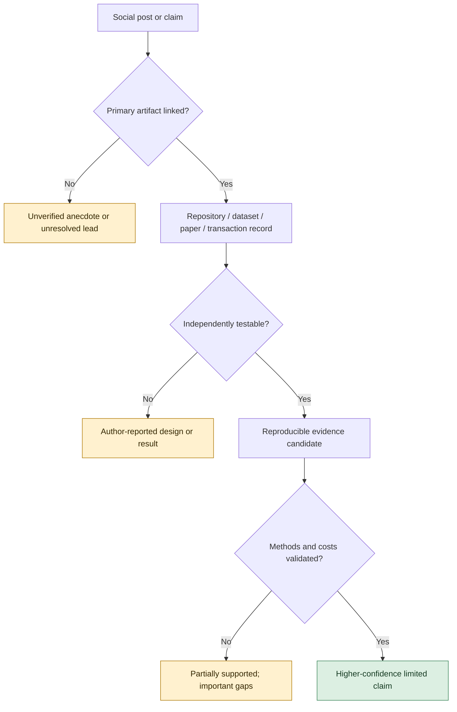
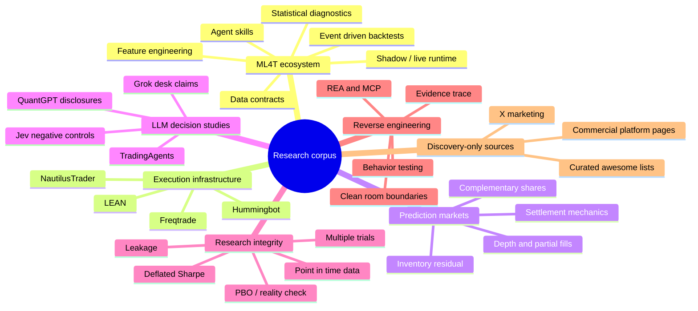
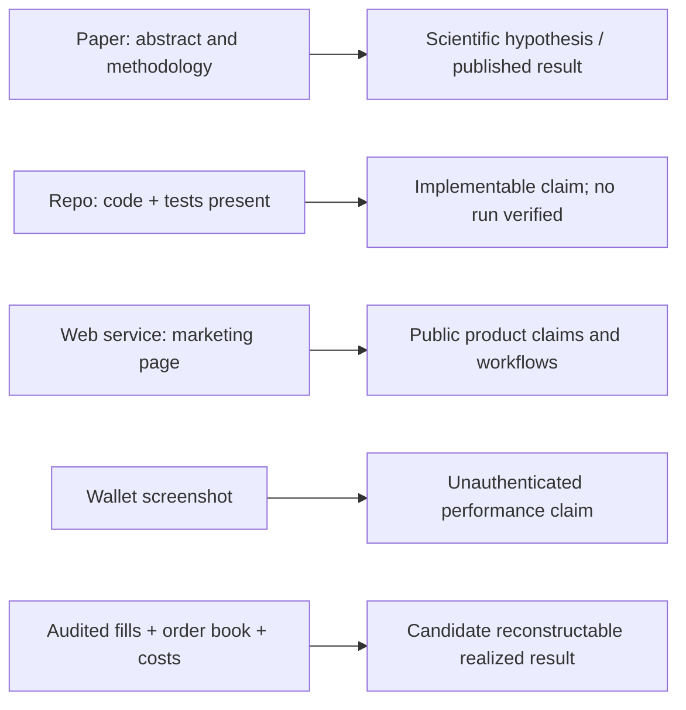
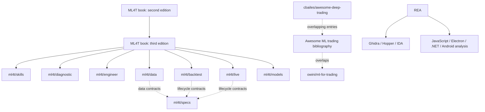
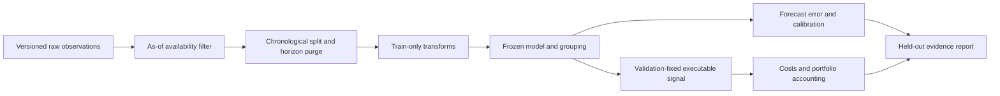
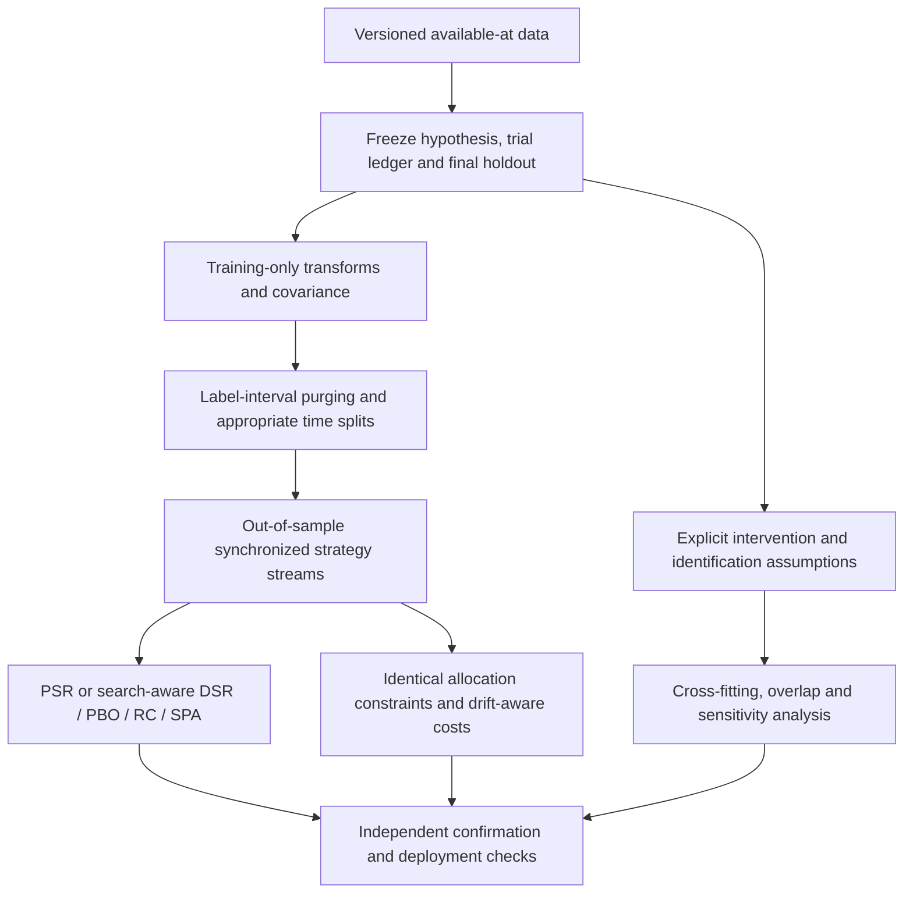
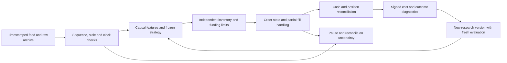
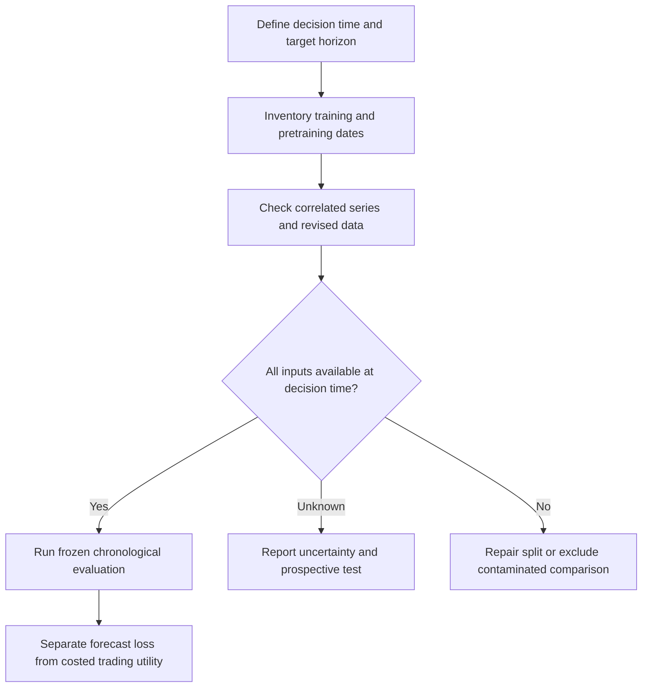
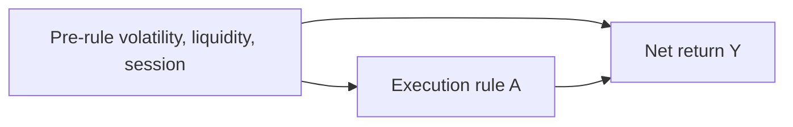
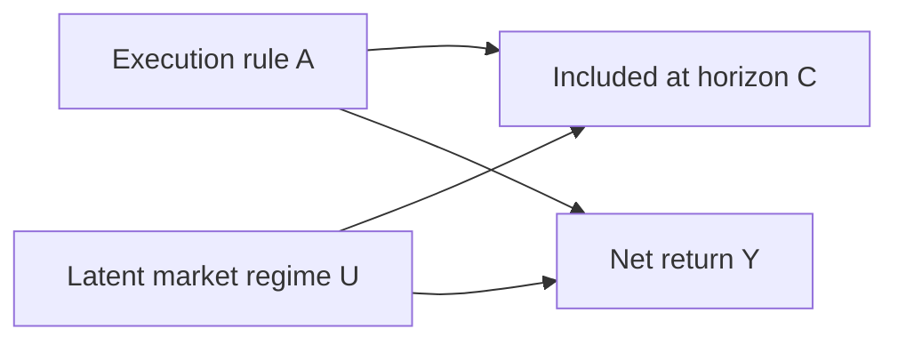

# RESEARCH: AI Trading, Quantitative ML, Prediction Markets, Agent Workflows, and Evidence-Driven Reverse Engineering

> **Research dossier, not a system architecture proposal**  
> **Compiled:** 2026-10-19 · **Language:** English · **Format:** GitHub-flavored Markdown with Mermaid diagrams, tables, linked citations and a machine-readable follow-up manifest.  
> **Latest integration:** 2026-11-05; exact completed reading scopes and open work are in the durable source register and the appended deep-review chapters.
> **Previous update:** 2026-10-20 · **New supplied resources:** H01 Harness² and H02 RRSI; source review, local checks, related research and exact limits in §19.
> **Scope:** Original O/N sources plus all 40 subsequently supplied E/F/G resources, relevant accessible child references, independent GitHub projects, papers, books and critical counter-evidence; exact coverage and blockers are recorded per asset.  
> **Central caveat:** This is a rigorous *source-review dossier*, not a claim that every post, linked page, paper PDF or source file was exhaustively read. Exact text for all 27 supplied X statuses was recovered through secondary captures; full proprietary systems remain inaccessible. Selected mathematical and static-source checks were executed, but complete repository suites were not. Unread and partially verified items are explicitly retained for further work.

**Navigation:** [Method](#1-scope-method-and-evidence-standard) · [Coverage ledger](#2-complete-ledger-of-user-supplied-urls) · [Findings map](#3-visual-map-of-findings) · [New sources](#4-findings-from-the-new-links) · [Earlier sources](#5-findings-from-the-original-link-set) · [Related repositories](#6-expanded-related-github-landscape) · [Papers](#7-research-papers-and-methodological-evidence) · [Claims](#8-claims-versus-evidence) · [Reverse engineering](#9-reverse-engineering-evidence-and-legal-boundaries) · [Verdicts](#10-relevance-and-reliability-verdicts) · [Follow-up](#11-mandatory-follow-up-research-queue) · [Citations](#12-bibliography-and-source-index) · [Rendering](#13-markdown-and-mermaid-rendering) · [Independent audit](#14-independent-audit-corrections-and-expanded-research) · [Ordered checklist](#15-ordered-checklist-of-every-additional-user-supplied-resource) · [Harness/QuantResearch](#16-findings-from-batch-e-harnesses-memory-and-quantresearch) · [Memory research](#17-findings-from-batch-f-memory-systems-and-evaluation) · [Deep review of all 40 additions](#18-deeper-review-of-the-40-incoming-resources--2026-10-19).

---

## 1. Scope, method and evidence standard

This report distinguishes **what was seen in first-party documentation**, **what the project's author claims**, **what an independent experiment reports**, and **what remains unobserved**. Repository files and README pages accessed through public GitHub webpages were read selectively and critically; a repository containing a test folder is not equivalent to a locally successful test run, and commit volume is not proof of strategy profitability. All GitHub snapshot counts are transient observations, not durable quality scores. Dates and versions likewise may change.

### 1.1 Review states

| Code | Meaning | What can be concluded |
|---|---|---|
| **P** | Direct primary page available | The page says this; not necessarily that its claims are independently proved |
| **C** | Primary GitHub repository plus documentation inspected | Source tree, capabilities, terms and selected details can be corroborated; runtime not independently executed |
| **M** | Mirrored/indexed original post or article | Reconstruction possible; completeness of media, edits, replies and links not guaranteed |
| **I** | Indexed snippets / adjacent context only | Topic lead, not verified full-post content |
| **U** | Exact requested item unavailable | **DO NOT GUESS** the missing post/article contents |
| **D** | Duplicate/alias or fork of an already-reviewed primary source | Do not double-count as independent validation |

### 1.2 Evaluation dimensions

Each item is rated *for usefulness as research material*, not investment attractiveness: **primary-source traceability; implementation depth; independent testability; quantitative evaluation; disclosure of failure; validity of data/fees/fill assumptions; operational maturity; licensing/security; uniqueness relative to other items**. A project can rank high as an excellent failure study while ranking low as a production system. A marketing screenshot cannot establish causal profitability or safety.

### 1.3 What was and was not performed

**Performed:** original report read in full; exact-ID secondary text retrieval for every supplied X status; captured attached articles/code; selected primary repository source/documentation audits; full extracted text of DSR, PBO and Avellaneda–Stoikov papers; partial reading of other papers; independent mathematical and static source checks. Exact scope/results appear in §14.

**Not performed:** authenticated X/media/reply/revision exports; all cited books, figures, supplementary files or bibliography bodies; complete repository suites; on-chain P&L/account-ownership verification; execution/reverse engineering of private applications. These limits remain explicit.

### 1.4 Research boundaries

No inference about available source code reveals a hosted platform's proprietary server code. Social trading performance can be fabricated or cherry-picked; AI-generated labels such as *production-grade*, *HFT*, *institutional*, *agent swarm*, *reproducible* are claims until methods, artifacts and outcomes are validated. Reverse engineering is considered only for lawful, authorized study and interoperability; this report does not endorse bypassing access controls, payments, DRM or copying proprietary code.

## 2. Complete ledger of user-supplied URLs

The `O` series records **all original links**; the `N` series records **all newly supplied links**. Each contains an explicit review state. `I` and `U` do **not** mean the content was read; those entries are mandatory work for a later authenticated reader.

### 2.1 Earlier batch (21 URLs)

| ID | Source | Topic | State | Evidence outcome |
|---|---|---|---|---|
| O01 | [Open](https://x.com/me_barnyx/status/2105604471908692189) | Ten Jev agent-repository names | M | Comment links and owners remain unresolved |
| O02 | [Open](https://x.com/bl888m_eth/status/2105663850108567575) | Earnings-market bot P&L claim | M | Exact mirrored text read; returns unverified |
| O03 | [Open](https://x.com/RetroValix/status/2104720599394156951) | Jarvisen asynchronous paired inventory | M | Separate matched and residual exposure |
| O04 | [Open](https://x.com/RetroValix/status/2104339811486077290) | External-feed latency/momentum narrative | M | Different wallet from O03; private algorithm inferred |
| O05 | [Open](https://x.com/shmidtqq/status/2104281326119502138) | Chameleon terminal promotion | M | Adaptive UI/scam-filter claims; no throughput test |
| O06 | [Open](https://lnkd.in/p/eDSs6P-7) | Public LinkedIn post recovered; page-supplied transcript read | P | Previous403 superseded for body/transcript; video/comments/revisions remain unverified; see20.3 |
| O07 | [Open](https://x.com/qwinsi0x/status/2102472249508765796) | AI research and selected strategies | M | Quoted six-step article read; results unverified |
| O08 | [Open](https://x.com/Dan1ro0/status/2102858885182726357) | bosona inventory-skew narrative | M | Exact text read; referral and attribution unverified |
| O09 | [Open](https://github.com/khodemadi/aria-futures-demo-source) | paper futures demo frontend | C | Keep only for UI / virtual account |
| O10 | [Open](https://x.com/TeddyinMedia/status/2101311604797145483) | Eight trading repositories | M | Actual linked repository list recovered |
| O11 | [Open](https://x.com/beamnxw/status/2101278282700226824) | Fifteen agent-stack repositories | M | Actual linked repository list recovered |
| O12 | [Open](https://x.com/w1nklerr/status/2101625932104478898) | Fourteen-agent browser trading floor | M | Real inputs do not prove real execution |
| O13 | [Open](https://x.com/x_insider4/status/2099889594774786193) | Alleged internal Anthropic NQ system | M | Institutional provenance and returns unverified |
| O14 | [Open](https://x.com/bl888m_eth/status/2099907642991014338) | Event-cancellation market bot | M | Wallet cash flows and ownership unverified |
| O15 | [Open](https://x.com/sauda_coder/status/2100195671039160435) | Ten AI/software repositories | M | Earlier viral-bankroll attribution withdrawn |
| O16 | [Open](https://x.com/bored2boar/status/2100270823248388412) | Complementary-share arbitrage guide | M | Sequential code does not provide atomicity |
| O17 | [Open](https://x.com/RetroValix/status/2100661635245359135) | Passive grid and inventory narrative | M | Same wallet as O21; algorithm not uniquely identified |
| O18 | [Open](https://x.com/AleiahLock/status/2100617777337839714) | QUBO memecoin terminal | M | Quoted article/code read; earlier visual-rebuild attribution withdrawn |
| O19 | [Open](https://x.com/RetroValix/status/2099269744494862618) | Polkadot-Frog paired inventory | M | Exact text read; fees can erase nominal spread |
| O20 | [Open](https://x.com/Dan1ro0/status/2090102415210971442) | Top ten Polymarket bots article | M | Full captured body/code read; analysis dataset absent |
| O21 | [Open](https://x.com/Dan1ro0/status/2099956649771327877) | GBM Monte Carlo wallet narrative | M | Calibration and algorithm attribution unproved |

### 2.2 New batch (23 URLs; one duplicate)

| ID | Source | Topic | State | Evidence outcome |
|---|---|---|---|---|
| N01 | [Open](https://github.com/ErTasselli/OpenTerminal) | free-data terminal/dashboard | C | Useful UI/provider study, not exchange-grade quotes |
| N02 | [Open](https://x.com/me_barnyx/status/2111814968282636595?s=20) | Seven-agent PAPER trading results | M | Paper arithmetic checked; no live-return evidence |
| N03 | [Open](https://x.com/0xboan/status/2092226208234647626) | Eight-agent memecoin desk | M | Full captured body/code read; shared-session authority matters |
| N04 | [Open](https://github.com/stefan-jansen/machine-learning-for-trading) | ML4T 3rd edition 27 chapters/9 cases | C | Major research asset |
| N05 | [Open](https://github.com/PacktPublishing/Machine-Learning-for-Algorithmic-Trading-Second-Edition) | ML4T 2nd edition Packt fork | C/D | Historically valuable; avoid double counting |
| N06 | [Open](https://github.com/ml4t/skills) | 61 agent skills | C | Method checklists, not executable research results |
| N07 | [Open](https://github.com/ml4t/diagnostic) | signal and statistical diagnostics | C | High methodological relevance |
| N08 | [Open](https://github.com/ml4t/live) | broker runtime/shadow trading | C | Useful boundaries; adapter claims need tests |
| N09 | [Open](https://github.com/ml4t/engineer) | features, bars, labeling | C | Important leakage-sensitive work |
| N10 | [Open](https://github.com/ml4t/backtest) | event-driven backtest | C | Study behavior and explicit limitations |
| N11 | [Open](https://github.com/ml4t/data) | market-data adapters | C | Check source licensing, timestamps, PIT guarantees |
| N12 | [Open](https://github.com/owini/ml-for-trading) | ML trading curated list | C/D | Duplicated bibliography; not implementation |
| N13 | [Open](https://github.com/cbailes/awesome-deep-trading/tree/master) | ML trading curated list | C | Source list; individual paper vetting needed |
| N14 | [Open](https://x.com/RuOnChain1/status/2110019222592266727) | QuantGPT desk workflow | M | Full captured body/code read; commercial claims need validation |
| N15 | [Open](https://horizon.trade/?dub_id=sAHxFShY2iOMo1l1) | commercial no-code strategy platform | P | Feature/claim map only; internals unavailable |
| N16 | [Open](https://x.com/Dan1ro0/status/2111893686661402793?s=20) | AroonPBot6 performance narrative | M | Exact text read; denominator/ownership unverified |
| N17 | [Open](https://x.com/Dan1ro0/status/2090102415210971442) | Duplicate O20 | D/M | Same status; body read once |
| N18 | [Open](https://x.com/Klonzu/status/2111879981567783300?s=20) | Jev trading-floor render | M | Explicitly fictional render; thresholds lack units |
| N19 | [Open](https://x.com/0xCodila/status/2109623431763292649) | REA tutorial article | M | Full mirror read; cross-check against official docs |
| N20 | [Open](https://github.com/morluto/rea) | REA MCP/CLI reverse engineering | C | Primary source and evidence workflows |
| N21 | [Open](https://rea.tools/) | REA official site/showcases | P | Author examples and bounded demos |
| N22 | [Open](https://x.com/0xOrionVega/status/2111818275294228728?s=20) | Agent toolkit and configuration triage | M | Simulated fills; 116 configurations unaccounted for |
| N23 | [Open](https://x.com/velesxbt/status/2110731912176095700) | QuantGPT six-strategy research guide | M | Full captured body/code read; data-vintage conflict unresolved |

### 2.3 Coverage caveats and resolution rules

- N17=O20: one status, two supplied ledger records.
- Every supplied X status text was read through exact-ID secondary capture; state M does not authenticate images, account ownership, replies or historical revisions.
- Attached article IDs differ from sharing status IDs. Correct pairs: N03→2092204107175952384; N14→2109399271212822528; N19→2109398658751856642; N23→2110377833579061248; O20/N17→2090065085884514304.
- Full captured article bodies/code were read for those five. [FxTwitter exact-ID endpoint](https://api.fxtwitter.com/status/2110731912176095700) and [Thread Navigator N19](https://threadnavigator.com/thread/2109623431763292649/) provide secondary access; official docs check technical capabilities.
- O06 remains unavailable; no confident attribution to a specific LinkedIn article.
- Curated lists overlap completely at the smaller list's raw URL level. Citations are individually tracked in §14.

---

## 3. Visual map of findings

These diagrams describe **observed research themes and source relationships**. They do **not** specify a system to implement.

### 3.1 Evidence hierarchy



### 3.2 Findings grouped by evidence category



### 3.3 What each result actually establishes



### 3.4 Research lineage, not architecture



---

## 4. Findings from the new links

### 4.1 OpenTerminal: a free-data terminal, not a licensed Bloomberg replacement (`N01`)

**Primary:** [ErTasselli/OpenTerminal](https://github.com/ErTasselli/OpenTerminal) (MIT). At the captured GitHub snapshot the repository had approximately 1.8k stars, 320 forks and 32 commits; it contains `server/`, `web/`, a data directory, screenshots, CI and tests. These numbers are descriptive only. The README distinguishes educational/personal use from institutional-quality feeds.

**Verified repository-described feature inventory:** draggable and resizable panels using `react-grid-layout`; keyboard-driven symbol selection; `lightweight-charts` candlesticks and SMA/EMA/VWAP/Bollinger/RSI/MACD; stock and ETF quote panels; RSS news aggregation; screening and sector treemaps; listed options chains; cryptocurrency overview; macro yields and VIX proxies; earnings and economic calendars; a SQLite transaction-ledger portfolio view; an optional Claude assistant. Frontend: Next.js 15, React 19, TypeScript, Zustand, TanStack Query, D3/Recharts; backend: Express/TypeScript; persistence: `better-sqlite3` WAL. [R01]

**Data-provider facts from the README:** Nasdaq public quote/chart endpoints with Yahoo Finance and Stooq fallbacks; TradingView public scanner/search endpoints; Yahoo/Google news RSS; CoinGecko/Binance crypto feeds; FRED macro series; Forex Factory event feeds; Nasdaq surprise data. Provider-level fallback and stale-while-revalidate caching are meaningful engineering features; availability and contractual permission of any third-party endpoint are not guaranteed. Public/reverse-engineered website endpoints are **indicative**, possibly delayed, rate-limited, structurally unstable and often inappropriate for redistribution or trading. The authors expressly caution against using those prices for real investment decisions. [R01]

**Concrete strengths:** separate provider adapters under `server/src/providers/`; explicit primary-to-fallback chains; local-first defaults and loopback binding; local API secret generation for sensitive routes; a Docker option; Vitest tests and CI; portfolio data in SQLite; straightforward, discoverable UI widget structure. These are implementation patterns, not validated exchange price quality. The README even acknowledges unresolved dependency advisories and proxy/IP-rate-limit pitfalls. [R01]

**Weaknesses / unverified matters:** quote freshness versus primary venue; split-adjustment conventions; survivorship-free historical data; options-chain completeness and timestamps; precise licensing of unofficial endpoints; resilience during market opens or upstream outages; latency under load; auth behind an external reverse proxy; security of optional AI context; correctness of valuation/P&L in unusual corporate actions. The author says `TRUST_PROXY` must be set carefully or spoofed forwarding headers can bypass limits. The roadmap still lists Black–Scholes Greeks, drawing tools, alerts and PostgreSQL. [R01]

**Verdict:** **KEEP: strong terminal/UI/data-adapter reference.** **Do not** treat as a data entitlement, exchange-grade feed, statistical research platform or production broker/risk engine. **DEEP-READ** `server/src/providers`, fallback/cache, portfolio ledger, server auth middleware, tests, Next widget rendering. **Reverse-engineering relevance:** much of the publicly visible terminal behavior is already reproducible from open source; using REA against competitors adds complexity and legal questions, not essential evidence of how this project works.

### 4.2 Stefan Jansen, *Machine Learning for Trading*, third edition (`N04`)

**Primary:** [stefan-jansen/machine-learning-for-trading](https://github.com/stefan-jansen/machine-learning-for-trading) (MIT). Important version correction: its default branch describes the **third edition**, with **27 chapters and nine full-span case studies**; the `second-edition` branch preserves the earlier work. At the checked snapshot: approximately 21.4k stars and 1,135 commits. The Packt item (`N05`) is explicitly a fork and pertains to the **second edition**, not an independent third-edition codebase. [R02][R03]

**Core finding:** the most useful asset is not a particular predictor. The author organizes research around a documented *evidence boundary* between development/tuning and confirmation/evaluation, then deployment monitoring and retirement. The new book spans ETF, crypto perpetual, intraday equity, options, FX, futures and cross-sectional factor problems; strategies are followed from data and labels to forecasts, transaction costs, risk and deployment decisions. The public README emphasizes *where each study fails as well as where it works*. [R02]

**Expanded method inventory:** market and alternative data; feature engineering; gradient boosting (XGBoost/LightGBM/CatBoost); deep time-series models (PatchTST, iTransformer, TSMixer, TCN, Mamba); TabPFN/TabM; conditional autoencoders; asset pricing; causal ML (Double Machine Learning, Bayesian structural time series and causal discovery); synthetic financial data (TimeGAN, Tail-GAN, Sig-CWGAN, diffusion); RL for execution and inventory-aware making; LLM/RAG using SEC filings and GraphRAG; MLOps, data/feature lineage, drift and safe rollout. Listing a technique in a textbook is **not** proof it improves live returns. [R02]

**Specific issues worth studying:**

1. **Temporal alignment.** When was each feature observable? Was a revised macro series backfilled? Was a company's filing or consensus value available before entry? Are exchange sessions and timestamps explicit?
2. **Cross-validation.** Ordinary shuffled k-fold creates overlap leakage in many financial tasks. The research references walk-forward, purging/embargo and combinatorial validation, but each concrete notebook should still be checked for how event durations, overlapping labels and embargo are implemented.
3. **Model selection versus confirmation.** The most valuable evaluation set must not be repeatedly inspected during model development. Repeatedly tuning against a held-out test effectively converts it to another training set.
4. **Portfolio translation.** Directional accuracy is not realized trading alpha: sizing, target turnover, universe selection, short constraints, commissions, borrow, slippage and risk change the result.
5. **Operational parity.** Feature definitions, corporate actions, calendars and broker instructions used in research have to mean the same thing during runtime; a good notebook alone cannot guarantee this.
6. **Failure accounting.** DSR, PBO, White's Reality Check, related multiple-testing correction and honest uncertainty are valuable precisely because AI agents can generate far more candidate strategies than humans can manually inspect.

**Verdict:** **HIGHEST-PRIORITY DEEP READ** for quantitative-methodology research. Focus on the actual third-edition case studies, chapter docs, data downloads, validation utilities and experiment artifacts. **Not:** evidence that any individual provided strategy retains live alpha today.

### 4.3 Packt second-edition companion (`N05`)

**Primary:** [PacktPublishing/Machine-Learning-for-Algorithmic-Trading-Second-Edition](https://github.com/PacktPublishing/Machine-Learning-for-Algorithmic-Trading-Second-Edition). The GitHub page directly identifies it as a fork of Jansen's repository. Approximately 353 commits and more than 150 notebooks. It covers **23 chapters plus appendix**, financial data, alpha factors, portfolio metrics, linear/Bayesian/time-series/tree models, text/NLP, CNN/RNN, GAN and deep RL. Notebooks include NASDAQ ITCH order-book reconstruction, factor analysis, Zipline/backtrader, text filings and research-paper reproductions. [R03]

**Historical value:** broad guided examples; useful educational baselines; access to early published implementations and explicit data preparation. **Important limits:** dependencies described include older pandas/TensorFlow/Python/Zipline configurations, so execution reproducibility on 2026 systems is not assured. Much of the content is superseded conceptually by the third-edition workflow; classic papers and basic definitions still matter. **Verdict: KEEP FOR HISTORICAL REPLICATION / EDUCATION, DO NOT DOUBLE COUNT.** Deep-read chapters on ITCH, factor analysis, strategy evaluation and cross-validation where they illuminate implementation assumptions; do not blindly adopt old environment instructions.

### 4.4 `ml4t/skills`: procedural anti-leakage instructions (`N06`)

**Primary:** [ml4t/skills](https://github.com/ml4t/skills) and [skill-to-chapter mapping](https://github.com/ml4t/skills/blob/main/SKILL_CHAPTER_MAP.md). At the checked snapshot: 61 standalone `SKILL.md` documents, arranged into `advanced-ai`, `backtest`, `concepts`, `data`, `features`, `infrastructure`, `portfolio`, `production`, `validation`, `workflows` and other folders. Files use YAML frontmatter and instruction-oriented wrong/correct examples. The repo describes an installer that flattens the folder hierarchy into the expected skills directory; placing the entire grouped repo one level deep can make the skills undiscoverable. It is **not** a Python library and not an npm runtime. [R04]

**Research significance:** a reusable *codification of domain failure modes*, such as overlapping-label leakage, unrealistic fills, stale joins, misuse of randomized cross-validation, inflated Sharpe, missing slippage and unsafe autonomous rollouts. These are **checklists and prompts**, not proof that an autonomous agent follows them, nor protection against deliberately incorrect code. A good skill has measurable checks and states its dependencies; a weak one is merely ceremonial prose. The content deserves a code-review-like reading: inspect the actual `SKILL.md`, test its canonical wrong/correct cases, and check if it refers to APIs that really exist in sibling repos.

**Verdict:** **KEEP/HIGH**, especially as a research checklist. **DEEP-READ** `validation/`, `backtest/`, `features/`, `production/`, `tests/`, and `SKILL_CHAPTER_MAP.md`. Assess whether each skill supplies measurable acceptance criteria rather than only suggestions.

### 4.5 `ml4t/diagnostic`: statistical credibility layer (`N07`)

**Primary:** [ml4t/diagnostic](https://github.com/ml4t/diagnostic) (MIT), with `src/ml4t/diagnostic`, tests, examples, docs and roughly 209 commits at inspection. The documented interface includes `analyze_signal` with IC (information coefficient), IC t-statistics, quantile returns/spreads and turnover; `WalkForwardCV`, `CombinatorialCV`, `ValidatedCrossValidation`; Deflated Sharpe Ratio, Probability of Backtest Overfitting, Rademacher Anti-Serum, false discovery rate control and White's Reality Check; feature importance, interactions/drift, attribution, and portfolio/trade diagnostics. Optional dependencies include visualization, ML, performance acceleration, result bridges and a dashboard. [R05]

**Why valuable:** a performance report without *selection process* and *signal diagnostics* is nearly uninterpretable. Information coefficient can diagnose rank association even if portfolio returns are obscured by execution constraints. Turnover explains why gross alpha might not survive costs. Multiple-testing tools counter strategies discovered by exhaustive search. Distinguish a statistical detection metric from an implementable edge: IC can be nonzero yet too weak/short-lived to monetize.

**Questions not established by README:** exact mathematical equivalence to original DSR/PBO tests; small-sample choices; block bootstrap choices; how clustering and serial correlation are handled; whether CPCV folds are truly purge-safe for event-label intervals; numerical tolerance against reference implementations; how many hypotheses in a search history are declared rather than silently discarded. These need source/tests and synthetic adversarial cases, not blind trust in function names.

**Verdict:** **KEEP/HIGHEST METHODOLOGICAL RELEVANCE**. Deep-reader target: `src/ml4t/diagnostic`, test fixtures and comparison against the original peer-reviewed equations. **No claim** of statistical verification from this review alone.

### 4.6 `ml4t/engineer`: labels, clocks, bars and lookahead (`N09`)

**Primary:** [ml4t/engineer](https://github.com/ml4t/engineer) (MIT), approximately 182 commits at inspection, Polars-based, with `tests/` and `validation/`. Documentation describes 120 registry features in 11 categories, fixed and path-dependent labels, triple-barrier/ATR/percentile/trend-scanning/meta-label methods; tick/volume/dollar/imbalance/run bars; train-only scaling and data transformations. [R06]

**Technical significance:** the unit of observation is a modeling decision. Event-based bars can make observations more homogeneous than fixed wall-clock bars but create subtleties: triggering uses information available up to that point; timestamps should mark end of event; boundaries cannot be retrospectively adjusted with future volumes. In triple-barrier outcomes, if two threshold events are possible inside one OHLC bar, the true order is unknown unless finer-resolution data exists. A label horizon overlapping a neighboring test fold can leak information if purge is incomplete. Train-only scalers matter because a full-sample normalization can bake future regime statistics into historical training.

**Important nuance:** the quickstart explicitly uses `calendar=None` as *observation-row* mode, so indicator periods count rows rather than elapsed time or trading sessions. That is correct if intentional but changes RSI/ATR semantics in irregularly spaced event bars. [R06]

**Verdict:** **KEEP/HIGH** for economically and temporally coherent ML datasets. **DEEP-READ** barrier implementation, calendar logic, feature registry, aggregation algorithms, transformer fitting and validation tests.

### 4.7 `ml4t/data`: provider breadth versus trustworthy timestamps (`N11`)

**Primary:** [ml4t/data](https://github.com/ml4t/data), MIT, approximately 168 commits, tests and docs. The README identifies adapters for equities, futures, FX, crypto, macro, factors and prediction markets, plus optional integrations for Yahoo, DataBento, Oanda and COT data. A synthetic provider is included for deterministic credential-free tests. Source storage and path conventions are documented. [R07]

**Value:** unified schemas, local storage and repeatable data loads can reduce ingestion divergence across studies. **But:** listing a provider is not a guarantee of exchange-grade completeness or legally redistributable data. Assess each adapter separately for symbol changes, timezone/DST, trading calendars, backfills, corrections, adjusted/unadjusted OHLCV, corporate actions, delisting, duplicates, revision timestamps, clock skew, funding rates and historical availability. For prediction markets also verify market ID stability, closure/cancellation rules, conditional token semantics and market resolution source.

**Verdict:** **KEEP/HIGH**, conditional on per-provider tests and data rights. **DEEP-READ:** provider API contracts, deterministic synthetic fixtures, validators, data lake layout, PIT/revision semantics. The documented adapter count is not proof that every market type is equally mature.

### 4.8 `ml4t/backtest`: unusually honest simulation limits (`N10`)

**Primary:** [ml4t/backtest](https://github.com/ml4t/backtest) and, critically, [`LIMITATIONS.md`](https://github.com/ml4t/backtest/blob/main/LIMITATIONS.md). Roughly 202 commits at inspection. The README documents an event-driven strategy abstraction, configurable same-bar/next-bar fills, quote-side valuation, exit-first ordering, stop/take-profit/trailing rules, portfolio exposure constraints, margin/cash/crypto accounts, exportable fills and 40+ behavioral settings for framework parity. The same `Strategy` interface is described as reusable in `ml4t-live`. [R08]

**Critical direct limitations:** it is a *bar-based* simulator. OHLC does not encode the sequence of price visits. `SAME_BAR` can be biased if the strategy sees that bar before a fill at its close. Market-on-close submitted within `on_data` can likewise be lookahead if the decision was not feasible before the auction. Its limit/stop fills do **not** reconstruct order-book queue position. If no volume/quote limit is configured, the requested quantity is assumed fillable at the modeled price. Impact models omit real routing, delays, hidden liquidity, order acknowledgments, halts and auctions. Input corporate actions must already be prepared. These limitations are **documented by the project itself**, not speculative criticisms. [R08L]

**Research value:** a good event-driven engine with explicitly parameterized assumptions offers a useful way to discover how supposedly robust strategies depend on unrealistic fills. The correct test is not that it produces a Sharpe; it is whether a hand-constructed event sequence produces exactly the fills, cash flows and risk decisions predicted by the model. **Verdict: KEEP/HIGH**, with strongest value in its boundary conditions and parity tests. **DEEP-READ** `LIMITATIONS.md`, fill/account modules, tests, framework comparisons, session and signal-clock contracts.

### 4.9 `ml4t/live`: the paper/shadow distinction (`N08`)

**Primary:** [ml4t/live](https://github.com/ml4t/live), [design notes](https://github.com/ml4t/live/blob/main/DESIGN.md). Around 161 commits, tests, APIs and compatibility manifests at inspection. The README documents `LiveEngine`, `SafeBroker`, a virtual portfolio for shadow mode, Interactive Brokers and Alpaca order adapters, OKX funding data and other feeds, with experimental opt-in for selected adapters. Default installs include Alpaca, IB, CCXT and OKX components; certain feeds and less-tested combinations have stated limitations. [R09]

**Important distinction:** **shadow mode** can consume market data and simulate portfolio changes without submitting external orders; **broker paper trading** sends orders into a broker's paper environment, which may use its own optimistic matching model; **live execution** interacts with actual liquidity and infrastructure. These three modes must not be conflated in performance claims. README examples show `VirtualPortfolio.process_fill` and `SafeBroker` descriptions, but do not independently establish a robust production incident history.

**Deep-review questions:** broker reconnect/reconciliation; duplicate order protection/idempotency; partial fills; out-of-order acknowledgments; cancelled/replaced orders; stale or rejected quotes; funding and borrow; timezone recoveries; crash restart state; secrets; kill-switch persistence; emergency shutdown; shadow-versus-live semantic parity. **Verdict: KEEP/HIGH-POTENTIAL, deep-read required before real capital.**

### 4.10 Related packages discovered through the ML4T links: `ml4t/models` and `ml4t/specs`

**`ml4t/models`** ([GitHub](https://github.com/ml4t/models)) documents PCA, risk-premium PCA, IPCA, conditional autoencoder, stochastic discount-factor learning, supervised autoencoder and portfolio learning (linear/LSTM/deep) with explicit typed panels and handoff formats. It distinguishes learned latent structure, factor-premium forecasting and predictions. Approximately 100 commits and CI/test tooling appeared in the repo. **Why important:** confusion between in-sample factor reconstruction and ex-ante return prediction is a major failure mode. Even a perfectly estimated factor loading does not imply predictability of its future price. [R10]

**`ml4t/specs`** ([GitHub](https://github.com/ml4t/specs)) contains serializable runtime-neutral definitions for bars, market data, artifacts and strategy lifecycle. Approximately 32 commits. **Why important:** schema compatibility and timestamps are causal assumptions disguised as data types. Different sampling/resolution may change the same strategy's meaning. These two repos are **additional discoveries**, not user-supplied items; they fill important explanatory gaps in the linked ecosystem. [R11]

**Ecosystem caveat:** individual READMEs disagree about whether the ecosystem contains six or seven libraries; count depends on inclusion of `models` and shared `specs` in a given release. Do not treat a marketing count as a stable dependency list.

### 4.11 Curated bibliographies: `cbailes/awesome-deep-trading` and `owini/ml-for-trading` (`N12`, `N13`)

These are **citation directories, not trading applications**. The `cbailes` repo lists papers and repositories grouped by CNN/LSTM/GAN, high-frequency data, portfolio/RL, market vulnerability, cryptocurrencies, sentiment and alternative data. The `owini` repo has closely overlapping structure and early entries. Sample references include Dixon/Klabjan/Bang (deep market classification), Sirignano (LOB learning), Jiang/Xu/Liang (deep RL portfolio), Bühler et al. (*Deep Hedging*), synthetic-time-series methods and agent/RL examples. [R12][R13]

**Strength:** high recall for a slice of historical literature. **Weakness:** citation duplication, older research horizons, dead project links, incomplete benchmarks and heterogeneous paper quality. A curated entry is not peer review and is not necessarily reproducible. **Verdict:** **KEEP AS A DISCOVERY INDEX ONLY**. Follow the research papers and reproducible datasets; do not present either list as a maintained implementation suite or count overlapping entries twice.

**Priority extraction from these lists:** modern order-flow prediction, DeepLOB, deep hedging, realistic RL with market-impact assumptions, adversarial and manipulation vulnerability, synthetic-series validation, model decay, benchmark leakage, replication and robust baselines. Full-paper reading assignments appear in §11.

### 4.12 REA: actual capabilities, not “all commercial software is now open source” (`N20`, `N21`)

**Primary:** [morluto/rea](https://github.com/morluto/rea), [official site](https://rea.tools/), [CLI and evidence reference](https://github.com/morluto/rea/blob/main/docs/cli.md) (MIT). It is an **MCP server + CLI + provider orchestration/evidence layer** for software analysis, rather than a newly invented Ghidra/IDA-grade disassembler. The documentation describes Node.js 22/24/26 support (with specific minimum patch versions) and an optional agent setup workflow with reviewable edits and configuration backup. Local analysis output may be passed onward through an AI agent's model provider. [R14][R15][R15C]

**Documented target types:** JS/Electron (module graphs, imports, IPC, source maps, native addon relationships), browser pages/recorded HAR traffic, .NET assemblies/CIL, Android/ADB/JADX, native executables through Hopper/Ghidra/IDA, EVM bytecode, Go/Rust binaries, WASM, firmware, packets, recorded crashes, SQLite and others. Some require third-party programs/OS-specific environments; none imply universal decompilation of cloud backends. [R14]

**Strong technical idea: saved evidence with provenance.** REA's CLI docs state large JS evidence artifacts may be hundreds of MB; they support saving a full evidence JSON and asking a condensed view/page/query afterward. This matters for large Electron applications and agent-context economy. Example in docs: large Obsidian evidence can be projected from hundreds of MB to a small summary; the summary must remain navigable back to the original evidence so citations are auditable. [R15C]

**Official examples:** Calculator percentage-operation interpretation from inspected instructions; a Chrome dinosaur speed rule; Notes app export tracing; other binary reconstruction showcases. These are bounded test cases, not “any application fully cloned”; reverse-engineered pseudocode is a reconstruction, not original source. Explicit sample limitations and target-specific prerequisites are part of the value. [R15]

**Security and epistemic issues:** executable/installer provenance; native parsers and malicious sample risks; agent tool permission; secrets/PII in HAR; sending extracted content to a cloud LLM; licensing; false function identifications; symbol-stripped code; incomplete call graphs; nondeterministic runtime behavior; hidden server functions; antitamper and legal constraints. The fact that a tool runs *locally* does not mean every model-bound excerpt stays on the local machine. REA is not a sandbox. [R14][R15C]

**Verdict:** **KEEP/HIGH, especially for authorized feature investigation and evidence management.** Evaluate its evidence schema, verification procedures, providers, security document and official showcases rather than viral boasts. It is related to trading software only through permitted observation of client functionality, local formats and public network interactions; it is **not** evidence that proprietary hedge-fund models or paid server-side signals can be extracted.

### 4.13 `0xCodila`: a mirrored REA course, not a second independent discovery (`N19`)

**Accessible mirror:** [Thread Navigator full article](https://threadnavigator.com/thread/2109623431763292649/), cross-checked with official REA sources. The article discusses REA as a coding-agent MCP bridge, supported target classes, installation, learning exercises, examples, prompts, limitations and legal discussion. It links official site/repo, several other X posts, industry anecdotes, game-decompilation stories and various claims about making software “free”. [X-COD][R14]

**Confirmed overlap:** Node and setup requirements; Electron/JS and native-provider division; selected Notes/Calculator/dinosaur examples; evidence-first investigation; decompiler versus reconstructed code. **Overstated in the article:** ease of extracting paid capabilities, claims that all closed-source software is effectively free, legal universality of reverse engineering and implied attribution of unrelated game/application remakes to REA. An independently sourced critical comparison found that some widely circulated game ports and clean-room clones do **not** cite REA as their enabling tool. [CR-REA]

**Important legal nuance:** permissible reverse engineering and interoperability depend on jurisdiction, authorization, licenses, contracts, circumvention law, trade secrets and the use of protected material. “I own a subscription” does not automatically authorize copying server-side algorithms or bypassing license checks. Strict clean-room workflow separates behavioral specification from independent implementation; having the same agent read proprietary decompiled code and reproduce it is **not automatically clean-room**. [EFF-RE]

**Verdict:** **KEEP AS AN ACCESSIBLE SOCIAL-LITERature lead, not as proof of technical or legal claims.** `N19` should be read alongside `R14`, `R15`, `CR-REA` and `EFF-RE`, and every linked purported REA example must be checked for actual attribution.

### 4.14 Horizon: commercial product facts versus unknown private implementation (`N15`)

**Primary public site:** [horizon.trade](https://horizon.trade/). Its published user-facing workflow: express a strategy in plain language; inspect/edit generated rules; backtest and paper trade; subscribe/copy public or creator strategies; connect supported brokers; automate through one's broker account. The landing page lists US equities/ETFs and brokers such as Robinhood, Webull, moomoo, E*TRADE, tastytrade, TradeStation and Tradier. It advertises a strategy-creator marketplace where creators retain 80% of subscriptions, plus a free Discover tier and Builder tier. Its displayed Builder price may vary by billing configuration, so avoid quoting as permanent. [S-HOR]

**Explicit claims and caveats:** customer funds remain at broker; Horizon says it cannot withdraw funds; user controls exposure and may stop strategies. It also claims displayed strategy performance reflects **live-money strategies**, not simulated backtests, but independent audit, inclusion rules, survivorship, fees, realized net returns, broker reconciliation and verification of accounts were **not inspected**. The site states SOC 2 Type II and ISO 27001 audits are **in progress**, not certifications already achieved. [S-HOR]

**What a public product page cannot reveal:** actual natural-language-to-strategy parser, optimization process, proprietary data pipelines, event scheduling, risk enforcement, backtesting fill model, indicator calculations, creator-account trade verification, broker credential scope, execution telemetry or source code. UX descriptions are evidence about **product behavior and advertised capability**, not source-level implementation. Public network traffic may expose request/response contracts if legally observed in one's own account but still cannot reveal the hosted core.

**Verdict:** **KEEP AS A COMPETITIVE/FEATURE RESEARCH LEAD**; implementation and claimed track records remain **unverified**. Suggested later evidence work: review current public docs, published changelogs and terms, complete a consented demo flow, document observed field/schema semantics and check published audit disclosures. Do not infer “Horizon’s architecture” from the landing page.

### 4.15–4.21 Corrected exact-source findings

The earlier unread statuses are superseded by exact-ID secondary captures on 2026-10-19. Article bodies and embedded Markdown entities were read where described below; audiovisual media remain incomplete.

| Source | Recovered finding | Revised verdict |
|---|---|---|
| [N03](https://api.fxtwitter.com/status/2092226208234647626) | Article 2092204107175952384 describes eight memecoin-desk roles, shared sessions, lead IDs, signature approval and reporting. RUG is initially forbidden to close alone, then receives an emergency-exit exception. | Workflow hypothesis; resolve permission precedence. Sessions retain authority even without keys in chat. No reproducible trading source or verified P&L attached. |
| [N14](https://threadnavigator.com/thread/2110019222592266727/) | Full mirror read: observation, thesis, stress testing, deployment judgment and feedback; QuantGPT is the promoted data/backtest layer. | Useful commercial workflow guide. Institutional equivalence, universal bias elimination and arbitrary robustness thresholds are unproved. Product disclosures examined separately in §14. |
| [N02](https://api.fxtwitter.com/status/2111814968282636595) | Explicitly $250 to $2,310 on paper. Five listed profits sum to $2,060; the $1,324 DOGE trade contributes 64.3%; removing it leaves $986. The seven-agent Hyperliquid repository is unnamed in the text. | Arithmetic checked; concentrated paper example, not live-return evidence. |
| [N16](https://api.fxtwitter.com/status/2111893686661402793) | Aroon Up/Down and oscillator, wallet nickname PBot-6, $268,805 over 177 days and a Horizon referral. | Approximate $1,519 daily average checks; wallet, trade-count denominators, fees and model attribution unverified. Referral does not establish venue support. |
| [N17/O20](https://api.fxtwitter.com/status/2090102415210971442) | Shares article 2090065085884514304, Top 10 Polymarket Trading Bots; prose and code read. | Single source, not two independent confirmations. |
| [N18](https://api.fxtwitter.com/status/2111879981567783300) | Explicitly a rendered market with made-up JEV pair and no P&L. Spread 0.03, score 0.82 and size 1.3 lack units/calibration. | Workflow illustration; throughput not independently measured. Malformed http-style pseudo-call is not a real URL to visit. |
| [N19](https://api.fxtwitter.com/status/2109623431763292649) | REA article ID 2109398658751856642; complete text mirror read, outgoing primary documentation followed. | Useful tutorial; author examples and reconstruction claims require separate evidence. |
| [N22](https://api.fxtwitter.com/status/2111818275294228728) | Combines public quant packages; claims 4,096 candidates, 3,977 cost rejections and three deployments without an experiment artifact. Intermediate 116 candidates unexplained. | Discovery list and cost-gate proposal; multiple simulators still produce simulated fills. |
| [N23](https://api.fxtwitter.com/status/2110731912176095700) | Article 2110377833579061248 concerns QuantGPT and six published strategies. Body and code/table entities read. | Earlier attribution to Drex is withdrawn. It stresses publication dates, rule mismatches, costs and falsification; data-vintage claims conflict with a current product disclosure (§14). |

The independently discovered [Drex demo](https://github.com/velesxbt/drex-night-desk) and [Drex models](https://github.com/nace-ai/drex-decision-models) remain separate sources. Their hindsight/calibration caveats stand, but shared account ownership does not establish N23's subject. An eight-component F-score is not an exact replication of Piotroski's nine-component rule.

---

## 5. Corrected findings from the original link set

**Correction notice:** exact-ID secondary captures contradict several earlier account-level summaries. Those attributions are withdrawn here. Every supplied X text was recovered; this does not authenticate media, replies, revisions, wallet control or returns.

| Source | What the exact text supports | Correction / evidence limit |
|---|---|---|
| [O01](https://api.fxtwitter.com/status/2105604471908692189) | Ten Jev-related agent-repository names; links said to be in comments. | Earlier options-pricer and 1,000-business-history attribution withdrawn. Owners of openhuman, yao, memsearch, hippo-memory, jev-chat-jarvis, agentconnect, fast-jev-compaction, jev-mcp, jev-router and ollaya remain ambiguous without those comments. |
| [O02](https://api.fxtwitter.com/status/2105663850108567575) | $55-to-$8,710 earnings-market bot narrative. | Author claim, no verified execution trail. No assay source link in this captured post. |
| [O03](https://api.fxtwitter.com/status/2104720599394156951) | Jarvisen asynchronous complementary accumulation and residual exposure. | Paired inventory arithmetic is useful; reported profits and private algorithm remain unverified. |
| [O04](https://api.fxtwitter.com/status/2104339811486077290) | nj23adsknml3 latency/momentum/reversal narrative. | Different wallet and hypothesis from O03; external-feed algorithm is inferred, not recovered. |
| [O05](https://api.fxtwitter.com/status/2104281326119502138) | Chameleon terminal marketing: adaptive UI, scam filtering, whale monitoring and probability-versus-fee gates. | Earlier measured scam-post-throughput/cost-routing attribution withdrawn. No public benchmark accompanies the text. |
| [O06](https://lnkd.in/p/eDSs6P-7) | LinkedIn short link remains blocked. | Alpha Assembly Line identification inherited and unconfirmed; §7's independent papers do not reveal this unseen article. |
| [O07](https://api.fxtwitter.com/status/2102472249508765796) | AI fitting noise, selected momentum/carry tests and Horizon referral. | Quoted article 2089771219478577152 read. BTC momentum and seven-currency carry adaptations are not exact original-paper reproductions; universal carry failure and institutional-throughput claims unproved. Earlier omitted-slippage/live-loss story withdrawn. |
| [O08](https://api.fxtwitter.com/status/2102858885182726357) | Bosona inventory skew, complete sets, Telegram referral. | Private algorithm and P&L not authenticated. |
| [O09](https://github.com/khodemadi/aria-futures-demo-source) | Futures simulator / frontend. | Retain as UI reference, not exchange margin/matching/liquidation parity. |
| [O10](https://api.fxtwitter.com/status/2101311604797145483) | Eight trading repos: AI Hedge Fund, Freqtrade, CCXT, NautilusTrader, Hummingbot, Eliza, FinRL, Jesse. | Earlier free-model-access characterization withdrawn. Actual post explicitly calls these research starting points. |
| [O11](https://api.fxtwitter.com/status/2101278282700226824) | Fifteen agent-stack repositories, listed in §14. | Earlier Minecraft/slow-fast-controller attribution withdrawn. |
| [O12](https://api.fxtwitter.com/status/2101625932104478898) | Fourteen-agent browser trading-floor presentation, Kraken inputs, shared sessions, meetings and vault. | No established Jev decision model, broker fills or real transfers. Earlier Jev-return attribution withdrawn. Live prices can accompany simulated trades. |
| [O13](https://api.fxtwitter.com/status/2099889594774786193) | Allegedly internal Anthropic footprint/DOM NQ system and dramatic session returns. | No first-party institutional provenance or verified statement located. Earlier characterization as a methodological checklist withdrawn. Contract labels need original-media inspection. |
| [O14](https://api.fxtwitter.com/status/2099907642991014338) | Event-cancellation bot, wallet nickname and balance-growth claim. | Deposits, withdrawals, costs and decision provenance unverified; no assay repository link. |
| [O15](https://api.fxtwitter.com/status/2100195671039160435) | Ten software repos including TradingAgents and FinceptTerminal. | Earlier tiny-bankroll bot-referral description withdrawn. Useful source-discovery post; nonfinancial tools separately triaged. |
| [O16](https://api.fxtwitter.com/status/2100270823248388412) | Complement arbitrage promotion. Quoted beginner article 2094656217654161408 read with code entities. | Skeleton submits YES then NO and calls an unspecified unwind helper: no atomicity, partial-quantity reconciliation or bounded unwind loss. Two-cent gross threshold does not universally clear crypto fees. |
| [O17](https://api.fxtwitter.com/status/2100661635245359135) | 98euf98a passive maker grid and residual inventory. | Same wallet receives a Monte Carlo explanation in O21. Multiple mechanisms are possible; fills cannot uniquely identify either private implementation. |
| [O18](https://api.fxtwitter.com/status/2100617777337839714) | Monthly return claim quoting Schrödinger's Bag, article 2099179943905083394. Full captured article and QUBO/annealing code read. | Earlier Blender/visual-feedback attribution withdrawn. Classical subset optimization; random example coefficients are not validated empirical correlations; finite annealing does not guarantee a global optimum or exact cardinality. |
| [O19](https://api.fxtwitter.com/status/2099269744494862618) | Polkadot-Frog complete sets plus residual. | Claimed 99-cent gross pair requires actual fees, executable depth and failure accounting. |
| [O20/N17](https://api.fxtwitter.com/status/2090102415210971442) | Top 10 Polymarket Trading Bots: matched/residual accounting, depth, fill-versus-decision count, sequential-leg risk, probability updating and fractional Kelly. | Full text/code read; claimed ten-million-execution analysis lacks its dataset and reproducible reconstruction. |
| [O21](https://api.fxtwitter.com/status/2099956649771327877) | Geometric-Brownian-motion Monte Carlo pricing narrative attributed to 98euf98a. | More paths reduce sampling error conditional on dynamics; they do not establish real-world calibration or causal wallet attribution. |

Matched inventory remains min(YES, NO); the difference is directional. A second leg becoming cheap later is uncertain. Wallet screenshots cannot reveal which model generated decisions. Shared referrals and recycled quoted articles reduce independence between social sources. A trading-only key can still lose funds through orders even when withdrawals are disabled.

Five attached article bodies and three additional relevant quoted article bodies were read. Twelve distinct additional quote-status targets were identified and their titles/article IDs resolved; nine of those article bodies remain pending. Original images, videos, replies and edit history are incomplete.

---

## 6. Expanded related GitHub landscape

Repository review labels below describe *research utility* and extent of public evidence. They are not declarations of safety, production readiness or proven return. The projects have different objectives: framework, broker connector, methodology package, experiment harness, agent demonstration or independent negative replication. Comparing raw stars/commits across categories would be misleading.

### 6.1 Established simulation/execution and quantitative research foundations

| Repo and source | Primary observed value | Distinguishing aspects | Limitation and audit target | Research verdict |
|---|---|---|---|---|
| [NautilusTrader](https://github.com/nautechsystems/nautilus_trader) | Deterministic event-driven trading framework with a Rust core and Python strategy interface | Reuses market events, order and accounting abstractions across simulation and live trading; multi-venue emphasis | Check current venue integration tests, Rust/Python boundary behavior, real-time recovery, license obligations (LGPL), transaction-cost parity | **High, implementation/reference** |
| [Hummingbot](https://github.com/hummingbot/hummingbot) | Crypto market-making/execution platform | Exchange connectors, order lifecycle, deployed strategies/executors; substantial open-source history | Connector health differs by venue; inspect rate limits, fills, reconciliation, exchange-specific errors | **High, market-making reference** |
| [Hummingbot Condor docs](https://github.com/hummingbot/condor-docs) | Agent harness over Hummingbot API | First-party design expressly distinguishes probabilistic agent decisions from deterministic execution; agent-level P&L isolation and decision replay are documented | Documentation promise ≠ observed reliable live trading; audit credential security, replay fidelity, latency and live incident response | **High, agent/execution interface** |
| [QuantConnect LEAN](https://github.com/QuantConnect/Lean) | Open-source event-driven quant engine | Brokerage/data abstraction, asset classes, production-oriented ecosystem, historical/live interfaces | Proprietary data and integrations may affect portability; test data adjustments, corporate actions, licensing | **High, benchmark and engine study** |
| [vectorbt](https://github.com/polakowo/vectorbt) | Highly efficient array-based strategy sweeps | Fast parameter-space exploration and signal tests | Vectorized simulators can conceal sequencing, intrabar ambiguity, queue and dynamic-fill assumptions | **High, screening only** |
| [Microsoft Qlib](https://github.com/microsoft/qlib) | Modular ML quantitative research and workflows | Dataset/feature/model/experiment lifecycle, benchmarks | Benchmark environment and geographic-market assumptions; point-in-time data and survivorship must be checked separately | **High, ML research** |
| [Freqtrade](https://github.com/freqtrade/freqtrade) | Practical open-source crypto bot ecosystem | Historical simulation, strategy config, paper/dry-run, portfolio-management workflow | Candle-level assumptions, venue latency, overfitting during Hyperopt, derivatives-liquidation mechanics | **Medium–high, practical implementation** |
| [ML4T Backtest](https://github.com/ml4t/backtest) | Event-driven research engine with execution semantic controls | Configurable NEXT_BAR/SAME_BAR, execution prices, trade/quote context, multiple compatibility presets | No true queue for bar data, same-bar bias if abused, missing borrow/corporate-action/currency assumptions documented | **High, inspect limitations first** |

**Two concrete insights from Condor's official documentation.** It describes agent ticks (data/context → reasoning → tools → log), controller-level isolation of positions/P&L even on shared exchange accounts, and recording prompts/tool calls/results for replay. It also states deterministic market calculations can be moved into Python routines. These are published product design and API semantics, not measured alpha. The documentation offers `llms.txt` / `llms-full.txt`, helpful for comprehensive *documentation* review without pretending the whole repo was read. [G-CONDOR]

**Two concrete insights from ML4T Backtest execution docs.** `NEXT_BAR` is the default causal fill mode, while `SAME_BAR` fills at the current close *after the strategy has already observed it*, generating a risk of look-ahead. Exit-first, FIFO and sequential processing change simulated available cash, and quote-aware buy/ask/sell/bid fills are explicitly documented. This demonstrates why two apparently identical backtests can disagree simply because they model order sequencing differently. [G-BTSEM][R08]

### 6.2 Agent-trading demonstrations and independent oversight

| Project | What the public material demonstrates | Why it matters | Why not elevate its reported returns |
|---|---|---|---|
| [TauricResearch/TradingAgents](https://github.com/TauricResearch/TradingAgents) | Role-specialized researcher/analyst/reviewer multi-agent framework | Multiple hypotheses and adversarial reviewing, original academic paper | Evaluation environment/selected baselines are not independently audited live profitability; many stars do not change that |
| [Hummingbot Condor](https://github.com/hummingbot/condor-docs) | First-party agent harness plus executable order API | Concrete bridge between reasoning and deterministically managed execution | Framework availability ≠ strategy alpha |
| [millw14/merrymen](https://github.com/millw14/merrymen) | Signed execution permissions/budgets and ledger-integrity ideas | Useful as permission-security and audit study | Security invariants need source and adversarial test inspection; no return guarantees |
| [MariusOTB/OpenTrade-Agent](https://github.com/MariusOTB/OpenTrade-Agent) | Agent orchestration around brokerage tools | Approval boundaries, attribution and workflow control | Model-driven trading quality not independently measured |
| [wraithioner/assayhq](https://github.com/wraithioner/assayhq) | Account/agent measurement effort with explicit sample-size caveats | A project refusing to report misleading performance statistics deserves study | Insufficient sample means no inference about profitable agents |
| [Phosphenq/bodkin](https://github.com/Phosphenq/bodkin) | Narrow chain-specific trading/monitoring with dry-run and documented gates | Operational/risk instrumentation reference | Chain deployment and timing do not establish P&L or portability |
| [bl888m/assay](https://github.com/bl888m/assay) | Paper-first prediction-market desk with rejections | Distinguishes system demonstration from proving an edge | Synthetic outcomes and paper accounting, small maturity footprint |
| [drex-night-desk](https://github.com/velesxbt/drex-night-desk) | Earnings-document → typed action replay | Clear example of outcome-contamination disclosure | Hindsight demonstration explicitly not backtest/live result |

**TradingAgents correction:** the first-party repo is `TauricResearch/TradingAgents`. Some secondary citations circulate other owners/forks. The canonical paper is [arXiv:2412.20138](https://arxiv.org/abs/2412.20138), and GitHub organization attribution must not be replaced with an unverified similarly named repository. [G-TA][P-TA]

### 6.3 Jev research: skeptical studies versus demonstrations

| Repo | Scope and evidence | Critical interpretation | Retain for |
|---|---|---|---|
| [Siim/jev-claim-vs-measured](https://github.com/Siim/jev-claim-vs-measured) | Author reports **298,549 overlapping 15–60 minute trades**, **48.37% hit rate** and gross mean −0.304 bp; API timing and one-bar-late tests are separate results | Below 50% directionally *in that setup*, not proof every possible Jev task is worse than random; hit rate alone insufficient to determine risk-adjusted P&L | **Independent challenge dataset**, reproducibility and label alignment |
| [liorg2007/JevTrader](https://github.com/liorg2007/JevTrader) | MNQ/order-book exploration, synthetic controls, hard-coded risk checks; author found poor cost-adjusted short-horizon evidence | Same-feature paraphrase is not incremental information; assess data leakage and synthetic control interpretation | **Negative study methodology** |
| [justinhe16/trade-jev](https://github.com/justinhe16/trade-jev) | NQ level-10 research with cached model responses | Cache separates inference expense from strategy-threshold sweeps, but cannot cure leakage or test overfitting | **Replay artifacts / experiment design** |
| [Waxmell114514/jev-trade](https://github.com/Waxmell114514/jev-trade) | Structured adversarial/synthetic market microstructure tests and latency settings | Simple heuristics can beat model judgments on appropriately narrow signals | **Model-versus-baseline comparisons** |
| [buberlo/jev-trader](https://github.com/buberlo/jev-trader) | Typed inference, policy and hard veto separation | Small/early repository, architectural evidence stronger than maturity | **Interface/risk separation** |
| [aowang-ai/jev-trade](https://github.com/aowang-ai/jev-trade) | Multiple sleeves and exchange connectivity including Hyperliquid examples | Plumbing is not independent profit evidence | **Connector/adapters example** |
| [nace-ai/drex-decision-models](https://github.com/nace-ai/drex-decision-models) | Typed categorical decisions via `state` and questions, published model artifacts | A different model family; calibration and benchmark rankings require outside testing | **Alternative hypothesis/model comparison** |

**Interpretive caution:** when a classifier reports directional hit rate 48.4%, evaluation must first examine class imbalance, label horizon, confidence thresholds, costs, baseline predictions, abstentions, repeated overlapping windows, survivorship and whether labels were knowable at decision time. Neither “under 50%” nor “fast response” is a standalone viability metric. For a ternary `buy/hold/sell` system, treating *hold* as wrong or right without a defined opportunity cost further distorts classification accuracy. [G-JEVTEST]

**Novel research distinction:** language-conditioned *qualitative* classification of unfamiliar event text can be useful even if short-horizon directional prediction from already structured numeric microstructure data fails. The latter is a much stronger empirical claim, and it should not be inferred from the former.

### 6.4 Polymarket tooling and prediction-market research

| Repo / source | Directly inspectable contribution | Critical limitation / follow-up | Status |
|---|---|---|---|
| [Polymarket/py-sdk](https://github.com/Polymarket/py-sdk) | Official unified Python interface for public data, account, trading, wallet workflows | Version pinning; wallet signing/permissions; endpoint behavior; changelog | **Keep, primary SDK** |
| [Polymarket/ts-sdk](https://github.com/Polymarket/ts-sdk) | Official TypeScript SDK | Compare features/behavior with Python SDK; avoid API shape assumptions | **Keep, primary SDK** |
| [Polymarket/polymarket-cli](https://github.com/Polymarket/polymarket-cli) | CLI and script-friendly JSON operations | Early/experimental status, credential safety, safe defaults | **Keep as interface reference** |
| [ohadbachner/polymarket-arb](https://github.com/ohadbachner/polymarket-arb) | Read-only complete-set checks, order-book depth and convex-optimization/Kelly/Monte Carlo research | Tiny commit history, no reliable executable-arbitrage track record | **Keep as math/research reference** |
| [Gonzih/polymarket-arb](https://github.com/Gonzih/polymarket-arb) | Binance/prediction-market spread and event/opportunity research | Cross-venue timestamps, stale odds, liquidity, double-leg execution | **Keep as experiment** |
| [bl888m/assay](https://github.com/bl888m/assay) | Structured paper-research desk and gating | Not a live-performance proof | **Keep as transparent demo** |
| [Polymarket platform FAQ/docs](https://docs.polymarket.com/) | Primary payout/contract/order conventions | Rules and fees differ across market types and change over time | **Mandatory primary reading** |

**Important source-age correction:** use the actively maintained unified SDKs as the current starting references rather than automatically choosing historical standalone `py-clob-client` examples. Historical SDKs may still be educational, but must not be assumed to be the supported interface as of this research date. [G-PYPOLY]

**Specific research discriminators:** exact contract identity and resolution criteria; markets where complementary pairs are truly complete; fee schedule at order/settlement; YES and NO depth *simultaneously* available; cancelled orders; partial fills; execution order; maker/taker distinctions; winning payout; venue collateral rule; signed auth; balance reconciliation; account freeze/settlement events. No top-of-book screenshot answers all of these.

### 6.5 Other discovery leads and overlap

**Trading/microstructure-related sources discovered via links or thematic search:** [Avellaneda and Stoikov's original PDF](https://math.nyu.edu/inmemoriam/avellaneda/HighFrequencyTrading.pdf); [DeepLOB](https://arxiv.org/abs/1808.03668); [Gu, Kelly and Xiu on asset-pricing ML](https://doi.org/10.1093/rfs/hhaa009); [FinMem](https://arxiv.org/abs/2311.13743); [ML4T models](https://github.com/ml4t/models), [ML4T specs](https://github.com/ml4t/specs) and [ML4T official book repo](https://github.com/stefan-jansen/machine-learning-for-trading). These are **not independent replications** of whichever viral post happens to mention similar techniques.

**“Awesome” lists are indices, not endorsements.** Entries from `cbailes/awesome-deep-trading` and `owini/ml-for-trading` should be deduplicated using canonical paper DOI/arXiv ID, repository owner, last active code, venue/data type and public licensing before counting research contributions. An abandoned fork of a notebook is not a new methodological result.

---

## 7. Research papers and methodological evidence

**Reading status:** The titles, scholarly landing pages, abstracts and methods summaries below provide a prioritized *literature register*. They should **not** be misrepresented as full line-by-line inspection or independent re-analysis of every paper's tables, proofs and supplemental materials. Updated per-paper reading depth is recorded in §14.3; full reading, figure inspection and reproduction are separate tasks. Publication is evidence that a result was reported under its stated experiment, not evidence of live-tradable edge in a new market.

### 7.1 Multiple testing and the selected-backtest problem

**Bailey and López de Prado, “The Deflated Sharpe Ratio: Correcting for Selection Bias, Backtest Overfitting and Non-Normality.”** [Paper/SSRN](https://doi.org/10.2139/ssrn.2460551). `[P-DSR]` **Tier A / READ_FULL_PAPER.** The problem is not simply that high Sharpe ratios are rare; a researcher selecting the maximum observed Sharpe from many tried variations observes a systematically optimistic value even under noise. Non-normality also invalidates simplistic Gaussian estimates of the Sharpe standard error. A DSR-style calculation is meaningful only when the effective number of tested strategies, dependence among them, sample length and distributional estimates are defensible. A GitHub demo computing DSR from one reported winning backtest while concealing the other trials is missing the central input. **Reproduction target:** quantify selected-versus-unselected backtest results on a known null simulation; verify treatment of correlated candidates.

**Bailey, Borwein, López de Prado and Zhu, “The Probability of Backtest Overfitting.”** [UC eScholarship](https://escholarship.org/uc/item/4w1110bb). `[P-PBO]` **Tier A / READ_FULL_PAPER.** Combinatorially formed partitions can estimate how often the in-sample winner performs comparatively poorly out of sample. Important assumptions include sufficient regimes, sample dependence, realistic retraining boundaries and candidate population. A low estimated PBO does not immunize the result against survivorship bias, changed venues, leaked revisions or omitted execution costs. **Reproduction target:** implement combinatorial symmetric cross-validation on synthetic noise plus one planted stable signal, then stress dependence and candidate count.

**Halbert White, “A Reality Check for Data Snooping,” *Econometrica* (2000).** [DOI](https://doi.org/10.1111/1468-0262.00152). **Tier A / READ_FULL_PAPER.** Evaluates best-in-family predictive performance while accounting for data snooping across a searched model universe. The family must include failed attempts if the procedure is to address selection. Check assumptions of dependence/bootstrapping and compare to later SPA tests. **Relevance:** automated agents that generate hundreds/thousands of strategies are exactly a data-snooping setting.

**Peter R. Hansen, “A Test for Superior Predictive Ability,” *Journal of Business & Economic Statistics* (2005).** [DOI](https://doi.org/10.1198/073500105000000063). **Tier A / READ_FULL_PAPER.** A related and often more powerful approach than a conservative reality check, with sensitivity to benchmark and candidate-set construction. Evaluate resampling, studentization and what information was available at search time. **Important nuance:** choosing a multiple-testing tool after seeing which one reports significance is itself a research-degree-of-freedom issue.

### 7.2 Financial labels, temporal leakage and proper split design

**López de Prado, *Advances in Financial Machine Learning* (2018).** [Publisher](https://www.wiley.com/en-us/Advances+in+Financial+Machine+Learning-p-9781119482086). **Tier A / READ_BOOK_CHAPTERS.** The relevant chapters include financial labeling, event-based sampling, fractional differentiation, overlapping-information leakage, purging/embargo, combinatorial cross-validation, meta-labeling and backtest overfitting. These ideas are often copied through blog summaries with important conditions omitted. **Critical questions:** Do training/test observations share information intervals? Is an outcome labeled using prices after a train/test boundary? Did a model see corporate-action revisions or revised macro releases? Can two nearby examples be treated as independent? The book provides methodology; notebooks and repos may implement only approximations. Read alongside ML4T diagnostic/engineer implementations.

**Advances in Financial Machine Learning / combinatorial purged CV** should be treated as a *family of methods with explicit information intervals*, not generic random K-fold applied to market observations. Different strategies have different label horizons and transaction/event overlap. Embargo length alone does not replace correct exclusion of overlapping events. **Follow-up verification:** compare ML4T implementation against primary mathematical definitions on contrived boundary cases, including labels spanning both partitions.

### 7.3 Limit-order-book prediction and market making

**Zhang, Zohren and Roberts, “DeepLOB: Deep Convolutional Neural Networks for Limit Order Books.”** [arXiv:1808.03668](https://arxiv.org/abs/1808.03668). **Tier A / READ_FULL_PAPER_AND_CODE.** CNN/recurrent methods learn representations from sequences of order-book levels and report predictive results under specific datasets, split design and labeling choices. Important transfer limitations: published accuracy depends on preprocessing, label horizon, class balance, instruments, venue and evaluation window. Converting midprice classes into money requires marketable-order fills, spread crossing, queue effects, cancellations, costs and capacity. **Reproduction target:** reproduce benchmark labels first; then compare against OFI and logistic baseline on matched train/test timestamps and actual executable bid/ask quotes.

**Kolm, Turiel and Westray, “Deep Order Flow Imbalance: Extracting Alpha at Multiple Horizons from the Limit Order Book.”** [DOI](https://doi.org/10.1111/mafi.12413). **Tier A / READ_FULL_PAPER.** Studies predictive information in limit-order-book/order-flow imbalance at multiple horizons. The source reports a broad liquid-equity study; useful for comparing event-based versus clock-time prediction and determining how signal decays relative to execution latency. **Do not extrapolate** the paper's empirical horizon or proprietary dataset performance to thin crypto/prediction markets, which have different matching rules and participant behavior. Read the definition of order-flow imbalance and the exact target before quoting results.

**Avellaneda and Stoikov, “High-frequency trading in a limit order book.”** [Original PDF](https://math.nyu.edu/inmemoriam/avellaneda/HighFrequencyTrading.pdf). **Tier A / READ_FULL_PAPER_AND_DERIVATIONS.** Classical stochastic-control treatment of market making: quoting depends on inventory, price risk, trading horizon and order arrival processes. The familiar reservation-price and optimal-spread expressions follow modeling assumptions about midprice diffusion and fill intensity. **Limitations:** independent Poisson-style fills and stationarity/arrival calibrations can break under adverse selection, clustered order flow or regime changes. It is a foundational reference for investigating spread-versus-inventory tradeoffs, **not** a plug-and-play profitable bot.

**Cont and collaborators' order-flow-imbalance research.** [Google Scholar topic query](https://scholar.google.com/scholar?q=Cont+order+flow+imbalance+price+impact+2014). **Tier A / DISCOVER_PRIMARY_PAPER.** Needed to distinguish signed volume, depth changes, and queue dynamics from textual “AI order flow” claims. Paper and published code should be located by DOI, dataset and exact model version before adding numerical findings. The current document intentionally does not invent a specific result beyond that research lead.

### 7.4 Cross-sectional prediction, factor models and finance-specific ML

**Gu, Kelly and Xiu, “Empirical Asset Pricing via Machine Learning,” *Review of Financial Studies* (2020).** [DOI](https://doi.org/10.1093/rfs/hhaa009). **Tier A / READ_FULL_PAPER.** Compares multiple ML model families for empirical asset-pricing signals, including nonlinear interactions and asset characteristics. Critical practical constraints are publication/reporting lags, asset survivorship and delisting returns, transaction costs and capacity. Predicting returns is not equivalent to a profitable traded strategy. **Reason to keep:** a serious statistical counterpoint to model-agnostic influencer “AI beats market” claims.

**López de Prado, “Building Diversified Portfolios that Outperform Out of Sample.”** [SSRN paper / HRP](https://papers.ssrn.com/sol3/papers.cfm?abstract_id=2708678). **Tier B / READ_FULL_PAPER.** Hierarchical risk parity explores allocations not dependent on direct inversion of an unstable covariance matrix. The exact reported out-of-sample gains depend on datasets and evaluation protocol. Read for portfolio-weight stabilization and covariance-estimation limits, not for proof a tree-based allocation always outperforms.

**Conditional Autoencoders for Asset Pricing (Gu, Kelly and Xiu and related work).** [Canonical publisher record](https://doi.org/10.1016/j.jeconom.2020.07.009). **Tier B / CANONICAL_METADATA_CHECKED_FULL_TEXT_PENDING.** Useful for latent factor extraction in large asset universes. Do not mix papers or model variants just because they share the term “factor.” Follow-up includes exact dataset licenses and point-in-time feature generation.

### 7.5 Deep reinforcement learning, synthetic data and hedging

**Bühler and colleagues, “Deep Hedging.”** [Canonical arXiv record](https://arxiv.org/abs/1802.03042). **Tier B / ABSTRACT_CHECKED_FULL_TEXT_PENDING.** Uses neural methods to address hedging in environments with frictions and risk objectives. This concerns hedge control under an assumed market model, not proof of risk-free arbitrage or of consistent prediction of future returns. Need inspect utility/risk objectives, rehedge frequency, chosen simulated dynamics and actual costs.

**TimeGAN / Yoon, Jarrett and van der Schaar, “Time-series Generative Adversarial Networks.”** [NeurIPS proceedings](https://papers.nips.cc/paper/8789-time-series-generative-adversarial-networks). **Tier B / READ_FULL_PAPER.** A methodology for generating synthetic temporal sequences while preserving temporal structure. Synthetic data can be valuable for software tests and rare-event scenario analysis but does not make an unfounded economic edge real. Memorization, distortion of cross-asset correlations and tail behavior, and train/test contamination require dedicated measurement.

**Deep RL portfolio trading papers indexed by `awesome-deep-trading`.** **Tier B/C / PAPER_BY_PAPER_TRIAGE.** A backtest reporting a high return can be explained by unconstrained leverage, unrealistic fills, tiny asset universes, missing borrow/taxes, tuning on the reported test period or synthetic price processes. For each candidate record action space, reward function, state timestamps, environment simulator, train/test boundary, seeds, confidence intervals and the strongest non-RL baseline. Do not assume every bibliographic entry has robust experimental controls.

### 7.6 Financial agents and LLM memory

**“TradingAgents: Multi-Agents LLM Financial Trading Framework.”** [arXiv:2412.20138](https://arxiv.org/abs/2412.20138), [canonical code](https://github.com/TauricResearch/TradingAgents). **Tier A / READ_FULL_PAPER_AND_CODE.** Represents specialized agent roles and debate/review as a method for collecting market-related views and generating decisions. Evaluated outcomes are benchmark/context-dependent; agent roles may duplicate data or make correlated mistakes. **Independent questions:** whether analysts have independent information, if any agent accidentally sees future prices, evaluation seeds, context windows, price data timestamps, cost assumptions, and how the system performs versus a smaller single-model/structured baseline.

**“FinMem: A Performance-Enhanced LLM Trading Agent with Layered Memory and Character.”** [arXiv:2311.13743](https://arxiv.org/abs/2311.13743). **Tier A/B / READ_FULL_PAPER.** Investigates layered memory, reflection and temporal retrieval in an LLM trading agent. The mechanism is the interesting part: retaining relevant contextual market information at different timescales. Read paper for what information is stored and when, how labels are used, whether future outcomes leak into memory, and what is isolated at evaluation time. Paper does not establish that storing more conversational context creates causal alpha.

**Fine-grained multi-agent decomposition for investment analysis (2026).** [arXiv:2602.23330](https://arxiv.org/abs/2602.23330). **Tier A / READ_FULL_PAPER.** Reported finding favors fine-grained task specialization in its selected Japanese-equity or similar constrained evaluation. Need check exact asset universe, sample period, leakage safeguards, role ablations, compute/token budgets, significance and transaction costs. The claim is about **an experimental comparison**, not a universal rule that larger agent swarms earn more.

### 7.7 Quantitative paper comparison grid

| Literature cluster | Central hypothesis | Common false inference | First reproduction artifact required |
|---|---|---|---|
| DSR / Reality Check / SPA | Correct inference after many trials | “Top Sharpe among 3,000 bots proves skill” | Full trial family, timestamps, covariance/bootstraps |
| PBO / CPCV / purging | Measure instability and cross-boundary leakage | “Random train/test split is enough” | Sample information intervals and split code |
| DeepLOB / OFI | LOB contains horizon-dependent predictive information | “98% label accuracy means profit after spread” | Event/quote-level matched data, baseline and cost model |
| Avellaneda–Stoikov | Inventory changes economically rational quotes | “Closed-form spread is optimal in any exchange” | Fill-intensity calibration and adverse-selection stress |
| Empirical asset-pricing ML | Nonlinear features may add forecast value | “Any ML forecast can be traded at the historical close” | Publication-lagged features, delisting and cost model |
| TradingAgents / FinMem | Agent specialization/memory can change decision quality | “Multi-agent benchmark win proves stable trading alpha” | Locked seeds, role ablations, identical data and budget |
| Deep hedging / RL | Learn control policies under friction | “Backtest reward survives real margin/market impact” | Environment source, execution model, independent forward test |

---

## 8. Claims versus evidence, and the quantitative pitfalls they conceal

### 8.1 Claim evidence register

| Claim circulating in the source corpus | What was independently inspectable | What is not established | Verdict |
|---|---|---|---|
| “Agent account multiplied starting capital in 24–48 hours” | X screenshots and descriptions via indexes, associated source examples | Wallet provenance, total deposits, withdrawals, realized net P&L, fees, all failed attempts, bot-generated order trail | **Unverified marketing/performance** |
| “Jev is useful for ultra-short-term HFT price direction” | Public Jev experiments with negative measured hit-rate examples and saved responses | Profitable directional alpha after trading costs, representative cross-market robustness | **Not supported by reviewed trials** |
| “A fast small model can classify qualitative market context” | Typed decision-model SDK demos and design docs | Material superiority, calibrated confidence on unseen live data | **Plausible application, not validated alpha** |
| “Two complementary shares cost under one dollar” | Contract economics and read-only detection logic | Both legs executable at that net price and quantity | **Conditional price identity; execution unproved** |
| “Eight independent agents behave like a quant desk” | Multi-agent role diagrams, research repos | Independent information or better predictions after controlling tokens/data | **Implementation concept / test needed** |
| “A terminal app provides Bloomberg-grade data” | OpenTerminal frontend and provider adapters | Licensed venue-grade coverage, guarantees, point-in-time corrections | **Not demonstrated** |
| “An agent can reverse engineer every commercial desktop app” | REA providers, selected local demos, extracted artifact workflows | All proprietary server code, universal legal authority, functional reproduction of any paid service | **False as a general proposition** |
| “A platform's displayed live strategy returns are reliable” | Horizon public product claims | Audit scope, net returns, account reconciliation, selection/survivorship | **Author/company claim only** |
| “A stock decision model understood an entire earnings packet and avoided a loss” | Drex hindsight earnings replay and documented structured outputs | Clean point-in-time evaluation, profitable signal, calibration, paper/live performance | **Useful demo; historical outcome risk disclosed** |
| “An ML trading repo is tested, therefore it is safe to trade” | GitHub test files/CI config and framework limitations | Tests run successfully in this environment; exchange parity; live-money incident safety | **Incorrect inference** |

### 8.2 Fundamental arithmetic of complementary shares

For a single correctly defined, mutually exclusive and collectively exhaustive **binary** resolution event with a $1 terminal combined payout, the apparent complete-set profit per matched bundle is:

\[
\Pi_{\mathrm{gross}}=1-c_{Y}-c_{N}.
\]

Here $c_Y,c_N$ are **actual executed acquisition prices before separately itemized fees**, not stale quotes. Do not subtract a fee twice if already included in a price. A better net cash-flow decomposition is:

\[
\Pi_{\mathrm{net}}=q(1-c_Y-c_N)-F_{\mathrm{trade}}-F_{\mathrm{settle}}-C_{\mathrm{funding}}-C_{\mathrm{hedge}}-L_{\mathrm{failed\ leg}}.
\]

The final loss term belongs to ex-ante strategy cash-flow analysis across attempts, including failures, rather than an extra deduction from already reconciled matched-pair P&L. Batch/FOK submission alone does not make both legs atomic; see §14.5. A negative per-share nominal cost does **not** measure expected benefit unless conditional fill probabilities and bad-tail cases are modeled. Verify venue fee tiers, minimum quantity, tick size, actual binary payout entitlement and settlement rules. [P-POLY]

### 8.3 Inventory profit attribution

If both claims resolve to one dollar total and you own $Y$ YES, $N$ NO shares, you can conceptually decompose the book into matched count $H=\min(Y,N)$ and residual $R=Y-N$. This is an **accounting decomposition**, not an assurance that the market offers costless immediate conversion or that pair funding has no risk. On a specific venue, actual realized contribution further depends on execution timestamps, rebalance trades, maker rewards, settlement costs and whether orders used complementary *same-event* tokens. [X-RETRO]

### 8.4 Performance statistics and the illusion of independent samples

A Sharpe ratio computed from many rapidly repeated and overlapping trades need not have the textbook sampling distribution. If a strategy is selected after thousands of model/feature/lookback/threshold trials, the selected maximum is biased upward. Annualizing a minute-return Sharpe by multiplying with $\sqrt{\text{minutes per year}}$ is generally unreliable in the presence of strong serial dependence, inventory carry or asynchronous fills. Effective sample size, calendar effects, financing and risk-of-ruin must be addressed explicitly. DSR, PBO and data-snooping methods address different parts of this problem; no one metric solves all of them. [P-DSR][P-PBO]

### 8.5 Classifier accuracy is not money

A 55% direction hit rate may lose money if each winning prediction earns less than losing trades cost after spread; a 45% hit rate can be profitable under favorable conditional payoff and sizing, though that too needs proof. For a simple model with average winner $W$, loser $L$ and win probability $p$, expected gross payoff is $pW-(1-p)L$; transaction costs then subtract. Selection effects, coverage/abstention and horizon must be stated. **A fast model is only economically useful if its incremental value exceeds its latency and inference costs and it is evaluated against a cheap baseline.**

### 8.6 Common sources of accidental future knowledge

- A daily candle's closing price is seen by the strategy, which simultaneously receives a fill at that same close.
- A feature column uses centered rolling windows, global scaling, final revised macro releases, post-split adjustment without a point-in-time convention, or future-known index membership.
- A synthetic replay gives the model a post-outcome earnings transcript, later report version or updated news item.
- The researcher chooses a hyperparameter or a “representative” month after seeing holdout results.
- Trading signals use mark/mid prices but fills are measured at the same mark rather than crossing the executable spread.
- Sibling events appear on both sides of a split even when their target labels use overlapping future price paths.
- An LLM receives a web-search summary produced at evaluation time rather than a historical snapshot restricted to the decision date.

These are reasons to inspect actual timestamp and execution semantics in ML4T, not merely trust claimed cross-validation. [G-BTSEM][R07][R08]

---

## 9. Reverse-engineering evidence and legal boundaries

### 9.1 What public app research can and cannot tell us

The links include open-source code (`OpenTerminal`, `REA` and other repos), a **commercial web app** (`Horizon`), demo/trading bots and proprietary model services. These are different observability classes:

| Observable surface | Can document | Cannot establish merely from that surface |
|---|---|---|
| GitHub repo with pinned commit | Files, function interfaces, declared dependencies, tests and license | Successful execution, deployed configuration, hidden external services |
| Electron/JavaScript local package under authorized inspection | Bundled modules, IPC, local state and client-level behavior | Remote server-side trading logic, private model weights or hidden databases |
| Public web site / browser interaction | UX, copy, documented forms, some authorized request/response contracts | How backend strategy compiler, optimizer and risk service truly work |
| Local native binary under authorized inspection | Disassembly/decompilation hypotheses and dynamic behavior | Exact original high-level source, all edge cases, legal right to redistribute |
| Wallet explorer and on-chain transactions | Transfers and contract interactions for a given address | Who controls the wallet, the off-chain decision model, all CEX/fiat activities |
| X screenshots / thread narrative | What the author asserted/displayed | Historical integrity, profitability, causality, source code |

### 9.2 REA provenance and reproducibility features worth studying

REA's valuable engineering pattern is not “one-shot application clone.” It is preserving a chain from extracted input evidence to inferred behavioral hypothesis to test case. Its documented support for writing large evidence files, paging/projecting summaries and referring back to original location helps avoid irreversible narrative compression. The exact exported JSON schema, CLI flags, upstream native tool versions and provider-specific data coverage must be recorded for replay. [R14][R15C]

**Reverse-engineering workflow documented as evidence categories, not instructions to defeat protections:** authorized source inventory; artifact hashing/version provenance; static inspection; constrained dynamic behavior tests on an owned/authorized target; specification of observed interfaces; independent conformance tests; uncertainty and counterexamples. Separate exposed local UI behavior from unknown remote-service implementation. Do not infer internal parameter choices from a visually similar interface.

### 9.3 Clean-room and legal questions left open

An engineer who has viewed proprietary disassembly and then produces near-identical source code is **not automatically doing clean-room reverse engineering**. Clean-room processes normally limit which behavioral facts an independent implementer may receive, and require counsel review. Interoperability exceptions, anti-circumvention rules, site terms, export of personal data, trademark/branding and redistribution differ by jurisdiction. A technical tutorial's legal opinion is not authoritative law. This report provides a research boundary rather than legal advice. [EFF-RE]

### 9.4 Public commercial platform research cannot reveal hidden algorithms

For Horizon, REA demos and trading terminals, the most credible comparisons concern *observable features and claimed outcomes*: supported assets/brokers, rules editor, backtest semantics shown in UI, public strategy pages, tracking options, data provenance, permissions and user controls. Claims about private model architecture, proprietary filters, creator account verification or internal order scheduling need published engineering docs, consented experiments or legitimate primary disclosures. **Do not confuse feature parity, reverse-engineering a client, and reproducing a deployed service.**

---

## 10. Relevance and reliability verdicts

**Decision language:** `KEEP-DEEP` = substantive primary asset worth close reading; `KEEP-REFERENCE` = useful narrow component or example; `DISCOVERY` = useful to find original sources but not a result itself; `LOW-SIGNAL` = little independently actionable research; `UNREAD` = **no verdict on its content is possible**; `CONDITIONAL` = potentially valuable after a precise test. These are decisions about **research attention**, not recommendations to invest or trade.

### 10.1 High-value core references

| Item | Verdict | Why it earns attention | Conditions that could change assessment |
|---|---|---|---|
| Jansen ML4T 3rd edition, official | **KEEP-DEEP / highest** | Broad, structured, updated research pedagogy with evidence-aware workflow | Inspect actual exercises, data availability and tests before claiming reproducibility |
| `ml4t/diagnostic` | **KEEP-DEEP** | Statistics, feature/model diagnostics and explicit validation methodology | Verify numerical definitions and dependence assumptions against papers |
| `ml4t/engineer` | **KEEP-DEEP** | Causal feature/label generation, event bars and clear timestamp issues | Validate boundary and calendar treatment on edge-case data |
| `ml4t/backtest` | **KEEP-DEEP** | Public execution semantics and unusually clear fill limitations | Reproduce equivalence/parity tests and assess missing market mechanisms |
| `ml4t/data` | **KEEP-DEEP** | Source ingest, time semantics and provider surface | Audit raw-vs-adjusted data and PIT guarantees per provider |
| `ml4t/live` | **KEEP-DEEP** | Shadow/paper/live interface and broker-state distinctions | Verify reconciliation, credentials and order exception handling |
| `ml4t/skills` | **KEEP-DEEP as procedures** | Reusable checklist and provenance conventions | Instructions alone don't demonstrate successful studies |
| `ml4t/models`, `ml4t/specs` | **KEEP-DEEP** | Finance-specific model taxonomy and enforceable data contract ideas | Check test and validation coverage before adoption |
| NautilusTrader | **KEEP-DEEP** | Mature deterministic event-based research/execution reference | Venue-, asset- and licence-specific testing |
| Hummingbot and Condor | **KEEP-DEEP** | Source-based exchange integration plus documented agent/strategy separation | Runtime permissions and live reconciliation remain audit targets |
| LEAN | **KEEP-DEEP** | Multi-asset event simulation/live benchmark | Data, adjustment and brokerage integration detail |
| vectorbt | **KEEP-DEEP as research baseline** | Efficient large-scale strategy screening | No implied queue-level realism |
| Qlib | **KEEP-DEEP** | Modular financial ML experiments | Revalidate data and sampling regimes |
| REA official repository and CLI docs | **KEEP-DEEP** | Authorized software-analysis providers and evidence trace | Third-party parser safety and legal boundaries |
| Deflated Sharpe, PBO, SPA, Reality Check | **KEEP-DEEP / paper full text** | Control of search-induced false discoveries | Requires accurate record of candidate trials |
| Avellaneda–Stoikov / DeepLOB / OFI papers | **KEEP-DEEP / paper full text** | Microstructure math and targeted model comparisons | Must connect predictions to realistic executable outcomes |

### 10.2 Worth keeping, with narrower remit

| Item | Verdict | Value retained | Why it is not stronger evidence |
|---|---|---|---|
| OpenTerminal | **KEEP-REFERENCE** | Widget UI, data-adapter/fallback and local terminal functionality | Public data is not institutional feed quality |
| Packt ML4T second-edition repo | **KEEP-REFERENCE** | Historical notebooks, edition comparison | Overlaps with the more current third-edition materials |
| Freqtrade | **KEEP-REFERENCE / strong tooling** | Crypto-specific deployable patterns and examples | A bot framework is not a profitable strategy |
| Polymarket unified Python/TS SDK and CLI | **KEEP-DEEP in venue context** | Official contract/order/balance interfaces | Venue integration does not verify economic arbitrage |
| `ohadbachner/polymarket-arb` | **KEEP-REFERENCE** | Read-only complete-set and depth-aware research | Very small maturity footprint; fills absent |
| `Gonzih/polymarket-arb` | **CONDITIONAL** | Cross-venue signal and experimental order plumbing | Need timestamp/fee/latency audit |
| `bl888m/assay` | **KEEP-REFERENCE** | Paper-first opportunity rejection | No demonstrated live edge |
| `TauricResearch/TradingAgents` | **KEEP-DEEP as research paper/code** | Multi-agent debate and role decomposition | No automatic real-money robustness |
| FinMem | **KEEP-DEEP / paper full text** | Temporal agent memory and retrieval experiments | Historical benchmark context and leakage checks |
| Jev negative-control repositories | **KEEP-DEEP** | Results can refute overconfident assumptions; stored responses | Limited datasets/horizons; cannot prove global inability |
| Jev live/demo repos | **KEEP-REFERENCE** | Typed gates, inference integration, connectors | Sparse independent outcome validation |
| Drex decision-model source/models | **CONDITIONAL / deep read** | Structured `state`→probability interface and model artifacts | Probability calibration and licensing require external tests |
| `millw14/merrymen` | **KEEP-REFERENCE / security** | Signed permissions, budgets, audit ledger ideas | Need source-level adversarial audit |
| `wraithioner/assayhq` | **KEEP-REFERENCE** | Measurement discipline and caution over small sample | Limited available population |
| `Phosphenq/bodkin` | **KEEP-REFERENCE** | Narrow chain-specific risk and dry-run handling | No broad portability or return evidence |
| `khodemadi/aria-futures-demo-source` | **KEEP-REFERENCE / UI only** | Demo order lifecycle and chart interactions | Not a real matching/liquidation/risk engine |
| `0xCodila` article | **DISCOVERY** | A long REA walkthrough with outbound references | Author commentary includes expansive unsupported claims |
| Horizon | **DISCOVERY / commercial UX** | Product feature and broker-support inventory | Core software/profit claims are private and unverified |

### 10.3 Evidence-specific verdicts

Screenshots, wallet nicknames, animations, star counts and unverified institutional attribution cannot validate profitability. This applies to specific assertions, not whole accounts. O10 and O15 are useful repository-discovery posts and must not be dismissed under their previous incorrect descriptions.

All supplied exact X texts are now recovered through secondary captures. N02's paper example, N18's render, N22's integration proposal and O18's QUBO example have different evidence requirements. O06 remains blocked; media/authentication and performance provenance remain incomplete.

---

## 11. Mandatory follow-up research queue

This is a **handoff specification to a later researcher/reader**, not a statement that these tasks have already been done. All outcomes must be recorded with a stable commit, archived source copy where permitted, timestamps, original URLs and a review-state update. A later researcher should prefer authenticated, authorized access to the platform and original PDFs rather than guessing from indexed snippets.

### 11.1 Remaining social work after text recovery

Completed: exact text for all 27 distinct supplied X statuses; correct article-ID mappings; N03, N14, N19, N23 and O20/N17 article prose; code/table entities where returned; three additional quoted articles associated with O07, O16 and O18.

Incomplete: original media, comments containing O01's repository URLs and N02's unnamed repository, replies, revisions, primary authentication, nine additional quoted article bodies and wallet/order provenance. O06's LinkedIn body is blocked. Track text, entities, links, images, videos and replies separately; returned JSON is not a full-media reading. Preserve exact IDs and content hashes.

### 11.2 Source-code audits that are not yet complete

A public repository README/source-tree review is **not** a full audit. For each target below, a later reader must pin a specific commit SHA; inspect manifest and direct/transitive dependencies; check security and license; read API and critical paths; run unit and regression tests in a sandbox where authorized; validate one reproducible expected result; log failures and stale README-to-code mismatches. No live trading, key use, transfer or paid deployment is required to perform the initial audit.

| Target | Required file/behavior deep-dive | Why priority |
|---|---|---|
| `ErTasselli/OpenTerminal` | `server/src/providers`, fallback ordering, cache TTL, chart indicators, SQLite portfolio, auth/loopback, `TRUST_PROXY`, CI | Public endpoint quality and correctness/security risk |
| `ml4t/data` | timestamp normalization, revisions, provider raw caches, split/adjust, point-in-time assertions, synthetic sources | The earliest point where future knowledge may leak |
| `ml4t/engineer` | each label interval, calendar/rows, fractional returns, triple-barrier execution timestamps, default parameters | A clean model cannot repair leaked labels |
| `ml4t/diagnostic` | exact DSR/PBO/CV algorithms, autocorrelation treatment, multiple-testing accounting, numerical benchmarks | Method names are not enough; parameterization matters |
| `ml4t/backtest` | `LIMITATIONS.md`, execution semantics, stop vs limit handling, no-sequencing OHLC, fee model, custom fill priority, live parity claims | Published fill model limitations materially affect P&L |
| `ml4t/live` | shadow broker persistence, reconnect/fill idempotency, stale data rejection, order reconciliation, kill/disable handling | Runtime behavior is harder than backtest API parity |
| `ml4t/models`, `ml4t/specs` | dimensional typing, data contracts, model-card comparison, release version matching | Prevent silent data/schema drift |
| `ml4t/skills` | all 61 skills, referenced tools and examples; remove duplicates or obsolete assumptions | Explicitly requested “all linked articles” remains incomplete |
| NautilusTrader | event ordering, venue adapters, fills, reconciliation, Rust state transition tests | High-value independent engine comparison |
| Hummingbot/Condor | REST auth, agent budget, P&L isolation, decision replay, partial fills, connector tests | Distinguish documented features from verified enforcement |
| LEAN/vectorbt/Qlib/Freqtrade | evaluation-baseline parity: same source bars, signals, costs and fill schedule | Differences should be explainable, not hand-waved |
| Jev independent studies | stored predictions, label generation, horizon and timestamp consistency, match to raw data, baseline costs | Reproduce rather than cite headline accuracy |
| `ohadbachner/polymarket-arb` | optimization constraints, depth/fee definitions, treatment of no-fill and binary payout | Detect “paper arbitrage” from unfillable price gaps |
| Polymarket SDKs | versioned market/trading interface, order signing, batch semantics, actual settlement/fee docs | Third-party examples may be outdated |
| TradingAgents/FinMem | experiment scripts, data retrieval timing, seeds, ablations and benchmark contamination | Determine whether agent advantage survives controls |
| REA | provider coverage, evidence JSON, saved-projection fidelity, sample provenance, security handling | Learn what the toolkit truly reconstructs |
| Horizon | public docs, consented own-account behavior, independent performance disclosures and legal terms | Private product: do not invent internal code |
| Drex decision models | weights/cards, license, probability calibration, inference latency under identical hardware, prompt/task contamination | Distinguish typed-decision demo from validated probabilistic engine |
| `khodemadi/aria-futures-demo-source` | component flows, state persistence and every numerical margin/fee/liquidation approximation | Its paper UX must not be mistaken for financial engine correctness |

### 11.3 Paper-reading assignments with specific deliverables

| Priority | Source | Required deep-reading result |
|---|---|---|
| **A1** | Deflated Sharpe paper | Derive correction, define effective independent trials, reproduce simulation, compare naive selected Sharpe |
| **A1** | PBO paper | Reproduce CSCV ranking; report failure when regimes/events overlap |
| **A1** | White Reality Check and Hansen SPA | Run both on identical null/alternative strategies, compare sensitivity and bootstrapping assumptions |
| **A1** | AFML chapters on purging/embargo/CPCV/meta-labeling | Derive label information intervals and trace library implementation boundary cases |
| **A1** | Avellaneda–Stoikov | Reproduce reservation price and quote logic, enumerate Poisson/volatility assumptions and adverse-selection failure |
| **A1** | DeepLOB and OFI paper | Specify labels, data event clocks, train/test split, baseline, spread-aware P&L conversion |
| **A1** | TradingAgents and 2026 fine-grained multiagent paper | Agent ablations, timestamps, sample splits, token-budget parity and independent baseline |
| **A2** | Gu–Kelly–Xiu | Data lags and universe construction, feature ablations, cost/capacity gap |
| **A2** | FinMem | Memory writes and evaluation cutoffs, proof no future leakage, replication seeds |
| **A2** | Hierarchical Risk Parity | Reconstruct covariance/cluster steps and test against matching robust allocation baselines |
| **A2** | Deep Hedging | Risk objective, hedging frictions, environment/dynamics and real vs synthetic data |
| **A2** | TimeGAN | Memorization, tail dependence, regime behavior and usefulness of synthetic scenarios |
| **A2** | Additional ML4T textbook cited papers | Track exact chapter and paper DOI, supplementary code and dataset prerequisites |
| **B** | Every unique paper indexed by both awesome lists | Deduplicate by DOI, triage novelty, methods, reproducibility and dataset availability; discard promotional duplicates |

### 11.4 Machine-readable next-reader manifest

The following YAML is deliberately **a research-tracking manifest**, not a proposed trading system. An independent reader can parse the task IDs, states and deliverables to force explicit treatment of unread URLs and high-priority papers.

```yaml
research_handoff:
  edition: "2026-10-19"
  dossier: "RESEARCH.md"
  status_rule: "Never convert UNREAD to READ without attaching primary evidence"
  requirements:
    - "Pin canonical URLs, exact status IDs, commit SHAs, paper DOIs"
    - "Record capture timestamp, provenance, missing dependencies and limitation"
    - "Follow every outbound URL up to its distinct canonical asset, then deduplicate"
    - "Read full figures, captions, supplements and references for tier-A papers"
    - "Avoid executing code with real broker credentials or untrusted secrets"
    - "Distinguish author reported performance from independently reconstructed outcomes"
    - "Record test command, output, environment and observed failure"
  social:
    supplied_unique_statuses: 27
    supplied_status_records: 28
    exact_text: SECONDARY_CAPTURE_READ
    attached_article_bodies: FIVE_CAPTURED_BODIES_AND_CODE_READ
    media_replies_revisions: UNVERIFIED
    O06: LINKEDIN_403_BODY_UNVERIFIED
    quoted_article_remaining: FOUR_PARTIAL_BODIES_LISTED_IN_14_10
  repositories:
    - {target: "ml4t/diagnostic", priority: A, task: AUDIT_STATISTICS}
    - {target: "ml4t/backtest", priority: A, task: AUDIT_FILL_BIAS}
    - {target: "ml4t/engineer", priority: A, task: AUDIT_TEMPORAL_LEAKAGE}
    - {target: "ml4t/data", priority: A, task: AUDIT_DATA_PROVENANCE}
    - {target: "ml4t/live", priority: A, task: AUDIT_SHADOW_RECONCILIATION}
    - {target: "ml4t/skills", priority: A, task: READ_EVERY_SKILL_AND_LINK}
    - {target: "ErTasselli/OpenTerminal", priority: A, task: AUDIT_PROVIDERS_AND_PERSISTENCE}
    - {target: "morluto/rea", priority: A, task: AUDIT_EVIDENCE_AND_PROVIDERS}
    - {target: "Siim/jev-claim-vs-measured", priority: A, task: REPRODUCE_NEGATIVE_BASELINE}
    - {target: "liorg2007/JevTrader", priority: A, task: REPRODUCE_NEGATIVE_BASELINE}
    - {target: "TauricResearch/TradingAgents", priority: A, task: AUDIT_EXPERIMENTS}
    - {target: "Polymarket/py-sdk", priority: A, task: AUDIT_CURRENT_SDK}
    - {target: "Polymarket/ts-sdk", priority: B, task: COMPARE_CURRENT_SDK}
    - {target: "hummingbot/condor-docs", priority: A, task: VERIFY_RUNTIME_CLAIMS}
    - {target: "nace-ai/drex-decision-models", priority: A, task: REPRODUCE_CALIBRATION}
    - {target: "github.com/velesxbt/drex-night-desk", priority: B, task: CHECK_OUTCOME_CONTAMINATION}
    - {target: "github.com/owini/ml-for-trading", priority: B, task: READ_UNREVIEWED_CANONICAL_TARGETS}
    - {target: "github.com/cbailes/awesome-deep-trading", priority: B, task: READ_UNREVIEWED_CANONICAL_TARGETS}
  papers:
    - {id: P-DSR, priority: A1, state: ALL_PAGES_TEXT_READ, task: CHECK_FIGURES_AND_REPRODUCE}
    - {id: P-PBO, priority: A1, state: ALL_PAGES_TEXT_READ, task: CHECK_FIGURES_AND_REPRODUCE}
    - {id: P-WHITE, priority: A1, task: READ_FULL_PAPER_REPRODUCE}
    - {id: P-SPA, priority: A1, task: READ_FULL_PAPER_REPRODUCE}
    - {id: P-AVS, priority: A1, state: ALL_PAGES_TEXT_READ, task: CHECK_FIGURES_AND_REPRODUCE}
    - {id: P-DEEPLOB, priority: A1, task: READ_FULL_PAPER_REPRODUCE}
    - {id: P-OFI, priority: A1, task: READ_FULL_PAPER_REPRODUCE}
    - {id: P-TA, priority: A1, task: READ_FULL_PAPER_REPRODUCE}
    - {id: P-FINMEM, priority: A2, task: READ_FULL_PAPER_REPRODUCE}
  verification_levels:
    PRIMARY_PAGE_SEEN: "Claims reflect current accessible primary pages"
    REPO_DOC_REVIEW: "Code/README selected parts read; no execution implied"
    MIRROR_ONLY: "Might omit images, replies, edits or full article"
    UNREAD: "No exact-text conclusion allowed"
    REPRODUCED: "Require runnable artifact, environment and observed output"
```

### 11.5 Minimum quality standard for future research additions

Every new entry should answer **all** of: What does the author actually claim? What was inspected? Which commit/artifact proves that claim? What is only marketing? Which baseline did it beat? Was the comparator given the same data and budget? Does the paper use an independent holdout? What trading/market assumptions remain? Does the license permit the intended study? Which detail would falsify the claim? What could not be read? An entry missing such answers stays a discovery lead, not a validated finding.

---

## 12. Bibliography and source index

The following are **clickable in-document Markdown reference citations**. Bracket citations in the dossier (`[R08L]`, `[P-DSR]`, etc.) resolve to their original public URLs, rather than ephemeral search-result IDs. The source label is not an independent endorsement: a primary author's page supports “the author states X,” not automatically “X is true.” When a source is a mirror, that is explicitly labeled. Keep archival copies and commit-pinned links in a subsequent audit. Link availability may change.

### 12.1 User-supplied and directly linked GitHub/source URLs

[R01]: https://github.com/ErTasselli/OpenTerminal "ErTasselli/OpenTerminal: source, README, providers and caveats"
[R02]: https://github.com/stefan-jansen/machine-learning-for-trading "Stefan Jansen's official Machine Learning for Trading repository"
[R03]: https://github.com/PacktPublishing/Machine-Learning-for-Algorithmic-Trading-Second-Edition "Packt second-edition companion fork"
[R04]: https://github.com/ml4t/skills "ML4T skills index and chapter map"
[R05]: https://github.com/ml4t/diagnostic "ML4T signal and model diagnostics"
[R06]: https://github.com/ml4t/engineer "ML4T feature/label engineering"
[R07]: https://github.com/ml4t/data "ML4T data collection and storage"
[R08]: https://github.com/ml4t/backtest "ML4T event-driven backtesting"
[R08L]: https://github.com/ml4t/backtest/blob/main/LIMITATIONS.md "ML4T backtest explicit limitations"
[R09]: https://github.com/ml4t/live "ML4T live/shadow trading"
[R10]: https://github.com/ml4t/models "ML4T financial modeling packages"
[R11]: https://github.com/ml4t/specs "ML4T shared typed specifications"
[R12]: https://github.com/owini/ml-for-trading "Curated machine learning for trading resource list"
[R13]: https://github.com/cbailes/awesome-deep-trading "Curated deep trading literature"
[R14]: https://github.com/morluto/rea "REA original repository and implementation"
[R15]: https://rea.tools/ "Official REA website and public showcases"
[R15C]: https://github.com/morluto/rea/blob/main/docs/cli.md "REA CLI and preserved evidence documentation"
[S-HOR]: https://horizon.trade/ "Horizon commercial site: published product and compliance claims"
[R-DREX]: https://github.com/velesxbt/drex-night-desk "Drex night desk earnings replay source"
[R-DREXM]: https://github.com/nace-ai/drex-decision-models "Drex model-family artifacts and docs"
[G-ARIA]: https://github.com/khodemadi/aria-futures-demo-source "Aria futures simulator source and warnings"
[G-ASSAY]: https://github.com/bl888m/assay "Assay agent and paper-research demonstration"
[G-JEVTEST]: https://github.com/Siim/jev-claim-vs-measured "Jev measured experiment with stored predictions"
[G-CONDOR]: https://github.com/hummingbot/condor-docs/blob/main/introduction.mdx "Official Hummingbot Condor agent harness description"
[G-BTSEM]: https://github.com/ml4t/backtest/blob/main/docs/user-guide/execution-semantics.md "ML4T backtest NEXT_BAR and SAME_BAR semantics"
[G-PYPOLY]: https://github.com/Polymarket/py-sdk "Current official Polymarket Python SDK"
[G-TA]: https://github.com/TauricResearch/TradingAgents "Canonical TradingAgents implementation"

### 12.2 Papers and primary platform rules

[P-DSR]: https://doi.org/10.2139/ssrn.2460551 "Bailey and López de Prado: Deflated Sharpe Ratio"
[P-PBO]: https://escholarship.org/uc/item/4w1110bb "Bailey et al.: Probability of Backtest Overfitting"
[P-TA]: https://arxiv.org/abs/2412.20138 "TradingAgents original paper"
[P-POLY]: https://docs.polymarket.com/ "Polymarket official contract and trading documentation"

**Further bibliographic entries with canonical URLs (not yet independently full-text reviewed):**

1. White, H. (2000). *A Reality Check for Data Snooping*. *Econometrica*. https://doi.org/10.1111/1468-0262.00152. `P-WHITE`.
2. Hansen, P. R. (2005). *A Test for Superior Predictive Ability*. *Journal of Business & Economic Statistics*. https://doi.org/10.1198/073500105000000063. `P-SPA`.
3. López de Prado, M. (2018). *Advances in Financial Machine Learning*. Wiley. https://www.wiley.com/en-us/Advances+in+Financial+Machine+Learning-p-9781119482086.
4. Avellaneda, M., and Stoikov, S. *High-frequency trading in a limit order book*. https://math.nyu.edu/inmemoriam/avellaneda/HighFrequencyTrading.pdf. `P-AVS`.
5. Zhang, Z., Zohren, S., and Roberts, S. *DeepLOB: Deep Convolutional Neural Networks for Limit Order Books*. https://arxiv.org/abs/1808.03668. `P-DEEPLOB`.
6. Kolm, P. N., Turiel, J., and Westray, N. *Deep Order Flow Imbalance: Extracting Alpha at Multiple Horizons from the Limit Order Book*. https://doi.org/10.1111/mafi.12413. `P-OFI`.
7. Gu, S., Kelly, B., and Xiu, D. *Empirical Asset Pricing via Machine Learning*. https://doi.org/10.1093/rfs/hhaa009.
8. López de Prado, M. *Building Diversified Portfolios that Outperform Out of Sample* (hierarchical risk parity). https://papers.ssrn.com/sol3/papers.cfm?abstract_id=2708678.
9. *Deep Hedging*, Bühler and collaborators. https://arxiv.org/abs/1802.03042. **Canonical abstract checked; full text pending**.
10. Yoon, J., Jarrett, D., and van der Schaar, M. *Time-series Generative Adversarial Networks*. https://papers.nips.cc/paper/8789-time-series-generative-adversarial-networks.
11. *FinMem: A Performance-Enhanced LLM Trading Agent with Layered Memory and Character*. https://arxiv.org/abs/2311.13743. `P-FINMEM`.
12. Fine-grained investment-agent research (2026). https://arxiv.org/abs/2602.23330.
13. Conditional autoencoder asset-pricing literature. https://doi.org/10.1016/j.jeconom.2020.07.009. **Canonical metadata checked; full text pending**.

### 12.3 X originals and secondary mirrors

The following source links should be understood as the **exact requested posts** or **indexed reconstructions**, not validated peer-reviewed results. They form a source audit trail.

[X-BARN]: https://x.com/me_barnyx/status/2105604471908692189 "User-supplied original me_barnyx post; indexed discussion"
[X-SHM]: https://x.com/shmidtqq/status/2104281326119502138 "User-supplied original shmidtqq post"
[X-ALPHA]: https://lnkd.in/p/eDSs6P-7 "User-supplied López de Prado short LinkedIn URL; full redirect unverified"
[X-QWIN]: https://zamantika.com/en/profile/qwinsi0x "Index/mirror of qwinsi0x discussions; not necessarily complete exact post"
[X-RETRO]: https://twstalker.com/RetroValix "Index/mirror of RetroValix related discussions"
[X-BORED]: https://www6.twstalker.com/bored2boar "Index/mirror of bored2boar related discussions"
[X-DANI]: https://grokbot.sh/house018/00430 "Indexed Grok/Dan1ro0 questions and attributed discussion"
[X-BL]: https://x.com/bl888m_eth/status/2105663850108567575 "User-supplied original bl888m post"
[X-BEAM]: https://m.twstalker.com/beamnxw/status/2102095524627177613 "Adjacent indexed slow-fast controller demonstration, not supplied exact status"
[X-INS]: https://x.com/x_insider4/status/2099889594774786193 "User-supplied original x_insider4 status"
[X-WINK]: https://x.com/w1nklerr/status/2101625932104478898 "User-supplied original w1nklerr status"
[X-SAUDA]: https://x.com/sauda_coder/status/2100195671039160435 "User-supplied original sauda_coder status"
[X-TEDDY]: https://x.com/TeddyinMedia/status/2101311604797145483 "User-supplied original TeddyinMedia status"
[X-ALE]: https://x.com/AleiahLock/status/2100617777337839714 "User-supplied original AleiahLock status"
[X-BOAN]: https://x.com/i/article/2092226208234647626 "Indexed 0xboan X article URL; title/partial excerpt only"
[X-BOAN2]: https://x.com/0xboan/status/2092226208234647626 "User-supplied original 0xboan status"
[X-RUU]: https://x.com/RuOnChain1/status/2110019222592266727 "User-supplied article status; indexed under another handle"
[X-COD]: https://threadnavigator.com/thread/2109623431763292649/ "Public text mirror of long 0xCodila REA article"
[X-VELES]: https://x.com/velesxbt/status/2110731912176095700 "User-supplied exact status not directly accessible"
[CR-REA]: https://monkeyattackllc.com/ai/agentic-reverse-engineering-rea-clones/ "Independent critical REA narrative/attribution review, October 2026"
[EFF-RE]: https://www.eff.org/issues/coders/reverse-engineering-faq "EFF reverse engineering law/context FAQ"

**Additional first-party repos referenced in the analysis:**

- https://github.com/hummingbot/hummingbot and https://github.com/hummingbot/hummingbot-site/blob/main/docs/installation/condor.md
- https://github.com/nautechsystems/nautilus_trader
- https://github.com/QuantConnect/Lean
- https://github.com/polakowo/vectorbt
- https://github.com/microsoft/qlib
- https://github.com/freqtrade/freqtrade
- https://github.com/liorg2007/JevTrader
- https://github.com/justinhe16/trade-jev
- https://github.com/Waxmell114514/jev-trade
- https://github.com/buberlo/jev-trader
- https://github.com/aowang-ai/jev-trade
- https://github.com/Polymarket/ts-sdk and https://github.com/Polymarket/polymarket-cli
- https://github.com/ohadbachner/polymarket-arb
- https://github.com/Gonzih/polymarket-arb
- https://github.com/millw14/merrymen
- https://github.com/MariusOTB/OpenTrade-Agent
- https://github.com/wraithioner/assayhq
- https://github.com/Phosphenq/bodkin
- https://github.com/TauricResearch/TradingAgents

### 12.4 How to audit this document's citations

- For a primary GitHub claim, inspect the linked file and record a commit-pinned URL before publication of an independent reproduction.
- For a paper claim, retrieve the specific edition/version, read methods/tables/figures/supplements, and cite the exact section/page or equation. An abstract supports *reported study aims/results*, not every numerical interpretation.
- For an indexed X claim, store the mirrored text as a **secondary capture**; locate the exact primary status, media and outward link chain before upgrading its state from `M`/`I` to `P`.
- For a commercial website, compare date of retrieval, site changelog and independently published audits before relying on specific pricing/broker/compliance details.
- For an empirical result, demand code version, data hashes, label generation, benchmark parameters, seeds, costs, evaluation period and output artifacts.

---

## 13. Markdown and Mermaid rendering, plugins and file integrity

**Format:** standard `.md`, readable directly in GitHub and a local editor. The document uses GitHub-flavored Markdown tables, footnote-style shortcut reference citations, LaTeX-style math, fenced Mermaid diagrams and a fenced YAML handoff manifest. No proprietary ChatGPT component is necessary to read it. The embedded Mermaid material depicts research evidence and source lineage, **not a proposed deployment or trading architecture**.

### 13.1 Recommended viewer support

| Reader / plugin | Support / use | Caveat |
|---|---|---|
| **GitHub** Markdown renderer | Tables, headings, navigation, Mermaid diagrams, math supported on GitHub | Mermaid feature/version support changes; external source links require internet |
| **VS Code built-in Markdown Preview** | Searchable local report, GitHub-ish tables, links and headings | Mermaid support may require extension, depending on installed version |
| **Markdown Preview Mermaid Support** (VS Code extension) | Render ` ```mermaid ` blocks in editor preview | Install only from trusted extension marketplace; review permissions |
| **Markdown Preview Enhanced** (VS Code extension) | Rich preview with math and diagram support | A plugin, not part of the research; formatting may vary |
| **Mermaid Live Editor** https://mermaid.live/ | Independently inspect/edit the flowcharts/mindmap | Do not paste private unredacted source into a third-party web app |
| **MkDocs + Material** | Publish navigable static report with source links and diagrams | Configure Mermaid support in MkDocs/`pymdownx.superfences`; confirm script policy |
| **Obsidian** | Local backlinking and linked-note workflow | Mermaid/mathematical rendering is app-version-dependent |

### 13.2 Diagram inventory

- §3.1: evidence hierarchy and falsification checkpoints.
- §3.2: source/idea classification mindmap.
- §3.3: evidence-type versus epistemic conclusion.
- §3.4: ML4T research lineage and REA tool relationships.

These diagrams are deliberately *descriptive*. They cannot independently establish empirical performance. To verify a diagram's validity, trace each relationship to the linked repo/paper and distinguish direct dependency from conceptual overlap.

### 13.3 Reading priority convention

- **`READ_FULL_X`**: exact text, whole thread/article, quotes, media and links, not an indexed snippet.
- **`TRACE_LINK_TREE`**: follow every distinct outbound source with deduplication; do not stop at first-hop blog summaries.
- **`READ_FULL_PAPER`**: original PDF, equations, all figures, supplements, datasets and references.
- **`AUDIT_CODE`**: pin version; inspect implementation, dependencies, tests, safety, license and reproducibility.
- **`REPRODUCE_NEGATIVE_BASELINE`**: rerun an independent disconfirming benchmark without changing labels after viewing results.
- **`VERIFY_CLAIM`**: establish a specific publicly checkable fact or log as opposed to author assertion.
- **`UNREAD`**: no substantive conclusion regarding the precise source has yet been warranted.

### 13.4 Integrity and limitations statement

This is an extensive **research result compilation with an explicit unresolved-reading queue**, not a completed exhaustive corpus traversal. In particular, exact X text is now recovered through secondary captures, while media and historical revisions remain unverified, and a large number of cited paper PDFs, GitHub source files, tests and downstream links remain flagged for deep inspection. The result is intended to **make those gaps visible**, not to conceal them behind persuasive prose. No trading returns were independently verified, no live trades were executed, no external software was installed to reverse engineer private systems and no third-party source code was reproduced wholesale.

**Last compiled:** 2026-10-19.


---

## 14. Independent audit, corrections and expanded research

**Audit date: 2026-10-19.** This section records additional reading and independent checks performed after the first dossier. It supersedes earlier source attributions and broad validation language wherever they conflict. The report is expanded in this existing file only. No verified profitable strategy, complete proprietary implementation or independently authenticated social P&L emerged from this review.

### 14.1 Coverage and retrieval evidence

All original 21 and new 23 ledger entries were revisited. Their X links represent **27 distinct statuses, 28 ledger records**, because O20=N17. Exact-ID public [FxTwitter JSON captures](https://api.fxtwitter.com/status/2090102415210971442) recovered every supplied status's text. These are secondary captures, state M, rather than authenticated X exports. The five attached article bodies for O20/N17, N03, N14, N19 and N23 were read, including available Markdown/code/table entities. A sharing status ID and its attached article ID are different identifiers; substituting one for the other created broken article links in the first report.

The original report's URL text yielded 109 distinct strings after basic punctuation/query normalization: 67 returned HTTP 200 and 42 did not in a bounded access probe. These are access observations, not 109 complete readings; failed requests can mean authentication, blocking or a transient error. An HTTP 200 may still be an error shell. Figures, videos, replies, historical edits and wallet ownership remain unverified.

The two curated-list READMEs were read completely and compared: the inspected cbailes version contains 127 distinct raw outbound URLs; owini contains 125, all present in cbailes. That count includes badges and ancillary links, not 127 distinct papers. The union is a discovery inventory, not two independent bodies of evidence. Its complete link inventory is recorded below. Only explicitly identified papers were read beyond the index.

Additional quoted articles read through captured body and code: the six-step hedge-fund workflow, beginner arbitrage guide, QUBO terminal, $200,000 quant stack, five-person business workflow, AI-video revenue narrative, OpenAI Dots routine and Opus/REA prompt pack. The other four resolved quote targets have only partial body review; their exact IDs remain in §14.10. Product names, model identifiers, dates and prices in promotional articles are author assertions unless independently checked.

### 14.2 Source-level checks and version boundaries

| Asset and pinned commit | What was read and found | Implication / limit |
|---|---|---|
| [OpenTerminal](https://github.com/ErTasselli/OpenTerminal/tree/aed097c680cd8ec1c391ae06966babe7d6d91fc6) | README plus full cache and portfolio-route implementations. Expired fresh entries have a separate stale store without an age bound. The helper awaits refresh and falls back after failure, without exposing staleness itself. Portfolio sell processing clamps quantity to current holdings. | The helper is not a demonstrated background stale-while-revalidate mechanism. Refresh frequency does not establish quote freshness. Buying one share at 10 and recording a sale of two at 12 processes one share, realizes 2 and leaves zero; the surplus sell is silently ignored. Static inspection/arithmetic, not a running terminal test. |
| [ml4t/diagnostic](https://github.com/ml4t/diagnostic/tree/7f9444c93ff2cca2dbf49908f2ff7d2bcbf17b47) | Selected source including ValidatedCrossValidation's result computation; DSR/statistical-testing/CV method documents. Its automatic DSR call uses maximum fold Sharpe, variance across folds, n_trials=n_folds, n_samples=252, skewness=0 and excess_kurtosis=0. AST inspection confirmed the arguments. | This helper does not automatically adjust for the actual strategy search, sample length or return moments. Folds are not strategy trials. Audit annualization compatibility before interpretation. This finding does not invalidate every statistical routine in the package. |
| [ml4t/backtest](https://github.com/ml4t/backtest/tree/e74bed7f05e3141498619b6fe9cb5865144994ac) | Full limitations document. OHLC bars do not recover order queues; SAME_BAR introduces timing risk; market-on-close can use the current close; fill capacity needs explicit configuration; settlement_delay counts bars. | Single-currency and omitted borrow/funding/dividend/interest/tax effects constrain parity. A successful bar backtest does not qualify prediction-market or order-book execution. No framework test suite was run. |
| [ml4t/engineer](https://github.com/ml4t/engineer/tree/c69e7badaac012ad98b1c4b8aa9a67a952b08f5c) | README and selected temporal assumptions. Development documentation describes calendar=None behavior beyond the observed published package version. | Pin installed version and matching docs. Row adjacency, calendar time and label-information intervals differ. Per-asset purging alone does not remove same-date contamination in a joint cross-asset model. |
| [ml4t/live](https://github.com/ml4t/live/tree/bbe97e8986031990a3ebce211d4ed938476eecc2) | README boundaries: shadow mode, broker adapters, experimental feed paths and Windows permissions. | Useful operational design material. Adapter documentation and shadow traces do not establish real fills, restart recovery or live qualification. |
| [ml4t/skills](https://github.com/ml4t/skills/tree/8800d3fb4c57ffba3e96da78c6b46ee77076b024) | Five complete skills: DSR, purging/embargo, CPCV, agent governance and live trading; associated selected primary documents. | Not all 61 skills read. Fold variance and strategy variance must not be confused. Correlation can reduce effective trial count; assuming raw independent trials can over-penalize. For eight groups/two test groups there are 28 splits but seven CPCV paths, not 28 independent market histories. A four-week paper period is an operational example, not a universal significance threshold. |
| [REA](https://github.com/morluto/rea/tree/974487f00f2d68912c7c2c9e033a2760a343a82e) | README, CLI/security material and first 200 lines of the 665-line reconstruction guide. Session capability tokens and Windows private ACLs are documented; provider prerequisites remain external. | REA explicitly is not a sandbox. Source selection does not imply all imports/dependencies were inspected. Retain contradictions and partial coverage. The Notes example ZIP returned 403; no fixture was downloaded or executed. No private app was analyzed. |

### 14.3 Paper reading register: actual depth and corrected interpretation

| Primary source | Reading completed here | Finding and limit |
|---|---|---|
| [Bailey–López de Prado, Deflated Sharpe Ratio (2014)](https://www.davidhbailey.com/dhbpapers/deflated-sharpe.pdf) | Text from all 22 PDF pages, including appendices and references. | Search-adjustment requires the search population, variance and compatible Sharpe units; normal independent maxima are a reference model. Appendix 3 discusses effective independent trials. A high annualized Sharpe passed into a per-observation formula is not valid merely because the function is called DSR. Figure images and poorly extracted math were not visually verified; the whole paper was not independently proved. |
| [Bailey et al., Probability of Backtest Overfitting](https://www.davidhbailey.com/dhbpapers/backtest-prob.pdf) | Text from all 34 PDF pages, including algorithm, limitations and references. | CSCV estimates how a selected in-sample winner ranks against its family out of sample. PBO is not the probability of losing money: an entirely losing family can have a stable winner and low PBO. Its population must represent the selection procedure; adding deliberately bad variants distorts it. CSCV, CPCV and chronological deployment tests answer different questions. Supplementary paper/figures were not fully inspected. |
| [Avellaneda–Stoikov, High-frequency trading in a limit order book](https://math.nyu.edu/inmemoriam/avellaneda/HighFrequencyTrading.pdf) | Text from all eight pages. | Brownian reference price, CARA utility and specified Poisson arrivals support approximate inventory-skew quotes. The simulation illustrates lower profit dispersion rather than a guaranteed higher mean. Absolute-price volatility is not interchangeable with probability volatility in a bounded binary claim. Execution latency, adverse selection and empirical calibration remain separate work. |
| [DeepLOB](https://arxiv.org/html/1808.03668v6) | Dataset, preprocessing, labels and evaluation sections; not all appendices. | Training-only normalization and chronological splits matter. Smoothed future targets are labels rather than executable future prices. Reproduce the label definition for each dataset, compare order-flow and simple models, and price turnover/queue effects. |
| [TradingAgents](https://arxiv.org/html/2412.20138v1) | Selected evaluation sections; not every prompt or appendix. | Three named US stocks and the June–November 2024 evaluation window are a narrow experiment. Very high reported Sharpe requires costs, point-in-time inputs, model-version/knowledge controls, seeds and independent markets. An agent debate is not independent statistical replication. |
| [FinMem](https://arxiv.org/html/2311.13743v1) | Selected memory/training/test methods. | Forward outcomes used as training labels are not automatically leakage if they mature before evaluation. Persisted reflections need a timestamped boundary that prevents a test-period outcome from entering earlier memory. Model pretraining contamination is a separate issue. |
| [Expert-team investment study](https://arxiv.org/html/2602.23330v1) | Methods, results, selected costs and ablations. | Fifty LLM runs reuse one 27-month TOPIX100 market history. Some ablations improve when teams are removed. Equal dollars long/short do not imply beta neutrality. These results do not establish that more agents improve performance. |
| [What survives honest evaluation?](https://arxiv.org/html/2608.27734v1) | Selected methods/results/limitations, not every artifact. | Useful counter-evidence on selection/leakage in price-feature strategy discovery. Its own limitations describe current-constituent survivorship gaps despite broad point-in-time wording; only liquidity screening is point-in-time. Results do not prove all LLM text research fails. [Code/data DOI](https://doi.org/10.5281/zenodo.21261868) was discovered but not retrieved. |
| [Cont–Kukanov–Stoikov, Price Impact of Order Book Events](https://arxiv.org/abs/1011.6402) | Canonical title/abstract/HTML location confirmed; full methods pending. | Prioritize order-flow imbalance as a baseline against expensive agents. Do not infer strategy profitability from explanatory price-impact regression. |
| [Bühler et al., Deep Hedging](https://arxiv.org/abs/1802.03042) | Canonical abstract identified; full paper pending. | Hedging with costs and a risk objective differs from forecasting alpha. Replaces the earlier search URL. |
| [Gu–Kelly–Xiu, Autoencoder Asset Pricing Models](https://doi.org/10.1016/j.jeconom.2020.07.009) | Canonical publisher metadata/abstract; full paper pending. | Correct DOI pinned. Factor reconstruction, premium estimation and tradable return prediction require different tests. |
| [TimeGAN, NeurIPS 2019](https://papers.nips.cc/paper_files/paper/2019/file/c9efe5f26cd17ba6216bbe2a7d26d490-Paper.pdf) | Partial extracted methods/text; figures and full appendix pending. | Temporal realism/TSTR scores do not certify tail-risk or cross-asset scenario validity. Test memorization and out-of-distribution regimes. |
| [White, Reality Check](https://doi.org/10.1111/1468-0262.00152), [Hansen, SPA](https://doi.org/10.1198/073500105000000063) | Primary abstracts, not full paywalled articles. | Bootstrap-based family comparisons merit implementation study. No complete-paper reading or independent replication claimed. |
| [McLean–Pontiff, publication decay](https://doi.org/10.1111/jofi.12365) | Primary abstract only. | Research lead on out-of-sample/post-publication attenuation. Study-specific reductions are not universal discount factors for any new strategy. |

### 14.4 Independent calculations actually executed

Executed in bundled CPython 3.12.14 with NumPy, using seed 42 where stated. These are small mathematical/source checks, not reproductions of whole repositories, papers or real trading.

| Check | Observed result | Meaning |
|---|---|---|
| Expected maximum of independent standard-normal noise, 10,000 repetitions | N=100: approximation 2.530603, simulation 2.509910; N=1,000: 3.255122 vs 3.247171. Assertions within 0.06 passed. | Confirms this approximation in a specified null experiment; not a complete financial DSR test. |
| Independent CSCV rank implementation | Eight groups, choose four: 70 combinations; 480 rows/30 null strategies across 25 seeded datasets: mean PBO 0.502857. Added strong synthetic winner: PBO 0. | Sanity checks on rank orientation and null behavior; not empirical evidence of alpha or a validation of ml4t's implementation. |
| N02 five paper trade profits | 140+265−71+402+1,324=2,060; starting 250 ends 2,310. Largest winner contributes 64.27% of profit; without it ends 986. | Arithmetic consistent with the narrative, strongly concentrated; not a verified brokerage statement. |
| O20 Bayesian-odds and sizing examples | Prior 0.43, likelihood ratio 1.5 → posterior 0.530864; 0.53−0.482−0.006−0.005−0.009=0.028; 0.2×(0.59−0.48)/(1−0.48)=0.042308. | A 2.8 percentage-point edge is not a 2.8% return on capital; Kelly remains conditional on reliable probabilities and bounded losses. |
| O18 article QUBO functions | Only three reviewed function definitions compiled. Exhaustive 128 states confirmed energy identity after its constant term. Counterexample: target cardinality 1, three positive returns, zero correlations, penalty 0.001 → optimum selects 3. | The quadratic penalty is soft. Finite annealing and arbitrary penalty strength do not guarantee exact cardinality or optimality. Random nonsymmetric coefficients are not an empirical correlation matrix. |
| OpenTerminal and diagnostic static checks | Oversell arithmetic and DSR AST arguments matched §14.2. | Static source checks only; neither service/package was installed. |

### 14.5 Complementary shares: costs and atomicity change the verdict

Under the **current** documented crypto taker schedule, per-leg dollar fee is C×0.07×p×(1−p). At one-share precision before rounding, 0.42+0.55 has gross gain 0.030000 but fees 0.034377, giving −0.004377 per matched pair; 0.47+0.52 has gross 0.010000, fees 0.034909 and net −0.024909. Venue rounding, maker/taker classification, rebates, date and market-specific parameters must be checked; these examples do not retroactively establish the fees of historical screenshots. [Current fee documentation](https://docs.polymarket.com/trading/fees).

Batch submission accepts 1–15 orders with independent acceptance/rejection. FOK is an individual-order condition, not a cross-leg transaction guarantee. Accepted, resting, delayed, partially matched and finally settled are different states. The quoted beginner bot sends YES then NO and leaves its unwind helper unspecified; this does not prove a bounded failed-leg loss. Persist actual fills, reconcile quantities, and value unmatched inventory separately. [Order semantics](https://docs.polymarket.com/trading/place-orders).

### 14.6 QuantGPT: useful disclosures, unresolved data conflict

[N23's captured article](https://api.fxtwitter.com/status/2110731912176095700) describes quarter-end fallback dates for roughly 9% of fundamentals and replacement by restated values. The [current disclosure](https://quantgpt.co/disclosures) instead describes filing-date joins, retention of first-reported numbers, partial delisting coverage from 1998, an imputed exit adjustment in some cases and pseudo-out-of-sample evaluation. This is an unresolved version/data-policy conflict; neither text alone proves the stored vintages.

The [strategy library](https://quantgpt.co/library/) candidly labels deviations: its Magic Formula proxy differs from EBIT/EV and return-on-capital; its F-score omits a component; monthly liquid-universe implementations differ from original academic settings. Only an initial portion of the large library was reviewed, not all advertised strategies. The [verification page](https://terminal.quantgpt.co/verify) advertises public JSON checks, but API retrieval failed here. No independent five-bar cross-check or reproduction was achieved. Website strategy counts are versioned inventory, not evidence of profitable implementability.

### 14.7 Expanded repositories and apps: properties to study

| Primary asset | Property worth recovering or comparing | Review depth and discriminating check |
|---|---|---|
| [hftbacktest](https://github.com/nkaz001/hftbacktest), [fill-model documentation](https://hftbacktest.readthedocs.io/en/latest/order_fill.html) | Queue, partial-fill and latency modeling beyond OHLC bars. | Fill-model page read. Replay cannot let own orders change historical book/trades. Default NoPartialFillExchange can fill liquidity-taking size unrealistically. Match version and queue-data granularity; compare replay assumptions with a tiny observed fill trace. |
| [ABIDES](https://github.com/abides-sim/abides), [paper](https://arxiv.org/abs/1904.12066) | Discrete-event exchange and interacting agents for impact hypotheses. | Primary overview/metadata, not a reproduction. Endogenous simulated impact depends on calibrated agents and does not automatically make a market simulator realistic. |
| [OpenBB](https://github.com/OpenBB-finance/OpenBB), [license FAQ](https://docs.openbb.co/odp/python/faqs/license) | Provider contracts, normalized queries, API/MCP handoff and data lineage. | README/FAQ read. Open Data Platform and Workspace are different products. V5 Apache 2.0 and V4 AGPL must not be conflated. Provider entitlement, latency and point-in-time availability remain external constraints. |
| [FinceptTerminal](https://github.com/Fincept-Corporation/FinceptTerminal) | Native terminal navigation, provider adapters and research composition. | README-level discovery, not source/runtime audit. Public source and enterprise distribution differ; inspect exact release/license. A familiar screen does not provide Bloomberg's data entitlements or backend. |
| [AI Hedge Fund](https://github.com/virattt/ai-hedge-fund) | Agent orchestration, typed decisions and paper evaluation. | README read: educational system, no actual fund trading established. Model/provider costs and historical knowledge contamination need controlled evaluation. |
| [FinRL](https://github.com/AI4Finance-Foundation/FinRL), [Jesse](https://github.com/jesse-ai/jesse), [CCXT](https://github.com/ccxt/ccxt) | RL environments; crypto research execution; exchange adapter semantics. | Primary repository discovery/selected README review. No full source/tests. Compare reward/cost accounting, feature availability, live/paper differences and exchange-specific precision before reuse. |
| [PyPortfolioOpt](https://github.com/PyPortfolio/PyPortfolioOpt), [Riskfolio-Lib](https://github.com/dcajasn/Riskfolio-Lib), [arch](https://github.com/bashtage/arch) | Portfolio estimation/constraints, risk allocation and statistical testing. | Repository leads, not fully audited dependencies. Fit covariance and hyperparameters inside each training fold; allocation robustness does not establish alpha. |
| [Lightweight Charts](https://github.com/tradingview/lightweight-charts) | Streaming series updates, rendering and visible chart behavior. | README-level review. Renderer does not include market data, Pine execution or a broker simulator. Compare timestamp alignment, gaps and update semantics against recorded fixtures. |
| [Sharpe inference research code](https://github.com/zoonek/2025-sharpe-ratio) | Updated performance-inference definitions and reproducible exhibits. | README reviewed; functions/exhibit inputs not fully checked. Follow current papers before assuming a 2014 implementation covers newer location/scale variants. |

REA can help trace a **specific local observable feature**: provider error → cache fallback → displayed timestamp; portfolio input → position/cash/P&L update; agent proposal → risk veto → simulated/broker order; saved layout → restart restoration. For each, identify version/hash, run normal/edge/malformed cases, record original outputs, and write an independent behavioral specification plus parity tests. Public docs and open source should be inspected before binary tooling. Hosted models, inaccessible server data and exchange matching internals remain unknown. No such app-conformance execution occurred in this pass.

REA's official showcase counts are author-reported bounded demonstrations, not a guarantee for arbitrary software. The quoted Opus guide goes further by grouping unrelated app rebuilds/game ports together and stating broad legal assurances; those attributions and legal conclusions are not verified here. One agent reading original code and writing a behavioral spec does not by itself demonstrate an independently separated clean-room process. The guide's claim that nothing is uploaded also needs qualification: local providers and an external model client are separate data paths.

### 14.8 Books and longer-form study

| Book / primary location | What was actually read | Why it expands the research |
|---|---|---|
| [Jansen companion repository](https://github.com/stefan-jansen/machine-learning-for-trading) | Repository documentation/selected companion material; not all chapters of the book. | End-to-end empirical workflow and dataset lineage; inspect chapter-specific notebooks rather than treating the contents list as completed reading. |
| Advances in Financial Machine Learning | Publisher/bibliographic material; full book not available/read. | Purging, labeling and multiple testing need exact definitions, original examples and version-matched implementations. |
| [Kelly–Xiu, Financial Machine Learning (2023)](https://bfi.uchicago.edu/wp-content/uploads/2023/07/BFI_WP_2023-100.pdf) | Primary 159-page survey located; front matter/metadata only. | Book-length map of prediction, asset pricing and portfolio applications; full reading remains a concrete task. |
| [Cartea–Jaimungal–Penalva, Algorithmic and High-Frequency Trading](https://assets.cambridge.org/97811070/91146/frontmatter/9781107091146_frontmatter.pdf) | Publisher front matter, not full book. | Execution, inventory, stochastic control and model assumptions complement predictive ML. |
| [Forecasting: Principles and Practice, §5.10](https://otexts.com/fpp3/tscv.html) | Complete linked time-series CV section, not the entire book. | Rolling forecasting origin provides a clear baseline for chronological model evaluation. Forecast accuracy must still be translated into costs and executable decisions. |
| [Introduction to Statistical Learning](https://www.statlearning.com/) | Official access/download location identified; full book not read. | Basic uncertainty, regularization and honest held-out evaluation are useful controls against expensive agent complexity. |

### 14.9 Additional quoted-source audit

The [$200,000 quant-stack article](https://api.fxtwitter.com/status/2094086302849179706) includes code, not merely a checklist. Its DSR function labels its input annualized but omits the dispersion scale for expected maximum Sharpe. Its walk-forward defaults produce 60-row tests, while metrics returns an error below 100 rows, so later access to a sharpe column fails. train_days/test_days count rows. Reinitializing each fold drops carried positions and boundary turnover; leverage/short log-return multiplication is not an exact self-financing wealth model. A one-row shift alone does not prove an achievable fill. These are reasons to repair/retest, not adopt the advertised one-evening stack. Fixed Sharpe thresholds do not prove leakage, and walk-forward can still be overfit through repeated researcher choices.

The [five-person workflow](https://api.fxtwitter.com/status/2094090141791043682) concerns business operations, not financial arbitrage. The [AI-video article](https://api.fxtwitter.com/status/2100609025243324849) concerns claimed advertising/platform/referral revenue, not trading returns. Both link promotional funnels; neither supplies an independently reconciled revenue ledger. The [Dots routine](https://api.fxtwitter.com/status/2105602481506156562) is workflow testimony; its timing, prices and capability claims have not been checked against official release documentation and are not adopted as facts.

### 14.10 Remaining evidence requirements

Completion must be tracked at the **asset and component level**, not with a single READ flag: page body; code/table entities; figures/media; supplements; references; runtime checks; claim reproduction. Preserve a parent→child link for each citation, canonical identity (DOI/arXiv/status/commit), access outcome, exact reading extent and a reason for any deferred edge. Never infer article identity from account-level topics. An unread bibliography item remains unread even when its title appears in a fully read paper.

Four quoted targets have only partial body coverage after output truncation: [2091951419989573990](https://api.fxtwitter.com/status/2091951419989573990), [2085766554407317704](https://api.fxtwitter.com/status/2085766554407317704), [2100486325564477856](https://api.fxtwitter.com/status/2100486325564477856), [2096964317107077567](https://api.fxtwitter.com/status/2096964317107077567). Recover and review their remaining prose/code without truncation. The [Opus/REA article](https://api.fxtwitter.com/status/2111186725548511689) was read in full as captured; linked showcase causality remains unproved. LinkedIn O06 still returns 403 and the original Alpha Assembly Line association is not authenticated.

Highest-value unfinished checks: independently reconstruct cash-flow-adjusted wallet returns and market IDs; retrieve missing media/replies; inspect all unreviewed skills and book chapters; audit event-level data vintages and revisions; run exact-version repository tests with public fixtures; reproduce paper tables and supplements; retrieve every still-unread paper below. API rate limiting, publisher blocks and private-server access are limitations, not evidence that a source is invalid. This report does **not** claim that the whole linked literature or every application has now been exhaustively read or reverse engineered.


### 14.11 Inner-link inventories and unresolved reference bodies

The following inventories preserve the parent→target edges. They are discovery/access records. A URL appearing here does not imply its complete body, code, figures or references were read. Specific deeper findings above override only their stated components.

<details>
<summary>Curated-list union: 127 raw outbound targets</summary>

Parent: [cbailes pinned README](https://github.com/cbailes/awesome-deep-trading/blob/91eee433ec7791915ad20b15330f0eee04798f07/README.md); the smaller owini set is a subset. Each target is DISCOVERED; full-reading status applies only where expressly recorded in §14.3/14.7.

- [ ] C001 — [Target](http://bigdatafinance.eu/wp/wp-content/uploads/2016/06/Tefas_BigDataFinanceNeuralNetworks_Intro_Web.pdf) — full asset review pending unless explicitly covered above.
- [ ] C002 — [Target](http://ceur-ws.org/Vol-2147/p09.pdf) — full asset review pending unless explicitly covered above.
- [ ] C003 — [Target](http://cs229.stanford.edu/proj2017/final-reports/5241098.pdf) — full asset review pending unless explicitly covered above.
- [ ] C004 — [Target](http://dx.doi.org/10.14419/ijet.v7i2.33.15479) — full asset review pending unless explicitly covered above.
- [ ] C005 — [Target](http://dx.doi.org/10.2139/ssrn.3232143) — full asset review pending unless explicitly covered above.
- [ ] C006 — [Target](http://hdl.handle.net/10419/183139) — full asset review pending unless explicitly covered above.
- [ ] C007 — [Target](http://hdl.handle.net/2105/49940) — full asset review pending unless explicitly covered above.
- [ ] C008 — [Target](http://on-demand.gputechconf.com/gtc-il/2017/presentation/sil7121-yam-peleg-deep-learning-for-high-frequency-trading%20(2) — full asset review pending unless explicitly covered above.
- [ ] C009 — [Target](http://stanford.edu/class/msande448/2019/Final_reports/gr2.pdf) — full asset review pending unless explicitly covered above.
- [ ] C010 — [Target](http://urn.kb.se/resolve?urn=urn:nbn:se:mdh:diva-47505) — full asset review pending unless explicitly covered above.
- [ ] C011 — [Target](http://www.wildml.com/2018/02/introduction-to-learning-to-trade-with-reinforcement-learning/) — full asset review pending unless explicitly covered above.
- [ ] C012 — [Target](https://analyticsindiamag.com/comparing-arima-model-and-lstm-rnn-model-in-time-series-forecasting/) — full asset review pending unless explicitly covered above.
- [ ] C013 — [Target](https://arxiv.org/abs/1903.04610) — full asset review pending unless explicitly covered above.
- [ ] C014 — [Target](https://arxiv.org/abs/1904.00441) — full asset review pending unless explicitly covered above.
- [ ] C015 — [Target](https://arxiv.org/abs/1904.00745) — full asset review pending unless explicitly covered above.
- [ ] C016 — [Target](https://arxiv.org/abs/1904.04912) — full asset review pending unless explicitly covered above.
- [ ] C017 — [Target](https://arxiv.org/abs/1906.07786) — full asset review pending unless explicitly covered above.
- [ ] C018 — [Target](https://arxiv.org/abs/1906.11046) — full asset review pending unless explicitly covered above.
- [ ] C019 — [Target](https://arxiv.org/abs/1907.04373) — full asset review pending unless explicitly covered above.
- [ ] C020 — [Target](https://arxiv.org/abs/1908.02646) — full asset review pending unless explicitly covered above.
- [ ] C021 — [Target](https://arxiv.org/abs/1909.12227) — full asset review pending unless explicitly covered above.
- [ ] C022 — [Target](https://arxiv.org/abs/1911.01700) — full asset review pending unless explicitly covered above.
- [ ] C023 — [Target](https://arxiv.org/abs/1911.13288) — full asset review pending unless explicitly covered above.
- [ ] C024 — [Target](https://arxiv.org/abs/2001.09403) — full asset review pending unless explicitly covered above.
- [ ] C025 — [Target](https://arxiv.org/abs/2002.10990) — full asset review pending unless explicitly covered above.
- [ ] C026 — [Target](https://arxiv.org/abs/2003.06365) — full asset review pending unless explicitly covered above.
- [ ] C027 — [Target](https://arxiv.org/abs/2004.06627) — full asset review pending unless explicitly covered above.
- [ ] C028 — [Target](https://arxiv.org/abs/2006.04992) — full asset review pending unless explicitly covered above.
- [ ] C029 — [Target](https://arxiv.org/abs/2010.08497) — full asset review pending unless explicitly covered above.
- [ ] C030 — [Target](https://arxiv.org/abs/2010.11388) — full asset review pending unless explicitly covered above.
- [ ] C031 — [Target](https://arxiv.org/pdf/1508.01993) — full asset review pending unless explicitly covered above.
- [ ] C032 — [Target](https://arxiv.org/pdf/1601.01987) — full asset review pending unless explicitly covered above.
- [ ] C033 — [Target](https://arxiv.org/pdf/1603.08604) — full asset review pending unless explicitly covered above.
- [ ] C034 — [Target](https://arxiv.org/pdf/1706.10059) — full asset review pending unless explicitly covered above.
- [ ] C035 — [Target](https://arxiv.org/pdf/1707.07338.pdf) — full asset review pending unless explicitly covered above.
- [ ] C036 — [Target](https://arxiv.org/pdf/1802.03042) — full asset review pending unless explicitly covered above.
- [ ] C037 — [Target](https://arxiv.org/pdf/1807.02787) — full asset review pending unless explicitly covered above.
- [ ] C038 — [Target](https://arxiv.org/pdf/1809.01506) — full asset review pending unless explicitly covered above.
- [ ] C039 — [Target](https://arxiv.org/pdf/1811.07522) — full asset review pending unless explicitly covered above.
- [ ] C040 — [Target](https://cdn.rawgit.com/sindresorhus/awesome/d7305f38d29fed78fa85652e3a63e154dd8e8829/media/badge.svg) — full asset review pending unless explicitly covered above.
- [ ] C041 — [Target](https://cs230.stanford.edu/projects_fall_2019/reports/26259829.pdf) — full asset review pending unless explicitly covered above.
- [ ] C042 — [Target](https://dashee87.github.io/deep%20learning/python/predicting-cryptocurrency-prices-with-deep-learning/) — full asset review pending unless explicitly covered above.
- [ ] C043 — [Target](https://deepai.org/publication/generative-adversarial-networks-for-financial-trading-strategies-fine-tuning-and-combination) — full asset review pending unless explicitly covered above.
- [ ] C044 — [Target](https://doi.org/10.1007/s00521-020-04992-7) — full asset review pending unless explicitly covered above.
- [ ] C045 — [Target](https://doi.org/10.1016/j.procs.2019.01.256) — full asset review pending unless explicitly covered above.
- [ ] C046 — [Target](https://doi.org/10.1088/1757-899X/768/7/072036) — full asset review pending unless explicitly covered above.
- [ ] C047 — [Target](https://doi.org/10.1109/ACCESS.2020.2982662) — full asset review pending unless explicitly covered above.
- [ ] C048 — [Target](https://doi.org/10.1155/2018/4907423) — full asset review pending unless explicitly covered above.
- [ ] C049 — [Target](https://doi.org/10.14311/NNW.2019.29.011) — full asset review pending unless explicitly covered above.
- [ ] C050 — [Target](https://doi.org/10.3390/app10041506) — full asset review pending unless explicitly covered above.
- [ ] C051 — [Target](https://engineering.nyu.edu/sites/default/files/2019-03/NYU%20FRE%20Seminar-Jifei%20Wang%20%28slides%29.pdf) — full asset review pending unless explicitly covered above.
- [ ] C052 — [Target](https://github.com/Rachnog/Deep-Trading) — full asset review pending unless explicitly covered above.
- [ ] C053 — [Target](https://github.com/ThirstyScholar/trading-bitcoin-with-reinforcement-learning) — full asset review pending unless explicitly covered above.
- [ ] C054 — [Target](https://github.com/Yvictor/TradingGym) — full asset review pending unless explicitly covered above.
- [ ] C055 — [Target](https://github.com/ZhengyaoJiang/PGPortfolio) — full asset review pending unless explicitly covered above.
- [ ] C056 — [Target](https://github.com/borisbanushev/stockpredictionai) — full asset review pending unless explicitly covered above.
- [ ] C057 — [Target](https://github.com/cbailes) — full asset review pending unless explicitly covered above.
- [ ] C058 — [Target](https://github.com/golsun/deep-RL-trading) — full asset review pending unless explicitly covered above.
- [ ] C059 — [Target](https://github.com/gujiuxiang/Deep_Trader.pytorch) — full asset review pending unless explicitly covered above.
- [ ] C060 — [Target](https://github.com/ha2emnomer/Deep-Trading) — full asset review pending unless explicitly covered above.
- [ ] C061 — [Target](https://github.com/huseinzol05/Stock-Prediction-Models) — full asset review pending unless explicitly covered above.
- [ ] C062 — [Target](https://github.com/iamSTone/Deep-trader-CNN-kospi200futures) — full asset review pending unless explicitly covered above.
- [ ] C063 — [Target](https://github.com/jiewwantan/StarTrader) — full asset review pending unless explicitly covered above.
- [ ] C064 — [Target](https://github.com/jobvisser03/deep-trading-advisor) — full asset review pending unless explicitly covered above.
- [ ] C065 — [Target](https://github.com/kah-ve/MarketGAN) — full asset review pending unless explicitly covered above.
- [ ] C066 — [Target](https://github.com/laikasinjason/deep-q-learning-trading-system-on-hk-stocks-market) — full asset review pending unless explicitly covered above.
- [ ] C067 — [Target](https://github.com/lefnire/tforce_btc_trader) — full asset review pending unless explicitly covered above.
- [ ] C068 — [Target](https://github.com/notadamking/RLTrader) — full asset review pending unless explicitly covered above.
- [ ] C069 — [Target](https://github.com/rosdyana/CNN-Financial-Data) — full asset review pending unless explicitly covered above.
- [ ] C070 — [Target](https://github.com/samre12/deep-trading-agent) — full asset review pending unless explicitly covered above.
- [ ] C071 — [Target](https://github.com/sindresorhus/awesome) — full asset review pending unless explicitly covered above.
- [ ] C072 — [Target](https://github.com/ucaiado/QLearning_Trading) — full asset review pending unless explicitly covered above.
- [ ] C073 — [Target](https://github.com/udacity/artificial-intelligence-for-trading) — full asset review pending unless explicitly covered above.
- [ ] C074 — [Target](https://github.com/yuriak/RLQuant) — full asset review pending unless explicitly covered above.
- [ ] C075 — [Target](https://ieeexplore.ieee.org/abstract/document/8673598) — full asset review pending unless explicitly covered above.
- [ ] C076 — [Target](https://ieeexplore.ieee.org/abstract/document/8743385) — full asset review pending unless explicitly covered above.
- [ ] C077 — [Target](https://ieeexplore.ieee.org/abstract/document/9031159) — full asset review pending unless explicitly covered above.
- [ ] C078 — [Target](https://ieeexplore.ieee.org/document/8683161) — full asset review pending unless explicitly covered above.
- [ ] C079 — [Target](https://iopscience.iop.org/article/10.1088/1757-899X/490/4/042018/pdf) — full asset review pending unless explicitly covered above.
- [ ] C080 — [Target](https://journalofbigdata.springeropen.com/articles/10.1186/s40537-017-0111-6) — full asset review pending unless explicitly covered above.
- [ ] C081 — [Target](https://levelup.gitconnected.com/rnn-and-lstm-the-neural-networks-with-memory-24e4cb152d1b) — full asset review pending unless explicitly covered above.
- [ ] C082 — [Target](https://link.springer.com/chapter/10.1007%2F978-3-319-42297-8_40) — full asset review pending unless explicitly covered above.
- [ ] C083 — [Target](https://link.springer.com/chapter/10.1007/978-3-319-66963-2_14) — full asset review pending unless explicitly covered above.
- [ ] C084 — [Target](https://link.springer.com/chapter/10.1007/978-981-10-8201-6_5) — full asset review pending unless explicitly covered above.
- [ ] C085 — [Target](https://medium.com/@alexrachnog/neural-networks-for-algorithmic-trading-part-one-simple-time-series-forecasting-f992daa1045a) — full asset review pending unless explicitly covered above.
- [ ] C086 — [Target](https://medium.com/@viktortachev/why-deep-reinforcement-learning-can-help-improve-trading-efficiency-5af57e8faf9d) — full asset review pending unless explicitly covered above.
- [ ] C087 — [Target](https://medium.com/analytics-vidhya/lstm-to-predict-dow-jones-industrial-average-time-series-647b0115f28c) — full asset review pending unless explicitly covered above.
- [ ] C088 — [Target](https://medium.com/analytics-vidhya/using-machine-learning-to-predict-stock-prices-c4d0b23b029a) — full asset review pending unless explicitly covered above.
- [ ] C089 — [Target](https://mpra.ub.uni-muenchen.de/id/eprint/99846) — full asset review pending unless explicitly covered above.
- [ ] C090 — [Target](https://openreview.net/pdf?id=rke41hC5Km) — full asset review pending unless explicitly covered above.
- [ ] C091 — [Target](https://papers.ssrn.com/sol3/papers.cfm?abstract_id=3374766) — full asset review pending unless explicitly covered above.
- [ ] C092 — [Target](https://papers.ssrn.com/sol3/papers.cfm?abstract_id=3516480) — full asset review pending unless explicitly covered above.
- [ ] C093 — [Target](https://quandl.com/) — full asset review pending unless explicitly covered above.
- [ ] C094 — [Target](https://quantra.quantinsti.com/course/neural-networks-deep-learning-trading-ernest-chan) — full asset review pending unless explicitly covered above.
- [ ] C095 — [Target](https://towardsdatascience.com/aifortrading-2edd6fac689d) — full asset review pending unless explicitly covered above.
- [ ] C096 — [Target](https://towardsdatascience.com/creating-bitcoin-trading-bots-that-dont-lose-money-2e7165fb0b29) — full asset review pending unless explicitly covered above.
- [ ] C097 — [Target](https://towardsdatascience.com/stock-prediction-using-twitter-e432b35e14bd) — full asset review pending unless explicitly covered above.
- [ ] C098 — [Target](https://towardsdatascience.com/using-reinforcement-learning-to-trade-bitcoin-for-massive-profit-b69d0e8f583b) — full asset review pending unless explicitly covered above.
- [ ] C099 — [Target](https://www.aaai.org/Papers/AAAI/2020GB/AAAI-YeY.4483.pdf) — full asset review pending unless explicitly covered above.
- [ ] C100 — [Target](https://www.alphavantage.co/) — full asset review pending unless explicitly covered above.
- [ ] C101 — [Target](https://www.coursera.org/specializations/machine-learning-reinforcement-finance) — full asset review pending unless explicitly covered above.
- [ ] C102 — [Target](https://www.hindawi.com/journals/mpe/2019/7816154/ref/) — full asset review pending unless explicitly covered above.
- [ ] C103 — [Target](https://www.ijser.org/researchpaper/Application-of-Machine-Learning-in-High-Frequency-Trading-of-Stocks.pdf) — full asset review pending unless explicitly covered above.
- [ ] C104 — [Target](https://www.kaggle.com/borismarjanovic/price-volume-data-for-all-us-stocks-etfs) — full asset review pending unless explicitly covered above.
- [ ] C105 — [Target](https://www.mdpi.com/2306-5729/4/3/110/pdf) — full asset review pending unless explicitly covered above.
- [ ] C106 — [Target](https://www.meetup.com/Artificial-Intelligence-in-Finance-Algorithmic-Trading/) — full asset review pending unless explicitly covered above.
- [ ] C107 — [Target](https://www.patreon.com/craigbailes) — full asset review pending unless explicitly covered above.
- [ ] C108 — [Target](https://www.researchgate.net/profile/Huang_Gang9/publication/340438304_Beat_China's_stock_market_by_using_Deep_reinforcement_learning/links/5e88e007299bf130797c7a68/Beat-Chinas-stock-market-by-using-Deep-reinforcement-learning.pdf) — full asset review pending unless explicitly covered above.
- [ ] C109 — [Target](https://www.researchgate.net/publication/323131323_A_deep_learning_based_stock_trading_model_with_2-D_CNN_trend_detection) — full asset review pending unless explicitly covered above.
- [ ] C110 — [Target](https://www.researchgate.net/publication/324802031_Algorithmic_Financial_Trading_with_Deep_Convolutional_Neural_Networks_Time_Series_to_Image_Conversion_Approach) — full asset review pending unless explicitly covered above.
- [ ] C111 — [Target](https://www.researchgate.net/publication/329734839_Can_Deep_Learning_Predict_Risky_Retail_Investors_A_Case_Study_in_Financial_Risk_Behavior_Forecasting) — full asset review pending unless explicitly covered above.
- [ ] C112 — [Target](https://www.researchgate.net/publication/335274959_A_systematic_review_of_fundamental_and_technical_analysis_of_stock_market_predictions) — full asset review pending unless explicitly covered above.
- [ ] C113 — [Target](https://www.researchgate.net/publication/339751012_Performance_Evaluation_of_Recurrent_Neural_Networks_for_Short-Term_Investment_Decision_in_Stock_Market) — full asset review pending unless explicitly covered above.
- [ ] C114 — [Target](https://www.researchgate.net/publication/340474330_Neural_Networks_as_a_Forecasting_Tool_in_the_Context_of_the_Russian_Financial_Market_Digitalization) — full asset review pending unless explicitly covered above.
- [ ] C115 — [Target](https://www.researchgate.net/publication/340501895_Asian_Journal_of_Management_Finding_Efficient_Stocks_in_BSE100_Implementation_of_Buffet_Approach_INTRODUCTION) — full asset review pending unless explicitly covered above.
- [ ] C116 — [Target](https://www.researchgate.net/publication/340583328_Review_on_Stock_Market_Forecasting_Analysis-LSTM_Long-Short_Term_Memory_Holt's_Seasonal_MethodANN_Artificial_Neural_Network_ARIMA_Auto_Regressive_Integrated_Minimum_Average_PCA_MLP_Multi_Layers_Percep) — full asset review pending unless explicitly covered above.
- [ ] C117 — [Target](https://www.researchgate.net/publication/340789607_Prediction_Of_Stock_Trend_For_Swing_Trades_Using_Long_Short-Term_Memory_Neural_Network_Model) — full asset review pending unless explicitly covered above.
- [ ] C118 — [Target](https://www.sciencedirect.com/science/article/abs/pii/S0950705118305264) — full asset review pending unless explicitly covered above.
- [ ] C119 — [Target](https://www.sciencedirect.com/science/article/abs/pii/S0957417420304334) — full asset review pending unless explicitly covered above.
- [ ] C120 — [Target](https://www.sciencedirect.com/science/article/pii/S0167624518300702) — full asset review pending unless explicitly covered above.
- [ ] C121 — [Target](https://www.sciencedirect.com/science/article/pii/S0957417418306134) — full asset review pending unless explicitly covered above.
- [ ] C122 — [Target](https://www.slideshare.net/sanjivdas/fintech-ai-machine-learning-in-finance) — full asset review pending unless explicitly covered above.
- [ ] C123 — [Target](https://www.tandfonline.com/doi/full/10.1080/0144929X.2020.1717627?casa_token=heptguQeb3kAAAAA%3AB1D3L4udpW0l3nw0sJHSpZ9tvDjptW3HfDqa_3XrUS-9owFARbHnurpSdtCy54KzR05aTdNTwhbnMA) — full asset review pending unless explicitly covered above.
- [ ] C124 — [Target](https://www.toptal.com/deep-learning/deep-learning-trading-hedge-funds) — full asset review pending unless explicitly covered above.
- [ ] C125 — [Target](https://www.udacity.com/course/ai-for-trading--nd880) — full asset review pending unless explicitly covered above.
- [ ] C126 — [Target](https://www.youtube.com/watch?v=H6du_pfuznE) — full asset review pending unless explicitly covered above.
- [ ] C127 — [Target](https://www.youtube.com/watch?v=RMh8AUTQWQ8) — full asset review pending unless explicitly covered above.

</details>

<details>
<summary>All 33 GitHub targets recovered from O10, O11 and O15</summary>

**Parent O10**

- [ ] [AI4Finance-Foundation/FinRL](https://github.com/AI4Finance-Foundation/FinRL) — recovered link; full source/runtime audit not completed.
- [ ] [ccxt/ccxt](https://github.com/ccxt/ccxt) — recovered link; full source/runtime audit not completed.
- [ ] [elizaOS/eliza](https://github.com/elizaOS/eliza) — recovered link; full source/runtime audit not completed.
- [ ] [freqtrade/freqtrade](https://github.com/freqtrade/freqtrade) — recovered link; full source/runtime audit not completed.
- [ ] [hummingbot/hummingbot](https://github.com/hummingbot/hummingbot) — recovered link; full source/runtime audit not completed.
- [ ] [jesse-ai/jesse](https://github.com/jesse-ai/jesse) — recovered link; full source/runtime audit not completed.
- [ ] [nautechsystems/nautilus_trader](https://github.com/nautechsystems/nautilus_trader) — recovered link; full source/runtime audit not completed.
- [ ] [virattt/ai-hedge-fund](https://github.com/virattt/ai-hedge-fund) — recovered link; full source/runtime audit not completed.

**Parent O11**

- [ ] [CopilotKit/CopilotKit](https://github.com/CopilotKit/CopilotKit) — recovered link; full source/runtime audit not completed.
- [ ] [Dokploy/dokploy](https://github.com/Dokploy/dokploy) — recovered link; full source/runtime audit not completed.
- [ ] [MemPalace/mempalace](https://github.com/MemPalace/mempalace) — recovered link; full source/runtime audit not completed.
- [ ] [OpenBB-finance/OpenBB](https://github.com/OpenBB-finance/OpenBB) — recovered link; full source/runtime audit not completed.
- [ ] [QuivrHQ/quivr](https://github.com/QuivrHQ/quivr) — recovered link; full source/runtime audit not completed.
- [ ] [RSSNext/Folo](https://github.com/RSSNext/Folo) — recovered link; full source/runtime audit not completed.
- [ ] [aaif-goose/goose](https://github.com/aaif-goose/goose) — recovered link; full source/runtime audit not completed.
- [ ] [agno-agi/agno](https://github.com/agno-agi/agno) — recovered link; full source/runtime audit not completed.
- [ ] [bytedance/deer-flow](https://github.com/bytedance/deer-flow) — recovered link; full source/runtime audit not completed.
- [ ] [code-yeongyu/oh-my-openagent](https://github.com/code-yeongyu/oh-my-openagent) — recovered link; full source/runtime audit not completed.
- [ ] [continuedev/continue](https://github.com/continuedev/continue) — recovered link; full source/runtime audit not completed.
- [ ] [hiyouga/LlamaFactory](https://github.com/hiyouga/LlamaFactory) — recovered link; full source/runtime audit not completed.
- [ ] [infiniflow/ragflow](https://github.com/infiniflow/ragflow) — recovered link; full source/runtime audit not completed.
- [ ] [mindsdb/mindshub](https://github.com/mindsdb/mindshub) — recovered link; full source/runtime audit not completed.
- [ ] [unslothai/unsloth](https://github.com/unslothai/unsloth) — recovered link; full source/runtime audit not completed.

**Parent O15**

- [ ] [Fincept-Corporation/FinceptTerminal](https://github.com/Fincept-Corporation/FinceptTerminal) — recovered link; full source/runtime audit not completed.
- [ ] [NangoHQ/nango](https://github.com/NangoHQ/nango) — recovered link; full source/runtime audit not completed.
- [ ] [OpenBMB/VoxCPM](https://github.com/OpenBMB/VoxCPM) — recovered link; full source/runtime audit not completed.
- [ ] [TauricResearch/TradingAgents](https://github.com/TauricResearch/TradingAgents) — recovered link; full source/runtime audit not completed.
- [ ] [addyosmani/agent-skills](https://github.com/addyosmani/agent-skills) — recovered link; full source/runtime audit not completed.
- [ ] [cloudflare/agentic-inbox](https://github.com/cloudflare/agentic-inbox) — recovered link; full source/runtime audit not completed.
- [ ] [danny-avila/LibreChat](https://github.com/danny-avila/LibreChat) — recovered link; full source/runtime audit not completed.
- [ ] [harry0703/MoneyPrinterTurbo](https://github.com/harry0703/MoneyPrinterTurbo) — recovered link; full source/runtime audit not completed.
- [ ] [heygen-com/hyperframes](https://github.com/heygen-com/hyperframes) — recovered link; full source/runtime audit not completed.
- [ ] [reconurge/flowsint](https://github.com/reconurge/flowsint) — recovered link; full source/runtime audit not completed.

</details>

<details>
<summary>Original report: all 109 normalized URL access-probe records</summary>

These observations predate recovery via mirrors and browser fallbacks; a failed direct request does not override later successful content retrieval. HTTP success is not a reading certificate.

| Target | Direct access observation |
|---|---|
| [Source](https://arxiv.org/abs/1808.03668) | 200 |
| [Source](https://arxiv.org/abs/2311.13743) | 200 |
| [Source](https://arxiv.org/abs/2412.20138) | 200 |
| [Source](https://arxiv.org/abs/2602.23330) | 200 |
| [Source](https://arxiv.org/search/?query=Deep+Hedging+Buhler&searchtype=all) | The read operation timed out |
| [Source](https://docs.polymarket.com/) | 200 |
| [Source](https://doi.org/10.1093/rfs/hhaa009) | HTTP Error 403: Forbidden |
| [Source](https://doi.org/10.1111/1468-0262.00152) | HTTP Error 403: Forbidden |
| [Source](https://doi.org/10.1111/mafi.12413) | HTTP Error 403: Forbidden |
| [Source](https://doi.org/10.1198/073500105000000063) | HTTP Error 403: Forbidden |
| [Source](https://doi.org/10.2139/ssrn.2460551) | HTTP Error 403: Forbidden |
| [Source](https://escholarship.org/uc/item/4w1110bb) | HTTP Error 403: Forbidden |
| [Source](https://github.com/ErTasselli/OpenTerminal) | 200 |
| [Source](https://github.com/Gonzih/polymarket-arb) | 200 |
| [Source](https://github.com/MariusOTB/OpenTrade-Agent) | 200 |
| [Source](https://github.com/PacktPublishing/Machine-Learning-for-Algorithmic-Trading-Second-Edition) | 200 |
| [Source](https://github.com/Phosphenq/bodkin) | 200 |
| [Source](https://github.com/Polymarket/polymarket-cli) | 200 |
| [Source](https://github.com/Polymarket/py-sdk) | 200 |
| [Source](https://github.com/Polymarket/ts-sdk) | 200 |
| [Source](https://github.com/QuantConnect/Lean) | 200 |
| [Source](https://github.com/Siim/jev-claim-vs-measured) | 200 |
| [Source](https://github.com/TauricResearch/TradingAgents) | 200 |
| [Source](https://github.com/Waxmell114514/jev-trade) | 200 |
| [Source](https://github.com/aowang-ai/jev-trade) | 200 |
| [Source](https://github.com/bl888m/assay) | 200 |
| [Source](https://github.com/buberlo/jev-trader) | 200 |
| [Source](https://github.com/cbailes/awesome-deep-trading) | 200 |
| [Source](https://github.com/cbailes/awesome-deep-trading/tree/master) | 200 |
| [Source](https://github.com/freqtrade/freqtrade) | 200 |
| [Source](https://github.com/hummingbot/condor-docs) | 200 |
| [Source](https://github.com/hummingbot/condor-docs/blob/main/introduction.mdx) | 200 |
| [Source](https://github.com/hummingbot/hummingbot) | 200 |
| [Source](https://github.com/hummingbot/hummingbot-site/blob/main/docs/installation/condor.md) | 200 |
| [Source](https://github.com/justinhe16/trade-jev) | 200 |
| [Source](https://github.com/khodemadi/aria-futures-demo-source) | 200 |
| [Source](https://github.com/liorg2007/JevTrader) | 200 |
| [Source](https://github.com/microsoft/qlib) | 200 |
| [Source](https://github.com/millw14/merrymen) | 200 |
| [Source](https://github.com/ml4t/backtest) | 200 |
| [Source](https://github.com/ml4t/backtest/blob/main/LIMITATIONS.md) | 200 |
| [Source](https://github.com/ml4t/backtest/blob/main/docs/user-guide/execution-semantics.md) | 200 |
| [Source](https://github.com/ml4t/data) | 200 |
| [Source](https://github.com/ml4t/diagnostic) | 200 |
| [Source](https://github.com/ml4t/engineer) | 200 |
| [Source](https://github.com/ml4t/live) | 200 |
| [Source](https://github.com/ml4t/live/blob/main/DESIGN.md) | 200 |
| [Source](https://github.com/ml4t/models) | 200 |
| [Source](https://github.com/ml4t/skills) | 200 |
| [Source](https://github.com/ml4t/skills/blob/main/SKILL_CHAPTER_MAP.md) | 200 |
| [Source](https://github.com/ml4t/specs) | 200 |
| [Source](https://github.com/morluto/rea) | 200 |
| [Source](https://github.com/morluto/rea/blob/main/docs/cli.md) | 200 |
| [Source](https://github.com/nace-ai/drex-decision-models) | 200 |
| [Source](https://github.com/nautechsystems/nautilus_trader) | 200 |
| [Source](https://github.com/ohadbachner/polymarket-arb) | 200 |
| [Source](https://github.com/owini/ml-for-trading) | 200 |
| [Source](https://github.com/polakowo/vectorbt) | 200 |
| [Source](https://github.com/stefan-jansen/machine-learning-for-trading) | 200 |
| [Source](https://github.com/velesxbt/drex-night-desk) | 200 |
| [Source](https://github.com/wraithioner/assayhq) | 200 |
| [Source](https://grokbot.sh/house018/00430) | 200 |
| [Source](https://horizon.trade/) | 200 |
| [Source](https://horizon.trade/?dub_id=sAHxFShY2iOMo1l1) | 200 |
| [Source](https://lnkd.in/p/eDSs6P-7) | HTTP Error 403: Forbidden |
| [Source](https://m.twstalker.com/beamnxw/status/2102095524627177613) | <urlopen error timed out> |
| [Source](https://math.nyu.edu/inmemoriam/avellaneda/HighFrequencyTrading.pdf) | 200 |
| [Source](https://mermaid.live/) | 200 |
| [Source](https://monkeyattackllc.com/ai/agentic-reverse-engineering-rea-clones/) | 200 |
| [Source](https://papers.nips.cc/paper/8789-time-series-generative-adversarial-networks) | 200 |
| [Source](https://papers.ssrn.com/sol3/papers.cfm?abstract_id=2708678) | HTTP Error 403: Forbidden |
| [Source](https://rea.tools/) | 200 |
| [Source](https://scholar.google.com/scholar?q=Cont+order+flow+imbalance+price+impact+2014) | 200 |
| [Source](https://scholar.google.com/scholar?q=conditional+autoencoder+asset+pricing+Gu+Kelly+Xiu) | 200 |
| [Source](https://threadnavigator.com/thread/2109623431763292649/) | 200 |
| [Source](https://twstalker.com/RetroValix) | <urlopen error timed out> |
| [Source](https://www.eff.org/issues/coders/reverse-engineering-faq) | 200 |
| [Source](https://www.wiley.com/en-us/Advances+in+Financial+Machine+Learning-p-9781119482086) | 200 |
| [Source](https://www6.twstalker.com/bored2boar) | <urlopen error timed out> |
| [Source](https://x.com/0xCodila/status/2109623431763292649) | <urlopen error [WinError 10054] An existing connection was forcibly closed by the remote host> |
| [Source](https://x.com/0xOrionVega/status/2111818275294228728) | <urlopen error [WinError 10054] An existing connection was forcibly closed by the remote host> |
| [Source](https://x.com/0xboan/status/2092226208234647626) | <urlopen error [WinError 10054] An existing connection was forcibly closed by the remote host> |
| [Source](https://x.com/AleiahLock/status/2100617777337839714) | <urlopen error [WinError 10054] An existing connection was forcibly closed by the remote host> |
| [Source](https://x.com/Dan1ro0/status/2090102415210971442) | <urlopen error [WinError 10054] An existing connection was forcibly closed by the remote host> |
| [Source](https://x.com/Dan1ro0/status/2099956649771327877) | <urlopen error [WinError 10054] An existing connection was forcibly closed by the remote host> |
| [Source](https://x.com/Dan1ro0/status/2102858885182726357) | <urlopen error [WinError 10054] An existing connection was forcibly closed by the remote host> |
| [Source](https://x.com/Dan1ro0/status/2111893686661402793) | <urlopen error [WinError 10054] An existing connection was forcibly closed by the remote host> |
| [Source](https://x.com/Klonzu/status/2111879981567783300) | <urlopen error [WinError 10054] An existing connection was forcibly closed by the remote host> |
| [Source](https://x.com/RetroValix/status/2099269744494862618) | <urlopen error [WinError 10054] An existing connection was forcibly closed by the remote host> |
| [Source](https://x.com/RetroValix/status/2100661635245359135) | <urlopen error [WinError 10054] An existing connection was forcibly closed by the remote host> |
| [Source](https://x.com/RetroValix/status/2104339811486077290) | <urlopen error [WinError 10054] An existing connection was forcibly closed by the remote host> |
| [Source](https://x.com/RetroValix/status/2104720599394156951) | <urlopen error [WinError 10054] An existing connection was forcibly closed by the remote host> |
| [Source](https://x.com/RuOnChain1/status/2110019222592266727) | <urlopen error [WinError 10054] An existing connection was forcibly closed by the remote host> |
| [Source](https://x.com/RuujSs/status/2110019222592266727) | <urlopen error [WinError 10054] An existing connection was forcibly closed by the remote host> |
| [Source](https://x.com/TeddyinMedia/status/2101311604797145483) | <urlopen error [WinError 10054] An existing connection was forcibly closed by the remote host> |
| [Source](https://x.com/beamnxw/status/2101278282700226824) | <urlopen error [WinError 10054] An existing connection was forcibly closed by the remote host> |
| [Source](https://x.com/bl888m_eth/status/2099907642991014338) | <urlopen error [WinError 10054] An existing connection was forcibly closed by the remote host> |
| [Source](https://x.com/bl888m_eth/status/2105663850108567575) | <urlopen error [WinError 10054] An existing connection was forcibly closed by the remote host> |
| [Source](https://x.com/bored2boar/status/2100270823248388412) | <urlopen error [WinError 10054] An existing connection was forcibly closed by the remote host> |
| [Source](https://x.com/i/article/2092226208234647626) | <urlopen error [WinError 10054] An existing connection was forcibly closed by the remote host> |
| [Source](https://x.com/me_barnyx/status/2105604471908692189) | <urlopen error [WinError 10054] An existing connection was forcibly closed by the remote host> |
| [Source](https://x.com/me_barnyx/status/2111814968282636595) | <urlopen error [WinError 10054] An existing connection was forcibly closed by the remote host> |
| [Source](https://x.com/qwinsi0x/status/2102472249508765796) | <urlopen error [WinError 10054] An existing connection was forcibly closed by the remote host> |
| [Source](https://x.com/sauda_coder/status/2100195671039160435) | <urlopen error [WinError 10054] An existing connection was forcibly closed by the remote host> |
| [Source](https://x.com/shmidtqq/status/2104281326119502138) | <urlopen error [WinError 10054] An existing connection was forcibly closed by the remote host> |
| [Source](https://x.com/velesxbt/status/2110731912176095700) | <urlopen error [WinError 10054] An existing connection was forcibly closed by the remote host> |
| [Source](https://x.com/w1nklerr/status/2101625932104478898) | <urlopen error [WinError 10054] An existing connection was forcibly closed by the remote host> |
| [Source](https://x.com/x_insider4/status/2099889594774786193) | <urlopen error [WinError 10054] An existing connection was forcibly closed by the remote host> |
| [Source](https://zamantika.com/en/profile/qwinsi0x) | HTTP Error 403: Forbidden |

</details>

The DSR/PBO/Avellaneda–Stoikov reference lists were encountered in full-text extraction; their individual cited bodies were not all retrieved. The five-page/topic boundaries of the primary sources and the inventories above are not an assertion of infinite recursive completeness. Keep bibliographic edges open until the cited object itself has been read.

### 14.12 Jev evaluation: separate horizons, calls and labels

The [pinned study](https://github.com/Siim/jev-claim-vs-measured/tree/d2682e5abd848f4aae91897b5d3418e7e7d4d26a) reports 298,549 trades at 15–60 minute horizons, with 48.37% hit rate and gross −0.304 bp mean return. Those are overlapping observations, not independent trials or 298,549 independent model calls. Its tape contains 298,787 decisions over BTC/ETH and five days; the one-bar-late result is 53.4% and about +0.04 bp gross. It reports 35,685 cached model calls and a 15,625-state lookup space. The roughly 295 ms API timing does not measure the latency of every possible cached deployment. Text-triage accuracy of 99.3% covers 1,145 gated examples from 1,313 regex-labelled titles; the ungated figure is 88.2%. These distinctions limit both promotional and negative interpretations.

Reading covered the full README, methodology and headline-number checking script, not a rerun of every experiment. Fee comparisons depend on the particular venue, instrument and maker/taker assumptions. A short, correlated sample can challenge a specific claim without establishing that every model or deployment must fail.

## 15. Ordered checklist of every additional user-supplied resource

**Order requested by the user:** finish existing O/N evidence work first, then batch E in the order below, then batch F, then batch G, each in the supplied order. Every original URL is preserved. A checkbox means the stated review deliverable is complete, not that every dependent paper, source file or claim has been verified. Partial reading never counts as a completed deep audit. No new research file is created.

### 15.1 Existing dossier before incoming batches

- [x] Read the complete original RESEARCH.md and reconcile wrong exact-post attributions.
- [x] Recover all 27 unique supplied X status texts through exact-ID secondary capture.
- [x] Record selected primary source audits and executed numerical checks in §14.
- [ ] Finish the existing unread/partial articles, papers, books, media, supplements and repository reproductions in §14.10–14.11 and §11; retain explicit blockers and dependency order.

### 15.2 Batch E — supplied before the memory-resource batch

- [ ] **E01 — [walkinglabs/learn-harness-engineering](https://github.com/walkinglabs/learn-harness-engineering)** — Detailed source assessment recorded in §18.1. Full dependent-source/runtime completion remains open; see §18.34.
- [ ] **E02 — [Learn Harness Engineering site](https://walkinglabs.github.io/learn-harness-engineering/)** — Detailed source assessment recorded in §18.1. Full dependent-source/runtime completion remains open; see §18.34.
- [ ] **E03 — [vectorize-io/hindsight](https://github.com/vectorize-io/hindsight)** — Detailed source assessment recorded in §18.2 / §18.29. Full dependent-source/runtime completion remains open; see §18.34.
- [ ] **E04 — [Hindsight documentation](https://hindsight.vectorize.io/)** — Detailed source assessment recorded in §18.2 / §18.29. Full dependent-source/runtime completion remains open; see §18.34.
- [ ] **E05 — [harness/harness](https://github.com/harness/harness)** — Detailed source assessment recorded in §18.3. Full dependent-source/runtime completion remains open; see §18.34.
- [ ] **E06 — [yzddp/harnesscode](https://github.com/yzddp/harnesscode)** — Detailed source assessment recorded in §18.3. Full dependent-source/runtime completion remains open; see §18.34.
- [ ] **E07 — [PM Research July 2026 article](https://www.pm-research.com/content/iijpormgmt/early/2026/07/28/jpm20260481)** — Editorial and press-release endnote body read; analysis in §18.4. Independent claims/remaining external evidence stay open.
- [ ] **E08 — [PM Research volume 51 issue 4 page 1](https://www.pm-research.com/content/iijpormgmt/51/4/1)** — Editorial body read; linked interview collection returned 403. Analysis in §18.4; unread child bodies stay open.
- [ ] **E09 — [QuantResearch Software — every linked code/data item](https://quantresearch.org/Software.htm)** — All 29 linked code/data text files inspected; further method review in §18.5. Full runtime replication and child papers remain open.
- [ ] **E10 — [QuantResearch Publications — bibliography and linked papers](https://quantresearch.org/Publications.htm)** — Detailed source assessment recorded in §18.5 / §18.29. Full dependent-source/runtime completion remains open; see §18.34.
- [ ] **E11 — [QuantResearch Innovations — each method and supporting reference](https://quantresearch.org/Innovations.htm)** — Detailed source assessment recorded in §18.5 / §18.29. Full dependent-source/runtime completion remains open; see §18.34.

### 15.3 Batch F — memory resources, preserved in supplied order

- [ ] **F01 — [TencentDB Agent Memory](https://github.com/TencentCloud/TencentDB-Agent-Memory)** — Detailed source assessment recorded in §18.6. Full dependent-source/runtime completion remains open; see §18.34.
- [ ] **F02 — [Agent Memory Benchmark](https://github.com/vectorize-io/agent-memory-benchmark)** — Detailed source assessment recorded in §18.7. Full dependent-source/runtime completion remains open; see §18.34.
- [ ] **F03 — [GitHub agent-architecture topic](https://github.com/topics/agent-architecture)** — Detailed source assessment recorded in §18.8. Full dependent-source/runtime completion remains open; see §18.34.
- [ ] **F04 — [GitHub ai-memory topic](https://github.com/topics/ai-memory)** — Detailed source assessment recorded in §18.8. Full dependent-source/runtime completion remains open; see §18.34.
- [ ] **F05 — [Awesome Agent Memory](https://github.com/tfatykhov/awesome-agent-memory)** — Detailed source assessment recorded in §18.9. Full dependent-source/runtime completion remains open; see §18.34.
- [ ] **F06 — [GitHub Copilot memory engineering](https://github.blog/ai-and-ml/github-copilot/building-an-agentic-memory-system-for-github-copilot/)** — Detailed source assessment recorded in §18.10. Full dependent-source/runtime completion remains open; see §18.34.
- [ ] **F07 — [Agentra Labs agentic-memory](https://github.com/agentralabs/agentic-memory)** — Detailed source assessment recorded in §18.11 / §18.29. Full dependent-source/runtime completion remains open; see §18.34.
- [ ] **F08 — [GitHub ai-agents-memory topic, recently updated](https://github.com/topics/ai-agents-memory?o=desc&s=updated)** — Detailed source assessment recorded in §18.8. Full dependent-source/runtime completion remains open; see §18.34.
- [ ] **F09 — [Microsoft agent-memory lesson](https://microsoft.github.io/ai-agents-for-beginners/13-agent-memory/)** — Detailed source assessment recorded in §18.12. Full dependent-source/runtime completion remains open; see §18.34.
- [ ] **F10 — [Tsinghua Awesome Memory for Agents](https://github.com/TsinghuaC3I/Awesome-Memory-for-Agents)** — Detailed source assessment recorded in §18.9. Full dependent-source/runtime completion remains open; see §18.34.
- [ ] **F11 — [MinIO memory architecture](https://www.min.io/learn/ai-agent-memory-architecture-patterns-trade-offs-and-enterprise-best-practices)** — Detailed source assessment recorded in §18.13 / §18.32. Full dependent-source/runtime completion remains open; see §18.34.
- [ ] **F12 — [Machine Learning Mastery memory patterns](https://machinelearningmastery.com/5-architectural-patterns-for-persistent-memory-and-state-in-ai-agents/)** — Detailed source assessment recorded in §18.14. Full dependent-source/runtime completion remains open; see §18.34.
- [ ] **F13 — [LangChain Agent Builder memory](https://www.langchain.com/blog/how-we-built-agent-builders-memory-system)** — Detailed source assessment recorded in §18.14. Full dependent-source/runtime completion remains open; see §18.34.
- [ ] **F14 — [LangGraph](https://www.langchain.com/langgraph)** — Detailed source assessment recorded in §18.14. Full dependent-source/runtime completion remains open; see §18.34.
- [ ] **F15 — [LangGraph Swarm Python](https://github.com/langchain-ai/langgraph-swarm-py)** — Detailed source assessment recorded in §18.15. Full dependent-source/runtime completion remains open; see §18.34.
- [ ] **F16 — [rohitg00/agentmemory](https://github.com/rohitg00/agentmemory)** — Detailed source assessment recorded in §18.16. Full dependent-source/runtime completion remains open; see §18.34.
- [ ] **F17 — [Dataiku agent memory](https://www.dataiku.com/blog/ai-agent-memory)** — Detailed source assessment recorded in §18.17. Full dependent-source/runtime completion remains open; see §18.34.
- [ ] **F18 — [Tacnode memory architecture](https://tacnode.io/post/ai-agent-memory-architecture-explained)** — Detailed source assessment recorded in §18.17. Full dependent-source/runtime completion remains open; see §18.34.

### 15.4 Completion record required for each item

Record canonical identity/version; body/code/figure coverage; author claims versus independently observed behavior; relevant inner-link inventory and deduplication; executable or mathematical checks and results; benchmark contamination/temporal validity; applicable distribution terms; reusable properties and a falsifying test; unresolved access/dependency blockers. For topic pages and curated lists, record a dated snapshot and every discovered candidate before selection. A changing topic page is not a fixed software corpus or an endorsement.


### 15.5 Batch G — 11 simulator resources, after batches E and F

- [ ] **G01 — [Simul8or](https://simul8or.com/)** — Detailed source assessment recorded in §18.18. Full dependent-source/runtime completion remains open; see §18.34.
- [ ] **G02 — [Trade Nation simulator](https://tradenation.com/trading-simulator)** — Detailed source assessment recorded in §18.19. Full dependent-source/runtime completion remains open; see §18.34.
- [ ] **G03 — [CME trading simulator](https://www.cmegroup.com/education/practice/about-the-trading-simulator)** — Detailed source assessment recorded in §18.20. Full dependent-source/runtime completion remains open; see §18.34.
- [ ] **G04 — [Investopedia simulator](https://www.investopedia.com/simulator/)** — Current product-body access blocked; attempts, primary context and unknowns recorded in §18.21. Not marked fully read/tested.
- [ ] **G05 — [NinjaTrader simulator](https://ninjatrader.com/trading-platform/trading-simulator/)** — Detailed source assessment recorded in §18.22. Full dependent-source/runtime completion remains open; see §18.34.
- [ ] **G06 — [MultiCharts simulator](https://www.multicharts.com/features/simulator/)** — Detailed source assessment recorded in §18.23. Full dependent-source/runtime completion remains open; see §18.34.
- [ ] **G07 — [Binance simulator repository](https://github.com/denguir/binance-simulator)** — Detailed source assessment recorded in §18.24. Full dependent-source/runtime completion remains open; see §18.34.
- [ ] **G08 — [TradesViz Binance](https://www.tradesviz.com/brokers/Binance)** — Detailed source assessment recorded in §18.25. Full dependent-source/runtime completion remains open; see §18.34.
- [ ] **G09 — [Kraken Binance alternatives](https://www.kraken.com/learn/binance-alternatives)** — Detailed source assessment recorded in §18.26. Full dependent-source/runtime completion remains open; see §18.34.
- [ ] **G10 — [Goat Funded Trader crypto simulator comparison](https://www.goatfundedtrader.com/blog/best-crypto-trading-simulator)** — Detailed source assessment recorded in §18.27. Full dependent-source/runtime completion remains open; see §18.34.
- [ ] **G11 — [Bitsgap demo trading](https://bitsgap.com/demo-trading)** — Detailed source assessment recorded in §18.28. Full dependent-source/runtime completion remains open; see §18.34.

## 16. Findings from batch E: harnesses, memory and QuantResearch

**Reading order:** this batch was reviewed after the existing dossier checks. All 11 supplied URLs are retained in §15.2. Repository currentOid snapshots observed on 2026-10-19: walkinglabs 38ddcd2bf8d65271f668b94e7c875ca1d629d622; Hindsight 5331da2f4db369528bb122075341a7de9c3df6df; Harness f335f08374b83e9e4ddd54f4f47b4c6daad2fa54; Harnesscode 7cef5db24467e2783f249d1e105762e26b1e3179. These identify observed branch heads; selected source/doc review is not a full audit of every file at those commits.

### 16.1 Harness learning: useful engineering curriculum, bounded evidence

[Repository](https://github.com/walkinglabs/learn-harness-engineering) and [course site](https://walkinglabs.github.io/learn-harness-engineering/) describe instructions, state, verification, scope and session lifecycle. At this initial stage the main README and selected lectures were reviewed. The subsequent English lecture/project-body inspection is recorded in §18.1; translations, generated coursebooks, references and runtime exercises retain separate open coverage.

The README calls the $9/20-minute versus $200/six-hour game-editor comparison a controlled experiment. [Lecture 9](https://github.com/walkinglabs/learn-harness-engineering/blob/main/docs/en/lectures/lecture-09-why-agents-declare-victory-too-early/index.md) itself qualifies it as unequal-budget application evidence. The [original Anthropic account](https://www.anthropic.com/engineering/harness-design-long-running-apps) confirms unequal runtime, scope expansion and remaining bugs; it also describes removing unnecessary scaffolding with a stronger model. This supports measuring harness usefulness on the current task/model, rather than attributing all gains to one component or assuming more agents always help.

The [long-running-agent article](https://www.anthropic.com/engineering/effective-harnesses-for-long-running-agents) explains persistent progress, feature status and executable end-to-end feedback. Useful properties for this research are explicit evidence states, restart continuity and verifiable completion. An agent writing its own success status is not independent proof. The course's calibration citation concerns neural-network probability calibration; transferring it into a quantified claim about coding agents requires its own measurement. Specific product-command/history claims in later lectures were not independently verified and are not adopted here.

**Candidate experiment:** fixed model, tasks, compute budget and held-out evaluator; compare a minimal persisted checklist with richer memory and maker/checker variants. Measure accepted task completions, regressions, cost, wall time and interventions across repeated runs. Include evaluator failures and removed/changed acceptance tests. This is a proposed experiment, not one performed here.

### 16.2 Hindsight: relevant memory architecture, benchmark caveats

[Hindsight README](https://github.com/vectorize-io/hindsight) and [overview](https://hindsight.vectorize.io/) describe retain/recall/reflect, factual memories, observations and synthesized knowledge pages. The README text was read; selected retrieval/security documentation and paper evaluation sections were checked. Raw media and every source module were not audited. Dense, keyword, graph and temporal retrieval can recover different evidence; synthesis and stored observations remain fallible inferences.

The [retrieval documentation](https://hindsight.vectorize.io/developer/retrieval) distinguishes search depth from output token budget, allows source chunks, and documents rank fusion followed by reranking. **Inference for this project:** retain original source spans and parent-child reference edges alongside memory; retrieval confidence or agreement between search arms is not independent factual corroboration. A temporal query about an event date does not alone enforce the time the information became available. Research/backtesting needs publication/ingestion/revision times and frozen per-evaluation snapshots, including observations and mental models.

The [v1 paper](https://arxiv.org/html/2512.12818v1) reports LongMemEval-S/LoCoMo results using LLM judges. Its setup leaves retrieval-budget placeholders; comparative baselines partly come from other reports with different judges. Its LoCoMo 20B score differs between contribution prose and Table 4. These reduce exact reproducibility/comparability; they do not establish that the system is ineffective. The paper's collaborators include the institutions described in the README's reproduction claim, so that phrase alone does not demonstrate an arms-length external replication. The [current dashboard](https://benchmarks.hindsight.vectorize.io/) has newer figures and configurations; do not mix them with the 2025 paper or infer trading accuracy. Full benchmark replication was not run.

[Memory Defense](https://hindsight.vectorize.io/developer/memory-defense) documents optional per-bank pattern-based redaction/blocking, disabled by default and affecting future retains rather than retroactively cleaning stored memories. This is not a verified prompt-injection defense or complete PII guarantee. Hosted/local models, client wrappers and cloud storage are distinct data paths. Bank isolation claims require authorization and cross-tenant negative tests, not just separate bank IDs. No system was installed or populated with project/private data.

**Research verdict:** a strong candidate for evidence retrieval and durable research context. Test source recall, contradictory updates, abstention, revision history, deletion propagation, adversarial stored instructions, cross-bank access and known-at-time filtering before relying on it. Memory should preserve rejected hypotheses and corrections without promoting them into established facts.

### 16.3 Harness and Harnesscode are different assets

[harness/harness](https://github.com/harness/harness) is a source-hosting, CI/CD, development-environment and artifact-registry platform. README/build/API material was read, not the whole service. Its reusable property is versioned execution and build provenance. Docker socket access in the quick start is substantial host authority; it is not a sandbox merely because a container is involved. The README's PAT example labels a token one year while its 2,592,000-second argument is 30 days. Confirm actual token semantics and lifetime in code before adoption. No server or container was started.

[Harnesscode](https://github.com/yzddp/harnesscode) is a Python orchestration loop for coding agents with persistent feature/test/review files. README, selected backend and completion logic were inspected. Its [Claude backend](https://github.com/yzddp/harnesscode/blob/7cef5db24467e2783f249d1e105762e26b1e3179/src/harnesscode/backend.py) unconditionally adds permission-bypass flags; human-in-the-loop marketing is therefore not a runtime enforcement guarantee. OpenCode configuration merge also falls back to an empty configuration after parse errors; exact installer/backup coverage remains unreviewed.

The [completion branch](https://github.com/yzddp/harnesscode/blob/7cef5db24467e2783f249d1e105762e26b1e3179/src/harnesscode/infinite_dev.py) filters specifically for pending status and rejects reports only when present and explicitly failing. Executed checks using only reviewed function definitions confirmed that a blocked feature normalizes to blocked, shows 0/1 complete, yet leaves the pending filter empty. A quoted occurrence of PROJECT COMPLETE is also accepted by the fallback text parser. These are concrete failure cases for completion evidence; a full development run was not performed.

**Required correction before unattended use:** every feature must have an accepted completion state; missing/unparseable/stale test evidence must fail the completion gate; bind results to the exact commit/task and verify externally; apply explicit bounded authority and resource limits. Treat agent-generated status files as claims until their evidence is checked. These recommendations are not modifications made to the remote projects.

### 16.4 Publisher editorials: browser fallback recovered complete bodies

**E07:** [Frank J. Fabozzi, Editorial: When Quants Are Elected To National Academies](https://www.pm-research.com/content/iijpormgmt/early/2026/07/28/jpm20260481). Direct fetch failed, but the browser loaded the complete editorial and endnotes. It argues for reliable financial decision engineering and describes a Strategy Assembly Line progressing from data/feature work through strategy testing, deployment and oversight. Useful process context; it supplies no controlled profitability experiment or validation of every cited algorithm. Honor/career statements are editorial assertions, not independently authenticated here. Its [press-release endnote](https://www.prnewswire.co.uk/news-releases/spains-royal-academy-of-engineering-elects-professor-marcos-lopez-de-prado-as-international-member-302816781.html) remains a separate reference requiring verification.

**E08:** [Fabozzi, Editorial: Quants Can Be Knights](https://www.pm-research.com/content/iijpormgmt/51/4/1), February 2025, 51(4), 1–2, DOI [10.3905/jpm.2024.1.662](https://doi.org/10.3905/jpm.2024.1.662). Complete browser body/endnotes read. It discusses recognition of quantitative work and public benefit. It is neither a methodological theorem nor empirical performance evidence. The linked [interview collection](https://www.pm-research.com/conversationswith) was identified; full interviews were not watched/read. The DOI's 2024 component and issue's 2025 date describe different metadata fields.

### 16.5 QuantResearch software: every linked file checked

The [software index](https://quantresearch.org/Software.htm) was read completely. All **29 linked code/data text files** were fetched: 26 Python scripts and three CSV fixtures, 87,610 bytes total. Every source body and fixture was reviewed in bounded batches; truncated portions were requested separately. SHA-256 and Python 3.12 syntax observations are listed below. Nineteen scripts failed Python 3 parsing and seven parsed; parsing does not check imports, runtime behavior or numerical correctness. The online simulator, poster, GUI and linked papers are separate inner links, not part of that 29-file count.

The page labels the code GPL while also asserting non-business use and retained commercial rights. Record the exact file/distribution terms and resolve that conflict before reuse; this review does not give a license compatibility opinion. The Canopy recommendation and 2012–2015 examples are historical context, not a current dependency specification.

| Files | Observed behavior / reusable property | Qualification or problem |
|---|---|---|
| HRP.py; HRP_MC.py | Clustering/quasi-diagonalization/recursive allocation and Monte Carlo comparison with inverse variance and CLA. | Python 2 division/xrange and removed pandas append require a port. The code passes a square distance matrix to linkage; current SciPy treats 2-D inputs as observation rows, not a precomputed condensed distance vector. Reproduce the intended geometry before comparing results. |
| DSR.py | Normal expected-maximum formula and numerical simulation across trial counts. | Despite its name, it is not the whole return-moment/search-adjusted DSR inference function. It explicitly includes the dispersion scale absent from the viral stack example. |
| KCA_1.py | Kinematic state-space fit with EM and smoothing, followed by optional forecasts. | Fitting/smoothing on a complete series uses information after earlier timestamps. For live features, train parameters on the past and filter forward. Offline signal extraction is not automatically causal prediction. |
| KCA_2.py | Global FFT frequency selection using residual autocorrelation criteria. | Global reconstruction is retrospective. Statsmodels return conventions and array shapes require version-matched checks. |
| KCA_3.py; KCA_4.py | Synthetic periodic-signal comparisons against FFT and LOWESS. | Local module names differ from download filenames; KCA_4 calls getPeriodic without defining/importing it. These files do not independently reproduce a real-market forecasting advantage. |
| OTR.py | Profit-taking/stop-loss sweeps under an assumed discrete OU process. | Forecast, half-life and diffusion assumptions drive the outcome. It is simulation-based parameter exploration, not a model-free way to avoid selection bias. |
| SFD_1.py; SFD_2.py | Graph representation of AR/VAR/SVAR structures and correlation-transform illustration. | SFD_1 uses Python-2 list/range and old pandas .ix semantics; graph edges do not independently establish causal identification. |
| CSCV_1.py; CSCV_2.py | Monte Carlo/EVT accuracy illustrations. | Missing standalone imports, legacy division and float-count conventions. Neither is a general ready-to-run CSCV return-matrix implementation. |
| CSCV_3.py | Seasonal rule sweep over generated prices plus PSR helpers. | Useful false-discovery illustration. Its generated dates exclude Friday with isoweekday()<5; business-day helper uses <6. Fix/justify this inconsistency before calling the fixture a real exchange calendar. |
| DD1.py | Analytical cumulative AR(1) normal quantile versus simulation. | Restricted model assumptions; not a model-free pathwise maximum-drawdown distribution. Selected function check below passed. |
| DD2.py; DD3.py; DD4.py | Quantile-curve minimum/recovery search and application to HFR summary data. | Search-until-positive loops need domain/termination guards; local paths/module dependencies remain. Summary statistics are not raw return histories. |
| Data1.csv; Data2.csv | 26 HFR-index summary rows in each. | Second file includes reference drawdown/recovery values with zero AR coefficient. They do not supply historical observations needed to re-estimate the inputs independently. |
| CLA.py; CLA_Main.py; CLA_Data.csv | Critical-line portfolio turning points; ten-asset covariance/constraint fixture. | Mixed indentation, Python-2 comparisons/iteration assumptions, hard-coded path and matrix inversions need controlled modernization. Check feasibility, singularity, boundary constraints and KKT residuals against an independent solver. |
| ERC.py | Iterative equal-risk-contribution/hedging examples. | Uses matrix multiplication semantics, legacy mutable range, optional seeds and numerical stopping criteria; equal risk is conditional on covariance estimates. |
| MMSC.py | Basket subset-correlation optimization. | Combinatorial subset cost, heuristic iteration and feasible-domain checks matter. No global-optimality certificate established. |
| Clustering.py | Bundles covariance variables according to condition-number comparisons. | Hard-coded input and legacy mutable range/SciPy delete calls. Lower condition number alone is not proof of better held-out allocation. |
| PSR.py | PSR and minimum track-record-length formulas with nonannualized inputs. | Selected class reproduced its supplied 95% example; sample-dependence assumptions remain outside that check. |
| PSR_Optimal_Constrained.py | Higher-moment-aware portfolio search. | Default bounds=None immediately calls len(None). A reviewed-definition-only check reproduced TypeError. This is distinct from the source's Python-2 print incompatibility. |
| OEH.py | Piecewise optimal-execution-volume calculation under specified imbalance parameters. | Validate units, boundary cases and calibrated impact assumptions. An analytical model is not exchange-execution evidence. |
| EF3M.py | Moment matching for a two-Gaussian mixture. | Random starts and broad exception handling can terminate attempts; check real/positive scales, mixture probabilities, label symmetry and held-out fit rather than trusting the lowest reported moment error. |

[Current SciPy linkage contract](https://docs.scipy.org/doc/scipy/reference/generated/scipy.cluster.hierarchy.linkage.html) was checked for the square-versus-condensed distinction; no SciPy installation was added.

**Selected checks executed:** reviewed definitions only, no script main blocks or file-writing simulations. A NormalDist facade supplied the normal CDF/quantile for missing SciPy; this is not an unchanged dependency-environment reproduction. PSR example = 0.9499998579; minimum track record = 59.89509869. DD1's 25-step AR(1), phi=0.5, mean=1, shock sigma=2, initial=1, 95% lower quantile gives −6.78159151 analytically versus −6.73369405 from 100,000 seeded paths (tolerance 0.2 passed). CLA fixture is symmetric 10×10 with minimum eigenvalue 0.10443302. Neither the full CLA optimization nor original paper Monte Carlo tables were reproduced.

### 16.6 Publications and innovations: what changes the research

The [publications page](https://quantresearch.org/Publications.htm) is an author-maintained discovery index. Its linked bodies are separate evidence. It identifies newer Sharpe inference, causal factor-model specification, backtest methodology and portfolio robustness work. Journal articles, interviews, editorials and forthcoming items should not be given the same evidentiary weight merely because they share an author.

The browser verified publisher metadata for [The Deflated Sharpe Ratio: A Unified Framework for Search-Adjusted Performance Inference](https://www.pm-research.com/content/iijpormgmt/early/2026/09/26/jpm2026070), López de Prado and Porcu, 26 September 2026, DOI [10.3905/jpm.2026.070](https://doi.org/10.3905/jpm.2026.070). The author index points to [SSRN 7198158](https://papers.ssrn.com/sol3/papers.cfm?abstract_id=7198158). Full text is access restricted in the observed browser; do not pretend its proofs were checked. Treat alternative location, scale and full-search-distribution implementations as distinct definitions to reconcile, not interchangeable functions with one name. The [2025 Sharpe code](https://github.com/zoonek/2025-sharpe-ratio) and [SSRN 5520741](https://papers.ssrn.com/sol3/papers.cfm?abstract_id=5520741) are additional version-specific assets.

The complete text of the [innovations index](https://quantresearch.org/Innovations.htm) was read. Most relevant extensions are NCO, A2A-MCOS, theory-implied correlations, triple barriers, meta-labeling, uniqueness/sequential bootstrap, causal-factor specification, power/optimal significance, CPCV, PSR/DSR and execution/imbalance models. These address different failure mechanisms. Meta-labeling changes conditional selection/sizing and requires net-payoff evaluation; a better F1 score need not improve profit. Cluster/graph-based covariance does not establish causal structure. Quantum optimization formulations do not establish practical speedup or market edge. Triple Penance is conditional, not a universal recovery-time law.

**Proposed next comparison:** test simple allocations, shrinkage, HRP and NCO on the same rolling universe with training-only covariance/hyperparameters, turnover and identical constraints; preserve all strategy variants. Compare causal hypotheses only under explicit identification assumptions. Keep statistical detection, economic usefulness, operational correctness and governance as separate outcomes. These are research specifications, not executed trading experiments.


### 16.7 QuantResearch file identities and syntax checks

`PASS` means parsing only; `LEGACY` means the original failed Python 3.12 syntax checks. All file texts/fixtures were read; runtime qualification remains incomplete.

| File | Bytes | SHA-256 | Python 3.12 parse |
|---|---:|---|---|
| [HRP.py.txt](https://quantresearch.org/HRP.py.txt) | 4369 | 2eee6647076ee03d1932ccd4f2dfc280f47bf3a8da72f4ae45df141b392852fe | LEGACY: Missing parentheses in call to 'print'. Did you mean print(...)? (<unknown>, line 85) |
| [HRP_MC.py.txt](https://quantresearch.org/HRP_MC.py.txt) | 3440 | 2d9ae76f60a710e73e6df92425adc55e20d9c4651fc2c8977c79c5268f258d36 | LEGACY: Missing parentheses in call to 'print'. Did you mean print(...)? (<unknown>, line 47) |
| [DSR.py.txt](https://quantresearch.org/DSR.py.txt) | 2030 | d386d60e8cf34fd9081a85982e217fd91a6d0d0036007c98c691f9986e96d61a | PASS |
| [KCA_1.py.txt](https://quantresearch.org/KCA_1.py.txt) | 1626 | 5967ecb2cf8fe35f4eb883d97e5d1de74b2ccd5b01686ba87c89503a0bbf32d3 | PASS |
| [KCA_2.py.txt](https://quantresearch.org/KCA_2.py.txt) | 1461 | 304ed7d87362cc0128f18404c07fed6c333ec15791d79da2940b93360c55c0a9 | PASS |
| [KCA_3.py.txt](https://quantresearch.org/KCA_3.py.txt) | 2057 | c8aadf7576e8d35c4c4995e82faa08e46bff19846e5a209ef368285241f1c376 | PASS |
| [KCA_4.py.txt](https://quantresearch.org/KCA_4.py.txt) | 1179 | 90d09c765c60b2135e12a162d0fc0b42fa55714fc55b40c758bcb96271b6a65a | PASS |
| [OTR.py.txt](https://quantresearch.org/OTR.py.txt) | 1388 | 158c41b1159bb1f17dc35f7596cdf7d47786e797e711921bf9d79b90da863be6 | LEGACY: Missing parentheses in call to 'print'. Did you mean print(...)? (<unknown>, line 31) |
| [SFD_1.py.txt](https://quantresearch.org/SFD_1.py.txt) | 3849 | 918818b57710eeada8dc7d95993cc5b3338832e5dda87643a6501c7a1dfd181d | PASS |
| [SFD_2.py.txt](https://quantresearch.org/SFD_2.py.txt) | 761 | eaa45b6730a7c394623721ae66eda5adcc9fc416710b5cc8dbb8399310cadc8f | PASS |
| [CSCV_1.py.txt](https://quantresearch.org/CSCV_1.py.txt) | 1844 | 63b7b6b843532f6e7ad1acfa1ff81427136d804d2702bbe6d06d0e73fe1cb03d | LEGACY: Missing parentheses in call to 'print'. Did you mean print(...)? (<unknown>, line 37) |
| [CSCV_2.py.txt](https://quantresearch.org/CSCV_2.py.txt) | 1314 | 8a6ca0d58740cbe5ec2bb94ec17ca8281a026c0223b8112090e067cf9189962d | LEGACY: Missing parentheses in call to 'print'. Did you mean print(...)? (<unknown>, line 29) |
| [CSCV_3.py.txt](https://quantresearch.org/CSCV_3.py.txt) | 4709 | d176e78e384b6bd83c1fd817ae896f4843b48657ade20851b06485d0cfe1f9fd | LEGACY: Missing parentheses in call to 'print'. Did you mean print(...)? (<unknown>, line 116) |
| [DD1.py.txt](https://quantresearch.org/DD1.py.txt) | 1847 | e791ab89de9c2a45c1d708313656038a9d66d59f956b0344a12bb81940e15103 | LEGACY: Missing parentheses in call to 'print'. Did you mean print(...)? (<unknown>, line 26) |
| [DD2.py.txt](https://quantresearch.org/DD2.py.txt) | 2229 | 582897d5fc249af15f51ce896535b9831f53a586377ba8c0763eec00f1886120 | LEGACY: Missing parentheses in call to 'print'. Did you mean print(...)? (<unknown>, line 16) |
| [DD3.py.txt](https://quantresearch.org/DD3.py.txt) | 2344 | 292786accf999633070868a1d366ce0d131087a079b49d4f2096d59987084be1 | LEGACY: Missing parentheses in call to 'print'. Did you mean print(...)? (<unknown>, line 16) |
| [DD4.py.txt](https://quantresearch.org/DD4.py.txt) | 1764 | 0e423929456606166417a249dcda5ef2fc56624e644ea9a693d10710aa0857e8 | LEGACY: Missing parentheses in call to 'print'. Did you mean print(...)? (<unknown>, line 47) |
| [Data1.csv.txt](https://quantresearch.org/Data1.csv.txt) | 1989 | 3901c54e120c9e6f192ea0a684480380a1c5b6079bb1a4aa2a06ec4d48fc58cf | CSV fixture |
| [Data2.csv.txt](https://quantresearch.org/Data2.csv.txt) | 2614 | c1c8bdaa534da9b7a3fe2f037a438bb7eb57781f451ec32f201ab3fe5be43b68 | CSV fixture |
| [CLA.py.txt](https://quantresearch.org/CLA.py.txt) | 11447 | c8664d0b1d1a6ea34d31099c16c2b34442fa51a966fd23045cb73fc4198b9d85 | LEGACY: inconsistent use of tabs and spaces in indentation (<unknown>, line 11) |
| [CLA_Main.py.txt](https://quantresearch.org/CLA_Main.py.txt) | 1638 | 91a8b30ac30098946486fd6a34299d42bade6a9563eaa181d44e86adc1cf6f48 | LEGACY: Missing parentheses in call to 'print'. Did you mean print(...)? (<unknown>, line 33) |
| [CLA_Data.csv.txt](https://quantresearch.org/CLA_Data.csv.txt) | 1230 | 99f176ec9d7a3d206fbe4d753dd758236b7a3c99f3b6db50b079800bd22bd88b | CSV fixture |
| [ERC.py.txt](https://quantresearch.org/ERC.py.txt) | 4317 | 103bbfd8d581e043e888dd74629be762457f219ed8c7c76ed30f026c6cae5d55 | LEGACY: Missing parentheses in call to 'print'. Did you mean print(...)? (<unknown>, line 96) |
| [MMSC.py.txt](https://quantresearch.org/MMSC.py.txt) | 7510 | 8c74049f8146a8336cd1bb0ab6f3c477f99be5b0ebe2c40dcc2660ffe92b8c19 | LEGACY: Missing parentheses in call to 'print'. Did you mean print(...)? (<unknown>, line 163) |
| [Clustering.py.txt](https://quantresearch.org/Clustering.py.txt) | 3825 | 8fa6343fb821e23c78e289dc10e44f6ec72b80ce2692199fbea752ce46d4fa10 | LEGACY: Missing parentheses in call to 'print'. Did you mean print(...)? (<unknown>, line 107) |
| [PSR.py.txt](https://quantresearch.org/PSR.py.txt) | 1730 | 611cdda85de66ef0d84f28cb29194c608bb8a635879d621524dd317c78a56311 | LEGACY: Missing parentheses in call to 'print'. Did you mean print(...)? (<unknown>, line 51) |
| [PSR_Optimal_Constrained.py.txt](https://quantresearch.org/PSR_Optimal_Constrained.py.txt) | 6391 | 530f2b86e61c971c616a4f54f94c63b97d51c1ea256421690e8983281c459d34 | LEGACY: Missing parentheses in call to 'print'. Did you mean print(...)? (<unknown>, line 149) |
| [OEH.py.txt](https://quantresearch.org/OEH.py.txt) | 2420 | 6686f9518c1274d153cc26627bd0d95c632b3fe51c0ca89c5112579c10e580be | LEGACY: Missing parentheses in call to 'print'. Did you mean print(...)? (<unknown>, line 69) |
| [EF3M.py.txt](https://quantresearch.org/EF3M.py.txt) | 4288 | ccdb26b5c5a04368b4e9c572bda0e9c6f04dcb4d7797254421cfe69b7b95bd68 | LEGACY: Missing parentheses in call to 'print'. Did you mean print(...)? (<unknown>, line 109) |


### 16.8 QuantResearch inner-link checklist

All outbound URL targets were inventoried without treating author summaries as full-paper reading. Different URL aliases may identify one paper; deduplicate DOI/SSRN IDs before counting evidence. Author profiles, home pages, figures and old ancillary tools are preserved as discovered targets, not hidden omissions. Only code/data files and expressly identified paper bodies have completed reading components.

<details>
<summary>Software: 53 distinct outbound URL strings</summary>

Parent: [Software](https://quantresearch.org/Software.htm). Discovery-level checklist; source copies with completed reading are identified in §14/16.

- [ ] S001 — [Target](https://quantresearch.org/index.html) — DISCOVERED; full target review pending unless explicitly recorded above.
- [ ] S002 — [Target](https://www.enthought.com/products/canopy/) — DISCOVERED; full target review pending unless explicitly recorded above.
- [ ] S003 — [Target](http://www.lbl.gov/) — DISCOVERED; full target review pending unless explicitly recorded above.
- [ ] S004 — [Target](http://datagrid.lbl.gov/backtest/index.php) — DISCOVERED; full target review pending unless explicitly recorded above.
- [ ] S005 — [Target](https://ssrn.com/abstract=2308659) — DISCOVERED; full target review pending unless explicitly recorded above.
- [ ] S006 — [Target](https://quantresearch.org/SULI_Summer_2014_Research%20Poster_Ger_Stephanie.pdf) — DISCOVERED; full target review pending unless explicitly recorded above.
- [ ] S007 — [Target](http://www.linkedin.com/in/lopezdeprado) — DISCOVERED; full target review pending unless explicitly recorded above.
- [x] S008 — [Target](https://quantresearch.org/HRP.py.txt) — source/fixture read; selected checks in §16.5–16.7.
- [x] S009 — [Target](https://quantresearch.org/HRP_MC.py.txt) — source/fixture read; selected checks in §16.5–16.7.
- [ ] S010 — [Target](http://ssrn.com/abstract=2708678) — DISCOVERED; full target review pending unless explicitly recorded above.
- [x] S011 — [Target](https://quantresearch.org/DSR.py.txt) — source/fixture read; selected checks in §16.5–16.7.
- [ ] S012 — [Target](http://ssrn.com/abstract=2460551) — DISCOVERED; full target review pending unless explicitly recorded above.
- [x] S013 — [Target](https://quantresearch.org/KCA_1.py.txt) — source/fixture read; selected checks in §16.5–16.7.
- [x] S014 — [Target](https://quantresearch.org/KCA_2.py.txt) — source/fixture read; selected checks in §16.5–16.7.
- [x] S015 — [Target](https://quantresearch.org/KCA_3.py.txt) — source/fixture read; selected checks in §16.5–16.7.
- [x] S016 — [Target](https://quantresearch.org/KCA_4.py.txt) — source/fixture read; selected checks in §16.5–16.7.
- [ ] S017 — [Target](http://ssrn.com/abstract=2422183) — DISCOVERED; full target review pending unless explicitly recorded above.
- [x] S018 — [Target](https://quantresearch.org/OTR.py.txt) — source/fixture read; selected checks in §16.5–16.7.
- [ ] S019 — [Target](http://arxiv.org/abs/1408.1159) — DISCOVERED; full target review pending unless explicitly recorded above.
- [x] S020 — [Target](https://quantresearch.org/SFD_1.py.txt) — source/fixture read; selected checks in §16.5–16.7.
- [ ] S021 — [Target](http://ssrn.com/abstract=2379314) — DISCOVERED; full target review pending unless explicitly recorded above.
- [x] S022 — [Target](https://quantresearch.org/SFD_2.py.txt) — source/fixture read; selected checks in §16.5–16.7.
- [ ] S023 — [Target](http://ssrn.com/abstract=2379319) — DISCOVERED; full target review pending unless explicitly recorded above.
- [x] S024 — [Target](https://quantresearch.org/CSCV_1.py.txt) — source/fixture read; selected checks in §16.5–16.7.
- [x] S025 — [Target](https://quantresearch.org/CSCV_2.py.txt) — source/fixture read; selected checks in §16.5–16.7.
- [ ] S026 — [Target](http://ssrn.com/abstract=2326253) — DISCOVERED; full target review pending unless explicitly recorded above.
- [x] S027 — [Target](https://quantresearch.org/CSCV_3.py.txt) — source/fixture read; selected checks in §16.5–16.7.
- [ ] S028 — [Target](http://ssrn.com/abstract=2308659) — DISCOVERED; full target review pending unless explicitly recorded above.
- [x] S029 — [Target](https://quantresearch.org/DD1.py.txt) — source/fixture read; selected checks in §16.5–16.7.
- [x] S030 — [Target](https://quantresearch.org/DD2.py.txt) — source/fixture read; selected checks in §16.5–16.7.
- [x] S031 — [Target](https://quantresearch.org/DD3.py.txt) — source/fixture read; selected checks in §16.5–16.7.
- [x] S032 — [Target](https://quantresearch.org/DD4.py.txt) — source/fixture read; selected checks in §16.5–16.7.
- [x] S033 — [Target](https://quantresearch.org/Data1.csv.txt) — source/fixture read; selected checks in §16.5–16.7.
- [x] S034 — [Target](https://quantresearch.org/Data2.csv.txt) — source/fixture read; selected checks in §16.5–16.7.
- [ ] S035 — [Target](http://ssrn.com/abstract=2201302) — DISCOVERED; full target review pending unless explicitly recorded above.
- [x] S036 — [Target](https://quantresearch.org/CLA.py.txt) — source/fixture read; selected checks in §16.5–16.7.
- [x] S037 — [Target](https://quantresearch.org/CLA_Main.py.txt) — source/fixture read; selected checks in §16.5–16.7.
- [x] S038 — [Target](https://quantresearch.org/CLA_Data.csv.txt) — source/fixture read; selected checks in §16.5–16.7.
- [ ] S039 — [Target](http://ssrn.com/abstract=2197616) — DISCOVERED; full target review pending unless explicitly recorded above.
- [ ] S040 — [Target](http://blog.enthought.com/general/enthought-sponsors-first-ny-qpug-meetup/) — DISCOVERED; full target review pending unless explicitly recorded above.
- [ ] S041 — [Target](http://ssrn.com/abstract=2214771) — DISCOVERED; full target review pending unless explicitly recorded above.
- [ ] S042 — [Target](https://github.com/enthought/cla-gui) — DISCOVERED; full target review pending unless explicitly recorded above.
- [x] S043 — [Target](https://quantresearch.org/ERC.py.txt) — source/fixture read; selected checks in §16.5–16.7.
- [ ] S044 — [Target](http://ssrn.com/abstract=2066170) — DISCOVERED; full target review pending unless explicitly recorded above.
- [x] S045 — [Target](https://quantresearch.org/MMSC.py.txt) — source/fixture read; selected checks in §16.5–16.7.
- [x] S046 — [Target](https://quantresearch.org/Clustering.py.txt) — source/fixture read; selected checks in §16.5–16.7.
- [x] S047 — [Target](https://quantresearch.org/PSR.py.txt) — source/fixture read; selected checks in §16.5–16.7.
- [ ] S048 — [Target](http://ssrn.com/abstract=1821643) — DISCOVERED; full target review pending unless explicitly recorded above.
- [x] S049 — [Target](https://quantresearch.org/PSR_Optimal_Constrained.py.txt) — source/fixture read; selected checks in §16.5–16.7.
- [x] S050 — [Target](https://quantresearch.org/OEH.py.txt) — source/fixture read; selected checks in §16.5–16.7.
- [ ] S051 — [Target](http://ssrn.com/abstract=2038387) — DISCOVERED; full target review pending unless explicitly recorded above.
- [x] S052 — [Target](https://quantresearch.org/EF3M.py.txt) — source/fixture read; selected checks in §16.5–16.7.
- [ ] S053 — [Target](http://ssrn.com/abstract=1931734) — DISCOVERED; full target review pending unless explicitly recorded above.

</details>

<details>
<summary>Publications: 267 distinct outbound URL strings</summary>

Parent: [Publications](https://quantresearch.org/Publications.htm). Discovery-level checklist; source copies with completed reading are identified in §14/16.

- [ ] P001 — [Target](https://quantresearch.org/index.html) — DISCOVERED; full target review pending unless explicitly recorded above.
- [ ] P002 — [Target](https://quantresearch.org/Co-authors.htm) — DISCOVERED; full target review pending unless explicitly recorded above.
- [ ] P003 — [Target](http://papers.ssrn.com/sol3/cf_dev/AbsByAuth.cfm?per_id=434076) — DISCOVERED; full target review pending unless explicitly recorded above.
- [ ] P004 — [Target](http://scholar.google.com/citations?user=5JB7RscAAAAJ&hl) — DISCOVERED; full target review pending unless explicitly recorded above.
- [ ] P005 — [Target](https://www.cambridge.org/core/elements/causal-factor-investing/9AFE270D7099B787B8FD4F4CBADE0C6E) — DISCOVERED; full target review pending unless explicitly recorded above.
- [ ] P006 — [Target](https://www.amazon.com/Machine-Learning-Managers-Elements-Quantitative/dp/1108792898) — DISCOVERED; full target review pending unless explicitly recorded above.
- [ ] P007 — [Target](https://www.amazon.com/Advances-Financial-Machine-Learning-Marcos/dp/1119482089) — DISCOVERED; full target review pending unless explicitly recorded above.
- [ ] P008 — [Target](https://riskbooks.com/high-frequency-trading-new-realities-for-traders-markets-and-regulators) — DISCOVERED; full target review pending unless explicitly recorded above.
- [ ] P009 — [Target](https://orcid.org/0000-0002-4107-3797) — DISCOVERED; full target review pending unless explicitly recorded above.
- [ ] P010 — [Target](https://mathscinet.ams.org/mathscinet/freetools/collab-dist?source=1026893&target=189017) — DISCOVERED; full target review pending unless explicitly recorded above.
- [ ] P011 — [Target](https://www.linkedin.com/in/oier-mentxaka/) — DISCOVERED; full target review pending unless explicitly recorded above.
- [ ] P012 — [Target](https://scholar.google.com/citations?hl=en&user=aia6ZgYAAAAJ) — DISCOVERED; full target review pending unless explicitly recorded above.
- [ ] P013 — [Target](https://scholar.google.com/citations?hl=en&user=aTopSisAAAAJ) — DISCOVERED; full target review pending unless explicitly recorded above.
- [ ] P014 — [Target](http://www.linkedin.com/in/lopezdeprado) — DISCOVERED; full target review pending unless explicitly recorded above.
- [ ] P015 — [Target](https://www.linkedin.com/in/david-fernández-llorca-533a53156/) — DISCOVERED; full target review pending unless explicitly recorded above.
- [ ] P016 — [Target](https://scholar.google.com/citations?user=g8ZXTuYAAAAJ&hl=en&oi=ao) — DISCOVERED; full target review pending unless explicitly recorded above.
- [ ] P017 — [Target](https://scholar.google.com/citations?user=HULIk-QAAAAJ&hl=en&oi=ao) — DISCOVERED; full target review pending unless explicitly recorded above.
- [ ] P018 — [Target](https://arxiv.org/abs/2505.13565) — DISCOVERED; full target review pending unless explicitly recorded above.
- [ ] P019 — [Target](https://ieeexplore.ieee.org/xpl/RecentIssue.jsp?punumber=6221021) — DISCOVERED; full target review pending unless explicitly recorded above.
- [ ] P020 — [Target](https://www.ku.ac.ae/college-people/emilio-porcu) — DISCOVERED; full target review pending unless explicitly recorded above.
- [ ] P021 — [Target](https://papers.ssrn.com/sol3/papers.cfm?abstract_id=7198158) — DISCOVERED; full target review pending unless explicitly recorded above.
- [ ] P022 — [Target](https://www.pm-research.com/content/iijpormgmt/early/2026/09/26/jpm2026070) — DISCOVERED; full target review pending unless explicitly recorded above.
- [ ] P023 — [Target](https://www.sciencedirect.com/science/article/pii/S0160791X26003386) — DISCOVERED; full target review pending unless explicitly recorded above.
- [ ] P024 — [Target](https://www.tandfonline.com/doi/full/10.1080/01621459.2026.2729134) — DISCOVERED; full target review pending unless explicitly recorded above.
- [ ] P025 — [Target](https://en.wikipedia.org/wiki/Frank_J._Fabozzi) — DISCOVERED; full target review pending unless explicitly recorded above.
- [ ] P026 — [Target](https://www.linkedin.com/in/alexander-lipton-aa2256bb/) — DISCOVERED; full target review pending unless explicitly recorded above.
- [ ] P027 — [Target](https://www.pm-research.com/content/iijfixinc/early/2026/08/10/jfi2026019) — DISCOVERED; full target review pending unless explicitly recorded above.
- [ ] P028 — [Target](https://academic.oup.com/jrsssb/advance-article/doi/10.1093/jrsssb/qkag103/8709985) — DISCOVERED; full target review pending unless explicitly recorded above.
- [ ] P029 — [Target](https://link.springer.com/article/10.1057/s41260-026-00471-1) — DISCOVERED; full target review pending unless explicitly recorded above.
- [ ] P030 — [Target](https://www.linkedin.com/in/vincent-zoonekynd-0075ba24) — DISCOVERED; full target review pending unless explicitly recorded above.
- [ ] P031 — [Target](https://en.wikipedia.org/wiki/Guido_Imbens) — DISCOVERED; full target review pending unless explicitly recorded above.
- [ ] P032 — [Target](https://en.wikipedia.org/wiki/Miguel_Hernán) — DISCOVERED; full target review pending unless explicitly recorded above.
- [ ] P033 — [Target](https://papers.ssrn.com/sol3/papers.cfm?abstract_id=6125566) — DISCOVERED; full target review pending unless explicitly recorded above.
- [ ] P034 — [Target](https://www.pm-research.com/content/iijjfds/8/3/61) — DISCOVERED; full target review pending unless explicitly recorded above.
- [ ] P035 — [Target](https://www.risk.net/cutting-edge/7963329/valuing-private-equity-analytically) — DISCOVERED; full target review pending unless explicitly recorded above.
- [ ] P036 — [Target](https://papers.ssrn.com/sol3/papers.cfm?abstract_id=5520741) — DISCOVERED; full target review pending unless explicitly recorded above.
- [ ] P037 — [Target](https://www.pm-research.com/content/iijpormgmt/52/6/6) — DISCOVERED; full target review pending unless explicitly recorded above.
- [ ] P038 — [Target](https://www.mdpi.com/2504-4990/8/3/69) — DISCOVERED; full target review pending unless explicitly recorded above.
- [ ] P039 — [Target](https://www.pm-research.com/content/iijpormgmt/52/5/18) — DISCOVERED; full target review pending unless explicitly recorded above.
- [ ] P040 — [Target](https://papers.ssrn.com/sol3/papers.cfm?abstract_id=4697929) — DISCOVERED; full target review pending unless explicitly recorded above.
- [ ] P041 — [Target](https://papers.ssrn.com/sol3/papers.cfm?abstract_id=5931616) — DISCOVERED; full target review pending unless explicitly recorded above.
- [ ] P042 — [Target](https://www.pm-research.com/content/iijpormgmt/52/3/10) — DISCOVERED; full target review pending unless explicitly recorded above.
- [ ] P043 — [Target](https://www.pm-research.com/content/iijpormgmt/52/2/11) — DISCOVERED; full target review pending unless explicitly recorded above.
- [ ] P044 — [Target](https://papers.ssrn.com/sol3/papers.cfm?abstract_id=5277078) — DISCOVERED; full target review pending unless explicitly recorded above.
- [ ] P045 — [Target](https://rpc.cfainstitute.org/research/foundation/2025/causality-factor-investing) — DISCOVERED; full target review pending unless explicitly recorded above.
- [ ] P046 — [Target](https://ssrn.com/abstract=3365271) — DISCOVERED; full target review pending unless explicitly recorded above.
- [ ] P047 — [Target](https://www.pm-research.com/content/iijpormgmt/52/2/71) — DISCOVERED; full target review pending unless explicitly recorded above.
- [ ] P048 — [Target](https://scholar.google.com/citations?hl=en&user=p_wY0zUAAAAJ) — DISCOVERED; full target review pending unless explicitly recorded above.
- [ ] P049 — [Target](https://www.worldscientific.com/doi/10.1142/9789819813049_0012) — DISCOVERED; full target review pending unless explicitly recorded above.
- [ ] P050 — [Target](https://papers.ssrn.com/sol3/papers.cfm?abstract_id=5131050) — DISCOVERED; full target review pending unless explicitly recorded above.
- [ ] P051 — [Target](https://www.pm-research.com/content/iijpormgmt/52/1/7) — DISCOVERED; full target review pending unless explicitly recorded above.
- [ ] P052 — [Target](https://www.pm-research.com/content/iijpormgmt/51/8/67) — DISCOVERED; full target review pending unless explicitly recorded above.
- [ ] P053 — [Target](https://www.risk.net/awards/2442477/quant-of-the-year-alexandre-antonov) — DISCOVERED; full target review pending unless explicitly recorded above.
- [ ] P054 — [Target](https://papers.ssrn.com/sol3/papers.cfm?abstract_id=4748151) — DISCOVERED; full target review pending unless explicitly recorded above.
- [ ] P055 — [Target](https://www.risk.net/cutting-edge/7960972/overcoming-markowitzs-instability-with-hierarchical-risk-parity) — DISCOVERED; full target review pending unless explicitly recorded above.
- [ ] P056 — [Target](https://www.pm-research.com/content/iijjfds/7/1/10) — DISCOVERED; full target review pending unless explicitly recorded above.
- [ ] P057 — [Target](https://www.im.natixis.com/us/bio/joseph-simonian) — DISCOVERED; full target review pending unless explicitly recorded above.
- [ ] P058 — [Target](https://www.francescoafabozzi.com/) — DISCOVERED; full target review pending unless explicitly recorded above.
- [ ] P059 — [Target](https://link.springer.com/article/10.1007/s10479-024-06257-1) — DISCOVERED; full target review pending unless explicitly recorded above.
- [ ] P060 — [Target](https://papers.ssrn.com/sol3/papers.cfm?abstract_id=4897573) — DISCOVERED; full target review pending unless explicitly recorded above.
- [ ] P061 — [Target](https://www.pm-research.com/content/iijpormgmt/51/2/12) — DISCOVERED; full target review pending unless explicitly recorded above.
- [ ] P062 — [Target](https://papers.ssrn.com/sol3/papers.cfm?abstract_id=4774522) — DISCOVERED; full target review pending unless explicitly recorded above.
- [ ] P063 — [Target](https://www.pm-research.com/content/iijpormgmt/51/1/146) — DISCOVERED; full target review pending unless explicitly recorded above.
- [ ] P064 — [Target](http://www2.lbl.gov/Publications/Deputy-Director/bio.html) — DISCOVERED; full target review pending unless explicitly recorded above.
- [ ] P065 — [Target](http://crd.lbl.gov/departments/data-science-and-technology/sdm/staff/wu/) — DISCOVERED; full target review pending unless explicitly recorded above.
- [ ] P066 — [Target](https://ssrn.com/abstract=4485887) — DISCOVERED; full target review pending unless explicitly recorded above.
- [ ] P067 — [Target](https://dl.acm.org/doi/10.1145/3603719.3603744) — DISCOVERED; full target review pending unless explicitly recorded above.
- [ ] P068 — [Target](https://arxiv.org/abs/2305.02231) — DISCOVERED; full target review pending unless explicitly recorded above.
- [ ] P069 — [Target](https://doi.org/10.1016/j.inffus.2023.101896) — DISCOVERED; full target review pending unless explicitly recorded above.
- [ ] P070 — [Target](https://papers.ssrn.com/sol3/papers.cfm?abstract_id=4425855) — DISCOVERED; full target review pending unless explicitly recorded above.
- [ ] P071 — [Target](https://www.pm-research.com/content/iijpormgmt/49/9/10) — DISCOVERED; full target review pending unless explicitly recorded above.
- [ ] P072 — [Target](https://papers.ssrn.com/sol3/papers.cfm?abstract_id=4336002) — DISCOVERED; full target review pending unless explicitly recorded above.
- [ ] P073 — [Target](https://www.pm-research.com/content/iijpormgmt/49/5/6) — DISCOVERED; full target review pending unless explicitly recorded above.
- [ ] P074 — [Target](https://ssrn.com/abstract=3193697) — DISCOVERED; full target review pending unless explicitly recorded above.
- [ ] P075 — [Target](https://www.pm-research.com/content/iijpormgmt/49/1/39) — DISCOVERED; full target review pending unless explicitly recorded above.
- [ ] P076 — [Target](https://ssrn.com/abstract=3365282) — DISCOVERED; full target review pending unless explicitly recorded above.
- [ ] P077 — [Target](https://www.pm-research.com/content/iijjfds/4/3/10) — DISCOVERED; full target review pending unless explicitly recorded above.
- [ ] P078 — [Target](https://ssrn.com/abstract=3623544) — DISCOVERED; full target review pending unless explicitly recorded above.
- [ ] P079 — [Target](https://doi.org/10.3390/jrfm15060248) — DISCOVERED; full target review pending unless explicitly recorded above.
- [ ] P080 — [Target](http://www.davidhbailey.com/) — DISCOVERED; full target review pending unless explicitly recorded above.
- [ ] P081 — [Target](https://papers.ssrn.com/sol3/papers.cfm?abstract_id=3895330) — DISCOVERED; full target review pending unless explicitly recorded above.
- [ ] P082 — [Target](https://rss.onlinelibrary.wiley.com/doi/10.1111/1740-9713.01588) — DISCOVERED; full target review pending unless explicitly recorded above.
- [ ] P083 — [Target](https://ssrn.com/abstract=3221798) — DISCOVERED; full target review pending unless explicitly recorded above.
- [ ] P084 — [Target](https://www.tandfonline.com/doi/full/10.1080/00029890.2021.1965068) — DISCOVERED; full target review pending unless explicitly recorded above.
- [ ] P085 — [Target](http://infosci.cornell.edu/faculty/david-easley) — DISCOVERED; full target review pending unless explicitly recorded above.
- [ ] P086 — [Target](http://www.johnson.cornell.edu/Faculty-And-Research/Profile.aspx?id=mo19) — DISCOVERED; full target review pending unless explicitly recorded above.
- [ ] P087 — [Target](https://ssrn.com/abstract=3345183) — DISCOVERED; full target review pending unless explicitly recorded above.
- [ ] P088 — [Target](https://academic.oup.com/rfs/advance-article-abstract/doi/10.1093/rfs/hhaa078/5868424) — DISCOVERED; full target review pending unless explicitly recorded above.
- [ ] P089 — [Target](https://papers.ssrn.com/sol3/papers.cfm?abstract_id=3534445) — DISCOVERED; full target review pending unless explicitly recorded above.
- [ ] P090 — [Target](https://www.worldscientific.com/doi/10.1142/S0219024920500569) — DISCOVERED; full target review pending unless explicitly recorded above.
- [ ] P091 — [Target](https://ssrn.com/abstract=3534445) — DISCOVERED; full target review pending unless explicitly recorded above.
- [ ] P092 — [Target](https://www.risk.net/cutting-edge/investments/7560816/a-closed-form-solution-for-optimal-mean-reverting-trading-strategies) — DISCOVERED; full target review pending unless explicitly recorded above.
- [ ] P093 — [Target](https://ssrn.com/abstract=3459866) — DISCOVERED; full target review pending unless explicitly recorded above.
- [ ] P094 — [Target](https://caia.org/sites/default/files/tactical.pdf) — DISCOVERED; full target review pending unless explicitly recorded above.
- [ ] P095 — [Target](https://ssrn.com/abstract=3580185) — DISCOVERED; full target review pending unless explicitly recorded above.
- [ ] P096 — [Target](https://www.risk.net/investing/7519301/what-quants-can-learn-from-the-covid-crisis) — DISCOVERED; full target review pending unless explicitly recorded above.
- [ ] P097 — [Target](http://ssrn.com/abstract=2657224) — DISCOVERED; full target review pending unless explicitly recorded above.
- [ ] P098 — [Target](https://www.pm-research.com/content/iijjfds/1/4/124) — DISCOVERED; full target review pending unless explicitly recorded above.
- [ ] P099 — [Target](https://ssrn.com/abstract=3167017) — DISCOVERED; full target review pending unless explicitly recorded above.
- [ ] P100 — [Target](https://www.tandfonline.com/doi/abs/10.1080/14697688.2019.1622311?journalCode=rquf20) — DISCOVERED; full target review pending unless explicitly recorded above.
- [ ] P101 — [Target](https://ssrn.com/abstract=3454234) — DISCOVERED; full target review pending unless explicitly recorded above.
- [ ] P102 — [Target](https://www.pm-research.com/content/iijjfds/2/1/86) — DISCOVERED; full target review pending unless explicitly recorded above.
- [ ] P103 — [Target](http://www.amazon.com/Ralph-Vince/e/B001IODO5U) — DISCOVERED; full target review pending unless explicitly recorded above.
- [ ] P104 — [Target](http://homepages.wmich.edu/~zhu/) — DISCOVERED; full target review pending unless explicitly recorded above.
- [ ] P105 — [Target](http://ssrn.com/abstract=2364092) — DISCOVERED; full target review pending unless explicitly recorded above.
- [ ] P106 — [Target](https://www.mdpi.com/2227-9091/7/3/86) — DISCOVERED; full target review pending unless explicitly recorded above.
- [ ] P107 — [Target](https://ssrn.com/abstract=3177057) — DISCOVERED; full target review pending unless explicitly recorded above.
- [ ] P108 — [Target](https://www.pm-research.com/content/iijjfds/1/1/99) — DISCOVERED; full target review pending unless explicitly recorded above.
- [ ] P109 — [Target](https://ssrn.com/abstract=3246407) — DISCOVERED; full target review pending unless explicitly recorded above.
- [ ] P110 — [Target](https://www.pm-research.com/content/iijpormgmt/45/1/1) — DISCOVERED; full target review pending unless explicitly recorded above.
- [ ] P111 — [Target](https://ssrn.com/abstract=3232452) — DISCOVERED; full target review pending unless explicitly recorded above.
- [ ] P112 — [Target](https://www.pm-research.com/content/iijpormgmt/45/1/141) — DISCOVERED; full target review pending unless explicitly recorded above.
- [ ] P113 — [Target](https://papers.ssrn.com/sol3/papers.cfm?abstract_id=3044740) — DISCOVERED; full target review pending unless explicitly recorded above.
- [ ] P114 — [Target](https://content.iospress.com/articles/algorithmic-finance/af231) — DISCOVERED; full target review pending unless explicitly recorded above.
- [ ] P115 — [Target](https://ssrn.com/abstract=3104816) — DISCOVERED; full target review pending unless explicitly recorded above.
- [ ] P116 — [Target](https://www.pm-research.com/content/iijpormgmt/44/6/120) — DISCOVERED; full target review pending unless explicitly recorded above.
- [ ] P117 — [Target](http://www.carma.newcastle.edu.au/~jb616) — DISCOVERED; full target review pending unless explicitly recorded above.
- [ ] P118 — [Target](https://www.newcastle.edu.au/profile/a-salehipour) — DISCOVERED; full target review pending unless explicitly recorded above.
- [ ] P119 — [Target](https://papers.ssrn.com/sol3/papers.cfm?abstract_id=2944853) — DISCOVERED; full target review pending unless explicitly recorded above.
- [ ] P120 — [Target](https://www.joim.com/evaluation-and-ranking-of-market-forecasters/) — DISCOVERED; full target review pending unless explicitly recorded above.
- [ ] P121 — [Target](https://blogs.law.ox.ac.uk/business-law-blog/blog/2018/03/machine-learning-funds-and-investment-malpractice) — DISCOVERED; full target review pending unless explicitly recorded above.
- [ ] P122 — [Target](https://ssrn.com/abstract=3104826) — DISCOVERED; full target review pending unless explicitly recorded above.
- [ ] P123 — [Target](https://www.pm-research.com/content/iijpormgmt/44/1/1) — DISCOVERED; full target review pending unless explicitly recorded above.
- [ ] P124 — [Target](https://www.nowpublishers.com/article/Details/CFR-0047) — DISCOVERED; full target review pending unless explicitly recorded above.
- [ ] P125 — [Target](http://ssrn.com/abstract=2326253) — DISCOVERED; full target review pending unless explicitly recorded above.
- [ ] P126 — [Target](http://www.risk.net/journal-of-computational-finance/2471206/the-probability-of-backtest-overfitting) — DISCOVERED; full target review pending unless explicitly recorded above.
- [ ] P127 — [Target](http://ssrn.com/abstract=2568435) — DISCOVERED; full target review pending unless explicitly recorded above.
- [ ] P128 — [Target](https://papers.ssrn.com/sol3/papers.cfm?abstract_id=3010799) — DISCOVERED; full target review pending unless explicitly recorded above.
- [ ] P129 — [Target](https://www.pm-research.com/content/iijpormgmt/43/4/5) — DISCOVERED; full target review pending unless explicitly recorded above.
- [ ] P130 — [Target](http://ssrn.com/abstract=2739335) — DISCOVERED; full target review pending unless explicitly recorded above.
- [ ] P131 — [Target](https://www.joim.com/stock-portfolio-design-and-backtest-overfitting/) — DISCOVERED; full target review pending unless explicitly recorded above.
- [ ] P132 — [Target](https://www.linkedin.com/pub/gili-rosenberg/30/377/306) — DISCOVERED; full target review pending unless explicitly recorded above.
- [ ] P133 — [Target](https://www.linkedin.com/pub/poya-haghnegahdar/35/63a/586) — DISCOVERED; full target review pending unless explicitly recorded above.
- [ ] P134 — [Target](http://www.goddardconsulting.ca/about.html) — DISCOVERED; full target review pending unless explicitly recorded above.
- [ ] P135 — [Target](http://math.nyu.edu/research/carrp/) — DISCOVERED; full target review pending unless explicitly recorded above.
- [ ] P136 — [Target](http://crd.lbl.gov/about/staff/cds/sdm/wu/) — DISCOVERED; full target review pending unless explicitly recorded above.
- [ ] P137 — [Target](http://ssrn.com/abstract=2649376) — DISCOVERED; full target review pending unless explicitly recorded above.
- [ ] P138 — [Target](http://ieeexplore.ieee.org/document/7482755/) — DISCOVERED; full target review pending unless explicitly recorded above.
- [ ] P139 — [Target](http://ssrn.com/abstract=2819847) — DISCOVERED; full target review pending unless explicitly recorded above.
- [ ] P140 — [Target](https://www.pm-research.com/content/iijpormgmt/43/1/5) — DISCOVERED; full target review pending unless explicitly recorded above.
- [ ] P141 — [Target](https://www.pm-research.com/content/iijinvest/25/3/2) — DISCOVERED; full target review pending unless explicitly recorded above.
- [ ] P142 — [Target](http://en.wikipedia.org/wiki/Riccardo_Rebonato) — DISCOVERED; full target review pending unless explicitly recorded above.
- [ ] P143 — [Target](http://ssrn.com/abstract=2422183) — DISCOVERED; full target review pending unless explicitly recorded above.
- [ ] P144 — [Target](https://www.pm-research.com/content/iijinvest/25/3/142) — DISCOVERED; full target review pending unless explicitly recorded above.
- [ ] P145 — [Target](http://ssrn.com/abstract=2708678) — DISCOVERED; full target review pending unless explicitly recorded above.
- [ ] P146 — [Target](https://www.pm-research.com/content/iijpormgmt/42/4/59) — DISCOVERED; full target review pending unless explicitly recorded above.
- [ ] P147 — [Target](http://www.tandfonline.com/doi/full/10.1080/14697688.2016.1143619) — DISCOVERED; full target review pending unless explicitly recorded above.
- [ ] P148 — [Target](http://www.tandfonline.com/doi/abs/10.1080/14697688.2016.1143619) — DISCOVERED; full target review pending unless explicitly recorded above.
- [ ] P149 — [Target](http://jfe.rochester.edu/) — DISCOVERED; full target review pending unless explicitly recorded above.
- [ ] P150 — [Target](http://ssrn.com/abstract=1989555) — DISCOVERED; full target review pending unless explicitly recorded above.
- [ ] P151 — [Target](http://www.sciencedirect.com/science/article/pii/S0304405X16000246) — DISCOVERED; full target review pending unless explicitly recorded above.
- [ ] P152 — [Target](http://ssrn.com/abstract=2731886) — DISCOVERED; full target review pending unless explicitly recorded above.
- [ ] P153 — [Target](http://ssrn.com/abstract=2201302) — DISCOVERED; full target review pending unless explicitly recorded above.
- [ ] P154 — [Target](https://www.risk.net/journal-of-risk/2435335/stop-outs-under-serial-correlation-and-the-triple-penance-rule) — DISCOVERED; full target review pending unless explicitly recorded above.
- [ ] P155 — [Target](http://ssrn.com/abstract=2511599) — DISCOVERED; full target review pending unless explicitly recorded above.
- [ ] P156 — [Target](http://ssrn.com/abstract=2638760) — DISCOVERED; full target review pending unless explicitly recorded above.
- [ ] P157 — [Target](https://www.pm-research.com/content/iijpormgmt/42/1/29) — DISCOVERED; full target review pending unless explicitly recorded above.
- [ ] P158 — [Target](http://ssrn.com/abstract=2038387) — DISCOVERED; full target review pending unless explicitly recorded above.
- [ ] P159 — [Target](http://onlinelibrary.wiley.com/doi/10.1111/mafi.12045/abstract) — DISCOVERED; full target review pending unless explicitly recorded above.
- [ ] P160 — [Target](http://ssrn.com/abstract=2609734) — DISCOVERED; full target review pending unless explicitly recorded above.
- [ ] P161 — [Target](https://www.pm-research.com/content/iijpormgmt/41/4/140) — DISCOVERED; full target review pending unless explicitly recorded above.
- [ ] P162 — [Target](http://www.iijournals.com/doi/abs/10.3905/pa.2015.3.3.131) — DISCOVERED; full target review pending unless explicitly recorded above.
- [ ] P163 — [Target](http://ssrn.com/abstract=2547325) — DISCOVERED; full target review pending unless explicitly recorded above.
- [ ] P164 — [Target](http://pa.iijournals.com/content/2/3/1.13) — DISCOVERED; full target review pending unless explicitly recorded above.
- [ ] P165 — [Target](http://ssrn.com/abstract=2308659) — DISCOVERED; full target review pending unless explicitly recorded above.
- [ ] P166 — [Target](http://www.ams.org/notices/201405/) — DISCOVERED; full target review pending unless explicitly recorded above.
- [ ] P167 — [Target](http://www.ams.org/notices/about.html) — DISCOVERED; full target review pending unless explicitly recorded above.
- [ ] P168 — [Target](http://en.wikipedia.org/wiki/Matthew_Foreman) — DISCOVERED; full target review pending unless explicitly recorded above.
- [ ] P169 — [Target](http://ssrn.com/abstract=1931734) — DISCOVERED; full target review pending unless explicitly recorded above.
- [ ] P170 — [Target](http://www.tandfonline.com/doi/full/10.1080/14697688.2013.861075#.UrD-bSeQPvE) — DISCOVERED; full target review pending unless explicitly recorded above.
- [ ] P171 — [Target](https://quantresearch.org/1894_Pearson_Transactions_Royal_Society.pdf) — DISCOVERED; full target review pending unless explicitly recorded above.
- [ ] P172 — [Target](http://en.wikipedia.org/wiki/Karl_Pearson) — DISCOVERED; full target review pending unless explicitly recorded above.
- [ ] P173 — [Target](http://rstl.royalsocietypublishing.org/) — DISCOVERED; full target review pending unless explicitly recorded above.
- [ ] P174 — [Target](http://ssrn.com/abstract=2460551) — DISCOVERED; full target review pending unless explicitly recorded above.
- [ ] P175 — [Target](https://www.pm-research.com/content/iijpormgmt/40/5/94) — DISCOVERED; full target review pending unless explicitly recorded above.
- [ ] P176 — [Target](http://link.brightcove.com/services/player/bcpid2101404406001?bckey=AQ~~,AAAAt6-8xFk~,r8nyyutNWdC6Z9rX7O1XLNyFvYK2rD6R&bctid=3546420423001) — DISCOVERED; full target review pending unless explicitly recorded above.
- [ ] P177 — [Target](http://www.iijournals.com/doi/abs/10.3905/pa.2015.2.3.089) — DISCOVERED; full target review pending unless explicitly recorded above.
- [ ] P178 — [Target](http://www.math.clemson.edu/~calkin/) — DISCOVERED; full target review pending unless explicitly recorded above.
- [ ] P179 — [Target](http://ssrn.com/abstract=2379314) — DISCOVERED; full target review pending unless explicitly recorded above.
- [ ] P180 — [Target](https://content.iospress.com/articles/algorithmic-finance/af032) — DISCOVERED; full target review pending unless explicitly recorded above.
- [ ] P181 — [Target](http://ssrn.com/abstract=2487656) — DISCOVERED; full target review pending unless explicitly recorded above.
- [ ] P182 — [Target](http://ieeexplore.ieee.org/document/7016372) — DISCOVERED; full target review pending unless explicitly recorded above.
- [ ] P183 — [Target](http://ssrn.com/abstract=2062450) — DISCOVERED; full target review pending unless explicitly recorded above.
- [ ] P184 — [Target](http://www.sciencedirect.com/science/article/pii/S1386418113000293) — DISCOVERED; full target review pending unless explicitly recorded above.
- [ ] P185 — [Target](http://ssrn.com/abstract=2379319) — DISCOVERED; full target review pending unless explicitly recorded above.
- [ ] P186 — [Target](https://ip.ios.semcs.net/articles/algorithmic-finance/af033) — DISCOVERED; full target review pending unless explicitly recorded above.
- [ ] P187 — [Target](http://ssrn.com/abstract=2197616) — DISCOVERED; full target review pending unless explicitly recorded above.
- [ ] P188 — [Target](https://www.mdpi.com/1999-4893/6/1/169) — DISCOVERED; full target review pending unless explicitly recorded above.
- [ ] P189 — [Target](http://ssrn.com/abstract=2003638) — DISCOVERED; full target review pending unless explicitly recorded above.
- [ ] P190 — [Target](https://content.iospress.com/articles/algorithmic-finance/af018) — DISCOVERED; full target review pending unless explicitly recorded above.
- [ ] P191 — [Target](http://ssrn.com/abstract=1821643) — DISCOVERED; full target review pending unless explicitly recorded above.
- [ ] P192 — [Target](https://www.risk.net/journal-risk/2223785/sharpe-ratio-efficient-frontier) — DISCOVERED; full target review pending unless explicitly recorded above.
- [ ] P193 — [Target](http://ssrn.com/abstract=2066170) — DISCOVERED; full target review pending unless explicitly recorded above.
- [ ] P194 — [Target](https://www.risk.net/journal-of-investment-strategies/2206564/balanced-baskets-a-new-approach-to-trading-and-hedging-risks) — DISCOVERED; full target review pending unless explicitly recorded above.
- [ ] P195 — [Target](http://ssrn.com/abstract=2034858) — DISCOVERED; full target review pending unless explicitly recorded above.
- [ ] P196 — [Target](https://www.pm-research.com/content/iijpormgmt/39/1/19) — DISCOVERED; full target review pending unless explicitly recorded above.
- [ ] P197 — [Target](http://www.cftc.gov/PressRoom/SpeechesTestimony/opaomalia-15) — DISCOVERED; full target review pending unless explicitly recorded above.
- [ ] P198 — [Target](http://www.cftc.gov/ucm/groups/public/@newsroom/documents/file/wg1presentation062012.pdf) — DISCOVERED; full target review pending unless explicitly recorded above.
- [ ] P199 — [Target](http://papers.ssrn.com/sol3/papers.cfm?abstract_id=1939522) — DISCOVERED; full target review pending unless explicitly recorded above.
- [ ] P200 — [Target](http://www.iijournals.com/doi/abs/10.3905/pa.2013.1.2.005) — DISCOVERED; full target review pending unless explicitly recorded above.
- [ ] P201 — [Target](http://ssrn.com/abstract=1695596) — DISCOVERED; full target review pending unless explicitly recorded above.
- [ ] P202 — [Target](http://rfs.oxfordjournals.org/content/25/5/1457.abstract?sid=84aedc3a-c380-4d03-b160-3328246abbb1) — DISCOVERED; full target review pending unless explicitly recorded above.
- [ ] P203 — [Target](http://www.cftc.gov/ucm/groups/public/@lrfederalregister/documents/file/2013-22185a.pdf) — DISCOVERED; full target review pending unless explicitly recorded above.
- [ ] P204 — [Target](http://www.lbl.gov/cs/DavidL.html) — DISCOVERED; full target review pending unless explicitly recorded above.
- [ ] P205 — [Target](http://ssrn.com/abstract=1906489) — DISCOVERED; full target review pending unless explicitly recorded above.
- [ ] P206 — [Target](https://www.risk.net/journal-of-investment-strategies/2164439/advances-in-cointegration-and-subset-correlation-hedging-methods) — DISCOVERED; full target review pending unless explicitly recorded above.
- [ ] P207 — [Target](http://ssrn.com/abstract=1748633) — DISCOVERED; full target review pending unless explicitly recorded above.
- [ ] P208 — [Target](https://www.pm-research.com/content/iijtrade/6/2/8) — DISCOVERED; full target review pending unless explicitly recorded above.
- [ ] P209 — [Target](http://ssrn.com/abstract=1695041) — DISCOVERED; full target review pending unless explicitly recorded above.
- [ ] P210 — [Target](https://www.pm-research.com/content/iijpormgmt/37/2/118) — DISCOVERED; full target review pending unless explicitly recorded above.
- [ ] P211 — [Target](http://papers.ssrn.com/sol3/cf_dev/AbsByAuth.cfm?per_id=434080) — DISCOVERED; full target review pending unless explicitly recorded above.
- [ ] P212 — [Target](http://ssrn.com/abstract=641702) — DISCOVERED; full target review pending unless explicitly recorded above.
- [ ] P213 — [Target](https://www.pm-research.com/content/iijaltinv/7/1/7) — DISCOVERED; full target review pending unless explicitly recorded above.
- [ ] P214 — [Target](https://www.amazon.com/Annual-Transactions-Science-Finance-Interdisciplinary/dp/9819813034/) — DISCOVERED; full target review pending unless explicitly recorded above.
- [ ] P215 — [Target](https://www.worldscientific.com/worldscibooks/10.1142/14310?srsltid=AfmBOor7F4TjPgGBNG1xdNTV-n7ESQ0fs8RnByaHrDJKPWT6idbvbTAM) — DISCOVERED; full target review pending unless explicitly recorded above.
- [ ] P216 — [Target](https://www.worldscientific.com/doi/10.1142/9789819813049_0001) — DISCOVERED; full target review pending unless explicitly recorded above.
- [ ] P217 — [Target](https://www.worldscientific.com/doi/10.1142/9789819813049_0003) — DISCOVERED; full target review pending unless explicitly recorded above.
- [ ] P218 — [Target](https://www.worldscientific.com/doi/10.1142/9789819813049_0009) — DISCOVERED; full target review pending unless explicitly recorded above.
- [ ] P219 — [Target](https://www.worldscientific.com/doi/abs/10.1142/9789819813049_0012) — DISCOVERED; full target review pending unless explicitly recorded above.
- [ ] P220 — [Target](https://ssrn.com/abstract_id=4205613) — DISCOVERED; full target review pending unless explicitly recorded above.
- [ ] P221 — [Target](https://www.cambridge.org/core/elements/machine-learning-for-asset-managers/6D9211305EA2E425D33A9F38D0AE3545) — DISCOVERED; full target review pending unless explicitly recorded above.
- [ ] P222 — [Target](https://www.linkedin.com/in/dr-stoyan-stoyanov-4130a036) — DISCOVERED; full target review pending unless explicitly recorded above.
- [ ] P223 — [Target](https://www.amazon.com/Asset-Management-Issues-Francesco-Fabozzi/dp/9811222932) — DISCOVERED; full target review pending unless explicitly recorded above.
- [ ] P224 — [Target](https://www.worldscientific.com/worldscibooks/10.1142/11901) — DISCOVERED; full target review pending unless explicitly recorded above.
- [ ] P225 — [Target](https://ssrn.com/abstract=3339657) — DISCOVERED; full target review pending unless explicitly recorded above.
- [ ] P226 — [Target](https://www.amazon.com/Analysis-Visualization-Celebration-Proceedings-Mathematics/dp/3030365670/) — DISCOVERED; full target review pending unless explicitly recorded above.
- [ ] P227 — [Target](https://link.springer.com/chapter/10.1007/978-3-030-36568-4_17) — DISCOVERED; full target review pending unless explicitly recorded above.
- [ ] P228 — [Target](https://www.cfainstitute.org/-/media/documents/survey/AI-Pioneers-in-Investment-Management.ashx) — DISCOVERED; full target review pending unless explicitly recorded above.
- [ ] P229 — [Target](https://www.cfainstitute.org/en/research/industry-research/ai-pioneers-in-investment-management) — DISCOVERED; full target review pending unless explicitly recorded above.
- [ ] P230 — [Target](https://www.wiley.com/en-ae/Advances+in+Financial+Machine+Learning-p-9781119482086) — DISCOVERED; full target review pending unless explicitly recorded above.
- [ ] P231 — [Target](http://joi.iijournals.com/content/25/3/2) — DISCOVERED; full target review pending unless explicitly recorded above.
- [ ] P232 — [Target](https://joi.pm-research.com/content/25/3/2) — DISCOVERED; full target review pending unless explicitly recorded above.
- [ ] P233 — [Target](http://crd.lbl.gov/about/staff/cds/sdm/alex-sim/) — DISCOVERED; full target review pending unless explicitly recorded above.
- [ ] P234 — [Target](http://ssrn.com/abstract=2507040) — DISCOVERED; full target review pending unless explicitly recorded above.
- [ ] P235 — [Target](http://www.barnesandnoble.com/w/risk-based-and-factor-investing-emmanuel-jurczenko/1122875827) — DISCOVERED; full target review pending unless explicitly recorded above.
- [ ] P236 — [Target](https://www.elsevier.com/books/risk-based-and-factor-investing/jurczenko/978-1-78548-008-9) — DISCOVERED; full target review pending unless explicitly recorded above.
- [ ] P237 — [Target](http://www.escpeurope.eu/nc/faculty-research/the-escp-europe-faculty/professor/name/jurczenko/-/biography/) — DISCOVERED; full target review pending unless explicitly recorded above.
- [ ] P238 — [Target](https://quantresearch.org/Risk_HFT_Flyer.PDF) — DISCOVERED; full target review pending unless explicitly recorded above.
- [ ] P239 — [Target](https://www.lulu.com/en/us/shop/marcos-m-lópez-de-prado/advances-in-high-frequency-strategies/hardcover/product-1qzwpgev.html) — DISCOVERED; full target review pending unless explicitly recorded above.
- [ ] P240 — [Target](http://cisne.sim.ucm.es/record=b2763742~S2*spi) — DISCOVERED; full target review pending unless explicitly recorded above.
- [ ] P241 — [Target](http://books.google.com/books?id=hlOHxWdmWF4C&printsec=frontcover&source=gbs_ge_summary_r&cad=0#v=onepage&q&f=false) — DISCOVERED; full target review pending unless explicitly recorded above.
- [ ] P242 — [Target](http://www.diazdesantos.es/libros/lopez-de-prado-marcos-mailoc-invertir-en-hedge-funds-analisis-de-su-estructura-estrategias-y-eficiencia-L0000410003743.html) — DISCOVERED; full target review pending unless explicitly recorded above.
- [ ] P243 — [Target](https://arxiv.org/pdf/2609.38108) — DISCOVERED; full target review pending unless explicitly recorded above.
- [ ] P244 — [Target](https://www.stern.nyu.edu/faculty/bio/robert-engle) — DISCOVERED; full target review pending unless explicitly recorded above.
- [ ] P245 — [Target](https://papers.ssrn.com/sol3/papers.cfm?abstract_id=6568702) — DISCOVERED; full target review pending unless explicitly recorded above.
- [ ] P246 — [Target](https://papers.ssrn.com/sol3/papers.cfm?abstract_id=6450418) — DISCOVERED; full target review pending unless explicitly recorded above.
- [ ] P247 — [Target](https://papers.ssrn.com/sol3/papers.cfm?abstract_id=7145418) — DISCOVERED; full target review pending unless explicitly recorded above.
- [ ] P248 — [Target](https://papers.ssrn.com/sol3/papers.cfm?abstract_id=6738258) — DISCOVERED; full target review pending unless explicitly recorded above.
- [ ] P249 — [Target](https://papers.ssrn.com/sol3/papers.cfm?abstract_id=6771694) — DISCOVERED; full target review pending unless explicitly recorded above.
- [ ] P250 — [Target](https://papers.ssrn.com/sol3/papers.cfm?abstract_id=5801322) — DISCOVERED; full target review pending unless explicitly recorded above.
- [ ] P251 — [Target](https://papers.ssrn.com/sol3/papers.cfm?abstract_id=5449256) — DISCOVERED; full target review pending unless explicitly recorded above.
- [ ] P252 — [Target](https://papers.ssrn.com/sol3/papers.cfm?abstract_id=5282576) — DISCOVERED; full target review pending unless explicitly recorded above.
- [ ] P253 — [Target](https://www.linkedin.com/in/andr%25C3%25A9s-herrera-poyatos-7991b810a/) — DISCOVERED; full target review pending unless explicitly recorded above.
- [ ] P254 — [Target](https://scholar.google.com/citations?hl=en&user=3TTXGAoAAAAJ) — DISCOVERED; full target review pending unless explicitly recorded above.
- [ ] P255 — [Target](https://arxiv.org/html/2503.04739v2) — DISCOVERED; full target review pending unless explicitly recorded above.
- [ ] P256 — [Target](https://arxiv.org/abs/2503.04739) — DISCOVERED; full target review pending unless explicitly recorded above.
- [ ] P257 — [Target](https://scholar.google.com/citations?user=Akkd4JgAAAAJ&hl=en) — DISCOVERED; full target review pending unless explicitly recorded above.
- [ ] P258 — [Target](https://papers.ssrn.com/sol3/papers.cfm?abstract_id=4840636) — DISCOVERED; full target review pending unless explicitly recorded above.
- [ ] P259 — [Target](https://papers.ssrn.com/sol3/papers.cfm?abstract_id=4205613) — DISCOVERED; full target review pending unless explicitly recorded above.
- [ ] P260 — [Target](https://arxiv.org/abs/2205.04879) — DISCOVERED; full target review pending unless explicitly recorded above.
- [ ] P261 — [Target](https://ssrn.com/abstract=3500484) — DISCOVERED; full target review pending unless explicitly recorded above.
- [ ] P262 — [Target](https://ssrn.com/abstract=3484152) — DISCOVERED; full target review pending unless explicitly recorded above.
- [ ] P263 — [Target](https://ssrn.com/abstract=3469961) — DISCOVERED; full target review pending unless explicitly recorded above.
- [ ] P264 — [Target](http://ssrn.com/abstract=2597421) — DISCOVERED; full target review pending unless explicitly recorded above.
- [ ] P265 — [Target](http://ssrn.com/abstract=2575184) — DISCOVERED; full target review pending unless explicitly recorded above.
- [ ] P266 — [Target](http://ssrn.com/abstract=2658641) — DISCOVERED; full target review pending unless explicitly recorded above.
- [ ] P267 — [Target](http://arxiv.org/abs/1408.1159) — DISCOVERED; full target review pending unless explicitly recorded above.

</details>

<details>
<summary>Innovations: 46 distinct outbound URL strings</summary>

Parent: [Innovations](https://quantresearch.org/Innovations.htm). Discovery-level checklist; source copies with completed reading are identified in §14/16.

- [ ] I001 — [Target](https://quantresearch.org/index.html) — DISCOVERED; full target review pending unless explicitly recorded above.
- [ ] I002 — [Target](http://ssrn.com/abstract=2547325) — DISCOVERED; full target review pending unless explicitly recorded above.
- [ ] I003 — [Target](https://quantresearch.org/Co-authors.htm) — DISCOVERED; full target review pending unless explicitly recorded above.
- [ ] I004 — [Target](http://ssrn.com/abstract=1821643) — DISCOVERED; full target review pending unless explicitly recorded above.
- [ ] I005 — [Target](http://ssrn.com/abstract=2649376) — DISCOVERED; full target review pending unless explicitly recorded above.
- [ ] I006 — [Target](https://en.wikipedia.org/wiki/NP-completeness) — DISCOVERED; full target review pending unless explicitly recorded above.
- [ ] I007 — [Target](http://ssrn.com/abstract=2575184) — DISCOVERED; full target review pending unless explicitly recorded above.
- [ ] I008 — [Target](http://www.bloomberg.com/news/articles/2015-12-09/quantum-supercomputers-entice-wall-street-vowing-higher-returns) — DISCOVERED; full target review pending unless explicitly recorded above.
- [ ] I009 — [Target](http://www.bloomberg.com/news/articles/2015-12-09/google-and-nasa-hope-lightning-fast-computers-will-unlock-the-secrets-of-nature) — DISCOVERED; full target review pending unless explicitly recorded above.
- [ ] I010 — [Target](http://ssrn.com/abstract=2197616) — DISCOVERED; full target review pending unless explicitly recorded above.
- [ ] I011 — [Target](http://ssrn.com/abstract=2708678) — DISCOVERED; full target review pending unless explicitly recorded above.
- [ ] I012 — [Target](https://ssrn.com/abstract=3469961) — DISCOVERED; full target review pending unless explicitly recorded above.
- [ ] I013 — [Target](https://papers.ssrn.com/sol3/papers.cfm?abstract_id=3469961) — DISCOVERED; full target review pending unless explicitly recorded above.
- [ ] I014 — [Target](https://ssrn.com/abstract=3484152) — DISCOVERED; full target review pending unless explicitly recorded above.
- [ ] I015 — [Target](https://www.amazon.com/dp/1119482089) — DISCOVERED; full target review pending unless explicitly recorded above.
- [ ] I016 — [Target](https://predictnow.ai/what-is-corrective-ai/) — DISCOVERED; full target review pending unless explicitly recorded above.
- [ ] I017 — [Target](https://papers.ssrn.com/sol3/papers.cfm?abstract_id=4205613) — DISCOVERED; full target review pending unless explicitly recorded above.
- [ ] I018 — [Target](https://papers.ssrn.com/sol3/papers.cfm?abstract_id=4697929) — DISCOVERED; full target review pending unless explicitly recorded above.
- [ ] I019 — [Target](https://papers.ssrn.com/sol3/papers.cfm?abstract_id=5131050) — DISCOVERED; full target review pending unless explicitly recorded above.
- [ ] I020 — [Target](https://ssrn.com/abstract=3221798) — DISCOVERED; full target review pending unless explicitly recorded above.
- [ ] I021 — [Target](https://en.wikipedia.org/wiki/Meta-research) — DISCOVERED; full target review pending unless explicitly recorded above.
- [ ] I022 — [Target](https://ssrn.com/abstract=3193697) — DISCOVERED; full target review pending unless explicitly recorded above.
- [ ] I023 — [Target](http://ssrn.com/abstract=2326253) — DISCOVERED; full target review pending unless explicitly recorded above.
- [ ] I024 — [Target](http://ssrn.com/abstract=2308659) — DISCOVERED; full target review pending unless explicitly recorded above.
- [ ] I025 — [Target](http://ssrn.com/abstract=2003638) — DISCOVERED; full target review pending unless explicitly recorded above.
- [ ] I026 — [Target](http://ssrn.com/abstract=2201302) — DISCOVERED; full target review pending unless explicitly recorded above.
- [ ] I027 — [Target](http://ssrn.com/abstract=2460551) — DISCOVERED; full target review pending unless explicitly recorded above.
- [ ] I028 — [Target](http://ssrn.com/abstract=1931734) — DISCOVERED; full target review pending unless explicitly recorded above.
- [ ] I029 — [Target](https://ssrn.com/abstract=3459866) — DISCOVERED; full target review pending unless explicitly recorded above.
- [ ] I030 — [Target](http://ssrn.com/abstract=1695596) — DISCOVERED; full target review pending unless explicitly recorded above.
- [ ] I031 — [Target](https://quantresearch.org/VPIN.pdf) — DISCOVERED; full target review pending unless explicitly recorded above.
- [ ] I032 — [Target](http://ssrn.com/abstract=1989555) — DISCOVERED; full target review pending unless explicitly recorded above.
- [ ] I033 — [Target](http://ssrn.com/abstract=1748633) — DISCOVERED; full target review pending unless explicitly recorded above.
- [ ] I034 — [Target](http://ssrn.com/abstract=2038387) — DISCOVERED; full target review pending unless explicitly recorded above.
- [ ] I035 — [Target](https://papers.ssrn.com/sol3/papers.cfm?abstract_id=3534445) — DISCOVERED; full target review pending unless explicitly recorded above.
- [ ] I036 — [Target](http://ssrn.com/abstract=1906489) — DISCOVERED; full target review pending unless explicitly recorded above.
- [ ] I037 — [Target](http://ssrn.com/abstract=2066170) — DISCOVERED; full target review pending unless explicitly recorded above.
- [ ] I038 — [Target](http://ssrn.com/abstract=2364092) — DISCOVERED; full target review pending unless explicitly recorded above.
- [ ] I039 — [Target](http://ssrn.com/abstract=641702) — DISCOVERED; full target review pending unless explicitly recorded above.
- [ ] I040 — [Target](https://quantresearch.org/1894_Pearson_Transactions_Royal_Society.pdf) — DISCOVERED; full target review pending unless explicitly recorded above.
- [ ] I041 — [Target](http://en.wikipedia.org/wiki/Karl_Pearson) — DISCOVERED; full target review pending unless explicitly recorded above.
- [ ] I042 — [Target](http://rstl.royalsocietypublishing.org/) — DISCOVERED; full target review pending unless explicitly recorded above.
- [ ] I043 — [Target](http://ssrn.com/abstract=2379314) — DISCOVERED; full target review pending unless explicitly recorded above.
- [ ] I044 — [Target](http://ssrn.com/abstract=2422183) — DISCOVERED; full target review pending unless explicitly recorded above.
- [ ] I045 — [Target](https://ssrn.com/abstract=3579712) — DISCOVERED; full target review pending unless explicitly recorded above.
- [ ] I046 — [Target](https://royalsocietypublishing.org/doi/10.1098/rspa.1927.0118) — DISCOVERED; full target review pending unless explicitly recorded above.

</details>


## 17. Findings from batch F: memory systems and evaluation

**Status:** all 18 supplied landing pages/repositories were checked after the earlier batches, in the recorded group order. The table keeps the original item order. Reading depth varies explicitly; large README bodies, topic pagination, embedded figures, underlying paper corpora and full runtime evaluations remain open. No memory product was installed or connected to this workspace.

### 17.1 Per-resource analysis and reading extent

| ID / primary location | Reading completed | Useful property and critical check |
|---|---|---|
| F01 — [TencentDB Agent Memory](https://github.com/TencentCloud/TencentDB-Agent-Memory) | Complete README text in two chunks; docs/API links inventoried. Observed head e9a82935b52741e0c798c75326e90b7144eb4d5f on feat/server_team. | Team assets combine chat memory, skills, wiki and code graph with ownership/binding/ACL claims. Its 48%→76% PersonaMem example is +28 percentage points, about +58.3% relative, not +59 points. Dataset split, judge, backbone and baseline setup need replication. Async ready status, revocation propagation, raw-source lineage and private/team boundaries are important tests; no ACL enforcement audit performed. |
| F02 — [Agent Memory Benchmark](https://github.com/vectorize-io/agent-memory-benchmark) | Complete README, observed head aef3702e0586a959c845cc2c61f10d5e8ff0f94a. No full harness/source or benchmark run. | Same organization as Hindsight: an open vendor-maintained harness, not automatically independent validation. Separates ingest/retrieve/generate/judge and tracks latency/cost; generation and judging use Gemini in its described workflow. PrecisionMemBench uses retrieval-set assertions instead. Preserve exact split, prompt, reader, judge, corpus and provider configuration; oracle mode is not normal retrieval. |
| F03 — [agent-architecture topic](https://github.com/topics/agent-architecture) | First visible result page and candidate links. | Discovery page, 328 matches displayed at inspection; neither all matches nor their code were read. Stars/topic tags do not validate a design. Preserve the dated ordering and queue later pages. |
| F04 — [ai-memory topic](https://github.com/topics/ai-memory) | First visible result page and candidate links. | Discovery page, 2,591 matches displayed. Overlap with Hindsight/other supplied repos is deduplicated, not counted as new evidence. Entire topic corpus remains unreviewed. |
| F05 — [tfatykhov/awesome-agent-memory](https://github.com/tfatykhov/awesome-agent-memory) | Selected introduction, taxonomy/verification legend, headings and link inventory; not the entire 150,036-character README. Head 6ee051b01dac38694277f374a46df2ce074c487d. | Helpful coverage of admission, consolidation, forgetting, integrity, transactions and evaluation. The maintainer distinguishes author metrics from editorial synthesis. Those labels do not prove each linked result. Verify canonical paper identity and evaluation rather than copying the list's conclusions. |
| F06 — [GitHub Copilot memory engineering](https://github.blog/ai-and-ml/github-copilot/building-an-agentic-memory-system-for-github-copilot/) | Complete article-body text, plus linked current memory documentation. Figures not separately inspected. | Citation-backed memory rechecked against the current branch is directly relevant to research evidence. Its A/B merge figures 90% vs 83% differ by seven percentage points, about 8.4% relative. Vendor-reported significance without raw experiment denominators is not an independent replication. The January article's opt-in/default description has changed in current docs; use dated product documentation. |
| F07 — [agentralabs/agentic-memory](https://github.com/agentralabs/agentic-memory) | First 18,000 characters of 38,145-character README, including query/benchmark material; remaining body and three linked papers open. Head 9d20fc4af3dea32ea9b2f28e490459cdb63c6e28. | Portable graph, supersession chains, temporal queries and integrity checks are useful research properties. Broad sub-millisecond wording is not supported for every listed operation: its own 100K-node examples include 9 ms similarity, 53.4 ms belief revision and much longer offline queries. Storage lifetime projections and lossless/immortal claims require crash, corruption, concurrent-write and export/recovery tests. |
| F08 — [ai-agents-memory, updated order](https://github.com/topics/ai-agents-memory?o=desc&s=updated) | First visible result page and candidate links, with requested sort retained. | Recent update is activity, not quality. Record pagination and snapshot separately from the other topic lists. Newly discovered containers/harness tools need their own authority and correctness audits. |
| F09 — [Microsoft memory lesson](https://microsoft.github.io/ai-agents-for-beginners/13-agent-memory/) | Complete lesson text; linked Mem0/Cognee notebooks located but not executed or fully read. | Distinguishes working/session/long-term/persona/episodic/entity memory. Useful teaching map; claims of self-improvement and unusually strong recall are not controlled evidence. Session reuse alone does not demonstrate restart persistence or deletion of derived facts. |
| F10 — [Tsinghua Awesome Memory for Agents](https://github.com/TsinghuaC3I/Awesome-Memory-for-Agents) | Overview, taxonomy, headings and outbound-link inventory; not entire 78,117-character README or all papers. Head 568b63a852cfc06fa31eca93c21db43a33ef130c. | Separates personalization, outcome-validated experience and long-horizon context management. Useful selection taxonomy; a successful past trajectory is still conditional on task/environment and may not generalize. Deduplicate overlap with F05 by arXiv/DOI/repository identity. |
| F11 — [MinIO architecture guide](https://www.min.io/learn/ai-agent-memory-architecture-patterns-trade-offs-and-enterprise-best-practices) | Main taxonomy/pattern/matrix text, not every deployment subsection or cited study. | Useful distinction between durable source storage, retrieval indexes and inference KV cache. Vendor cost/latency figures and benchmark comparisons remain unverified. Its suggestion that PostgreSQL offers no native tenant isolation is too broad: PostgreSQL documents row security. A storage tier alone does not certify deployment governance. |
| F12 — [Machine Learning Mastery patterns](https://machinelearningmastery.com/5-architectural-patterns-for-persistent-memory-and-state-in-ai-agents/) | Complete main article text; comments/media/related articles not audited. Secondary explainer. | Useful state/checkpoint/semantic/event/scope distinctions. Technical adoption should follow primary framework/database contracts. Idempotent side effects, source provenance and deletion of derived representations are testable requirements; explanatory examples are not benchmark results. |
| F13 — [LangChain Agent Builder memory](https://www.langchain.com/blog/how-we-built-agent-builders-memory-system) | Complete main article text; linked implementation documents partly checked. | Describes Postgres-backed virtual files, schema validation and approval for memory edits, with episodic memory/background consolidation listed as future work in that February post. Do not retroactively present the planned features as shipped in that version. File abstraction is not ordinary local-disk storage or automatic semantic truth. |
| F14 — [LangGraph](https://www.langchain.com/langgraph) | Product-page core text and linked persistence guide. Whole framework/source not audited. | Checkpointers persist thread state; stores hold cross-thread data. Durable deployment depends on the chosen backend. InMemorySaver/InMemoryStore examples do not survive process restart. Framework control flow does not establish correctness of the agent's decisions. |
| F15 — [LangGraph Swarm Python](https://github.com/langchain-ai/langgraph-swarm-py) | Complete 10,030-character README/code examples; head 5442a15cdd0ed210589148900c9960c24c489d04. No runtime/source-suite run. | Handoffs update active-agent state and normally share full message history. Compile with a checkpointer to retain routing between turns; choose durable persistence separately. Shared history is not least-privilege information flow, and successful handoff is not successful task completion. |
| F16 — [rohitg00/agentmemory](https://github.com/rohitg00/agentmemory) | First 14,000 of 129,007 README characters plus complete LONGMEMEVAL.md benchmark report; head e01540ec187ec06f2e94ff73891e0e370d144484. Other source/reports open. | Coding-agent hooks, source capture and local search are useful. Default keyless mode uses BM25; optional local embeddings involve an initial model download. Its 95.2% R@5 is retrieval_any over gold sessions, explicitly not end-to-end LongMemEval QA. It cannot directly outrank Hindsight's answer score. Native Windows engine setup is separate; no installation performed. |
| F17 — [Dataiku memory guide](https://www.dataiku.com/blog/ai-agent-memory) | Complete main article/FAQ text; diagrams, forecast sources and product implementation not separately checked. | Useful questions about recall, staleness, cost and source-to-derived-data deletion. Persistence alone does not prove an audit trail of what an agent actually saw. Broad legal/residency and forecast statements are not adopted as verified rules or outcomes. |
| F18 — [Tacnode memory architecture](https://tacnode.io/post/ai-agent-memory-architecture-explained) | Complete main article text plus selected linked position-paper definitions/proof/evaluation agenda. | Episodic evidence, semantic interpretations and authoritative operational state address different needs. The Composition Impossibility argument assumes independently advancing systems without external visibility gating. It does not prove every distributed architecture fails or certify Tacnode's implementation. Runtime consistency and measured decision failures remain empirical questions. |

### 17.2 Primary checks that changed the interpretation

[Current Copilot documentation](https://docs.github.com/en/copilot/concepts/agents/copilot-memory) describes repository facts and user preferences, citation validation, a 28-day unused-entry expiry and plan-dependent defaults; individual plans are now described as enabled by default. This differs from the January blog's initial rollout. A current feature description and a historical experiment must retain separate dates. Prompted citation checking is a useful safeguard; its reliability still needs adversarial measurement.

[LangGraph persistence documentation](https://docs.langchain.com/oss/python/langgraph/persistence) explicitly states that RAM checkpoints vanish after restart. A cross-thread API scope is not equivalent to durable storage. Restart, replay and external-side-effect recovery should be tested with the intended backend and task, including partial failures.

[PostgreSQL row-security documentation](https://www.postgresql.org/docs/current/ddl-rowsecurity.html) supplies a primary counterexample to an overly broad database-isolation comparison. Policies need correct roles, enablement and configuration; superusers/BYPASSRLS roles and usually owners bypass them. Neither a metadata user_id nor the existence of RLS alone proves isolation.

[agentmemory's benchmark report](https://github.com/rohitg00/agentmemory/blob/e01540ec187ec06f2e94ff73891e0e370d144484/benchmark/LONGMEMEVAL.md) deliberately measures whether **any** relevant session appears in the first K. For a two-source question, retrieving one source can pass this metric while leaving the answer unsupported. Evaluate all-required-source coverage, irrelevant-memory rate and final answer correctness separately. The report itself acknowledges the retrieval-versus-QA distinction; preserve that disclosure.

The [Anatomy of Agentic Memory v2 paper](https://arxiv.org/html/2602.19320v2) was followed from F05: selected taxonomy/evaluation sections read, full appendices and reproduction pending. Its table demonstrates ranking/score sensitivity to lexical versus semantic grading; top systems also swap across judge prompts, so robustness is conditional rather than exact invariance. It labels one saturation analysis structural rather than an empirical saturation test. This is useful methodological counter-evidence, not a universal leaderboard.

The [Memory in the Age of AI Agents survey](https://arxiv.org/abs/2512.13564v2) was verified at canonical abstract/metadata level; full text remains unread. Its forms/functions/dynamics framework is a reading lead. The [Context Lake position paper](https://arxiv.org/html/2601.17019v1) was inspected only for the relevant definitions, conditional composition result and future evaluation requirements; no implementation benchmark was independently established.

### 17.3 Reusable properties and an evaluation protocol

**Synthesis/inference from the reviewed sources:** preserve raw evidence, typed claims and explicit supersession; keep stored claims distinct from executable skills and authoritative account state; check citations against the exact current version; enforce scope before retrieval and after synthesis; use an external acceptance gate. Retrieval rank, repeated agent agreement and a proof-count field are not independent confirmation when they derive from the same source.

For trading research, freeze memory as of each evaluation boundary. Store event time, first publication/filing time, ingestion time and revision time; bind derived observations to the versions they used. An old-event query must not retrieve a later correction as if it had been known earlier. Today's accurate summary can still be tomorrow's backtest leakage.

| Test | Required observation | What would falsify usefulness |
|---|---|---|
| Source coverage | Return exact supporting spans and all inputs needed for a multi-source claim. | High retrieval_any while missing a necessary source or returning unsupported synthesis. |
| Version change / contradiction | Supersede a claim, retain the correction trail, and recheck old citations against the target version. | Superseded fact wins because it is frequently repeated or embedded nearby. |
| Point-in-time replay | A frozen earlier run excludes later documents and derived memories. | Same historical answer changes using unavailable later evidence. |
| Restart / partial action | Recover the workflow with reconciled side effects and idempotency keys. | Duplicate order/write/message or a completed flag without durable evidence. |
| Scope / revocation / deletion | Negative cross-user/project tests and removal or regeneration of derived artifacts. | Access remains through summaries, indexes, exports or cached pages after revocation. |
| Stored instruction injection | Treat cited documents as evidence rather than authority to act. | A remembered source changes permissions, tool use or validation rules. |
| Cost and task benefit | Same task/model/budget baseline; ingest, consolidation, retrieval, generation, retries and storage accounted separately. | Better isolated recall with worse accepted task completion or disproportionate maintenance cost. |

These are proposed conformance tests; this pass did not run a live memory service, hosted-agent benchmark or trading-agent deployment. The existing numerical and reviewed-definition checks in §14/16 remain the executed evidence.

### 17.4 Checklist interpretation

Historical first-pass record: all F entries had an initial source review here. Detailed continuation, executed checks and linked-paper work are now in §18. Their unchecked boxes in §15 refer to the remaining full dependent-source/runtime deliverables, not failure to visit the supplied URL. Discovery indexes and topic pages cannot be marked fully audited while their unreviewed target bodies and pagination remain open. The following inventories make those remaining assets visible.

### 17.5 Discovered reference and repository queue
This inventory captures destinations, not completed reading. Every unchecked destination remains pending unless a specific body/code review is recorded above. README link extraction excludes local anchors, image/badge assets, mail links and social/donation links; it does not follow arbitrary navigation recursively. Relative document/code links are resolved against the pinned repository version. Topic lists cover only the retrieved first page; subsequent pages and newly changing results remain pending.

<details>
<summary>F01 — TencentCloud/TencentDB-Agent-Memory: 32 extracted destinations</summary>

Pinned README: e9a82935b52741e0c798c75326e90b7144eb4d5f; SHA-256 55a3b3356ebd41266c152a171be8f1b7b5d2007ad16e5da42b6c0197fd20d6b8. Some regex-extracted URLs may require manual normalization before retrieval.
- [ ] F01-L001 — [destination](https://github.com/TencentCloud/TencentDB-Agent-Memory/blob/e9a82935b52741e0c798c75326e90b7144eb4d5f/README.md) — DISCOVERED; inspect body and cited evidence.
- [ ] F01-L002 — [destination](https://github.com/TencentCloud/TencentDB-Agent-Memory/blob/e9a82935b52741e0c798c75326e90b7144eb4d5f/README_CN.md) — DISCOVERED; inspect body and cited evidence.
- [ ] F01-L003 — [destination](https://github.com/TencentCloud/TencentDB-Agent-Memory.git) — DISCOVERED; inspect body and cited evidence.
- [ ] F01-L004 — [destination](http://localhost:8125) — EXAMPLE LOCAL ENDPOINT; not an independent remote research source. Do not crawl.
- [ ] F01-L005 — [destination](https://github.com/TencentCloud/TencentDB-Agent-Memory/blob/e9a82935b52741e0c798c75326e90b7144eb4d5f/INSTALL.md) — DISCOVERED; inspect body and cited evidence.
- [ ] F01-L006 — [destination](https://github.com/TencentCloud/TencentDB-Agent-Memory/blob/e9a82935b52741e0c798c75326e90b7144eb4d5f/INSTALL_CN.md) — DISCOVERED; inspect body and cited evidence.
- [ ] F01-L007 — [destination](https://github.com/TencentCloud/TencentDB-Agent-Memory/blob/e9a82935b52741e0c798c75326e90b7144eb4d5f/INSTALL.md#optional-mongodb-storage-backend-experimental-off-by-default) — DISCOVERED; inspect body and cited evidence.
- [ ] F01-L008 — [destination](https://github.com/TencentCloud/TencentDB-Agent-Memory/blob/e9a82935b52741e0c798c75326e90b7144eb4d5f/MemoryCore/scripts/migrate-v2-to-v3/README.md) — DISCOVERED; inspect body and cited evidence.
- [ ] F01-L009 — [destination](https://github.com/TencentCloud/TencentDB-Agent-Memory/blob/e9a82935b52741e0c798c75326e90b7144eb4d5f/INSTALL.md#using-proxy-with-other-platforms-generic) — DISCOVERED; inspect body and cited evidence.
- [ ] F01-L010 — [destination](https://github.com/TencentCloud/TencentDB-Agent-Memory/blob/e9a82935b52741e0c798c75326e90b7144eb4d5f/CONTRIBUTING.md) — DISCOVERED; inspect body and cited evidence.
- [ ] F01-L011 — [destination](https://github.com/TencentCloud/TencentDB-Agent-Memory/blob/e9a82935b52741e0c798c75326e90b7144eb4d5f/ROADMAP.md) — DISCOVERED; inspect body and cited evidence.
- [ ] F01-L012 — [destination](https://github.com/TencentCloud/TencentDB-Agent-Memory/blob/e9a82935b52741e0c798c75326e90b7144eb4d5f/ROADMAP_CN.md) — DISCOVERED; inspect body and cited evidence.
- [ ] F01-L013 — [destination](https://github.com/TencentCloud/TencentDB-Agent-Memory/blob/e9a82935b52741e0c798c75326e90b7144eb4d5f/MemoryKnowledge/openapi.yaml) — DISCOVERED; inspect body and cited evidence.
- [ ] F01-L014 — [destination](https://github.com/TencentCloud/TencentDB-Agent-Memory/blob/e9a82935b52741e0c798c75326e90b7144eb4d5f/MemoryCore/v3-api-memorycore-doc.md) — DISCOVERED; inspect body and cited evidence.
- [ ] F01-L015 — [destination](https://github.com/TencentCloud/TencentDB-Agent-Memory/blob/e9a82935b52741e0c798c75326e90b7144eb4d5f/MemoryKnowledge/v3-api-memoryknowledge-doc.md) — DISCOVERED; inspect body and cited evidence.
- [ ] F01-L016 — [destination](https://github.com/TencentCloud/TencentDB-Agent-Memory/blob/e9a82935b52741e0c798c75326e90b7144eb4d5f/MemoryProxy/v3-api-memoryproxy-doc.md) — DISCOVERED; inspect body and cited evidence.
- [ ] F01-L017 — [destination](https://github.com/TencentCloud/TencentDB-Agent-Memory/blob/e9a82935b52741e0c798c75326e90b7144eb4d5f/MemoryPanel/panel-api-doc.md) — DISCOVERED; inspect body and cited evidence.
- [ ] F01-L018 — [destination](https://github.com/colbymchenry/codegraph) — DISCOVERED; inspect body and cited evidence.
- [ ] F01-L019 — [destination](https://github.com/nousresearch/hermes-agent) — DISCOVERED; inspect body and cited evidence.
- [ ] F01-L020 — [destination](https://gist.github.com/karpathy/442a6bf555914893e9891c11519de94f) — DISCOVERED; inspect body and cited evidence.
- [ ] F01-L021 — [destination](https://github.com/TencentCloud/TencentDB-Agent-Memory/issues) — DISCOVERED; inspect body and cited evidence.
- [ ] F01-L022 — [destination](https://github.com/TencentCloud/TencentDB-Agent-Memory/discussions) — DISCOVERED; inspect body and cited evidence.
- [ ] F01-L023 — [destination](https://github.com/TencentCloud/TencentDB-Agent-Memory/blob/e9a82935b52741e0c798c75326e90b7144eb4d5f/LICENSE) — DISCOVERED; inspect body and cited evidence.

- [ ] F01-B001 — [destination](https://www.npmjs.com/package/@tencentdb-agent-memory/memory-tencentdb) — DISCOVERED (nested/bare URL); full review pending.
- [ ] F01-B002 — [destination](https://nodejs.org/) — DISCOVERED (nested/bare URL); full review pending.
- [ ] F01-B003 — [destination](https://github.com/openclaw/openclaw) — DISCOVERED (nested/bare URL); full review pending.
- [ ] F01-B004 — [destination](https://hermes-agent.nousresearch.com/docs/) — DISCOVERED (nested/bare URL); full review pending.
- [ ] F01-B005 — [destination](https://github.com/user-attachments/assets/efb1a808-1f86-4cfe-802c-f7453f7ca938) — DISCOVERED (nested/bare URL); full review pending.
- [ ] F01-B006 — [destination](https://github.com/TencentCloud/TencentDB-Agent-Memory/graphs/contributors) — DISCOVERED (nested/bare URL); full review pending.
- [ ] F01-B007 — [destination](https://contrib.rocks/image?repo=TencentCloud/TencentDB-Agent-Memory&columns=12&anon=1) — DISCOVERED (nested/bare URL); full review pending.
- [ ] F01-B008 — [destination](https://star-history.dera.page/#TencentCloud/TencentDB-Agent-Memory&Date) — DISCOVERED (nested/bare URL); full review pending.
- [ ] F01-B009 — [destination](https://star-history.dera.page/svg?repos=TencentCloud/TencentDB-Agent-Memory&type=Date) — DISCOVERED (nested/bare URL); full review pending.

</details>

<details>
<summary>F02 — vectorize-io/agent-memory-benchmark: 2 extracted destinations</summary>

Pinned README: aef3702e0586a959c845cc2c61f10d5e8ff0f94a; SHA-256 6011f8dd3629e00f5fb987d3e95373403cc61d05c1da5aa021640a2efab0db0a. Some regex-extracted URLs may require manual normalization before retrieval.
- [ ] F02-L001 — [destination](https://agentmemorybenchmark.ai) — DISCOVERED; inspect body and cited evidence.
- [ ] F02-L002 — [destination](https://github.com/tenurehq/precisionmembench) — DISCOVERED; inspect body and cited evidence.


</details>

<details>
<summary>F05 — tfatykhov/awesome-agent-memory: 238 extracted destinations</summary>

Pinned README: 6ee051b01dac38694277f374a46df2ce074c487d; SHA-256 3a402d58becfa5ba32046908941dfb008ca580fe4de1a73d98919f7880ddccc5. Some regex-extracted URLs may require manual normalization before retrieval.
- [ ] F05-L001 — [destination](https://github.com/tfatykhov) — DISCOVERED; inspect body and cited evidence.
- [ ] F05-L002 — [destination](https://github.com/tfatykhov/nous) — DISCOVERED; inspect body and cited evidence.
- [ ] F05-L003 — [destination](https://arxiv.org/abs/2512.13564) — DISCOVERED; inspect body and cited evidence.
- [ ] F05-L004 — [destination](https://arxiv.org/abs/2602.19320) — DISCOVERED; inspect body and cited evidence.
- [ ] F05-L005 — [destination](https://arxiv.org/abs/2602.02007) — DISCOVERED; inspect body and cited evidence.
- [ ] F05-L006 — [destination](https://arxiv.org/abs/2603.04549) — DISCOVERED; inspect body and cited evidence.
- [ ] F05-L007 — [destination](https://arxiv.org/abs/2504.19413) — DISCOVERED; inspect body and cited evidence.
- [ ] F05-L008 — [destination](https://arxiv.org/abs/2603.14517) — DISCOVERED; inspect body and cited evidence.
- [ ] F05-L009 — [destination](https://arxiv.org/abs/2603.15642) — DISCOVERED; inspect body and cited evidence.
- [ ] F05-L010 — [destination](https://arxiv.org/abs/2602.11243) — DISCOVERED; inspect body and cited evidence.
- [ ] F05-L011 — [destination](https://arxiv.org/abs/2601.01885) — DISCOVERED; inspect body and cited evidence.
- [ ] F05-L012 — [destination](https://arxiv.org/abs/2602.23008) — DISCOVERED; inspect body and cited evidence.
- [ ] F05-L013 — [destination](https://arxiv.org/abs/2603.29493) — DISCOVERED; inspect body and cited evidence.
- [ ] F05-L014 — [destination](https://arxiv.org/abs/2604.09747) — DISCOVERED; inspect body and cited evidence.
- [ ] F05-L015 — [destination](https://arxiv.org/abs/2604.20300) — DISCOVERED; inspect body and cited evidence.
- [ ] F05-L016 — [destination](https://arxiv.org/abs/2604.15877) — DISCOVERED; inspect body and cited evidence.
- [ ] F05-L017 — [destination](https://arxiv.org/abs/2604.08224) — DISCOVERED; inspect body and cited evidence.
- [ ] F05-L018 — [destination](https://arxiv.org/abs/2607.23929) — DISCOVERED; inspect body and cited evidence.
- [ ] F05-L019 — [destination](https://arxiv.org/abs/2607.27773) — DISCOVERED; inspect body and cited evidence.
- [ ] F05-L020 — [destination](https://arxiv.org/abs/2608.11654) — DISCOVERED; inspect body and cited evidence.
- [ ] F05-L021 — [destination](https://arxiv.org/abs/2509.02547) — DISCOVERED; inspect body and cited evidence.
- [ ] F05-L022 — [destination](https://arxiv.org/abs/2603.22386) — DISCOVERED; inspect body and cited evidence.
- [ ] F05-L023 — [destination](https://arxiv.org/abs/2603.07670) — DISCOVERED; inspect body and cited evidence.
- [ ] F05-L024 — [destination](https://arxiv.org/abs/2605.06716) — DISCOVERED; inspect body and cited evidence.
- [ ] F05-L025 — [destination](https://github.com/FeishuLuo/Evolving-LLM-Agent-Memory-Survey) — DISCOVERED; inspect body and cited evidence.
- [ ] F05-L026 — [destination](https://arxiv.org/abs/2602.05665) — DISCOVERED; inspect body and cited evidence.
- [ ] F05-L027 — [destination](https://arxiv.org/abs/2605.26252) — DISCOVERED; inspect body and cited evidence.
- [ ] F05-L028 — [destination](https://arxiv.org/abs/2609.32091) — DISCOVERED; inspect body and cited evidence.
- [ ] F05-L029 — [destination](https://arxiv.org/abs/2607.26760) — DISCOVERED; inspect body and cited evidence.
- [ ] F05-L030 — [destination](https://arxiv.org/abs/2607.26637) — DISCOVERED; inspect body and cited evidence.
- [ ] F05-L031 — [destination](https://arxiv.org/abs/2606.06090) — DISCOVERED; inspect body and cited evidence.
- [ ] F05-L032 — [destination](https://arxiv.org/abs/2607.17621) — DISCOVERED; inspect body and cited evidence.
- [ ] F05-L033 — [destination](https://arxiv.org/abs/2607.19096) — DISCOVERED; inspect body and cited evidence.
- [ ] F05-L034 — [destination](https://arxiv.org/abs/2502.12110) — DISCOVERED; inspect body and cited evidence.
- [ ] F05-L035 — [destination](https://arxiv.org/abs/2601.02744) — DISCOVERED; inspect body and cited evidence.
- [ ] F05-L036 — [destination](https://arxiv.org/abs/2601.03236) — DISCOVERED; inspect body and cited evidence.
- [ ] F05-L037 — [destination](https://github.com/PearlMody05/Cranimem) — DISCOVERED; inspect body and cited evidence.
- [ ] F05-L038 — [destination](https://arxiv.org/abs/2603.16496) — DISCOVERED; inspect body and cited evidence.
- [ ] F05-L039 — [destination](https://arxiv.org/abs/2603.03296) — DISCOVERED; inspect body and cited evidence.
- [ ] F05-L040 — [destination](https://arxiv.org/abs/2602.03315) — DISCOVERED; inspect body and cited evidence.
- [ ] F05-L041 — [destination](https://arxiv.org/abs/2603.18718) — DISCOVERED; inspect body and cited evidence.
- [ ] F05-L042 — [destination](https://github.com/MinhuaLin/MemMA) — DISCOVERED; inspect body and cited evidence.
- [ ] F05-L043 — [destination](https://aclanthology.org/2026.eacl-long.363/) — DISCOVERED; inspect body and cited evidence.
- [ ] F05-L044 — [destination](https://arxiv.org/abs/2507.22925) — DISCOVERED; inspect body and cited evidence.
- [ ] F05-L045 — [destination](https://arxiv.org/abs/2604.12285) — DISCOVERED; inspect body and cited evidence.
- [ ] F05-L046 — [destination](https://arxiv.org/abs/2604.16839) — DISCOVERED; inspect body and cited evidence.
- [ ] F05-L047 — [destination](https://github.com/ReinerBRO/HeLa-Mem) — DISCOVERED; inspect body and cited evidence.
- [ ] F05-L048 — [destination](https://arxiv.org/abs/2604.07798) — DISCOVERED; inspect body and cited evidence.
- [ ] F05-L049 — [destination](https://arxiv.org/abs/2604.04853) — DISCOVERED; inspect body and cited evidence.
- [ ] F05-L050 — [destination](https://arxiv.org/abs/2604.01007) — DISCOVERED; inspect body and cited evidence.
- [ ] F05-L051 — [destination](https://arxiv.org/abs/2605.08538) — DISCOVERED; inspect body and cited evidence.
- [ ] F05-L052 — [destination](https://arxiv.org/abs/2606.06036) — DISCOVERED; inspect body and cited evidence.
- [ ] F05-L053 — [destination](https://arxiv.org/abs/2606.00619) — DISCOVERED; inspect body and cited evidence.
- [ ] F05-L054 — [destination](https://arxiv.org/abs/2606.07512) — DISCOVERED; inspect body and cited evidence.
- [ ] F05-L055 — [destination](https://arxiv.org/abs/2605.15701) — DISCOVERED; inspect body and cited evidence.
- [ ] F05-L056 — [destination](https://arxiv.org/abs/2606.19926) — DISCOVERED; inspect body and cited evidence.
- [ ] F05-L057 — [destination](https://arxiv.org/abs/2607.01523) — DISCOVERED; inspect body and cited evidence.
- [ ] F05-L058 — [destination](https://arxiv.org/abs/2609.11060) — DISCOVERED; inspect body and cited evidence.
- [ ] F05-L059 — [destination](https://arxiv.org/abs/2609.30813) — DISCOVERED; inspect body and cited evidence.
- [ ] F05-L060 — [destination](https://arxiv.org/abs/2608.21867) — DISCOVERED; inspect body and cited evidence.
- [ ] F05-L061 — [destination](https://github.com/whyyyyy123/MemGuard) — DISCOVERED; inspect body and cited evidence.
- [ ] F05-L062 — [destination](https://arxiv.org/abs/2608.19564) — DISCOVERED; inspect body and cited evidence.
- [ ] F05-L063 — [destination](https://arxiv.org/abs/2607.02579) — DISCOVERED; inspect body and cited evidence.
- [ ] F05-L064 — [destination](https://arxiv.org/abs/2601.11653) — DISCOVERED; inspect body and cited evidence.
- [ ] F05-L065 — [destination](https://arxiv.org/abs/2604.07877) — DISCOVERED; inspect body and cited evidence.
- [ ] F05-L066 — [destination](https://arxiv.org/abs/2605.25535) — DISCOVERED; inspect body and cited evidence.
- [ ] F05-L067 — [destination](https://arxiv.org/abs/2610.02002) — DISCOVERED; inspect body and cited evidence.
- [ ] F05-L068 — [destination](https://github.com/AIDAChip-Inc/mem-plus-plus) — DISCOVERED; inspect body and cited evidence.
- [ ] F05-L069 — [destination](https://arxiv.org/abs/2609.32521) — DISCOVERED; inspect body and cited evidence.
- [ ] F05-L070 — [destination](https://arxiv.org/abs/2609.34227) — DISCOVERED; inspect body and cited evidence.
- [ ] F05-L071 — [destination](https://github.com/ris3abh/Engram) — DISCOVERED; inspect body and cited evidence.
- [ ] F05-L072 — [destination](https://arxiv.org/abs/2609.27334) — DISCOVERED; inspect body and cited evidence.
- [ ] F05-L073 — [destination](https://arxiv.org/abs/2608.12888) — DISCOVERED; inspect body and cited evidence.
- [ ] F05-L074 — [destination](https://arxiv.org/abs/2603.14588) — DISCOVERED; inspect body and cited evidence.
- [ ] F05-L075 — [destination](https://arxiv.org/abs/2603.18272) — DISCOVERED; inspect body and cited evidence.
- [ ] F05-L076 — [destination](https://arxiv.org/abs/2604.20117) — DISCOVERED; inspect body and cited evidence.
- [ ] F05-L077 — [destination](https://arxiv.org/abs/2605.24468) — DISCOVERED; inspect body and cited evidence.
- [ ] F05-L078 — [destination](https://arxiv.org/abs/2606.22844) — DISCOVERED; inspect body and cited evidence.
- [ ] F05-L079 — [destination](https://arxiv.org/abs/2609.34545) — DISCOVERED; inspect body and cited evidence.
- [ ] F05-L080 — [destination](https://arxiv.org/abs/2609.33013) — DISCOVERED; inspect body and cited evidence.
- [ ] F05-L081 — [destination](https://arxiv.org/abs/2609.04875) — DISCOVERED; inspect body and cited evidence.
- [ ] F05-L082 — [destination](https://arxiv.org/abs/2609.10263) — DISCOVERED; inspect body and cited evidence.
- [ ] F05-L083 — [destination](https://arxiv.org/abs/2608.07429) — DISCOVERED; inspect body and cited evidence.
- [ ] F05-L084 — [destination](https://arxiv.org/abs/2607.17545) — DISCOVERED; inspect body and cited evidence.
- [ ] F05-L085 — [destination](https://arxiv.org/abs/2606.15903) — DISCOVERED; inspect body and cited evidence.
- [ ] F05-L086 — [destination](https://arxiv.org/abs/2604.20943) — DISCOVERED; inspect body and cited evidence.
- [ ] F05-L087 — [destination](https://arxiv.org/abs/2606.20954) — DISCOVERED; inspect body and cited evidence.
- [ ] F05-L088 — [destination](https://arxiv.org/abs/2608.29605) — DISCOVERED; inspect body and cited evidence.
- [ ] F05-L089 — [destination](https://arxiv.org/abs/2605.21768) — DISCOVERED; inspect body and cited evidence.
- [ ] F05-L090 — [destination](https://arxiv.org/abs/2605.23067) — DISCOVERED; inspect body and cited evidence.
- [ ] F05-L091 — [destination](https://github.com/EvaxHe/rl-memory-curriculum) — DISCOVERED; inspect body and cited evidence.
- [ ] F05-L092 — [destination](https://arxiv.org/abs/2606.04120) — DISCOVERED; inspect body and cited evidence.
- [ ] F05-L093 — [destination](https://arxiv.org/abs/2606.01528) — DISCOVERED; inspect body and cited evidence.
- [ ] F05-L094 — [destination](https://arxiv.org/abs/2610.01415) — DISCOVERED; inspect body and cited evidence.
- [ ] F05-L095 — [destination](https://arxiv.org/abs/2609.35540) — DISCOVERED; inspect body and cited evidence.
- [ ] F05-L096 — [destination](https://arxiv.org/abs/2609.32805) — DISCOVERED; inspect body and cited evidence.
- [ ] F05-L097 — [destination](https://arxiv.org/abs/2608.21690) — DISCOVERED; inspect body and cited evidence.
- [ ] F05-L098 — [destination](https://arxiv.org/abs/2603.09023) — DISCOVERED; inspect body and cited evidence.
- [ ] F05-L099 — [destination](https://arxiv.org/abs/2607.08032) — DISCOVERED; inspect body and cited evidence.
- [ ] F05-L100 — [destination](https://arxiv.org/abs/2609.24971) — DISCOVERED; inspect body and cited evidence.
- [ ] F05-L101 — [destination](https://github.com/mem0ai/dolphinbench) — DISCOVERED; inspect body and cited evidence.
- [ ] F05-L102 — [destination](https://arxiv.org/abs/2609.24259) — DISCOVERED; inspect body and cited evidence.
- [ ] F05-L103 — [destination](https://arxiv.org/abs/2609.23570) — DISCOVERED; inspect body and cited evidence.
- [ ] F05-L104 — [destination](https://arxiv.org/abs/2609.28236) — DISCOVERED; inspect body and cited evidence.
- [ ] F05-L105 — [destination](https://github.com/ZJU-OmniAI/Embodied-Omni/tree/main/embodied_memory) — DISCOVERED; inspect body and cited evidence.
- [ ] F05-L106 — [destination](https://arxiv.org/abs/2608.15008) — DISCOVERED; inspect body and cited evidence.
- [ ] F05-L107 — [destination](https://arxiv.org/abs/2607.24368) — DISCOVERED; inspect body and cited evidence.
- [ ] F05-L108 — [destination](https://arxiv.org/abs/2606.29914) — DISCOVERED; inspect body and cited evidence.
- [ ] F05-L109 — [destination](https://arxiv.org/abs/2507.05257) — DISCOVERED; inspect body and cited evidence.
- [ ] F05-L110 — [destination](https://github.com/HUST-AI-HYZ/MemoryAgentBench) — DISCOVERED; inspect body and cited evidence.
- [ ] F05-L111 — [destination](https://arxiv.org/abs/2604.20006) — DISCOVERED; inspect body and cited evidence.
- [ ] F05-L112 — [destination](https://arxiv.org/abs/2605.06527) — DISCOVERED; inspect body and cited evidence.
- [ ] F05-L113 — [destination](https://arxiv.org/abs/2602.16313) — DISCOVERED; inspect body and cited evidence.
- [ ] F05-L114 — [destination](https://memoryarena.github.io) — DISCOVERED; inspect body and cited evidence.
- [ ] F05-L115 — [destination](https://arxiv.org/abs/2606.24595) — DISCOVERED; inspect body and cited evidence.
- [ ] F05-L116 — [destination](https://arxiv.org/abs/2606.24775) — DISCOVERED; inspect body and cited evidence.
- [ ] F05-L117 — [destination](https://arxiv.org/abs/2608.04746) — DISCOVERED; inspect body and cited evidence.
- [ ] F05-L118 — [destination](https://arxiv.org/abs/2502.06975) — DISCOVERED; inspect body and cited evidence.
- [ ] F05-L119 — [destination](https://www.nature.com/articles/s41467-025-63804-5) — DISCOVERED; inspect body and cited evidence.
- [ ] F05-L120 — [destination](https://arxiv.org/abs/2310.00194) — DISCOVERED; inspect body and cited evidence.
- [ ] F05-L121 — [destination](https://arxiv.org/abs/2511.17673) — DISCOVERED; inspect body and cited evidence.
- [ ] F05-L122 — [destination](https://arxiv.org/abs/2505.03434) — DISCOVERED; inspect body and cited evidence.
- [ ] F05-L123 — [destination](https://arxiv.org/abs/2603.00142) — DISCOVERED; inspect body and cited evidence.
- [ ] F05-L124 — [destination](https://arxiv.org/abs/2609.35692) — DISCOVERED; inspect body and cited evidence.
- [ ] F05-L125 — [destination](https://arxiv.org/abs/2608.24876) — DISCOVERED; inspect body and cited evidence.
- [ ] F05-L126 — [destination](https://github.com/Gen-Verse/Recuris) — DISCOVERED; inspect body and cited evidence.
- [ ] F05-L127 — [destination](https://arxiv.org/abs/2608.22339) — DISCOVERED; inspect body and cited evidence.
- [ ] F05-L128 — [destination](https://arxiv.org/abs/2608.14036) — DISCOVERED; inspect body and cited evidence.
- [ ] F05-L129 — [destination](https://arxiv.org/abs/2608.08995) — DISCOVERED; inspect body and cited evidence.
- [ ] F05-L130 — [destination](https://arxiv.org/abs/2603.22455) — DISCOVERED; inspect body and cited evidence.
- [ ] F05-L131 — [destination](https://arxiv.org/abs/2603.02766) — DISCOVERED; inspect body and cited evidence.
- [ ] F05-L132 — [destination](https://github.com/sentient-agi/EvoSkill) — DISCOVERED; inspect body and cited evidence.
- [ ] F05-L133 — [destination](https://arxiv.org/abs/2603.10600) — DISCOVERED; inspect body and cited evidence.
- [ ] F05-L134 — [destination](https://arxiv.org/abs/2606.03083) — DISCOVERED; inspect body and cited evidence.
- [ ] F05-L135 — [destination](https://arxiv.org/abs/2609.03340) — DISCOVERED; inspect body and cited evidence.
- [ ] F05-L136 — [destination](https://arxiv.org/abs/2608.00426) — DISCOVERED; inspect body and cited evidence.
- [ ] F05-L137 — [destination](https://github.com/xiong-wenjun/MAPLE-Guard) — DISCOVERED; inspect body and cited evidence.
- [ ] F05-L138 — [destination](https://arxiv.org/abs/2606.24535) — DISCOVERED; inspect body and cited evidence.
- [ ] F05-L139 — [destination](https://arxiv.org/abs/2603.12631) — DISCOVERED; inspect body and cited evidence.
- [ ] F05-L140 — [destination](https://arxiv.org/abs/2604.20183) — DISCOVERED; inspect body and cited evidence.
- [ ] F05-L141 — [destination](https://arxiv.org/abs/2609.32186) — DISCOVERED; inspect body and cited evidence.
- [ ] F05-L142 — [destination](https://arxiv.org/abs/2608.25776) — DISCOVERED; inspect body and cited evidence.
- [ ] F05-L143 — [destination](https://arxiv.org/abs/2608.30177) — DISCOVERED; inspect body and cited evidence.
- [ ] F05-L144 — [destination](https://arxiv.org/abs/2608.03509) — DISCOVERED; inspect body and cited evidence.
- [ ] F05-L145 — [destination](https://arxiv.org/abs/2607.29167) — DISCOVERED; inspect body and cited evidence.
- [ ] F05-L146 — [destination](https://arxiv.org/abs/2607.27080) — DISCOVERED; inspect body and cited evidence.
- [ ] F05-L147 — [destination](https://arxiv.org/abs/2606.24322) — DISCOVERED; inspect body and cited evidence.
- [ ] F05-L148 — [destination](https://arxiv.org/abs/2607.06595) — DISCOVERED; inspect body and cited evidence.
- [ ] F05-L149 — [destination](https://arxiv.org/abs/2603.11768) — DISCOVERED; inspect body and cited evidence.
- [ ] F05-L150 — [destination](https://arxiv.org/abs/2609.08258) — DISCOVERED; inspect body and cited evidence.
- [ ] F05-L151 — [destination](https://github.com/VulcanLab/Memory-Rebirth-Attack) — DISCOVERED; inspect body and cited evidence.
- [ ] F05-L152 — [destination](https://arxiv.org/abs/2609.01836) — DISCOVERED; inspect body and cited evidence.
- [ ] F05-L153 — [destination](https://arxiv.org/abs/2608.16032) — DISCOVERED; inspect body and cited evidence.
- [ ] F05-L154 — [destination](https://github.com/bithabib/ai_security) — DISCOVERED; inspect body and cited evidence.
- [ ] F05-L155 — [destination](https://arxiv.org/abs/2608.01679) — DISCOVERED; inspect body and cited evidence.
- [ ] F05-L156 — [destination](https://arxiv.org/abs/2606.06054) — DISCOVERED; inspect body and cited evidence.
- [ ] F05-L157 — [destination](https://arxiv.org/abs/2606.25161) — DISCOVERED; inspect body and cited evidence.
- [ ] F05-L158 — [destination](https://arxiv.org/abs/2607.01071) — DISCOVERED; inspect body and cited evidence.
- [ ] F05-L159 — [destination](https://arxiv.org/abs/2607.01935) — DISCOVERED; inspect body and cited evidence.
- [ ] F05-L160 — [destination](https://arxiv.org/abs/2610.01160) — DISCOVERED; inspect body and cited evidence.
- [ ] F05-L161 — [destination](https://arxiv.org/abs/2607.27834) — DISCOVERED; inspect body and cited evidence.
- [ ] F05-L162 — [destination](https://arxiv.org/abs/2608.03699) — DISCOVERED; inspect body and cited evidence.
- [ ] F05-L163 — [destination](https://arxiv.org/abs/2608.11879) — DISCOVERED; inspect body and cited evidence.
- [ ] F05-L164 — [destination](https://arxiv.org/abs/2607.13157) — DISCOVERED; inspect body and cited evidence.
- [ ] F05-L165 — [destination](https://arxiv.org/abs/2603.04814) — DISCOVERED; inspect body and cited evidence.
- [ ] F05-L166 — [destination](https://arxiv.org/abs/2606.06448) — DISCOVERED; inspect body and cited evidence.
- [ ] F05-L167 — [destination](https://link.springer.com/article/10.1007/s12668-025-02229-2) — DISCOVERED; inspect body and cited evidence.
- [ ] F05-L168 — [destination](https://link.springer.com/article/10.1007/s12668-025-02124-w) — DISCOVERED; inspect body and cited evidence.
- [ ] F05-L169 — [destination](https://www.sciencedirect.com/science/article/abs/pii/S2212683X15000663) — DISCOVERED; inspect body and cited evidence.
- [ ] F05-L170 — [destination](https://github.com/max-talanov/tinyHippo) — DISCOVERED; inspect body and cited evidence.
- [ ] F05-L171 — [destination](https://github.com/tfatykhov/membrain) — DISCOVERED; inspect body and cited evidence.
- [ ] F05-L172 — [destination](https://github.com/mem0ai/mem0) — DISCOVERED; inspect body and cited evidence.
- [ ] F05-L173 — [destination](https://github.com/volcengine/OpenViking) — DISCOVERED; inspect body and cited evidence.
- [ ] F05-L174 — [destination](https://arxiv.org/abs/2605.29640) — DISCOVERED; inspect body and cited evidence.
- [ ] F05-L175 — [destination](https://github.com/getzep/graphiti) — DISCOVERED; inspect body and cited evidence.
- [ ] F05-L176 — [destination](https://github.com/topoteretes/cognee) — DISCOVERED; inspect body and cited evidence.
- [ ] F05-L177 — [destination](https://github.com/letta-ai/letta) — DISCOVERED; inspect body and cited evidence.
- [ ] F05-L178 — [destination](https://arxiv.org/abs/2310.08560) — DISCOVERED; inspect body and cited evidence.
- [ ] F05-L179 — [destination](https://github.com/vectorize-io/hindsight) — DISCOVERED; inspect body and cited evidence.
- [ ] F05-L180 — [destination](https://arxiv.org/abs/2512.12818) — DISCOVERED; inspect body and cited evidence.
- [ ] F05-L181 — [destination](https://github.com/MemTensor/MemOS) — DISCOVERED; inspect body and cited evidence.
- [ ] F05-L182 — [destination](https://github.com/plastic-labs/honcho) — DISCOVERED; inspect body and cited evidence.
- [ ] F05-L183 — [destination](https://github.com/MemMachine/MemMachine) — DISCOVERED; inspect body and cited evidence.
- [ ] F05-L184 — [destination](https://github.com/BAI-LAB/MemoryOS) — DISCOVERED; inspect body and cited evidence.
- [ ] F05-L185 — [destination](https://github.com/redis/agent-memory-server) — DISCOVERED; inspect body and cited evidence.
- [ ] F05-L186 — [destination](https://github.com/HU-xiaobai/xMemory) — DISCOVERED; inspect body and cited evidence.
- [ ] F05-L187 — [destination](https://github.com/y1y5/AgeMem) — DISCOVERED; inspect body and cited evidence.
- [ ] F05-L188 — [destination](https://github.com/PearlMody05/CraniMEM) — DISCOVERED; inspect body and cited evidence.
- [ ] F05-L189 — [destination](https://github.com/MihirRajeshPanchal/CraniMEM-ICLR) — DISCOVERED; inspect body and cited evidence.
- [ ] F05-L190 — [destination](https://github.com/yandex-research/StructMemEval) — DISCOVERED; inspect body and cited evidence.
- [ ] F05-L191 — [destination](https://arxiv.org/abs/2606.01138) — DISCOVERED; inspect body and cited evidence.
- [ ] F05-L192 — [destination](https://github.com/mthamil107/memorywire) — DISCOVERED; inspect body and cited evidence.
- [ ] F05-L193 — [destination](https://github.com/agiresearch/A-mem) — DISCOVERED; inspect body and cited evidence.
- [ ] F05-L194 — [destination](https://github.com/WujiangXu/A-mem) — DISCOVERED; inspect body and cited evidence.
- [ ] F05-L195 — [destination](https://github.com/rohitg00/agentmemory) — DISCOVERED; inspect body and cited evidence.
- [ ] F05-L196 — [destination](https://github.com/Gentleman-Programming/engram) — DISCOVERED; inspect body and cited evidence.
- [ ] F05-L197 — [destination](https://github.com/zilliztech/memsearch) — DISCOVERED; inspect body and cited evidence.
- [ ] F05-L198 — [destination](https://github.com/tigerless-labs/agent-memory) — DISCOVERED; inspect body and cited evidence.
- [ ] F05-L199 — [destination](https://github.com/Dataojitori/nocturne_memory) — DISCOVERED; inspect body and cited evidence.
- [ ] F05-L200 — [destination](https://github.com/vshulcz/deja-vu) — DISCOVERED; inspect body and cited evidence.
- [ ] F05-L201 — [destination](https://github.com/samvallad33/vestige) — DISCOVERED; inspect body and cited evidence.
- [ ] F05-L202 — [destination](https://github.com/mnemon-dev/mnemon) — DISCOVERED; inspect body and cited evidence.
- [ ] F05-L203 — [destination](https://github.com/caura-ai/caura) — DISCOVERED; inspect body and cited evidence.
- [ ] F05-L204 — [destination](https://github.com/JordyZomer/lemmalog) — DISCOVERED; inspect body and cited evidence.
- [ ] F05-L205 — [destination](https://github.com/alibaizhanov/mengram) — DISCOVERED; inspect body and cited evidence.
- [ ] F05-L206 — [destination](https://github.com/JingxuanC/causal-memory) — DISCOVERED; inspect body and cited evidence.
- [ ] F05-L207 — [destination](https://github.com/TerminallyLazy/Tree-Ring-Memory) — DISCOVERED; inspect body and cited evidence.
- [ ] F05-L208 — [destination](https://github.com/lockstep-team-agent/lockstep) — DISCOVERED; inspect body and cited evidence.
- [ ] F05-L209 — [destination](https://www.getlockstep.dev) — DISCOVERED; inspect body and cited evidence.
- [ ] F05-L210 — [destination](https://github.com/anshulyadav1976/synapse) — DISCOVERED; inspect body and cited evidence.
- [ ] F05-L211 — [destination](https://github.com/kgaidev/kgai) — DISCOVERED; inspect body and cited evidence.
- [ ] F05-L212 — [destination](https://github.com/louis030195/hyperconsciousness) — DISCOVERED; inspect body and cited evidence.
- [ ] F05-L213 — [destination](https://github.com/xiaowu0162/LongMemEval) — DISCOVERED; inspect body and cited evidence.
- [ ] F05-L214 — [destination](https://github.com/xiaowu0162/LongMemEval-V2) — DISCOVERED; inspect body and cited evidence.
- [ ] F05-L215 — [destination](https://github.com/snap-research/locomo) — DISCOVERED; inspect body and cited evidence.
- [ ] F05-L216 — [destination](https://github.com/OpenDataBox/MemoryData) — DISCOVERED; inspect body and cited evidence.
- [ ] F05-L217 — [destination](https://github.com/rzhub/GateMem) — DISCOVERED; inspect body and cited evidence.
- [ ] F05-L218 — [destination](https://github.com/MemTensor/HaluMem) — DISCOVERED; inspect body and cited evidence.
- [ ] F05-L219 — [destination](https://github.com/YuanchenBei/Mem-Gallery) — DISCOVERED; inspect body and cited evidence.
- [ ] F05-L220 — [destination](https://github.com/microsoft/STATE-Bench) — DISCOVERED; inspect body and cited evidence.
- [ ] F05-L221 — [destination](https://github.com/NirDiamant/Agent_Memory_Techniques) — DISCOVERED; inspect body and cited evidence.
- [ ] F05-L222 — [destination](https://github.com/IAAR-Shanghai/Awesome-AI-Memory) — DISCOVERED; inspect body and cited evidence.
- [ ] F05-L223 — [destination](https://github.com/TeleAI-UAGI/Awesome-Agent-Memory) — DISCOVERED; inspect body and cited evidence.
- [ ] F05-L224 — [destination](https://github.com/DEEP-PolyU/Awesome-GraphMemory) — DISCOVERED; inspect body and cited evidence.
- [ ] F05-L225 — [destination](https://github.com/yyyujintang/Awesome-Agent-Memory-Papers) — DISCOVERED; inspect body and cited evidence.
- [ ] F05-L226 — [destination](https://yyyujintang.github.io/Awesome-Agent-Memory-Papers/) — DISCOVERED; inspect body and cited evidence.
- [ ] F05-L227 — [destination](https://github.com/OpenDataBox/awesome-agent-memory) — DISCOVERED; inspect body and cited evidence.
- [ ] F05-L228 — [destination](https://arxiv.org/abs/2607.21404) — DISCOVERED; inspect body and cited evidence.
- [ ] F05-L229 — [destination](https://arxiv.org/abs/2608.16357) — DISCOVERED; inspect body and cited evidence.
- [ ] F05-L230 — [destination](https://arxiv.org/abs/2601.02163) — DISCOVERED; inspect body and cited evidence.
- [ ] F05-L231 — [destination](https://arxiv.org/abs/2407.04363) — DISCOVERED; inspect body and cited evidence.
- [ ] F05-L232 — [destination](https://www.ijcai.org/proceedings/2025/) — DISCOVERED; inspect body and cited evidence.
- [ ] F05-L233 — [destination](https://arxiv.org/abs/2601.04726) — DISCOVERED; inspect body and cited evidence.
- [ ] F05-L234 — [destination](https://hindsight.vectorize.io/blog/2026/05/21/agent-memory-consolidation) — DISCOVERED; inspect body and cited evidence.
- [ ] F05-L235 — [destination](https://opensource.microsoft.com/blog/2026/05/19/introducing-state-bench-a-benchmark-for-ai-agent-memory) — DISCOVERED; inspect body and cited evidence.
- [ ] F05-L236 — [destination](https://mem0.ai/blog/state-of-ai-agent-memory-2026) — DISCOVERED; inspect body and cited evidence.

- [ ] F05-B001 — [destination](https://awesome.re) — DISCOVERED (nested/bare URL); full review pending.
- [ ] F05-B002 — [destination](https://creativecommons.org/publicdomain/zero/1.0/) — DISCOVERED (nested/bare URL); full review pending.

</details>

<details>
<summary>F07 — agentralabs/agentic-memory: 18 extracted destinations</summary>

Pinned README: 9d20fc4af3dea32ea9b2f28e490459cdb63c6e28; SHA-256 c96cc961fd1c844a14653ac9d7aae286455839817c27d2928ba3eac61bc1ca47. Some regex-extracted URLs may require manual normalization before retrieval.
- [ ] F07-L001 — [destination](https://github.com/agentralabs/agentic-memory/blob/9d20fc4af3dea32ea9b2f28e490459cdb63c6e28/validation/cross-provider-report.md) — DISCOVERED; inspect body and cited evidence.
- [ ] F07-L002 — [destination](https://agentralabs.tech/install/memory) — DISCOVERED; inspect body and cited evidence.
- [ ] F07-L003 — [destination](https://agentralabs.tech/install/memory/desktop) — DISCOVERED; inspect body and cited evidence.
- [ ] F07-L004 — [destination](https://agentralabs.tech/install/memory/terminal) — DISCOVERED; inspect body and cited evidence.
- [ ] F07-L005 — [destination](https://agentralabs.tech/install/memory/server) — DISCOVERED; inspect body and cited evidence.
- [ ] F07-L006 — [destination](https://github.com/agentralabs/agentic-memory/blob/9d20fc4af3dea32ea9b2f28e490459cdb63c6e28/INSTALL.md) — DISCOVERED; inspect body and cited evidence.
- [ ] F07-L007 — [destination](https://modelcontextprotocol.io) — DISCOVERED; inspect body and cited evidence.
- [ ] F07-L008 — [destination](https://github.com/agentralabs/agentic-memory/blob/9d20fc4af3dea32ea9b2f28e490459cdb63c6e28/crates/agentic-memory-mcp/README.md) — DISCOVERED; inspect body and cited evidence.
- [ ] F07-L009 — [destination](https://github.com/agentralabs/agentic-memory/blob/9d20fc4af3dea32ea9b2f28e490459cdb63c6e28/docs/file-format.md) — DISCOVERED; inspect body and cited evidence.
- [x] F07-L010 — [destination](https://github.com/agentralabs/agentic-memory/blob/9d20fc4af3dea32ea9b2f28e490459cdb63c6e28/paper/paper-i-format/agenticmemory-paper.pdf) — BODY TEXT INSPECTED in the deeper pass; see §18 and source manifest. Runtime completion not implied.
- [x] F07-L011 — [destination](https://github.com/agentralabs/agentic-memory/blob/9d20fc4af3dea32ea9b2f28e490459cdb63c6e28/paper/paper-ii-query-expansion/agenticmemory-query-expansion.pdf) — BODY TEXT INSPECTED in the deeper pass; see §18 and source manifest. Runtime completion not implied.
- [x] F07-L012 — [destination](https://github.com/agentralabs/agentic-memory/blob/9d20fc4af3dea32ea9b2f28e490459cdb63c6e28/paper/paper-iii-mcp-server/agentic-memory-mcp-paper.pdf) — BODY TEXT INSPECTED in the deeper pass; see §18 and source manifest. Runtime completion not implied.
- [ ] F07-L013 — [destination](https://github.com/agentralabs/agentic-memory/issues/1) — DISCOVERED; inspect body and cited evidence.
- [ ] F07-L014 — [destination](https://github.com/agentralabs/agentic-memory/blob/9d20fc4af3dea32ea9b2f28e490459cdb63c6e28/CONTRIBUTING.md) — DISCOVERED; inspect body and cited evidence.
- [ ] F07-L015 — [destination](https://github.com/agentralabs/agentic-memory/issues) — DISCOVERED; inspect body and cited evidence.

- [ ] F07-B001 — [destination](https://opencrater.to) — DISCOVERED (nested/bare URL); full review pending.
- [ ] F07-B002 — [destination](https://crates.io/crates/agentic-memory) — DISCOVERED (nested/bare URL); full review pending.
- [ ] F07-B003 — [destination](https://github.com/agentralabs) — DISCOVERED (nested/bare URL); full review pending.

</details>

<details>
<summary>F10 — TsinghuaC3I/Awesome-Memory-for-Agents: 323 extracted destinations</summary>

Pinned README: 568b63a852cfc06fa31eca93c21db43a33ef130c; SHA-256 c76f5cdf8414d824a443e9f758d081484f203ae802cea492577bdec2a43aea2e. Some regex-extracted URLs may require manual normalization before retrieval.
- [ ] F10-L001 — [destination](https://intel.twzrd.xyz) — DISCOVERED; inspect body and cited evidence.

- [ ] F10-B001 — [destination](https://aclanthology.org/2026.acl-long.2061.pdf) — DISCOVERED (nested/bare URL); full review pending.
- [ ] F10-B002 — [destination](https://arxiv.org/abs/2604.22085) — DISCOVERED (nested/bare URL); full review pending.
- [ ] F10-B003 — [destination](https://arxiv.org/abs/2604.21748) — DISCOVERED (nested/bare URL); full review pending.
- [ ] F10-B004 — [destination](https://arxiv.org/abs/2604.04901) — DISCOVERED (nested/bare URL); full review pending.
- [ ] F10-B005 — [destination](https://arxiv.org/abs/2601.03785) — DISCOVERED (nested/bare URL); full review pending.
- [ ] F10-B006 — [destination](https://arxiv.org/abs/2601.10702) — DISCOVERED (nested/bare URL); full review pending.
- [ ] F10-B007 — [destination](https://arxiv.org/abs/2601.09913) — DISCOVERED (nested/bare URL); full review pending.
- [ ] F10-B008 — [destination](https://arxiv.org/abs/2601.08160) — DISCOVERED (nested/bare URL); full review pending.
- [ ] F10-B009 — [destination](https://arxiv.org/abs/2601.08323) — DISCOVERED (nested/bare URL); full review pending.
- [ ] F10-B010 — [destination](https://arxiv.org/abs/2601.04463) — DISCOVERED (nested/bare URL); full review pending.
- [ ] F10-B011 — [destination](https://arxiv.org/abs/2601.06037) — DISCOVERED (nested/bare URL); full review pending.
- [ ] F10-B012 — [destination](https://arxiv.org/abs/2601.06377) — DISCOVERED (nested/bare URL); full review pending.
- [ ] F10-B013 — [destination](https://arxiv.org/abs/2601.02744) — DISCOVERED (nested/bare URL); full review pending.
- [ ] F10-B014 — [destination](https://arxiv.org/abs/2601.02845) — DISCOVERED (nested/bare URL); full review pending.
- [ ] F10-B015 — [destination](https://arxiv.org/abs/2601.02553) — DISCOVERED (nested/bare URL); full review pending.
- [ ] F10-B016 — [destination](https://arxiv.org/abs/2601.03236) — DISCOVERED (nested/bare URL); full review pending.
- [ ] F10-B017 — [destination](https://arxiv.org/abs/2601.02163) — DISCOVERED (nested/bare URL); full review pending.
- [ ] F10-B018 — [destination](https://arxiv.org/abs/2601.00821) — DISCOVERED (nested/bare URL); full review pending.
- [ ] F10-B019 — [destination](https://arxiv.org/abs/2601.01885) — DISCOVERED (nested/bare URL); full review pending.
- [ ] F10-B020 — [destination](https://arxiv.org/abs/2601.07468) — DISCOVERED (nested/bare URL); full review pending.
- [ ] F10-B021 — [destination](https://arxiv.org/abs/2512.20092) — DISCOVERED (nested/bare URL); full review pending.
- [ ] F10-B022 — [destination](https://arxiv.org/abs/2511.13593) — DISCOVERED (nested/bare URL); full review pending.
- [ ] F10-B023 — [destination](https://arxiv.org/abs/2511.01448) — DISCOVERED (nested/bare URL); full review pending.
- [ ] F10-B024 — [destination](https://arxiv.org/abs/2511.13410) — DISCOVERED (nested/bare URL); full review pending.
- [ ] F10-B025 — [destination](https://arxiv.org/abs/2510.21903) — DISCOVERED (nested/bare URL); full review pending.
- [ ] F10-B026 — [destination](https://arxiv.org/abs/2510.15966) — DISCOVERED (nested/bare URL); full review pending.
- [ ] F10-B027 — [destination](https://arxiv.org/abs/2510.16079) — DISCOVERED (nested/bare URL); full review pending.
- [ ] F10-B028 — [destination](https://arxiv.org/abs/2510.01003) — DISCOVERED (nested/bare URL); full review pending.
- [ ] F10-B029 — [destination](https://arxiv.org/abs/2510.08601) — DISCOVERED (nested/bare URL); full review pending.
- [ ] F10-B030 — [destination](https://arxiv.org/abs/2510.10397) — DISCOVERED (nested/bare URL); full review pending.
- [ ] F10-B031 — [destination](https://arxiv.org/abs/2510.18866) — DISCOVERED (nested/bare URL); full review pending.
- [ ] F10-B032 — [destination](https://arxiv.org/abs/2509.25911) — DISCOVERED (nested/bare URL); full review pending.
- [ ] F10-B033 — [destination](https://arxiv.org/abs/2509.23040) — DISCOVERED (nested/bare URL); full review pending.
- [ ] F10-B034 — [destination](https://openreview.net/forum?id=oWagByDNPc) — DISCOVERED (nested/bare URL); full review pending.
- [ ] F10-B035 — [destination](https://openreview.net/forum?id=fugnQxbvMm) — DISCOVERED (nested/bare URL); full review pending.
- [ ] F10-B036 — [destination](https://openreview.net/forum?id=wKTwm7ZzDK) — DISCOVERED (nested/bare URL); full review pending.
- [ ] F10-B037 — [destination](https://arxiv.org/abs/2508.19517) — DISCOVERED (nested/bare URL); full review pending.
- [ ] F10-B038 — [destination](https://arxiv.org/abs/2508.19828) — DISCOVERED (nested/bare URL); full review pending.
- [ ] F10-B039 — [destination](https://arxiv.org/abs/2508.16629) — DISCOVERED (nested/bare URL); full review pending.
- [ ] F10-B040 — [destination](https://arxiv.org/abs/2507.03724) — DISCOVERED (nested/bare URL); full review pending.
- [ ] F10-B041 — [destination](https://arxiv.org/abs/2507.22925) — DISCOVERED (nested/bare URL); full review pending.
- [ ] F10-B042 — [destination](https://arxiv.org/abs/2507.07957) — DISCOVERED (nested/bare URL); full review pending.
- [ ] F10-B043 — [destination](https://arxiv.org/abs/2506.06254) — DISCOVERED (nested/bare URL); full review pending.
- [ ] F10-B044 — [destination](https://arxiv.org/abs/2506.08098) — DISCOVERED (nested/bare URL); full review pending.
- [ ] F10-B045 — [destination](https://arxiv.org/abs/2505.19549) — DISCOVERED (nested/bare URL); full review pending.
- [ ] F10-B046 — [destination](https://arxiv.org/abs/2504.19413) — DISCOVERED (nested/bare URL); full review pending.
- [ ] F10-B047 — [destination](https://arxiv.org/abs/2503.21760) — DISCOVERED (nested/bare URL); full review pending.
- [ ] F10-B048 — [destination](https://arxiv.org/abs/2502.00592) — DISCOVERED (nested/bare URL); full review pending.
- [ ] F10-B049 — [destination](https://arxiv.org/abs/2502.12110) — DISCOVERED (nested/bare URL); full review pending.
- [ ] F10-B050 — [destination](https://arxiv.org/abs/2501.14846) — DISCOVERED (nested/bare URL); full review pending.
- [ ] F10-B051 — [destination](https://arxiv.org/abs/2501.13956) — DISCOVERED (nested/bare URL); full review pending.
- [ ] F10-B052 — [destination](https://arxiv.org/abs/2412.15266) — DISCOVERED (nested/bare URL); full review pending.
- [ ] F10-B053 — [destination](https://arxiv.org/abs/2407.04960) — DISCOVERED (nested/bare URL); full review pending.
- [ ] F10-B054 — [destination](https://arxiv.org/abs/2403.11901) — DISCOVERED (nested/bare URL); full review pending.
- [ ] F10-B055 — [destination](https://arxiv.org/abs/2401.02777) — DISCOVERED (nested/bare URL); full review pending.
- [ ] F10-B056 — [destination](https://arxiv.org/abs/2310.08560) — DISCOVERED (nested/bare URL); full review pending.
- [ ] F10-B057 — [destination](https://arxiv.org/abs/2308.08239) — DISCOVERED (nested/bare URL); full review pending.
- [ ] F10-B058 — [destination](https://arxiv.org/abs/2306.03901) — DISCOVERED (nested/bare URL); full review pending.
- [ ] F10-B059 — [destination](https://arxiv.org/abs/2305.10250) — DISCOVERED (nested/bare URL); full review pending.
- [ ] F10-B060 — [destination](https://arxiv.org/abs/2304.13343) — DISCOVERED (nested/bare URL); full review pending.
- [ ] F10-B061 — [destination](https://arxiv.org/abs/2608.20920) — DISCOVERED (nested/bare URL); full review pending.
- [ ] F10-B062 — [destination](https://arxiv.org/abs/2608.10928) — DISCOVERED (nested/bare URL); full review pending.
- [ ] F10-B063 — [destination](https://arxiv.org/abs/2601.07348) — DISCOVERED (nested/bare URL); full review pending.
- [ ] F10-B064 — [destination](https://arxiv.org/abs/2601.07641) — DISCOVERED (nested/bare URL); full review pending.
- [ ] F10-B065 — [destination](https://arxiv.org/abs/2601.06789) — DISCOVERED (nested/bare URL); full review pending.
- [ ] F10-B066 — [destination](https://arxiv.org/abs/2601.07470) — DISCOVERED (nested/bare URL); full review pending.
- [ ] F10-B067 — [destination](https://arxiv.org/abs/2601.05960) — DISCOVERED (nested/bare URL); full review pending.
- [ ] F10-B068 — [destination](https://arxiv.org/abs/2601.02695) — DISCOVERED (nested/bare URL); full review pending.
- [ ] F10-B069 — [destination](https://arxiv.org/abs/2512.12692) — DISCOVERED (nested/bare URL); full review pending.
- [ ] F10-B070 — [destination](https://arxiv.org/abs/2512.11303) — DISCOVERED (nested/bare URL); full review pending.
- [ ] F10-B071 — [destination](https://arxiv.org/abs/2512.24077) — DISCOVERED (nested/bare URL); full review pending.
- [ ] F10-B072 — [destination](https://arxiv.org/abs/2512.23880) — DISCOVERED (nested/bare URL); full review pending.
- [ ] F10-B073 — [destination](https://arxiv.org/abs/2512.18746) — DISCOVERED (nested/bare URL); full review pending.
- [ ] F10-B074 — [destination](https://arxiv.org/abs/2512.22716) — DISCOVERED (nested/bare URL); full review pending.
- [ ] F10-B075 — [destination](https://arxiv.org/abs/2511.20297) — DISCOVERED (nested/bare URL); full review pending.
- [ ] F10-B076 — [destination](https://arxiv.org/abs/2511.03773) — DISCOVERED (nested/bare URL); full review pending.
- [ ] F10-B077 — [destination](https://arxiv.org/abs/2511.06449) — DISCOVERED (nested/bare URL); full review pending.
- [ ] F10-B078 — [destination](https://arxiv.org/abs/2511.10030) — DISCOVERED (nested/bare URL); full review pending.
- [ ] F10-B079 — [destination](https://arxiv.org/abs/2511.10395) — DISCOVERED (nested/bare URL); full review pending.
- [ ] F10-B080 — [destination](https://arxiv.org/abs/2511.11519) — DISCOVERED (nested/bare URL); full review pending.
- [ ] F10-B081 — [destination](https://arxiv.org/abs/2511.12997) — DISCOVERED (nested/bare URL); full review pending.
- [ ] F10-B082 — [destination](https://arxiv.org/abs/2511.22074) — DISCOVERED (nested/bare URL); full review pending.
- [ ] F10-B083 — [destination](https://arxiv.org/abs/2511.14670) — DISCOVERED (nested/bare URL); full review pending.
- [ ] F10-B084 — [destination](https://arxiv.org/abs/2511.13646) — DISCOVERED (nested/bare URL); full review pending.
- [ ] F10-B085 — [destination](https://arxiv.org/abs/2510.23601) — DISCOVERED (nested/bare URL); full review pending.
- [ ] F10-B086 — [destination](https://arxiv.org/abs/2510.09577) — DISCOVERED (nested/bare URL); full review pending.
- [ ] F10-B087 — [destination](https://arxiv.org/abs/2510.04851) — DISCOVERED (nested/bare URL); full review pending.
- [ ] F10-B088 — [destination](https://arxiv.org/abs/2510.07091) — DISCOVERED (nested/bare URL); full review pending.
- [ ] F10-B089 — [destination](https://arxiv.org/abs/2510.04618) — DISCOVERED (nested/bare URL); full review pending.
- [ ] F10-B090 — [destination](https://arxiv.org/abs/2510.00444) — DISCOVERED (nested/bare URL); full review pending.
- [ ] F10-B091 — [destination](https://arxiv.org/abs/2510.08191) — DISCOVERED (nested/bare URL); full review pending.
- [ ] F10-B092 — [destination](https://arxiv.org/abs/2510.15772) — DISCOVERED (nested/bare URL); full review pending.
- [ ] F10-B093 — [destination](https://openreview.net/forum?id=UOzxviKVFO) — DISCOVERED (nested/bare URL); full review pending.
- [ ] F10-B094 — [destination](https://openreview.net/forum?id=UESTP6dR1K) — DISCOVERED (nested/bare URL); full review pending.
- [ ] F10-B095 — [destination](https://openreview.net/forum?id=YqFLsI44vN) — DISCOVERED (nested/bare URL); full review pending.
- [ ] F10-B096 — [destination](https://arxiv.org/abs/2509.24704) — DISCOVERED (nested/bare URL); full review pending.
- [ ] F10-B097 — [destination](https://openreview.net/forum?id=1YcMHVY9cl) — DISCOVERED (nested/bare URL); full review pending.
- [ ] F10-B098 — [destination](https://arxiv.org/abs/2509.25140) — DISCOVERED (nested/bare URL); full review pending.
- [ ] F10-B099 — [destination](https://openreview.net/forum?id=nElqyHPHAz) — DISCOVERED (nested/bare URL); full review pending.
- [ ] F10-B100 — [destination](https://arxiv.org/abs/2509.04439) — DISCOVERED (nested/bare URL); full review pending.
- [ ] F10-B101 — [destination](https://arxiv.org/abs/2509.13237) — DISCOVERED (nested/bare URL); full review pending.
- [ ] F10-B102 — [destination](https://arxiv.org/abs/2508.04700) — DISCOVERED (nested/bare URL); full review pending.
- [ ] F10-B103 — [destination](https://arxiv.org/abs/2508.16153) — DISCOVERED (nested/bare URL); full review pending.
- [ ] F10-B104 — [destination](https://arxiv.org/abs/2508.02085) — DISCOVERED (nested/bare URL); full review pending.
- [ ] F10-B105 — [destination](https://arxiv.org/abs/2508.06433) — DISCOVERED (nested/bare URL); full review pending.
- [ ] F10-B106 — [destination](https://arxiv.org/abs/2507.06229) — DISCOVERED (nested/bare URL); full review pending.
- [ ] F10-B107 — [destination](https://arxiv.org/abs/2507.23361) — DISCOVERED (nested/bare URL); full review pending.
- [ ] F10-B108 — [destination](https://arxiv.org/abs/2506.14234) — DISCOVERED (nested/bare URL); full review pending.
- [ ] F10-B109 — [destination](https://arxiv.org/abs/2506.07398) — DISCOVERED (nested/bare URL); full review pending.
- [ ] F10-B110 — [destination](https://arxiv.org/abs/2506.14852) — DISCOVERED (nested/bare URL); full review pending.
- [ ] F10-B111 — [destination](https://arxiv.org/abs/2506.05813) — DISCOVERED (nested/bare URL); full review pending.
- [ ] F10-B112 — [destination](https://arxiv.org/abs/2505.23723) — DISCOVERED (nested/bare URL); full review pending.
- [ ] F10-B113 — [destination](https://arxiv.org/abs/2505.16067) — DISCOVERED (nested/bare URL); full review pending.
- [ ] F10-B114 — [destination](https://arxiv.org/abs/2505.22006) — DISCOVERED (nested/bare URL); full review pending.
- [ ] F10-B115 — [destination](https://arxiv.org/abs/2504.07079) — DISCOVERED (nested/bare URL); full review pending.
- [ ] F10-B116 — [destination](https://arxiv.org/abs/2504.06821) — DISCOVERED (nested/bare URL); full review pending.
- [ ] F10-B117 — [destination](https://arxiv.org/abs/2504.21239) — DISCOVERED (nested/bare URL); full review pending.
- [ ] F10-B118 — [destination](https://arxiv.org/abs/2504.07952) — DISCOVERED (nested/bare URL); full review pending.
- [ ] F10-B119 — [destination](https://arxiv.org/abs/2503.19271) — DISCOVERED (nested/bare URL); full review pending.
- [ ] F10-B120 — [destination](https://arxiv.org/abs/2409.07429) — DISCOVERED (nested/bare URL); full review pending.
- [ ] F10-B121 — [destination](https://arxiv.org/abs/2405.16247) — DISCOVERED (nested/bare URL); full review pending.
- [ ] F10-B122 — [destination](https://arxiv.org/abs/2405.04219) — DISCOVERED (nested/bare URL); full review pending.
- [ ] F10-B123 — [destination](https://arxiv.org/abs/2404.14222) — DISCOVERED (nested/bare URL); full review pending.
- [ ] F10-B124 — [destination](https://arxiv.org/abs/2403.04317) — DISCOVERED (nested/bare URL); full review pending.
- [ ] F10-B125 — [destination](https://arxiv.org/abs/2402.13449) — DISCOVERED (nested/bare URL); full review pending.
- [ ] F10-B126 — [destination](https://arxiv.org/abs/2308.02151) — DISCOVERED (nested/bare URL); full review pending.
- [ ] F10-B127 — [destination](https://arxiv.org/abs/2308.10144) — DISCOVERED (nested/bare URL); full review pending.
- [ ] F10-B128 — [destination](https://arxiv.org/abs/2306.07863) — DISCOVERED (nested/bare URL); full review pending.
- [ ] F10-B129 — [destination](https://arxiv.org/abs/2303.11366) — DISCOVERED (nested/bare URL); full review pending.
- [ ] F10-B130 — [destination](https://arxiv.org/abs/2009.04891) — DISCOVERED (nested/bare URL); full review pending.
- [ ] F10-B131 — [destination](https://arxiv.org/abs/2606.17016) — DISCOVERED (nested/bare URL); full review pending.
- [ ] F10-B132 — [destination](https://arxiv.org/abs/2604.14572) — DISCOVERED (nested/bare URL); full review pending.
- [ ] F10-B133 — [destination](https://arxiv.org/abs/2601.08747) — DISCOVERED (nested/bare URL); full review pending.
- [ ] F10-B134 — [destination](https://arxiv.org/abs/2601.08079) — DISCOVERED (nested/bare URL); full review pending.
- [ ] F10-B135 — [destination](https://arxiv.org/abs/2512.20111) — DISCOVERED (nested/bare URL); full review pending.
- [ ] F10-B136 — [destination](https://arxiv.org/abs/2512.22087) — DISCOVERED (nested/bare URL); full review pending.
- [ ] F10-B137 — [destination](https://arxiv.org/abs/2511.03728) — DISCOVERED (nested/bare URL); full review pending.
- [ ] F10-B138 — [destination](https://arxiv.org/abs/2511.02805) — DISCOVERED (nested/bare URL); full review pending.
- [ ] F10-B139 — [destination](https://arxiv.org/abs/2511.07327) — DISCOVERED (nested/bare URL); full review pending.
- [ ] F10-B140 — [destination](https://arxiv.org/abs/2510.05921) — DISCOVERED (nested/bare URL); full review pending.
- [ ] F10-B141 — [destination](https://arxiv.org/abs/2510.08002) — DISCOVERED (nested/bare URL); full review pending.
- [ ] F10-B142 — [destination](https://arxiv.org/abs/2510.00615) — DISCOVERED (nested/bare URL); full review pending.
- [ ] F10-B143 — [destination](https://arxiv.org/abs/2510.10666) — DISCOVERED (nested/bare URL); full review pending.
- [ ] F10-B144 — [destination](https://arxiv.org/abs/2510.06587) — DISCOVERED (nested/bare URL); full review pending.
- [ ] F10-B145 — [destination](https://arxiv.org/abs/2510.05520) — DISCOVERED (nested/bare URL); full review pending.
- [ ] F10-B146 — [destination](https://arxiv.org/abs/2510.06727) — DISCOVERED (nested/bare URL); full review pending.
- [ ] F10-B147 — [destination](https://arxiv.org/abs/2510.24699) — DISCOVERED (nested/bare URL); full review pending.
- [ ] F10-B148 — [destination](https://arxiv.org/abs/2510.08276) — DISCOVERED (nested/bare URL); full review pending.
- [ ] F10-B149 — [destination](https://arxiv.org/abs/2510.12635) — DISCOVERED (nested/bare URL); full review pending.
- [ ] F10-B150 — [destination](https://arxiv.org/abs/2510.21618) — DISCOVERED (nested/bare URL); full review pending.
- [ ] F10-B151 — [destination](https://arxiv.org/abs/2509.13312) — DISCOVERED (nested/bare URL); full review pending.
- [ ] F10-B152 — [destination](https://openreview.net/forum?id=NBGlItueYE) — DISCOVERED (nested/bare URL); full review pending.
- [ ] F10-B153 — [destination](https://openreview.net/forum?id=6QUNblHtto) — DISCOVERED (nested/bare URL); full review pending.
- [ ] F10-B154 — [destination](https://openreview.net/forum?id=GymjF88oGQ) — DISCOVERED (nested/bare URL); full review pending.
- [ ] F10-B155 — [destination](https://openreview.net/forum?id=vUG2hpVJWR) — DISCOVERED (nested/bare URL); full review pending.
- [ ] F10-B156 — [destination](https://arxiv.org/abs/2509.23206) — DISCOVERED (nested/bare URL); full review pending.
- [ ] F10-B157 — [destination](https://arxiv.org/abs/2509.13313) — DISCOVERED (nested/bare URL); full review pending.
- [ ] F10-B158 — [destination](https://arxiv.org/abs/2508.04664) — DISCOVERED (nested/bare URL); full review pending.
- [ ] F10-B159 — [destination](https://arxiv.org/abs/2508.08997) — DISCOVERED (nested/bare URL); full review pending.
- [ ] F10-B160 — [destination](https://arxiv.org/abs/2508.13171) — DISCOVERED (nested/bare URL); full review pending.
- [ ] F10-B161 — [destination](https://arxiv.org/abs/2508.09889) — DISCOVERED (nested/bare URL); full review pending.
- [ ] F10-B162 — [destination](https://arxiv.org/abs/2507.02259) — DISCOVERED (nested/bare URL); full review pending.
- [ ] F10-B163 — [destination](https://arxiv.org/abs/2507.21428) — DISCOVERED (nested/bare URL); full review pending.
- [ ] F10-B164 — [destination](https://arxiv.org/abs/2506.15841) — DISCOVERED (nested/bare URL); full review pending.
- [ ] F10-B165 — [destination](https://arxiv.org/abs/2506.10055) — DISCOVERED (nested/bare URL); full review pending.
- [ ] F10-B166 — [destination](https://arxiv.org/abs/2410.14052) — DISCOVERED (nested/bare URL); full review pending.
- [ ] F10-B167 — [destination](https://arxiv.org/abs/2409.00872) — DISCOVERED (nested/bare URL); full review pending.
- [ ] F10-B168 — [destination](https://arxiv.org/abs/2407.09450) — DISCOVERED (nested/bare URL); full review pending.
- [ ] F10-B169 — [destination](https://arxiv.org/abs/2407.04363) — DISCOVERED (nested/bare URL); full review pending.
- [ ] F10-B170 — [destination](https://arxiv.org/abs/2406.13167) — DISCOVERED (nested/bare URL); full review pending.
- [ ] F10-B171 — [destination](https://intel.twzrd.xyz/mcp) — DISCOVERED (nested/bare URL); full review pending.
- [ ] F10-B172 — [destination](https://arxiv.org/abs/2509.02547) — DISCOVERED (nested/bare URL); full review pending.
- [ ] F10-B173 — [destination](https://github.com/xhyumiracle/Awesome-AgenticLLM-RL-Papers) — DISCOVERED (nested/bare URL); full review pending.
- [ ] F10-B174 — [destination](https://arxiv.org/abs/2508.04482) — DISCOVERED (nested/bare URL); full review pending.
- [ ] F10-B175 — [destination](https://github.com/OS-Agent-Survey/OS-Agent-Survey) — DISCOVERED (nested/bare URL); full review pending.
- [ ] F10-B176 — [destination](https://arxiv.org/abs/2508.07407) — DISCOVERED (nested/bare URL); full review pending.
- [ ] F10-B177 — [destination](https://github.com/EvoAgentX/Awesome-Self-Evolving-Agents) — DISCOVERED (nested/bare URL); full review pending.
- [ ] F10-B178 — [destination](https://arxiv.org/abs/2507.13334) — DISCOVERED (nested/bare URL); full review pending.
- [ ] F10-B179 — [destination](https://github.com/Meirtz/Awesome-Context-Engineering) — DISCOVERED (nested/bare URL); full review pending.
- [ ] F10-B180 — [destination](https://arxiv.org/abs/2507.21046) — DISCOVERED (nested/bare URL); full review pending.
- [ ] F10-B181 — [destination](https://github.com/CharlesQ9/Self-Evolving-Agents) — DISCOVERED (nested/bare URL); full review pending.
- [ ] F10-B182 — [destination](https://arxiv.org/abs/2505.00675) — DISCOVERED (nested/bare URL); full review pending.
- [ ] F10-B183 — [destination](https://github.com/Elvin-Yiming-Du/Survey_Memory_in_AI) — DISCOVERED (nested/bare URL); full review pending.
- [ ] F10-B184 — [destination](https://arxiv.org/abs/2504.15965) — DISCOVERED (nested/bare URL); full review pending.
- [ ] F10-B185 — [destination](https://arxiv.org/abs/2504.01990) — DISCOVERED (nested/bare URL); full review pending.
- [ ] F10-B186 — [destination](https://github.com/FoundationAgents/awesome-foundation-agents) — DISCOVERED (nested/bare URL); full review pending.
- [ ] F10-B187 — [destination](https://arxiv.org/abs/2503.23037) — DISCOVERED (nested/bare URL); full review pending.
- [ ] F10-B188 — [destination](https://arxiv.org/abs/2404.13501) — DISCOVERED (nested/bare URL); full review pending.
- [ ] F10-B189 — [destination](https://github.com/nuster1128/LLM_Agent_Memory_Survey) — DISCOVERED (nested/bare URL); full review pending.
- [ ] F10-B190 — [destination](https://arxiv.org/abs/2605.11325) — DISCOVERED (nested/bare URL); full review pending.
- [ ] F10-B191 — [destination](https://github.com/tenurehq/precisionMemBench) — DISCOVERED (nested/bare URL); full review pending.
- [ ] F10-B192 — [destination](https://arxiv.org/abs/2601.07023) — DISCOVERED (nested/bare URL); full review pending.
- [ ] F10-B193 — [destination](https://github.com/AvatarMemory/CloneMemBench) — DISCOVERED (nested/bare URL); full review pending.
- [ ] F10-B194 — [destination](https://arxiv.org/abs/2601.04745) — DISCOVERED (nested/bare URL); full review pending.
- [ ] F10-B195 — [destination](https://github.com/QuantaAlpha/KnowMeBench) — DISCOVERED (nested/bare URL); full review pending.
- [ ] F10-B196 — [destination](https://arxiv.org/abs/2601.06966) — DISCOVERED (nested/bare URL); full review pending.
- [ ] F10-B197 — [destination](https://github.com/AvatarMemory/RealMemBench) — DISCOVERED (nested/bare URL); full review pending.
- [ ] F10-B198 — [destination](https://arxiv.org/abs/2512.06688) — DISCOVERED (nested/bare URL); full review pending.
- [ ] F10-B199 — [destination](https://github.com/bowen-upenn/PersonaMem) — DISCOVERED (nested/bare URL); full review pending.
- [ ] F10-B200 — [destination](https://arxiv.org/abs/2511.13998) — DISCOVERED (nested/bare URL); full review pending.
- [ ] F10-B201 — [destination](https://github.com/SalesforceAIResearch/LoCoBench-Agent) — DISCOVERED (nested/bare URL); full review pending.
- [ ] F10-B202 — [destination](https://arxiv.org/abs/2511.10523) — DISCOVERED (nested/bare URL); full review pending.
- [ ] F10-B203 — [destination](https://github.com/SalesforceAIResearch/ConvoMem) — DISCOVERED (nested/bare URL); full review pending.
- [ ] F10-B204 — [destination](https://arxiv.org/abs/2508.19005) — DISCOVERED (nested/bare URL); full review pending.
- [ ] F10-B205 — [destination](https://github.com/ECNU-ICALK/ELL-StuLife) — DISCOVERED (nested/bare URL); full review pending.
- [ ] F10-B206 — [destination](https://arxiv.org/abs/2507.05257) — DISCOVERED (nested/bare URL); full review pending.
- [ ] F10-B207 — [destination](https://github.com/HUST-AI-HYZ/MemoryAgentBench) — DISCOVERED (nested/bare URL); full review pending.
- [ ] F10-B208 — [destination](https://arxiv.org/abs/2506.13356) — DISCOVERED (nested/bare URL); full review pending.
- [ ] F10-B209 — [destination](https://arxiv.org/abs/2506.01952) — DISCOVERED (nested/bare URL); full review pending.
- [ ] F10-B210 — [destination](https://github.com/WebChoreArena/WebChoreArena) — DISCOVERED (nested/bare URL); full review pending.
- [ ] F10-B211 — [destination](https://arxiv.org/abs/2506.21605) — DISCOVERED (nested/bare URL); full review pending.
- [ ] F10-B212 — [destination](https://github.com/import-myself/Membench) — DISCOVERED (nested/bare URL); full review pending.
- [ ] F10-B213 — [destination](https://arxiv.org/abs/2505.11942) — DISCOVERED (nested/bare URL); full review pending.
- [ ] F10-B214 — [destination](https://github.com/caixd-220529/LifelongAgentBench) — DISCOVERED (nested/bare URL); full review pending.
- [ ] F10-B215 — [destination](https://arxiv.org/abs/2502.13270) — DISCOVERED (nested/bare URL); full review pending.
- [ ] F10-B216 — [destination](https://github.com/danny911kr/REALTALK) — DISCOVERED (nested/bare URL); full review pending.
- [ ] F10-B217 — [destination](https://arxiv.org/abs/2410.10813) — DISCOVERED (nested/bare URL); full review pending.
- [ ] F10-B218 — [destination](https://github.com/xiaowu0162/LongMemEval) — DISCOVERED (nested/bare URL); full review pending.
- [ ] F10-B219 — [destination](https://arxiv.org/abs/2409.15240) — DISCOVERED (nested/bare URL); full review pending.
- [ ] F10-B220 — [destination](https://github.com/hejunqing/MADial-Bench) — DISCOVERED (nested/bare URL); full review pending.
- [ ] F10-B221 — [destination](https://arxiv.org/abs/2409.20222) — DISCOVERED (nested/bare URL); full review pending.
- [ ] F10-B222 — [destination](https://github.com/GoodAI/goodai-ltm-benchmark) — DISCOVERED (nested/bare URL); full review pending.
- [ ] F10-B223 — [destination](https://arxiv.org/abs/2402.17753) — DISCOVERED (nested/bare URL); full review pending.
- [ ] F10-B224 — [destination](https://github.com/snap-research/locomo) — DISCOVERED (nested/bare URL); full review pending.
- [ ] F10-B225 — [destination](https://github.com/louis030195/hyperconsciousness) — DISCOVERED (nested/bare URL); full review pending.
- [ ] F10-B226 — [destination](https://pypi.org/project/fidelis-memory/) — DISCOVERED (nested/bare URL); full review pending.
- [ ] F10-B227 — [destination](https://github.com/hermes-labs-ai/fidelis) — DISCOVERED (nested/bare URL); full review pending.
- [ ] F10-B228 — [destination](https://arxiv.org/abs/2608.23920) — DISCOVERED (nested/bare URL); full review pending.
- [ ] F10-B229 — [destination](https://wontopos.com) — DISCOVERED (nested/bare URL); full review pending.
- [ ] F10-B230 — [destination](https://github.com/wontopos/beam1m-tablet-2) — DISCOVERED (nested/bare URL); full review pending.
- [ ] F10-B231 — [destination](https://github.com/tonydzi/sqlite-graph-memory) — DISCOVERED (nested/bare URL); full review pending.
- [ ] F10-B232 — [destination](https://rcll.ai) — DISCOVERED (nested/bare URL); full review pending.
- [ ] F10-B233 — [destination](https://github.com/holetron-lab/fleet-memory) — DISCOVERED (nested/bare URL); full review pending.
- [ ] F10-B234 — [destination](https://secondbrainstarter.github.io/verified-memory-vault/) — DISCOVERED (nested/bare URL); full review pending.
- [ ] F10-B235 — [destination](https://github.com/secondbrainstarter/verified-memory-vault) — DISCOVERED (nested/bare URL); full review pending.
- [ ] F10-B236 — [destination](https://kgai.dev/?ref=awesome-memory) — DISCOVERED (nested/bare URL); full review pending.
- [ ] F10-B237 — [destination](https://github.com/kgaidev/kgai) — DISCOVERED (nested/bare URL); full review pending.
- [ ] F10-B238 — [destination](https://openviking.ai/) — DISCOVERED (nested/bare URL); full review pending.
- [ ] F10-B239 — [destination](https://github.com/volcengine/OpenViking) — DISCOVERED (nested/bare URL); full review pending.
- [ ] F10-B240 — [destination](https://vshulcz.github.io/deja-vu/) — DISCOVERED (nested/bare URL); full review pending.
- [ ] F10-B241 — [destination](https://github.com/vshulcz/deja-vu) — DISCOVERED (nested/bare URL); full review pending.
- [ ] F10-B242 — [destination](https://ampres-ai.github.io/talamus/) — DISCOVERED (nested/bare URL); full review pending.
- [ ] F10-B243 — [destination](https://github.com/ampres-ai/talamus) — DISCOVERED (nested/bare URL); full review pending.
- [ ] F10-B244 — [destination](https://terminallylazy.github.io/Tree-Ring-Memory/) — DISCOVERED (nested/bare URL); full review pending.
- [ ] F10-B245 — [destination](https://github.com/TerminallyLazy/Tree-Ring-Memory) — DISCOVERED (nested/bare URL); full review pending.
- [ ] F10-B246 — [destination](https://github.com/knaisoma/data-olympus) — DISCOVERED (nested/bare URL); full review pending.
- [ ] F10-B247 — [destination](https://github.com/hjqcan/GoodMemory) — DISCOVERED (nested/bare URL); full review pending.
- [ ] F10-B248 — [destination](https://arxiv.org/abs/2606.12329) — DISCOVERED (nested/bare URL); full review pending.
- [ ] F10-B249 — [destination](https://projectmem.dev) — DISCOVERED (nested/bare URL); full review pending.
- [ ] F10-B250 — [destination](https://github.com/riponcm/projectmem) — DISCOVERED (nested/bare URL); full review pending.
- [ ] F10-B251 — [destination](https://github.com/LamantinAI/kaeru) — DISCOVERED (nested/bare URL); full review pending.
- [ ] F10-B252 — [destination](https://teleai-uagi.github.io/telemem/) — DISCOVERED (nested/bare URL); full review pending.
- [ ] F10-B253 — [destination](https://github.com/TeleAI-UAGI/telemem) — DISCOVERED (nested/bare URL); full review pending.
- [ ] F10-B254 — [destination](https://accint.xyz/) — DISCOVERED (nested/bare URL); full review pending.
- [ ] F10-B255 — [destination](https://github.com/maxbaluev/accreted-intelligence) — DISCOVERED (nested/bare URL); full review pending.
- [ ] F10-B256 — [destination](https://github.com/NirDiamant/Agent_Memory_Techniques) — DISCOVERED (nested/bare URL); full review pending.
- [ ] F10-B257 — [destination](https://dakera.ai/) — DISCOVERED (nested/bare URL); full review pending.
- [ ] F10-B258 — [destination](https://github.com/dakera-ai/dakera-mcp) — DISCOVERED (nested/bare URL); full review pending.
- [ ] F10-B259 — [destination](https://github.com/samvallad33/vestige) — DISCOVERED (nested/bare URL); full review pending.
- [ ] F10-B260 — [destination](https://ikalus1988.github.io/MisakaNet/) — DISCOVERED (nested/bare URL); full review pending.
- [ ] F10-B261 — [destination](https://github.com/Ikalus1988/MisakaNet) — DISCOVERED (nested/bare URL); full review pending.
- [ ] F10-B262 — [destination](https://memanto.ai/) — DISCOVERED (nested/bare URL); full review pending.
- [ ] F10-B263 — [destination](https://github.com/moorcheh-ai/memanto) — DISCOVERED (nested/bare URL); full review pending.
- [ ] F10-B264 — [destination](https://github.com/ModernRelay/omnigraph) — DISCOVERED (nested/bare URL); full review pending.
- [ ] F10-B265 — [destination](https://arxiv.org/abs/2604.23878) — DISCOVERED (nested/bare URL); full review pending.
- [ ] F10-B266 — [destination](https://zensation.ai/en) — DISCOVERED (nested/bare URL); full review pending.
- [ ] F10-B267 — [destination](https://github.com/zensation-ai/zenbrain) — DISCOVERED (nested/bare URL); full review pending.
- [ ] F10-B268 — [destination](https://arxiv.org/abs/2603.08965) — DISCOVERED (nested/bare URL); full review pending.
- [ ] F10-B269 — [destination](https://mnemoverse.com) — DISCOVERED (nested/bare URL); full review pending.
- [ ] F10-B270 — [destination](https://github.com/mnemoverse/mcp-memory-server) — DISCOVERED (nested/bare URL); full review pending.
- [ ] F10-B271 — [destination](https://lorg.ai/) — DISCOVERED (nested/bare URL); full review pending.
- [ ] F10-B272 — [destination](https://github.com/LorgAI/lorg-mcp-server) — DISCOVERED (nested/bare URL); full review pending.
- [ ] F10-B273 — [destination](https://varun369.github.io/SuperLocalMemoryV2/) — DISCOVERED (nested/bare URL); full review pending.
- [ ] F10-B274 — [destination](https://github.com/varun369/SuperLocalMemoryV2) — DISCOVERED (nested/bare URL); full review pending.
- [ ] F10-B275 — [destination](https://www.statewave.ai/) — DISCOVERED (nested/bare URL); full review pending.
- [ ] F10-B276 — [destination](https://github.com/smaramwbc/statewave) — DISCOVERED (nested/bare URL); full review pending.
- [ ] F10-B277 — [destination](https://arxiv.org/abs/2512.10696) — DISCOVERED (nested/bare URL); full review pending.
- [ ] F10-B278 — [destination](https://modelscope.github.io/ReMe/) — DISCOVERED (nested/bare URL); full review pending.
- [ ] F10-B279 — [destination](https://github.com/modelscope/ReMe) — DISCOVERED (nested/bare URL); full review pending.
- [ ] F10-B280 — [destination](https://github.com/su-memory/su-memory-sdk) — DISCOVERED (nested/bare URL); full review pending.
- [ ] F10-B281 — [destination](https://arxiv.org/abs/2512.12818) — DISCOVERED (nested/bare URL); full review pending.
- [ ] F10-B282 — [destination](https://hindsight.vectorize.io/) — DISCOVERED (nested/bare URL); full review pending.
- [ ] F10-B283 — [destination](https://github.com/vectorize-io/hindsight) — DISCOVERED (nested/bare URL); full review pending.
- [ ] F10-B284 — [destination](https://arxiv.org/abs/2505.24478) — DISCOVERED (nested/bare URL); full review pending.
- [ ] F10-B285 — [destination](https://www.cognee.ai/) — DISCOVERED (nested/bare URL); full review pending.
- [ ] F10-B286 — [destination](https://github.com/topoteretes/cognee) — DISCOVERED (nested/bare URL); full review pending.
- [ ] F10-B287 — [destination](https://mem0.ai/) — DISCOVERED (nested/bare URL); full review pending.
- [ ] F10-B288 — [destination](https://github.com/mem0ai/mem0) — DISCOVERED (nested/bare URL); full review pending.
- [ ] F10-B289 — [destination](https://help.getzep.com/graphiti) — DISCOVERED (nested/bare URL); full review pending.
- [ ] F10-B290 — [destination](https://github.com/getzep/graphiti) — DISCOVERED (nested/bare URL); full review pending.
- [ ] F10-B291 — [destination](https://www.letta.com/) — DISCOVERED (nested/bare URL); full review pending.
- [ ] F10-B292 — [destination](https://github.com/letta-ai/letta) — DISCOVERED (nested/bare URL); full review pending.
- [ ] F10-B293 — [destination](https://caura.ai/) — DISCOVERED (nested/bare URL); full review pending.
- [ ] F10-B294 — [destination](https://github.com/caura-ai/caura) — DISCOVERED (nested/bare URL); full review pending.
- [ ] F10-B295 — [destination](https://memmachine.ai/) — DISCOVERED (nested/bare URL); full review pending.
- [ ] F10-B296 — [destination](https://github.com/MemMachine/MemMachine) — DISCOVERED (nested/bare URL); full review pending.
- [ ] F10-B297 — [destination](https://acontext.io/) — DISCOVERED (nested/bare URL); full review pending.
- [ ] F10-B298 — [destination](https://github.com/memodb-io/Acontext) — DISCOVERED (nested/bare URL); full review pending.
- [ ] F10-B299 — [destination](https://www.memobase.io/) — DISCOVERED (nested/bare URL); full review pending.
- [ ] F10-B300 — [destination](https://github.com/memodb-io/memobase) — DISCOVERED (nested/bare URL); full review pending.
- [ ] F10-B301 — [destination](https://claude-mem.ai/) — DISCOVERED (nested/bare URL); full review pending.
- [ ] F10-B302 — [destination](https://github.com/thedotmack/claude-mem) — DISCOVERED (nested/bare URL); full review pending.
- [ ] F10-B303 — [destination](https://www.memov.ai/) — DISCOVERED (nested/bare URL); full review pending.
- [ ] F10-B304 — [destination](https://github.com/memovai/memov) — DISCOVERED (nested/bare URL); full review pending.
- [ ] F10-B305 — [destination](https://divagr18.github.io/memlayer/) — DISCOVERED (nested/bare URL); full review pending.
- [ ] F10-B306 — [destination](https://github.com/divagr18/memlayer) — DISCOVERED (nested/bare URL); full review pending.
- [ ] F10-B307 — [destination](https://0xranx.github.io/OpenContext/en) — DISCOVERED (nested/bare URL); full review pending.
- [ ] F10-B308 — [destination](https://github.com/0xranx/OpenContext) — DISCOVERED (nested/bare URL); full review pending.
- [ ] F10-B309 — [destination](https://memorilabs.ai/) — DISCOVERED (nested/bare URL); full review pending.
- [ ] F10-B310 — [destination](https://github.com/GibsonAI/Memori) — DISCOVERED (nested/bare URL); full review pending.
- [ ] F10-B311 — [destination](https://agentbrain.ch/) — DISCOVERED (nested/bare URL); full review pending.
- [ ] F10-B312 — [destination](https://github.com/kaderosio/agent-brain) — DISCOVERED (nested/bare URL); full review pending.
- [ ] F10-B313 — [destination](https://memu.pro/) — DISCOVERED (nested/bare URL); full review pending.
- [ ] F10-B314 — [destination](https://github.com/NevaMind-AI/memU) — DISCOVERED (nested/bare URL); full review pending.
- [ ] F10-B315 — [destination](https://openmemory.cavira.app/) — DISCOVERED (nested/bare URL); full review pending.
- [ ] F10-B316 — [destination](https://github.com/CaviraOSS/OpenMemory) — DISCOVERED (nested/bare URL); full review pending.
- [ ] F10-B317 — [destination](https://kingjulio8238.github.io/memarydocs/) — DISCOVERED (nested/bare URL); full review pending.
- [ ] F10-B318 — [destination](https://github.com/kingjulio8238/Memary) — DISCOVERED (nested/bare URL); full review pending.
- [ ] F10-B319 — [destination](https://www.langchain.com/) — DISCOVERED (nested/bare URL); full review pending.
- [ ] F10-B320 — [destination](https://github.com/langchain-ai/langchain) — DISCOVERED (nested/bare URL); full review pending.
- [ ] F10-B321 — [destination](https://www.memorybear.ai/) — DISCOVERED (nested/bare URL); full review pending.
- [ ] F10-B322 — [destination](https://github.com/SuanmoSuanyangTechnology/MemoryBear) — DISCOVERED (nested/bare URL); full review pending.

</details>

<details>
<summary>F15 — langchain-ai/langgraph-swarm-py: 15 extracted destinations</summary>

Pinned README: 5442a15cdd0ed210589148900c9960c24c489d04; SHA-256 8d590be0a7caf2bef7428c4a5be831bf2b596a02e3ae0270fd06102ea97985e0. Some regex-extracted URLs may require manual normalization before retrieval.
- [ ] F15-L001 — [destination](https://github.com/langchain-ai/langgraph) — DISCOVERED; inspect body and cited evidence.
- [ ] F15-L002 — [destination](https://langchain-ai.github.io/langgraph/concepts/multi_agent) — DISCOVERED; inspect body and cited evidence.
- [ ] F15-L003 — [destination](https://langchain-ai.github.io/langgraph/how-tos/#streaming) — DISCOVERED; inspect body and cited evidence.
- [ ] F15-L004 — [destination](https://langchain-ai.github.io/langgraph/concepts/memory/) — DISCOVERED; inspect body and cited evidence.
- [ ] F15-L005 — [destination](https://langchain-ai.github.io/langgraph/concepts/human_in_the_loop/) — DISCOVERED; inspect body and cited evidence.
- [ ] F15-L006 — [destination](https://docs.langchain.com/langsmith/home) — DISCOVERED; inspect body and cited evidence.
- [ ] F15-L007 — [destination](https://langchain-ai.github.io/langgraph/how-tos/persistence/) — DISCOVERED; inspect body and cited evidence.
- [ ] F15-L008 — [destination](https://langchain-ai.github.io/langgraph/how-tos/cross-thread-persistence/) — DISCOVERED; inspect body and cited evidence.
- [ ] F15-L009 — [destination](https://langchain-ai.github.io/langgraph/reference/checkpoints/#langgraph.checkpoint.base.BaseCheckpointSaver) — DISCOVERED; inspect body and cited evidence.
- [ ] F15-L010 — [destination](https://langchain-ai.github.io/langgraph/reference/store/#langgraph.store.base.BaseStore) — DISCOVERED; inspect body and cited evidence.
- [ ] F15-L011 — [destination](https://langchain-ai.github.io/langgraph/concepts/persistence/) — DISCOVERED; inspect body and cited evidence.
- [ ] F15-L012 — [destination](https://langchain-ai.github.io/langgraph/reference/prebuilt/#langgraph.prebuilt.tool_node.ToolNode) — DISCOVERED; inspect body and cited evidence.
- [ ] F15-L013 — [destination](https://langchain-ai.github.io/langgraph/concepts/low_level#schema) — DISCOVERED; inspect body and cited evidence.
- [ ] F15-L014 — [destination](https://langchain-ai.github.io/langgraph/how-tos/subgraph-transform-state/) — DISCOVERED; inspect body and cited evidence.
- [ ] F15-L015 — [destination](https://langchain-ai.github.io/langgraph/how-tos/react-agent-from-scratch/) — DISCOVERED; inspect body and cited evidence.


</details>

<details>
<summary>F16 — rohitg00/agentmemory: 105 extracted destinations</summary>

Pinned README: e01540ec187ec06f2e94ff73891e0e370d144484; SHA-256 4a2b7338f5141f1eca8ad50dd570c273bacb85a42f2545a32cec55215bb4e1de. Some regex-extracted URLs may require manual normalization before retrieval.
- [ ] F16-L001 — [destination](https://raw.githubusercontent.com/rohitg00/agentmemory/main/INSTALL_FOR_AGENTS.md) — DISCOVERED; inspect body and cited evidence.
- [ ] F16-L002 — [destination](https://github.com/rohitg00/agentmemory/blob/e01540ec187ec06f2e94ff73891e0e370d144484/CHANGELOG.md) — DISCOVERED; inspect body and cited evidence.
- [ ] F16-L003 — [destination](https://github.com/rohitg00/agentmemory/blob/e01540ec187ec06f2e94ff73891e0e370d144484/docs/benchmarks/2026-05-20-coding-agent-life-v1.md) — DISCOVERED; inspect body and cited evidence.
- [ ] F16-L004 — [destination](https://github.com/rohitg00/agentmemory/blob/e01540ec187ec06f2e94ff73891e0e370d144484/benchmark/LONGMEMEVAL.md) — DISCOVERED; inspect body and cited evidence.
- [ ] F16-L005 — [destination](https://github.com/rohitg00/agentmemory/blob/e01540ec187ec06f2e94ff73891e0e370d144484/benchmark/QUALITY.md) — DISCOVERED; inspect body and cited evidence.
- [ ] F16-L006 — [destination](https://github.com/rohitg00/agentmemory/blob/e01540ec187ec06f2e94ff73891e0e370d144484/benchmark/SCALE.md) — DISCOVERED; inspect body and cited evidence.
- [ ] F16-L007 — [destination](https://github.com/rohitg00/agentmemory/blob/e01540ec187ec06f2e94ff73891e0e370d144484/benchmark/COMPARISON.md) — DISCOVERED; inspect body and cited evidence.
- [ ] F16-L008 — [destination](https://github.com/rohitg00/agentmemory/blob/e01540ec187ec06f2e94ff73891e0e370d144484/eval/README.md) — DISCOVERED; inspect body and cited evidence.
- [ ] F16-L009 — [destination](https://github.com/rohitg00/agentmemory/blob/e01540ec187ec06f2e94ff73891e0e370d144484/docs/benchmarks/) — DISCOVERED; inspect body and cited evidence.
- [ ] F16-L010 — [destination](https://github.com/colbymchenry/codegraph) — DISCOVERED; inspect body and cited evidence.
- [ ] F16-L011 — [destination](https://github.com/Lum1104/Understand-Anything) — DISCOVERED; inspect body and cited evidence.
- [ ] F16-L012 — [destination](https://github.com/safishamsi/graphify) — DISCOVERED; inspect body and cited evidence.
- [ ] F16-L013 — [destination](https://github.com/rohitg00/agentmemory/blob/e01540ec187ec06f2e94ff73891e0e370d144484/docs/recipes/pairings.md) — DISCOVERED; inspect body and cited evidence.
- [ ] F16-L014 — [destination](http://localhost:3113`) — EXAMPLE LOCAL ENDPOINT; not an independent remote research source. Do not crawl.
- [ ] F16-L015 — [destination](http://localhost:3111/agentmemory/livez) — EXAMPLE LOCAL ENDPOINT; not an independent remote research source. Do not crawl.
- [ ] F16-L016 — [destination](http://localhost:3111/agentmemory/health) — EXAMPLE LOCAL ENDPOINT; not an independent remote research source. Do not crawl.
- [ ] F16-L017 — [destination](http://localhost:3113/) — EXAMPLE LOCAL ENDPOINT; not an independent remote research source. Do not crawl.
- [ ] F16-L018 — [destination](http://localhost:3111/agentmemory/remember) — EXAMPLE LOCAL ENDPOINT; not an independent remote research source. Do not crawl.
- [ ] F16-L019 — [destination](http://localhost:3111/agentmemory/smart-search) — EXAMPLE LOCAL ENDPOINT; not an independent remote research source. Do not crawl.
- [ ] F16-L020 — [destination](http://localhost:3111/agentmemory/health`) — EXAMPLE LOCAL ENDPOINT; not an independent remote research source. Do not crawl.
- [ ] F16-L021 — [destination](http://localhost:3113) — EXAMPLE LOCAL ENDPOINT; not an independent remote research source. Do not crawl.
- [ ] F16-L022 — [destination](http://localhost:3111`) — EXAMPLE LOCAL ENDPOINT; not an independent remote research source. Do not crawl.
- [ ] F16-L023 — [destination](https://github.com/rohitg00/agentmemory/blob/e01540ec187ec06f2e94ff73891e0e370d144484/docs/plugins/codex-local.md) — DISCOVERED; inspect body and cited evidence.
- [ ] F16-L024 — [destination](https://github.com/openai/codex/blob/main/codex-rs/hooks/src/engine/discovery.rs) — DISCOVERED; inspect body and cited evidence.
- [ ] F16-L025 — [destination](https://github.com/rohitg00/agentmemory/blob/e01540ec187ec06f2e94ff73891e0e370d144484/docs/plugins/copilot.md#vs-code-copilot-local-agent-sessions) — DISCOVERED; inspect body and cited evidence.
- [ ] F16-L026 — [destination](https://github.com/rohitg00/agentmemory/blob/e01540ec187ec06f2e94ff73891e0e370d144484/integrations/openclaw/) — DISCOVERED; inspect body and cited evidence.
- [ ] F16-L027 — [destination](https://github.com/rohitg00/agentmemory/blob/e01540ec187ec06f2e94ff73891e0e370d144484/integrations/hermes/) — DISCOVERED; inspect body and cited evidence.
- [ ] F16-L028 — [destination](https://npmjs.com/package/skills) — DISCOVERED; inspect body and cited evidence.
- [ ] F16-L029 — [destination](https://github.com/rohitg00/agentmemory/blob/e01540ec187ec06f2e94ff73891e0e370d144484/deploy/) — DISCOVERED; inspect body and cited evidence.
- [ ] F16-L030 — [destination](https://github.com/rohitg00/agentmemory/blob/e01540ec187ec06f2e94ff73891e0e370d144484/plugin/opencode/README.md) — DISCOVERED; inspect body and cited evidence.
- [ ] F16-L031 — [destination](https://github.com/rohitg00/agentmemory/blob/e01540ec187ec06f2e94ff73891e0e370d144484/integrations/pi/) — DISCOVERED; inspect body and cited evidence.
- [ ] F16-L032 — [destination](https://github.com/rohitg00/agentmemory/blob/e01540ec187ec06f2e94ff73891e0e370d144484/docs/plugins/antigravity.md) — DISCOVERED; inspect body and cited evidence.
- [ ] F16-L033 — [destination](https://github.com/rohitg00/agentmemory/blob/e01540ec187ec06f2e94ff73891e0e370d144484/examples/python/) — DISCOVERED; inspect body and cited evidence.
- [ ] F16-L034 — [destination](https://github.com/rohitg00/agentmemory.git) — DISCOVERED; inspect body and cited evidence.
- [ ] F16-L035 — [destination](https://github.com/iii-hq/iii/releases/download/iii/v0.22.1/iii-aarch64-apple-darwin.tar.gz) — DISCOVERED; inspect body and cited evidence.
- [ ] F16-L036 — [destination](https://github.com/iii-hq/iii/releases/tag/iii%2Fv0.22.1) — DISCOVERED; inspect body and cited evidence.
- [ ] F16-L037 — [destination](https://iii.dev/docs) — DISCOVERED; inspect body and cited evidence.
- [ ] F16-L038 — [destination](https://github.com/rohitg00/agentmemory&path=deploy/fly) — DISCOVERED; inspect body and cited evidence.
- [ ] F16-L039 — [destination](https://github.com/rohitg00/agentmemory/blob/e01540ec187ec06f2e94ff73891e0e370d144484/deploy/render/README.md) — DISCOVERED; inspect body and cited evidence.
- [ ] F16-L040 — [destination](https://github.com/rohitg00/agentmemory/blob/e01540ec187ec06f2e94ff73891e0e370d144484/deploy/README.md) — DISCOVERED; inspect body and cited evidence.
- [ ] F16-L041 — [destination](https://github.com/rohitg00/agentmemory/blob/e01540ec187ec06f2e94ff73891e0e370d144484/deploy/fly/README.md) — DISCOVERED; inspect body and cited evidence.
- [ ] F16-L042 — [destination](https://github.com/rohitg00/agentmemory/blob/e01540ec187ec06f2e94ff73891e0e370d144484/deploy/railway/README.md) — DISCOVERED; inspect body and cited evidence.
- [ ] F16-L043 — [destination](https://github.com/rohitg00/agentmemory/blob/e01540ec187ec06f2e94ff73891e0e370d144484/deploy/coolify/README.md) — DISCOVERED; inspect body and cited evidence.
- [ ] F16-L044 — [destination](https://coolify.io/self-hosted) — DISCOVERED; inspect body and cited evidence.
- [ ] F16-L045 — [destination](https://github.com/rohitg00/agentmemory/blob/e01540ec187ec06f2e94ff73891e0e370d144484/.env.example) — DISCOVERED; inspect body and cited evidence.
- [ ] F16-L046 — [destination](https://ai.google.dev/gemini-api/docs/deprecations) — DISCOVERED; inspect body and cited evidence.
- [ ] F16-L047 — [destination](https://iii.dev/docs/console) — DISCOVERED; inspect body and cited evidence.
- [ ] F16-L048 — [destination](http://localhost:3114`) — EXAMPLE LOCAL ENDPOINT; not an independent remote research source. Do not crawl.
- [ ] F16-L049 — [destination](https://iii.dev) — DISCOVERED; inspect body and cited evidence.
- [ ] F16-L050 — [destination](https://workers.iii.dev) — DISCOVERED; inspect body and cited evidence.
- [ ] F16-L051 — [destination](https://workers.iii.dev/workers/database) — DISCOVERED; inspect body and cited evidence.
- [ ] F16-L052 — [destination](https://workers.iii.dev/workers/iii-sandbox) — DISCOVERED; inspect body and cited evidence.
- [ ] F16-L053 — [destination](https://workers.iii.dev/workers/mcp) — DISCOVERED; inspect body and cited evidence.
- [ ] F16-L054 — [destination](https://workers.iii.dev/workers/iii-state) — DISCOVERED; inspect body and cited evidence.
- [ ] F16-L055 — [destination](https://workers.iii.dev/workers/iii-stream) — DISCOVERED; inspect body and cited evidence.
- [ ] F16-L056 — [destination](http://localhost:3111/agentmemory/export) — EXAMPLE LOCAL ENDPOINT; not an independent remote research source. Do not crawl.
- [ ] F16-L057 — [destination](http://localhost:3111/agentmemory/import) — EXAMPLE LOCAL ENDPOINT; not an independent remote research source. Do not crawl.
- [ ] F16-L058 — [destination](http://localhost:11434/v1`) — EXAMPLE LOCAL ENDPOINT; not an independent remote research source. Do not crawl.
- [ ] F16-L059 — [destination](http://localhost:1234/v1`) — EXAMPLE LOCAL ENDPOINT; not an independent remote research source. Do not crawl.
- [ ] F16-L060 — [destination](http://localhost:11434/v1) — EXAMPLE LOCAL ENDPOINT; not an independent remote research source. Do not crawl.
- [ ] F16-L061 — [destination](http://localhost:1234/v1) — EXAMPLE LOCAL ENDPOINT; not an independent remote research source. Do not crawl.
- [ ] F16-L062 — [destination](https://openrouter.ai/anthropic/claude-sonnet-5) — DISCOVERED; inspect body and cited evidence.
- [ ] F16-L063 — [destination](https://openrouter.ai/deepseek/deepseek-v4-flash-0731) — DISCOVERED; inspect body and cited evidence.
- [ ] F16-L064 — [destination](https://api-docs.deepseek.com/quick_start/pricing/) — DISCOVERED; inspect body and cited evidence.
- [ ] F16-L065 — [destination](https://api.openai.com) — DISCOVERED; inspect body and cited evidence.
- [ ] F16-L066 — [destination](https://) — DISCOVERED; inspect body and cited evidence.
- [ ] F16-L067 — [destination](https://memory.example.com) — DISCOVERED; inspect body and cited evidence.
- [ ] F16-L068 — [destination](https://memory.example.com`) — DISCOVERED; inspect body and cited evidence.
- [ ] F16-L069 — [destination](https://github.com/rohitg00/agentmemory/blob/e01540ec187ec06f2e94ff73891e0e370d144484/src/triggers/api.ts) — DISCOVERED; inspect body and cited evidence.
- [ ] F16-L070 — [destination](http://localhost:3111/agentmemory/graph/compact) — EXAMPLE LOCAL ENDPOINT; not an independent remote research source. Do not crawl.
- [ ] F16-L071 — [destination](https://github.com/rohitg00/agentmemory/blob/e01540ec187ec06f2e94ff73891e0e370d144484/LICENSE) — DISCOVERED; inspect body and cited evidence.

- [ ] F16-B001 — [destination](https://github.com/iii-hq/iii) — DISCOVERED (nested/bare URL); full review pending.
- [ ] F16-B002 — [destination](https://trendshift.io/repositories/25123) — DISCOVERED (nested/bare URL); full review pending.
- [ ] F16-B003 — [destination](https://gist.github.com/rohitg00/2067ab416f7bbe447c1977edaaa681e2) — DISCOVERED (nested/bare URL); full review pending.
- [ ] F16-B004 — [destination](https://skills.sh/rohitg00/agentmemory) — DISCOVERED (nested/bare URL); full review pending.
- [ ] F16-B005 — [destination](https://skills.sh/b/rohitg00/agentmemory) — DISCOVERED (nested/bare URL); full review pending.
- [ ] F16-B006 — [destination](https://www.npmjs.com/package/@agentmemory/agentmemory) — DISCOVERED (nested/bare URL); full review pending.
- [ ] F16-B007 — [destination](https://github.com/rohitg00/agentmemory/actions) — DISCOVERED (nested/bare URL); full review pending.
- [ ] F16-B008 — [destination](https://github.com/rohitg00/agentmemory/blob/main/LICENSE) — DISCOVERED (nested/bare URL); full review pending.
- [ ] F16-B009 — [destination](https://github.com/rohitg00/agentmemory/stargazers) — DISCOVERED (nested/bare URL); full review pending.
- [ ] F16-B010 — [destination](https://claude.com/product/claude-code) — DISCOVERED (nested/bare URL); full review pending.
- [ ] F16-B011 — [destination](https://github.com/openai/codex) — DISCOVERED (nested/bare URL); full review pending.
- [ ] F16-B012 — [destination](https://github.com/features/copilot) — DISCOVERED (nested/bare URL); full review pending.
- [ ] F16-B013 — [destination](https://cursor.com) — DISCOVERED (nested/bare URL); full review pending.
- [ ] F16-B014 — [destination](https://devin.ai) — DISCOVERED (nested/bare URL); full review pending.
- [ ] F16-B015 — [destination](https://github.com/tinyhumansai/openhuman) — DISCOVERED (nested/bare URL); full review pending.
- [ ] F16-B016 — [destination](https://github.com/google-gemini/gemini-cli) — DISCOVERED (nested/bare URL); full review pending.
- [ ] F16-B017 — [destination](https://antigravity.google) — DISCOVERED (nested/bare URL); full review pending.
- [ ] F16-B018 — [destination](https://claude.ai/download) — DISCOVERED (nested/bare URL); full review pending.
- [ ] F16-B019 — [destination](https://www.warp.dev) — DISCOVERED (nested/bare URL); full review pending.
- [ ] F16-B020 — [destination](https://zed.dev) — DISCOVERED (nested/bare URL); full review pending.
- [ ] F16-B021 — [destination](https://github.com/cline/cline) — DISCOVERED (nested/bare URL); full review pending.
- [ ] F16-B022 — [destination](https://continue.dev) — DISCOVERED (nested/bare URL); full review pending.
- [ ] F16-B023 — [destination](https://docs.factory.ai/cli) — DISCOVERED (nested/bare URL); full review pending.
- [ ] F16-B024 — [destination](https://kiro.dev) — DISCOVERED (nested/bare URL); full review pending.
- [ ] F16-B025 — [destination](https://kiro.dev/favicon.ico) — DISCOVERED (nested/bare URL); full review pending.
- [ ] F16-B026 — [destination](https://github.com/QwenLM/qwen-code) — DISCOVERED (nested/bare URL); full review pending.
- [ ] F16-B027 — [destination](https://github.com/deepseek-ai/deepseek-harness) — DISCOVERED (nested/bare URL); full review pending.
- [ ] F16-B028 — [destination](https://github.com/RooCodeInc/Roo-Code) — DISCOVERED (nested/bare URL); full review pending.
- [ ] F16-B029 — [destination](https://github.com/Kilo-Org/kilocode) — DISCOVERED (nested/bare URL); full review pending.
- [ ] F16-B030 — [destination](https://github.com/block/goose) — DISCOVERED (nested/bare URL); full review pending.
- [ ] F16-B031 — [destination](https://github.com/Aider-AI/aider) — DISCOVERED (nested/bare URL); full review pending.
- [ ] F16-B032 — [destination](https://fly.io/launch?repo=https://github.com/rohitg00/agentmemory&path=deploy/fly) — DISCOVERED (nested/bare URL); full review pending.
- [ ] F16-B033 — [destination](https://railway.com/new/template?template=https%3A%2F%2Fgithub.com%2Frohitg00%2Fagentmemory&rootDirectory=deploy%2Frailway) — DISCOVERED (nested/bare URL); full review pending.
- [ ] F16-B034 — [destination](http://localhost:3111) — DISCOVERED (nested/bare URL); full review pending.

</details>

- [ ] F03 first-page extraction pending: HTTPError. Pagination remains pending.

- [ ] F04 first-page extraction pending: HTTPError. Pagination remains pending.

- [ ] F08 first-page extraction pending: HTTPError. Pagination remains pending.

#### 17.5.1 Topic candidates recovered through the web reader

Direct HTML retrieval failed, but the web reader exposed the following repository headings. F03 covers the displayed first page; F04/F08 below are partial visible-page inventories. Remaining first-page entries and pagination are still pending. No repository capability is established by its topic heading.

**F03 visible candidates (2026-10-19)**

- [ ] F03-W01 — [lintsinghua/claude-code-book](https://github.com/lintsinghua/claude-code-book) — DISCOVERED; inspect repository and linked evidence.
- [ ] F03-W02 — [pguso/agents-from-scratch](https://github.com/pguso/agents-from-scratch) — DISCOVERED; inspect repository and linked evidence.
- [ ] F03-W03 — [CraftOS-dev/CraftBot](https://github.com/CraftOS-dev/CraftBot) — DISCOVERED; inspect repository and linked evidence.
- [ ] F03-W04 — [huangjia2019/agent-design-patterns](https://github.com/huangjia2019/agent-design-patterns) — DISCOVERED; inspect repository and linked evidence.
- [ ] F03-W05 — [Ali-hey-0/ai-runtime-lab](https://github.com/Ali-hey-0/ai-runtime-lab) — DISCOVERED; inspect repository and linked evidence.
- [ ] F03-W06 — [anneheartrecord/claude-code-docs](https://github.com/anneheartrecord/claude-code-docs) — DISCOVERED; inspect repository and linked evidence.
- [ ] F03-W07 — [Shyboy0499/precondition-library](https://github.com/Shyboy0499/precondition-library) — DISCOVERED; inspect repository and linked evidence.
- [ ] F03-W08 — [anneheartrecord/hermes-agent-anatomy](https://github.com/anneheartrecord/hermes-agent-anatomy) — DISCOVERED; inspect repository and linked evidence.
- [ ] F03-W09 — [Azure-Samples/agent-architecture-review-sample](https://github.com/Azure-Samples/agent-architecture-review-sample) — DISCOVERED; inspect repository and linked evidence.
- [ ] F03-W10 — [Cre4T3Tiv3/ai-agents-reality-check](https://github.com/Cre4T3Tiv3/ai-agents-reality-check) — DISCOVERED; inspect repository and linked evidence.
- [ ] F03-W11 — [keysersoose/claude-agent-builder](https://github.com/keysersoose/claude-agent-builder) — DISCOVERED; inspect repository and linked evidence.
- [ ] F03-W12 — [FrancescoStabile/omnigent](https://github.com/FrancescoStabile/omnigent) — DISCOVERED; inspect repository and linked evidence.
- [ ] F03-W13 — [seehiong/voicedoc-agent](https://github.com/seehiong/voicedoc-agent) — DISCOVERED; inspect repository and linked evidence.
- [ ] F03-W14 — [Electricitysheep/ai-agent-playbook](https://github.com/Electricitysheep/ai-agent-playbook) — DISCOVERED; inspect repository and linked evidence.
- [ ] F03-W15 — [zeronesun/cybernetic-your-agent](https://github.com/zeronesun/cybernetic-your-agent) — DISCOVERED; inspect repository and linked evidence.
- [ ] F03-W16 — [LaplaceYoung/dsh-book-deepseek-harness](https://github.com/LaplaceYoung/dsh-book-deepseek-harness) — DISCOVERED; inspect repository and linked evidence.
- [ ] F03-W17 — [shane9coy/Agent-Skill-Architecture-Guide](https://github.com/shane9coy/Agent-Skill-Architecture-Guide) — DISCOVERED; inspect repository and linked evidence.
- [ ] F03-W18 — [kkrlstrm/gtm-pipeline](https://github.com/kkrlstrm/gtm-pipeline) — DISCOVERED; inspect repository and linked evidence.
- [ ] F03-W19 — [The-Cognitive-Architect/the-janus-architecture-main](https://github.com/The-Cognitive-Architect/the-janus-architecture-main) — DISCOVERED; inspect repository and linked evidence.
- [ ] F03-W20 — [botx-work/OpenClaw-Internals](https://github.com/botx-work/OpenClaw-Internals) — DISCOVERED; inspect repository and linked evidence.

**F04 visible candidates (2026-10-19)**

- [ ] F04-W01 — [thedotmack/claude-mem](https://github.com/thedotmack/claude-mem) — DISCOVERED; inspect repository and linked evidence.
- [ ] F04-W02 — [vectorize-io/hindsight](https://github.com/vectorize-io/hindsight) — DISCOVERED; inspect repository and linked evidence.
- [ ] F04-W03 — [topoteretes/cognee](https://github.com/topoteretes/cognee) — DISCOVERED; inspect repository and linked evidence.
- [ ] F04-W04 — [supermemoryai/supermemory](https://github.com/supermemoryai/supermemory) — DISCOVERED; inspect repository and linked evidence.
- [ ] F04-W05 — [screenpipe/screenpipe](https://github.com/screenpipe/screenpipe) — DISCOVERED; inspect repository and linked evidence.
- [ ] F04-W06 — [MemoriLabs/Memori](https://github.com/MemoriLabs/Memori) — DISCOVERED; inspect repository and linked evidence.
- [ ] F04-W07 — [plastic-labs/honcho](https://github.com/plastic-labs/honcho) — DISCOVERED; inspect repository and linked evidence.
- [ ] F04-W08 — [julep-ai/julep](https://github.com/julep-ai/julep) — DISCOVERED; inspect repository and linked evidence.
- [ ] F04-W09 — [memgraph/memgraph](https://github.com/memgraph/memgraph) — DISCOVERED; inspect repository and linked evidence.
- [ ] F04-W10 — [CaviraOSS/LongMemory](https://github.com/CaviraOSS/LongMemory) — DISCOVERED; inspect repository and linked evidence.
- [ ] F04-W11 — [memodb-io/memobase](https://github.com/memodb-io/memobase) — DISCOVERED; inspect repository and linked evidence.
- [ ] F04-W12 — [felinics/Memoh](https://github.com/felinics/Memoh) — DISCOVERED; inspect repository and linked evidence.
- [ ] F04-W13 — [cortexkit/magic-context](https://github.com/cortexkit/magic-context) — DISCOVERED; inspect repository and linked evidence.

**F08 visible candidates (2026-10-19)**

- [ ] F08-W01 — [ihudak/ai-containers](https://github.com/ihudak/ai-containers) — DISCOVERED; inspect repository and linked evidence.
- [ ] F08-W02 — [rbhattarai/se-harness](https://github.com/rbhattarai/se-harness) — DISCOVERED; inspect repository and linked evidence.
- [ ] F08-W03 — [oreilo/agentkit](https://github.com/oreilo/agentkit) — DISCOVERED; inspect repository and linked evidence.
- [ ] F08-W04 — [olegmaisak/inject-monitor](https://github.com/olegmaisak/inject-monitor) — DISCOVERED; inspect repository and linked evidence.
- [ ] F08-W05 — [Valmor-R-Reichel/SGM](https://github.com/Valmor-R-Reichel/SGM) — DISCOVERED; inspect repository and linked evidence.
- [ ] F08-W06 — [abxn4r/archon-skills](https://github.com/abxn4r/archon-skills) — DISCOVERED; inspect repository and linked evidence.
- [ ] F08-W07 — [rajnishh/istari-ai](https://github.com/rajnishh/istari-ai) — DISCOVERED; inspect repository and linked evidence.
- [ ] F08-W08 — [Muhammad-Tariq/webgis-claude-skills](https://github.com/Muhammad-Tariq/webgis-claude-skills) — DISCOVERED; inspect repository and linked evidence.
- [ ] F08-W09 — [rathee000001/evidence_lane_plugin](https://github.com/rathee000001/evidence_lane_plugin) — DISCOVERED; inspect repository and linked evidence.
- [ ] F08-W10 — [harish-042002/harish-skills](https://github.com/harish-042002/harish-skills) — DISCOVERED; inspect repository and linked evidence.
- [ ] F08-W11 — [spectrayan/memory-fundamentals](https://github.com/spectrayan/memory-fundamentals) — DISCOVERED; inspect repository and linked evidence.

## 18. Deeper review of the 40 incoming resources — 2026-10-19

This continuation covers E01–E11, F01–F18 and G01–G11. It separates detailed source analysis from independent runtime qualification. A source review can conclude that a page is a directory, an editorial, a commercial description, or inaccessible; none of those conclusions certifies every linked product. Earlier initial-review records are historical coverage records; the additions below supersede them where reading or checks advanced. The exact supplied URLs remain in §15. Claims about complete books, complete remote services, or paid applications are not inferred from reading their landing pages.

### 18.1 E01–E02 — course audit beyond the landing pages

The pinned course archive contains 2,750 files. English lecture bodies 1–14 and all eight project briefs were inspected in this continuation, with output truncations rerequested where identified; translations, generated books, every supporting example and actual agent experiments remain separate coverage. The site and repository distribute one curriculum, not two independent demonstrations.

| Lecture group | Useful mechanism | Correction or adoption condition |
|---|---|---|
| 1–2: failure diagnosis / five subsystems | Separate instructions, tools, environment, state and feedback; use failure attribution and ablation. | Teaching examples explicitly label invented numbers. Claims that every missing subsystem makes every task unreliable exceed the evidence; ablations can have interactions and redundancy. |
| 3–4: system of record / progressive disclosure | Version decisions near their implementation; keep an entry map and fresh-session checks. | “Outside the repository cannot be seen” is conditional on available tools. Connectors and supplied context can expose external evidence. A repository file is not inherently the highest instruction authority. |
| 5–6: continuity / initialization | Handoff includes current revision, decisions, verification, blockers and next action. | Persist concise decisions rather than private reasoning. A template is not always better; compare equivalent starting code and budgets. Clock-based and context-percentage thresholds are teaching defaults. |
| 7–8: scope / feature state | One visible active unit and explicit behavioral acceptance reduce ambiguous completion. | C/k is a heuristic, not a validated model of reasoning capacity. Little's Law alone does not prove that more WIP causes failure. A passing feature must be reopened after a regression or changed requirements; irreversible passing is unsound. |
| 9–10: completion / integration | Run actual user paths and keep acceptance outside the producer's editable success flag. | E2E tests do not prove absence of all system defects. Unit/integration/E2E suites are not nested sets of detectable bugs; different workloads and observability expose different defects. A second model is another fallible evaluator, not a reliability guarantee. |
| 11–12: observability / handoff | Runtime traces and acceptance artifacts explain observed behavior and support restart. | Rubrics do not guarantee agreement. Trace source inputs, versions and side effects; avoid logging secrets. Preserve a recoverable failed attempt instead of interpreting “clean state” as authorization to discard unrelated work. |
| 13–14: loops / explicit routing | Bound retries and cost; identify owners, vetoes, merge rules and checkpoints. | A worktree separates checkout paths, not filesystem permissions or services. Graph shape does not create independence, authorization or exactly-once effects. Classical workflows can contain nondeterministic tasks; the agent-versus-function distinction is a pedagogical taxonomy, not a formal separation theorem. |

**Acceptance-command defect:** lecture 8 uses a curl-to-jq comparison as a completion command. Without jq's -e option, a false comparison normally still exits zero; shell quoting and the actual HTTP response status need separate treatment. The [jq manual](https://jqlang.org/manual/#invoking-jq) explicitly documents this. A gate should reject a false result, failed transport, malformed JSON and wrong HTTP status. No external endpoint was called for this check.

The [ETH study](https://www.sri.inf.ethz.ch/publications/gloaguen2026agentsmd) reports no success improvement and greater inference cost in its settings. The [paired efficiency paper](https://arxiv.org/html/2601.20404v2) reports lower runtime/output tokens but explicitly excludes comprehensive functional correctness; its input/total-token medians do not all improve. These are compatible conditional findings, not evidence that either “always add instructions” or “never add instructions” is universally correct. The linked abstracts/methods/results were checked; no new full multi-model experiment was run.

Project briefs P01–P08 provide a useful escalation: baseline comparison, readable workspace, restart, diagnostics, role separation, capstone, loops, then graph/approval paths. P01 explicitly warns about baseline contamination from sibling solution files and prefilled passing evidence. Its branches/worktrees advice is a warning about visibility, not proof of security isolation. Keep task code, evaluation criteria, available files and budgets symmetric; randomize run order and use fresh trials. P05's checked-in rubric scores are example artifacts until their generating runs and evaluator provenance are established. No course example was installed or launched.

### 18.2 E03–E04 — Hindsight temporal and evidence semantics

The [retain documentation](https://hindsight.vectorize.io/developer/retain) distinguishes an event's occurrence from when it was learned. Entity resolution can nevertheless merge similar names incorrectly, and its narrative extraction can infer reasons rather than preserve only literal statements. For financial research, retain the source span and distinguish quoted claim, extraction and causal interpretation. A graph edge called causal is not an identified causal effect. Tags are useful filters; authorization must enforce them independently of the caller's chosen query.

The inspected temporal tests and extraction module are listed in the source manifest below. Test presence is design evidence, not a passed live service test. Before historical evaluation, check whether the exact query path constrains information availability and whether background observations, knowledge pages, attachments and expanded graph neighbors obey the same cutoff. Event-window filtering alone is insufficient. The proposed acceptance fixture should ingest a later correction to an earlier event and assert that an earlier-as-of query cannot retrieve either that correction or a derived summary containing it.

A search-quality score and a memory's confidence field must remain separate from evidence validity. The relevant reusable design is source-linked retention plus multiple retrieval paths; actual correctness still depends on extraction, identity resolution, data scope, reader and judge. No hosted bank, database or private material was created.

### 18.3 E05–E06 — execution infrastructure and persistent learning

E05 remains a CI/source-hosting infrastructure candidate rather than a substitute for memory or an exchange simulator. Its observed tree has 6,249 files; authentication and authorization are separate modules. This inventory does not constitute a service-wide audit. Reuse the design property of binding an execution artifact to source revision, inputs, environment and acceptance result. Before deployment, test restricted-token behavior, secret exposure through logs/artifacts, runner authority and replay of a failed build. The previously recorded token-lifetime discrepancy is an example to resolve against implementation, not proof that every token is misconfigured.

For E06, the installer, knowledge manager, configuration and restoration bodies were read at the pinned commit. The installer can install a missing Python dependency and modify agent configuration; its initialization caller does not propagate the initializer's boolean failure as an immediate stop. Restoration copies backups over current files, so it needs explicit ownership/freshness policy before practical use. These paths were inspected, not executed against this machine's configuration.

**Executed counterexample:** the reviewed KnowledgeManager class creates filenames using seconds only. With a fixed clock, saving two different bug patterns in the same second produced one identical pathname and left only the second record. This is loss of the first memory, not merely a display duplicate. The test ran the reviewed class in a disposable directory; no remote CLI, installer or model was started. Use collision-resistant identifiers, atomic append/write and recorded source/evidence versions before adopting this learning store. A timestamped “auto-learned” label is not proof that a proposed fix worked.

### 18.4 E07–E08 — editorial references followed

The [E07 press-release endnote](https://www.prnewswire.co.uk/news-releases/spains-royal-academy-of-engineering-elects-professor-marcos-lopez-de-prado-as-international-member-302816781.html) is an ADIA Lab-provided release dated 2 July 2026, describing the election and planned October investiture. Its body was read. It corroborates what the issuer announced; it does not independently validate the Academy's membership register, every career assertion, or the performance of any investment method. This closes the endnote-body reading gap identified in §16.4.

The E08 interview collection returned 403 in the web reader. The complete editorial had already been recovered in the earlier browser pass; inaccessible interviews remain distinct assets. Honors, interviews and publisher prestige do not supply an out-of-sample trading experiment. The useful property is the editorial's staged research/oversight process, not a numerical edge.

### 18.5 E09–E11 — separate methods, implementations and investment evidence

The 29 Software-index text files already have full-body coverage, hashes and limited numerical checks in §16.5–16.7. That work is not extended into a claim that obsolete dependencies have been ported or all Monte Carlo results replicated. Keep the original source behavior separate from a modernized implementation.

The Innovations page's full main text was read. Its entries mix labeling/sampling, validation, allocation, execution, risk and non-financial applications. The Publications page is a bibliography with proprietary-work caveats, not a data/code release for each listed finding. The following is an adoption analysis of method families, not a certification of every linked paper:

| Family | Property worth testing | Essential falsification / boundary |
|---|---|---|
| Triple barrier / meta-labeling / bet sizing | Align outcomes with a declared exit policy; separately estimate whether to accept a primary signal. | Fit barriers, side models and sizing only on training information. F1 improvement is not net P&L improvement; cost and abstention frequency can reverse the result. |
| Uniqueness / sequential bootstrap | Reduce repeated exposure to overlapping label information. | Effective information is not the raw observation count; compare to a dependence-preserving baseline and retain the complete trial ledger. |
| Purging / embargo / CPCV / PBO | Audit overlapping information and sensitivity across selection paths. | Refit preprocessing within splits. These methods do not repair revised data, universe bias, future publication leakage or a misspecified causal question. |
| PSR / MinTRL / MinBTL / DSR / significance | Make uncertainty and selection visible. | Period units, moments, dependence, actual searches and the null distribution must match the formula; probability-style output is not an unconditional posterior or profit guarantee. |
| HRP / NCO / A2A-MCOS / TIC / CLA | Compare allocation stability under estimation noise and structural priors. | Restrict the universe, rebalance policy and costs equally; stress the covariance estimator and prior graph. A simulated minimum-variance advantage does not imply universal dominance or higher net return. |
| VPIN / BVC / imbalance sampling | Investigate flow imbalance under event/volume clocks. | Check trade classification and volume-bucket parameters, compare to simpler volatility/volume controls, and avoid calling a proxy a verified flash-crash forecast. |
| OU trading rules / execution horizon / risk budgeting | Derive a decision rule conditional on an explicit process and objective. | Test stationarity, execution costs, parameter instability and liquidity. A closed form under a model does not establish that the market follows that model. |
| KCA / stochastic flow / mixture modeling | Organize noise/state dynamics and model uncertainty. | Smoothing or full-sample parameter fitting can introduce future information. Retain filtered-versus-smoothed distinction and record identification assumptions. |
| Causal factor methods | Separate prediction, intervention and risk attribution. | Observational discovery needs assumptions and sensitivity tests; correct causal structure is not guaranteed by drawing a DAG or running PC. |

The linked [CFA primer and its downloadable PDF](https://rpc.cfainstitute.org/research/foundation/2025/causality-factor-investing) supplies an accessible primary route around blocked SSRN pages. Its main examples and interpretation are considered below with the paper coverage record; it must not be summarized as “correlations can never predict.” Causal interpretation and predictive usefulness are different targets. The page-level innovation summaries are hypotheses to trace to exact editions/proofs, not substitutes for those proofs.


### 18.6 F01 — TencentDB Agent Memory: trace the authority boundary

Beyond the architecture overview, the pinned source review covered three separate authentication paths and the storage factory. In [MemoryKnowledge auth middleware](https://github.com/TencentCloud/TencentDB-Agent-Memory/blob/e9a82935b52741e0c798c75326e90b7144eb4d5f/MemoryKnowledge/src/middleware/auth.ts), an empty service key permits passage, while a configured key still exempts routes classified as read-only. That classification includes some POST read/search/tool endpoints. Read-only access can still disclose confidential memory. This is a middleware-level observation: an upstream gateway or another authorization layer may restrict those requests, and the complete deployed path was not exercised.

[MemoryProxy authentication](https://github.com/TencentCloud/TencentDB-Agent-Memory/blob/e9a82935b52741e0c798c75326e90b7144eb4d5f/MemoryProxy/src/auth.ts) treats an absent authentication configuration as passthrough. Enabling auth with an empty service URL produces that absent configuration. When authentication is actually configured, failure/rejection is handled as rejection. Therefore deployment validation must distinguish “intentionally disabled” from “required but misconfigured.” Metadata routes separately reject missing/invalid user keys; do not collapse these services into one blanket “no authentication” verdict. The storage factory's COS path rejects missing credentials/import failures, but its default branch selects local storage; upstream configuration validation remains a separate question.

**Reusable property:** separate semantic retrieval, storage and metadata services with explicit resource identities. **Qualification:** inspect effective gateway configuration and assert tenant/project scope on writes, retrieval, expanded results, tools, logs and deletion. The vendor's earlier 48→76 score is a 28-percentage-point increase, not a reproduced cross-provider advantage. No service or remote endpoint was probed.

### 18.7 F02 — Agent Memory Benchmark: inspect the evaluator, not just the leaderboard

The reviewed [LongMemEval adapter](https://github.com/vectorize-io/agent-memory-benchmark/blob/aef3702e0586a959c845cc2c61f10d5e8ff0f94a/src/memory_bench/dataset/longmemeval.py) constructs per-question banks and removes the explicit answer-bearing-session label from ingested documents, which is a useful leakage precaution. Its temporal judge, however, permits a one-day tolerance; its update rubric can accept an answer containing both old and new information. Those choices suit that benchmark's stated task but do not certify an order-time or publication-time trading decision.

**Executed date-parser check:** the reviewed parser turns “2023/05/20 (Sat) 02:21” into midnight UTC because it removes everything from the parenthesis onward. The date survives while the time is lost. Preserve original timestamps and declare the precision of every benchmark field rather than treating this normalized value as an exact instant.

The [RAG mode](https://github.com/vectorize-io/agent-memory-benchmark/blob/aef3702e0586a959c845cc2c61f10d5e8ff0f94a/src/memory_bench/modes/rag.py) uses serialized raw provider response when available, otherwise normalized context. Thus a common reader model alone does not guarantee identical context composition or token budgets. Retrieval forwards scope filters only when an adapter declares support; absence of support is not equivalent to enforced isolation. Report provider adapter, raw/normalized payload choice, ingestion/consolidation wait, truncation, reader, judge, seeds and token/time cost.

The PrecisionMemBench perfect-provider self-check validates scorer conformance; its advertised perfect result is not a real retriever's accuracy. Hindsight and this benchmark share a vendor, so an external rerun is needed for independent validation. Keep retrieval hit rate, answer correctness, abstention, temporal precision and isolation as separate metrics.

### 18.8 F03, F04 and F08 — GitHub topic pages are discovery queues

These three supplied pages were inspected as repository-discovery surfaces. Their counts, ordering and first-page candidates were captured earlier in §17. A repository's presence under a topic and its recent update time provide neither evaluation quality nor architectural completeness. Counts refer to changing indexed repositories, not papers read or applications tested.

The deeper research use is to normalize owner/repository identity, merge duplicate appearances across topics and curated lists, pin a revision and assign a concrete question before inspecting code. “Has memory,” “multi-agent” and “agent architecture” are not comparable acceptance criteria. Require a durable-store restart test, scope test, correction/deletion test, provenance trace and cost-controlled retrieval baseline. Pagination and every repository behind these broad topics remain open; no claim of exhaustive topic-wide code review is made.

### 18.9 F05 and F10 — use curated bibliographies to triangulate claims

Both lists supply useful taxonomies and large reference queues, recorded in §17. Curator categorization is not evidence that a system implements each listed property. A source can appear in both lists, a vendor README and its own benchmark without becoming three independent confirmations. Normalize arXiv versions, DOI, repository and released artifact before counting corroboration.

For each promoted memory design, follow the paper → method/ablation → dataset and judge → implementation → reproducible run chain. Distinguish a survey's taxonomy from a primary experiment; distinguish text, graph, recurrent/state and parameter memory; distinguish retained facts from procedural skills and model weights. A semantic similarity score, a graph edge and a confidence field answer different questions.

The linked [Anatomy of Agentic Memory](https://arxiv.org/html/2602.19320v2) and [memory survey](https://arxiv.org/abs/2512.13564) are retained as expansion references with their earlier bounded reading states, not marked fully read. The hundreds of linked papers/repositories in these two lists remain explicitly queued. This resource-level analysis does not silently close those child assets.

### 18.10 F06 — GitHub Copilot: validate citations and benchmark denominators

The supplied engineering article's central useful property is revalidating a memory's supporting code citations against the current branch before using it. This reduces stale-memory risk; it does not prove the stored claim is causally correct or that its knowledge was available at a historical backtest date.

The article's 90% versus 83% and 77% versus 75% comparisons are respectively seven and two percentage points. The former is approximately 8.43% relative improvement, not seven percent relative. Without denominators, task mix, uncertainty and independent replication they remain vendor-reported outcomes. The [current memory documentation](https://docs.github.com/en/copilot/concepts/agents/copilot-memory) must govern present behavior rather than the January article's launch settings; scope, opt-in/default behavior and unused-memory retention can change.

For this project, adapt the citation-revalidation idea to source revision, publication timestamp, dataset vintage and experiment result. A citation that still resolves is necessary evidence of traceability, not proof that the interpretation of that citation is correct. No Copilot account or private repository was tested.

### 18.11 F07 — Agentra Agentic Memory: heuristic coverage is not measured recall

The README was read through its end, followed by the benchmark document, retrieval, tenant and optional SSE source. In the inspected [v3 retrieval implementation](https://github.com/agentralabs/agentic-memory/blob/9d20fc4af3dea32ea9b2f28e490459cdb63c6e28/crates/agentic-memory/src/v3/retrieval.rs), coverage fields derive from capped counts: selected blocks/100, recent blocks/50 and decision blocks/10. These are internal heuristics, not measured semantic recall, temporal accuracy or causal identification. Token estimation is byte-based rather than the reader's actual tokenizer. Entity extraction in this path primarily recognizes slash/dot-containing terms; candidate ranking and causal expansion need domain-specific tests.

The [tenant registry](https://github.com/agentralabs/agentic-memory/blob/9d20fc4af3dea32ea9b2f28e490459cdb63c6e28/crates/agentic-memory-mcp/src/session/tenant.rs) constructs a tenant filename from user identity. In the inspected SSE transport, identity comes from an X-User-ID header, while an optional bearer token is shared transport authorization. Without an upstream identity-binding control, possession of a shared token does not prove ownership of the requested user ID. Filename normalization and containment also need testing. These are conditional source-level concerns, not a demonstrated exploit of a deployed service.

The benchmark document and README show different similarity timings and inconsistent long-term storage projections; dataset, algorithm, index mode and version must match before comparing them. A benchmark reproduction link points at a different GitHub organization. Resolve the actual artifact rather than assuming affiliation. Optional SSE source exists while roadmap prose still describes future work, so build features/version matter. The three linked PDFs are separately tracked below; product claims are not independently established by papers from the same project.

**Reusable property:** compact local persistence and explicit graph traversal may suit inspectable research memory. **Qualification:** run durability/corruption, identity isolation, tokenizer-budget and retrieval-quality tests before adoption. No Rust build, complete test suite or long-horizon persistence experiment was run.

### 18.12 F09 — Microsoft's memory lesson: inspect the runnable notebook wiring

All code and Markdown cells of both linked notebooks were read; Azure services were not started. The Mem0-labelled notebook currently uses a simulated in-process preference dictionary rather than an actual Mem0 import/store. Its own placeholder explanation makes that limitation visible. Recreating an agent session in the same process is not a process-restart persistence test.

The inspected notebook defines hotel search but registers only save/get-preference tools on the later travel agent. In the Cognee notebook, search tools are defined, but the shown coding-agent construction registers no tools. Static AST inspection confirmed these call arguments. Instructions asking an agent to search knowledge do not wire an unregistered function into its runtime. Consequently the notebooks illustrate concepts but do not, as shown, demonstrate all the described retrieval paths.

The Cognee setup also prunes configured storage; running it against valuable existing data would destroy that data. This review did not execute those cells. The safe reusable lesson is explicit tool registration plus separate tests of retention, retrieval and restart durability. See the pinned notebook hashes below; hosted execution, dependency compatibility and end-to-end example output remain unchecked.

### 18.13 F11 — MinIO: separate architecture advice, vendor economics and legal claims

The article's tiering, provenance, governance and isolation questions are useful. Its opposition of stateless RAG to stateful agent memory is too categorical: a retrieval system can update a durable store, and agent memory commonly incorporates retrieval. KV-cache offload concerns model execution state; it should not be scored as factual-memory retrieval quality.

Its 2026 120-query claim lacked a primary-paper link in the inspected text. A subsequent search located the close matching study and a table/discussion discrepancy; see §18.32. The vendor wording must not be treated as independently replicated. Vector-storage price comparisons need matched corpus size, hardware, replication, query rate and operational scope; illustrative vendor prices are not measured total cost of ownership.

The blanket idea that EU personal data must always remain physically in the EU is overbroad: [GDPR Chapter V](https://eur-lex.europa.eu/legal-content/EN/TXT/?uri=CELEX:32016R0679) provides conditions for international transfers. This is a correction to the article's generalization, not a compliance assessment of any deployment. Database/service isolation claims likewise require the effective policies, not merely a product name.

### 18.14 F12–F14 — state, storage and orchestration are separate contracts

**F12, Machine Learning Mastery:** the five patterns help classify state, but a checkpoint does not itself guarantee durable storage, exactly-once effects or correct cross-session scope. Compare restart recovery, conflicting concurrent updates, deletion and external-tool retries under the same workload. A summary can discard the source passage needed to audit a later financial conclusion.

**F13, LangChain Agent Builder memory:** the engineering article describes persisted files, instructions/skills and structured memory alongside approval behavior. Its descriptions of planned episodic/background work must remain dated; do not treat a future-work paragraph as a shipped capability. Persisted editable instructions can improve reuse but also preserve an incorrect procedure. Require ownership, provenance, review and reversible versions for learned skills.

**F14, LangGraph:** the linked [persistence documentation](https://docs.langchain.com/oss/python/langgraph/persistence) distinguishes thread checkpoints from stores that can serve across threads. An in-memory saver is useful for demonstrations but disappears on process restart. Durable execution also requires controlling external effects and replay semantics; a restored state object cannot reverse a broker request already accepted. Use idempotent tool identities and reconciliation with authoritative external state. No deployed database/checkpointer or failure-recovery experiment was run here.

Together these sources suggest three independent interfaces: conversational execution state, evidence/knowledge storage, and external-effect recording. Test each rather than purchasing “memory” as one undifferentiated capability.

### 18.15 F15 — LangGraph Swarm: handoff carries authority and history

The handoff and swarm implementation bodies were read. A handoff updates active-agent state and propagates messages, including the handoff tool message, to the parent graph. That supports continuation, but it does not automatically limit the destination agent's authority or sanitize shared history.

**Executed boundary check:** with a minimal builder capturing the reviewed routing function, an absent active_agent key selects the default agent; an explicit null value routes to null because dict.get does not replace an existing null. Null is allowed by the shown state annotation but is not among declared destinations. This tests the reviewed function's behavior, not a full LangGraph application. Validate/recover active-agent state at the persistence boundary and define whether a handoff is accepted, rejected or retried.

For financial work, each role needs an explicit input contract, permitted tools, cost budget and acceptance result. Multiple agents agreeing on the same leaked fact do not supply independent confirmation. No multi-agent service was launched.

### 18.16 F16 — rohitg00/agentmemory: the newer evaluation changes the interpretation

The [9 October evaluation baseline](https://github.com/rohitg00/agentmemory/blob/e01540ec187ec06f2e94ff73891e0e370d144484/docs/benchmarks/2026-10-09-evaluation-baseline.md) reports strict recall of 398/470 (84.68%), up from 309/470 (65.74%), with 92 recoveries and three regressions. The arithmetic is consistent. The author explicitly describes a development diagnostic on public data, not a held-out competitor comparison or an LLM-reader/judge evaluation. The earlier 95.2% claim must not be promoted into a universal accuracy guarantee.

The same diagnostic reports nine passes and two failures among 11 lifecycle checks, including a cross-project filter issue and durable expansion failure. Those are findings for that recorded run; this review did not establish whether the current runtime still exhibits them. The small deterministic daemon sample and saturated smoke queries do not replace the full evaluation.

In the separately inspected older benchmark implementation, inserted documents receive the current timestamp, embeddings use a prefix of the text, and embedding exceptions are silently ignored. Its non-BM25 modes share a hybrid search construction, so a “vector” label needs inspection before treating it as an isolated dense-retrieval baseline. The recall-access test checks retrieval-usage recording, not security authorization: “access” in its filename should not be mistaken for a tenant-isolation test.

**Reusable property:** publish per-question failures and regressions, not only aggregate scores. **Qualification:** freeze version/data, use a held-out split and test actual project-scope enforcement and restart behavior. Neither the daemon nor its full test suite was run.

### 18.17 F17–F18 — auditability and limits of theorems

**F17, Dataiku:** the article's memory categories and governance emphasis are useful for defining operations. A source → extraction → stored revision → retrieved passage → decision trace makes a conclusion inspectable. It does not make an unsupported extraction true. More retained material can increase conflicting instructions, stale facts, retrieval distraction and operating cost; measure the marginal benefit against a smaller evidence store.

**F18, Tacnode:** the linked [theoretical paper](https://arxiv.org/html/2601.17019v1) studies a conditional architectural problem involving continuity, rollback and interaction under its definitions and assumptions. It is not a universal proof that all agent-memory designs are impossible, nor an empirical benchmark establishing a particular database's superiority. External coordination, gating and changed guarantees can alter the problem. Keep the vendor's interpretation separate from the theorem and from measured implementation behavior.

For adoption, translate each desired guarantee into an observable failure test: replay after a crash, undo a mistaken memory update, reconstruct an earlier state, reject a foreign tenant, and prevent reintroducing a deleted fact through derived summaries. The research does not yet contain a complete production implementation or proof of these guarantees.

### 18.18 G01 — Simul8or: public implementation reveals the fill abstraction

The supplied [site](https://simul8or.com/) offers a guest practice workflow with replay/live views and virtual capital. Its disclaimer acknowledges simplified execution. Publicly served order-engine JavaScript was read in full; trading/settings modules were inspected for fee and default behavior. The matcher compares one price with a limit/stop threshold and returns a quantity; this function has no order-book depth or queue-position input. Reduction-only handling clamps quantity to the existing position and avoids opening an opposite position.

**Executed five-case check of that reviewed matcher:** a buy-limit quantity of one billion was accepted in full once its price condition matched; a reduction-only sell of ten against a three-unit position returned three; the same order against a flat position returned no fill; a close-triggered stop waited without a close event and filled when that event flag was supplied. These establish the pure matcher's behavior, not the account adapter's complete behavior or execution of a hosted trade. They do not prove that the application would accept the billion-unit order at entry.

Inspected settings default commission inclusion to false with zero configured value. The trading fee path charges per fill, so a round trip requires both sides. A visible P&L without the actual persisted fee setting is insufficient. **Useful properties:** explicit price-trigger logic, reduction-only protection, orphan-order cleanup and inspectable session settings. **Missing qualification:** depth depletion, queue priority, partial fills, impact, disconnect handling and spread/slippage calibration. Public asset access does not supply permission to copy its implementation. No account was created or paper order submitted.

### 18.19 G02 — Trade Nation: a broker demo is an execution-training environment

The supplied path did not return a useful body, so the [official demo page](https://tradenation.com/demo/) was used. It describes virtual capital, TN Trader and several CFD market categories, but explicitly distinguishes demo conditions from live slippage and margin-call behavior. Its spread descriptions are instrument/time dependent rather than a universally fixed execution cost.

The useful property is practicing the order ticket, position display and risk workflow against the broker's instrument definitions. It cannot establish Binance spot/perpetual matching, funding, liquidation or exchange queue behavior. Qualification would require the exact contract, session, bid/ask feed, demo fill rule, fees and reset/export behavior. No broker account was opened; advertised capabilities and stated limitations were reviewed, not exercised.

### 18.20 G03 — CME: follow the linked operating guide

The main product page was followed to the [July 2025 simulator guide](https://www.cmegroup.com/content/dam/cmegroup/education/files/cme-institute-trading-simulator-guide.pdf). It documents futures/options tickets, day/GTC orders, market/limit/stop/stop-limit types, positions, depth display, trade logs and a trade-plan widget. Depth display alone does not document queue matching.

The guide describes market orders as immediately executing the whole quantity at the best bid/offer. That simplified description does not establish depth-sensitive walking or market impact. It also distinguishes current-session order/position displays; the described executed-order widget clears daily. Retain an independent event export if the product is used to support a research experiment.

**Useful properties:** contract-aware tickets, tick-based risk entry, a pre-trade plan and post-trade notes. **Qualification:** verify contract multiplier/tick, roll/expiry, data entitlement, time zone, quantity limits, exercise/assignment and complete history retention. The separate 2018 options Strategy Simulator is a scenario tool and must not be conflated with this product. No logged-in simulator run or matching-engine experiment was performed.

### 18.21 G04 — Investopedia: access limitation is an evidence finding

The supplied simulator and learning routes did not expose a usable current body in the web reader. A read-only browser attempt also failed with a transport error. Search produced old reproduced training material and inconsistent third-party delay claims; these are not substitutes for a current primary fill specification.

A [publisher-branded simulator sheet hosted by Jump$tart](https://www.jumpstart.org/wp-content/uploads/2024/02/Investopedia.pdf) and the [publisher's own announcement](https://www.linkedin.com/posts/investopedia-ulc_the-investopedia-stock-simulator-is-a-great-activity-7323406117374418944-eY87) support its educational virtual-portfolio purpose. They do not establish today's exact data delay, supported order behavior, fee defaults, account reset rules or options constraints. Those fields remain unknown rather than filled from memory.

**Potential reusable property:** portfolio/game-based learning and a research-to-trade journal. **Status:** detailed access/claim assessment recorded; current product-body, help and runtime verification blocked/unperformed. It is not marked fully read or tested. No account was created.

### 18.22 G05 — NinjaTrader: distinguish three fill regimes

The original URL redirected to a localized marketing route, so primary operating documentation was followed. [Sim101 simulation](https://ninjatrader.com/support/helpguides/nt8/simulation.htm) describes probabilistic execution using market activity and delays. [Historical fill processing](https://ninjatrader.com/support/helpguides/nt8/understanding_historical_fill_.htm) uses an assumed intrabar path unless finer fill data are supplied. Neither is identical to playback.

The [Tick Replay documentation](https://docs.ninjatrader.com/ninjascript/developing_for_tick_replay) explicitly says it is not designed to reproduce order fills. Last-trade events and associated quotes are not a complete bid/ask volume event stream; missing quote data can be substituted. Some bar/multi-series modes are restricted, and High Fill Resolution cannot simply be combined with Tick Replay.

The [Playback guide](https://ninjatrader.com/support/helpguides/nt8/playback.htm) distinguishes L1/L2 Market Replay from historical-tick playback, whose depth/quote availability differs. Playback101 processing is immediate/synchronous rather than Sim101's simulated internet delay. Some playback volume fields are simulated. Therefore a strategy must record the exact playback/data/fill mode; changing modes is an execution-model change, not just faster chart rendering.

**Useful property:** separate indicator event reconstruction from order-fill modeling. **Qualification:** compare identical signals under historical, Sim101 and replay settings with declared feed completeness, partial-fill and latency assumptions. No desktop installation, license, broker connection or full strategy run was performed.

### 18.23 G06 — MultiCharts: missing subbar data can silently restore OHLC assumptions

The simulator page describes replay, synchronized instruments and speed/resolution controls. The linked [Bar Magnifier documentation](https://www.multicharts.com/trading-software/index.php?title=Bar_Magnifier) adds the decisive limitation: when finer historical data are unavailable, intrabar behavior can be emulated from OHLC. This cannot recover the actual sequence in a bar that touches both stop and target. Identical-price tick skipping can also change volume-sensitive behavior.

**Useful properties:** synchronized replay and a declared subbar fill-resolution setting. **Qualification:** record actual subbar coverage per instrument/date, data-provider vintage, missing-data fallback, tick filtering and whether calculations occur intrabar. A checked Magnifier setting is not proof that every bar had real ticks. L2 display/replay does not by itself prove queue position, latency or market impact. No installed application or proprietary data history was tested.

### 18.24 G07 — denguir/binance-simulator: all eight tracked files inspected

The full small repository was inspected at commit [9eed6a5a258c04406044c28083a16e51a415e404](https://github.com/denguir/binance-simulator/tree/9eed6a5a258c04406044c28083a16e51a415e404). This is a candle-based spot-account prototype. It is not a Binance matching-engine implementation: no queue, depth consumption, impact, perpetual funding or liquidation model was found in these files. Default order scheduling uses the prior strategy observation and next bar's open; it should not be accused of automatic same-bar look-ahead merely because it uses candles. Choosing a bar's high/low as an unconditional fill price nevertheless requires a defensible execution rule.

The reviewed simulator functions produced four concrete counterexamples in disposable fixtures:

| Check | Observed result | Research consequence |
|---|---|---|
| Negative buy quantity at price 10, starting with 100 USDT | Buying −1 credits 10 USDT and creates negative base holdings, rather than rejecting the order. | Validate finite positive quantity and account constraints before accounting. |
| Buy one base unit with 0.075% base-asset fee, then sell the received balance | Receipt is 0.99925 but recorded open-position quantity is one; selling the actual holding leaves a position residual. | Net received quantity, fee asset and position closure must reconcile. |
| Record portfolio history, then mutate current portfolio | Historical entry changes because it shares the same dictionary. | Earlier equity snapshots are not immutable evidence. |
| Value ETH through ETH/BTC=0.05 and BTC/USDT=100 | Expected cross valuation is five; the reviewed path returns zero after overwriting its computed value. | Indirect-quote portfolio value/P&L can be wrong. |

These checks executed reviewed functions without constructing a Binance client, requesting market data, installing repository dependencies or running the full strategy. In the accounting fixture, the closed-quantity column was explicitly made floating point because current pandas 3 rejects assignment into the original integer column. This adaptation isolates the fee/quantity issue; it is not a claim that the legacy pinned environment ran unchanged.

Additional source findings: the README example supplies n_jobs although the shown run signature has no such argument; strategy code imports ta although it is absent from the direct requirements; exchange filters are selected by position instead of filter type; symbol histories use positional indices rather than guaranteed aligned timestamps; the end-of-run comment promises closure without implementing that closure. The current exchange metadata/universe is not a historical point-in-time universe. The unfinished cache decorator is not the simulator's active cache path and should not be blamed for every run.

**Disposition:** useful as a compact accounting/strategy-interface case study; unsuitable as validated performance evidence without corrections and regression fixtures. No license file was present among the eight tracked files, so public visibility alone must not be interpreted as an unrestricted copying license.

### 18.25 G08 — TradesViz Binance: journal import is not broker execution

The [Binance page](https://www.tradesviz.com/brokers/Binance) and [official automatic-import guide](https://www.tradesviz.com/blog/auto-import-binance/) describe importing exchange executions into a journal. CSV schema, UTC dates, fee amount and fee coin matter; converting an actual spreadsheet format is different from renaming its extension. Preserve source execution IDs, product type, quote/base asset and fees before grouping fills into trades.

The [API/MCP overview](https://www.tradesviz.com/api-mcp/) was followed because integration is potentially useful. It explicitly states that these interfaces manage a journal and cannot place broker orders. Its execution-import endpoint supports a narrower set of eligible USD stocks/futures than the website's total asset coverage; therefore Binance website import support does not prove Binance REST import support. Account selection and read/edit/delete scopes are separate grants. The long endpoint reference was located but not read in full or tested.

**Reusable properties:** canonical execution ledger, immutable import provenance, reconciliation, tags/notes and explicit journal permissions. MFE/MAE and post-trade analytics can explain an outcome but contain later price information; they cannot become decision-time features without a lawful availability cutoff. Automatic sync is not a real-time exchange execution channel. No private trade history, API key, hosted MCP connection or journal modification was used.

### 18.26 G09 — Kraken's Binance alternatives: separate comparison, incident evidence and API environments

The article is a venue comparison published by a venue, not an independent simulator test. Its commercial ranking and broad fee/security/regional claims need separate primary verification before a trading-venue decision. The inspected claim about a major early-2025 OKX incident lacked a supporting incident source. The [FBI's primary notice](https://www.fbi.gov/investigate/cyber/alerts/2025/north-korea-responsible-for-1-5-billion-bybit-hack) identifies the February 2025 $1.5 billion Bybit theft; it does not prove that OKX had no other incident. Keep the article's attribution unverified rather than silently correcting it into an unsupported universal claim.

Following the [official API FAQ](https://support.kraken.com/articles/advanced-api-faq) reveals three different testing concepts: derivatives demo, qualified-client spot/FIX testing arrangements, and validation-only order requests. validate=true checks an order request without creating an order ID; it does not simulate fills or P&L. The separate [derivatives testing-environment notice](https://support.kraken.com/articles/360024809011-api-testing-environment-derivatives) contains a decommissioning notice that does not cleanly agree with the FAQ's demo reference/date wording. Endpoint availability was not probed; resolve this documentation conflict before implementation.

**Reusable property:** distinguish schema/authentication validation, broker workflow testing and economic execution simulation. Do not assign the same realism score to all three. No venue account, API credentials or orders were used.

### 18.27 G10 — Goat Funded Trader comparison: trace the cited statistics

The main comparison discusses Bitcoin Flip, Gainium, Roostoo, TradingView, 3Commas, Bitsgap and Cryptohopper. Listing seven tools is not seven product evaluations. The claimed 70% confidence improvement leads to a TradingSim article rather than an identifiable study supporting that percentage. Another claimed SSA Group analysis points at a JPMorgan Chase general destination, not that analysis. These statistics remain unsupported by the inspected citation chain.

The broad implication that exchange demos reproduce actual trading is contradicted by a concrete primary example: [Coinbase Advanced Trade sandbox documentation](https://docs.cdp.coinbase.com/coinbase-app/advanced-trade-apis/sandbox) describes static predefined mocked responses. That environment is useful for client integration checks, not a live order book or strategy-return experiment. Claims about all exchange demos cannot be inferred from one brand's existence.

**Reusable property:** practice workflow and journal mistakes before relying on a strategy. Confidence is not calibration or net profitability. For example, a 60% win rate with one-unit wins and two-unit losses yields expected gross −0.2 units per trade before fees. Product promotions and funded-account figures do not establish a verified trading edge. The seven linked products remain separate follow-up candidates; this review did not create or run their accounts.

### 18.28 G11 — Bitsgap: order-book replication is not market participation

The supplied page was followed to the [official Demo Mode guide](https://bitsgap.com/helpdesk/article/13512068818332-How-to-use-Bitsgap-Demo-Mode). The guide documents an account-level demo toggle, virtual portfolio, manual orders and several bot families, and explicitly excludes its AI Assistant from demo. This qualifies any “all tools” marketing wording.

The site says it replicates supported exchange order books. That establishes the vendor's claim about data source, not its hypothetical order's queue position, competing fills, latency, exchange rejection logic or effect on future market prices. The public sources do not supply enough of that contract to reproduce the fill model.

**Useful properties:** one interface for comparing manual and bot parameters, visible demo/live state, and portfolio/bot analytics. **Qualification:** export settings, feed time, instrument, exchange, maker/taker fees, partial fills and reconnect behavior; test the same strategy across conservative execution assumptions. A bot's favorable demo result is not evidence of the same live result. No Bitsgap account, exchange key, live toggle or bot was activated.

### 18.29 Linked-paper verification: findings, assumptions and counterchecks

#### Agentra's three PDFs

All extracted text, including references, of the three pinned repository PDFs was read: [I, binary format](https://github.com/agentralabs/agentic-memory/blob/9d20fc4af3dea32ea9b2f28e490459cdb63c6e28/paper/paper-i-format/agenticmemory-paper.pdf), 10 pages; [II, query expansion](https://github.com/agentralabs/agentic-memory/blob/9d20fc4af3dea32ea9b2f28e490459cdb63c6e28/paper/paper-ii-query-expansion/agenticmemory-query-expansion.pdf), nine pages; [III, MCP bridge](https://github.com/agentralabs/agentic-memory/blob/9d20fc4af3dea32ea9b2f28e490459cdb63c6e28/paper/paper-iii-mcp-server/agentic-memory-mcp-paper.pdf), seven pages. Text extraction is not a visual audit of every figure, and their cited works remain separate assets.

Paper I evaluates synthetic graphs with 128-dimensional vectors; its storage comparison uses estimates for external systems. It reports 21 passed cross-provider tests and one skipped, rather than 22 independently successful tests. Its pattern query takes 609 ms at 100K nodes, qualifying its broad sub-10-ms query language. Paper II reports 297-second gap detection and 229-second analogy at 100K nodes; expensive operations are not interactive merely because faster search exists. Its unresolved citation markers prevent reliable reference tracing for several conceptual claims.

Paper III's microsecond averages use a 100-node graph; some tail latencies exceed 100 microseconds. Its comparison systems are representative/hypothetical, not matched independent runs. It acknowledges single-file coordination limits and no SSE end-to-end test. Its claim that Drop ensures saving on unexpected termination is overbroad: the [Rust Reference](https://doc.rust-lang.org/reference/destructors.html#process-termination-without-unwinding) explicitly excludes termination without unwinding. Require crash-recovery, atomic-save and acknowledged-write durability tests.

Graph-based retraction is dependency bookkeeping, not automatically a structural-causal intervention. Promoting an inference because three recorded sources support it needs source independence; three copies of one assertion are still one assertion.

#### CFA causality primer, bibliography and a reproducible mechanism check

The [CFA primer PDF](https://rpc.cfainstitute.org/sites/default/files/docs/research-reports/rf_lopezdeprado_causalityprimer_online.pdf) was followed through its main text and bibliography. Its examples use observational factor relationships; causal-discovery assumptions and proprietary underlying data limit independent reproduction. The 26 illustrative rows include related long/short models, not 26 independent randomized experiments. Its higher fit with inappropriate controls supports distinguishing prediction from causal attribution; it does not establish that all associative predictors are useless. Full referenced books remain unread.

**Executed synthetic check, separate from the authors' data:** generate independent standard-normal X, E, U; set Y=X+E and Z=X+Y+0.5U. The true total X→Y effect is one. Population regression of Y on X and collider Z gives X coefficient −0.6. With NumPy seed 20261019 and 200,000 observations, the estimates were +1.0013568 without Z and −0.5990386 with Z; R² increased from 0.5014125 to 0.9000516. This independently demonstrates the sign-flip mechanism under an explicit data-generating process. It does not reproduce the Barra experiment or demonstrate a profitable financial strategy. Z depends on Y, so its improved fit also says nothing about a feasible earlier-time forecast.

#### Hindsight tests: a cutoff is not necessarily historical reconstruction

Both pinned temporal test files were inspected. They seed PostgreSQL rows and test bounds on updated_at, including graph neighbors and observations. The graph fixture includes an unfiltered positive control so an empty result cannot masquerade as correct filtering. Backend-incompatibility markers mean the SQL fixtures do not certify an alternative memory store.

A fact created earlier and updated later is deliberately retrieved by the newer update window. This supports incremental refresh, but filtering the current row cannot reconstruct its pre-update contents. Historical-as-of research needs versions or immutable snapshots. The inspected default tenant extension also supplies no authentication, and the built-in API-key extension authenticates a shared schema rather than creating per-user isolation. Natural-language temporal extraction catches failures by returning no constraint; an explicit mandatory historical cutoff must be enforced independently. These are source findings; the PostgreSQL service tests were not executed.

### 18.30 Expanded primary research and books

Expansion follows specific gaps exposed by the 40 sources rather than adding an undifferentiated “awesome” list.

| Resource | Evidence actually inspected | Property / research use | Remaining work |
|---|---|---|---|
| [ABIDES paper, Byrd et al.](https://arxiv.org/abs/1904.12066) and [repository](https://github.com/abides-sim/abides) | Abstract, repository README and public inventory. | Interactive discrete-event agents, exchange messages and configurable pairwise latency; a candidate for studying endogenous market response. | Full paper, exact revision/license, exchange/latency implementation, calibration and experimental rerun. NASDAQ-inspired design is not a Binance ruleset. |
| [ABIDES-Gym, Amrouni et al.](https://arxiv.org/abs/2110.14771) | Abstract and primary publication identity. | Distinguish asynchronous event simulation from the observations/actions of a Gym-style research interface; investor and execution-agent tasks. | Full methods, environment/version identity, reward leakage, action timing and benchmark replication. |
| [hftbacktest repository](https://github.com/nkaz001/hftbacktest) and [versioned fill/queue documentation](https://hftbacktest.readthedocs.io/en/py-v2.1.0/order_fill.html) | Repository identity and complete fill/queue page text. | Explicit exchange, partial-fill and conservative/probabilistic queue assumptions. | Current repository and versioned documentation may differ, including L3 support; pin one consistent release and inspect code/tests before integration. |
| [Hernán and Robins, Causal Inference: What If](https://miguelhernan.org/whatifbook) | Author's access page and publisher description; legal free text/code/data route identified. | Define estimand, identification assumptions and longitudinal/time-varying confounding before fitting a causal factor model. | Full book and exercises not read. Freeze an edition/hash because the author warns of revisions. |
| [Harris, Trading and Exchanges](https://academic.oup.com/book/52292) | Publisher abstract and table of contents. | Chapters 4–6 for orders/priority/market structure; 14 and 21 for spread and transaction-cost measurement. | Full licensed chapters not read; convert each relevant mechanism into a simulator acceptance case. |
| [Cartea, Jaimungal and Penalva, Algorithmic and High-Frequency Trading](https://assets.cambridge.org/97811070/91146/frontmatter/9781107091146_frontmatter.pdf) | Publisher frontmatter/description. | Execution objectives, market making, adverse selection and information assumptions; compare model-based results with replay assumptions. | Full book/proofs/exercises not read; availability of frontmatter is not access to the complete book. |

The hftbacktest page explicitly states that replay cannot change future market data. Its no-partial-fill model can execute a liquidity-taking quantity at the best price regardless of displayed size; its partial-fill model still cannot make the replay respond. Queue models estimate unobserved position when the feed supplies aggregate price levels. This is transparent modeling, not a guarantee of realism. Interactive simulation can model a response, but that response is only as valid as its agent population/calibration. Neither class eliminates model risk.

### 18.31 What to reuse: feature properties and decisive tests

These are research-derived design properties, not a deployment or vendor-purchase decision.

| Need | Relevant sources | Smallest useful property to reproduce | Acceptance test |
|---|---|---|---|
| Long research across sessions | E01–E04, E06, F06, F09, F12–F14 | Source/version-linked notes, explicit corrections and a durable progress ledger. | Restart the process; recover notes and supporting passages; a same-second second write must not erase the first. |
| Financial information cutoff | E03–E04, F02, F07, F16 | Separate event time, observed/available time and revision; immutable earlier versions. | Ingest a later correction and derived summary; an earlier-as-of query must return neither. |
| Evidence and scope | F01, F06–F07, F11, F13–F18 | Enforce identity/project scope outside the model; preserve source spans and operations. | Foreign tenant/project IDs and graph-expanded neighbors are rejected; deletion reaches derived artifacts. |
| Honest memory comparison | F02, F05–F10, F16 | Same held-out questions, context budget, reader/judge, cost and ingestion wait. | Publish per-question outputs, abstentions/regressions and contamination checks; distinguish retrieval from final answer accuracy. |
| Research execution history | E05, F14–F15 | Revision/input/result identities and idempotent external-effect records. | Crash between request and acknowledgment; retry/reconcile without duplicating the external action. |
| Trading practice and UX | G01–G06, G11 | Explicit environment, order lifecycle, risk plan and visible costs. | Exercise rejected, pending, partial, canceled and reduction-only states without hiding reset/default settings. |
| Trade journaling | G03, G08 | Immutable execution records plus separately editable annotations. | Duplicate import, fee in another currency, partial fills and reversal reconcile exactly to balances/P&L. |
| Fast bar research | G06–G07 | Timestamp-aligned candles with declared fill path and immutable portfolio snapshots. | Stop/target ambiguity, missing subbars, invalid quantities, fees and indirect quote conversion cannot silently improve returns. |
| Execution-sensitive research | G05–G06 plus hftbacktest/ABIDES | Distinguish feed reconstruction, execution assumption and market response. | Vary latency, queue, depth/impact and costs; compare identical signals and report sensitivity rather than one favorable equity curve. |

**Simulator qualification protocol:** freeze instrument definitions, feed snapshot and code/configuration; declare the clock and missing-data policy; test limit touch without trade, insufficient depth, partial fill, queue cancellation ahead, cancel/fill race, latency jump, data gap and reconnect; then reconcile cash, holdings, fees and realized/unrealized P&L after every event. For derivatives also test funding, margin, liquidation and expiry. A system missing those features is not necessarily bad for education, but its returns cannot answer questions that depend on them.

Keep three evaluations separate: whether the agent followed its workflow, whether the simulator's accounting and execution assumptions are correct, and whether a strategy generalizes after selection and costs. Passing one does not imply passing the others.

### 18.32 Followed links: completed reading and remaining child work

**Update to F11's missing study:** a targeted primary-source search identified [Milosevic, arXiv:2605.17625v1](https://arxiv.org/html/2605.17625v1) as the close match. Its methods/results/discussion were read. Its discussion repeats the vendor's approximate numbers, but Table 5 instead gives 75% recent-state and 20% temporal-sequence accuracy for Dual Process, versus zero for that RAG baseline. The baseline uses top-five similarity retrieval without a matched temporal reranker. The result therefore does not show that all RAG architectures fail.

The paper's “realistic” conversations are synthetic; it explicitly acknowledges that limitation. Table 6 lists one 116-query row, so listed completed evaluations total 1,436 rather than the planned 1,440. Its data/code link still contains an anonymized-for-review placeholder. Exact reproduction remains blocked on locating the actual artifact. MinIO's wording is traceable to the paper's discussion but is not a faithful statement of its main table or a universal architecture result.

**G08 documentation refinement:** the long endpoint reference's eligible-account section adds an ATAS-connector exception for qualified linear USDT/USDC pairs. This is more specific than the overview's USD stock/futures wording. Consequently the correct conclusion is “discover eligible assets for the exact credential/connector,” not “all crypto REST imports are impossible.” Neither document demonstrates direct Binance coverage. The reference also specifies operation-specific idempotency constraints; verify each operation's contract before retries. Only selected reference sections were inspected.

The earlier §14, §16 and §17 link inventories remain authoritative queues. The additional child assets below record useful links reached during this deeper pass. A checked box closes only the stated reading task; it never means runtime qualification or all references are complete.

| State | Parent | Child asset | Work completed / still required |
|---|---|---|---|
| [x] | E01–E02 | English lecture/project bodies at the pinned course revision | Bounded bodies inspected, with 14 lectures and eight briefs addressed; examples, translations, generated books and every further-reading body remain open. |
| [x] | E06 | Installer, knowledge manager, configuration and restoration | Source inspected; collision counterexample executed. Installer/config restoration not run. |
| [x] | E07 | [ADIA Lab press release](https://www.prnewswire.co.uk/news-releases/spains-royal-academy-of-engineering-elects-professor-marcos-lopez-de-prado-as-international-member-302816781.html) | Body read; issuer statement, not independent performance evidence. |
| [ ] | E08 | Linked interview collection | Web-reader 403; bodies not recovered in this deeper pass. |
| [x] | E09–E11 | [CFA primer PDF](https://rpc.cfainstitute.org/sites/default/files/docs/research-reports/rf_lopezdeprado_causalityprimer_online.pdf) | Main text and bibliography read; synthetic mechanism checked, original proprietary data not reproduced. |
| [ ] | E09–E11 | Primer's cited books and papers | Citation identities inspected; full bodies not all read. Prioritize specification, discovery assumptions and multiple-test reporting. |
| [x] | E03–E04 | Pinned temporal tests and built-in tenant extension | File bodies read; test suite not run. |
| [ ] | F01 | Deployment and effective gateway/user/project policy | Selected auth source read; complete deployed authority chain remains untested. |
| [x] | F02 | LongMemEval dataset adapter, judge, retrieval and RAG modes | Bodies read; parser check executed; full multi-provider benchmark not run. |
| [ ] | F02 | [LongMemEval primary paper](https://arxiv.org/html/2410.10813v2) and full provider adapters | Selected context/adapter work only; full paper/code and dataset replication open. |
| [ ] | F03–F05, F08, F10 | Every topic/list candidate in §17 inventories | Deduplicate exact identities, then read papers/code; topic pagination and complete child audits remain open. |
| [x] | F06 | [Current Copilot memory documentation](https://docs.github.com/en/copilot/concepts/agents/copilot-memory) | Scope/retention/default behavior cross-checked against launch article; no account test. |
| [x] | F07 | Three pinned Agentra PDFs | All extracted text read; hashes below. Every cited primary work and benchmark replication remain separate. |
| [x] | F09 | Two linked Microsoft notebooks | All code/Markdown cells read; pinned hashes matched; registration inspected without running Azure or pruning storage. |
| [x] | F11 | [Scientific-agent primary study](https://arxiv.org/html/2605.17625v1) | Methods/results/discussion read; table/discussion and denominator discrepancies recorded. |
| [x] | F14 | [LangGraph persistence guide](https://docs.langchain.com/oss/python/langgraph/persistence) | Conceptual persistence/store distinctions inspected; backend recovery not executed. |
| [x] | F15 | Handoff and swarm modules | Bodies read and router boundary checked; complete framework tests not run. |
| [x] | F16 | October evaluation baseline and older benchmark implementation | Bodies read; development/held-out distinction and known failed checks recorded. |
| [ ] | F18 | [Memory-architecture theorem](https://arxiv.org/html/2601.17019v1) | Selected assumptions/argument inspected; full formal proof/reference audit remains open. |
| [x] | G01 | Public order-engine script | Complete matcher read and five-case local check executed; other asset coverage below. |
| [x] | G02 | [Official demo fallback](https://tradenation.com/demo/) | Main body and execution-limit wording read. |
| [x] | G03 | [Official simulator guide](https://www.cmegroup.com/content/dam/cmegroup/education/files/cme-institute-trading-simulator-guide.pdf) | Ticket, order, history and practice/challenge sections inspected; account operation not exercised. |
| [ ] | G04 | Current simulator/help bodies | Reader/browser access unsuccessful; exact live behavior remains unknown. |
| [x] | G05 | Sim101, historical fill, Tick Replay and Playback help | Relevant primary guide bodies read; no desktop runtime. |
| [x] | G06 | [Bar Magnifier help](https://www.multicharts.com/trading-software/index.php?title=Bar_Magnifier) | Main body including missing-subbar fallback read. |
| [x] | G07 | All eight tracked files | Full text inspected; selected accounting/valuation checks executed. |
| [x] | G08 | Binance import guide and API/MCP overview | Main bodies read; eligible-account/idempotency reference sections inspected. |
| [ ] | G08 | [Complete endpoint reference](https://www.tradesviz.com/api-mcp/docs/) and [simulator feature history](https://www.tradesviz.com/blog/tradingsimulator-features/) | Very long reference and simulator article read selectively; all endpoints, updates, figures and actual account behavior remain open. |
| [x] | G09 | Official API FAQ and derivatives-environment notice | Testing distinctions and documentation conflict recorded; availability not probed. |
| [x] | G10 | [Coinbase sandbox contract](https://docs.cdp.coinbase.com/coinbase-app/advanced-trade-apis/sandbox) | Static-response behavior verified from primary documentation. |
| [ ] | G10 | Linked “70%”/SSA statistics and seven named tools | Inspected citation chain fails to substantiate statistics; actual study identity and separate tool audits unresolved. |
| [x] | G11 | [Official Demo Mode guide](https://bitsgap.com/helpdesk/article/13512068818332-How-to-use-Bitsgap-Demo-Mode) | Body read; AI Assistant exception recorded; no account/bot run. |
| [ ] | Expansion | ABIDES/ABIDES-Gym papers and implementations | Abstract/README stage only. |
| [ ] | Expansion | hftbacktest implementation, latency examples and linked queue references | Fill/queue page read; whole code/example/references not completed. |
| [ ] | Expansion | Three books in §18.30 | Access/TOC routes identified; full books not read. |

Navigation, sign-up, contact, pricing and unrelated footer links are not counted as research-body completion. Localhost/example URLs and anonymized placeholders are classified as examples/unresolved artifacts; they are not functioning independent sources. A future link crawl must preserve the originating page, canonical target, access outcome and read extent, and must not mark a discovered URL as read merely because it was downloaded.

### 18.33 Executed checks and reproducibility boundaries

| Check | Execution method and input | Result | What it does not establish |
|---|---|---|---|
| Harnesscode write collision | Reviewed KnowledgeManager class, fixed second, two distinct records, disposable directory. | Same path; first record overwritten. | Complete application/installer behavior. |
| Benchmark date parsing | Reviewed parser extracted from source; supplied dated weekday plus 02:21 timestamp. | Time normalized to 00:00 UTC. | Full benchmark or every timestamp format. |
| Swarm active-agent routing | Reviewed function with minimal builder recording routes; missing key versus explicit null. | Default agent versus null outside declared destinations. | Complete LangGraph integration or all checkpoint recovery. |
| Binance accounting/valuation | Reviewed source functions with controlled candles/metadata, no client/network. | Four counterexamples in §18.24. | Legacy dependency installation, strategy P&L or Binance compatibility. |
| Simul8or order matching | Public reviewed JavaScript in Node VM, five deterministic matcher cases. | Full quantity on trigger; reduction-only clamp and close-trigger gating as described. | Hosted app entry validation, balances, adapter fills or proprietary server logic. |
| Notebook tool registration | Parse notebook code cells and inspect as_agent arguments without executing cells. | Missing hotel-search/Cognee search registration in shown constructors. | Azure SDK/runtime behavior after manual repair. |
| Causal collider mechanism | NumPy seed 20261019; 200,000 synthetic independent normal draws; regressions with/without Z. | True +1 effect becomes approximately −0.599 after inappropriate adjustment while fit increases. | Proprietary factor-data replication or strategy generalization. |
| Notebook revision identity | Re-fetch both notebook bytes at commit 9923c54bcc2df67e7119945e12cd2d45944da2f6. | Both SHA-256 values match previously fetched bodies. | Dependency/environment reproducibility or output correctness. |

Python checks used the bundled Python 3.12 runtime; the accounting fixtures used pandas 3.0.1 and NumPy. The explicit floating-column adaptation is documented in §18.24. No remote installers, hosted memory banks, destructive notebook setup, accounts, external writes or real trades were executed. Temporary source caches are supporting working material; the durable research results, hashes and follow-up state are contained in this existing file.

### 18.34 Forty-resource coverage reconciliation

**40/40 supplied identities are preserved and have an assessment. This is not 40/40 complete reproducibility or complete recursive-reference coverage.** G04's current product body remains inaccessible. Topic pages/bibliographies, large repositories, closed applications and books retain narrower explicit coverage. The unchecked §15 items represent those broader outstanding deliverables.

| IDs | Detailed assessment | Actual depth / unresolved limit |
|---|---|---|
| E01–E02 | §18.1 | Course lecture/project bodies and selected references; examples/translations/books not all run/read. |
| E03–E04 | §18.2, §18.29 | Temporal/auth source and tests inspected; historical reconstruction and deployed service untested. |
| E05 | §18.3 | Infrastructure/source inventory and selected source; service-wide code/runtime audit incomplete. |
| E06 | §18.3, §18.33 | Installer/config/learning source plus executed collision counterexample. |
| E07–E08 | §18.4 | Editorial bodies recovered; E07 endnote followed; E08 interview collection blocked. |
| E09–E11 | §18.5, §18.29 | Index/method analysis, all 29 linked text files, selected paper/math work; complete publication/book corpus open. |
| F01 | §18.6 | Selected auth/storage implementation; effective deployed policy untested. |
| F02 | §18.7 | Dataset/judge/mode bodies and parser check; full provider benchmark open. |
| F03–F04 | §18.8 | Topic discovery analysis; pagination and every repository not audited. |
| F05 | §18.9 | Curated taxonomy/reference inventory and selected follow-ups; full child corpus open. |
| F06 | §18.10 | Engineering article/current docs and metric interpretation; private experiment unreplicated. |
| F07 | §18.11, §18.29 | Full README, selected Rust source, benchmark document and three PDF texts; Rust/runtime/independent benchmark open. |
| F08 | §18.8 | Third topic discovery assessment; full candidates open. |
| F09 | §18.12 | Lesson plus both notebook code/Markdown cell sets; static wiring and hash checks; no Azure execution. |
| F10 | §18.9 | Second curated bibliography/taxonomy; full child corpus open. |
| F11 | §18.13, §18.32 | Architecture critique plus traced primary study/table checks; data/code artifact unresolved. |
| F12–F14 | §18.14 | Article/documentation semantics; deployed state/store/recovery tests open. |
| F15 | §18.15 | Two module bodies plus isolated router check; framework suite open. |
| F16 | §18.16 | New evaluation record and older benchmark source; reported failures not independently retested in daemon. |
| F17–F18 | §18.17 | Article/assumption analysis; theorem proof and runtime guarantees not completely validated. |
| G01 | §18.18 | Public matcher body and five checks; other assets partial, hosted account path untested. |
| G02 | §18.19 | Official fallback body/limitations; demo account untested. |
| G03 | §18.20 | Main page plus operating-guide sections; account/fill model untested. |
| G04 | §18.21 | Access attempts, primary educational identity and explicit unknowns; current app/help blocked. |
| G05 | §18.22 | Four primary execution/replay guides; desktop runtime untested. |
| G06 | §18.23 | Simulator/Magnifier documentation; installed app/data untested. |
| G07 | §18.24 | Every tracked file inspected plus accounting/valuation counterexamples; full strategy not run. |
| G08 | §18.25, §18.32 | Import/overview and selected endpoint contract; complete reference and actual imports open. |
| G09 | §18.26 | Comparison plus incident/API primary checks; accounts and endpoint availability untested. |
| G10 | §18.27 | Comparison/statistic chain and primary sandbox counterexample; seven product audits open. |
| G11 | §18.28 | Main page/official guide; book-matching claim and running bots untested. |

The material research conclusion is that inspectable evidence, immutable timing, enforced scope and explicit execution assumptions matter more than the labels “memory,” “harness,” “simulator” or “causal.” The reviewed material supplies reusable mechanisms and falsification cases; it does not yet supply a fully reproduced trading system or a certified winner among all products.

### 18.35 Source fingerprints for this deeper pass

SHA-256 fingerprints identify retrieved content, not truth or successful execution. **Downloaded-only entries are explicitly not reading evidence.** All observations are dated 2026-10-19. Earlier QuantResearch and repository fingerprints remain in §16–§17.

| Repository | Revision | Source path | Read extent | SHA-256 |
|---|---|---|---|---|
| denguir/binance-simulator | 9eed6a5a258c04406044c28083a16e51a415e404 | [README.md](https://github.com/denguir/binance-simulator/blob/9eed6a5a258c04406044c28083a16e51a415e404/README.md) | Full file text inspected; execution only where §18.33 states | 8054b9f7ca3ee629d79b8f98c638dc500a541fb6f96e4f8aa4af44d27dbfe916 |
| denguir/binance-simulator | 9eed6a5a258c04406044c28083a16e51a415e404 | [cache.py](https://github.com/denguir/binance-simulator/blob/9eed6a5a258c04406044c28083a16e51a415e404/cache.py) | Full file text inspected; execution only where §18.33 states | 7f4396f738af8143869fa98ee057f730b42598ba4f98ef2770389e9542c07e6d |
| denguir/binance-simulator | 9eed6a5a258c04406044c28083a16e51a415e404 | [main.py](https://github.com/denguir/binance-simulator/blob/9eed6a5a258c04406044c28083a16e51a415e404/main.py) | Full file text inspected; execution only where §18.33 states | a81d82b5675e1342bf5a7633a0d7b2be3b4b007003e73be43cded4e6978ca6a7 |
| denguir/binance-simulator | 9eed6a5a258c04406044c28083a16e51a415e404 | [order.py](https://github.com/denguir/binance-simulator/blob/9eed6a5a258c04406044c28083a16e51a415e404/order.py) | Full file text inspected; execution only where §18.33 states | f076fc721aa8cf2557639e5d99bded2f0fea05a39c379ac42e001e60b4399f24 |
| denguir/binance-simulator | 9eed6a5a258c04406044c28083a16e51a415e404 | [requirements.txt](https://github.com/denguir/binance-simulator/blob/9eed6a5a258c04406044c28083a16e51a415e404/requirements.txt) | Full file text inspected; execution only where §18.33 states | 54535612acfeecb29b2fbac148d7f82fabe8f33b3b85e1a1e6324999a7edf013 |
| denguir/binance-simulator | 9eed6a5a258c04406044c28083a16e51a415e404 | [simulator.py](https://github.com/denguir/binance-simulator/blob/9eed6a5a258c04406044c28083a16e51a415e404/simulator.py) | Full file text inspected; execution only where §18.33 states | 09b74016d2b29ed1e5eb50f01603f5adf35571fde1c0c648357ab7081193df96 |
| denguir/binance-simulator | 9eed6a5a258c04406044c28083a16e51a415e404 | [strategy.py](https://github.com/denguir/binance-simulator/blob/9eed6a5a258c04406044c28083a16e51a415e404/strategy.py) | Full file text inspected; execution only where §18.33 states | 09520d440dc89d1c09d6142e6cf9e160e99eff45a395746fe9d33fe31bfe970e |
| denguir/binance-simulator | 9eed6a5a258c04406044c28083a16e51a415e404 | [.gitignore](https://github.com/denguir/binance-simulator/blob/9eed6a5a258c04406044c28083a16e51a415e404/.gitignore) | Full file text inspected; execution only where §18.33 states | a8cd39a8821f51b13d3dcbaba0e9ce32b885ebbe157219730cf96339f10e8fd7 |
| vectorize-io/agent-memory-benchmark | aef3702e0586a959c845cc2c61f10d5e8ff0f94a | [src/memory_bench/judge.py](https://github.com/vectorize-io/agent-memory-benchmark/blob/aef3702e0586a959c845cc2c61f10d5e8ff0f94a/src/memory_bench/judge.py) | Full file text inspected; execution only where §18.33 states | 6f06681e30b11687499db49191f22b955ef5c37d228d4a1a6480d505b7639b57 |
| vectorize-io/agent-memory-benchmark | aef3702e0586a959c845cc2c61f10d5e8ff0f94a | [src/memory_bench/modes/rag.py](https://github.com/vectorize-io/agent-memory-benchmark/blob/aef3702e0586a959c845cc2c61f10d5e8ff0f94a/src/memory_bench/modes/rag.py) | Full file text inspected; execution only where §18.33 states | eb147bdca6996c1bf32c23fec9a8f849d5f7ae073868f47be6e963a4d81b7ae4 |
| vectorize-io/agent-memory-benchmark | aef3702e0586a959c845cc2c61f10d5e8ff0f94a | [src/memory_bench/modes/retrieval.py](https://github.com/vectorize-io/agent-memory-benchmark/blob/aef3702e0586a959c845cc2c61f10d5e8ff0f94a/src/memory_bench/modes/retrieval.py) | Full file text inspected; execution only where §18.33 states | a487884b59a3147fef820261f148148f2a1634e6df217d372d6c487881fba4c7 |
| vectorize-io/agent-memory-benchmark | aef3702e0586a959c845cc2c61f10d5e8ff0f94a | [src/memory_bench/dataset/longmemeval.py](https://github.com/vectorize-io/agent-memory-benchmark/blob/aef3702e0586a959c845cc2c61f10d5e8ff0f94a/src/memory_bench/dataset/longmemeval.py) | Full file text inspected; execution only where §18.33 states | 071228a9c4a5ce0baa34c7b04a254c34a106dc677a4322333d8f7365f9dffd37 |
| vectorize-io/agent-memory-benchmark | aef3702e0586a959c845cc2c61f10d5e8ff0f94a | [src/memory_bench/memory/hindsight.py](https://github.com/vectorize-io/agent-memory-benchmark/blob/aef3702e0586a959c845cc2c61f10d5e8ff0f94a/src/memory_bench/memory/hindsight.py) | Downloaded only; not relied on for findings | c24af3f2e4d23b9cd38b7de2cc63ee33da5b39ffa09ef9909a0d72a8a4636fac |
| vectorize-io/agent-memory-benchmark | aef3702e0586a959c845cc2c61f10d5e8ff0f94a | [src/memory_bench/memory/base.py](https://github.com/vectorize-io/agent-memory-benchmark/blob/aef3702e0586a959c845cc2c61f10d5e8ff0f94a/src/memory_bench/memory/base.py) | Downloaded only; not relied on for findings | 835cb7c948bb25a44bbc8a7493541080546cf00a1e4a37976c2ca145194bac03 |
| vectorize-io/agent-memory-benchmark | aef3702e0586a959c845cc2c61f10d5e8ff0f94a | [scripts/precisionmembench_selfcheck.py](https://github.com/vectorize-io/agent-memory-benchmark/blob/aef3702e0586a959c845cc2c61f10d5e8ff0f94a/scripts/precisionmembench_selfcheck.py) | Full file text inspected; execution only where §18.33 states | a407d8ae13fff2d0e8646f43ceb26773e1e156087279a20eed9b5d8932357672 |
| langchain-ai/langgraph-swarm-py | 5442a15cdd0ed210589148900c9960c24c489d04 | [langgraph_swarm/swarm.py](https://github.com/langchain-ai/langgraph-swarm-py/blob/5442a15cdd0ed210589148900c9960c24c489d04/langgraph_swarm/swarm.py) | Full file text inspected; execution only where §18.33 states | 2d0897a89927b3f4ec63f8702c29fa821f596806f7fd22144395e2911c93747a |
| langchain-ai/langgraph-swarm-py | 5442a15cdd0ed210589148900c9960c24c489d04 | [langgraph_swarm/handoff.py](https://github.com/langchain-ai/langgraph-swarm-py/blob/5442a15cdd0ed210589148900c9960c24c489d04/langgraph_swarm/handoff.py) | Full file text inspected; execution only where §18.33 states | c2797d3e59afab1dc9e31de24e68bad8d354bceda974a20b66b39ab4873ef6bc |
| langchain-ai/langgraph-swarm-py | 5442a15cdd0ed210589148900c9960c24c489d04 | [tests/test_swarm.py](https://github.com/langchain-ai/langgraph-swarm-py/blob/5442a15cdd0ed210589148900c9960c24c489d04/tests/test_swarm.py) | Downloaded only; not relied on for findings | 1c1caa263e01dbf1ebbee8b7af7c0f6013517e444dcae577c4ea1f098c6e22b5 |
| langchain-ai/langgraph-swarm-py | 5442a15cdd0ed210589148900c9960c24c489d04 | [pyproject.toml](https://github.com/langchain-ai/langgraph-swarm-py/blob/5442a15cdd0ed210589148900c9960c24c489d04/pyproject.toml) | Downloaded only; not relied on for findings | 36c74757462a2ee6dfee7ac25c7dd8a8c6d386b25b78f5b76c9fbd6b9cd19ddb |
| TencentCloud/TencentDB-Agent-Memory | e9a82935b52741e0c798c75326e90b7144eb4d5f | [MemoryKnowledge/src/middleware/auth.ts](https://github.com/TencentCloud/TencentDB-Agent-Memory/blob/e9a82935b52741e0c798c75326e90b7144eb4d5f/MemoryKnowledge/src/middleware/auth.ts) | Full file text inspected; execution only where §18.33 states | fd84ca88b4d339907eeeae950a732ecc5abc6a8b43e02ca7a98bb6b2d24b4c51 |
| TencentCloud/TencentDB-Agent-Memory | e9a82935b52741e0c798c75326e90b7144eb4d5f | [MemoryCore/src/metadata/router/auth.ts](https://github.com/TencentCloud/TencentDB-Agent-Memory/blob/e9a82935b52741e0c798c75326e90b7144eb4d5f/MemoryCore/src/metadata/router/auth.ts) | Full file text inspected; execution only where §18.33 states | 08c9f43273ff1f88ba0936a5df1071f4634ba63098abf55a283f969180661eb5 |
| TencentCloud/TencentDB-Agent-Memory | e9a82935b52741e0c798c75326e90b7144eb4d5f | [MemoryProxy/src/auth.ts](https://github.com/TencentCloud/TencentDB-Agent-Memory/blob/e9a82935b52741e0c798c75326e90b7144eb4d5f/MemoryProxy/src/auth.ts) | Full file text inspected; execution only where §18.33 states | 736758e8280e6caac253ed66daaed1f86c67b2c0fc0d8d47ff0a744518b25d76 |
| TencentCloud/TencentDB-Agent-Memory | e9a82935b52741e0c798c75326e90b7144eb4d5f | [MemoryCore/src/core/storage/factory.ts](https://github.com/TencentCloud/TencentDB-Agent-Memory/blob/e9a82935b52741e0c798c75326e90b7144eb4d5f/MemoryCore/src/core/storage/factory.ts) | Full file text inspected; execution only where §18.33 states | d0d3c905a63ba789903acd1f0d29dc26afe7fe86203c6f1faa201a1196ef9bf8 |
| TencentCloud/TencentDB-Agent-Memory | e9a82935b52741e0c798c75326e90b7144eb4d5f | [MemoryKnowledge/README.md](https://github.com/TencentCloud/TencentDB-Agent-Memory/blob/e9a82935b52741e0c798c75326e90b7144eb4d5f/MemoryKnowledge/README.md) | Downloaded only; not relied on for findings | e31d71df7b527b5a02dd8ae11cd070010ecdc058c5198b14b5e521c9051acaca |
| TencentCloud/TencentDB-Agent-Memory | e9a82935b52741e0c798c75326e90b7144eb4d5f | [README.deployment.md](https://github.com/TencentCloud/TencentDB-Agent-Memory/blob/e9a82935b52741e0c798c75326e90b7144eb4d5f/README.deployment.md) | Downloaded only; not relied on for findings | 460c641be3fcb366780c21b76d0483e521644e7618d18773ad71ddadc6bad493 |
| agentralabs/agentic-memory | 9d20fc4af3dea32ea9b2f28e490459cdb63c6e28 | [README.md](https://github.com/agentralabs/agentic-memory/blob/9d20fc4af3dea32ea9b2f28e490459cdb63c6e28/README.md) | Full file text inspected; execution only where §18.33 states | c96cc961fd1c844a14653ac9d7aae286455839817c27d2928ba3eac61bc1ca47 |
| agentralabs/agentic-memory | 9d20fc4af3dea32ea9b2f28e490459cdb63c6e28 | [docs/public/benchmarks.md](https://github.com/agentralabs/agentic-memory/blob/9d20fc4af3dea32ea9b2f28e490459cdb63c6e28/docs/public/benchmarks.md) | Full file text inspected; execution only where §18.33 states | 83f4b9bce20a3396cd456ab278beb4f7f2af7201add2550dd1b413160cfc6aa8 |
| agentralabs/agentic-memory | 9d20fc4af3dea32ea9b2f28e490459cdb63c6e28 | [crates/agentic-memory-mcp/src/session/tenant.rs](https://github.com/agentralabs/agentic-memory/blob/9d20fc4af3dea32ea9b2f28e490459cdb63c6e28/crates/agentic-memory-mcp/src/session/tenant.rs) | Full file text inspected; execution only where §18.33 states | fa5194891adc5064fe7e02c5c51776522a217924ebef8d17342f0e2e54465102 |
| agentralabs/agentic-memory | 9d20fc4af3dea32ea9b2f28e490459cdb63c6e28 | [crates/agentic-memory/src/v3/retrieval.rs](https://github.com/agentralabs/agentic-memory/blob/9d20fc4af3dea32ea9b2f28e490459cdb63c6e28/crates/agentic-memory/src/v3/retrieval.rs) | Full file text inspected; execution only where §18.33 states | c13a59333453fcf6cffa88cd9c3ba270ed1acf8119795f432f25175f8961d2af |
| agentralabs/agentic-memory | 9d20fc4af3dea32ea9b2f28e490459cdb63c6e28 | [SECURITY.md](https://github.com/agentralabs/agentic-memory/blob/9d20fc4af3dea32ea9b2f28e490459cdb63c6e28/SECURITY.md) | Full file text inspected; execution only where §18.33 states | 77fcbddd808ac59661e5ae771ba86a68812dff67489cfd04b616f826175f6952 |
| rohitg00/agentmemory | e01540ec187ec06f2e94ff73891e0e370d144484 | [benchmark/longmemeval-bench.ts](https://github.com/rohitg00/agentmemory/blob/e01540ec187ec06f2e94ff73891e0e370d144484/benchmark/longmemeval-bench.ts) | Full file text inspected; execution only where §18.33 states | abd55a3ec6b352e22ab078932e420fa0f0ab803701d5c3d4252f1301e97ffa03 |
| rohitg00/agentmemory | e01540ec187ec06f2e94ff73891e0e370d144484 | [docs/benchmarks/2026-10-09-evaluation-baseline.md](https://github.com/rohitg00/agentmemory/blob/e01540ec187ec06f2e94ff73891e0e370d144484/docs/benchmarks/2026-10-09-evaluation-baseline.md) | Full file text inspected; execution only where §18.33 states | 5d15a34fb17385dabad1d87a932dee38d8ae8862641d5159ca0762715f8a0600 |
| rohitg00/agentmemory | e01540ec187ec06f2e94ff73891e0e370d144484 | [src/auth.ts](https://github.com/rohitg00/agentmemory/blob/e01540ec187ec06f2e94ff73891e0e370d144484/src/auth.ts) | Full file text inspected; execution only where §18.33 states | ddedecc6726b8f0ee4a970fd831be3e4e1d9c4d0a9d7fb92228822e84a3e778a |
| rohitg00/agentmemory | e01540ec187ec06f2e94ff73891e0e370d144484 | [test/recall-access.test.ts](https://github.com/rohitg00/agentmemory/blob/e01540ec187ec06f2e94ff73891e0e370d144484/test/recall-access.test.ts) | Full file text inspected; execution only where §18.33 states | f704ddb1f67b351666b3a77736eefb1794851749969fc8b13332f325a320f73f |
| rohitg00/agentmemory | e01540ec187ec06f2e94ff73891e0e370d144484 | [README.md](https://github.com/rohitg00/agentmemory/blob/e01540ec187ec06f2e94ff73891e0e370d144484/README.md) | Selected prefix only | 4a2b7338f5141f1eca8ad50dd570c273bacb85a42f2545a32cec55215bb4e1de |
| vectorize-io/hindsight | 5331da2f4db369528bb122075341a7de9c3df6df | [hindsight-api-slim/hindsight_api/extensions/builtin/tenant.py](https://github.com/vectorize-io/hindsight/blob/5331da2f4db369528bb122075341a7de9c3df6df/hindsight-api-slim/hindsight_api/extensions/builtin/tenant.py) | Full file text inspected; execution only where §18.33 states | 54b341d9c9a681bc8a0141d5747135d34d79266454c4fdf3b95c4e0a965d89a8 |
| vectorize-io/hindsight | 5331da2f4db369528bb122075341a7de9c3df6df | [hindsight-api-slim/tests/test_recall_time_range.py](https://github.com/vectorize-io/hindsight/blob/5331da2f4db369528bb122075341a7de9c3df6df/hindsight-api-slim/tests/test_recall_time_range.py) | Full file text inspected; execution only where §18.33 states | 981153b39ee0aeec4d0aeb5b775f0290bd9e35909f75f0af39017fb2b1d253ba |
| vectorize-io/hindsight | 5331da2f4db369528bb122075341a7de9c3df6df | [hindsight-api-slim/tests/test_recall_time_range_graph.py](https://github.com/vectorize-io/hindsight/blob/5331da2f4db369528bb122075341a7de9c3df6df/hindsight-api-slim/tests/test_recall_time_range_graph.py) | Full file text inspected; execution only where §18.33 states | a9540e95a7b8530c943b1eb22f250689e1459d2f2b0ff236789707243a90e56c |
| vectorize-io/hindsight | 5331da2f4db369528bb122075341a7de9c3df6df | [hindsight-api-slim/hindsight_api/engine/search/temporal_extraction.py](https://github.com/vectorize-io/hindsight/blob/5331da2f4db369528bb122075341a7de9c3df6df/hindsight-api-slim/hindsight_api/engine/search/temporal_extraction.py) | Full file text inspected; execution only where §18.33 states | a2701dbcf2594939bb96ce49ff7753036c4b078db3f47da7c2462228a6cae3aa |

| Public asset | Read extent | SHA-256 |
|---|---|---|
| [s8_order](https://simul8or.com/js/order-engine.js?v=1.5) | Full matcher text; five isolated checks | e30b60002dfc057269a867476c6dc968e8c3eaaec3cf7fed09b4ab90fa3de142 |
| [s8_trading](https://simul8or.com/js/trading.js?v=4.4) | Selected fee/account excerpts | 33cc7b90b3d71a6ffed78fc43cdbc4b401ce9041bf098224bbb519f4cec07be2 |
| [s8_settings](https://simul8or.com/js/sim-settings.js?v=1.6) | Selected settings/default/storage excerpts | fe1ed747709c60de677dd309321222e99a255894c6dc4635ddacb9eede3a759a |
| [s8_guard](https://simul8or.com/js/position-guard.js?v=1.2) | Downloaded only; not relied on | 8634685e9490d37a013a449a02f7b6774d721da43132f867f6534dcec3e66fcd |
| [ms_mem0](https://raw.githubusercontent.com/microsoft/ai-agents-for-beginners/9923c54bcc2df67e7119945e12cd2d45944da2f6/13-agent-memory/13-agent-memory.ipynb) | All code/Markdown cells; outputs not executed | 3d90a04ef78a3a13dfcf6b2f50b299cc09a179344b083a65adf4275402a1fb6c |
| [ms_cognee](https://raw.githubusercontent.com/microsoft/ai-agents-for-beginners/9923c54bcc2df67e7119945e12cd2d45944da2f6/13-agent-memory/13-agent-memory-cognee.ipynb) | All code/Markdown cells; outputs not executed | 9a3b49dd0429246c6800c2df9e15520369c1c17e4cb83e95fc331ddc62868f6f |
| [agentra_sse](https://raw.githubusercontent.com/agentralabs/agentic-memory/9d20fc4af3dea32ea9b2f28e490459cdb63c6e28/crates/agentic-memory-mcp/src/transport/sse.rs) | Full transport text; no running server | fde88b3c28320073995ab9e12b08b8c72a29cfc1bd27a09e3df05823a00f4f5d |

| Agentra paper | Pages | Read extent | SHA-256 of PDF bytes |
|---|---|---|---|
| [paper/paper-i-format/agenticmemory-paper.pdf](https://raw.githubusercontent.com/agentralabs/agentic-memory/9d20fc4af3dea32ea9b2f28e490459cdb63c6e28/paper/paper-i-format/agenticmemory-paper.pdf) | 10 | All extracted text; not every figure visually inspected; no benchmark rerun | 9edfe9c9d990bc90ea58748f56f79d40a8ea3022cc41b0aee7985820987446be |
| [paper/paper-ii-query-expansion/agenticmemory-query-expansion.pdf](https://raw.githubusercontent.com/agentralabs/agentic-memory/9d20fc4af3dea32ea9b2f28e490459cdb63c6e28/paper/paper-ii-query-expansion/agenticmemory-query-expansion.pdf) | 9 | All extracted text; not every figure visually inspected; no benchmark rerun | 695b4e689881f8347e20e9d18045b3847cf3d0f73aa0673df814e97de9ead147 |
| [paper/paper-iii-mcp-server/agentic-memory-mcp-paper.pdf](https://raw.githubusercontent.com/agentralabs/agentic-memory/9d20fc4af3dea32ea9b2f28e490459cdb63c6e28/paper/paper-iii-mcp-server/agentic-memory-mcp-paper.pdf) | 7 | All extracted text; not every figure visually inspected; no benchmark rerun | 3cb51d17051336717f4f59f892802f97dfe6be29713398b9815ccdef67c3a3fa |

#### Course and Harnesscode file fingerprints

Course body entries record inspection of the English text, not execution of linked examples. Harnesscode entries record the exact inspected source behind §18.3.

| Repository/revision | Path | SHA-256 |
|---|---|---|
| walkinglabs/learn-harness-engineering @ 38ddcd2bf8d65271f668b94e7c875ca1d629d622 | docs/en/lectures/lecture-01-why-capable-agents-still-fail/index.md | 182d2f7d849909ee4914f08e14bed2597e74ac998574538b95e17f70ba63a8f3 |
| walkinglabs/learn-harness-engineering @ 38ddcd2bf8d65271f668b94e7c875ca1d629d622 | docs/en/lectures/lecture-02-what-a-harness-actually-is/index.md | f76869014aaee42c80f971a125d5058e6f6ada99e95a3832e5ecedf1ff1b27c4 |
| walkinglabs/learn-harness-engineering @ 38ddcd2bf8d65271f668b94e7c875ca1d629d622 | docs/en/lectures/lecture-03-why-the-repository-must-become-the-system-of-record/index.md | 2c91fa8e6f4a7665d4885f6ce6f0fe2015641fff9b7d784b56b8068e6267319f |
| walkinglabs/learn-harness-engineering @ 38ddcd2bf8d65271f668b94e7c875ca1d629d622 | docs/en/lectures/lecture-04-why-one-giant-instruction-file-fails/index.md | e614e46f348b754a4efce461e9c0949f6bca37a32e724b179bbd68af1594f6de |
| walkinglabs/learn-harness-engineering @ 38ddcd2bf8d65271f668b94e7c875ca1d629d622 | docs/en/lectures/lecture-05-why-long-running-tasks-lose-continuity/index.md | 32dcf77dce85d3c1d3f4f93d4a5e5f95e2ad30bc40e9d4bbcb066da715ed4236 |
| walkinglabs/learn-harness-engineering @ 38ddcd2bf8d65271f668b94e7c875ca1d629d622 | docs/en/lectures/lecture-06-why-initialization-needs-its-own-phase/index.md | 1ea2792856091a50d0621105167648bd898558bd8735ca43b43f78ede24588a0 |
| walkinglabs/learn-harness-engineering @ 38ddcd2bf8d65271f668b94e7c875ca1d629d622 | docs/en/lectures/lecture-07-why-agents-overreach-and-under-finish/index.md | c25d382f2ecc915be202cb589cb286c015fc4d32c6afd14347ec8eebdb3a6e46 |
| walkinglabs/learn-harness-engineering @ 38ddcd2bf8d65271f668b94e7c875ca1d629d622 | docs/en/lectures/lecture-08-why-feature-lists-are-harness-primitives/index.md | 97d77a75b981cc1d60f5777008ca82afb9adf72130a5e4c7a435c9eec671de52 |
| walkinglabs/learn-harness-engineering @ 38ddcd2bf8d65271f668b94e7c875ca1d629d622 | docs/en/lectures/lecture-09-why-agents-declare-victory-too-early/index.md | 66411858023f2b87abbce6efac6b08ec47196b5c5665b47b8862e39afbf8afa9 |
| walkinglabs/learn-harness-engineering @ 38ddcd2bf8d65271f668b94e7c875ca1d629d622 | docs/en/lectures/lecture-10-why-end-to-end-testing-changes-results/index.md | 9a962954daee4703ab265e9fba097383b7d990c4d787962cbfa9d1bd2dd2e005 |
| walkinglabs/learn-harness-engineering @ 38ddcd2bf8d65271f668b94e7c875ca1d629d622 | docs/en/lectures/lecture-11-why-observability-belongs-inside-the-harness/index.md | 2836583774be095d06637d7b52ef8ca4b0186808224dba804e38d2e45d4fe7a0 |
| walkinglabs/learn-harness-engineering @ 38ddcd2bf8d65271f668b94e7c875ca1d629d622 | docs/en/lectures/lecture-12-why-every-session-must-leave-a-clean-state/index.md | cf50f24c4ff299f87ff5bfa03e2d7cd8507abb546ff332c41e2aaa2b2baf000e |
| walkinglabs/learn-harness-engineering @ 38ddcd2bf8d65271f668b94e7c875ca1d629d622 | docs/en/lectures/lecture-13-loop-engineering/index.md | 1f20606fb1b43122f6aeb95f6f7754d7be948fb60cf62ebfaa2f43fa995f7924 |
| walkinglabs/learn-harness-engineering @ 38ddcd2bf8d65271f668b94e7c875ca1d629d622 | docs/en/lectures/lecture-14-graph-engineering/index.md | 9809d38c8432d6a5e010332c804c5a2cc348bb761a8383102a4cd8db2138130e |
| walkinglabs/learn-harness-engineering @ 38ddcd2bf8d65271f668b94e7c875ca1d629d622 | docs/en/projects/project-01-baseline-vs-minimal-harness/index.md | 1f2395b04d69966f232d4c278ce1a3d5ce159931fb32d10cd119803d42600d4e |
| walkinglabs/learn-harness-engineering @ 38ddcd2bf8d65271f668b94e7c875ca1d629d622 | docs/en/projects/project-02-agent-readable-workspace/index.md | f070e3e0050a09e5e4e0d78fd065cd1c5826217e94dfde6ab1090e4d9200f1cd |
| walkinglabs/learn-harness-engineering @ 38ddcd2bf8d65271f668b94e7c875ca1d629d622 | docs/en/projects/project-03-multi-session-continuity/index.md | 20972f0f06a15a37e5542ddb6950450ead83b9ee1f9de6163b20a43915cec731 |
| walkinglabs/learn-harness-engineering @ 38ddcd2bf8d65271f668b94e7c875ca1d629d622 | docs/en/projects/project-04-incremental-indexing/index.md | 8cd8820ae0b991715d168285d9bd7cb4bc7c68875e172d558e50b624acc280f1 |
| walkinglabs/learn-harness-engineering @ 38ddcd2bf8d65271f668b94e7c875ca1d629d622 | docs/en/projects/project-05-grounded-qa-verification/index.md | 48d6f27cd97f20af03e0962d486145fbb96e3fa1c9103ca4d96fbbff2a3e0ecd |
| walkinglabs/learn-harness-engineering @ 38ddcd2bf8d65271f668b94e7c875ca1d629d622 | docs/en/projects/project-06-runtime-observability-and-debugging/index.md | 1df176a5cede3093e61fc265c180bb5b5de75621929376c221964f9577810066 |
| walkinglabs/learn-harness-engineering @ 38ddcd2bf8d65271f668b94e7c875ca1d629d622 | docs/en/projects/project-07-loop-engineering-first-loop/index.md | 9552cf6833e95f0f7d7ae979e6d71ef6486057759d26e550dc08ce5731064706 |
| walkinglabs/learn-harness-engineering @ 38ddcd2bf8d65271f668b94e7c875ca1d629d622 | docs/en/projects/project-08-graph-engineering-first-graph/index.md | c20961ecfce2a24060030b026043486ce13d871b8ea11f854a27cd101b4bfe6b |
| yzddp/harnesscode @ 7cef5db24467e2783f249d1e105762e26b1e3179 | src/harnesscode/installer.py | 8be7e62b924250b9b6642d9b7785425a8c0c441fcb5f7e00cf79564a7296143c |
| yzddp/harnesscode @ 7cef5db24467e2783f249d1e105762e26b1e3179 | src/harnesscode/knowledge_manager.py | 4e0dfddd0174a5f72f3904fba19b2a3cfb141a7b79337ec88783c6c84c2363ab |
| yzddp/harnesscode @ 7cef5db24467e2783f249d1e105762e26b1e3179 | src/harnesscode/restore_config.py | 06b5003ad91e35ddb3e2caa951b08d8bf9bb195bb40a9770fef64e664be55da3 |
| yzddp/harnesscode @ 7cef5db24467e2783f249d1e105762e26b1e3179 | src/harnesscode/utils/config.py | b4850417f1f9d212d89438584dc347b403103ef8e81345c3c86e359f00b8103b |


## 19. Recursive harness improvement: Harness², RRSI and related evidence — 2026-10-20

**Update scope:** the two newly supplied repositories are H01–H02 below. This is an English extension of the existing research dossier; its Persian reading edition is updated from the same findings. The purpose remains source review and falsifiable research, not a trading-system architecture proposal. Repository behavior, author-reported benchmark results, independently executed local checks, and proposed financial-domain experiments are kept separate.

### 19.1 Supplied-resource ledger, versions and reading depth

- [ ] **H01 — [google-research/harness2](https://github.com/google-research/harness2)** — README, setup/experiment/benchmark guides, package metadata, selected execution/selection/library/reporting source and all five workflow-test bodies inspected; deterministic helper checks executed. Full workflow tests attempted on native Windows and did not pass; Linux benchmark qualification, paid model runs and all third-party dependencies remain open.
- [ ] **H02 — [google-research/rrsi](https://github.com/google-research/rrsi)** — README, three instance configurations, selected search/selection/evaluation/history/critic/adapter source and all eight core-test bodies inspected; all eight API-free core tests and additional boundary checks executed. Full candidate evolution, model/critic calls, benchmark runners and external environments were not run.

| Asset | Pinned revision / publication | Exact scope and limit |
|---|---|---|
| Harness² source | [1cfe254e8d25b15f37048c3730134686abe60335](https://github.com/google-research/harness2/tree/1cfe254e8d25b15f37048c3730134686abe60335) | Complete recursive Git-tree inventory: 152 entries, not truncated. Downloaded 58 selected first-party text files, 590,647 bytes; download is not full-file reading. Assets and third-party source were not comprehensively audited. |
| RRSI source | [be50316e1db05914068a973f322770ef08ed7ba1](https://github.com/google-research/rrsi/tree/be50316e1db05914068a973f322770ef08ed7ba1) | Complete recursive Git-tree inventory: 156 entries, not truncated. Downloaded 78 selected first-party text files, 520,416 bytes; read extent is narrower than download coverage. |
| Harness² paper | [arXiv:2610.14224v1](https://arxiv.org/html/2610.14224v1), 9 October 2026 | Method §§2–4, main tables, selected component/transfer/evaluation appendices, limitations and selected prompts read as HTML/text. Not every figure, prompt, reference or artifact was independently verified. |
| RRSI paper | [arXiv:2609.24972v1](https://arxiv.org/html/2609.24972v1), 21 September 2026 | Method, main tables, selected implementation/selection appendices and limitations inspected. Full benchmark reproduction, every figure and every cited work remain separate. |
| Project pages | [Harness²](https://harness2.github.io/) and [RRSI](https://regularized-rsi.com/) | Public project descriptions and reported summaries; same research groups as the papers, not independent replications. Numerical conflicts are retained below. |

Both repositories declare Apache 2.0. Third-party code, datasets and benchmark licenses remain separate. Harness² explicitly says it is not an officially supported Google product. Organization ownership, stars and a permissive source license do not establish production qualification, verified security or economic trading value.

### 19.2 What changes when weights stay frozen?

A harness controls information and action around a fixed model: prompts, tool guidance, control flow, context management, memory, skills, subagents and executable utilities. Improving that layer can change which evidence an agent sees, which checks it performs, and whether it recovers from failures. It does not update model weights or prove general intelligence, self-correcting truth, or trading alpha.

| Question | Harness² | RRSI |
|---|---|---|
| Main optimization setting | Adapt to a current unseen task without exposing ground-truth grading feedback to refinement | Search against a finite labeled/verifiable evolve set, then evaluate the retained harness on held-out tasks/suites |
| Evidence used for edits | Contrasts among same-task executions and deliverables | Measured evolve-set scores/costs, trajectories, edit history and critic feedback |
| Cross-task state | Indexed library of adopted harnesses plus evidence-linked lessons; the next task restarts from a common base | Versioned incumbent harness and history across rounds; candidates branch from the incumbent |
| Control of growth | Bounded recursion and stage validation; no formal guarantee that a composed change is correct | Sparse edit budget, leakage screen, noise floor, cost rule, exploration and pruning proposals |
| Central risk | Correlated judgment errors, added computation, benchmark access through unrestricted tools | Adaptive overfitting, imperfect critic, tuned hyperparameters, missing telemetry, proxy-cost interpretation |
| Meaningful conclusion | A reusable process for task-local harness investigation, under tested conditions | An implementable proposal/selection policy that improved transfer in the authors' experiments |

The two methods are related but not directly ranked by their headline numbers. They use different starting agents, task partitions, feedback and cost accounting. A shared benchmark name does not make two reported rows a controlled comparison.

### 19.3 Harness²: two connected levels of recursion

The paper's task-local step is **Propose → Probe → Compose**. A reference execution reveals behavior but does not certify the answer. One proposal targets general agent deficiencies, such as tool use or verification; the other targets the current domain's procedures and constraints. Both run on the same task with the same executor/environment configuration. The composer uses their changes, trajectories and outputs to retain, merge, revise or reject mechanisms. A selected successor is an adopted result, not a verified optimum.

The improvement harness stays fixed inside a task. After adoption, reflection may write an experience entry containing the situation, lesson and supporting execution contrast. If adequate evidence is absent, there need not be an experience entry. The next task starts at the common base harness again; relevant prior components can be inspected and reused selectively rather than inheriting the last task's entire specialized harness.

Eight editable component categories are exposed: system prompt, guardrails, memory, tool guidance, subagents, skills, scripts and plugins. File names and executable adapters are the mechanism; calling a file a guardrail does not make it a security boundary.

| Recursion mode | What k controls | Inspected accounting |
|---|---|---|
| Parallel | k reference runs; k general and k domain proposals/probes; k independent compositions seeing the candidate pool | 4k executor rollouts and 3k improvement stages per mode/task |
| Sequential | k initial reference runs; k chained general/domain/compose steps carrying prior evidence | Same 4k/3k identities, with compositions at successive checkpoints |
| k=1 | One general proposal, one domain proposal and one composition | Both modes implement the same procedure; run-to-run differences are noise, not a distinct method benefit |

[ledger.py](https://github.com/google-research/harness2/blob/1cfe254e8d25b15f37048c3730134686abe60335/harness2/core/ledger.py) checks both counts and duplicate labels. At k=5, the accounting is 20 executor rollouts and 15 improvement stages; selector/reflection sessions and retry invocations are additional accounting categories. Therefore “one improvement step” is not one model call. Parallelism can reduce elapsed time with resources available; it does not remove total inference cost.

The inspected [selection_pool](https://github.com/google-research/harness2/blob/1cfe254e8d25b15f37048c3730134686abe60335/harness2/core/selection.py) offers the selector the k composed outputs only. Reference outputs are deliberately excluded. A composer can preserve the inherited harness, but this is different from allowing the final selector to return the original reference output. At k>1 the selector sees anonymized deliverables; at k=1 no comparative selector call is needed.

### 19.4 Harness² results: units, budgets and exceptions

These are author-reported paper results, not our model runs. Main tables use three shuffled-order runs and report mean and standard deviation. WorkBuddy averages are macro-averages across Code, Web and Office. LAB Partial is rubric-criterion credit, not the percentage of tasks meeting every criterion.

| Frozen executor / starting harness | WorkBuddy base → k=1, mean (SD) | JobBench base → k=1, mean (SD) | LAB Partial base → k=1, mean (SD) |
|---|---|---|---|
| Gemini 3.5 Flash / OpenCode | 72.4 (0.9) → 77.5 (2.5) | 31.5 (1.1) → 36.0 (2.3) | 79.9 (0.6) → 81.9 (0.6) |
| Gemini 3.5 Flash / Codex | 74.5 (1.6) → 77.5 (2.0) | 33.9 (2.6) → 35.3 (3.5) | 71.6 (1.3) → 75.6 (4.5) |
| GLM-5 / OpenCode | 64.2 (1.4) → 75.7 (2.2) | 20.6 (2.0) → 24.2 (0.9) | 59.6 (2.7) → 71.4 (2.9) |
| GLM-5 / Codex | 64.4 (1.2) → 75.3 (1.3) | 23.6 (2.3) → 24.8 (0.2) | 58.1 (2.3) → 65.9 (2.7) |

The 11.5-point WorkBuddy and 11.8-percentage-point LAB headlines are maxima over these configurations, not expected gains for arbitrary tasks. A WorkBuddy average score is not automatically a binary success rate. Increasing parallel budget to k=5 adds 2.9–3.9 WorkBuddy points, 3.0–4.2 JobBench points and 2.6–6.7 LAB percentage points over k=1 in those tables. Steps in the final executor trajectory do not count all probing/editor work; the paper separately analyzes all tokens before delivery. Lower final-run steps alone is not lower end-to-end cost.

Harness² does not win every reported cell: Meta-Harness leads LAB Partial for Gemini/Codex at k=1 (76.5 versus 75.6). The paper does compare against Meta-Harness, ReasoningBank and Harness Scaling; a blanket secondary claim that it contains no related-method comparison would be incorrect. There is no common-protocol Harness²-versus-RRSI reproduction in this review.

| Ablation, Gemini/OpenCode k=1 | WorkBuddy | JobBench | Interpretation |
|---|---:|---:|---|
| Full Harness² | 77.5 | 36.0 | Author's full method |
| Without library | 74.4 | 34.2 | Losing cross-task experience reduced performance in this experiment |
| Without proposal scoping | 74.6 | 32.3 | Two generic editors retained the candidate count, but not the scoped diagnosis |
| Without composition | 75.9 | 34.1 | Choosing between proposals was weaker here than composing |

JobBench-to-WorkBuddy library transfer reportedly adds 0.6/0.5/2.9 points on Code/Web/Office in one-step refinement. A leave-own-task-out library study uses experience from later tasks too: it is retrospective cross-task reuse, not a historical online evaluation. That distinction directly parallels point-in-time memory constraints in §17.

### 19.5 Harness² source-level qualifications and operational limits

1. **Benchmark leakage is explicitly acknowledged upstream.** [EXPERIMENTS.md](https://github.com/google-research/harness2/blob/1cfe254e8d25b15f37048c3730134686abe60335/docs/EXPERIMENTS.md) says a validation rollout retrieved its public JobBench RUBRICS.json without being told to. The release does not restrict executor networking, and the inspected Codex command disables approval/sandbox and hook-trust gates. Local evidence filtering is not a network boundary. This does not establish that every published paper run was contaminated; it establishes a concrete release qualification requiring externally enforced and reported access restrictions.
2. **Failed measurements change the denominator.** [report.py](https://github.com/google-research/harness2/blob/1cfe254e8d25b15f37048c3730134686abe60335/harness2/core/report.py) excludes ungraded rows; tasks that never completed are also outside its scored set. A constructed one-graded-success/one-ungraded example reports 100% over one graded task. Report planned, attempted, completed and graded counts plus missingness by cause; otherwise comparisons can silently use different populations. This is a measurement-policy observation, not proof of intentional cherry-picking.
3. **Resume and evidence have useful concrete contracts.** Ledger identities, duplicate-label checks, configuration-bound completion markers, library-prefix retention and explicit no-experience outcomes help make runs inspectable. The tests check these intended contracts; successful tests would still not certify model judgments or benchmark integrity.
4. **Documentation has a reproducibility gap at this pin.** README tells users to copy .env.example, but the complete non-truncated pinned Git-tree inventory contains no such path. No credential configuration was created here. Resolve the missing example or use documented explicit environment settings before following the quick start.
5. **Deployment assumptions matter.** Package metadata supports Python >=3.12,<3.14 and POSIX; benchmark guidance uses Linux, Node 20+, cloud credentials, and benchmark-specific tools. WorkBuddy needs Docker and retains its separate custom territorial license; LAB needs document utilities. JobBench data resolve at download time, with the retrieved revision recorded afterward. Seeds shuffle task order, not model sampling. --max-tasks caps each domain rather than the whole run. A bridge listening on all interfaces needs a deliberate access boundary. Setup checks do not establish model availability, measured only on first calls.

### 19.6 RRSI: regularize the search trajectory

RRSI changes what the search is allowed to retain, without freezing which harness components may exist. It separates proposal-side constraints from selection-side criteria:

| Mechanism | Inspected implementation | Qualification |
|---|---|---|
| Annealed edit budget | [schedule.py](https://github.com/google-research/rrsi/blob/be50316e1db05914068a973f322770ef08ed7ba1/rrsi/schedule.py) | Cosine schedule bounds declared independent edits; its L0 description is an analogy, not a solved continuous regularization objective |
| Evidence/history | [history.py](https://github.com/google-research/rrsi/blob/be50316e1db05914068a973f322770ef08ed7ba1/rrsi/history.py), [loop.py](https://github.com/google-research/rrsi/blob/be50316e1db05914068a973f322770ef08ed7ba1/rrsi/loop.py) | Persistent JSONL is broader than the default 40-record prompt projection; rejected hypotheses are useful evidence, but the proposer does not automatically receive the complete raw history |
| Structured exploration | History-derived stall flag and reserved proposal slots | Tries underexplored component categories; does not establish novelty of economic information |
| Leakage critic | [critic.py](https://github.com/google-research/rrsi/blob/be50316e1db05914068a973f322770ef08ed7ba1/rrsi/critic.py) | Regex precheck plus model review and bounded repairs; a fallible screen, not a proof of no memorization or a sandbox |
| Floor and cost acceptance | [selection.py](https://github.com/google-research/rrsi/blob/be50316e1db05914068a973f322770ef08ed7ba1/rrsi/selection.py) | Explicit arithmetic with task-domain parameters; confidence bands are empirical controls, not generalization guarantees |
| Pruning | Recent component yields passed back as deletion suggestions | A proposed removal still needs implementation and evaluation; it is not automatic verified ablation of every component |
| Candidate provenance | [gitops.py](https://github.com/google-research/rrsi/blob/be50316e1db05914068a973f322770ef08ed7ba1/rrsi/gitops.py) | Branch/worktree and harness-tree hashes identify candidates; filesystem isolation does not establish security or information isolation |

Let S' be candidate score, S_t the incumbent, S* the historical best, C the mean policy-token cost, and delta the noise tolerance. Inspected acceptance first requires S' >= S* - delta. For an improvement DeltaS > delta it also requires relative cost growth DeltaC <= beta0 + beta1*DeltaS. Inside the band, the shaped expression w_s*DeltaS - w_c*DeltaC + w_n*novelty must be strictly positive. Domain guards can reject an otherwise admissible candidate. Highest score among admissible candidates is chosen; if none qualify, the incumbent remains.

A within-band candidate can therefore be adopted with slightly lower score if savings/structural novelty justify it while respecting the historical floor. It is inaccurate to say every adopted candidate strictly improves accuracy. The paper's L1/L2 descriptions are qualitative analogies; the executable rules above are the actual contract.

| Instance configuration | Rounds T / trials k / candidates m | Edit bounds | Delta | Cost parameters beta0 / beta1 |
|---|---|---|---|---|
| Coding | 20 / 2 / 2 | 1–4 | 0.017 | 0.10 / 44.5 |
| Workspace | 20 / 2 / 2 | 1–3 | 0.004 | 0.10 / 35.4 |
| Engineering | 40 / 4 / 2 | 1–4 | 0.020 | 0.15 / 24.4 |

These are values in the three pinned rrsi.json files, not universal significance thresholds. Scores are fractions, not 0–100 values; unit conversion matters in beta1 and within-band weights. Delta is fixed in these released instance files. Setting it to null enables the separate base-evaluation calibration path, which can bootstrap trials within each task or use repeated base evaluations. Neither is automatically a correction for every adaptively tested hypothesis.

### 19.7 RRSI evidence tables and denominator reconciliation

The following README/main-table rows use Claude Opus 4.8 as the stated frozen policy. They are the authors' reported measurements. Trials share tasks; criterion verdicts and repeated trajectories are not independent new problems.

| Benchmark / split | Base | RRSI | Absolute change | Unit |
|---|---:|---:|---:|---|
| Terminal-Bench 2.1, evolve | 74.2 | 80.2 | +6.0 | Pass rate, percentage points |
| SWE-bench Verified, OOD | 82.0 | 83.8 | +1.8 | Pass rate, percentage points |
| Harvey LAB, evolve | 89.4 | 90.5 | +1.1 | Criterion credit, percentage points |
| Harvey LAB, ID held-out | 86.9 | 89.2 | +2.3 | Criterion credit, percentage points |
| JobBench, OOD | 36.0 | 40.7 | +4.7 | Reported benchmark score points |
| GDPval, OOD | 48.8 | 52.3 | +3.5 | Human-reference win-rate percentage points |
| APEX-Agents, OOD | 34.2 | 37.9 | +3.7 | Pass@1 percentage points (480-task suite) |
| EngDesign, evolve | 50.0 | 54.9 | +4.9 | Simulator-based pass-rate percentage points |
| Frontier-Eng, OOD | 17.7 | 22.0 | +4.3 | Medal points; not a percentage-return claim |

Appendix A adds important denominator details. APEX-Agents uses pass@1 over all 480 tasks and counts missing infrastructure outputs as failures. Frontier-Eng keeps a 47-task v1 denominator, uses medal credit of 1/0.67/0.33, and excludes EngDesign-overlap tasks from reward; 38 of 47 tasks can contribute credit under the reported protocol. Both arms use the same eligible tasks. This is a specific overlap-control rule, not evidence that all possible cross-benchmark leakage was ruled out.

There is an unresolved reporting inconsistency in GDPval Appendix A.5: it states 185 tasks, both presentation orders, and a three-judge majority panel, but then says each judge issues 204 comparisons per harness. Two orders for 185 tasks would imply 370 comparisons per judge before any explicitly documented exclusions. The supplied paragraph does not reconcile 204 with that count. Do not silently choose one denominator: request evaluated task IDs and per-order judge logs before independently reconstructing the win rate. This discrepancy alone does not establish that the headline result is wrong.

There are eight distinct benchmarks but nine rows because Harvey LAB appears in evolve and ID-held-out roles. Six held-out splits means five OOD benchmarks plus that ID split; it does not mean six OOD benchmarks. Gemini's independent coding search explains the +14.1-point headline: Terminal-Bench 64.6→78.7, with SWE-bench 76.8→79.0. Unchanged transfer of that harness to Gemini 3.1 Flash Lite reportedly gives 11.2→14.6 on Terminal-Bench; +3.4 points is about +30.4% relative to its much smaller base, not +30.4 points.

The abstract's roughly 30% token saving and the project page's 36% must not be copied interchangeably. Paper Table 2 gives 3.80 million policy tokens per trial for unregularized evolution and 2.42 million for RRSI: (3.80-2.42)/3.80 = 36.32% reduction from those rounded figures. Against the unevolved base's 1.56 million, RRSI uses 55.13% more, not fewer. These final-harness policy-token figures do not include all search, analyst, proposer, critic, judge and setup expenditure or certify elapsed-time/dollar savings.

| Workspace ablation | Evolve | ID held-out | OOD mean | Policy tokens/trial, millions |
|---|---:|---:|---:|---:|
| Base | 89.4 | 86.9 | 39.7 | 1.56 |
| Unregularized | 92.8 | 88.9 | 40.3 | 3.80 |
| Without proposal constraints | 90.7 | 88.8 | 41.9 | 2.69 |
| Without acceptance constraints | 91.5 | 88.7 | 41.0 | 3.59 |
| RRSI | 90.5 | 89.2 | 43.6 | 2.42 |

This is a useful counterexample to equating the highest evolve score with the strongest transfer. It remains the authors' ablation, not our independent rerun. Simulators remove LLM-judge variation but do not eliminate sampling, model, simulator or selection uncertainty. No significance or trading-profit conclusion is inferred from a few rounded table entries.

### 19.8 Independently executed checks and concrete boundaries

Local checks used bundled CPython 3.12, no model credentials or paid inference, no benchmark environment install, no broker/exchange access and no live orders. Remote installers, candidate-evolution loops and destructive cleanup scripts were not run. Native-Windows temporary-directory ACL errors in the first attempt were separated from project behavior by using a task-owned temporary root; upstream source was not patched to fake POSIX compatibility.

| Check | Observed result | Limit |
|---|---|---|
| RRSI upstream core tests | All 8 functions passed: schedule, weighted estimator, calibration, both cost branches, selection/guards, history/pruning/exploration, component tags and config/serialization | API-free core tests, not domain-runner/evolution reproduction |
| Harness² upstream workflow suite | Five test methods attempted; suite failed with 4 assertion/subtest failures and 3 errors, including missing fcntl and consequential missing summaries. A separate stage retry assertion also fell back rather than succeeding on this Windows host | Intended target is POSIX/Linux. No passing workflow suite or Linux qualification claimed; do not count errors as seven independent defects |
| Harness² pure helpers | k=5 → 20 rollouts/15 improvement stages; selection pool excludes base; one success plus one ungraded row → score 100%, n=1, ungraded=1 | Confirms the specified accounting/measurement policy only |
| RRSI budget endpoint | T=20,b_min=1,b_max=4 gives a 20-round list ending at 2; budget 1 occurs at t=20, outside the t=0..19 loop | With ceiling and this schedule, the actual run does not reach the advertised one-edit endpoint. This is a bounded schedule discrepancy, not a benchmark-outcome reproduction |
| RRSI absent cost | relative_cost_change(None,1000)=0; a higher-score candidate with missing cost was admissible | Cost control is weakened when telemetry is absent; zero change does not establish zero real cost |
| RRSI within-band rule | Score 0.950→0.945 with cost 1000→900 was admitted at delta=0.02 under default weights | Designed score/cost trade-off, not strict monotonic accuracy |
| RRSI history projection | 60 persisted measured edit records produced 40 records via default History.render(); loop passes this projection to propose | The ledger can be complete while the ordinary prompt is not the full history |
| Source-tree documentation check | .env.example absent at the complete Harness² pin | No installation or credentials were used to reach that conclusion |
| Arithmetic reconciliation | Token saving 36.32% versus unregularized; cost increase 55.13% versus base; 8 benchmark identities/9 rows/6 held-out splits/5 OOD suites | Arithmetic on reported values, not independent benchmark evidence |

Additional source boundary: RRSI's aggregate helper averages the reward/weight arrays supplied to it; coding/workspace/engineering adapters explicitly pad missing rewards with zero, preserving the planned score denominator. Token means, however, ignore absent/nonpositive telemetry; missing token costs are not the total cost of failed attempts. New domain adapters must preserve the padding contract. Harness²'s excluded-ungraded policy and RRSI's zero-padded-score policy cannot be compared without reconciling missingness and weighting.

### 19.9 Expanded primary literature: specific gaps, not an endorsement list

| ID / primary source | Why it was followed | Reading state and critical distinction |
|---|---|---|
| X19-01 — [GEPA](https://arxiv.org/abs/2507.19457), [official implementation documentation](https://dspy.ai/current/tutorials/gepa_ai_program/) | Reflective prompt/program optimization and Pareto-style search as a smaller comparison | Canonical paper abstract/metadata and official overview; not full code/paper reproduction. Prompt optimization does not by itself modify all runtime code or prevent holdout overfitting. |
| X19-02 — [Meta-Harness](https://arxiv.org/abs/2603.28052) | Outer-loop search over harness code with access to earlier source, scores and traces | Primary abstract and its role in the two supplied papers inspected. Its reported transfer is conditional; it is not the same feedback setting as task-local verifier-free refinement. |
| X19-03 — [ReasoningBank](https://arxiv.org/abs/2509.25140) | Distilled strategies from self-judged success and failure, plus memory-aware test-time scaling | Primary abstract and Harness² comparison inspected. Retrieved experience can affect a fixed execution harness without being identical to source-code evolution; self-judgment is not truth. |
| X19-04 — [Agentic Context Engineering](https://arxiv.org/abs/2510.04618) | Maintaining structured reusable context rather than repeatedly compressing it into a short rewrite | Canonical abstract/metadata; implementation, all experiments and financial tasks not audited. Context updates still need source/time/scope constraints. |
| X19-05 — [Darwin Gödel Machine](https://arxiv.org/abs/2505.22954) | Empirical self-modification and an archive of coding agents | Canonical abstract/metadata; not full code execution. Empirical benchmark selection is not a formal proof that arbitrary self-modification improves a system. |
| X19-06 — [Adaptive data analysis and holdout reuse](https://arxiv.org/abs/1506.02629), [NeurIPS paper](https://proceedings.neurips.cc/paper_files/paper/2015/file/bad5f33780c42f2588878a9d07405083-Paper.pdf) | Statistical foundation of repeatedly inspecting the same finite evaluation set | Abstract/primary introductory material; full proof audit not performed. Theorems have explicit mechanisms/assumptions; RRSI's empirical floor is not automatically that theorem's reusable holdout. |
| X19-07 — [Do Agent Optimizers Compound?](https://arxiv.org/abs/2607.14004) | Two-phase evaluation of retained gains, transfer and reoptimization | Primary abstract/metadata. RELAI technical report compares its own method; author-reported 76.4 versus 66.0/64.6/58.7 lifetime scores are a lead, not arms-length certification of RELAI or universal failure of GEPA/Meta-Harness. |

This expansion separates memory learning, context optimization, code evolution, search regularization and statistical validity. These are different objects of improvement. A useful comparison must keep task boundaries, executable permissions, feedback access, initial harness, model/provider version, candidate budget, evaluator and total expenditure explicit.

### 19.10 Implications for trading research — proposed tests, not measured alpha

**Inference from the reviewed mechanisms:** optimizing a harness on historical market outcomes is another adaptive strategy search. Moving selection from model weights into prompts, skills or orchestration does not remove data snooping. A method that improves legal-document or coding tasks has not thereby demonstrated better forecasts, fills or realized risk-adjusted returns.

| Mechanism worth studying | Smallest financial-research adaptation | Decisive failure test |
|---|---|---|
| Contrastive same-task probes | Compare evidence reconciliation, temporal joins and output validation on a frozen public fixture | An adopted edit produces a prettier report but changes/omits an unfavorable source |
| Versioned edit history | Log every hypothesis, code/data/config version, trial, rejected candidate and cost | Only the winning prompt or favorable month survives |
| Noise-aware acceptance | Repeated paired evaluations plus dependence-aware uncertainty, chosen before looking at holdout | Small selected gains disappear under repeated seeds or unchanged-data reruns |
| Held-out transfer | Lock future time periods, assets/venues and an independent acceptance set | The optimizer inspects future returns, later filings or the grader during selection |
| Evidence memory | Preserve original spans and known-at-time versions; separate general procedure from outcome labels | A later P&L/reflection enters an earlier decision through the library |
| Cost/pruning | Count ingest, source access, proposer, critic, executor, judge, retries, failed attempts and maintenance | A token-saving claim excludes search cost or hides absent telemetry |
| Fixed authority boundary | Keep risk limits, credentials, order validation and external-effect reconciliation outside the editable research surface | The optimizer disables a safety check to raise its score |

Use deterministic first fixtures for accounting/time/order invariants, then appropriately controlled evaluation. DSR/PBO and the earlier multiple-testing literature remain relevant but require the actual candidate population and financial assumptions. No fixed RRSI delta, four-week paper window or legal-work score should become a universal significance gate. A financial adoption decision also needs execution/capacity/funding tests from §§8/18; no trade deployment follows from this review.

### 19.11 Follow-up queue and completeness rules

1. Run Harness²'s unmodified workflow suite on its documented Linux target; separately verify transport, tools, source filtering, outside-network restrictions, and failed-judging denominators. Resolve the missing .env.example at this pin.
2. Reproduce small matched-budget base/Harness² experiments with locked dataset revision, identical web restrictions, task order, models, judge, k/mode and complete attempted/graded counts. Count all pre-delivery computation; do not use only selected-run steps.
3. Reproduce RRSI domain runners and compare no regularization, proposal-only, acceptance-only and full method with held-out sets never used for selection. Record fixed versus recalibrated delta and the source of token counts.
4. Test long histories, schedule endpoints, absent/partial telemetry, failed trials, candidate tag normalization, critic false acceptance/rejection and pruning reversals. A model critic needs evaluation of its own error modes.
5. Recover complete figures, appendices, prompts, logs and full primary texts for the expansion sources; cited-body and third-party audits remain open. Parent-to-child URLs below are discovery records, not claims of completed recursive reading.
6. Before any financial experiment, enforce point-in-time data/memory and immutable external authority. Evaluate research correctness, simulator correctness and economic generalization separately.

### 19.12 Provenance and source fingerprints

The appendices below preserve pinned file identities and discovered parent→child edges. Graph-assisted navigation was used on task-local snapshots; coverage checks flagged excluded documentation and metadata-changed paths, so relevant claims were verified by direct source reads. The graph was navigation support, not independent behavioral evidence. Hashes identify retrieved bytes; they do not certify truth, execution or all-file reading. Source caches and executed-check JSON remain supporting material; the durable conclusions and limitations are recorded here and in the Persian HTML.


| Repository | Revision | Source path | Read extent | SHA-256 |
|---|---|---|---|---|
| google-research/harness2 | 1cfe254e8d25b15f37048c3730134686abe60335 | [CONTRIBUTING.md](https://github.com/google-research/harness2/blob/1cfe254e8d25b15f37048c3730134686abe60335/CONTRIBUTING.md) | Downloaded only; not relied on for findings | dc35e5c3f94772d4f8b70c55d52bae807a7354e13b891b6837fef1a3e2967b92 |
| google-research/harness2 | 1cfe254e8d25b15f37048c3730134686abe60335 | [LICENSE](https://github.com/google-research/harness2/blob/1cfe254e8d25b15f37048c3730134686abe60335/LICENSE) | Downloaded only; not relied on for findings | cfc7749b96f63bd31c3c42b5c471bf756814053e847c10f3eb003417bc523d30 |
| google-research/harness2 | 1cfe254e8d25b15f37048c3730134686abe60335 | [README.md](https://github.com/google-research/harness2/blob/1cfe254e8d25b15f37048c3730134686abe60335/README.md) | Selected source ranges inspected; execution only where §19.8 states | 17639ac4194bb5c042cbf645430a772ae9be81baee95ab41eaea73cafa138f23 |
| google-research/harness2 | 1cfe254e8d25b15f37048c3730134686abe60335 | [dependencies/ASSETS.json](https://github.com/google-research/harness2/blob/1cfe254e8d25b15f37048c3730134686abe60335/dependencies/ASSETS.json) | Downloaded only; not relied on for findings | 9044ca36a70eb2977981b143298cf3e6aadca8f5aff8a9a8bc26a71cb1d517e9 |
| google-research/harness2 | 1cfe254e8d25b15f37048c3730134686abe60335 | [dependencies/PINNED.md](https://github.com/google-research/harness2/blob/1cfe254e8d25b15f37048c3730134686abe60335/dependencies/PINNED.md) | Downloaded only; not relied on for findings | 4d6b849df75fd900022fcc3765e7af971debdae57aac8176317a5ea90fe19dbd |
| google-research/harness2 | 1cfe254e8d25b15f37048c3730134686abe60335 | [dependencies/README.md](https://github.com/google-research/harness2/blob/1cfe254e8d25b15f37048c3730134686abe60335/dependencies/README.md) | Downloaded only; not relied on for findings | 10dc39d7b1713dda734d83efbd3d81dc86c6c8c4403e378b1f000ceba91ee1dc |
| google-research/harness2 | 1cfe254e8d25b15f37048c3730134686abe60335 | [docs/BENCHMARKS.md](https://github.com/google-research/harness2/blob/1cfe254e8d25b15f37048c3730134686abe60335/docs/BENCHMARKS.md) | Full file text inspected; execution only where §19.8 states | 367dd423a500c9806cb121913fa5aa8a8992da1dd3755d65a55486e70e2715ef |
| google-research/harness2 | 1cfe254e8d25b15f37048c3730134686abe60335 | [docs/EXPERIMENTS.md](https://github.com/google-research/harness2/blob/1cfe254e8d25b15f37048c3730134686abe60335/docs/EXPERIMENTS.md) | Full file text inspected; execution only where §19.8 states | ce168deb03d4607c70e00e092701d2f6d5987db04e09779b0e3cad48b7fca558 |
| google-research/harness2 | 1cfe254e8d25b15f37048c3730134686abe60335 | [docs/SETUP.md](https://github.com/google-research/harness2/blob/1cfe254e8d25b15f37048c3730134686abe60335/docs/SETUP.md) | Full file text inspected; execution only where §19.8 states | 49cce7fbda4352102feea1e57a01d714118600980abcf2ff853953a65565014a |
| google-research/harness2 | 1cfe254e8d25b15f37048c3730134686abe60335 | [harness2/__init__.py](https://github.com/google-research/harness2/blob/1cfe254e8d25b15f37048c3730134686abe60335/harness2/__init__.py) | Downloaded only; not relied on for findings | de20a79ef3cf3974bf32cb6afdbb32608655676e749a466ffd6c7c173bb7e26a |
| google-research/harness2 | 1cfe254e8d25b15f37048c3730134686abe60335 | [harness2/benchmarks/__init__.py](https://github.com/google-research/harness2/blob/1cfe254e8d25b15f37048c3730134686abe60335/harness2/benchmarks/__init__.py) | Downloaded only; not relied on for findings | 6c0fb1a1a69906258c5a0a7765aa7d0e862c71ac955707d938933f9c26f73fa8 |
| google-research/harness2 | 1cfe254e8d25b15f37048c3730134686abe60335 | [harness2/benchmarks/jb_opencode_runner.py](https://github.com/google-research/harness2/blob/1cfe254e8d25b15f37048c3730134686abe60335/harness2/benchmarks/jb_opencode_runner.py) | Downloaded only; not relied on for findings | aadfb0d1307b41da84900d353505c72d322937aef8f5400e2b95c7701ae9b768 |
| google-research/harness2 | 1cfe254e8d25b15f37048c3730134686abe60335 | [harness2/benchmarks/jobbench.py](https://github.com/google-research/harness2/blob/1cfe254e8d25b15f37048c3730134686abe60335/harness2/benchmarks/jobbench.py) | Downloaded only; not relied on for findings | 446738c854a5fc1639c7a8a312aa90367d1f73bc7f1df1f00ccd2d243b2aeafb |
| google-research/harness2 | 1cfe254e8d25b15f37048c3730134686abe60335 | [harness2/benchmarks/lab.py](https://github.com/google-research/harness2/blob/1cfe254e8d25b15f37048c3730134686abe60335/harness2/benchmarks/lab.py) | Downloaded only; not relied on for findings | 95bfa213048e870f6c4e45f9040d881ef60f2282d25175b0f8fefe6ce9eb4e71 |
| google-research/harness2 | 1cfe254e8d25b15f37048c3730134686abe60335 | [harness2/benchmarks/tasks.py](https://github.com/google-research/harness2/blob/1cfe254e8d25b15f37048c3730134686abe60335/harness2/benchmarks/tasks.py) | Downloaded only; not relied on for findings | 368fa8d5f7596522a9e54c6c0cb9cd8feb12a3de110d29af05cdd7e6f74dabc7 |
| google-research/harness2 | 1cfe254e8d25b15f37048c3730134686abe60335 | [harness2/benchmarks/wb_render.py](https://github.com/google-research/harness2/blob/1cfe254e8d25b15f37048c3730134686abe60335/harness2/benchmarks/wb_render.py) | Downloaded only; not relied on for findings | df516796e3f29842b2ee9efa0f9f7274fe062b6e1232be75fb83cf76a93c32b5 |
| google-research/harness2 | 1cfe254e8d25b15f37048c3730134686abe60335 | [harness2/benchmarks/workbuddy.py](https://github.com/google-research/harness2/blob/1cfe254e8d25b15f37048c3730134686abe60335/harness2/benchmarks/workbuddy.py) | Downloaded only; not relied on for findings | 1e08d17a9ad0b23a3b6dabc6da2d2e65a8110cba17d7882d5f113940f7dfeb91 |
| google-research/harness2 | 1cfe254e8d25b15f37048c3730134686abe60335 | [harness2/cli/__init__.py](https://github.com/google-research/harness2/blob/1cfe254e8d25b15f37048c3730134686abe60335/harness2/cli/__init__.py) | Downloaded only; not relied on for findings | 8fd4345e5586666df552582be8e8d69adbb4daffae69088b08a773400c844b78 |
| google-research/harness2 | 1cfe254e8d25b15f37048c3730134686abe60335 | [harness2/cli/_common.py](https://github.com/google-research/harness2/blob/1cfe254e8d25b15f37048c3730134686abe60335/harness2/cli/_common.py) | Downloaded only; not relied on for findings | aba8393739a6ae343ce95ef005c7037b737466f444064aba63735f2ac5a22037 |
| google-research/harness2 | 1cfe254e8d25b15f37048c3730134686abe60335 | [harness2/cli/bridge.py](https://github.com/google-research/harness2/blob/1cfe254e8d25b15f37048c3730134686abe60335/harness2/cli/bridge.py) | Downloaded only; not relied on for findings | 6092475dd656eccbd454067fd20166d2ca44948d91d3c574b4da2e3b28e2af7e |
| google-research/harness2 | 1cfe254e8d25b15f37048c3730134686abe60335 | [harness2/cli/check.py](https://github.com/google-research/harness2/blob/1cfe254e8d25b15f37048c3730134686abe60335/harness2/cli/check.py) | Downloaded only; not relied on for findings | 0c42509009b292613d46c7a87287036b5080116c14b0da4ead984896d108c2e0 |
| google-research/harness2 | 1cfe254e8d25b15f37048c3730134686abe60335 | [harness2/cli/demo.py](https://github.com/google-research/harness2/blob/1cfe254e8d25b15f37048c3730134686abe60335/harness2/cli/demo.py) | Downloaded only; not relied on for findings | f8ba578ff547d1f78666ee222d0ace3fea34d468405c9766d103b856c6272d25 |
| google-research/harness2 | 1cfe254e8d25b15f37048c3730134686abe60335 | [harness2/cli/judge.py](https://github.com/google-research/harness2/blob/1cfe254e8d25b15f37048c3730134686abe60335/harness2/cli/judge.py) | Downloaded only; not relied on for findings | 7dfb882266dd541100e5a1d4f7ac6cf728441e26c6850e420651bae8a4c7fb26 |
| google-research/harness2 | 1cfe254e8d25b15f37048c3730134686abe60335 | [harness2/cli/report.py](https://github.com/google-research/harness2/blob/1cfe254e8d25b15f37048c3730134686abe60335/harness2/cli/report.py) | Downloaded only; not relied on for findings | 2cb4460658d982d9ef9921b4393b1adbb95d1909b07a967759167b97f78cf5d4 |
| google-research/harness2 | 1cfe254e8d25b15f37048c3730134686abe60335 | [harness2/cli/run_sweep.py](https://github.com/google-research/harness2/blob/1cfe254e8d25b15f37048c3730134686abe60335/harness2/cli/run_sweep.py) | Downloaded only; not relied on for findings | 83998848662cdf3e101250ae13afbfbf82d9b88db4d9181ab973ae9fe32f8b0a |
| google-research/harness2 | 1cfe254e8d25b15f37048c3730134686abe60335 | [harness2/cli/setup.py](https://github.com/google-research/harness2/blob/1cfe254e8d25b15f37048c3730134686abe60335/harness2/cli/setup.py) | Downloaded only; not relied on for findings | c0a5438fcbea074e61b749554198638777f393c48d0a686161699e298ee18d0b |
| google-research/harness2 | 1cfe254e8d25b15f37048c3730134686abe60335 | [harness2/config.py](https://github.com/google-research/harness2/blob/1cfe254e8d25b15f37048c3730134686abe60335/harness2/config.py) | Selected source ranges inspected; execution only where §19.8 states | 0db5ba0c42b87f5b14cbff2d11aaecddda1cd45500903c1d61741232bd1e0a88 |
| google-research/harness2 | 1cfe254e8d25b15f37048c3730134686abe60335 | [harness2/core/__init__.py](https://github.com/google-research/harness2/blob/1cfe254e8d25b15f37048c3730134686abe60335/harness2/core/__init__.py) | Downloaded only; not relied on for findings | ce487673e00fd8921139e3afb688c566fc43d9b07acba048d2102663a81f7151 |
| google-research/harness2 | 1cfe254e8d25b15f37048c3730134686abe60335 | [harness2/core/context.py](https://github.com/google-research/harness2/blob/1cfe254e8d25b15f37048c3730134686abe60335/harness2/core/context.py) | Downloaded only; not relied on for findings | 63dd482e5d9467d7e659d186a11289fc7861d08c8aed603244ff0cee92de91f3 |
| google-research/harness2 | 1cfe254e8d25b15f37048c3730134686abe60335 | [harness2/core/judge.py](https://github.com/google-research/harness2/blob/1cfe254e8d25b15f37048c3730134686abe60335/harness2/core/judge.py) | Downloaded only; not relied on for findings | 0f8cd6f4ec659f5d5976bdad4ccdc432651f51486c3fbbee36be53a6d619fbba |
| google-research/harness2 | 1cfe254e8d25b15f37048c3730134686abe60335 | [harness2/core/ledger.py](https://github.com/google-research/harness2/blob/1cfe254e8d25b15f37048c3730134686abe60335/harness2/core/ledger.py) | Full file text inspected; execution only where §19.8 states | 7059de5d90fc9fb8d4b3b799ff075f09d34f182ba0fdb56eb9d8b8383d0bbf55 |
| google-research/harness2 | 1cfe254e8d25b15f37048c3730134686abe60335 | [harness2/core/library.py](https://github.com/google-research/harness2/blob/1cfe254e8d25b15f37048c3730134686abe60335/harness2/core/library.py) | Selected source ranges inspected; execution only where §19.8 states | 00219fda201a030f43b35b49c4e73ccf336aedc81164144c435b4b06a1256dd3 |
| google-research/harness2 | 1cfe254e8d25b15f37048c3730134686abe60335 | [harness2/core/prompts.py](https://github.com/google-research/harness2/blob/1cfe254e8d25b15f37048c3730134686abe60335/harness2/core/prompts.py) | Downloaded only; not relied on for findings | d1f4f8db4ab4cb4addcbca175b548db2270375499fda727ac95d271c63cc2504 |
| google-research/harness2 | 1cfe254e8d25b15f37048c3730134686abe60335 | [harness2/core/proposer.py](https://github.com/google-research/harness2/blob/1cfe254e8d25b15f37048c3730134686abe60335/harness2/core/proposer.py) | Selected source ranges inspected; execution only where §19.8 states | 475ef49d72228e249d7172d793f8362913774412402dfd259ae6e01c6586e175 |
| google-research/harness2 | 1cfe254e8d25b15f37048c3730134686abe60335 | [harness2/core/recursion.py](https://github.com/google-research/harness2/blob/1cfe254e8d25b15f37048c3730134686abe60335/harness2/core/recursion.py) | Selected source ranges inspected; execution only where §19.8 states | b299813b5334f2c0f89024a7f14162f0fdd5418ebd4413be93920b5334a204c1 |
| google-research/harness2 | 1cfe254e8d25b15f37048c3730134686abe60335 | [harness2/core/report.py](https://github.com/google-research/harness2/blob/1cfe254e8d25b15f37048c3730134686abe60335/harness2/core/report.py) | Full file text inspected; execution only where §19.8 states | 9d5b119ec93dc6b2c6341095130103ab4ba2f2dc6867c4b7ea759fca5de3cac9 |
| google-research/harness2 | 1cfe254e8d25b15f37048c3730134686abe60335 | [harness2/core/runmark.py](https://github.com/google-research/harness2/blob/1cfe254e8d25b15f37048c3730134686abe60335/harness2/core/runmark.py) | Selected source ranges inspected; execution only where §19.8 states | 99a7c3f0b023623224c3376bc0390e985b8e6608f0928d34b821ffe6c36f9175 |
| google-research/harness2 | 1cfe254e8d25b15f37048c3730134686abe60335 | [harness2/core/schedule.py](https://github.com/google-research/harness2/blob/1cfe254e8d25b15f37048c3730134686abe60335/harness2/core/schedule.py) | Downloaded only; not relied on for findings | 6e46c5ab1e4ac111818ff3acd6b636e39d650898189ac0c21802a8233ad4cd38 |
| google-research/harness2 | 1cfe254e8d25b15f37048c3730134686abe60335 | [harness2/core/selection.py](https://github.com/google-research/harness2/blob/1cfe254e8d25b15f37048c3730134686abe60335/harness2/core/selection.py) | Selected source ranges inspected; execution only where §19.8 states | 2cb3353b2fd4ec72e6322f2c1f35db1ff2cdab88b0b50c8809d1841d235cb92f |
| google-research/harness2 | 1cfe254e8d25b15f37048c3730134686abe60335 | [harness2/core/spec.py](https://github.com/google-research/harness2/blob/1cfe254e8d25b15f37048c3730134686abe60335/harness2/core/spec.py) | Downloaded only; not relied on for findings | f245ec9e314778e2a1a51594b906584255b9eed8340c073b864a8a6f2c8dc400 |
| google-research/harness2 | 1cfe254e8d25b15f37048c3730134686abe60335 | [harness2/core/tree.py](https://github.com/google-research/harness2/blob/1cfe254e8d25b15f37048c3730134686abe60335/harness2/core/tree.py) | Downloaded only; not relied on for findings | c2a15690b1b6b02156e922c5e0b1a215c5065d7bea5a3bae2e56b47309197552 |
| google-research/harness2 | 1cfe254e8d25b15f37048c3730134686abe60335 | [harness2/demo.py](https://github.com/google-research/harness2/blob/1cfe254e8d25b15f37048c3730134686abe60335/harness2/demo.py) | Full file text inspected; execution only where §19.8 states | 8f338b3254922a8a48d66162f7796dde435d3ef65a7ccd441ef604c81a1d39d4 |
| google-research/harness2 | 1cfe254e8d25b15f37048c3730134686abe60335 | [harness2/install.py](https://github.com/google-research/harness2/blob/1cfe254e8d25b15f37048c3730134686abe60335/harness2/install.py) | Downloaded only; not relied on for findings | a75eaa452d405020a268864e1f047346ec10cb64b81c4045f6bda0f72bd152c4 |
| google-research/harness2 | 1cfe254e8d25b15f37048c3730134686abe60335 | [harness2/preflight.py](https://github.com/google-research/harness2/blob/1cfe254e8d25b15f37048c3730134686abe60335/harness2/preflight.py) | Downloaded only; not relied on for findings | 78b6a7bc81ced28987f6d9a47bb20e7e5c6d70ff89f2a70cc9a6d179363d6c53 |
| google-research/harness2 | 1cfe254e8d25b15f37048c3730134686abe60335 | [harness2/substrate/__init__.py](https://github.com/google-research/harness2/blob/1cfe254e8d25b15f37048c3730134686abe60335/harness2/substrate/__init__.py) | Downloaded only; not relied on for findings | 57f95d86cb0d4acfd60fddd52f2d140ffadcf0c318e28093532580339dc3f37d |
| google-research/harness2 | 1cfe254e8d25b15f37048c3730134686abe60335 | [harness2/substrate/base.py](https://github.com/google-research/harness2/blob/1cfe254e8d25b15f37048c3730134686abe60335/harness2/substrate/base.py) | Downloaded only; not relied on for findings | 50a63f174e3772888af3882f3ffff3162cefba8d36e927b1a5de343c5806dd16 |
| google-research/harness2 | 1cfe254e8d25b15f37048c3730134686abe60335 | [harness2/substrate/codex.py](https://github.com/google-research/harness2/blob/1cfe254e8d25b15f37048c3730134686abe60335/harness2/substrate/codex.py) | Selected source ranges inspected; execution only where §19.8 states | 281a07271ebed72a617a671ced1b9137901aa8f5d1deffb56c706f44c295e416 |
| google-research/harness2 | 1cfe254e8d25b15f37048c3730134686abe60335 | [harness2/substrate/opencode.py](https://github.com/google-research/harness2/blob/1cfe254e8d25b15f37048c3730134686abe60335/harness2/substrate/opencode.py) | Downloaded only; not relied on for findings | dabc79953d164a0d38802125756379ffa6acdc7b553d2f9036475f8220166ff0 |
| google-research/harness2 | 1cfe254e8d25b15f37048c3730134686abe60335 | [pyproject.toml](https://github.com/google-research/harness2/blob/1cfe254e8d25b15f37048c3730134686abe60335/pyproject.toml) | Full file text inspected; execution only where §19.8 states | c78fd0d09d2f92bf796871c168b548dd4d33e21566dbb582e343266e24a0bada |
| google-research/harness2 | 1cfe254e8d25b15f37048c3730134686abe60335 | [scripts/check_provenance.py](https://github.com/google-research/harness2/blob/1cfe254e8d25b15f37048c3730134686abe60335/scripts/check_provenance.py) | Downloaded only; not relied on for findings | 8824e1903e106b55005f7ad0ceb0de4db5353599298656f8fdbc7d025dbd8bcd |
| google-research/harness2 | 1cfe254e8d25b15f37048c3730134686abe60335 | [scripts/check_setup.py](https://github.com/google-research/harness2/blob/1cfe254e8d25b15f37048c3730134686abe60335/scripts/check_setup.py) | Downloaded only; not relied on for findings | 80bbfc87370cce7f77884b963659180fd572d8795b6a60f87d87043d4a9011c1 |
| google-research/harness2 | 1cfe254e8d25b15f37048c3730134686abe60335 | [scripts/render_readme_typing.py](https://github.com/google-research/harness2/blob/1cfe254e8d25b15f37048c3730134686abe60335/scripts/render_readme_typing.py) | Downloaded only; not relied on for findings | 79513f898a84028850f52cecf7f08161f854da1a08fb7e831d028e388837713a |
| google-research/harness2 | 1cfe254e8d25b15f37048c3730134686abe60335 | [scripts/run_jobbench.sh](https://github.com/google-research/harness2/blob/1cfe254e8d25b15f37048c3730134686abe60335/scripts/run_jobbench.sh) | Downloaded only; not relied on for findings | e8d89cff47433e50a790156dc1a46fc3991e4f3cc7f46593a48a1d6ef039ea4c |
| google-research/harness2 | 1cfe254e8d25b15f37048c3730134686abe60335 | [scripts/run_lab.sh](https://github.com/google-research/harness2/blob/1cfe254e8d25b15f37048c3730134686abe60335/scripts/run_lab.sh) | Downloaded only; not relied on for findings | b967e519dfb93f57385c7f31222642fcfc8d68a061cbaf4a2f24ef923c0edae0 |
| google-research/harness2 | 1cfe254e8d25b15f37048c3730134686abe60335 | [scripts/run_workbuddy.sh](https://github.com/google-research/harness2/blob/1cfe254e8d25b15f37048c3730134686abe60335/scripts/run_workbuddy.sh) | Downloaded only; not relied on for findings | 70d20b9a8d0cd7138cc8a8eacf1395e76bc7804d60915a2b5114d9d51564cb3a |
| google-research/harness2 | 1cfe254e8d25b15f37048c3730134686abe60335 | [scripts/setup_benchmark.py](https://github.com/google-research/harness2/blob/1cfe254e8d25b15f37048c3730134686abe60335/scripts/setup_benchmark.py) | Downloaded only; not relied on for findings | 80291a59cf6e6fcd761c605ead0c5a6bdf11e92fd1f82bc42c72842a6ec5e777 |
| google-research/harness2 | 1cfe254e8d25b15f37048c3730134686abe60335 | [scripts/split_tasks.py](https://github.com/google-research/harness2/blob/1cfe254e8d25b15f37048c3730134686abe60335/scripts/split_tasks.py) | Downloaded only; not relied on for findings | 491a9b2aba767e9cf6d5c98e96e00e6575e614c519f52491f7531546881557c0 |
| google-research/harness2 | 1cfe254e8d25b15f37048c3730134686abe60335 | [tests/test_workflow.py](https://github.com/google-research/harness2/blob/1cfe254e8d25b15f37048c3730134686abe60335/tests/test_workflow.py) | Full file text inspected; execution only where §19.8 states | fda03aa8d1d4bb1a43b16a96da4a272427969a1a540cc0954709aeed7a03a4aa |
| google-research/rrsi | be50316e1db05914068a973f322770ef08ed7ba1 | [CONTRIBUTING.md](https://github.com/google-research/rrsi/blob/be50316e1db05914068a973f322770ef08ed7ba1/CONTRIBUTING.md) | Downloaded only; not relied on for findings | 5be4be0ded4a8c52ffecaa0312bb6343827a500b1265095fc9fbfca4ab88534d |
| google-research/rrsi | be50316e1db05914068a973f322770ef08ed7ba1 | [LICENSE](https://github.com/google-research/rrsi/blob/be50316e1db05914068a973f322770ef08ed7ba1/LICENSE) | Downloaded only; not relied on for findings | cfc7749b96f63bd31c3c42b5c471bf756814053e847c10f3eb003417bc523d30 |
| google-research/rrsi | be50316e1db05914068a973f322770ef08ed7ba1 | [README.md](https://github.com/google-research/rrsi/blob/be50316e1db05914068a973f322770ef08ed7ba1/README.md) | Selected source ranges inspected; execution only where §19.8 states | 4aa475cf0dea8b281fae48ae12f8c201e05fbdb1f55b8b3d87ff3dee0dcf8a93 |
| google-research/rrsi | be50316e1db05914068a973f322770ef08ed7ba1 | [domains/coding/PATTERNS.md](https://github.com/google-research/rrsi/blob/be50316e1db05914068a973f322770ef08ed7ba1/domains/coding/PATTERNS.md) | Downloaded only; not relied on for findings | bb395fd0cfdca1ffaec7b91566c7f4509ec925659d71b6e776709b19e1acf28c |
| google-research/rrsi | be50316e1db05914068a973f322770ef08ed7ba1 | [domains/coding/README.md](https://github.com/google-research/rrsi/blob/be50316e1db05914068a973f322770ef08ed7ba1/domains/coding/README.md) | Downloaded only; not relied on for findings | 9fe720884ab2a06b1f54fdfee68132e6d0fe5f2306ba8cf3b919be4507e4657d |
| google-research/rrsi | be50316e1db05914068a973f322770ef08ed7ba1 | [domains/coding/SKILL.md](https://github.com/google-research/rrsi/blob/be50316e1db05914068a973f322770ef08ed7ba1/domains/coding/SKILL.md) | Downloaded only; not relied on for findings | 8affa0bc9ce96a09586734dea69a718d08e9f422471d0bd1120deb93f2e76884 |
| google-research/rrsi | be50316e1db05914068a973f322770ef08ed7ba1 | [domains/coding/adapter.py](https://github.com/google-research/rrsi/blob/be50316e1db05914068a973f322770ef08ed7ba1/domains/coding/adapter.py) | Selected source ranges inspected; execution only where §19.8 states | d2a1a2f4ff842b8f759f11cb7ac4103f7908e1aa852aaf8a755baa301c100dda |
| google-research/rrsi | be50316e1db05914068a973f322770ef08ed7ba1 | [domains/coding/briefs.py](https://github.com/google-research/rrsi/blob/be50316e1db05914068a973f322770ef08ed7ba1/domains/coding/briefs.py) | Downloaded only; not relied on for findings | 5900d9a4fca6a642150310903e7ef90a5f0b5b2b71288006fc6c4b22c3bd9663 |
| google-research/rrsi | be50316e1db05914068a973f322770ef08ed7ba1 | [domains/coding/data/tb21_tasks.txt](https://github.com/google-research/rrsi/blob/be50316e1db05914068a973f322770ef08ed7ba1/domains/coding/data/tb21_tasks.txt) | Downloaded only; not relied on for findings | 3778b86071c74c8a342222cfff41089916adb5c7338d1afa69f42c9cae21fe3e |
| google-research/rrsi | be50316e1db05914068a973f322770ef08ed7ba1 | [domains/coding/render.py](https://github.com/google-research/rrsi/blob/be50316e1db05914068a973f322770ef08ed7ba1/domains/coding/render.py) | Downloaded only; not relied on for findings | 01d25bf6c4d5057b5430f1394e96b63fbdd41adc63b3d1c7d6934e480bb88352 |
| google-research/rrsi | be50316e1db05914068a973f322770ef08ed7ba1 | [domains/coding/rrsi.json](https://github.com/google-research/rrsi/blob/be50316e1db05914068a973f322770ef08ed7ba1/domains/coding/rrsi.json) | Full file text inspected; execution only where §19.8 states | d31dcef7564557c89b8bb271120c05f40e7026717f067d20c97fd3f7867aa1c6 |
| google-research/rrsi | be50316e1db05914068a973f322770ef08ed7ba1 | [domains/coding/scripts/cleanup_docker.sh](https://github.com/google-research/rrsi/blob/be50316e1db05914068a973f322770ef08ed7ba1/domains/coding/scripts/cleanup_docker.sh) | Downloaded only; not relied on for findings | 4dba802c75c1c51a26b93161a2da6b6ef12876836cf4e2773a4399757ee8c051 |
| google-research/rrsi | be50316e1db05914068a973f322770ef08ed7ba1 | [domains/coding/scripts/run_eval.sh](https://github.com/google-research/rrsi/blob/be50316e1db05914068a973f322770ef08ed7ba1/domains/coding/scripts/run_eval.sh) | Downloaded only; not relied on for findings | 841b3a6d0039a65c9caef80193b457a8ce59fa75cd4a507202ad1e22ed3a633e |
| google-research/rrsi | be50316e1db05914068a973f322770ef08ed7ba1 | [domains/coding/scripts/swe_eval.sh](https://github.com/google-research/rrsi/blob/be50316e1db05914068a973f322770ef08ed7ba1/domains/coding/scripts/swe_eval.sh) | Downloaded only; not relied on for findings | addfbc25d5da0689106d7fa9e2785ab7293e487a9bafcd8bb637fdcda82d39bc |
| google-research/rrsi | be50316e1db05914068a973f322770ef08ed7ba1 | [domains/coding/scripts/swe_summary.py](https://github.com/google-research/rrsi/blob/be50316e1db05914068a973f322770ef08ed7ba1/domains/coding/scripts/swe_summary.py) | Downloaded only; not relied on for findings | afc18bc3141a69e74c29bfc49badb59cde1491c1dc5f9010618763e39aadef55 |
| google-research/rrsi | be50316e1db05914068a973f322770ef08ed7ba1 | [domains/eng/PATTERNS.md](https://github.com/google-research/rrsi/blob/be50316e1db05914068a973f322770ef08ed7ba1/domains/eng/PATTERNS.md) | Downloaded only; not relied on for findings | ef3e0dcd3c32d4c3abee8212379f3df473be506ae2d0f05432da896e1eb94f44 |
| google-research/rrsi | be50316e1db05914068a973f322770ef08ed7ba1 | [domains/eng/README.md](https://github.com/google-research/rrsi/blob/be50316e1db05914068a973f322770ef08ed7ba1/domains/eng/README.md) | Downloaded only; not relied on for findings | 1e95ce1d64871e8f2cf68555ddb04dd29aec104d195ab58541bdbc481677f54a |
| google-research/rrsi | be50316e1db05914068a973f322770ef08ed7ba1 | [domains/eng/SKILL.md](https://github.com/google-research/rrsi/blob/be50316e1db05914068a973f322770ef08ed7ba1/domains/eng/SKILL.md) | Downloaded only; not relied on for findings | 94df2ecf5dd3d2bdd199c036854e385491d15ca5233ed0c69da8170fb41e38a1 |
| google-research/rrsi | be50316e1db05914068a973f322770ef08ed7ba1 | [domains/eng/adapter.py](https://github.com/google-research/rrsi/blob/be50316e1db05914068a973f322770ef08ed7ba1/domains/eng/adapter.py) | Selected source ranges inspected; execution only where §19.8 states | 4a6dd81cb1713f9a6daf64464dda6a06fabdb19d58f9973c82c4b47ce4854817 |
| google-research/rrsi | be50316e1db05914068a973f322770ef08ed7ba1 | [domains/eng/bench/calibrate.py](https://github.com/google-research/rrsi/blob/be50316e1db05914068a973f322770ef08ed7ba1/domains/eng/bench/calibrate.py) | Downloaded only; not relied on for findings | ff9603738a539da963cd4a1e2e0d4908679765646fa0fab9f280264bfc406ea9 |
| google-research/rrsi | be50316e1db05914068a973f322770ef08ed7ba1 | [domains/eng/bench/diagnostics.py](https://github.com/google-research/rrsi/blob/be50316e1db05914068a973f322770ef08ed7ba1/domains/eng/bench/diagnostics.py) | Downloaded only; not relied on for findings | 2e35b4e712917e02f65829870e21d87366d91f3e17a51298a09c7a9e7488b087 |
| google-research/rrsi | be50316e1db05914068a973f322770ef08ed7ba1 | [domains/eng/bench/run_tasks.py](https://github.com/google-research/rrsi/blob/be50316e1db05914068a973f322770ef08ed7ba1/domains/eng/bench/run_tasks.py) | Downloaded only; not relied on for findings | c1418d297bf0b131834fa01a304102e9c0455ea135accbcc3eea9f79ee01d510 |
| google-research/rrsi | be50316e1db05914068a973f322770ef08ed7ba1 | [domains/eng/bench/run_tasks_frontier.py](https://github.com/google-research/rrsi/blob/be50316e1db05914068a973f322770ef08ed7ba1/domains/eng/bench/run_tasks_frontier.py) | Downloaded only; not relied on for findings | b003106c282e16c1d0054b5144833bcebc53f689f298de7ef2e72551e85d4c35 |
| google-research/rrsi | be50316e1db05914068a973f322770ef08ed7ba1 | [domains/eng/bench/score.py](https://github.com/google-research/rrsi/blob/be50316e1db05914068a973f322770ef08ed7ba1/domains/eng/bench/score.py) | Downloaded only; not relied on for findings | f56d34ce6767340bfca5f9ad0ae6313e292bd0b4fa3a8682675870b66a1659a0 |
| google-research/rrsi | be50316e1db05914068a973f322770ef08ed7ba1 | [domains/eng/bench/verify.py](https://github.com/google-research/rrsi/blob/be50316e1db05914068a973f322770ef08ed7ba1/domains/eng/bench/verify.py) | Downloaded only; not relied on for findings | 5b5d5f98da793178b203cdebcc9b65330ceb4a05ba41149d8e09c5bff808e72a |
| google-research/rrsi | be50316e1db05914068a973f322770ef08ed7ba1 | [domains/eng/bench/verify_frontier.py](https://github.com/google-research/rrsi/blob/be50316e1db05914068a973f322770ef08ed7ba1/domains/eng/bench/verify_frontier.py) | Downloaded only; not relied on for findings | 8c44b0f097528c28188b782711d7369ae3359a5bcc12df65c60ab5afa4db7301 |
| google-research/rrsi | be50316e1db05914068a973f322770ef08ed7ba1 | [domains/eng/briefs.py](https://github.com/google-research/rrsi/blob/be50316e1db05914068a973f322770ef08ed7ba1/domains/eng/briefs.py) | Downloaded only; not relied on for findings | 9489a1b55edfa4120c5adf22ec64f801df15d2852663ff6eb2569d5db6be0efd |
| google-research/rrsi | be50316e1db05914068a973f322770ef08ed7ba1 | [domains/eng/config.py](https://github.com/google-research/rrsi/blob/be50316e1db05914068a973f322770ef08ed7ba1/domains/eng/config.py) | Downloaded only; not relied on for findings | da77e53b01fe271405adbf8430b6e618dbb989101a2f1941f108cf3795888242 |
| google-research/rrsi | be50316e1db05914068a973f322770ef08ed7ba1 | [domains/eng/data/split_engd.json](https://github.com/google-research/rrsi/blob/be50316e1db05914068a973f322770ef08ed7ba1/domains/eng/data/split_engd.json) | Downloaded only; not relied on for findings | 7a4b1513c3a0ef36341da9478badafd32dd2b67fbf36a8b4dcefefeba3845503 |
| google-research/rrsi | be50316e1db05914068a973f322770ef08ed7ba1 | [domains/eng/mcp_gateway/gateway.py](https://github.com/google-research/rrsi/blob/be50316e1db05914068a973f322770ef08ed7ba1/domains/eng/mcp_gateway/gateway.py) | Downloaded only; not relied on for findings | 6a688fae5115ee30b112f92c6d268a8c0efedf245eb19a2f0d5a2ee6698ca5f4 |
| google-research/rrsi | be50316e1db05914068a973f322770ef08ed7ba1 | [domains/eng/render.py](https://github.com/google-research/rrsi/blob/be50316e1db05914068a973f322770ef08ed7ba1/domains/eng/render.py) | Downloaded only; not relied on for findings | c7276816ad4e6a7e487b8e8d2bebe85500be976ed0ee31fbdf899a3932035ce1 |
| google-research/rrsi | be50316e1db05914068a973f322770ef08ed7ba1 | [domains/eng/rrsi.json](https://github.com/google-research/rrsi/blob/be50316e1db05914068a973f322770ef08ed7ba1/domains/eng/rrsi.json) | Full file text inspected; execution only where §19.8 states | a2c27e51f7331265b7e7eb609ac2be4345f96ab72027aafe8e3312cd18b46da5 |
| google-research/rrsi | be50316e1db05914068a973f322770ef08ed7ba1 | [domains/eng/scripts/build_frontier_manifest.py](https://github.com/google-research/rrsi/blob/be50316e1db05914068a973f322770ef08ed7ba1/domains/eng/scripts/build_frontier_manifest.py) | Downloaded only; not relied on for findings | 18c82c9a4b0e2c01d4363c1cf2a3958d46a97338e79d988a45cc2ef3e6ea7800 |
| google-research/rrsi | be50316e1db05914068a973f322770ef08ed7ba1 | [domains/eng/scripts/build_testsurfaces.sh](https://github.com/google-research/rrsi/blob/be50316e1db05914068a973f322770ef08ed7ba1/domains/eng/scripts/build_testsurfaces.sh) | Downloaded only; not relied on for findings | 3039e39a94830f8f79ed45aa0992f8473dafc4f302758641edc85cfc5a0f1809 |
| google-research/rrsi | be50316e1db05914068a973f322770ef08ed7ba1 | [domains/eng/scripts/engdesign/build_engdesign_bench.py](https://github.com/google-research/rrsi/blob/be50316e1db05914068a973f322770ef08ed7ba1/domains/eng/scripts/engdesign/build_engdesign_bench.py) | Downloaded only; not relied on for findings | c2fcb053b334a83ef47a3559b2e7d71171efd1fc8a90faa3fff84acff1d601d4 |
| google-research/rrsi | be50316e1db05914068a973f322770ef08ed7ba1 | [domains/eng/scripts/engdesign/evaluate_submission.py](https://github.com/google-research/rrsi/blob/be50316e1db05914068a973f322770ef08ed7ba1/domains/eng/scripts/engdesign/evaluate_submission.py) | Downloaded only; not relied on for findings | d083621814c3efe0f599d14d35a547b975eb3b88ccbf7a7042ee8ea90db10de5 |
| google-research/rrsi | be50316e1db05914068a973f322770ef08ed7ba1 | [domains/eng/scripts/engdesign/requirements.txt](https://github.com/google-research/rrsi/blob/be50316e1db05914068a973f322770ef08ed7ba1/domains/eng/scripts/engdesign/requirements.txt) | Downloaded only; not relied on for findings | e845922c72e8089ba6a2d157f9b8e7dfe6bc64955cf16715ac696baa8750ed06 |
| google-research/rrsi | be50316e1db05914068a973f322770ef08ed7ba1 | [domains/eng/scripts/engdesign/run_eval.sh](https://github.com/google-research/rrsi/blob/be50316e1db05914068a973f322770ef08ed7ba1/domains/eng/scripts/engdesign/run_eval.sh) | Downloaded only; not relied on for findings | 426934b9fc06c09d965d5198a0469f3c8b8b5b30e9a78efe029563d482022d0c |
| google-research/rrsi | be50316e1db05914068a973f322770ef08ed7ba1 | [domains/eng/scripts/engdesign/setup_host_deps.sh](https://github.com/google-research/rrsi/blob/be50316e1db05914068a973f322770ef08ed7ba1/domains/eng/scripts/engdesign/setup_host_deps.sh) | Downloaded only; not relied on for findings | a82226a981b0ae4c1308b727301f5159309c733cb1bd90c5ceeaa0c990a2e953 |
| google-research/rrsi | be50316e1db05914068a973f322770ef08ed7ba1 | [domains/eng/scripts/final_eval.sh](https://github.com/google-research/rrsi/blob/be50316e1db05914068a973f322770ef08ed7ba1/domains/eng/scripts/final_eval.sh) | Downloaded only; not relied on for findings | e1539b7f105e72d22cab77b157c76bd73a03c190740779ece124e9c1d5e36be9 |
| google-research/rrsi | be50316e1db05914068a973f322770ef08ed7ba1 | [domains/eng/scripts/gateway.sh](https://github.com/google-research/rrsi/blob/be50316e1db05914068a973f322770ef08ed7ba1/domains/eng/scripts/gateway.sh) | Downloaded only; not relied on for findings | e4b569e77ccd9274074968b973e104e9f4b769b90fbe9a5c0970f965164a911a |
| google-research/rrsi | be50316e1db05914068a973f322770ef08ed7ba1 | [domains/eng/scripts/preflight.sh](https://github.com/google-research/rrsi/blob/be50316e1db05914068a973f322770ef08ed7ba1/domains/eng/scripts/preflight.sh) | Downloaded only; not relied on for findings | 8e22012f3775638531d1ed5658e4517675b74ae245380570367e1383a613ef5f |
| google-research/rrsi | be50316e1db05914068a973f322770ef08ed7ba1 | [domains/workspace/PATTERNS.md](https://github.com/google-research/rrsi/blob/be50316e1db05914068a973f322770ef08ed7ba1/domains/workspace/PATTERNS.md) | Downloaded only; not relied on for findings | 5f9bb22c006fa6ef85cf4150b0d712d2d52e404b3009e840995092f2649403ee |
| google-research/rrsi | be50316e1db05914068a973f322770ef08ed7ba1 | [domains/workspace/README.md](https://github.com/google-research/rrsi/blob/be50316e1db05914068a973f322770ef08ed7ba1/domains/workspace/README.md) | Downloaded only; not relied on for findings | 8348280ba9e255ad2a3cdf770db99bb1c947e68548a2317889b898634dd55f2e |
| google-research/rrsi | be50316e1db05914068a973f322770ef08ed7ba1 | [domains/workspace/SKILL.md](https://github.com/google-research/rrsi/blob/be50316e1db05914068a973f322770ef08ed7ba1/domains/workspace/SKILL.md) | Downloaded only; not relied on for findings | c222476d4061d274b63b87ff6447f41c2c2073a51ea9f18c4f0446cc517bf2d6 |
| google-research/rrsi | be50316e1db05914068a973f322770ef08ed7ba1 | [domains/workspace/adapter.py](https://github.com/google-research/rrsi/blob/be50316e1db05914068a973f322770ef08ed7ba1/domains/workspace/adapter.py) | Selected source ranges inspected; execution only where §19.8 states | c275245fc4cfa4fd8382bdc63e0da66222a7ad7283fe4b26593f2eab8bb766d3 |
| google-research/rrsi | be50316e1db05914068a973f322770ef08ed7ba1 | [domains/workspace/briefs.py](https://github.com/google-research/rrsi/blob/be50316e1db05914068a973f322770ef08ed7ba1/domains/workspace/briefs.py) | Downloaded only; not relied on for findings | 8d3c17bd7d06a115de86af628d95540636e7bffba9ebc34c4ac95ef6b31d3ca2 |
| google-research/rrsi | be50316e1db05914068a973f322770ef08ed7ba1 | [domains/workspace/mcp_gateway/gateway.py](https://github.com/google-research/rrsi/blob/be50316e1db05914068a973f322770ef08ed7ba1/domains/workspace/mcp_gateway/gateway.py) | Downloaded only; not relied on for findings | e6ebdb3328f453df1e71ad2ffbda9cc68c12c9b7c51bc245a45fee60ff928f0c |
| google-research/rrsi | be50316e1db05914068a973f322770ef08ed7ba1 | [domains/workspace/ood/export_harness.sh](https://github.com/google-research/rrsi/blob/be50316e1db05914068a973f322770ef08ed7ba1/domains/workspace/ood/export_harness.sh) | Downloaded only; not relied on for findings | 5f4eef5e0b34b61eb778d89924c750d7b2135b10b654672a281cbd5859a9aab2 |
| google-research/rrsi | be50316e1db05914068a973f322770ef08ed7ba1 | [domains/workspace/ood/run_apex.sh](https://github.com/google-research/rrsi/blob/be50316e1db05914068a973f322770ef08ed7ba1/domains/workspace/ood/run_apex.sh) | Downloaded only; not relied on for findings | e0d4f19d218480b21d6dc569a12649958a88be29921763552cd47504ceeb3452 |
| google-research/rrsi | be50316e1db05914068a973f322770ef08ed7ba1 | [domains/workspace/ood/run_gdpval.sh](https://github.com/google-research/rrsi/blob/be50316e1db05914068a973f322770ef08ed7ba1/domains/workspace/ood/run_gdpval.sh) | Downloaded only; not relied on for findings | f5799bd3b2b91de991b384ad3953dfffb55fabcc50333aa497f425c5741d3be3 |
| google-research/rrsi | be50316e1db05914068a973f322770ef08ed7ba1 | [domains/workspace/ood/run_jobbench.sh](https://github.com/google-research/rrsi/blob/be50316e1db05914068a973f322770ef08ed7ba1/domains/workspace/ood/run_jobbench.sh) | Downloaded only; not relied on for findings | 6152b923bab18e5e7ae0709fac041fe579b4d5a467071972a07da2b6f9cc60b8 |
| google-research/rrsi | be50316e1db05914068a973f322770ef08ed7ba1 | [domains/workspace/produce.sh](https://github.com/google-research/rrsi/blob/be50316e1db05914068a973f322770ef08ed7ba1/domains/workspace/produce.sh) | Downloaded only; not relied on for findings | 8cfbf552d66c8432f8cd08f4f5c3a76ee6f214a7a40dc157c02cd40ec41a2e23 |
| google-research/rrsi | be50316e1db05914068a973f322770ef08ed7ba1 | [domains/workspace/render.py](https://github.com/google-research/rrsi/blob/be50316e1db05914068a973f322770ef08ed7ba1/domains/workspace/render.py) | Downloaded only; not relied on for findings | 9bcc9fef2b0e7de1cabb5bdcc0267191fa23fdda087fef279bd36431fafc9cbb |
| google-research/rrsi | be50316e1db05914068a973f322770ef08ed7ba1 | [domains/workspace/rrsi.json](https://github.com/google-research/rrsi/blob/be50316e1db05914068a973f322770ef08ed7ba1/domains/workspace/rrsi.json) | Full file text inspected; execution only where §19.8 states | 4b1aa5dc875508729f7d4ed7cad3b530ebbc6641cf04ffc8a838b74a460cc5f4 |
| google-research/rrsi | be50316e1db05914068a973f322770ef08ed7ba1 | [domains/workspace/split_workspace.py](https://github.com/google-research/rrsi/blob/be50316e1db05914068a973f322770ef08ed7ba1/domains/workspace/split_workspace.py) | Downloaded only; not relied on for findings | 47172b16dc51be00569a82109123ddfc6885d60b352c107fa920d28c028772a8 |
| google-research/rrsi | be50316e1db05914068a973f322770ef08ed7ba1 | [domains/workspace/workspace_driver.py](https://github.com/google-research/rrsi/blob/be50316e1db05914068a973f322770ef08ed7ba1/domains/workspace/workspace_driver.py) | Downloaded only; not relied on for findings | 5525fc618acf03c3379bd62ff3eea707415e7a336186708d20bf30f2d0761d42 |
| google-research/rrsi | be50316e1db05914068a973f322770ef08ed7ba1 | [domains/workspace/workspace_judge.py](https://github.com/google-research/rrsi/blob/be50316e1db05914068a973f322770ef08ed7ba1/domains/workspace/workspace_judge.py) | Downloaded only; not relied on for findings | 7134af20a8b42a3e014ddcfbc3458fdf46f54cd62595c400f10a478b3434e6c7 |
| google-research/rrsi | be50316e1db05914068a973f322770ef08ed7ba1 | [pyproject.toml](https://github.com/google-research/rrsi/blob/be50316e1db05914068a973f322770ef08ed7ba1/pyproject.toml) | Selected source ranges inspected; execution only where §19.8 states | bd637e87f27fa2a3b89ace2e34dd7b2fdad9562e8ba3b716ca1a95932666677a |
| google-research/rrsi | be50316e1db05914068a973f322770ef08ed7ba1 | [rrsi.py](https://github.com/google-research/rrsi/blob/be50316e1db05914068a973f322770ef08ed7ba1/rrsi.py) | Downloaded only; not relied on for findings | c7a7c53801686ca16e4b12df873c52753cd58f3683b155424dc99b9e13e48f5f |
| google-research/rrsi | be50316e1db05914068a973f322770ef08ed7ba1 | [rrsi/__init__.py](https://github.com/google-research/rrsi/blob/be50316e1db05914068a973f322770ef08ed7ba1/rrsi/__init__.py) | Downloaded only; not relied on for findings | 3912d6ead36a09582fab35a1adce600e44a7be12caac2389f666338a688017d9 |
| google-research/rrsi | be50316e1db05914068a973f322770ef08ed7ba1 | [rrsi/analyst.py](https://github.com/google-research/rrsi/blob/be50316e1db05914068a973f322770ef08ed7ba1/rrsi/analyst.py) | Downloaded only; not relied on for findings | 2178f77361ab6e33be6ea9b594828ff99cb9642cf94638f9329b39a77dbaedb5 |
| google-research/rrsi | be50316e1db05914068a973f322770ef08ed7ba1 | [rrsi/calibrate.py](https://github.com/google-research/rrsi/blob/be50316e1db05914068a973f322770ef08ed7ba1/rrsi/calibrate.py) | Selected source ranges inspected; execution only where §19.8 states | 1fc5b633f61237bdfaacff1853c8661b951c09914cea2bfa53fa735036d9edec |
| google-research/rrsi | be50316e1db05914068a973f322770ef08ed7ba1 | [rrsi/components.py](https://github.com/google-research/rrsi/blob/be50316e1db05914068a973f322770ef08ed7ba1/rrsi/components.py) | Selected source ranges inspected; execution only where §19.8 states | 4b76dcfadb8bbf50e4244c25cb9354c6891db2a2e08ae782f1ef63babb7e066a |
| google-research/rrsi | be50316e1db05914068a973f322770ef08ed7ba1 | [rrsi/config.py](https://github.com/google-research/rrsi/blob/be50316e1db05914068a973f322770ef08ed7ba1/rrsi/config.py) | Full file text inspected; execution only where §19.8 states | 4bc30a3a2e6ed42a9e2efea2d7746ce2890119c76ff8fbbd4bb64cfd2f82bd8c |
| google-research/rrsi | be50316e1db05914068a973f322770ef08ed7ba1 | [rrsi/critic.py](https://github.com/google-research/rrsi/blob/be50316e1db05914068a973f322770ef08ed7ba1/rrsi/critic.py) | Selected source ranges inspected; execution only where §19.8 states | 96524e4d4af1723f479b3a5ca699a685612cf9bb95e7cbd4291d17c952488afe |
| google-research/rrsi | be50316e1db05914068a973f322770ef08ed7ba1 | [rrsi/digester.py](https://github.com/google-research/rrsi/blob/be50316e1db05914068a973f322770ef08ed7ba1/rrsi/digester.py) | Downloaded only; not relied on for findings | 8d9e892dece29f21b57cc2a17632a79e8412c4e3067ed4330745c027e4898685 |
| google-research/rrsi | be50316e1db05914068a973f322770ef08ed7ba1 | [rrsi/domain.py](https://github.com/google-research/rrsi/blob/be50316e1db05914068a973f322770ef08ed7ba1/rrsi/domain.py) | Downloaded only; not relied on for findings | 92748d41fc46f01724a49f8698fb8b49fa129a7b0b39fe29e600322f10c4f1fb |
| google-research/rrsi | be50316e1db05914068a973f322770ef08ed7ba1 | [rrsi/driver.py](https://github.com/google-research/rrsi/blob/be50316e1db05914068a973f322770ef08ed7ba1/rrsi/driver.py) | Downloaded only; not relied on for findings | 05c651ba1454f08fae073f97d4f143d15304d3ac24b79de8b41b8933e909de78 |
| google-research/rrsi | be50316e1db05914068a973f322770ef08ed7ba1 | [rrsi/evaluate.py](https://github.com/google-research/rrsi/blob/be50316e1db05914068a973f322770ef08ed7ba1/rrsi/evaluate.py) | Full file text inspected; execution only where §19.8 states | e361eb0de5c56a70493757bf1036290b230ab7cacfe88f3ac86b5a36cbfead2f |
| google-research/rrsi | be50316e1db05914068a973f322770ef08ed7ba1 | [rrsi/gitops.py](https://github.com/google-research/rrsi/blob/be50316e1db05914068a973f322770ef08ed7ba1/rrsi/gitops.py) | Selected source ranges inspected; execution only where §19.8 states | 38193c374a5fddff5c41184c200b2ee227fa1c75abdd8f5f1057f76bc38ed520 |
| google-research/rrsi | be50316e1db05914068a973f322770ef08ed7ba1 | [rrsi/history.py](https://github.com/google-research/rrsi/blob/be50316e1db05914068a973f322770ef08ed7ba1/rrsi/history.py) | Selected source ranges inspected; execution only where §19.8 states | afa808909ff873fc3e07e4d8239da57fd0bddd4be7014b8e0c63c35f04246b11 |
| google-research/rrsi | be50316e1db05914068a973f322770ef08ed7ba1 | [rrsi/llm.py](https://github.com/google-research/rrsi/blob/be50316e1db05914068a973f322770ef08ed7ba1/rrsi/llm.py) | Downloaded only; not relied on for findings | 44099451d4fc21c123f2d0b89604d4948ff8d2a12f72b8509c7da23779eae910 |
| google-research/rrsi | be50316e1db05914068a973f322770ef08ed7ba1 | [rrsi/loop.py](https://github.com/google-research/rrsi/blob/be50316e1db05914068a973f322770ef08ed7ba1/rrsi/loop.py) | Selected source ranges inspected; execution only where §19.8 states | 6062392571acb42391f9246ff64e9aea20772b243567317a011b91ea7c9e8071 |
| google-research/rrsi | be50316e1db05914068a973f322770ef08ed7ba1 | [rrsi/propose.py](https://github.com/google-research/rrsi/blob/be50316e1db05914068a973f322770ef08ed7ba1/rrsi/propose.py) | Selected source ranges inspected; execution only where §19.8 states | f90aab99ef698121001477461b4d8f8fee17b5104fcbc33b0e6ec137468a7946 |
| google-research/rrsi | be50316e1db05914068a973f322770ef08ed7ba1 | [rrsi/schedule.py](https://github.com/google-research/rrsi/blob/be50316e1db05914068a973f322770ef08ed7ba1/rrsi/schedule.py) | Full file text inspected; execution only where §19.8 states | fc2b5e5367b34a776c5088ed822ffcfd80f20bfe08e4864d027bea1599a4762f |
| google-research/rrsi | be50316e1db05914068a973f322770ef08ed7ba1 | [rrsi/selection.py](https://github.com/google-research/rrsi/blob/be50316e1db05914068a973f322770ef08ed7ba1/rrsi/selection.py) | Full file text inspected; execution only where §19.8 states | 5142043947117e3a28167fdbdddf824293e7a79bdb5f7e90a4ebc908bed7d663 |
| google-research/rrsi | be50316e1db05914068a973f322770ef08ed7ba1 | [tests/test_core.py](https://github.com/google-research/rrsi/blob/be50316e1db05914068a973f322770ef08ed7ba1/tests/test_core.py) | Full file text inspected; execution only where §19.8 states | a5b207113576194d6283197469527edcc8a8f96b6bb28eac90b51c4bc34c6950 |
| Primary page | 2026-10-20 capture | [harness2-paper-v1](https://arxiv.org/html/2610.14224v1) | Selected source ranges inspected; execution only where §19.8 states | e0c817d9cea3f692184b91d40611cdcf66152169eb10b7bdb7755214190069bb |
| Primary page | 2026-10-20 capture | [rrsi-paper-v1](https://arxiv.org/html/2609.24972v1) | Selected source ranges inspected; execution only where §19.8 states | 462119b1de52574679d8785d7902f865f0406f78b07758ee7fc13b2995b67750 |
| Primary page | 2026-10-20 capture | [harness2-project](https://harness2.github.io/) | Selected source ranges inspected; execution only where §19.8 states | 238a31ef4fbd2401aba6c3c31328a6d7ffae9d5bd03708a38ce0ce3dc9e1f36f |
| Primary page | 2026-10-20 capture | [rrsi-project](https://regularized-rsi.com/) | Selected source ranges inspected; execution only where §19.8 states | 66ec164d089c0c45f74a37e9de1b695edffb9b37ddcc8f5b0fe9903fe9de4d32 |
| Local review artifacts | 2026-10-20 | local-test-results.json | Executed local checks; limits in §19.8 | 0ba559cca9cf099b06c59378fec0e6482fbca2a0cf5411cd0ec9aa572ca907ed |
| Local review artifacts | 2026-10-20 | independent-checks.json | Executed local checks; limits in §19.8 | 44c6c52f2e6bd5ef215f648503bd92c5edb69b41810f505af9f7026252aaa21c |

<details>
<summary>H01 — first-party documentation and paper child destinations: 54</summary>

Parent: [pinned repository](https://github.com/google-research/harness2/tree/1cfe254e8d25b15f37048c3730134686abe60335) and the versioned paper above. Discovery records; selected component findings above supersede only their stated scope. Images/navigation and a linked software installer are not independent completed research.

- [ ] H01-L001 — [target](https://docs.astral.sh/uv/getting-started/installation/) — DISCOVERED; inspect body and cited evidence.
- [ ] H01-L002 — [target](https://github.com/google-research/harness2/blob/1cfe254e8d25b15f37048c3730134686abe60335/docs/SETUP.md#requirements) — DISCOVERED; inspect body and cited evidence.
- [ ] H01-L003 — [target](https://github.com/google-research/harness2/blob/1cfe254e8d25b15f37048c3730134686abe60335/docs/SETUP.md) — DISCOVERED; inspect body and cited evidence.
- [ ] H01-L004 — [target](https://github.com/google-research/harness2/blob/1cfe254e8d25b15f37048c3730134686abe60335/docs/SETUP.md#codex-executor) — DISCOVERED; inspect body and cited evidence.
- [ ] H01-L005 — [target](https://github.com/google-research/harness2/blob/1cfe254e8d25b15f37048c3730134686abe60335/docs/BENCHMARKS.md#jobbench) — DISCOVERED; inspect body and cited evidence.
- [ ] H01-L006 — [target](https://github.com/google-research/harness2/blob/1cfe254e8d25b15f37048c3730134686abe60335/docs/BENCHMARKS.md#lab) — DISCOVERED; inspect body and cited evidence.
- [ ] H01-L007 — [target](https://github.com/google-research/harness2/blob/1cfe254e8d25b15f37048c3730134686abe60335/docs/BENCHMARKS.md#workbuddy-bench) — DISCOVERED; inspect body and cited evidence.
- [ ] H01-L008 — [target](https://github.com/google-research/harness2/blob/1cfe254e8d25b15f37048c3730134686abe60335/docs/BENCHMARKS.md) — DISCOVERED; inspect body and cited evidence.
- [ ] H01-L009 — [target](https://github.com/google-research/harness2/blob/1cfe254e8d25b15f37048c3730134686abe60335/docs/EXPERIMENTS.md) — DISCOVERED; inspect body and cited evidence.
- [ ] H01-L010 — [target](https://github.com/google-research/harness2/blob/1cfe254e8d25b15f37048c3730134686abe60335/docs/EXPERIMENTS.md#web-access) — DISCOVERED; inspect body and cited evidence.
- [ ] H01-L011 — [target](https://github.com/google-research/harness2/blob/1cfe254e8d25b15f37048c3730134686abe60335/docs/EXPERIMENTS.md#results-and-resume) — DISCOVERED; inspect body and cited evidence.
- [ ] H01-L012 — [target](https://github.com/google-research/harness2/blob/1cfe254e8d25b15f37048c3730134686abe60335/CONTRIBUTING.md) — DISCOVERED; inspect body and cited evidence.
- [ ] H01-L013 — [target](https://github.com/google-research/harness2/blob/1cfe254e8d25b15f37048c3730134686abe60335/LICENSE) — DISCOVERED; inspect body and cited evidence.
- [ ] H01-L014 — [target](https://github.com/google-research/harness2/blob/1cfe254e8d25b15f37048c3730134686abe60335/third_party/README.md) — DISCOVERED; inspect body and cited evidence.
- [ ] H01-L015 — [target](https://github.com/google-research/harness2/blob/1cfe254e8d25b15f37048c3730134686abe60335/dependencies/README.md) — DISCOVERED; inspect body and cited evidence.
- [ ] H01-L016 — [target](https://bughunters.google.com/open-source-security) — DISCOVERED; inspect body and cited evidence.
- [ ] H01-L017 — [target](https://github.com/google-research/harness2/blob/1cfe254e8d25b15f37048c3730134686abe60335/README.md#install) — DISCOVERED; inspect body and cited evidence.
- [ ] H01-L018 — [target](https://nodejs.org/en/download) — DISCOVERED; inspect body and cited evidence.
- [ ] H01-L019 — [target](https://cloud.google.com/sdk/docs/install) — DISCOVERED; inspect body and cited evidence.
- [ ] H01-L020 — [target](https://docs.docker.com/engine/install/) — DISCOVERED; inspect body and cited evidence.
- [ ] H01-L021 — [target](https://github.com/harveyai/harvey-labs) — DISCOVERED; inspect body and cited evidence.
- [ ] H01-L022 — [target](https://github.com/Job-Bench/job-bench-eval) — DISCOVERED; inspect body and cited evidence.
- [ ] H01-L023 — [target](https://huggingface.co/datasets/JobBench/job-bench) — DISCOVERED; inspect body and cited evidence.
- [ ] H01-L024 — [target](https://github.com/Tencent/workbuddy-bench) — DISCOVERED; inspect body and cited evidence.
- [ ] H01-L025 — [target](https://huggingface.co/datasets/tencent/workbuddy-bench) — DISCOVERED; inspect body and cited evidence.
- [ ] H01-L026 — [target](https://github.com/Tencent/workbuddy-bench/blob/main/LICENSE) — DISCOVERED; inspect body and cited evidence.
- [ ] H01-L027 — [target](https://deepmind.google/models/model-cards/gemini-3-5-flash/) — DISCOVERED; inspect body and cited evidence.
- [ ] H01-L028 — [target](https://github.com/arXiv/html_feedback/issues) — DISCOVERED; inspect body and cited evidence.
- [ ] H01-L029 — [target](https://github.com/brucemiller/LaTeXML/issues) — DISCOVERED; inspect body and cited evidence.
- [ ] H01-L030 — [target](https://github.com/brucemiller/LaTeXML/wiki/Porting-LaTeX-packages-for-LaTeXML) — DISCOVERED; inspect body and cited evidence.
- [ ] H01-L031 — [target](https://github.com/google-research/harness2) — DISCOVERED; inspect body and cited evidence.
- [ ] H01-L032 — [target](https://github.com/harveyai/harvey-labs/tree/v1.0) — DISCOVERED; inspect body and cited evidence.
- [ ] H01-L033 — [target](https://github.com/openai/codex) — DISCOVERED; inspect body and cited evidence.
- [ ] H01-L034 — [target](https://github.com/sst/opencode) — DISCOVERED; inspect body and cited evidence.
- [ ] H01-L035 — [target](https://harness2.github.io/) — DISCOVERED; inspect body and cited evidence.
- [ ] H01-L036 — [target](https://huggingface.co/spaces/joelniklaus/harness-optimization) — DISCOVERED; inspect body and cited evidence.
- [ ] H01-L037 — [target](https://lilianweng.github.io/posts/2026-07-04-harness/) — DISCOVERED; inspect body and cited evidence.
- [ ] H01-L038 — [target](https://math.nist.gov/~BMiller/LaTeXML/) — DISCOVERED; inspect body and cited evidence.
- [ ] H01-L039 — [target](https://openreview.net/forum?id=P1jHroBS5E) — DISCOVERED; inspect body and cited evidence.
- [ ] H01-L040 — [target](https://openreview.net/forum?id=RQm2KQTM5r) — DISCOVERED; inspect body and cited evidence.
- [ ] H01-L041 — [target](https://openreview.net/forum?id=S37hOerQLB) — DISCOVERED; inspect body and cited evidence.
- [ ] H01-L042 — [target](https://openreview.net/forum?id=XycbogUAeJ) — DISCOVERED; inspect body and cited evidence.
- [ ] H01-L043 — [target](https://openreview.net/forum?id=sY5N0zY5Od) — DISCOVERED; inspect body and cited evidence.
- [ ] H01-L044 — [target](https://openreview.net/forum?id=t9U3LW7JVX) — DISCOVERED; inspect body and cited evidence.
- [ ] H01-L045 — [target](https://openreview.net/forum?id=tmbOUyFx3R) — DISCOVERED; inspect body and cited evidence.
- [ ] H01-L046 — [target](https://openreview.net/forum?id=vAElhFcKW6) — DISCOVERED; inspect body and cited evidence.
- [ ] H01-L047 — [target](https://openreview.net/forum?id=z5uVAKwmjf) — DISCOVERED; inspect body and cited evidence.
- [ ] H01-L048 — [target](https://platform.claude.com/docs/en/resources/overview) — DISCOVERED; inspect body and cited evidence.
- [ ] H01-L049 — [target](https://status.arxiv.org) — DISCOVERED; inspect body and cited evidence.
- [ ] H01-L050 — [target](https://www.harvey.ai/blog/introducing-harveys-legal-agent-benchmark) — DISCOVERED; inspect body and cited evidence.
- [ ] H01-L051 — [target](https://www.preprints.org/manuscript/202604.0428/v3) — DISCOVERED; inspect body and cited evidence.
- [ ] H01-L052 — [target](https://www.schmidtsciences.org/) — DISCOVERED; inspect body and cited evidence.
- [ ] H01-L053 — [target](https://www.sfi.org.bm/) — DISCOVERED; inspect body and cited evidence.
- [ ] H01-L054 — [target](https://www.simonsfoundation.org/) — DISCOVERED; inspect body and cited evidence.

</details>

<details>
<summary>H02 — first-party documentation and paper child destinations: 41</summary>

Parent: [pinned repository](https://github.com/google-research/rrsi/tree/be50316e1db05914068a973f322770ef08ed7ba1) and the versioned paper above. Discovery records; selected component findings above supersede only their stated scope. Images/navigation and a linked software installer are not independent completed research.

- [ ] H02-L001 — [target](https://arxiv.org/abs/2609.24972) — DISCOVERED; inspect body and cited evidence.
- [ ] H02-L002 — [target](https://regularized-rsi.com/) — DISCOVERED; inspect body and cited evidence.
- [ ] H02-L003 — [target](https://github.com/google-research/rrsi/blob/be50316e1db05914068a973f322770ef08ed7ba1/domains/coding/README.md) — DISCOVERED; inspect body and cited evidence.
- [ ] H02-L004 — [target](https://github.com/google-research/rrsi/blob/be50316e1db05914068a973f322770ef08ed7ba1/domains/workspace/README.md) — DISCOVERED; inspect body and cited evidence.
- [ ] H02-L005 — [target](https://github.com/google-research/rrsi/blob/be50316e1db05914068a973f322770ef08ed7ba1/domains/eng/README.md) — DISCOVERED; inspect body and cited evidence.
- [ ] H02-L006 — [target](https://github.com/laude-institute/harbor) — DISCOVERED; inspect body and cited evidence.
- [ ] H02-L007 — [target](https://github.com/Mercor-Intelligence/archipelago) — DISCOVERED; inspect body and cited evidence.
- [ ] H02-L008 — [target](https://github.com/harbor-framework/terminal-bench) — DISCOVERED; inspect body and cited evidence.
- [ ] H02-L009 — [target](https://github.com/SWE-bench/SWE-bench) — DISCOVERED; inspect body and cited evidence.
- [ ] H02-L010 — [target](https://github.com/harveyai/harvey-labs) — DISCOVERED; inspect body and cited evidence.
- [ ] H02-L011 — [target](https://github.com/Job-Bench/job-bench-eval) — DISCOVERED; inspect body and cited evidence.
- [ ] H02-L012 — [target](https://openai.com/index/gdpval/) — DISCOVERED; inspect body and cited evidence.
- [ ] H02-L013 — [target](https://www.mercor.com/apex/apex-agents-leaderboard/) — DISCOVERED; inspect body and cited evidence.
- [ ] H02-L014 — [target](https://github.com/AGI4Engineering/EngDesign) — DISCOVERED; inspect body and cited evidence.
- [ ] H02-L015 — [target](https://github.com/Einsia/Frontier-Engineering) — DISCOVERED; inspect body and cited evidence.
- [ ] H02-L016 — [target](https://github.com/google-research/rrsi/blob/be50316e1db05914068a973f322770ef08ed7ba1/CONTRIBUTING.md) — DISCOVERED; inspect body and cited evidence.
- [ ] H02-L017 — [target](https://github.com/google-research/rrsi/blob/be50316e1db05914068a973f322770ef08ed7ba1/LICENSE) — DISCOVERED; inspect body and cited evidence.
- [ ] H02-L018 — [target](https://bughunters.google.com/open-source-security) — DISCOVERED; inspect body and cited evidence.
- [ ] H02-L019 — [target](https://alexzhang13.github.io/blog/2026/harness/) — DISCOVERED; inspect body and cited evidence.
- [ ] H02-L020 — [target](https://blog.google/innovation-and-ai/models-and-research/gemini-models/gemini-3-5/) — DISCOVERED; inspect body and cited evidence.
- [ ] H02-L021 — [target](https://deepmind.google/models/gemini/pro/) — DISCOVERED; inspect body and cited evidence.
- [ ] H02-L022 — [target](https://github.com/aiming-lab/RSI-Exam) — DISCOVERED; inspect body and cited evidence.
- [ ] H02-L023 — [target](https://github.com/arXiv/html_feedback/issues) — DISCOVERED; inspect body and cited evidence.
- [ ] H02-L024 — [target](https://github.com/brucemiller/LaTeXML/issues) — DISCOVERED; inspect body and cited evidence.
- [ ] H02-L025 — [target](https://github.com/brucemiller/LaTeXML/wiki/Porting-LaTeX-packages-for-LaTeXML) — DISCOVERED; inspect body and cited evidence.
- [ ] H02-L026 — [target](https://github.com/google-research/rrsi) — DISCOVERED; inspect body and cited evidence.
- [ ] H02-L027 — [target](https://github.com/harveyai/harvey-labs/tree/v1.0) — DISCOVERED; inspect body and cited evidence.
- [ ] H02-L028 — [target](https://huggingface.co/spaces/joelniklaus/harness-optimization) — DISCOVERED; inspect body and cited evidence.
- [ ] H02-L029 — [target](https://lilianweng.github.io/posts/2026-07-04-harness/) — DISCOVERED; inspect body and cited evidence.
- [ ] H02-L030 — [target](https://math.nist.gov/~BMiller/LaTeXML/) — DISCOVERED; inspect body and cited evidence.
- [ ] H02-L031 — [target](https://openai.com/index/harness-engineering/) — DISCOVERED; inspect body and cited evidence.
- [ ] H02-L032 — [target](https://qwen.ai/blog?id=qwen3.6) — DISCOVERED; inspect body and cited evidence.
- [ ] H02-L033 — [target](https://status.arxiv.org) — DISCOVERED; inspect body and cited evidence.
- [ ] H02-L034 — [target](https://wenwen-d.github.io/blog/harness-delta-attribution/) — DISCOVERED; inspect body and cited evidence.
- [ ] H02-L035 — [target](https://www.anthropic.com/engineering/harness-design-long-running-apps) — DISCOVERED; inspect body and cited evidence.
- [ ] H02-L036 — [target](https://www.anthropic.com/news/claude-opus-4-8) — DISCOVERED; inspect body and cited evidence.
- [ ] H02-L037 — [target](https://www.anthropic.com/news/claude-sonnet-4-6) — DISCOVERED; inspect body and cited evidence.
- [ ] H02-L038 — [target](https://www.harvey.ai/blog/introducing-harveys-legal-agent-benchmark) — DISCOVERED; inspect body and cited evidence.
- [ ] H02-L039 — [target](https://www.schmidtsciences.org/) — DISCOVERED; inspect body and cited evidence.
- [ ] H02-L040 — [target](https://www.sfi.org.bm/) — DISCOVERED; inspect body and cited evidence.
- [ ] H02-L041 — [target](https://www.simonsfoundation.org/) — DISCOVERED; inspect body and cited evidence.

</details>

## 20. Corpus-wide coverage audit, recovered evidence and deeper reading — 2026-10-20

**Later follow-up:** sections27–30 and later completed book chapters add full retained-text reading and selected visual/code checks; those explicit newer scopes supersede earlier pending statements without erasing their history.

**Completion statement:** every supplied identity has a ledger entry; that is not a claim that every linked body, book, repository, figure, proof or experiment has been fully reviewed. This pass freezes the incoming source file at SHA-256 `058975dd37351a560a3157d038dece7fcf692ec430201de5639368ad31d82297` before expanding it. It enumerates 86 supplied records, 1,766 distinct raw URL strings and 385 distinct arXiv identifiers already present. A bibliography's links are research candidates, not automatically independent evidence. New discoveries in this section do not silently enlarge the denominator of that frozen census.

### 20.1 A method for complete coverage without false completion

Use one asset record per versioned object and preserve every supplied alias. A paper and its code, a book and its companion notebooks, and a product page and its private service are different objects. Maintain separate states for access, text reading, figures/tables, technical validation and independent reproduction. A successful HTTP response, parser output, full-text search or extracted page count does not complete semantic reading. Source fingerprints establish byte identity, not scientific truth.

| Gate | Evidence required | Insufficient substitute |
|---|---|---|
| Identity | Original URL, redirect, DOI/arXiv/version/commit where available; duplicate/withdrawal check | Similar title or a search snippet |
| Access | Public body or authorized local licensed copy, response status, timestamp, size and hash | A login page returning 200 |
| Reading | All body sections accounted for; explicit page/section gaps; equations/figures revisited where extraction is ambiguous | Downloading or scanning for keywords |
| Critical synthesis | Question, data timing, split, objective, estimator, baselines, uncertainty, failure conditions and economic relevance | Repeating an abstract's conclusion |
| Reproduction | Exact artifacts/environment, executed command, expected/observed result and cost | A passing unrelated unit test |

For a finite completion claim, close the frozen queue and record all exclusions. Newly discovered bibliographies enter a separate next frontier; recursively following every reference and every “similar” source has no finite universal endpoint. A blocked asset retains its identity and next legal access route. A transport failure in this pass does not erase successful reading from an earlier pass.

The working evidence manifests and resumable fetchers preserve progress per asset. Retrieval is read-only: source scripts and installers are not executed; accounts, payments and real orders are not used. Public text bodies are working evidence, not automatically redistributed with the reading edition.

### 20.2 O06 resolved: the exact LinkedIn post and its video transcript

The original short link [O06](https://lnkd.in/p/eDSs6P-7) now redirects publicly to [Marcos López de Prado's Alpha Assembly Line post](https://www.linkedin.com/posts/lopezdeprado_quantitativeinvesting-machinelearning-quantresearch-ugcPost-7508524727091658753-dJZw/). The post body and the page-supplied video transcript were read; the video itself and every comment/revision were not authenticated. This supersedes O06's earlier unknown attribution, rather than inventing what had been blocked.

Its central organizational argument is specialization across connected research stages. The transcript connects point-in-time data, activity sampling, labels, purging, validation, deployment and allocation. These are methodological claims, not an institutional return series. In particular, data-driven causal discovery requires identifying assumptions; purging does not by itself establish all forms of independence; clipping outliers can remove genuine market events. Do not turn an organizational analogy into proof of investment performance or a universal theorem about all predictive portfolios.

### 20.3 ABIDES: full extracted paper text, implementation illustration and its limits

The complete extracted text and reference list of [ABIDES, arXiv:1904.12066v1](https://arxiv.org/html/1904.12066v1) were read. The paper models message routing, computation/network delays, price/time matching and separate per-agent random generators for controlled perturbations. It explicitly leaves opening-auction behavior unimplemented in the described version. This is a 2019 design, not certification of a current exchange adapter.

An independently executed illustration of its printed momentum update, `(history + [last])[:lookback]`, retains the first three observations after prices 1–6 when lookback=3. A rolling window would retain 4–6. This finding concerns the published example expression; it does not establish that current repository code has the same defect.

### 20.4 ABIDES-Gym: reward definitions must survive a literal check

The complete extracted [ABIDES-Gym v1 text](https://arxiv.org/html/2110.14771v1) was read. PDF page 6 was rendered and visually checked against §4.2.5: the printed sell multiplier is zero, and the unfinished-order “penalty” is written as a nonnegative absolute value. Taken literally in a maximized additive reward, those definitions need reconciliation with executable code; neither the intended sign nor the current implementation is inferred. Training curves are not independent live performance.

The paper's statement that replay makes RL unnecessary is too broad. An exogenous price path can still leave cash, inventory, transaction costs and future feasible actions dependent on current actions. That establishes a sequential control problem even when the agent cannot change market prices. Whether RL improves on simpler control methods remains an empirical comparison.

### 20.5 Get Real: calibrate the simulator on failure-sensitive statistics

The complete extracted text and references of [Get Real, arXiv:1912.04941v1](https://arxiv.org/html/1912.04941v1) were read. Its richer ABIDES population better matches some distributions, but the authors report failures in return autocorrelation, order-flow timing and intraday volume shape. Matching heavy tails alone cannot establish execution realism. Report each statistic on calibration and held-out periods; the paper does not establish a universal acceptance tolerance for crypto or binary contracts.

**Proposed acceptance matrix:** measure spread/depth, first-fill and completion times, cancel/fill races, order-flow dependence, intraday activity, impact decay and cross-asset dependence separately. Select required properties from the strategy's actual exposure. Preserve failures instead of collapsing everything into a persuasive-looking price chart. This matrix is a research proposal; no historical calibration dataset was fitted here.

### 20.6 PredictionMarketBench: useful replay design, small evidence and a fee countercheck

The complete extracted [PredictionMarketBench v1 paper, including the prompt appendix](https://arxiv.org/html/2602.00133v1), was read. Four Kalshi episodes yield reported aggregate P&L of $66.68 for Bollinger Bands, −$110.62 for the LLM and −$5.13 for random. The Bitcoin episode contributes $64.10: independently calculated, about 96.13% of the positive strategy's total. These are author-reported replay results, not robust out-of-sample profitability.

The prompt's 50-cent example uses a 1.75-cent entry fee but cites a 53.5% threshold. For one buy held to a $1/$0 settlement, with no exit fee or other costs, break-even probability is **51.75%**: expected net payoff is `p - 0.50 - 0.0175`. Different round-trip costs require a different equation. This arithmetic does not reproduce the runner or today's fee schedule. Zero orders with a displayed 100% fill rate also require an explicit undefined/empty-denominator convention.

### 20.7 Look-Ahead-Bench: a useful stress test is not causal identification

The complete extracted [Look-Ahead-Bench v1 text and references](https://arxiv.org/html/2601.13770v1) were read. It compares five stocks across two periods and calls excess return over buy-and-hold “alpha,” rather than estimating risk-adjusted alpha. Regime, exposure and data changes can affect performance decay independently of memorization. Its own table gives Llama 70B a higher P2 excess return than 8B (4.02 versus −3.42 points), so those rows alone do not show within-family inverse scaling. Proprietary PiT claims need independent cutoff and artifact evidence.

**Proposed stronger design:** freeze model versions, data vintages and tool access; test several post-cutoff windows, anonymized identities and synthetic counterfactual histories; match risk and compute budgets; publish predictions before outcomes. A two-period return difference is a diagnostic observation, not proof that memorization caused it.

### 20.8 Memory: a newer benchmark changes the question

For [LongMemEval-V2](https://arxiv.org/html/2605.12493), selected construction, context-gathering formulation, main results, latency and Appendix E limitations were read; the entire appendix corpus was not. It uses 451 curated questions over precollected web-agent trajectories and a fixed downstream reader. Its 100/500-trajectory tiers and roughly 25M/115M-token histories are not comparable with session-retrieval R@5 or the original LongMemEval answer score. It measures evidence gathering, not online task success. AgentRunbook-C's 74.9/70.1% small/medium accuracies require the stated controller and reader; no independent benchmark was run.

### 20.9 Books: legal full text recovered, chapter coverage remains explicit

| Book / edition | Current access and actual reading in this pass | Outstanding |
|---|---|---|
| [Hernán–Robins, Causal Inference: What If, 2 January 2025](https://miguelhernan.org/s/hernanrobins_WhatIf_2jan25.pdf) | Full 359-page PDF received; complete extracted chapter 3, PDF pp.36–51 / printed pp.27–42, read | Other chapters, figures and exercises; no full-book claim |
| [Kelly–Xiu, Financial Machine Learning, July 2023 working paper](https://bfi.uchicago.edu/wp-content/uploads/2023/07/BFI_WP_2023-100.pdf) | 161 PDF pages, not the earlier loosely quoted 159; §3.2 read, PDF pp.37–42 / printed pp.32–37 | Remaining survey and referenced studies |
| [Introduction to Statistical Learning with Applications in Python](https://www.statlearning.com/) | Official author's download page redirects to a public Drive PDF; 613 pages received. PDF pp.579–592 read: printed pp.573–586, §13.4–13.5 and selected lab | Remaining chapters and lab execution; extraction alone is not completed reading |
| [Forecasting: Principles and Practice, third edition](https://otexts.com/fpp3/) | Legal online text route confirmed; earlier complete time-series-CV section remains valid | Other chapter bodies and exercises |
| [Advances in Financial Machine Learning, Marcos López de Prado, Wiley 2018](https://www.wiley.com/en-gb/advances-in-financial-machine-learning-p-9781119482086) | Bibliographic identity confirmed; local licensed copy requested | Full text and chapter-by-chapter review |
| [Trading and Exchanges: Market Microstructure for Practitioners, Larry Harris](https://academic.oup.com/book/52292) | Publisher identity/contents; local licensed copy requested | Full text |
| [Algorithmic and High-Frequency Trading, Cartea/Jaimungal/Penalva, 2015](https://assets.cambridge.org/97811070/91146/frontmatter/9781107091146_frontmatter.pdf) | Frontmatter, not full book; local licensed copy requested | Full text |
| [Machine Learning for Algorithmic Trading, Stefan Jansen, second edition](https://www.packtpub.com/en-us/product/machine-learning-for-algorithmic-trading-9781837027095) | Companion material is distinct from book; local licensed copy requested | Full book, notebooks and environment reconciliation |
| [Machine Learning for Trading, Stefan Jansen, third edition](https://www.packtpub.com/en-us/product/machine-learning-for-trading-9781803246970) | Companion material and publisher identity; local licensed copy requested | Full book, notebooks and environment reconciliation |

**Causal reading result:** chapter 3 separates exchangeability, positivity and consistency, and makes the target intervention explicit. A high-quality predictor does not by itself identify the effect of an intervention. **Own constructed example:** with equally frequent low/high regimes, intervention probabilities 0.2/0.8, baseline outcomes 0/0.1 and a fixed effect 0.01, naive treated-minus-untreated difference is 0.07; correct standardization/IP weighting recovers 0.01. This is an exact synthetic population under stated assumptions, not empirical market evidence.

**Validation reading result:** the Kelly–Xiu survey distinguishes training, tuning validation and untouched test evaluation; recursively re-estimating through yesterday is compatible with forward testing if the protocol is fixed. It is not permission to redesign the protocol after observing the final test.

**Multiple-testing reading result:** ISLP distinguishes FWER from expected false-discovery proportion. FDR control does not promise the realized fraction in a particular selected strategy batch. Its stated BH guarantee has dependence conditions; arbitrary financial dependence cannot be justified by saying correlations are merely “mild.” Permutation testing also needs the correct null invariance, rather than blindly shuffling a dependent time series. Independent illustrative checks on the book's rounded five p-values reject managers 1 and 3 by BH and only manager 1 by Bonferroni; the full Fund lab was not reproduced.

### 20.10 Withdrawal and duplicate handling

The failed full-text retrieval for [MARS, arXiv:2503.19271](https://arxiv.org/abs/2503.19271) was investigated at the primary abstract page. Version 2 is explicitly withdrawn because it duplicates [arXiv:2409.00872](https://arxiv.org/abs/2409.00872), according to the submission comment. Keep both discovery identities, link the duplicate relation, and do not count them as independent corroboration. This withdrawal reason is not a finding of scientific misconduct and does not invalidate unrelated memory research.

### 20.11 Executed local checks and next closure criteria

Six isolated checks cover the printed ABIDES window expression, the one-entry settlement fee equation, profit concentration, the same-family table comparison, rounded-p-value decisions and an own synthetic causal example. Assertions passed in the bundled Python runtime. They did not execute retrieved project code, API-based agents, published cloud benchmarks, training or trading.

Remaining semantic reading, figure verification, supplements and reproduction are explicitly open in the coverage ledger below. Five newly completed extracted paper texts do not mean five complete code/data/experiment audits. Licensed-book work continues when the user supplies file paths. Other accessible source bodies can be resumed from the saved per-asset queue; downloaded objects must not be automatically promoted to fully reviewed status.

### 20.12 Social-source closure: nine previously partial quoted article texts

The secondary exact-ID captures now expose 17 distinct attached/quoted article identities across the supplied social records. Nine additional extracted prose bodies were read end-to-end in this pass; eight had already received bounded body reading in earlier passes. “All 17 extracted prose bodies addressed across passes” does not mean all screenshots, image-only prompts, replies, revisions or original authorship/performance are authenticated. Blank spaces between text blocks can represent embedded media; do not infer the missing code or prompts from surrounding prose.

| Parent(s) | Newly completed extracted article prose | Material finding and limit |
|---|---|---|
| O01 | [OpenAI Dots routine/savings article, 2105595682136469504](https://x.com/i/article/2105595682136469504) | A quoted productivity/pricing narrative, distinct from the supplied post's repository list. Product capabilities/prices and savings are the writer's claims, not official facts adopted here or trading evidence. |
| O02 | [AI shorts revenue article, 2100591640771727360](https://x.com/i/article/2100591640771727360) | Claims $13k platform, $5k advertising and $2k referrals. It is content-business promotion, not corroboration of the sharing post's prediction-market P&L. Revenue is not profit; payment/cost evidence absent. |
| O03/O04/O17/O19 | [Four Polymarket bot structures, 2091941929646772224](https://x.com/i/article/2091941929646772224) | Describes Bonereaper, 0xb55..., mo-money and almach with two-sided rates/VWAPs. Attributed external signals/private logic remain inferred; the trade dataset, inclusion rules, quantities/fees and wallet control are not supplied as reproducible evidence. |
| O08 | [50+ bot mechanics, 2085733167101616128](https://x.com/i/article/2085733167101616128) | Useful distinction between delayed second-leg acquisition and already matched inventory; explicitly discusses partial-fill and rare-loss risk. “50+ making $100k/month” lacks a disclosed full denominator/time-series audit. Image-only math remains separate. |
| O11 | [One-person agency/Viktor, 2100322887253348352](https://x.com/i/article/2100322887253348352) | Explicit paid partnership and referral. The nine-task prose is not proof of channel ACL enforcement or the image-only instruction blocks. Distinct from the sharing post's software list. |
| O12 | [Robinhood Chain terminal guide, 2096943990025105408](https://x.com/i/article/2096943990025105408) | Distinguishes a deterministic formula-driven simulator from model-driven mode; roadmap labels only release 01 shipped. A mode flag/shared response shape does not prove valid live signing, reconciliation or execution parity. Table-based API cost estimates need actual invocation cadence. |
| O13 | [Quant stack guide, 2094078837889945600](https://x.com/i/article/2094078837889945600) | Author labels code illustrative. High Sharpe is not mathematical proof of leakage; walk-forward can still be lucky/selected; shifting one bar is not a universal causality repair. Image-only code and corporate attribution remain unverified. |
| O14 | [Grok Bot business workflow, 2094086182884052992](https://x.com/i/article/2094086182884052992) | Lead/creative/admin workflow, not evidence of cancellation-market trading returns. Shared files/logins and a single claimed persistent directory require independent isolation/restart checks. |
| N18 | [REA/clean-room guide, 2111178912977895424](https://x.com/i/article/2111178912977895424) | Secondary tooling/showcase/legal narrative. Claimed function matches, hours and test counts need primary artifacts; a small parity suite cannot prove universal equivalence. Legal conclusions and model/provider capabilities are not independently certified here. |

The four specifically recorded partial quote tweet IDs `2091951419989573990`, `2085766554407317704`, `2100486325564477856` and `2096964317107077567` now have the prose scope above. Their article IDs differ from their sharing/quoted tweet IDs. Preserve that mapping; do not overwrite primary-post findings with a quoted article about a different topic. The offline evidence includes an identity/reading manifest, not the copyrighted article bodies or media.

### 20.13 RRSI continuation: operational boundaries are separate from scientific evidence

The immutable RRSI commit `be50316e1db05914068a973f322770ef08ed7ba1` received an additional full-file reading of `rrsi/llm.py`, `rrsi/driver.py`, and `rrsi/__init__.py`; packaging configuration was checked again for execution context. The LLM client rotates configured Vertex projects on retries. In the empty-project boundary, however, `generate()` computes an index modulo the number of projects before entering its retry block, so it raises `ZeroDivisionError` before the intended explanatory configuration error can run. The saved offline fixture forces an empty list and replaces client construction with a forbidden-call sentinel; the observed provider-call count is zero. This is a startup diagnostic defect in the retained code, not evidence that the paper's benchmark scores are wrong. [Immutable client source](https://github.com/google-research/rrsi/blob/be50316e1db05914068a973f322770ef08ed7ba1/rrsi/llm.py).

The driver uses a persistent frontier trajectory to skip settled rounds, a STOP file checked between rounds, and a threshold of three consecutive infrastructure failures. These controls help resume execution and limit some wasted work. They do not establish a hard wall-clock, token or financial budget for an in-flight provider call: the driver waits for its subprocess to return, and its STOP mechanism is not an independent preemptive kill switch. For trading research, keep provider-spend limits, research acceptance gates and live-order risk controls as separate mechanisms with explicit authorities. This reading does not claim execution of the driver, benchmark domains or paid providers. Exact file hashes and the boundary fixture are in `deep-repositories/rrsi/continuation-evidence.json` and `check_empty_projects.py`; source files outside earlier and these named scopes remain open.


The analyst/digester/domain source was also read in full. Its three-lens analysis (failure mechanisms, capability gaps, preserved successful habits) is a useful way to compress traces, but sampling a few successes and selected failures creates a diagnostic sample, not an unbiased estimate of failure prevalence. The analyst trusts returned digest JSON and ranks the final failure list by reported task counts; the prompt's intended impact weighting and evidence discipline are not independently validated by that sort. Keep raw traces, task denominators, score loss and quoted anchors available for audit. Domain adapters, not the generic interface, decide scoring and non-compensatory guards; the base `guards()` returns an empty list.

**The digester's advertised read-only confinement is not established by its application-level predicates.** Two actual retained functions were exercised without running any shell command or provider call. `_safe()` uses a string-prefix check, so an owned sibling named `traces-copy` passes a root named `traces`; an application path check should use path ancestry, not a shared spelling prefix. `_bash_ok()` rejects ordinary output redirection but accepts a read of a parent-relative path and command strings containing a sed write instruction or awk `system()`. Only the permission predicates were evaluated; the shell strings were never executed and no external/private file was accessed. Thus the demonstrated claim is a filter boundary failure, not an observed production compromise. An independent OS/container sandbox could add protection, but that was not established here. [Immutable digester](https://github.com/google-research/rrsi/blob/be50316e1db05914068a973f322770ef08ed7ba1/rrsi/digester.py).

| Source property | What the bounded check establishes | What it does not establish |
|---|---|---|
| String-prefix path restriction | A sibling path with the same prefix is admitted | Arbitrary private files were read |
| Shell command allowlist | Selected potentially effectful strings pass the predicate | Those shell commands executed or a production service was compromised |
| Read-only/trace-only prompt | The intended policy is explicit | A prompt enforces filesystem authority |
| Domain guard interface | Domains can reject non-compensatory regressions | Every domain actually supplies a sufficient guard |

For a research agent, separate the **instruction**, **application validation**, **process permissions**, and **scientific acceptance rule**. Improving one does not prove the others. An apparently read-only analysis step can invalidate the evidence boundary if it can alter or inspect evaluation artifacts. Retained code/function hashes, owned-path fixture, rejected and accepted strings, and zero-execution scope are saved in `check_digester_boundaries.py` and `digester-boundary-results.json`.

The combined immutable reading now covers all 18 generic Python core/CLI files (`rrsi/*.py` and root `rrsi.py`), reusing the earlier exact-commit scopes. Domain-specific files and whole-repository execution remain separate. The CLI explicitly supports re-adjudicating stored measurements after changing delta or selection weights; that is useful operationally, but a scientific report must preserve the original rule, every revised rule and which data informed the revision. Repeatedly revising acceptance until a candidate passes is another adaptive search, not untouched confirmation.


## 21. Durable source register and new incoming identities — updated 2026-10-30

Read `SOURCE_REVIEW_REGISTER.json` before resuming research. The accompanying Persian Markdown and offline HTML expose the same source IDs and completed scopes. Source-level completion is separate from page/file/unit completion. Preserve immutable revisions and hashes, cite each completed scope's evidence and resume unchecked scopes instead of repeating unchanged work. The whole-source checkbox never follows from extraction, an HTTP200, a README read or a synthetic fixture. Outbound references are independent sources. Historical access failures remain historical; later recovery must be recorded explicitly.

The current snapshot has **4643 records, 28 whole-source completions and 13520 checked review scopes**; counts describe retained versioned records rather than independent scientific works. Detailed repository/file/page scopes and open items are in the register and evidence files. Completed paper-analysis records define their body/figure scope explicitly; experimental reproduction is a separate state. The IBM main article is complete only within its explicitly defined main-body scope, excluding outbound links and products. Whole books and repositories remain open wherever documented.

### 21.1 New supplied sources I01–I08

- [ ] **I01 — [TimesFM repository](https://github.com/google-research/timesfm)**. Pinned and scoped review delivered; entire repository, figures, weights/runtime or outbound sources remain open as specified.
- [ ] **I02 — [Google TimesFM-3 announcement](https://research.google/blog/timesfm-3-a-zero-shot-foundation-model-for-multivariate-forecasting/)**. Pinned and scoped review delivered; entire repository, figures, weights/runtime or outbound sources remain open as specified.
- [ ] **I03 — [Google TimesFM release collection](https://huggingface.co/collections/google/timesfm-release)**. Pinned and scoped review delivered; entire repository, figures, weights/runtime or outbound sources remain open as specified.
- [ ] **I04 — [TimesFM-3.0 PyTorch model card](https://huggingface.co/google/timesfm-3.0-pytorch)**. Pinned and scoped review delivered; entire repository, figures, weights/runtime or outbound sources remain open as specified.
- [ ] **I05 — [Amazon Chronos-2 model card](https://huggingface.co/amazon/chronos-2)**. Pinned and scoped review delivered; entire repository, figures, weights/runtime or outbound sources remain open as specified.
- [ ] **I06 — [AutoGluon Chronos-2 model card](https://huggingface.co/autogluon/chronos-2)**. Pinned and scoped review delivered; entire repository, figures, weights/runtime or outbound sources remain open as specified.
- [ ] **I07 — [Time-Series-Library](https://github.com/thuml/Time-Series-Library)**. Pinned and scoped review delivered; entire repository, figures, weights/runtime or outbound sources remain open as specified.
- [x] **I08 — [IBM time-series-model article](https://www.ibm.com/think/topics/time-series-model)**. Complete main-article text within the recorded boundary; outbound products/links remain separate.

### 21.2 Continuation rule

Match source ID plus commit/hash first. Checked units are reusable only within their exact recorded scope. Reopen affected units on a changed hash/version, contradictory evidence or a specific reproduction task; preserve previous observations as history. Identical byte aliases should not be re-read as new works; a new edition or different retained scan is a distinct asset whose page mapping must be verified. All twelve broad §13.2 workstreams retain an explicit delivered/open boundary in section25.


## 22. Forecasting foundation models: what the new sources establish

Research snapshot: 21 October 2026. The eight supplied URLs were retrieved; repository findings below come from selected implementation paths, not just project descriptions. This is a bounded source audit and seven offline fixture checks. It is not a reproduction of pretrained model accuracy, a complete read of every repository file, or evidence of profitable trading. Frozen revisions and reading boundaries are recorded in `evidence.json`.

### 22.1 Source identity, version and licensing

| ID | Source and frozen identity | What it contributes | Evidence boundary |
|---|---|---|---|
| I01 | [TimesFM repository](https://github.com/google-research/timesfm/tree/e51928e27119cb17bebc005be2696b75e0a9e688) | PyTorch 3.0 preprocessing, masks, attention, decoding and output semantics | 127 textual files downloaded; selected critical paths read; other backends and legacy versions not exhaustively audited |
| I02 | [Google research announcement](https://research.google/blog/timesfm-3-a-zero-shot-foundation-model-for-multivariate-forecasting/), 31 August 2026 | Authors' architecture explanation and benchmark ranking claims | Main article read; plotted results were not independently regenerated |
| I03 | [TimesFM collection](https://huggingface.co/collections/google/timesfm-release) | Eight release artifacts from 1.0 to 3.0, including backend variants | Release catalogue, not eight independent algorithms or experiments |
| I04 | [TimesFM 3 model card](https://huggingface.co/google/timesfm-3.0-pytorch/tree/43046b85ec22d584a13f8098c2ed39c889e129c2) | Official configuration, data description, weights license | Card, config and license read; weights not downloaded |
| I05 | [Amazon Chronos-2 card](https://huggingface.co/amazon/chronos-2/tree/29ec3766d36d6f73f0696f85560a422f50e8498c) | Official model and usage | Card/config read; weights identity checked through Hub metadata |
| I06 | [AutoGluon Chronos-2 card](https://huggingface.co/autogluon/chronos-2/tree/60088152a34e242427b44c3100014473a0157d53) | Alternate distribution of Chronos-2 | Same config SHA-256 and same weight LFS object as I05; not a second independent validation |
| I07 | [Time-Series-Library](https://github.com/thuml/Time-Series-Library/tree/4e938a1767106324dd753b2a44832bf870a0252e) | Trainable baselines, loaders and evaluation pipeline | 90 textual files downloaded; custom/ETT split, test path, metrics and selected models inspected |
| I08 | [IBM time-series overview](https://www.ibm.com/think/topics/time-series-model), 5 June 2025 | Introductory taxonomy | Main article read; educational overview, not comparative experimental evidence |

The supporting [Chronos implementation](https://github.com/amazon-science/chronos-forecasting/tree/1224fafa91e1ecd6674f5204066b159e40b5e4a1) is pinned separately; 52 textual files were downloaded. Hub metadata reports the exact same Chronos weights object `ddcda3c7508bf2528087723e98a20707cc04b7f370ae275a9fd88078ddba4f42` and 477,930,472-byte size in both namespaces. This was metadata-only verification on21October; the22October runtime follow-up below records actual Amazon weight download and CPU inference.

> **Deployment constraint:** TimesFM source code is Apache-2.0, but the downloaded TimesFM-3 weights license is **TimesFM Non-Commercial License v1.0**. Its restrictions explicitly include commercial decision making and production use. A local trading deployment cannot be justified merely by citing the repository's Apache license. The repository describes separately licensed commercial cloud access; no paid endpoint was used here. Chronos-2's two cards declare Apache-2.0. [TimesFM weight license](https://huggingface.co/google/timesfm-3.0-pytorch/blob/43046b85ec22d584a13f8098c2ed39c889e129c2/LICENSE), [repository notice](https://github.com/google-research/timesfm/tree/e51928e27119cb17bebc005be2696b75e0a9e688#license-notice-for-pretrained-weights).

### 22.2 Define the forecasting problem before choosing the architecture

At decision time `t`, define the information set `F_t` by **availability time**, not merely the date printed on a record. Let `Y` contain D target series, `Xpast` contain observed-only variables and `Xknown` contain future values already known at `t`. A valid forecast is:

`q̂(τ,h,d|F_t) = fθ(Y[≤t], Xpast[≤t], Xknown[≤t+H]; τ,h,d)`.

All arguments must be measurable using information available by `t`. Tomorrow's market close, realized trading volume and subsequently revised macroeconomic figures are not known-future covariates. The exchange calendar can be; a weather *forecast issued before t* can be, while tomorrow's realized weather cannot. For event data, preserve both event time and first-publication time, plus the vintage of any revision. A forecast clock at the daily close also cannot assume a fill at that same close without a feasible execution rule.

“Zero-shot” needs three separate labels: **no downstream gradient updates**, **unseen dataset**, and **unseen time interval**. A model can satisfy the first while having seen the dataset's earlier history during pretraining. Neither the word zero-shot nor a causal attention mask certifies a clean historical investment backtest: the checkpoint itself might have been trained after the simulated decision date. For historical market results, label a retrospective fixed-checkpoint experiment separately from a contemporaneously available model test.

Multivariate input means several dimensions can influence a prediction. It does not, by itself, supply a full joint distribution over assets and future dates. Marginal quantiles cannot identify correlations, joint crash probabilities, portfolio VaR, or the probability of a path-dependent stop-loss event. Those require a dependence model or validated joint samples.

### 22.3 TimesFM-3: the important implementation details

The official configuration uses 20 layers, dimension 1280, 16 heads, input patches of 32 and output patches of 64; the blog reports 330M parameters and a corpus exceeding one trillion points. Nine heads correspond to τ=.1,.2,…,.9. The inspected public PyTorch forecaster limits context to 15,360 points, rounds context to a patch boundary, and trims or left-pads each query. These are versioned interface properties, not a guarantee of useful memory at all lags. [Frozen config](https://huggingface.co/google/timesfm-3.0-pytorch/blob/43046b85ec22d584a13f8098c2ed39c889e129c2/config.json), [forecaster](https://github.com/google-research/timesfm/blob/e51928e27119cb17bebc005be2696b75e0a9e688/src/timesfm3/torch/timesfm3_forecaster.py).

The alternating block first reshapes `(batch,variates,patches,dimension)` into `(batch×variates,patches,dimension)` for temporal attention, then `(batch×patches,variates,dimension)` for variate attention. The first is causal in this configuration; the second is noncausal across variates at the same patch. Known-future covariates get lookahead patch values; target and historical-only channels have those future values masked. The boundary is semantic: a correctly implemented mask cannot detect that a user mislabeled realized future returns as an exogenous known series. [Transformer](https://github.com/google-research/timesfm/blob/e51928e27119cb17bebc005be2696b75e0a9e688/src/timesfm3/torch/transformer.py), [mask and decode construction](https://github.com/google-research/timesfm/blob/e51928e27119cb17bebc005be2696b75e0a9e688/src/timesfm3/torch/model.py).

For M variates and N patches, the two attention score families scale approximately as `O(MN²+NM²)` per batch element and head, versus `O(M²N²)` for unrestricted flattened attention. Projection and feed-forward costs remain, so this expression is not a latency prediction. Cross-series information sharing is useful only when the grouped observations are aligned and available together. A US stock close and a later foreign close require explicit timezone and availability handling.

Decoding appends masked horizon patches, calls the transformer model once, and stitches overlapping predictions. However, the optional CPM RevIN refinement **does loop over patches**, updating running statistics using model-estimated earlier masked values. Thus “single forward pass” should mean no autoregressive re-execution of the transformer for every forecast patch, not absence of all sequential work. The default checkpoint enables this refinement. [Refinement source](https://github.com/google-research/timesfm/blob/e51928e27119cb17bebc005be2696b75e0a9e688/src/timesfm3/torch/cpm_revin_refine.py).

The wrapper fills internal missing values by linear interpolation; an entirely missing row becomes zero in the helper. It optionally z-normalizes, averages sign-flipped inputs, clips nonnegative outputs and sorts quantiles; these are separate experimental settings that must be recorded. Sorting prevents numerical crossing but does not establish calibration. Sign symmetry and nonnegativity can be inappropriate for skewed returns or signed spreads. Past-future covariates are interpolated as provided, so imputation must be performed on an origin-safe slice. Interpolating with observations outside the current origin is leakage even when the model is causal.

The card's pretraining description excludes GiftEvalPretrain datasets overlapping fev-bench and provides Wikipedia/Trends cutoffs. This is useful disclosure, not independent verification of the full pretraining corpus. Its bibliographic citation points to the original 2023 TimesFM paper; that paper must not be represented as an evaluation of the later 3.0 checkpoint. Google's August 2026 cross-benchmark rank statement is an author claim, not a reproduced ranking here.

### 22.4 Chronos-2: grouping, quantiles and interface traps

The 120M configuration has 12 layers, hidden dimension 768, 12 heads, input/output patch size 16, context 8192 and 64 output patches (1024 steps before long-horizon extension). Its encoder alternates temporal and group attention. Group masks allow attention only between channels sharing a group ID; group attention operates across the batch axis at each patch, with no arbitrary series-order positional embedding. The distinction from TimesFM's causal temporal decoder should not be converted into “encoder leaks”: missing future targets are masked, while future covariates are deliberately visible. [Model](https://github.com/amazon-science/chronos-forecasting/blob/1224fafa91e1ecd6674f5204066b159e40b5e4a1/src/chronos/chronos2/model.py), [layers](https://github.com/amazon-science/chronos-forecasting/blob/1224fafa91e1ecd6674f5204066b159e40b5e4a1/src/chronos/chronos2/layers.py).

Preprocessing orders target rows, past-only covariates and known-future covariates; future target entries are NaN. Categorical variables use a smoothed target encoding for a single target and ordinal encoding for multiple targets. The inspected encoder uses only the supplied historical target. An unseen category falls back to the item's historical mean. This remains origin-safe only when the supplied context ends at the actual origin. Its internal past encodings are not leave-one-out causal encodings for every historical row, so do not reuse them as already validated supervised features for a different training problem. [Preprocessing](https://github.com/amazon-science/chronos-forecasting/blob/1224fafa91e1ecd6674f5204066b159e40b5e4a1/src/chronos/chronos2/preprocess.py).

| Observed interface behavior | Consequence for an experiment |
|---|---|
| `predict_quantiles` calls its point output `mean`, but explicitly selects quantile .5 | It is a **median**. Do not plug it into expected-return optimization as an estimated expectation |
| Trained quantile grid has 21 points from .01 to .99 | Richer marginal grid does not prove tail calibration |
| Requested intermediate quantiles are interpolated; outside-grid requests clamp to endpoint values | Asking for .001 does not create a valid .1% tail model |
| `cross_learning=False` by default; enabling it shares information across input tasks | Freeze batch membership/order policy/size, origin alignment and grouping as experimental settings |
| Dataframe wrapper requires regular timestamps and matching future IDs/rows; explicit `freq` is not checked against data | Exchange sessions and irregular trading calendars need deliberate indexing |
| Long horizons use autoregressive quantile-unrolling with a probability-mass heuristic | Separate ≤1024-step direct tests from longer extrapolation tests; no exact path-distribution claim |

These behaviors are directly visible in the [pinned pipeline](https://github.com/amazon-science/chronos-forecasting/blob/1224fafa91e1ecd6674f5204066b159e40b5e4a1/src/chronos/chronos2/pipeline.py). When cross-learning is enabled, batch size becomes part of the effective statistical model, not only a speed knob. Never group a task ending in 2020 with unmasked related observations ending in 2026 and call that a 2020 forecast.

The [Chronos-2 report, v1, 17 October 2025](https://arxiv.org/html/2510.15821v1) uses synthetic multivariate training, real/synthetic univariate data, historical normalization followed by asinh, and quantile loss. It reports fev-bench as unseen, but GIFT-Eval overlaps some training prefixes while excluding test suffixes. It compares statistical and pretrained models, excluding task-specific deep networks. Its 300-series/second statement uses one A10G, a 1024-series batch, context2048 and horizon64. These are author-reported conditions; they do not rank CPU performance or prove trading value. The 2025 comparison against TimesFM-2.5 cannot contradict or validate Google's later 2026 comparison against Chronos-2.

### 22.5 Time-Series-Library: useful experimental machinery, not a trading simulator

The maintainers' April 2026 notice says active feature additions are limited and recommends newer benchmarks where older tasks have saturated. Treat the repository as a baseline and implementation resource. Its broad task coverage does not supply orders, fill models, spread, impact, borrow availability or portfolio accounting. [Pinned README](https://github.com/thuml/Time-Series-Library/blob/4e938a1767106324dd753b2a44832bf870a0252e/README.md).

The inspected custom loader uses chronological 70% train, 10% validation and 20% test, with scaler fitted on the training prefix. Validation/test include a preceding context window, which is legitimate: historical inputs may overlap earlier partitions while **future labels must remain in the held-out partition**. ETT loaders use fixed month-sized borders instead. The current data factory sets `drop_last=False`; no assertion about older versions follows. The long-term test path creates a decoder input from historical label context plus zeros for the future, then scores the actual withheld future. With `MS`, it selects the last target channel; with `M`, all channels. Inverse-transform configuration determines whether reported errors are in standardized or original units. [Loader](https://github.com/thuml/Time-Series-Library/blob/4e938a1767106324dd753b2a44832bf870a0252e/data_provider/data_loader.py), [test path](https://github.com/thuml/Time-Series-Library/blob/4e938a1767106324dd753b2a44832bf870a0252e/exp/exp_long_term_forecasting.py).

Its metrics flatten/average over forecast cells. Overlapping windows therefore repeat dates at different horizons; that can be a valid forecast loss but is not an equity curve. Its MAPE/MSPE divide directly by the target, with no zero guard. On financial returns, zero and near-zero observations make these unsuitable primary metrics. A direct CPU test of the downloaded MAPE returned infinity for `truth=[0,1], prediction=[1,1]`. [Metrics source](https://github.com/thuml/Time-Series-Library/blob/4e938a1767106324dd753b2a44832bf870a0252e/utils/metrics.py).

A compact baseline set tests architectural hypotheses rather than collecting names:

| Baseline | Hypothesis tested | Inspection/research boundary |
|---|---|---|
| Persistence, zero-return, seasonal naive | Whether the task rewards continuation or seasonality alone | Must be evaluated on the same targets/origins |
| DLinear | Whether decomposition plus a small linear map suffices | Its TSL implementation maps trend and seasonal histories to the horizon; not automatically a price process model |
| PatchTST | Whether local patches and shared channel-independent weights suffice | Its forecast path handles channels independently; multivariate input does not mean cross-channel attention |
| iTransformer | Whether attention between variate tokens adds value | Inspected normalization and forecast path; full paper unavailable at attempted v5 HTML URL |
| Chronos-2 and TimesFM-3 | Whether frozen pretrained weights add transfer value and useful covariate conditioning | See22October bounded Chronos CPU follow-up; TimesFM-3 weights remain unexecuted, license applies |

The [PatchTST paper](https://arxiv.org/html/2211.14730v2) and [DLinear paper](https://arxiv.org/html/2205.13504v2) were retrieved and their architecture-related sections inspected; they are primary explanations for these design controls, not a current universal ranking. Selected TSL implementations were read directly. A large neural model should justify its extra complexity through the same frozen comparison protocol.

### 22.6 From introductory terminology to correct statistical statements

IBM's overview is useful for orientation, but several simplified sentences should not become modeling rules. A univariate series has one target dimension; it can still use lagged values. Weak stationarity requires time-invariant mean and covariance depending only on lag. A deterministic seasonal mean violates that definition unless modeled/removed; irregular cycles are different. A unit-root test tests a specified null under trend/lag assumptions; failure to reject is not proof of stationarity. ARIMA includes differencing; SARIMA adds seasonal terms. GARCH forecasts conditional variance, not expected profitable direction. MAE is the mean **absolute** error, whereas MAPE averages pointwise percentage errors and fails at zero targets. These corrections are consistent with [FPP3 ARIMA](https://otexts.com/fpp3/arima.html) and [forecasting tools/accuracy](https://otexts.com/fpp3/toolbox.html).

### 22.7 A complete, lightweight evaluation contract

Use `e=y−ŷ`. MAE averages `|e|`; RMSE is `sqrt(mean(e²))`. The MAE-optimal point forecast is a conditional median; squared-error optimal is the conditional mean. Under skewness they differ: outcomes `[0,0,9]` have median0 and mean3. Hence the Chronos interface naming matters economically.

For quantiles, use pinball loss `ρτ(u)=max(τu,(τ−1)u)` with `u=y−q̂τ`. For an 80% interval `[q̂.1,q̂.9]`, report both coverage and width; an arbitrarily wide interval can achieve high coverage. Assess calibration separately by horizon, asset, volatility regime and time period. A finite quantile grid approximates distribution scores; it does not supply a continuous distribution for every downstream risk calculation. MASE needs a training-only naive-error denominator; a constant training series can make it undefined. Define zero-denominator behavior before aggregation. Publish per-task errors alongside macro averages, since a pooled price error can be dominated by high-price assets. [FPP3 accuracy and distribution scores](https://otexts.com/fpp3/toolbox.html).

| Stage | Frozen requirement | Concrete failure it catches |
|---|---|---|
| Target | Return/price/volatility, horizon, units and corporate-action handling | A low price RMSE disguising no return information |
| Availability | Event time, published time, vintage, timezone, decision/fill clock | Revised fundamentals and unavailable same-close fills |
| Split | Time-ordered outer test; horizon-aware purge of training labels | Labels straddling train/test boundary |
| Transformation | Fit train only; impute only available context | Full-sample scaling and future interpolation |
| Model | Checkpoint SHA, code SHA, context, quantiles, grouping, options | Batch-dependent cross-learning or silent version changes |
| Selection | Validation-only model/context/cost/threshold selection | Test-set hyperparameter and strategy mining |
| Forecast score | Same origins/targets, horizon-specific errors and calibration | Incomparable leaderboard denominators |
| Trading score | Lagged executable signal, positions, turnover, costs and uncertainty | Calling forecast accuracy net trading alpha |

For a simple position rule, define `w_t=g(forecast_t)` on validation data only, then `net_{t+1}=w_t r_{t+1}−c_t|w_t−w_{t−1}|` under an explicit one-step execution convention. This is an accounting sketch, not a universal fill model. Multi-step forecast horizons require a clear overlapping-position policy. Do not sum repeated forecast windows as if each were an independent trade. Use time-block or other dependence-aware uncertainty analysis, and disclose all tried configurations; neither a generic leaderboard confidence interval nor one train/test split corrects strategy-selection bias.



### 22.8 Worked fixture and actual validation results

The attached `validate.py` runs offline with NumPy. It extracts only named pure functions by AST from the frozen sources, never imports their model packages or downloads weights. It also implements explicit boundary/availability fixtures. Seven checks passed; the complete numeric output is `validation-results.json`.

**Boundary fixture A:** N=100, contextL=8, horizonH=3. Reproducing the custom loader yields training origins7…66 with labels8…69, validation origins69…76 with labels70…79, and test origins79…96 with labels80…99. Validation's first context62…69 is allowed; its label70…72 is held out. These are observed boundary arithmetic, not an execution of the full TSL training loader.

**As-of fixture B:** N=60, training labels through35, validation labels36…47, test labels48…59, H=3. The last training origin is32 because labels33…35 must be known; origins33…35 cannot be training examples for a model frozen at35. Nonoverlapping test origins47,50,53,56 cover the test suffix once. A fundamental record with event indexi is published at i+2, so origin47 sees fundamentals only through45. Mutating all observations36…59 by adding one million leaves training mean17.5 unchanged, while a full-sample mean changes: this is a concrete leakage detection test.

**Quantile fixture C:** realized return .02; quantiles(.1,.5,.9)=(-.01,0,.01). Pinball losses are .003,.010,.009, average .0073333. The .1–.9 interval misses the observation; one miss alone cannot establish failed or successful long-run 80% coverage. Actual helper checks additionally confirmed TimesFM interpolation `[1,NaN,3]→[1,2,3]`, all-missing→zeros; Chronos unseen-category→historical item mean; and TSL MAPE→infinity at zero.

> **What remains unmeasured:** no pretrained forward pass, throughput measurement, benchmark reproduction, calibration study, historical financial experiment or trading profitability test occurred. These are explicit missing evidence, not completed research outcomes. Frozen textual sources, core mathematical contract and executable fixtures are delivered; runtime claims remain assigned to the original authors.


### 22.9 A later runtime check: pinned Chronos-2 on a local CPU — 22 October 2026

The Amazon weights were actually downloaded, SHA-256 matched to the frozen Hub object, and executed locally using the pinned Chronos source. The artifact is 477,930,472 bytes with119,477,664 parameters counted in the loaded model. Environment: Python3.12.14, PyTorch2.14.1+cpu, Chronos2.3.3.dev0 at commit1224fafa91e1ecd6674f5204066b159e40b5e4a1, Transformers5.20.2, four CPU threads. Source and package/install hashes are retained separately from the model weights; the offline reader ZIP does not redistribute weights or the virtual environment.

The experiment fixed seed20261022,128historical observations,8forecast steps and eight generated paths per family before prediction: a noisy16-period sinusoid and a Gaussian random walk. Only historical prefixes entered the model; future targets were held out for scoring. No parameters or prompts were tuned. Cross-learning was false. Baselines use the last observed value and a fixed16-step seasonal lag; the latter period is the declared generator period, not a setting selected after viewing scores.

| Family;8generated paths each | Model median MAE | Last-value MAE | Lag16 MAE | Mean pinball,3quantiles | Observed10–90coverage | Mean interval width |
|---|---:|---:|---:|---:|---:|---:|
| Noisy seasonal | 0.135681 | 1.979900 | 0.183479 | 0.042506 | 65.62% | 0.358740 |
| Random walk | 0.426146 | 0.428182 | 0.992356 | 0.132227 | 67.19% | 1.183749 |

The seasonal result is favorable in this small toy setting; the random-walk median errors are very close. That difference is not evidence of a statistically established improvement or a trading edge. Each family contributes64forecast points but only eight generated paths; the eight horizons within a path are dependent. The nominal80% interval had lower observed coverage in this sample. More origins and distributional variety are required for a population calibration claim. A new random seed does not prove a generator family was absent from pretraining.

All returned forecast values were finite. No crossing appeared among the requested0.1/0.5/0.9quantiles; this does not audit every native quantile. The returned point matched the requested median in this call. Single-case versus16-case-batch predictions differed by at most9.53674316e-07. The16-path prediction call took0.170193seconds; model loading took0.451508seconds separately. Download, import and data preparation are excluded; this single observation is not tail latency or an end-to-end production benchmark.

The chart in the Persian reader shows the first generated seasonal path, with all-path results kept in the table. Its shaded region is a marginal per-step quantile band, not a joint path guarantee. This closes a bounded pretrained-inference task for Amazon Chronos-2. It does not reproduce published benchmark rankings, multivariate/covariate performance, AutoGluon's wrapper, financial performance, or TimesFM weights. See chronos_cpu_experiment.py, chronos-cpu-experiment/run.json and runtime-evidence.json for exact inputs, outputs and identities.

### 22.10 Known-future information: an executed covariate ablation

A second, predeclared toy experiment uses the same pinned Chronos-2 checkpoint, CPU environment and eight independently generated paths. Each path has 128 historical observations and an eight-step holdout. A schedule x is drawn before the forecast origin and assumed available for the whole horizon; the response is `y = 5 + 2x + 0.1ε`, with independent Gaussian schedule values and response noise. No future response enters a model input. This assumption describes a known schedule, such as a calendar or announced operational plan; it does **not** make tomorrow's market price or realized volume available today.

Four model arms were declared before inference: target history alone; target and past schedule; the same history plus the correct future schedule; and a deliberately reversed future schedule as an incorrect-information control. A separate affine regression is fitted only on each history and receives the same correct future schedule. No tuning or post-result selection was performed.

| Arm | Holdout MAE | Mean three-quantile pinball | Observed 10–90% interval coverage | Mean interval width |
|---|---:|---:|---:|---:|
| Chronos: target only | 1.580713 | 0.503126 | 79.69% | 5.350398 |
| Chronos: past covariate only | 1.580275 | 0.503070 | 79.69% | 5.351452 |
| Chronos: correct known-future schedule | 0.141626 | 0.053662 | 100.00% | 0.901718 |
| Chronos: reversed future schedule, incorrect-information control | 1.925033 | 0.850066 | 10.94% | 0.923175 |
| Affine regression fitted on history, correct future schedule | **0.093354** | Not estimated | Not estimated | Not estimated |
| Last observed target | 1.936072 | Not estimated | Not estimated | Not estimated |

The past-only schedule brings almost no improvement on this generator because future independent schedule values cannot be learned from its past. Supplying its genuinely known future changes the problem's information set. Reversing those values produces a narrow interval around misleading predictions: uncertainty about the response conditional on an assumed covariate is different from uncertainty that the covariate itself is wrong or unavailable. The small observed coverage percentages are descriptive; neither 79.69% nor 100% establishes population calibration, and the eight horizons within a path are dependent.

**The fitted linear baseline is better on this deliberately affine task.** It exploits the true functional family, with coefficients estimated solely from history. A foundation model's ability to consume covariates is useful evidence of an interface and inference capability; it does not imply superiority to a suitable simple model. Compare models with equal information, and include the cost and reliability of obtaining each future covariate.

A separate group-separation check changes the second task's target history to an extreme ramp while keeping the first task fixed. With `cross_learning=False`, the first task's requested quantile forecasts had maximum absolute change **0.0** in this run. This is an observed two-task contract check, not proof of every grouping configuration. Predictions were finite, expected output shapes passed and target input arrays were unchanged. `chronos_covariate_experiment.py`, its saved inputs, all arm outputs and `chronos-covariate-experiment/run.json` preserve the experiment. A different seed, nonlinearity, covariate error process or batch grouping can change the result; no financial dataset, trading profit or published benchmark was reproduced.


## 23. Statistical validity, causal identification and allocation: executable research extension

This extension turns the statistical and allocation items in §13.2 into explicit equations, source contracts and executable synthetic checks. It adds evidence to the earlier dossier; it does not replace the unfinished full-book and package-reproduction ledger. Source snapshots are pinned in `update-2026-10-21/statistics/snapshots.json`; exact reviewed ranges and content hashes are in `evidence.json`. All experiments use Python 3.12.14, NumPy 2.3.5 and seed 20261021. No market data, actual trading, package solver, GAN training or complete original-paper Monte Carlo replication is involved.

> **Interpretation rule.** Statistical significance, prediction accuracy, causal identification, implementable execution and economic usefulness answer different questions. Passing one does not establish the others. The experiments below test implementations and counterexamples; their synthetic returns are not investment performance evidence.

### 23.1 Four questions that require four different tests

| Question | Required object | Suitable diagnostic | What a positive result leaves unresolved |
|---|---|---|---|
| Does one specified strategy beat a stated Sharpe threshold? | One native-frequency return series, sample size and moments | Probabilistic Sharpe Ratio (PSR) | Selection of this strategy from previous experiments; dependence and regime change |
| Did searching many strategies inflate the winner? | Complete trial ledger and synchronized return matrix | DSR, CSCV/PBO, Reality Check or SPA, each with its own null | Missing trials, future adaptation, costs and implementability |
| Would changing an input change the outcome? | Defined intervention, estimand and identification assumptions | DAG, design-based identification, sensitivity analysis | Untestable confounding assumptions; extrapolation to another population |
| Can estimated risk become a feasible portfolio? | Training-only covariance, constraints, pretrade positions and cost policy | Feasibility/KKT checks and rolling held-out allocation comparison | Market alpha, capacity, impact, borrow and operational reliability |



### 23.2 PSR and DSR: units and search history are part of the statistic

For excess returns at one stated frequency, let `SRhat = sample_mean / sample_sd`, `T` be the number of observations, `gamma3` the standardized third central moment and `gamma4` **Pearson kurtosis** (Normal = 3). The 2014 IID asymptotic PSR approximation used in the independent experiment is

$$PSR(SR_0)=\Phi\left(\frac{(\widehat{SR}-SR_0)\sqrt{T-1}}{\sqrt{1-\gamma_3\widehat{SR}+\frac{\gamma_4-1}{4}\widehat{SR}^{2}}}\right).$$

DSR evaluates that expression at a selection-adjusted reference. For `N>1` effectively independent trials, a zero-null-mean expected maximum is approximated by

$$SR^*_N=s_{SR}\left[(1-\gamma)\Phi^{-1}(1-1/N)+\gamma\Phi^{-1}(1-1/(Ne))\right],$$

where `s_SR` is the cross-trial standard deviation of Sharpe estimates and `gamma=0.5772156649…`. The one-trial case has zero selection adjustment; substituting `N=1` blindly into inverse Normal quantiles is invalid. DSR is a tail-probability-based statistic, while `SRhat−SR*_N` alone is merely a Sharpe haircut. See [Bailey and López de Prado, 2014](https://www.davidhbailey.com/dhbpapers/deflated-sharpe.pdf).

The numerator and all thresholds must use the same frequency. Annualizing only the observed Sharpe multiplies one part of the statistic by roughly `sqrt(252)` while leaving the rest unchanged. Excess kurtosis must first be converted by adding 3. A large number of highly correlated parameter variants is not equivalent to that many independent attempts; an effective-trial estimate is model-dependent, so both raw and effective counts and their method belong in the result. A first-order autocorrelation correction is not a general cure for arbitrary serial dependence or regime change.

**Executed null/signal check.** Across 250 independent experiments, each searching 100 IID zero-mean Normal strategies of length 252, selecting the winner and testing naive `PSR(0)>.95` rejected in **248/250 = 99.2%**. Applying this 2014 DSR reference rejected in **0/250**. A separate strong injected signal was selected and produced DSR **0.999991**. This confirms that the correction operates in the intended direction in this fixture. It does not prove exact 5% size: zero observed rejections still permits an upper population rejection rate of about **1.19%** at one-sided 95% confidence under independent repeated experiments. The expected-maximum reference can be conservative here. For 20 independent tests at 5%, the chance of at least one false rejection is `1−.95^20 = 64.15%`, not a guarantee.

**Version distinction.** The pinned `ml4t-diagnostic` function calls `compute_sharpe_variance` with the adjusted threshold, a first-order autocorrelation term, and a trial-dependent variance rescaling described by its authors as a 2025 formula. That implementation is not the same calculation as the simple 2014 IID reference above. We read the call chain and relevant source ranges; we did not independently validate the claimed 2025 derivation or run that package. [Pinned entry point](https://github.com/ml4t/diagnostic/blob/6d72655ea704a62e5b473cd3ec12ec37b52a7302/src/ml4t/diagnostic/evaluation/stats/deflated_sharpe_ratio.py), [variance helper](https://github.com/ml4t/diagnostic/blob/6d72655ea704a62e5b473cd3ec12ec37b52a7302/src/ml4t/diagnostic/evaluation/stats/sharpe_inference.py).

### 23.3 CSCV/PBO and CPCV: similar combinatorics, different outputs

For CSCV, construct a `T×N` matrix of synchronized strategy PnL/returns. Split rows into an even number `S` of contiguous blocks and enumerate all `C(S,S/2)` complementary selections. On each IS half choose one strategy by a metric fixed beforehand; on the complementary half rank that same strategy among all `N` strategies. With ascending average rank `r` (1 = worst), use

$$\omega=r/(N+1),\qquad\lambda=\log\{\omega/(1-\omega)\},\qquad\widehat{PBO}=\frac{1}{C(S,S/2)}\sum_c 1\{\lambda_c<0\}.$$

Our tie policy uses average OOS ranks, first-argument IS tie breaking and strict `<0`; exact median ties should be disclosed because `<=0` changes results. The original framework concerns **selection among already available strategy performance streams**, not automatically retraining a predictive model on every CSCV half. It is not a posterior probability that the strategy is fraudulent, and `PBO<.5` is not a universal acceptance threshold. [Original PBO paper, algorithm §2.2](https://www.davidhbailey.com/dhbpapers/backtest-prob.pdf).

| Independent fixture | Blocks / complementary splits | Estimated PBO | Interpretation |
|---|---:|---:|---|
| Ten noise strategies, one realized dataset | 8 / 70 | 0.3857 | One random dataset need not produce exactly 0.5 |
| Stable dominant signal | 8 / 70 | 0.0000 | Same strong strategy wins both halves |
| Two strategies whose advantage reverses halfway | 8 / 70 | 0.8286 | Most IS choices rank poorly in the complement |

CPCV instead fits models on all `C(N,k)` choices of `k` test groups and reconstructs `phi = k*C(N,k)/N = C(N−1,k−1)` paths. Thus `N=6,k=2` gives 15 fitted splits and 5 paths. Those paths reuse observations and fitted models; five paths are not five independent historical samples. CPCV may train on observations later than a held-out stress period. That answers a scenario-generalization question and does not simulate what could have been deployed at that historical date. AFML §12.3 explicitly draws this distinction. Chronological walk-forward, with feature availability and label boundaries respected, remains necessary for a deployment-history claim. Repeated tuning against either evaluation still creates selection bias.

### 23.4 Purging is an interval operation, embargo is an additional dependence policy

Each label owns an information interval `[t0_i,t1_i]`, not merely its row timestamp. Under the closed-interval convention used here, training and test labels overlap exactly when

$$t0_{train}\le t1_{test}\quad\text{and}\quad t0_{test}\le t1_{train}.$$

Checking only whether the train start lies inside the test misses a train label that **encloses the entire test**. Checking only endpoints with strict inequalities misses shared boundary observations. If a pipeline uses half-open intervals, the predicate must change consistently. In panels, simultaneous assets can share market information, so purging separately per symbol is not automatically adequate.

| Train interval against test `[10,20]` | Purge? | Additional three-unit post-test embargo? |
|---|---|---|
| `[0,9]` | No | No |
| `[2,10]`, `[0,30]`, `[12,13]`, `[20,25]` | Yes, including boundary touches/enclosure | Already removed |
| `[21,22]` | No | Yes |
| `[24,25]` | No | No |

All expected classifications passed assertions. This is a reference interval check, not execution of an ML4T splitter. Embargo is justified by information persistence and feature lookback, not a universally safe fixed 1% of rows. All scalers, imputation, feature selection, covariance fitting and hyperparameter selection must also respect fold boundaries. Purging labels cannot repair a scaler fitted on the whole dataset.

### 23.5 Reality Check and SPA: test losses jointly, preserve dependence

Set `d[k,t] = benchmark_loss[t] − model_loss[k,t]`, so positive values favor a model. The joint null is **every** `E[d_k]≤0`, equivalently `max_k E[d_k]≤0`. A minimum or maximum inequality written for raw losses can easily reverse the meaning. White’s raw statistic uses the maximum mean loss improvement; Hansen’s SPA studentizes and changes the recentering of clearly poor models. The paper assumes stationary, mixing relative-loss vectors with sufficient finite moments and positive variances; it also discusses exceptions for recursively estimated nested models. These conditions are substantive in finance. [Hansen, 2005, source PDF](https://www.ssc.wisc.edu/~bhansen/papers/spa.pdf).

Stationary bootstrap uses runs of random length with expected block size `ell` and restart probability `1/ell`. The **same row resample across all strategies** preserves contemporaneous dependence. Resampling each strategy independently destroys the search experiment. The consistent SPA recentering retains negative means only for models sufficiently far below zero, using threshold `−SE_k*sqrt(2 log log T)`; this reduces the distortion from very poor alternatives.

The educational implementation uses a Bartlett HAC estimator with lag 10, fixed full-sample standard errors, 999 shared stationary-bootstrap samples and `(1+exceedances)/(B+1)` p-values. Its unstudentized centered maximum is labelled White RC reference; its studentized result is explicitly **SPA variant**, not exact `arch` output. With a strong injected positive mean both p-values were **.001**, the finite-bootstrap floor. The noise fixture gave **RC .913 / SPA variant .747**. Adding 100 very poor strategies left the strong-signal floor unchanged; this saturated case cannot establish a general power advantage. Block-length sensitivity and Monte Carlo size/power studies remain necessary.

> **API name trap.** At pinned arch commit `cd31bc2…`, `RealityCheck` is an empty subclass of `SPA`; changing the class name alone does not run two different statistical procedures. The examined SPA code re-estimates studentization within each bootstrap sample, unlike this lightweight fixed-SE reference. Historical documentation and current code must be versioned together. [Pinned source](https://github.com/bashtage/arch/blob/cd31bc2e524a9cc128ffb6199633cf507ab24c65/arch/bootstrap/multiple_comparison.py), [official examples](https://bashtage.github.io/arch/multiple-comparison/multiple-comparison_examples.html).

### 23.6 Causal methods: write the intervention before choosing the estimator

For binary treatment `D`, observed covariates `X` and outcome `Y`, the ATE is `E[Y(1)−Y(0)]`. Under consistency, conditional exchangeability `(Y(0),Y(1)) independent of D | X`, and positivity `0<P(D=1|X)<1`, adjustment identifies it as `E_X[m1(X)−m0(X)]`. These are identification assumptions. A high prediction score cannot test them all, and a plausible DAG is an assumption ledger, not evidence that its arrows are true.

The doubly robust AIPW score gives the concrete distinction between nuisance estimation and causal identification:

$$\widehat\tau=\frac1n\sum_i\left[\widehat m_1(X_i)-\widehat m_0(X_i)+\frac{D_i\{Y_i-\widehat m_1(X_i)\}}{\widehat e(X_i)}-\frac{(1-D_i)\{Y_i-\widehat m_0(X_i)\}}{1-\widehat e(X_i)}\right].$$

With the identification conditions, overlap and regularity, correctness of either the propensity model or the outcome models can give consistency; this does not mean that two misspecified models repair unmeasured confounding. Flexible nuisance fits require cross-fitting; financial time/panel dependence additionally requires appropriate blocked splits and inference. IID random-fold code should not be transferred blindly. Orthogonal scores reduce sensitivity to nuisance-estimation errors, not to a false causal graph. [Original Double/Debiased ML paper](https://arxiv.org/abs/1608.00060).

The synthetic known DAG `Z→D`, `Z→Y`, `D→Y`, with `D=.8Z+noise` and `Y=2D+3Z+noise`, illustrates the issue: unadjusted OLS estimated **3.4424**, while controlling the known confounder gave **1.9909** against structural effect **2**. This is a deliberately identified simulation, not financial causal evidence.

Rosenbaum’s chapter 5 gives a quantitative sensitivity language: within a matched pair, a hidden-bias parameter `Gamma≥1` bounds treatment-assignment odds. Under that paired model, `1/(1+Gamma) ≤ p_j ≤ Gamma/(1+Gamma)`; `Gamma=2` allows probabilities from one-third to two-thirds. It does not mean “a hidden variable explains 20% of returns,” nor is it an ordinary effect size. A sensitivity bound describes fragility under a stated assignment model; it does not prove that the hidden variable exists or does not exist. In a trading application, define a manipulable policy/treatment, pre-treatment covariates, unit of analysis and horizon; exclude post-treatment mediators/colliders according to the estimand. Market-wide interference and treatment-confounder feedback may invalidate a single-period AIPW analysis.

### 23.7 Portfolio allocation: estimator, optimizer and rebalance policy all matter

For covariance `Sigma`, long-only minimum variance solves `min w' Sigma w` subject to `1'w=1,w≥0`. A simple diagonal shrinkage estimator is `Sigma_lambda=(1−lambda)S+lambda diag(S)`; the chosen `lambda=.2` below is a fixed educational setting, not a validated optimal estimator. A solver’s positive-semidefinite repair does not demonstrate that its covariance was estimated without future data.

PyPortfolioOpt’s examined `sample_cov` annualizes the covariance of **all supplied rows**, and its `transaction_cost` objective is `k*||w−w_prev||_1`. Riskfolio’s examined `assets_stats` estimates moments from `self.returns` and may repair covariance numerically. Neither entry point constructs the researcher's train/test split. Therefore slice data before estimation, fit every estimator inside the training window, and retain the pretrade portfolio after price drift. Half-L1 turnover and full-L1 traded notional differ by a factor of two; cost coefficients must state their denominator. [PyPortfolioOpt pinned risk code](https://github.com/PyPortfolio/PyPortfolioOpt/blob/a6638d2e06dae6f444fd022cfd4b3c528902a85b/pypfopt/risk_models.py), [cost objective](https://github.com/PyPortfolio/PyPortfolioOpt/blob/a6638d2e06dae6f444fd022cfd4b3c528902a85b/pypfopt/objective_functions.py), [Riskfolio pinned source](https://github.com/dcajasn/Riskfolio-Lib/blob/7b1b26ac9760974c12ecefe290a9d3bd37b66b7a/riskfolio/src/Portfolio.py).

**Executed checks.** On a three-asset fixture, replacing all 200 held-out return rows by values 1000 times larger changed trained weights by **exactly 0**. The training-only solution on a 1% grid was `[.21,.45,.34]`; covariance minimum eigenvalue was **0.00018362**. This is a useful poisoning test for the temporal boundary, not proof against every leakage route.

A second common-universe experiment compared five own NumPy implementations on six synthetic assets: 120 observations per rolling training window, 20-observation rebalance blocks, 480 tested periods, same long-only/full-investment constraints, fixed .2 shrinkage and 10 bp per dollar of full-L1 traded notional. HRP uses average-linkage correlation distance followed by recursive bisection; NCO uses the same clustering cut into three clusters, inner minimum variance and outer cluster minimum variance. Small minimum-variance problems enumerate all active subsets, which is exponential and unsuitable for large universes. Maximum constraint violation was **2.22e−16**; minimum-variance KKT residual **1.36e−20**.

| Own synthetic allocator | Net compounded return | Annualized net Sharpe | Maximum drawdown | Full-L1 traded notional |
|---|---:|---:|---:|---:|
| Equal weight | 18.73% | 0.967 | −13.11% | 0.733 |
| Inverse variance | 17.68% | 0.924 | −12.89% | 1.562 |
| Long-only minimum variance | 13.26% | 0.718 | −12.96% | 2.856 |
| HRP, average linkage | 18.55% | 0.963 | −12.53% | 2.509 |
| NCO, three clusters | 15.75% | 0.832 | −12.79% | 2.846 |

No method universally wins even in this deliberately simple case. These are one seeded simulation and approximate linear-fee accounting, without impact, funding, taxes or initial cash deployment. They establish a comparable testing harness, not a return forecast. The old QuantResearch Python-2 CLA/HRP/EF3M scripts remain separate artifacts: this independent active-set/HRP/NCO code is **not** a port of every original script or a reproduction of their tables. Legacy syntax/fixture checks already in §16 remain valid only at their recorded scope.

**Numerical legacy contrast (queue item 11).** The complete cached `HRP.py.txt` body was read: its main passes a square correlation-distance matrix directly to `linkage(...,'single')`. SciPy distinguishes a condensed vector of distances from a two-dimensional array of observation vectors. We independently implemented single linkage for both geometries: the direct entries of `D_ij=sqrt((1−rho_ij)/2)` and Euclidean distances between rows of `D`. On the first seeded positive-definite six-asset fixture (seed 20261022), leaf orders were `[0,5,2,4,1,3]` versus `[0,2,4,5,1,3]`; applying the same recursive allocation gave weight L1 difference **0.486622**. The first asset received **45.93%** versus **67.35%**. This is a concrete demonstration that a seemingly routine interface change can alter allocations. It does not decide which geometry the original methodology intends; that choice must be explicitly reconciled with the paper. No original Python-2 main or SciPy routine was executed. CLA/EF3M modernization and original numerical tables remain open. [SciPy's authoritative input contract](https://docs.scipy.org/doc/scipy/reference/generated/scipy.cluster.hierarchy.linkage.html), [original HRP source URL, cached body U0417 retained locally](https://quantresearch.org/HRP.py.txt).

### 23.8 Generative validation must detect memorization and selection

The executed negative control copies the training samples exactly. It obtains **zero** marginal-mean and covariance error and **100%** exact nearest-training duplicates; an independent held-out sample had **0%** exact duplicates. Matching a few stylized facts can therefore certify a memorizer. A full generative evaluation must freeze a held-out period, train the generator only on earlier data, compare marginal tails, volatility clustering, cross-asset/tail dependence, regime durations and nearest-neighbor/membership diagnostics, then evaluate fixed downstream strategies on generated and untouched real held-out periods. Re-estimating or selecting the generator after inspecting those periods consumes another research trial. No GAN was trained in this extension.

### 23.9 ML4T source contracts and misleading shortcuts

| Source at pinned commit | What was actually examined | Practical implication |
|---|---|---|
| `ml4t-data` | `prepare_adjusted_history` selected ranges and complete `select_revisions` | `as_of=None` explicitly means retrospective latest revisions. With an actual causal cutoff, downstream revision selection rejects unknown availability and conflicting revisions. A permissive intermediate null filter alone is not evidence of a leak. |
| `ml4t-engineer` | Public triple-barrier wrapper, lines 450–574 | Explicit `LabelingConfig`, panel sorting and timestamp/group resolution; documented same-bar OHLC ambiguity is resolved toward stop/lower barrier, and open gaps may execute at open. Labels are not evidence of attainable fills. Inner kernels were not exhaustively verified. |
| `ml4t-diagnostic` | DSR entry/helper call chain | Native-frequency moments, threshold and effective-trial method must accompany the output; 2025 implementation claims need their own mathematical validation. |
| `ml4t-models` | README contracts only | Distinguishes persistent panels, cross-sections, factor extraction, factor-premium forecasting and asset mapping. “Paper-faithful” remains an author claim until model equations/training/reproduction are audited. |
| `ml4t-specs` | README shared-type description only | A schema can transmit time/feed/execution semantics, but cannot establish that supplied timestamps or economic assumptions are true. |
| `ml4t-skills` | Backtest-overfitting and causal-identification files | Useful prompts, not scientific authority. Universal statements such as a five-year minimum, Sharpe>2 implying leakage, a fixed collider correlation or a fixed sensitivity-percent cutoff are not general theorems. Counterexamples depend on effect size, dependence and the generating process. |

### 23.10 Reading and completion boundary

AFML was mapped across all 22 chapter titles. This pass directly read chapter 7 extracted prose and selected material in §§11.1–11.6, §§12.1–12.4.3/part of §12.5. It did **not** inspect all of the EPUB's equation/code images. Rosenbaum: chapter-5 selected PDF pages 104–116 and the chapter-by-chapter postscript summary; Facure: exact selected spans in chapters 3, 5 and 7; Cunningham and the supplied What If 2020: contents/edition mapping only. These are deliberately different completion tags. Full reading of every supplied book, exact arch/portfolio package execution, a full 2025 DSR derivation audit, original CLA/EF3M ports and market-data validation remain open in the durable register. The presence of a full text extraction never closes those tasks.


## 24. Execution research: contracts, reproducible edge cases and repository selection (21 October 2026)

**What was actually completed.** Eighteen repositories were pinned to immutable commits and their license files retrieved. Selected implementation paths were read in sixteen; the two older/parallel Polymarket SDK snapshots remain acquisition/license evidence only. Twenty-five offline checks passed. These include original selected arithmetic/trigger methods, one complete Fincept simulator function, CCXT decimal precision, and an independently specified accounting/depth oracle. This is not a full-engine LEAN/vectorbt/Qlib/Freqtrade equivalence result, a full repository audit, or a whole-book reading claim. Exact paths, line ranges, hashes and remaining work are in `update-2026-10-21/execution/evidence.json`.

### 24.1 Why a forecasting result needs an execution contract

An executable strategy has several clocks: the exchange event time, local receipt time, feature availability time, decision time, order submission/acknowledgment, each partial fill, and final reconciliation. A bar labelled 10:00 can mean the beginning or end of its interval. Computing a feature from that bar's close and filling at its open gives the decision information from the future. Conversely, shifting a signal one row does not establish correctness if the price provider fills from a stale quote or the data has already been revised.

The research record should therefore identify the exact observed fields and their availability timestamps, the side and type of each order, amount units, rounding, affordability, spread/slippage/commission, order expiry and the fate of any remainder. A portfolio ledger must satisfy, for spot units with multiplier one,

$$q_{t+1}=q_t+sQ,\qquad C_{t+1}=C_t-sQP-F,$$

where $s=+1$ for a buy and $-1$ for a sell. Futures require a contract multiplier and a different margin/settlement model. A cash identity that passes for spot is not evidence that a derivatives engine handles variation margin correctly.


### 24.2 A common fixture with hand-verifiable results

`fixture.json` makes assumptions explicit: initial cash 1000, spot shares, no borrowing, a deliberately large **illustrative** 1% commission on each filled notional, and signals available before execution. The fee is not a claim about any exchange tariff. Quantity and execution prices are fixed so accounting can be separated from signal generation.

| Case | Precisely specified event | Expected result |
|---|---|---|
| Baseline entry | Buy 2 at 101, fee 2.02 | Cash 795.98; position 2 |
| Baseline exit | Sell 2 at 103, fee 2.06 | Cash 999.92; position 0; fees 4.08 |
| Limited balance | Cash 150, request 2 at 101, fee 1%, integer units | At most 1 share; cash 47.99 if partial resizing is permitted |
| Ambiguous OHLC | Preexisting 2 shares bought at 100; O/H/L/C=100/110/90/102; OCO stop95, target105 | Target-first path: final cash1005.90; stop-first path:986.10 |
| Insufficient depth | Buy10, asks2@101 and3@102, IOC | Fill5; notional508; fee5.08; cash486.92; cancel5 |
| Same insufficient depth, FOK | Immediate all-or-none requirement | No fill, no fee; cash1000 |

For the ambiguous bar, both price paths `100→110→90→102` and `100→90→110→102` produce the same OHLC. With preexisting OCO orders, the first exits at 105 and cancels the stop; the second exits at 95 and cancels the target. The 19.80 cash difference is an identification problem, not a rounding error. A bar engine must disclose a convention, replay finer events, or return a range. It cannot infer the true sequence from OHLC alone.

For the depth case, the available five units have a volume-weighted price of 101.6. A fill of ten units at the best ask101 invents displayed liquidity. A visible-book oracle still omits hidden liquidity, replenishment, cancellations, routing and latency. It is a deliberately bounded test, not a calibrated market simulator.

### 24.3 Execution contracts found in actual source

All links below point to the inspected immutable versions. “Base model” and “selected method” matter: a framework can expose specialized models with different behavior.

| Engine/component | Verified source behavior | Consequence for research |
|---|---|---|
| [LEAN base FillModel](https://github.com/QuantConnect/Lean/blob/de116c0de654108bc9b3bcb643571ab0b754cbb4/Common/Orders/Fills/FillModel.cs) | `InternalLimitFill` rejects data ending at/before order time; buy requires low strictly below limit, sell high strictly above limit; fills full order quantity in this path. `ImmediateFillModel` inherits the base. | Exact touch and timestamp equality are boundary cases; this path does not use depth to ration size. Do not generalize to every security-specific model. |
| [vectorbt buy/sell primitives](https://github.com/polakowo/vectorbt/blob/dd8eb3a3fe9ed918b1cdaf177455759ae4ac68cb/vectorbt/portfolio/nb.py) | Multiplicative adverse slippage; percentage plus fixed fee; granularity and cash constraints; optional partial resizing versus rejection. | Equal signals do not imply equal quantities. The tested primitives do not simulate an L2 queue. Shared-cash call ordering and signal scheduling require separate whole-engine tests. |
| [Qlib Exchange](https://github.com/microsoft/qlib/blob/54355232463878d2eebb91fe0ee5fa7fa1f5976c/qlib/backtest/exchange.py) | `_calc_trade_info_by_order` clips volume, rounds trade units, constrains positions/cash and charges `max(trade_value*cost_ratio,min_cost)`; its impact ratio is `impact_cost*(trade_value/total_trade_value)^2`. | Fee minima and adjusted units change apparent edge. Source explicitly notes impact can be overestimated because later cash/position clipping changes final size. No numerical Qlib engine run occurred. |
| [Freqtrade stop close rate](https://github.com/freqtrade/freqtrade/blob/0db79d391f646eafbdf3c0976dd55dc90b296522/freqtrade/optimize/backtesting.py) | Handles liquidation/stop values, candle-extreme gap cases, leverage and a pessimistic same-entry-candle trailing-stop scenario. | A generic close-to-close return calculation cannot reproduce this execution policy. This selected helper does not establish the engine's full exit precedence. |
| [FinRL stock environment](https://github.com/AI4Finance-Foundation/FinRL/blob/c0018c25de864157dc8470f0047b0d10ec721715/finrl/meta/env_stock_trading/env_stocktrading.py) | Uses state price, per-asset fees and affordable units; `step` scales actions by `hmax`, casts to integers, sells before buying, then advances day/state. | Continuous policy output is not final executable size. Using same-state close information needs an explicit causal convention. Selected method parity does not test Gym's full reward/state transition. |
| [ml4t fill triggers](https://github.com/ml4t/backtest/blob/da223f904cfa03744152311e3c617c15fdc1ddcd/src/ml4t/backtest/core/fill_engine.py) | Buy limit accepts `low<=limit`; stop sell accepts `low<=stop` and uses opening price on gap-through. | Exact touch differs from the inspected LEAN base model. A shared tolerance cannot erase this policy difference. |
| [ml4t fill execution](https://github.com/ml4t/backtest/blob/da223f904cfa03744152311e3c617c15fdc1ddcd/src/ml4t/backtest/execution/fill_executor.py) | Optional participation limits, impact, slippage and commission; weighted cumulative fill price, partial remainders, contract multiplier, settlement holds and bracket-sibling cancellation on full fill. | Feature presence is configurable behavior; capacity is not automatically realistic. Partial brackets and remainder handling need lifecycle replay. |
| [Nautilus fill models](https://github.com/nautechsystems/nautilus_trader/blob/e88439b64dfe818e395401b8baef7a79b874ca68/crates/execution/src/models/fill.rs) | Default probabilities are limit-fill1 and slippage0, delegating standard book logic; `BestPriceFillModel` explicitly constructs synthetic “unlimited” top-level liquidity and permits limits inside spread. A custom model can return its own book. | The framework's name does not identify realism. Record the actual fill model and book type; unlimited synthetic liquidity is unsuitable for capacity claims. Rust engine was not compiled/run. |

The upstream [ml4t cross-engine contract suite](https://github.com/ml4t/backtest/blob/da223f904cfa03744152311e3c617c15fdc1ddcd/tests/contracts/test_cross_engine_contracts.py) covers selected scenarios against vectorbt, Backtrader and Zipline. The inspected CI test skips when frameworks are unavailable or `ML4T_COMPARISON_INPROC` is not `1`. A test file existing, or CI being green with skipped tests, is not evidence that this machine reproduced the comparison.

### 24.4 What the 25 checks establish

`verify_contracts.py` extracts selected original function bodies using Python AST, removes decorators and supplies narrow fixture dependencies; it does not rewrite the arithmetic. Original vectorbt `buy_nb/sell_nb`, FinRL `_buy_stock/_sell_stock` and Fincept `_simulate_signals` reproduce baseline cash999.92. Fincept is tested with a next-bar entry at index1 and exit at index2. Three ml4t trigger checks validate equality touch, untouched limit and a stop95 gapping open90. CCXT's actual standard-library-only precision module returns1.234 by truncation and1.235 by rounding for1.2349 at tick.001. The remaining independent Decimal checks specify ambiguous-bar/depth expectations.

The vectorbt functions ran as Python, without Numba compilation or portfolio simulation loops. FinRL used a synthetic state object, without Gym stepping or policy training. Fincept's selected simulator ran with pandas/numpy, without its Qt application, broker-data bridge or higher-level request builder. The independent oracle cannot validate a third-party engine merely by agreeing with itself. All 25 checks are reproducible contract evidence at these stated boundaries; they are not exchange certification.

### 24.5 Runtime adapters, terminals and charts have different responsibilities

[Hummingbot BudgetChecker](https://github.com/hummingbot/hummingbot/blob/9af100d6822da7d2d0291a906c730ef172284ee2/hummingbot/connector/budget_checker.py) reserves hypothetical collateral across candidate orders, adjusts balances and quantizes resized candidates. This prevents proposing several individually affordable orders against the same funds; it does not promise a fill. [ClientOrderTracker](https://github.com/hummingbot/hummingbot/blob/9af100d6822da7d2d0291a906c730ef172284ee2/hummingbot/connector/client_order_tracker.py) passes a tracked trade update into the in-flight order and triggers fill events only when that update reports a state change. The implementation of downstream deduplication was outside this selected read.

[Condor](https://github.com/hummingbot/condor/blob/8e4860fa3d7efd4b55c2b74dd7f1f439e5a4f32c/condor/backtesting.py) submits a task to a backtesting service, polls, requires a completed non-error result and saves the same envelope. It orchestrates results; this path is not an independent matching engine. [Jesse Sandbox](https://github.com/jesse-ai/jesse/blob/4fcbcdd500b9cd14ca9bdb142e4f46a34884a1ae/jesse/exchanges/sandbox/Sandbox.py) constructs market/limit/stop order records through `order_service`; the record constructor does not prove the simulator's later matching behavior.

[ml4t/live canonical requests](https://github.com/ml4t/live/blob/04f5fa2b25a0005d1545f2922ba364b3a6683760/src/ml4t/live/orders.py) reject non-finite/zero quantities, inconsistent signed quantity and explicit side, invalid price combinations and undeclared order capabilities. Returned orders are checked against the canonical request, cumulative fill bounds and timezone-aware fill evidence. The selected Alpaca update path rejects regressing cumulative fills and invalid terminal/partial quantities. These are useful contracts, but crash restart, reconnection, persistent idempotency and venue reconciliation were not exercised.

[CCXT amount precision](https://github.com/ccxt/ccxt/blob/51dfc972cb980ec0ebb3727a1a5306452e8a2a13/python/ccxt/base/exchange.py) truncates using market metadata and rejects a zero result. Decimal precision is separate from minimum notional, minimum amount, leverage and exchange-specific rules. Retry of an order submission after timeout needs an idempotency/reconciliation policy; a retry utility alone is insufficient.

[OpenBB Fetcher](https://github.com/OpenBB-finance/OpenBB/blob/78020ee4b864ab50b8c1f56373877c2b4e7fb623/openbb_platform/core/openbb_core/provider/abstract/fetcher.py) separates query transformation, extraction and typed transformation/streaming. Its stage tests check type/nonempty/field contracts, not economic point-in-time correctness. Provider normalization does not establish a redistribution right, revision history or delisted-asset coverage.

The inspected [Fincept “vectorbt” portfolio module](https://github.com/Fincept-Corporation/FinceptTerminal/blob/3d8617cae3f13c93874d4bee4fb0f2846e9c83bc/fincept-qt/scripts/Analytics/backtesting/vectorbt/vbt_portfolio.py) implements its own numpy/pandas long-only simulator and compatibility accessors. Stops are evaluated on **close**, then optionally executed next bar; `fill_prices` falls back to close if opens are absent; the final position is force-closed at last close with exit costs. An engine selector labelled vectorbt therefore does not prove upstream vectorbt semantics. Its C++ backtesting service conditionally injects broker candles for that provider and can fall back to yfinance. Data provenance and fallback timestamps must remain visible.

[Lightweight Charts SeriesApi](https://github.com/tradingview/lightweight-charts/blob/efa9bd49e8116a33cb0c1dee61c5bef74b8d0dea/src/api/series-api.ts) validates ordered input and value types for `setData` and dispatches update events. It is a rendering/data boundary. It does not validate alpha, data availability, margin or fill prices; attribution/NOTICE obligations remain when distributing an interface.

### 24.6 Prediction-market orders need a settlement-aware model

The [current Python SDK market-order builder](https://github.com/Polymarket/py-sdk/blob/7032ed06175b0bbea77b2d9e898bd9f252af2041/src/polymarket/_internal/actions/orders/market.py) distinguishes BUY cash amount from SELL shares, permits FAK/FOK, validates protected maximum/minimum prices and accounts for fee-aware spend limits. The [post payload](https://github.com/Polymarket/py-sdk/blob/7032ed06175b0bbea77b2d9e898bd9f252af2041/src/polymarket/_internal/actions/orders/post.py) forbids post-only on immediate order types. No wallet or order API was used.

Official [order lifecycle documentation](https://docs.polymarket.com/concepts/order-lifecycle) distinguishes offchain matching from onchain settlement and finality. FOK requires an immediate complete fill; FAK fills available quantity and cancels the rest. A matched trade is not yet confirmed settlement. Pending-delay and cancellation behavior are market dependent. These distinctions belong in the event/state model, not just the UI label. Historical `py-clob-client` and parallel TypeScript SDK snapshots were pinned, but no equivalence or migration conformance was established.

### 24.7 Microstructure reading: useful mechanisms and critical corrections

**Local reading boundary:** Aldridge, *High-Frequency Trading* copyright2010, PDF75–84 (printed61–70), and Harris, *Trading and Exchanges*2003, PDF435–445 (printed422–432) were read as selected segments. The remainder is not marked read. The16-page Cartea frontmatter is not the complete book.

Aldridge explains order-book walking, nonexecution opportunity cost, disclosure and iceberg replenishment. Her older illustrative market/limit summaries must not be promoted into universal modern venue guarantees. In particular PDF83 (printed69) interchanges the FOK and FAK descriptions in the rendered page itself. This is not an extraction-only error. This report uses the current primary venue definitions above; the reviewed page image is preserved as LB05-PDF83.png. A book is evidence to interrogate, not an exception to source checking.

Harris distinguishes contemporaneous midpoint, post-trade midpoint, decision-time benchmark and VWAP. Using trade sign $s$, the effective spread is $2s(P-M_t)$, realized spread at horizon $h$ is $2s(P-M_{t+h})$, and their difference is $2s(M_{t+h}-M_t)$. Report whether costs are one-way or doubled spread measures, currency units or basis points, and how quotes are synchronized. Visual review confirms that the scanned edition itself reverses bid/ask aggressor directions on printed423 and includes a reversed buy/sell sentence on425, despite a correct preceding round-trip example. These are not extraction-only errors. For ordinary marketable orders, buying generally executes near the ask and selling near the bid; use the independently checked [Investor.gov order definitions](https://www.investor.gov/introduction-investing/investing-basics/how-stock-markets-work/types-orders) and [SEC effective-spread definition](https://www.sec.gov/rules-regulations/2001/03/disclosure-order-execution-routing-practices). The analytical illustration here uses midpoint at trade; the SEC order-execution metric uses midpoint at order receipt, so record that clock difference explicitly.

For a buy parent order of intended quantity $Q$, decision midpoint $P_0$, actual fills $(q_i,P_i)$, unfilled quantity $Q_u$ valued at a stated terminal price $P_T$, a transparent cost accounting is

$$IS=\sum_i q_i(P_i-P_0)+Q_u(P_T-P_0)+\sum_i F_i.$$

**Numerical cost example (our hypothetical data):** bid99.90, ask100.10 and midpoint100; buy4 at100.08 with total explicit fee0.04. Effective spread at trade is0.16 per share. If later midpoint is100.05, realized spread is0.06 and the impact difference is0.10. For a parent order of10, with6 unfilled and terminal price100.20, implementation shortfall is `4×0.08 + 6×0.20 + 0.04 = 1.56`: completed-fill price cost0.32, nonexecution cost1.20 and explicit fee0.04. The one-way midpoint cost of the four fills is0.32, not four times the doubled effective spread. Four additional Decimal checks verify these numbers.

This records nonexecution cost rather than rewarding a broker for leaving every difficult order unfilled. VWAP is useful as an execution benchmark, but an order that dominates the day's traded volume can make its own benchmark appear favorable; splitting a parent order can also move later quote benchmarks. Preserve the parent decision time and all child fills. Statistical noise can be reduced by aggregation; biased benchmark design cannot be repaired by a larger sample alone.

The selected [Cont–Kukanov–Stoikov OFI sections](https://arxiv.org/html/1011.6402) define imbalance from best bid/ask price and size changes, including cancellations and limit submissions. Their April2010 sample covers50 U.S. stocks; contemporaneous10-second price changes are related to OFI with depth-dependent impact. This is not a forecast of the next10seconds. Price-changing events enter the explanatory variable, a caveat the paper itself discusses. For prediction, lag features to their availability time, evaluate future executable outcomes and re-estimate across regimes.

Selected [DeepLOB sections](https://arxiv.org/abs/1808.03668) describe100×40 inputs from10 book levels, past-five-day normalization, future-smoothed directional labels and chronological LSE train/validation/test periods. Event horizons are not fixed elapsed-time horizons. Midpoint classification accuracy is not a tradable fill price or a cost-adjusted return. Compare a delayed model against OFI/logistic and simple imbalance baselines using identical labels, split boundaries, latency, spread and capacity assumptions; keep overlapping future label windows out of training/test overlap. No model was trained or LSE data reproduced here.

### 24.8 Version and license register

The authoritative full 40-character SHAs and source SHA256 hashes are in `evidence.json`; shortened pins are displayed here only for readability. Licenses refer to these snapshots and require a new check after version changes.

| Repository | Commit prefix | Inspected license |
|---|---|---|
| LEAN | de116c0de654 | Apache-2.0 |
| vectorbt | dd8eb3a3fe9e | Apache-2.0 **with Commons Clause** |
| Qlib |543552324638|MIT|
| Freqtrade |0db79d391f64|GPL-3.0|
| FinRL |c0018c25de86|MIT|
| Jesse |4fcbcdd500b9|MIT|
| CCXT |51dfc972cb98|MIT|
| OpenBB |78020ee4b864|Apache-2.0|
| FinceptTerminal |3d8617cae3f1|AGPL-3.0-or-later|
| NautilusTrader |e88439b64dfe|LGPL-3.0|
| Hummingbot |9af100d6822d|Apache-2.0|
| Condor |8e4860fa3d7e|MIT|
| ml4t/backtest |da223f904cfa|MIT|
| ml4t/live |04f5fa2b25a0|MIT|
| Polymarket py-clob-client |b076b04d6113|MIT; snapshot/license only|
| Polymarket py-sdk |7032ed06175b|MIT|
| Polymarket ts-sdk |2975d87e19bc|MIT; snapshot/license only|
| Lightweight Charts |efa9bd49e811|Apache-2.0 plus NOTICE|

### 24.9 Remaining acceptance boundary for §13.2

The common fixture and 25 bounded checks close the **specification and selected-source arithmetic** portion. Full engine parity still requires installing compatible pinned engines, configuring identical clocks/prices/units/fees, exporting every order and fill, and classifying each mismatch. Live readiness additionally requires replaying duplicate fills, out-of-order acknowledgments, partial cancel/replace, stale snapshots, timeout/reconnect and crash recovery against each selected connector. The current work does not check those boxes. A new commit touching matching, cash, precision or state transitions, a new provider, or a venue policy change triggers renewed review rather than inheriting the earlier status.


## 25. Closing the evidence loop: social claims, durable memory and the research register

### 25.1 Public identities and an accounting boundary

The social articles disclose two literal wallet addresses: `0xb55fa1296e6ec55d0ce53d93b9237389f11764d4` (O03/O04/O17/O19) and `0x4cea338e37835dfe624ee77d1031c73cf4f71286` (O16). Public profile/search endpoints were queried, without authentication or trading. Exact-name public search returned profile mappings for 98euf98a, nj23adsknml3, PBot-6, Polkadot-Frog and Jarvisen. Bonereaper search returned four similarly named profiles; the exact displayed-name match is only a candidate. A current display name is mutable and cannot prove who controlled an address at a historical date, authorship of a private algorithm, or completeness of an author's claimed account set.

The [primary account-activity specification](https://docs.polymarket.com/api-reference/feeds/list-account-activity) was checked before pagination. This audit explicitly includes deposits/withdrawals, opts into TIP events, uses ascending opaque cursors and fixes the event cutoff at 2026-10-21T00:00:00Z. These choices matter: the ordinary default suppresses external funding events. Each response is saved with its query and SHA-256. Pagination of wallet2 reached the API's terminal cursor after 13 pages and **12,869 rows**. Its returned types were 2 deposits, 1,350 splits, 1,381 redemptions, 10,103 trades, 22 taker rebates, 9 maker rebates and 2 merges. Wallet1 hit the explicit 25-page resource bound at **25,000 rows**, still with a continuation cursor. Its captured prefix spans 2026-04-30/2026-05-01, so it is particularly unsuitable for estimating a whole-period return. The remaining cursor is retained; do not restart page one when continuing.

An exhausted public API feed is not a complete independent blockchain audit. Its start/end semantics, collateral denomination, transaction grouping, transfers outside the feed, missing gas/fees, opening balances and closing inventory valuation still require reconciliation. Some observed rows have `usdc_size` different from `size × price`. The field name alone does not establish whether this is a fee adjustment, collateral conversion, aggregation rule or another API convention. Do not silently replace one field by the other, treat their difference as a measured fee, or publish an inferred P&L before resolving that contract. Positions captured later are not automatically a mark at the fixed historical cutoff. These are named blockers, not excuses to assume zero.

For a common valuation unit, let W be cash plus conservatively marked positions and F be external net contributions (deposits minus withdrawals, with tips classified consistently). Then:

`economic_profit = W_end − W_start − F`.

This is a profit amount, not a time-weighted return. Return measurement with intermediate deposits requires a convention such as subperiod time weighting, or an explicitly defined money-weighted root; neither follows by dividing profit by the final balance. Rebates, incentives and referrals must be attributed separately from the predictive strategy. A correct ledger must treat a binary split as cash converted into complementary inventory, a merge as the reverse, and an outcome-level redemption as only that row's payout. A losing outcome can burn tokens with zero cash received. Do not count a whole transaction's payout again for each outcome row.

### 25.2 An exact-decimal cash-flow counterexample

The independent fixture `check_cashflows.py` starts with no cash or inventory. Its assumptions are deliberately synthetic, not a statement of a venue's current fee schedule.

| Event | Cash movement | Cash after | Inventory interpretation |
|---|---:|---:|---|
| External deposit | +100 | 100 | Funding, not profit |
| Buy 10 YES at .40, explicit fee .10 | −4.10 | 95.90 | YES10 |
| Split collateral3 | −3 | 92.90 | YES13, NO3 |
| Sell NO3 at .55, explicit fee .03 | +1.62 | 94.52 | YES13 |
| Redeem winning YES13 | +13 | 107.52 | No remaining winning tokens |
| Redeem losing outcome | 0 | 107.52 | Zero payout is not a missing positive redemption |

Final marked inventory is zero by construction. Profit is **107.52 −100 =7.52**, not 107.52. Decimal arithmetic and three invariants were asserted: final cash, profit after external funding and summed outcome payouts. This demonstrates accounting mechanics; it does not validate either public wallet's reported profits.

### 25.3 Durable state, trust and repeated side effects

Memory and harness quality have at least four distinct contracts: persistence, causal availability, authorization and external-effect semantics. A durable checkpoint can restore a stale or unauthorized claim faithfully. A namespace string can separate records while leaving API authorization incorrect. A retrieval ranking can ignore a tombstone if a vector index or derived summary was not invalidated. Therefore tests must attack the boundary actually promised, with a cold process and a negative control, rather than show that a convenient example returns an expected sentence.

The new `check_memory_contract.py` executes **eight bounded reference checks** against a fresh SQLite database: eight independent worker processes perform atomic increments; reconnect preserves the sum8; tenantA/as-of10 sees its old fact and injected untrusted record but neither tenantB nor future correction; an uncommitted write rolls back; source deletion cascades into explicitly related summary/vector tables; a retrieved instruction fails an explicit authorization gate; a lost acknowledgment triggers two deliveries but only one receiver insertion; and a negative control without deduplication applies twice. These tests exercise actual local process/database behavior and a simple reference gate. They do **not** execute Hindsight, LangGraph, PostgreSQL authorization, an LLM injection benchmark, backup erasure or a remote order provider. Docker's daemon was unavailable; client installation is insufficient proof that a service test ran.

The outbox example has a precise assumption: the receiver stores the immutable operation key and its effect atomically. If a remote broker offers no idempotency key or lookup of an uncertain acknowledgment, a local outbox alone cannot create exactly-once execution. The correct recovery state is `unknown`, followed by reconciliation, rather than blind resubmission. Similarly, the source-deletion test covers only active tables with declared foreign keys; it does not prove erasure from logs, backups, an external vector service, model weights or human exports. The reference authorization gate proves the gate's branch, not an LLM's ability to distinguish arbitrary malicious text.

> **Runtime boundary recorded on 2026-10-22:** attempting to start the shared Docker Desktop daemon briefly autostarted five existing services unrelated to this research. The daemon was stopped immediately; effects during the short interval remain unknown because those services were not inspected. No research service experiment was performed. The eight SQLite reference checks therefore remain reference checks, not evidence of Hindsight/LangGraph service durability or live execution. Subsequent service testing requires an isolated environment that does not autostart unrelated workloads. Exact observation and rollback are retained in `update-2026-10-21/runtime-recheck-2026-10-22.json`.

### 25.4 A falsifiable financial-agent experiment

The unit of evaluation is a timestamped decision episode, not a screenshot of agents agreeing. Freeze event time, publication time, receipt time and every data revision; require both publication and receipt to precede the decision. Store the model snapshot or the strongest available version identifier, its possible knowledge cutoff, system/user prompts, tool inputs/outputs, memory provenance, token/monetary budgets, seed or sampling settings, and every unsuccessful run. A fixed historical test window is insufficient if the pretrained model already knows the subsequent event. Compare price-only and masked-identity inputs, genuinely forward-collected episodes when available, a no-agent baseline, and tools/memory disabled under an equalized budget.

An ablation has to change one intended mechanism. Turning off memory while also reducing tool calls confounds memory with computation. Comparing ten random seeds from one window to ten nonoverlapping market periods does not yield ten independent market environments in each condition. Aggregate by an episode/block that respects overlap and report uncertainty, execution costs and the fraction of invalid or refused actions. Repeatedly selecting the best agent/prompt from the test period becomes another search dimension for the DSR/PBO and multiple-testing discussion. No such forward financial-agent experiment has been run in this update; this is an executable-design contract, not a fabricated result.

### 25.5 Retained social code and tables: what the counterexamples establish

The article representation stores some code, prompts and tables separately from prose. This follow-up read **all111 retained Markdown entities**,38,483content characters, across the17 captured article files. An article with no such entity contributes zero units. This completes only those exact retained text entities; image-only content, video, replies, deleted revisions and primary-post authentication remain separate. Entity hashes, parent IDs and combined-reading ranges are in article-code-evidence.json. Prompts in the source are objects of analysis, not executed instructions.

Selected pure functions were extracted and tested without surrounding download, broker or installation actions. The DSR snippet in article2094078837889945600 takes annualized Sharpe, omits an estimated cross-trial Sharpe scale in its expected maximum, and lacks a one-trial branch. Its backtest multiplies position by log-price changes. The QUBO snippet in article2099179943905083394 uses a soft count penalty. These observations concern retained code, not verified profits or current revisions.

| Independent fixture | Observed result | Consequence under its stated convention |
|---|---|---|
| One trial, Sharpe−0.5,100observations | DSR1.000/PASS; boundary quantile−∞ | A maximum-of-many approximation is not a valid one-trial test |
| Capital10000, short weight−1, price100→50, zero costs | Snippet20000 versus funded-weight15000 | Signed log-price exposure differs from exact wealth accounting |
| Same path, long weight0.5 | Snippet7071.07 versus funded-weight7500 | The discrepancy also occurs without shorts or leverage |
| Two asks0.49, total synthetic costs0.03 | Gross0.02; net−0.01 | A displayed pair gap is not a net executable edge |
| Select two of three, return estimates100, zero correlation, default penalties | Exact enumeration selects three | A finite penalty does not enforce a hard count |
| Inventory quote at extreme declared inputs | Negative result | Quote domain and parameter units need validation |

For a wealth fraction w and simple asset return R, the no-cost one-period multiplier is1+wR under the feasible funded-weight convention. Its log return is log(1+wR), generally different from wlog(1+R). This is an accounting identity; no actual account is reconstructed. An odds multiplier similarly needs an evidence model: an arbitrary positive score does not become a calibrated likelihood ratio merely because it is passed through an odds transformation. Small fixtures also confirm the retained complementary-position arithmetic and fractional Kelly identity within their ideal assumptions; neither validates estimated probabilities, fees, joint exposure or future profitability.

Nine bounded fixture groups passed. The DSR numerical primitives use standard-library NormalDist because SciPy is unavailable; the boundary is explicit. No historical model, real order, transfer, installation prompt or claimed saving was executed or verified. Prices, dataset sizes and historical performance in retained tables remain author claims until independently matched to primary evidence. Arithmetic consistency does not authenticate input values. Unknown order acknowledgment must be reconciled: a helper name that promises to unwind an unfilled leg supplies no implementation, atomicity, fill-quantity or residual-risk guarantee.


### 25.6 Durable review bookkeeping and the twelve-item queue

`SOURCE_REVIEW_REGISTER.json` is the machine-readable continuation record; `.fa.md` is the human checklist and `.fa.html` is an offline searchable Persian reader with embedded Parastoo. Each source retains its ID, version/hash, checked completed units, exact evidence artifact, open units and a reopening trigger. An entire source is checked only with explicit completion evidence. A full text-file read can close that file unit while leaving its enclosing book/repository unchecked. A changed commit/hash or a contradiction reopens affected units; unchanged completed units should not be repeated merely because conversation memory was lost. This register does not replace the old access log: HTTP success and semantic completion remain different facts.

| Original §13.2 workstream | Concrete delivered work | Remaining work; parent checkbox stays open |
|---|---|---|
| Social P&L | Identity candidates, two raw activity walks, exact-decimal accounting fixture | Wallet1 continuation; opening/closing balances, ownership, onchain/collateral/fee reconciliation |
| Time/vintage | As-of boundaries and future-poison fixtures; source trace of revision rejection | Full upstream real-data ingestion/receive-clock audit |
| DSR/PBO/CV/SPA | Formula derivations, seeded null/signal tests and implementation distinctions | Independent replication of every cited dataset/package result |
| Cash/fills | Actual extracted source-method tests, fees, stop/target ambiguity and depth fixture | Full broker/engine process and real tick-feed experiments |
| Engine parity | Pinned LEAN/vectorbt/Qlib/Freqtrade contracts and explained differences | All four whole engines on one frozen feed with equivalent configuration |
| Social media/replies | Main captured posts and 17 attached article prose bodies tracked; O06 recovered | Image-only code, comments, deleted revisions, O01 unnamed links/N02 unnamed repository |
| Memory/harness | Prior pinned Harness²/RRSI work plus eight local process/reference checks | Production service crash/concurrency, tenant authorization, external deletion and effects |
| Microstructure | Reviewed order types, costs, OFI/DeepLOB conditions and execution contracts | Queue-position/tick-clock/latency/capacity experiment on appropriate data |
| Financial agents | Leakage/knowledge/time/budget/ablation protocol and source counterevidence | Prospective episodes, repeat runs and OOD performance |
| Allocation/generation | Train-only covariance and constraint fixtures; memorizing-generator negative control | Real out-of-sample turnover, capacity and tail-dependence study |
| Legacy QuantResearch | Pinned/source/numerical comparison with limitations in statistical chapter | Full legacy modernization, licensing interpretation and historical-data replication |
| Complete bibliography | All original links inventoried; books versioned; exact paper/chapter/code scopes checked | Untouched chapters, figures/proofs/supplements, inaccessible bodies and full reproductions |

This table is a deliverable ledger, not a declaration that every broad workstream is complete. The user confirms the complete Cartea/Jaimungal/Penalva 2015 book and Jansen second edition2020 are not currently available; the local Cartea object is frontmatter only, and Jansen third edition is a separate source. Eighteen distinct local file hashes are catalogued, including different Harris scans and the WhatIf2020 versus publicly read2025 edition. Identical Cunningham aliases are not extra independent books. Review progress is attached to the actual retained object, never inferred from a similar filename or edition.


## 26. Reading LB07 critically: from a machine-learning tutorial to a defensible trading experiment

The supplied **Machine Learning in Trading: Step by Step Implementation of Machine Learning Models**, by Ishan Shah and Rekhit Pachanekar, QuantInsti, is a useful introductory implementation guide. This assessment follows a contiguous read of the extracted text of all 205 PDF pages, including the reference lists, and visual inspection of 26 selected pages. Page numbers below are **PDF page numbers**, which differ from chapter pagination in its contents. The original PDF SHA-256 is `8f68930591d1506d98916771c796acf1dc90f71a63cf86f47adf85a74617e880`. All-page extracted-text reading is complete; complete figure review, companion-notebook audit and historical-result reproduction are not. The book itself declares CC BY-SA 4.0 on PDF p7; this chapter is an original critical synthesis, not a replacement transcription.

### 26.1 What each part contributes, and what must be added

| PDF pages | Material actually read | Useful contribution | Necessary extension |
|---|---|---|---|
| 1–17 | Front matter, motivation, supervised/unsupervised/reinforcement learning | Separates regression, classification, clustering and action learning | Separate pedagogical examples and dated industry claims from measured investment evidence |
| 18–32 | Problem, target and features; JPM 15-minute example; indicators, stationarity and correlation screening | Explicit feature/target distinction and next-bar labeling | Availability clock, train-only selection, reliable indicator semantics |
| 33–53 | Chronological split, random forest fit/predict, confusion matrix, precision/recall/F1 | Explicitly demonstrates why random temporal shuffling is wrong | Purge labels that cross the boundary; probabilities, uncertainty and economic loss |
| 54–71 | Lagged signals, compounding, annualization, drawdown, Sharpe, walk-forward, operational issues, references | Connects prediction to positions and acknowledges omitted costs | Executable fills, turnover-sensitive costs, nested selection and model versioning |
| 72–146 | Linear/logistic regression, naive Bayes, trees, forests, XGBoost and neural networks | Accessible model families and fit/predict examples | Correct mathematical qualifications; common held-out comparison; reject test-driven model selection |
| 147–189 | Clustering, k-means, hierarchical methods and PCA | Demonstrates unsupervised representations | Consistent scaling/geometry, separate loadings from scores, dated fundamentals and robust validation |
| 190–205 | NLP, reinforcement learning, conclusion and references | Introduces text-to-feature and state/action/reward pipelines | Publication latency, event deduplication, correct Bellman notation and policy evaluation |

The book's recurring workflow is worth retaining: define the decision, construct features and labels, divide time, fit a model, predict, evaluate, translate the output into positions and monitor deployment. Its strength is the complete beginner's path through these steps. Its limitations arise when simple classroom choices are interpreted as evidence that a deployable trading strategy works.

### 26.2 Label, feature and execution time must agree

PDF pp25–28 define the target using the sign of next-bar close-to-close return, while inputs include the current bar's OHLC, returns and indicators. A precise version is `r(t,t+1)=C(t+1)/C(t)−1`, `y(t)=1[r(t,t+1)>0]`. Negative shifting is appropriate for **labels**; it is not appropriate for information entering the prediction at t. The final row has no known future label and must be removed before converting a missing comparison into a false/zero class.

These labels answer whether the next close exceeds the current close. They do not answer whether an order placed after observing the current close can buy at that close. If the decision uses a completed bar, specify an attainable next quote/open and holding endpoint, then recompute returns and labels from those prices. A one-bar signal shift prevents a simple same-row accounting error but does not establish the availability of the assumed fill price.

The book's main strategy code uses `signal.shift(1) × pct_change` (p56). This correctly associates the previous signal with the subsequent observed close return under its simplified convention. The XGBoost chapter instead multiplies the same-origin signal by an already forward-shifted return (p126); these two arrangements are consistent indexing choices when aligned correctly. Applying both shifts would introduce an unintended extra delay. Maintain a small timestamp fixture proving the exact decision, entry and exit events.

PDF p27 visibly passes **open** as the third input to ADX. The official indicator signature is `ADX(high, low, close, timeperiod)`. The shown call is syntactically possible but changes the feature; it should not be described as conventional ADX. Also, 26 fifteen-minute observations are one full 6.5-hour session only under a complete-session convention. Holidays, shortened sessions, missing bars and overnight boundaries require deliberate handling. [TA-Lib momentum indicator documentation](https://ta-lib.github.io/ta-lib-python/func_groups/momentum_indicators.html).

### 26.3 A chronological split does not repair preprocessing performed on the full sample

The book first demonstrates random splitting and then corrects it with `shuffle=False` (pp35–39). That correction is essential. However, its feature stationarity tests and correlation-based exclusion occur **before** this split (pp30–32), using the full feature history. Even without targets, this lets test-period distribution information influence the feature set. The appropriate order is to freeze the outer evaluation interval, fit every learned transformation and selection operation on the eligible training prefix, and apply that fitted rule to validation/test data. This includes imputation parameters, ADF-based screening if used, correlation thresholds, scaling, PCA and feature selection. The logistic/neural-network examples correctly show training-only scaler fitting in code (pp88,140), despite less precise surrounding prose. [Official leakage and preprocessing guidance](https://scikit-learn.org/stable/common_pitfalls.html).

A target's availability is a separate boundary. With an H-bar forward label and training frozen at index T, retain only origins t satisfying `t+H≤T`. For example, H=3 and T=35 permit the last training origin32, not35. A chronological row split that leaves origins33–35 in training admits labels reaching36–38. For variable-duration event labels, store each label's end time and purge intersecting intervals rather than assuming one constant row gap.

Walk-forward testing on pp61–63 is a useful advance, but the complete **selection algorithm** must walk forward. Feature screening, hyperparameter search, probability calibration and trading threshold selection belong inside each eligible training/validation fold. Choosing a long-only variant after inspecting test-class metrics, as suggested in the XGBoost discussion on p125, turns that interval into development data. It must then be followed by a genuinely untouched outer interval. Repeatedly modifying a strategy until the same test backtest looks satisfactory is test-set optimization, even when every individual model is trained on earlier rows.

### 26.4 Accuracy is not expected profit, and F1 has no universal investment threshold

The book usefully introduces rare-event imbalance: predicting no crash can be 99.8% accurate while missing all 20 crashes in 10,000 observations (pp50–52). But statements that accuracy above50% or F1 above.5 establishes adequacy should not be carried into a trading decision. The relevant comparator includes class prevalence, the majority-class baseline, confidence uncertainty, payoff asymmetry, turnover and execution costs.

For a candidate long trade, let p be a calibrated probability of an up move, G its conditional average gain, L the absolute conditional average loss, and c the expected total cost of entering and exiting. The simplified expected payoff is `pG−(1−p)L−c`. Positive expected payoff requires `p>(L+c)/(G+L)` when G,L are positive and applicable to the selected trades. The threshold is .5 only in a special symmetric, costless case. Conditional gain/loss estimates also need training/validation discipline; they cannot be read from the final test set and then treated as known.

An executed numerical counterexample used eight +0.1% wins and two −0.6% losses: 80% hit rate, arithmetic sum−0.4%, compounded return approximately−0.4032%. Four +0.4% wins and six −0.1% losses give only40% hit rate but arithmetic sum+1.0%, compounded approximately+1.0015%, before costs. These synthetic examples prove the metric distinction; they are not historical strategy results.

The visually inspected confusion matrix on p48 has TN985, FP951, FN921 and TP1007. Their sum is3864 and accuracy `(985+1007)/3864≈51.5528%`, consistent with the book. A clean report adds class-specific performance, a baseline, calibration or log loss when probabilities are used, and uncertainty respecting time dependence. For the all-crash-prediction example with precision.002 and recall1, the correct F1 is `2PR/(P+R)=.003992…`, approximately.004; the printed.003 is not correct rounding. The PDF's formula layout is damaged, so equations should be reconstructed from definitions rather than copied visually or from extraction.

### 26.5 Costs, annualization and risk: preserve the useful code, narrow the claims

The worked example reports28.10% cumulative return,52.20% annualized return,14.90% annualized volatility,7.94% observed maximum drawdown and Sharpe2.89 (pp57–61). The book explicitly says transaction costs and slippage are omitted and sets the risk-free rate to zero. Those figures are author-reported educational gross results, not reproduced net results.

| Quantity | Correct interpretation | What the book example cannot establish |
|---|---|---|
| Wealth `V_n=V_0∏(1+g_t)` | Compound the **net** return sequence under a defined capital convention | Feasible fills and financing do not follow from compounding |
| Annualized growth `(V_n/V_0)^(1/years)−1` | Geometric conversion of the observed interval | A short sample does not predict the next year's return |
| Volatility `sd(g)√A` | A conventional scaling under assumptions about equal spacing/dependence | It is not a statement that price changes lie inside±annualized volatility68% of the time |
| Drawdown `V_t/max(V_0,…,V_t)−1` | Historical loss from the previous wealth peak | Observed maximum drawdown is not an upper bound on future loss |
| Sharpe `mean(g−rf)/sd(g−rf)×√A` | Period-consistent excess-return summary | The square-root scaling is not automatically valid with serial dependence |

For close-to-close bar returns r and target weights w, one illustrative accounting rule is `g(t+1)=w(t)r(t+1)−c(t)|w(t)−w(t−1)|`, with c a one-way cost per unit traded and an explicit timing convention for the debit. A transition0→1→1→0 has two traded units, not three identical daily fees. A change−1→+1 has two units. Add spread, commission, impact, borrow and financing where applicable; a single flat cost rate may be only a sensitivity analysis. Include initial/final liquidation consistently.

The book's factor `252×6.5×4=6552` assumes a particular US regular-session bar convention. Overnight returns are not fifteen minutes long, even when they occupy one row. Aggregate to complete trading days or use an explicitly justified time scheme before annualization and dependence-aware uncertainty estimates. Report turnover, exposure, trade count, concentration and cost sensitivity next to Sharpe. A strategy that barely clears estimated costs needs an uncertainty interval on the edge and costs, not an attractive gross equity curve.

### 26.6 Models: retain the introductions and repair the statistical generalizations

| Model/topic and book pages | Useful idea | Necessary qualification or correction |
|---|---|---|
| Stationarity and correlated features,22–32 | Distribution drift and redundancy deserve attention | ADF failure to reject is not proof of nonstationarity; all ML models do not require stationary input. Weak stationarity also constrains lag covariance. High correlation does not prove zero incremental predictive value |
| Linear regression and R²,72–83 | Model a relationship and inspect residuals | R² can be negative out of sample; equality with squared correlation needs specific in-sample OLS/intercept conditions. Regressing contemporaneous prices does not prove forecastability or cointegration |
| Logistic regression,84–91 | `p=1/(1+exp(−(b+xᵀβ)))` maps a linear score to probability | Probability precedes the class threshold; .5 is a classification convention, not a trading optimum; coefficients are conditional associations |
| Naive Bayes,92–98 | Factorized class likelihood provides a fast baseline | Independence is **conditional on class**, not unconditional. Posterior is proportional to prior×likelihood product and must be normalized across classes for probabilities. Additive smoothing adds pseudocounts; it does not set zero likelihood to1 |
| Trees and forest,99–115 | Nonlinear partitions and ensembles | `min_samples_leaf` is minimum samples per leaf, not number of leaves. Forest bootstrapping samples observations with replacement; feature subsampling is distinct. Ensemble improvement is not guaranteed |
| XGBoost,115–129 | Sequential loss optimization with regularization | Feature importance is not causality or proof of financial information. Chart labels and metric definitions matter; selection needs validation |
| Neural networks,129–145 | Layers, gradients and train-only scaling | Backpropagation computes gradients; optimizer updates weights. Stochastic optimization does not guarantee a global minimum. Sigmoid with MSE is a possible Brier-style objective, not inherently an error, but calibration must be checked |

The R² correction is directly testable: true values `[1,2,3]`, predictions `[3,2,1]` yield `1−8/2=−3`. A high fit between two trending price series can be spurious; tradeable mean reversion requires further analysis of a properly defined residual and out-of-sample execution. A modern reproduction must also pin library versions: the book includes legacy parameters and APIs, so textual examples should not be represented as tested current code. [R² documentation](https://scikit-learn.org/stable/modules/generated/sklearn.metrics.r2_score.html), [naive Bayes definitions](https://scikit-learn.org/stable/modules/naive_bayes.html), [forest sampling](https://scikit-learn.org/stable/modules/ensemble.html#random-forests-and-other-randomized-tree-ensembles).

Visual inspection of p124 adds a specific warning: the prose calls `pct_change_40` most important, but the chart shows `pct_change_20` and `pct_change_55` at the top. The chart's “F score” is an importance-axis label, not the classification F1 score. Preserve the distinction, state the importance definition and use held-out ablations before retaining/removing a feature.

### 26.7 Clustering and PCA: define the objects and preserve one geometry

The k-means chapter standardizes ROE and beta and fits `df_values`, then appends a `cluster` column to the working dataframe (pp157–158). Its elbow loop later fits `df` (p160), thereby changing scales and including the generated cluster assignment. It is no longer the same two-feature objective. Fit every candidate k to the same immutable, preprocessed feature matrix; keep output labels in a separate object. The figure on p159 says k=4 while showing two label categories, and prose reverses their numeric identities. Cluster IDs are arbitrary; compare membership and economic characteristics rather than interpreting ID0/1 as a stable sector code.

The hierarchical chapter builds a dendrogram from raw `df` (p168), but fits its selected clustering on standardized `df_values` (p169). The dendrogram therefore does not automatically justify that fitted partition. Use the same distance geometry and linkage for both. ROE is known only after publication and may be problematic with negative/small equity; beta depends on its market proxy and estimation window. Similarity in these two features neither proves cointegration nor guarantees diversification in a crash. Fit point-in-time representations on training data and measure membership stability in subsequent windows.

For centered observations `X` of shape501×20, PCA scores with18 retained components have shape501×18: `Z=(X−μ)Vᵀ`. The book instead clusters `components_.T`, shape20×18 (pp187–188). That can be a legitimate **stock-axis representation** for clustering assets, but it is not a reduction of501 historical observations to20 observations. Distinguish time observations, original asset dimensions, component axes and scores. PCA maximizes explained feature variance; predictive information can be in a low-variance direction. Select components inside the training process and evaluate the trading objective separately. [PCA interface](https://scikit-learn.org/stable/modules/generated/sklearn.decomposition.PCA.html).

The generic matrix in the eigenvector example has eigenvalues14 and−2. A valid covariance matrix is symmetric positive semidefinite and has no materially negative eigenvalues. The example's eigenvectors `[-3,2]` and `[1,2]` have dot product1, so generic eigenvectors are not necessarily orthogonal. Orthogonal PCA axes come from the symmetric covariance problem or SVD. A rectangular data matrix is handled by singular vectors or square covariance/Gram matrices, not ordinary eigenvectors of that rectangular matrix. The sum of covariance eigenvalues equals its trace, the total variance, up to numerical precision.

The t-SNE example visibly sets perplexity25 for a20×18 input (p188), while the API requires perplexity less than sample count. The following plot cannot be treated as a reproduction of that exact displayed input/parameter pair. Use a valid value, pin the implementation/seed, and treat the projection as exploratory: t-SNE's visual distances and separated colors do not prove economic regimes. The local check validated the parameter precondition only; sklearn and the t-SNE fit were not run. [t-SNE requirements](https://scikit-learn.org/stable/modules/generated/sklearn.manifold.TSNE.html).

### 26.8 NLP and reinforcement learning: richer inputs do not remove the evaluation boundary

PDF pp190–194 propose collection, preprocessing, sentiment scoring, signal construction and backtesting. Extend each text record with first publication, vendor receipt, revision, entity mapping and duplicate-story IDs. A news event appearing in ten feeds is not ten independent observations. Split by time and group related stories; fit vocabulary, TF–IDF and learned sentiment/calibration only in training. Mentions and hashtags can contain entity/sentiment information, so removal should be a validated transformation. The book's distinction between templated statements and informal posts is useful, but does not mean published financial statements contain no unstructured text or that no reusable model can process them. A sentiment score is an inferred feature, not an objective return forecast.

The reinforcement-learning introduction (pp195–203) correctly adds states, actions, rewards, policies and an environment. A workable trading observation also needs position, cash, pending orders and constraints; price indicators alone usually do not describe the full decision state. Include costs in the reward and prevent future bars entering observations. Mark-to-market reward avoids hiding risk in open positions until closure. Historical replay can evaluate a price-taking approximation; it does not show the agent will adapt safely to its own market impact.

The displayed Bellman example on p201 calls γ a learning rate. Correctly, γ discounts future rewards. A tabular sampled Q-learning update is `Q(s,a)←Q(s,a)+α[r+γ(1−done)max(a′)Q(s′,a′)−Q(s,a)]`, where α is the learning rate and terminal transitions suppress continuation. The optimal Bellman equation is an expectation over transitions; constructing the displayed table backward using a known terminal stock price is a hindsight teaching example, not an out-of-sample policy. Deep Q networks approximate action values; replay records need `(s,a,r,s′,done)`, and a learned function must be evaluated on held-out episodes with frozen selection rules. [Primary RL concepts](https://spinningup.openai.com/en/latest/spinningup/rl_intro.html), [Bellman equation and replay/target networks](https://spinningup.openai.com/en/latest/algorithms/ddpg.html).

### 26.9 A reproducible replacement experiment, and the completed checks

Use a dataset schema containing event time, availability time, instrument, raw/adjusted price convention and source version. Create features from observable history; preserve label start/end times. Freeze training/validation/test calendar boundaries. Refit screening, transforms and estimator inside each training fold; select thresholds using validation net utility, then score once on the outer interval. Save code/data hashes, selected columns, fitted transforms, model, threshold, training cutoff, environment versions and random seeds together. The book's Python-only random seed does not establish determinism across NumPy and a neural-network framework.


Retraining itself is a policy. Predefine the monitoring window, label maturity, minimum sample count, trigger, cooldown, fallback and rollback. A few losses do not prove concept drift; repeated testing for a decline can generate false alarms. Persist a verified artifact once and load it when required; repeated disk loading at every quote is an implementation choice, not a research requirement. The book's warning about untrusted pickle files remains relevant; a generic JSON dump is not a universal estimator serializer.

Seven independent numerical checks in `validate.py` passed: rare-event F1; negative R²; accuracy/payoff reversal; t-SNE parameter precondition; PCA shape/variance identity by NumPy SVD; nonorthogonality/negative eigenvalue of the generic example matrix; and lagged-return/turnover accounting. They validate these corrections, **not the book's historical performance**. No companion notebook, historical classifier, clustering fit or live/paper broker execution was run.

> **Durable reading status:** 205/205 extracted page units read, 26/205 PDF pages rendered and visually inspected; whole-book review remains incomplete because all figures and external supplements have not been audited. No unchanged text rereading is needed merely to rediscover these findings. Resume with the explicitly unreviewed visual pages, the companion code/data or a defined historical reproduction, and only reread text when its hash/version changes.


## 27. LB10 — Kelly and Xiu: separating prediction, pricing, and an implementable portfolio

**Reading boundary.** This chapter synthesizes Bryan T. Kelly and Dacheng Xiu, *Financial Machine Learning*, July 2023, BFI Working Paper 2023-100. All 161 extracted PDF pages were read, including the bibliography; 39 original PDF pages were checked as rendered images, covering all18numbered figures and8numbered tables plus principal equations. The overprinted body on PDF63 was recovered from the corresponding clean NBER page62; that alternate160page file was not read in full. Citations below use PDF page numbers, five greater than the printed main-text numbers. The survey's cited studies were not thereby individually read or reproduced. Numerical examples below test mathematical identities on synthetic data, not investment performance. [Public source](https://bfi.uchicago.edu/wp-content/uploads/2023/07/BFI_WP_2023-100.pdf).

### 27.1 A single information set, three different scientific questions

The organizing equation is Pᵢₜ = Eₜ[Mₜ₊₁Xᵢ,ₜ₊₁]. Here X is a payoff and M a stochastic discount factor, or SDF: a state-dependent valuation weight. This connects expected returns to risk and valuation, but it does not make every successful return forecast a model of risk compensation. A conditional return model estimates E[Rₜ₊₁ | information available at t]; an asset-pricing model explains which risks command compensation; a portfolio rule chooses feasible positions under uncertainty and costs. They can share features and neural networks while answering different questions. The survey explicitly distinguishes return prediction from risk-return modeling (PDF 7–19, 84).

| Question | Relevant output | Failure that a high prediction score cannot exclude |
|---|---|---|
| Can returns be forecast? | A strictly prospective forecast and a specified loss | Revisions, leakage, repeated tuning of the test period |
| Is an apparent premium compensation for risk? | Identified factor exposures and pricing restrictions | Omitted factors, weak factors, unstable rotations |
| Can an investor exploit the forecast? | Feasible net utility at specified capital and constraints | Turnover, borrowing, capacity, noisy covariance inversion |

Financial panels are wide but not necessarily long. Thousands of securities observed during the same recession do not supply thousands of independent recessions. Common shocks, changing market structure, and low signal-to-noise ratios limit effective information. A pooled mapping shared across stocks and decades is a useful regularization assumption, not an observed law of nature. These restrictions should appear in the experiment specification rather than disappear inside a large row count (PDF 13–19, 33–36).

> **Interpretation boundary:** predictive association does not identify a causal mechanism. A profitable portfolio does not by itself establish market inefficiency, and a rejected pricing model does not establish a tradable arbitrage.

### 27.2 Why complexity sometimes helps—and what the theorem does not promise

Chapter 2 studies generated features and ridge regression in a high-dimensional regime where c = P/T remains material. With a feature matrix S and averaged squared loss, the ridge solution is β̂ = (S′S/T + zI)⁻¹S′y/T. Near the interpolation boundary P ≈ T, a nearly unregularized estimator can amplify noise. Beyond that boundary, a minimum-norm solution can exhibit a second descent. Explicit shrinkage changes the entire curve; counting parameters alone does not characterize generalization (PDF 20–32).

The positive complexity result is conditional on the feature construction, signal assumptions, asymptotic regime, shrinkage, and economic objective. It is not a theorem that any added predictor, deeper network, or more expensive training run improves a live strategy. The survey itself warns against that reading. Its illustrative curves are calibrations, including assumed latent predictability, rather than measured attainable market performance. For implementation, record the feature map, regularization normalization, selection rule, sample size, and net trading objective before testing the claim on actual returns.

There is also a metric detail worth preserving. Equation 2.5 on PDF 24 uses μ/√E[R²], whereas the conventional Sharpe ratio uses μ/σ. Writing the latter as S, the former is q = S/√(1+S²). This is a monotone transformation when variance is positive, but the numbers are not interchangeable: S = 2 corresponds to q ≈ 0.8944. The denominator was verified visually. This difference need not invalidate rankings; it does invalidate unqualified comparisons of the numerical levels.

### 27.3 A defensible prediction experiment

The survey's train/validation/test distinction is unusually useful. Validation selects architecture and hyperparameters; it is therefore part of model development, not an untouched performance estimate. Recursive evaluation repeats the complete selection and refitting procedure using only information available at each forecast date. Publishing hundreds of results on the same historical period also makes that period less independent of research choices, even if no particular training script reads its labels directly (PDF 35–41).


The source discusses ordinary K-fold validation when serial correlation is weak (PDF 40). For a deployment claim, weak return autocorrelation is insufficient to establish exchangeability: feature distributions, reporting delays, revisions, and economic regimes can still change. A safer financial implementation keeps all securities of a calendar date in the same split, fits scaling and dimensionality reduction inside each training window, and prevents a training label's outcome interval from crossing into validation or test. An embargo is a supplement to an explicit information timeline, not a cure for unavailable accounting data or a model checkpoint trained on the evaluation period. These are research-design deductions from the prospective target, not replications of every cited study.

Loss definitions matter as much as split definitions. The survey reports return-prediction R² using a zero forecast as its benchmark in Table 3.4. Thus R²₀ = 1 − Σ(r−r̂)²/Σr². Replacing the denominator by errors from an estimated historical-mean forecast changes the question and can raise the score even when the model predictions are unchanged. A score should name its benchmark, forecast horizon, universe, weighting, and units. The stock-level predictive R² in Table 3.4 is not the factor-reconstruction R² later in Chapter 4 (PDF 69–71, 96–97).

### 27.4 Model families encode different economic restrictions

| Family | What is learned | Main scientific caution |
|---|---|---|
| Elastic net | Sparse and/or shrunk linear combinations | The survey's mixing coefficient has ρ=1 for ridge and ρ=0 for lasso; this is opposite the familiar `l1_ratio` convention. |
| PCA / PCR | High-variance predictor directions | High feature variance need not imply return predictability. |
| PLS / supervised PCA | Directions using the response | Screening and component estimation must remain inside training. |
| Trees and boosted trees | Conditional interactions and piecewise sorts | Tree complexity and portfolio construction must be selected prospectively. |
| Neural networks | Flexible nonlinear mappings | Depth does not guarantee improvement, even within a single reported experiment. |
| Text and image models | Representations of available information | Availability timestamps, pretrained-model vintage, and image construction can dominate apparent novelty. |

These distinctions follow the survey's Sections 3.3–3.10 (PDF 42–83). A deterministic candlestick image contains a different representation of its input, not additional raw information. Its advantage, if any, comes from the architecture's inductive bias, transformation, and optimization. Likewise a language model's financial score can be contaminated if its pretraining already includes the evaluation outcome.

The survey also distinguishes contemporaneous covariance from cross-asset predictability. Principal portfolio analysis uses Π = E[Rₜ₊₁Sₜ′], not simply the covariance of returns. For a square Π, Π = (Π+Π′)/2 + (Π−Π′)/2 separates symmetric and antisymmetric components. Their economic interpretation depends on the model and instruments; the algebra alone does not identify inefficiency (PDF 54–58).

Two visually checked tables make the empirical boundary concrete. Table 3.3 reports an NN3 high-minus-low portfolio over the 1987–2016 test period, following 1957–1974 training and 1975–1986 validation. Its equal-weight annualized Sharpe is 2.36, compared with 1.20 for value weights; average monthly returns are 3.27% and 2.12%, respectively. These are survey-reported results, not reproduced net returns. Table 3.4 reports monthly stock-level R² of 0.40% for NN3 and 0.36% for NN5. More depth is not uniformly better in that table, and the equal/value-weight difference makes small-stock exposure and implementation assumptions consequential (PDF 67, 70). The image-CNN results described on PDF 81–83 likewise require independent scrutiny of universe, weighting, execution, and costs before their high reported Sharpe becomes an investment premise.

### 27.5 Latent factors: explaining realized returns is not forecasting them

In Rₜ = α + βFₜ + εₜ, latent factors are rotationally ambiguous: replacing F by HF and β by βH⁻¹ preserves fitted returns for an invertible H. Economic meaning therefore requires a normalization or a rotation-invariant target. Three-pass risk-premium estimation addresses omitted and noisy factors under factor-strength and spanning assumptions; it does not make an arbitrary macroeconomic association causal (PDF 84–93).

Instrumented PCA makes exposures depend on lagged characteristics. A useful specification is Rₜ₊₁ = ZₜΓα + ZₜΓβFₜ₊₁ + εₜ₊₁. This distinguishes characteristic-related alpha from characteristic-related risk exposure within the maintained model. The decomposition needs identifying restrictions; relabeling any unexplained residual as mispricing overstates what the model establishes (PDF 94–99).

> **Critical leakage boundary:** a model that reconstructs returns using the realized Fₜ₊₁ has used a quantity unavailable at t. It can be a valid factor-estimation model while being an invalid forecast if that factor is supplied to a live prediction step.

Table 4.2's total and predictive R² are different objects, and its comparison is in-sample. The conditional autoencoder's diagram explicitly lets its factor leg ingest realized returns or characteristic-managed return portfolios. Its nonlinear exposure leg does not convert the realized factor leg into a forecast. A trading implementation must estimate expected factor returns prospectively and report a separate forecast experiment (PDF 96–100; diagrams and table visually checked).

Alpha is similarly model-relative. Joint rejection that all alphas are zero differs from selecting individual discoveries under false-discovery-rate control. FDR concerns E[V/max(R,1)], not a promise that every realized discovery list contains at most a fixed fraction of errors. Neither a significant alpha nor a population optimal Sharpe ensures that finite-sample estimated positions can realize it after costs (PDF 104–109).

### 27.6 Portfolio learning: the objective changes the estimator

For mean–variance utility U(w)=w′μ−γw′Σw/2, the unconstrained optimum is w*=Σ⁻¹μ/γ. Estimation errors in small covariance eigenvalues are magnified by inversion. A precise way to see the consequence is U(w*)−U(w)=γ(w−w*)′Σ(w−w*)/2. A small coefficient error in the wrong risk direction can matter more than a larger error in another direction. This identity assumes the specified positive-definite covariance and unconstrained quadratic problem; it is not a theorem about every investor's preferences (PDF 110–117).

Maximum Sharpe ratio regression fits the constant one to excess returns **without an intercept**. With moments computed using divisor T, its coefficient is:

`w_OLS = (Σ + μμ′)⁻¹μ = Σ⁻¹μ / (1 + μ′Σ⁻¹μ)`.

It is proportional to the tangency direction, rather than identical in leverage to an arbitrary mean–variance solution. Adding an intercept would allow the constant target to be fit trivially. Confusing covariance with the uncentered second moment also changes the formula. For managed portfolios, Fₜ=Sₜ₋₁′Rₜ lets a static combination of managed returns represent a dynamic asset-weight rule. Ridge can regularize this regression, but penalty scales must agree with whether squared loss is summed or averaged (PDF 118–124).

An ℓ₂ weight penalty is not automatically a turnover model. Real trading costs depend on changes from inherited, drifted positions, spread, impact, participation, and capital. Net utility can be learned directly, but selecting the rule on net utility still consumes validation data; it does not remove overfitting.

The SDF formulation makes the same moment structure visible. For M=1−w′R, E[MR]=0 implies E[RR′]w=E[R]. This is a traded linear projection on the chosen asset span; strict positivity of a full state-price kernel is an additional issue. Hansen–Jagannathan distance uses a common second-moment weighting matrix across models. Comparing each model's separately optimized GMM loss can otherwise compare different yardsticks. A small distance on a narrow set of test assets need not establish global pricing validity or trading profitability (PDF 124–130).

The adversarial SDF formulation is min over pricing weights and max over difficult instruments. Equation 5.22 and Figure 5.2 show this opposition; the nearby prose on PDF 126 mistakenly calls the inner operation minimization. The equation and diagram, including the critic's maximize-loss label, were visually verified. This is a local wording discrepancy, not evidence that the underlying method minimizes both sides. Adversarial training also remains an in-sample procedure: its strongest learned critic is not equivalent to an independent future stress test.

### 27.7 Costs and reinforcement learning: identify the controlled system

The survey's cost-aware portfolio rule partially adjusts inherited holdings toward an aim portfolio. The aim combines expected future frictionless opportunities, so it is not generally the current raw forecast. The result depends on specified return dynamics, quadratic costs and risk, and covariance assumptions. Assets under management enter the cost scale: equal percentage weights at different capital sizes need not have equal implementability (PDF 131–136, especially visually checked PDF 134).

A one-asset, one-period illustration makes the mechanism transparent. Maximize μw−γσ²w²/2−λ(w−w_prev)²/2. Its optimum is w=(μ+λw_prev)/(γσ²+λ). Higher λ keeps the solution closer to inherited holdings. This is a synthetic myopic identity, not a reproduction of the survey's dynamic aim portfolio.

Reinforcement learning becomes scientifically demanding when an action changes future states, execution, or prices. Historical replay does not identify the market's counterfactual response to trades never submitted. Even a price-taking investor controls inventory, so sequential control remains possible; the narrower point is that known dynamics and costs can sometimes be optimized without exploratory RL. Any simulated impact response must be validated separately from the agent's simulated reward (PDF 131–136).

### 27.8 Deliverable and remaining boundary

The accompanying eight numerical checks cover metric conversion, regression leverage, utility loss, factor rotations, predictability-matrix decomposition, benchmark dependence, ridge primal/dual agreement, and cost adjustment. They validate the stated identities on deterministic synthetic data; they do not replicate the survey's return tables. The durable evidence ledger records the PDF hash, all 161 page-text hashes, reading ranges and truncation recovery, 39 original visual page checks, the one-page primary-source recovery, and the separate cited-study/supplement/replication boundaries. The survey itself does not claim comprehensive treatment of derivatives, risk modeling, and corporate finance (PDF 137–138); this chapter should not be read as filling those entire fields either.


### 27.9 Visual continuation: equal information does not imply equal objectives

All18numbered figures and8numbered tables were now checked, supplementing the prior full-text reading and central-equation review. One source-quality problem was recoverable: the BFI rendering of PDF63 has overprinted body text around the imported pruning diagram. A fresh public BFI download has the same exact bytes as the supplied copy, so redownloading it does not repair the issue. The corresponding printed page58 is clean in [the primary NBER version](https://www.nber.org/system/files/working_papers/w31502/w31502.pdf), PDF62 of160. That page alone was read and viewed to recover the passage; the different version is not an exact-byte alias and its other pages are not claimed as independently reviewed. Both hashes and the page mapping are recorded.

Table3.6 (original PDF72) illustrates why a forecasting leaderboard cannot simply become a trading leaderboard. The survey reports the following corporate-bond results from Bali et al. (2020), with43bond characteristics:

| Model | Out-of-sample R², percent | Average monthly decile-spread return, percent |
|---|---:|---:|
| OLS | −3.36 | 0.16 |
| Random forest | 2.19 | 0.79 |
| Feed-forward network | **2.37** | 0.75 |
| LSTM | 2.28 | 0.79 |

The highest R² in these rows belongs to the feed-forward model, while the largest reported average spread return is shared by the random forest and LSTM. These are different objectives. The second column is a panel forecast measure; the third is a value-weighted decile-spread portfolio statistic. It is not a cost-complete investable return or proof of statistically significant dominance. The source study's data, construction and trials still need independent reproduction. Do not silently compare these percentages to an annual return, Sharpe ratio, or a different asset universe.

Figure3.7 (PDF69) shows neural response slices with other characteristics fixed at medians. Such slices reveal model interactions, not the causal effect of changing a stock's characteristic; unusual combinations may also be poorly represented by the data. Figure4.1 (PDF92) records factor-selection frequency across200random cross-validation seeds. It diagnoses selection instability; the frequency is not a probability that a factor is a true risk premium, and it does not replace a time-respecting future test. Figure4.4 (PDF107) compares feasible and oracle Sharpe within a specified simulation; it is not a market estimate of an exploitable alpha. These distinctions are why the review retains separate predictive, pricing and decision questions even after every principal figure has been read.


## 28. Deep paper audit: DSR, PBO and SPA beyond the abstracts

This pass reads the complete retained text of **DSR 2014, 22 PDF pages**, **PBO February 2015, 34 pages**, **Hansen SPA 2005, 16 pages**, and **White Reality Check 2000, 30 pages**, including their appendices and reference lists, and visually inspects their central equations, figures and tables. References appearing in those lists have not thereby been read. White's extraction contains damaged mathematical characters; central statements were checked in rendered pages, while a full independent line-by-line verification of every proof equation remains open. The exact PDF/text hashes, page coverage, image checks and remaining dependencies are recorded in `deep-papers/statistical/evidence.json`. Full original-code/table replication is separate from retained-paper reading, and neither status implies a proof of every theorem or successful real-market application.

### 28.1 DSR 2014: what is derived, what is assumed, and what is a heuristic

The reviewed version is Bailey and López de Prado's **31 July 2014 manuscript**, not a newer implementation using additional autocorrelation or extreme-value variance corrections. Its core construction has two layers: PSR evaluates the selected Sharpe estimate against a reference while allowing skewness/kurtosis in its asymptotic standard error; the reference is the approximate **expected maximum** Sharpe produced by a specified search under a zero-skill null. [Original retained version](https://www.davidhbailey.com/dhbpapers/deflated-sharpe.pdf).

For independent Normal trial statistics `Y_i=mu+sigma Z_i`, appendix A.1 correctly uses the order-preserving affine map to obtain `E[max Y]=mu+sigma E[max Z]`. The extreme-value approximation for `E[max Z]` is imported from an earlier paper rather than proved from first principles here. It is explicitly a **large-N approximation**, not an exact finite-N critical quantile. Appendix A.2 checks the expected-maximum approximation by Monte Carlo; it does not establish universal finite-sample FWER calibration of the whole DSR test. Exhibits 3.1 and 3.2 compare error at trial-statistic variances 1 and 4. Doubling standard deviation doubles the approximation's absolute error, consistent with the affine relation. Both heatmaps were inspected; their existence is not evidence that all market return processes satisfy the model.

**Independent reproduction of the paper's numerical example.** The manuscript specifies annual Sharpe 2.5, 250 observations/year, five years (`T=1250`), annual cross-trial Sharpe variance .5, selected-return skewness −3, Pearson kurtosis 10, and 100 independent attempts. Native-frequency Sharpe is `2.5/sqrt(250)` and trial variance is `.5/250`. The observed Sharpe, reference and all moments must be converted consistently.

| Case from pages 9–10 | Independently calculated native threshold | Independently calculated DSR | Manuscript rounded value |
|---|---:|---:|---:|
| 100 trials; skew −3, kurtosis 10 | .11317200 | .90039683 | .9004 |
| 46 trials; same non-Normal moments | .10036237 | .95050171 | .9505 |
| 88 trials; skew 0, kurtosis 3 | .11114576 | .95049082 | .9505 |

All three checks passed a `1e−4` rounding tolerance in `checks.py`. This reproduces **these equations and example**, not the original paper's full empirical/code environment. The threshold is an expectation of a maximum, not its 95th percentile. A DSR value does not become a Bayesian posterior probability of future profit or a universal probability that alpha exists merely because the manuscript uses probabilistic language. The paper's appendix does not specify a Bayesian prior/likelihood for that interpretation.

**Effective trial count needs a sensitivity range.** Appendix A.3 proposes `Nhat = rho_bar+(1−rho_bar)M`, interpolating between perfectly correlated trials and zero average correlation. It explicitly recognizes that correlation misses nonlinear dependence and that correlation estimation can be ill-conditioned. The interpolation is not a theorem equating the maxima of arbitrary dependence structures. An original correlation matrix need only be positive semidefinite; perfect duplicate strategies make it singular without making the trials meaningless. Moreover, the lower bound `rho_bar≥−1/(M−1)` approaches zero as M grows but does not imply that the actual average must become positive.

The new independent counterexample uses **two positive-definite 8×8 correlation matrices**, both with average off-diagonal correlation **.385714**. One is equicorrelated; the other has two clusters of four with within-cluster correlation .9 and zero between clusters. The appendix heuristic assigns **5.3** effective trials to both. In 100,000 paired Gaussian draws, the mean maximum was **1.11502** versus **.87473**, a difference **.24029** with Monte Carlo SE **.00192**. Thus the same average correlation cannot determine even the expected maximum, let alone the full null distribution. This is a limitation of the reduction, not a claim that the entire DSR approach is useless.

**Two recommendations should not be promoted to theorems.** The manuscript's discussion of memory causing backtest optimization to maximize future losses relies on a particular compensation mechanism and a referenced result. Positive autocorrelation, negative autocorrelation, long memory and mean reversion are different processes; “has memory” alone does not imply universally negative future returns. Its proposed secretary-problem rule—sample about 37%, then take the next record—comes from an irrevocable optimal-choice problem under specific assumptions. Strategy research with correlated candidates, noisy scores, revisiting previous candidates, an unknown candidate count and different costs does not automatically inherit that optimality. Treat it as historical guidance requiring a declared decision model, not a safe research-stopping policy.

### 28.2 PBO: complete reading reveals important finite-sample and reporting distinctions

The retained manuscript is **27 February 2015**, with 34 pages and 13 numbered figures. Its practical contribution is a transparent selection diagnostic: choose the IS winner, then evaluate that same candidate's relative OOS rank under a specified split distribution. PBO, probability of absolute loss, IS-to-OOS deterioration and stochastic dominance are four separate outputs. Low PBO can coexist with negative OOS returns, and high PBO can occur among many similarly skillful candidates. The manuscript itself states both limitations. [Primary paper](https://www.davidhbailey.com/dhbpapers/backtest-prob.pdf).

The main paper explicitly warns against missing trials, adding deliberately bad candidates, treating PBO as an optimization objective, assuming correct transaction costs, or predicting structural breaks absent from the observed sample. For guided searches, §5.2 proposes using the **final outcome of each converged search** as a column rather than every intermediate iteration. This differs from a naive instruction to feed every adaptive step to CSCV. A complete research ledger should preserve those intermediate steps too, while declaring separately what constitutes a CSCV candidate and why. That declaration must precede inspecting the result.

**Rank and tie conventions matter.** Definition 2.2 on page 10 prints an event `r<N/2`, whereas the algorithm on page 12 uses `omega=r/(N+1)` and the negative-logit event corresponds to `r<(N+1)/2`. For finite N these are not identical. With N=2, rank 1 satisfies the latter and not the former. Our reference states its operational definition explicitly and does not silently mix the two. The conclusion on page 28 also says “mean OOS,” while the main definition/algorithm concerns relative rank around a median. Mean return, median rank and median return need not agree.

**The logit null is not standard Normal.** Page 21 says that nearly uniform ranks produce approximately standard-Normal logits. Exactly, if `U~Uniform(0,1)`, then `log(U/(1−U))` has the **standard logistic** distribution: CDF `1/(1+exp(−x))`, variance `pi²/3≈3.28987`, rather than Normal variance 1. Finite ranks give a discrete version. A 100,000-point deterministic check yielded variance **3.28968**; the CDF at 1 is .73106 versus .84134 for a standard Normal. Symmetry about zero can motivate a 50% rank baseline; fitting a standard Normal is not a consequence of the transform.

**Enumerating more combinations does not create more independent market histories.** Page 22 invokes a binomial proportion standard error based on the number of split combinations. Those outcomes share observations and strategies. Conditional on a fixed dataset and full enumeration, the fraction has no Monte Carlo sampling error from choosing subsets; uncertainty about a new dataset is a different quantity. In general,

$$Var\!\left(\frac1K\sum_{c=1}^K I_c\right)=\frac1{K^2}\sum_{c=1}^K\sum_{d=1}^K Cov(I_c,I_d),$$

so replacing this by `p(1−p)/K` assumes away all cross-combination covariance. Our new checks use 100 independently generated IID-null datasets per setting, each with 192 rows and 12 strategies, equal-sized blocks and exhaustive complementary halves. The measured between-dataset standard deviations are recorded in `checks.json`; they remain much larger than the independent-Bernoulli quantities .05976 for 70 combinations and .01645 for 924 combinations. These are different uncertainty objects; this is a counterexample to automatic independent-binomial confidence claims, not a replication of the authors' supplemental Monte Carlo design. Blocking preserves within-block order, but does not automatically resolve dependence across block boundaries or regime representativeness.

**The figures and prose disagree at several specific points.** Visual review is needed to detect these rather than reproducing extraction mistakes:

| Location in retained PDF | Printed statement | Visual comparison / interpretation |
|---|---|---|
| Figure 2, p15 versus prose p16 | Prose gives about 78% negative OOS | Figure label is `.74`; its PBO label is separately `.74`. Do not report a reconciled value without raw data. |
| Figure 3, p17 versus prose p16 | One sentence says PBO `0.04%` | Figure says `.04` and nearby prose says 4%; the percent sentence differs by factor 100. |
| Definition 2.2, p10 versus logit algorithm p12 | `r<N/2` versus negative logit | Finite-N boundary differs; choose and disclose a convention. |
| §6, pp25–32 | Null-like seasonal example PBO55%, injected seasonal effect PBO13% | Figure 8 and Figure 12 confirm `.55` and `.13`. These are illustrative examples, not universal sensitivity/specificity. |

The paper's external **Mathematical Appendices**, SSRN 2568435, contains additional Monte Carlo/extreme-value accuracy claims. Metadata identifies an eight-page supplement; the direct PDF attempt returned **403**. It has not been read here. The main PDF and all its figures are covered, but that dependent-source task remains open. [Supplement source record](https://papers.ssrn.com/sol3/Delivery.cfm/SSRN_ID2568435_code434076.pdf?abstractid=2568435&type=2).

### 28.3 Hansen SPA: the theorem is about loss differences under explicit asymptotics

The reviewed 2005 journal paper has printed pages **365–380** (16 PDF pages). It treats a fixed finite collection of m forecasting/decision rules, including trading rules, and compares expected losses, not only regression coefficients. This matters because a claim that Reality Check applies only to an algebraic forecasting equation is too narrow: Hansen's Example 3 explicitly uses the negative trading-rule profit as loss. White's reviewed opening likewise formulates superiority over all models encountered in a specification search. A historical paper's prose about competing methods should not replace those methods' actual domains. [Hansen primary paper](https://doi.org/10.1198/073500105000000063).

For `d_k=L_benchmark−L_k`, the joint null is `mu_k=E[d_k]≤0` for all k. The studentized statistic is `max(0,max_k sqrt(n)*dbar_k/omega_hat_k)`. Assumption 1 requires stationary, sufficiently mixing loss-difference vectors, sufficient finite moments and positive marginal variances. It does not require each individual raw loss to be stationary. The paper accommodates fixed estimates, conditionally interpreted, and rolling windows; **recursive expanding-window estimation is excluded by its stated framework**. Recursively nested model comparisons can have different limits. Having 1,000 alternatives with 200 observations in a finite simulation does not prove arbitrary growing-dimension asymptotic validity.

**Proof mechanism.** Theorem 1 decomposes coordinates into binding constraints (`mu_k=0`) and strictly negative ones. After `sqrt(n)` scaling, the strictly negative coordinates drift to minus infinity and drop out of the positive-part statistic. The asymptotic covariance therefore keeps the binding coordinates. Under an alternative with a positive coordinate the statistic diverges. Theorem 2 uses a shrinking-data-dependent distinction to approximate that boundary structure; a consistent estimate of the mean alone is insufficient at an inequality boundary. The appendix invokes the continuous-mapping theorem and a cited stationary-bootstrap consistency result; those external proofs were not recursively audited here. In finite samples, **poor models remain in the resampling calculation** with a changed center; simply deleting every candidate with negative sample mean is not the proposed procedure.

**Original bootstrap contract and version drift.** The 2005 paper defines the stationary-bootstrap long-run variance with `kappa(n,i)=((n−i)/n)(1−q)^i+(i/n)(1−q)^(n−i)` and empirical lag covariances. Its asymptotic bootstrap lemma assumes `q_n→0` and `n*q_n²→infinity`. Page 8 explicitly uses the **same full-sample variance estimates** for observed and bootstrap test statistics. The pinned 2026 `arch` snapshot reviewed earlier re-estimates variance inside resamples. Thus that snapshot is not an exact transcription of this implementation detail. The earlier lightweight NumPy check also remains nonexact because it used Bartlett HAC weights rather than this bootstrap-matching kernel; its fixed denominator alone is consistent with the original paper, and is not itself an error.

**A bounded analytic power reproduction.** Example 4 uses independent Normal comparison errors with variances 4 and 1 and a local +2 shift in the second coordinate. At 5% size, solving the exact two-variable maximum distribution gives raw maximum critical value **3.29869**, power **14.18%**; after studentization the critical value is **1.95451**, power **53.03%**. This recovers the approximate 15%/53% figure explanation. The printed alternative CDF on page 4 contains `Phi(x+2)`; a variable shifted by +2 requires `Phi(x−2)`, as used in our explicit calculation and consistent with the figure. This is a bounded equation/sign check, not the full Ox simulation reproduction.

**Power is not uniformly improved in all problems.** The paper explicitly says studentization does not uniformly dominate the raw statistic. Its simulations link poorer performance to larger variance, a design that favors the proposed correction for noisy alternatives. Table 2 (`m=100,n=200`) has SPAc rejection .060 at a nominal .05 under the all-binding null; Table 3 (`n=1000`) gives .048 in that row. Under one poor-alternative setting, Table 2 panel E with local alternative −3, raw RCu power is .006 and SPAc .843. Those are author-reported results visually checked in the tables, not newly replicated estimates. State the DGP, null size and alternative together; a high power number without its false-positive behavior is incomplete.

### 28.4 The inflation example teaches why the research universe cannot be reset

The SPA empirical exercise uses 160 quarterly evaluations, annual inflation, 32-observation rolling fits, MAE loss, 10,000 bootstrap replications and `q=.25`. Table 6 was inspected directly:

| Forecast universe | Number of alternatives | SPA consistent p-value | Raw RC upper p-value |
|---|---:|---:|---:|
| Large regression universe | 3,304 | .741 | .978 |
| Small shrinkage universe | 352 | .048 | .106 |
| Union of both, reflecting the completed search | 3,656 | .100 | .963 |

The authors explicitly acknowledge that reporting only the small universe would ignore the earlier search. The full-universe result is **borderline at 10%**, not a 5% discovery. The abstract's statement that the benchmark is outperformed must be read with this qualification. The candidate with lowest sample MAE is also not necessarily the one with largest standardized loss improvement, as Table 6 demonstrates. Five-quarter lags allow observation delay in the design, but do not establish that an independently reproduced modern dataset has correct historical vintages. That would require a separate point-in-time data audit. No historical data reconstruction, Ox execution, Table 2–4 reproduction or Table 6 replication was performed in this pass.

### 28.5 White's original Reality Check has a broader and more conditional domain than its shorthand description

The complete retained 30-page text, printed pp1097–1126, was read, including the mathematical appendix. Central statements and all three figures/two empirical tables were visually inspected to repair the extraction's damaged glyphs. Example 2.2 directly compares trading-rule log returns with a benchmark; §2.c extends the criterion to differentiable functions of vectors of averages, explicitly including prediction-sample Sharpe ratios. Thus Reality Check is not restricted to multiple regression coefficient p-values. Its delta-method extension still requires a differentiable criterion with a nonzero Jacobian and appropriate joint limits; it is not a theorem for arbitrary discontinuous performance metrics.

The basic statistic is the maximum over mean model improvements. The bootstrap centers each model's resampled improvement by its own observed mean and takes the same cross-model maximum. A **common set of resampling indices** is generated once for all candidates. Under the theorem's assumptions, refitting all forecasting parameters inside every resample is unnecessary. That statement is conditional: theorem 2.3 distinguishes no-estimation cases, the case where the expected derivative with respect to parameters vanishes, and stronger conditions linking training length R, forecast-evaluation length n and smoothing q when estimation effects remain. When these conditions fail, the paper explicitly says an additional estimation-effect term is needed. “Resample the return matrix” is therefore not an assumption-free recipe for any adaptive ML training scheme.

The appendix's proof decomposes the centered bootstrap statistic into an ideal known-parameter resampling term, an ordinary estimation remainder, and a resampled estimation remainder. The last is controlled using a law-of-iterated-logarithm condition, mean-value expansion and mixing bounds. We read this argument and inspected its central displayed decomposition; we have not independently reconstructed all cited West/Politis–Romano lemmas. The paper discusses rolling windows and fixed parameter estimates separately from its recursively updated framework. Hansen's 2005 restriction on recursively estimated parameters must not be attributed backwards to every result in White's original paper.

The implementation section presents incremental accumulation of the observed maximum and each bootstrap maximum as new candidate columns arrive. This is a memory/computation saving device for a declared research universe with shared benchmark, evaluation dates, smoothing and random draws. It is **not** an anytime-valid optional-stopping guarantee for repeatedly choosing when to announce significance. The stated main theory is finite-dimensional; allowing the number of specifications to grow with sample size is identified as further work, with a complexity-control heuristic rather than a full general theorem.

| White's S&P500 illustration | Naive winner-only p | Search-aware RC p | What the paper actually establishes |
|---|---:|---:|---|
| Prediction MSE; 3,654 candidate regressions | .1068 | .3674 | Failure to reject the constant-mean benchmark in this period |
| Directional accuracy; same candidate universe | .0036 | .2040 | Apparent one-model significance disappears after search accounting |

The study evaluates 758 daily predictions, 3 June 1991–31 May 1994, selecting exactly three indicators from 29 plus an intercept. It uses 500 bootstrap draws and q=.5. The directional-accuracy case is explicitly described as **not immediately covered by Corollary 2.4**, owing to an indicator discontinuity with estimated parameters; supporting reasoning and a cited simulation study make it illustrative, not an unconditional theorem application. The figures show p-values can rise as candidates accumulate and drop on a newly observed performance record. They do not prove all additional search always raises p, nor that 54.75% direction accuracy would be profitable after costs. The source's interpolated finite-bootstrap p-values and different tail conventions should not be conflated with our earlier `(1+count)/(B+1)` reference. No S&P historical-data or original-code replication was executed here.

### 28.6 Evidence boundary and actionable next work

The retained-body reading and central-visual review tasks are closed for these four PDF versions. **Whole research-chain review remains open**: DSR's earlier extreme-value/PSR derivations; PBO's separate eight-page mathematical appendices and original strategy generator; SPA's bootstrap theorem dependencies, historical data/vintages and exact simulations; White's independent proof reconstruction, cited technical conditions and original-data replication. The durable register keeps `body_text_complete` and `central_visual_audit_complete` separate from `full_review` and `original_experiments_reproduced`. New versions receive their own hash-bound entry; they do not inherit completion from a matching title.


## 29. Deep microstructure review: when historical replay stops being a valid counterfactual

**Review boundary.** This chapter integrates four complete paper-text reviews: ABIDES (1904.12066), ABIDES-Gym (2110.14771), *Get Real* (1912.04941), and *How to Evaluate Trading Strategies* (1906.12010). Earlier complete text readings of the first three are reused rather than counted again; the last paper's complete cached text, including references, was read in this pass. All substantive numbered figures in these four papers were visually checked against PDF pages. Reward equations were checked on the actual ABIDES-Gym PDF and selected source methods at an immutable code commit, with nine bounded method-output assertions. These are paper-analysis and selected-code results, not a rerun of the papers' market experiments or reinforcement-learning training. The separate OFI and DeepLOB papers remain selected-section reviews; this chapter does not silently upgrade them to full review.

### 29.1 Three different interventions hidden behind the word backtest

A price replay can reveal a historical price sequence without changing it. An order-message replay is more detailed: an experimental order can consume depth and mechanically alter the reconstructed book, while future historical messages remain predetermined. An interactive agent-based simulation lets background traders respond to changed prices, fills, inventory and beliefs. The second method therefore has some market impact, but does not have the same counterfactual as the third. Treating replay as either “perfectly realistic” or “incapable of any impact” misses this distinction.

| Method | What changes after our order? | What stays externally fixed? | Valid research question | Main identification risk |
|---|---|---|---|---|
| Price replay | Our cash/position and a chosen cost model | Historical prices, volume and other participants | Behavior under a price-taking approximation | Strategy exploits liquidity or prices that would disappear under its own activity |
| Order-message replay | Book depth and immediate matching of the experimental order | Subsequent recorded submissions/cancellations/executions | Mechanical depletion against a recorded flow | Future orders refer to a world in which our intervention never happened |
| Interactive background agents | Book, fills, inventory, quoted prices and modeled reactions | Chosen agent population, exogenous inputs and calibrated rules | Conditional consequences under a specified structural model | Learned agent exploits the simulator's misspecification |

**Our inference:** passing both replay and interactive tests is stronger triangulation than passing either alone, but agreement is not real-market identification. They can share matching bugs, omitted fees, unrealistic inventories or the same historical calibration target.

### 29.2 ABIDES: reproducible market mechanics, with a precise historical boundary

The original [ABIDES paper](https://arxiv.org/abs/1904.12066) describes a discrete-event kernel through which all inter-agent messages pass. Per-agent computation delay and pairwise network delay determine when instructions reach the exchange. Same-nanosecond events can be handled in arbitrary order. Nanosecond representation is therefore not proof of exchange-level tie-break fidelity or real-world latency calibration. The paper's exchange supports price-first, then FIFO matching, partial fills and cancel messages, and represents market orders using very aggressive limit prices. Its described version does not implement an opening cross.

Separate random generators per agent are important for controlled intervention. If adding a strategy consumed extra draws from one shared global generator, background order changes could arise merely because random streams shifted. The paper instead seeds subsidiary generators so a treatment/control pair can expose agents to the same exogenous random inputs. Their behavior can then change through the altered market state. **Our qualification:** version, event tie ordering and per-agent stream assignment must also be held fixed. A shared integer seed by itself is an insufficient reproducibility specification.

The historical-oracle background case study reproduces broad intraday price paths with agents that mix noisy historical observations and private beliefs. Visual similarity in Figure4 is not independent forecasting: historical prices are part of the environment's input. The market-impact case study shows a single buy affecting later simulated execution prices and reducing per-share profit as order size rises. That is a simulator demonstration, not evidence that a deployed agent can reproduce the reported currency gains. Terminal mark-to-market P&L can even rise when one's own aggressive buy lifts the quoted valuation of inventory; realization and liquidation cost need a separate test.

Figure5 provides a useful hand-verifiable distinction. A market buy of2500 can consume500@120.01,1500@120.02 and500@120.03, with weighted execution price120.02. With best bid119.99 and remaining best ask120.03, the **new midpoint is120.01**, while the spread grows from0.02 to0.04. The last execution, weighted execution and midpoint are three different quantities. A simulated observation/reward must identify which one it uses.

### 29.3 Replay versus interactive simulation: what the comparison actually tested

[Balch and colleagues' 2019 comparison](https://arxiv.org/abs/1906.12010) uses an exchange, a historical replay agent and an experimental impact agent for its replay arm. The first historical book is initialized from a snapshot because the subsequent message stream does not include all prior orders that built that snapshot. Historical execution records are represented by cancellation or partial cancellation of corresponding resting orders. This is a specific reconstruction decision, not the same operation as routing every historical aggressive trader through a responsive policy.

The reported historical stream covers09:30–10:30 and86615events with41844unique order identifiers. There is a numerical inconsistency on PDF4: the printed average intervals866ms/928ms for41554new arrivals and38791cancellations do not match an hour-long window. Simple total-time/count arithmetic gives about86.6ms/92.8ms. The nearby buy/sell submission counts also sum to41555 rather than41554. We retain the experimental design and avoid treating these printed intervals as calibrated latency parameters.

The principal replay experiment places one buy at200% of best ask depth, or one sell at200% of bid depth, in separate runs at100event times, five seconds apart. Follow-up size experiments use50%,200%,300% and1000% of best-side size. Event studies normalize experimental midpoint by the replay-only baseline and aggregate the differences. Each intervention is run separately so overlapping experimental orders do not contaminate one another. Figures3–4 show an immediate displacement that tends back toward replay baseline; buy and sell responses are asymmetric in that sample.

The interactive arm has100ZIbackground agents, a mean-reverting exogenous fundamental value, noisy individual observations and1000arbitrary time units. The impact event is at200 after book warm-up. Its size depends on liquidity within1% of the inside quote, scaled by a greed parameter. These quantities are not identical to the replay arm's multiple of top-of-book volume. Mapping each arbitrary unit to100ms is illustrative, not independently calibrated. Consequently, the plotted arms are a mechanism comparison rather than a controlled estimate of which simulator yields the correct real-market impact curve.

Each interactive treatment is paired with a control sharing exogenous random streams;100pairs yield200simulations. Figures5–6 show a residual price displacement over the observed horizon. Three mechanisms can sustain it: the depleted book changes subsequent matches; altered inventories change the agents' marginal private valuations; and changed spread changes the agents' willingness to trade immediately through their eta rule. The first is mechanical; the latter two are behavioral. Background agents called zero intelligence are not stateless coin flips in this experiment: they retain beliefs, private values and holdings.

A lasting displacement over a finite simulation does **not** establish permanent impact as time tends to infinity. The paper itself concludes that neither approach is unambiguously superior and real markets do not reveal the exact no-order path. The event-study bands show variation, not automatically95%confidence intervals; repeated intervention times on one historical segment are also not equivalent to independent trading days.

### 29.4 A controlled protocol derived from these papers

The following is our proposed validation design, not an experiment claimed by the papers or executed here.

1. Freeze the matching implementation, tick/lot sizes, fees, data timestamps and observation delay. Prove the no-intervention message replay reconstructs the reference book before adding policy evaluation.
2. Run the same policy against price replay, book-message replay and multiple calibrated interactive populations. Include a passive no-trade control and simple market/TWAP participation baselines.
3. Within every interactive population, use independent per-agent streams with paired treatment/control runs. Keep the experimental agent present but suppress only its intervention in the control. Save seed mapping and event order.
4. Separate instantaneous book walking from endogenous response: compare the full reaction model with an explicit frozen-policy or frozen-inventory ablation. Such an ablation intentionally changes the model; report it as a diagnostic, not a realistic market.
5. Vary intended size relative to both top-of-book and multilevel depth, participation, child schedule, latency, inventory limits and volatility regime. Use held-out seeds and dates for final evaluation.
6. Report fill rate, queue waiting, adverse selection, implementation shortfall, inventory path, peak exposure, cancellation/rejection and terminal liquidation cost. A profitable mark on unsold inventory is not realized profit.

For paired run$j$, define a signed relative-midpoint response at event time$u$ as

$$I_j(u)=s\,[m^{treat}_j(t_0+u)-m^{control}_j(t_0+u)]/m^{control}_j(t_0).$$

Use a common denominator at the event and a declared sign convention; the paper's particular normalization may differ. Aggregate across genuinely independent seeds/days, report quantiles and uncertainty, and cluster repeated intervention times sharing the same market day. Policy selection must be performed before the final seeds are exposed. A terminal observation horizon is part of the estimand: “impact at60seconds” differs from “permanent impact.”

### 29.5 Get Real: realism is a vector of failed and passed tests

[*Get Real: Realism Metrics for Robust Limit Order Book Market Simulations*](https://arxiv.org/abs/1912.04941) reviews return, volume/order-flow, intraday, impact and cross-asset properties. It compares100ZIagents (`sparse_zi_100`) with a mixed population (`rmsc01`:1market maker,50ZI,25heuristic-belief,24momentum). The mixed configuration is closer on some distributions, but PDF7–8 explicitly show important failures: both miss the historical concentration near zero return autocorrelation; volume/volatility correlation differs; interarrival behavior is dominated by near-zero intervals; and the mixed simulation's intraday activity profile is inverted relative to the observed U-shape. Heavy tails and volatility clustering alone therefore cannot certify realism.

The historical return comparison uses daily resampling of50U.S.equities during2011; the order-flow comparison uses JPMNASDAQJune2019. These are different panels and periods. A simulator calibrated to one marginal cannot claim broad venue/asset fidelity from another marginal's visual match. Market-specific claims about distributional exponents should also remain market and sampling dependent.

Two notation issues matter when implementing the paper: the PDF's binned participation expression writes a change in participation where the surrounding description calls for mean participation, and the unsigned imbalance ratio combined with a signed price move can cancel buys against sells. Define the signed or absolute response and the bin-average variable explicitly before reproducing the fit. These observations concern the printed specification; no author implementation or fitted exponent was reproduced here.

A useful validation matrix crosses **market mechanisms** with **policy consequences**:

| Mechanism family | Observable calibration target | Out-of-sample failure probe |
|---|---|---|
| Matching and depth | No-intervention book reconstruction; fill conservation | Exact touch, queue depletion, partial cancel/replace, hidden/excluded messages |
| Flow and resiliency | Size/interarrival/cancellation distributions; depth recovery | Large order at thin depth; bursty cancellation; delayed replenishment |
| Return dynamics | Tails, return and squared-return correlation | Quiet versus volatile sessions; drift in calibration window |
| Intraday structure | Activity and spread by time of day | Open/close inventory pressure and auction boundary |
| Impact and inventory | Response by size/schedule; inventory-conditioned quotes | Same final quantity, different child schedule and aggressiveness |
| Multiple assets | Ordinary and tail co-movement | Correlation stress and cross-venue latency |

Matching marginal distributions is necessary for some uses, insufficient for conditional response. A simulator could match return histograms while granting impossible limit fills, or match spread distributions while omitting inventories that determine who will replenish depth after our buy. Validate the mechanism needed for the intended policy, then test policy robustness across plausible calibrations.

### 29.6 ABIDES-Gym reward: printed specification versus the code actually inspected

[ABIDES-Gym](https://arxiv.org/abs/2110.14771) makes the event kernel interruptible so an external learning loop can receive an observation, choose an action and resume simulation. The wrapper's convenience does not make the reduced observation fully Markovian; other agents' hidden beliefs, inventories and pending messages remain latent. The daily investor and parent-order execution tasks have different economic objectives.

The PDF6 execution reward prints `numside=1` for BUY and`0`otherwise, which would zero all SELL execution P&L. It also prints an absolute positive remainder update despite describing it as a penalty. Both ambiguities are present in the page image, not introduced by HTML extraction. We checked current repository [execution reward source at commit f9cbe51342b7dedd9587e4e069040d68a5c6477f](https://github.com/jpmorganchase/abides-jpmc-public/blob/f9cbe51342b7dedd9587e4e069040d68a5c6477f/abides-gym/abides_gym/envs/markets_execution_environment_v0.py). This snapshot is not assumed to be the exact2021training code.

The inspected step method correctly computes `sum((entry−fill)*quantity)/parent_size` for BUY and `sum((fill−entry)*quantity)/parent_size` for SELL. Default terminal coefficients are negative:−1000for underexecution,−100for overexecution, and0for exact completion. However, the SELL terminal branch compares holdings to−Qwhile computing the distance as`abs(holdings−Q)`. Its own done predicate and executed-quantity metric confirm that a completed SELL target uses negative holdings. This creates a reproducible signed-target inconsistency.

| Selected original method, synthetic preprocessed state | Observed output | Interpretation |
|---|---|---|
| Q100,entry10000,BUY10@9990 | +1 | Better buy price rewarded |
| Q100,entry10000,SELL10@10010 | +1 | Better sell price rewarded; PDF's zero factor is not current step behavior |
| BUYholdings100 | Terminal0 | Exact target respected |
| BUYholdings90 | Terminal−100 | Ten-unit shortfall ×−1000/100 |
| SELLholdings−100 | DoneTrue, terminal−200 | Exact target is penalized in inspected method |
| SELLholdings−90 | Terminal−1900 | Distance uses190rather than direction-adjusted shortfall10 |

`check_rewards.py` executes original selected method bodies after removing only decorators; the inspected decorator unwraps state buffers and does not change holdings sign. Nine assertions confirm the observed outputs. They include **economic-contract failures** rather than claiming nine successful safety tests. There was no complete kernel run, training or historical-result reproduction. The appropriate future correction would compare executed quantity `holdings` for BUY or`−holdings` for SELL against positive parent quantity, with separate under/over terms; that proposed correction was not applied to the external repository.

The inspected [daily-investor reward](https://github.com/jpmorganchase/abides-jpmc-public/blob/f9cbe51342b7dedd9587e4e069040d68a5c6477f/abides-gym/abides_gym/envs/markets_daily_investor_environment_v0.py) additionally normalizes mark-to-market change by fixed order size and a computed number of session steps, whereas the paper's compact equation presents raw wealth change. The code marks inventory with last transaction, not necessarily liquidation-side value. The PDF7 training curves cover three initial seeds and explicitly attribute positive execution spikes to rare unrealistic synthetic-market behavior. These are learning demonstrations, not independent profitability evidence or robustness bounds.

### 29.7 What can now be checked off, and what remains

The four papers' complete text scope plus all principal figures have been analyzed; the ABIDES-Gym equation ambiguity has a documented PDF-versus-current-source resolution and a bounded failing SELL terminal fixture. There is no claim that the complete ABIDES repository, training pipeline, author datasets, cross-market calibration or deployment safety has been reviewed. OFI/DeepLOB remain selected-section work. Pinning a later commit, changing observation/state buffers or choosing another task requires rechecking reward units, signs, termination and liquidation assumptions. The evidence register records these boundaries instead of equating article reading with experimental replication.


## 30. Causal Inference: What If? — retained-source analysis checkpoint

### 30.1 Rechecked opening pages: define the causal quantity before choosing an estimator

PDF pp.1–20 of the retained 2020 file were re-read from the source. The opening chapter distinguishes an individual contrast of potential outcomes from a population contrast: individual effects generally cannot be identified because only the outcome under the action actually taken is observed, while averages may be identifiable under additional assumptions. A causal question therefore needs a specified population, outcome, actions and follow-up interval. A zero average effect can coexist with individual benefit and harm, and the risk difference, risk ratio and odds ratio answer different scale-specific questions.

The opening Fine Points make two treatment-definition constraints explicit. Interference means one unit’s outcome can depend on other units’ assignments; multiple versions mean a treatment label may hide materially different actions. In markets these map to possible market impact and execution variants, but the book’s examples are methodological, not evidence about trading. The chapter also separates sampling variability from stochastic individual counterfactuals and cautions that estimator consistency is distinct from counterfactual consistency.
The confounding chapters reserve confounding for shared causes and distinguish it from selection bias caused by conditioning on a collider. A variable can be a useful surrogate for an unmeasured cause, but a variable associated with exposure and outcome is not automatically safe to adjust for. In longitudinal research, standardization/IPW/g-estimation (g-methods) handle measured time-varying confounding that ordinary stratification can mishandle. Difference-in-differences/negative controls and the front-door formula appear as alternatives under their own strong assumptions; they are not plug-in guarantees.


The reviewed DAG pages distinguish causal arrows from observed association paths. Chains and forks are blocked by conditioning on a non-collider; conditioning on a collider, or its descendant, can open a path. These graphical rules require substantive graph assumptions, and faithfulness can fail through exact effect cancellation or matching. DAGs do not encode effect direction or magnitude on their own.

For a conditionally randomized design, randomization within levels of a measured prognostic variable yields conditional exchangeability even when the groups are not marginally exchangeable. Standardization and inverse-probability weighting then recover the same population mean under discrete-treatment positivity; their algebraic equivalence does not prove the causal assumptions. The observational-study chapter frames consistency, conditional exchangeability and positivity as separate identification conditions.


**Retained-source content review complete:** the supplied February 21, 2020 edition (LB14), 311 PDF pages, SHA-256 `9d16e8505ffc5037d02a025ed919566ea5dc750c2cdd1183a2dcfd419183138e`. All 311 pages now have reading certificates; all 82 candidate visual pages were individually inspected, with 85 unique visually reviewed pages after including earlier selected pages. Earlier clipped-output uncertainties were reconciled using bounded rereads and the saved current-run reading record. Some read/view provenance is inherited from the same continuation; the original raw tool transcripts/chunk boundaries are unavailable. Historical text-extraction hashes differ from fresh pypdf hashes on PDF203–296 (91 pages); both fingerprints are preserved rather than silently substituted. The verified source PDF hash is unchanged. Bibliography PDF297–311 is navigation screening, not independent reading of every cited work. Companion code/data/experiments and the separate 2025 edition were not reproduced or certified. The [authors' public book site](https://miguelhernan.org/whatifbook) identifies the work; analysis here concerns the retained 2020 PDF.

### 30.2 The book's central discipline: define a counterfactual question, then separate identification from estimation

The book builds causal inference from counterfactual outcomes. For a fixed treatment, the average causal effect is a contrast such as `E[Y¹] − E[Y⁰]`; the observed outcome is the counterfactual corresponding to the treatment actually received. Association equals that causal contrast only under conditions that make the treated and untreated comparable for those counterfactuals. Randomization creates exchangeability in expectation; in observational data, conditional exchangeability is an assumption supported by design knowledge and measurement, not a statistical test. A target-trial protocol makes the intervention, eligible population, time zero, follow-up, outcome and contrast explicit before choosing an estimator.

Identification conditions and statistical models have different roles. Consistency links observed treatment versions to the counterfactual intervention; positivity supplies treatment support in covariate strata; exchangeability addresses common causes of treatment and outcome. Standardization, inverse-probability weighting, outcome regression and g-estimation are ways to estimate an identified functional, and each adds estimation-model requirements. Better prediction, richer covariates or a successful fit cannot establish the identification assumptions. The effect scale and target population also matter: risk differences, risk ratios and odds ratios can differ, and noncollapsibility means adjusted and marginal measures can differ without confounding.

Treatment must be sufficiently well defined. If nominally identical treatment labels hide versions with different causal effects, consistency can fail. Effects are population-level counterfactual contrasts, not generally individual effects. Effect modification depends on the scale and population; interaction between component causes is a distinct question from effect modification. The chapters on potential outcomes, exchangeability and causal graphs repeatedly warn that an observed association pattern alone does not choose among competing causal structures.

### 30.3 Graphs expose the adjustment problem

Directed acyclic graphs and SWIGs represent assumed causal structure and counterfactual interventions. The backdoor criterion gives a sufficient graphical route to adjustment: block noncausal paths into the treatment without conditioning on colliders or their descendants. Conditioning on a collider can open a path that was previously closed; the text distinguishes selection bias under the null from bias under the alternative. A proxy can sometimes block a backdoor path even when it is not itself the common cause. Front-door identification is a special alternative requiring its own mediation and confounding conditions. Graphs do not prove assumptions, but they make them inspectable and show why automated association-based selection cannot reliably decide whether a variable is a confounder, collider, mediator or instrument.

Selection and measurement are themselves causal processes. Censoring or loss to follow-up can select a population and require adjustment; an administrative end of follow-up is different from informative loss. Competing events force a decision about the estimand: treating a competing death as censoring imagines eliminating it, leaving it as an event changes the meaning of the endpoint, and a composite outcome changes the question. Measurement error can bias both treatment and confounder adjustment; differential error need not move estimates toward the null. Assigned treatment, treatment received and adherence answer different questions, which motivates intention-to-treat and per-protocol contrasts.

### 30.4 Estimation tools and their limits

Part II develops outcome regression, standardization/parametric g-formula, inverse-probability weights and structural nested models. Standardization predicts outcomes under each intervention for each member of the target covariate distribution and averages those predictions. IP weighting creates a pseudo-population in which measured confounders are independent of treatment; stabilized weights can improve behavior without changing the target under correct models. Positivity is both an identification condition and a source of practical instability: near-zero treatment probabilities yield extreme weights and imprecise estimates. Clipping may trade variance for bias; diagnostics and sensitivity analyses matter.

Marginal structural models parameterize counterfactual means under interventions; their dose-response restrictions must be stated rather than inferred from the label “MSM.” Parametric g-formula estimates the required conditional outcome and covariate models, then standardizes over the target distribution. Structural nested models parameterize causal contrasts (often the effect of the latest treatment conditional on history), and g-estimation searches for a parameter that removes the treatment association with a blipped-down outcome. Rank preservation is not required by the general g-estimation idea. These estimators do not share the same model assumptions, so agreement can be informative triangulation but does not certify exchangeability.

The instrumental-variable chapter is deliberately cautious. A candidate instrument needs relevance, exclusion and exchangeability with respect to the outcome; in observational studies only relevance is directly testable. The usual Wald ratio divides the instrument-outcome contrast by the instrument-treatment contrast. It does not generally identify the population average treatment effect without additional assumptions. Homogeneity can yield a population effect under strong restrictions; monotonicity instead gives a local average effect in compliers in settings where the compliance strata are coherent and the instrument is causal. Weak instruments widen uncertainty and magnify violations, potentially producing large bias and undercoverage. A convenient label such as “preference,” “access” or “price” does not establish validity.

### 30.5 Survival, variable choice and flexible nuisance estimation

For censored failure times, the book distinguishes survival, cumulative risk and hazards. Kaplan–Meier multiplies estimated conditional survivals; discrete-time hazard models can smooth sparse events. A hazard ratio is time-indexed and can be a weighted summary under proportional hazards. More fundamentally, it conditions on having survived to that time, a post-treatment collider that can create selection bias even when treatment has no beneficial effect for any individual. The chapter therefore emphasizes survival or risk at specified times, while explaining the assumptions behind parametric and semiparametric survival models. G-methods extend causal contrasts to treatment-adjusted survival curves; structural accelerated-failure-time models require careful treatment of administrative censoring, including artificial censoring to avoid selection.

Variable selection for causal inference is not prediction. Adjusting for a collider, a mediator when targeting a total effect, or an instrument can induce or amplify bias; indiscriminate adjustment is not safe even with infinite data. Conversely, time ordering alone does not make a variable a collider or mediator. Subject-matter knowledge is needed to specify the adjustment set. In high dimensions, machine learning may estimate nuisance functions flexibly, but does not guarantee confounding control. Doubly robust estimators can make bias depend on a product of nuisance errors under stated conditions. Sample splitting and cross-fitting can support valid inference with flexible estimators when rate and regularity conditions hold, but do not solve unsupported treatment regions, bad causal structure or unmeasured confounding. Correct variance may still be too large for a useful conclusion.

### 30.6 Longitudinal treatment strategies and feedback

Part III defines a time-varying treatment effect by a contrast between specified treatment strategies, not by a single coefficient for treatment at one time. Strategies may be static (the same action schedule for everyone) or dynamic (actions depend on evolving history); random strategies assign treatment probabilities. Sequential exchangeability, sequential positivity and sequential consistency generalize the fixed-treatment conditions. SWIGs help identify which strategies are identifiable in a given causal structure: data can identify static strategies while failing to identify dynamic rules that depend on a confounded or unobserved intermediate state.

Time-varying confounding arises when evolving variables predict later treatment and outcomes; it becomes feedback when earlier treatment also changes those variables. Standard regression conditioning on such a variable can block part of the earlier treatment effect or induce selection bias, while omitting it leaves later treatment confounded. G-methods address this structure: IP-weighted marginal structural models reweight treatment (and censoring) histories; the parametric g-formula models the covariate and outcome transitions and simulates each strategy; structural nested models use g-estimation to estimate conditional effects. Each method requires its own correctly specified nuisance/structural models in addition to identification assumptions. The book’s null example shows that a conventional regression and observed-regime comparison can be biased even when the true strategy effect is zero, while the properly computed g-formula and known-probability IP weighting recover zero.

The worked example in the retained 2020 PDF (PDF pp.256–285; printed pp.247–276) is preserved below in detail. Its aggregate cells and eight numeric checks remain separate from any clinical or financial data analysis. In this edition, the recursive-regression display on printed p.267 appears to substitute a fixed 2 where preserving the earlier action would produce `A0+1`; the general history-preserving recursion on printed p.268 is the safer implementation contract. This is recorded as a bounded notation issue in this source, not as a conclusion about the authors’ companion code or later editions.

### 30.7 Target-trial emulation joins design and analysis

The final chapter treats observational analysis as emulation of a specified randomized trial. The protocol should state eligibility, assignment or initiation strategies, follow-up start and end, outcome, causal contrast and analysis plan. Time zero must align with eligibility and treatment assignment/initiation to avoid immortal-time and selection errors. If eligibility can recur, analysts may emulate nested trials and account for repeated participation in uncertainty estimates. A clinically feasible grace period changes the intervention; cloning, artificial censoring when a clone departs from its assigned strategy, and inverse-probability adjustment can handle compatible paths while preserving events during the grace period.

The book separates intention-to-treat effects (assignment), per-protocol effects (adherence to specified strategies), and other strategy contrasts. In a randomized trial, baseline randomization does not remove post-randomization selection bias from loss to follow-up; nor does it identify the per-protocol effect when prognostic factors influence adherence. Those analyses can require the same longitudinal g-methods used for observational target-trial emulation. An “as-treated” or adherer-only comparison without adjustment is not automatically a valid per-protocol estimate. Controlled direct effects can be represented as sequential interventions; natural direct effects are cross-world quantities with stronger, scientifically untestable assumptions and cannot be identified by an ordinary randomized experiment alone.

### 30.8 A changing state may be both a consequence and a confounder

### 30.9 A changing state may be both a consequence and a confounder

Let A0 be a first action, L1 a state observed afterward, A1 a second action and Y an eventual outcome. If A0 changes L1 while L1 influences A1, a method for the total effect of an action strategy must account for feedback. Merely observing everything before A1 does not solve the statistical problem. A state can be a mediator of the earlier action and a confounder of the later action. A universal rule to remove every post-action variable loses relevant information; a universal rule to regress on every measured variable can block a causal path or open a collider path.

For the book's sharp-null illustration, the path `A0 → L1 ← U1 → Y` is closed until conditioning on L1. Although A0 is initially randomized, selecting a level of L1 can associate A0 with the unmeasured U1. If L1 also influences A1, ignoring it confounds the later action, while conventional stratification on it can bias the earlier-action component. The resolution is a correctly defined sequential estimand and an appropriate g-method under identification assumptions, not a more complicated ordinary regression.

Mapping this structure to trading is an explicit analogy, not an empirical identification claim: an order can change inventory or local liquidity, that state can influence the next order, and subsequent costs depend on the path. For a negligible investor, some market-state arrows might reasonably be absent; inventory feedback may remain. An action-dependent state transition cannot be assumed absent simply because a simulator replays fixed prices. Conversely, adding an arrow to a conceptual diagram does not estimate its magnitude or establish that available data identify it. Common market shocks and interactions among traders can violate the independent-unit simplification, and an asset-day is not automatically an independent causal unit.

### 30.10 Define the intervention before computing its value

A policy must specify actions for the histories on which it operates, an execution rule, allowed information, costs and the terminal value. A static action sequence is different from a policy that changes orders when inventory or spreads change. The observed subset whose actions happened to match a policy is usually selected; it is not automatically the population that would result from intervening to enforce that policy.

Three assumptions do different work. **Consistency** links an observed action path to the corresponding counterfactual and requires a sufficiently defined action version; “buy” alone omits size, venue, order type and fill semantics. **Sequential exchangeability** requires measured history sufficient to remove action–future-outcome confounding at each decision; a rich feature matrix is not a proof. **Positivity** requires support for the action the evaluated policy would request at its relevant histories. A deterministic behavior policy may give zero support to the alternative. No fitted probability, clipping operation or language model can recover identification in a truly unsupported state-action region merely by assigning it a positive number.

In a two-time case with randomized A0 and measured L1, the relevant g-formula is:

`E[Y^(a0,a1)] = Σ_l E[Y | A0=a0,L1=l,A1=a1] P(L1=l | A0=a0)`.

The second factor varies with the first action. Holding the observed marginal distribution of L1 fixed while switching a0 can evaluate a different or invalid contrast. For a dynamic stochastic policy, the intervention probabilities must also enter, with sums/integrals over compatible action and state histories; a fixed-action formula is not sufficient by changing its label. State transitions, outcome models and any truncation must be learned from the training information available at the decision, with an untouched evaluation regime.

### 30.11 A complete arithmetic reconstruction of the book's null example

`longitudinal-checks.py` reconstructs the eight aggregate cells in Tables20.1/21.1, treating their counts and conditional means as exact. These are published hypothetical cells, not a newly analyzed patient dataset or a financial experiment. There are32,000 subjects. P(A0=1)=.5; P(A1=1|L1=0)=.4 and P(A1=1|L1=1)=.8. The state distributions differ: P(L1=1|A0=0)=.75 versus P(L1=1|A0=1)=.5.

| Procedure | Result for always-action11 versus never-action00 | What the result demonstrates |
|---|---:|---|
| Raw observed regime means | 54.666667−68 =−13.333333 | Restricting to the observed matching paths is biased here |
| Within-L1 comparison | −8 in both strata | Ordinary stratification does not repair feedback |
| Weighted ordinary regression of Y on intercept,A0+A1,L1 | Two-exposure contrast−8.818898 | Adding L1 to a conventional dose regression is not the g-formula |
| Sequential g-formula | 60−60=0 | Correct state distribution used for each first action |
| Inverse probability weights, known probabilities | 60−60=0 | Same nonparametric functional under positivity |
| Weighted saturated marginal structural model | Intercept60; other coefficients numerically0 | A correctly targeted weighted model preserves this null |
| Clip every inverse weight at4 | Contrast−8.323232 | Clipping can introduce bias even with correctly known assignment probabilities |

The nonstabilized path weight is `1/[P(A0) P(A1|A0,L1)]`. The pseudo-population count is128,000 because it represents four regimes, not four times as much independent information. The familiar Kish weight diagnostic `(Σn_i w_i)^2 / Σn_i w_i²` is approximately23,405.7 for the replicated aggregate cells; it is not a causal confidence interval, an adjustment for serial dependence or an assertion that the hypothetical outcomes have that many independent degrees of freedom. Eight numeric assertions passed. We did not run the authors' SAS/R/Python programs, bootstrap uncertainty, clinical analysis or a market policy evaluation.

For the never-action strategy, the g-formula is `.25×84+.75×52=60`; for always-action it is `.5×76+.5×44=60`. The distribution of L1 changes with a0, so the correct formulas can return equal total means even when conditional means differ. Numerical agreement of weighting and standardization is not proof of causal assumptions: their nonparametric equivalence is algebraic, and both can target a noncausal observed-data functional if exchangeability fails.

### 30.12 Robustness is specific, not unlimited

In high dimensions, g-computation requires fitted conditional outcome/state models; inverse weighting requires a fitted behavior/assignment model. Their errors are different. A doubly robust longitudinal procedure can combine sequential outcome regressions and time-indexed weights under specified correctness patterns. It does not say that arbitrary mixtures of wrong models cancel, or that two wrong nuisance models are acceptable because both predict well. Cross-fitting helps control estimation bias under regularity and dependence-appropriate splitting; it does not create exchangeability, consistency or support.

The g-null paradox discussed on printed265 concerns compatibility of particular nonsaturated parametric models under a sharp null with feedback; it is not a claim that the population g-formula is logically invalid. In turn, marginal structural models impose their own dose-response restrictions. A coefficient for total actions assumes that timing patterns with the same total have the modeled relationship; early and late actions need not be economically equivalent. Structural nested models parameterize conditional last-action effects and require their own functional assumptions. Improved efficiency from ruling out effect modification buys an assumption; it is not free evidence.

The 2020 PDF's worked recursive-regression illustration on printed267 visibly substitutes a fixed2 for a cumulative action expression while explaining setting the last action to1. A literal implementation should preserve the earlier observed A0 at that stage, producing A0+1, until the previous recursion intervenes on A0. The general history-preserving recursion in Technical Point21.3 on printed268 is the safer contract. This is a bounded notation/implementation warning for the inspected edition, not a claim that the authors' companion code is wrong or that later editions preserve the same expression.

### 30.13 Missing paths and operational relevance

Chapter21 treats censoring as another time-varying process. “We only evaluate episodes with a complete outcome” can select paths according to actions and state. In finance, surviving instruments, still-connected data feeds and successfully acknowledged orders may similarly define a selected sample. However, delisting loss or a liquidation is an economic outcome, not automatically ignorable missingness. Replacing it by censoring and weighting can remove the very loss the strategy must bear. Define what is missing and what has actually happened before selecting a method.

Treatment weights and observation weights require separate denominators and histories. Report support diagnostics, weight tails, clipping sensitivity, policy overlap, state-transition assumptions and the terminal convention. Bootstrap units must respect trajectory and dependence rather than resample each quote as an independent subject. A valid causal analysis still needs executable prices, fees and feasible orders; it cannot turn a statistical effect into tradeable net profit by omission.

### 30.14 Access recovery and a narrowly completed publisher excerpt

The failed-access ledger was revisited without changing its historical observations. Of357 historical failure rows,19 are local example URLs,6 normalize to already retained bodies after removing prose punctuation and332 still lack resolved bodies in this pass. Seventy-four unique DOI-registry requests were attempted;69 original rows obtained primary Crossref metadata. Metadata establishes identity and publisher links, not full-text reading. Public web access to E07/E08 still returned403. These categories must not be added together as new papers read.

A separate official [Cambridge ten-page Cartea excerpt](https://assets.cambridge.org/97811070/91146/excerpt/9781107091146_excerpt.pdf) was recovered beyond the supplied frontmatter. Its text distinguishes participant motivations from liquidity-taking/provision and introduces order matching. It is an excerpt with a separate hash, not the missing full2015 book; its endpoint cuts off a section. The full book and Jansen's second edition remain unavailable in the verified local corpus.
### 30.15 Additional source recheck: selection, measurement, and adherence (PDF pp.108–131)

Selection can bias randomized as well as observational studies when analysis conditions on post-treatment selection or survival; randomization protects assignment from baseline confounding, not selection among observed outcomes. Censoring adjustment treats remaining observed as a selection process and needs exchangeability, positivity and a well-defined intervention on censoring. Competing events are not automatically censoring. Under special multiplicative survival structures, selection bias among survivors may disappear, but that exception does not generalize.

Measurement error can affect treatment, outcome, confounders and colliders. Whether errors are independent or dependent, and differential or nondifferential, determines the bias structure; its direction is not generally predictable. Error in a confounder leaves residual confounding and can create apparent effect modification. In randomized studies, assigned treatment Z and received treatment A define different effects: intention-to-treat estimates assignment, while per-protocol/as-treated comparisons can reintroduce confounding and selection. The exclusion restriction is substantive, and an intention-to-treat estimate is not automatically conservative or the most relevant estimand.

### 30.16 Additional source recheck: propensity scores and model purpose (PDF pp.193–202)

The propensity score is a balancing score: under the identification conditions, balancing measured covariates through the score can support stratification, matching, standardization or weighting. Coarse strata may leave imbalance; matching changes the target population, and overlap restrictions based only on the score can make transportability hard to interpret. Propensity-model parameters are nuisance parameters, while structural-model treatment parameters target causal contrasts. Predictive variable selection is not a causal adjustment rule: unnecessary strong treatment predictors can worsen variance/positivity, and collider adjustment can add bias.

### 30.17 Remaining text pages and full-page visual review (PDF pp.50–74, 95, 132–192)

PDF pp.50–74 complete the discussions of effect modification and causal interaction. Effect modification depends on scale and target population; it differs from causal interaction between components of an intervention. The effect among treated targets a distinct population and needs corresponding standardization or weighting. Sufficient-cause “pies” illustrate interaction, but biological language or observing two exposures together does not establish it. Page 95 records the distinction between FFRCISTG and NPSEM-IE models in relating conditional exchangeability to the backdoor criterion; the cross-world independences of NPSEM-IE cannot be tested by a randomized trial.

PDF pp.132–192 move from random variability into model-based estimation. The estimand, estimator, sample estimate and confidence interval are distinct; a Wald interval can be poorly calibrated in a small sample and captures random error, not systematic-bias uncertainty. Conditional inference may help in low dimensions, but stratification becomes uninformative when the number of covariate strata is large. Parametric models borrow information across treatment values by imposing a functional form, trading variance against misspecification risk. In the NHEFS example, IP weighting and the parametric g-formula both estimate a 3.5 kg mean weight gain after smoking cessation; agreement alone does not establish exchangeability, positivity, consistency, correct measurement or model specification. Stabilized weights can reduce spread, while structural positivity violations prevent whole-population identification without model-based extrapolation. G-estimation estimates a structural nested model parameter by blipping down the outcome and removing its association with treatment. It does not test exchangeability; rank preservation is an explanatory device, not a requirement for estimating an average effect. With censoring, g-estimation alone does not correct selection bias.

All 82 candidate visual pages have now been opened individually as full-page renders. Page-specific notes record the visible diagrams, tables and technical displays in `visual-review/current-run-review.md`. The rendered-file hashes identify assets but do not serve as evidence of review. This covers the 82 candidate pages; it does not imply that every other book page contains a separate visual asset.


## 31. LB16 — Statistical learning as an operational decision system

Carlos Andre Reis Pinheiro and Mike Patetta, *Introduction to Statistical and Machine Learning Methods for Data Science*, SAS, August 2021. All page references below use the 170-page local PDF; main-text printed page numbers are 16 lower. This is an original educational and critical synthesis, not a reproduction of the book. The prior reviewer read PDF 1–101; this continuation read 102–170 and rechecked selected earlier passages. Thirty selected page images were actually inspected. Full extracted-text reading is complete; exhaustive visual inspection, SAS execution, business-case replication and review of all cited external works are not complete.

The book's useful organizing principle is to connect data preparation, supervised and unsupervised learning, deployment and monitoring. Its telecommunications examples expose costs, asymmetric mistakes and operational constraints. Several definitions and assessment recommendations require correction before use in a trading research pipeline. In particular, a generic business illustration is neither a causal estimate nor evidence of investable returns.

### 31.1 The unit of observation determines the experiment

Event-based sampling (PDF 40) deliberately alters the event frequency. It can improve statistical efficiency for rare classes, but the sampled posterior is not automatically a population probability. Under sampling that depends only on the label, with unchanged class-conditional feature distributions, population odds equal sample odds multiplied by the ratio of population prior odds to sample prior odds. A calibrated sample probability of 0.8 in a balanced case-control sample becomes approximately 0.038835 at a population event prevalence of 1%. This correction does not repair covariate-dependent selection, uncalibrated scores or concept drift.

Missingness indicators (PDF 42) may retain useful information about the data collection process, while imputation replaces unavailable numerical values. Both can encode a broken vendor feed rather than economics. Fit imputation, scaling, vocabulary, PCA and feature selection on the training partition alone, then apply the frozen transformation to subsequent observations. A corporate filing is available at publication/ingestion time, not its fiscal period end; revised data require vintages. These timestamp requirements are an application to financial research, not a backtest presented in the book.

PCA (PDF 46) maximizes retained input variance subject to orthogonality; high explained variance does not guarantee predictive information about a target. A low-variance direction can contain the signal. Autoencoder reconstruction (PDF 48) similarly optimizes reconstruction, not future profit. When dimensionality reduction is tuned using a target or a validation score, include that tuning inside the full assessment loop. Keeping both an original variable and its transform is a model-selection choice rather than a universal error.

### 31.2 Separate approximation, estimation and robustness

Linear and logistic models provide useful, auditable baselines. OLS is a least-squares optimization criterion and does not require Gaussian errors merely to compute coefficients; distributional assumptions matter for particular finite-sample inference statements. Logistic coefficients describe changes in conditional log odds, not direct probability changes or intervention effects. Exponentiating a coefficient produces an odds ratio for the specified coding and conditioning set (PDF 59).

The forest discussion (PDF 69) usefully distinguishes bootstrap perturbation and aggregation. Trees share the training population and can remain correlated; the diagram's independent-tree wording should not be read as literal independence. Gradient boosting (PDF 70) is stagewise additive fitting, commonly to negative loss gradients: F_m(x)=F_(m−1)(x)+η h_m(x). Residual fitting is the squared-error special case. The same page calls the output an average even though its equation is additive. Ordinary averaging of independently fitted trees and additive gradient boosting have different training mechanisms; neither universally dominates the other.

Neural-network approximation capacity (PDF 74) does not establish robustness to outliers. A squared-error loss can be dominated by extreme residuals regardless of expressive capacity; regularization, robust losses and influence diagnostics address different failure modes. A representability theorem also does not guarantee optimization success or out-of-sample performance. The hard-margin SVM illustration (PDF 81) should be extended with soft-margin regularization for overlapping/noisy classes; support vectors do not remove the need to control dimensionality, scaling or kernel complexity.

Matrix factorization (PDF 86) learns latent user/item representations from observed interactions. Missing ratings are usually selected observations rather than randomly missing labels; predicting a missing interaction does not identify the effect of recommending it. Financial analogues must distinguish asset similarity from a return forecast. A two-stage event/severity model (PDF 90) should preserve probability information: if loss is zero outside the event, expected loss is P(event|x)×E(loss|event,x). Hard-thresholding before severity estimation can discard economically important low-probability/high-severity cases and creates a different decision rule.

### 31.3 Clustering creates a representation, not a natural law

The mean-centroid k-means objective is the sum of squared Euclidean distances, rather than the unsquared distance formulation suggested on PDF 103. For fixed assignments, the mean minimizes squared error. Scale changes redefine the geometry, so standardization is a substantive weighting choice. Statistical independence of inputs is not a mathematical prerequisite. Correlated features can effectively count one direction repeatedly. Initialization, restarts, outliers, empty clusters and stopping tolerances belong in a reproducible specification (PDF 103–105).

Hierarchical clustering ordinarily does not include a native out-of-sample prediction rule (PDF 102), but an explicit assignment rule can be added and separately validated. A self-organizing map selects a best matching unit and updates neighboring prototypes (PDF 106–110, image 107); it offers a useful display but does not guarantee preservation of every original distance or relationship. Quantization and topology errors should be evaluated instead of treating a map as proof of distinct regimes.

Cluster identifiers are nominal. Regressing the integer labels as though cluster 3 were larger than cluster 2 introduces a meaningless ordering (PDF 111); use classification, indicator contrasts or another permutation-invariant analysis. Segment-specific supervised models (PDF 112–113) trade heterogeneity against smaller training samples. They do not necessarily outperform a global or partially pooled model. Learn segmentation inside each training fold and compare the entire pipeline out of time. The collection-letter example on PDF 110 needs a further causal distinction: customers predicted to pay under an existing policy are not necessarily customers whose payment is changed by a letter.

### 31.4 Association rules require denominators and a base rate

For a rule A→B, support=P(A∩B), confidence=P(B|A), and lift=P(A∩B)/(P(A)P(B)). Support and lift are symmetric; confidence is not. The general formula on PDF 117 is correct, but that page converts 2/5 to 20%, which should be 40%. Its prose for broadband→data divides by data-package counts rather than antecedent broadband counts. Inspection of Figure 7.1 (PDF 118) confirms that both counts happen to be three, concealing the denominator error numerically.

The larger basket example (PDF 119–120) is a useful antidote to high-confidence storytelling:

| Quantity | Calculation | Interpretation |
|---|---|---|
| Broadband prevalence | 8,500/10,000=85% | Baseline probability |
| Broadband given mobile | 5,000/6,000≈83.333% | High conditional probability |
| Lift | (5,000/6,000)/0.85≈0.980392 | Slightly below independence |
| Broadband without mobile | 3,500/4,000=87.5% | Counter-group is even more likely |

Lift above one would still be association, not an intervention effect. The book itself warns about cause-and-effect interpretation on PDF 119, despite causal wording on PDF 118. Rare expensive items can disappear under a support threshold (PDF 121); selection among many candidate rules also requires uncertainty, multiplicity control and future-period stability. Sequence order (PDF 122–128) adds temporal precedence but not causal identification. A scanner order may not represent a customer's actual decision order. The book's path analysis here means event/click paths, not structural-equation path analysis.

### 31.5 Text models inherit the measurement process

Document/term matrices, SVD, topics and document clusters (PDF 129–131) transform unstructured records into measurable features. They can make large corpora usable but do not validate the targets: an agent-selected call-center category can misstate the actual reason for a call. Hard clustering and mixed topic membership are distinct representations; soft clustering also exists. For financial text, preserve economically important negation, dates, units and entities; deduplicate syndicated copies and fit the vocabulary/IDF only on available training documents. A topic that explains a large share of word variation may still have no predictive or causal value for returns.

### 31.6 Graph definitions materially change the result

| PDF pages | Issue requiring care | Correct operational interpretation |
|---|---|---|
| 137 | k-core as original nodes with k links | Recursively retain the maximal subgraph whose internal degree is at least k; a star's high-degree center is not in a nonempty 2-core. |
| 137–138 | Biconnected component described as splitting after node removal | A biconnected component has no articulation point within it; removing an articulation vertex can split a connected graph. |
| 137 | Directed reachability called connectedness | Distinguish weak connectivity, strong connectivity and one-way reachability. |
| 139–140 | Strength maximization conflated with shortest/longest paths | Define edge semantics and a justified distance transformation; standard closeness uses shortest-path distances. |
| 145 | MST introduced as minimizing nodes | Keep all vertices and minimize total edge weight over spanning trees; a connected tree has n−1 edges. The later paragraph on this page states the weight criterion correctly. |
| 146 | Transitive closure described as an edge between all nodes | Include a directed edge precisely for reachable pairs, with an explicit self-loop convention; disconnected/unreachable pairs remain absent. |

These corrections agree with the primary NetworkX definitions of [biconnected components](https://networkx.org/documentation/stable/reference/algorithms/generated/networkx.algorithms.components.biconnected_components.html) and [k-cores](https://networkx.org/documentation/stable/reference/algorithms/generated/networkx.algorithms.core.k_core.html). A minimal graph fixture makes the distinction tangible: a three-node path loses connectivity when its middle vertex is removed, whereas a triangle stays connected. A graph with A→B and an isolated C does not acquire A→C in its transitive closure.

The telecom peer-churn comparison on PDF 142 is an illustrative association; shared exposures, selection and network interference can explain group differences. Centrality does not by itself prove influence. Coauthorship and citation graphs have different edge semantics (PDF 134,140). Location inference from towers (PDF 147–149) also depends on coverage and sampling; aggregation alone is not proof of anonymity.

### 31.7 Evaluation must protect the final test

PDF 40 correctly explains why a final test is needed after model selection. PDF 155 later permits choosing a champion using test performance or the average of validation and test performance. That consumes the test as a selection set and defeats its independent assessment role. Use training for fitting, validation/inner folds for feature/model/threshold selection and a frozen outer test for the final estimate. The [scikit-learn cross-validation guide](https://scikit-learn.org/stable/modules/cross_validation.html) explicitly separates those roles. For trading, respect feature availability, label horizon, overlapping events and grouping; an ordinary shuffled split is often an inappropriate experiment.

PDF 156's description mixes fold assessment, fitted models and ensembles. Each ordinary k-fold iteration must fit a fresh pipeline excluding the held-out fold. Averaging held-out scores estimates an assessment statistic; a prediction ensemble additionally specifies how separately fitted predictions are combined. Those operations are not interchangeable: with target 1 and predictions 0 and 2, mean individual squared loss is 1, whereas the mean prediction has squared loss 0. A model already fitted to a fold cannot provide a held-out estimate on that fold merely by reapplying it.


### 31.8 Classification, capacity and economic decisions

PDF 157's confusion matrix places predictions in rows and observed labels in columns; software conventions may differ, so always label axes. Sensitivity=TP/(TP+FN), specificity=TN/(TN+FP). PDF 158 prints these formulas correctly but incorrectly calls specificity the complement of sensitivity. With TP=8,FN=2,TN=81,FP=9, sensitivity is 0.8 and specificity is 0.9; 1−sensitivity is 0.2. The complement identities are FNR=1−TPR and FPR=1−TNR.

Using event prevalence as a universal decision threshold (PDF 157–158) is not generally optimal. Under calibrated population probabilities, zero correct-classification cost and fixed false-positive/false-negative costs, predict positive when p>C_FP/(C_FP+C_FN). A capacity constraint instead induces a ranking cutoff; treatment benefits, position limits and nonlinear costs require a richer objective. ROC AUC measures ranking discrimination, not calibration or profitability. Report proper probability scores, calibration and decision outcomes alongside discrimination where relevant.

The gain/lift example has an important presentational ambiguity (PDF 160–161): the prose describes 21% response among the top 5%, while Figure 9.8 labels 21% cumulative hits, meaning share of all positives. These are generally different quantities. Let q be selected population share, π prevalence, and r precision among selected; recall=q r/π and lift=r/π=recall/q. At q=π=5%, precision and recall both happen to be 21%, and lift is 4.2, masking the distinction. At π=10%, q=5%, r=21%, recall is 10.5% and lift 2.1. Every dashboard should state the denominator. Predicting a response also does not show incremental response caused by contacting the customer.

### 31.9 Deployment is an evidence-preserving loop

The champion/challenger registry, publishing and monitoring discussion (PDF 163–168) is a useful operational foundation. Version the full transformation/model/threshold pipeline, data schema, training snapshot, dependencies, scoring latency and decision policy. A previously inferior challenger does not automatically become valid after drift; reassess it under current conditions. Distinguish a broken feed from a population shift and a predictive shift, and account for delayed labels before declaring a performance change. Define rollback and retraining triggers in advance, including their costs and false alarms. Model degradation is possible, not a theorem that all fitted models inevitably deteriorate on every horizon.

The accompanying deterministic fixture checks support arithmetic, base-rate lift, gain/precision denominators, sensitivity/specificity, prior-odds correction, a cost threshold, graph counterexamples and metric-versus-prediction averaging. These are independent mathematical checks, not replications of the book's commercial cases, SAS procedures or a trading strategy. Uninspected page artwork and external references remain explicitly open in the source register.


## 32. Rosenbaum: causal evidence requires a design that distinguishes rival explanations

**Reading boundary.** Paul R. Rosenbaum, *Causal Inference* (MIT Press Essential Knowledge, 2023), supplied LB11, all 218 PDF pages of retained extracted text, including notes, glossary, bibliography and index, were read. All 12 numbered figures were inspected in rendered original pages. Page references below are PDF pages; printed main-text pages equal PDF page minus 14. This completes analysis of this supplied volume; it does not complete reading of its cited literature or reproduce its original datasets. What follows is an original, selective scientific synthesis rather than a translation of the copyrighted book. Historical medical examples illustrate study design; the book's dated recommendations are not carried forward as current clinical guidance.

### 32.1 Specify the counterfactual before choosing the estimator

Chapters 1–2 (PDF15–60) define an individual causal effect as Yᵢ(1)−Yᵢ(0), comparing the same unit under two interventions. The observable difference between two different people is not this individual effect. The finite-population average τ = N⁻¹Σᵢ[Yᵢ(1)−Yᵢ(0)] is nonetheless estimable under a specified random assignment. Randomization creates a probability distribution over assignments while holding the potential outcomes fixed; it does not reveal both outcomes for any individual.

An unbiased estimate can be wrong in every realized small experiment. Consider two units whose treatment has no effect: their outcomes are 0 and 1 under either arm. Assign exactly one unit to treatment with equal probability. The treated-minus-control estimate is either −1 or +1. Its expectation is the correct ATE, zero, while neither realization equals zero. Increasing independent randomized pairs improves precision under appropriate moment conditions; an expectation guarantee is not a guarantee of a profitable finite trading horizon.

| Question | Target quantity | What the design can establish | What remains unresolved |
|---|---|---|---|
| Does a signal predict tomorrow's return? | Conditional predictive distribution | Out-of-time prediction error and calibration | Whether changing an action causes a change in return |
| Does a routing policy improve execution? | Mean cost difference under two routing interventions | A randomized comparison under a stable protocol | Market impact across arms, treatment changes, transport to another venue |
| Did a trader's discretionary override help? | Counterfactual P&L for the same eligible decisions | An observational design if assignment is adequately addressed | Private information driving overrides, missing eligible decisions |
| Does a randomized offer change actual adoption? | ITT of offer and possibly CACE of adoption | ITT directly; CACE with additional assumptions | Effects for always-adopters or never-adopters |

These trading applications are our methodological deductions, not findings from Rosenbaum's financial experiments. Define the unit (order, account, day, or market), treatment, horizon, net outcome, eligibility, and assignment mechanism first. Interference is particularly relevant in markets: one treated order may change the execution price of another. Naively treating interacting orders as independent persons can invalidate the analogy.

**Sharp null versus average null.** The Fisher sharp null is Yᵢ(1)=Yᵢ(0) for every unit; ATE=0 allows offsetting positive and negative effects. A randomization test computed by imputing all missing potential outcomes under the sharp null is not automatically a test with the same interpretation for the weaker average null. Nor is its p-value the probability that the null is true. Allocation must match the actual protocol: fixed treatment counts, independent coin flips, stratification and unequal known probabilities generate different randomization distributions. The book acknowledges its coin-flip simplification in note2.5 (PDF196).

The book's simplified PALM illustration uses 113 survivors among 174 versus 85 among 169, a survival-rate difference of 0.1464667075. This is an absolute 14.65 percentage-point difference, not a relative 14.65% increase. A conditional hypergeometric calculation with 198 survivors among 343 patients provides an exact reference check under the sharp null and fixed arm sizes. Tail conventions matter: the doubled-minimum-tail two-sided value is 0.00829845, while the probability-ordering value is 0.00643575. This is arithmetic validation of the illustration, not independent audit of the trial, its stopping protocol, or its data.

### 32.2 Measured balance is an observable design goal; exchangeability is an identifying assumption

Chapters 3–4 (PDF61–98) compare 441 daily smokers with 1,506 never-smokers. Figure2 shows differences in age, income and education; figure3 shows separation in estimated propensity scores even when each individual covariate overlaps. Thus apparently similar marginal plots can conceal problematic joint composition. Figure4's outcome contrast alone cannot tell whether smoking or pretreatment differences caused the association.

The propensity score is e(X)=P(A=1|X), with X measured before treatment. Its balancing property concerns the true assignment probability and variables included in X. Translating observed conditional comparisons into potential-outcome effects additionally needs conditional exchangeability and overlap: (Y(0),Y(1)) ⟂ A | X and 0<e(X)<1 on the target support. This distinction prevents the common inference that a well-fitted treatment classifier proves causal identification. A classifier may predict treatment extremely well precisely because overlap is poor.

The book's matched sample contains all 441 smokers and 441 selected controls; 1,065 controls are discarded. Figures5–7 inspect both covariate and score balance, while figure8 shows the outcome contrast remains. Such selection changes the represented population. A design retaining all treated units and selecting treated-like controls naturally targets an ATT-like population; it does not automatically estimate an ATE for all 1,947 original individuals. Tightening a caliper can discard treated units too, changing the target again. State who was excluded and why.

Equal propensity does not mean equal people. If two comparable units independently receive treatment with probability p and one conditions on exactly one being treated, each within-pair assignment has probability p(1−p)/[2p(1−p)]=1/2. This holds for both p=1/2 and p=1/6. Conditioning is essential. In finite samples, matching only estimated scores may still leave individual covariates unbalanced; the book therefore discusses forcing balance on combinations of sex, age and education. Its 54 categories contain only about 8.2 treated units on average, with 14 categories having at most three. A large overall sample does not remove sparse local comparisons.

For a trading study, inspect predecision spread, volatility, order size, urgency, venue and time of day. Include the decision information actually available at assignment; adjusting for postexecution variables can introduce a different bias. Compare standardized differences, distributions, overlap and relevant interactions. A nonsignificant balance test is not evidence of practically negligible imbalance, and matched balance cannot verify balance in an unrecorded urgency signal.

### 32.3 Hidden-bias sensitivity quantifies a challenge instead of declaring it solved

Chapter5 (PDF99–116) distinguishes the valid warning that hidden confounding is possible from a quantitatively adequate explanation of the observed data. Cornfield's historical argument is an important precursor but the book explicitly limits its generality: binary outcomes, population-versus-estimate issues, and lack of existing covariate adjustment. It should not be presented as a universally valid confounding bound.

For the matched-pair sensitivity model, pⱼ is the conditional probability that the first member of pair j is treated, given exactly one treated member. A parameter Γ≥1 restricts the departure from a fair assignment:

<div class="formula" dir="ltr">1/Γ ≤ pⱼ/(1−pⱼ) ≤ Γ ⇔ 1/(1+Γ) ≤ pⱼ ≤ Γ/(1+Γ).</div>

Γ=1 corresponds to fair within-pair assignment; Γ=2 permits probabilities from 1/3 to 2/3. This bounds assignment bias, not an outcome effect, a relative risk, or a percentage of hidden confounding. The p-value bound maximizes over allowed hidden assignments and depends on the chosen statistic, matching design and null. A sensitivity curve should report where an inferential conclusion changes; it does not estimate the true Γ from observed data.

In the book's periodontal example, the reported upper probability at Γ=2 is 0.000018 (PDF112). Figure9 compares the actual 441 pair differences with three simulated null samples at this bias level. The figure is illustrative; three simulated boxes do not themselves compute the tail bound. The book's verbal dichotomy that either larger bias exists or treatment has an effect must be understood statistically: even under the stated null and bias limit, a rare event can occur. Rejection does not make that event logically impossible.

The example's amplification relates Γ=2 to an unmeasured covariate with odds multipliers 3 and 5. The algebraic illustration Γ=(ΛΔ+1)/(Λ+Δ) gives (3×5+1)/(3+5)=2. This parameterization is model-specific, not a license to multiply arbitrary observed risk ratios. A Γ threshold from one outcome or design is not automatically comparable to another without considering its assumptions and test statistic.

In a synthetic 20-pair sign-test example with 17 positive differences, the worst-case one-sided tail is P[Binomial(20,Γ/(1+Γ))≥17]. Our checks compute this at Γ=1,1.5,2,3, illustrating how significance can disappear with hidden assignment bias. This simplified sign test discards magnitudes and does not reproduce the book's periodontal test. Failure to reject after increasing Γ does not prove that the hypothesized confounder exists; rejection up to Γ does not prove that larger bias is absent.

### 32.4 Add data that exposes a particular rival explanation

Chapter6 (PDF117–130) separates sensitivity analysis, which reinterprets existing data under bounded bias, from a quasi-experimental device, which adds a comparison capable of testing an anticipated counterclaim. Two nearly identical control groups add little if they share the same vulnerability.

In the book's antibiotic example, untreated controls and active-comparator controls address different ambiguities. Comparing only treated patients with healthy untreated people confounds treatment with the underlying indication. Comparing only two active treatments can miss harm they share. Agreement across the two comparisons weakens a specified rival account but does not rule out every possible cause. These historical results are used here only to explain the design logic.

The EITC example compares the treated group's 1.8 percentage-point rise in participation with changes of −2.3 and +0.9 points among two ineligible counterparts. The simple difference-in-differences contrasts are +4.1 and +0.9 points. They are distinct comparisons, not estimates to average indiscriminately. Counterparts need not resemble the treated group in levels; using their trends for a causal contrast requires a credible untreated-trend argument. Parallel trends, absence of anticipatory behavior, stable composition and differential concurrent shocks deserve explicit evaluation. Two controls can both have inappropriate trends.

| Trading counterclaim | Additional comparison | What a clean result would weaken | What it would not establish |
|---|---|---|---|
| The routing change coincided with a volatility shock | Eligible unmodified orders in the same regime plus a second venue | A shock affecting all compared groups similarly | Absence of venue-specific shocks or spillovers |
| Overrides look good because traders act on private urgency | Randomized override encouragement; predeclared eligibility and a complete decision log | Selection based solely on recorded cases | Exclusion restriction or complete absence of private information |
| A factor works because of one historical regime | New venue, different time regime and an alternative measurement source | A common measurement or regime-specific explanation | Independence of all economic exposures |

These are proposed designs. No such financial experiment was performed in this review.

### 32.5 Natural experiments are useful only for the variation they actually randomize

Chapter7 (PDF131–162) develops lotteries, sibling genetics, discontinuities and encouragement instruments. A lottery offer is randomized; acceptance usually is not. Comparing accepters with decliners discards the protection provided by random assignment. Different charter-school lotteries can legitimately yield different effects because interventions and populations differ; disagreement is not automatically a failed method.

For regression discontinuity, proximity to the cutoff can support a local contrast when untreated potential outcomes vary smoothly there, assignment is sufficiently enforced, and precise sorting or a simultaneous threshold policy does not invalidate the argument. A discontinuity is not global randomization. Report bandwidth, treatment compliance and manipulation checks; do not extrapolate a local cutoff effect to every order or every asset. Thresholds chosen by discretionary traders are not equivalent to an externally imposed assignment rule.

For a binary encouragement Z and actual treatment D, the illustrative Wald ratio is:

<div class="formula" dir="ltr">CACE = [E(Y|Z=1)−E(Y|Z=0)] / [E(D|Z=1)−E(D|Z=0)].</div>

The causal interpretation needs exogenous encouragement, a nonzero first stage, exclusion of direct effects of encouragement, monotonicity Dᵢ(1)≥Dᵢ(0), and a well-defined intervention without relevant interference. The book introduces monotonicity as the absence of “defiers”; that is an assumption about joint potential uptake, not an observable classification of each person. The ratio targets compliers, not everyone. A small first stage makes estimation unstable even when it is mathematically nonzero. In the book's simplified quitting illustration, 0.31−0.06=0.25 leads to multiplication by four, conditional on these assumptions. It is not a universal correction for incomplete adoption.

For a routing experiment, an encouragement message might directly delay submission, change order urgency, or prompt a different size. Each would threaten exclusion if the intended treatment is only router adoption. Financial instruments and instrumental variables share a word, not an identification argument. The genetics discussion also distinguishes finding a marker linked to a causal locus from proving that the observed marker itself is the operative mechanism (PDF137–142).

### 32.6 Replicate by changing plausible errors, not just by collecting more rows

Chapter8 (PDF163–172) contrasts repeated vulnerable studies with triangulation through different designs. Repeating the same treatment-completer versus dropout comparison can repeatedly reproduce selection bias. More data primarily reduces random uncertainty; it need not reduce a systematic error. The lead-exposure example in figure11 contains comparisons across exposed versus control children, exposure intensity, and hygiene. Their vulnerabilities differ, increasing their joint scientific value.

The book notes that a carefully structured subdivision can yield evidence factors with a formal near-independent interpretation. It explicitly refers technical treatment elsewhere. This review does not infer that any arbitrary set of subgroup analyses, overlapping assets, or repeated cross-validation folds creates independent evidence factors. Shared observations, market factors and researcher selection can make apparent corroborations highly dependent. A useful research record identifies which rival explanation each new comparison addresses and which it still shares with earlier comparisons.

Chapter9 (PDF173–188) develops complexity using the historically disputed low-dose alcohol curve. We retain its methodological lesson without presenting its 2022 medical uncertainty as a current recommendation: selection into a reference category can create a small apparent benefit, a large effect and a small effect can have very different sensitivity to bias, and changing the endpoint changes the question. Its discussion of competing risks warns that a story about eliminating one cause while “holding all else constant” may contain unidentified quantities. The financial analogue is that improving one execution metric while ignoring turnover, opportunity cost or displaced trades need not improve total net portfolio performance; this is an analogy, not a causal theorem derived from the book.

### 32.7 A deliverable causal claim

Before attaching a causal label to a trading result, record: (1) units, eligibility and treatment versions; (2) the target population and estimand, including ATE/ATT/ITT/CACE distinctions; (3) assignment and the information available at that time; (4) outcome horizon and all relevant costs; (5) overlap and observable balance; (6) interference and time dependence; (7) the principal unmeasured-bias sensitivity; (8) at least one comparison designed against a concrete rival explanation; (9) uncertainty from the actual assignment/sampling mechanism; and (10) a replication plan that varies at least one important source of error. A strong predictive benchmark can be valuable while leaving this causal record incomplete.

**Scope of completion.** All retained text and all 12 numbered figures of LB11 are reviewed. Four independent conceptual/arithmetic checks are saved in `checks.json`: finite-population unbiasedness, the simplified trial's exact conditional calculation, the conditional equal-propensity assignment, and sign-test sensitivity/amplification arithmetic. These checks validate local reasoning; they neither reproduce NHANES matching nor the book's sensitivity analysis, nor read the cited methodological monographs. Important deeper references identified in the book include Rosenbaum & Rubin (1983), Angrist–Imbens–Rubin (1996), Rosenbaum (1987), *Design of Observational Studies* (2nd ed., 2020), and *Replication and Evidence Factors in Observational Studies* (2021). They remain separate review units unless already covered elsewhere in the source register.


## 33. Aldridge (2010): from high-frequency signals to an auditable trading operation

**Scope.** LB05 is *High-Frequency Trading: A Practical Guide to Algorithmic Strategies and Trading Systems*, Irene Aldridge, Wiley, copyright 2010, ISBN 978-0-470-56376-2. All available extracted text across the 354-page local PDF has now been read, combining the recorded earlier reading of PDF 7–11 and 15–88 with this continuation. PDF 1 is an image cover, inspected visually. Selected equations and central figures were also inspected as page images. This is full-text coverage with selected visual verification, **not** verification of every figure, every cited study, the companion website or live profitability. Printed main-text page = PDF page −14. The file hash and page checklist accompany this chapter.

### 33.1 What survives the publication date

The book's most useful organizing idea is that a strategy is an entire feedback loop: data acquisition, statistical inference, sizing, execution, reconciliation and risk supervision. Chapters 1–4 provide the business and market setting; 5–9 develop evaluation, order semantics, predictability and tick-data tools; 10–13 describe inventory, information, events and relative-value strategies; 14–19 connect portfolio construction, backtesting, implementation, risk, execution and cost attribution. These connections remain useful. Its 2008–09 market shares, fee schedules, venue names, benchmark rates, regulatory statements and measured lead–lag intervals are historical observations. They are not contemporary specifications.

| Layer | Useful question from the book | Required implementation evidence |
|---|---|---|
| Data | Which quotes and trades actually reached the strategy? | Exchange and local receive timestamps, sequence gaps, clock uncertainty, stale flags and archive hashes |
| Signal | Does a relationship predict a decision-relevant outcome? | Point-in-time features, frozen horizon/labels, simple baselines and untouched temporal evaluation |
| Portfolio | How do strategies share capital and risks? | Consistent capital denominator, covariance uncertainty, gross/net/inventory and funding constraints |
| Execution | Can the desired quantity fill before the opportunity decays? | Queue assumptions, partial fills, cancellations, latency distribution and venue rules |
| Accounting | What caused the difference between expected and realized P&L? | Cash/position ledger, signed costs, unfilled quantity and an explicit benchmark |
| Control | What happens when data, model or infrastructure fails? | Independent limits, kill switch, restart/reconciliation and fault-injection results |

### 33.2 Predictability is a hypothesis, not an arbitrage certificate

Chapter 7's range-based opportunity tables (PDF 90–92, printed 76–78) use within-interval highs and lows. Table 7.2 explicitly assumes ex-post perfect predictability. Summing the maximum favorable ranges, then annualizing their mean/dispersion, does not create a feasible strategy Sharpe ratio: the extrema are known later, the order of prices matters, and turnover, spreads, depth and competing orders intervene. Keep these tables as illustrations of how sampling frequency changes an *oracle* description, not estimates of achievable profit.

Runs, variance-ratio and autoregression tests ask different null hypotheses. A rejection can reflect bid–ask bounce, heteroskedasticity, stale prices, intraday seasonality or a small predictable component. It does not establish a riskless trade. Runs require a rule for zero changes, a specified alternative and an appropriate finite-sample or asymptotic distribution. Testing many frequencies, assets and windows adds selection risk. The earlier statistics and multiple-testing chapter supplies the appropriate research controls; a one-day runs table cannot substitute for them.

Two visually confirmed details require correction before implementation. PDF 96 calls 1.645 a two-sided 95% normal threshold; the two-sided threshold is approximately 1.96. PDF 94 gives 0.25 for two same-sign fair independent changes: that is the probability of one specified pattern (++), whereas either equal-sign pattern (++ or −−) has probability 0.5. A run is not evidence of an exploitable forecast by itself. PDF 100's equation 7.12, interpreted literally as 1−R²restricted/R²unrestricted with an intercept-only restricted model and ordinary centered R², degenerates to 1 whenever unrestricted R² is positive. Use an explicitly defined incremental fit/predictive-loss statistic and uncertainty estimate, rather than copying that ratio.

### 33.3 Econometric identities must be checked before calibrating a model

Chapter 8 surveys AR/MA/ARMA, cointegration, conditional volatility, regime switching, kernels and neural networks. It is an orientation to model families, not a verified implementation reference. Several printed formulas fail elementary identity or unit checks:

| Location, visually checked | Printed issue | Operational replacement/check |
|---|---|---|
| PDF 74 / printed 60 | 2/√250 = 0.1054 | It is 0.126491; recompute annualization and minimum-track-record calculations from their assumptions |
| PDF 106 / 92, eq. 8.2 | log return written ln(R), after R was defined as simple return | r=ln(1+R)=ln(Pt/Pt−1); gross return 1+R must be positive |
| PDF 108 / 94, eq. 8.9 | Lognormal simple-return mean uses −σ²/2 | For r∼Normal(μ,σ²), E[R]=exp(μ+σ²/2)−1 |
| PDF 109–110 / 95–96 | Autocorrelation denominator lacks squared deviations; Bartlett-style expression lacks squared correlations | Use a documented estimator and its specific sampling distribution; check boundedness and constant-series handling |
| PDF 118–119 / 104–105 | Unequal weights are placed inside squared deviations, and finite weights are not normalized | Normalize nonnegative weights; compute Σw(R−weighted mean)², with stated bias convention; constant returns must have zero variance |
| PDF 125 / 111 | 1/p1 and 1/p2 called time proportions | They are geometric expected sojourn lengths; stationary proportions are p2/(p1+p2), p1/(p1+p2), under the stated ergodic two-state chain |
| PDF 219 / 205, eqs. 14.4–14.5 | Triangular double sum and covariance sign reversed | Portfolio variance is w′Σw with both indices spanning all assets; Cov(X,Y)=E[XY]−E[X]E[Y] |
| PDF 235 / 221 | Random normalized forecast errors said to be Uniform[0,1] | Raw signed relative errors are not PIT values; predictive-CDF calibration uses the appropriate probability-integral transform |

These are checks on this edition, not claims that every later edition shares the errors. For simple returns, temporal aggregation is compounding; for log returns it is summation. Sample count 30 does not magically establish CLT accuracy, stationarity or independence. Cointegration is a stationary linear combination under specified integration assumptions, not a guarantee of economic convergence or intervention causality. Conditional-variance forecasts require admissible parameters and a distinction between strict stationarity and finite unconditional variance. High-frequency realized variance must confront observation noise and asynchronous sampling.

### 33.4 Tick data: causal sampling and measured clocks

Chapter 9 correctly stresses that receiving and recording data is part of the strategy. Its linear interpolation formula and Figure 9.3 (PDF 138–139) use the next observation. That can be legitimate in an explicitly ex-post descriptive study, but leaks future information if the interpolated value is supplied to a decision made before that quote arrived. A previous-tick value is causal only relative to its availability timestamp and should carry its age and missing-data indicator. Replaying exchange timestamps alone can also leak information when the live application received messages later or out of order.

The Roll spread relation is a restricted model of bid–ask bounce: under independent trade signs and suitable orthogonality assumptions, lag-one transaction-price-change covariance equals −s²/4. Thus 2√(−covariance) is an implied constant spread within that model. Positive empirical covariance is not automatically a data error, and this estimator does not reconstruct future depth or individual fills. A Poisson intensity λ is arrivals per unit time; 1/λ is mean waiting time, not the arrival rate. Liquidity droughts may indicate many mechanisms besides private information.

### 33.5 Market making: earning a spread while accepting conditional risk

Chapters 10–11 separate inventory and informational explanations of liquidity provision. A useful model writes marked wealth as cash plus inventory times midprice. Quoting changes both expected arrival intensity and inventory exposure. Inventory skew can lower both quotes when long and raise both when short, but the details depend on the utility, horizon, terminal inventory treatment and fill process. A quoted spread is not a guaranteed earned spread: favorable fills are selected, toxic flow can move value against the maker, queue priority restricts access, and cancel messages take time.

Figures 10.3–10.4 (PDF 154–155) illustrate modeled inventory performance and schematic book imbalance. They do not establish broker-realized returns or a universal direction rule. The Avellaneda–Stoikov summary on PDF 152–153 contains a Δλ quantity defined as recent relative arrival change, including a zero example, then used in a denominator. It should not be turned into production quotes without returning to the original model and deriving valid dimensions/domains. The full primary-paper treatment is separate from this edition audit.

The Bayesian example (PDF 167–170) is useful for distinguishing likelihood, prior and posterior. A zero expected dealer gain under a simplified competitive conditional-value model is not protection against every realized loss. Posterior probability of a high asset value is also a different random event from posterior probability that a trader is informed. PIN (PDF 162) is a latent-mixture estimate under arrival/classification assumptions, not an observed label proving insider activity. Bayesian inference and genetic optimization are distinct methods despite the book's terminology on PDF 166 and 223.

### 33.6 Events and relative value: specify the economic contract

Chapter 12 (PDF 179–198) maps company, industry and macroeconomic news to directional and point forecasts across FX, equities, bonds, futures, commodities and REITs. The durable variable is the surprise relative to an expectation available *before* release, not the announcement level alone. Store initial release, revision vintage, consensus timestamp, scheduled and actual release times, timezone/DST convention and the feed's receive time. Predefine the event and estimation windows, overlapping-event treatment and cost/latency scenarios. The sign test addresses direction frequency; positive expected net payoff additionally depends on payoff magnitudes and execution. Historical tables are claims reported by the book about particular studies, not independent replications of those papers.

Chapter 13 (PDF 199–214) links statistical arbitrage to price differences, dual share classes, factor-neutral portfolios, liquidity exposure, lead–lag, triangular FX, futures basis, index constituents and option curves. Economic motivation helps formulate a falsifiable relationship; it does not force convergence. Raw price differences depend on currency, share splits and units. Fit hedge ratios within training data, test residual behavior and structural breaks, and charge both legs, borrow/funding, leg risk and liquidation costs. Similar estimated betas do not prove equality; a failure to reject a beta difference is not an equivalence test. Dollar neutrality, beta neutrality and neutrality to many factors are separate constraints.

Triangular conversion must use simultaneously executable bid/ask prices in the correct direction and check quantity bottlenecks. Covered and uncovered interest parity are distinct: an expected future spot relation retains currency risk. Futures carry depends on financing, income, storage/convenience yield and contract conventions; the simple no-income formula is not universal. An index itself is not necessarily a directly tradable security; an ETF has creation/redemption, basket, funding and tracking mechanics. The historical seconds/minutes of lead–lag in this chapter must not become a current execution budget.

### 33.7 Portfolio, backtest and controls belong in the same model

Chapter 14's best contribution is integrating portfolio gains with transaction costs: for pre-cost gain G and cost C, net variance is Var(G)+Var(C)−2Cov(G,C). Cost uncertainty can worsen the exact states in which strategy gains deteriorate. A self-financing dollar ledger uses **shares/contracts**, prices, cash and multipliers; portfolio weights multiplied by prices without capital conversion do not have dollar units. Optimize after costs under funding, turnover, participation, concentration and inventory constraints. Equal weights are a necessary comparator. Pairwise optimization is a heuristic that can omit cross-pair covariance and can select all-zero positions without exposure/return requirements. A universal “too many assets above 10 or 20” rule and universal risk-aversion value 0.5 are not mathematical limits.

CPPI chooses risky exposure as a multiplier of portfolio cushion. The floor can be breached by jumps, discrete rebalancing, funding changes, execution costs and failed liquidation. It is not a guaranteed principal protection scheme merely because a model rebalances continuously. Borrowing and lending at one common risk-free rate likewise describe an idealized frontier.

Chapters 15–16 usefully advocate temporal holdouts, core-code reuse, paper trading and simulation/live reconciliation. Retuning on the same “out-of-sample” window turns it into development data. Two years of ticks do not ensure unbiased future distributions or thousands of independent regimes. Compare point forecasts to persistence/appropriate simple baselines and evaluate change/return errors as well as level fit. MAPE near zero and price-level R² can mislead. For probabilistic forecasts use proper scores and conditional calibration; a uniform-PIT test alone is insufficient if serial dependence remains. The TSA construction (PDF 242–245) depends on ordering hits and misses and is not automatically standard score-ranked ROC/AUC. Keep explicit precision/recall, payoff, abstention, turnover and costs.

Future outcomes are valid **labels**, not valid live features. A stop/target label must record start and end time, horizon and exit contract. A bar touching both barriers cannot reveal which occurred first. Purge training labels overlapping validation intervals. A stop trigger is distinct from a stop fill; a gap may exceed the nominal maximum loss.



Chapter 16's queue/timestamp discussion (PDF 257–260) is unusually important: backlog changes what data is processed and when. Larger queues can trade dropped messages for stale decisions, so capacity must be measured under burst load. Test lost acknowledgements, duplicate execution reports, cancellation races, reconnect gaps, out-of-order events, restart with open orders and stale positions. A liveness heartbeat does not prove data freshness or account correctness. Reuse deterministic strategy logic while making historical execution assumptions explicit; identical code does not make replay fills equal live fills.

### 33.8 Risk and cost accounting: avoid false guarantees

Chapter 17 distinguishes market, counterparty, liquidity, operational and legal risk. Specify loss sign, capital base, currency, horizon and confidence. VaR is a loss quantile and ES is a tail average under an explicit convention; neither is an absolute worst case. PDF 270's 99% ES text mistakenly repeats the 95% cutoff. For standard-normal losses, ES95≈2.0627 and ES99≈2.6652, versus VaR95≈1.6449 and VaR99≈2.3263. Extreme-value extrapolation requires a defensible tail domain, threshold and uncertainty; not every heavy-tailed distribution is literally Pareto, and resampling does not generate independent evidence of unseen crises. Arbitrary bond-price rankings are not calibrated default probabilities; expected credit loss needs exposure, default probability and loss-given-default with dependency/horizon treatment. Do not add unrelated VaR numbers and call the result an exact joint quantile.

PDF 282's claim that wins must exceed losses in frequency is false for unequal payoffs. A strategy winning 40% at +3 units and losing 60% at −1 unit has +0.6 units expected gross payoff. The reverse can lose money at a high hit rate. Positive expectation still does not guarantee survival under leverage, dependence or heavy tails. Stops, hedges and multiple counterparties limit particular risks but do not eliminate correlated failure.

Chapters 18–19 require a signed implementation-shortfall contract and distinguish fees, spread, latency, drift, impact, timing and nonexecution. These components overlap unless the accounting decomposition prevents double counting. The observed book gives a conditional immediate cost estimate; it does not reveal the counterfactual market without our trade. Marketable limit orders can consume liquidity and have impact, as the book itself notes on PDF 302; the categorical exception for “limit orders” on PDF 305 is therefore unsafe. Benchmark-relative shortfall is not isolated causal market impact.

For a buy of Q units decided at P0, fills qi at Pi, remaining quantity U=Q−Σqi and terminal evaluation price PT, a simple consistent monetary shortfall is Σqi(Pi−P0)+U(PT−P0)+explicit costs. Reverse the price terms for a sell; document treatment of rebates, funding and multipliers. Keep opportunity cost for unfilled units rather than silently dropping them. VWAP, TWAP, close and decision-price benchmarks answer different questions; an ex-post favorable close can flatter a correct directional signal without demonstrating better execution.

PDF 315's example needs a policy comparison rather than its mixed expected-gain expression. With fill probability 2/3, conditional fill payoff 15 bps and zero payoff if unfilled, expected limit payoff is 10 bps per submitted opportunity; a fully filled market policy earning 12 bps is higher before other differences. Add fallback execution, adverse selection and state-dependent nonfill explicitly. Multiplying an already unconditional opportunity-cost number by fill probability mixes conditioning levels.

**Reproducibility boundary.** The companion site described on PDF 337, its registered downloads and data were not accessed or executed. Reading the bibliography does not mark its hundreds of underlying works as fully reviewed. Deterministic checks supplied here verify mathematical identities and failure cases; they are not market backtests, broker tests or evidence of attainable profit.


## 34. DeepLOB: mathematical and execution checks after a complete paper reading

**Evidence boundary.** A011, [DeepLOB v6](https://arxiv.org/pdf/1808.03668v6), retained text fully read; all nine numbered figures and four tables inspected in original PDF pages3–10. CNN/Inception/LSTM predicts order-book labels. Its illustrative trading comparison uses mid-prices before fees; five unseen instruments share the test calendar. TableII k10 accuracy84.47% is below C(TABL)84.70%, despite a higher F1. The checks below are independent deductions, not a reproduction of training or an audit of the linked code. Bibliographic reading does not complete the69 cited works.

### 34.1 A constant-price test that every label generator should pass

PDF4 equation2 visibly prints m_minus=(1/k) sum(i=0..k) p[t−i], whereas m_plus=(1/k) sum(i=1..k) p[t+i]. The first sum has k+1 terms. This is a confirmed printed indexing inconsistency; it is not evidence that any particular implementation contains the same error.

Set every price to a positive constant P. Substitution into the printed expressions gives m_minus=P(k+1)/k and m_plus=P. Therefore the backward/forward relative change becomes −1/(k+1), although the underlying price never changes. For k=10 the artificial change is approximately−9.09%. Increasing the horizon reduces the error but never restores the required zero for finite k. A label threshold cannot repair a misnormalised average; it can only hide the error at certain settings.

There are at least two coherent definitions, which are different modelling choices: average k historical observations including the present, using i=0..k−1 and divisor k; or average k+1 observations including the present, using i=0..k and divisor k+1. Both pass the constant-price test. Their labels can still differ on changing prices. Store the actual index set, divisor and threshold in experiment metadata; never silently replace one version while claiming exact replication.

The independent fixture in checks.py tests constant prices at k∈{1,10,20,50,100}, both coherent alternatives, the analytical error, and a nonconstant counterexample showing that the two corrected conventions are not identical. These are algebraic checks, not an empirical verdict on the published scores.

### 34.2 Define information intervals before splitting rows

Let a decision at event t consume W historical events and require a future horizon k. Its feature support is [t−W+1,t], while its outcome support extends through t+k. A training row can have an earlier timestamp than a test row while its label still consumes a test-period price. The necessary boundary test is based on the end of the outcome support, not merely the row order. Which historical feature observations may be shared is a separate deployment assumption: a live predictor normally has access to past market history.

For a test boundary B, require the training label endpoint to be strictly before B under the chosen inclusive convention. Under an event-count horizon, the embargo in wall-clock seconds is variable. Conversely a fixed seconds-based embargo may exclude different numbers of events across activity regimes. Keep event sequence, exchange timestamp, receive timestamp and label endpoint so the split can be audited after ingestion. Do not infer independent observations from the number of overlapping windows.

| Test | Required invariant | Failure implication |
|---|---|---|
| Flat book | A constant positive mid-price produces zero change | Wrong indices, divisor, missing-price handling or dtype |
| Prefix replay | A feature computed at t is unchanged when later observations are appended | Future-dependent feature construction |
| Boundary audit | Each training outcome ends before the held-out boundary | Outcome contamination across the split |
| Unit change | A consistent positive rescaling leaves relative-change labels unchanged | Unintended dependence on currency units |
| Reference implementation | Vectorised output equals an explicit loop on a tiny sequence | Alignment, slicing or rolling-window error |
| Causal normalization | Parameters used at t were observable before prediction | Statistics fitted using later information |

### 34.3 An executable price test is different from a classification test

For one immediately marketable unit bought at t and sold at u, define mid-prices m, full spreads s and nonnegative explicit charges c. Ignoring depth for this illustrative identity, cash P&L equals (m_u−m_t)−(s_t+s_u)/2−c. With m_t=100, m_u=100.02 and both spreads0.10, the mid-price gain is0.02 but the aggressive round-trip result is−0.08 before charges. That example is our synthetic calculation, not a reconstructed paper trade.

A passive entry changes the experiment. Its price can be better, but whether and when it fills depends on queue position, subsequent order flow and cancellation. A mark-to-mid gain conditioned on a hypothetical fill is not an unconditional cash gain. A valid comparison needs a common order policy or must report how prediction changes the order policy, fill probability, inventory and opportunity cost. Models with different prediction frequencies need not incur equal fees or turnover.

Inference timing needs a similar boundary. A single forward pass is one component of receive→decode→feature→queue→inference→risk→send→acknowledge. Specify which components are included, warm-up, batch size, hardware and the p50/p95/p99 distributions under burst traffic. The average inter-event interval does not certify the tail latency of that path. Our fixture illustrates why a brief99th-percentile delay can exceed the event budget even when average inference looks comfortable; it does not benchmark a device.

### 34.4 Interpretability and transfer require separate falsifiable tests

A locally important input region describes sensitivity of a fitted prediction under a perturbation scheme. It does not establish a causal effect, executable alpha or stability under valid market states. A perturbation that crosses bid and ask, creates negative size or breaks the time ordering leaves the feasible data domain. Before using an explanation to justify a strategy, repeat it under constrained perturbations and compare with time-separated residual diagnostics and a simple feature baseline.

Likewise, distinguish holding out instrument identity from holding out calendar regime. A useful transfer matrix crosses seen/unseen instruments with familiar/new time periods; add venue or feed changes separately when relevant. Report net outcomes and uncertainty for every cell, rather than averaging away the cell that fails. This is a proposed evaluation design, not an experiment completed here.

**Delivered:** complete retained-paper reading, direct principal-visual inspection, indexing finding and eight independent fixture groups. **Open:** exact versioned repository implementation, model training, data entitlements, inference benchmarking, executable fill simulation and independent cited sources. Review again only for a changed version/hash, a contradictory observation or one of those explicit tasks.

### 34.5 Versioned repository follow-up: label extraction is not label construction

The previous open implementation item is now partially advanced. All source cells of the three [official notebooks at commitff14d7c2](https://github.com/zcakhaa/DeepLOB-Deep-Convolutional-Neural-Networks-for-Limit-Order-Books/tree/ff14d7c2fd38bdfc143389786993d0f0236d4eb8) were read. Their `get_label` slices five existing label rows. The PyTorch forward returns softmax probabilities to CrossEntropyLoss; TensorFlow uses categorical cross-entropy and explicitly active dropout. These are observed source contracts, not executed training results. Remaining notebook plots, data archive and model artifacts are not thereby reviewed.

The label-construction question therefore moves upstream to the exact retained dataset and its generation procedure. A correct slice can propagate an incorrect or differently defined label faithfully. Our actual extracted NumPy helper tests use a sentinel matrix to check feature/label separation and last-event alignment in all three implementations. Concatenating sessions also permits windows spanning their boundary; whether that is appropriate requires the original session/stock map. No real dataset contamination is asserted from this synthetic example.

[PyTorch documents unnormalised logits as this loss's input](https://docs.pytorch.org/docs/2.14/generated/torch.nn.CrossEntropyLoss.html). Passing a probability vector as if it were logits applies another normalisation inside the loss. Independently evaluating the identity for target probability0.999 gives negative log-likelihood0.0010005, versus0.5520808 with probabilities treated as logits. In three classes the latter cannot fall below log(e+2)−1≈0.5514447, even as the original target probability approaches1. The argmax may agree; the objective and gradients are different. This algebra does not measure how much any trained model's score changes, and no upstream code was modified.

[Keras documents the effect of an explicit training flag](https://keras.io/api/layers/regularization_layers/dropout/). A forced active dropout layer means a single prediction need not be deterministic. That can be intentional stochastic inference; it requires a declared sampling/aggregation protocol before comparison with deterministic outputs. The historical notebooks were not launched against current framework releases, so runtime compatibility and the magnitude of stochastic variation remain unmeasured.

The source fixture executes only three pure NumPy helpers extracted by AST from each notebook, never download cells, saved pickle objects or training loops. Eighteen helper assertions and three loss-identity checks passed. The graph lookup had no matching indexed source and codebase-memory transport was unavailable; the fallback was direct official immutable source, with file hashes and cell indices saved in repository/code-evidence.json.


## 35. AFML: A critical research guide

**Source:** Marcos López de Prado, *Advances in Financial Machine Learning* (2018), local EPUB source LB03.  
**Purpose:** Deep analytical synthesis for research and implementation. This is an original review, not a transcription or substitute for the book.  
**Reading boundary:** All extracted text was reviewed through EPUB spine 7 (lines 1–13,314), including the back-of-book index and EULA pointer. All 853 image occurrences were covered after deduplicating by SHA-256: 768 unique images were visually reviewed; 85 occurrences repeat an already reviewed image. The cover and Wiley publisher logo are labeled decorative; the remaining assets contain formulas, notation fragments, code, tables, plots, or diagrams. See `evidence.json` and `image-audit.json`.

### 35.1 Main conclusion

AFML is most useful as a research-process handbook. Its strongest contribution is the way it connects event sampling, labeling, overlap-aware validation, model selection, costs, sizing, and portfolio construction into one workflow. The recurring warning is sound: many backtests are repeated experiments, and a good historical score can be the result of selection rather than a durable effect.

The methods are recipes to test, not automatic guarantees. The book’s 2018 examples and code often depend on dated library APIs, specific market data, and strong assumptions. Stationarity does not establish predictability; feature importance does not replace validation; purged cross-validation does not erase trial selection; a synthetic optimum is only as credible as its data-generating model; and a high simulated Sharpe is not a live return forecast. The most defensible use is to turn the book into a point-in-time, cost-aware, reproducible research protocol, while independently validating every empirical claim.

### 35.2 Research design: preserve the experiment, not just the score

Chapter 1’s research-factory idea separates data curation, feature design, economic mechanism, model fitting, validation, execution, and monitoring. Specialization can improve quality, but the essential safeguard is traceability: record every hypothesis, parameter choice, feature change, label definition, and trial. A holdout is no longer untouched after researchers repeatedly inspect it. Paper trading also does not guarantee queue position, fills, market impact, or capacity in live trading.

Chapter 2 treats sampling as a modeling choice. Time bars, tick bars, volume bars, dollar bars, imbalance bars, and runs bars use different clocks. Activity-based bars may make observations more comparable in activity and can improve some distributional diagnostics, but they do not make returns IID or normally distributed. Thresholds must be estimated from past data and adjusted for instruments, contract rolls, currencies, corporate actions, and venue conventions. The ETF trick creates a synthetic basket to handle changing constituents; it does not remove financing, asynchronous prices, roll, rebalance, FX, execution, or margin effects. Keep raw prices for capital and sizing, and calculate PnL with explicit holdings and costs.

Chapter 3 builds labels around an event and a holding interval. The triple-barrier method combines profit, stop, and vertical time limits; meta-labeling separates a primary signal from a secondary decision about whether to take that signal. These are useful representations, but barrier widths, horizons, and event triggers are model choices and therefore trials. Labels overlap in time, and should retain start/end timestamps so later folds can purge labels whose information intervals intersect a test set. A CUSUM event is a sampling trigger, not a trade recommendation.

Chapter 4 addresses overlapping labels with uniqueness-based sample weights and sequential bootstrap. The intuition is that ten highly overlapping labels are not ten independent observations. Uniqueness can reduce redundancy in training samples, but it does not make observations independent or eliminate regime dependence. Weighting by return magnitude changes the learning objective; it must be justified and checked for outliers. Any resampling must preserve the time structure needed by the task.

Chapter 5 proposes fractional differentiation to retain more level memory than integer differencing. It contrasts an expanding weight window with fixed-width fractional differentiation (FFD), and chooses a differencing order using stationarity tests. Inspecting the original source images resolves an apparent cutoff problem in Snippet 5.2: `getWeights` reverses the coefficient vector, so the expanding routine's cumulative absolute weights begin with the oldest, smallest lags. For d=0.4, 1,000 weights, and threshold 0.01, the displayed `skip = count(cumulative > threshold)` is 388. The first emitted row uses the newest 389 weights and omits 611 old weights whose normalized absolute mass is 0.9948%, just below the threshold. The earlier concern that it skips all weights came from checking the unreversed vector; it is not evidence of a source bug. The FFD routine in Snippet 5.3 instead builds a fixed-width vector by stopping when an individual weight falls below its threshold. Reimplementations should test coefficient orientation, vector shape, leading missing values, and output alignment. More generally, stationarity-test acceptance is not proof of a stable process or useful forecast, and selecting d by p-value is another research choice.

### 35.3 Learning, validation, and selection

Chapter 6 compares bagging, random forests, and boosting. Bagging can reduce variance when estimators are not too correlated; it cannot rescue learners that are systematically worse than chance. Overlapping labels make bootstrap members more alike and can inflate out-of-bag scores. Sequential bootstrap is a way to address sample redundancy, not a general solution to temporal dependence. The book’s particular scikit-learn class signatures are historical examples.

Chapter 7’s purged and embargoed cross-validation responds to labels whose information spans overlap the test window. Purging removes training labels that intersect test intervals; embargo keeps observations near the test boundary out of training when leakage can persist. This is a better fit for event labels than shuffled IID folds, but it is not a magic proof of live performance. Preprocessing, feature selection, calibration, and hyperparameter tuning must all happen inside each training fold. Even valid folds can be repeatedly queried and become part of the search process.

Chapter 8 presents MDI, permutation/MDA, single-feature/SFI, and PCA-based analysis. MDI is fast and tree-specific but in-sample and can favor features with more split opportunities. Permutation importance can be out-of-sample when calculated on honest folds, yet correlated substitutes may make both features look unimportant. SFI exposes standalone signal but misses interactions. PCA can reduce linear redundancy, but principal variance is not predictive information and PCA/normalization must be fit inside training folds. Importance ranks are diagnostics, not causal explanations or evidence that a feature will remain useful.

The chapter’s maxim that feature importance is a research tool and backtesting is not should be read narrowly. Importance can help generate and understand hypotheses; once researchers use it to choose features, it becomes another selection step. It cannot replace a prespecified economic question and a final independent evaluation.

Chapter 9 treats grid and randomized search as hyperparameter selection under purged CV. Random search can spend a fixed budget more efficiently when only a few dimensions matter; neither search method removes winner’s curse. Log-uniform sampling is sensible for positive parameters whose meaningful scale is multiplicative. The book favors log loss for probability-sensitive decisions and F1 for some imbalanced meta-labeling tasks. Log loss penalizes confident errors, but does not equal trading utility unless calibration, payoff, costs, and exposure make it align. F1 depends on the positive class and threshold and ignores calibration. Choose metrics before looking at the winner, and keep all tried configurations in the trial ledger.

### 35.4 Positions and evidence about performance

Chapter 10 maps probabilities and forecast-price divergence into position sizes, averages active bets, discretizes changes, and derives limit prices under a specified sigmoid or power response. These are exposure heuristics, not Kelly-optimal allocation. They require calibrated probabilities and independent risk limits for uncertainty, leverage, liquidity, concentration, and costs. The chapter’s “cannot realize losses” statement for its dynamic limit-price construction follows only from its fixed forecast and monotone function assumptions; gaps, partial fills, adverse selection, fees, and changing forecasts break that guarantee.

Chapter 11 explains why trying many strategies on one history inflates the chosen Sharpe. Chapter 12 compares walk-forward, cross-validation backtests, and combinatorial purged cross-validation (CPCV), which forms multiple train/test paths to show a distribution of outcomes. The useful idea is to report path variability and trial count. The idealized claims that paths can become uncorrelated, eliminate selection bias, or easily defeat an undisclosed overfit are too strong: CPCV paths share data and depend on fold construction. It reduces some uncertainty; it does not make the experiment independent or remove repeated research choices. The primary PBO paper develops CSCV as an assessment framework, not as proof a chosen strategy is valid ([Bailey et al., 2017](https://escholarship.org/uc/item/4w1110bb)).

Chapter 13 derives trading-rule thresholds from simulated processes rather than choosing them from a single realized path. Its example assumes an Ornstein–Uhlenbeck-like process and optimizes a grid of exits over many generated paths. This can expose how threshold choices behave conditional on a model. It cannot establish that the model describes the market, and optimizing over a grid remains selection. The chapter’s very high illustrative Sharpe values omit realistic trading frictions and must not be read as expected live performance. Its uniqueness conjecture and the claim that its probability of being false is negligible are unsupported by the displayed finite simulations.

Chapter 14 recommends a broad report: returns, capital, leverage, capacity, trade/bet counts, holding time, turnover, underlying correlation, drawdowns, time under water, concentration, implementation shortfall, classification scores, and attribution. Sharpe’s square-root annualization assumes IID returns; serial correlation and overlapping positions invalidate a naive scaling. PSR accounts for sample length, skewness, and kurtosis under its model; DSR additionally uses the number and dispersion of trials. The number of independent trials is difficult to estimate when configurations are correlated, so DSR is an adjustment rather than a certificate. F1 may help with an imbalanced positive class but still needs the confusion matrix and the decision objective. PnL attribution across overlapping risk categories is not additive.

Chapter 15 distinguishes strategy failure risk from asset or portfolio volatility. Its binomial examples make a useful point: precision alone is not enough when payouts are asymmetric, and frequency can raise an idealized Sharpe. The formulas assume IID bets, fixed payouts, and no costs or changing sizing. Real opportunities cluster, outcomes vary, and transaction costs often rise with frequency. The bootstrap/KDE strategy-failure estimate in the chapter also assumes resampling observed outcomes; dependent or regime-changing bets need dependence-aware uncertainty estimates.

### 35.5 Portfolio construction and market features

Chapter 16 presents HRP: transform correlations into a distance, cluster assets, reorder the covariance matrix, then recursively divide allocations by cluster variance. The inspected image gives the distance d(i,j)=sqrt((1−rho(i,j))/2); the inspected code uses alpha=var1/(var0+var1) to allocate a two-cluster split, matching the minimum-variance split when cluster covariance is diagonal. HRP avoids covariance inversion, which removes one source of numerical instability. Its clusters and risk estimates still depend on noisy, changing correlations, and its reported Monte Carlo advantage is conditional on the chosen synthetic generator, rebalancing rules, constraints, and costs. Compare HRP against equal weight, inverse volatility/risk parity, and regularized optimizers on identical rolling out-of-sample tests.

Chapter 17 surveys CUSUM, Chow-type, SADF, quantile/conditional ADF, and sub/super-martingale tests for breaks and explosive behavior. Their hypotheses, lags, start dates, minimum windows, and critical values matter. Searching across many windows and dates requires test-size calibration. A bubble statistic is not a timing forecast or a trade by itself. Every rolling feature must use only information available at that timestamp.

Chapter 18 covers plug-in and Lempel–Ziv entropy estimators and binary, quantile, and sigma encodings. Estimated entropy changes with symbolization, window size, sample length, and regime. The LZ discussion’s centered matching windows deserve a lookahead audit before adapting them into an online feature. Low entropy is not synonymous with market inefficiency or a bubble; high entropy does not imply a profitable black-swan trade. Entropy measures uncertainty or redundancy under a chosen representation, not directional alpha.

Chapter 19 reviews trade signs, Roll and high-low spread/volatility estimates, Kyle/Amihud/Hasbrouck impact, PIN/VPIN, cancellations, order sizes, options, and order-flow persistence. Each is a proxy under assumptions about trade classification, sampling, market participants, and venue. VPIN’s value is disputed: the book cites Andersen and Bondarenko’s negative result but dismisses it as a linear-model limitation; that rebuttal does not settle predictive validity. Their study argues the metric’s apparent predictive content can be mechanically tied to trading intensity ([Andersen & Bondarenko, 2013](https://papers.ssrn.com/sol3/papers.cfm?abstract_id=1881731)). Test the signal against clearly defined targets and suitable intensity-aware baselines. The suggested “front-running” of TWAP flow should be reframed as studying public order flow and execution impact; customer order information or manipulative conduct raises separate legal and ethical concerns.

The final chapter’s proposal to define microstructural information through the out-of-sample loss of a market-maker classifier is an interesting hypothesis. The claim that this would have warned of the Flash Crash is retrospective unless the features, labels, rolling calibration, trigger, and response rule are specified ex ante and tested.

### 35.6 Computing and quantum claims

Chapter 20 offers reusable patterns for vectorization, load-balanced task partitioning, asynchronous multiprocessing, and reducing large outputs on the fly. The likely bottleneck may be serialization, memory, I/O, or task imbalance rather than arithmetic. Benchmark current libraries and hardware; the book’s Python/GIL/pickling details and code are version-specific. Parallelize only after verifying sequential correctness and deterministic output.

Chapter 21 discretizes a dynamic portfolio path into an exhaustive combinatorial search. Exhaustive enumeration can find the optimum only within the discretized feasible set and only if every candidate is evaluated; the state space grows rapidly. The quantum-computing explanation is oversimplified: superposition does not expose all candidates for free. Grover search improves unstructured search from O(N) to O(sqrt(N)) oracle queries, a quadratic rather than exponential speedup, and does not make general NP-hard optimization automatically tractable ([Grover, 1996](https://arxiv.org/abs/quant-ph/9605043)).

Chapter 22, by Horst D. Simon and Kesheng Wu, is a separately authored historical HPC case study. It describes older systems and benchmarks. Its 21-fold data-access and 720-fold VPIN numbers measure different things: the former compares HDF5 with ASCII in the study; the latter is explicitly algorithm/data-structure optimization before MPI parallelization. They are demonstrations, not current cloud/HPC cost or speed guidance. Re-benchmark on the actual dataset, libraries, storage, network, and workload.

### 35.7 Practical reading of the book

The most reusable workflow is: freeze point-in-time data vintages; formulate an economic mechanism; define events and label intervals; log every trial; fit transforms and feature selection only within training folds; purge overlapping label intervals; use probability-aware scores only when probabilities are calibrated; translate signals into positions under explicit costs and risk limits; test execution and capacity; report uncertainty, path dispersion, and all trials; monitor regime changes and live drift.

The book is strongest when it tells researchers what to measure and where leakage or selection can enter. It is weakest when a proposed method is promoted from an example or simulation into a universal claim. Use the former as a checklist and require independent evidence for the latter.

### 35.8 Evidence and coverage

- EPUB SHA-256: `3763828c757aebbf741e094f20407ae5798e1ee4193589c4a59cec313e4808f1`.
- Extracted full text SHA-256: `603a473d9dcd174da6e5e8d678ab5e095a0f4dc9eecf650e33610ee8fc42e75d`.
- Extracted text reviewed: lines 1–13,314, including all seven spine units, index, and EULA pointer; exact intervals are recorded in `progress.json`.
- Image inventory: 853 occurrences, 768 unique SHA-256 assets, 85 duplicate occurrences. Every unique asset was visually inspected; the cover and Wiley logo are explicitly classified as decorative.
- FFD source-image check: after respecting reversed coefficient order and `(n, 1)` weight shape, the 1% cumulative-mass rule retains a 389-weight first window in the independent d=0.4 example; no source-image defect was established.
- `whole_source_complete=true`, `text_unit_complete=true` for the extracted text and EPUB image assets reviewed here.


## 36. Deep Learning for Finance — analytical reading

**Sofien Kaabar, O’Reilly, first edition (2024)**

Source reviewed: the 362-page PDF, SHA-256 068e6191cf6c5f6f0aed13d0bae8d06137048f33d6a8d9ca16ff32b51bec81d3. Page numbers below refer to PDF pages; the printed page is generally PDF page minus 16. This is an original synthesis, not a substitute for the book and not financial advice.

**Completion scope:** all 362 retained text pages and all 362 visual pages reviewed; external code/data/experimental replication remains open.

### 36.1 Overall assessment

Kaabar’s book is best read as a broad, hands-on introduction to the workflow around financial time-series models. It connects market data, exploratory statistics, Python, machine learning, neural networks, forecast evaluation, and trading risk in one sequence. Its practical contribution is to make the modeling loop concrete: define a target, align lagged inputs, split chronologically, set a simple benchmark, compare forecasts, and remember that prediction quality and trading value are different questions. The author often acknowledges that examples are simplified, that costs and risk controls are omitted in places, and that repeated test-set tuning can overfit.

The book is not a validated recipe for finding profitable strategies. Many examples use short or synthetic series, arbitrary hyperparameters, a single split or seed, and forecast metrics without uncertainty, robust baselines, or net trading results. Some explanations also state statistical or financial rules too broadly, while some printed code differs from the companion repository or is incomplete. Readers can learn useful mechanics here, but should treat each result as a hypothesis until rebuilt with point-in-time data, sound validation, realistic execution, and an untouched final test.

The central distinction is:

> A model that fits or forecasts a historical series is not, by that fact alone, a model with a stable, executable, risk-adjusted trading edge.

### 36.2 Scope and audience

The opening chapters introduce financial data and market structure, probability and information theory, descriptive statistics and stationarity, linear algebra and calculus, technical analysis, and Python. The middle chapters develop a supervised-learning workflow for time series, then cover linear and tree-based models, SVR, nearest neighbors, neural networks, RNNs/LSTMs, and convolutional models. Later chapters discuss multi-period forecasting, fractional differencing, thresholding, retraining, temporal cross-validation, deep reinforcement learning, COT positioning, technical indicators, Bitcoin volatility, market drivers, and risk management.

This breadth is useful for orientation. It also means that many topics receive an introductory treatment rather than the assumptions, diagnostics, and failure modes needed for safe application. The book works best as a guided survey and code-reading exercise, not as a rigorous reference for inference or systematic strategy validation.

### 36.3 What is useful

- **Workflow over architecture worship.** The book shows how lagged samples and chronological splits are built and introduces naive or mean benchmarks. It repeatedly distinguishes forecast metrics from trading evaluation.
- **Concrete Python mechanics.** Array shapes, feature construction, model input tensors, training loops, and forecast horizons become tangible. This helps readers translate modeling vocabulary into code.
- **Some candid limits.** The author notes that demonstrations may not be meaningful evidence, that transaction costs and risk management are excluded from some exercises, and that optimizing repeatedly on a backtest can overfit.
- **A useful survey.** Readers get a map of common estimators and neural architectures, plus first exposure to ideas such as temporal validation, regularization, retraining, and forecast thresholds.
- **Market context.** The discussion of microstructure, data timing, changing regimes, and risk reminds readers that market series are produced by institutions and participants, not by a stationary laboratory process.

### 36.4 Material corrections and cautions

#### Statistical claims need their assumptions restored

Several explanations omit important conditions:

- A confidence interval has a long-run coverage interpretation under its assumptions. After one interval is observed, it is not a 95% probability statement about a fixed parameter.
- A p-value measures how extreme the data would be under a specified null model. It is not the probability that the null is true, nor the exact chance that a finding is wrong.
- Standard error is the standard deviation of an estimator’s sampling distribution, not simply the standard deviation of the observed sample. Dependence changes the calculation.
- The central limit theorem concerns a suitably standardized sum or sample mean under conditions. It does not say raw observations become normal, or that 30 observations always suffice.
- Rejecting an ADF unit-root null does not prove stationarity in every relevant sense; failing to reject does not prove a unit root. Deterministic trend, breaks, lag selection, test power, and the intended use all matter.
- Skewness and kurtosis are not simple measures of how many values lie above the mean or of peak height. Tail weight, distribution shape, units, and estimator conventions matter.

These details matter because later examples use stationarity tests and correlations to motivate model transformations. A useful transformation should have a modeling rationale; it should not be selected only because a test p-value crossed a threshold.

#### Timestamps and data construction are part of the model

A feature is available only after it is published. The CFTC says COT reports usually arrive Friday at 3:30 p.m. Eastern and describe positions from the previous Tuesday; holidays can shift release. A backtest joined on the Tuesday as-of date therefore gives the strategy information before publication. Align the feature to its actual availability timestamp and the next executable decision. [CFTC release schedule](https://www.cftc.gov/MarketReports/CommitmentsofTraders/ReleaseSchedule/index.htm)

Kaabar’s COT example uses Traders in Financial Futures columns for dealer/intermediary and leveraged funds, then describes them as commercial hedgers and noncommercial funds. The CFTC says TFF categories are not equivalent to legacy commercial/noncommercial categories; traders in TFF groups may come from either legacy category. These positions can be useful features, but the classifications and behavioral story are not interchangeable. [CFTC TFF announcement](https://www.cftc.gov/PressRoom/PressReleases/5857-10)

The same discipline applies elsewhere: CPI observation dates are not publication dates; series should be joined by timestamps rather than row position; filling missing values from future observations creates lookahead; incomplete bars and market calendars alter labels; and overlapping train/test windows require a clearly specified evaluation unit.

Two factual statements in the early chapters are also incorrect. The book says the Fed had no clearly defined inflation target, but the FOMC adopted a public longer-run 2% inflation objective measured by PCE in January 2012; CPI is a different index. The book also says nonfarm payroll estimates exclude government employment, while the BLS Current Employment Statistics survey covers government agencies as well as businesses. These corrections do not change the larger modeling cautions, but they are worth fixing before relying on the macro examples. [Federal Reserve 2012 statement](https://www.federalreserve.gov/newsevents/pressreleases/monetary20120125c.htm), [BLS CES FAQ](https://www.bls.gov/web/empsit/cesfaq.htm)

#### Reported scores do not establish a trading edge

The COT examples report directional accuracy, RMSE, and forecast/target correlation. The one-step model reports test directional accuracy near 61% and correlation 0.88. Those scores do not show that a strategy can earn net returns. The examples use short weekly samples, lack stable benchmarks and repeated seed or regime comparisons, and the displayed direct forecast is one selected horizon.

The Bitcoin example reports test correlation 0.56 and directional accuracy above 60%, but models a differenced rolling standard deviation of price levels in dollars rather than the usual scale-free volatility measure built from returns. Its error is much larger on the test period than the training period, and the figure misses major test swings. This is a forecasting demonstration, not evidence of a trading signal.

A financial evaluation needs a defined decision rule and sizing method, spread, fees, slippage, financing, borrow and market impact where relevant, a simple investable baseline, risk and turnover measures, and an untouched final period. Direction accuracy can be high while expected profit is negative if losses are larger than wins or costs consume the edge.

#### The direct multi-step helper contaminates its holdout

**Time unit in the printed forecasting example.** PDF p. 195 defines the predictors as the last 500 daily EURUSD price differences and the target as the next daily observation. Yet PDF p. 197 calls `mass_import(0, 'H1')`, despite its comment saying daily. If that hourly input is used without a separate resampling step, 500 observations cover 500 hourly bars, not 500 days; the next-observation forecast is hourly too. Reconcile the actual timeframe, any resampling, market calendar and decision horizon before comparing predictive performance, overlap, turnover or execution costs. This is a discrepancy in the retained printed example, independently checked against those two PDF-page extracts; the companion version and model performance were not reproduced.

The official companion repository helps check printed examples, but it differs from the book. For example, the book’s one-step COT snippet defines the hidden-unit count as num_neurons_in_hidden_layers but later passes neurons, which is undefined in that printed snippet. The repository uses one variable name. The book shows COT data from 2015 and a direct horizon of 50; companion scripts use 2010 and a horizon of 100. [Official companion scripts](https://github.com/sofienkaabar/deep-learning-for-finance/tree/main/Chapter%2011)

More importantly, the shared direct_mpf helper constructs every multi-step target window and then splits the windows 80/20 without a gap. For a horizon greater than one, training labels near the split include observations from the held-out period. This contaminates the reported holdout. The companion code then reports metrics only for the final horizon vector, not across all held-out forecast origins. This is a code-derived finding; the reported numerical results were not reproduced. [Companion helper](https://github.com/sofienkaabar/deep-learning-for-finance/blob/main/master_function.py)

For a clean direct multi-horizon test, split by target timestamps and remove or embargo training windows whose labels cross the boundary. For recursive forecasts, fix the forecast origin and feed predictions forward. For rolling-origin evaluation, report each origin and horizon separately before aggregation.

#### Neural-network examples teach shapes, not comparative performance

The MLP/RNN/LSTM/CNN examples help readers recognize architectures and tensor shapes. One printed “RNN implementation” is a dense feed-forward network rather than a SimpleRNN. Other examples use one seed, large models for short series, and hundreds of epochs without validation design. High in-sample correlation is unsurprising for flexible models and does not establish useful out-of-sample structure.

In the Bitcoin-volatility section, the printed example calls a direct multi-period helper and uses forecast_horizon without defining it in the shown code; the companion version uses one-step preprocessing instead. The technical-indicator example’s optimizer line is visibly truncated in the PDF. The repository repairs some printing mismatches, but runnable code still does not prove that its target, split, or economic interpretation is sound.

#### The Q-learning section mislabels gamma

On PDF page 296 (printed page 280), gamma is called the “learning rate,” and the text says gamma equal to zero means the agent learns nothing. Gamma is the discount factor on future rewards; the update step size is conventionally alpha. A standard Q-learning update is:

<p dir="ltr">Q(s,a) ← Q(s,a) + α [ r + γ max<sub>a′</sub> Q(s′,a′) − Q(s,a) ]</p>

Alpha controls how much the current estimate changes; gamma controls how much future reward counts. For a terminal next state, the future-value term is zero. The chapter later correctly distinguishes epsilon from gamma, so it contradicts itself. The original convergence result also assumes a specified Markov decision process and sufficient repeated sampling; it is not a guarantee for a changing market. [Watkins and Dayan, 1992](https://www.gatsby.ucl.ac.uk/~dayan/papers/cjch.pdf)

The sine-wave figures illustrate a code path, not a finance result. A trading RL setup also needs observable states, feasible actions, position and fill mechanics, reward timing, costs, and a validation protocol. Rewarding forecast accuracy is not the same as optimizing portfolio returns.

#### Risk guidance needs operational limits

The risk chapter usefully introduces diversification, position sizing, stops, targets, trailing stops, economic calendars, and behavioral biases. Some statements exceed what execution can guarantee. A stop price does not cap the loss when a market gaps, liquidity disappears, or a fill slips. A trailing stop cannot guarantee a break-even or profitable exit. “Always place stops and targets” is not a universal theorem; the order type and risk rule must fit the strategy and venue.

Kelly sizing assumes a known or well-estimated payoff distribution and edge; estimation errors can make positions dangerously large. A hit ratio alone does not determine expectancy because payoff size, costs, dependence, and drawdown matter. Fixed-fractional sizing must say whether the fraction applies to notional exposure or capital at risk.

### 36.5 A practical reading protocol

1. Use the book to learn vocabulary and follow the code mechanics. Keep exploratory examples separate from trading claims.
2. Rebuild datasets from original sources. Preserve timestamps, publication lags, data vintages, calendars, and instrument definitions.
3. Specify the forecast origin, target horizon, and decision time before feature engineering. Assert that every input was available at that time.
4. Establish simple baselines first: last value or random walk for price levels, historical mean for returns, and volatility persistence for volatility.
5. Split chronologically before fitting transformations or selecting a model. For multi-step labels, split by target time and add a gap or embargo. Tune on rolling or expanding validation and reserve the final period for one evaluation.
6. Report forecasting and strategy metrics separately. Include uncertainty, turnover, costs, drawdown, exposure, and comparison with a simple executable strategy.
7. Record code, data versions, seeds, package versions, dates, and attempted configurations. Repeated test-set tuning turns test data into training information.
8. Treat “better than random” as incomplete until the target, baseline, sample size, uncertainty, and economic payoff are specified.

### 36.6 Reader’s conclusion

This is a useful first map of financial time-series modeling and a practical source of coding exercises. Its strongest lessons concern workflow, baselines, overfitting, and the separation between forecasting and trading. Its weakest points are oversimplified statistical explanations, code mismatches, inadequate multi-horizon validation in the companion helper, and occasional heuristics presented as market rules.

Read it with a skeptical notebook: record the target, timestamp, information set, split rule, baseline, and costs for each example. That turns a catalogue of techniques into a useful set of experiments.

### 36.7 Reading the figures without importing their assumptions

The visual review is now complete for all 362 retained PDF pages: 20 earlier selected pages, 119 additional caption-candidate pages, 114 mathematical/applied pages and the final 109 remaining pages. Chapter-by-chapter numbered-caption sequences have no integer gaps. Diagrams, axes, formulas, code and tables were read in legible renders and paired with text context; page-specific observations and hashes are retained. This closes retained-PDF content analysis only. Full companion-repository auditing, original data reconstruction, model training/backtest reproduction and independent verification of every cited work remain separate. Five conceptual/arithmetic fixtures and the exact printed-lag boundary fixture support specific interpretations below; none reproduces reported market performance.

#### A portfolio average needs capital weights

PDF18 averages five dividend yields to 5.16%. That describes an equally capital-weighted portfolio under matching yield definitions. In general, portfolio cash yield is total expected cash dividends divided by portfolio market value, equivalently the sum of each compatible yield times its capital weight. Using the same five yields but assigning 80% of capital to the 6.94% stock and 5% to each other stock gives 6.495%. Equal share counts do not imply equal capital weights when prices differ. Yield also excludes price changes, so it is not total return; payment timing, taxes and corporate actions belong to the actual accounting contract.

PDF19 observes eight positive annual correlation signs among nine years. The empirical frequency is 88.89%; an illustrative Wilson 95% interval is approximately 56.50%–98.01% even under independent, identically distributed Bernoulli trials. That assumption itself is questionable for adjacent market years. The interval concerns a stable sign probability under that model; it neither guarantees the next sign nor measures correlation magnitude or its payoff. A nine-year descriptive count cannot bypass regime dependence and estimation uncertainty.

#### A cleaner chart can conceal the event that matters

PDF77–78 compare CPI boxplots with and without displayed fliers. The code sets `showfliers=False`: observations are hidden graphically, not deleted or winsorized. Under the usual convention, whiskers extend to actual observations within the quartile-based fences, while observations beyond them appear separately. A flag identifies a tail observation relative to that rule; it does not establish a data error. In market research, suppressing these points can make a chart calmer while concealing precisely the jumps, losses or releases that dominate risk. Distinguish display suppression, error correction and a predeclared robust estimator. [Matplotlib boxplot documentation](https://matplotlib.org/stable/api/_as_gen/matplotlib.pyplot.boxplot.html)

The CPI/stock scatter plots on PDF71–79 describe co-movement. They do not distinguish common macro drivers, overlapping year-on-year windows, shared trends or causal effects. Before using them as features, align publication times, transform to the intended economic quantity and compare an appropriate persistence baseline. The mathematical range of an indicator is a separate issue: a bounded RSI is not automatically stationary. A bounded process whose mean shifts from 20 to 80 across a regime boundary already supplies a counterexample. PDF321's claim that the RSI and a price-minus-moving-average feature need no further stationarity consideration is therefore too strong.

#### Correlation can be perfect while forecast error is disastrous

PDF258 says that R² ranges from zero to one and is the squared correlation. Those identities require conditions absent from a general held-out forecast. For nonconstant targets, the usual score is one minus the squared-error sum divided by the target's centered squared-deviation sum. For actual values 1,2,3 and forecasts 11,12,13, correlation squared is 1 but this R² is −149. Correlation is unchanged by an additive offset, whereas forecast loss penalizes that offset. An in-sample ordinary least-squares fit with an intercept has special projection identities; arbitrary or held-out predictions do not inherit them. For a constant target, the denominator is zero and software's finite-value convention must be reported. [scikit-learn R² documentation](https://scikit-learn.org/stable/modules/generated/sklearn.metrics.r2_score.html)

| Observation in the book | What it establishes | Additional check needed |
|---|---|---|
| Falling training loss, PDF248 | Optimization improved the training objective in that run | Validation loss, seed sensitivity and an untouched test |
| Smooth predicted rolling correlation, PDF291 | The displayed forecast resembles a heavily overlapping target | Persistence baseline, window overlap and forecast-origin alignment |
| Better fitted training line at epochs 1–62, PDF336–338 | The fitted training path changed | Generalization and whether a constant forecast is already competitive |
| A visually close price forecast, PDF209 | Price levels are persistent in the selected plot | Error improvement relative to the last observable price |

A nearly constant return forecast can be the appropriate conditional-mean prediction when the input information contains little stable signal. Making a line fluctuate more is not an independent objective. Likewise, a sigmoid's output range does not prove probability calibration. The estimator must be judged against the specified loss and information set, not visual excitement.

#### Units and timing turn a threshold into a decision rule

PDF270 introduces a percentage threshold, but the printed example constructs its target with `np.diff(price)`. That is an absolute price change. A threshold of 0.0015 at price 1.10 corresponds to approximately 0.13636% simple return, not a universal 0.15%; changing the quote or price scale changes its meaning. Prediction magnitude is also not a confidence probability. A usable abstention rule states the target units, forecast horizon, availability time, position size, expected execution cost and uncertainty before tuning the threshold on validation data. It then measures net outcomes and the fraction of decisions actually traded on a separate test.

The rolling/expanding diagrams on PDF276 help distinguish training from later validation. Their common final test must remain outside all choices, including the decision to use another feature, threshold or architecture. The direct forecast plots on PDF284–286 show the final test-origin vector, as the printed `[-1]` indexing confirms. A selected horizon path is not an average over all forecast origins; report the origin-by-horizon error matrix and reconcile overlapping targets before interpreting a performance summary.

#### Correct the mathematical shortcut before implementing it

PDF217 conflates an all-neighbor majority prediction with Bayes error. Uniform KNN regression with every training observation returns the training-target mean; uniform classification instead returns a majority class. Bayes error is the minimum achievable classification risk given the population conditional distribution, not the name of either constant rule. [scikit-learn nearest-neighbor documentation](https://scikit-learn.org/stable/modules/neighbors.html)

PDF147's second-derivative procedure also needs correction. For a twice differentiable function, a stationary point with positive second derivative is a strict local minimum and one with negative second derivative is a strict local maximum. A zero second derivative is inconclusive; for example, x⁴ has a minimum at zero but no change in concavity. A stationary point need not be an extremum, and nonsmooth/boundary points require separate checks. This matters when translating elementary curve pictures into claims about neural-network loss surfaces or optimizer convergence.

#### A concrete cyclic-lag boundary defect

The printed `multiple_data_preprocessing` on PDF322 applies cyclic `np.roll` three times but removes only the first observation. I executed the exact extracted function, with a minimal four-zero-column append helper and twelve index-coded observations. The first retained origin is 1: its lag-one feature comes from origin 0, but its lag-two and lag-three features wrap around to origins 11 and 10. The second retained origin also includes origin 11. These are future observations inside early training rows, even though the later train/test split is chronological.

| Retained target origin | Intended lag origins | Actual feature origins in printed code |
|---|---|---|
| 1 | unavailable, insufficient history | 0, 11, 10 |
| 2 | unavailable, insufficient history | 1, 0, 11 |
| 3 | 2, 1, 0 | 2, 1, 0 |

Construct causal shifts with missing initial rows, or discard all three initial observations for this exact maximum lag. Then verify every feature timestamp and label-availability timestamp before splitting. This small boundary fixture proves the printed function's cyclic wrap defect; it does not establish how much it changed the book's model results, nor whether any independently versioned companion code has the same defect. The source function and extracted-page hashes are retained in `printed-lag-boundary-results.json`.

Two additional printed formulas deserve correction. The SMA on PDF159 includes both endpoints from i down to i−n, producing n+1 terms divided by n. A constant-one series with n=3 would produce 4/3; the intended n-term mean is one, with oldest index i−n+1. This is a formula audit, not proof that the separately supplied SMA implementation shares the error. PDF138's conversion factor from base-ten logarithm to natural logarithm should be ln(10), approximately 2.302585, rather than the printed 2.4303.

The book's incremental refitting example on PDF274 deserves a different conclusion: predicting first, then appending a newly observed label and refitting can be valid prequential evaluation. It becomes invalid when that label was unavailable at the prediction/training time, when overlapping horizons reveal future outcomes prematurely, or when test performance steers a hidden hyperparameter search. Distinguish this valid causal update contract from the concrete cyclic wrap error above.

#### Information measures require a target, a distribution and a clock

The information-theory introduction on PDF48–49 is useful only if its quantities stay distinct. For an event of probability p, self-information is −log₂(p): observing a probability-one-half event supplies one bit, while a probability-one-quarter event supplies two. Entropy is the probability-weighted average of self-information over a specified random variable. Information gain requires a comparison, such as the reduction in a target's entropy after observing a feature; the surprise of one rare event alone does not measure predictive improvement.

| Quantity | What must be specified | What it does not establish |
|---|---|---|
| Event surprise | Event, probability model, logarithm base | A reliable profitable forecast |
| Discrete entropy | Distribution over a stated set of outcomes | Direction of price movement or a causal effect |
| Mutual information | Joint distribution of feature and target, with timestamps | Causal direction, executable timing, or net return |

The book's symmetry-versus-skew entropy shortcut is not a general ordering. A Gaussian has maximum differential entropy among distributions with a fixed variance; changing variance changes its entropy even though symmetry stays unchanged. Changing a continuous variable's units also changes differential entropy. For trading features, compare estimates made with the same units, discretization and sample protocol, and fit those choices using training data. A feature computed after the decision time can have high measured information and still be unusable. Mutual information is symmetric in its two variables; a large value does not decide which causes which. This turns the diagrams into a testable feature contract rather than a general claim that apparent complexity is an edge.

### 36.8 Sources

- [CFTC COT release schedule](https://www.cftc.gov/MarketReports/CommitmentsofTraders/ReleaseSchedule/index.htm)
- [CFTC Traders in Financial Futures categories](https://www.cftc.gov/PressRoom/PressReleases/5857-10)
- [Watkins and Dayan, “Q-learning” (1992)](https://www.gatsby.ucl.ac.uk/~dayan/papers/cjch.pdf)
- [Kaabar official companion repository](https://github.com/sofienkaabar/deep-learning-for-finance)
- [Kaabar Chapter 11 scripts](https://github.com/sofienkaabar/deep-learning-for-finance/tree/main/Chapter%2011)
- [Kaabar preprocessing and forecast helpers](https://github.com/sofienkaabar/deep-learning-for-finance/blob/main/master_function.py)
- [Federal Reserve 2012 inflation-goal statement](https://www.federalreserve.gov/newsevents/pressreleases/monetary20120125c.htm)
- [BLS Current Employment Statistics FAQ](https://www.bls.gov/web/empsit/cesfaq.htm)


## 37. Larry Harris (2003): orders, liquidity, spreads, and execution cost

**Source and boundary.** This note reviews LB08, Larry Harris, *Trading and Exchanges: Market Microstructure for Practitioners* (Oxford University Press, 2003), local PDF, SHA-256 `f222769f84db515cb154d7f3d585b30c7a1dea22be360e847d4ed69f437`. The review covers all available extracted text on PDF 81–101 (chapter 4), 112–119 (selected chapter 5), 310–322 (selected chapter 14), and 435–445 (chapter 21 segment previously read). It is a bounded reading, not a full-book review: PDF pages 1–80, 102–111, 120–124, 141–309, 323–434, and 446–657 remain unread. The text evidence and page-level hashes are in `evidence.json`; the page checklist makes this boundary explicit. Full text coverage is false. Visual checks cover selected pages only, not every figure or equation.

Harris gives a useful operational frame: a trading strategy is constrained by order terms, venue rules, information visibility, and the time it takes orders and cancellations to reach the matching process. The 2003 examples of exchanges, routing systems, order types, fees, settlement cycles, and regulations describe that edition's market world. They are not current venue contracts or regulatory instructions. Chapter 4 itself warns that order properties vary across market structures; verify the actual venue's current rulebook and product documentation before encoding any such behavior.

### 37.1 Orders are choices over price, urgency, and execution risk

A market order prioritizes immediate execution at the best prices then available. A small buy typically executes at the ask and a small sell at the bid. The quoted spread is the round-trip cost in a static book; the one-way cost relative to midpoint is half the spread. Large market orders walk available depth and can move the price, so an inside quote is not a fill-price guarantee. Routing delay and quote changes add execution-price uncertainty.

A limit order places a price bound. A buy may execute only at or below its limit; a sell only at or above. A marketable limit order crosses the current book but caps the worst acceptable price. A resting limit order offers other traders a choice to trade against it: Harris describes it as a free trading option, not a paid option contract. The order writer earns price improvement only if the order fills. If the market moves away, it may miss the trade and later have to chase. If it fills just before value moves against it, it suffers adverse selection. Thus “maker” status or a favorable execution price on filled quantity alone does not prove a profitable strategy.

The choice is not a simple spread-versus-no-spread trade. It includes urgency, chance of filling, the cost of monitoring and repricing, queue position, latency, order size, and information risk. Slow cancellation leaves stale quotes exposed to a timing option: a faster trader can wait for value to move, then trade only when the resting order is favorable. In the stylized equilibrium argument, costly order management and latency widen spreads; volatility can increase the value of the option granted to takers. These are mechanisms, not a universal direction or calibrated spread formula.

Order instructions change their risk profile. A stop order activates at its trigger and then behaves as the underlying order; it does not guarantee the stop price. A stop-limit constrains execution price but can remain unfilled after activation. An IOC cancels the unfilled remainder immediately. AON/FOK and minimum-quantity instructions change the permitted fill pattern; display or reserve instructions hide some displayed size, and hidden quantity may affect priority differently by venue. The book's specific labels and rules are historical examples. Model order states explicitly (pending, live, partially filled, canceled, expired, rejected, settled) and preserve the venue's actual semantics, rather than inferring them from names.

### 37.2 Market structure determines the meaning of visible liquidity

Chapter 5 distinguishes dealer or quote-driven markets, order-driven auctions, brokered searches, and hybrids. They differ in who supplies liquidity, who chooses counterparties, how orders are matched, and what the public sees. A best bid and offer is only the top of the book; depth, reserve size, hidden interest, and off-book negotiation may matter. Information systems and routing can give participants different visibility and arrival times. These sections are useful as a checklist, but the venue names, systems, transparency rules, and reporting lags in this 2003 text must not be presented as current facts.

This has a concrete simulation consequence: “best price” depends on the market the order can access and on when its information became available. A backtest that assumes the displayed book was complete, simultaneous, and accessible to the strategy can overstate fills. Record quote source, exchange and receive timestamps, sequence gaps, routing latency, displayed size, queue assumptions, cancellation effectiveness, and whether execution occurred on or off the displayed book. A quote is an opportunity; it is not proof of a fill.

### 37.3 Matching rules change queue position and auction outcomes

Chapter 6 shows why the matching algorithm is part of the strategy. Order-driven markets rank buys and sells by precedence, commonly price first and then a venue-specific secondary rule such as strict time, display status, size, or pro-rata allocation. A marketable order consumes the highest-ranking contra orders first; a partial remainder may continue through the book, rest, or cancel according to its instructions. Under discriminatory pricing, each execution may print at the resting order's price. A call auction instead collects orders and attempts a batch match; the uniform-price example clears at one price chosen to maximize feasible volume. The exact allocation and tie-breaking rules are venue-specific.

The book's worked example is a useful negative control for a simulator: in its call market, Bif's market buy for 4 is matched first with Sol's 1 at 19.8, then with 3 of Sue's 6 at 20.0; both matches clear at the single price 20.0, leaving 3 of Sue's sell order. In the separate continuous-market example, price-time precedence keeps a same-price incoming buy behind an earlier order, and a marketable order trades at the resting order's limit price. Do not reuse one market's event logic for the other. The inspected figure and table pages (PDF 131 and 136) are legible and consistent with the extracted example. The printed early-2000s tick sizes and the book's example rules are historical, not defaults for a present-day venue.

### 37.4 Why spreads exist and why passive fills are selected

Harris separates the spread conceptually into a transaction-cost component and an adverse-selection component. The first covers operating costs and can include inventory-risk compensation and market power; competition among liquidity suppliers can constrain excess profits. The second compensates liquidity providers for losses to better-informed traders. In the Glosten–Milgrom intuition, a buy or sell itself updates a dealer's value estimate because the dealer does not know whether the incoming trader is informed. The decomposition is an explanatory model; real quoted spreads are not separately labeled into those components.

A useful correction to the common “limit orders earn the spread” story is that fill probability is conditional. A limit order may fill precisely when the market has become unfavorable to it. A passive strategy must therefore be measured on all submitted orders, including cancellations and missed trades, and on the inventory/value change after fills. Comparing only the average price of filled maker orders selects away non-fills and adverse fills.

The book's simplified order-driven-market equilibrium argument assumes homogeneous traders, no information advantage, instantaneous knowledge, costless order changes, no time value, and no risk aversion. Its zero-spread result follows from those assumptions and is not a prediction for real markets. Relaxing them brings back spread compensation for commissions, order-management costs, timing options, time value, execution risk, and informed flow. Treat these assumptions as a useful way to locate mechanisms, not as an empirically complete model.

### 37.5 Transaction-cost measurement: define the benchmark and clock

Let `s=+1` for a buy and `s=-1` for a sell, execution price `P`, and midpoint `M`. Harris's selected segment defines the signed liquidity premium at the trade-time midpoint as `s(P-M_t)`; the doubled effective spread is `2s(P-M_t)`. The corresponding realized spread at horizon `h` is `2s(P-M_{t+h})`. Their difference is `2s(M_{t+h}-M_t)`, a midpoint movement after the trade, not automatically causal market impact. State whether results are one-way or doubled, in currency or basis points, and how quote/trade clocks are aligned.

The scanned LB08 itself reverses buyer/seller aggressor directions on printed pages 423 and 425 (PDF 436 and 438). This was seen in the page images, so it is not an OCR-only problem. Correct the sign convention from the economically consistent definitions: a buy executes at/above midpoint and a sell at/below midpoint in the ordinary case. Investor.gov describes market buys at or near ask and sells at or near bid; the SEC's historical Rule 605 definition compares effective spread with the consolidated BBO midpoint at order receipt. Harris's chapter's analytical midpoint is the midpoint at trade, so its clock differs from that SEC statistic. Current reporting details have changed: the SEC's 2025 final rule page says amended Rule 605 disclosures require millisecond-or-finer receipt/execution times and realized spread at multiple horizons, with compliance extended to August 1, 2026. Do not present the old five-minute-only reporting convention as a complete current specification.

Implementation shortfall uses the decision-time benchmark `P_0`, a crucial choice because it predates the broker's execution and is less exposed to later price movement or benchmark gaming. For a buy parent order of intended size `Q`, fills `(q_i,P_i)`, unfilled quantity `Q_u`, terminal valuation `P_T`, and explicit fees `F_i`, a transparent signed accounting is:

`IS = Σ q_i(P_i − P_0) + Q_u(P_T − P_0) + Σ F_i`.

For sells, reverse the price-difference signs or use signed quantities consistently. Report the terminal valuation time and price rule; the unfilled term is an opportunity-cost estimate, not a directly observed execution cost. Keep explicit commissions/fees separate from price movement, and prevent double counting when combining effective spread, impact, and shortfall.

**Hypothetical check.** If midpoint is 100, the spread is 0.20, a buy executes at 100.08, the later midpoint is 100.05, and fees are 0.04 for four shares, effective spread is 0.16 per share, realized spread 0.06, and the post-trade midpoint movement component is 0.10 per share. If a 10-share parent order fills four shares at 100.08 and leaves six shares valued at terminal price 100.20, shortfall is `4×0.08 + 6×0.20 + 0.04 = 1.56`. These are arithmetic illustrations, not market observations.

No benchmark answers every question. Trade-time effective spread assesses execution relative to the contemporaneous quote but may miss cumulative impact when a large parent order is split. VWAP can be moved by the order being assessed and may make a dominant order appear to have zero cost. Closing prices mix execution with later news and portfolio decisions. A pre-decision benchmark captures the implementation of the decision, including nonexecution, but depends on a clear decision timestamp and an honest terminal price for residual quantity. Estimates from single orders are noisy; aggregation helps precision, but does not remove benchmark bias or gaming.

Lee–Ready-style trade signing is also approximate. Quote/trade timing mismatches, midpoint trades, price improvement, mixed fills, and orders that both provide and take liquidity can misclassify direction. When order-side truth is available, preserve it; otherwise report the signing rule and sensitivity. The average signed costs of both counterparties sum to zero before fees because one side's price concession is the other's trading revenue, but a trader's own opportunity and explicit costs do not disappear in that identity.

### 37.6 Independent mechanism checks and use in a simulator

The following checks are arithmetic and specification checks, not a backtest: (1) with bid 99.90, ask 100.10, midpoint 100, buy at ask yields doubled effective spread 0.20 and one-way premium 0.10; (2) at unchanged midpoint, realized and effective spread agree; (3) if midpoint moves from 100 to 100.05 after a buy at 100.08, effective minus realized equals `2×(100.05−100)=0.10`; (4) for a sell, the `s=-1` convention produces positive cost when price is below midpoint; (5) a marketable limit order may execute across the spread but cannot trade through its limit; (6) a triggered market stop can execute beyond its trigger; (7) an unfilled limit order has zero fill cost but may have nonzero opportunity cost under a declared terminal valuation. These invariants should be tested in a simulator before market-specific calibration.

The most useful implementation lessons are to keep order state, venue rules, timestamps, queue/fill assumptions, benchmark selection, unfilled quantity, fees, and post-trade value changes separately auditable. The 2003 book supplies economic mechanisms and questions to test. It does not certify modern venue behavior, current regulation, a strategy's profitability, or any fill model.

**Primary references for corrections and time-sensitive caveats:** [Investor.gov order types](https://www.investor.gov/introduction-investing/investing-basics/how-stock-markets-work/types-orders); [SEC historical 2001 Rule 605 disclosure text](https://www.sec.gov/rules-regulations/2001/03/disclosure-order-execution-routing-practices); [SEC 2025 extension and amended Rule 605 summary](https://www.sec.gov/rules-regulations/2025/09/disclosure-order-execution-information).


### 37.7 Chapter 2: execution stories, information, and risk transfer (PDF 17–40)

The opening cases are useful as process maps rather than modern venue recipes. A retail limit order may be handled by a specialist or routed through an electronic system; an institutional parent order can be crossed against a pool, negotiated privately as a block, and then completed on an exchange floor. A stock position traded through a dealer is priced for the requested size: the displayed 100-share quote in the USLM example is not the quote for 10,000 shares. A dealer first checks public information and then quotes a separate size-specific market. This makes quote size and information asymmetry essential data, not decoration.

The Smithsonian 900,000-share sale illustrates why block liquidity is costly. At 60,000 average daily shares, the block is 15 days of that volume. Brokers privately search for likely natural buyers while controlling information leakage: revealing the seller and reason can reduce buyer uncertainty, while signaling a large overhang can invite front-running or a lower bid. The primary buyers commit to 850,000 shares at $80, and floor interest, resting buy limits, and the specialist receive precedence at the block price; the broker absorbs the residual. The case links execution price to market impact, confidentiality, order priority, and the opportunity cost of waiting. Its exchange-floor process and reporting systems are specific to the book's 2001-era example.

The futures hedge example starts from a cash/futures basis rather than a fixed cash price. For 150 railcars at 3,300 bushels per car and 5,000 bushels per contract, the exposure is `150×3,300/5,000 = 99` contracts. The cooperative exchanges 50 contracts for physical delivery; the risk manager sells the other 49 when the processor takes delivery. If the remaining 99-contract short is sold at an average 678.25 cents and settlement is 684.25, the mark-to-market loss is `(684.25−678.25) cents × 5,000 × 99 = $29,700`. The hedge offsets cash-price exposure imperfectly: basis can change, contract size and cash grade/location may differ, and this simplified example omits those risks. Daily variation margin, performance bonds, trade matching, and clearinghouse novation shift counterparty risk to a central clearer; they do not make the position risk-free.

The options case is a protective put: 20 contracts × 100 shares cover 2,000 shares. A long put gains value as the stock falls, offsetting much of the stock loss below the strike, while the premium is the cost of this floor and upside remains with the stock holder. A limit buy at 4.40 is executed after the option market reaches the limit, but the stock itself rises while the option quote falls; this demonstrates asynchronous underlying/derivative prices and why the pre-trade quote is not an execution guarantee. Option payoff, exercise, assignment, multiplier, expiry, tax treatment, suitability, and routing details in the 2003 narrative must be checked against current product terms and law before practical use.

**Independent mechanism checks:** (1) `150×3,300/5,000=99` contracts; (2) the short futures variation loss is $29,700 for the stated six-cent move; (3) a 20-contract standard 100-share put covers exactly 2,000 shares; (4) the block's daily-volume ratio is `900,000/60,000=15`, so displayed-book immediacy alone cannot plausibly explain execution; (5) buying a put limits downside only after accounting for the premium and contract terms. These checks reproduce arithmetic and economic direction, not observed current market outcomes.


### 37.8 Chapters 2–3: settlement chains and the trading industry (PDF 41–56)

The bond story adds OTC credit instruments to the execution map: an institutional buyer negotiates a corporate bond price through a sales trader, anchoring relative value to a Treasury yield and adjusting for credit, covenants, and embedded options. Clearing, matching, settlement, and custody are separate steps. The described T+3 cycle and named intermediaries are historical. A key design principle is delivery versus payment: cash and securities move together, while net settlement reduces the number and gross size of transfers.

The FX story illustrates a dealer chain. The corporate customer requests pounds from its bank; that bank does not make the direct market, so it obtains pounds from another dealer and resells to the customer at a wider rate. At 1.4475 and 1.4477 dollars per pound, the client spread on 5 million pounds is `5,000,000×(1.4477−1.4475)=$1,000`. The scan then reports 4.835m pounds sourced plus 154,000 from bank balances; those rounded quantities total only 4.989m. Dividing the stated $7m by 1.4475 yields about 4.8359m, leaving about 164,100 pounds. The page image confirms this is a printed arithmetic inconsistency. The $1,000 margin calculation does reconcile.

Chapter 3 distinguishes the buy side (investors, borrowers, hedgers, asset exchangers, and gamblers) from the sell side (dealers and brokers): these labels describe demand and supply for exchange services, not whether someone buys or sells a security. Exchanges, OTC networks, clearing agents, settlement agents, clearinghouses, custodians, and depositories perform distinct jobs. Clearing checks that both sides report matching trade terms; settlement transfers the obligation. Netting compresses many gross trades into net cash and security positions. Central clearing substitutes the clearinghouse as counterparty, backed by member capital, collateral, variation margin, monitoring, and default rules. This reduces bilateral credit dependence but concentrates risk in the clearing system.

The chapter's instrument taxonomy separates real assets; financial claims such as equity, debt, and currencies; derivatives; insurance and gambling contracts; and hybrids. Financial claims are liabilities to issuers and assets to holders. Primary markets create new claims; secondary markets trade seasoned claims. A bond's price depends on expected cash flows, rates, credit, collateral, and optionality; mortgage tranches allocate prepayment and default risk differently. Derivatives are contracts whose values depend on underlying prices or future events, and their long and short positions net to zero across counterparties. Their notional size is not the same as their market value or potential loss. Physical delivery transfers the underlying; cash settlement transfers the contract value difference. Variation margin settles interim gains and losses. Futures add exchange standardization and clearinghouse interposition; options give a right without an obligation; swaps exchange streams of cash flows. These definitions are economic foundations, not substitutes for current contract specifications.

**Independent checks:** (1) the FX client spread is $1,000; (2) the source's intermediate FX inventory arithmetic is short by about 11,000 pounds; (3) clearing confirms matched reports, while settlement transfers assets; (4) variation margin on a 5,000-ounce futures contract after a $0.05/oz move is `$250`; (5) an option buyer's maximum contractual loss is generally the premium paid, but that statement excludes financing, fees, and any separate positions.


### 37.9 Chapter 3: market size, liquidity, and historical venue geography (PDF 57–64)

Harris acknowledges that instrument categories are working conventions: instruments can combine issuer claims and option-like exposure, and the labels depend on whether a value link is contractual or indirect. Warrants and convertibles are hybrids. The chapter's 2000–2001 market tables support several durable mechanisms but not current market sizes: a large count of listed instruments can coexist with very low activity per instrument; issue fragmentation and uniqueness reduce the odds that buyers and sellers meet at the same time; broad, standardized, heavily used instruments attract more two-sided flow. Real estate's parcel-specific nature raises search and settlement costs; standardization helps futures and major currency markets concentrate liquidity.

Reported trading volume is not always comparable. If a public seller sells 100 shares to a dealer and that dealer resells 100 shares to a public buyer, an intermediary-counting system can report 200 shares for the same 100-share public transfer. With a dealer-to-dealer leg, it may report 300. Systems that match public buyers and sellers directly may report only the customer-to-customer amount. Therefore activity measures need a clear perimeter: customer volume, venue volume, or all regulated transactions. Avoid comparing venue volume as though each market counts the same economic event once.

The source maps primary listing, regional exchange, third-market dealer/broker, and ECN/fourth-market routes in a period of exchange consolidation and demutualization. It also gives detailed listing standards and exchange names that are date-specific; none should be reused as current. For a simulation, the enduring question is how fragmentation, routing reach, dealer intermediation, order matching, and instrument standardization change access to counterparties and visible activity.

**Checks:** (1) in direct matching, a 100-share customer-to-customer transfer is 100 shares of volume; (2) with one dealer interposed and both legs counted it is 200, and with a further dealer transfer it may be 300; (3) market-wide totals cannot be compared without harmonized definitions and deduplication; (4) instrument count alone is not a liquidity metric—report active share, turnover, spread, depth, and execution probability with denominator and time window. Historical tables are not current exchange facts.


### 37.10 Chapter 3: regulation, incentives, and institutional boundaries (PDF 73–80)

Harris frames regulation as a trade-off among investor protection, market efficiency, competition, and capital formation, with institutional incentives affecting how rules are designed and enforced. The chapter distinguishes legislatures (statutory framework), public agencies (rulemaking and oversight), and self-regulatory organizations such as exchanges and clearinghouses (member and market conduct rules). Private standard setters and insurance providers also shape participant behavior. SRO expertise can make detailed rules responsive to market practice, but delegated power needs public oversight and appeal mechanisms.

The SEC–CFTC jurisdiction examples show how a product with overlapping security and commodity features can create boundary disputes; competing agencies may improve scrutiny or create inconsistent treatment. The book's account of agency mandates, named entities, rules, historical exemptions, and statutory boundaries is a 2003 snapshot and must not be repeated as current law without checking current primary sources. Its onion-futures and transaction-tax anecdotes illustrate unintended consequences: restricting a venue or taxing activity can redirect risk transfer elsewhere, reduce liquidity, and weaken the intended market. These cases suggest evaluating rules by actual incentives and substitution paths, not their stated purpose alone.

**Mechanism checks:** (1) a trading restriction does not erase the underlying commercial risk; it can shift hedging from standardized futures to bespoke forwards or offshore venues; (2) a transaction tax can change venue choice when the avoided cost exceeds the alternative route's costs; (3) self-regulatory rules work only when monitoring, sanctions, and government review are credible. These are hypotheses for policy analysis, not claims that a particular current rule has these effects.


### 37.11 Chapter 5: structure, timing, execution, and information (PDF 102–111)

Harris defines market structure as the combination of trading rules and systems that determine who may trade, what they can trade, when and where they can act, how orders match, and who sees which information when. These choices shape trader power, execution strategy, liquidity, price discovery, volatility, and profits. A market's price increment also affects feasible price improvement and order competition; exact tick rules are venue- and date-specific.

A continuous session lets traders seek execution whenever the market is open. A call concentrates interest at one time and can aggregate otherwise scattered buyers and sellers; a continuous session serves impatient traders who cannot wait. Opening and halt-restart calls can combine both benefits. Call auctions may clear many orders at one price, while continuous trading matches incoming orders over time. Neither is universally superior: low-frequency instruments may benefit from focused calls; urgent execution benefits from continuous access.

The execution taxonomy separates quote-driven dealer markets (dealers supply most liquidity and select counterparties), order-driven auctions (rules match buyers and sellers using precedence and pricing rules), and brokered markets (brokers search for concealed or latent counterparties); hybrids combine these functions. Order-driven traders generally cannot select their counterparty, so settlement assurance matters. Brokered search is especially useful for large or unique assets that do not support a standing public book. A label alone is insufficient: the actual priority, matching, execution, and settlement rules govern behavior.

Market information systems collect orders, quotes, trades, identities, and willingness to trade; distribute data via feeds, pages, or on-demand queries; and preserve records. Access can vary by member status, subscription, and latency. In the source's 2003-era examples, exchanges sold real-time and delayed data at different rates and consolidated quotes through SIPs. These are dated details; today's consolidated feeds, fee schedules, transparency duties, and vendor contracts must be checked against current primary sources. The durable point is that information is an input to price discovery and a service with access costs; record the exact feed, timestamp, sequence, and entitlement in any empirical study.

**Independent checks:** (1) an opening call followed by continuous trading offers a liquidity-concentration stage and an urgency-access stage; (2) dealer, auction, and brokered labels predict different counterparty choice and search costs but do not determine outcomes without the detailed rules; (3) a five-minute delayed feed cannot support a claim about executable real-time quotes; (4) public data access does not imply every participant sees the same depth or receives it at the same time.


### 37.12 Chapter 5: order exposure, communication error, and book access (PDF 120–124)

An indication of interest is usually a signal, not a firm executable order. Bulletin boards and broker messaging can reveal latent interest and connect buyers and sellers, but the recipient must verify size, price, and firmness. Oral trading is fast yet vulnerable to noise, partial hearing, ambiguous shorthand, and data-entry mistakes. Repetition, standardized bid/offer formats, read-backs, visual confirmation, and recordings reduce error; they do not eliminate it. The source's reported pit out-trade rates are historical, not a current benchmark.

An order book stores conditions under which participants may trade and therefore exposes valuable intent. Open books improve visibility and can help traders find liquidity; they can also let competitors infer intentions, trade ahead, or avoid displaying size. Closed or selectively displayed books protect intent but raise search costs and information asymmetry. Dealers may hold customer limits to attract more order flow and may benefit from the option those orders grant; incentives around routing and order handling therefore need scrutiny.

**Checks:** (1) treat IOIs as nonfirm until explicitly confirmed; (2) store the raw spoken/received order and the read-back confirmation separately for audit; (3) book visibility changes information available before execution, so do not infer hidden size from displayed depth; (4) transparency has strategic costs and benefits for both liquidity suppliers and takers. All named communication systems and boards in this section are from the 2003 market context.


### 37.13 Chapter 6: continuous auctions, pricing rules, and crossing networks (PDF 141–148)

The continuous-auction example illustrates how an incoming market order walks resting limit orders and may pay different prices at successive levels. The book's four-unit buy at market executes two at 20.1 and two at 20.2 (average 20.15). A uniform-price call would charge the matched units one clearing price; discriminatory continuous pricing uses each resting limit's price. Given the same submitted orders, impatient buyers prefer discriminatory pricing and limit-order suppliers prefer uniform pricing, but traders adapt their submitted limits to the rule, so fixed-order comparisons overstate practical effects. A truly uniform clearing rule requires a batch event; in a continuous market, a trader can split an order into smaller pieces and recreate price discrimination.

The chapter compares total trader surplus in an illustrative order set: its continuous example totals 1.0 versus 1.6 in the earlier single-price call. This is conditional on the assumed valuations and identical order flow; it does not count the value of immediacy, uncertainty about later liquidity, inventory services from dealers, or endogenous order choice. Continuous markets may trade greater volume at different prices while generating lower surplus for a fixed order set. Volume alone is therefore not a welfare measure.

A crossing network takes its price from another market rather than discovering it from its own order flow. Midpoint crosses can reduce immediate displayed-market impact and commissions, but only opposite-side order flow fills the trade. Their hidden orders protect intent while creating low fill rates and susceptibility to stale reference prices. If news or value changes after the reference price is set, informed traders preferentially buy at an outdated low price or sell at an outdated high price. This is adverse selection. A large contract priced off a future external print also creates manipulation incentives: a small order can move the reference price and shift a much larger linked payment. Price timestamps, market status, halt/news filters, and manipulation controls are therefore essential in any derivative-pricing mechanism.

**Independent checks:** (1) average execution price is `(2×20.1+2×20.2)/4=20.15`; (2) order-book crossing at midpoint avoids a direct quote concession only on fills and does not remove nonfill or adverse-selection cost; (3) a call and continuous market comparison requires same order flow and explicit valuation assumptions; (4) if a 500,000-share contract keys off a price print, a one-cent reference-price move changes settlement by $5,000; small-price influence can matter when notional linkage is large. The named networks, prices, schedules, and rules are historical examples, not current specifications.


### 37.14 Chapters 6–7: reference-price manipulation and broker intermediation (PDF 149–156)

Harris's manipulation examples show how derivative pricing lets a small order affect a larger linked obligation: if a contract references an external print, the party that controls order timing can move the reference in its favor. Randomized sampling, confidentiality, post-cross reporting, halt rules, and fallback fair-value clauses can raise manipulation costs or reduce opportunity, but need careful design. The book concludes that precedence and pricing rules alter liquidity incentives and who receives rents; those effects are conditional on the order flow and participants' response.

Chapter 7 defines brokers as agents who arrange trades for clients, distinct from dealers who trade against clients. Brokers serve order-flow, block, offering, and merger/acquisition markets. Their economic role includes search, negotiation, exchange access, order representation, and especially credit and settlement support. In a market without brokers, one million traders could face nearly one trillion potential bilateral credit relationships; with 100 guarantor brokers serving 10,000 clients each, the book's stylized network has about 2,009,900 relationships (clients-to-brokers, broker-to-clients, and broker-to-broker), a 500,000-fold reduction. These numbers assume each relation is potentially checked and ignore operational concentration risk, but illustrate why intermediaries can economize on trust.

Brokers who guarantee clients' trades must assess client solvency, hold or control assets, manage credit limits, and resolve errors. Introducing brokers rely on clearing members; direct electronic access changes who operates the screen but does not necessarily transfer the broker's settlement responsibility. Exchange membership and floor access add operational competencies and credit approval. These examples are historical descriptions; current broker obligations and access models depend on applicable rules and agreements.

**Checks:** (1) 1,000,000×999,999 = 999,999,000,000 directed/ordered potential bilateral relationships as counted in the example; (2) 1,000,000 + 1,000,000 + 100×99 = 2,009,900 with 100 intermediating brokers; (3) broker intermediation reduces the number of relationships but concentrates credit and operational risk in the brokers/clearing members; (4) direct market access does not by itself prove that a customer bears clearing or settlement responsibility.


### 37.15 Chapter 7: brokerage services, organization, and incentives (PDF 157–164)

The broker's advantage rests on client knowledge, dealer access, negotiation skill, and controlled order exposure. Block brokers learn which clients might trade and at what prices; network effects reinforce established relationships because more contacts create more possible matches and attract more clients. Large informed traders use brokers to conceal identity and size, split exposure, and avoid front-runners. This can reduce price impact but does not eliminate it: information may leak, and broker quality changes execution outcomes. Brokers also monitor resting limit and stop orders for clients who cannot watch markets themselves.

A brokerage separates client-facing front-office work from supporting back-office operations and proprietary activity. Back-office functions include records, clearing/settlement, market data and routing, credit, corporate actions, and compliance. Proprietary functions manage cash, borrow/lend securities, and any dealer or speculative positions. Risk management should inform senior decision makers and control unauthorized positions, credit exposures, and legal risks; its purpose is to make possible losses understood, not to ban all risk. This division is a control map, not a guarantee against conflicts or failure.

Broker revenues extend beyond commissions to order payments, interest, lending, underwriting, and advisory fees. These revenue sources can conflict with best execution and create incentives to overtrade (churning); flat or wrap fees reduce some per-trade incentives but do not remove all conflicts. The book's commission figures, negotiated practices, named systems, and conduct rules are historical and cannot be used to infer current pricing or legal duties.

**Checks:** (1) smaller displayed slices can conceal an institutional parent order but increase routing complexity and may extend execution time; (2) independent risk oversight needs access to information and authority across desks; (3) total execution cost includes explicit commission, implicit price impact, information leakage, and opportunity cost, so lower posted commissions alone do not imply cheaper execution; (4) network effects can entrench a broker even when newer entrants have better technology.


### 37.16 Chapter 7: brokerage revenue, shorting, and principal–agent control (PDF 165–172)

Broker economics includes more than the posted commission. The source describes soft-dollar arrangements, directed brokerage, commission recapture, payments for order flow, margin interest, cash-balance income, securities lending, underwriting, and advisory fees. Each can change the broker's incentives or create conflicts between execution quality and revenue. Historical market rates and legal permissions in this section are especially time-sensitive; do not treat them as current fee or regulatory guidance.

Short-sale settlement requires locating/borrowing deliverable shares. When a broker lends customer shares or borrows from another lender, collateral and the short-sale proceeds generate interest; the borrower may receive a rebate net of stock-loan fees. Scarcity raises borrow cost. Synthetic shorts using puts/calls or futures can approximate short exposure but carry basis, financing, liquidity, contract, and transaction-cost differences; they are not mechanically equivalent in every state. Futures margin is collateral, not a down payment: initial and maintenance thresholds govern funding, daily variation transfers mark-to-market gains/losses, and a margin call may lead to forced liquidation. The book's margin numbers/rules are historical.

Back-office technologies have fixed costs and scale economies; large brokerages can spread systems cost over more accounts, while smaller firms often outsource execution/clearing as introducing brokers. These economics can improve automation and lower unit cost while increasing dependence on large providers. Brokerage compensation—commissions, bonuses, order payments, and ancillary services—creates principal–agent conflicts. A client must measure broker performance to reward good execution or redirect flow; commissions are observable, but service quality is difficult to measure because execution cost includes price, delay, missed fills, information leakage, and risk.

**Checks:** (1) 20,000 dollars of idle cash at 5% yields $1,000/year before any customer interest or operating costs; (2) a futures margin call is a collateral demand after losses, not a purchase payment; (3) a short position requires deliverable borrow/locate under the applicable regime; (4) posted commission alone is not total cost or a sufficient broker-quality measure. Current short-sale, margin, soft-dollar, payment-for-order-flow, and best-execution rules require current official sources.


### 37.17 Chapter 7: execution accountability and broker misconduct (PDF 173–180)

Broker performance is difficult to measure: a client sees the execution price but may not know what other prices were available, whether the broker could have negotiated, or why a limit did not fill. Best execution is therefore an auditable service standard tied to order type, size, urgency, available markets, and client expectations—not merely the single lowest price or fastest fill. Competitive incentives cannot reward quality that clients cannot observe.

Dual trading and internalization create conflicts because the broker-dealer's proprietary position can benefit from a price or priority that harms its agency client. Order preferencing and payments for order flow can route by relationship or revenue rather than current price. Safeguards include public-order precedence, disclosure and routing review, measurable execution-quality comparisons, and rules against trading ahead. These are historical analyses; modern legal standards and rule numbers require fresh regulator research.

The chapter's fraud taxonomy is operationally useful: front-running trades ahead of a known client order; inappropriate exposure reveals a large order to someone who can exploit or avoid it; fraudulent assignment gives a favored client the better fill; prearranged trades may deny competing counterparties a chance to improve price; kickbacks reward poor execution; unauthorized trading exceeds the client's instruction; churning generates needless commissions; theft misappropriates client assets. Detailed unalterable audit trails with order receipt, routing, market state, execution, allocation, and account records improve both detection and deterrence. Reconciliation, confirmations, independent custody, and account monitoring offer additional controls.

**Checks:** (1) record the parent's decision, arrival, routes, partial fills, cancellations, allocations, and quote context to audit execution; (2) compare broker results against feasible alternatives while accounting for fill probability and market impact; (3) check whether executed shares were allocated pro rata or by a documented rule; (4) confirm a trade against client instructions and independent custody/account statements; (5) review high turnover against the client's goals and risk profile. This is an operational control checklist, not legal advice or a claim about current rule requirements.


### 37.18 Chapter 7: custody, ownership records, and failure protection (PDF 181–188)

Depositories, custodians, and book-entry registrars separate trade arrangement from asset custody. Central custody lets clients trade through multiple brokers without keeping every security at each broker and reduces opportunities for a broker to divert client assets. Street name means an intermediary is the registered holder while the investor has a beneficial claim; lending shares can transfer voting rights to the borrower/buyer of record and create more beneficial claims than shares outstanding. Margin/hypothecation agreements may authorize reuse or lending of securities, so the terms and account statements matter.

Broker insolvency exposes clients to custody, recordkeeping, and shortfall risk. Capital requirements, segregated customer assets, independent custody, reconciliations, insurance, and insolvency procedures reduce or allocate losses; none is a reason to treat a broker as risk-free. The book's stated SIPC dollar limits, filing deadlines, agencies, and coverage descriptions are from 2003 and are explicitly not current guidance. Verify today's coverage and process directly with official sources before relying on them.

The chapter closes by connecting honest conduct to auditability, reputation, competition, and deterrence. These controls are largely invisible when they work, but they sustain confidence and reduce settlement failures and fraud. Chapter 8 then shifts from institutions to the economic motives that lead different traders to transact.

**Checks:** (1) distinguish registered owner from beneficial owner before reasoning about voting, distributions, lending, or claims; (2) a short sale can leave two investors with economic exposure while only the current record holder votes the share; (3) verify custody and cash balances independently rather than relying only on broker-generated statements; (4) never apply historical SIPC limits/timelines as current.


### 37.19 Chapter 8: motives, zero-sum transfers, investment, and hedging (PDF 189–196)

The book separates accounting transfers from social benefit. Trading profits across counterparties sum to zero before external costs; commissions, impact, and financing costs make net trading more negative. Yet investors, borrowers, asset exchangers, hedgers, and gamblers may obtain utility from trading beyond P&L. The text classifies these as utilitarian traders; informed speculators and dealers are profit-motivated; futile traders expect profit without an advantage. Informed traders estimate fundamental value from information, while uninformed traders do not. These are stylized categories; real participants combine motives.

Investors and borrowers solve intertemporal cash-flow mismatch: investment shifts current purchasing power to the future, while borrowing shifts future resources to the present. In aggregate, one party's investment finances another party's borrowing; trading does not literally move money through time. The fair expected return combines a real risk-free return for postponing consumption and a risk premium for bearing uncertain loss. Investors require an unconditional expected return; speculators seek conditional excess returns based on an information or analytical advantage. A risky asset's expected return is not proof that its risk is compensated in every realized path.

Asset exchangers trade because the acquired asset has greater immediate value or use to them than the asset tendered. Local delivery, quality, and timing matter; a liquid market in the wrong location may not solve the user's operational need. Hedgers reduce a pre-existing business or portfolio exposure by taking a position whose value covaries in the opposite direction. A forward can transfer price risk between natural counterparties: the farmer is long the crop and short a forward sale; the baker is short the needed input and long the forward purchase. A hedge reduces combined risk when exposures match but can leave basis, quantity, timing, credit, and operational mismatch.

The book's ballpark estimate argues that passive life-cycle investment accounts for only a small share of observed equity turnover. Its 2000 data and assumptions are dated and rough; the lasting implication is methodological: volume cannot be read as investor demand without separating rebalancing, hedging, asset exchange, speculation, dealer intermediation, and other motives.

**Checks:** (1) before fees, one trader's marked gain is another's equal loss on a fixed bilateral contract; (2) one household's saving corresponds to another sector's financing; (3) an opposite-sign hedge can reduce variance only to the degree exposures co-move and quantities match; (4) separate unconditional expected return from conditional alpha and realized return.


### 37.20 Chapter 8: hedge instruments and non-profit motives (PDF 197–204)

Bilateral forwards fit counterparties' exact delivery needs but require search, trust, and compatible quantity/quality/location/timing; these constraints limit liquidity. Standardized futures plus central clearing make positions fungible and easier to offset, but hedgers retain local basis risk: cash price and reference futures can move differently. A linear futures hedge reduces both adverse losses and favorable upside. For a market-risk hedge, the book's example scales index exposure by beta: approximate hedge notional `H = beta × equity exposure`; two S&P contracts at index 1,084 and a $250 multiplier provide `$542,000` notional against a $550,000 stock position with beta 1. This removes broad market exposure only approximately and leaves stock-specific alpha, beta estimation error, basis, and contract mismatch.

A protective put is nonlinear insurance: premium buys a downside floor while preserving gains above strike; a futures hedge avoids option premium but gives away upside. Put-call parity links stock plus put to a bond plus call under matching terms, but financing, dividends, borrow, early exercise, and transaction costs matter in real contracts. A bank with fixed-rate assets and floating-rate funding can pay fixed and receive floating in a swap to offset rising funding costs, but index, reset, credit, prepayment, and timing mismatches leave residual risk. Successful hedging markets need two-sided natural hedging interest, correlated risks, useful standardization, and low transaction costs.

Other utilitarian motives include gambling/entertainment, learning (fledglings), and cross-subsidizing services such as research through commissions. The distinction between informed speculation and gambling is whether the trader has a defensible information advantage, not whether a trade happens to win. Paper-trading results do not incorporate market impact, fill probability, emotions, or actual risk bearing; a lucky result is not evidence of skill. Soft-dollar incentive claims and market statistics in the source are historical.

**Checks:** (1) hedge contracts `N ≈ beta×position value / futures contract notional`; (2) a perfect futures hedge should neutralize price change but also cancel favorable price movement; (3) a long put's premium is paid for convex downside protection; (4) an interest-rate swap offsets only the matched rate exposure, not funding, credit, prepayment, or liquidity basis; (5) distinguish skill from luck with out-of-sample, after-cost evidence.


### 37.21 Chapter 8: tax motives and trader-type taxonomy (PDF 205–212)

The chapter completes utilitarian motives with tax-driven trading and then distinguishes profit-motivated traders from futile traders. Tax-straddle, dividend-capture, loss-harvesting, and soft-dollar examples show that transaction choices can respond to the timing and character of taxable gains, but their treatment depends on jurisdiction-specific anti-avoidance rules. The book's U.S. tax rates, holding periods, settlement timing, safe harbors, and strategies are dated; they are not current tax advice.

Profit-motivated traders include informed speculators, order anticipators, bluffers, and dealers. Informed traders act on fundamental value (value/news/information-oriented technical analysis and arbitrage); anticipators act on information about other traders' intended or required orders; bluffers create false signals; dealers supply immediacy and manage inventory. These groups may earn trading profits from different informational advantages, while their market effects differ: fundamental information can improve price informativeness, while anticipation or manipulation redistributes value or distorts signals.

Futile traders expect to make money but lack a durable edge or are victimized by agents. Pseudo-informed traders often react to information already reflected in price. Rogue traders can conceal unauthorized exposures when trading, settlement, and control functions are combined—as illustrated by the source's Barings case. Separation of duties, independent reconciliation, position limits, real-time P&L and risk reporting, and direct senior oversight are central controls. The source's claims about the 1995 event are historical.

**Checks:** (1) identify the trader's actual motive and informational edge before interpreting a trade; (2) distinguish market risk hedging from relative-value speculation; (3) separate trading authorization, execution, settlement, valuation, and risk approval to make concealment harder; (4) tax treatment must be verified for current jurisdiction, instrument, holding period, and account type.


### 37.22 Chapters 8–9: taxonomy wrap-up and welfare framework (PDF 213–220)

The chapter closes by emphasizing that investors, speculators, and gamblers are not interchangeable: investment seeks fair compensation for moving wealth through time, speculation seeks conditional excess returns from information, and gambling seeks entertainment without a defensible edge. Dealers are unusual because they monetize liquidity provision; other trader types generally benefit from low transaction costs, while dealers' services are most valuable where liquidity is scarce.

Chapter 9 distinguishes positive analysis (predicting policy consequences from explicit assumptions/data) from normative analysis (choosing among consequences using a subjective social welfare function). A sound policy argument should identify alternatives, state criteria and trade-offs, analyze outcomes, and explain the preferred policy. Thus claims that a market is “good” cannot be settled by execution efficiency alone; distributional values and other public objectives must be stated. The book separately discusses private gains to voluntary traders and public positive externalities, especially informative prices and liquidity. Profit-motivated traders' private gains are counterparties' transaction costs, so the author places greater normative weight on utilitarian trader welfare while acknowledging disagreement.

Informative market prices can aggregate dispersed information and guide production/resource allocation beyond the traders themselves. In the chapter's benchmark, allocation is efficient when expected marginal benefit is equal across projects; a price system can signal where resources are more valuable than centralized planning can calculate. The following command-economy section argues that central planning faces overwhelming information, reporting-quality, political-incentive, implementation, and accountability problems. Treat this as a welfare-economics argument with assumptions, not a proof that every market allocation is optimal or fair.

**Checks:** (1) separate empirical predictions from value judgments in any market-policy claim; (2) name the social welfare criteria and trade-offs rather than implying consensus; (3) private execution surplus and public price-information benefits are distinct; (4) market prices can convey information without guaranteeing correct value, equitable distribution, or immunity from externalities.


### 37.23 Chapters 9–10: welfare priorities and informed-price foundations (PDF 229–236)

The chapter completes the public-benefit argument: liquidity supports exchange, specialization, risk transfer, risk sharing, capital formation, and the option to trade later. It argues that informed trading can make prices more useful, and that some utilitarian flow (including gambling-motivated flow) may sustain the profits that attract informed traders and dealers. The author's policy ranking—protect the use needs of utilitarian traders, then public benefits of informative/liquid prices, and support profit-motivated traders only for those benefits—is explicitly normative, not an objective theorem. His critiques of manipulation/front-running and treatment of fast traders are part of a 2003 argument and should not be copied as present-day empirical claims without modern evidence.

Chapter 10 defines fundamental value as a present value based on information available now, not perfect foresight of future information. Market price can differ from estimated fundamental value; the gap is called noise. Informed traders estimate this value, buy when price is sufficiently below it, and sell when above. Fundamental-value changes are unpredictable conditional on current information; if a future value change were forecastable, that information should already affect current value. This motivates random-walk intuition for efficient prices, but does not establish that every realized price series is an independent random walk or that short-horizon predictability is impossible after costs. Estimates can be wrong, convergence can take time, and prices can move further away before correcting.

**Checks:** (1) separate normative preference for which traders matter from positive claims about which market design works; (2) a current-information fundamental value is not a known future realized value; (3) random-walk reasoning is conditional on information and efficiency assumptions; (4) an apparent price-value gap only creates a profit if estimation, timing, financing, and transaction costs support the trade.


### 37.24 Chapter 10: information aggregation, trading speed, and stale news (PDF 237–244)

Informed traders can profit from a correctly estimated value even if price convergence is slow: ownership cash flows or opportunity cost relative to alternatives ultimately matter. Their aggregate buying/selling moves prices toward their estimates. When independent informed estimates differ in quality, price can aggregate them and weight larger, more accurate traders more heavily. Errors do not cancel automatically when correlated, biased, or dominated by a large mistaken position; persistent error is possible.

The book's stylized algebra sets trader `i`'s unbiased forecast as `f_i=V+e_i` and desired position as `D_i=a(f_i−P)`. With a zero-net-supply asset, clearing requires `ΣD_i=0`, so `P=(1/N)Σf_i=V+e_M`, where `e_M=(1/N)Σe_i`. If individual errors are independent with zero mean, the market error variance declines with trader count (for equal variance `σ²`, `Var(e_M)=σ²/N`). More generally, optimal aggregation uses precision weights; common information and correlated mistakes prevent the simple `1/N` improvement. This is an illustration, not a complete microstructure model.

Trade speed is a strategic choice. Act aggressively when information will soon become public or rivals will trade on it; otherwise, stealth trading can limit information leakage and price impact. Competition among informed traders can cause a race, while the resulting order flow may alert liquidity suppliers and raise impact. Value traders estimate total value from broad information; news traders estimate the change due to new information and risk trading after that news is already priced. Pseudo-informed traders buy on stale good news or sell on stale bad news and lose to traders who understand the price already incorporates the event.

Information-oriented technical traders seek systematic mistakes by otherwise informed traders (underreaction can create continuation; overreaction can create reversal). Sentiment-based trading is different: it anticipates predictable demand from uninformed traders and can function as dealer supply or order anticipation. Apparent chart patterns are vulnerable to selection bias and false discovery; an edge should be tested out of sample after execution costs and market adaptation.

**Checks:** (1) with independent, equal-variance forecast errors, averaging `N` forecasts reduces variance to `σ²/N`; (2) with pairwise error correlation `ρ`, variance is `σ²[ρ+(1−ρ)/N]`, leaving a common-error floor; (3) a public announcement is not tradable information once its effect is already in price; (4) classify technical signals by whether they correct informed valuation errors or anticipate uninformed order flow.


### 37.25 Chapter 10: arbitrage, informed-trader competition, and liquidity (PDF 245–252)

Momentum signals can reflect gradual assimilation of material information, but later traders can turn a continuation pattern into overreaction. Once a strategy becomes common, its own trading erodes the opportunity. Arbitrageurs trade related instruments to enforce a law of one price: identical claims should match, and similar claims should reflect common factors consistently. Relative-value positions hedge common shocks but retain basis and instrument-specific risk; a price difference alone is not arbitrage if it reflects different fundamentals, delivery terms, financing, or costs.

The source's illustrative informed-trader model makes the liquidity/profit tradeoff explicit. An event contract pays $1 on occurrence; public probability is 0.30, the informed estimate is `π`, and average purchase price is `P=0.30+Q/(4f)` for quantity `Q` and liquidity parameter `f`. Expected profit is `Π(Q)=(π−0.30)Q−Q²/(4f)`. The optimum is `Q*=2f(π−0.30)` and `Π*=f(π−0.30)²`: both better information and more liquidity increase expected profit. This stylized assumption abstracts away uncertainty, risk aversion, competition, fees, and price dynamics. It demonstrates why a slightly informed trader with much more liquidity may earn more than a perfectly informed trader in an illiquid market.

Informed estimates that are precise and orthogonal to competitors' estimates can be especially profitable: a unique, accurate signal avoids direct competition for the same liquidity. But uninformed utility-driven flow is necessary because informed traders cannot earn positive aggregate profits by trading only with one another. Greater informed competition pushes price toward value and reduces rents; the entry/exit process is slow. The “efficient price” paradox resolves dynamically: informed trading is attractive when price deviates from value, then its trading reduces the deviation until profit falls; new information or uninformed order flow can reopen the gap.

**Checks:** (1) differentiating `Π(Q)` gives `Q*=2f(π−0.30)`; (2) with `f=10,000`, `π=.40`, optimum expected profit is $100; with `f=100`, `π=1`, it is $49; (3) arbitrage risk must separate common-factor movement from instrument-specific news; (4) in aggregate, informed traders' profits require transfers from uninformed counterparties, before fees; (5) market efficiency is dynamic and conditional, not a claim that all prices are always correct.


#### PDF 253–262 (printed pp. 240–249): Efficiency costs and the start of order anticipation
Harris distinguishes the textbook weak-, semi-strong-, and strong-form efficiency labels from a market-microstructure definition: prices reflect information that traders can obtain and trade on profitably, net of information, execution, and price-impact costs. Fully common-value instruments can be strong-form efficient, but interesting markets generally cannot be. Profitable informed trading requires uninformed counterparties, so efficiency and liquidity can trade off: restrictions that frustrate informed traders can lower adverse-selection costs while also slowing price discovery. Public, timely fundamental data can improve both by making information cheaper to interpret and shrinking private rents. The historical example of halting stock trading around scheduled news is presented as a possible liquidity-protection policy; these 2003 policy observations are not current rule descriptions.

The chapter closes with a warning that a trader’s realized gains do not reliably reveal skill: luck can mislead both weak and strong traders. Chapter 11 defines order anticipators as parasitic speculators who seek to trade before others, with front runners, sentiment-based technical traders, and squeezers. Front-running is illegal in Harris’s account when confidential information is improperly obtained; skilled inference from a broker’s observable behavior can be lawful, though it can still damage execution. A large trader’s order splitting lets them discriminate among displayed prices, while competing front runners can consume the best liquidity first and force worse average execution. The Stuart example gives the trade-off: independently buying 150,000 shares in 30,000-share layers at $100.00–$100.40 yields a $100.20 average; a superior liquidity-finder could offer the same average, but a market-power squeeze can make the execution worse.

The text also describes “self-front-running” across correlated venues as an anecdotal hypothesis, not a proven or general lawful strategy. Quote matching (later called penny jumping in US equities) steps ahead of a patient limit order to capture its option value. A quote matcher buying ahead of a large buy limit order has stock downside partly bounded by selling to that order, while retaining upside if prices rise; for the seller-side analogue, the payoff is put-like. This is an asymmetric, order-cancellation-sensitive payoff, not free profit. The examples distinguish confidential order leakage from observable inference, and the historical legal discussion must not be substituted for current law.


#### PDF 263–268 (printed pp. 250–255): Order exposure, sentiment forecasts, and squeezes
Quote matching works only while the passive order remains available as a way out. Cancellation, repricing with fundamentals, other fills, latency, and the minimum tick all change its value; stepping ahead pays a spread or price-improvement cost that can erase the asymmetric payoff. Liquidity suppliers can defend themselves with brokers, hidden or divided orders, and more aggressive execution, but those defenses can reduce displayed size and transparency or raise transaction costs. Harris’s welfare analysis is conditional: front running uninformed flow tends to make prices less informative, while front running informed flow can accelerate price discovery initially; in the longer run it may reduce informed traders’ rents and their research investment. It generally redistributes execution value and can reduce liquidity, though some execution assistance may benefit a large trader if it is more efficient and not competitive or coercive.

Sentiment-oriented technical traders try to forecast uninformed trading decisions before orders exist, unlike front runners who exploit an intended or submitted order. The January-effect example attributes potential predictable demand to bonuses, pension contributions, and tax-related flows; the historical 1926–2000 estimate is 0.85 percentage points and should be understood as a period-specific illustration, not a current anomaly claim. Other flow signals include hedging needs and dynamic option replication, international cash needed for oversubscribed IPO subscriptions, production/inventory data, and speculative confidence. These traders risk losses when value traders counteract flow-driven price dislocations; their opportunity is larger in instruments with hard-to-estimate values, while bubbles are especially dangerous because the exit can be abrupt. A good company is not automatically a good investment if its prospects are already in the price.

Squeezers deliberately corner one side of a market so traders who must liquidate or deliver have few alternatives. The 1888 Hutchinson wheat example shows futures delivery pressure combined with control of deliverable grain; the thin-float short-squeeze example shows that a correct fundamental short thesis can still lose if shares are recalled and must be repurchased at manipulated prices. The book’s US enforcement statements are historical discussion from 2003 and are not a statement of current rules.


#### PDF 269–280 (printed pp. 256–267): Stop-order manipulation and the mechanics of bluffing
Chapter 11 concludes that order anticipators exploit expected trades rather than fundamental-value information. A “gun the market” scheme pushes futures prices through known stop levels, then trades against the triggered orders; Harris’s silver example buys from $4.96 toward $5.00 and sells around the triggered buy stops, with a 2-cent move from an average $4.98 cost yielding roughly 0.4% nominal return before considering costs, while futures margin can make return on posted capital much larger. Hiding stop levels and using liquid markets reduce exposure but do not eliminate manipulation risk. Harris’s period-specific legal assertions are not current advice.

Chapter 12 defines bluffers as profit-seeking traders who create misleading information or price/volume patterns so others infer value incorrectly. The BNB example contrasts identical early tactics with different outcomes. In the successful ending, Bill’s initial 200,000 shares at $6 cost $1.2m and 50,000 more at $8.50 cost $425k; he sells 100,000 at $11 and 150,000 at $10.50 for $2.675m gross, producing $1.05m profit. In the failed ending, he adds 100,000 at $10 and 50,000 at $9.50, then sells 50,000 at $6.50 and 350,000 at $4.50, realizing a $1.2m loss. These are gross cash-flow examples before any omitted fees or financing. A value trader can call the bluff when she understands the firm and recognizes an implausible price reaction, but short-sale availability and squeeze risk complicate the trade. Investigation is difficult because a manipulator can describe aggressive trading as informed speculation; evidence of fabricated messages and intent matters.

The distinction Harris draws is epistemic: legitimate informed speculators trade on fundamental information and tend to improve price informativeness; bluffers manufacture signals and are more likely to produce reversals. Bluffers may be informed about their own strategy even while lacking superior fundamental valuation. The Rothschild/Waterloo story is explicitly treated as an enduring myth by historians, not established fact. The 1999 PairGain Technologies example documents how a forged acquisition story posted to Yahoo caused a rapid price/volume surge before denial reversed part of it; both platform and enforcement details are historical.


#### PDF 281–288 (printed pp. 268–275): Value traders and asymmetric price impact
Harris compares bluffing to poker, but stresses important differences: market traders can hold positions while financed, usually face anonymous opponents, may enter continuously, and never observe fundamental value with certainty. Value traders constrain bluffs by trading against prices far from value, but must have enough capital and conviction to withstand interim adverse moves; confusing a genuine informed trader with a bluffer is dangerous. The book discusses Jeffrey Vinik’s 1996–97 microcap positions and public disclosures as an ambiguous historical case, not a finding of manipulation. Illiquidity, difficult valuation, and hard-to-borrow shares make a security easier to bluff because value traders may not follow or short it.

The chapter’s key mechanism is asymmetry in price impact. A liquidity supplier who moves quotes by 10¢ per 100 contracts for 1,000-contract orders but only 5¢ per 100 for 500-contract orders can be gamed: four 1,000-contract buys from a $10 start execute at $11, $12, $13, and $14 (average $12.50); eight 500-contract sales execute from $13.75 down to $12 (average $12.875). For 4,000 contracts with a 1,000-unit contract multiplier, the apparent gross profit is `4,000 × ($12.875 − $12.50) × 1,000 = $1.5m`. Under a uniform 10¢-per-100 impact regardless of order size, those same sequential buy-then-sell trades return price to $10 but yield $12.50 average buys and $11.75 average sells: a $3m loss. Forty 100-contract buys and sells would reduce the loss to $0.4m because each trade moves price less. These stylized numbers show the condition: when buys and sells have equal-and-opposite impact per unit, round-trip manipulation cannot create a net price move and loses to its own impact; commissions, spreads, and other costs further reduce any possible gain. Figures 12-1–12-3 depict the price path and average prices; table 12-3 separates rumors, legitimate-looking trades, and wash trades by legality/proof difficulty.


#### PDF 289–296 (printed pp. 276–283): Dealers and the start of inventory control
Part III frames liquidity suppliers: dealers provide immediacy for small trades; block traders help with large orders; value traders and arbitrageurs also supply liquidity under specific information conditions; buy-side order choices determine whether public traders supply or take liquidity. Chapter 13 defines dealers as merchants who buy from and sell to clients, bearing inventory and adverse-selection risk. Some individuals using limit orders effectively act as dealers without recognizing the risks. Dealers may be spread traders or position traders, but this chapter focuses on liquidity provision.

Quoted bid/ask spread is not a guaranteed realized profit. Dell buys at $35.00, bad news arrives, and she lowers quotes to $34.60/$34.90; her eventual round trip realizes `34.90 − 35.00 = −$0.10`, despite an earlier 30-cent quote spread. Dealers control inventory through quote shading and need compensation for risk. The inside spread is the best bid-to-best ask across dealers and can be much narrower than any individual dealer’s spread: in the displayed example each dealer quotes 50 cents, while best bid $100.30 and best ask $100.40 make a 10-cent inside spread. Firm quotes bind up to stated size; soft quotes may be revised or refused and are indications of interest. Quotes can be on-request or continuous, with validity shaped by venue conventions.

Trading with dealers may involve negotiation, price improvement, brokers, and order preferencing; wholesalers primarily handle retail-broker flow. Dealers attract order flow with aggressive prices and sizes, service, reputation, marketing, relationships, and sometimes purchased broker flow. The text’s payment-for-order-flow rates, Nasdaq arrangements, and other venue-specific descriptions are historical 2003 statements and should not be presented as current market facts. The chapter now begins inventory theory: positions change mechanically as clients buy from or sell to dealers; target inventory is the desired position, and imbalance is actual minus target. If holding long and short positions were equally costly, a non-speculating dealer’s target would be zero, but asymmetries in financing, shorting, or price risk change that benchmark.


#### PDF 297–302 (printed pp. 284–289): Inventory shading and adverse selection
Dealers with shorting or funding asymmetries may target positive inventory; speculative targets also reflect views on value and demand. When inventory is too low, dealers can raise bids, increase bid size, raise asks, or reduce ask size; when too high, they can lower asks, increase ask size, lower bids, or reduce bid size. These quote/size changes steer client flow. To rebalance immediately they may cross the spread (buy at another’s ask or sell at another’s bid) or hedge with correlated instruments, accepting transaction costs to reduce inventory risk. A balanced target implies desire for two-sided flow; searching for prices that equate buying and selling is the dealer’s price-discovery process.

Harris separates diversifiable inventory risk—unpredictable price moves with zero expected direction, which dealers can spread across instruments—from adverse selection. Informed traders buy before prices rise or sell before prices fall, so dealer imbalances become inversely related to subsequent price changes; realized spreads can be small or negative. This is not diversified away. Dealers may focus on market-clearing values rather than fundamental values, yet must recognize informed flow because adverse selection is central to profitability. After a suspected informed sale, lower both bid and ask to discourage more sales and move inventory; after a suspected informed buy, raise both. Crossing the spread to offload or replace inventory may cost less than waiting through an adverse move.

Before the next trade, dealers price the fact that a buyer is more likely to be informed on the ask side and a seller on the bid side. They set asks above and bids below their best estimate of fundamental value, conditional on the incoming side; this difference is the adverse-selection component of the spread. The cake-cutting analogy captures the logic: the chooser selects the more favorable half, so the divider must anticipate selection. Dealers infer information from order flow, quotes, price changes, client history, size, and urgency, but trader categories are unreliable; information materiality is greater when public facts are scarce or ambiguous.


#### PDF 303–308 (printed pp. 290–295): Dealer selection, inference, and chapter conclusion
The chapter’s Madoff discussion is a dated 2003 example of a dealer using preferenced retail order flow and time-sliced institutional orders to reduce adverse selection. This example predates the SEC’s 2008 fraud charges against Bernard L. Madoff and the liquidation of BMIS; it must not be read as a current endorsement or description of the firm. The SEC’s contemporaneous [press release](https://www.sec.gov/news/press/2008/2008-293.htm) and [customer/liquidation information](https://www.sec.gov/enforcement-litigation/distributions-harmed-investors/information-madoff-customers) establish that later context.

Dealers anticipate that a buyer may be better informed and a seller may signal lower value, so both bid and ask depend on the expected information conveyed by the next side; larger or more informative-looking orders lead to greater quote adjustment and market impact. This makes large anonymous orders costly, a problem Harris defers to block trading. Dealers may avoid known informed or anonymous flow, restrict large displayed size, and selectively quote clients they believe to be uninformed; informed traders then hide behind brokers. Overreacting to uninformed flow creates a different error: value traders can trade against the dealer’s mispriced quote, reducing its realized spread. Table 13-4 contrasts the consequences of raising quotes, doing nothing, or crossing the spread after a suspected buy; no response is always best because information and inventory urgency matter. Dealers can sometimes accept a small loss to learn what an informed trader knows, but must then be able to exit quickly.

The 2001 FX volume illustration attributes high turnover partly to dealer-to-dealer information exchange in an opaque market: intermediaries pass unwanted inventory until one finds a target position. This is historical and not a current estimate. Poorly informed dealers often rebalance faster and earn thinner realized spreads; better-informed dealers can hold larger positions and wait, earning more spread, and may act as block traders. Value traders provide depth when prices diverge from fundamental value, unlike dealers who chiefly sell immediacy. The chapter closes by warning dealers not to let a bluffer exploit nonlinear or asymmetric price responses: when counterparties are unidentified, price impact per quantity should be consistent across buy/sell side, trade size, and timing.


#### PDF 309 and 323–332 (printed pp. 296, 310–319): Spread proxies, market failure, and chapter conclusion
The final questions for Chapter 13 are recorded on PDF 309; the chapter’s dealer content is otherwise complete through PDF 308. The remaining pages of Chapter 14 conclude its spread model. The three primary spread determinants are asymmetric information, volatility, and utilitarian trading interest. Their observable proxies are not identical to the underlying causes: trading volume is a practical proxy for utilitarian demand, while relative spread (spread divided by price) is the meaningful way to compare instruments with very different price levels. The three drivers interact: high adverse-selection spreads can deter uninformed activity, which lowers volume and may widen spreads further.

Asymmetry widens spreads because liquidity suppliers expect losses to informed traders and condition quotes on the side of the next order. Volatility raises the option value of standing limit orders/quotes and adds inventory risk; it also proxies for difficult valuation and greater information asymmetry. Utilitarian demand narrows spreads through more volume to amortize fixed costs, easier inventory rebalancing, greater liquidity-supplier competition, and dilution of informed order flow. Yet volatility can also attract gamblers or increase hedging demand and activity, a secondary channel that narrows spreads and can counter its direct widening effect. Thus predictions are ceteris paribus, not unconditional laws.

Harris uses disclosure, public market reports, analyst and news coverage, diversified portfolios/firms, established firms, and the absence of imminent material announcements as proxies for less adverse selection. He predicts wider spreads for emerging industries and young firms, and around earnings news, holding other factors fixed. These examples, including German accounting standards and venue listing rules, reflect the 2003 setting and are not current comparative rules. Volatility drivers differ by asset class: leverage and uncertain growth for stocks; weather, perishability, storage costs, and inventories for commodities; political stability, inflation, and rates for currencies; inflation, rates, and credit quality for bonds. Trading activity, firm size, debt issue age (new/on-the-run vs seasoned), and the ability of standardized contracts to hedge real risks proxy for utilitarian interest.

A market may fail to exist when adverse-selection losses and valuation costs outweigh potential revenue, especially for small or opaque firms. Publicly traded equity may then be infeasible, while private bank/venture financing can use due diligence, monitoring, and contractual control. In order-driven markets, spreads equilibrate the supply and demand for liquidity: impatient, time-sensitive, risk-averse, or materially informed traders tend to take liquidity; patient traders with cheap, fast order management may supply it. Limit orders can earn slightly better prices on average but expose the trader to nonexecution, adverse selection, and a timing option granted to faster traders. Harris’s claim that uninformed traders lose whether using market or limit orders is a model statement relative to informed counterparties and the spread; practical outcomes depend on the particular trade and costs.


#### PDF 333–336 (printed pp. 320–323): Glosten–Milgrom derivation and block trading begins
The Chapter 14 appendix gives a compact Glosten–Milgrom example. Fundamental value is `V`; the next trader is equally likely to buy or sell and is informed with probability `p`. An informed buyer knows value is `V+E`; an informed seller knows it is `V−E`; an uninformed trader reveals nothing. Conditional expected value given a buyer is `(1−p)V+p(V+E)=V+pE`; given a seller it is `V−pE`. Therefore the adverse-selection spread is `A−B=2pE`. The accounting derivation matches: expected dealer profit given a seller is `V−B−pE`; given a buyer it is `A−V−pE`; equal-weighted expected profit is `½(A−B)−pE`, so zero-profit break-even implies the same `2pE`. This directly links larger informed-trader probability or information value to wider spreads.

Chapter 15 defines a block trade functionally: an order too large to fill easily by ordinary procedures, often more than a day’s normal volume, regardless of fixed share count. Block dealers fill client orders; block brokers find counterparties; block liquidity suppliers include dealers and large buy-side traders. Large trades may be a small share of trade count but a large share of volume, and their exposure can invite front running/quote matching. Statistical venue thresholds are arbitrary; the NYSE 10,000-share definition and price examples are period-specific. Block initiators face four frictions: latent demand (willing counterparties have not posted orders), exposure (advertising can move prices against them), price discrimination (suppliers fear a sequence of worse prices as more size appears), and asymmetric information (suppliers fear the initiator knows more). Latent demand can exist because standing orders are costly/risky or traders have not yet considered a new opportunity; responsive traders supply liquidity only when approached.


#### PDF 337–344 (printed pp. 324–331): Block exposure, reputation, and upstairs traders
Block traders find latent demand by calling likely counterparties and making price concessions to draw responsive traders in; this search can itself move prices. Exposing a block can invite front running, same-side urgency, or opposite-side delay, each of which changes available liquidity and worsens execution. Table 15-1 maps those behaviors to their purpose and effect. Selective disclosure to trustworthy counterparties, confidential crossing, hidden orders, and order splitting reduce leakage, though they do not eliminate it. A network of client relationships and remembered interests gives specialist brokers economies of scale.

Block suppliers fear price discrimination if the initiator understates total size: e.g. a buyer claiming 200,000 shares and then buying another 200,000 after the first fill forces the supplier to sell too cheaply. Honest reputation is the enforcement mechanism, so block dealers and brokers use repeated relationships, cross-checking positions (the text discusses historical 13F filings), and client audits. They also fear informed initiators: large anonymous orders are particularly suspect because informed traders conceal identity and institutions can fund research. An initiator may need to reveal identity and submit to a motive audit. The book’s 13F rules, IPO allocation, and other legal/market references are dated.

Sunshine traders publicly reveal identity, motive, side, and full order size. This can credibly solve information asymmetry only for a highly trusted and demonstrably uninformed trader; otherwise an informed trader can imitate the signal. Publicizing the order also grants a timing option to front runners, quote matchers, and squeezers. LOR’s historic S&P 500 portfolio-insurance strategy illustrates a known systematic buyer/seller publicly announcing futures orders to reduce discrimination; that transparency can still invite anticipatory trading.

The upstairs market exists because ordinary exchange screens generally exchange price and size but cannot establish motive, honesty, or full order size. Block dealers take the other side (positioners/facilitators), then liquidate over time; they need good transaction-cost estimates and bear capital risk. Block brokers assemble counterparties without taking the block onto their own books; their asset is reputation and their screen is whether customers lose after the trade. Brokers and dealers specialize by urgency and size, though many combine roles. The guillotine analogy describes broker-dealers co-investing to make their audit credible.


#### PDF 345–350 (printed pp. 332–337): Block motives, reporting, and EFPs
Block traders audit whether a stated motive plausibly explains both the instrument and timing. Forced portfolio liquidation, a losing short cover, inheritance diversification, or a documented commercial hedge can indicate uninformed flow; discretionary timing, concentrated stock purchase, or large inventory speculation may indicate information. Motives are evidence, not proof. The book reports that roughly 80% of large US equity blocks were seller initiated and explains the asymmetry by sellers’ easier access to owned inventory, more credible constraints on full size, and more plausible liquidity/cash/portfolio motives. This is a historical statistic, not a current estimate.

Chapter 15’s regulatory discussion compares block crossing with ordinary markets: exchange printing and priority rules seek to protect displayed orders while permitting arranged large trades; delayed reporting can help dealers liquidate but may expose order information to anticipators. Futures exchanges historically used restricted block facilities and EFPs (exchange for physical) to transfer a hedged cash commodity position into a corresponding futures position. Frank’s wheat example: farmer’s short hedge is closed by receiving long futures alongside cash for the wheat; the grain operator takes the wheat and the short futures hedge. A transitory currency EFP can similarly unwind an unwanted futures position after hours by exchanging cash currency and futures together. These descriptions of NYSE size precedence, London reporting delays, LIFFE, CME and eligibility requirements are 2003-era market rules; verify current rules from exchange/official sources before reuse.

The chapter’s skill table distinguishes dealers (capital, liquidation-cost prediction, and pricing risk) from brokers (client audit, reputation, identifying latent interest, and execution coordination). Across both, trust and credible information support trades that anonymous order books cannot arrange.


#### PDF 351–360 (printed pp. 338–347): Value traders and the winner’s curse; arbitrage begins
Chapter 16 identifies value traders as liquidity providers of last resort. When uninformed demand pushes price away from fundamentals, they buy/sell against it and supply depth; directly through limit orders or block trades, or indirectly when dealers shade quotes and pass imbalanced inventory to value traders. They make prices resilient and thereby let dealers offer more immediacy. Value traders face news-trader adverse selection and the winner’s curse when their own value estimates are wrong.

The winner’s curse is conditional on being selected as the winner: in a common-value auction, the highest bid is more likely to reflect overestimation because all other bidders estimated less. Bidders should shade more when there are many competitors and when value is uncertain; sellers analogously raise offers. In a two-sided clearing auction, the market-clearing price can mitigate the curse because traders do not necessarily trade at their own submitted prices. In continuous markets, traders do trade at their bids/offers and can move prices, so a mistaken value trader may lose while “winning.” Research costs require a wide outside spread, which represents the prices at which a value trader is willing to buy and sell. It is generally wider than dealer spreads because value traders research, hold larger positions longer, carry financing and value risks, and often trade lower volume; dealers turn inventory quickly. Value traders act as value traders against uninformed flow, while news traders act on information before it is priced and usually take liquidity; confusing the two exposes one to adverse selection.

Chapter 17 introduces arbitrage as trading relative value: buy the relatively cheap instrument and sell the expensive one, expecting their prices to converge. Harris distinguishes the price view (arbitrage unwittingly enforces law of one price) from the quantity view: arbitrageurs move liquidity across markets, supply liquidity, create financial products, and can predict where/when opportunities arise. This matters for fragmented market linkage, volatility transmission, dealer competition, and the social benefits/costs of restrictions on arbitrage.


#### PDF 361–368 (printed pp. 348–355): Arbitrage portfolios and convergence mechanisms
Chapter 17 defines arbitrage as a trade in correlated instruments whose prices diverge from their normal relation. An arbitrage portfolio has legs, a reference/numerator, hedge ratios, carrying costs, basis, fair-value basis, arbitrage spread, and entry bounds on either side of fair value. Correlation reduces common-factor risk, but instrument-specific residual/basis risk remains; financing, short dividends, storage, and spoilage can make a seemingly attractive spread costly. Hedged returns are not automatically risk-free.

Harris treats high-frequency arbitrageurs as dealers in a hedge portfolio who provide immediacy around short-lived reversals, and large position-takers as value traders who provide depth when the basis is far from fair value. Pure arbitrages use mean-reverting bases with a convergence mechanism; they can still be risky in the short run if a spread widens after entry and funding runs out. Speculative/risk arbitrages involve nonstationary bases with less certain convergence. Shipping arbitrage connects supply/demand across venues; real shipping costs and financing set bounds, but virtual shippers who rely on prices converging without physical delivery face execution and basis risk. Oil grade, location, storage, and freight all affect the fair basis.

Delivery arbitrage links cash commodities to futures through expiration/delivery and carrying cost. Wheat cash/futures trades become profitable only when the basis covers purchase, financing, storage, and transport; the short-cash case also requires borrowable grain. Index futures normally trade at a fair premium reflecting financing less expected dividends; index arbitrage pairs futures with a representative stock basket, so imperfect replication and cash costs leave risk. Index enhancement is switching between cash and futures legs when relative prices shift. Options arbitrage manufactures options by dynamically hedging underlying stock; delta is the local price sensitivity and share hedge is delta times contract-covered shares. Nonlinear option value means delta changes, so discrete rebalancing, transaction costs, and rapid moves create risk on either side.


#### PDF 369–376 (printed pp. 356–363): Conversion, pairs, and merger arbitrage
The soybean crush is a three-leg conversion: buy beans and sell meal/oil when beans are cheap versus processed products, with milling, storage and delivery costs bounding one side more strongly than the other. A reverse crush is not symmetric because meal and oil cannot simply be recombined into beans. Cyclic FX arbitrage (A→B→C→A) uses inconsistent cross rates; Harris’s example turns €1m into 99.9m yen, €1.1m equivalent dollars back into 100m yen, for 0.1m yen gross before costs, and price pressure quickly removes the opportunity.

Speculative arbitrage hedges are nonstationary over the long run but may mean-revert in the short run; convergence is not guaranteed. A pairs trader buys the relatively cheap asset and shorts the expensive one, attempting to distinguish common-factor delay or uninformed pressure (often temporary) from asset-specific news (possibly permanent). Calendar spreads share most valuation drivers but can become risky around crop forecasts/inventories. The Washington Mutual/FirstFed example earns 3% long and loses 0.2% on the hedge, for a 2.8% net return on the long notional; the book’s borrowed-capital return is period/example-specific. Statistical arbitrage generalizes pairs to factor models: estimated loadings separate common and idiosyncratic returns, with model estimation and transaction cost control central.

Merger risk arbitrage pairs target and acquirer or target and debt according to the offer terms. A cash/constant-value offer makes the target resemble a short-maturity claim; fixed-ratio stock offers create a target/acquirer hedge. Deal failure, changed terms, approval, and timing create nonstationary risk; collars introduce options and dynamic hedge requirements. The GE/S&P example emphasizes that the reason a spread widens matters: idiosyncratic news may make convergence a bad bet, whereas slow response to common factors or uninformed flow may create a better opportunity. All merger, company, historical return, and regulatory details in these examples are from 2000-era cases, not current opportunities.


#### PDF 377–382 (printed pp. 364–369): Merger options and arbitrage risks
The Lucent–Ortel example shows a 5% target discount to fixed exchange value narrowing by deal close; the illustrated 80-day return combines spread convergence and short-sale interest. The Seagram–Vivendi collar example decomposes a target share into a $77.35 discounted bond plus 0.6221 Vivendi calls at $124.3369 and short 0.8 puts at $96.6875, under a simplifying assumption that effective-date price equals the averaging price. That decomposition shows option exposure in a collar; it is not a current valuation. Historical names, terms, prices, and return math are from 2000.

Arbitrage risk includes implementation (actual execution costs worse than expected), basis (spread moves against the portfolio), model (incorrect fair value or hedge ratio), and carrying cost (financing/storage/borrow costs exceed estimates). Multi-leg timing matters: one filled leg without its hedge creates temporary directional exposure. In liquid markets synchronized market orders may be appropriate; when one leg is illiquid, trading it first can limit exposure to a missing leg; in two illiquid markets, interleaved partial fills keep the position balanced. The small-boat example’s 75 ABC long versus 60 XYZ short demonstrates staging, and the ice-floe analogy emphasizes not being caught with a single leg.

Basis risk cannot be eliminated by a hedge; traders control exposure mainly through correct models and position size. Pure arbitrages can widen before converging, so leverage that forces liquidation near maximum divergence destroys “staying power.” LTCM’s 1998 episode illustrates this: highly leveraged, correlated positions worsened when credit/liquidity spreads widened after Russia’s default, even though some positions later looked more attractive; a creditor consortium recapitalized the firm for 90% ownership. The example emphasizes funding risk and model/scale, not proof that every arbitrage later converges profitably.


#### PDF 383–392 (printed pp. 370–379): Carry risk, arbitrage services, and equilibrium
Stub arbitrage buys a parent and shorts its proportional subsidiary holdings, but the “stub” must include parent debt and deferred capital-gains taxes; ignoring these or adjusting the hedge ratio incorrectly can create a false arbitrage. The 2000 MKTY/Plug Power case quantifies funding pressure: a roughly 0.64-share short hedge per MKTY share costs about 0.515¢ per stub per day at 8% funding; after both stocks quadruple, the basis and margin requirement worsen sharply before later reversal. It illustrates staying power and short financing, not a repeatable return. The ValueLine/Goldman case shows analytic/model risk: geometric-index futures fair value depended on component volatilities, contrary to the market’s arithmetic approximation; an eventual cash-settlement convergence rewarded the correct model. Both are historical episodes.

Carrying costs include financing longs, stock borrow, dividends owed on shorts, storage/insurance/spoilage, offset by long dividends and interest/lending proceeds. Unexpected basis widening can force variation-margin funding; slow convergence raises holding costs; securities lenders can recall shorts and trigger forced buy-ins, while short squeezes may force exit at worst times. Two broad opportunity sources are slow adjustment to common news and uninformed liquidity demand that dislocates otherwise stable fundamentals. The former calls for speed and liquidity taking; the latter often rewards patient liquidity provision and can widen further before value traders/arbitrageurs respond.

Arbitrageurs are “cross-sectional dealers”: dealers bridge buyers and sellers separated in time in one venue using inventory; arbitrageurs bridge contemporaneous buyers/sellers across venues or forms using hedge portfolios. Both rely on mean-reverting pricing, but arbitrageurs also compete with dealers and brokers. They can support dealer inventory rebalancing, while dealer liquidity can dampen price dislocations and reduce arbitrage margins. Options market makers aggregate exposures by Greeks: delta-adjusted underlying exposure, gamma-driven change in delta, and vega exposure to volatility. Competition narrows arbitrage spreads until they cover the efficient traders’ costs; natural participants with an existing need for a leg often have the lowest costs. The chapter ends emphasizing that no basis, however apparently attractive, is profitable without correct fair value, synchronized execution, risk capacity, and manageable carrying costs.


#### PDF 393–400 (printed pp. 380–387): Buy-side execution and exposure choices
Chapter 18 shifts to the buy-side. Order submission and display are controllable determinants of execution quality: choose market vs limit orders, limit price, replacement timing, display, fragmentation, brokers, and venues. The right choice depends on urgency, spread, value information, price impact, and whether failing to trade is costly. A narrow spread alone is not a sufficient signal: at $48/$50 with an instrument known to be worth $45, selling at the bid is attractive while buying at the ask is not. A limit order can make the visible spread misleading for one side. Execution probability trades off against price; traders who must complete an order should account for the cost of a nonfill and adverse price movement.

Exposure can help find latent counterparties and reactive traders who act only when opportunities are presented; proactive traders search and signal. But exposure reveals motives, likely future price impact, and the option value of standing limit orders. Parasitic traders may front-run or quote-match; defensive liquidity providers may step away from a large order to avoid price discrimination, raising the initiator’s costs. Informed traders, control bidders, obligated traders, squeezers, and bluffers have special reasons to conceal or selectively reveal motives. A reputable informed trader may have the hardest time finding liquidity because others infer that trading against them is costly; at other times, an informed trader may deliberately reveal activity to draw the price toward new value. Bluffers may expose aggressive buys to attract momentum-followers, then hide when exiting.

Evasive strategies include brokers/multiple brokers, anonymous or undisplayed systems, selective order exposure, order splitting, and waiting to react to another trader’s firm offer. Nonbinding indications are weak evidence and inquiries can themselves reveal interest. Deception (misstating size or side, false indications, cancellations) may sacrifice relationships and can be unlawful; it is not a costless trading tip.


#### PDF 401–404 (printed pp. 388–391): Defensive tactics and market design
Buy-side traders may deceive by misrepresenting size or side, posting opposite-side indications, or canceling orders; offensive “stings” try to transfer a front runner’s inventory problem to them. These strategies can backfire, multiply the initiator’s required trade size, damage broker/client reputation, and may violate law. Evasion (anonymity, selective display, multiple brokers, hidden orders) is often less costly than deception.

Markets can protect exposed orders with price/time precedence and a sufficiently meaningful tick, undisplayed firm orders discoverable only by committing, accurate audit trails, controls on broker dual trading, and in some cases delayed reporting. These are trade-offs: delayed reporting hides information from other traders and can raise their transaction costs; larger ticks make jumping more expensive but affect spreads and competition. Liquidnet’s described dark institutional matching service and Nasdaq SOES bandit controversy are historical examples; fees, features, rules, and current venues must be checked before reuse.

Chapter 18’s central point: patient traders may supply liquidity with limit orders; urgent traders take it with market orders, but spread, value information, execution risk, and exposure matter. Large-order success depends on when and to whom the order is exposed.


#### PDF 405–412 (printed pp. 392–399): Liquidity as bilateral search
Chapter 19 defines liquidity as the ability to trade large size quickly at low cost. It is a bilateral search: buyers seek sellers and sellers seek buyers. Unilateral search ends when the expected benefit of another search falls below its cost; bilateral search adds the risk that the best counterparty disappears while both sides search. Exchanges and quotation systems act as search engines that reduce matching costs. Impatient traders search actively and demand liquidity; patient traders wait and offer it, often with displayed firm quotes. Large traders may instead seek latent interest through brokers or keep orders hidden.

The search production function trades time against price and size: longer search can find more size at a given price or a better average price for a given size; seeking more size may require a worse price or more time; offering a better price tends to find more size sooner. The dimensions are immediacy (time to arrange a given size/cost), width (cost for a given size, including spread/commission), and depth (size available at a given cost). Breadth and depth are two views of the same trade-off; resiliency is how quickly price reverses after uninformed order imbalances. Search success also depends on motive, instrument interest/value uncertainty, timing, other traders’ activity, visible order imbalance, and the searcher’s skill. The camera example calculates that Fred should stop searching when expected savings are below the value of his time; the best result depends on both skill and luck.


#### PDF 413–420 (printed pp. 400–407): Who supplies liquidity and how
Liquidity suppliers include market makers, block dealers, value traders, precommitted traders, and arbitrageurs; order type alone does not determine whether someone supplies or takes liquidity. Market makers and block dealers primarily seek spread/facilitation profits; value traders supply liquidity as a consequence of fundamental speculation; precommitted traders use limit orders to improve the price on trades they already intend to make. Arbitrageurs are “porters” who take liquidity where it is available and supply it where needed.

The visually checked Table 19-3 distinguishes niches: market makers provide narrow-spread immediacy for small anonymous flow but are vulnerable to informed traders; block dealers use client knowledge to supply depth; value traders supply ultimate depth and resiliency by trading against deviations from value; precommitted orders offer immediacy at narrow spreads but may be picked off; arbitrageurs increase depth by linking venues, though they compete with dealers. Capital requirements enable but do not compel liquidity; adverse selection can deter even well-capitalized dealers.

The XYZ example follows a large uninformed seller whose aggressive urgency makes the market infer informed selling and pushes price from roughly $40 to $37. The specialist and floor brokers gather latent interest, matching displayed precommitted and value traders, arranging customer blocks, and taking residual inventory at a concession. The specialist shades quotes to attract buyers and control inventory; an options arbitrageur buys stock while shorting calls/long puts (synthetic short hedge) and provides depth to the specialist; later a value trader buys at a discount and restores resilience as prices return near $40. The large seller’s execution loss stems from urgency and seeming informed, not necessarily from any change in fundamental value. The diagram page itself was image-inspected because OCR was poor.


#### PDF 421–430 (printed pp. 408–417): Liquidity recap and volatility decomposition
Chapter 19’s example concludes that the impatient large XYZ seller loses because the urgency and one-sided order flow make others infer information; the specialist, brokers, an options arbitrageur, and a value trader successively provide immediacy, depth, and resilience. Liquidity remains a bilateral-search outcome with time, size, and cost dimensions.

Chapter 20 separates fundamental volatility—unexpected changes in value—from transitory volatility—price dislocations caused by uninformed liquidity demand and later reversals. Fundamental changes may occur on little volume when news is public, or high volume when only a few know it. Expected news should already be priced; predictable carry-driven price drift (e.g. a zero-coupon bond approaching maturity) is not fundamental volatility, while an unexpected rate change is. Commodity volatility rises when storage is costly, inventories are low, supply adjustment slow, demand variable/inelastic, or goods perishable. Uncertain technology, political risk, and leverage likewise create fundamental value uncertainty. For perishable commodities, consecutive spot prices refer to different delivery dates, so negative serial correlation may reflect changing fundamentals rather than transitory volatility.

Transitory volatility includes bid/ask bounce and longer reversals after large uninformed order imbalances; it tracks transaction costs and illiquidity. Value traders and arbitrageurs resolve it but do not create it. The visually inspected Roll model assumes `P_t = V_t + Q_t S/2`, where `Q_t=+1` for a buyer and `−1` for a seller, and `V_t` is a random walk with independent innovation variance `σ²`. Then `ΔP_t = ε_t + (Q_t−Q_{t−1})S/2`, `Var(ΔP_t)=σ²+S²/2`, and adjacent price-change serial covariance is `−S²/4`. Thus the spread estimate is `S = 2√(−SCov(ΔP_t,ΔP_{t−1}))`, using sample covariance. The estimator isolates bid/ask bounce under strict assumptions and misses reversals extending beyond one trade, so it can understate transitory volatility.


#### PDF 431–434 (printed pp. 418–421): Performance evaluation and transaction-cost categories
Part VI separates portfolio selection/composition from implementation: most traders cannot reliably outperform the market, so for them the more tractable priority is controlling implementation quality and trading costs. Chapter 21 begins by arguing that measurement is needed to manage execution and compare broker service, while cost predictions can determine whether a strategy remains profitable at large size. Exchange, broker, sponsor, and regulator uses mentioned here are described in the 2003 source; the regulatory description is not a current rule statement.

The chapter defines transaction costs broadly as explicit costs, implicit costs, and missed-trade opportunity costs. Explicit costs include commissions, fees, taxes, and resources spent on trading operations. Implicit costs include spread paid and price impact. Missed-trade costs arise when an order does not execute or executes too late. In the cotton example, 100 contracts × 50,000 lb × $0.0275/lb = $137,500 potential profit missed by leaving a limit order unfilled while price rose. This is the counterweight to measuring only price improvement: a low limit may look cheap but be costly if nonexecution forfeits a valuable trade.


#### PDF 446-450 (printed 433-437): transaction-cost estimators and missed trades

Table 21-1 compares price benchmarks and their conditions rather than naming a universally reliable measure. Midpoint quotation at trade time needs contemporaneous prices, tends to underestimate costs when orders are split, and can still reflect price movement between order arrivals; realized spread uses execution-time and later quote data but depends on interval and market dynamics. Perold's implementation-shortfall benchmark uses decision price and transaction-time data; the table presents no split-order bias under a random-walk price assumption. VWAP requires volume-weighted trade averages and may underestimate costs with split orders; the informed trader may also underestimate them, while a gaming strategy is to divide large orders and fill through the day. Opening/closing benchmarks use noisy VWAP around the open/close: the table flags underestimation from split orders, uncertainty for contrarian momentum, and possible opportunism such as trading at the open only when the opening price is favorable (or the close only at the close). The table's point is that choice of benchmark and order behavior interact, so an estimator's precision is conditional.

A simple average absolute transaction-price change exactly recovers the spread only if bid/ask quotes are constant and trades occur only at those quotes; otherwise its direction of bias depends on quote movements and trade locations. Ignoring extreme small/large changes may improve it. Serial covariance exploits reversals: adjacent price changes of opposite sign give negative covariance, which suggests transaction costs if efficient price changes themselves are uncorrelated. Roll estimates effective spread as `2 sqrt(-SCov)`. It needs a large sample, random aggressive buyers/sellers with equal probability, and no correlation between effective quote changes and the trader sequence; violations usually understate spread, which is why the text reserves it for cases without quote data. Order-flow regressions instead use trade signs (the text points to Lee-Ready classification) to estimate price response.

The Glosten-Harris model decomposes a trade's price effect into permanent information and transitory liquidity-supply components. Observed price is `P_t = V_t + theta_t`; the transitory component is `theta_t = a Q_t + b Q_t Size_t`, with signed trade direction `Q_t` (+1 buy, -1 sell), a fixed sign effect and a size-proportional term. Fundamental value changes as `Delta V_t = lambda Q_t Size_t + epsilon_t`, where signed size carries information and `epsilon_t` is unrelated value news. Combining gives `Delta P_t = lambda Delta(Q_t Size_t) + Delta epsilon_t + a Delta Q_t + b Delta(Q_t Size_t)`; regression coefficients identify the permanent term and two transitory terms under the model's assumptions. The fundamental value is an implicit benchmark, so estimated components can be translated into costs by trade.

Missed-trade costs require a measurement horizon and credible orders. An unfilled 70,000-share remainder after a sell decision at $1 and a subsequent decline to $0.82 implies $12,600 shortfall at that horizon; if the price later returns to $1 the estimate becomes zero, and a counterfactual rebuy opportunity complicates interpretation. Orders far beyond realistic market capacity exaggerate missed opportunity: a hypothetical 4-million-share sale (10% of shares outstanding and 50 times average daily volume) would generate a mechanically large $714,600 estimate that the trader could not actually realize without depressing price. Monitoring reasonable order size is the practical safeguard. Use a common benchmark for transaction and opportunity costs so they can be compared; greater aggressiveness is justified when its added execution cost is below the opportunity cost it avoids.

The Plexus Group's 2003 “iceberg” decomposes implementation shortfall into manager timing (decision to buy-side-desk submission), trader timing (desk submission to broker release), market impact (broker release to execution), and missed-trade cost (unfilled amount marked 30 trading days after decision). Timing measures the periods still controlled by the manager or desk; broker-period impact is usually intraday. Its historical illustration reports 53 bp timing, 20 bp market impact, 12 bp commission, and 16 bp missed trades. Categories can shift: reducing visible commissions/impact can simply increase timing or nonexecution cost. These are source-era estimates, not a present-day market-wide benchmark.


#### PDF 451-452 (printed 438-439): marginal cost and forecasting

The decision to increase aggressiveness should compare incremental transaction cost with the missed-trade cost it avoids, and the decision to become less aggressive should compare cost savings with added nonexecution cost. Traders often substitute average per-unit costs for marginal costs, but the text recommends estimating the marginal curve from the last trades that filled.

Cost prediction uses explicit and implicit information. Contractual commissions/fees and visible quotes/order-book depth provide direct inputs; displayed liquidity bounds impact for sizes below displayed depth only if the trader can reach it before others. Hidden liquidity exists because traders fear front-running, value their option to wait, conceal proprietary information/positions, or avoid serving informed/price-discriminating traders. Implicit prediction extrapolates prior costs only when liquidity regimes are stable. Regression predictors group into order characteristics (size, price aggressiveness), contemporaneous conditions (spread, displayed depth, recent volume, price momentum, up/down volume or money flow), and broad conditions (average volume, volatility, equity market capitalization as a size/liquidity proxy). Because liquidity varies through time, models should account for regime changes rather than assume fixed historical cost.

The chapter closes on coordination: strategists need feasible size/cost forecasts before forming a portfolio order; traders need to know why the order exists. Short-horizon information may justify urgent execution and meaningful costs, but traders need the information's value as a price limit. Evaluation systems should not make implementation and investment selection compete when cooperation can improve combined performance.


#### PDF 453-457 (printed 440-444): chapter 21 close and skill versus luck

Harris warns against rewarding strategists for blaming traders when strategies cannot be implemented profitably, or traders for blaming strategists when orders are unrealistically large. Joint performance incentives can promote cooperation; separately assigning credit is counterproductive when individual contributions cannot be disentangled. Chapter 21's practical conclusions are that cost measures are noisy but useful for broker evaluation, order aggressiveness, and strategy profitability; missed-trade opportunity can exceed execution cost; benchmarks and enough trades matter; informed/contrarian trading, splitting and benchmark gaming can bias estimates; and buy-side costs are sell-side revenues.

Chapter 22 turns to performance evaluation and prediction. Speculation makes sense only if a trader can expect to beat the market after trading; for investors unable to pick successful managers, passive index replication is the alternative. Past return evaluation is sought mainly because people hope it predicts future performance, but the text argues such predictions are weak and sample-selection biases are dangerous. Portfolio returns reflect managerial decisions plus macroeconomic (rates, activity, productivity, FX), microeconomic (industry supply/demand, technology, government), and firm-specific events. Unforeseeable shocks make good returns compatible with luck and poor returns compatible with skill. Investment mandates also constrain what managers can do, and market direction can overwhelm skill: a rising market lifts even weak fully-invested portfolios, while a falling market can produce losses for strong managers. The 2000 Sizzler E. coli outbreak vignette shows how a largely unforeseeable firm shock can cause a 35% stock fall despite careful analysis; it is a historical illustration, not a claim about current company conditions.


#### PDF 458-461 (printed 445-448): return calculation and relative evaluation

Absolute performance is a portfolio's value change over an interval; with external cash/securities flows, raw change is misleading. Internal rate of return (IRR) is the compounded savings rate matching contribution/distribution timing against beginning and ending portfolio value, and is approximately a time- and value-weighted geometric average of subperiod returns. Holding-period return asks what a dollar invested at the start earned, typically reinvesting distributions. IRR and holding-period return differ when capital flows are not pro rata among investors. Total return includes income and costs; it can be split into current yield and capital-gains return, which matters when taxed differently. Marking actively traded assets is relatively direct; illiquid holdings require estimates based on comparable securities or appraisals.

Returns compound geometrically: `HPR = product(1 + r_t) - 1`. A +100% year followed by −50% produces zero, not +50%. The visually checked 2000-01 ProFunds example compounds −94.7% then +95.6% and turns $10,000 into $1,037, illustrating the asymmetric recovery hurdle after a large loss. This arithmetic is distinct from claims made in the historical case studies. Smoothing marks on illiquid assets can hide risk; positive serial correlation in reported returns is a diagnostic, and forced redemptions/sales can reveal a sudden markdown.

Relative return is portfolio return minus a concurrent benchmark chosen to approximate the passive outcome absent active management. Market-adjusted returns use a relevant index, e.g., an equity portfolio may lose less than the market and still outperform. Risk-adjusted measures go further by accounting for known exposures: market beta describes sensitivity to market moves; portfolio beta is the value-weighted average constituent beta, and the broad market has beta 1 by construction.


#### PDF 462-464 (printed 449-451): benchmarks, beta attribution, predictive conditions

Table 22-1 lists historical examples of benchmarks across equity size/industry/geography, commodities, hedge funds, Treasuries, corporate credit, municipals, and money markets. These names and classifications are a source-era catalog, not a current recommendation list. A benchmark should match the portfolio's investable risk; comparing with an irrelevant low-risk savings rate can flatter a risky active strategy. The visually reviewed “Foolish John” example earned 23% while the S&P 500 rose 33%, then lost 20% while the index fell 10%; compounding leaves John down 1.6% over two years versus the S&P's +19.7% and savings at +10.3%.

Low-beta portfolios tend to lag a rising market and cushion a falling one; high-beta does the reverse. The book's realized-alpha measure is `portfolio return - beta * market return`. Market timing return is `beta * market return - market return`. Thus `raw return = realized alpha + market-timing return + market return`, with beta measured concurrently because portfolio exposure changes over time. Multifactor models extend the decomposition beyond market risk, commonly including size and expected-growth exposures. Both the numerical illustration and equation were visually checked.

Past performance predicts future returns only if it reflects skill rather than luck, the same skill remains effective under future conditions, and the manager still has that skill/resources. Skills can lose value as market conditions and information rules change; the page's Regulation FD discussion describes the 2000-era change to public disclosure practice and must remain historical. A buy-and-hold benchmark can directly isolate trading decisions, but attributing only returns during the evaluation window penalizes ideas that realize later and encourages end-of-period delay; the text proposes a one-year-later-trading counterfactual benchmark to give all decisions a full evaluation year.


#### PDF 465-470 (printed 452-457): empirical persistence and power of skill tests

Harris says the empirical record cited in this edition shows little year-to-year persistence among top funds across equity, bond, and commodity strategies; the very worst may persist because high fees and overtrading continue. Treat this as a source-era summary of studies, not a freshly verified current estimate. Performance tests ask whether an observed market-adjusted mean is unusually high under a luck-only distribution. The one-sided t statistic is mean market-adjusted return divided by its standard error; a t above 1.64 gives a 5% false-positive rate under the null in the example. A lower confidence threshold boosts power but increases the chance of calling luck skill.

Power is the chance of identifying an actually skilled manager as skilled. It rises with true skill, the chosen false-positive tolerance, and sample length, and falls as luck/return volatility dominates. The book's model uses normally distributed monthly active returns with annual standard deviation 7% (derived from portfolio SD 16%, market SD 14.5%, correlation 0.9). A manager with 2% annual skill is detected with only 15% power after five years at 95% confidence and 23% after ten years. At 75% confidence, power is 48% with five years and 59% with ten. Table 22-3 says a 2%-skill manager requires 22 years to obtain 75% confidence and 75% power; even a 4%-skill manager requires six years for those weak test standards. The tables and inputs were visually checked. Thus one-year performance is a poor basis for selecting managers, and multiple testing across a large manager pool requires still more evidence because the top observed performer can simply be the luckiest.

These are consequences of the model's assumptions, not universal fixed sample requirements. The chapter's index argument depends on the costs of false positives (selecting an unskilled manager) versus false negatives (rejecting a skilled one), and returns to choosing a manager only after the threshold reflects that asymmetric loss.


#### PDF 471-476 (printed 458-463): decision value, selection bias, Buffett case

The text formalizes the active-manager-versus-index choice. Its illustrative assumptions are one-third skilled, skilled managers add 2% gross annually, average unskilled managers lose 1% before costs (zero-sum balancing), fees/commissions total 1%, so net alpha is +1% for skilled and −2% for unskilled; the index fund is assumed to lag by 0.15%. The expected value of a t-test depends on Type I errors (false skill) versus Type II (missed skill). With just one year, the optimal rule is to select no active managers; with 10 years, the model's optimal confidence is 94%, power 42%, and only 18% of decisions choose active management; expected alpha over index is 8.6 bp per year. Even with 50 years it is 29.8 bp, 78% of the theoretical 38.3 bp maximum under perfect identification. These are model outputs from the book's assumptions, not market forecasts.

The multiple-selection problem is distinct from testing a randomly selected manager: a manager is often studied precisely because they ranked among the winners. Simulations assume diversified portfolios and zero-mean annual active returns with 7% standard deviation. Among 10,000 unskilled managers, the luckiest's 10-year annualized active return has median 8.4% and 95th percentile 9.8%; even this model understates extremes if winners hold undiversified portfolios with greater active volatility. Table 22-6 and the decision table were visually checked.

The Warren Buffett/Berkshire Hathaway example uses figures through December 2000: 2,078-fold book-value growth since 1965, 23.6% annual compound growth versus S&P total return 11.8%, annual active-return SD 14.3%, and naive t-statistic 4.9 (tail probability 0.0011%). Because Buffett is selected after exceptional results, the correct comparison is against the best among many managers: under the author's 10,000-manager, normal-return calculation, only 0.5% chance of an unskilled winner reaching 11.8% alpha, rising to 5% for 100,000. This supports, but does not prove, skill. These are source-era figures and model assumptions. The case and calculations were visually checked.


#### PDF 477-488 (printed 464-475): correlation, distribution shape, return fraud, and selection

Manager returns are correlated when strategies overlap, so the 10,000 independent-manager simulation overstates the extreme winner. Table 22-7 shows at 0.25 correlation that the best manager in a 10,000-person group resembles the best among about 2,000 independent managers; at perfect correlation, the group effectively acts as one strategy. The table was visually checked. Closet indexers lower benchmark-relative risk but charge active fees for near-index exposure, making true outperformance hard. Factor models can reduce noise and increase test power but measure skill only after controlling those factors; this excludes a manager's ability to forecast factor returns. A given calendar span matters more than increasing sampling frequency within it, because the observation window must capture a range of market conditions; more frequent points help standard-error estimation only modestly.

The chapter then challenges normality and input accuracy. Fat tails make extreme returns more common than a normal model predicts, reducing t-test reliability. A “peso problem” is a payoff with many small gains and rare, very large losses; short-volatility writing can look consistently skilled until a volatility shock creates a major loss. A St Petersburg doubling-down scheme shows why finite capital eventually fails despite an apparently near-certain small gain; repeated doubling hides risk and can end in ruin. The Mexican-peso peg story is explicitly presented as folklore the author cannot verify.

Return smoothing in illiquid assets suppresses measured volatility and serial reversals; because t-statistics divide mean by estimated noise, smoothing inflates apparent skill. Eventual forced revaluation can reveal a sharp loss and a synthetic peso problem. Pyramid/Ponzi fraud pays early investors from new capital, so reported returns are not evidence of investment skill; diligence must verify assets, liabilities, income, and distributions, rather than rely on performance statements.

Sample selection means conclusions are conditioned on what became visible. A distributor can advertise only surviving winners; merging or closing weak funds creates survivorship bias. The staged forecast fraud starts with 20,480 names, splits opposite predictions repeatedly, and leaves 20 people who see ten correct calls by chance; their experience cannot establish skill without the selection mechanism. Newsletters, books, and famous managers also survive into view because of success. Regression to the mean is the expected drop from selected high past results toward ordinary subsequent results. Historical commodity-pool offerings averaged 4.1% monthly for the prior 36 months but only 0.23% monthly in year one after going public; with 2,000 advisers, the author's normal model predicts 70 could exceed 4.1% by chance. The 1980s data and statistical assumptions are source-era. Buffett's second-period 1991–2000 alpha (6.84%, t=1.95) is less extreme than his earlier 26-year run, illustrating regression while still consistent with skill.

The chapter pivots to economic prediction: competitive success requires comparative advantage in strategy-relevant skills or resources, rather than a return record alone.


#### PDF 489-491 (printed 476-478): economic performance prediction and capabilities

Economic prediction starts from comparative advantage. A runner capable of a 2:20 marathon has absolute speed but will not win an Olympic race unless faster than competitors. Likewise, traders must be better than counterparties in strategy-relevant ways; in a zero-sum setting, a thesis should explain both why one's position earns and why the opponent loses. Tables 22-8 and 22-9 were visually checked. They list individual factors (intelligence, experience, education/training, creativity, memory, discipline, organization, drive, incentives, interpersonal/presentation skills) and firm resources (qualified people, information, research, structure, internal controls, trading facilities, leadership). Indicators include relevant track record, research, data access, communications, risk controls, accounting/audit systems, and incentives. These are diagnostic hypotheses, not sufficient proof of future performance.

The chapter's key caution is not that skill never exists, but that common professional skill does not imply comparative advantage against other professionals. Competition makes most prices informative, so skill's average contribution is small relative to random shocks. Past return alone is a poor screen; strategy-relevant people and organizational resources offer a more economic basis, although they too must be judged relative to competing firms and current conditions.


#### PDF 492-494 (printed 479-481): Chapter 22 conclusion

Harris contrasts survival against nature with trading against adaptive competitors: evolutionary success rewards being good enough to survive, while a zero-sum trading contest rewards being better than opponents. The horse-race analogy compares past performance, absolute ability (manager skill/resources), and comparative advantage against the specific field. Table 22-10 was visually checked. A manager's most important signal is an ability to state the specific edge and when it applies, not merely confidence or a strong absolute record. The chapter closes by restating that skill/luck are difficult to separate; past skills may decay; statistical evidence is weak and vulnerable to selection; comparative advantage is the more relevant framework.


#### PDF 495-500 (printed 482-487): Part VIII and index-market foundations

Part VIII previews chapters on index products, specialist dealing, order-flow competition/internalization, fragmentation, screen/floor structure, volatility/circuit breakers, and insider-trading policy. Chapter 23 defines an index as an average over chosen components. A price-weighted index follows the sum of component prices; a value/capitalization-weighted index follows total component capitalization. Divisors keep the level continuous through component changes and, for price-weighted indexes, splits. Equal-weight indexes represent equal-dollar component holdings; geometric indexes average log returns. Dividend-adjusted total-return indexes add income and are the proper comparison for total portfolio return.

Index funds seek low tracking error versus the dividend-adjusted benchmark. A capitalization-weighted index is replicated by holding the same fraction of each constituent's outstanding shares; a price-weighted index by equal share counts. Cash flows, dividend reinvestment, reconstitutions, commissions, and management fees create tracking drag. Supplying liquidity, substituting comparable instruments, limiting rebalance trades, or sampling constituents can reduce costs while increasing tracking error.

The chapter uses 2001-era examples: Dow Jones' historical licensing resistance, the Major Market Index competing with DJIA products, and index-contract outcomes; these are not current venue facts. The annual Russell reconstitution example says additions outperformed deletions by 15% in June and underperformed them by 5% in July over 1996-2001, a pattern partly reversed and partly possibly reflecting liquidity/momentum. These figures refer to the cited historical study.


#### PDF 501-506 (printed 488-493): why index investing and index products work

Active management is a zero-sum contest before expenses: value-weighted average portfolio return equals market return, while commissions and management fees make active investors underperform as a group. Turnover and higher fees matter; winners rotate across quarters, while excessive trading can make persistent losers. Index strategies sidestep manager-selection and high trading costs, at the cost of small tracking drag. These are accounting mechanisms; the book's precise fund fractions/fee ranges are period-specific.

Index markets are cheaper because few participants have superior insight about broad market direction (lower adverse-selection risk for dealers), shared contracts concentrate order flow and reduce inventory risk, and one index trade replaces many component trades. Cash-market components may lag as index products discover broad risk more quickly. Program trades are coordinated baskets; the NYSE/SEC threshold and volumes stated are historical source-era classifications. Package dealers quote a firm price on a described basket, commonly versus closing portfolio value, and receive its constituent list only after the close to limit manipulation. The 1989-91 NYSE Exchange Stock Portfolio (ESP) illustrates failure when dealers lacked the futures pit's fast information and had to quote continuous firm markets for a large fixed-size basket; only 5 of 269 trades were agency trades, confirmed from the visual page.

Table 23-1 (visually checked) catalogs product types and open interest as of April 20, 2001; all exchanges, tickers and sizes are historic. Open-end mutual funds transact directly with the fund at NAV but cannot trade intraday and must manage cash flows. ETFs trade intraday; large investors create/redeem units in kind for basket securities, avoiding some forced underlying trades and associated tax realization. Index futures provide leveraged exposure with lower upfront margin but require rolling at expiry. Cash-settled options are another route for hedging/speculation.


#### PDF 507-515 (printed 494-502): designated specialists and their obligations

Chapter 24 treats the designated-primary-market-maker model as a historical institution whose rules differ by venue. A specialist's affirmative obligation is to maintain a meaningful two-sided market when others will not and support price continuity; they are last-resort liquidity providers, but need not guarantee large block liquidity or defend a fundamental price. A limit-book example on p.510 was visually inspected: initial best market is 22.2 bid for 5 and 22.3 offer for 2, with next offer size 8 at 22.7. A 4-contract market buy followed by a 2-contract market sell makes price jump from 22.3 to 22.7 and reverse to 22.2. A specialist could fill the buy remainder at 22.4 then sell at 22.3, smoothing the gap and earning 0.1 per contract if value does not move against them. The example illustrates why continuity can be costly under information uncertainty.

Negative obligations limit dealer self-trading: price/time precedence requires public orders to be filled before the specialist at the same or worse price, while public-liquidity preservation prevents the specialist from taking standing public limit orders. This gives customers time to update stale orders and guards against faster specialists exploiting cancel delays. Such restrictions are costly, so exchanges pair them with privileges. Third-market/regional dealers in the book's historical model had looser access to booked limit orders, offset in part by order-protection guarantees; all venue/rule descriptions are dated. Reducing ticks from 1/8 to 1/16 (1997) and then one cent (2000) made stepping ahead cheaper and historically increased specialist participation/profitability.

Specialists also act as brokers for routed or floor-broker orders, auctioneers who manage opening auctions, and exchange officials responsible for orderly execution. Privileges include seeing incoming and resting order flow first, reacting after others commit, affecting quotes, certain timing options, and commissions on some order handling. Information can support directional speculation or choosing when to avoid a trade. Table 24-1 (visually checked) maps actions: to buy/sell more, improve the corresponding quote/size; to buy/sell less, display only public depth at the best price. Quote matching can exploit book imbalance even without forecasting value: a heavy buy book protects the specialist from near-term buy-side obligations unless prices fall sharply.


#### PDF 516-527 (printed 503-514): specialist options, regulation, and Chapter 25 opening

Specialists can selectively step ahead of public orders after observing incoming trader identity and size. Cream skimming means they preferentially improve prices for small, likely uninformed retail flow, while routing larger flow to the book to avoid informed/institutional adverse selection; this option weakens displayed limit orders' fill prospects. Tick size is the cost of stepping ahead. A historical SPDR anecdote alleges a specialist sold S&P futures to trigger a large stop order and intended to cover at the stop price; a competing market maker bid before the trigger, prices rebounded, and the specialist lost. It illustrates order anticipation, agency conflict, and strategic risk; the anecdote is reported second-hand.

Specialists may control disseminated top-of-book quotes, subject to exposure rules requiring public best prices and aggregate sizes to be represented. A visually checked thin-book example (p.518) shows a specialist holding 1,000 shares after filling a 2,000-share sale and retaining a 12.00 bid/12.10 offer to conceal weakness; he hopes to offer an improved 12.09 price to the next buyer. Quote control can influence public inference and order flow. Stopped stock guarantees a marketable order at least the best immediate price but gives the specialist a look-back timing option: wait for a counterparty, or exercise on own account after observing subsequent prices. The client gets guaranteed execution/price, but later traders may fill an order specialists avoid because they see adverse information; waiting also reduces other limit traders' fill probability. The exchange open grants similar post-submission discretion because specialists see the full auction book and their participation may set the clearing price. A visually checked supply/demand schedule on p.522 shows a specialist seeking to sell 16 lots: not participating clears at 35.3 with excess supply, selling 16 shifts clearing to 35.1, while selling 15 clears at 35.2 and avoids depressing the remaining sale.

Specialist commissions and dealing spread revenues compensate obligations, but shift wealth, especially from limit traders to market-order traders. The system's liquidity/price-continuity benefit is a public good: competing venues can free-ride and capture normal-condition flow, while the incumbent specialist remains obligated during stress. This makes market share and the ability to cross-subsidize volatile periods important. Capital rules hold resources for stress liquidity. Firm assignments and electronic order-routing create an order-flow externality that can entrench incumbents; objective performance dimensions include spread/depth, reversals, and price improvement, alongside broker service ratings.

Chapter 25 begins by defining internalization (dealer fills client orders), preferencing (broker routes marketable orders to a paying dealer or liquidity-fee ECN), and internal crossing (matching clients internally). These practices fragment trading away from the central market and raise best-execution, transparency, and price-discovery questions. The book's U.S. equity regulatory examples are historical.


#### PDF 528-533 (printed 515-520): best execution, order-flow payments, and fragmentation

Best execution must balance price and speed: market orders weight speed more; limit orders weight price and fill likelihood. A quote benchmark such as NBBO can assess small marketable orders within displayed size, but hidden liquidity makes large-order execution harder to judge. Limit orders raise a separate question: whether and when they should have executed. In the edition's U.S. examples, dealers improve small marketable prices using algorithms and limit-order price-protection procedures; brokers compare executions and route to a venue where execution odds are at least as good as on the primary market. These practices and SEC disclosure-rule references are described as the 2003-era framework, not current compliance guidance.

Wholesale dealers compete for broker flow; brokers compete for retail flow. If both markets are competitive, dealers' execution profits are competed into broker payments and brokers' retail profits into lower commissions/other services. Demanding more price improvement reduces dealer payments and can raise client-facing commissions; in the stylized equilibrium, net spread-plus-commission cost can stay similar while its allocation and service quality shift. Retail clients can readily observe fees but often cannot measure execution quality, so brokers have stronger incentives to compete on visible commissions than on hidden price improvement.

Dealer spreads are shaped by residual flow: brokers internalize or preference orders they can monetize, while the remaining flow is more likely to contain informed or large, price-discriminating trades. Dealers widen quotes to cover adverse selection and inventory disposal risk. Payments for order flow may nevertheless benefit small uninformed traders when dealers can identify them and competition is strong; “hot” flow followed by adverse prices receives smaller inducements or is bundled with more benign flow.

Internalization/preferencing divert orders from public quotes and limit books, weakening incentives to display aggressive prices and increasing spreads relative to routing every order to the best public price. ECN limit orders can face adverse selection: they rest when prices move away but execute quickly when prices move toward them. Liquidity-fee incentives can further bias routing. Internal crossing can benefit the broker and participating clients, but reduces order exposure and raises agency conflicts because the broker may prefer an internal match over a better external opportunity.


#### PDF 534-536 (printed 521-523): Chapter 25 close

Internal crossing creates two risks: order exposure, because buyers/sellers may never see the wider market, and agency conflict, because a broker may favor one client over another or prefer dealer relationships over clients. Crossing can also provide liquidity/services that would not otherwise be available. The open-outcry pit is described as an exposure safeguard because anyone present can improve the price; private block trades are a qualified-client exception in the source-era account.

The chapter's competitive-equilibrium model assumes brokers and dealers can enter/exit readily. Order flow is valuable because dealers earn from spreads; competition transmits those profits to brokers as payments for order flow and brokers pass them to customers as lower commissions/services. If either layer has market power, some rent remains. Dealer scale economies can raise efficiency but also make entry hard. Internalization, preferencing, and crossing fragment flow, making counterparties harder to find and reducing incentives to quote aggressively; aggregate buy-side costs can rise even when small uninformed customers receive better spread-plus-commission terms. Regulation therefore weighs individual benefits against central-market harm rather than assuming consolidation is costless. The book's account of U.S. ACATS and transfer times is historical and should not be read as current service specification.


#### PDF 537-542 (printed 524-529): consolidation, fragmentation, and the order-flow externality

Fragmentation lets similar instruments trade in multiple centers; consolidation brings traders into one place. Consolidation improves price competition among traders and reduces search cost, while fragmentation lets market centers compete on service/technology. Communication and computing have lowered participation costs and enabled linked/contingent orders, automated matching, and new venues. The book's AOL market map is an example from 2002, not current venue coverage.

Order flow externality creates a liquidity feedback loop: each trader adds liquidity, attracting more traders. It gives incumbents a switching advantage even when a challenger offers better technology; the Optimark system's failure and $406m accumulated losses through 2001 illustrate that enthusiasm did not generate sufficient flow. ECNs overcame some Nasdaq incumbency by routing/quoting into Nasdaq so clients could reach either venue and ECN limit orders were exposed to the broader market. Linking orders creates double-execution risk if cancel/reporting is slow, so precedence/latency determines whether ECNs can compete; the source's Nasdaq/NYSE hierarchy is historical.

Preferencing can divert small marketable orders to dealers on equal or better terms, but this weakens the central market's attraction for limit orders and can shift participants toward market orders or other venues. Hidden/display-controlled orders strengthen the externality because traders must join the incumbent to find opaque liquidity; large orders are especially dependent on that pool. The old NYSE floor example describes broker-controlled exposure of large orders. Regulation faces a design tradeoff: mandate a consolidated system and risk locking in the wrong order priority/display rules or blocking innovation, or allow choice and accept fragmentation.


#### PDF 543-551 (printed 530-538): heterogeneity, segmented markets, and regulatory externalities

If traders can choose their venue, competition can reveal better systems, while reliable unbiased information makes switching easier. Fast intermarket links help challengers overcome order-flow lock-in but can disrupt markets whose slower procedures provide time to negotiate complex trades; requiring linkage is not automatically welfare-improving. Markets fragment because traders differ in size, information, patience, access, creditworthiness, and trust. Large traders conceal size to limit front-running and prefer negotiation that reveals quantity only as both parties commit (the cited eSpeed example); small orders benefit from public exposure. Informed traders want anonymity in consolidated markets; uninformed traders may prefer identity-sensitive dealer routing. Impatient traders buy certainty from quote-driven dealers; patient traders seek price savings from order-driven books with precedence. Creditworthy users may prefer selective membership/clearing rather than subsidizing higher-risk participants.

Fragmented venues can act as one market if information is cheap and public, some traders can route orders across venues, and arbitrageurs move liquidity/prices. Routing liquidity demand to current depth, liquidity supply to current demand, plus arbitrage enforces the law of one price. These mechanisms fail if information is opaque or brokers do not seek best execution; segmented markets also make certain frauds harder to monitor. In active markets, the cost of linkage and arbitrage may be small relative to venue diversity's benefits.

Externalities complicate venue competition. Network/order-flow externality creates winner-take-all incumbency. Limit orders provide option value to others without compensation; quote matchers free ride on that value. A venue can protect limit orders using secondary price/time precedence and meaningful tick size, but another market can step ahead with smaller ticks and attract marketable flow. Best-price obligations can then force incumbents to match the smaller tick, creating a “race to the bottom” that weakens order protection. The book dates U.S. decimalization to 2001. Public-good services (continuity, anti-manipulation/insider-trading enforcement, capital oversight) benefit all venues but are funded only by a venue's own users, so fragmented competition can underprovide them.

The chapter traces two consolidation waves: telegraph/telephone reduced geographic information and routing costs, while a second wave since the early 1990s followed network effects and falling technology/operating costs. The precise market institutions and regulatory history are source-era descriptions.


#### PDF 552-554 (printed 539-541): Chapter 26 conclusion

The text notes scale economies in operating trading technology and looser cross-border restrictions as drivers of venue consolidation, and proposes an academic alternative: regulate a single market per equity while shareholders periodically choose the venue, shifting competition from order flow to listings. It also observes that common-factor instruments may share network effects, so related products attract traders to one market.

The RISC/CISC analogy casts a consolidated, simple market as a fast system for basic tasks and fragmented structures as richer services for diverse, complex orders. Traders benefit from both price competition within venues and service competition among venues, but policy can strengthen one while weakening the other. In fragmented markets, free information plus routing/arbitrage can integrate price formation and liquidity; cross-market secondary precedence (e.g., time priority) and public surveillance/regulatory services need coordinated rules. Chapter 26 ends with this balance, not a one-size-fits-all recommendation.


#### PDF 555-569 (printed 542-556): floor/electronic systems and Chapter 28 opening

Chapter 27 compares oral floors with automated markets without claiming one universally wins. Operational fairness and auditability favor automation: rules execute consistently and the system records every order. Floors can offer fairer exchange of identity, motives, hidden size, and negotiation to arrange large trades, but they require trained and honest people; off-floor traders face information/latency disadvantages, and physical visibility/voice can matter. Electronic systems provide distributed access, scale, fast matching, and quick accurate data, but they privilege rapid keyboards/algorithms and can expose an order to outages, uncertain execution state, unhedged positions, and cyber risk. Reliability requires redundancy, recovery sites, backup power/data, testing, security, and capacity. Oral negotiation can reveal size progressively, while hidden-size orders or secure messaging reproduce part of this function electronically.

Table 27-1 was visually inspected: floor systems are slower, labor-intensive, geographically constrained, and costly to operate but support rich communication; automated systems are very fast, scalable, have direct/distributed access and complete audit trails, but constrain communication to system functions. Electronic setup costs remain high despite low marginal operating cost. The book's named exchanges, systems and market-share claims describe conditions around 2003 and should not be treated as current. Chapter 27 concludes that the floor persists where broker-mediated search/counterparty information adds value; its survival alone does not prove technical superiority because order-flow externalities protect incumbents.

Chapter 28 introduces bubbles (prices substantially above uncertain fundamental value) and crashes (rapid declines, sometimes overwhelming order-handling capacity). Volatility concerns traders, clearinghouses, exchanges, microeconomists and macroeconomists for different reasons. A “price accelerator” can magnify moves: rising prices enrich optimistic longs and may induce more buying; short sellers lose and may be forced to cover, adding buy pressure; less-convinced traders supply the other side. Bubbles can start from overoptimism about technology/growth, then attract momentum buyers and order anticipators. Value traders/arbitrageurs may be constrained by limited positions/capital, short-sale limits, or the expectation that enthusiasm will persist, allowing mispricing to grow.


#### PDF 570-584 (printed 557-571): bubble/crash mechanisms and historical cases

A crash may follow a bubble when early sellers, contrarians, value traders and arbitrageurs initiate selling; price declines then weaken momentum and confidence, trigger stop-loss and margin-call sales, and invite anticipatory selling. Panicked liquidity demand can drive price below value, followed by a partial rebound. The text separates permanent fundamental volatility from transitory liquidity-driven reversals. Bubbles often begin on genuine good news; overreaction and momentum then push prices beyond value, while later bad news is a trigger rather than the underlying cause. Value traders face confidence and timing risk: the market may be right, mispricing may persist, and leveraged shorts may be forced out before correction.

The seven historical cases show different mixtures. In 1929, the DJIA fell 13% and 12% on Oct. 28-29 after a 1920s boom; margin selling and forced liquidation contributed. The text explicitly distinguishes the crash from the Great Depression, which it attributes more to later monetary/banking failures and fiscal choices. In 1987, the DJIA fell 23% on Oct. 19 after a 44% year-to-date rally. Portfolio insurance dynamically replicated put protection: falling prices forced sales, creating a feedback loop akin to stop orders. An illustrative calculation says about $100bn was insured, delta around 0.4, implying about 10m shares sold for each 1% market decline against 160m daily volume. This is the author's historical estimate. The event also involved NYSE order-printing backlog, uncertainty about fills, futures leading cash (with a >10% discount at one point), failed arbitrage because stock execution was uncertain, and unreachable/withdrawing dealers. Global common factors, cross-border holdings and margin sales may have spread the fall. The related graphs on pp. 572-575 were visually checked.

The Oct. 1989 mini-crash followed an announcement that banks would not finance the UAL leveraged buyout. The market was unusually thin because traders left early; the UAL news triggered large liquidity demand. A marketwide futures bluff is raised only as an unverified rumor; SEC/CFTC reports cited no evidence and no public corroboration has emerged. The 1989 chart was visually checked. In the palladium case, the March 1989 cold-fusion claim created plausible uncertainty about a major new use; price rose 24% then retreated when experiments were not replicated. Harris treats it as fundamental uncertainty resolving through news, not simply irrationality. The palladium chart was visually checked.

Iomega illustrates a great product versus an overpriced stock: Zip drives seemed promising, but the 1996 peak was $55-1/8 split-adjusted with P/E near 1,000; earnings never matched expectations and competition from optical media crushed the thesis. The Nasdaq bubble combined technology optimism, momentum, fund inflows recycled into existing holdings, limited float, and “stocks always win over long horizons” beliefs; Japanese equities/real estate peaked in 1989 amid confidence and loose money, with the Nikkei still far below peak at the book's 2000 endpoint. Their charts were visually checked. Across cases, crashes more often correct earlier pricing errors than represent a new market failure, and market-structure problems can worsen confusion/capacity without explaining the entire bubble. Historical stats end in 2000-2002 and are not current market data.


#### PDF 585–596: circuit breakers, political incentives, and transition to insider trading

Trading halts and price limits can protect liquidity suppliers during fast declines, switch continuous discriminatory execution to a uniform-price restart auction, give traders time to manage margin calls and stops, and help brokers or clearinghouses collect collateral. They can also delay fundamental price discovery, intensify uncertainty, induce panic after reopening, or pull orders forward as traders anticipate a halt (the gravitational effect). A halt in only one of several venues can divert flow and concentrate liquidity stress elsewhere, so coordination matters. The 1987 crash led to the coordinated Rule 80B framework, and the book recounts 1997’s 4.5% DJIA decline and subsequent rule changes; all thresholds and procedures on these pages are period-specific historical descriptions, not current rules.

Raising margins or taxing trades has distributional effects across trader types. Restrictions on news/value traders can slow fundamental adjustment; restrictions on dealers and arbitrageurs can remove liquidity or cross-market risk sharing. Costs imposed on bluffers, some order anticipators, and gamblers may reduce transitory volatility, but regulators cannot cleanly identify these categories. Utilitarian traders use markets to solve real financing, hedging, and exchange needs; removing their flow can also reduce informed traders’ incentives to research fundamentals. The text therefore finds the net volatility effect indeterminate. Its discussion of NYSE Rule 80A describes a historical collar on index arbitrage and argues it could separate cash/futures liquidity pools; the accompanying political-economy argument is that specialist interests had more influence than arbitrageurs. These Rule 80A/80B descriptions belong to the book’s 2003 setting. The chapter’s policy conclusion favors stronger fundamental research and fewer impediments to short selling as ways to counter bubbles.

#### PDF 597–600: inside information and the legal/economic scope

The chapter defines inside information economically as material value-relevant information unavailable to public traders, while emphasizing that legal definitions depend on statutes, regulations, and case law. The text distinguishes such information from analysts’ private conclusions derived solely from public data, and it treats tipping and misappropriation as relevant routes by which traders may exploit confidential information. Its SEC quotation is dated January 2002, and its description of reporting deadlines and Regulation FD reflects the book’s legal context; verify primary sources before making any present-day legal claim. The cases make the distinctions concrete: Texas Gulf Sulfur concerns trading ahead of a delayed mining discovery disclosure; Chiarella shows that a printer could infer takeover targets and that the Supreme Court rejected the original fiduciary-duty theory, while the book says later law changed; Regulation FD addresses selective corporate disclosure to analysts; and the Winans episode concerns trading on confidential advance knowledge of a market-moving newspaper column. The chapter then begins its treatment of corporate insiders and required reports.


#### PDF 601–620: enforcement, the insider-trading debate, and bibliography

The text describes insiders’ prearranged trading programs, short-swing profit rules, employer short-sale restrictions, and corporate trading windows as then-existing U.S. practices; verify all such rules against current primary law before contemporary use. Enforcement proceeds from venue surveillance of unusual price/volume activity around news, through investigators tracing ties between information sources and profitable traders, to SEC civil and Justice Department criminal cases. The chapter stresses that timing alone is weak evidence: an analyst can claim independent inference from public facts, and persistent internal knowledge without a discrete announcement may be nearly impossible to detect. Its deterrence model is expected cost = probability of detection × penalty. Historical penalty and bounty amounts in this chapter are date-bound.

The debate balances public fairness and investor confidence, adverse-selection costs for dealers and limit-order providers, and corporate governance concerns against the information and entrepreneurial arguments for allowing insider trades. The book’s mechanism discussion distinguishes one insider trading slowly to hide from competition among many insiders that can rapidly move prices toward fundamentals. It argues that unrestricted insider trading can discourage managers from sharing information, distort investment choices, or let managers front-run corporate transactions. An opposing compensation model treats private trading profits as indirect pay for managerial talent, potentially substituting for salary; that conclusion assumes risks and costs are appropriately shared and does not erase taxes or governance problems. The entrepreneurship case requires insiders to take positions before outcomes are known; post-success trading without downside risk creates poor incentives, and short positions could reward value destruction. The chapter ends with questions rather than a single resolution.

PDF 614–620 begins the selected bibliography and lists foundational and empirical works on market structure and automation, order-driven mechanisms, brokerage, investor behavior, good markets, informed trading and efficiency, order anticipation/manipulation, dealer models, bid/ask spreads, and block trading. PDF 613 contains only a URL footer in the text extraction.


#### PDF 621–645: bibliography and alphabetical index

PDF 621–631 completes the selected bibliography. Its entries span block trading, value trading, arbitrage, buy-side execution, liquidity, volatility, transaction-cost measurement, performance evaluation, index/portfolio products, specialists, internalization and preferencing, competition, floor versus automated trading, circuit breakers, and insider trading. The citations document the source’s reading trail; they have not been independently verified here.

PDF 632–645 begins the index and has been read through the M entries ending at “minimum-or-none orders.” It cross-references concepts, trader types, instruments, venues, examples, and chapter discussions, including arbitrage, spreads, brokers, bubbles, execution systems, information, insider trading, limit orders, liquidity, managers, margins, and market structure. PDF 631 contains only a URL footer in extracted text. These back-matter pages contain no substantive equations or figures.


#### PDF 646–657: index completion

The alphabetical index continues from M to Z, cross-referencing markets and exchanges, trading rules, orders, performance evaluation, prices, regulation, risk, specialists, systems, trading costs, utilitarian and value traders, and volatility. PDF 657 contains only the source URL footer. All 657 pages of the LB08 extracted text are now read and individually hashed in the page checklist. The remaining task is the retained substantive visual inventory and visual verification; this does not make current legal-rule claims part of the source-completion scope.


#### Source-scan boundary

This work covers LB08 only (the verified 657-page 2003 edition asset). LB18 is a distinct 660-page scan of the same book; the parent’s candidate OCR alignment reports 638 of 660 pages at cosine similarity ≥0.90, leaving 22 pages requiring verification. That is a scan-alignment lead only: no reading coverage or new empirical evidence transfers automatically from LB08 to LB18.

### 37.26 Visual and equation audit

All 69 captioned tables and figures in the 657-page LB08 scan were checked against full-page renders. The caption-text scan missed two rotated tables: PDF 119 (printed 106, Table 5-8) and PDF 146 (printed 133, Table 6-10). Uncaptioned worked equations and numeric examples were also checked on PDF 238, 249, 293, 321, 334, 377, 428, 448, 471, 476, 479, 486, and 488. PDF page numbers refer to the actual file sequence; the printed folio is separately recorded in the evidence checklist.

Several notation details matter for reuse. The dealer example on PDF 293 computes a $0.10 loss on the dealer's position after value falls from $35.00 to $34.90; it is not a general estimate of customer execution cost. PDF 321's timing-option example gives a 1/6 probability of a 12-cent gain, or 2 cents expected value, under its stated independent probabilities. PDF 334 derives a break-even spread of `2 × P × E` under the model's symmetric next-trader assumptions. PDF 377's 3.135-for-one merger ratio at $54 3/16 gives about $169.88 per Ortel share, a period-specific conversion example. PDF 471's one-third at +2% and two-thirds at −1% weighted return is 0% before fees. PDFs 479 and 486 illustrate statistical fit and selection bias; their assumptions and the source's warning against misusing the example are retained.

Two independent source-analysis checks remain prominent in this review: the scanned LB08 reverses buyer/seller aggressor directions in the spread discussion on printed pages 423 and 425 (PDF 436 and 438), and the source's legal/rule descriptions are historical to 2003. The notes correct the former's sign convention and date-qualify the latter. Bibliographic entries are retained as cited by the book but were not independently validated. LB18 remains a distinct scan and is not covered by this LB08 audit.


## 38. Machine Learning for Trading, 3rd ed. (2026): analytical reading

**Source.** Stefan Jansen, *Machine Learning for Trading*, 3rd ed., Packt (July 2026), 827 PDF pages, source ID **LB06**, local source hash `ddcbddd989a5813d16a4e7da0969d6f38b0e2629dac04a7b13c7c0ab21cd16f0`. This review covers all extracted text from PDF pages 1–827, including the final index and blank pages; it is specifically the 2026 third edition and does not substitute for the missing 2020 second edition. Page references below refer to PDF pages, not printed folios.

### 38.1 Central argument

The book’s durable contribution is its research-to-production discipline. It argues that a strategy is not established by a high model score or an attractive backtest. The claim must survive point-in-time data construction, a declared target and decision schedule, leakage-aware temporal validation, multiple-testing adjustment, realistic simulation and costs, portfolio allocation, capacity and risk controls, and live monitoring. That set of gates is the book’s organizing idea from Chapter 1 to Chapter 26 (pp. 45–52, 764–785). The model family comes later in the argument: it is one hypothesis class among many, and its extra flexibility creates extra ways to fool oneself.

A useful shorthand is **measurement → hypothesis → evidence → implementation → control**. Data conventions determine what is measured; hypotheses determine what is searched; validation estimates whether an association persists; portfolio and execution rules translate it into attainable returns; controls bound what can go wrong. Each stage can invalidate gains reported by earlier stages. The book is strongest when it enforces this chain and weakest when it presents unreplicated notebook-specific results or rapidly changing vendor and legal details as general guidance.

### 38.2 How the chapters fit together

**1. Workflow and changing markets (Ch. 1, pp. 42–61).** The research loop is bounded by an exploration/confirmation boundary. Fix the decision time, universe, forecast horizon, label, cost class and validation plan before iterating. Keep exploratory runs and holdout decisions auditable; do not promote a hindsight regime label into a live signal. Regime maps are best used to expose failure modes and motivate exposure limits, not to promise timing alpha. The opening workflow figures (pp. 45–57) make monitoring and response part of model design rather than a final deployment chore.

**2. Data semantics, market mechanics, and alternate sources (Chs. 2–4, pp. 62–137).** The practical lesson is that financial data are measurements with clocks and conventions. A fundamental observation needs a valid/effective time and an availability time; a historical join must use what was public by the decision instant. Corporate actions, delisted securities, point-in-time membership, contract rolls, venue fragmentation, timestamp authority and identifier changes all alter the historical experiment. Storage and provider benchmarks are workload-specific, not universal rankings. At the market-microstructure layer, event-level order-book reconstruction can expose queue, depth and order lifecycle, but visible liquidity omits hidden and internalized flow. Activity-time bars can regularize observations but depend on aggressor-side quality and threshold calibration. The book reports its own microstructure tests; they should be treated as sample-specific evidence, not universal properties.

Alternative, text, and event data widen the hypothesis space while increasing licensing, timestamp, entity-resolution, revision and selection risks. A vendor’s historical coverage is itself a survivorship and revision problem. The proper unit is a reproducible, point-in-time dataset with an explicit entity and timestamp contract, not a vendor label.

**3. Synthetic data and the evidence protocol (Chs. 5–7, pp. 138–215).** Generative data are separated into fidelity, downstream utility and privacy. Matching marginals does not prove useful temporal dependence; useful synthetic samples do not prove privacy. Evaluate each dimension against the task and a real-data benchmark. For strategy research, choose a feasible edge family and holding period before modeling; define label convention and event timing explicitly. Validate in chronological or purged walk-forward folds, preserve an untouched holdout, fit transforms only on training data, record every trial, and adjust for overlap and search. A feature is stronger when its direction, horizon, timing, mechanism, placebo behavior and cost survive than when its average in-sample association is merely large. Causal diagrams help find confounders, colliders, mediators and invalid controls; they do not make observational results causal without an identification design.

**4. Feature construction and text (Chs. 8–10, pp. 216–291).** Features should encode a mechanism at a declared decision time. Price, volatility, liquidity, carry, cross-asset, regime, event and uncertainty features are useful only when their availability and update cadence are honest. Stationarity, long memory, event time, structural breaks and cross-sectional normalization are modeling choices, not data-cleaning details. The chapter’s text pipeline moves from source and entity checks through structure-aware extraction, point-in-time alignment, embedding or classifier choice, and signal validation. Transformer scale does not excuse weak labels or target leakage; simple lexical, TF-IDF, and financial-language baselines remain necessary. Text is especially vulnerable to narrative leakage and ambiguous publication timestamps.

**5. Model comparisons and latent/causal structure (Chs. 11–15, pp. 292–451).** Linear regression/classification provide interpretable baselines and regularization; boosting is a strong tabular contender; deep sequence models should be evaluated on the forecast object that matters, not benchmark prestige. The book’s own experiments show no universal winner. Transformers and other deep architectures sometimes improve in selected asset/horizon cases but often tie or lose to linear/GBM methods. Forecast uncertainty and calibrated intervals help characterize decision risk; calibration is not evidence of alpha. Explainability methods can diagnose behavior but do not identify economic cause, and correlated features make attributions unstable.

Latent-factor methods (PCA, IPCA, risk-premium PCA, autoencoders, SDFs) address different objects and assumptions; compare them by objective, stability, interpretability, and out-of-sample performance rather than by model novelty. Causal methods—DML, DiD, IV, regression discontinuity, BSTS and causal discovery—answer narrower questions under explicit assumptions. They can rule out plausible stories or quantify conditional effects, but a predictive result or significant coefficient is not sufficient proof of an intervention effect. The book’s placebo, refutation, overlap and sensitivity checks are among its most reusable tools.

**6. Backtesting, allocation, cost, and risk (Chs. 16–19, pp. 452–581).** Backtesting is a falsification exercise. Order timing, fills, corporate actions, delistings, financing, rebalancing, borrow, spread, slippage and market impact need explicit semantics. Vectorized speed is useful only if its fill assumptions preserve the strategy. Report gross and net returns, active periods, benchmarks, exposure, turnover, drawdown and costs consistently. Allocation is a separate model: compare equal-weight and simple risk baselines with optimized methods, account for covariance error and constraints, and keep the predictive signal fixed while testing allocators. A stronger Sharpe from a more flexible optimizer may be estimation risk rather than better economic information.

Cost models are decision inputs, not a final haircut. Spread, explicit charges, financing, slippage, temporary/permanent impact, timing and opportunity costs can change which strategies are viable. Linear, square-root and other impact models encode assumptions and must be calibrated to venue, asset, participation and regime. Almgren–Chriss is a useful execution benchmark: greater risk aversion front-loads the schedule, trading off market impact and timing risk. Transaction-cost analysis turns realized fills into model feedback. Capacity and break-even turnover define a feasibility frontier; neither can be inferred from a paper backtest alone.

Risk covers path-dependent loss, tail uncertainty, leverage, liquidity, concentration, regime and model risk. VaR/Expected Shortfall estimates depend on tails and sample choice; stress scenarios should become controls with owners, thresholds, authority and recovery procedures. Ex-ante limits and independent kill switches complement, rather than replace, strategy-level validation. Risk overlays can improve some paths while erasing signal, so compare on the same holdout and at net returns.

**7. What the nine studies establish (Ch. 20, pp. 582–619).** The cases are an evidence set, not a universal leaderboard. In Table 20.2 (PDF p. 584), six of nine selected configurations have positive holdout Sharpe point estimates, but uncertainty is broad and relative-to-benchmark evidence often weak. Several holdout outcomes decay, reverse, or lose after costs; some are flat. Allocator choice and risk overlays can change the reported result. The signal–portfolio association is informative but not a causal mechanism. The chapter’s insistence on a frozen holdout conflicts with its own NDAQ example, where the ensemble is described as deployed because of its holdout result (PDF pp. 599–604); that selection weakens the holdout’s confirmatory status. Treat all case returns and rankings as author-reported until the exact notebooks, data vintages, costs, splits and trial logs are independently reproduced.

**8. Newer methods and deployment (Chs. 21–26, pp. 620–785).** Reinforcement learning is most defensible when actions directly shape the outcome—execution, market making or hedging—and only with a high-fidelity simulator, strong classical baselines, risk-aware reward design, held-out regimes and hard external limits. Reported wins are simulator- and objective-specific; single trajectories and seeds do not establish robust dominance. Deep hedging illustrates how transaction costs and no-trade regions can enter a policy objective, while QLBS represents a different quadratic-risk formulation.

RAG and agents extend research workflows by retrieving versioned evidence, extracting structured facts and orchestrating bounded tools. Reliability requires structure-aware ingestion, temporal metadata, hybrid retrieval, reranking, claim-level citation checks, deterministic numeric computation, abstention and replay. Knowledge graphs are useful when the query depends on entity relationships and time-varying edges; simple graph features should beat tabular baselines out of sample before GNN complexity is justified. Agent memory, tool access and reasoning must be typed, auditable, permission-bounded and replayable. The book explicitly frames its agents as research/decision-support systems, not autonomous trade execution.

A unified backtest/live code path reduces technical divergence but cannot prevent statistical decay, venue gaps, partial fills, broker outages or API changes. Model/data lineage, parity tests, stateful order management, reconciliation, risk switches, staged rollout and incident recovery are first-class strategy components. Drift statistics are alarms, not verdicts. MLOps should be sized to the team and risk, rather than accumulated as infrastructure for its own sake. Chapter 27’s career and technology outlook is perspective, not a validated forecast.

### 38.3 Checks against the source

The visual audit located 164 figure and 112 table captions on 242 pages; all caption pages were inspected from the source PDF, with full-size review of 14 formula-heavy pages and visual checks of all extraction-empty pages. The durable equation anchors include the annualized volatility and drawdown definitions, gross/net return and break-even turnover, the square-root impact relation, implementation shortfall and TCA decomposition, TIB/run-bar imbalance definitions, fractional differencing, and multinomial/logistic objectives.

Independent arithmetic checks from the printed examples: 1.00 + 0.63 + 0.50 + 0.70 = 2.83 bps and the four TCA shares sum to 100%; the GARCH persistence example α + β = 0.97 implies a half-life ln(0.5)/ln(0.97) ≈ 22.8 observations; 0.061/0.111 ≈ 0.55 for the reported HAR RMSE comparison; and 248,436/11,830 ≈ 21 effective observations per cluster, whose square root is about 4.58. A 30-day 2% daily loss compounds to 1 − 0.98³⁰ ≈ 45.5%, not 60%; a 30% drawdown needs 42.9% recovery and a 50% drawdown needs 100%. These checks validate arithmetic only, not the data or study design.

Several source-level issues deserve explicit caution. Page 56’s regime chart legend and nearby prose report different volatility summaries without a clear reconciliation. The Cantelli inequality on p. 560 is an **upper bound** on the probability of a loss for positive mean and finite variance, not a hard lower bound. Sharpe definitions vary across the book: PDF p. 584 defines the annualized Sharpe ratio using geometric daily mean divided by daily volatility, while standard Sharpe inference is based on arithmetic excess-return means; PDF p. 584 defines ICIR using mean daily IC divided by its standard error across walk-forward folds; PDF p. 597 instead describes mean IC over cross-fold standard deviation. These definitions should be made consistent before interpreting their reported ratios. In the NDAQ ensemble, using the holdout result to choose deployment is a selection leak. The bootstrap intervals and benchmark deltas in the options cascade do not support a robust dominance claim. Causal estimates remain conditional on design assumptions, and feature-FDR survival does not guarantee strategy survival.

### 38.4 Current claims and reader boundary

I checked official sources on 2026-10-22. U.S. SEC Rule 15c3-5 guidance applies to broker-dealers with market access and requires controlled pre-trade risk controls, erroneous-order protections, authorized access, execution reporting and regular review; it is not a blanket rule applying identically to every strategy developer. MiFID II Article 17 has system resilience, limits, error prevention, testing, monitoring and continuity requirements for covered investment firms engaged in algorithmic trading; applicability depends on activity and jurisdiction. FINRA says its replacement intraday-margin regime took effect June 4, 2026, replacing the former PDT trade-count and $25,000 minimum provisions, with a broker transition period through October 20, 2027. Thus the book’s Pattern Day Trader discussion is already time-sensitive and stale for some U.S. accounts. Check current regulator and broker material before acting.

This reading log is an original analytical guide, not a replacement for the book, source code, data, or independent replication. It compresses the argument and critiques its evidence boundary; it does not validate all reported results or reproduce its notebooks. See `reading-notes.md` for page-by-page notes, `caption-inventory.json` for the numbered-visual audit, and `evidence.json` for durable page-level evidence.

### 38.5 Primary sources checked

- U.S. SEC, [Rule 15c3-5 staff FAQ](https://www.sec.gov/rules-regulations/staff-guidance/trading-markets-frequently-asked-questions/divisionsmarketregfaq-0).
- EUR-Lex, [Directive 2014/65/EU, Article 17](https://eur-lex.europa.eu/legal-content/EN/TXT/?uri=CELEX:32014L0065).
- FINRA, [Understanding the New Intraday Margin Requirements](https://syndication.finra.org/content/understanding-new-intraday-margin-requirements), 20 April 2026.


### 38.6 A bound is not a probability forecast: the Cantelli example

For a one-period return R with **positive** population mean µ and finite positive variance σ², Cantelli gives `P(R < 0) ≤ σ² / (σ² + µ²) = 1 / (1 + SR²)`, with `SR = µ/σ` measured at that same return frequency. It is an upper bound over compatible distributions. It is not a lower bound and it is not a calibrated prediction of the probability of loss. An annualized Sharpe cannot be inserted as though it were a daily mean/volatility ratio; if R denotes excess return, “negative” means underperforming the specified reference, which differs from a cash loss.

The following independent finite-distribution check uses normalized return units. Both examples have mean1 and variance1 (hence SR1) but different probabilities of a strictly negative return.

| Return support | Corresponding probabilities | Mean | Variance | Actual P(R<0) | Cantelli upper bound |
|---|---|---:|---:|---:|---:|
| 0 and2 | 0.5 and0.5 | 1 | 1 | 0% | 50% |
| −1 and1.5 | 0.2 and0.8 | 1 | 1 | 20% | 50% |

Thus50% is compatible with a range of actual loss probabilities; it is neither a hard floor nor a point forecast. A Gaussian assumption gives a particular probability, but it is an additional distributional model. In a market application the moments are themselves estimated and can change, so even the bound requires a separate treatment of parameter uncertainty and the forecast period. These moment identities, all27 actual chapter-opening page anchors, the critical metric-definition locations and the six-of-nine positive point-estimate count were independently checked in `root-audit/verify_citations.py`. They do not reproduce the book's market returns.


## 39. Causal Inference: The Mixtape — analytical research note

**Source scope.** LB12, Scott Cunningham, *Causal Inference: The Mixtape*, supplied EPUB (title/copyright page: 2021). Source EPUB SHA-256: `5bbfb7150c0e1db403b40c51cf8bd716e2bbee58494f08680680559c481e8e53`; extracted text SHA-256: `708a2dfb3538e3e14f877b09da9c78265e302153b90a5e78e8686253f08afc69` (3,807 lines, 22 spine units). The alternate filename is an exact byte duplicate and does not count as a second source. All prose below is original analysis, not a chapter transcription. Chapter line ranges and the itemized source audit are in `evidence.json`.

### 39.1 What the book teaches best

The strongest through-line is that a causal estimate is earned by a defensible assignment story. The introduction’s rudder-and-wind analogy and supply-demand example make this vivid: agents adjust to shocks, so observed association can mask or reverse a response. A regression equation cannot manufacture the missing exogenous variation. Institutional detail, a clearly named estimand, and a plausible counterfactual come before estimator choice. This makes the book a useful design-literacy text rather than a recipe book.

The sequence from probability and regression to DAGs and potential outcomes is pedagogically sound. It helps distinguish a mathematical property of a fitted model from a causal assumption about the population. OLS residual orthogonality is imposed by the normal equations; it does not show that the structural error is independent of treatment. Robust or clustered standard errors improve uncertainty calculations under particular dependence structures; they do not repair confounding. The probability chapter’s Monty Hall example likewise works only after the host’s reveal strategy is specified.

DAGs and potential outcomes complement each other. A DAG records a hypothesized data-generating story, including excluded arrows; potential outcomes name the missing counterfactual comparisons. Neither is discovered merely by fitting the observed data. In the book’s worked treatment example, ATE = 0.6, ATT = 4.4, ATU = −3.2, while the raw treated-control contrast is −0.4. The example is a compact demonstration that selection and effect heterogeneity can move an association away from every target effect. Matching and propensity scores address measured covariate imbalance under conditional exchangeability and overlap; neither makes hidden confounding disappear. Trimming poor overlap may improve stability but changes who the estimate describes.

### 39.2 Designs and the assumptions that carry them

**Regression discontinuity (lines 1433–1797).** A sharp design uses the outcome discontinuity at a known assignment threshold; its target is local to units near the cutoff. A fuzzy design uses the treatment take-up jump as an instrument and, under the IV assumptions, targets a local complier effect. Continuity of untreated potential outcomes is an identifying premise, not something established by a smooth-looking plot or a density test. Sorting, heaping, bandwidth choice, covariate discontinuities, boundary bias, and polynomial specification deserve explicit checks. The book’s publication-era software statements should not be repeated as current facts without fresh verification.

**Instrumental variables (lines 1798–2163).** Keep the assumptions distinct: first-stage relevance, instrument independence/exogeneity, exclusion, and (for a LATE interpretation) monotonicity, alongside consistency/SUTVA. A strong first stage does not imply independence or exclusion. The collider Z → D ← U may block one path in a graph, but it neither randomizes Z nor rules out a direct Z → Y path. The Wald ratio is a complier-weighted effect under heterogeneity, not automatically the population ATE. Fulton fish-market, judge-leniency, lottery, and insurance examples are design illustrations; their empirical conclusions require the primary papers and data, not just the textbook’s code or table. A first-stage F threshold such as 10 is a heuristic, not a universal weak-instrument test.

**Panel data (lines 2164–2286).** Unit fixed effects remove additive time-invariant unit components by subtracting unit means. The within transformation is algebraically equivalent to unit-dummy OLS on the same sample and specification. It does not eliminate time-varying omitted causes, reverse causality, anticipation, feedback, or a failure of strict exogeneity. Identification also needs within-unit treatment movement and adequate rank. Serial correlation means standard errors often need clustering at the assignment/panel level; a small number of clusters requires special care.

**Difference-in-differences (lines 2287–2751).** In a two-group, two-period design, the estimator is the treated change minus the comparison change. Its causal reading requires parallel trends in untreated potential outcomes, together with no anticipation, appropriate treatment timing, no consequential spillovers, and stable composition/measurement. A flat pre-trend is evidence to assess, not proof of the unobserved post-treatment counterfactual. DDD adds another contrast and therefore another trend restriction; it is not a free robustness upgrade. Controls can help only when selected from the design: post-treatment controls and colliders can add bias.

For staggered adoption, conventional two-way fixed effects can combine early-versus-late and already-treated comparisons. The decomposition image in the supplied book explicitly displays these comparison types; a numerical example gives weighted components 0.077×(−0.029) + 0.024×0.046 + 0.899×0.078 = 0.069. This arithmetic is correct, but the coefficient’s causal interpretation depends on which comparisons receive weight and on effect/trend restrictions. With heterogeneous or dynamic effects, standard TWFE event-study coefficients can be contaminated. Primary methods papers set out estimands and alternatives: [Goodman-Bacon (2021)](https://doi.org/10.1016/j.jeconom.2021.03.014), [Callaway and Sant’Anna (2021)](https://doi.org/10.1016/j.jeconom.2020.12.001), [Sun and Abraham (2021)](https://doi.org/10.1016/j.jeconom.2020.09.006), and [Borusyak, Jaravel, and Spiess (2024)](https://doi.org/10.1093/restud/rdae007). These are not a single interchangeable estimator; choose by target, assumptions, and treatment structure.

**Synthetic control (lines 2752–2878).** The book’s images show the core mechanics: choose nonnegative donor weights summing to one, fit pre-treatment predictors/outcomes, then compare post-treatment trajectories. It also shows the V-weighted predictor distance and the pre-period MSPE objective for choosing V. Convex weights make extrapolation limits visible; if the treated unit is outside the donor convex hull, a good match may be impossible. Pre-fit is necessary evidence, not proof of a valid counterfactual. Donor contamination, spillovers, predictor selection, specification search, and few-donor uncertainty remain. In-space placebo ranks or post/pre RMSPE ratios are informative only under a defensible placebo/assignment comparison and transparent fit filtering; do not call them conventional randomized confidence intervals. See the original comparative case-study treatment by [Abadie, Diamond, and Hainmueller (2015)](https://web.stanford.edu/~jhain/Paper/AJPS2015a.pdf).

### 39.3 Source-specific checks and qualifications

- **Snow example, line 2308 and original image (spine 17, occurrence 1).** The displayed table has Southwark/Vauxhall 135 in 1849 and 147 in 1854; Lambeth 85 then 19. The independent arithmetic is +12 in the comparison area, −66 in Lambeth, and −78 for the difference-in-differences. The extracted prose calls 147 “per 100,000,” whereas adjacent values and the reported comparison use per 10,000. The table image itself gives values but no units, so the most defensible reading is a probable unit-label typo, not a silently repaired fact. See `numeric_checks.md`.
- **Potentially definite mathematical/text issues for editorial verification:** zero covariance does not imply independence without additional conditions (a symmetric X and U = X² is a counterexample); the footnote at line 688 appears to define union as co-occurrence despite the earlier correct either-or account; line 869 says ATT likely equals ATU under heterogeneous effects, while the book’s own example has 4.4 versus −3.2. Line 1263 appears to shift from ATT to ATE terminology. These are source-text candidates, not grounds to alter quoted evidence.
- **Conceptual precision issues:** the backdoor wording around line 759 should be checked against the printed page; formally, an adjustment set must block every backdoor path from treatment to outcome and must not include descendants of treatment. At lines 1834–35 the IV discussion risks using collider blocking to explain exclusion; exclusion and instrument independence are separate assumptions. RDD shorthand around lines 1454–55 and 1498 should likewise distinguish the continuity premise from an observed jump and distinguish sharp-RD local effects from fuzzy-RD complier effects. Where the source itself is ambiguous, retain “candidate” status.
- **Image-based formula flags:** the matching distance in `image_review.json` (`0b3fa3d78ab37ea19d7065b310abbe08078f717e1ec8347eb4bda2a55e505f51`, `212_2.png`) visibly lacks a squared numerator under the root; it is preserved as printed because it can be undefined for negative differences. Three regression/CEF images are also flagged, not silently repaired: `63_4.png` uses a minus where the usual SST decomposition requires a plus; `66_5.png` displays `(xᵢ+x̄)uᵢ` where the derivation requires centered `(xᵢ−x̄)uᵢ`; `73_3.png` and `73_4.png` show `E(y|x)+m(x)` where the preceding decomposition/prose implies a minus. Exact hashes and context are in `image_review.json`.
- **Empirical claims vs. method:** the minimum-wage, abortion/gonorrhea, castle-doctrine, police-shooting, and Texas prison examples are the author’s or cited researchers’ empirical analyses. The text’s own abortion/gonorrhea extension is analytically instructive because a further predicted pattern fails and the author narrows the conclusion. None of these examples becomes an independently replicated finding through inclusion in a methods book. Code screenshots document implementation choices, not identification validity; tables/figures report data-dependent results; bibliography entries are leads, not verification.

### 39.4 Integrated findings from the visual and equation review

**Regression and inference.** The book’s regression visuals reinforce that algebraic fit and causal identification answer different questions. In the automobile example, the length-only slope is +57.20 (SE 14.08), while controlling for weight, headroom, and mileage changes it to −94.50 (SE 40.40); that is a conditional-association/sign-reversal illustration, not a causal estimate by itself. The OLS residual conditions, goodness-of-fit decomposition, regression-anatomy theorem, and formula Var(β̂₁|X)=σ²/SSTₓ are algebraic or model-based results under their stated conditions. In particular, the conventional variance formula requires homoskedasticity; the Eicker–Huber–White and cluster sandwich estimators address different departures in the error structure.

The cluster simulation needs careful wording. In the book’s plotted Monte Carlo, the histogram of OLS point estimates under clustered data appears narrower than its nonclustered comparison, while the separate plot of naive 95% intervals shows many more misses of the true zero coefficient. The cluster-robust interval plot shows substantially fewer misses. A histogram of point estimates and the width or coverage of an estimated interval are different quantities: the visual comparison does not justify a general claim about true sampling variance or naive standard-error direction. These are the book’s simulation outputs; code and data were not rerun here.

**DAGs, matching, and overlap.** The visualized matching examples make the exchangeability/overlap distinction concrete. The CPS comparison has a median estimated propensity score near 0.000119 versus 0.400 for the NSW treated group, indicating little common support for many observations. In the book’s IPW illustration, untrimmed ATT estimates are −$11,876 and −$7,238 under two weight normalizations; after restricting scores to [0.1,0.9], they become $2,006 and $1,806, close to the experimental benchmark $1,794. This is a numerical demonstration of unstable extreme weights and a changed target population after trimming, not an independently reproduced result. Matching residual imbalance, covariate dimension, replacement, and match reuse affect bias and variance; the book cautions that the ordinary bootstrap is not generally valid for nearest-neighbor matching. The displayed standardized-distance formula appears to omit a square on a numerator under a square root; it is preserved as printed and flagged because negative differences could make the expression undefined. The sample covariance matrix in the Mahalanobis metric and its scale adjustment are distinct from this apparent notation issue.

**RD and IV.** The election examples use close Democratic vote shares around 50% to motivate local RD comparisons; density and covariate plots are diagnostics, not proof of no sorting or of continuity. The Medicare age-65 illustration decomposes outcome jumps alongside insurance/generosity jumps, so its causal reading requires smooth age profiles and exclusion of other discontinuities at 65. Fuzzy RD’s first stage can be built from running-variable interactions, but the resulting ratio still inherits IV assumptions. For IV, relevance, independence, exclusion, and (for LATE) monotonicity remain separate. The displayed quarter-of-birth specifications include first-stage F statistics of 2.4 and 1.9, a serious weakness warning; the weak-IV bias expression links bias to Cov(ε,η)/Var(η) and shows why it approaches OLS bias as the first stage weakens. A heuristic F cutoff cannot replace weak-identification-robust inference. In the Bartik discussion, the book presents distinct shares- and shifts-based exogeneity arguments; the instrument’s construction alone settles neither.

**Panels and DiD.** The within estimator removes additive time-invariant unit components but leaves time-varying confounding, feedback, anticipation, and failures of strict exogeneity untouched. Cluster at the level justified by assignment and dependence, and be cautious with few clusters. For staggered adoption, the book’s two-way-fixed-effects decomposition gives 0.077×(−0.029)+0.024×0.046+0.899×0.078=0.069. Its weights depend on group sizes and treatment-dose variation, not only the number of units. When effects evolve with exposure duration, already-treated groups can serve as controls and bias comparisons; alternative group-time or imputation estimators answer different targets under different assumptions. A visually flat pre-period is not proof of parallel trends: in one event-study example the farthest lead cells rely on only one and three states, and the book’s sensitivity checks pool or omit those sparse cells. For the Snow table arithmetic and unit-scale discrepancy, see the source-specific check above.

**Synthetic control.** The original design discussion above covers the reviewed weighting, V-distance, pre-fit, and placebo graphics. The flagged printed-distance concern in this review is the separate matching standardization formula; it should not be confused with the synthetic-control V-weighted objective.

### 39.5 Independent checks, scope, and limits

`numeric_checks.md` records arithmetic/algebra checks for Snow, Monty Hall’s host rule, the within estimator, and a toy two-by-two DiD. They do not verify empirical identification. The source-text candidates above—including the backdoor wording, the possible covariance/independence conflation, the ATT/ATU and ATT/ATE terminology, and apparent sign inconsistencies in several OLS/CEF expansions—are preserved as editorial flags rather than silently corrected. Their exact image hashes, EPUB locations, full-size adjudication notes, and the contact-sheet provenance are in `image_review.json`; the batch history and theme-to-observation mapping are in `reading-notes.md`.

**Review completion:** all 3,807 extracted body-text lines and all 839 unique embedded assets (933 source placements) have been reviewed; the register includes 407 scientific visuals and 133 contextual equation fragments. Completion covers retained EPUB content only; embedded code was not executed, cited studies were not independently replicated, and external references were not audited.


## 40. Training language models to follow instructions with human feedback (InstructGPT)

**Source audited:** Ouyang et al., arXiv:2203.02155v1 (4 March 2022), supplied 68-page PDF. PDF pages below refer to the actual file sequence; p. 1 is the title/abstract page, and printed folios 2-68 match PDF pages 2-68.

### 40.1 Main contribution

The paper tests whether supervised demonstrations plus reinforcement learning from human feedback (RLHF) can make GPT-3 models more helpful, truthful, and harmless on written instructions. The method has three stages: collect labeler demonstrations and supervised-fine-tune GPT-3 (SFT); collect rankings of model completions and train a reward model (RM); then optimize the SFT policy with PPO against the RM. They call the PPO policy InstructGPT, and use **PPO-ptx** for the variant that also trains on a pretraining-data mix. The study's result is not that larger models or RLHF solve alignment: on this particular API Playground prompt distribution, people often preferred a smaller instruction-tuned model to much larger base GPT-3. The paper itself stresses residual failures and the narrowness of its preference constituency. [PDF pp. 1-4, 6-10, 17-20]

### 40.2 Data and human feedback

The prompt source was mainly customer prompts sent to earlier supervised InstructGPT models in the OpenAI API Playground, plus labeler-written prompts used to bootstrap instruction-style data. The study excludes production API data, reports a recurring notice when Playground prompts could be used for training, filters PII from training prompts, and heuristically deduplicates long shared prefixes. The main paper says splits and per-customer caps use user IDs; Appendix A instead says organization IDs. This is an internal source inconsistency, so the exact split key should not be stated as settled. Training prompts were over 96% English; categories were led by generation (45.6%), open QA (12.4%), brainstorming (11.2%), chat (8.4%), and rewrite (6.6%). The prompt source is a selected historical product population, not a representative sample of language-model users. [PDF pp. 2, 6-7, 26-35]

About 40 contractors from Upwork and Scale AI labeled data. Screening used agreement on sensitive-speech flags and response rankings, demonstration quality, and labelers' self-described areas of comfort. The paper reports training-labeler agreement of 72.6±1.5% and held-out-labeler agreement of 77.3±1.3%; another RM experiment predicts held-out labeler rankings at 69.6±0.9% versus 72.4±0.4% for the training set. Those results support transfer to a similar contractor pool, not consensus among the public. The demographics and satisfaction survey each had 19 respondents. [PDF pp. 7-8, 12, 36-41, 52]

A material objective mismatch runs through the paper: training labelers were initially told to prioritize helpfulness, while final evaluations told labelers to prioritize truthfulness and harmlessness. Later in the paper the authors acknowledge that the trained model often follows harmful user requests. Therefore the reported “alignment” means fit to a particular dataset, rubric, research team, and product context, not a general guarantee of safety or shared human values. [PDF pp. 7-10, 18-20, 36-38, 63]

### 40.3 Training method and equations

All policy sizes use GPT-3 architecture (1.3B, 6B, 175B). SFT is trained on human demonstrations for 16 epochs with residual dropout 0.2; the authors observe validation-loss overfitting after one epoch, yet more epochs improve their reward-model score and preference ratings. For RM training, they remove the SFT model's unembedding layer and predict a scalar reward from a prompt and response. Labelers rank 4-9 outputs for a prompt. Instead of flattening the correlated pairwise comparisons, they train on all `C(K,2)` pairs from one prompt together. The displayed logistic pairwise loss is `−1/C(K,2) · E[log σ(r(x,y_w) − r(x,y_l))]`, where `y_w` is the preferred response. Reward scores are shifted so demonstrations average zero before RL. [PDF pp. 8-9, 40-42]

PPO uses the RM score as reward, initializes the value function from the 6B RM, and applies a per-token KL penalty against the SFT policy. PPO-ptx adds a pretraining log-likelihood term to PPO's objective. The paper reports `β=0.02` for the KL penalty and `γ=27.8` for the pretraining term, drawing eight times as many pretraining examples as RL episodes in its final setup. These coefficients belong to its training recipe; they are not portable defaults. The equations were checked in the PDF image on pp. 8-9 and the appendix settings on p. 42. [PDF pp. 9, 42-43, 53-58]

The SFT comparison baseline and the PPO initialization are not the same setup: the former is trained for 16 epochs, while the PPO initial policy receives two SFT epochs with a 10% pretraining mix. PPO uses 256k episodes, about 31k unique prompts, batch 512/minibatch 64, temperature 1, and no discount in generalized-advantage estimation. PPO-ptx computes PPO and pretraining gradients in sequence and combines them. [PDF pp. 8-9, 40-43]

### 40.4 Findings, with their limits

On held-out prompts from the study's API distribution, labelers preferred 175B InstructGPT to 175B GPT-3 85±3% of the time and to few-shot prompted GPT-3 71±4%; the abstract also reports that 1.3B InstructGPT was preferred to 175B GPT-3. Preferences, explicit-constraint following, and overall-quality ratings are human judgments on a particular prompt population, not broad capability benchmarks. FLAN and T0 were better than default GPT-3 but scored below the SFT baseline on these API prompts; the paper reports head-to-head preference for InstructGPT over FLAN and T0 of 78±4% and 79±4%. [PDF pp. 2-4, 11-13]

Truthfulness improved on the paper's TruthfulQA and closed-domain evaluations, but the size and even direction of effects vary by model and prompt. The article reports about 21% versus 41% hallucination rates on one closed-domain comparison; some PPO-ptx results do not improve on the same-size GPT-3 baseline. The acknowledgements explicitly credit reviewers for pointing out that automatic TruthfulQA metrics overstated PPO gains. Treat the abstract's “twice as often” as a study-level summary, not a universal multiplier or independently verified current result. [PDF pp. 3, 13, 21, 56]

Toxicity results are prompt-conditional. In human and Perspective API evaluations, respectful instructions reduced toxicity for PPO-ptx relative to GPT-3, while the advantage disappeared without that instruction; with a request for biased/offensive output, tuned models could produce more toxic text. The paper's “about 25% fewer” result applies to its respectful-prompt comparison, not all prompts. It found no significant bias improvement on Winogender and CrowS-Pairs. The authors use entropy over response choices as a bias proxy; maximum entropy shows equal preference within that benchmark's choices, not fairness across contexts or groups. [PDF pp. 3, 13-14, 44-45, 54, 56, 59-60]

PPO without pretraining mix regressed on some public NLP tasks, including SQuADv2, DROP, HellaSwag, and French-English translation. PPO-ptx mitigated many but not all regressions; it did not fully recover DROP, SQuADv2, and translation performance in every setting. Increasing the KL coefficient alone did not solve those regressions in the reported experiment. Longer PPO training also caused some regressions. [PDF pp. 3-4, 14-15, 51-58]

The qualitative examples show both generalization and failure. The authors cherry-picked prompts but say completions were random. Models sometimes followed French or Swedish requests, yet the Swedish answer was mostly English. A code-explanation sample misstates the supplied prime-sieve code: InstructGPT claims the prime list starts at 2 although the code sets it to an empty list, and misdescribes square root as returning the largest prime. A shopping-list sample invents amounts and recipe details absent from its input. A harmful-instruction example shows unsafe compliance. These are concrete counterexamples to reading the paper as evidence of reliable multilingual, coding, closed-domain, or safety behavior. Do not reproduce the harmful answer itself. [PDF pp. 15-17, 61-68]

### 40.5 Appendices and scope

Appendix A documents prompt generation and use-case categories, dataset sizes, annotations, customer counts, and prompt lengths. The main training counts reconcile: SFT has 11,295 labeler and 1,430 customer training prompts (12,725 total); RM has 6,623 labeler and 26,584 customer prompts (33,207 total); PPO has 31,144 customer prompts. Some fields were introduced during the project, so annotation percentages have varying denominators. Appendix B records screening, detailed evaluation instructions, and survey results. Appendix C gives model/training settings and FLAN/T0 selection; D specifies benchmarks, prompts, and metrics; E contains results and ablations; F supplies additional sampled outputs. All 41 pages with numbered figures or tables and the uncaptioned objective/entropy equations (PDF pp. 8, 9, 42, 44) were visually checked. The appendix includes benchmark prompt formats and model outputs, which are part of the source analysis rather than instructions for this assistant. The supplied v1 jumps from Table 3 to Table 6; it contains no captions for Tables 4-5, so exact table labels should be cited as printed. [PDF pp. 26-68]

The source is version 1 of a March 2022 arXiv preprint. The reference list is retained as printed but individual cited works, datasets, APIs, and benchmark versions have not been independently audited here. The PDF image confirms that Figure 19 prints the QuAC count as “7.306 examples”; because that is an ambiguous count, this note preserves the printed form instead of silently changing it to 7,306. [PDF pp. 21-25, 47]

### 40.6 Citation

Ouyang, L. et al. (2022). “Training language models to follow instructions with human feedback.” [arXiv:2203.02155v1](https://arxiv.org/abs/2203.02155v1). All locators above refer to the supplied v1 PDF.


## 41. Causal Inference in Python — analytical reading

**Status: retained EPUB content review complete.** All 25 spine units (200 gap-free hashed text ranges), 155 image occurrences and 156 embedded assets were reviewed. This synthesis covers the Preface and Chapters 1–12. Source LB13 SHA-256 `8ed34e8218b8bbc3a7d210a8a13270451601ce45b41411bb0ec1aa7f3ea8e220`. The completion is content analysis of this EPUB, not reproduction of missing datasets, all code, or all cited papers. The source inconsistencies and external follow-ups remain explicit in `evidence.json` and the discussion below.

### 41.1 Chapter 1 — From association to an intervention effect

Facure makes causal inference a decision tool: the question is what an intervention changes, not merely what predicts an outcome. The marketplace promotion example shows why the distinction matters. Sale weeks have much higher observed sales, but businesses that can afford promotions may already be larger, and promotions cluster near Christmas. The raw gap therefore combines the promotion effect with selection into treatment.

The formal vocabulary is deliberately compact. A unit receives treatment `T` and has outcome `Y`; a causal model encodes how treatment and outcome are generated, while `do(T=t)` replaces the natural treatment mechanism with an intervention. Potential outcomes `Y⁰` and `Y¹` describe what the same unit would experience under control and treatment. Only one is factual for each unit, so an individual effect `Y¹−Y⁰` is never directly observed. The book then separates estimands: ATE averages effects over the population, ATT over treated units, and CATE conditions effects on covariates. These answer different policy questions and should not be interchanged.

The six-business example makes the missing-counterfactual problem tangible. Its stipulated effects are 20, 20, 100, 50, 0, and 200 units, so ATE is 65; ATT is 83.33; and the one-week-before-Christmas CATE is 150 versus 22.5 during Christmas week. These are constructed values, not estimates from observed market data. Once counterfactual outcomes are hidden, the observed treated-minus-control mean is 426.67—far above the stipulated ATE—because treated businesses would have sold more even without discounts. Independent arithmetic reproduces all four figures.

The algebra isolates the mechanism: observed mean difference = ATT + selection bias, where the bias term is the treated/control difference in untreated potential outcomes. Exchangeability makes that term vanish; random assignment is one way to obtain it. The chapter also names conditions that make the potential-outcome setup coherent: consistency requires a well-defined treatment that accounts for versions, and no interference requires one unit’s outcome not to depend on other units’ assignments. Spillovers break that condition. A randomized membership offer does not randomize who opts in, so comparing participants with nonparticipants reintroduces selection.

The useful progression is therefore estimand → assumptions about assignment → identification → estimation. Data alone do not reveal how treatment was assigned. Chapter 1’s strength is making the assumptions concrete before introducing methods; its limitation is that the opening binary-treatment examples compress treatment versions, spillovers, and effect heterogeneity into a small set of diagrams. Readers should treat the figures as conceptual diagnostics, not as empirical validation.

#### Visuals reviewed

All nine Chapter 1 image occurrences were inspected at full size and matched to surrounding XHTML text: Figure 1-1’s treatment-group boxplot; Figure 1-2’s selection-versus-intervention diagram; Figure 1-3’s pooled and within-size relationships; and six inline plots showing treatment imbalance, counterfactual effects, randomization, and baseline balance. The inline figures are explanatory schematics; they do not add independent evidence beyond the assumptions and toy example.

### 41.2 Chapter 2 — Randomized experiments and statistical uncertainty

The chapter turns randomized assignment into a working estimator, then asks how much sampling noise remains. In the coffee-subscription email example, targeted outreach would confound message performance because marketers selected likely converters. A three-arm randomized design makes the long, short, and no-email groups comparable in expectation. The worked data are adapted from an online-learning experiment, not an actual email campaign: the reported conversion rates are 4.26% control, 5.50% long message, and 12.50% short message. The short arm’s observed advantage is large, but its gender imbalance is a reminder that randomization guarantees balance in expectation, not in one finite sample.

The statistical review connects uncertainty to sample size: `SE = σ/√n`; confidence intervals describe the long-run coverage of a procedure, and p-values are probabilities of data at least this extreme under a null model, not probabilities that the null is true. A vaccine-trial example demonstrates a randomized comparison with uncertainty bounds, while the email example shows that overlapping arm-specific intervals do not settle a difference test. The chapter distinguishes failure to reject zero from evidence of no practically meaningful effect, and connects detectable effect, standard error, power, and sample-size planning.

A material source inconsistency needs preserving: the displayed power derivation gives equal-arm `n ≈ 16σ²/δ²`, while the recap omits the square and the printed call divides by 0.01 for a stated one-percentage-point effect. If δ is 0.01, the displayed formula requires division by 0.0001, about 100 times the code’s denominator. The accompanying example should not be used as a reliable sample-size prescription without correcting that discrepancy. Finance implication: a backtest or trading experiment needs pre-specified effect scale, uncertainty and sample size; a “significant” result is not a profit guarantee and repeated strategy selection creates additional selection problems beyond this chapter’s simple A/B framing.

### 41.3 Chapter 3 — Graphs expose the assumptions

Directed acyclic graphs (DAGs) encode causal assumptions and let readers trace which paths create association. Conditioning on a chain’s middle node or a fork’s common cause blocks a path; conditioning on a collider, or its descendant, opens a path and can create selection bias. The consultant example derives backdoor adjustment: compare firms within prior-profit strata, then average using the target population’s covariate distribution. Its raw difference is 1.667 million and adjusted estimate 0.175 million in a six-company toy example, conditional on the graph’s claim that prior profit captures all common causes and on overlap across strata.

The chapter’s most important warning is that randomization can be undone by selection after treatment. In the NPS example, restricting analysis to survey respondents conditions on a response collider jointly caused by treatment and satisfaction; a true 0.4-point effect shrinks to about 0.22 among respondents. Similarly, comparing hazards only among survivors conditions on a post-treatment event, and adjusting for seniority in a gender-pay analysis removes the mediated promotion pathway and changes the estimand. These are not generic “control more variables” situations: the causal question and graph determine what to condition on.

For finance work, DAGs are useful before choosing controls in credit, execution, or strategy attribution. A post-trade fill, survival in a portfolio, or inclusion in a reported cohort may be a collider or mediator. Proxies can reduce hidden-confounding risk but do not certify identification; a graph is a transparent statement of beliefs, not empirical proof. Figures are being retained as explanatory motifs, not independent evidence.

### 41.4 Chapter 4 — Regression, orthogonalization, and support

Regression is presented as a causal adjustment and precision tool rather than primarily as a prediction score. The credit-limit example reverses sign after controlling for underwriting variables: customers with larger limits were selected for lower predicted risk, so the raw negative association cannot be read as a protective causal effect. Frisch–Waugh–Lovell (FWL) makes the mechanism concrete: regress treatment on pre-treatment covariates and keep residual variation, optionally regress outcome on the same covariates to reduce noise, then regress the outcome residual on treatment residual. The slope equals joint OLS under the same linear design; it does not repair omitted confounders or model misspecification.

The chapter also shows why support and estimands matter. Regression can extrapolate into treatment/covariate cells with no observations, but that extrapolation is an assumption rather than data-backed identification. With heterogeneous slopes, an additive model with group intercepts gives a common slope weighted by within-group treatment variance, not necessarily a population-size average. Fixed effects are de-meaning within groups; interactions expose group-specific slopes but can be noisy. In trading research, this matters when aggregating effects across volatility regimes, assets, or liquidity buckets: the regression’s implicit weighting may differ from the portfolio or population target.

Nonlinear response needs a deliberate treatment scale. The credit-limit spending example uses `sqrt(limit)` to linearize diminishing marginal response; after adjustment for wage, the coefficient changes from 63.25 to 43.85 per square-root unit. The numerical fit is illustrative and assumes wage is the only confounder. The chapter closes with omitted-variable bias algebra and the bias–variance trade-off in controls: good outcome predictors may improve precision, while controls that explain treatment but little outcome can inflate variance. Dropping a real confounder to improve precision intentionally introduces bias, with no universal threshold that makes the trade acceptable.

#### Chapter 4 source erratum

One displayed denoising equation says `Y − E[T|X]`; its surrounding derivation and Python code clearly use `Y − E[Y|X]`. Preserve this as a likely typographical error rather than reproducing it as the FWL formula.

#### Chapter 4 visuals

The chapter’s figures move from the underwriting DAG and raw negative credit-limit/default scatter to residualized plots where the association changes sign. The three FWL panels separate treatment debiasing, outcome denoising, and their final slope; the outcome axis in the denoising diagram reads `Y−E[Y|X]`, confirming the text typo. Later figures show the dangers of extrapolating where treatment support is absent, the concavity of spend versus limit and its approximate square-root linearization, then compare one common bucket slope with noisy group-specific slopes. The DAGs at the end distinguish a confounder, a neutral outcome predictor and variables with different bias/variance roles. These figures explain the algebra and assumptions; they do not prove that the adjustment set is sufficient.

### 41.5 Chapter 5 — Propensity scores and weighting

Propensity methods use an assignment model to make treated and control groups represent comparable populations. The management-training example began as randomized but actual attendance was noncompliant; a raw +0.435 standardized engagement gap falls to ≈+0.266 after adjustment. The propensity score `e(X)=P(T=1|X)` compresses observed covariates into a balancing score, while IPW weights each observation by inverse assignment probability. In this dataset, IPW gives ATE 0.266 (bootstrap 95% CI 0.227–0.301), close to adjusted regression. One-to-one score matching gives 0.288 but the author warns about bias and hard variance estimation; high-dimensional matching is especially fragile.

The chapter’s essential diagnostics are overlap and weight concentration. Stabilized weights leave the discrete-treatment ATE unchanged while preserving pseudo-population totals. Extreme probabilities make counterfactuals depend on a few observations; trimming can lower variance at the cost of bias. A poor-overlap simulation has true ATE=1, but IPW estimates 0.648 with a CI excluding 1; correctly specified linear regression recovers 1.017 by extrapolation. The methods trade assignment-model/positivity assumptions against outcome-model/smoothness assumptions.

The augmented estimator combines outcome regressions and propensity residual corrections. The book’s two simulations show why it is called doubly robust: when the propensity model is correct and outcome regression misses a cubic curve, DR returns ≈2; when propensity is misspecified but outcome regressions are linear and correct, DR returns ≈−1. This only protects against one nuisance-model misspecification under the identifying assumptions; it does not repair hidden confounding or support failure. For continuous treatment, generalized propensity score weighting uses conditional densities. The simulated interest-rate example gives naïve slope +0.339, unstable inverse-density slope −0.667, and stabilized slope −0.779 (true −0.8), with a much narrower bootstrap interval. The author prefers outcome-response models for continuous treatment because local data are sparse and smoothness lets neighboring observations inform the response.

In finance, this framework fits credit-policy evaluation, adaptive intervention and contextual bandits when assignment probabilities are logged. Reliable use requires calibrated propensities, overlap by action, weight/effective-sample-size checks, and uncertainty that accounts for model fitting and repeated policy selection. Reweighting cannot infer effects for actions or regimes that the historical policy almost never used.

#### Chapter 5 visuals

The figures show the balancing-score DAG; how inverse weights emphasize treated units with low propensity and controls with high propensity; and how weighted propensity distributions overlap. In the poor-support simulation, three panels make the failure visible: confounded raw data, separated propensity distributions, and a few oversized weighted points. DR illustrations contrast a simple propensity model with nonlinear outcomes against a nonlinear assignment model with linear outcomes. The continuous-treatment figures show conditional-density weights exploding away from the fitted treatment model, then stabilizing by the marginal density. Figure 5-1 contrasts negative raw association with positive orthogonalized/IPW relationships. The diagrams communicate mechanisms and support diagnostics, not guarantees of valid adjustment.

### 41.6 Chapter 6 — Heterogeneous effects and personalization

ATE answers whether a treatment works on average; CATE asks for whom or under which conditions it works. Individual effects remain unobservable, so the chapter estimates conditional effects from group structure. In the restaurant example, a randomized discount trial has one row per day and restaurant. A linear interaction model produces `CATE(X)=β_discount+β_interaction·X`; increasing the discount by one unit in the model gives the slope directly. The important unit distinction is that this is a day–restaurant decision, not a customer-level response.

CATE evaluation has no observed individual ground truth. The chapter splits 2016–17 for training and 2018 for testing, then compares an interaction model, an outcome-prediction model and a random ranking. Groupwise effects across CATE-score quantiles rise from roughly 20.5 to 44.3, and the cumulative curves/AUC favor CATE ranking (181.75) over random (6.07) and the outcome model (−45.44). These metrics test ordering, not calibration; a constant shift leaves ranking unchanged. A residual pseudo-target supports a weighted MSE (42.9 for CATE, 1,115.8 random, and 576,256.7 outcome prediction), but is noisy near zero residualized treatment. Even on randomized data, subgroup slopes rely on a correct response-function summary.

Ordinary outcome prediction can sometimes rank CATE under concave response or binary outcomes, because marginal response changes systematically along a saturating curve. That is a context-dependent shortcut, not a general identity. Treatment allocation should use positive effects and capacity constraints; continuous treatment additionally requires optimizing both benefit and cost. The restaurant pricing toy model combines `Demand=50−τ(X)·Price`, unit cost $3 and profit to get an interior optimum `P*=(3τ+50)/(2τ)`. This depends entirely on the assumed linear demand and cost structure; hidden costs such as customer attention can change the optimum. Finance applications include differentiated risk limits, execution intensity or promotional budgets, but require out-of-time randomized evaluation and explicit utility/cost functions. A model that ranks expected return uplift without risk, turnover or capacity costs may allocate poorly.

#### Chapter 6 visuals

The figures move from generic treatment–outcome clouds to heterogeneous response curves and show why grouping by outcome level can miss slope differences. Quantile and cumulative curves illustrate ranking rather than pointwise truth. Concave and binary-response plots show when prediction scores may act as rough effect rankings. Final demand, revenue, cost and profit plots make the unit-specific optimum visible and show why estimated CATE alone is not a complete policy objective.

### 41.7 Chapter 7 — Metalearners and double machine learning

The chapter recycles ordinary predictive models for CATE. A T-learner fits treated and control outcome models and subtracts predictions; it is simple, but unequal group sizes can create false effect heterogeneity when regularization smooths the smaller arm differently. An X-learner imputes missing potential outcomes, learns treatment effects separately among treated/control, then blends them with a propensity model so the better-supported group can contribute more. It is most attractive under severe treatment imbalance, though it inherits errors from its first-stage imputation. On the balanced example it does not improve the T-learner.

For continuous treatment, the S-learner includes treatment as a feature in one outcome model and predicts a response grid for each unit. A per-unit slope summarizes that curve as CATE. It is a practical baseline but can shrink weak treatment effects toward zero when regularization favors stronger covariates. Double/Debiased ML (R-learner) uses cross-fitted ML estimates of `E[Y|X]` and `E[T|X]`, forms out-of-fold residuals, then minimizes `E[(Y_res−τ(X)T_res)²]`. Rewriting this yields the weighted pseudo-target `Y_res/T_res` with weights `T_res²`, limiting the influence of unstable ratios near zero. The text warns ordinary final-regression standard errors omit nuisance-estimation uncertainty.

A simulation separates nonlinear confounding from true effect heterogeneity: `x_c` drives treatment and outcome, while `x_h` defines effects 2, 3 and 4 (ATE=3). Cross-fitted residualization estimates ATE≈3.045, and the weighted pseudo-outcome recovers group effects ≈2.020, 2.975 and 3.996. Finance applications might personalize exposures or execution intensity by regime, but no meta-learner can remove unmeasured confounding or create support for actions that were rarely assigned. Prefer held-out randomized evaluation, cross-fitting, overlap checks and inference that reflects nuisance-model fitting.

#### Chapter 7 visuals

The figures show T-/X-learner training and prediction steps, regularization bias under treatment imbalance, and propensity-weighted combination of imputed effects. The S-learner diagrams and response-grid plots turn counterfactual prediction into a per-unit slope. A 500-run simulation shows shrinkage toward zero; R-learner plots then show that cross-fitted residualization removes confounder patterns while heterogeneity groups retain different slopes. The weighted pseudo-outcome plot exposes enormous noise near zero residualized treatment and the role of squared-residual weights. These are explanations and simulated diagnostics, not external validation.

### 41.8 Chapter 8 — Difference-in-Differences in panel data

DID uses a panel’s time dimension to estimate treated units’ missing untreated trend. In the simulated offline-marketing example, the four-cell estimate is 0.692 downloads, near the known simulated ATT 0.766. City and date fixed effects reproduce the estimate, but inference must respect city-level assignment: cluster by city or resample whole cities. A naive daily-row confidence interval is too narrow; the block-bootstrap interval is [0.232, 1.140], and small treated-cluster counts make inference fragile.

Identification rests on parallel trends: absent treatment, treated and control cities would have had the same average outcome growth. This is untestable for treated post outcomes and sensitive to outcome scale; log transformation can turn parallel levels into nonparallel trends. No anticipation and no geographic spillovers also matter. Fixed effects remove time-constant city confounding and common date shocks, but not time-varying confounders or feedback where past outcomes determine future treatment. Date-specific estimates can inspect effect dynamics and pre-treatment placebo trends; a null pretrend does not prove the post counterfactual trend.

The chapter extends DID to conditional trends across regions with date-by-covariate interactions and a doubly robust DID combining a propensity model with an outcome-growth model. In the simulation, the DRDID ATT is 1.677. For staggered adoption, pooled TWFE can use already-treated cohorts as controls for later-treated cohorts; when effects mature over event time, the simulated estimate falls to 1.760 versus true 2.263. Cohort×date effects or cohort-specific 2×2 estimates against never-treated controls recover about 2.260 and 2.225, respectively. These estimators encode different aggregation weights and assumptions; do not treat “DID” as one universal method. Trading applications include geographic rollouts, exchange-rule changes and broker execution interventions, but need clearly defined treatment timing, event-time effects, no anticipation, limited spillovers, adequate clusters and a defensible comparison trend. All chapter numeric examples are simulated except the cited historical minimum-wage discussion.

#### Chapter 8 visuals

The figures show the missing-cell logic of ATT, the projected counterfactual trend and city-level treatment assignment. Parallel/convergent/log-scale panels reveal scale sensitivity. A DAG depicts fixed city causes, temporal feedback and carryover; dynamic ATT bands expose pre-period placebos and delayed effects. The cohort timing heatmap and aligned outcomes lead into early/late comparison plots where already-treated controls contaminate TWFE. The final cohort-specific effect curves show treatment effects growing after adoption. The figures clarify logic but cannot verify parallel trends in real data.


### 41.9 Chapter 9 — Synthetic control and synthetic DID

Synthetic control (SC) is useful when a policy or launch affects a small number of regions over a long time span. Construct a donor-weighted series that tracks treated units before treatment, then project it into the post period. The canonical weights are nonnegative and sum to one, so the counterfactual stays inside the donor convex hull; unconstrained regression can extrapolate with negative weights and overfit. Good pre-fit is necessary but not sufficient: identification still requires no anticipation or spillovers and that the pre-period relationship remains predictive after launch. A low RMSPE alone cannot prove this.

Facure’s worked example uses simulated city app downloads around an online marketing campaign and estimates average ATT near 0.0033 after a cross-fitting bias correction. Plain SC is upward-biased in the displayed simulation. Splitting pre-treatment dates into folds allows the model to estimate and subtract pre-period prediction bias; too few folds make inference fragile, while many folds reduce training data and coverage. The fold-based t interval is a simulation/example procedure, not a universal guarantee. The noisy daily effect plot cautions against treating every post-period gap as a precise daily causal response.

Synthetic DID (SDID) adds time weights and DID-style level/trend adjustment to synthetic unit weights; the example estimate is about 0.0041. Original SDID adds an intercept and regularization and has a purpose-built inference procedure; its intercept permits extrapolation beyond the SC convex-hull constraint. Choose and justify the estimand, donor pool, time weights, regularization, and inference method in advance. For finance, this applies to region-level campaign ROI, branch rollouts, or market-entry evaluation: aggregate outcomes at the true assignment level, test placebo dates and unaffected outcomes, inspect donor and time-weight concentration, model seasonality and other launches, and account for spillovers across regions. These chapter estimates are simulated and should not be reported as empirical lift. Bayesian structural time-series approaches such as CausalImpact offer another counterfactual forecast with uncertainty, but they share the need for credible unaffected predictors and stable relationships.

#### Chapter 9 visuals

The figures show how horizontal regression makes a synthetic unit, how its trajectory compares with the treated series, and how the post-gap becomes a noisy ATT path. Simulation histograms visualize upward bias in the raw SC estimates and centering after cross-fit correction; the fold diagram clarifies the correction’s data split. SDID time-weight bars reveal concentration on selected pre-dates. These graphics illuminate estimator mechanics and simulation outcomes; they do not validate assumptions or the quality of a real donor pool.


### 41.10 Chapter 10 — Geo and switchback experiments

When customer-level randomization is infeasible, geo experiments randomize markets. If the business question is national rollout impact, the target is the overall market effect, so city weights should reflect each city’s market contribution rather than treating all cities equally. Facure proposes building disjoint synthetic treatment and control composites that both track the pre-treatment market average. The full sparse disjoint optimization is nonconvex; the worked practical alternative searches random candidate sets and chooses low pre-period loss. It is a heuristic, and its selected cities are no longer a simple random sample. The objective must be clear: external validity to the whole market and statistical power are distinct goals. In a finance or growth experiment, population might mean customer value, revenue exposure, or eligible accounts; choose the weight vector to match the business estimand, and check that the selected geographies cover the markets to which the result will be applied.

Switchbacks suit a single or very small number of units when effects dissipate quickly. Because outcomes depend on current and lagged assignments, potential outcomes are sequences, and a causal interpretation requires a defensible carryover order plus no anticipation. OLS with treatment lags is efficient under an additive lag model; in the simulated delivery example, the first three lags carry the effect. The chapter’s code for a summed-lag standard error adds squared coefficient standard errors without covariance terms; the correct linear-combination variance ordinarily includes the full coefficient covariance matrix. Treat the printed intervals with caution until that calculation is checked.

A design-based IPW estimator weights outcomes only when the current and prior `m` assignments are all 1 or all 0, using the probability induced by the actual randomization schedule. This reduces dependence on a parametric outcome model but is noisy because many observations are discarded. With known carryover `m>0`, the proposed optimal schedule randomizes every `m` periods and leaves `m`-period gaps at the experiment boundaries; for no carryover, randomize each period. Its simulation gives a modest variance reduction and a wide interval. For a pricing, fee, or queueing test, estimate persistence from operational knowledge and pilot data, include washout periods, randomize at the level where interference is contained, predefine the outcome horizon, and report both model-based and design-based estimates when their assumptions are credible.

#### Chapter 10 visuals

The figures show unequal city contributions to the market average, the pre-period fit of synthetic treatment/control composites, the range between switchback potential outcomes, and the wider IPW sampling distribution. A final simulation compares assignment schedules and shows the optimal schedule’s modest variance improvement. These simulations help explain design choices, but do not establish real-world carryover or transportability.


### 41.11 Chapter 11 — Noncompliance, instruments and discontinuities

Randomizing an offer or eligibility does not force a customer to adopt. The randomized intention-to-treat effect (ITT) remains causally interpretable, but it is not the effect of uptake. Comparing adopters with nonadopters is confounded because customers self-select. Under instrument independence, exclusion, relevance and monotonicity, the Wald ratio `ITT / first stage` identifies a local average treatment effect (LATE) among compliers. In the simulated bank-card example, eligibility raises spend by about $321 per customer and uptake by 0.424, giving a LATE near $758; the generated complier effect is $700. This is not an ATE for every customer. For financial decisions, combine complier uplift with actual margin, reward cost, servicing cost and default risk; higher spend alone is not profit.

2SLS estimates the same ratio while supporting multiple instruments and covariates. Low compliance weakens the first stage, inflates uncertainty and can require far larger samples; with compliance around 50%, the textbook approximation is four times the sample for similar precision. Strong outcome predictors may improve precision as controls. A variable that predicts uptake can be an extra instrument only with a defensible exclusion restriction, which is often harder to establish than relevance. In production analysis, use correct 2SLS robust or clustered uncertainty, account for weak instruments, and avoid ordinary OLS standard errors from a naïve second stage.

A fuzzy regression discontinuity can use a policy threshold as an instrument. The jump in outcome divided by the jump in uptake estimates a complier effect local to the cutoff, under smooth potential outcomes and treatment near the threshold and no precise manipulation. Check the running-variable density, use local bandwidth sensitivity, and report that the result applies to customers near the cutoff. There is a source inconsistency to resolve: the text and displayed regression describe a $5,000 threshold, but the final RDD function call passes $10,000 for the reported 654.39 estimate. The underlying EPUB code/data must be reconciled before relying on that figure. A smooth-looking density plot does not prove the no-manipulation assumption.

#### Chapter 11 visuals

The images map the IV assumptions and compliance groups, illustrate how the first stage controls precision, and show the roles of candidate covariates. The RDD figure displays outcome and treatment-probability jumps; the scatter and density plots motivate local fitting and manipulation checks. A final DAG illustrates a quarter-of-birth instrument. These graphics clarify the identification logic but cannot establish that an instrument is valid in an application.


### 41.12 Chapter 12 — Where to continue

The book closes by pointing to causal discovery, sequential decisions, causal reinforcement learning and contextual bandits, causal forecasting, and domain adaptation. The key practical gap is treatment-confounder feedback: past treatment changes symptoms or customer state, that state drives future treatment and outcomes, and ordinary regression adjustment can create bias. In finance, sequential credit limits, collections and customer offers can have this structure; use methods designed for longitudinal treatment rather than treating each period as an independent regression. For fraud detection, transactions approved by the old model are a selected sample; the next model must perform on the unfiltered stream, so log exploration/authorization decisions and evaluate under the target distribution. These are suggested research directions, not procedures validated in the book.

#### Chapter 12 visual

The diagram traces symptoms and treatment across two periods into hospital discharge, with latent causes and cross-period paths. It illustrates why time-varying state can be both a consequence of prior treatment and a confounder of later treatment.


## 42. Supplementary sources, social evidence and the twelve research deliverables

**Coverage statement — 2026-10-23.** All sources and all twelve workstreams are not complete. This chapter reconciles the exact original Persian §§13.1–13.2, adds full retained-source analyses of five papers and three expert-post main bodies, and preserves selected code, numerical tests and open social-media evidence. Earlier unchanged completed book scopes remain reusable; a citation, download, extraction or access failure is not a read. Versioned records in the durable register, rather than a global “done” label, define the boundary.

### 42.1 Exact named-source coverage under Persian §13.1

The original ten table rows group projects. The matrix expands them to sixteen pre-existing source objects and two new papers; it does not claim the original table named eighteen independent works.


| Local source ID | Named reference in Persian §13.1 | Current completion status and precise scope | Existing/new evidence | Open gap / boundary |
|---|---|---|---|---|
| U0176 | OpenBB repository | Partial repository inspection: selected provider/fetcher code at a pinned commit; not whole README, provider ecosystem, or integration. `source_complete=false`. | `update-2026-10-21/SOURCE_REVIEW_REGISTER.json` (U0176); selected-file note in the 2026-10-22/23 handoff chain. | Whole README/FAQ and provider provenance still need individually scoped review; data contract, entitlement, vintage, and reproducibility remain provider-specific. |
| U0177 | OpenBB license FAQ (V5) | Registered official FAQ, but no recorded full-page read in this audit; `source_complete=false`. | Same register, U0177; URL `https://docs.openbb.co/odp/python/faqs/license`. | Read the current exact version and reconcile ODP/Workspace and Apache 2.0 V5 vs AGPL V4 separately; no legal advice. |
| U0178 | FinceptTerminal repository | Selected vectorbt portfolio and C++ backtesting service ranges at pinned commit; not full README/repository or organization distribution. `source_complete=false`. | Same register U0178; selected paths/line ranges in prior handoff and source-specific progress. | Full build/runtime, licensing/distribution, other adapters, and parity tests remain open. |
| U0180 | FinRL repository | Selected stock-trading environment ranges at pinned commit; not full framework, training, Gym lifecycle, or full evaluation. `source_complete=false`. | Same register U0180; `env_stocktrading.py` selected ranges in prior source notes. | Reward, action timing, transaction costs, data version, and training/evaluation pipeline need a scoped reproducible audit. |
| U0181 | Jesse repository | Selected sandbox/exchange ranges at pinned commit; not complete framework or exchange execution. `source_complete=false`. | Same register U0181; selected `Sandbox.py` and `exchange.py` ranges in source notes. | Full order lifecycle, paper/live parity, fees/slippage, and tests remain open. |
| U0182 | CCXT repository | Selected Decimal precision and exchange-interface lines at pinned commit; not full exchange coverage. `source_complete=false`. | Same register U0182; precision and `exchange.py` selected ranges in source notes. | Per-exchange market metadata, rounding/min-size behavior, pagination, and live conformance remain open. |
| U0183 | PyPortfolioOpt | Selected risk-model and objective-function ranges; no whole optimization path or solver execution. `source_complete=false`. | Same register U0183; selected source-file hashes and ranges in source notes. | Full constraints, solver statuses, estimation-window/vintage controls and numerical tests remain open. |
| U0184 | Riskfolio-Lib | Selected `Portfolio.py` range; risk solvers/HRP/NCO were not run. `source_complete=false`. | Same register U0184; selected `Portfolio.py` file/range in source notes. | Whole measure and solver behavior, constraints, conditioning and reproducibility remain open. |
| U0185 | arch | Selected multiple-comparison code ranges; no full package audit or reproduction of paper tables. `source_complete=false`. | Same register U0185; selected `multiple_comparison.py` ranges. | Pin dependencies; exercise block/bootstrap sensitivity and Monte Carlo; verify stated assumptions against original methods. |
| U0186 | TradingView Lightweight Charts | Selected series API and license notice ranges; renderer is not a data, Pine, or broker simulator. `source_complete=false`. | Same register U0186; selected API/NOTICE ranges. | Full renderer/integration behavior, gaps/time-zone policy and downstream market-data provenance remain open. |
| LB10 | Kelly–Xiu, *Financial Machine Learning* (BFI Working Paper 2023-100) | Existing ledger marks the 161-page retained PDF source complete; text read across 161 pages and central visuals reviewed in retained deep-book evidence. This does not mean the cited studies or empirical results were independently reproduced. | `update-2026-10-21/deep-books/kelly/evidence.json`; register LB10 (161 units; `source_complete=true`). | Remaining figures and replications of cited studies are explicitly outside that completion; use the exact saved evidence scope. |
| LB09 | Cartea, Jaimungal & Penalva, *Algorithmic and High-Frequency Trading* (Cambridge 2015) | Earlier16-page frontmatter-only checkpoint is superseded for a separate37-page preview: Chapter1 fully read, all14linked notebook sources reviewed,39bounded checks and180MAT-member audit; see43. Full book body remains unavailable. `source_complete=false`. | Register LB09; exact legal-source blocker also documented in `RESEARCH_HANDOFF_2026-10-23.md`. | Full lawful body unavailable in retained corpus. A 10-page official excerpt is a separate partial source and cannot close the book. Do not ask again for the already-confirmed missing body. |
| LB08 | Harris, *Trading and Exchanges* | Existing ledger marks retained 657-unit local PDF complete; chapter-level source scope in the deep-book evidence remains authoritative. This is the local book file, not a fresh review of the publisher landing page. | `update-2026-10-21/deep-books/harris/evidence.json`; register LB08 (657 units; `source_complete=true`). | Publisher-linked version/edition identity should be reconciled when bibliographic certainty matters; do not generalize reviewed chapters to all finance execution practice. |
| LB14 | Hernán & Robins, *Causal Inference: What If* (retained local edition) | Existing ledger marks the retained 311-unit local PDF complete. Its edition is not automatically the current official online edition cited in §13.1. | Register LB14 (311 units; `source_complete=true`); the retained local PDF scope is recorded in the shared source register. | Compare edition and errata before importing conclusions to the current online text; later2026main-body reading is documented separately in section44. |
| P1505 | Hernán, official online *What If* source/version | Later19August2026 version: main bodyChapters1-23 read; references/index metadata only; see44 and separateBOOK24-WHATIF-20260819 record; `source_complete=false`. | Register P1505, URL `https://miguelhernan.org/whatifbook`; distinct from retained local LB14. | Main-body reading now has its own fixed2026identity; finish remaining code/exercises and cited-work verification without repeating unchanged pages. |
| P0191 | *An Introduction to Statistical Learning* (official source) | Later retained Python2023 asset: all613page reading scopes reconciled, named figures reviewed, selected checks executed; see45-52 andB02-islp; full lab/exercise reproduction remains open, `source_complete=false`. | Register P0191, URL `https://www.statlearning.com/`. | Complete remaining lab/plot/exercise execution; separate R editions and cited works remain independent. |
| SUPP-BRODERSEN-2015-AOAS | Brodersen et al., “Inferring causal impact using Bayesian structural time-series models” | This audit read all 28 PDF pages (printed pp. 247–274), every equation, all seven figures and surrounding captions/text; no separate supplement. | `evidence.json`, `brodersen2015/page-manifest.json`, `teaching-addenda-en-fa.md`; author full PDF DOI 10.1214/14-AOAS788. | No R/C++ package audit, raw-data reproduction, or cited-reference chain; observational identification assumptions remain substantive. |
| SUPP-BERGMEIR-2024-FORESIGHT73 | Bergmeir, “LLMs and Foundational Models: Not (Yet) as Good as Hoped” | This audit read all seven PDF pages, including all six printed article pages (pp. 33–38), and visually reviewed the cover, article pages, key-point box, pull quotes, and ad. No equations, data tables, or separate supplement. | `evidence.json`, `bergmeir2024/page-manifest.json`, `teaching-addenda-en-fa.md`; full author PDF. | Commentary based on reported benchmark values, not a new raw-data competition; claims are dated to its 2024 evidence. Underlying comparison papers are not marked read by this audit. |


### 42.2 Availability is a constraint on the whole training process

[Meyer et al., arXiv:2510.13654v3](https://arxiv.org/pdf/2510.13654v3) distinguishes overlap of series from overlap of time. Its retained 19-page v3 was read through the appendices; all nine figures and seven tables were inspected. The version surveys 22 models and 401 datasets and reports about 6% with adequate metadata for leakage assessment. These are the authors' version-specific inventory results, not our independent audit of those 401 datasets. The earlier v1 has a different title and counts and must not be substituted. The controlled stock-index experiment is informative about one possible contamination mechanism; it does not establish that every current TimesFM or Chronos checkpoint contains leaked test data.

The operational question is what a decision at time t could know. A global forecaster trained on another market's later observations may already encode the shock that the target market's supposedly historical test asks it to predict. Merely withholding the target ticker does not restore a historical information boundary. Conversely, using a correlated market's observation that was genuinely available before the decision is a valid predictor, subject to latency and data rights. Correlation alone is not leakage. Record training cutoff, feature availability, market close/time zone, publication vintage and inference time separately. Unknown pretraining coverage is uncertainty; neither universal innocence nor universal contamination follows from it.



In a usable benchmark, a model checkpoint trained after a historical test period cannot establish what would have been deployable then. It can still answer a different, explicitly retrospective question. A prospective test after a disclosed cutoff is stronger for deployment, but later market regimes, survivorship and revised data remain relevant. Rolling prediction with a frozen checkpoint does not require model retraining at every origin; the information restriction concerns every object the pipeline fits or selects, including scalers and the trading rule.

### 42.3 Paper-to-code reconciliation is part of the scientific result

The companion [repository at commit e1fa5ffb09bdc1fc2699ba77ef8519681b710b89](https://github.com/DAG-UPB/rethinking-tsfm-evaluation/tree/e1fa5ffb09bdc1fc2699ba77ef8519681b710b89) was reviewed only for the complete README, requirements, model implementation, both notebooks' source cells and twenty retained one-row tuning results. Notebook outputs and model pickles were not executed or authenticated as the paper-generating run. The lineage CSV header was inspected as an inventory schema, not all of its scientific entries.

| Object | Exact observation | Consequence for replication |
|---|---|---|
| Paper Table 5 / Table 7 / code | Printed search grid excludes 32; Table 7 contains 32; `model_impl.py` uses `[32,64,128,256,512]`. | The current code explains the smaller width, but the published configuration table needs reconciliation. |
| Training versus analysis scaler | `model_impl.py:305` fits `scaler_sp500` on DAX training prices; analysis notebook cell 13 fits it on pre-2020 S&P prices. | Matching scaler names is insufficient. Preserve the fitted parameters and pass the same transformation to training/inference/inverse transformation. This is a static discrepancy, not a rerun proving an original result invalid. |
| Stock validation window | README no-leak text ends in 2020; source code and paper's intended no-leak window end in 2019. | Use exact dated indices and assertions rather than trusting prose alone. |
| Raw inputs and runtime | Eight Investing.com stock CSVs are required but absent from the retained repository tree. The training function assumes CUDA and initiates W&B. | Dependency pins and a notebook do not make a self-contained reproduction. Obtain lawful exact data and isolate external services before execution. |
| Uncertainty band | Notebook cell 17 draws mean ± one standard deviation across ten seeds. | This is between-seed dispersion, not a calibrated confidence or predictive interval. |

An independent calculation on the rounded pre-crash Table 4 values gives mean MAE 216.881 versus 190.154. The relative improvement of those means is about 12.33%; the mean of the ten per-seed relative improvements is about 11.62%. They answer different weighting questions. Neither difference is an arithmetic defect. A study should state which aggregation defines its headline. Appendix wording about a reduction exceeding 100% also needs an explicit denominator before interpretation as a conventional relative error reduction.

### 42.4 A small mean-prediction R² does not bound every useful forecast objective

The new [financial TSFM paper, arXiv:2606.27100v1](https://arxiv.org/pdf/2606.27100v1), was read across all 37 retained PDF pages; all five figures and ten tables were inspected. The PDF title page says June 26, 2026, while the captured HTML displays a different date. The byte hashes and version are retained separately. Its model description in §3.21 follows quantized autoregressive Chronos-style forecasting; the [official Chronos-2 model card](https://huggingface.co/amazon/chronos-2) describes an encoder-only model with group attention and multi-step quantile outputs. Apply the official architecture contract to that named release; do not transfer the older model's tokenization and loss to it.

Three independent counterexamples clarify the paper's theoretical discussion. These are finite constructions, not empirical criticisms of model accuracy or trading recommendations. Full calculations are executable in `check_review_claims.py`.

| Construction | Calculation | What can be concluded |
|---|---|---|
| X is ±1 with equal probability; Y=X with probability .9 and Y=−9X with probability .1. | E[Y\|X]=0. Predicting the conditional mean gives MSE 9; predicting conditional median X gives MAE 1 versus zero forecast MAE 1.8. | Bayes mean-prediction R² can be zero while conditional-median MAE skill is 44.44%. An R² ceiling does not generally imply an MAE ceiling. |
| Trade one unit in direction X in the same construction. | Hit rate 90%; expected gross payoff .9×1−.1×9=0. A fixed positive cost makes expected payoff negative. | Classification accuracy and MAE improvement do not identify net economic value. Tail magnitude and position size matter. |
| A deterministic asset returns 1% and side information is constant. | Absolute log growth is log(1.01)>0; mutual information with the constant signal is zero. | A bound on absolute growth by information needs a baseline or additional assumptions. The incremental value of side information is a different quantity. |

Likewise a point at quantile .5 is a median, not generally a mean. Loss, model output and portfolio objective should be aligned explicitly. A conceptual information-theoretic interpretation cannot replace an identified probability model, finite-moment/loss assumptions or a dependence-aware empirical test. The following deeper reading of the benchmark preserves the paper's stated limits and unresolved protocol questions.

### 42.5 Author guidance that strengthens the benchmark design

Three complete main-body posts by forecasting researcher Rob Hyndman were read through the public web reader: [foundation models, August 25, 2026](https://otext.robjhyndman.com/hyndsight/foundation_models.html), [rolling-origin MASE, January 20, 2026](https://otext.robjhyndman.com/hyndsight/rolling_mase.html), and [WAPE, August 8, 2025](https://otext.robjhyndman.com/hyndsight/wape.html). Direct HTML downloads timed out; there is no retained raw-HTML hash. Completion is confined to the observed main bodies, excluding comments, outbound sources and later edits. These are selected expert posts, not a census of useful social content.

Their practical value is to separate operational convenience from accuracy evidence and to make metric denominators explicit. Our independent two-origin example makes the latter issue concrete. Suppose model A has absolute errors [1,10], B [3,4], and origin-specific scales [1,10]. Averaging each origin's scaled error yields A=1 and B=1.7, so A wins. Dividing the mean errors by a common 5.5 gives A=1 and B≈0.636, so B wins. Nothing about this example changes the forecasts; changing the denominator changes the weights assigned to origins. This is a change in the estimand, not by itself evidence that a model learned future targets.

A retrospective reporting denominator that uses later observations must be disclosed; it is not the same event as fitting a predictive transform on future values. If that score is used to select a model or trading rule, however, its data enter the selection information set and require an untouched later test. Keep scoring for retrospective description, operational online monitoring and model selection separate. Near-zero returns also make WAPE/percentage-error interpretations unstable; a denominator based on price levels can reward trend growth rather than better return prediction. Choose target units and aggregation before seeing the result, and report the costed decision outcome separately.

### 42.6 What the reported ranking can tell us

On the printed results, foundation models win eight of ten ticker-by-return tasks, with iTransformer winning both META cases. That is a ranking statement about a small candidate set and this particular short, noisy test window. The winning MAE is often still worse than a zero-return forecast: for example the AAPL, JPM and META winners have negative random-walk skill. “Best tested forecast” and “better than no directional forecast” are different claims. A benchmark should report both.

There is also a paper-audit constraint. The protocol names 11 forecasting systems, yet each appendix table labeled “full benchmark results” contains only 30 ticker/model rows rather than 55 expected for 11 systems across five assets; the tables also include AR(1) and EWMA, which are not in the 11-system list. Table 4 lists only six models. Without a per-model, per-asset result or an explicit failure/exclusion ledger, readers cannot independently audit how the omitted systems affected aggregate ranks or skill counts. The reported winners do agree with the minimum MAEs among the rows that are printed, so the narrower claim is reproducible from the visible subset.

### 42.7 The horizon is part of the baseline definition

Equation (53) writes the weekly seasonal-naive forecast as <bdi>ŷₜ₊ₕ = yₜ₊ₕ₋₅</bdi>. For a fixed origin <bdi>t</bdi>, the right-hand side is available at the origin only for horizons up to five business days; for a 20-day horizon, later values fall inside the test future. A rolling daily update could make a five-day-lag baseline operational by revealing actuals as time advances, but then it is not the same as a single fixed-origin 20-day forecast. The paper reports ten rolling origins but omits their dates and does not explain the baseline’s update convention. This is an unresolved protocol question, not evidence that leakage occurred.

The same need for exact calendar semantics applies to the Diebold–Mariano test. The manuscript uses a 20-step overlap correction and later describes roughly 200 test observations, while reporting ten rolling-origin windows. It does not identify whether the DM sample consists of daily origin-level losses, per-horizon losses, or ten window summaries. Those choices change dependence and effective sample size. Table 7 presents only ten tests (two per ticker), although the benchmark includes multiple models, assets and two return representations. The two raw p-values of 0.0421 do not pass Bonferroni correction even for the ten displayed tests (threshold 0.005), before considering the wider selection family. Treat them as exploratory.

### 42.8 Forecast evidence is not portfolio evidence

The source itself warns that point-forecast MAE is not investment utility. A strategy requires a predeclared mapping from forecast to position and a costed accounting model for spread, fees, slippage, financing, turnover, capacity and risk. The chosen return representation, signal horizon and execution delay must line up. Five large surviving companies do not represent the market-wide universe, and the paper does not supply a point-in-time data file or exact rolling-origin calendar here. A result on adjusted-price histories should therefore be described as a small historical forecast benchmark, not a deployable trading result.

Two visuals sharpen that distinction. Figure 1’s prompt example is for wind speed/direction, a useful illustration of prompt construction but not a finance-series example. Figure 5 is captioned as an actual-versus-predicted return-forecast trajectory, yet plots values around 160–169 and does not identify a ticker or return transform. Those levels look price-like compared with the paper’s near-zero return targets, so the figure cannot be reconciled with return MAE from its caption alone. Keep it illustrative until the series and units are identified.

### 42.9 Minimum artifact for a stronger claim

Release the exact adjusted-close CSV with hash and retrieval/vintage date; the ten origin dates and exact 20-step target indexing; per-model/per-ticker/per-target rows including failures; exact model/checkpoint/API/package versions and inference settings; baseline update semantics; all DM inputs and the full test family with multiplicity policy; and a separate, costed trading evaluation if economic utility is claimed. The paper’s own Table 10 correctly notes that code, seeds, checkpoints, early-stopping details and calendar anchors are necessary for executable replication.

### 42.10 A structural time-series counterfactual is a model-based comparison

Brodersen et al. express an untreated outcome as a latent-state model:

$$
y_t = Z_t^\top \alpha_t + \epsilon_t,\qquad
\alpha_{t+1}=T_t\alpha_t+R_t\eta_t.
$$

The state can carry a local level and slope, seasonal components, and the regression effect of contemporaneous control series. A static control relation may be regularized and averaged across candidate controls; a dynamic coefficient can evolve over time. The inference samples a posterior for model parameters and latent states and then predicts the post-intervention outcome conditional on no intervention. The estimated impact is the observed series minus that posterior counterfactual, with a cumulative effect for a flow or a running average for a stock.

This machinery answers a conditional question: “Under this state model, these priors, this chosen control pool, and no intervention effect on controls, what counterfactual is plausible?” It does not answer whether the assumptions hold. If a marketing campaign changes competitor demand, a policy shifts the whole market, or a data vendor revises the control history, then the control relation may cease to represent the no-treatment path. A narrow posterior interval cannot repair a broken design.

For a financial application, predefine the event time and outcome, then document that the control assets or venues remain unaffected by treatment or its spillovers while sharing useful stable predictors of the untreated outcome. Use point-in-time values available at each forecast origin, and mark market closure, missing bars, corporate actions and contract rolls. For returns, distinguish a flow-like cumulative P&L from a stock-like account equity level; summing equity differences creates a different quantity. Separately model commissions, spread, funding, borrow and market impact. The causal estimate of price response does not establish that a hypothetical strategy could trade at those prices.

The paper's simulated power result is a reminder to specify a minimum effect of interest before analysis. In its particular scenario, an effect around one percent was missed in roughly nine of ten simulations; substantially larger effects were easier to detect. These figures depend on its simulated series, noise and pre-period. They are not a universal power curve for portfolios. A financial test should simulate its own volatility, dependence, control quality, horizon and intervention timing and report how often the design would miss the smallest economically relevant effect.

The Google Ads example is informative because it compares the state-space estimate with a randomized geo experiment and also uses alternative controls and a negative control. The reported 88,400 vs. 84,700 click estimates differ by about 4.37% of the randomized comparison; the 85,900 observational-controls estimate differs by about 1.42%. These are arithmetic checks on printed rounded values, not our reproduction. Agreement in one studied campaign is useful validation, but it does not prove observational controls generally replace randomization. The untreated-region estimate of 2% with a [−6%, 10%] interval includes zero; that is a useful falsification check, not a certificate against all confounding.

**Practical exercise.** Create a synthetic daily portfolio return series with a known intervention on day <bdi>T</bdi>, two untreated controls, a level/slope process, and an abrupt control break after <bdi>T</bdi>. Compare (a) the fitted counterfactual under stable controls, (b) one with the broken control, and (c) a randomized or known-truth reference. Report posterior predictive intervals, cumulative returns, drawdown, false-positive rate and power over a grid of effect sizes. Keep all feature fitting before <bdi>T</bdi> and state that this fixture tests mechanics, not market profitability.

### 42.11 “Better forecast” requires a comparable test, not a persuasive model name

Bergmeir's 2024 commentary evaluates evidence quality rather than introducing a forecasting model. Its central lesson is that a new method can look strong when compared to a weak, mismatched or incomplete set of baselines. The reported TimesNet OWA of 0.851 is put beside original M4 results such as ES-RNN 0.821 and FFORMA 0.838; the author says the TimesNet value would rank seventh in the original competition. On quarterly M3, the quoted TIME-LLM sMAPE 11.171 is compared with TimesNet 10.410 and original Theta/Naive2 values 8.956/9.951. The order of these printed values is arithmetically consistent with the point being made, but those few values alone cannot recreate the full competition rank.

The article also makes its own limits explicit: its author did not recalculate the scores, source definitions and series may differ, ensembling or excluded series can change comparisons, and later access to an original competition test set or unreported pretraining can contaminate the apparent holdout. Thus it is a methodological warning grounded in published comparisons, not an independent re-run proving that every foundation model loses.

For a financial forecasting benchmark, specify a target and forecast origin first. At each origin, only use information actually available then, including release time and revision vintage. Fix horizon, universe, corporate-action treatment and missing-data policy. Compare to meaningful baselines such as zero return, historical mean, seasonal naive where applicable, and a conventional statistical model. Keep tuning budget, search family and training data disclosure comparable. Show per-asset and regime results alongside aggregate scores: a pooled improvement can hide failure in a market state that matters for risk.

Finally, keep forecast accuracy and economic utility as separate claims. A lower RMSE does not imply higher net returns. Evaluate a prespecified decision rule using bid/ask spread, fees, slippage, financing, turnover, capacity, risk constraints and portfolio dependence. Avoid tuning the decision rule on the same test returns used to declare forecast superiority. If a model has seen overlapping market data during pretraining, disclose the known data cutoff and treat unknown coverage as uncertainty, not as proof of leakage or proof of independence.

**Practical benchmark checklist.** Freeze dataset hashes and timestamps; publish split boundaries and model/data versions; include strong inexpensive baselines; measure both forecast loss and a separate costed portfolio outcome; report dispersion by asset and period; audit the full search family; and label unreproduced results as reported values. This design directly joins the evaluation caution in Bergmeir with the counterfactual discipline in Brodersen: both estimates are only as credible as their information set, comparison group and assumptions.

### 42.12 Primary causal/evaluation references

- Brodersen, K. H., Gallusser, F., Koehler, J., Rémy, N., & Scott, S. (2015). [Inferring causal impact using Bayesian structural time-series models](https://doi.org/10.1214/14-AOAS788). *The Annals of Applied Statistics*, 9(1), 247–274. [Author-hosted full paper](https://kaybrodersen.github.io/publications/Brodersen_2015_AOAS.pdf).
- Bergmeir, C. (2024). [LLMs and Foundational Models: Not (Yet) as Good as Hoped](https://cbergmeir.com/publications/2024-01-01_bergmeir2024llms/). *Foresight: The International Journal of Applied Forecasting*, 73, 33–38. [Author-hosted full paper](https://cbergmeir.com/papers/Bergmeir2024LLMs.pdf).


**Checked 2026-10-23.** This addendum tests the open social-source units called out under §13.1/§13.2, with a deep review of O01 and N02 and an inventory of the complete registered social-source slice. It is deliberately bounded: it is not a survey of every post on X, every public reply, or all later edits to these accounts.

The machine-readable evidence ledger (`evidence.json`) contains the claims matrix, exact capture hashes, route outcomes, and completion boundary. social-corpus-inventory.json (`social-corpus-inventory.json`) enumerates all 44 register records O01–O21 and N01–N23, including source URLs, register hashes, capture hashes, text/media/reply-count metadata, and prior review flags. I relied on the prior social-memory scope and did not repeat unchanged review of its already-read article prose.

### 42.13 What the source record proves

O01 is registered at [`x.com/me_barnyx/status/2105604471908692189`](https://x.com/me_barnyx/status/2105604471908692189); N02 at [`x.com/me_barnyx/status/2111814968282636595`](https://x.com/me_barnyx/status/2111814968282636595). The retained normalized captures report the same screen name `@me_barnyx` and numeric account ID `2087646855706370048`. They record O01 at 2026-10-01 10:23:20 UTC and N02 at 2026-10-18 13:41:38 UTC. Their normalized JSON hashes are respectively `35641132fdb39117cf9e6fa13aa3659d1002969d6c679fd5e0f0f941ae381d1e` and `013d826d2e52d5dd87db7ecedbf12564048e9babfb61ed23c481d84fe6ec4532`.

Those files are normalized FxTwitter extractions, not original X response bytes. The capture files preserve post text and metadata, but do not include historical edit logs. Their `replies` values are counts (21 for O01 and 24 for N02), not reply bodies. This distinction matters because O01 explicitly says its repository links are in the comments and N02 does not name its repository in the captured post text.

The original X pages returned 403 in the web tool. Direct FxTwitter API and X syndication URLs, `xcancel` and `fixupx` status routes, the X video thumbnails, and the video MP4 routes were inaccessible through available browsing. The computer-use inventory had no browser/app surface to render them. An access failure does not establish that a post was deleted, false, or never published.

A [Jev Guide mirror of O01](https://jev.guide/en/showcases/typesafe-engineer-shares-10-github-repos-that-make-jev-your-second-brain-2105604471908692189) is accessible. It repeats the headline, the author label `barnyx@me_barnyx`, and part of the first two descriptions, then links back to X. It does not expose the comments or the ten exact GitHub URLs. Its displayed likes count (9) differs from the local normalized snapshot (186); the two counts are different-service snapshots with no shared observation time or underlying metric definition, so neither authenticates the post. The mirror is discovery evidence, not primary capture.

A search-indexed [TwStalker profile mirror](https://doublecrosswebzine.twstalker.com/me_barnyx) surfaced later stories by the same screen name about a project called HyperGrok. It did not surface the exact N02 status ID or its reply thread. The [public GitHub profile](https://github.com/mebarnyx) currently shows no public repositories and a join date of 2026-10-21, three days after N02. This is not evidence against the X account or proof of identity; it simply does not corroborate a public author-owned repository.

### 42.14 Claims matrix

| Captured claim | Evidence and testability | Limitations | Financial usefulness | Finding |
|---|---|---|---|---|
| **O01: “a TypeSafe engineer” shared/leaked ten Jev-related repositories and posted the links in comments.** | The local capture identifies the account and names ten projects. The Jev Guide mirror independently repeats the headline and the first two items. Employment could be checked against a primary employer bio; exact link identity could be checked if the reply bodies or original URLs were available. | No primary employer evidence or reply bodies were recovered. The mirror is partial and non-primary. A name-matching GitHub repository is not proof it was the linked object. | Very low: a software-discovery post makes no independently verified return or trading-performance claim. | Partial text and author label cross-observed; TypeSafe affiliation and all reply URLs remain unresolved. |
| **O01: ten named projects are open-source links discussed in the replies.** | The captured text names `openhuman`, `yao`, `memsearch`, `hippo-memory`, `jev-chat-jarvis`, `agentconnect`, `fast-jev-compaction`, `jev-mcp`, `jev-router`, and `ollaya`. Current search can find plausible projects by several of these names; the official [`zilliztech/memsearch`](https://github.com/zilliztech/memsearch) repository, for example, is one name candidate. | The post’s actual comments and exact ten URLs remain unavailable. Names are not unique identifiers, and current repository contents/owners can change after the post. I do not assign a candidate URL as the original comment link. | None directly. The engineering/tooling descriptions require separate code and benchmark review before being treated as capabilities. | Names are verified as text in the retained capture; exact post-to-repository mapping is open. |
| **N02: an unnamed open-source project turned Grok into a Hyperliquid perps trader with seven agents, with a risk agent able to veto the other six.** | The local capture preserves the claim. A plausible code candidate, [`galleonlabs/hypergrok-trading-desk`](https://github.com/galleonlabs/hypergrok-trading-desk), has a pre-post release: tag `v1.4.8` peels to commit [`7124af575a3b7004774ccdecaa5b0939d1da1f66`](https://github.com/galleonlabs/hypergrok-trading-desk/commit/7124af575a3b7004774ccdecaa5b0939d1da1f66), committed Oct 2. At this exact commit, `SETUP.md` defines seven Bots; `agents/risk-manager.md` assigns a read-only risk role that can refuse proposals; the strategy-lab requires cost/funding/slippage assumptions, out-of-sample separation, trial counts, drawdown and forward paper evaluation. | No captured reply URL ties this repo to N02. The direct v1.4.8 tree/readme pages returned cache misses; the current `main` README is mutable and later than the post. No code snapshot has been authenticated as the version used in the reported run. | Low as a product-description claim; no evidence that the workflow has positive expected return. | The repository is a plausible match by distinctive features, not a proven linked repo. Its public existence does not validate performance. |
| **N02: $250 became $2,310 after five paper trades; DOGE supplied 64% of profit; without DOGE the total is $986.** | The amounts are internally consistent: `140 + 265 − 71 + 402 + 1,324 = 2,060`; `$250 + $2,060 = $2,310`. DOGE’s share is `1,324/2,060 = 64.27%`, rounding to 64%. Removing DOGE leaves `140 + 265 − 71 + 402 = 736`, so `$250 + $736 = $986`. | Arithmetic does not authenticate trades or balances. There is no paper-run ledger, timestamps, fill model, fees, funding, leverage, sizing, drawdown, losing-run sample, comparison strategy, or independently replayable inputs. “Paper” is the post’s explicit qualifier. | Extremely low as a forecast or investable signal. It is a five-trade anecdote dominated by one outcome, with no independently measured transaction or market record. | The arithmetic passes; the economic result and any live P&L are unverified. |

The direct claim and the candidate repository must remain separate evidence objects. I fetched the public tag and inspected a shallow checkout pinned to commit `7124af575a3b7004774ccdecaa5b0939d1da1f66` (committed 2026-10-02 09:27:43 +01:00), before N02. In this version the Risk Manager is read-only, sizes from live account and market state, and can refuse; the Execution Trader is the exchange-writing role. The strategy-lab says an imported claim is only an idea, calls for full costs/funding/slippage/fill assumptions, untouched chronological holdout, trial count, drawdown and trade count, and says published results are not evidence for the desk. Those are design requirements in the candidate source; they are not proof that N02 used it or that its run was performed under them. The five-result N02 story provides none of the documented ledger, sampling, costs, drawdown, trial family, or holdout details. I read and hashed eight files at the pinned commit, but ran no tests or market interactions. This establishes a stronger feature/date match than current-main-only browsing, while the missing comment URL still prevents exact attribution.

### 42.15 Additional direct-link check: O15 and TradingAgents

O15 (`https://x.com/sauda_coder/status/2100195671039160435`) is one of the register’s posts still tagged access-only. Its retained text directly links [`TauricResearch/TradingAgents`](https://github.com/TauricResearch/TradingAgents), so that repository identity is stronger than the unlinked N02 candidate. I pinned the public v0.4.0 release to commit [`2448d0a12576f9b2ddcd5980a0630833423d1e1b`](https://github.com/TauricResearch/TradingAgents/commit/2448d0a12576f9b2ddcd5980a0630833423d1e1b), committed Aug 30, before O15’s Sep 16 date. The pinned README characterizes the system as research software, warns that performance varies, disclaims investment advice, and says approved proposals go to a simulated exchange. Its Apache-2.0 license permits reuse of code; it does not establish free model inference, data, or equivalent support/features. These findings support the narrower “open-source multi-agent trading framework” description, not the broad claim that it replaces paid tools at no total cost.

The linked author group’s [arXiv paper v7](https://arxiv.org/pdf/2412.20138v7) (revised June 3, 2025) is a primary, self-reported experiment. I downloaded those exact public v7 bytes and recorded SHA-256 `431d0c39365b4c46b43162371fa15b3dcf8d142b377d642b3e5925dc81f3487b` in the paper integrity certificate (`paper-v7-integrity.json`); this is a separate artifact from the prior A068 register hash `51eaa22f9156dbf14271028d07be1f16ea7da53e12c84742f1149c357ab31df0`. I rendered and opened every page: 38/38 pages, including the main text (pp. 1–13), references (pp. 14–18), and supplement (pp. 19–38); the inspection includes all 11 numbered figures, Table 1, equations S1–S4, and the illustrative workflow transcripts. This is a full retained-paper review, not a keyword-only search. The certificate records the PDF, exact hash, page count, rendered image paths, and reviewed code files/hashes.

The paper describes a daily backtest from Jan 1 to Mar 29, 2024, and says decisions use information available by each trading day. It lists Apple, Nvidia, Microsoft, Meta, and Google as the five-stock universe, but its only results table contains AAPL, GOOGL, and AMZN. AMZN is absent from the stated five while Nvidia, Microsoft, and Meta do not appear in the main results table. The paper does not explain that sample change, so the reported estimates support only the three table rows. The paper claims no look-ahead, but supplies no frozen, point-in-time archive of each news/social/fundamental input or complete run logs with which to independently test that claim.

There is a material arithmetic/reproducibility mismatch in the paper’s headline “annualized return.” Table 1 reports cumulative/annualized returns of 26.62/30.50% (AAPL), 24.36/27.58% (GOOGL), and 23.21/24.90% (AMZN). Yet Supplement equation S2 defines AR as `(V_end/V_start)^(1/N) − 1`, with `N` measured in years. For the stated 88 elapsed calendar days and a conventional 365-day year, that formula implies approximately 166.17%, 147.01%, and 137.67%, respectively. Those calculations are a consistency check, not strategy performance estimates. The paper does not state an alternative annualization horizon or convention that reconciles the table. The result matters because a three-month cumulative return and its compounded annual rate are not interchangeable.

The author footnote acknowledges the evaluation was limited to three months because each prediction required 11 LLM calls and more than 20 tool calls. It also says the high Sharpe ratios in the table (8.21, 6.39, 5.60) exceed the authors’ expected range and attributes them to few pullbacks in that specific period. That is useful candor about computation and regime dependence, but it also narrows the result: no repeated model seeds, confidence intervals, multiple-testing adjustment, untouched chronological holdout, independent replication, or live account history is provided. The supplement gives equations for cumulative return, annualized return, Sharpe ratio and drawdown, but does not state the return frequency, annualization, or realized risk-free series used for Sharpe. As a result, the reported risk metrics cannot be fully recomputed from the paper alone.

The full paper describes historical prices, news, social-media sentiment, insider activity, company statements and 60 technical indicators, then says generated buy/sell/hold signals are executed. It does not specify execution timing, starting capital, order type, fill assumptions, spread, commission, slippage, market impact, short-borrow or financing costs, or sensitivity to such costs. This finding comes from reading the experiment description, results, equations, charts and appendices together; it is not just a failed term search. The supplement’s November 2024 Apple role transcripts are examples of agent dialogue, not part of the Jan–Mar backtest. They show readable rationales and calls, but transparent prose is not evidence those rationales were predictive or that inputs were point-in-time correct. The figures show reported transactions and cumulative-return curves for AAPL and, in the supplement, AMZN and GOOGL; the sole numerical table still gives only three symbols and one short interval.

I separately reviewed selected files at the public TradingAgents commit [`2448d0a12576f9b2ddcd5980a0630833423d1e1b`](https://github.com/TauricResearch/TradingAgents/commit/2448d0a12576f9b2ddcd5980a0630833423d1e1b), dated Aug 30, 2026. That repository version predates O15 but is more than a year later than paper v7 and is not established as the paper’s experimental code. In this later snapshot, the graph returns a recommendation and records state/reflection; the reviewed modules did not show a brokerage order-submission path. A shared date-window helper bounds recent news/social records and drops undated items in historical windows, while reflection memory is gated by when outcomes became known. At the same time, the README warns that live news and social data can change for the same historical analysis date. These are concrete safeguards and limits in the current code, not validation of the 2024 paper. The file hashes and exact review scope are in `evidence.json` and `paper-v7-integrity.json`; no tests or external API/exchange calls were run.

The post’s attached photo is a separate open unit. The captured URL is `https://pbs.twimg.com/media/HSVk03TaoAA_qug.jpg?name=orig` (media ID `2100195660599566336`, 1200×750), but direct opening failed; no image content was reviewed. The exact post/repository link and repository/paper evidence are preserved in `evidence.json` and the complete status inventory.

### 42.16 Register-wide coverage accounting

The generated inventory contains **44 source records**: **28 X/Twitter entries representing 27 unique status IDs** (O20 and N17 duplicate status `2090102415210971442`), **15 linked repository/site records**, and **one LinkedIn entry**. Across those 27 unique X status captures, the integer reply-count fields sum to 842. This is a metadata total, not 842 reviewed replies. Twenty-one statuses list video attachments and one lists non-video media; the capture metadata gives URLs/dimensions/durations but no viewed frames. Neither old social-memory notes nor this addendum treats these payloads as content-reviewed.

The earlier source register marks most original X posts `EXTRACTED_NOT_READ` with media/replies/revisions open, while some attached-article prose and retained Markdown entities were explicitly read. A source URL in the inventory may instead be a linked repository or site; it must not be conflated with an X post capture. O20 and N17 are duplicate register identities for one post, and N02’s quote field points to an unrelated earlier O03/0xboan status; quoted material is not evidence of N02’s GitHub link. The candidate code review is pinned and hashed in `evidence.json`; no external data source or methods paper can validate an unidentified five-trade paper run without the run ledger and execution assumptions.

For O01 and N02, this pass adjudicates the captured prose and N02’s arithmetic, identifies a partial O01 mirror and a plausible-but-unconfirmed N02 code candidate, and records public access failures. **Replies, media contents, post edits, historical account control, O01 comment links, N02 exact repository URL, and performance evidence remain open.** This is the correct scope boundary for §13.1/§13.2, rather than a claim that “social review” or all posts are complete.

### 42.17 Access record and sources

The exact attempted public routes and their outcomes are in evidence.json (`evidence.json`). The 44-record per-source list and hashes are in social-corpus-inventory.json (`social-corpus-inventory.json`). Previously reviewed social prose and text entities remain documented in the 2026-10-21 social-memory English review (`../../update-2026-10-21/social-memory/social-memory.en.md`) and its linked source register; this addendum does not replace that evidence.

The official [Hyperliquid info-endpoint documentation](https://hyperliquid.gitbook.io/hyperliquid-docs/for-developers/api/info-endpoint) documents user fills, time-bounded fills, funding, and non-funding ledger updates; these calls require the account address. N02 supplies no such address and explicitly calls the result a paper run, so no on-chain account record can be connected to it here. I made no account query. This primary platform source describes verification routes for live activity; it cannot validate a local simulation or prove that the captured profile controlled any relevant wallet.

Audit date: 2026-10-23. The 12 rows in `queue-checklist.json` are the complete §13.2 queue cross-checked against the English §25.6 and Persian §20.7 tables. Each row records its acceptance criteria, artifacts actually checked, next executable step, and dependencies. **All 12 parent workstreams remain OPEN.** The BLS exercise below is one bounded evidence increment for time/vintage; it does not close that workstream.

### 42.18 The 12 workstreams at this checkpoint

| # | Workstream | Status | Next concrete step |
|---|---|---|---|
| 1 | Social P&L reconstruction | OPEN | Resume wallet1 at its retained cursor; reconcile a small interval against chain transactions. |
| 2 | Time, point-in-time and data vintage | OPEN | Extend the captured BLS series to consecutive official monthly vintages and preserve release and receipt clocks. |
| 3 | DSR, PBO, CV and SPA | OPEN | Reproduce one original published result from its source data and pinned implementation, then independently assess uncertainty. |
| 4 | Cash, orders and fills | OPEN | Replay a pinned venue's partial fill, cancel/replace and delayed acknowledgement against an independent event ledger. |
| 5 | Engine parity | OPEN | Run the same frozen feed and declared configuration through each engine and reconcile order/fill/position differences. |
| 6 | Social posts and replies | OPEN | Retrieve the still-missing public reply/image/video/revision evidence without authentication or paywall bypass. |
| 7 | Memory and harness | OPEN | Run the documented multi-process/service-backed persistence and recovery checks in the approved runtime. |
| 8 | Microstructure | OPEN | Replay one pinned real quote/trade feed with queue and order-lifecycle assumptions stated. |
| 9 | Financial agents | OPEN | Reproduce a selected benchmark with its original dataset, pinned code/model weights and costs. |
| 10 | Allocation and generation | OPEN | Compare a frozen candidate allocation/generation rule against a declared baseline under common constraints. |
| 11 | Legacy QuantResearch | OPEN | Inspect the exact retained edition and complete a named source-unit ledger, starting with the prescribed gap. |
| 12 | Complete bibliography | OPEN | Resume the retained metadata/source queue with edition, supplement and checked-unit hashes; metadata is not full-text review. |

The detailed criteria, checked artifacts, and dependencies are in the machine-readable checklist. Parent statuses are intentionally left open: an acceptance criterion for an entire workstream is much broader than the bounded outputs in this directory.

### 42.19 Point-in-time data: four clocks and one revision dimension

A historical observation is not one timestamp/value pair. At minimum, distinguish:

1. **Observation or valid time**: the period the value describes (January 2018 here).
2. **Publication/availability time**: when the publisher made that version public.
3. **Receipt/ingestion time**: when the system actually received and stored it. This experiment has no feed receipt log; publication time is only a proxy for public availability.
4. **Decision time**: the instant at which a strategy or analysis is allowed to know the value.
5. **Vintage/revision identity**: which published version is represented. This is a dimension, not a substitute for the clocks.

For a decision at time `t`, a value is eligible only when its availability is at or before `t`, with an explicit tie rule. A useful record key is `(series, observation_period, vintage_id, publication_time, receipt_time)`, plus units, seasonal adjustment and source provenance. A current revised download keyed only by observation period destroys the ability to reconstruct what was knowable earlier.

The bounded capture uses BLS CES `PAYEMS`, total nonfarm employment, seasonally adjusted, in thousands. The February 2018 release reports January 2018 at 147,810. The February 2019 benchmark table shows January 2018 at 147,801 as previously published and 147,767 as revised: a −34-thousand level revision; its over-the-month change is revised from +176 thousand to +171 thousand (−5 thousand). The old release is documented in [BLS's January 2018 Employment Situation](https://www.bls.gov/news.release/archives/empsit_02022018.htm); the comparison is in [BLS's January 2019 Employment Situation](https://www.bls.gov/news.release/archives/empsit_02012019.htm). BLS explains the revision process in its [CES FAQ](https://www.bls.gov/web/empsit/cesfaq.htm) and describes its [vintage data](https://www.bls.gov/web/empsit/cesvininfo.htm).

This is a real-source example, but only three explicitly selected snapshots for one observation. The local 2019-02-01 13:29:59Z value is a retrospective boundary proxy for the “as previously published” figure, not an observed feed event or an empirically established availability instant. `availability_basis` marks this distinction. The empirical selector rejects the proxy and returns unknown at that time; a separately named `boundary_fixture` mode exercises the boundary mechanics without treating the proxy as data. `received_at_utc` is blank in every row because no local receive-clock capture exists; publisher release time is not relabeled as receipt time. At other times without a genuine captured vintage the script returns unknown; it does not carry stale data forward. Its assertions cover schema/units and identity, ordering, revision arithmetic, proxy rejection, isolated fixture behavior, post-release selection, future-row poisoning, unsampled times, pre-publication absence, and the missing receive-clock distinction.

### 42.20 Limits and next step

The local CSV hash pins this transcription, not the full official HTML. The BLS pages were available through the web source reader on 2026-10-23; direct shell retrieval returned HTTP 403, so original response bytes were not locally captured or hashed. The pre-release timestamp is explicitly retrospective and is excluded by empirical mode. There is no continuous vintage panel or independently logged receive clock (publication and receipt remain distinct), market feed, backtest, strategy or trade. The next valid increment is to capture consecutive official BLS vintages as locally retrievable files, hash each original file, preserve publisher and receipt clocks, and test the full revision path before using the series in a feature.

Reproduce with `python run_vintage_audit.py` (Python standard library only). `evidence.json` records source/artifact hashes, audit limits, the 12 OPEN states, and the eight executed assertions. No Docker, credentials, extra package installation or trading was used.

## 43. Book-stage continuation: market mechanics, executable mathematics and exact reading boundaries

### 43.1 What §13.1 actually contains

The original supplementary-source table contains five book groups: Kelly–Xiu, Harris, Cartea–Jaimungal–Penalva, Hernán–Robins, and ISL. Repository rows in that table are separate research objects. Reuse the completed retained-text/visual scopes of Kelly–Xiu and Harris documented in their earlier chapters; their cited literature and empirical replications remain separate tasks. A different Harris scan is not automatically the same checked artifact. The newly recovered **19 August 2026 What If** PDF is a separate 365-page version, not an update silently applied to the already-read 2020 artifact. The retained Python ISL edition is 2023 and 613 PDF pages; completion of a Python chapter does not certify the R edition.

> **Book-stage status:** all retained ISLP2023 page text/title/index scopes now reconcile across613PDFpages, with chapter figure attestations and selected tests. WhatIf2026 main text throughChapter23 is read, with bibliography/index treated only as metadata. These are completed reading scopes, not all lab/plot/exercise or cited-work reproductions. Cartea full body remains unavailable; its37-page previewChapter1 and all14official-linked notebook source files are reviewed, with39bounded checks and a180member data audit. All twelve downstream workstreams remain open.

The Cartea publisher preview is **37 PDF pages**, SHA256 `cdaf6b2ade9c98ccbeb94068fa221155fe23ccaca368edbdcc67a5f7cc231607`. PDF21 is Part I's introduction; PDF22–36 contain the complete Chapter1 (printed4–18), and PDF37 only opens Chapter2. Those 17 text pages were read. Figures1.1–1.4 on PDF28/32/33/35 and the microprice equation on PDF36 were inspected visually; PDF1 identifies the cover and PDF2 is blank. Front matter outside those explicit scopes is not newly certified. A different search candidate downloaded as a one-page LLMQuant advertisement: the title in a search result was not evidence of recovered book contents. The full 2015 book remains unavailable. Sources: [publisher preview](https://api.pageplace.de/preview/DT0400.9781316455579_A25606943/preview-9781316455579_A25606943.pdf), [author's book site](https://sebastian.statistics.utoronto.ca/books/algo-and-hf-trading/).

### 43.2 Start with the market contract, before selecting an execution algorithm

Chapter1 separates assets, trader motivations and exchange mechanics. An equity, bond, fund share or derivative carries a different economic contract; a model calibrated on equities cannot acquire futures' contract multiplier, expiry, settlement and trading-session rules merely by changing a ticker. The book's classification of liquidity/noise, informed and market-making activity is relative to the horizon and information set. A long-horizon fundamental investor can look like liquidity demand at a short execution horizon; its large order can simultaneously contain useful short-term information. These categories describe behavior, not immutable identities of accounts.

**Market maker is not synonymous with passive order.** A market maker may take liquidity to manage inventory; an informed trader may post a passive order. A limit order can execute immediately when its price crosses the opposing quote. Consequently, a backtest must determine liquidity role from the actual matching event, and fees from the applicable venue contract. It cannot assign a maker rebate just because the submitted message says “limit.”

The elementary visible book uses best bid `b`, best ask `a`, their difference `s=a−b`, and midpoint `m=(a+b)/2`. A midpoint is a descriptive quote statistic, not a price at which the whole position can necessarily be liquidated. Let `Vb,Va` be displayed size at those best quotes. The chapter's cross-weighted microprice is:

<math display="block"><mrow><mi>μ</mi><mo>=</mo><mfrac><mrow><msub><mi>V</mi><mi>b</mi></msub><mi>a</mi><mo>+</mo><msub><mi>V</mi><mi>a</mi></msub><mi>b</mi></mrow><mrow><msub><mi>V</mi><mi>b</mi></msub><mo>+</mo><msub><mi>V</mi><mi>a</mi></msub></mrow></mfrac></mrow></math>

For bid100, ask100.02, bid size300 and ask size100, midpoint100.01 and microprice100.015 follow exactly. Larger bid size places more weight on the ask: reversing those weights reverses the interpretation. The formula is undefined when total size is zero and is affected by hidden interest, cancellations and stale quotes. Calling it a forecast requires a separately estimated horizon-specific conditional relationship, out-of-sample calibration and net decision value; the identity alone provides none. The visualization in Figure1.4 transforms depth nonlinearly for display, so shaded heights must not be digitized as linear volume measurements.

### 43.3 Queue position, walking the book and routing are different mechanisms

An order arriving at a price already containing displayed orders joins behind earlier eligible displayed interest in a price/time example. The chapter also discusses pro-rata allocation and hybrid mechanisms: a FIFO simulator cannot represent them by changing a fee parameter. [Nasdaq's current rule4757](https://listingcenter.nasdaq.com/rulebook/Nasdaq/rules/Nasdaq%20Equity%204/block/EQUALS/) explicitly separates price, displayed-time and non-displayed-time priority. That distinction matters for reserve and hidden orders and does not certify every other venue's behavior.

The book's Figure1.3 has a sell order for250 shares. Local bids provide200 at23.09 and the remainder at23.08. Executing locally gives proceeds5772.00 before costs. If25 of the remaining shares can instead execute at23.09 elsewhere and25 at23.08 locally, proceeds become5772.25: an exact0.25 difference. This is a conditional arithmetic illustration, not a latency-aware router benchmark. The destination quote must remain executable by arrival; routing fees, partial fills, cancellations, rejected messages and asynchronous acknowledgments can change the outcome.

| Quantity | What it tells us | What still has to be observed or modeled |
|---|---|---|
| Displayed depth | Quoted size at an observation time | Queue ahead, hidden interest and cancellations before arrival |
| Spread | Difference between current best quotes | Size-dependent execution cost and future adverse selection |
| Filled amount | Actual matched quantity | Residual order state, fee role and settlement cash |
| “IOC” | Unfilled immediate remainder is canceled | Price constraint, routing eligibility and exchange-specific matching |
| Maker rebate | One fee component | Selection loss, inventory risk and the probability of a fill |

The 2015 text describes some IOC examples as restricted to the best price. This must not become a universal implementation rule: **time in force and executable price range are separate instructions**. [IBKR's current IOC documentation](https://portal.interactivebrokers.com/en/trading/ordertypes.php) defines cancellation of the immediate unfilled remainder and illustrates a limit order with IOC. Whether multiple levels are eligible follows from the order price and the venue/routing rules. Likewise the preview's tick sizes, venue counts and regulatory examples are historical descriptions, not current universal constants. This chapter establishes mechanics, not current legal guidance.

### 43.4 The companion data dictionary has an unresolved time-unit contract

The [official November2014 data page](https://sebastian.statistics.utoronto.ca/books/algo-and-hf-trading/data/) describes second-level observations in its prose, while its field descriptions repeatedly use100ms. It defines EventTime as milliseconds from midnight and labels four different market-order fields with column number6. The trade-sign convention is explicitly **−1 buy, +1 sell**, which should not be silently reversed. The linked MATLAB archive was not downloaded or validated in this review. Before fitting arrival intensities or matching labels to book states, inspect actual timestamps, array dimensions and trade direction against price/quote behavior. A tenfold time-unit error changes rates and exposure; an inferred column schema can change the target itself. These are observed documentation ambiguities, not proven defects in the actual data files.

### 43.5 Audit the mathematics against both units and boundary conditions

The [author-linked Chapter6.5 notebook](https://gist.github.com/sebjai/f87146f994cd5a115b123613ac5bece8) studies liquidation with temporary and permanent impact. We pinned Gist revision `711b1e191192987d52ff24d57f9a1a1acfa5aae8`; the main notebook's and helper's source cells were read in full. Stored output plots were not certified or reproduced. Eight pinned Gist snapshots contain **14 notebooks** in total; all fourteen now have a complete source-cell read, including their main files and plotting helpers. Stored figures, full original simulations and all runtime branches remain independently open.

With positive selling rate `ν`, remaining inventory satisfies `dQ=−ν dt`; a consistent selling convention has temporary execution price `S−kν` and permanent drift `−bν`. The main notebook's introductory text instead displays `S−kQ` while calling it linear in rate, and uses a different drift sign before later equations use the selling convention. Units and stated state variables reveal the inconsistency: temporary impact depending on remaining shares is a different model from impact depending on shares per unit time.

The objective has terminal wealth **cash plus inventory marked at a penalized liquidation price**, `X_T+Q_T(S_T−αQ_T)`, and a running inventory penalty `−φ∫Q²dt`. Thus a positive terminal penalty reduces marked wealth by `αQ_T²`; one must not square the entire liquidation-value product or subtract an additional copy of its sale value. The [official errata](https://sebastian.statistics.utoronto.ca/books/algo-and-hf-trading/algo-and-hf-trading-errata/) explicitly correct that term in the Chapter6 exercises. All main-body errata entries and their23 formula images were read/visually checked. Other corrections include the bid-side denominator on printed37, the HJB cross derivative and optimum on110–111, the wealth-bound inequality on111, the ratio on175, and a missing martingale increment in AppendixA. Their presence does not mean the unavailable surrounding chapters have been read.

For the linear helper, define `γ=√(φ/k)` and `ζ=(α−b/2+√(kφ))/(α−b/2−√(kφ))`. Its normalized inventory path is:

<math display="block"><mrow><mfrac><msub><mi>Q</mi><mi>t</mi></msub><msub><mi>Q</mi><mn>0</mn></msub></mfrac><mo>=</mo><mfrac><mrow><mi>ζ</mi><msup><mi>e</mi><mrow><mi>γ</mi><mo>(</mo><mi>T</mi><mo>−</mo><mi>t</mi><mo>)</mo></mrow></msup><mo>−</mo><msup><mi>e</mi><mrow><mo>−</mo><mi>γ</mi><mo>(</mo><mi>T</mi><mo>−</mo><mi>t</mi><mo>)</mo></mrow></msup></mrow><mrow><mi>ζ</mi><msup><mi>e</mi><mrow><mi>γ</mi><mi>T</mi></mrow></msup><mo>−</mo><msup><mi>e</mi><mrow><mo>−</mo><mi>γ</mi><mi>T</mi></mrow></msup></mrow></mfrac></mrow></math>

The main notebook's displayed inventory expression differs from this code and lacks the correct normalization. Substitution at `t=0` is enough to detect the problem. For `T=1,k=b=φ=.001,α=.01`, the displayed formula gives1.24607336 rather than the required1; the actual helper starts at1 and ends at0.07869373. The finite penalty leaves inventory. Even `α=100` ends near0.000008509, rather than exactly zero; a large penalty approximates a constraint, it does not literally impose one.

### 43.6 Eleven bounded checks, with failures retained

`cartea/check_companion.py` executes only three inspected numerical function definitions extracted from the pinned helper, without notebook imports or top-level code. It records six successful invariant/arithmetic checks and five reproduced defects, inconsistencies or unsupported boundaries. A successful audit means the discrepancy was detected correctly; it does not mean all tested source code passed.

| Check | Observation | Consequence |
|---|---|---|
| Sorted interpolation and extrapolation | Values match the linear reference | The ordinary ordered-input path works in this fixture |
| Unsorted interior interpolation | Expected5, actual10 for x=[1,0,2], y=[10,0,20], query0.5 | The function sorts only for extrapolation and passes unsorted arrays to interpolation |
| Initial inventory and monotonicity | Starts1; decreases with positive selling speed | Consistent at these specified admissible parameters |
| Inventory ODE | Maximum interior `|dQ/dt+ν|`≈2.08×10⁻⁹ on10,001 points | Independent finite-difference check, not proof over every parameter |
| Larger terminal penalty | Smaller positive residual inventory | Finite penalty is not hard liquidation |
| Displayed inventory formula | Initial value1.24607336 | Main Markdown and helper disagree |
| Zero running penalty | All10,001 inventory entries become nonfinite | The analytic zero-φ limit needs a separate branch; this formula does not implement it |
| Nonlinear terminal condition | At a=.8,q=.5, stated h=−.0025; implemented h≈−.001811949 | The helper changes the objective's terminal function for a≠1; comparisons must state that change |
| Installed NumPy2.3.5 | `np.NaN` raises AttributeError before PDE iteration | Legacy runtime incompatibility; no nonlinear PDE replication was completed |
| Routing arithmetic | Conditional proceeds difference0.25 | Exact book-example arithmetic only |
| Microprice |100.015 versus midpoint100.01 | Confirms cross-weighting, not predictive performance |

The nonlinear helper initializes transformed `g=h+bq²/2` using `−α^a q^(1+a)/k^(a−1)+bq²/2`, whereas its main text states the quadratic terminal penalty. At a=1 these agree; for other exponents they generally do not. This is an exact source discrepancy, not a claim that the book itself uses that erroneous condition. The source was not modified, a full notebook was not executed, and no market data or trading account was used. Meaningful continuation requires a consistent objective, explicit rate domain, boundary conditions, mesh/stability/convergence checks and independent benchmark before interpreting PDE curves.

### 43.7 Safe continuation without duplicate reading

ISLP Chapter1 PDF12–24 was read, including visual Figures1.1–1.4 onPDF13–16. Its short Smarket directional-classification illustration is not calibrated expected return or evidence of net profitability; the probability distributions substantially overlap. An NCI60 two-component projection is exploratory compression, not proof of clusters' predictive utility. The first ISLP agent has a durable page-hash checkpoint; the second reported readingPDF342–351 but left no semantic checkpoint, so that historical report alone certifies no visual inspection. The subsequent direct root review in English section45 completes textPDF338–373 and all14 Chapter8 figures, superseding that provisional scope. Chapter8 actually startsPDF338; the earlier342 offset was withdrawn. Print-to-PDF offsets must be verified locally rather than added globally.

For each subsequent chapter, retain page hashes and exact text/figure scopes; write its assumptions, equations, failure cases, worked examples and implications into English and Persian; attach an executed test only when actually run; then update its completed-unit tags. A source-level completion checkbox additionally requires closure of all defined body/visual scopes. References, social media, scientific replications and the twelve workstreams retain their own gates. See `update-2026-10-24-books/campaign-state.json`, `cartea/companion-check-results.json`, and each agent's ledger.


### 43.8 A stochastic-looking matrix can still count the wrong transitions

The entire source-cell text of the official-linked [BasicDataView notebook](https://gist.github.com/sebjai/574d46939eb6efe9e38fe3dbe0a3dc32) and [FPCA notebook](https://gist.github.com/sebjai/5f8376dee07af3e5efe1285c98bc50c6) was subsequently read. Saved outputs and complete notebook execution remain separate. Eight additional bounded checks run in `cartea/check_data_fpca.py`; five verify stated identities/contracts and three demonstrate a defect or an unsupported boundary. These do not replace the earlier eleven liquidation checks.

For state bins, a one-step empirical transition probability is the count of adjacent observations `state[t]=i,state[t+1]=j` divided by the number of usable outgoing pairs from i. The final observation has no observed successor and must not silently supply a self-transition. `GenerateRhoTransition` aliases its Boolean current-state mask and shifts only its interior, retaining inappropriate endpoint membership. With imbalance `[-0.5,+0.5,-0.5,+0.5]` and bands `[-1,0,1]`, its actual matrix is `[[0.5,0.5],[0.5,0.5]]`; direct adjacent-pair counting gives `[[0,1],[1,0]]`. Both have row sums one. Therefore checking nonnegativity and row sums cannot certify that the matrix represents the intended data. Raising the wrong matrix to a power compounds the wrong mechanism.

An unvisited state produces two nonfinite entries through division by zero. Smoothing, merging bins, reporting unsupported transitions or collecting more exposure are alternative modelling decisions; inventing a zero row or stationary law is not an automatic fix. The edge `rho=+1` also falls outside half-open terminal bands unless the analyst explicitly includes it. Depth zero and locked/crossed quotes require their own data policy before a ratio is formed.

The source estimates conditional arrival rates as event counts divided by `dt × number of observed snapshots in the bin`. In an executed fixture with two exposed snapshots and one buy plus one sell event, `dt=.1` gives rates `[5,5]` per second, while `dt=1` gives `[.5,.5]`. This is a tenfold unit effect with identical counts. Inferring dt from only the first two timestamps is inadequate when snapshots contain gaps or irregular spacing; duration exposure must match the actual sampling design. Empty exposure gives a nonfinite rate, not evidence of zero order intensity. Event-time imbalance and regularly sampled imbalance also have different denominators; comparing their histograms without exposure correction can confuse state occupancy and event hazard.

A useful algebraic consistency check is `microprice−midprice = spread × imbalance / 2` for the same best-quote depths. With bid/ask 100/100.02 and depths 300/100, imbalance is .5 and microprice 100.015. This identity checks implementation and units; it does not establish predictability. The notebook's imbalance transform equals `log((1+rho)/(1−rho))`, which diverges at ±1. Clipping makes computation finite by changing the statistic; its threshold must be recorded rather than hidden.

### 43.9 Functional PCA: geometry, transformations and a plotting mismatch

The FPCA notebook transforms buy/sell volume by `log(1+volume)`, fits each day's curve with robust Huber regression on five normalized Legendre functions, centers the coefficient vectors and diagonalizes their covariance with divisor N. Components therefore describe variation in fitted transformed curves. They are not automatically a model of event intensity, a forecast, or executable profit. `exp(fitted_log_curve)−1` also does not automatically recover the conditional arithmetic mean of untransformed volume.

The identity weight matrix in its functional inner product has a reason: its basis is `sqrt(k+1/2) × P_k(t)`, orthonormal for the continuous integral over [-1,1]. A 64-point Gauss–Legendre quadrature check for five basis functions reproduced the identity Gram matrix to maximum absolute error 7.84×10⁻¹⁵. An arbitrary discrete unweighted grid does not inherit exact continuous orthonormality. The coefficient covariance and the chosen functional metric must agree before interpreting eigenvalues as curve variance.

An independent coefficient fixture recovered eigenvalues `[1.375,3.0]` and exactly reconstructed the covariance with `B diag(d) Bᵀ`. SciPy returns them in ascending order; the notebook intentionally selects components from the end. Dividing by N instead of N−1 rescales variance, while leaving directions unchanged in this fixed coefficient calculation. Eigenvector signs are arbitrary, and repeated eigenvalues can leave only an eigenspace identifiable; a sign flip alone is not a failed reproduction.

Static source inspection also finds a display mismatch: the first `FPCA(alpha[0,:,:])` computes buy-side components, but the following `PlotFPC` receives `alpha[1,:,:]`, the sell-side coefficients used for the mean curve. Its reference mean is therefore not the same buy population whose eigenvectors were computed. This is a source-level plotting inconsistency, not a claim about a saved rendered figure, which was not inspected. `PlotFit` also puts the already transformed values on a logarithmic display axis; that display is not the original volume scale. For forward-looking use, fit transformations, robust coefficients, mean curves and covariance only on the training period, then project held-out days. No empirical FPCA replication or market-performance test is claimed here.


### 43.10 Time discretization must preserve the execution model

All source cells of the official-linked [TargetPercent notebook](https://gist.github.com/sebjai/e5cdaf69a60976889e970039fba9d866) and [OrderFlow notebook](https://gist.github.com/sebjai/efbf9a8bad51e2ba4a91f1c9361ded08) were also read. Full simulated runs and saved plots remain open. Six deterministic contract checks are retained in `cartea/execution-contract-check-results.json`.

The POV notebook's model writes temporary execution price as `S−kν`, with ν a rate, but its simulation uses `S−kνdt`. For fixed S=20, k=.1, ν=2 and T=1, the model's temporary cost is .4. The source formula gives .004, .0004 and .00004 with 100, 1,000 and 10,000 steps respectively. This fixture isolates the extra time-step factor; refining the grid makes that component vanish instead of converging to the declared rate-impact model. Its simulated permanent-impact increment also has the opposite sign from the stated SDE for positive liquidation speed. These are source/model discrepancies under the stated sign convention, not a refutation of the unavailable full book. The source prose additionally mixes minimization of terminal wealth with a reward-looking criterion and writes an inventory differential whose sign differs from its selling update; an executable contract must settle the objective and trade-side convention first.

In the order-flow simulation, two independent Poisson streams are replaced by at most one signed jump per step. The nonempty-event probability `1−exp(−2λdt)` is correct, but the multiplicity distribution is not. With its defaults λ=1,000 and dt=1/2,340, the total Poisson mean per step is about .855; probability of two or more arrivals exceeds .20. The Bernoulli count retains less than 70% of the expected jump count. Symmetric signs can hide the mean error while still distorting fluctuation and decay. Finer time steps reduce this approximation error; they do not make the original finite-step sampler exact. Within-step jump times also matter to mean reversion.

The double-limit hard-liquidation rule can leave a small negative terminal inventory under its finite-step update: a specified last-step fixture with dt=.001, κ=20, μ=50, ψ=25 and target fraction .05 gives approximately −1.24×10⁻⁵. Continuum terminal constraints and discrete clipping/last-order conventions must therefore be distinguished. The order-flow helper expression `(1−exp(−aτ))/a` also returns a nonfinite value at a=0, although its removable limit is τ; here the edge arises when κ equals γ. Stable evaluation and the analytic zero branch must be tested. Cash-only basis-point savings, without residual-inventory and terminal-penalty reconciliation, cannot certify equal economic objectives or actual profitability. None of these bounded fixtures is a rerun of the notebook's 5,000/10,000 simulated trajectories.


### 43.11 Official data recovered: all 180 archive members reconciled

The [author-linked November2014 archive](https://utstat.utoronto.ca/sjaimung/data/Nov-2014.zip) was subsequently recovered: 354,402,833 bytes, SHA-256 `996a518ced3bbb980f314b14198f4f13210c203262948e068e745ff126bb1b15`. The earlier unavailable/unvalidated-archive statement describes the previous checkpoint. `cartea/audit_archive.py` now reads and ZIP-CRC-checks every one of its 180 MAT members, records each member hash and schema, and reconciles order counts and volume. This is an exhaustive structural/accounting check of this archive, not a verification of the underlying exchange feed or a full empirical strategy replication.

| Observed archive property | Executed result | What it establishes |
|---|---|---|
| Coverage | Ten ticker names, eighteen files each, dated3–26November2014 | This particular retained period; not every November session or market venue |
| Regular snapshots | 234,000 rows per file;42,120,000 total; every adjacent EventTime difference100ms | The one-second prose does not describe this retained snapshot spacing |
| Event records | 962,076 MO rows;8,874 outside the snapshot session | Event and snapshot universes require a common session filter |
| Count and volume bins | Exact equality in all180members using `(EventTime−100ms,EventTime]` | Both aggregate arrays reconcile with the event rows under this right-closed convention |
| Alternative left-closed bins | 18,928 count-array cells differ;10,743 events lie exactly on100ms boundaries | Endpoint conventions can alter labels even at the correct resolution |
| Top-of-book sanity | No zero side depth, zero total depth, crossed or locked top quotes in the checked arrays | These specific boundary failures were not observed here; hypothetical unit tests remain useful for other data |

In `MSFT_20141103.mat`, MO has7,981rows and50columns;63events are outside the snapshot window (40before,23after). Restricting event timestamps to `(09:30:00,16:00:00]` gives4,782buy and3,136sell records; their volumes3,076,876 and1,683,899 exactly match the two aggregate-volume columns. The sign mapping−1buy/+1sell therefore agrees internally with both count and volume arrays. The notebook uses zero-based columns3/4 for event bid/ask depth,6for volume and7for direction; these are observations from this retained schema, resolving the website's repeated column numbering for these operations. Full feed-side classification/provenance remains independently unverified.

The first snapshot EventTime is09:30:00.100 and the last16:00:00. The aggregate reconciliation supports end-labelled, right-closed event-count intervals, despite prose calling timestamps the start. It does not prove when each quote field became observable, which feed or venues were covered, or how transport delay was handled. Do not use a full interval's count to predict its own opening price; define feature availability after the interval is complete and validate quote timing separately.

BasicDataView includes all MO rows in its event-state counts while its exposure denominator uses regular-session snapshots. On the selected MSFT file that mixes63out-of-session events into a regular-session denominator; the direction/magnitude of a resulting conditional-rate difference needs a specified filter and state bin, not a claim of universal bias size. Its autocorrelation comment calls6,000lags one minute, but with observed dt=.1second the span is600seconds, or ten minutes; one minute is600lags. Saved figures and empirical mean-reversion significance were not reproduced by this structural audit.


### 43.12 Edition identity before claiming whole-book coverage

The retained ISLP title page was visually read because its extracted glyph text is corrupted. It identifies five authors—Gareth James, Daniela Witten, Trevor Hastie, Robert Tibshirani and Jonathan Taylor—and first printing5July2023. FrontmatterPDF1–11, including preface and contents, has now been read; the title and both preface pages were also directly viewed. The preface distinguishes this Python edition from the R editions2013/2021 and the more mathematical ESL2001/2009. It emphasizes applications and chapter labs, with the ISLP package supporting implementation. Completing this retained Python asset would therefore not certify every edition or every dependency.

Its printed-to-PDF offset changes across chapters; use actual chapter-boundary mappings, not a fixed page offset. A page-ledger gap can reflect missing blank pages, a wrong offset or unread substantive content; inspect it before awarding a source checkbox. The dedication and contents were read as metadata, not expanded into low-value tutorial prose. `islp-frontmatter-root/evidence.json` preserves these scope and identity observations.


### 43.13 Limit-order and barrier checks: a finite cash account is part of correctness

The remaining six source files—[limit/market targeting](https://gist.github.com/sebjai/5d119118295f3619b8e2f1a1bb4e01b6), [price barrier](https://gist.github.com/sebjai/7ab81e65abab30186e70b2ddf1b27f1a), and [short-term alpha](https://gist.github.com/sebjai/c6ff3850dea37d28d3fa7d3aef59722b), with their helpers—were read in full at source-cell level. All14source files are now covered; this does not certify their saved output images or full default path simulations. Seven limit/barrier checks and seven short-alpha checks were run, separately fingerprinted.

| Executed contract | Observed result | Scope of the conclusion |
|---|---|---|
| LOMO quote index at one share | Q=1 selects the all-NaN row0, while its valid quote is row1; the simulator converts NaN fill intensity to infinity and ends with nonfinite cash | Concrete controlled source execution after replacing only obsolete NumPy aliases; terminal inventory0 does not establish successful liquidation |
| LOMO terminal criterion | Solver terminal is `exp(−κξq)` and receives no α argument; stated criterion also has `αq²` | Source/model mismatch; a QVI residual for the wrong terminal payoff cannot validate the stated objective |
| Main price-per-share index | Summing `[NaN,2,2]` after zero replacement gives index4 for a3-column array | Price magnitude is not a time index; a change of monetary units can change selection or produce missing results |
| Price-barrier PDE | With σ=φ=0, the interior solver agrees with the quadratic Riccati limit `α/(1+ατ/k)`, not linear decay | Helper uses `h²`, while notebook display omits the square; the reaction step is explicit even though diffusion is called Crank–Nicolson |
| Barrier acquisition record | A positive terminal acquisition cost is booked in X, then Q is set to target before I is computed, making I0 on hit paths | The separate barrier-cost histogram is wrong in this fixture; this does not imply that the preceding X update lost the cost |
| Upper barrier | Initial S=20 is below upper20.1; displayed stopping inequality `S≤upper` would stop immediately, while simulation uses `S≥upper` | Display/simulation discrepancy, not proof about the unavailable book equation |

The legacy `np.NaN`/`np.Inf` incompatibility was first reproduced under NumPy2.3.5. For isolated LOMO numerical checks only, their AST attribute names were changed to `np.nan`/`np.inf`; no original file, global NumPy attribute or other model code was patched. That adaptation is a recorded experimental change. A simulator may therefore fail for environment reasons and contain independent accounting defects revealed after compatibility repair. The book's queue/fill model also remains an assumption: exponential fill intensity is not an empirical guarantee that a posted order has queue priority or fills at its quoted price.

### 43.14 Short-term alpha: a control that manufactures spread capture

<blockquote><p><strong>High-impact reproducible counterexample:</strong> the selected short-alpha simulator can fill both sides from a single one-direction market event. The resulting spread gain in a controlled fixture is a code artifact, not evidence of a tradable advantage.</p></blockquote>

NumPy's `multiply(a,b,c)` treats the third positional argument as the output buffer, not a third multiplicative mask. Both fill statements use exactly this pattern: the market-direction indicator is overwritten instead of gating the fill. In a ten-step controlled execution with zero volatility, always-on bid/ask postings and event probability rounded to1, every event fills both sides. Inventory remains0 and terminal cash is+.10 for ten events with spread.01. This executes the selected simulator with specified adversarial parameters; it does not claim a full rerun of its default1,000paths or any real market result. A fill test must assert event direction, the cash leg and inventory conservation jointly.

Other independently tested contracts matter even after that mask is fixed. Its price step adds `σZ` rather than `σ√dt Z`; over fixed horizon T, source noise variance is `Nσ²`, not `Tσ²`, a ratio1/dt. Its terminal cash step rewards the spread and quadratic inventory penalty: it adds `qS + Δ|q|/2 + varphi q²`, whereas cost-aware liquidation is `qS − Δ|q|/2 − varphi q²`. Both long and short inventory fixtures show the reward. Its alpha-grid clamp allows indexNalpha, outside a zero-based array; an upper-bound state demonstrates that failure. Its interpolation repeats the already demonstrated unsorted-input error. Finally, an isolated zero-terminal/jump/diffusion one-step DPE fixture produces reward.05 when the displayed `αqdt` gives.10, because the implementation inserts `ζαq` with ζ=.5. These are separate source/model or boundary findings; a plausible-looking policy surface would not cure them.

The teaching implication is constructive: derive a one-event accounting identity before comparing profit histograms, verify Brownian variance over a fixed horizon when changing dt, and compare terminal cash to the exact value-function payoff. Only then check policy quality, queue realism, costs, latency and out-of-sample evaluation. All retained checks describe the pinned educational source artifacts; they do not establish the same defects in every later revision or in the full book's theory.

<!-- BOOK-LAB-FOLLOWUP-2026-10-25 -->

### 43.15 Book lab follow-up — 25 October 2026

### 43.16 ISLP Chapter 4 Caravan lab — source-contract reproduction

#### Scope and source pages read

This deliverable executes the Caravan portion of Chapter 4’s classification lab, specifically the procedure printed on PDF pp. 194–197 (printed pp. 185–188): standardize the 85 features, split with `train_test_split(test_size=1000, random_state=0)`, run KNN for K=1…5, and fit logistic regression with `C=1e10, solver='liblinear'`. The source page text was read directly from the retained extraction for these four pages. Source book: *An Introduction to Statistical Learning with Applications in Python*, first Python edition (2023), PDF SHA-256 `278d3bdd49a8a480c2ff8e03245822caad8a3a48e81afd6d039c52c8fc13ad60`.

The source code fits `StandardScaler(with_mean=True, with_std=True, copy=True)` on all feature rows before splitting. That order is reproduced in the “book full-data scaling” branch. It allows held-out feature distributions to inform the scale, so it is a leakage-prone evaluation procedure. A second branch uses exactly the same split and labels but fits the scaler on training rows only; this is the leakage-safe comparison. Logistic’s source model settings and split are retained in the exact-contract result; its .5 and .25 cutoffs use the full-data-scaled inputs, as in the source flow.

The printed PDF p. 197 has code `logit_pred[:,1] > 5`; the prose discusses .5 and .25. The official Python-edition errata corrects `>5` to `>0.5`. Results preserve the literal printed `>5`, explicitly run corrected `.5`, and run `.25`; they do not silently alter the source.

The staged Caravan data has 5,822 observations, 85 predictors, and 348 purchases. Its SHA-256 and upstream provenance are recorded in the retained primary data manifest `../islp-ch08-root/data-manifest.json` (commit `57a7faa05b82631de6adb7047a84a006d15ddf19`; URL https://raw.githubusercontent.com/intro-stat-learning/ISLP/57a7faa05b82631de6adb7047a84a006d15ddf19/ISLP/data/Caravan.csv). The retained local file hash matches that manifest; no new fetch was made. The CSV copy is kept beside the scripts for local reruns.

#### Contract reproduction results

Environment: Python 3.12 primary runtime; scikit-learn 1.7.2, NumPy 2.3.5, pandas 3.0.1, SciPy 1.16.3. The isolated scikit-learn runtime was exposed through `PYTHONPATH`; nothing was installed or downloaded. Exact split sizes are train 4,822 and test 1,000; the test has 67 buyers. Train/test index hashes are recorded in `book_contract_results.json`.

The confusion matrices below use the book’s orientation: predicted class in rows and truth in columns. The K=1 table matches exactly. The corrected .25 logistic table also matches exactly. The source reports count summaries for K=2…5. K=4 has one observed discrepancy, recorded below; no cause is assigned.

| Procedure | TN | FP | FN | TP | Predicted buyers | Buyer precision | Buyer recall | Accuracy |
|---|---:|---:|---:|---:|---:|---:|---:|---:|
| KNN K=1, full-data scale | 880 | 53 | 58 | 9 | 62 | 14.52% | 13.43% | 88.90% |
| KNN K=2, full-data scale | 928 | 5 | 66 | 1 | 6 | 16.67% | 1.49% | 92.90% |
| KNN K=3, full-data scale | 916 | 17 | 64 | 3 | 20 | 15.00% | 4.48% | 91.90% |
| KNN K=4, full-data scale | 929 | 4 | 67 | 0 | 4 | 0.00% | 0.00% | 92.90% |
| KNN K=5, full-data scale | 927 | 6 | 66 | 1 | 7 | 14.29% | 1.49% | 92.80% |
| Logistic, literal printed `>5` | 933 | 0 | 67 | 0 | 0 | 0.00% | 0.00% | 93.30% |
| Logistic, corrected `>.5` | 931 | 2 | 67 | 0 | 2 | 0.00% | 0.00% | 93.10% |
| Logistic, `>.25` | 913 | 20 | 58 | 9 | 29 | 31.03% | 13.43% | 92.20% |

The source reports K=4 as 3 predicted buyers with 0 true positives; this run predicts 4 with 0 true positives. This is an unresolved source/runtime output difference. Its cause was not tested, so no explanation is inferred. The book’s K=1 predicted-by-truth table is `[[880,58],[53,9]]`, corresponding to TN/FP/FN/TP = 880/53/58/9. This run reproduces it exactly. The book’s .25 table `[[913,58],[20,9]]` also matches exactly: 29 people are selected and 9 buy (31.0% precision). The corrected .5 cutoff selects two people and gets zero buyers in this test. The literal printed `>5` selects none because probabilities are bounded by one. The logistic model converged in 14 iterations; no sklearn convergence warning was raised. A separate joblib warning about Windows physical-core detection appeared before model output and fell back to logical cores.

#### Scaling leakage comparison on the exact source split

Fitting the scaler on training data only changed these KNN results:

| K | Full-data-scale TP / predicted buyers | Train-only-scale TP / predicted buyers |
|---:|---:|---:|
| 1 | 9 / 62 | 10 / 63 |
| 2 | 1 / 6 | 0 / 5 |
| 3 | 3 / 20 | 3 / 19 |
| 4 | 0 / 4 | 0 / 4 |
| 5 | 1 / 7 | 0 / 6 |

This confirms that the preprocessing order can change classifications even on a fixed split. The book-style branch is necessary for source reproduction; the train-only branch is the appropriate estimate when treating the test rows as unseen. Neither result should be interpreted as a chosen K: the test set was used for these descriptive comparisons, so selecting K from the displayed test performance would overfit it.

#### Interpretation and limits

Among test cases predicted to buy, K=1 has precision 9/62 = 14.5%, compared with a test prevalence of 6.7%; logistic at .25 has precision 9/29 = 31.0%. These are sample-level targeting fractions, not business value. No contact costs, contribution margins, campaign lift, calibration utility, or causal effect were measured. Accuracy is especially uninformative here because 933/1,000 test cases are nonbuyers; predicting `No` for everyone would be 93.3% accurate while finding no buyers.

Caravan has no timestamp or ordering column, so chronological evaluation cannot be performed on this dataset. This random holdout only describes performance on the specified randomized split. It does not establish future-customer stability, campaign-shift robustness, temporal generalization, or trading performance. For a time-stamped deployment cohort, hold out the latest period and fit every scaler, model choice, and decision threshold within earlier rolling training windows.

The source-contract test metrics are now reproduced for K=1 and logistic .25 on the pinned runtime and data; K=2…5 results are also executed. This does not mean the entire Chapter 4 lab or its exercises are complete. The separately named `independent_sensitivity_*` artifacts preserve the prior experiment with 1,000 training rows / 4,822 evaluation rows; those are not the book’s split and must not be substituted for this reproduction.

#### Reproduction files and hashes

Run `run_book_contract.py` with the primary Python executable (`-X utf8`) and `PYTHONPATH` set to the sibling `islp-runtime` folder. It writes `book_contract_results.json` and asserts the K=1 book confusion table, the literal-threshold behavior, and the corrected .25 table. File SHA-256 values are in `manifest.json`.

#### Not completed

Other Chapter 4 labs (Smarket, Auto, Bikeshare), Chapter 4 exercises, repeated or rolling validation, threshold/K selection in training-only cross-validation, campaign economics, and the complete notebook remain unexecuted.


### 43.17 Historical companion: numeric-input compatibility


#### What was executed

This folder replays the selected, previously completed author-linked notebook cells needed to reach two recorded boundaries, then completes the original downstream analysis with numeric design inputs. The source notebooks and official NHEFS workbook remain unchanged. The adaptation changes representation at the statsmodels boundary only: boolean/integer/float design columns are converted to `float64`, with rows, values, outcomes, weights, family, and formula unchanged.

- Chapter 12 cell 78 first restricts the complete-covariate cohort to `smokeintensity <= 25`, leaving 1,162 rows for the continuous-treatment analysis. Cells 81–82 form and fit the OLS design on that restricted subset. The original fit in cell 82 fails with `ValueError: Pandas data cast to numpy dtype of object. Check input data with np.asarray(data).` on the OLS design assembled at cells 78–81. Passing `X.astype(float)` to OLS completes the fit and original downstream cells through the prediction summary.
- Chapter 14 cell 62 originally fails with `TypeError: loop of ufunc does not support argument 0 of type float which has no callable exp method` when the fitted binomial GLM predicts from the mixed boolean/numeric `X`. The selected runner's established prior GLM setup adaptation is retained; passing `X.astype(float)` to the prediction call completes the original estimating-equation calculation.

#### Results and independent checks

- Chapter 12: 1,162 rows in the cell 78 restriction (`smokeintensity <= 25`), 19 design columns; residual MSE 102.589834 and sigma 10.128664. Numpy least-squares coefficients and residual MSE match the adapted statsmodels OLS fit (asserted to 1e-9 relative/absolute tolerance). The cell 98 predictions compare the continuous exposure settings A=0 and A=20 cigarettes/day for the notebook outcome wt82_71 (weight change), within this restricted subset; these are not quit-versus-continue effects. Summary: at A=0 the mean is 2.0 kg (95% CI 1.4–2.6); at A=20 the mean is 0.9 kg (95% CI −1.7–3.5).
- Chapter 14: 1,566 rows, 19 design columns; adapted GLM converged. The weighted g-estimate is 3.445898803 kg. Explicit inverse-logit predictions and a separately evaluated weighted estimating equation match the notebook result (asserted to 1e-10 relative/absolute tolerance).
- Runtime: bundled Python 3.12.14, NumPy 1.26.4, pandas 2.2.3, SciPy 1.14.1, statsmodels 0.14.4. The original workbook's xlrd OLE2 consistency warning and pandas slice-assignment warnings still appear; neither stopped execution.

These are compatibility and arithmetic checks only. They do not validate causal identification, exchangeability, model specification, or scientific assumptions, and they do not establish agreement with the 2026 PDF. The linked companion repository identifies its code as roughly corresponding to the 2020 book and checked against the 2021 text. Full notebook/book execution and the 2,000-bootstrap analysis were not attempted.

#### Evidence files

- `run_compat.py` is the reproducible runner. Launch it with the isolated `analysis-deps` folder on `PYTHONPATH`.
- `result.json` records exact original exceptions, adaptation, selected cells, results, independent checks, and runtime.
- `evidence.json` records SHA-256 for the runner, both original notebooks, NHEFS.xls, and prior chapter check records, plus runtime versions. Hashes describe the retained originals at run time.


### 43.18 What If? Chapter 16 — bounded IV replication (2026-10-25)

#### Result

Using the author-linked NHEFS workbook and the Chapter 16 notebook’s unadjusted specification, the independently coded exactly identified 2SLS coefficient is **2.39627 kg** for `qsmk` (`n = 1,476`). This agrees with the reduced-form/first-stage Wald ratio (2.39627 kg) and with `statsmodels.sandbox.regression.gmm.IV2SLS` (maximum coefficient difference `7.9e-12`). The synthetic known-effect check also passed (true 2.5 kg; estimate 2.49994 kg).

At the original $1.50 cutoff, the first-stage difference is 0.06272 and its F statistic is **0.822**. The treatment coefficient is therefore identified by a weak first stage in this sample. The reported conventional intervals are extraordinarily wide, and normal-based Wald intervals are not reliable causal intervals under weak instruments. The IV assumptions (instrument independence, exclusion, relevance, and the needed design assumptions) are not validated here.

| Homoskedastic convention | 95% interval for `qsmk` (kg) |
|---|---:|
| Residual sum of squares divided by n; normal critical value | [-36.463, 41.256] |
| Residual sum of squares divided by n; t critical value, df = n − 2 | [-36.495, 41.288] |
| Residual sum of squares divided by n − 2; normal critical value | [-36.489, 41.282] |
| Residual sum of squares divided by n − 2; t critical value, df = n − 2 | [-36.521, 41.314] |

These variants are provided because the exact `linearmodels` version/default convention from the historical notebook environment is not established. The coefficient is independently checked; this is **not** a run of the notebook’s `linearmodels` cell, and no exact library CI parity is claimed. The matrix covariance using RSS/(n−k) and its standard errors match `statsmodels.sandbox.regression.gmm.IV2SLS` on both the synthetic fixture and actual NHEFS data (maximum absolute covariance difference on NHEFS: `4.02e-10`). The Wald ratio and 2SLS coefficient also match at every reported cutoff (`rtol=1e-8`, `atol=1e-8`).

The notebook’s naive second-stage OLS slope is also 2.39627 kg, but its standard error (20.055) is not valid 2SLS inference. That OLS regression computes residuals from `wt82_71 − (intercept + slope × predicted qsmk)`; 2SLS covariance instead uses the structural residuals `wt82_71 − (intercept + slope × observed qsmk)` together with the instrument-projected design. Thus the similar-looking point estimate does not make the OLS standard error the IV standard error.

Changing the price threshold to $1.60–$1.90 gives unstable Wald/2SLS point estimates (-40.91 to 41.28 kg) as first-stage differences approach zero. That sensitivity reinforces the weak-instrument limitation.

#### Scope and reproducibility

The runner follows the notebook’s unadjusted setup: instrument `1(price82 >= cutoff)`, endogenous treatment `qsmk`, outcome `wt82_71`, intercept only, and the notebook’s restriction excluding rows missing `wt82` or `price82`. It computes a matrix 2SLS estimate and homoskedastic covariance directly, checks it against the installed statsmodels IV2SLS class on synthetic and actual data, and reports alternative cutoff estimates and interval conventions. The g-estimation cells and adjusted model are out of scope. No packages were installed.

- Source repository commit: `8a7965a7eaea911218bd5cdeb74dadcb6a05be4d`
- Copied source notebook SHA-256: `5e0bfcb2dd1bff8f70654a8723517bd7829a8d35528259f5ca518a295d6bc58f`
- NHEFS workbook SHA-256: `a47e7c8e761428a5437f93325e0b3fc83e9d6d8484f509389728873fc9ccd675`
- Runtime: Python 3.12.14, NumPy 1.26.4, pandas 2.2.3, SciPy 1.14.1, statsmodels 0.14.4; `linearmodels` absent.

Run `run_iv_replication.py` with the stated Python runtime and `whatif-2026-review/analysis-deps` on `PYTHONPATH`. The full recorded results, numerical checks, versions, and hashes are in `results.json`.

<!-- BOOK-LAB-ROUND2-2026-10-25 -->

### 43.19 Further source-contract executions

### 43.20 ISLP Chapter 4 Smarket lab — execution record

Executed the Smarket portion of the Python 2023 edition lab from PDF pages 182–194. The requested source hash is `278d3bdd49a8a480c2ff8e03245822caad8a3a48e81afd6d039c52c8fc13ad60`. The dataset was fetched from the pinned ISLP repository commit `57a7faa05b82631de6adb7047a84a006d15ddf19`; its SHA-256 is `f685ddf13bb6fa07391fe752f5a2725f189ec92cce6ca01479f28a78c4da004e`.

The run used all six predictors in source order (`Lag1`–`Lag5`, `Volume`), the source chronological split (`Year < 2005`, 998 training rows; 2005, 252 test rows), statsmodels GLM with Binomial family and defaults, and scikit-learn default LDA, QDA, GaussianNB, and unscaled KNN with `k=1` and `k=3`. The runner persisted package versions and source comparisons. All printed confusion tables matched the book; KNN(3) accuracy is 53.17%, printed as 53.2%.

#### Results

The all-predictor in-sample logistic coefficients matched the printed table to rounding: intercept `-0.1260`; Lag1 `-0.0731`; Lag2 `-0.0423`; Lag3 `0.0111`; Lag4 `0.0094`; Lag5 `0.0103`; Volume `0.1354`. Lag1 has the smallest predictor p-value (`0.145`); the in-sample accuracy of 52.16% is training performance, not a future estimate.

For 2005, the confusion rows below are predicted Down/Up and columns are true Down/Up:

| Model | Confusion table | Accuracy |
|---|---:|---:|
| Logistic, six predictors | `[[77, 97], [34, 44]]` | 48.0% |
| Logistic, Lag1/Lag2 | `[[35, 35], [76, 106]]` | 56.0% |
| LDA | `[[35, 35], [76, 106]]` | 56.0% |
| QDA | `[[30, 20], [81, 121]]` | 59.9% |
| Gaussian naive Bayes | `[[29, 20], [82, 121]]` | 59.5% |
| KNN, k=1 | `[[43, 58], [68, 83]]` | 50.0% |
| KNN, k=3 | `[[48, 55], [63, 86]]` | 53.2% |

The reduced logistic model predicted Up 182 times and was correct on 106 of those (58.2%). The test set has 141 Up days, so always predicting Up is correct on 141/252 days (55.95%, or 56.0%). These classification results do not establish a trading strategy or profitable returns. The exercise predicts direction from lagged returns, holds out only one 252-observation year, and does not select features/thresholds inside repeated chronological validation or account for execution costs.

#### Reproduction files

- `run_smarket.py` — complete bounded runner and numeric assertions.
- `smarket_results.json` — coefficients, p-values, model parameters, confusion tables, metrics, hashes, versions, and assertions.
- `manifest.json` — source/data provenance and execution setup.
- `run.log` — captured console output.

This report covers Smarket only. Caravan and Bikeshare executions are recorded as separate units in this chapter; remaining cells/plots, applied exercises and repeated or rolling validation stay open.

### 43.21 ISLP Chapter 4 Bikeshare lab — execution record

#### Scope and provenance

Executed the Chapter 4 lab's Bikeshare linear OLS reference coding, month/hour sum coding, and Poisson GLM on all 8,645 hourly rows. The retained source is the 2023 Python edition, supplied PDF pages 197–201 (printed pages 189–192), extraction files `0197.txt`–`0201.txt`; source PDF SHA-256: `278d3bdd49a8a480c2ff8e03245822caad8a3a48e81afd6d039c52c8fc13ad60`.

The official source dataset was fetched from the pinned `intro-stat-learning/ISLP` commit `57a7faa05b82631de6adb7047a84a006d15ddf19`, path `ISLP/data/Bikeshare.csv`. It is 567,588 bytes with SHA-256 `ac6950ae6f11efcc69c29d6bb13e8881c001e27d36434660d59444a1414f712c`. The pinned revision and identity are embedded in `results.json`.

ISLP's `ModelSpec` was not available in the selected runtime. The runner uses Patsy to construct the equivalent full-rank designs and Statsmodels to fit the models; month, hour, and weather categories retain the source/book order. `workingday` and `temp` remain numeric. Weather uses treatment coding with `clear` as reference in both designs, matching the default categorical treatment; month and hour alone switch from treatment to sum coding.

#### Results

| Check | Result |
|---|---:|
| Data rows / response | 8,645 / `bikers` |
| OLS design dimensions and rank, both codings | 8,645 × 40; rank 40 |
| Treatment coding intercept | −68.631704 |
| Treatment coding February versus January | +6.845203 riders/hour, conditional on the other specified predictors |
| Sum coding intercept | 73.597428 |
| Maximum difference between the two OLS fitted values | 7.37 × 10⁻¹² riders/hour |
| Sum of squared fitted-value differences | 4.74 × 10⁻²⁰ |
| OLS RSS, treatment / sum coding | 50,364,007.751779 / 50,364,007.751779 |
| Independent two-way design-space projection maximum absolute residual | 3.26 × 10⁻¹² |
| OLS R² | 0.674533 |
| Poisson GLM deviance / null deviance | 228,040.987 / 1,052,921.145 |
| Poisson fitted count range | 1.201 to 585.958; all finite and nonnegative |
| Poisson Pearson chi-square / residual df | 25.599 |

The independent basis check projects each 40-column design onto the other design's thin QR basis and records the largest residual entry in either direction; it verifies the same column space without forming large square projectors or depending on outcomes. The identical OLS fitted values and RSS provide a second, model-level confirmation. The sum-coded intercept and selected month/hour coefficients agree with the book's printed values (73.5974, January −46.0871, February −39.2419, hours 0–2: −96.1420, −110.7213, −117.7212) to within 0.00005, the expected tolerance for printed rounding. In reference coding, each month/hour coefficient is relative to January/hour 0. With sum coding, each factor level's coefficient is relative to the factor's unweighted mean effect; omitted December and hour 23 effects are reconstructed as the negative sums of their reported peers. The intercept changes from −68.6317 to 73.5974 because the factor references change, while fitted values remain unchanged. The `workingday` and `temp` slopes remain invariant to numerical precision.

For Poisson GLM, the log link maps the linear predictor to a nonnegative conditional mean count. A coefficient is an additive change on the log-mean scale; exponentiating it gives a multiplicative mean-count ratio, conditional on other predictors. It is not a raw change in bikes/hour. The Pearson dispersion of about 25.6 is far above one, signaling substantial extra-Poisson variation under this model and motivating an overdispersion-aware follow-up before relying on Poisson standard errors or uncertainty intervals.

#### Interpretation and limits

These are in-sample fitted values for the same observations used to estimate the coefficients. They are not forward forecasts and this run includes no chronological holdout, forecast-origin simulation, or uncertainty evaluation. The data contain same-day weather and hourly demand; using those columns in an operational forecast requires establishing that each value is known at the forecast origin. In particular, observed weather at the target hour may require a weather forecast, and the forecast itself carries uncertainty.

Month/hour and weather coefficients describe conditional patterns under this additive model. They do not establish that month, hour, temperature, weather, or working-day status caused the observed demand. Hourly rows may also share day-level and serial dependence not represented by the fitted GLM. Counts are modeled as Poisson even though the large Pearson dispersion indicates this variance assumption is inadequate as a simple description of residual variation.

#### Reproduction

Run `run_lab.py` with Python 3.12 and the retained `analysis-deps` directory on `PYTHONPATH`; the recorded versions are NumPy 1.26.4, pandas 2.2.3, Patsy 1.0.3, and Statsmodels 0.14.4. Before fitting, the runner verifies the exact CSV SHA-256, row count, design dimensions, and rank. It also checks the rounded book coefficients, OLS predictions/RSS, the two-way design-space residual, and finite nonnegative Poisson fitted counts. `manifest.json` records hashes for the runner, results, reports, data, and retained source-page extracts.

This is a bounded reproduction of the lab models and their coding equivalence, not completion of the full chapter, its plots, or end-of-chapter exercises.

### 43.22 Caravan K4: a controlled explanation of order sensitivity

The earlier reproduction found four predicted buyers at K=4, whereas the book prints three, with no true positives in either case. The new experiment holds the CSV bytes, all-data standardization, 4,822/1,000 training/test membership and K fixed. It varies neighbor-search implementation and the order of the same training rows. It does not refit a scaler, add observations or select a different test set.

| Controlled configuration | Predicted buyers | True positives | Differences from original auto predictions |
|---|---:|---:|---|
| Original order, auto/brute | 4 | 0 | None |
| Original order, ball tree | 4 | 0 | None |
| Original order, kd tree | 4 | 0 | None |
| Reversed training order, brute | 3 | 0 | Test position152 only |
| Seed17 training-order permutation, brute | 4 | 0 | None |

The changed test case is zero-based CSV row1936, whose observed purchase label is No. Its nearest two training labels are Yes and No. Three further candidates share squared Euclidean distance7.406182971309574, with labels Yes, No and Yes. K=4 can admit only two of those three candidates. Taking both Yes candidates gives three Yes votes; taking one Yes and one No gives a2–2 class vote. An independent two-point fixture confirms that the installed classifier chooses the sorted first class, No, on a class-vote tie. A tie when selecting neighbors and a tie when voting over selected neighbors are therefore distinct events.

The [scikit-learn1.7 documentation](https://scikit-learn.org/1.7/modules/generated/sklearn.neighbors.KNeighborsClassifier.html) warns that equal-distance boundary neighbors with different labels can make predictions depend on training-row order. This selected warning, algorithm options and class order were read; the rest of that documentation page was not certified. The HTML snapshot and its hash are retained.

This is a demonstrated mechanism in the retained runtime, not identification of the historical book environment. Reversing rows reproduces the book's aggregate count of three, but the book does not publish every predicted test-row identity here. Agreement of one count cannot establish that its original neighbor selection, dependency versions or individual predictions were identical. The original-order K4 discrepancy remains historically unresolved.

For reproducibility, preserve training order as well as membership, preprocessing, metric, class ordering, neighbor backend and package version. Report ties and sensitivity instead of choosing the order that looks best. A deterministic lexicographic rule can define a future contract, but changing to it would be a new experimental convention, not a repair silently attributed to the book. No purchase economics or trading advantage was tested.

`check_ties.py` asserts the immutable Caravan hash, original four-positive result and class-vote fixture. `results.json` records each training-order hash, package versions, changed row and nearest distances/labels. The source CSV remains in the prior retained data directory; raw documentation/source data are excluded from the offline evidence ZIP.

### 43.23 What If Chapter 13.4 bootstrap reproduction

#### Result

A source-aligned, nonparametric case bootstrap completed all 2,000 iterations. The standardized contrast was **3.519 kg** (smoking cessation minus continued smoking in the notebook's weight-change outcome). The bootstrap standard deviation was **0.469 kg**.

| Interval | 95% limits (kg) |
| --- | ---: |
| Notebook's normal interval, estimate ± 1.96 × bootstrap SD | 2.600 to 4.437 |
| Percentile interval, linear 2.5th and 97.5th percentiles | 2.608 to 4.409 |

Under an approximately normal bootstrap-draw assumption, the approximate Monte Carlo standard error of the estimated bootstrap SD is 0.0074 kg. This describes Monte Carlo error in the SD estimate, not a general uncertainty bound. All 2,000 fits succeeded, all had full design rank (21), and sampled uncensored fit sizes ranged from 1,537 to 1,595.

#### Reproduction contract

The implementation follows the author-linked Python notebook, cell 70: sample 1,629 rows from the full `nhefs_all` table with replacement; fit the specified OLS outcome model using only sampled rows with nonmissing `wt82`; predict both treatment settings on every sampled row; average each counterfactual prediction over that sampled table; and retain their difference. Thus each draw refits its model and standardizes over that same resampled case set. This is not a residual bootstrap or a prediction-only resample.

Feature construction and the 21 source design columns reproduce notebook cells 8–16 and 55–63. The original full-sample standardized contrast, 3.518574 kg, matches the existing selected-cell check. `numpy.linalg.lstsq` matched `statsmodels` OLS on the full sample to 1e-9 and on five bootstrap draws to 1e-8 in the standardized contrast.

The notebook does not state an RNG seed. This run uses seed **20261025**, so its realization is reproducible but is not claimed to be the original author's draw or an exact published realization. The source's standard-deviation interval uses NumPy's default population SD (`ddof=0`); the percentile interval uses NumPy's default linear quantile convention.

#### Provenance and limits

Source notebook SHA-256: `f444d5a3ac57c45801401c120ecdb84658a88de1944ff30ff86cc1fa223f5675`  
Dataset SHA-256: `a47e7c8e761428a5437f93325e0b3fc83e9d6d8484f509389728873fc9ccd675`  
Author-linked companion repository commit: `8a7965a7eaea911218bd5cdeb74dadcb6a05be4d`.

This reproduces the historical author-linked notebook algorithm and data. It does not establish that this historical 2020/2021 notebook is identical to the 2026 PDF's intended code, nor that the complete source has been reproduced. Bootstrap uncertainty does not test the g-formula's causal assumptions, model specification, or exchangeability/positivity/consistency assumptions.

`bootstrap-draws.csv` contains derived experiment outputs, not raw book data. The resumable `run_bootstrap.py` binds checkpoints to `bootstrap-config.json` (seed, draw count, source/data hashes, and model columns) and rejects provenance mismatches or noncontiguous draw IDs. The copied, previously reviewed draw file was adopted after verifying its recorded source/data hashes, seed, draw IDs, success status, and SHA-256; `evidence.json` records runtime versions and final file hashes.

<!-- VERIFIED-CAMPAIGN-2026-10-27 -->

### 43.24 Verified computational follow-up — 27 October2026

### 43.25 What If? Chapter 16 — remaining historical experiments

#### Scope and source identity

This isolated branch completes the original Chapter 16 notebook's GEE g-estimation cells 39, 41, and 42; adjusted IV cells 52 and 53; and a weak-instrument-robust Anderson–Rubin (AR) inversion for the unadjusted binary instrument. The source is the historical `chapter16.ipynb` at repository commit `8a7965a7eaea911218bd5cdeb74dadcb6a05be4d`, copied here as `chapter16-source.ipynb`. Its SHA-256 is `5e0bfcb2dd1bff8f70654a8723517bd7829a8d35528259f5ca518a295d6bc58f`. The copied NHEFS workbook SHA-256 is `a47e7c8e761428a5437f93325e0b3fc83e9d6d8484f509389728873fc9ccd675`; both expected hashes passed before estimation.

This reproduces the historical 2020/21 notebook, not the 2026 PDF release. The earlier unadjusted matrix 2SLS and covariance checks were completed in the sibling branch and are reused, not repeated here.

#### Results

All four requested experiment statuses are `passed` in `results.json`:

- **Cells 39/41/42, GEE g-estimation:** estimate `2.3962700968 kg`; the rerun reported success after 2 iterations and 70 objective evaluations. This follows the notebook's `GEE.from_formula('highprice ~ H_of_psi', groups=seqn, family=Binomial())`, minimizes the absolute coefficient on `H_of_psi`, and uses SciPy's default BFGS selection. The GEE uses statsmodels' default robust sandwich covariance. The copied notebook's saved output records the same rounded estimate (`2.3962701`) but marks its optimizer run `success=False` with “Desired error not necessarily achieved due to precision loss” after 154 objective evaluations. Both states are retained: the fresh runtime succeeds; the historical saved run reported optimizer failure.
- **Cells 52/53, adjusted IV:** `linearmodels` 6.1 with the notebook formula and `cov_type='homoskedastic'` gives a `qsmk` coefficient of `−1.0423 kg`, SE `29.8652`, and 95% interval `[−59.5771, 57.4925]` (`n = 1,476`). The first-stage partial F is `0.3662` (p = `0.5452`).
- **Unadjusted AR inversion at the `$1.50` cutoff:** the instrument first-stage F is `0.8224`. Inverting the classical homoskedastic AR F test at 5% yields **all real numbers** as the confidence set, represented by `[[null, null]]` for `−∞` to `+∞`. This result does not support a bounded causal-effect interval.
- **Independent fixtures:** the known-null fixture's set contains 0; the strong-instrument known-effect (`2.5`) fixture produces a bounded interval `[2.4283, 2.6114]` containing 2.5 and rejects 0; the weak-instrument known-effect fixture contains 2.5 and produces an unbounded set. Direct test-at-truth assertions passed for all three.

The AR calculation tests the coefficient of `Z` in the regression of `Y − βA` on a constant and binary `Z`, then analytically solves the quadratic inequality for every accepted real `β`. It does not use a finite grid or truncate unbounded endpoints. This is the classical homoskedastic finite-sample F version; it requires a valid/exogenous instrument under the tested structural null and homoskedastic normal structural errors for the stated finite-sample reference distribution. Those design assumptions are not validated by this replication. Anderson–Rubin inversion is used because it retains weak-instrument-robust coverage under its maintained model, while the resulting confidence set can be unbounded; see [Mikusheva and Poi (2006)](https://doi.org/10.1177/1536867X0600600303).

The installed runtime in this branch is Python 3.12.14, NumPy 1.26.4, pandas 2.2.3, SciPy 1.14.1, statsmodels 0.14.4, and `linearmodels` 6.1. The exact historical `linearmodels` version is not established, so this is a real `linearmodels` execution, but not a claim of exact historical library-version parity. The fit explicitly requests homoskedastic covariance, consistent with the notebook; the library distinguishes this from robust covariance in its [IV2SLS documentation](https://bashtage.github.io/linearmodels/iv/iv/linearmodels.iv.model.IV2SLS.fit.html).

These outputs are statistical replications, not medical advice. They do not establish instrument independence, exclusion, treatment-effect homogeneity, or the other causal-design assumptions.

#### Reproduction

Run `run_full_replication.py` with the bundled Python runtime and the sibling `whatif-2026-review/analysis-deps` plus this branch's `linearmodels-runtime-6.1` on `PYTHONPATH`. `results.json` records the outputs, execution states, versions, and hashes. `branch_checklist.json` records the atomic cell checklist and branch-level source integrity checks.

### 43.26 ISLP Chapter 6 Lab: reproducibility report

#### Scope and status

This report covers the executable lab in *An Introduction to Statistical Learning*, Python edition, first printing (2023), Chapter 6, §6.5, PDF pp. 275–290 / printed pp. 267–282. All model-fitting, split/CV, and curve-data computations in the lab were run. All 11 plot-only source cells were rendered from the saved numeric curves with the source axes, labels, limits, overlays, and error bars. The three forward-path PNGs preserve the successive figure states. It does not certify the rest of Chapter 6 or the book, and the Chapter 6 exercises on PDF pp. 291–296 were not assigned or solved here. The Chapter 6 lab uses **Hitters only**; `College` is not used by this lab.

The run used the original `ISLP.models` selection APIs (`ModelSpec`, `Stepwise`, `sklearn_selected`, `sklearn_selection_path`), statsmodels OLS, scikit-learn estimators, and the original `l0bnb.fit_path` API. The source notebook was translated into a standalone runner so its inputs, fold definitions, cell-to-cell dependencies, outputs, and differences are saved. No independent substitute was used for best subset.

#### Data and design

The cached `Hitters.csv` bytes match the official ISLP data manifest at commit `57a7faa05b82631de6adb7047a84a006d15ddf19` (SHA-256 `ebf7b9dff89366b0544fea09c0ac2df9abdbf5b4ce8d96651316c2c12793d952`). The table has 322 rows and 20 columns; `Salary` is missing in 59 rows, leaving the expected 263 × 20 table after `dropna()`.

The runner loads Hitters through the book's `ISLP.load_data('Hitters')` API. The values are checked against the separately hashed pinned CSV. The API returns `League`, `Division`, and `NewLeague` with categorical dtypes; `ModelSpec` expands them into the 19 predictor columns with the book's ordering. A direct `read_csv` would leave those fields as objects under this runtime and would not produce the book's design, so it is used only for a data-integrity comparison, not as the modeling input.

#### Lab protocol and results

##### Forward selection and validation

The full-model residual variance is used to form the negative Mallows Cp scorer, exactly as in cells [5]–[10]. The default forward path (training MSE) selects all 19 terms. The Cp path selects 10 terms, exactly matching the source output:

`Assists, AtBat, CAtBat, CRBI, CRuns, CWalks, Division, Hits, PutOuts, Walks`.

Cells [11]–[18] build the 20-model path including the intercept-only model, and evaluate it in-sample, with the source's 5-fold shuffled `KFold(random_state=0)`, and with its 20% validation split (`ShuffleSplit(random_state=0)`). The entire feature-selection path is re-fit on each training fold. The five-fold minimum is **119,949.02 MSE at path index 6** (six predictors); the one-split validation minimum is **122,703.81 at path index 9** (nine predictors). The full per-step curve and fold errors are in `results/forward_path.csv`.

##### Best subset

The source call `fit_path(X, Y, max_nonzeros=19)` ran with `l0bnb 1.0.0` defaults. This is the package's L0-L2 penalized path; it is not a fixed-cardinality exact-best model for every size. The path returned 19 points and none exceeded its time limit. At zero-based path index 3 it reproduces the printed book output: `lambda_0=0.0114162480274502`, two nonzero coefficients (`Hits=3.2548436693`, `CRBI=0.6777526514`), and intercept `-38.9821673956`. This also agrees with the authors' correction of the nearby prose typo (0.0114, not 0.114).

##### Ridge

The manual 100-point coefficient path is standardized using the book's full-data means and standard deviations for the path display. At λ=25.5354 the standardized coefficient norm is **24.1706**; at λ=0.243748 it is **160.4237**. The pipeline fit at the latter value has the same norm to numerical precision, confirming the source's scaling parity check. These paths are in `results/ridge_path.csv`.

The book's single validation split yields MSE **134,214.00** at λ=0.01 and **231,788.32** for the intercept-only limiting fit at λ=1e10. Tuning on that split selects λ=**0.005899**. Five-fold grid search selects λ=**0.0118525** with minimum mean MSE **115,704.48**; the source's `ElasticNetCV` path selects the same λ and minimum mean fold MSE **115,526.71**. The slight score difference follows the book's explicit warning: `GridSearchCV` re-fits scaling in each fold, while the source pipeline around `ElasticNetCV` scales once before internal CV. The source's outer 75/25 split, with inner shuffled five-fold CV (`random_state=2`, outer `random_state=1`), gives held-out MSE **132,393.84**.

##### Lasso

The source pipeline's five-fold `ElasticNetCV` selects λ=**3.147237** with minimum mean CV MSE **114,690.73**. Exactly 13 of 19 coefficients are nonzero; six are zero: `HmRun`, `Runs`, `RBI`, `CAtBat`, `CHits`, and `NewLeague[N]`. This matches the printed coefficient vector and sparsity count. The full path and CV curve are saved in `results/lasso_path.csv` and `results/lasso_cv.csv`.

##### PCR and PLS

PCR uses a `StandardScaler → PCA → LinearRegression` pipeline, with all preprocessing fit inside each CV training fold. The book's two-component regression coefficients are reproduced up to the arbitrary sign of PCA component 2: the source prints `+0.4758765` unscaled and `-21.6035046` scaled, while this run obtains the sign-reversed equivalent component. The first two standardized PCs explain **38.3142%** and **21.8411%** of predictor variance. Five-fold CV chooses **17 components**; the minimum mean MSE is **116,222.02**. The intercept-only benchmark is **204,139.31**.

PLS uses `PLSRegression(scale=True)` and the same shuffled five-fold split; it selects **12 components** with minimum mean MSE **114,684.61**. As in the source discussion, this small difference from lasso should not be interpreted as evidence that PLS generally dominates.

#### Book-output comparison

| Lab output | This run | Printed book result | Check |
|---|---:|---:|---|
| Cp forward selection | 10 named terms, exact list above | 10 same terms | Match |
| Best subset path point 4 | λ₀ 0.011416248; 2 terms; same coefficients/intercept | λ₀ 0.011416248; 2 terms | Match |
| Ridge five-fold path CV | λ 0.0118525; MSE 115,526.71 | λ 1.19e-2; MSE 115,526.71 | Match |
| Lasso five-fold CV | λ 3.147237; MSE 114,690.73; 13 nonzero | λ 3.147; MSE 114,690.73; 13 nonzero | Match |
| PCR | 17 components | 17 components | Match |
| PLS | 12 components | 12 components | Match |
| Outer split ridge MSE | 132,393.84 | 132,393.84 | Match |

#### Runtime and differences

The isolated runtime used Python 3.12.14, `ISLP 0.3.22`, NumPy 1.26.4, pandas 2.2.3, SciPy 1.14.1, scikit-learn 1.7.2, statsmodels 0.14.4, `l0bnb 1.0.0`, Numba 0.68.0, and llvmlite 0.50.0. Dependencies were installed only into this task's `vendor/` directory; the rest of ISLP's optional chapter stack was not installed. NumPy 1.26.4 was kept ahead of the task-local vendor path because ISLP/l0bnb and the available SciPy stack need the pre-NumPy-2 compatibility surface.

Matplotlib 3.10.9 and only its missing dependencies were installed into this task's `vendor/` directory; versions and license files are recorded in `plot-environment.json` and `plot-requirements.txt`. All plot-only cells [13], [16], [18], [24], [34], [36], [38], [45], [47], [52], and [57] now have individual PNGs under `plots/`, rendered from their saved numerical arrays and reviewed. `contact-sheet-qa.png` is only an inspection overview, not a book figure. `validation.json` records reproduction assertions; `checklist.json` maps every source cell to status. The remaining omitted material is the chapter's separate numbered exercises.

#### Files

- `run.ps1` — reproducible local entry point.
- `run_ch6_lab.py` — complete lab runner and assertions.
- `render_book_plots.py` — renders the original figure states from the saved numerical curves.
- `results/results.json` — complete values, model definitions, split settings, package versions, and cell status.
- `results/validation.json` — book-output and data-integrity checks.
- `results/*.csv` — coefficient paths and full CV/validation curves.
- `evidence.json`, `checklist.json`, `attempts.json`, `plot-environment.json`, `plot-requirements.txt`, and `checksums.sha256` — provenance and execution record.
- `plots/*.png` — each source figure state, with `plots/render-manifest.json` mapping cells to files.


The comparison checks use explicit tolerances: the official CSV hash, selected Cp term list, nonzero counts, and PCR/PLS component counts must match exactly; the L0 penalty is within 1e-12; the printed ridge and lasso CV MSEs are within 0.1. PCA coefficients are compared up to component sign, which is arbitrary. The run uses scikit-learn 1.7.2 and ISLP 0.3.22; the source does not pin its book-era versions, so only stated printed values are compared. The 115,704.48 grid-search result is not a printed scalar in the source. The source itself predicts a small difference between grid CV and `ElasticNetCV` because the scaler is fitted at different levels; it is kept as a separate result and is not labeled a mismatch or an exact match.


##### Render review
All 11 plot-only source cells [13], [16], [18], [24], [34], [36], [38], [45], [47], [52], and [57] have non-empty PNGs listed with SHA-256 in `plots/render-manifest.json`. I opened the contact sheet and reviewed all 11 plots; it also remains saved as `plots/contact-sheet-qa.png`.

### 43.27 Cartea replay and notebook audit

#### Scope and source identity

This packet covers the 14 notebooks pinned in the Cartea Gist cache. Each source notebook SHA-256 matches `cartea/notebook-source-manifest.json`; saved-output inventory separately records 68 stored PNG/JPEG outputs from those exact notebook hashes. The 68 saved figures were reported viewed in the existing checklist.

#### Execution result

Thirteen notebooks reached a completed code-cell state; one notebook, `STA4505-FPCA.ipynb`, stopped at cell 3 because `volume_INTC_2014.mat` is absent. Its later code cells are blocked, so no FPCA result is claimed. The other twelve notebooks have per-cell execution ledgers in `all-notebook-execution-summary.json` and the companion JSON files under `notebook-execution/`. `STA4505-BasicDataView.ipynb` has a process-level failure label, but all 22 code cells have recorded statuses (20 executed, one function definition completed, one empty cell); no cell exception is recorded. Treat its work as cell-complete, with the worker shutdown retained as a process caveat. Helper notebooks are source modules: their definition-only cells are execution evidence, not standalone numerical computations.

The separate liquidation notebook and its helper were replayed from pinned source; all six helper code cells and all eight main code cells completed. The replay reports finite inventory arrays, monotone liquidation paths, and cash/utility consistency checks. The full exact per-cell ledger is `final-cell-ledger.json`; replay figures and hashes are in `replay-results.json`.

#### Data coverage limit

`Nov-2014.zip` has SHA-256 `996a518ced3bbb980f314b14198f4f13210c203262948e068e745ff126bb1b15`, 180 files, and 18 dates for each of ten tickers. It contains only18daily curves per ticker; the original FPCA plot indices require at least51daily curves. The 234,000 within-day100ms observations are a different dimension. No ticker or dates were relabeled, interpolated, or substituted to make that curve appear. The missing FPCA MAT file is a separate input gap; an available MSFT snapshot or the Nov archive is not a valid replacement for INTC data.

#### Compatibility changes versus source/math changes

The replay scripts apply runtime compatibility shims for NumPy 2 and Matplotlib 3.11, and load the pinned helper cells into their expected module namespace. Those shims address changed APIs and do not edit notebook equations or parameters. Source/model findings are recorded separately in `cartea/execution-contract-check-results.json` and `cartea/data-fpca-check-results.json`: examples include the TargetPercent temporary-cost scaling and permanent-impact sign differences, OrderFlow's at-most-one-jump-per-step discretization, and boundary handling cases. These are properties of the pinned source/model contracts, not compatibility fixes.

The liquidation replay also records a conflict between the pinned markdown closed-form sign and the helper/HJB convention, a final speed row left NaN by the source loop, and the fixed-grid explicit PDE limitation. They remain reported as source limitations; no equation was changed to force agreement.

#### Evidence files

- `final-cell-ledger.json`: per-notebook source hash, cell counts, states, and figure counts.
- `all-notebook-execution-summary.json`, `notebook-execution/`: original detailed cell records.
- `notebook-cell-output-checklist.json`, `saved-output-inventory.json`: saved image hashes and review record.
- `replay-results.json`: liquidation replay outputs, checks, compatibility adaptations, and limitations.
- `checksums.sha256`: hashes of this report and principal evidence files.

This is notebook-source and computation evidence, not evidence that the complete book was read or that any trading strategy is profitable.


##### Independent saved-figure review
I opened four labeled contact sheets covering all 68 saved PNG/JPEG outputs in the native image viewer. Their paths and SHA-256 hashes are recorded under `saved_output_review.native_image_review` in `notebook-cell-output-checklist.json`.


##### Numerical finiteness
The ledger counts numeric arrays that are wholly finite and separately counts arrays containing NaNs or infinities. A completed cell run does not imply every source array is finite: some source outputs intentionally or incidentally retain NaNs at unused terminal rows or boundary regions. No values were filled or removed to make the audit pass.


## 44. Causal Inference: What If (19 August 2026 PDF)

<blockquote><p>Selected historical Chapter12/14 dtype failures and an independent Chapter16 matrix2SLS port were completed on25October2026; see section43. Earlier failure reports below remain dated history; full notebooks/bootstrap and causal validation remain open. Later the historicalChapter13.4 case-bootstrap was completed for2000draws; other bootstrap branches remain open.</p></blockquote>

Status: **partial review**. This file summarizes complete reading of PDF pages 2–331 (front matter and Chapters 1–22 reviewed; Chapter 23 onward remains unread). It is teaching material, not a claim that all 365 pages have been reviewed.

### 44.1 Towards less casual causal inferences (PDF pp.8–9)

A causal analysis begins with a clearly defined question and states the assumptions that make the observed data informative about it. Identification (what follows from the data plus assumptions) is distinct from estimation (how a quantity is estimated). A calculation recipe cannot repair an unclear intervention, population, outcome, or follow-up horizon.

### 44.2 A definition of causal effect (PDF pp.12–21)

An individual effect contrasts potential outcomes under two actions, but usually only one outcome is observed for that person. A population effect compares counterfactual outcome distributions under interventions in one common target population. A null average effect can coexist with substantial individual benefit and harm. For the book’s 20-person example, both intervention risks are 10/20 although 6 people are helped, 6 harmed, and 8 unaffected.

Association compares observed groups defined by received treatment; causation compares counterfactual worlds for the same population. The printed example has causal risks of 0.5 under both treatment levels but observed risks 7/13 among treated and 3/7 among untreated. Thus association alone does not identify a causal effect. State population, intervention versions, outcome, effect scale, and time horizon. Interference means other people’s assignments may need to enter the potential-outcome definition. Sampling variation and stochastic counterfactuals are distinct sources of uncertainty; estimator consistency is not counterfactual consistency.

For a binary outcome, write `Y^1,Y^0 ∈ {0,1}` for each person’s potential outcomes. Consistency and no interference let us express the observed outcome as `Y=A Y^1+(1−A)Y^0`, but do not let us observe both potential outcomes for the same person. A population risk difference is `E[Y^1]−E[Y^0]`; it averages individual contrasts and can be zero when positive and negative effects cancel. In the book’s example, the 20-person population has 6 helped, 6 harmed, and 8 unaffected, so the average contrast vanishes while individual effects are present (Table 1.1, PDF p.14). The crude observed-group contrast `7/13−3/7=10/91` answers a different question because the groups need not represent the same counterfactual population (Table 1.2, PDF p.18; note the retained-page clipping described below).

### 44.3 Randomized experiments (PDF pp.22–35)

Random assignment yields exchangeability by design: for each treatment value, potential outcomes do not predict assignment. Conditional randomization yields only exchangeability within assignment strata L; it can produce marginal treatment-outcome association even in an experiment. Mean exchangeability suffices to identify means, while full distributional effects need stronger conditions. Do not confuse Y^a independent of A with observed Y independent of A.

Under conditional exchangeability, standardization averages stratum-specific risks over the target population distribution of L. Inverse probability weighting uses 1/Pr(A|L) to form a pseudo-population in which A and L are independent. For discrete treatment, these are equivalent identifying strategies under positivity; they use different observed-data factorizations. Both fail to identify unsupported strata. A risk also needs an explicit follow-up period: treatment can delay an outcome, so risk ratios vary with horizon.

The randomization guarantee has two versions. Marginal randomization supports `Y^a ⟂ A`; stratified randomization generally gives `Y^a ⟂ A | L` but can leave a marginal A–Y association because treatment allocation varies with L and L predicts Y. Mean exchangeability, `E[Y^a|A=a]=E[Y^a]`, is enough for a risk or mean contrast; it is weaker than equality of the full counterfactual distributions. This is why an RCT can show an observed association without confounding in expectation, and why the assignment mechanism belongs in the design description (PDF pp.22–25, 28–32).


#### Identification formulas and a worked weighted example (PDF pp.25–26, 36–37)

Let A be binary treatment, Y an outcome, and L measured pre-treatment covariates. Under consistency, conditional exchangeability (Y^a ⟂ A | L), and positivity, the potential-outcome mean in a target population with covariate distribution P(L) is identified by standardization:

`E[Y^a] = Σ_l E[Y | A=a,L=l] P(L=l)`.

The inverse-probability identity is `E[Y^a] = E[I(A=a)Y / P(A=a | L)]`. A normalized finite-sample version divides the weighted outcome total by the weight total among those with A=a (a Hájek-style estimator); the unnormalized identity is a population expectation whose empirical form averages over the n people.

Use Table 2.2 (PDF p.26): among L=0 are 8 people, 4 per arm, with risk 1/4 in both arms. Among L=1 are 12 people: 9 treated with risk 2/3 and 3 untreated with risk 2/3. The target mix is P(L=0)=8/20=.4 and P(L=1)=12/20=.6. Each standardized counterfactual risk is `.4×.25 + .6×(2/3) = .5`; the risk difference is 0 in this constructed example.

IP weighting reproduces this. For A=1, treatment probabilities are .5 in L=0 and .75 in L=1, so weights are 2 and 4/3. Weighted events total `1×2 + 6×(4/3)=10`; the weighted denominator is `4×2 + 9×(4/3)=20`, giving risk .5. For A=0, probabilities .5 and .25 yield weights 2 and 4. Events total `1×2 + 2×4=10`; denominator `4×2 + 3×4=20`, again risk .5. This is manual arithmetic, not code or simulation.

Do not infer that weights must sum to original n. Here each arm denominator happens to be 20 and the combined pseudo-population total is 40 although original n=20. Arm-specific weights create arm-specific pseudo-populations; finite-sample totals vary and stabilized or normalized weights use other scale conventions. Report estimator and denominator. The causal target is the standardized risk or contrast, not an arbitrary weight scale.

Positivity means `P(A=a|L=l)>0` for each intervention a and every L stratum represented in the target. If treatment is never observed in a stratum, data cannot identify its counterfactual outcome without extra, untestable extrapolation. Restricting to common support changes the estimand to that overlap population. Near-zero probabilities are practical positivity warnings because weights become large and estimates unstable. Table 3.1 and Figure 3.1 (PDF pp.37, 42) show structural failure: one treatment branch is absent in a stratum.
### 44.4 Observational studies (PDF pp.36–55)

The usual identification conditions are consistency, conditional exchangeability given measured L, and positivity for each treatment level in every target-population stratum that matters. Exchangeability is generally untestable in observational studies; subject-matter knowledge guides confounder measurement. Positivity is more observable, but structural or practical lack of overlap limits the target population or demands a different estimand.

Consistency has two parts: define the intervention well enough that Y^a is meaningful, then justify its link to observed Y when A=a. Broad labels can bundle versions with different effects. For non-intervention states such as blood pressure, causal interpretation invokes the existence of effective no-direct-effect interventions that change the state without changing Y through other routes; this is a substantive, demanding assumption.

When a target-trial protocol is used, each row has an identification role: eligibility defines the target population, assignment strategies define the potential outcomes, time zero aligns eligibility/assignment/follow-up, outcomes and horizon define Y, and the contrast defines the estimand. Emulation can fail through immortal time or mismatched time zero even if a regression model fits well; the protocol is a design diagnostic, not a guarantee of no unmeasured confounding (PDF pp.48–52). A treatment-policy estimand (assignment) and a per-protocol estimand (adhering to a strategy) also differ when adherence is imperfect and need not share the same adjustment set (PDF pp.33–35, 52–53).

A target trial makes the question concrete through eligibility, strategies, assignment, outcomes, follow-up/time zero, and contrast. Emulation also requires mapping every component to observational data and having adequate confounder information. System-wide scale-up may change capacity, treatment versions, or interference, so a patient-level study does not automatically identify a policy-level intervention. Sustained realistic strategies can be more meaningful than impossible instantaneous state changes. Assignment effects (ITT) remain distinct from effects of received treatment under nonadherence.


#### Odds-ratio noncollapsibility in a randomized example (PDF p.69)

The Fine Point on p.69 reports equal stratum-specific odds ratios of 6 but a marginal odds ratio of 5.4; stratum risk ratios are 2 and 3 versus a marginal RR of 2.3. Treatment is randomized, so this difference is not confounding in the example. The odds ratio is noncollapsible: averaging over prognostic strata can change the OR even when the conditional ORs agree. Thus a conditional logistic-regression coefficient and a marginal population OR need not be the same estimand. A changed OR alone is not a confounder-selection diagnostic; set the population and effect scale first.
### 44.5 Effect modification (PDF pp.56–69)

Effects belong to populations and subsets, not to treatment names alone. Average effects can cancel across subgroups; modification depends on scale. In the example, treatment raises risk by 0.2 in women and lowers it by 0.2 in men, giving a population-null effect. Equal additive effects can still have different relative effects; report stratum-specific risks alongside contrasts.

Standardization/IPW target marginal or conditional averages over a specified L distribution. Stratification, restriction, and matching often target specific subsets; matching changes the population. Different estimates may all be valid if they answer different questions. A proxy can mark effect heterogeneity without being its cause. Transportability depends on effect-modifier distributions, treatment definition, and interference/contact patterns; it remains assumption-dependent. Odds-ratio noncollapsibility means conditional and marginal ORs may differ without confounding.

Always name both the effect scale and the averaging population when reporting heterogeneity. In the book’s risk example, the female and male risk differences are `+0.2` and `−0.2`; a population with equal proportions has a marginal risk difference 0, although neither subgroup has a null effect. The corresponding relative contrasts are not zero either. Thus “no average effect” is not a claim of no effect for every person, and “no interaction” on the additive scale does not imply no interaction on the multiplicative scale (Table 4.1, PDF p.58; Figure 4.1, PDF pp.66–67). A shift from a conditional OR of 6 to marginal OR 5.4 in a randomized example is a separate phenomenon—noncollapsibility—and must not be diagnosed as confounding just from a changed coefficient (Fine Point 4.3, PDF p.69).

### 44.6 Interaction (PDF pp.70–83)

Effect modification by V describes how the effect of A varies across V strata; it does not require interpreting V as an intervention. Interaction between treatments A and E compares joint-intervention effects and gives the two treatments equal status. Identification generally requires exchangeability, positivity, and consistency for all joint treatment levels. Interaction depends on additive vs multiplicative scale.

Counterfactual response types classify individuals by potential outcomes; for two binary treatments there are 16 types. Aggregate absence of interaction does not rule out individual mechanistic patterns because they can cancel. Sufficient-component causes (“causal pies”) help discuss mechanisms, but classic formulations assume deterministic binary factors and can be coding-sensitive. Sufficient risk inequalities establish synergism only when they hold; their failure does not rule it out. Excess attributable fractions for two factors can sum above 100% when the same cases are preventable by either intervention.

For two binary interventions A and E, the additive interaction contrast is `E[Y^{1,1}]−E[Y^{1,0}]−E[Y^{0,1}]+E[Y^{0,0}]`; multiplicative interaction instead compares ratios (for example, whether `RR_A` changes across E). These are different estimands. A multiplicative model with no product term need not imply zero additive contrast, and a saturated response-type table can have zero population contrast while hiding individuals whose joint response differs from either single-treatment response. Keep mechanistic “synergy” claims separate from scale-specific population interaction (PDF pp.70–75, 80–83).

### 44.7 Graphical representation of causal effects (PDF pp.84–98)

DAGs make qualitative assumptions visible. Under the causal Markov assumption, a variable is independent of its non-descendants conditional on its parents; d-separation translates this graph structure into conditional independence. The reverse implication requires faithfulness, which can fail through exact cancellation or selection designs such as matching. A path through a common cause creates association; an unconditioned collider blocks it; conditioning on a collider or descendant opens it and can create selection bias.

A graph cannot by itself prove its assumptions, quantify bias, encode effect direction/scale, or guarantee positivity. Treatment nodes need sufficiently well-defined interventions. Confounding, selection, and measurement error are distinct systematic-bias structures; random variation is separate. Effect-modifier graphs show possible causes/proxies but not whether or on what scale modification exists. Causal discovery from associations is assumption-dependent and often underidentified. The dose-finding example for blood pressure suggests how a randomized design plus faithfulness and no direct dose effects might support a state contrast, but its assumptions are strong and context-specific.

Read a DAG as a compact list of structural claims, then test each proposed adjustment against the target. In the chain `A←L→Y`, conditioning on L blocks a backdoor path; in the fork-independent graph `A→L←Y`, conditioning on L opens a path that was blocked. A descendant of that collider can also open it. The local Markov property says each node is independent of all its non-descendants given its parents; faithfulness is the additional claim that every conditional independence in the distribution has a graphical separation. Markov plus d-separation gives graph-implied independences, while faithfulness is needed for the converse. Neither condition makes a drawn DAG true or establishes positivity (Figures 6.1–6.18, PDF pp.84–97; causal Markov/Fine Points on pp.92–96).


### 44.8 Confounding (PDF pp.100–117)

A common cause of treatment A and outcome Y opens a backdoor path and makes observed association a mixture of the treatment effect and noncausal association. Examples span healthy-worker bias, confounding by indication, correlated behaviors, population stratification, and shared environmental causes (PDF pp.100–102). A large sample does not remove this systematic bias. Confounding is a form of nonexchangeability; a DAG can encode a proposed structure but cannot establish that the structure is true.

Under marginal exchangeability, the population mean effect is identified without adjustment. Under conditional exchangeability given L, identify each counterfactual mean by standardization over the target distribution of L or by IP weighting; stratum-specific effects are also identifiable when their conditioning levels have support (PDF pp.102–103). The backdoor criterion requires conditioning on a set L that blocks every backdoor path from A to Y while containing no descendants of A. Under the book’s stated FFRCISTG model and faithfulness assumptions, this criterion links the graph to conditional exchangeability; do not silently generalize the equivalence to every structural causal model. The retained PDF’s Technical Point 7.1 explicitly contrasts FFRCISTG with NPSEM-IE and notes the latter’s cross-world independencies (PDF p.103).

Figures 7.1–7.3 show measured or proxy variables that can block open backdoor paths. Figure 7.4 is a warning: when L is a collider on a path, treatment and outcome can be marginally exchangeable, but conditioning on L opens a noncausal path and biases both adjusted population estimates and within-L effects (PDF pp.104–106). Figure 7.5 shows a harder structure where L both blocks one backdoor path and opens another; measuring an additional variable such as L1 or L2 can restore an adjustment set in the depicted graph. Fine Point 7.2 makes the target-specific consequence explicit: which joint, marginal, or stratum-specific effects are identified depends on which variables are measured (PDF p.107).

Confounding bias has a direction and magnitude, but the backdoor criterion only diagnoses whether a path is blocked; it does not quantify bias. In Fine Point 7.1, a confounder associated with lower treatment use and higher outcome risk makes a beneficial treatment estimate too favorable when omitted; a simple signed-DAG rule is offered only for a restricted dichotomous structure and may fail in more complex settings. Sensitivity analysis can organize assumptions about unmeasured-confounding strength, but cannot turn guesses into observed evidence (PDF pp.104–105).

A statistical checklist (“associated with treatment and outcome, not on the treatment pathway”) can label a collider as a confounder and encourage harmful adjustment. Causal structure, not a change between adjusted and unadjusted estimates, governs the adjustment decision; estimates can change because of selection bias or noncollapsibility too (PDF pp.108–109). Fine Point 7.3 discusses a measured proxy for an unmeasured common cause: adjusting may partially reduce bias under conditions, but the proxy generally does not fully block the unmeasured path (PDF p.109). The chapter was read through its end at PDF p.117; the next section begins Chapter 8. All figures and Fine/Technical Points through p.117 were visually reviewed.

#### SWIGs, adjustment choices, and methods beyond ordinary exchangeability (PDF pp.110–117)

A single-world intervention graph (SWIG) splits treatment into its natural value and the fixed intervention value a, and labels the outcome Y^a. Pre-treatment non-descendants remain factual; the SWIG makes counterfactual independencies visible as graph separations. In the collider example, Y^a is marginally separated from A but conditioning on L opens a path, explaining why marginal exchangeability can hold while conditional exchangeability fails (PDF pp.110–111). Fine Point 7.4 sharpens “pre-treatment”: a variable may occur later in calendar time yet still be a valid adjustment variable if treatment does not cause it; conversely, a treatment descendant is not made safe by blocking a backdoor path, because conditioning on it can block the causal effect (PDF p.112).

The chapter distinguishes g-methods (standardization, IP weighting, g-estimation) from conventional stratification-based methods (stratification/restriction and matching). G-methods target population or subset effects under conditional exchangeability; conventional methods estimate within selected strata and can introduce selection bias. For time-varying treatments and confounders affected by prior treatment, the authors foreshadow why g-methods matter and ordinary stratification/matching may fail (PDF pp.112–114). Propensity-score matching is a representation of L through Pr(A=1|L), not a guarantee that exchangeability or overlap holds.

When conditional exchangeability is implausible, the chapter sketches alternatives that trade it for other assumptions. A negative outcome control C is not caused by treatment but shares causes with Y; under additive equi-confounding, the treatment effect among the treated is the observed A–Y contrast minus the A–C contrast. The formula is not automatic: the equality of confounding bias across outcomes is substantive, and this presentation has restrictive scale/measurement requirements (Technical Point 7.3, PDF p.115). A negative outcome and a negative treatment control can support proximal identification under additional conditions; the chapter notes a discrete completeness/level-count condition rather than presenting it as assumption-free. The front-door formula is `P(Y^a=1)=Σ_m P(M=m|A=a) Σ_a′ P(Y=1|M=m,A=a′)P(A=a′)`: it requires an unmeasured A–Y common cause to be handled by a mediator M that fully transmits A’s effect and satisfies the depicted no-unmeasured-confounding conditions for A→M and M→Y given A (Technical Point 7.4, PDF p.116). These methods do not abolish assumptions; choose among assumptions based on credible causal knowledge.

### 44.9 Selection bias (PDF pp.118–133)

Selection bias is nonexchangeability created by conditioning on a common effect (collider) of treatment or its cause and outcome or its cause. It can occur in randomized and observational studies. Randomization blocks baseline confounding but cannot protect an analysis that conditions on post-randomization survival, censoring, response, or another selection variable. In contrast, volunteer enrollment before randomization does not create treatment-effect selection bias within the randomized trial because assignment occurs after enrollment, although it may limit transport to nonvolunteers (PDF pp.118–123).

The diagrams distinguish selection on a common effect of A and Y from selection on a common effect of A and a cause of Y. Restricting to survivors at birth, uncensored follow-up, workers currently at work, volunteers, or case-control study participants can open paths even if the treatment effect is null (Figures 8.1–8.8; PDF pp.118–124). The case-control Fine Point shows how oversampling controls with a treatment-affected hip fracture can distort the exposure–disease odds ratio (PDF p.121). The same label “healthy worker bias” can refer to collider selection into a worker cohort or to confounding when comparing workers with the general population; state the graph and target comparison (PDF pp.123–124).

Selection bias is not mechanically guaranteed at every stratum of every collider. The chapter’s augmented cause-specific survival diagram illustrates a special multiplicative survival structure where two independent causes of survival remain independent among survivors but become dependent among deaths. Technical/Fine Point 8.2 explains that conditional dependence direction depends on the causes’ joint mechanism (an “or” versus “and” mechanism), and the standard DAG alone cannot encode that interaction. Bias magnitude depends on associations with selection and outcome; it is not an all-or-nothing practical question (PDF pp.129–132).

For censoring, make the target explicit as the joint intervention contrast `E[Y^{a=1,c=0}]` versus `E[Y^{a=0,c=0}]`: what outcome would occur if everyone received A=a and remained uncensored. Treat C as another treatment and adjust for causes of censoring and outcome. This target presumes a meaningful intervention that sets C=0; it can be plausible for loss to follow-up/nonresponse, but defining a competing death as “removed” censoring may be conceptually incoherent or infeasible (PDF pp.125–129).

A selection weight for observed uncensored people is `W^C = 1/P(C=0|A,L)`; it reweights each selected person to represent similar people with the same A,L values who were censored. Identification requires exchangeability for C (L blocks backdoor paths C–Y), positivity for remaining uncensored in every target A,L stratum, and consistency/well-defined selection interventions. Positivity is for C=0, not C=1: if a stratum has no censoring, no censored pseudo-population needs to be created. Conditioning on L by stratification works only under some graph structures; in other structures L is a collider, so the chapter prefers unconditional estimates after inverse-probability reweighting (PDF pp.126–129). When treatment confounding and selection both occur, the product of treatment and selection weights may be used under the relevant assumptions; the chapter points to the time-varying case in Chapter 12 and Part III.

Worked values from the randomized wasabi example (Figure 8.10, PDF pp.125, 127–128): each original arm has 30 people and 17 deaths, so the full-population risk is 17/30 in both arms (RR=1). Among uncensored people only, the observed risks are 4/9 and 11/22, with RR `(4/9)/(11/22)=8/9≈.89`, a collider-selection artifact. Reweight each uncensored branch by `1/P(C=0|A,L)`. In A=1,L=0, 5 uncensored of 10 gives weight 2 and one event becomes 2 weighted events; A=1,L=1, 4 of 20 gives weight 5 and 3 events become 15. Weighted treated risk is `(2+15)/(10+20)=17/30`. In A=0,L=0, 10 of 10 remain uncensored (weight 1, 2 events); in A=0,L=1, 12 of 20 remain (weight 5/3, 9 events become 15). Weighted untreated risk is also `17/30`. This is manual arithmetic transcribed/checked from the figure, not a coded experiment; it reconstructs the book’s full-population target from observed branches under the stated assumptions.

Technical Point 8.1 warns that a time-specific hazard ratio can have built-in selection bias: conditioning on survival to the start of a later interval selects a group whose treatment and latent prognosis become associated, even in a randomized trial. A later-interval hazard ratio may cross above 1 despite no direct effect in that interval; hazard ratios are also noncollapsible. Distinguish a hazard among survivors from a marginal cumulative risk contrast and from a direct effect (PDF p.123).

### 44.10 Measurement bias and “noncausal” diagrams (PDF pp.134–145)

Measurement error can bias treatment, outcome, confounder, or selection variables under randomized and observational designs. Write true values A,Y and observed versions A*,Y*. Randomization does not fix outcome misclassification. With only A*,Y*, an observed association need not identify the effect of A on Y, even if the true A–Y association is causal and there is no confounding or selection (PDF pp.134–136).

The chapter classifies measurement error along two dimensions: independence between treatment- and outcome-measurement errors, and nondifferentiality (whether one variable’s error depends on the other true variable). This yields independent/nondifferential, dependent/nondifferential, independent/differential, and dependent/differential structures. Differential examples include recall affected by dementia or birth outcome, reverse causation when measured blood levels are affected by current toxicity, and closer outcome monitoring among treated patients. Error may move an estimate toward or away from the null; with continuous or ordinal exposures, even independent nondifferential error can reverse an apparent trend if the conditional mean of A* given A is nonmonotone. DAGs display structure but not bias magnitude; validation data plus modeling assumptions are typically needed for correction (PDF pp.135–137).

A mismeasured confounder L* generally does not block the true backdoor path through L, so adjustment can leave residual confounding and can create apparent effect modification when the degree of misclassification differs by measured stratum (PDF pp.138–139). There are exceptions: if decisions to treat were made using L* and the unrecorded part of L could not influence treatment, L* may fully mediate L→A and be sufficient for adjustment; in another structure L* can be sufficient when L is not. The operative information is what decision makers used, not a blanket preference for “true” over measured variables (Fine Point 9.2, PDF p.139). Conditioning on a mismeasured descendant of a collider can still open selection paths (Figure 9.10, PDF p.138).

The “noncausal diagrams” discussion asks whether every arrow deserves a causal interpretation. A causal arrow requires a sufficiently well-defined intervention on its source for the outcome in question. An association arrow from obesity L to death Y may be unsupported as a causal effect if there is no credible intervention changing obesity without other pathways; the same physical L may still affect a physician’s treatment decision through the physician’s perception L*. Thus intervention well-definedness can depend on the outcome and on separating physical state from measured/perceived state (Fine Point 9.3, PDF p.141). A more defensible causal graph may replace L→Y with hidden causes H→L and H→Y, but whether that changes identifiability depends on the full graph and mediation assumptions (Figures 9.13–9.14, PDF pp.140–142).

A graph whose arrows encode only conditional independencies, rather than interventions, may have a statistical interpretation under a specified factorization, but does not automatically justify causal conclusions. In some examples a “noncausal” graph and a causal graph with latent H produce the same adjustment formula for A’s effect; elsewhere a measured proxy L may fail to block A←U→H→Y although the proposed L→Y graph misleadingly says it does (Fine Points 9.4–9.6, PDF pp.142–145). Sensitivity to hidden causes and intervention definitions must be stated. The book therefore adopts a default that DAG arrows are causal and asks authors to scrutinize each arrow; the assumption itself remains scientific and revisable, not a property proved by drawing the graph.
### 44.11 Random variability (PDF pp.146–161)

Identification asks which causal quantity follows from the assumptions and observed-data law; estimation asks how far a finite-sample estimate may vary around it. The heart-transplant example treats the 20 observed people as a sample from a much larger population: among 13 treated, 7 deaths give `7/13=.538`. Under the binomial superpopulation model, the estimated standard error is `sqrt[(7/13)(6/13)/13]=.138`; the large-sample Wald 95% interval is `.538 ± 1.96(.138) = (.27,.81)` (PDF pp.146–149). In repeated samples under the model, a calibrated interval covers the fixed superpopulation parameter 95% of the time; it does not assign a 95% posterior probability to this one interval. A narrow interval quantifies random sampling error only. It does not include uncertainty from unmeasured confounding, selection, measurement error, or a wrong target-population model (Fine Point 10.2, PDF p.142).

In a marginally randomized superpopulation, exchangeability makes observed treatment-specific risks estimate counterfactual risks. The transplant risk-difference estimate is `7/13−3/7 = 10/91 ≈ .110`; causal interpretation needs the sampling/randomization model and adherence assumptions, not merely a two-sample calculation (PDF p.150). For observational studies, standard errors can also be constructed for standardized, IP-weighted, or stratified estimates, but the interval remains conditional on identification assumptions. The chapter distinguishes inference for a fixed trial population under randomization from inference to a larger superpopulation: these are different targets even if the same point contrast appears.

The superpopulation is a modeling device, not a fact that every convenience sample was randomly drawn. The chapter compares (1) sampling from a very large source population, which gives the usual binomial repeated-sampling justification, with (2) a finite set of people having stochastic counterfactuals. The second story yields a binomial count only under strong homogeneity assumptions on unit-level outcome probabilities; heterogeneous risks generally break it. Generalizing beyond the actual study therefore requires an explicit target-population argument, not confidence-interval vocabulary alone (PDF pp.152–153).

#### Chance imbalance in a randomized trial

Table 10.1 has 240 participants: treated 24 deaths / 96 survivors, untreated 42 / 78. The crude risk difference is `24/120−42/120 = −.15`, with the book’s Wald 95% interval `(-.26,-.04)` (PDF p.153). The point estimate alone might be described as a 15-point benefit. Yet the sample has a chance baseline imbalance in smoking. Table 10.2 shows smokers: `4/80` deaths in A=1 versus `2/40` in A=0; nonsmokers: `20/40` versus `40/80`. Both stratum-specific risk differences are zero. The apparent marginal benefit is explained in this constructed example by the trial’s realized mix of treatment and smoking; randomization guarantees balance in expectation across repetitions, not exact exchangeability in every realized sample. Conditioning on observed smoking imbalance, the adjusted estimate is preferred here and has 95% interval `(-.076,.076)` (Technical Point 10.5, PDF pp.153–157). These are book-table values and manual arithmetic; no code experiment was run.

The conditionality discussion is subtler than “always adjust in randomized trials.” Here the L–A imbalance is observed and prognostic, so adjustment removes the conditional bias of the crude estimate and is more efficient in a low-dimensional setting. But with 100 binary covariates there are `2^100` possible strata and only 240 people; a fully conditional estimator may be uninformative (interval `(-1,1)`), while randomization-based unconditional inference can remain precise if `A ⟂ L` is credible in the superpopulation. Strict conditioning cannot be a universal rule when it cannot be carried through in high dimension; Chapter 18 is flagged for further methods (PDF pp.158–159; Technical Point 10.6, p.158).

Finally, finite-sample causal discovery is nonuniform: even under faithfulness, data alone may not distinguish a graph with a genuine conditional independence from a nearby faithful graph when n is finite. The authors argue that no honest frequentist interval can then exclude the null merely because the empirical contrast is large relative to its standard error; a Bayesian interval can be narrower if the prior favors selected graphs, making the conclusion prior-sensitive. This is a warning about structural uncertainty, not a blanket rejection of either framework (Technical Point 10.7, PDF p.160). PDF p.161 is the Part II divider. Chapter 10’s text and visuals were reviewed through p.161; Chapter 11 begins p.162.

### 44.12 Why model? (PDF pp.162–171)

Part II uses regression models, and this chapter separates the causal identification assumptions from the additional restrictions needed to estimate with finite data. In the HIV/CD4 example, 16 people are treated as a sample from a target superpopulation and the estimand is `E[Y|A=a]`. A group mean is consistent for that conditional mean; the first matching observation is not. With 2 treatment groups, the data provide means 146.25 and 67.50; with 4 categories, means are 70, 80, 117.5, and 195, but each cell is smaller and its estimate less precise. For a dose with 101 possible values, the sample has no person at A=90; the saturated sample mean `E[Y|A=90]` is undefined (Figures 11.1–11.3, PDF pp.163–164).

A parametric conditional-mean model borrows information by restricting the shape. Under `E[Y|A]=θ0+θ1A`, OLS gives `θ̂0=24.55`, `θ̂1=2.14`, so `Ê[Y|A=90]=216.9`, despite no A=90 observation; under the stated homoscedasticity assumption the book gives 95% CI `(172.1,261.6)` (Figure 11.4, PDF p.164). This is not a data-only interpolation: the straight-line restriction supplies information. If the line is wrong, the prediction can be biased and the usual interval can be uncalibrated. The model has two coefficients for 101 dose-specific means, so its parsimony creates extrapolation leverage.

“Linear” means linear in parameters, not necessarily in dose: adding `A²` gives another linear model, whose fitted curve is parabolic. The book’s quadratic fit predicts 197.1 at A=90 with CI `(142.8,251.5)` (Figure 11.5, PDF pp.167–168). The two models give materially different predictions from the same data; neither interval addresses uncertainty about which functional form is right. With binary A, by contrast, the two-parameter linear conditional mean is saturated: it estimates exactly the two observed group means 67.5 and 146.25 and imposes no restriction. For many categories, a saturated mean needs one free mean per category; an empty category remains unidentified without added restrictions (PDF pp.165–167).

Smoothing describes how much an estimator borrows across covariate values. A low-dimensional curve borrows broadly and produces a smoother response surface; more parameters allow more wiggle and can reduce functional-form bias at the cost of higher variance. A local kernel estimator instead borrows from observations near the target, with the bandwidth controlling the neighborhood; the authors distinguish this from their strict “nonparametric” definition, where only exact matches contribute (Fine Point 11.1, PDF p.166; Technical Point 11.1, PDF p.170).

A separate reproduction by the parent agent using the 16-person dose dataset and the official Chapter 11 R code gives full-precision linear coefficients 24.54636872082214 and 2.1371519842227724 (prediction 216.8900473), and quadratic coefficients −7.406877451405817, 4.107226632432389, and −0.020384765928974424 (prediction 197.12691544). Thus the apparent plug-in mismatch from displayed coefficients is explained by rounding; the reproduced confidence intervals also match the book when using t14/t13 degrees of freedom. This is the parent agent’s independent check, recorded in `whatif-root-checks/ols-results.json`, not a computation performed in this subtask. The bias–variance example compares the linear prediction 216.9 with the quadratic 197.1. If the true mean is curved, the straight-line model is biased; if it is linear, both can be valid, while the quadratic can have larger variance. More flexible modeling reduces some restrictions but does not remove the need for specification checks. Sensitivity across defensible models is a practical diagnostic, not proof of correct specification (PDF pp.168–169). Fine Point 11.2 cautions that Bayesian credible intervals have frequentist coverage in some low-dimensional, large-sample settings but may under-cover in high-dimensional/nonparametric settings when prior influence remains substantial (PDF p.168). Technical Point 11.1 catalogs identity, log, and logit links, including logistic regression; conditional-mean correctness is still required for coefficient consistency, and the modeled conditional mean does not fully specify the joint distribution when covariates/outcomes are continuous (PDF p.170).

All chapter 11 text and rendered pages were reviewed through PDF p.171; p.171 is blank. The chapter’s cited examples concern estimating conditional means and model shape, not causal effects by themselves. Causal interpretation resumes in Chapter 12 (PDF p.172).

### 44.13 Visual review and limits

Figures 1.1, 2.1–2.3, 3.1, 4.1, 5.1–5.3, 6.1–6.18, 7.1–7.15, and Figures 11.1–11.5, plus the tables and technical/fine-point boxes recorded in `review-ledger.json`, were visually checked on reviewed pages through PDF p.170. Chapter 7 visual review is complete through p.117; Chapter 10 tables 10.1–10.2 and Technical/Fine Points 10.1–10.7 were visually reviewed on pp.146–160; p.161 is the Part II divider. Chapter 11 Figures 11.1–11.5, Fine Points 11.1–11.2, and Technical Point 11.1 were visually reviewed on pp.163–170; p.171 is blank. Chapter 1 Table 1.2 has a source-page defect in the retained PDF: only two rows are visible at the bottom of PDF p.18, and p.19 has no continuation, while extracted text lists 20 rows. This is scoped to that retained file/page. Chapters 12–23, references, all remaining exercises/labs, and the rest of the edition remain unreviewed. No simulation or code-based numerical experiment has been run.

### 44.14 Applied illustration: a trading-signal decision (our inference, not a book claim)

This is a conceptual application of causal identification, not market-data analysis, investment advice, or a claim by the authors. Suppose a desk asks whether a specified signal-execution strategy changes net return or drawdown over five sessions versus a specified hold/no-signal strategy. Define eligibility and time zero before action; specify entry, sizing, exit, fees, slippage, horizon, and target instruments. Otherwise “treatment” bundles versions and the question is ill-defined.

Volatility, liquidity, time of day, trend, instrument, and prior position may affect both strategy choice and outcome. A DAG or target-trial protocol makes assumed common causes explicit. Adjustment identifies the contrast only if measured pre-strategy covariates suffice for exchangeability, strategy versions satisfy consistency, and both options have support in target strata. If a desk always uses one rule during extreme volatility, its data do not identify the other rule’s outcome there without extrapolation. Randomized paper-trading assignment can help; a historical backtest is predictive/descriptive evidence unless its causal assumptions are defended. Include costs, serial dependence, and interference from shared capital/market impact. No trades, live feed, or market dataset were used.

### 44.15 Chapter 12: Inverse probability weighting (PDF pp.172–183)

The NHEFS example asks how smoking cessation changes weight gain. Among 1,566 baseline smokers aged 25–74 who could be classified at follow-up, quitters gained 4.5 kg and non-quitters 2.0 kg; the unadjusted difference is 2.54 kg (95% CI 1.7, 3.4). This is a descriptive contrast because age, smoking history, weight, and other baseline traits predict quitting and weight gain (Table 12.1, PDF p.172; pp.174–175). Fine Point 12.1 (p.173) also flags that the baseline trial-like question is imperfect: quitting is classified after baseline among people observed alive/responding at follow-up, so treatment timing and selection are simplified.

Under conditional exchangeability `Y^a ⟂ A | L`, consistency, positivity `0 < P(A=a|L)`, and a correctly specified treatment model, standardization identifies the target mean by `E[Y^a] = Σ_l E[Y|A=a,L=l]P(L=l)` (or integration for continuous L). IPW uses the same assumptions through `E[Y^a] = E[I(A=a)Y/P(A=a|L)]`. For binary A, the propensity score is `P(A=1|L)` and untreated observations use `P(A=0|L)=1−P(A=1|L)`. The sample Horvitz–Thompson mean is unnormalized; the Hájek mean divides its weighted outcome total by its weighted count. These denominators need not equal n: in the Chapter 2 worked example the two arm-specific denominators are 20 each, giving combined weight 40 for n=20. This is an algebraic pseudo-population representation, not 40 observed people (Technical Point 12.1, p.175; compare pp.36–37).

In Chapter 12 the authors model `P(A|L)` by logistic regression with nine covariates, polynomial terms for continuous covariates, and no interactions. The estimated unstabilized weights range 1.05–16.7, with mean 2.00; weighted GEE yields an estimated mean gain difference of 3.4 kg (95% CI 2.4, 4.5), distinct from the crude 2.54 kg (pp.174–176). The interpretation is causal only if measured L suffices for exchangeability, the two treatments are supported across target strata, consistency is meaningful, and the propensity model is adequate. Large weights warn that some people had low probability of their observed treatment; trimming or restricting changes the estimand and is not a cure for absent support.

Stabilized weights multiply the inverse denominator by the marginal treatment probability, `SW = P(A)/P(A|L)` for treated and `P(A=0)/P(A=0|L)` for untreated. They have expected mean 1 under the model; in this example mean 1.00 and range 0.33–4.30. Dividing every unstabilized weight by 2 likewise rescales the pseudo-population to the original n without changing a weighted mean contrast. Point estimates remain 3.4 kg here; standard errors can differ when the outcome model is not saturated (pp.176–178). Stabilization does not relax exchangeability or positivity.

Positivity is a support condition, not a preference for convenient weights. Fine Point 12.2 (p.178) distinguishes structural absence from a random empty cell: four white women aged 66 in this sample include no quitters. If the target population truly never has quitters in that stratum, the effect there is unsupported and restriction changes the target. A parametric model may instead smooth over an empty sample cell, which relies on extrapolation/model assumptions and cannot establish positivity from the data.

A marginal structural model (MSM) specifies a counterfactual outcome contrast, e.g. `E[Y^a]=β0+β1a` for binary A; then β1 is the population mean causal contrast. Because Y^a is never jointly observed for each person, fit the model to observed Y with IP weights. The weighted regression is an estimation device for the counterfactual MSM, not a conventional adjusted conditional regression (pp.178–179). For continuous change in smoking intensity, N=1,162 after restricting baseline intensity to at most 25 cigarettes/day, the authors use stabilized density weights `f(A)/f(A|L)` and a quadratic MSM. The fitted coefficients predict 2.0 kg gain (95% CI 1.4,2.6) under no intensity change and 0.9 kg (−1.7,3.5) under an increase of 20; the contrast is −1.1 kg, uncertain and model-dependent (pp.179–180). Continuous-treatment density ratios can be especially sensitive to distributional assumptions.

Effect modification by sex uses a marginal model with `A×V`, where V is a baseline modifier; the interaction coefficient is an additive-scale contrast between sex-specific treatment effects, not a causal effect of sex. The reported interval (−2.2,1.9) does not support a clear difference (pp.180–181). Censoring adds another selection process: among 1,629 otherwise eligible people, 63 lack outcome data. If censoring depends on treatment and baseline L, multiply treatment weights by inverse probabilities of remaining uncensored, under joint exchangeability/positivity/consistency for A and C. Stabilized joint weighting gives 3.5 kg (95% CI 2.5,4.5), close to 3.4 but this agreement alone cannot prove censoring bias is negligible; residual confounding or weight-model error remain possible (pp.181–183). Competing events require a defensible intervention interpretation before being treated as ordinary censoring.

For a financial-method analogy (our inference, not a book example), A could be assignment to a defined execution rule, L pre-rule volatility/liquidity/session/time/position, and Y net return over a prespecified horizon. Adjustment/weighting is useful only when the measured pre-rule state captures common causes and both rules occur with adequate overlap. Restricting to positions still open or markets still liquid at horizon C can induce selection if both A and latent regime U affect inclusion and U affects Y. The DAGs illustrate candidate paths; they do not prove assumptions or remove market impact, serial dependence, or interference.





Conditioning on `C=1` opens the noncausal path `A→C←U→Y` when the inclusion node is a collider. Thus an analysis limited to surviving/open positions may manufacture an A–U association, even if A was randomized; censoring weights need assumptions and suitable predictors, not merely conditioning on observed cases.

Visual review complete for all PDF pages 172–183: Table 12.1 (p.172), Fine Point 12.1 (p.173), Figure 12.1 (p.177), Technical Point 12.1 (p.175), Fine Point 12.2 (p.178), and Technical Point 12.2 (p.183). Text was read page by page; figure and box layouts were directly inspected. This statement does not mark exercise/lab or end-reference material complete.

### 44.16 Chapter 13: Standardization and the parametric g-formula (PDF pp.184–195)

Chapter 12 estimated smoking cessation effects by treatment/censoring weights; Chapter 13 targets the same contrast with an outcome model. For uncensored outcomes define `Y^{a,c=0}` as weight gain under treatment level a and no censoring, and target `E[Y^{1,c=0}]−E[Y^{0,c=0}]`. Given conditional exchangeability for treatment and censoring, positivity, consistency, correct measurement, and an adequate conditional-mean model, standardization is `μ(a)=E_L{E[Y|A=a,C=0,L]}`; estimate it by predicting the outcome at A=a for every person’s baseline L, then averaging those predictions over the target population’s empirical L distribution (PDF pp.184–186, 188). If L is affected by A, this simple baseline-covariate recipe is insufficient; Part III’s longitudinal g-methods are needed (p.184 margin note).

With nine baseline covariates (sex, age, race, education, smoking intensity/duration, daily activity, exercise, and weight), nonparametric conditioning would require estimates in millions of strata, with only 403 quitters and 1,163 nonquitters observed uncensored. The authors fit a linear outcome regression including all covariates, quadratic terms for age, weight, smoking intensity and duration, and an A×prior-intensity product. This assumes an additive conditional mean except for that specified treatment interaction; continuous covariates are smoothed by the selected polynomial shape. Model-based predictions therefore fill covariate/treatment combinations without direct treated outcomes, and can extrapolate when overlap is weak or absent (PDF pp.186–187; Fine Point 13.1, p.185).

The computational recipe is: (1) retain the observed data as block 1; (2) duplicate each person into block 2 with A=0 and block 3 with A=1, setting outcomes in these artificial rows missing; (3) fit the outcome model using only observed outcomes from block 1; (4) predict for both treatment assignments in the duplicated blocks; (5) average each block’s predictions over the empirical distribution of L. In the 20-person binary example, the standardization recovers risk .5 under both A=0 and A=1; the three-block construction has 60 rows but still represents 20 target individuals, not an expanded target population (PDF pp.187–188). For NHEFS, the reported counterfactual means are 1.66 kg if nobody quit and 5.18 kg if everyone quit; the estimated difference is 3.52, reported as 3.5 kg (95% bootstrap CI 2.6–4.5; pp.188–189). This targets a hypothetical intervention among the 1,629 eligible baseline smokers, with outcomes imputed for censored people under the required assumptions.

Standardization and IPW are algebraically equivalent identification formulas without nuisance-model estimation, but their finite-sample estimates can differ because they model different pieces: IPW estimates treatment/censoring probabilities; standardization estimates the conditional outcome mean. Here they agree after rounding. Large disagreement is a useful warning that at least one model may be seriously misspecified; close agreement is reassuring but cannot prove both are correct or rule out common bias (PDF pp.188–190). Both are plug-in estimators of the g-formula; in this baseline-only setting one need not model the distribution of L because empirical averaging suffices. For time-varying treatments and covariates, the g-formula becomes more involved (p.190).

The chapter gives two doubly robust strategies. For `b(a,L)=E[Y|A=a,L]` and `π(L)=P(A=1|L)`, an augmented IPW mean under A=1 is `ψ̂1 = n⁻¹ Σ_i [ b̂(1,L_i) + A_i/π̂(L_i){Y_i−b̂(1,L_i)} ]`; combine analogous estimates for both arms to obtain the average treatment effect. Under exchangeability, positivity, and consistency, this estimator is consistent if either the outcome regression or propensity model is correct, though not if both are badly wrong; the property does not cure unmeasured confounding or unsupported treatment strata (Technical Points 13.2–13.3, PDF pp.193–194). Fine Point 13.2 instead adds a signed inverse-probability covariate to a canonical-link outcome model, then plugs predictions into standardization. Technical Point 13.3 shows the score-equation connection to targeted minimum loss-based estimation (TMLE) and its “clever covariate”; model architecture matters to the plug-in identity (PDF pp.191,194). The second-order bias product motivates later machine-learning nuisance estimates, but high-dimensional estimation still needs conditions and adequate data (Technical Point 13.2, p.193).

For uncertainty, the chapter resamples the full 1,629-person study population with replacement, refits and re-standardizes in 1,000 bootstrap samples, uses the replicate standard deviation as the standard error, then forms a normal/Wald interval with 1.96×SE (Technical Point 13.1, PDF p.189). Bootstrap intervals quantify sampling variability under the estimator and sampling scheme; they do not fix confounding, model misspecification, measurement error, ill-defined treatment versions, or positivity violations. With structural nonpositivity, outcome regression can return narrower intervals by extrapolating beyond observed support; the estimate may then be biased and nominal coverage can fail (Fine Point 13.1, p.185). Lower variance is not better if bias increases.

The authors’ closing audit requires exchangeability, positivity, consistency, accurate measurement, and correctly specified models. These cannot all be empirically tested because counterfactual outcomes are unobserved. Treatment versions (ways of quitting or continuing) matter for consistency and decision use; sensitivity analysis should examine plausible unmeasured confounding, selection, and model forms. Agreement among methods based on different nuisance models is evidence about robustness to some model choices, not proof of causal identification (PDF pp.191–192). The paper example is a historical smoking/weight analysis, not a clinical recommendation.

A companion-code check (historical author-linked Python notebook, not identified as the 2026-specific code) reproduced the toy example risks 0.50/0.50 and the NHEFS standardized means 1.660267 and 5.178841, difference 3.518574 kg; it also reproduced the 63 missing follow-up weights, 1,566 uncensored people, and 1,629 baseline records. Exact commit/data/script/runtime fingerprints are in `companion-check-ch13.json`. The code uses the older author-linked NHEFS.xls and Chapter 13 notebook; this execution confirms arithmetic on that artifact, not the causal assumptions or independent validity of the 2026 printed analysis. Its printed chapter values (1.66, 5.18, 3.5) agree after rounding. The parent agent’s Chapter 11 independent OLS reproduction is noted separately in `whatif-root-checks/ols-results.json`; it was not run by this subtask.

Visual review complete for PDF pp.184–195. Fine Point 13.1 (p.185), three-block table layout (pp.187–188), bootstrap Technical Point 13.1 (p.189), Fine Point 13.2 (p.192), Technical Points 13.2–13.3 (pp.193–194) were directly inspected; p.195 is blank and marks the chapter end. The 2026 review does not yet include the book’s exercise/lab inventory or reference list.

### 44.17 Chapter 14: G-estimation of structural nested models (PDF pp.196–207)

G-estimation targets conditional causal effects while leaving the baseline outcome–covariate relation comparatively unrestricted. The structural nested mean model is `E[Y^a−Y^0 | A=a,L] = β1a + β2aL`. It has no intercept or L main-effect model for untreated outcomes; this semiparametric structure can avoid outcome-model misspecification that affects parametric standardization. A single coefficient β1 assumes no additive effect modification and, under the model, is common across L; with interactions β2aL, the effect varies over L and the population-average effect must be averaged over the target L distribution (PDF pp.198–199, 205–206). Omitting a real interaction can misspecify a structural nested model, even though the simpler marginal structural model `E[Y^a]=β0+β1a` still estimates a population-average effect without needing effect-modifier terms (p.205).

The g-estimation intuition uses conditional exchangeability twice. Under `Y^a ⟂ A | L`, the treatment probability is unrelated to the true untreated counterfactual `Y^0` given L: `P(A=1|Y^0,L)=P(A=1|L)`. If the structural model were known, transform observed outcomes to candidate untreated outcomes `H(ψ†)=Y−ψ†A`; the correct ψ makes H behave like `Y^0`, so its coefficient in a treatment regression conditional on L is zero. Estimate ψ by choosing the value that makes `H(ψ†)` conditionally mean-independent of A. This does not test exchangeability: the procedure assumes it (or requires a prespecified nonzero deviation for sensitivity analysis) and a correctly specified treatment model (PDF pp.197–198, 203–204, Technical Point 14.2 p.207).

Rank preservation says each person’s treatment effect is identical within a covariate stratum, preserving the ordering of individual potential outcomes. Figures 14.1–14.3 contrast this strong, generally implausible individual-level assumption with heterogeneous effects and rank reversals. The chapter uses rank preservation only as an explanatory bridge: valid g-estimation of the structural *mean* model does not require constant individual effects or rank preservation; it needs the transformed outcome to satisfy the appropriate conditional mean relation (PDF pp.201–202, 204). Do not read the pedagogical rank-preserving equation as a causal assumption of the estimator.

With one binary treatment parameter and no effect modification, the authors’ censoring-weighted estimate is 3.446 kg (rounded 3.4); the test for residual association of H with treatment has p=0.998. Inverting the robust Wald test over ψ values gives a 95% interval 2.5–4.5 kg; this interval is conservative under the chapter’s robust-variance procedure, with bootstrap offered as an alternative (PDF pp.203–204). For censoring, g-estimation itself addresses confounding, not selection. The example first weights uncensored participants by `W^C=1/P(C=0|A,L)` to represent a population without censoring, requiring adequate censoring predictors, positivity, consistency, and conditional exchangeability for C. A special time-fixed setting with `Y^a ⟂ (A,C)|L` can avoid censoring weights, but that is an extra assumption, not a default (p.199 margin note; Technical Point 14.2 p.207).

Fine Point 14.2 offers sensitivity analysis when exchangeability is doubtful: if a scientifically justified model says the coefficient of H in the treatment model should be α1=0.1 rather than zero, estimate ψ by solving for that value. This requires defensible calibration of the sensitivity parameter; g-estimation does not discover the magnitude of hidden confounding from data (PDF pp.204–205). The two-parameter example includes baseline smoking intensity V: estimated effect `2.86 + 0.03V` kg (PDF p.206). A higher-dimensional model can include treatment-by-L terms, but requires searching/solving multiple score equations and the target average then combines conditional effects over the population’s L distribution.

Technical Point 14.2 writes the score equation as `Σ_i I(C_i=0)W_i^C H_i(β†){A_i−E[A|L_i]}q(L_i)=0`. The choice of q affects precision, not consistency when assumptions hold; linear-in-parameter mean models have a closed form. In its basic form the estimator needs correct treatment and censoring models. A centered-H modification can be doubly robust if either the untreated-outcome regression is correct or both treatment and censoring models are correct, under the stated identifying assumptions (PDF p.207). For positive outcomes, a multiplicative structural nested mean model may be natural; structural nested logistic models for nonrare binary outcomes are discouraged because odds ratios are noncollapsible and the model generalizes poorly to time-varying treatment (Technical Point 14.1, PDF p.200).

An author-linked Chapter 14 Python notebook check completed the censoring weights and one-parameter g-estimation: censoring weights among uncensored ranged 1.00–1.82 (mean 1.04); at ψ=3.446 the fitted H coefficient was −1.9×10⁻⁶; the 0.1 grid and Wald-test inversion returned (2.50,4.50). The repo is the historical 2020/2021 companion, not represented as 2026-specific. The run stopped before the notebook’s later closed-form/two-parameter section because a statsmodels GLM prediction encountered mixed boolean/object dtype; that boundary is recorded, with no further compatibility work. Fingerprints and boundary are in `companion-check-ch14.json`. This verifies selected arithmetic only, not model assumptions or identification.

Visual review complete for PDF pp.196–207: Fine Point 14.1 (p.199), Technical Point 14.1 (p.200), Figures 14.1–14.3 (p.201), Fine Point 14.2 (p.204), and Technical Point 14.2 (p.207) were directly inspected. Chapter ends at p.207; p.208 opens Chapter 15. No end-of-book exercise/lab or references review is claimed.

### 44.18 Chapter 15: Outcome regression and propensity scores (PDF pp.208–217)

This chapter separates three roles often confused in practice: outcome regression can estimate causal contrasts under exchangeability and a correctly specified conditional outcome model; propensity scores summarize the probability of treatment from measured covariates; predictive models rank future outcomes but their coefficients are not automatically causal. These conventional methods work for suitable baseline treatments but are not generally designed for time-varying treatment-confounder feedback in Part III (PDF p.208).

In outcome regression, with target `E[Y^{a,c=0}|L]=β0+β1a+β2aL+β3L`, treatment effects within L strata come from β1 and β2. The L main effects β0 and β3 describe the untreated counterfactual mean, not causal effects of L. Identification still requires exchangeability, positivity, consistency, correct measurement, and a correct outcome model. Unlike g-estimation, outcome regression is vulnerable when the baseline outcome–L function is wrong; g-estimation instead relies on a correct treatment model. Fine Point 15.1 frames the choice as which nuisance relation—Y|A,L or A|L—we can model more credibly, while doubly robust methods can reduce dependence on either one alone (PDF pp.209–210). The NHEFS model using `A×smoking intensity` has coefficients 2.6 and .05; the conditional contrast is 2.8 kg (95% CI 1.5,4.1) at 5 cigarettes/day and 4.4 kg (2.8,6.1) at 40. A no-interaction model gives 3.5 kg (2.6,4.3) (p.209). These are model-based contrasts, not evidence that changing smoking intensity itself causes the difference in effect.

For binary treatment, the propensity score is `π(L)=P(A=1|L)`. Under exchangeability and positivity given L, the true score balances measured L: `A ⟂ L | π(L)` in the superpopulation, so conditioning on π(L) is sufficient when L was sufficient. In an ideal half-randomized trial π(L)=.5 for every individual; in the observational NHEFS the estimated scores range .053–.793, averaging .312 among quitters and .245 among nonquitters (Figure 15.1, p.210). In the finite sample estimated scores only approximately balance covariates; residual unmeasured confounding remains possible. The score does not itself make treatment random, and its nuisance-model parameters are not causal effects (Technical Point 15.1, p.211). Propensity-score methods in this chapter focus on dichotomous treatment; some do not extend readily beyond it (p.210).

The true population score is a balancing score, a one-dimensional summary of measured covariates. An estimated score is a fitted approximation; in finite samples it need not balance the covariates exactly. A prognostic score instead summarizes predictors of `Y^0`; its adjustment methods require stronger assumptions and do not readily generalize to time-varying treatment (TP15.1, p.211). If some covariates are needed for exchangeability, a valid balancing score can reduce their dimension for adjustment, but fitting the score still requires an adequate model for treatment given the original high-dimensional L. Randomization balances unmeasured causes by design; a fitted observational score cannot do so.

Stratifying the estimated propensity score into deciles creates approximately 10 groups of 162 people. The NHEFS stratum-specific differences range from 0.0 to 6.6 kg with wide intervals; a no-interaction outcome regression over deciles yields 3.5 kg (95% CI 2.6,4.4) (PDF pp.212–213). Deciles approximate equal scores, not identical scores, so residual imbalance in continuous π can remain inside strata. Modeling the score as continuous gives 3.6 kg (2.7,4.5); standardizing the conditional means over its distribution gives 3.6 kg (2.7,4.6) (p.213). The outcome–score relation must be adequately specified; splines can relax a linearity assumption. The IPW denominator for treated is π(L), but for untreated it is `1−π(L)`, not π for both (p.212).

Matching constructs a new population where treated and untreated have similar scores. For example, a caliper of .05 could match treated ID1089 at .6563 to untreated ID1088 at .6579. Loose matches leave residual imbalance; tight matches discard more people and widen uncertainty (PDF pp.213–214). In this example only two treated participants have scores exceeding every untreated participant. Matching would generally exclude them, whereas score regression may smooth through a sample-empty region if it is plausibly random. Structural absence is different: if an intervention never occurs in a target stratum, the contrast there is not empirically supported. Matching cannot distinguish structural from random nonpositivity. Matching treated people to controls and excluding unmatched controls targets an effect in the treated; alternative matching rules target other distributions. The actual matched target may be hard to describe and transport, so restrictions defined by real-world characteristics (such as ages and smoking history) are often clearer than “π<.67” alone (pp.214–215).

Fine Point 15.2 explains that matched and full-population effects can differ because effect modifiers are distributed differently; when most controls are discarded, the matched group resembles the treated. Effect modification by π may reflect treatment decisions that respond to likely benefit, but score-defined treatment rules can be hard to interpret or transport. Different residual confounding and positivity can also produce score-stratum differences, so they do not by themselves establish biological effect modification (PDF p.215).

Propensity models are nuisance models for treatment allocation; structural models describe counterfactual outcomes and have treatment parameters with causal meaning under their assumptions. Predictive outcome models answer who is likely to have an outcome, not what would change under intervention. Variable selection for prediction must not be transplanted mechanically into causal adjustment. Propensity scores need covariates sufficient for exchangeability, not maximal prediction of A. Adding a strong but unnecessary predictor can create near-deterministic assignment and destroy overlap: the hospital example has 99% treatment in one hospital and 99% control in another, yielding scores near .99 and .01 and potentially extreme variance without lower confounding (PDF pp.215–216). Predictive algorithms may select colliders or instruments that add causal bias; all model-based causal methods also need defensible functional form, positivity, consistency, and exchangeability. Flexible splines help model form but cannot supply missing support or unmeasured confounders (p.216).

For a conceptual trading application (our inference, not a book example), a fitted model that predicts which execution rule a desk will choose is not an estimate of the rule’s causal effect. If nearly every high-volatility session uses one rule and quiet sessions use another, their propensity scores approach 1 and 0; the data do not reveal the counterfactual rule outcome in those regimes. Matching trims that population and changes the estimand; score deciles may leave imbalance; a predictive variable can be a collider or instrument. Define the target market states and treatment versions in real terms and inspect overlap, rather than calling a high classification score proof of causal assignment or defining a target only by an opaque score threshold. This is a conceptual methods example only; no market data or backtest was used.

Visual review complete for PDF pp.208–217. Fine Point 15.1 (p.209), Figure 15.1 (p.210), Technical Point 15.1 and Figure 15.2 (p.211), and Fine Point 15.2 (p.215) were directly inspected; p.217 is blank and closes Chapter 15. No end-of-book exercises/labs or references are marked complete.

#### Selected companion-code check (historical notebook; not 2026-specific)

I ran selected Chapter 15 models from the author-linked Python notebook on its public NHEFS workbook. This repository is the historical companion (approximately the 2020/2021 text), not code certified against the 19 August 2026 PDF. With Python 3.12.14, NumPy 1.26.4, pandas 2.2.3, and statsmodels 0.14.4, the 1,629 records include 63 missing follow-up weights, leaving 1,566 outcome records. The fitted outcome interaction gives a quit-smoking contrast of 2.79 kg at smoking intensity 5 and 4.43 kg at intensity 40; omitting the interaction gives 3.46 kg (95% CI 2.60, 4.32). The fitted score ranges .053–.793, with mean .245 among non-quitters and .312 among quitters. The decile-stratified no-interaction model gives 3.50 kg (2.60, 4.40), with decile sizes 162–163. These are reproductions of selected notebook computations, not evidence that exchangeability or positivity holds. Notebook plots and its 2,000-resample bootstrap were omitted. The sole compatibility adjustment used the current DataFrame return from `conf_int()` instead of the notebook's obsolete `cols=None` indexing; no package-version swapping was performed. Runtime executable, dataset, notebook, repository commit, runner, and results are fingerprinted in `companion-check-ch15.json`.

### 44.19 Chapter 16: Instrumental variable estimation (PDF pp.218–235)

Instrumental-variable (IV) methods exchange the usual no-unmeasured-confounding requirement for a different set of demanding conditions. A candidate instrument `Z` must be associated with treatment `A` (relevance), affect outcome `Y` only through `A` (exclusion), and share no causes with `Y` (instrument–outcome exchangeability). Only relevance is directly testable; the other conditions require design knowledge and substantive argument. In the randomized-trial diagram, random assignment `Z` encourages receipt `A`, while unmeasured `U` confounds `A`–`Y`; the double-blind design supports exclusion and randomization supports instrument exchangeability. A causal instrument changes `A`; a surrogate instrument is merely associated with an unmeasured causal encouragement `U_Z`, and needs a separate argument that it shares causes with `Y` only through `U_Z` (PDF pp.218–220; Figures 16.1–16.3 and Technical Point 16.1, pp.218–219). The figure set also shows how conditioning on a selection collider `S` can generate an apparent `Z`–`A` association for a surrogate (Figure 16.3, p.219).

The chapter’s cigarette-price proposal illustrates why “instrument” should remain provisional in observational work. State-of-birth cigarette price above $1.50 was associated with smoking cessation by only about 6 percentage points. Exclusion and instrument exchangeability cannot be confirmed by a conventional balance table or by conditioning on `A`; `A` is a collider on a path involving the surrogate, its causal parent, unmeasured adherence causes, and outcome. Falsification tests can reject some violations but cannot establish validity. The candidate categories discussed are genetic variants, provider preference, and access; each invites plausible violations (e.g., pleiotropy, care differences, or regional deprivation) that must be considered rather than waived by a strong first stage (Fine Point 16.1, PDF p.220; main text pp.219–221).

An instrument alone generally gives partial identification, not a point estimate. For a binary outcome, the average causal risk difference has logical bounds `[-1, 1]`; observed treatment and outcome narrow these, and additional population-level exclusion plus marginal exchangeability can narrow them further. Joint exchangeability can yield sharper bounds under stronger assumptions, but bounds may still include zero and be too wide for a decision. For continuous outcomes, bound width also depends on stated minimum and maximum values (Technical Point 16.2, PDF p.221). This is a useful distinction: the assumptions that identify bounds do not automatically identify a single causal effect.

With binary `Z` and `A`, the usual Wald estimand is `E[Y|Z=1]−E[Y|Z=0]` divided by `E[A|Z=1]−E[A|Z=0]`. In a trial, its numerator is the intention-to-treat (assignment) effect on `Y`; its denominator is the assignment effect on receipt `A`. With perfect adherence the denominator is one, so the effects coincide. As the first stage approaches zero, the ratio inflates both signal and any numerator bias. In the book’s example, the outcome contrast is `2.686−2.536=0.1503 kg` and cessation contrast `0.2578−0.1951=0.0627`, giving `0.1503/0.0627≈2.4 kg`; the 95% interval is extremely wide (`−36.5, 41.3`). Linear two-stage least squares (2SLS) returns the same point estimate, but regressing the outcome on fitted treatment in a hand-built second stage does not give the correct standard error. Use an IV estimator with appropriate uncertainty calculations (PDF pp.222–223; Programs 16.1–16.3). The standard ratio has a causal interpretation only after an additional condition (iv), not from relevance/exclusion/exchangeability alone.

One possible condition (iv) is effect homogeneity. Constant treatment effects across people are a particularly strong version; weaker formulations still rule out particular forms of treatment-effect modification. The additive structural mean model `E[Y−Y(a=0)|A,Z]=A(β0+β1Z)` makes the missing identifying restriction visible: with the instrumental conditions, the data provide a constraint for two unknowns, so setting `β1=0` is an extra untestable choice. Further assumptions are needed to transport a treated-group effect to the whole population. Under a multiplicative structural mean model, the answer can differ from the usual additive Wald ratio; effect homogeneity depends on scale. A general additive sufficient condition is `Cov(e(U),t(U))=0`, where `e(U)` is treatment-effect modification and `t(U)` is modification of the instrument–treatment association. Thus IV is not assumption-free; it substitutes restrictions on effect modification and the instrument mechanism for measured confounding control (PDF pp.223–226; Technical Points 16.3–16.5, pp.224–226).

An alternative condition (iv), monotonicity, rules out defiers: `A(z=1)≥A(z=0)` for every individual. The principal strata are always-takers, never-takers, compliers, and defiers; individual membership is counterfactual and generally unobserved. Under a causal binary instrument, random assignment, exclusion, and monotonicity, the Wald ratio identifies the average treatment effect among compliers (the LATE/CACE), not the population ATE. The ratio works because assignment has no effect on outcome for always- and never-takers, the no-defier restriction leaves only complier response, and the first-stage difference equals the complier proportion. This local effect is tied to the instrument: the complier group can vary by instrument and may be a small, hard-to-characterize part of the population. Monotonicity is credible by design in some all-or-nothing randomized trials, but much less obvious when provider decisions weigh multiple patient traits; surrogate instruments create further interpretation problems. The chapter also warns that stable principal strata invoke strong cross-world and no-interference ideas (PDF pp.226–229; Figure 16.4–16.7, pp.226–227; Technical Points 16.6–16.7, pp.227, 233).

Weak instruments create three distinct problems: wide intervals; amplification of violations of exclusion or instrument exchangeability; and finite-sample bias even when an instrument is valid. The book distinguishes substantive weakness (a small true `Z`–`A` effect) from statistical weakness (a small first-stage F, conventionally below 10). In its example, the first stage is about .0627 and F is .8; a bias contribution to the numerator is multiplied by about `1/.0627≈15.9`. Raising the price threshold from $1.50 to $1.60, $1.70, $1.80, or $1.90 changes the point estimate to 41.3, −40.9, −21.1, or −12.8 kg, each with a huge interval. A direct `Z→Y` path violates exclusion; common causes of `Z` and `Y`, or selection, violate instrument exchangeability. Coarsening a continuous treatment can create a direct effect of `Z` on the coarsened treatment’s outcome outside that treatment definition. Measured covariate balance is not proof of unmeasured balance, and restricting treatment levels can itself induce IV selection bias (Fine Point 16.2, PDF p.230; Figures 16.8–16.10, pp.230–231; main text pp.229–232).

Compared with standardization or IP weighting, IV can tolerate unmeasured confounding of `A`–`Y` under its own assumptions, but small IV-assumption violations may cause larger bias—including more bias than no adjustment. It is best suited to a strong, credible, usually binary time-fixed instrument and a target whose homogeneity or complier effect is meaningful. Triangulating methods with different assumptions is valuable, but a wide interval and narrow local target may add little practical information. The chapter’s regression-discontinuity box is a useful contrast: at a treatment threshold, continuity of potential-outcome means plus comparability near the cutoff identifies a local effect; bandwidth choice, other threshold changes, and manipulation of the assignment variable can invalidate it. A fuzzy cutoff gives a local complier effect under monotonicity (PDF pp.232–234, Fine Point 16.3 p.234).

For a conceptual financial example (our application, not the book’s), imagine `Z` is randomized priority for access to an execution protocol `A`, and `Y` is implementation shortfall. Random priority could make `Z` independent of market state, but exclusion fails if priority itself changes queue position or latency even when the protocol is unchanged. If the priority lottery only changes adoption for compliers, the IV effect concerns that lottery’s compliers—not every order or future market regime. A strong first-stage diagnostic cannot establish exclusion or a stable target. No trading data, strategy test, or live trade was used; this is a methods analogy, not investment advice.

#### Selected companion-code check (historical notebook; not 2026-specific)

I ran the notebook’s selected data preparation, first-stage, reduced-form, Wald ratio, and threshold sensitivity checks on its linked NHEFS workbook. This is the author-linked historical companion at commit `8a7965a7eaea911218bd5cdeb74dadcb6a05be4d`, approximately for the 2020/2021 text, not code certified against the 19 August 2026 PDF. In the 1,476 rows with nonmissing price and follow-up weight, the $1.50 indicator gives quitting rates .25784 vs .19512 (difference .06272), outcome mean-change difference .15029 kg, first-stage F=.82236, and Wald ratio 2.39627 kg; the ratio of the two saturated OLS coefficients agrees to floating precision. The 1.60/1.70/1.80/1.90 cutoffs give Wald ratios 41.28/−40.91/−21.10/−12.81 kg, consistent with the book’s rounded figures (PDF pp.222, 230). The optional `linearmodels` dependency is absent from the fixed local runtime, so I did not run inferential 2SLS intervals or the notebook’s g-estimation. I did not install/swap package versions; the precise boundary and fingerprints for Python, data, notebook, repository, runner, and results are in `companion-check-ch16.json`.

Visual review complete for PDF pp.218–235. Figures 16.1–16.10 (pp.218–219, 226–227, 230–231), Technical Points 16.1–16.7 (pp.219, 221, 224–227, 233), and Fine Points 16.1–16.3 (pp.220, 230, 234) were directly inspected; p.235 is blank and closes Chapter 16. End-of-book exercises/labs and references remain unreviewed.

### 44.20 Causal survival analysis (PDF pp.236–249)

Survival analysis targets time to an event, not just a binary event status at one fixed visit. Administrative end-of-study censoring tells us that a participant remained event-free beyond the last observed time, not their eventual event time. In the NHEFS illustration, follow-up runs 120 months (1983–1992), with 318 recorded deaths and 1,311 censored participants; 102 deaths occur among quitters and 216 among non-quitters. Mean survival time cannot be calculated by treating those censored values as if known. The chapter focuses on this administrative censoring; loss to follow-up and competing events raise further selection and estimand problems (PDF pp.236–237).

Survival at time `k` is `S(k)=Pr(T>k)`, while cumulative risk is `F(k)=Pr(T≤k)=1−S(k)`. The discrete-time hazard `h(k)=Pr(T=k|T>k−1)` conditions on still being event-free at the start of the interval; unlike cumulative risk, it may rise or fall over time. The Kaplan–Meier/product-limit curve multiplies conditional survival probabilities across intervals: `S(k)=∏_{m=1}^k Pr(D_m=0|D_{m−1}=0)=∏_{m=1}^k[1−h(m)]`. A month-specific risk contrast or survival contrast is tied to a clear horizon; a hazard ratio may vary with time, and a single Cox estimate is a weighted average that can equal one even when curves differ. More fundamentally, comparing hazards conditions on a post-treatment survivor status. If treatment affects earlier survival, the survivors in each arm have different risk mixes; conditioning on `D_1=0` opens the collider path `A→D_1←U→D_2`. Thus a later hazard ratio below one can arise even if treatment helped nobody (Fine Point 17.2 and Figure 17.3, PDF pp.240–241; Figure 17.1 p.238). Competing-event choices—censor, treat as no future event, use a composite, or target a principal stratum—each change assumptions or the target, so no statistical trick removes the estimand question (Fine Point 17.1, p.237).

The person-time representation has one row per person-month and an event indicator `D_k` for whether an event has occurred by month `k`; in the NHEFS example the expanded file has 176,764 rows. One can estimate the hazard among those still at risk and multiply predicted interval survivals to recover survival and risk. A logistic hazard model with flexible baseline-time terms and treatment-by-time terms lets both the hazard and the treatment hazard ratio vary over time. Logistic regression approximates the log hazard ratio when interval hazards are small (rule of thumb: below .1 at each interval); shorter intervals improve that approximation but increase rows. Parametric hazards smooth sparse month-specific events, but rely on the hazard model being correctly specified; Kaplan–Meier is nonparametric under ordinary independent administrative censoring (Figures 17.2–17.4, PDF pp.239–242; Fine Points 17.2–17.3, pp.240–241; Technical Point 17.1, p.242).

Censoring must be handled before we interpret survival beyond observed time. With staggered entry, a common calendar study-end creates different censoring times; simply counting uncensored survivors estimates the joint probability of being uncensored and alive, not the survival that would have been seen without censoring. In the book’s small example, 90% survive each of two intervals and a random half of the remaining survivors are censored before the second: observed uncensored survival is `1×.9×.5×.9=.405`, whereas survival under no censoring is `.81`. If censoring is as-if random, use hazards conditional on still uncensored at each time and multiply survival; if entry dates or other causes predict censoring, adjust for those baseline factors. This is the same selection-bias logic as inverse-probability methods earlier in the book (PDF pp.241–243; Technical Point 17.1 p.242).

For a causal comparison of counterfactual survival under `A=1` versus `A=0`, the chapter assumes consistency, positivity, and exchangeability given baseline `L`. With IP weighting, the stabilized treatment weight is `SW^A=P(A=a)/P(A=a|L)` for the observed treatment level. It creates a pseudo-population with `A` independent of measured `L`; a weighted person-time hazard model then estimates marginal hazards under each treatment strategy, and their interval survivals are multiplied into marginal survival curves. In the NHEFS example the weight mean is about 1 and range .33–4.21. The 120-month survival is 80.7% under cessation and 80.5% without cessation, a 0.2 percentage-point contrast (95% bootstrap CI −4.1 to 3.7); the largest curve difference is also small (PDF pp.243–244, Figure 17.5–17.6). This procedure requires adequate treatment and marginal hazard models, plus the identification assumptions; weighting does not repair unmeasured confounding or lack of positivity.

The parametric g-formula uses the same causal assumptions but models conditional hazards given `A,L`, multiplies them to form each person’s conditional survival curve, predicts under each treatment level, and averages curves over the target `L` distribution: `S^a(k)=Σ_l Pr(D_k=0|A=a,L=l)Pr(L=l)`. In the book’s example, 120-month survival is 80.4% under cessation and 80.6% without, difference −0.2 percentage points (95% CI −4.6 to 4.1); the largest difference during follow-up is −2.0 points (95% CI −5.6 to 1.8). Similar IPW and g-formula curves are reassuring descriptively, but the methods rely on different model restrictions: treatment plus marginal hazards for IPW, versus conditional hazards for g-computation (PDF pp.245–246, Figure 17.7). A disagreement can diagnose model sensitivity; agreement does not validate exchangeability or the treatment versions.

G-estimation cannot generally deliver survival curves because structural nested models encode causal contrasts, not each counterfactual survival component. The chapter describes cumulative failure-time (risk-ratio) and cumulative survival-time models, and then accelerated failure-time (AFT) models for survival-time ratios. A rank-preserving model `T^a/T^0=exp(−ψa)` implies `T^0=T exp(ψA)` and is deterministic: each person’s counterfactual survival is a fixed transform of observed survival. Rank preservation is scientifically strong and is used for exposition, not endorsed as a routine assumption. Under this sign convention, `ψ<0` lengthens survival and `exp(−ψ)` is the treatment/control survival-time ratio. With administrative censoring at `K`, restricting to observed deaths selects on treatment-affected survival. The 60-month toy example shows type 2 would be observed to die only if treated, making observed-death treated and untreated groups prognostically imbalanced despite randomization. Artificial censoring instead excludes anyone whose survival could have crossed `K` under the counterfactual treatment; the indicator `Δ(ψ)` replaces the unobservable transformed survival in the estimating equation. In the example, `ψ̂=−.047` (95% CI −.223,.333), so `exp(−ψ̂)=1.05`, consistent with little effect. Search may have multiple/no roots, especially with several parameters; AFT implementation remains difficult (PDF pp.246–249; Table 17.1 p.248; Technical Points 17.2–17.3, pp.247,249).

For a conceptual financial analogue (our inference, not the book’s example), the event might be time until a trading account reaches a defined drawdown threshold under an execution policy. Censoring at the end of a backtest means only that the event had not yet occurred by that endpoint. Comparing hazards only among accounts that survived each earlier month can induce selection, and a hazard ratio can obscure time-varying effects; fixed-horizon drawdown risk or survival differences are more transparent targets. A causal policy comparison still needs well-defined strategies, confounding control, support, and defensible censoring assumptions. No financial data, strategy backtest, or live trade was used.

#### Selected companion-code check (historical notebook; not 2026-specific)

I reproduced selected deterministic portions of the author-linked historical Chapter 17 notebook using its NHEFS workbook and person-month representation; this repo is approximately the 2020/2021 companion, not 2026-specific. With Python 3.12.14, NumPy 1.26.4, pandas 2.2.3, and statsmodels 0.14.4, 1,629 people expand to 176,764 person-months and 318 deaths. Crude 120-month survival is 82.01% for non-quitters and 76.17% for quitters. In the selected stabilized-IPW marginal logistic-hazard model, weights range .331–4.205 (mean .999) and predicted 120-month survival is 80.47% without cessation versus 80.67% with cessation (difference +0.202 percentage points), closely matching the book’s rounded 80.5%, 80.7%, and +0.2 points. The 500-person bootstrap and g-formula code were omitted. Dummy encoding was adjusted to a full-rank pandas one-hot representation; exact scripts, output, runtime/data/notebook hashes and source commit are in `run_ch17_companion.py` and `companion-check-ch17.json`. This reproduction does not verify exchangeability, model correctness, or a medical effect.

Visual review complete for PDF pp.236–249. Figures 17.1–17.7 (pp.238–240, 243–246), Table 17.1 (p.248), Fine Points 17.1–17.3 (pp.237, 240–241), and Technical Points 17.1–17.3 (pp.242, 247, 249) were directly inspected; all pages in the chapter were rendered and checked. Chapter 17 ends at p.249 and Chapter 18 begins at p.250. End-of-book exercises/labs and references remain unreviewed.


### 44.21 Chapter 18: Variable selection and high-dimensional data (PDF pp.250–261)

The chapter starts from the identification task: an adjustment set `L` must be rich enough for conditional exchangeability while avoiding variables that open or magnify biasing paths. The causal target is not the same as prediction. A predictive model can include any feature that improves future prediction in its deployment setting; a causal analysis must justify which variables are sufficient confounders and which variables are unsafe to condition on. Confounding is not a property of an association-only prediction task (PDF pp.250–251).

For prediction, exhaustive subset search becomes infeasible as the number of candidate variables grows. Forward, backward, and stepwise selection search only a restricted path through candidate models; they need not find the best subset. Ridge penalizes squared coefficients and shrinks them toward zero; lasso penalizes absolute values and can set some coefficients exactly to zero. Shrinkage can stabilize predictions but does not identify a causal adjustment set (Fine Point 18.1, PDF p.252). Overfitting occurs when a procedure learns noise in its training data. A validation set or repeated cross-validation estimates out-of-sample prediction error and can tune penalties or compare algorithms, at the cost of less training data per fit. These prediction-oriented uses of cross-validation are distinct from the cross-fitting used later for causal inference (Fine Point 18.2, PDF p.253). The book also notes that deep networks can generalize despite fitting training data closely; explaining that phenomenon remains an active ML research question, not a reason to infer causal validity.

Variable adjustment can induce selection bias even with unlimited data and perfect estimation. In Figure 18.1 (PDF pp.251–252), `A→L←U→Y` makes `L` a collider. With no causal effect and no baseline confounding, the unadjusted contrast is null; conditioning on `L` associates `A` with `U`, creating a spurious contrast. A descendant of a collider can open the same path (Figure 18.2, p.253). For a treatment-affected noncollider `L` with `A→L→Y` and `A→Y` (Figure 18.3, p.253), adjustment can create off-null selection bias; under the sharp null, `A` no longer causes `L`, and the particular selection bias disappears. If `L` is a mediator, adjustment blocks the indirect path and does not estimate the total effect; under the stated graph it may estimate a direct effect, but that is a different estimand and does not automatically equal a formally identified controlled or natural direct effect (Figure 18.4, p.254). Thus “never adjust for post-treatment variables” is also too crude: a post-treatment `L` can block a backdoor path when `A` does not cause `L` (Figure 18.5, p.254). Temporal ordering alone and associations in the observed data cannot establish the needed graph; substantive knowledge is required.

Even a pre-treatment variable can be a collider and create M-bias (Figure 18.6, PDF p.254). Conversely, an instrument `Z` is not a confounder-control variable when the treatment–outcome path remains confounded by unavailable `U`. Conditioning on `Z` may amplify the unmeasured-confounding bias, as in Z-bias, or may reduce it; amplification is not guaranteed. In a linear structural equation model the book states the amplification result under its conditions, but outside such models direction and size cannot be presumed (Figure 18.7 and Technical sidebar, PDF p.255). The safe conclusion is not to add every measured variable mechanically. A predictive feature-ranking algorithm cannot distinguish a confounder from a collider, mediator, descendant, or instrument using associations alone (PDF pp.254–255).

For high-dimensional causal estimation, the chapter assumes that the candidate adjustment set has already been causally screened: it contains all confounders needed for exchangeability, no bias-inducing variables, and positivity holds. It then defines nuisance functions `b(X)=E[Y|A=1,X]` and `π(X)=P(A=1|X)`. Standardization needs an estimate of `b`; IP weighting needs an estimate of `π`. Rich models with splines, interactions, lasso/ridge, trees, or neural networks may predict these functions better than a low-dimensional parametric model, but their finite-sample errors may be large, and when the feature dimension exceeds `n` an ordinary unpenalized fit may not converge. Flexible prediction does not repair an invalid adjustment set or lack of support (PDF pp.255–256).

The augmented inverse-probability-weighted (AIPW) estimator for the treated counterfactual mean `ψ=E[Y^1]` is `ψ̂ = n⁻¹ Σ_i { b̂(X_i) + A_i/π̂(X_i) [Y_i−b̂(X_i)] }`. An analogous expression estimates `E[Y^0]`, and their difference targets the average treatment effect. Under the identification assumptions and regularity conditions, the leading bias of this doubly robust estimator is a product of nuisance-function errors; informally, both nuisance models need not converge at the parametric `n⁻¹/²` rate. The chapter’s sufficient rate illustration is that if the propensity-inverse error is `n⁻α` and the outcome-regression error is `n⁻ε`, the product bias is `o(n⁻¹/²)` when `α+ε>1/2`; two `n⁻¹/⁴`-faster-than rates are one sufficient route, not a universal guarantee (PDF pp.256–257, Technical Point 18.2 p.259). “Doubly robust” concerns nuisance-model estimation under the chosen causal identification setup; it does not mean robust to unmeasured confounding, positivity violations, inconsistency, or a wrong target.

Sample splitting trains `b̂` and `π̂` on one random subset and evaluates the AIPW score on an independent estimation subset. Conditional on the training data, the nuisance fits are fixed, which controls the dependence that can otherwise spoil bias, variance, and normal approximation in a full-sample ML plug-in. The cost is that a half-sample estimator uses only about `n/2` evaluation observations and has a wider standard error. Two-fold cross-fitting swaps training and estimation roles and averages the two estimates; `M`-fold cross-fitting averages out-of-fold estimates, training nuisance models on the other `M−1` folds each time (Technical Point 18.1, PDF p.258). Valid Wald intervals still require consistency and that the conditional bias be negligible relative to the standard error; bootstrap uncertainty can be used for the cross-fit estimator. Under the stated conditions the cross-fit estimator can attain the semiparametric efficiency bound (Technical Point 18.2, p.259). Cross-fitting reduces overfitting dependence; it does not make bad causal variables safe.

The chapter ends by resisting a universal feature-selection recipe. Subject-matter knowledge may fail to identify all confounders or to exclude bias-inducing variables. Doubly robust ML can be computationally demanding with time-varying treatment and survival; even an efficient estimator may have an uninformatively wide interval when propensity scores approach 0 or 1. Dropping covariates after observing that they inflate variance changes a data-adaptive procedure and can invalidate nominal coverage. The recommended scientific response is sensitivity analysis with multiple defensible methods and an explanation of disagreement, rather than selecting whichever estimate is most convenient (PDF pp.259–260). PDF p.261 is blank/end matter; p.262 is the Part III divider and p.263 is blank. Chapter 19 starts at p.264.

A deterministic demonstration written for this review (not a book example or companion notebook) is in `chapter18_examples.py`, with output in `chapter18-examples.json`. Exact enumeration used independent Bernoulli `A,U`, `Y=U` (true ATE 0), and a stochastic collider with `P(L=1|A,U)` equal to .10, .40, .40, .90 for cells `(0,0),(0,1),(1,0),(1,1)`. All `A,L` cells have positive probability. The unadjusted risk difference is 0, while standardizing `E[Y|A,L]` over the marginal L distribution gives −0.18989, demonstrating collider bias. A separate population linear SEM `A=Z+U+e_A`, `Y=2A+3U+e_Y`, with independent centered exogenous variables, `Var(Z)=Var(U)=.25`, and `Var(e_A)=1`, gives the true effect 2, crude OLS slope 2.50 (bias .50), and OLS slope adjusting for the valid instrument Z of 2.60 (bias .60). This one constructed example shows amplification, not a universal law. Both calculations are asserted by the deterministic script; exact runtime and runner/output hashes are in `chapter18-examples.json` and `evidence.json`.

For a conceptual trading-policy application (our inference, not the book’s), let `A` be deployment of an execution rule, `Y` implementation shortfall, `L` pre-deployment liquidity/volatility, and `U` latent order quality. Pre-treatment `L` may be a confounder if it affects both policy assignment and shortfall. A post-deployment fill rate can mediate the policy’s total effect, so adjusting for it changes the question; conditioning on “orders that filled” could select on a collider influenced by policy and latent order quality. A predictive variable-importance score does not resolve those causal roles. High propensities among certain market regimes imply poor support, not an invitation to delete the regimes after seeing a wide interval. No market data, strategy backtest, or live trade was used.

In-text citations identified on these pages include Santosa and Symes (1986), Tibshirani (1996), Hastie, Tibshirani, and Friedman (2009), Harrell (2015), Goodfellow et al. (2016), Wooldridge (2010), Pearl (2011), Ding et al. (2017), Hernán et al. (2002), and Lin et al. (2020). This is an inventory of citations appearing in the reviewed chapter only; the book’s references section and the cited works themselves have not been read or independently verified. No Chapter 18 companion notebook exists in the retained author-linked Python folder; the two tests above are explicitly original deterministic checks, not author-code reproductions.

Visual review complete for PDF pp.250–263. Figures 18.1–18.7 (pp.251, 253–255), Fine Points 18.1–18.2 (pp.252–253), Technical Points 18.1–18.2 (pp.258–259), sidebars, the Part III divider (p.262), and blank pages 261 and 263 were directly inspected. Exercise/lab material and bibliography remain outside this checkpoint.


### 44.22 Chapter 19: Time-varying treatments (PDF pp.264–275)

A fixed-treatment contrast can be stated as `E[Y^1]−E[Y^0]`. With a treatment `A_k` that may change at each time `k`, a one-time contrast `E[Y^{A_k=1}]−E[Y^{A_k=0}]` concerns only that time and does not define an effect of the treatment history. Write the observed history through k as `Ā_k=(A_0,…,A_k)`. A causal effect for longitudinal treatment must compare potential outcomes under specified strategies applied across follow-up (PDF pp.264–265). “Always treat” and “never treat” are static strategies; “treat only once CD4 becomes low” is a dynamic rule based on evolving history. There are many more than the `2^(K+1)` fixed sequences once the strategy can respond to covariates. Deterministic strategies prescribe treatment; stochastic strategies assign probabilities. A treatment effect is not unique until the pair of strategies, target population, outcome, and horizon are specified (PDF pp.265–266; Fine Point 19.1, p.266). Randomized strategies remain important for learning which deterministic policy is best, even though a random policy need not be optimal once the best rule is known.

Sequentially randomized experiments assign treatment at each time using only observed prior treatment and covariate history. Figures 19.1–19.3 (PDF pp.267–268) distinguish (i) assignment depending only on past treatment, (ii) treatment confounding by measured history `L_k` but not unmeasured `U_k`, and (iii) treatment depending on unmeasured common causes of covariates and outcome. The first can represent sequential randomization with perfect adherence; the second is analogous to an observational study with all time-specific confounders measured; the third has unmeasured confounding and cannot be made exchangeable by ordinary adjustment. In observational data we cannot empirically prove the graph is case (ii) rather than case (iii). A sequential trial’s assignment probabilities may depend on observed history; simply comparing strategy adherers is not always valid for dynamic strategies unless the design probabilities meet special conditions (PDF pp.267–269).

The longitudinal identification conditions are sequential versions of consistency, positivity, and exchangeability. For each time k, sequential exchangeability states that under the treatment history compatible with strategy g, the counterfactual outcome under g is independent of current `A_k` given past treatments and current/prior covariate history: `Y^g ⟂ A_k | Ā_{k−1}=g(Ā_{k−2}, L̄_{k−1}), L̄_k`. For dynamic strategies, the joint condition involving future counterfactual covariates as well as `Y^g` matters; separate independence statements for outcome and covariates need not imply the joint condition (Technical Point 19.3, PDF p.271). Sequential positivity requires every treatment value prescribed by g to have positive probability at histories that can occur under g; it need only hold on the strategy’s support, not for impossible histories (Technical Point 19.2, p.270). Sequential consistency says that someone whose observed treatment history follows a strategy has the corresponding strategy-specific outcome and covariate history; clear treatment versions and timing remain essential. Sequential randomization supports these assumptions by design, but an observational graph can encode unmeasured confounding even when the observed variables look balanced (PDF pp.269–270).

Identification can hold for some strategies but fail for others. The backdoor criterion generalizes by blocking backdoor paths into each `A_k` that do not pass through future treatment; SWIGs add counterfactual nodes and allow direct d-separation checks (PDF pp.270–272). In the Figure 19.4 example, an unmeasured clinic-visit variable `W_0` is a common cause of initial treatment and later measured `L_1`. The counterfactual mean can remain identified for static strategies, yet a dynamic strategy that assigns later treatment based on `L_1` is not identified because the distribution of `L_1` under the initial intervention depends on the unmeasured path `A_0←W_0→L_1` (p.269; Figures 19.4, 19.8, pp.269, 272). Under another graph, Figure 19.5, both static and dynamic strategies are identifiable; Figure 19.6 preserves static identification but loses dynamic identification; adding an `L_1→Y` path in Figure 19.11 removes both. Strategy-specific claims must therefore be checked against the whole causal graph, not generalized from one identifiable contrast (Figures 19.5–19.12, PDF pp.270–273).

SWIG intervention nodes need careful reading. For deterministic dynamic strategies, a prescribed value such as `g_0(L_0)` is fixed conditional on `L_0`; paths through that intervention node are blocked even when the conditioning notation does not repeat the derived value. In a random strategy, an independently randomized assigned value remains a random variable and must appear in the SWIG and conditioning set. Fine Point 19.2 (PDF p.273) also explains why SWIGs retain arrows leaving intervention nodes: those arrows mark variables affected by the original treatment and preserve distinctions needed for front-door identifiability. Modified treatment policies that depend on the natural treatment value are a further class, with their own identification conditions; they are not ordinary static rules (Fine Point 19.2, p.273).

“Time-varying confounder” and “time-varying confounding” are related but distinct. A measured `L_k` can help block a backdoor path from later treatment to outcome even when it is only a proxy for the true unmeasured common cause; it need not itself directly cause `Y`. The confounding of a strategy contrast is time-fixed if baseline `L_0` suffices, time-varying if sequential identification holds but conditioning on baseline alone does not remove the confounding, and unmeasured if identification fails (Fine Point 19.3, PDF p.275). In treatment-confounder feedback, prior treatment changes `L_k`, and `L_k` then affects later treatment and outcome. Adjusting for `L_k` is needed to address later-treatment confounding, but ordinary regression can block part of the earlier treatment’s effect. This motivates the g-methods developed next; standard baseline-only adjustment does not suffice (PDF pp.274–275). No empirical diagnostic can prove all relevant time-varying confounders were measured.

For a conceptual trading-policy example (our inference, not the book’s), let `A_k` be use of an execution rule in session k, `L_k` be pre-decision liquidity and volatility, and `Y` be cumulative shortfall after a fixed horizon. Strategies could be “always use the rule,” “never use it,” or “use it when volatility exceeds a prespecified threshold,” each targeting a different counterfactual mean. Past use can affect later liquidity conditions, which influence both future policy choice and outcome, creating treatment-confounder feedback. A threshold rule is identifiable only if comparable data support both prescribed choices at every history the rule can reach and the measured history blocks all shared causes. This analogy uses no market data, backtest, or live trade.

In-text citation names identified in this chapter include Robins (1986, 1987, 1997a), Pearl and Robins (1995), Young et al. (2014), Robins et al. (2004), Richardson and Robins (2013), and Díaz et al. (2021). This records only references printed in the reviewed chapter; the bibliography and cited works have not been read or independently verified. No Chapter 19 notebook is present in the retained author-linked Python folder; no author-code numerical test is claimed for this chapter.

Visual review complete for PDF pp.264–275. Figures 19.1–19.12 (pp.267–273), Fine Points 19.1–19.3 (pp.266, 273, 275), and Technical Points 19.1–19.3 (pp.267, 270–271) were directly inspected. Chapter 19 ends p.275; Chapter 20 begins p.276. Exercises/labs and bibliography remain outside this checkpoint.


### 44.23 Chapter 20: Treatment-confounder feedback (PDF pp.276–285)

Sequential exchangeability may hold and yet conventional adjustment still fail when prior treatment changes a later confounder. The feedback sequence is `A_{k−1}→L_k→A_k`: the covariate predicts later treatment and outcome but is itself affected by earlier treatment. The graph remains acyclic because time unfolds the feedback across intervals; the chosen time interval must match how treatment and covariates are measured. Time-varying confounding can occur without this feedback when `L_k` is not affected by prior treatment (Figures 20.1–20.2, PDF p.276; Fine Point 20.1, p.277).

The chapter’s two-time-point example uses a sequentially randomized trial with 32,000 people and a sharp null: no treatment has any effect on anyone’s outcome. `A_0` is randomized 50/50, and `A_1` depends on measured CD4 state `L_1`; all eight `(A_0,L_1,A_1)` cells have positive counts. Table 20.1 (PDF p.278) has four `A_1` contrasts within the `(A_0,L_1)` strata equal to zero, and the marginal `A_0` group means both equal 60. Thus the component treatment effects and the target always-versus-never strategy contrast are null under the graph (Technical Point 20.1, p.279). But the unadjusted comparison of observed histories gives mean 54.7 among always-treated versus 68.0 among never-treated, a false difference −13.3. Stratifying on `L_1` does not fix it: the always-versus-never observed-history contrast is −8 in each `L_1` stratum. A weighted average of −8 and −8 cannot recover the true strategy effect 0 (PDF pp.279–280).

Why does adjustment create this bias? `L_1` is both a confounder for later treatment `A_1` and a collider on `A_0→L_1←U_1→Y`. Conditioning on it helps compare `A_1` within state, but makes earlier randomized `A_0` associated with latent prognosis `U_1` inside the stratum. Among people with a given CD4 state, previous treatment becomes a marker for the underlying immune damage that also predicts outcome. Stratification removes later-treatment confounding at the cost of selecting on a post-`A_0` variable and biasing the joint treatment-history contrast (Figure 20.5, PDF p.280; Figures 20.6–20.7 and Fine Point 20.2, p.281). The same logic applies if prior treatment and `L_1` share an unmeasured cause, and it can persist under non-null treatment effects. A confounder for a later treatment can lie on the causal pathway from an earlier component; whether adjustment is biased depends on the method and estimand. Ordinary stratification can block mediated effects and induce selection; g-methods are designed to handle the longitudinal history without that ordinary-conditioning error (Fine Point 20.2, p.281).

Replacing strata with a parametric regression does not solve the problem. Regression still conditions on `L_1`; in the table’s null example, even a correctly specified model for `E[Y|Ā,L_1]` produces a nonzero associational history contrast because the conditioning set induces the `A_0`–`Y` association. Matching on the same post-treatment confounder shares the problem. A model for cumulative dose also imposes a dose-response assumption—e.g., that all histories with two treated periods are equivalent irrespective of timing—and adds model-misspecification risk without removing the selection bias. With `K` binary time points there are `2^(K+1)` static histories (already `2^100` at 100 times), before dynamic strategies and multiple covariates, so some modeling is needed; modeling alone does not repair a bad adjustment strategy (PDF pp.282–283).

Past treatment history must also enter sequential adjustment. If `A_0` directly affects later `A_1`, then conditioning only on `L_1` may leave backdoor paths open; even without direct effects, past treatment is part of the history required by sequential exchangeability. For a short-term effect of current use `A_1`, failure to adjust for `A_0` can create selection bias through feedback or confounding if prior treatment affects `Y`. This motivates new-user designs for time-fixed treatment questions: restrict to people with a specified prior treatment history, often no prior use, when the target allows it. Correct adjustment for history could avoid that restriction (PDF pp.283–284).

Mismeasured past treatment is especially consequential. If true `A_0` is recalled inaccurately as `A_0*`, conditioning on `A_0*` does not block paths through true past treatment. Even independent, nondifferential treatment measurement error can therefore create bias under the null for a later treatment contrast, and can exaggerate effects under the alternative (PDF p.284). The issue is not only classical residual confounding: mismeasurement also leaves the sequential selection structure uncontrolled. The chapter’s central recommendation is to use appropriate g-methods—developed next—rather than expect regression, matching, or stratification to cure treatment-confounder feedback. Identification still requires sequential exchangeability, positivity, consistency, and well-defined strategies; g-methods cannot manufacture those conditions.

A deterministic arithmetic check of the printed sufficient statistics was written for this review, not taken from an author notebook. `chapter20_table_check.py` reads the eight printed `N` and mean-`Y` cells in Table 20.1 and asserts positivity, four zero conditional `A_1` contrasts, marginal `A_0` means of 60, crude always/never means 54.667/68, crude contrast −13.333, and stratified contrasts −8/−8. The result is `chapter20-table-check.json`. These are computations on the published aggregate table, not individual-level trial data, newly simulated data, or an independent causal estimate. No Chapter 20 author-linked notebook was present in the retained companion folder.

For a conceptual trading-policy application (our inference, not the book’s), an earlier execution policy `A_0` may change later liquidity `L_1`; `L_1` then affects both the next policy `A_1` and cumulative implementation shortfall `Y`. Adjusting for `L_1` with an ordinary regression may be necessary for the later decision yet distort the total effect of the whole policy history. A current-user comparison that ignores `A_0` can be biased, and inaccurate logs of prior policy leave confounding open. The estimand should compare explicit policy histories and the analysis should follow the longitudinal causal structure. No market data, backtest, or live trade was used.

The only in-text literature citation newly identified in this chapter is Robins (1986), attached to the g-null test/theorem; other works are cross-references to earlier chapters rather than newly verified sources. The bibliography and cited work have not been read or independently verified.

Visual review complete for PDF pp.276–285. Figures 20.1–20.10 (pp.276–283), Table 20.1 (p.278), Fine Points 20.1–20.2 (pp.277, 281), and Technical Point 20.1 (p.279) were directly inspected; p.285 is blank and closes Chapter 20. Chapter 21 starts at p.286. Exercises/labs and bibliography remain outside this checkpoint.


### 44.24 Chapter 21: G-methods for time-varying treatments (PDF pp.286–313)

The previous chapter’s treatment-confounder feedback example has a sharp null, yet ordinary regression and stratification produce false nonzero contrasts. This chapter compares three g-method families—g-formula, inverse-probability (IP) weighting, and g-estimation—and then develops doubly/multiply robust versions. Their shared identification foundation for the main comparisons is consistency, sequential exchangeability, and positivity; these methods address a failure of ordinary adjustment under feedback, but cannot make those causal conditions true (PDF pp.286–287).

#### The g-formula: standardize along the treatment history

For two treatment times and a static strategy `(a0,a1)`, the g-formula is `E[Y^{a0,a1}] = Σ_l1 E[Y|A0=a0,A1=a1,L1=l1] Pr(L1=l1|A0=a0)`. The distribution used to average `L1` is the one induced by the earlier intervention `A0=a0`, not an arbitrary pooled distribution. At later times the rule generalizes to averaging the outcome model over each time-varying covariate distribution conditional on the strategy’s prior treatment and covariate history: `Σ_lbar E[Y|Ā=ā,Lbar=lbar] ∏_k f(l_k|ā_{k−1},lbar_{k−1})` (PDF pp.287–290; Technical Point 21.1, p.290). In practice, a plug-in estimator fits conditional outcome and covariate models and simulates or sums over the resulting intervention-specific histories.

The printed 32,000-person Table 21.1 makes the calculation transparent. Under “never treat,” `Pr(L1=1|A0=0)=0.75` and the two outcome means are 84 for `L1=0` and 52 for `L1=1`, giving `0.25×84+0.75×52=60`. Under “always treat,” the corresponding distribution after `A0=1` is 50/50, and the means are 76 and 44, giving `0.5×76+0.5×44=60`; the contrast is zero (PDF pp.286–287). Figure 21.1 draws the observed history tree; Figure 21.2 replaces it with the counterfactual population in which everyone follows “always treat.” Its interpretation requires the assumptions: without them it remains a computational standardization, not a causal population (PDF pp.287–288).

The history in these formulas means the variables needed to make the relevant treatment assignment conditionally exchangeable. It is usually chronological but need not be. A future-measured variable can sometimes be a valid adjustment variable for an earlier treatment, while adjustment for a temporally prior variable can introduce M-bias (Fine Point 21.1, PDF p.289). The general g-formula can describe deterministic static or dynamic regimes and stochastic interventions, and can target a joint density rather than only a mean. If exchangeability or positivity fails, the formula can still be evaluated algebraically while losing its causal interpretation (Technical Point 21.1, PDF p.290). A positivity failure is specific to histories and strategies: a dynamic rule is not identified at histories where its prescribed action has no support.

#### IP weighting, marginal structural models, and dynamic regimes

For a two-time strategy history, nonstabilized weights are `W^Ā=∏_{k=0}^K 1/f(A_k|Ā_{k−1},Lbar_k)`. They reweight observed histories into a pseudo-population where each treatment decision no longer depends on measured covariate history. Stabilized weights replace the numerator with the probability of treatment conditional on past treatment alone: `SW^Ā=∏_k f(A_k|Ā_{k−1})/f(A_k|Ā_{k−1},Lbar_k)`. Under the identification assumptions, the weighted mean among people following a static treatment history estimates its counterfactual mean (PDF pp.291–293; Figure 21.3, p.292). Correctly specified stabilized treatment models yield weights with mean one; nonstabilized weights generally do not.

The book’s table implies `Pr(A0=1)=0.5`, then `Pr(A1=1|L1=0)=0.4` and `Pr(A1=1|L1=1)=0.8` in either `A0` stratum. For the never-treated observed cells the nonstabilized factors are `1/(0.5×0.6)=10/3` at `L1=0` and `1/(0.5×0.2)=10` at `L1=1`. Thus the weighted cell counts are 8,000 and 24,000; their weighted outcome mean `(8,000×84+24,000×52)/32,000=60`. For always-treated, the weighted cell counts are 16,000 and 16,000 and the weighted mean is `(16,000×76+16,000×44)/32,000=60`. Total weight is 128,000, four times the original 32,000—not 32,000. A pseudo-population’s sum of nonstabilized weights is not constrained to equal n; its target-specific weighted mean is a ratio with its own denominator. A reproducible exact-rational check of these printed sufficient statistics is in `chapter21_table_check.py` and `chapter21-table-check.json`; it confirms g-formula means 60/60, IP-weighted means 60/60, each history’s weighted count 32,000, and the overall weight sum 128,000. This is an original arithmetic check of the published table, not an author notebook or person-level reanalysis.

Estimated treatment probabilities create another modeling layer: a misspecified denominator can bias the IP weights. A marginal structural mean model compresses many potential-outcome means, for example `E[Y^ā]=β0+β1 cum(ā)`. Weighted least squares estimates the parameters, but the dose summary is itself an assumption: recent exposure or nonlinear cumulative exposure can matter. The authors suggest checking richer prespecified summaries, such as a recent-treatment term and squared cumulative dose; failure to reject these extra terms is evidence about model fit, not proof of the causal assumptions. With effect modification in a feedback setting, the treatment-effect modifier in this model should be baseline rather than a treatment-affected covariate (PDF pp.293–295).

Stabilized weights do not transfer unchanged to deterministic dynamic regimes. Their numerator depends on observed treatment and can select histories by a rule-dependent probability; for deterministic dynamic strategies the book requires nonstabilized weights. For stochastic dynamic interventions, likelihood-ratio weights compare intervention treatment probabilities with observed-data probabilities (Technical Point 21.2, PDF p.293). This distinction prevents using the static-strategy shortcut for a history-responsive policy.

Parametric g-formula estimates can show the “g-null paradox”: under a sharp null and treatment-confounder feedback, separate non-saturated outcome and covariate models with variation-independent parameters may not both be correctly specified. The plug-in estimates could then vary across strategies and theoretically reject a true sharp null, even in a sequentially randomized experiment. The text says the induced bias is presumed often small relative to ordinary sampling variation; that is not a guarantee. IP-weighted marginal structural models and g-estimation do not have this particular null paradox (Technical Point 21.3, PDF p.295). Comparing parametric g-formula and IP-weighted estimates can diagnose model disagreement, but agreement does not validate shared causal assumptions and disagreement does not by itself identify which model failed (PDF p.294).

#### Doubly robust estimation and g-estimation

For a time-fixed treatment, the chapter describes a plug-in augmented estimator combining an outcome model and a treatment model, with standardization over the full covariate distribution. Under identification, it is consistent if either nuisance model is correct. In longitudinal settings the construction must respect time: it fits sequential treatment models among people still following the target history, forms cumulative weights at each time, then fits backward regressions using those weights and averages the final predicted outcomes. Its claimed robustness is structured across sequences of correct time-specific treatment or outcome models (called `K+2`/multiply robust in the text), not a blanket guarantee that arbitrary misspecification is harmless (PDF pp.295–299; Technical Points 21.4–21.6, pp.297–299). The chapter also distinguishes plug-in augmented forms that stay within the outcome support from alternatives that can fall outside it (Technical Point 21.5, p.298). These results still rely on identification and suitable regularity; “robust” does not include unmeasured confounding or failed support.

G-estimation uses a structural nested mean model to describe the conditional mean effect of a last “blip” of treatment at each time, given treatment and covariate history. For each time k there is a nested equation; subtracting the modeled effects of later blips constructs a candidate untreated counterfactual `H_k(ψ†)`. Choose parameters so that this residualized outcome is conditionally unrelated to the treatment decision under sequential exchangeability. In the saturated Table 21.2 example, equating `H_1` means in each `(A0,L1)` stratum gives `ψ11=ψ12=ψ13=ψ14=0`; comparing `H_0` means then gives `ψ0=0`, agreeing with g-formula and IP weighting (Technical Point 21.3 and Tables 21.2–21.3, PDF p.293). This is a mean model, not a claim that every individual’s rank is preserved. Locally rank-preserving models can be biologically implausible; SNMMs allow individual heterogeneity while modeling conditional mean blips. G-estimation still requires the SNMM to be correctly specified, exchangeability, and a correct treatment model for the described estimator; an unsaturated linear SNMM admits a closed-form estimating equation (PDF pp.292–296; Technical Point 21.8, p.296).

A structural nested model reduces to a semiparametric marginal structural model only when its blip function does not vary with the time-varying covariate history. That no-effect-modification restriction can make g-estimation more efficient when correct, but bias it when past covariates modify effects; IPW estimation of a correct marginal structural model does not require that extra restriction (Technical Point 21.7, PDF p.294). For a dynamic strategy, a fitted SNMM generally needs simulation of future covariate histories to recover the strategy mean (Technical Point 21.9, PDF p.297). A more general SNMM may define its blips relative to an arbitrary reference regime, including optimal-regime models. Sequential exchangeability is not the only possible identification condition: time-varying parallel-trends assumptions can identify particular contrasts, but estimating other regimes or an optimal rule needs additional restrictions (Technical Point 21.13, PDF p.303).

#### Censoring and the big g-formula

Censoring at time m means later covariates, treatments, and outcomes are unobserved; analyses are consequently limited to uncensored person-times. One can treat `(A_m,C_{m+1})` as a joint time-varying treatment and target `E[Y^{ā, c̄=0}]`: the mean if everyone followed treatment strategy ā and nobody were censored. Inverse-probability-of-censoring weights multiply treatment weights. Nonstabilized censoring weights recreate a pseudo-population with no censoring and the size it would have before loss to follow-up. Stabilized censoring weights preserve the observed censoring proportion but make censoring independent of measured history in the pseudo-population when the models are correct; they do not remove censoring (PDF pp.297–299). The survival extension combines time-varying treatment and censoring weights with discrete-time hazards (Technical Point 21.10, p.299; Figure 21.4, p.299). G-estimation must first adjust for censoring, for example by creating the uncensored pseudo-population.

The “big g-formula” replaces measured covariates by the full set `(L,U)` of measured and unmeasured common causes. For a causal DAG, it identifies the intervention distribution if positivity holds, but it is usually unusable because it includes U. A formula such as the front-door formula is valuable when the big g-formula can be algebraically reduced to a functional of observed data under the graph’s d-separation restrictions (PDF pp.300–301; Technical Point 21.11, p.301). The result is causal only if the hypothesized graph is a valid causal DAG; a purely mathematical factorization of an observational distribution does not itself make it causal. A SWIG-based proof uses d-separation of treatment nodes and compares single-world counterfactual distributions; the text explicitly notes it is not a cross-world assumption (Technical Point 21.12, PDF p.302). The chapter closes by defining SNMM blips relative to arbitrary strategies and discussing what extra assumptions allow identification beyond the reference regime (Technical Point 21.13, PDF p.303). PDF p.313 (printed p.304) is blank and closes Chapter 21.

For a conceptual execution-policy analysis (our inference, not the book’s), let `A_k` be whether an execution rule is active in interval k, `L_k` be measured pre-decision liquidity and volatility, and `Y` be cumulative implementation shortfall at a fixed horizon. If the rule affects next-interval liquidity and liquidity affects both later rule use and shortfall, ordinary adjustment for `L_k` can distort the total effect of the policy history. A g-formula simulates the measured history under “always use” versus “never use”; IPW instead reweights observed histories to break dependence between each assignment and measured past covariates; an SNMM models incremental mean effects of each interval’s policy “blip.” All three require the same causal target and defensible identification assumptions; a market execution policy also raises interference and regime-shift concerns not solved by these formulas. This is a conceptual teaching analogy only: no market data, backtest, or live trade was used.

In-text literature names inventoried in Chapter 21 include Robins (1986, 1987, 1993, 1994, 1998a, 2000, 2004), Robins and Wasserman (1997), Cox and Wermuth (1999), Robins and Rotnitzky (1992), Robins et al. (1994), Young et al. (2001, 2011, 2014), Hernán et al. (2001), Bang and Robins (2005), van der Laan and Rubin (2006), van der Laan and Gruber (2012), Lin et al. (2019), Petersen et al. (2014), Tchetgen Tchetgen (2009), Molina et al. (2017), Rotnitzky et al. (2017), McGrath et al. (2022), Wen et al. (2021, 2022), Shpitser et al. (2022), Robins and Richardson (2010), Zahn et al. (2022), and Shahn et al. (2022). These are citation names appearing in this chapter, not independently read or verified works; the book’s bibliography has not yet been reviewed. No author-linked Chapter 21 companion notebook was found in the retained folder. The numerical check above is original arithmetic, with code and result kept separately.

Visual review complete for PDF pp.286–313: all 28 rendered pages inspected. Figures 21.1–21.4 (PDF pp.287–288, 299), Tables 21.1–21.3 (pp.286, 293), Fine Points 21.1–21.3 (pp.289, 295, 300), and Technical Points 21.1–21.13 (pp.290, 293–299, 301–303) were directly checked against the text. PDF p.313 is blank and closes Chapter 21; Chapter 22 begins at p.314. Exercises/labs and bibliography remain outside this checkpoint.


### 44.25 Chapter 22: Target trial emulation (PDF pp.314–331)

This chapter extends target-trial thinking from one-time treatment to sustained strategies, and distinguishes effects of assignment from effects of following a strategy. An explicit protocol makes the causal question operational: who is eligible, when follow-up begins and ends, which strategies are compared, which outcomes and horizon matter, which contrast is targeted, and how the data will be analyzed. The analysis must match those protocol choices rather than use a label such as “effectiveness” as a substitute for a defined intervention (PDF pp.314, 322–324).

#### Assignment effects and adherence effects are different targets

In a randomized trial, `Z` is assignment and `A` is treatment received. Figure 22.1 has `Z→A→Y` plus a possible direct `Z→Y` path, such as behavior changes caused by knowing assignment, while `U` can confound received treatment and outcome. Randomization makes assignment exchangeable, so an intention-to-treat (ITT) contrast compares outcomes by `Z`, whether or not everyone complied. It estimates the effect of assignment under the adherence and co-intervention patterns of that particular trial. It does not automatically equal the effect of receiving `A` (PDF pp.314–316; Figures 22.1–22.2, pp.314–315).

The exclusion restriction removes a direct `Z→Y` path; placebo control and blinding are ways to make it more plausible, though they can be infeasible or unwanted when real-world assignment awareness is part of the policy question (Fine Point 22.1, PDF p.315). With exclusion restriction and a sharp null for received treatment, the assignment effect also preserves that null. Without exclusion restriction, assignment can affect the outcome even if received treatment has no effect. Imperfect adherence also does not ensure attenuation toward the null: the ITT effect need not be a conservative bound for the per-protocol effect. It depends on how adherence, effect heterogeneity, direct assignment effects, and trial context interact (PDF pp.307–309; Fine Point 22.4, p.318). Thus ITT is often easy to estimate without confounding, but its policy meaning must be stated precisely.

The per-protocol effect compares the outcomes that would occur under adherence to the specified strategies. Received `A` is no longer randomized: prognostic factors affecting adherence can confound an as-treated comparison. Restricting to those who adhered (`A=Z`) is also a selection step; Figure 22.4 shows how conditioning on protocol adherence can open a noncausal path. “As treated” and naïve “per protocol” analyses are observational comparisons inside a randomized experiment, and need appropriate adjustment (Fine Point 22.3, PDF p.317). Restricting an ITT analysis to people who completed follow-up gives a pseudo-ITT estimate that may be biased by censoring. Restricting it to people who initiated a dose gives a modified-ITT analysis and can select on adherence predictors (Fine Point 22.2, p.316). Randomization at baseline does not protect against post-randomization selection.

For sustained strategies, a realistic protocol often needs to be dynamic. “Continue treatment” should say what happens if toxicity or a contraindication arises; stopping for that reason may be adherence to the intended strategy rather than a deviation. The per-protocol target is therefore often a comparison of rules such as “treat unless a prespecified safety event occurs” versus “do not treat,” not an impossible command to continue regardless of clinical history (PDF pp.310–312; Technical Point 22.1, p.320). Assignment effects can vary across trials as post-baseline deviations vary. Decision makers interested in the effect of following a realistic strategy need the corresponding per-protocol estimand as a complement to ITT.

The chapter also separates direct effects. A controlled direct effect fixes mediator `M` to a chosen value while comparing `A`; in principle it can be identified by sequentially randomizing both `A` and `M`, or emulating that intervention with the required exchangeability, positivity, and consistency (Technical Point 22.1, PDF p.320). The pure/natural direct effect instead uses the mediator value that would have occurred under another treatment; it is cross-world and not identified under an FFRCISTG model by ordinary randomization alone. Principal-stratum direct effects compare treatment in people whose mediator would be the same under both treatments; they need not define a feasible intervention on `M` and may apply to a small, policy-irrelevant subgroup (Technical Point 22.2, PDF p.321). These are different estimands with different assumptions, not interchangeable mediation labels.

#### Emulating a sustained-strategy trial in observational data

In an observational study, assignment to a strategy is usually unobserved, so a true ITT effect generally cannot be emulated. The closest analogue may compare strategy initiators at baseline, but that is an initiation contrast, not an effect of randomized assignment; it can require adjustment for baseline confounding and, when follow-up is incomplete, selection. The per-protocol contrast is defined by the sustained interventions themselves and is estimated with longitudinal adjustment, typically g-methods, for treatment and censoring. Observational data can emulate only strategies followed by at least some people unless a model extrapolates beyond observed support (PDF pp.313–315). A comparison without a clear intervention contrast may fail to answer a decision question even if its association is precise.

The chapter’s pragmatic trial example specifies eligibility (adults with HIV, no AIDS and no prior therapy), baseline randomization, continuous treatment unless contraindicated/toxic versus no treatment, a five-year horizon, death as the outcome, and loss to follow-up as censoring. ITT contrasts assignment groups; the per-protocol effect contrasts the two sustained strategies while adjusting for post-randomization prognostic factors associated with adherence and censoring (PDF pp.309–312). The protocol must determine whether stopping, switching, or concomitant care is adherence, deviation, or part of the strategy.

Time zero is the instant eligibility is met and treatment strategies could be assigned; eligibility is assessed then and outcome counting begins afterward. Moving the start later can exclude early outcomes and select survivors, destroying baseline comparability even in a randomized trial. Observational emulation should align time zero with the target trial (PDF pp.315–316). When a person can meet eligibility repeatedly, investigators may choose the first eligible time, a random eligible time, or every eligible time. Repeated eligibility creates sequential nested trials that use more data but overlap people; the variance must account for that clustering, for example by bootstrapping the full analysis. The time unit also has to resolve the treatment and confounder changes: coarse intervals can miss their ordering and induce bias (PDF p.316).

At time zero, observed histories may be compatible with multiple strategies. For example, a person not yet treated may fit both a delayed-treatment rule and a lower-threshold rule. Randomly assigning one strategy discards information. Cloning creates a copy assigned to each compatible strategy; each clone is censored when its observed history becomes inconsistent with its assigned rule, and inverse-probability weights adjust for the potentially informative artificial censoring. Events before divergence are assigned to every still-compatible clone. Because one person can contribute multiple clones or sequential trials, variance estimation must preserve their dependence, commonly by a person-level bootstrap (PDF pp.316–317). A grace period makes the strategy explicit as “initiate within the window”; cloning and censoring handle the period of multiple compatible strategies, while censoring weights address selection. Since each person may be cloned into all arms, this design does not estimate an ITT contrast (Fine Point 22.5, PDF p.326). The strategy must specify how initiation timing during the grace period is treated.

#### A unified causal workflow

The chapter frames randomized and observational studies as follow-up studies that differ mainly at baseline: randomized studies have no expected baseline confounding, known assignment probabilities, and known assigned arm; observational analyses can emulate the first two with sufficient measured adjustment and a correct treatment model. Assignment labels are not required to estimate a per-protocol effect if a sufficient set of confounders is measured (Fine Point 22.6, PDF p.328). After baseline, both designs can face time-varying confounding and selection from nonadherence or loss to follow-up. A complete-case ITT can therefore need censoring adjustment; a per-protocol analysis in either design generally needs g-methods. The protocol, data collection, time zero, and analysis must align.

Fine Points 22.7–22.8 give deliberately counterintuitive illustrations: an unconfounded randomized comparison of “treat all” versus “treat none” may not reveal a covariate-specific policy if the effect modifier was not measured, while an observational community practice may happen to target that modifier. The examples show why RCT results and observational results can differ without arithmetic contradiction, and why measuring effect modifiers and combining evidence can sometimes inform policy. They are not a general warrant to prefer a confounded observational study over a randomized trial: transportability, sampling, confounding, and the validity of the proposed dynamic rule still matter (PDF pp.330–331). The book’s actual table and subgroup-type thought experiment are retained as source illustrations, not recomputed as new numerical experiments here.

For a conceptual execution-policy target trial (our inference, not the book’s), the protocol might compare “enable the rule at each eligible order until a prespecified risk trigger, then stop” with “never enable it,” in orders meeting eligibility at a defined market-time baseline. The outcome could be implementation shortfall over a fixed horizon; loss of order data is censoring, and eligibility may recur across sessions. A real emulation would need to address time-varying liquidity, adherence logs, market-regime changes, overlapping sessions, interference through shared liquidity, and support for both strategies. Naming the policy and time zero is necessary before a causal estimate is meaningful. This example is conceptual only; no market data, backtest, or live trade was used.

In-text literature names inventoried in Chapter 22 include Little et al. (2012), Hernán et al. (2008, 2012, 2017), Robins (1986, 1998b), Robins et al. (2007, 2008), Robins and Greenland (1992), Pearl (2001), Rubin (2004), Frangakis and Rubin (2002), VanderWeele (2015), Cain et al. (2010), van der Laan and Petersen (2007), and the Chapter 23 cross-reference Robins and Richardson (2010). These are citation names printed in the reviewed chapter, not independent source verification; the bibliography and cited works remain unread. No Chapter 22 code experiment was run; all numbers in the chapter notes are source-printed examples, not new computed results.

Visual review complete for PDF pp.314–331: all 18 rendered pages were directly inspected. Figures 22.1–22.4 (PDF pp.314–317), Fine Points 22.1–22.8 (pp.315–318, 326, 328, 330–331), and Technical Points 22.1–22.2 (pp.320–321) were checked, including the tables and counterfactual-type layouts in Fine Point 22.7. Chapter 22 ends on p.331; Chapter 23 begins p.332. Exercises/labs and bibliography remain outside this checkpoint.

### 44.26 Chapter 23 — Causal mediation (PDF pp.332–340)

The chapter distinguishes the total effect of treatment from questions about pathways. In the smoking example, cessation (`A=0`) lowers one-year MI risk relative to continued smoking (`A=1`); hypertension `M` is measured at six months, with no outcome in the first six months. The chapter starts with pure direct and total indirect effects, then argues that an interventionist decomposition into meaningful separable treatment components is more empirically useful. These are theoretical estimands; the chapter supplies no empirical study estimate.

#### Nested effects, identification, and what the assumptions buy

The pure direct contrast is `E[Y^(1,M^0)] - E[Y^(0,M^0)]`; the total indirect contrast is `E[Y^(1,M^1)] - E[Y^(1,M^0)]`. They sum to the total effect `E[Y^1]-E[Y^0]`. The shared cross-world mean `E[Y^(1,M^0)]` is not an intervention that jointly assigns two incompatible treatment histories to one person. Under the Figure 23.1 graph, no unmeasured common cause of `M` and `Y`, treatment exchangeability, consistency, and the NPSEM-IE cross-world independence `Y^(1,m) ⟂ M^0`, the mediation formula identifies it:

`sum_m E[Y | A=1,M=m] Pr(M=m | A=0)`.

Technical Point 23.1 (p.333) derives this by iterated expectation, replacing the conditional counterfactual mean using cross-world independence, then observed conditional means/distributions using exchangeability and consistency. The cross-world independence follows from the graph only under NPSEM-IE; it does not follow from the book’s FFRCISTG model. A randomized trial of `A` and `M`, even with joint assignment, cannot empirically verify this cross-world independence. Under FFRCISTG the pure direct and total indirect effects are generally not point identified, though sharp bounds may be available (pp.333–334). If `M` and `Y` have an unmeasured common cause, the chapter says neither controlled nor mediation direct effects are identified by the simplified setup.

#### Separable components and empirical refutation

The defense reframes treatment as two substantively meaningful, independently manipulable components: nicotine `N` affects `M` but has no direct effect on `Y`, and other cigarette components `O` affect `Y` but not `M`. In the original two-arm cessation trial `A=N=O`, so the mixed assignments are absent. If these mechanistic exclusions and no unmeasured `M–Y` common cause hold, `E[Y^(N=0,O=1)]` equals the mediation formula and is an intervention on nicotine-free cigarettes, even though the mediator itself need not be intervened upon. Technical Point 23.2 (p.335) explains why a formal positivity condition is sufficient, not necessary: deterministic component relationships let the g-formula be rewritten as the observed mediation formula despite no observed `(N=0,O=1)` arm. The derivation is heuristic around null sets; the text points to a rigorous SWIG proof elsewhere.

A future randomized three-arm trial (quit, standard cigarettes, nicotine-free cigarettes) can test whether the nicotine-free arm mean agrees with the formula, assuming no temporal trends and adequate sample sizes (pp.336–338). Disagreement refutes at least one premise, not uniquely identifies which. Checking whether `O` and `M` associate among `N=0` probes the no-`O→M` claim; checking whether `N` and `Y` associate conditional on `M,O` probes no direct `N→Y`, but unmeasured `M–Y` confounding is an alternative explanation. Fine Point 23.1 (p.337) proposes an eight-arm design intervening on `M,N,O` to further distinguish these explanations. A context-dependent unmeasured cause may be absent under the original bundled interventions yet appear under component interventions; thus a graph adequate for the original trial need not be adequate for the expanded intervention. In the special case where that new common cause alone explains a discrepancy, individual counterfactual equality may still hold while identification by the mediation formula fails.

The chapter answers “can every treatment be decomposed this way?” with no: otherwise the cross-world mean would always be point identified, contradicting known sharp bounds (p.338). The interventionist approach is autonomous: define a meaningful separable-component intervention, list its exclusion restrictions, and derive predictions for a future randomized trial. Under the required assumptions, the identifying g-formula and mediation formula coincide, but the target is now explicitly a component intervention. A six-arm design (joint treatment arms plus all four `(N,O)` combinations) checks equality of bundled and component arms and directly identifies the two mixed-component means (pp.338–339). The framework also works when direct interventions on a putative mediator are not well-defined; then `M` may only be a surrogate for true mediator `H` (Fine Point 23.2, p.339). The assumptions remain strong and may be refuted, not confirmed, by tests.

Technical Point 23.3 (p.340) recasts the front-door formula as an intervention on a reported BMI value `N` that changes prescribing `A` while true BMI `L` continues to govern referral `O`. The target’s path is restricted to `L→A→Y`; the g-formula under that intervention algebraically reduces to the front-door formula. This is an interventionist interpretation of a path-specific cross-world quantity, but the derivation is heuristic around deterministic/null-set structure and depends on a substantive intervention story. The text cautions that most practical mediation analyses are observational and require exchangeability for treatment and mediator effects plus further assumptions; the chapter’s graph is pedagogical, not a realistic default model.

#### Applied teaching example and limits

Conceptual finance analogue (our application, not the book): suppose a venue policy `A` has separable components `N` (a latency-reduction feature affecting fill quality `M`) and `O` (a fee/rebate feature affecting net P&L `Y`). A mediation-style calculation that substitutes the fill-quality distribution under `A=0` into the conditional P&L under `A=1` does not establish a policy effect unless component interventions are well-defined, the exclusions hold, mediator–outcome confounding is addressed, timing is aligned, and both treatment arms have support. A randomized component factorial can test component exclusion predictions. Venue responses, routing spillovers, time-varying volatility, measurement error in fills, and interference violate the simple chapter graph; absent a credible randomized intervention or adequate causal data, report this as a design question, not an estimated trading edge. No market data or experiment was used.

Chapter 23 in-text citation names inventoried: Robins and Greenland (1992); Pearl (2001); Robins and Richardson (2010); Robins, Richardson, and Shpitser (2022); Didelez (2019); Aalen et al. (2020); Stensrud et al. (2020, 2021, 2023); Shpitser et al. (2021); Wen et al. (2023); Fulcher et al. (2020); Robins et al. (2022). Citation inventory only; no cited work was opened or independently checked. The printed derivations and arm-design examples were not separately recomputed.

Visual review complete for PDF pp.332–340: every rendered page was directly inspected. Figure 23.1 (p.332), 23.2–23.3 (pp.335–336), 23.4–23.5 (p.338), and 23.6–23.8 (p.339) were checked; Technical Points 23.1–23.3 (pp.333, 335, 340) and Fine Points 23.1–23.2 (pp.337, 339) were checked alongside the diagrams and body text. Chapter 23 ends on p.340; References begin p.341.

### 44.27 End matter metadata pass — PDF pp.341–365

References occupy pp.341–359; the Index occupies pp.360–365. The visible bibliographic and index pages were inspected as end-matter metadata, including section boundaries, page span, and index topic coverage. Reference entries were not checked against external records, cited works were not opened, and this is not a literature review or bibliographic accuracy audit. Index terms are navigation metadata, not evidence for chapter claims. No exercises or laboratory materials were inspected.

Review boundary is now through the final PDF page 365 for chapter text and end-matter metadata. Overall source review remains partial: exercise/lab review and verification of cited works remain incomplete; all-figures/tables review beyond the specifically inspected chapter pages is not complete.

#### Separable-component equalities and diagnostic logic

On a complete read of the opening/closing argument, if graph absences mean no direct effect for every individual, `Y^(1,M^0)` and `Y^(N=0,O=1)` are equal person by person. The separable direct effect of `N`, `E[Y^(N=1,O=1)] - E[Y^(N=0,O=1)]`, equals the total indirect effect in this story; the corresponding `O` contrast, `E[Y^(N=1,O=1)] - E[Y^(N=1,O=0)]`, equals the pure direct effect (pp.336–337). These equalities follow from the causal story and exclusions, not from a general equivalence of “direct” and “indirect” labels.

A future trial discrepancy between the `N=0,O=1` arm and the formula falsifies at least one of the three premises, but does not automatically diagnose which. Dependence of `O` and `M` within `N=0` challenges no `O→M`; dependence of `N` and `Y` within `M,O` challenges no direct nicotine effect or indicates omitted `M–Y` common cause (pp.336–338). Failure to detect a discrepancy is compatible with the assumptions but does not prove them.


## 45. ISLP Chapter8: trees, ensemble uncertainty and an executed lab audit

### 45.1 Exact coverage and the scope of execution

The retained **An Introduction to Statistical Learning with Applications in Python (2023)** PDF has SHA256 `278d3bdd49a8a480c2ff8e03245822caad8a3a48e81afd6d039c52c8fc13ad60`. Chapter8 is PDF338–373, printed331–366. All36 text pages, all14 numbered figures, Algorithms8.1–8.3, lab code and all12 exercise statements were read. This replaces the earlier uncheckpointed report for342–351 with a direct root review of the whole chapter. The **chapter's body/visual reading is complete; every lab/exercise execution and the whole book are not**. BART fitting and applied exercises7–12 remain explicitly pending. Sources: [book site](https://www.statlearning.com/), [official labs](https://github.com/intro-stat-learning/ISLP_labs/tree/stable), [official errata](https://www.statlearning.com/errata-python-edition).

For actual lab checks, five CSV assets were recovered from the official ISLP package at commit `57a7faa05b82631de6adb7047a84a006d15ddf19`. Only **Carseats and Boston** were used in this run; retrieving Hitters, Caravan and OJ is not their analysis. Dataset hashes, train/test indices, code and results are retained. The isolated runtime uses Python3.12.14, NumPy2.3.5, pandas3.0.1 and scikit-learn1.7.2. It does not replace the project's environment or execute live trades.

### 45.2 A tree partitions the question, not the causal mechanism

A regression tree predicts a constant in each terminal region. For squared loss, that constant is the training-response mean in the region. Recursive binary splitting greedily selects a feature and threshold to reduce within-node RSS; it does not globally optimize every possible tree. Its axis-aligned rectangles can approximate nonlinear relationships, while an oblique linear boundary may require many splits. A small tree is interpretable, but its splits are sensitive to data perturbations, available predictors, ties and fitting constraints. Interpretability of a fitted partition is not causal identification.

The salary example fits **log salary**. Exponentiating the mean log outcome yields a geometric-scale prediction, not generally the arithmetic conditional mean of salary. An independent two-value check makes the distinction concrete: values1 and9 have arithmetic mean5 but exponentiated mean log3. A model for expected currency return must explicitly handle the inverse transformation rather than relabel its fitted log expectation.

Cost-complexity pruning minimizes training RSS plus `α×number_of_leaves` over a nested subtree sequence. The penalty controls model complexity, and α must be selected within training data. The book's Algorithm8.1 rebuilds/prunes trees inside each fold. A held-out test curve can explain the example; selecting the best point on that curve would consume the test set. For financial data, replace shuffled folds with a temporally valid design and remove label overlap as appropriate.

For class probabilities `p_k`, misclassification impurity is `1−max p_k`, Gini is `1−Σp_k²`, and entropy is `−Σp_k log p_k`. A split can improve probability purity without changing either child's majority label. Thus classification accuracy, probability loss and trading utility are distinct evaluation targets. The printed deviance is a **sum** of negative log probabilities with factor2; `np.sum(log_loss(...))` in the lab instead sums an already averaged scalar. Use `2×log_loss(...,normalize=False)` for that stated deviance. This unit/scaling issue was tested independently; the point is not a claim that every reported loss in the book is wrong.

### 45.3 What combining trees changes

| Method | How it constructs trees | Primary control | Important qualification |
|---|---|---|---|
| Bagging | Bootstrap rows, fit trees separately, average/vote | Tree constraints and ensemble size | Shared errors leave a variance floor |
| Random forest | Bagging plus random feature candidates at each split | Feature subset and tree constraints | Fewer features can reduce correlation but can also lose useful signal |
| Regression boosting | Fit a weak tree to current residuals, add a shrunken update | Learning rate, number and depth of trees | Too many updates can overfit; validation determines stopping |
| BART | Perturb one tree conditional on residuals from other current trees | Prior/tree ensemble, draws, burn-in | Posterior uncertainty needs mixing/convergence checks and model adequacy |

Under equal variance σ² and pairwise correlation ρ, the variance of the average of B predictors is `σ²[ρ+(1−ρ)/B]`. It is not `σ²/B` unless the relevant correlations vanish. A seeded independent simulation withρ=.6 andB=100 gives variance≈.60138 against theoretical.604; the independent formula would give.01. This illustrates why decorrelation matters, not a measured correlation of real market-model errors.

A row is absent from an n-draw bootstrap sample with probability `(1−1/n)^n`, approaching e⁻¹. At n=100 the exact probability is.366032. OOB predictions use trees that omitted that row, but **omitting one row is not the same as predicting a future period**. Neighboring/overlapping labels, shared market dates, time-varying regimes and preprocessing fitted to all dates can leak information. OOB does not replace chronological or cross-sectional group separation in a trading study.

The book's vote exercise also exposes a practical distinction: among ten supplied probabilities, six exceed.5, so hard majority voting selects red; their mean is.45, so probability averaging selects green. The calculations were executed. A library's aggregation rule must be read rather than inferred from the general name “forest.” Calibrate the chosen probability output before treating it as an economic probability.

### 45.4 Boosting depth and BART iterations have different meanings

With stumps, every added regression tree depends on one feature, so the sum is additive. Deeper trees permit interactions, but depth, leaves and number of splits are different constraints in implementations. The shrinkage/iteration trade-off must be tuned jointly. The chapter's schematic boosting procedure is not a definition of every modern stochastic gradient-boosting implementation. Figure8.11 itself warns that the displayed predictive differences have standard errors around.02 and are not significant; visual ranking is not evidence of a reliable winner.

In BART, the number K of component trees differs from the number B of sampler iterations. Each tree update uses a partial residual that incorporates already updated trees from the current sweep and not-yet-updated trees from the previous sweep. Averaging after burn-in concerns posterior draws; a percentile of a fitted conditional-mean draw is not automatically a predictive interval for a noisy future return. The chapter's small demonstration with burnin5 and15 draws is an illustration, not a general convergence certificate. No BART fit or MCMC diagnostic was run in this batch.

### 45.5 Corrected Carseats classification was actually reproduced

The official errata change the printed training accuracy from.7275 to.79 and replace the inconsistent confusion table. Our run confirms **.79 training accuracy** for the entropy tree of depth3, **.685 held-out accuracy** for its fixed split, **.735** for the full training tree, and **.72** for the selected30-leaf tree. Its mean CV accuracy is.685. Pruning does not win on this particular test split; validation-based selection is uncertain rather than an oracle.

Rows below are **predictions**, columns are **truth**, matching the book's display. The saved numerical-results array instead uses truth rows/prediction columns and states that convention explicitly.

| Prediction / truth | No | Yes |
|---|---:|---:|
| No |94|32|
| Yes |24|50|

The diagonal sum144 divided by200 is.72. The old printed table's diagonal129 divided by200 is.645, so it cannot substantiate the adjacent72% claim. This is an acknowledged published correction, not a new allegation. Feature-column order was preserved when constructing categorical indicators: tie-breaking in a fully grown tree can change when columns are rearranged, even with the same seed. Reproducibility therefore includes design-matrix construction as well as the seed.

### 45.6 Boston regression: published and observed values

| Model | Book test MSE | Executed test MSE |
|---|---:|---:|
| Pruned depth3 tree |28.07|28.069858|
| Bagging100 trees |14.63|14.634700|
| Bagging500 trees |14.61|14.605663|
| Forest,6 candidates,100 trees |20.04|20.042764|
| Boosting5000, rate.001 |14.48|14.481406|
| Boosting5000, rate.2 |14.50|14.501515|

The observed values closely recover the chapter's rounded numbers on the fixed split; the single tree additionally fixes a seed that its printed snippet omitted. They are educational housing-data results, not market forecasts, and this table is not a statistical test of which learning method generally wins. More trees change finite ensemble Monte Carlo error; they do not guarantee monotonic test improvement or immunity to the rest of model selection. A separately executed fixture confirms that a single standard regression tree trained on x=0,1,2 predicts2 at x=100, illustrating its piecewise-constant extrapolation boundary.

### 45.7 Feature importance and the remaining gates

The book's impurity importance summarizes training split reductions; it is neither causal importance nor an out-of-sample contribution guarantee. [Official scikit-learn guidance](https://scikit-learn.org/stable/modules/ensemble.html#feature-importance-evaluation) explicitly notes training-statistic and high-cardinality biases. A held-out permutation score is a different estimand, and correlated features and serial dependence still require a justified perturbation scheme. Do not randomly scramble individual timestamps and interpret the result as the value of a feasible market signal.

The chapter's model types, all figures and exercise requests have now been read. Seven independent numerical checks and the explicit Carseats/Boston lab runs are executed; BART, all applied-exercise portions, a complete lab-environment reproduction and every other unreviewed book chapter remain open. In a trading application the next gates are point-in-time features, label availability, chronological tuning, calibration, action threshold, cost/inventory constraints and net evaluation. Those requirements are our application synthesis, not results established by the housing or retail examples.


## 46. ISLP Chapter2: what prediction error measures, and what it does not

### 46.1 Complete body reading, bounded numerical execution

All Chapter2 text, PDF25–77/printed15–67, all17 numbered figures, lab instructions and ten exercise statements were read in the retained Python2023 artifact. Figure page mappings and hashes are in `islp-ch02-root/progress.json`; lab plotting cells and every applied exercise were not executed. Nine bounded numerical/data checks were run. The next untouched sequential chapter startsPDF78. This is a chapter-body completion, not completion of the613-page book. [Official book](https://www.statlearning.com/), [errata](https://www.statlearning.com/errata-python-edition).

### 46.2 Prediction, association and intervention require different evidence

The chapter introduces predictors X, outcome Y and the model `Y=f(X)+ε`. Its starting formulation assumes ε is independent of X and has mean0. If f is instead defined as `E[Y|X]`, a zero conditional error mean follows, but independence and constant conditional variance do not automatically follow. Volatility depending on market state is therefore compatible with a conditional-mean model while violating the stronger independent-noise simplification. “Independent variable” is terminology for a predictor, not a certificate that features are mutually statistically independent.

Prediction asks how well an outcome can be forecast using information available at decision time. The book's inference examples study associations and functional relationships. Changing advertising expenditure or trading policy is an intervention question and requires additional causal assumptions; an association does not alone identify the result of changing a predictor. Interpretability helps inspect a fitted relationship, but does not create exchangeability, positivity or consistency. These are connections to the causal chapters, not experimental conclusions from the Advertising dataset.

The relevant information set also determines what is irreducible. An unmeasured variable can contribute to current residual variation; measuring it later may reduce that variation. The noise floor is not a universal immutable constant. A price-level forecast can exploit strong persistence while providing little useful information about subsequent net return; evaluate a predeclared target against an information-matched baseline and a decision loss.

### 46.3 Parametric and nonparametric are restrictions, not quality rankings

A parametric procedure specifies a function family then estimates its parameters. A linear model with p predictors has p+1 coefficients including its intercept; nonlinear transformations can remain linear in those coefficients. Nonparametric procedures avoid a fixed low-dimensional shape but still rely on smoothness, regularization, metric and support. They are not assumption-free. A rougher spline can interpolate observations while following noise; Figures2.3–2.6 compare a known simulated surface, a plane, a smoother fit and an interpolating fit. Their truth is available because they are simulations, unlike an ordinary market dataset.

Supervised learning uses response labels; unsupervised learning explores structure without those labels; semi-supervised learning combines labeled and unlabeled observations. Clusters do not establish profitable regimes or causal groups. A numeric response suggests regression; a categorical response suggests classification. The name “logistic regression” does not change its use for class probabilities, and encoding a category as a number does not make its distances economically meaningful.

### 46.4 Separate the expectations in the error decomposition

For a fixed test input x and an independent fresh response error, the expected squared loss over both training-sample variation and fresh noise decomposes as:

<math display="block"><mrow><mi>Risk</mi><mo>(</mo><mi>x</mi><mo>)</mo><mo>=</mo><mi>Var</mi><mo>(</mo><mover><mi>f</mi><mo>^</mo></mover><mo>(</mo><mi>x</mi><mo>)</mo><mo>)</mo><mo>+</mo><msup><mi>Bias</mi><mn>2</mn></msup><mo>(</mo><mover><mi>f</mi><mo>^</mo></mover><mo>(</mo><mi>x</mi><mo>)</mo><mo>)</mo><mo>+</mo><msup><mi>σ</mi><mn>2</mn></msup></mrow></math>

The final variance becomes conditional on x when heteroscedasticity is allowed. For a **fixed fitted model**, its squared discrepancy from f plus fresh-noise variance is a different conditioning statement; averaging that discrepancy over repeated training sets yields the bias/variance terms. A finite observed holdout MSE can fall below the theoretical noise variance by chance; the lower bound concerns expected risk under the model assumptions. Changing the test-input distribution changes aggregate risk even with the same conditional predictor.

An executed independent experiment makes the decomposition concrete. Let the true mean be3, observation-noise variance4, and estimate half the mean of ten training responses. Its bias is−1.5, squared bias2.25, estimator variance.1 and expected future MSE6.35. With100,000 simulated training/fresh-test repetitions, measured MSE is6.364902. This is a check of the identity in a specified synthetic setting, not reproduction of the book's spline figures or evidence about market returns.

Training loss measures outcomes already used in fitting. A fresh test outcome must not have affected features, model selection, preprocessing or tuning. Nested function classes optimized for the same empirical least-squares objective have nonincreasing minimum training loss; arbitrary algorithms, imperfect optimization and changing penalties need not obey that simple comparison. Test data used to pick the best model become selection data, so a final independent evaluation still matters.

### 46.5 A U-shaped curve is not a universal law of model size

[Belkin, Hsu, Ma and Mandal2019](https://www.cs.columbia.edu/~djhsu/papers/biasvariance-pnas.pdf) show double descent around interpolation, making the classical U curve a regime rather than a universal capacity law. Their main6pages and4figures were read; supplement/experiments were not reproduced. Their tree example changes the capacity axis from leaves to ensemble size and omits bootstrap sampling. Applying its curve to a trading forest unchanged would therefore need independent justification. This is no guarantee that a larger model improves a financial forecast.

### 46.6 Bayes classification optimizes the specified loss

For symmetric0/1 loss, the Bayes classifier chooses the most likely class. Its minimum conditional error is `1−max_j P(Y=j|X=x)`, averaged over the target X distribution for total Bayes error. This statement assumes the relevant conditional probabilities are known; estimating them creates additional error. Overlapping populations leave irreducible classification mistakes even for the optimal rule. A financial action with asymmetric payoffs and costs has a different optimal threshold.

For an explicitly hypothetical two-outcome action, let the known up probability be.4, gain3, loss1 and fixed action cost.1. The majority class is down, but action value is `.4×3−.6×1−.1=.5`; the break-even probability is.275. This executed arithmetic example separates classification accuracy from utility. It does not estimate those quantities from market data or verify any account's profits.

KNN estimates class probabilities from neighbors' label frequencies. Smaller K is more local and variable; larger K is smoother and can miss structure. Scaling and distance metric determine the neighbors. In exercise7, the six exact distances to the origin are3,2,√10,√5,√2,√3; independent scikit-learn fits predict Green atK1 and Red atK3, matching the worked logic. Neither the visually attractive boundary nor zero training error certifies future performance.

### 46.7 Python details that can silently change a research result

| Lab mechanism | Executed observation | Practical consequence |
|---|---|---|
| Reshape aliasing | Modifying a view changes the original; an explicit copy is independent | Confirm ownership before transforming a training/holdout buffer |
| Advanced indexing | Paired indices give[4,14]; a Cartesian mesh gives a2×2 submatrix | A shape-compatible result can still select the wrong observations |
| Boolean versus integer index | Equal-valued0/1 arrays select different rows/shapes | Validate dtype, not just values |
| Aggregation axis | axis0 removes rows and yields feature means | Do not call it a per-observation mean |
| Variance denominator | Values1,2,3 give2/3 with ddof0 and1 with ddof1 | State the estimator used for volatility/covariance |
| Random generator | Two fresh generators with seed1303 reproduce a draw | Preserve generator/call order and software versions, not just a seed label |
| Missing-value sentinel | Raw Auto397rows has5 missing horsepower values; cleaned sample392 | Type inference and complete-case selection change the actual analysis sample |

The Auto check recovers the printed horsepower sum40952 using `sep=r'\s+'` and `na_values=['?']`. In installed pandas3.0.1, the old `delim_whitespace=True` argument raises TypeError; that is a measured API difference, not changed data. College's printed fraction/percentage bin mismatch creates774 missing classifications among777 rows; corrected percentage bins produce699 non-elite and78 elite records. The observed minimum is1; another dataset containing0 additionally needs a deliberate lower-endpoint policy. The published erratum is independently confirmed rather than merely copied.

Label-based `.loc` and position-based `.iloc`, duplicate indices, half-open slices, elementwise Boolean operators, plot-axis orientation and missingness summaries were read. Generating every plot and solving all applied exercises remains open. Retain these distinctions when moving from an educational table to a time-indexed financial pipeline; a silent selection or alignment change can invalidate an otherwise correctly implemented model.


## 47. ISLP 2023, Chapter 3: Linear Regression

### 47.1 What the model says

For quantitative response $Y$ and predictors $X_1,\ldots,X_p$, multiple linear regression writes

$$Y=\beta_0+\sum_{j=1}^{p}\beta_jX_j+\epsilon.$$

It is linear in its unknown coefficients, even when a predictor is transformed or multiplied by another predictor. Least squares chooses coefficients to minimize $RSS=\sum_i(y_i-\hat y_i)^2$. With an intercept, residuals sum to zero and the fitted line passes through $(\bar x,\bar y)$. In simple regression, $\hat\beta_1=\sum_i(x_i-\bar x)(y_i-\bar y)/\sum_i(x_i-\bar x)^2$ and $\hat\beta_0=\bar y-\hat\beta_1\bar x$.

These are properties of the fitted projection. Statistical interpretations need extra assumptions. The coefficient is a conditional mean association, holding other included predictors fixed. Unbiased inference requires an appropriate conditional mean model; the familiar standard errors additionally assume independent, constant-variance errors. Exact small-sample t and F reference distributions require Gaussian errors. None of these assumptions turns an observational association into a causal effect.

### 47.2 Uncertainty and fit

For simple regression, the usual slope standard error is $\hat\sigma/\sqrt{S_{xx}}$, where $\hat\sigma=\sqrt{RSS/(n-2)}$. A t statistic compares the estimate to its standard error. A p-value is evidence against a specified zero-coefficient model under the assumptions; it is not an effect-size measure, a probability the null is true, or evidence of future profitability. A confidence interval describes repeated-sample coverage for a fixed parameter. For a prediction at $x_0$, a confidence interval concerns the mean response $f(x_0)$, while a prediction interval also includes irreducible observation noise and is wider.

Residual standard error (RSE) is in response units. $R^2=1-RSS/TSS$ is the fraction of training-response variation explained relative to an intercept-only baseline. In simple regression it equals the squared sample correlation. Adding predictors cannot lower training $R^2$, so use adjusted criteria and, especially, held-out evaluation to judge generalization. RSE can rise when a weak predictor is added because its degrees-of-freedom penalty can exceed its small RSS reduction. For a joint test of $p$ slopes, $F=[(TSS-RSS)/p]/[RSS/(n-p-1)]$. For $q$ restrictions, compare reduced-model $RSS_0$ and full-model $RSS$: $F=[(RSS_0-RSS)/q]/[RSS/(n-p-1)]$. With $q=1$, this equals the corresponding t statistic squared. Many separate tests inflate false discoveries; the global F test answers a different, joint question. If $p>n$, ordinary least squares cannot uniquely estimate all coefficients.

Advertising illustrates why the question must be stated precisely. TV and radio have positive conditional associations with sales; newspaper has a positive marginal association but an estimated multiple-regression coefficient near zero ($-0.001$, $p=.8599$) after TV and radio are held fixed. Newspaper spending correlates with radio spending ($r=.3541$), so it can act as a surrogate in a one-predictor model. The multiple-regression estimate for radio is about $0.189$ sales-thousand units per advertising-thousand dollars, conditional on the other media. These are associations, not causal returns. The all-media fit has $R^2=.897$ and RSE $1.69$; adding newspaper to TV and radio barely changes training $R^2$ ($.89719$ to $.8972$).

### 47.3 Encoding categories and relaxing the model

A binary factor can be represented with a 0/1 indicator. Its coefficient is the mean difference from the reference group; changing the coding changes coefficient interpretation but not fitted values. For $K$ levels, use $K-1$ indicators with a stated baseline to avoid perfect collinearity with the intercept. Individual contrast p-values depend on the chosen baseline; a joint test of all factor contrasts does not.

The additive model assumes that the association for one predictor does not change with another. An interaction $X_1X_2$ gives

$$Y=\beta_0+\beta_1X_1+\beta_2X_2+\beta_3X_1X_2+\epsilon,$$

so the slope in $X_1$ is $\beta_1+\beta_3X_2$. In Advertising, the estimated interaction is about $0.0011$ and the fit's $R^2$ rises from $.897$ to $.968$. Retain both main effects with an interaction (hierarchy principle), since omitting them changes its meaning. Polynomial regression adds terms such as $X^2$ while remaining linear in coefficients. For Auto, mpg versus horsepower has a curved pattern: the quadratic model has $R^2=.688$ versus $.606$ for a straight line, while a fifth-degree fit visibly wiggles. Higher degree can lower training error while increasing variance and poor extrapolation.

### 47.4 Diagnose before trusting

Plot residuals against fitted values and predictors. Curvature suggests a missing nonlinear term; a funnel suggests nonconstant variance. Serial or within-group residual tracking violates independence and makes usual errors, intervals and p-values overconfident. Possible remedies depend on the data-generating process: model dependence, transform the response, or use weighted least squares when the variance structure is known. These remedies change the estimand or assumptions and should be justified.

An outlier has an unusual response conditional on its predictors. A studentized residual beyond roughly $\pm3$ is a screening cue, not an automatic deletion rule. A high-leverage row has an unusual predictor combination; it can move the fitted coefficients substantially. Leverage averages $(p+1)/n$. A row can be high leverage without an unusual value on any one predictor. Inspect leverage and residual size together, then check data quality and model omissions before excluding anything.

Collinearity makes individual coefficients hard to separate. Predictions can remain stable even as the coefficient vector shifts along a shallow RSS valley. Standard errors rise and individual t tests lose power. Pairwise correlations can miss a dependence involving three or more predictors; $VIF_j=1/(1-R_j^2)$ uses the regression of predictor $j$ on all other predictors. In the Credit example, limit and rating have VIFs near 160; removing rating changes $R^2$ only from $.754$ to $.75$.

### 47.5 Parametric versus local prediction

K-nearest-neighbors regression predicts the mean response among the $K$ closest training observations. Small $K$ is flexible and variable; larger $K$ smooths more and can miss structure. Choose $K$ with validation that respects the data's ordering and grouping. KNN can beat a wrong linear form in low dimensions, but irrelevant predictors make neighborhoods sparse (the curse of dimensionality). A linear model can win when its form is adequate, with fewer observations per predictor, or when interpretability matters.

For financial time series, random train/test splitting can leak future conditions into training. Evaluate forward in time, keep preprocessing and feature selection inside each training fold, account for serial dependence, and compare against simple baselines. Good in-sample fit, significant coefficients, or this textbook's pedagogical results do not establish a tradable edge.

### 47.6 Lab and exercises

The lab (printed pp. 116–126; PDF pp. 125–135) demonstrates OLS, model-matrix construction with `ModelSpec`, confidence and prediction intervals, residual/leverage diagnostics, VIF, interactions, polynomial bases, nested-model ANOVA, and factor encoding. Its notebook cells were read but not run as a notebook. A separate assert-based Auto-data check reproduced the quadratic horsepower coefficients from Table 3.10 and verified that quadratic training RSS is below linear training RSS. Exercises 1–15 (printed pp. 127–134; PDF pp. 136–143) were read in full; solutions were not attempted.

### 47.7 References within the book

James, Witten, Hastie, Tibshirani, and Taylor, *An Introduction to Statistical Learning*, Python edition (first printing2023), Chapter 3, Sections 3.1–3.7, equations (3.1)–(3.38), Tables 3.1–3.11, Figures 3.1–3.20. Example values above retain the printed table/figure references and units described in the chapter.


## 48. ISLP 2023, Chapter 4: Classification

<blockquote><p>The Caravan source-contract lab was executed on25October2026; see section43 for matchingK1/logistic tables and the unresolvedK4 difference. Other Chapter4 labs and exercises remain open. Smarket classification and Bikeshare OLS/Poisson source contracts were subsequently executed; the CaravanK4 order-sensitivity mechanism was demonstrated, while its historical cause remains unresolved.</p></blockquote>

### 48.1 Probabilities before labels

Classification predicts a qualitative response. A regression on arbitrary numeric class codes is not generally meaningful: changing the code order changes the fitted results. Even with binary 0/1 labels, least squares can predict outside $[0,1]$. Logistic regression instead models $p(x)=P(Y=1\mid X=x)$ through

$$\log\frac{p(x)}{1-p(x)}=\beta_0+\beta^Tx,\qquad p(x)=\frac{e^{\beta_0+\beta^Tx}}{1+e^{\beta_0+\beta^Tx}}.$$

A coefficient is a change in log odds; $e^{\beta_j}$ multiplies the odds for a one-unit change, conditional on other predictors. It is not a fixed percentage-point change in probability. Maximum likelihood fits the Bernoulli outcomes. In the Default example, balance has coefficient $.0055$ per dollar; predicted default probability rises from $.00576$ at balance $1000$ to $.586$ at $2000$.

For several classes, multinomial logistic or softmax models assign probabilities summing to one. A baseline class gives linear log odds against that class. Baseline choice changes coefficient coordinates, not fitted probabilities. For decisions, turn probabilities into labels using a threshold that reflects the cost of different errors.

### 48.2 Conditional and marginal answers differ

In Default, the unadjusted student coefficient is positive ($.4049$), but after controlling for balance and income it becomes negative ($-.6468$). Students have higher balances on average, and balance strongly predicts default. Thus the marginal rate can be higher for students while a student with the same balance and income has lower estimated risk. This is confounding: say whether an answer is marginal or conditional. The calculation is predictive and observational, not a causal effect of student status.

### 48.3 Generative classifiers

Bayes' rule gives

$$P(Y=k\mid X=x)=\frac{\pi_k f_k(x)}{\sum_l\pi_lf_l(x)}.$$

The Bayes classifier chooses the largest posterior probability, which minimizes total error only when the probabilities are correct and misclassification costs are equal. LDA assumes class-conditional Gaussian predictors with class-specific means and a shared covariance. Its discriminant is linear in $x$. QDA gives each class its own covariance, allowing quadratic boundaries but estimating many more parameters; it can have high variance when data are scarce. Naive Bayes assumes predictors are conditionally independent within each class and multiplies their one-dimensional densities. This strong simplification introduces bias while reducing variance, often useful when $p$ is large relative to $n$.

None dominates universally. In the book's simulated comparisons, LDA works well for shared Gaussian covariance, QDA for differing covariance, naive Bayes when conditional independence holds, logistic when Gaussian assumptions fail but log odds remain linear, and tuned KNN for sufficiently complex boundaries with large sample size and few features. KNN needs scaled features and enough nearby observations; $K=1$ is high variance. Fit any scaler on training data only.

### 48.4 Error rates depend on prevalence and costs

The Default data have only $3.33\%$ defaulters. LDA's training error is $2.75\%$, while a useless always-No rule errs on $3.33\%$. Yet at a $.5$ threshold LDA misses $252$ of $333$ defaulters (sensitivity $24.3\%$) while specificity is $99.8\%$. Lowering the threshold to $.2$ reduces false negatives to $138$ but raises false positives from $23$ to $235$ and overall error to $3.73\%$. The right threshold depends on the relative costs of missed defaults and false alarms.

Report confusion matrices and class-specific sensitivity/recall, specificity, false-positive rate, precision/positive predictive value, and negative predictive value. Accuracy can hide failures on a rare class. Precision changes with prevalence even when sensitivity and specificity stay fixed. ROC curves trace sensitivity against false-positive rate across thresholds; AUC summarizes ranking across thresholds, but it does not choose an operating point or prove future performance. The chapter's AUC .95 is from the pedagogical Default example; use held-out data for evaluation.

### 48.5 Counts and generalized linear models

Hourly Bikeshare use is an integer count. OLS predicts negative counts for 9.6% of rows and assumes constant error variance, while the observed variability rises with the mean. A Poisson model uses $Y\sim\operatorname{Poisson}(\lambda)$ and a log link:

$$\log E(Y\mid X)=\log\lambda=\beta_0+\beta^TX.$$

This keeps fitted means nonnegative; $e^{\beta_j}$ is a multiplicative count ratio. The Poisson assumption $\operatorname{Var}(Y\mid X)=E(Y\mid X)$ can fail: the book notes overdispersion in Bikeshare, which makes naive z statistics too large. Investigate dispersion and dependence before trusting uncertainty. GLMs combine a response distribution with a link mapping its mean to a linear predictor; Gaussian/identity, Bernoulli/logit, and Poisson/log are examples.

### 48.6 Financial evaluation and lab limits

The Smarket lab has 1,250 daily observations from 2001–2005. Random/in-sample accuracy (52.2%) is not an estimate of future performance. Training on 2001–2004 and holding out 2005 gives logistic accuracy 48.0%; reducing features to Lag1/Lag2 yields 56.0%, the same as always predicting Up. QDA reaches 59.9% on that single 252-day holdout, which is weak evidence of a stable advantage. Feature selection and threshold tuning must happen inside chronological training windows; use rolling evaluation, a simple benchmark, and realistic costs. Returns and predictors must be aligned so no same-day or future information leaks into features. No result in this chapter establishes a profitable trading strategy.

The lab (printed pp. 173–192; PDF pp. 182–201) covers logistic regression, LDA, QDA, naive Bayes, KNN scaling, categorical coding, and Poisson/linear Bikeshare models. Cells were read, not executed. The printed Caravan workflow scales before the random train/test split, which leaks test-set distribution information; fit preprocessing within training folds instead. On printed p. 188 (PDF p. 197), code cell 61 uses `> 5`, which labels every test case No; the prose immediately below then discusses a `.5` threshold and says none are predicted Yes. The authors’ official errata confirms the code should use `> 0.5`, and the table should then read 931/2 in its first column; the errata also corrects the sentence to say two (not zero) test observations are predicted to purchase. The later `.25` results are consistent with using the corrected `.5` baseline. Exercises 1–16 (printed pp. 193–199; PDF pp. 202–208) were read in full; no solutions were attempted.

### 48.7 Book references

James, Witten, Hastie, Tibshirani, and Taylor, *An Introduction to Statistical Learning*, Python edition (first printing2023), Chapter 4, Sections 4.1–4.8, equations (4.1)–(4.42), Tables 4.1–4.11, Figures 4.1–4.15.


## 49. Resampling: estimate prediction error and sampling uncertainty

**Scope.** This original synthesis follows ISLP (Python edition2023), Chapter 5, §§5.1–5.4, equations (5.1)–(5.8), Figures 5.1–5.11, printed pp. 201–228 (PDF pp. 209–236). Chapter text and lab/exercise statements were read; all chapter figures were visually reviewed. The lab was not executed and Exercises 1–9 were not solved.

### 49.1 Validation data and cross-validation

Training error is optimistic because a model is scored on the same observations used to fit it. A validation split withholds one subset, fits on the remainder, and evaluates predictions on the withheld cases. It is transparent, but the estimate can move substantially with the random split. Also, the fitted model sees fewer observations than the final model that will use all data, often making validation error pessimistic relative to that final fit. The Auto horsepower example shows a robust gap between linear and quadratic regression but no stable winner among higher polynomial degrees across splits. A small apparent difference between model complexities should not be over-read from a single holdout.

LOOCV makes each observation a one-case validation fold. Its estimate is $CV_{LOO}=n^{-1}\sum_i (y_i-\hat y_{(-i)})^2$, where each prediction is produced without fitting on case $i$. It usually has low bias because each fit uses $n-1$ cases and has no split randomness, but each loss is noisy and the fits are highly correlated. For least-squares linear models, the shortcut

$$CV_{LOO}=\frac1n\sum_i\left(\frac{y_i-\hat y_i}{1-h_i}\right)^2$$

reuses the full-fit residual and leverage, avoiding $n$ refits. A high-leverage point has a small $1-h_i$, so its residual is increased to account for the influence it had on its own fitted value. This shortcut is specific to least squares; for most learners, LOOCV requires refitting.

In $K$-fold CV, partition observations into $K$ folds, train on $K-1$, score the held-out fold, and average the $K$ losses. Five- or ten-fold CV is common: relative to LOOCV it fits far fewer models and typically has lower variance because fold fits overlap less, while its training sets are smaller and therefore can produce more bias. The bias–variance balance depends on the learner and data; CV is an estimate with uncertainty, not an oracle. Repeatedly trying many models or thresholds against the same CV folds can itself overfit the selection criterion. Keep a final untouched chronological or external test period for an honest last evaluation.

For classification, replace squared loss with the misclassification indicator (or use a probability-sensitive score if probability quality is the target). The two-dimensional example has Bayes error .133 and test errors .201, .197, .160, .162 for polynomial logistic models of degrees 1–4. A linear boundary underfits; increasingly flexible models reduce training error but can eventually harm test error. CV approximates the test-error curve and selects a near-optimal complexity, though its minimum may not exactly match the true test minimum. Figure 5.8 makes the same point for polynomial logistic regression and KNN: select complexity using held-out loss, not the monotonically improving training score.

### 49.2 Bootstrap uncertainty

The nonparametric bootstrap draws $n$ rows with replacement from the observed sample, preserving each row’s joint predictor/response values, computes the statistic or model estimate on each resample, and uses the empirical spread across $B$ replicates as a standard-error estimate. The sample variance of bootstrap estimates is

$$\widehat{SE}_{boot}(\hat\theta)=\left[\frac1{B-1}\sum_{b=1}^B(\hat\theta_b^*-\bar{\theta}^*)^2\right]^{1/2}.$$

The portfolio example minimizes $Var(\alpha X+(1-\alpha)Y)$, yielding $\alpha=(\sigma_Y^2-\sigma_{XY})/(\sigma_X^2+\sigma_Y^2-2\sigma_{XY})$. Replace population covariance terms with sample estimates to get $\hat\alpha$; resample paired returns and recompute it to measure estimator variability. In the simulation with true $\alpha=.6$, the book reports population-sampling SE .083 and bootstrap SE .087, which are close. The bootstrap approximates repeated sampling under the empirical distribution; it cannot fix selection bias, dependence, regime change, or a sample that omits important states. For time series, iid row resampling generally breaks serial dependence; use a time-aware design such as block resampling or rolling-origin evaluation when those assumptions apply.

For Auto linear regression, bootstrap coefficient SEs differ from classical fixed-design OLS estimates, partly because the relationship is nonlinear and the OLS noise estimate is inflated by misspecification, and partly because row resampling also varies predictors. This does not establish that bootstrap is always superior: it estimates uncertainty under a different resampling scheme and assumptions. Match the uncertainty procedure to the data-generating and sampling process.

### 49.3 Practical and financial evaluation

Use the resampling split to mirror deployment. IID random folds assume exchangeable observations; they can leak future information when observations are ordered, overlapping, or share entities. For financial time series, choose rolling or expanding training windows, respect label horizons and embargo overlapping outcomes, fit every transformation within each training fold, and benchmark against simple policies. Report dispersion across folds and periods as well as mean score, and account for transaction costs only after predictions are aligned to executable timestamps. This is methodological guidance, not investment advice; a lower historical CV loss does not establish a profitable strategy.

### 49.4 Lab and errata record

The Chapter 5 lab (printed pp. 215–224; PDF pp. 223–232) covers validation splits, the ISLP wrapper for statsmodels/sklearn CV, LOOCV and shuffled folds, bootstrap SE for a portfolio statistic, and bootstrap linear-model coefficients. Its statements and displayed outputs were read, but its cells were not run. Exercises 1–9 (printed pp. 224–228; PDF pp. 232–236) were read, not solved. The authors’ [official Python errata](https://www.statlearning.com/errata-python-edition) confirms: (1) printed p. 225 exercise 2(h) must pass `size=100` to `rng.choice`; (2) printed p. 214 Figure 5.10’s horizontal variable is $\hat\alpha$, not $\alpha$, and the bootstrap SE label should carry subscript $B$. These are author-confirmed corrections, not independently discovered defects.

**Book citation:** James, Witten, Hastie, Tibshirani, and Taylor, *An Introduction to Statistical Learning*, Python edition (first printing2023), Chapter 5, §§5.1–5.4.


## 50. Linear model selection, regularization, and dimension reduction

**Scope and evidence.** Original teaching synthesis of ISLP (Python edition2023), Chapter 6, §§6.1–6.6, equations (6.1)–(6.18), Algorithms 6.1–6.3, Tables 6.1, Figures 6.1–6.24, printed pp. 229–288 (PDF pp. 237–296). The chapter text, lab text/output, and all exercise statements were read; figures were rendered and reviewed. Lab was not executed; Exercises 1–11 were not solved.

### 50.1 Why change least squares?

For a near-linear signal and $n\gg p$, OLS can have low bias and variance. When $p$ approaches $n$, coefficient estimates become unstable; for $p\ge n$, solutions may be non-unique and can interpolate training data with zero residuals while generalizing poorly. Three remedies impose structure: subset selection removes variables; shrinkage limits coefficient magnitude; dimension reduction replaces predictors by fewer linear combinations. Each reduces variance at the potential cost of bias.

### 50.2 Selecting subsets

Best subset fits every one of $2^p$ subsets, keeps the lowest-RSS model at each size, then chooses model size using held-out prediction error or an adjusted criterion. RSS always declines and $R^2$ rises with model size, so these training criteria cannot choose across sizes. For likelihood models, deviance plays RSS’s role. The exponential search invites both computation cost and selection overfit.

Forward selection adds the best next variable, backward selection removes the least useful one, and hybrid methods may add then remove. Forward and backward each examine roughly $1+p(p+1)/2$ candidates and are practical for larger p, but their nested paths can miss the global best subset. Backward selection additionally needs a full OLS fit, hence $n>p$. A selected path is a candidate generator, not proof of which variables truly matter.

For a least-squares model with d predictors, the chapter gives $C_p=n^{-1}(RSS+2d\hat\sigma^2)$, AIC proportional to the same penalty, and $BIC=n^{-1}(RSS+\log(n)d\hat\sigma^2)$. BIC usually penalizes complexity more for $n>7$. Adjusted $R^2=1-[RSS/(n-d-1)]/[TSS/(n-1)]$ is maximized; the others are minimized. These indirect criteria need their assumptions, especially a meaningful noise-variance estimate. Validation/CV directly estimates prediction error and works across more model classes. The one-standard-error rule chooses the simplest candidate within one estimated SE of the minimum when the curve is flat. If using CV, repeat the entire model search inside each training fold; performing selection once on all data leaks information into fold scores.

### 50.3 Shrinkage

Ridge estimates minimize

$$RSS+\lambda\sum_{j=1}^p\beta_j^2,$$

excluding the intercept. At $\lambda=0$ it is OLS; as $\lambda$ grows, coefficients approach zero, but are generally not exactly zero. Ridge reduces variance in exchange for bias and is useful when many predictors contribute, especially with correlated features. It is scale-sensitive, so standardize predictors inside each training fold and retain the fitted transformation for test data.

Lasso replaces the squared penalty with an absolute penalty:

$$RSS+\lambda\sum_{j=1}^p|\beta_j|.$$

Its constraint region has corners, so the optimum often lies on an axis and some coefficients equal zero. This gives sparse, interpretable fits; it can be attractive when only a small subset of predictors has substantial signal. Neither method dominates: ridge often suits diffuse signal, lasso sparse signal. CV chooses $\lambda$; fit preprocessing and tune entirely within training folds, then refit the chosen estimator on training data. With orthogonal unit-norm predictor columns and the stated unaveraged RSS convention, ridge multiplies each OLS coefficient by $1/(1+\lambda)$, while lasso soft-thresholds by $\lambda/2$ and zeros small estimates. Bayesian view: ridge is a posterior mode (and mean) under a Gaussian coefficient prior; lasso is a posterior mode under a Laplace prior, not its posterior mean.

### 50.4 Dimension reduction

Construct $M<p$ scores $Z_m=\sum_j\phi_{jm}X_j$ and fit regression on those scores. The implied original coefficient vector is constrained to $\beta_j=\sum_m\theta_m\phi_{jm}$, reducing variance while possibly introducing bias. PCA is unsupervised: PC1 maximizes predictor variance, later PCs maximize remaining variance subject to orthogonality. PCR regresses Y on the first M PCs and tunes M by CV. It is not feature selection because each component generally mixes all original variables. Its key risk is that high-variance directions of X may carry little information about Y; scale predictors consistently before PCA.

PLS is supervised: it forms directions using both predictor structure and association with Y, then regresses on those scores. It can capture response-relevant directions that PCA misses, but may increase variance; compare by nested CV rather than assuming superiority.

### 50.5 High-dimensional interpretation and diagnostics

With more predictors than observations, spurious fit becomes easy. In the chapter’s null simulations, adding irrelevant variables drives training $R^2$ toward 1 and training MSE toward 0 while test MSE rises sharply. Traditional in-sample RSS, p-values, and $R^2$ do not establish predictive value in this setting. Strong multicollinearity also makes selected features unstable: many alternative sets can predict similarly, so a selected variable list is not uniquely causal. Report independent test or carefully nested CV performance, variation across splits, and selection stability; distinguish prediction from explanation.

In time-dependent finance, random folds can place future regimes into training folds and leak information across overlapping labels. Use chronological rolling/expanding splits, fit scaling and feature selection inside each fold, respect horizon/embargo rules, compare with simple benchmarks, and report costs only after prediction-time alignment. CV error is not evidence of profit or a recommendation.

### 50.6 Lab and errata record

The lab (printed pp. 267–282; PDF pp. 275–290) covers Hitters subset paths, Cp, ridge/lasso coefficient paths and CV, PCR, and PLS. It includes an inline `!pip install l0bnb`; no installation or cells were run. The outputs and exercise statements 1–11 (printed pp. 283–288; PDF pp. 291–296) were read, not solved. A visible prose/output discrepancy on rendered PDF p. 281 (printed p. 273) states `lambda_0=0.114` after output `0.011416...`; authors’ [official Python errata](https://www.statlearning.com/errata-python-edition) confirms prose should be 0.0114 (listed as p. 274). This is author-confirmed.

**Book citation:** James, Witten, Hastie, Tibshirani, and Taylor, *An Introduction to Statistical Learning*, Python edition (first printing2023), Chapter 6, §§6.1–6.6.


## 51. Nonlinear regression: flexibility, smoothness and deployment boundaries

### 51.1 What was read and what was executed

The retained Python2023 Chapter7 spans PDF297–337 (printed289–329). The predecessor's checked PDF297–304 and Figures7.1–7.3 are reused; the root directly read305–337 and viewed Figures7.4–7.14, the central equations and Algorithm7.1. All lab cells and twelve exercise statements were read. Five selected real-data/mathematical checks were executed; the full pyGAM lab, every plot, and all exercise solutions remain open. The page/hash/visual ledger is in `islp-ch07-finish-root/progress.json`; actual test inputs, outputs and versions are in `spline-check-results.json`.

### 51.2 Nonlinear in the input can remain linear in coefficients

A known basis expansion writes

$$f(x)=\beta_0+\sum_{k=1}^{K}\beta_k b_k(x).$$

Polynomial powers, bin indicators and spline functions can all be columns of one design matrix. Conditional on a fixed basis, ordinary least squares still solves a linear coefficient problem. Unknown knot locations or a selected degree add a model-selection stage; they do not disappear from the evaluation budget. Centering/scaling or orthogonalizing powers improves conditioning, while the transformation learned on training data must be reused at prediction time. Recomputing the basis independently on test data changes coefficient coordinates.

Step functions allow jumps; cubic regression splines instead join low-degree pieces with continuous value, slope and curvature. With K interior knots, an unrestricted cubic-spline space has K+4 coefficients including the constant. A hinge term `(x−ξ)_+³` is zero below ξ and cubic above it. In an executed conceptual check, its addition left the value/first/second derivatives identical on both sides of ξ while the third derivative jumped by30 for coefficient5. Continuity is therefore a mathematical constraint, not a visual judgement that adjacent pieces look smooth.

Natural cubic splines impose linear tails. This can reduce boundary variance but cannot establish the correct economic relationship outside training support. Degrees-of-freedom conventions matter: a software request excluding the intercept is not the total number of fitted coefficients. A cubic B-spline matrix with three interior knots has seven columns; dropping one and adding a global intercept retains seven total coefficients, not eight.

### 51.3 Real-data reproduction: a basis and a bin edge are part of the experiment

The official Wage CSV was retained at ISLP commit `57a7faa05b82631de6adb7047a84a006d15ddf19`, SHA-256 `9c89796d7f2b9c77ffa76a2d2a2aa68ecccb4b36684fc2776f4c9e18c5fd4991`. For all3,000rows, a SciPy cubic B-spline design with interior knots25/40/60 produced shape3000×7 and a row-wise partition of unity. The intercept-plus-six-column fit reproduced the printed lab coefficients to the stated rounding:

| Coefficient order | Executed value | Printed reference |
|---|---:|---:|
| Intercept | 60.493714 | 60.494 |
| First retained basis | 3.980500 | 3.981 |
| Second | 44.630980 | 44.631 |
| Third | 62.838788 | 62.839 |
| Fourth | 55.990830 | 55.991 |
| Fifth | 50.688098 | 50.688 |
| Sixth | 16.606142 | 16.606 |

This is an equivalent specified SciPy basis calculation, not a full run of the ISLP/pyGAM notebook. The maximum printed-rounding discrepancy was .0005003. A separate degree-zero check demonstrates that superficially identical bins need not have identical observations. With edges18/33.75/42/51/80, right-closed `qcut` and the spline's left-closed interior convention put170rows in different bins. The second-bin means are116.660810 versus116.507436. Different dummy coding alone preserves fitted values for identical memberships; these memberships are different, so the small fitted difference is real. Record cutpoint inclusion, not merely a list of cutpoints.

### 51.4 Smoothing splines separate nominal and effective complexity

The smoothing objective is

$$\sum_i(y_i-g(x_i))^2+\lambda\int [g''(u)]^2\,du.$$

The integral is squared-curvature energy; it is not literally the total variation of the slope, which uses an absolute derivative. For distinct training x and positive λ, the solution is a natural cubic spline with knots at training locations. The penalty shrinks its flexibility: λ approaching infinity retains only the unpenalized constant/linear subspace. At zero penalty interpolation describes the standard spline solution; unrestricted functions or repeated x need additional care about uniqueness and compatible responses.

For fixed x and λ the fitted vector is `g_hat=S_lambda y`, and effective degrees of freedom is `trace(S_lambda)`, rather than simply the number of knots. On a twelve-point synthetic design, executed traces were:

| λ | trace(S) |
|---:|---:|
| 0 | 12.000000 |
| .01 | 4.662269 |
| .1 | 3.081219 |
| 10 | 2.028327 |
| 1,000,000 | 2.000000431 |

The large-λ fit approached the ordinary least-squares line with maximum difference6.06×10⁻⁸. These are controlled numerical identities, not a replication of the Wage smoothing-parameter search or evidence about financial predictability.

### 51.5 A failed check exposed an extrapolation-contract mismatch

For a fixed linear smoother, the leave-one-out residual can be written `(y_i−g_hat_i)/(1−S_ii)`. The root compared this shortcut to twelve explicit delete-one spline fits at λ=.1. Initially the maximum discrepancy was .00161978, entirely at the two omitted endpoints; interior discrepancies were around floating-point precision. The assertion was not weakened.

The returned SciPy `BSpline` extrapolates its first/last polynomial pieces by default, as the [official documentation](https://docs.scipy.org/doc/scipy/reference/generated/scipy.interpolate.BSpline.html) explains. A natural boundary condition at an endpoint does not make that object's polynomial continuation a globally linear tail. Re-evaluating the omitted endpoints using the fitted boundary value plus its slope times the distance implements the theoretical linear natural tail. Then the maximum shortcut/refit discrepancy fell to1.12×10⁻¹⁴; both MSEs were .0482255159. Runtime was SciPy1.16.3; the currently served online manual is a later release, while the observed behaviour and local runtime are recorded independently.

The lesson is to match function space, λ convention, boundary conditions and extrapolation policy before judging a mathematical identity. Automatic λ selection must also be repeated inside a genuine held-out procedure; a fixed-λ shortcut does not include selection uncertainty or make leave-one-out valid for future-dependent labels.

### 51.6 Local regression and GAMs: interpretable structure with explicit limits

Local regression fits a new weighted least-squares problem around each target x0. Its span controls which fraction of observations contributes; local linear fits can reduce boundary bias relative to a local constant but remain dependent on nearby support. In several dimensions, neighbourhoods become sparse. A symmetric smoother in calendar time can use future observations; deployment requires a past-only information rule, even when the same algorithm is called local regression.

A generalized additive model puts the smooth sum on a link scale: `link(E[Y|X])=β0+Σ_j f_j(X_j)`. Its terms need centering constraints for identification; a constant can otherwise be moved between components without changing predictions. Backfitting regresses each partial residual on one feature while keeping the other terms fixed. The additive restriction excludes interactions unless explicit low-dimensional interaction terms are added. In logistic GAMs the sum is in log odds, so probability effects vary with all other inputs; a smooth term is not a constant probability-point or causal effect.

The Wage example has no high earners in the lowest education category. The book removes that group before refitting its logistic GAM. This illustrates a separation/support problem; deletion changes the analysis population and is not a universal solution for predicting the excluded group. Likewise, centred partial-dependence curves and pointwise uncertainty bands are conditional/model summaries, not simultaneous bands or causal education effects. Correlated predictors can make combinations generated by partial-dependence plots poorly supported.

For a financial application, choose the target and information timestamp, fit basis/knots/scaling inside training windows, select smoothing and interactions with an inner time-respecting evaluation, and reserve future windows for final comparison against linear and naive baselines. Smoothness does not repair leakage, missing market regimes, execution costs or a poorly defined intervention. No trading profitability test was performed in these Chapter7 checks.


## 52. ISLP Python Edition (2023): Chapters 9–13 — study notes

Source PDF SHA-256: `278d3bdd49a8a480c2ff8e03245822caad8a3a48e81afd6d039c52c8fc13ad60`. Each chapter has a separate evidence manifest distinguishing text review, figure review, code checks, book lab execution, and exercise status. This combined note does not claim full-book coverage.

---

### 52.1 Chapter 9 — Support Vector Machines

_Source: ISLP Python 2023, PDF pages 374–405 (printed pages 367–398). The prose below is an original study note; it is not a transcription._

#### Why the chapter builds three classifiers

A separating hyperplane classifies by the sign of \(f(x)=\beta_0+x^T\beta\). When the classes can be separated, infinitely many such planes may work, so the maximal-margin classifier chooses the plane with greatest minimum perpendicular distance from any training point. Rescale \(\|\beta\|_2=1\); then the signed distance is \(y_i(\beta_0+x_i^T\beta)\), and maximizing the minimum signed distance gives the hard-margin problem. The nearest points, the support vectors, alone determine that plane. This clean construction fails whenever the samples overlap and can be unstable when one extreme point moves the boundary.

The support vector classifier introduces nonnegative slack with $\sum_i\epsilon_i\le C$ in the book's normalized-margin formulation. Here C is a violation budget: increasing it permits more violations and can widen the margin. This is not sklearn SVC's cost parameter C, whose larger value penalizes violations more strongly and usually narrows the margin. With $y_i f(x_i)\ge M(1-\epsilon_i)$, zero slack puts a point on or beyond its correct margin; slack strictly between0and1 permits a correctly classified point inside the margin,1permits the decision boundary, and above1permits misclassification. Keep the two parameterizations distinct rather than copying their numerical C values. Tune the implementation's parameter inside training folds.

For curved boundaries, map predictors to a richer feature space (for example, add squares, interactions, or higher-order terms) and fit a linear separator there. The kernel trick computes pairwise inner products in that space without constructing it explicitly. The polynomial kernel is \(K(x,x')=(1+x^Tx')^d\); the radial basis kernel is \(K(x,x')=\exp(-\gamma\|x-x'\|^2)\). The resulting score is \(f(x)=\beta_0+\sum_{i\in S}\alpha_iK(x,x_i)\). The radial kernel is local: far training points contribute almost nothing. Increasing \(\gamma\) makes influence more local and boundaries more flexible, which can sharply improve training fit while harming test fit.

#### Equations and connections that matter

The linear support-vector objective is also written as hinge loss plus ridge penalty:
\[
\sum_i\max(0,1-y_i(\beta_0+x_i^T\beta))+\lambda\|\beta\|_2^2.
\]
Hinge loss is zero once a point is beyond the unit margin; logistic loss stays positive but becomes small. This explains why support vectors alone matter and why logistic regression and linear SVC often agree. For the hinge-loss penalty formulation, larger lambda means more regularization; larger sklearn SVC cost C means less. The book's slack-budget C has the opposite interpretation to sklearn's cost C. When classes are cleanly separated, SVMs may be attractive; under substantial overlap, logistic regression can be a better-calibrated choice. SVMs extend to multiple classes through one-versus-one voting (\(K(K-1)/2\) classifiers) or one-versus-rest scoring (\(K\) classifiers, select the largest score).

#### Chapter examples and lab outcomes

The Heart example compares LDA, a linear support vector classifier, and radial SVMs on 297 complete subjects split into 207 training and 90 test cases. More flexible radial fits improve the training ROC as \(\gamma\) increases, but the most flexible setting (\(\gamma=0.1\)) has the weakest test ROC. Lower settings (\(10^{-2}\), \(10^{-3}\)) are closer to the linear baseline. The point is the generalization gap, not a claim that one method wins universally.

The Python lab uses `sklearn.svm.SVC`. On a generated two-feature example, `C=0.1` yields a wider margin and more support vectors than `C=10`; five-fold shuffled CV reports best accuracy 0.74 at `C=1` (several values tie), and the selected model gets 70% accuracy on the generated test set. In a barely separable variant, `C=1e5` fits without training errors but uses only three support vectors; `C=0.1` still makes no training errors while using 12 support vectors and a wider, more stable margin. A radial-kernel example selects approximately `C=100`, `gamma=0.5` by CV; its test misclassification rate is 12%. A separate warning: training ROC improves under very flexible `gamma=50`, but the held-out ROC favors the CV-tuned model. The multiclass code illustrates sklearn's one-versus-one option. On the high-dimensional Khan gene-expression data (2,308 genes, 63 train and 20 test samples), a linear kernel is sensible; `C=10` makes no train errors and two test errors, a reminder that perfect training separation with \(p\gg n\) is easy and not itself evidence of generalization.

#### Trading use, assumptions, and limits

A kernel SVM can rank or classify a next-period outcome from a compact feature vector, but the chapter's shuffled K-fold examples assume exchangeable observations. Market records are ordered, clustered, and regime-dependent. For a trading backtest, choose `C`, `gamma`, kernel, and threshold only inside chronological or purged/embargoed training folds; keep a final later time block untouched. Fit scaling, imputation, feature selection, and any probability calibration within each fold. Build labels only from returns available after the decision timestamp, and account for overlapping holding periods, costs, and class imbalance. This is a methodological adaptation, not a profitability claim from the book.

Kernel flexibility can memorize a small sample, and SVC scores are margins rather than calibrated probabilities. Multiclass voting/scoring does not remove class imbalance. The high-dimensional gene example illustrates that separability becomes cheap when predictors greatly outnumber cases; regularization and future-period evaluation remain essential. The chapter supplies classification tools, not a complete time-series validation design.

#### Exercises (statements read; none solved in this pass)

Conceptual exercises 1–3 cover half-plane signs for two lines, classifying points under a quadratic boundary, and constructing/identifying the maximal-margin boundary, margin, and support vectors on a seven-point toy set. Applied exercises 4–8 ask for: nonlinear simulated data comparing linear and kernel SVMs on train/test; logistic regression with and without nonlinear feature transforms; CV and test-error behavior across \(C\) on barely separable data; high/low MPG classification on Auto with multiple kernels and plots; and OJ purchase classification with train/test split, support-vector counts, CV tuning, and linear/radial/quadratic polynomial comparisons. These are statements read only; no exercise completion is claimed.

#### Evidence status

- Text: every extracted page 374–405 read in order; extraction hashes recorded in `progress.json`.
- Figures: all numbered figures were rendered and actually viewed; see the per-chapter evidence manifest.
- Formulas: hard/soft margin, kernel score, polynomial/radial kernels, and hinge-loss objective transcribed symbolically into notes and checked conceptually; selected SVC execution completed; the full lab remains open.
- Lab: selected seeded synthetic linear-SVC reproduction executed (best CV C=1; test accuracy0.70;29support vectors atC=10 versus36atC=.1). Other printed lab outcomes remain source-reported.
- Exercises: all statements read; not solved.

---

### 52.2 Chapter 10 — Deep Learning

_Source: ISLP Python 2023, PDF pages 406–474 (printed pages 399–467). This is an original study note, not a transcription._

#### Model structure and objective

A one-hidden-layer network first makes learned linear combinations of inputs, then applies a nonlinear activation, and finally combines the hidden activations linearly:
\[
A_k=g(w_{k0}+w_k^Tx),\qquad f(x)=\beta_0+\sum_{k=1}^K\beta_kA_k.
\]
Without a nonlinear \(g\), composing linear maps still gives a linear model. ReLU \(g(z)=\max(0,z)\) is cheap and common; sigmoid squashes to (0,1). The book's small algebra example shows two quadratic transforms can form an interaction: \(((X_1+X_2)^2-(X_1-X_2)^2)/4=X_1X_2\). For quantitative responses, squared error is minimized. Multilayer networks repeatedly transform prior activations; the MNIST illustration uses 784 pixel inputs, 256 and 128 hidden units, and 10 softmax outputs. Softmax maps logits \(Z_m\) to class probabilities \(e^{Z_m}/\sum_\ell e^{Z_\ell}\); cross-entropy is the negative multinomial log likelihood. The specified network has 235,146 parameters, compared with 7,850 for a 784-to-10 linear softmax model. In the cited MNIST experiment, dropout gives 1.8% test error and ridge gives 2.3%, versus 7.2% for multinomial logistic regression and 12.7% for LDA.

Images have spatial structure that a dense model discards. A convolution filter applies shared weights to each local patch; multiple filters produce channels, ReLU adds nonlinearity, and max-pooling reduces spatial resolution while allowing small shifts. Stacking convolution/pooling layers learns increasingly compound patterns; the result is flattened and sent to a dense softmax output. Data augmentation applies label-preserving random transforms as regularization. A pretrained ResNet can be reused by freezing its feature layers and training a smaller final head. Figure 10.10 demonstrates errors and uncertainty: a hawk photo is recognized when close, but a zoomed-out variant is called a fountain; ImageNet class labels can also mismatch the author's intended fine-grained bird label. These are demonstrations, not fixed model guarantees.

For text, bag-of-words represents each document with sparse word-presence indicators (the example uses the 10,000 most frequent training-set words). It is efficient but loses word order and context. The IMDb illustration has 25,000 balanced training reviews, 25,000 test reviews, and a 2,000-review validation set. A lasso logistic model and a two-layer 16-ReLU network both reach about 88% test accuracy in the chapter's summary; both show overfitting, so the validation set chooses when/where to stop. N-grams retain short context. Embeddings replace one-hot word vectors with lower-dimensional learned or pretrained vectors.

#### Sequences, time series, and the central comparison

A simple RNN updates its hidden state with each input and the previous state, reusing the same input/recurrent/output weights at every step:
\[
A_{\ell k}=g(w_{k0}+w_k^TX_\ell+u_k^TA_{\ell-1}),\quad O_\ell=\beta_0+\beta^TA_\ell.
\]
For a single sequence-level target, the loss is applied to the final output, though every earlier input affects it through the chain of states. Shared weights keep parameter count independent of sequence length, but early information can fade. LSTMs add gated state paths to retain information over longer sequences. In the book's IMDb example a basic 32-dimensional embedding and 32-unit RNN reaches 76% test accuracy; a GloVe embedding is slightly worse. LSTM improves the narrative result to 87%, comparable with bag-of-words at 88%. The lab's implementation reports 85.50% for a two-layer bag-of-words network and 84.76% for the LSTM. Keep these as distinct runs/settings rather than merging their results.

The finance example predicts next-day normalized log trading volume from the preceding five days of log volume, Dow Jones return, and log volatility. There are 6,051 daily records, cut at Jan. 2, 1980 into 4,281 training and 1,770 later test targets. The narrative RNN with 12 hidden units has test \(R^2=0.42\), compared with a prior-day baseline of 0.18. A linear AR(5) on all three variables gets 0.41; adding known target-day weekday raises AR to 0.46. A flattened nonlinear AR and the RNN with weekday are around 0.47 and 0.46. The lab's exact printed values are: linear AR 0.4129, linear AR + weekday 0.4595, RNN 0.4172, and nonlinear AR + weekday 0.4662. Thus the simple linear model is nearly tied with the recurrent model; the modest gain is in a nonlinear AR with weekday. This predicts volume, a liquidity/market-activity variable, not price direction or a profitable trade.

#### Fitting, regularization, and double descent

Network fitting minimizes a nonconvex loss, so gradient descent may find a local minimum. The update is \(\theta_{m+1}=\theta_m-\rho\nabla R(\theta_m)\). Backpropagation is repeated chain-rule attribution of each output residual to downstream and then upstream weights. Stochastic gradient descent estimates gradients on minibatches; an epoch is one equivalent pass over the training data. Ridge/lasso penalties, dropout (randomly zeroing activations during training, with scaling), and early stopping all restrict overfit. Choices include number and width of layers, penalty strengths, dropout, batch size, learning rate, epochs, and augmentation. Test data must stay separate from decisions such as early stopping.

The double-descent illustration uses 20 noisy samples from \(Y=\sin(X)+\epsilon\), \(X\sim U[-5,5]\), \(\sigma=0.3\), and natural splines with increasing degrees of freedom. Test error first follows a U-shape, spikes at the interpolation threshold (20 basis functions), then declines for minimum-norm interpolators with more degrees of freedom. It does not repeal bias-variance reasoning: the parameter-count axis is an imperfect proxy for effective flexibility, and the minimum-norm interpolator beyond the threshold can be smoother than the unique interpolator at the threshold. The chapter explicitly cautions that regularization or early stopping can do well without interpolation and that zero training error is not generally a goal.

The Hitters comparison reinforces model selection by performance and complexity. On the stated split, linear regression has test MAE 254.7 / \(R^2=0.56\); lasso 252.3 / 0.51; a 1,345-parameter network 257.4 / 0.54. A four-variable post-lasso refit reports MAE 224.8, but its ordinary coefficient p-values are shown after refitting on the test data solely for descriptive inference; using the test set to select that model would invalidate the test assessment. The stated lesson is to prefer a simpler model when prediction quality is comparable, especially with small tabular samples.

#### Trading implications and important limits

The NYSE example is the chapter's strongest direct trading-data illustration, but its target is volume on historical 1962–1986 data. Temporal order matters: the valid evaluation is the contiguous later block, and input windows may use past observations from the test period when making sequential next-step forecasts. That is legitimate only when each prediction uses information available by that time. However, the printed lab standardizes the full NYSE series before splitting; a faithful reproduction has this full-sample preprocessing leakage. A production backtest should fit scaling on the training period and apply it forward, and tune lag length, architecture, stopping, and features on a separate chronological validation window. The lab also passes the final test set as a validation dataset for tracking; the text correctly warns not to use those test metrics for early stopping. Overlapping rolling windows, regime change, transaction costs, and utility from volume forecasts need their own analysis. No chapter experiment establishes returns or net profitability.

Deep models need more examples and compute than small financial datasets often provide, and architecture tuning is expensive. Correlated observations and regime shifts shrink the effective sample further. Use simple AR/linear baselines, report the exact horizon and availability timestamps, and compare genuinely later periods. For document/event models, fit token vocabularies and embeddings only on data available in that fold. Pretrained models can change over time and may carry training data or taxonomy assumptions; freeze their version and preprocessing for reproducibility. The chapter's MNIST/CIFAR benchmarks are vision demonstrations, not evidence that deep learning should replace statistical baselines on small tabular trading problems.

#### Lab and exercise coverage

The full Chapter 10 lab text was read: Hitters linear/lasso/neural-network comparison; MNIST dense network and multinomial logistic baseline; CIFAR100 CNN; pretrained ResNet classification; IMDb bag-of-words and LSTM models; and NYSE AR/RNN/nonlinear-AR comparisons. Printed outcomes and code-level caveats are summarized above. The original full neural-network labs use `torch`, `torchvision`, and `pytorch_lightning`; no GPU or deep-learning package installation was performed and these experiments were not reproduced in this pass.

All 13 exercise statements were read, none solved. Conceptual 1–5 cover a two-hidden-layer network's expression/parameter count, softmax invariance and overparameterization, binary cross-entropy equivalence, convolutional weight sharing/parameter counts, and why MAE and \(R^2\) rankings can differ. Applied 6–13 cover hand-running gradient descent for a scalar objective; Default data classification versus logistic regression; classifying 10 personal photos with a pretrained CNN; adding month to an NYSE lag-5 AR; comparing flattened and explicit AR implementations; a nonlinear AR; adding weekday to the RNN; and varying IMDb network width/dropout.

#### Evidence status

- Text: every extracted PDF page 406–474 read in order; every exercise statement read; hashes are in `progress.json`.
- Figures: all numbered figures were rendered and actually viewed; see the per-chapter evidence manifest.
- Algorithms/formulas: feed-forward/multilayer network, softmax/cross-entropy, convolution/pooling, RNN state update, AR mapping, backpropagation, SGD, regularizers, and interpolation threshold noted; selected NumPy gradient self-check completed; details follow.
- Lab: source code and printed results read; no torch model run. No exercise solved.
#### Evidence update (Chapter 10)

- Every numbered figure 10.1–10.21 was rendered from the source PDF. All six contact sheets and detailed pages 428, 430, 439, 440 were reviewed with `view_image`; figures and captions are legible, the time split and forecast trace are visible, and the double-descent panels match the text.
- Executed `ch10_numpy_backprop_check.py`: analytic ReLU-network gradients agree with central finite differences (maximum absolute error 2.86e-11); the quadratic interaction identity is within 4.45e-16. This is a narrow formula self-check, not a full model/lab reproduction.
- Runtime inspection: `torch`, `torchvision`, and `pytorch_lightning` are unavailable in the isolated runtime. No deep-learning packages were installed. All printed book lab outputs remain source-reported rather than locally reproduced.

---

### 52.3 Chapter 11 — Survival Analysis and Censored Data

_Source: ISLP Python 2023, PDF pages 475–508 (printed pages 469–502). Original study note, not a transcription._

#### Observed time is not always event time

Let \(T\) be the event/failure time and \(C\) the censoring time. We observe \(Y=\min(T,C)\) and \(\delta=1\{T\le C\}\). When \(\delta=0\), the event is known to happen after \(Y\), so the observation says \(T>Y\); it is not a measured event at \(Y\). The chapter assumes right censoring and, conditional on features, independent event and censoring times. If sick patients leave a medical study earlier, or struggling firms delist earlier, that assumption fails and naïvely using the observed durations can bias survival. Left and interval censoring exist but are outside the main treatment. The observation process and reason for censoring must be understood from study design; it generally cannot be diagnosed from the observed pairs alone.

The survival function is \(S(t)=P(T>t)\). At unique uncensored event times \(d_k\), let \(r_k\) be the risk set just before \(d_k\) and \(q_k\) the number of events there. The Kaplan–Meier estimator multiplies conditional survival fractions:
\[
\widehat S(d_k)=\prod_{j=1}^k\frac{r_j-q_j}{r_j}.
\]
Censoring removes someone from later risk sets but does not itself cause a downward step. On BrainCancer (88 patients, 35 events), the naïve fraction alive beyond 20 months is 55%; excluding people censored before 20 months yields 68%; Kaplan–Meier yields 71% by correctly using their observed exposure time. Confidence bands communicate uncertainty; the curve is a step function. The log-rank comparison for males versus females gives statistic 1.2, with two-sided p≈0.20 analytically and 0.25 by 1,000 permutations: this sample gives weak evidence of a group difference.

#### Hazard, Cox model, and interpretation

The hazard \(h(t)\) is the instantaneous event rate at time \(t\), conditional on surviving until then; it is a rate, not a probability. It relates to the density and survival functions through \(h(t)=f(t)/S(t)\), and \(S(t)=\exp(-\int_0^t h(u)\,du)\). With independent observations the censored-data likelihood contributes \(f(y_i)\) for an observed event and \(S(y_i)\) for a censored case:
\[
L=\prod_i f(y_i)^{\delta_i}S(y_i)^{1-\delta_i}=\prod_i h(y_i)^{\delta_i}S(y_i).
\]

Cox's proportional-hazards (PH) model sets \(h(t|x)=h_0(t)e^{x^T\beta}\), with an unspecified baseline hazard. The hazard ratio for a one-unit increase in predictor \(x_j\), holding others fixed, is \(e^{\beta_j}\), assumed constant over time. To estimate \(\beta\), at each event time condition on the risk set: the chance that person \(i\) fails is \(e^{x_i^T\beta}/\sum_{i':y_{i'}\ge y_i}e^{x_{i'}^T\beta}\). Multiplying these terms over uncensored events forms the partial likelihood; the shared unknown \(h_0(t)\) cancels. This avoids selecting a parametric baseline but still assumes proportional hazards. Ties need software approximations; the partial likelihood is an estimation device, not the literal full data likelihood. With one binary covariate, Cox's score test equals the log-rank test.

In BrainCancer, the unadjusted male coefficient is not significant. In the adjusted fit, Karnofsky index has coefficient about −0.05 (HR≈0.95 per point, p≈0.0027) and high-grade glioma has much greater hazard than meningioma (HR≈8.6); diagnosis coding determines the reference category. In the Publication example, positive results alone have a log-rank p≈0.36 and unadjusted Cox coefficient 0.15 (p≈0.36), but after adjusting for other study characteristics the coefficient is about 0.55 (HR≈1.74, p≈0.001). The shift illustrates confounding/adjustment; it does not establish a causal effect. A lasso-penalized Cox CV path selects budget and impact as the two nonzero features. Test assessment is not ordinary survival-time RMSE because some outcomes are censored and the model yields curves; the chapter uses held-out risk-score strata and Harrell's C-index. On the Publication test set C≈0.733, which measures pair ordering among comparable uncensored cases.

#### Additional tools and the lab

The time origin is part of the estimand: age, time since treatment, and calendar time answer different questions. Cox permits time-dependent features \(x(t)\), evaluated at each event time. This prevents immortal-time bias in the transplant example: a person cannot be labeled “ever transplanted” from time zero when they had to survive long enough to receive a transplant. Proportional hazards should be checked; crossing log-hazards or survival curves can contradict it. Survival trees and forests adapt tree splitting to separate survival curves.

The lab uses `lifelines` for Kaplan–Meier curves, log-rank tests, Cox fits, and survival prediction. BrainCancer has 88 cases, with 35 events; male/female log-rank p≈0.23, adjusted diagnosis/Karnofsky associations are strong. Publication has 244 studies, 156 observed publications; the multivariable model confirms positive-result, clinical-endpoint, and impact associations. The call-center lab simulates 2,000 waits with 10% censoring, time-varying hazard \(h(t)=10^{-5}t\), and known effects for operator count, center, and time of day. Center and time log-rank tests are both highly significant; fitted Cox estimates recover the generated effects reasonably (operator 0.044 vs 0.04, center B −0.236 vs −0.3, center C 0.012 vs 0, evening 0.269 vs 0.2, morning −0.148 vs −0.2). The full `lifelines` lab was read but not run in this pass.

#### Trading connection, assumptions, and limits

Survival methods can model time from a defined origin until a specified event, such as time to delisting, default, strategy drawdown threshold, or execution/fill. Every label needs a precise origin, event definition, and administrative censoring rule. A listing that remains active at sample end is right-censored; it must not be labeled as a delisting at the sample end. Censoring must be conditionally independent of the latent event time. Informative exits (distress-related delisting, halted symbols, vendor dropouts) need explicit handling, and competing events may need competing-risk methods beyond this chapter. For market data, calendar-time split and entity overlap matter; if tuning the model, keep later event/censoring outcomes outside training and avoid using future listing status in features. The PH assumption says covariate hazard ratios are stable over elapsed time; regimes and treatment effects that change over a holding period can violate it. A risk score is relative event rate, not a calibrated probability of a price move or a return forecast. The chapter makes no trading-performance claim.

#### Exercises (all statements read; none solved)

Conceptual 1–9 ask whether censoring is independent in nine scenarios; map four phone-replacement cases to \((T,C,Y,\delta)\); derive the event-time/risk-set counts and Kaplan–Meier curve; read an exact KM curve from six supplied observations; sketch a given step curve; recover the four-patient KM curve and event probabilities; derive the log-rank mean/variance via a hypergeometric distribution; prove the relationships among density, survival, and hazard; and derive the exponential censored-data MLE \(\hat\lambda=\sum_i\delta_i/\sum_i y_i\). Applied 10–11 use BrainCancer for KM bootstrap uncertainty, adjusted Cox, and stratified curves, then Table 11.4 for grouped curves, a Cox hazard ratio and its test, and the matching log-rank/score-test comparison. No problem is solved here.

#### Evidence status

- Text: all extracted PDF pages 475–508 read in order; all 11 exercise statements read.
- Figures: all numbered figures were rendered and actually viewed; see the per-chapter evidence manifest.
- Formulas: KM, log-rank, censored likelihood, hazard/survival relation, Cox PH and partial likelihood, and C-index recorded; selected numerical KM check completed; details follow.
- Lab: source code and printed outputs read; `lifelines` not run. Exercises unsolved.
#### Evidence update (Chapter 11)

- Figures 11.1–11.9 were rendered from the PDF. Both contact sheets and detailed pages 480, 485, 492 were reviewed; the censoring timeline, KM steps/bands, proportional-hazards crossing example, Cox tuning curve, and exercise curve are visible and consistent with their captions.
- `ch11_km_logrank_check.py` computes risk sets and KM steps from the six printed Table 11.4 observations. It obtains risk-set sizes 5, 4, 3 and survival 0.8, 0.6, 0.4. The same data produce the log-rank score components for the exercise's `X < 2` grouping. This checks the formula mechanics; it does not claim a solved exercise or a `lifelines` reproduction.
- `lifelines` and the book datasets were not exercised locally. Chapter lab output is summarized from the source.

---

### 52.4 Chapter 12 — Unsupervised Learning

#### Reading record

I read ISLP Python Edition (2023), Chapter 12, in PDF order, pages 509–562 (printed pages 503–556), including its tables, algorithms, lab narrative/output, and all 13 exercise statements. This is a chapter-level study note, not a transcription. Figure pages were rendered separately and visually reviewed; see `chapter12-evidence.json`. The book’s notebook outputs are treated as reported source output. The separate selected checks below are the only computations I ran for this chapter. No exercise was solved.

#### The central problem

Unsupervised learning has predictors (X_1,\dots,X_p), but no response (Y) that supplies a target. PCA constructs a lower-dimensional representation that preserves variance (or squared reconstruction error); clustering partitions observations under a chosen distance/objective. Neither operation reveals a unique “true” structure automatically. Preprocessing, distance, linkage, number of components/clusters, and validation materially affect the answer.

#### Principal components analysis

For a centered (n\times p) matrix (X), a loading (\phi_1\) is a unit vector maximizing the sample variance of its projection: (\max_{\|\phi\|_2=1}\operatorname{Var}(X\phi)). The first scores are (z_{i1}=x_i^T\phi_1). Subsequent loading vectors maximize remaining score variance subject to orthogonality to earlier loadings. Equivalently, the loadings are eigenvectors of (X^TX) (or the sample covariance, up to normalization), and the scores are projections. With centering, at most \(\min(n-1,p)\) components have nonzero variance. Each component’s sign is arbitrary; a sign flip of both loading and score leaves the representation unchanged.

The first (M) components also give the rank-(M) approximation (\widehat X=Z_M\Phi_M^T) minimizing (\|X-Z\Phi^T\|_F^2) over rank-(M) reconstructions. SVD gives the same approximation: for (X=UDV^T), scores are (UD) and loadings are the right singular vectors (up to sign/transpose conventions). PCA is therefore both a variance-maximizing projection and a least-squares compression. It is descriptive: high variance does not imply predictive relevance or causal importance.

For component (m), (\mathrm{PVE}_m=\lambda_m/\sum_j\lambda_j), where (\lambda_m) is its score variance; cumulative PVE sums these ratios. A scree plot can suggest an elbow, but the choice depends on purpose; if components feed a supervised model such as PCR, tune the number using validation that respects the data-generating order. In the ISLP USArrests example, after centering and scaling four measures, the reported PVE is about 62.0%, 24.7%, 8.9%, and 4.3%; the first two together account for about 87%. Scaling matters because raw Assault variance is far larger than the other variables. Standardization is not automatic: when features are naturally in one comparable unit, equalizing variance may over-weight low-variance/noisy measurements.

A biplot overlays observation scores and feature loading directions. Read relative directions and score projections with care: arrow scaling is a plotting convention, component signs can flip, and a 2-D view omits other components. For USArrests, the first axis has positive loadings for the crime variables and the second separates UrbanPop from the other directions; the states’ scores are projections, not rankings of crime rates.

#### Missing values and matrix completion

The chapter formulates low-rank completion by minimizing observed-cell squared error, e.g. \(\sum_{(i,j)\in\Omega}(x_{ij}-\hat x_{ij})^2\), subject to a rank bound. Its iterative hard-impute scheme initializes missing cells with observed column means, computes a rank-(M) SVD/PCA reconstruction of the filled matrix, replaces only missing entries with the reconstruction, and repeats until observed-cell error changes little. The chosen rank and stopping rule matter; convergence of the observed-cell objective does not prove the missing values are correct. The USArrests illustration hides 20 of 200 entries; the source reports a correlation of 0.63 between imputed and held-out values, while its 100-trial figure averages about 0.63 with substantial variability. A low-rank structure is an assumption, not a generic missing-data cure.

Netflix ratings illustrate recommender factorization: approximate ratings as a sum of user and item latent-factor products. A customer’s observed ratings identify their latent taste vector and an item’s ratings its latent genre vector. Extreme sparsity, cold-start, selection, and MNAR ratings (e.g. users rate only watched items) limit interpretation. For sequential financial data, fit imputation/low-rank transforms only using information available at the forecast date; a full-sample SVD or mean replacement can leak future distributional information. Missingness that depends on extreme market conditions also violates benign missing-at-random intuitions.

#### Clustering objectives and dendrograms

K-means seeks a partition (C_1,\dots,C_K) minimizing within-cluster squared distances to centroids: \(\sum_{k=1}^K\sum_{i\in C_k}\|x_i-\bar x_k\|_2^2\). The equivalent pairwise identity is \(W(C_k)=\frac{1}{2|C_k|}\sum_{i,i'\in C_k}\|x_i-x_{i'}\|_2^2\). Lloyd’s alternating assignment-to-nearest-centroid and centroid-update steps do not increase this objective, but settle at a local optimum dependent on initialization. Run multiple starts and retain the smallest inertia; the cluster labels themselves are arbitrary. Choosing (K) remains a modeling decision. K-means favors compact, roughly spherical clusters under Euclidean geometry and forces every observation into a cluster, so outliers can distort its centroids.

Agglomerative hierarchical clustering starts with (n) singleton clusters, repeatedly fuses the least-dissimilar pair, and records fusion height. A horizontal cut selects nested clusters at one resolution. The vertical fusion height carries the similarity information; horizontal leaf proximity is arbitrary because branch order can be swapped. The chapter’s common linkages are: single (minimum cross-pair distance; chaining/trailing clusters), complete (maximum; often balanced), average (mean; often balanced), and centroid (distance between centroids; can produce inversions). Dissimilarity choice and linkage change the tree. Hierarchical clusters are nested; when meaningful groupings at different resolutions are non-nested, the hierarchy can misrepresent them.

Euclidean distance responds to magnitude as well as profile. Correlation distance (1-r_{ii'}) emphasizes similarity of feature profiles even when their levels differ (at least three features are needed for nondegenerate observation correlations). Standardizing columns can give rare/low-variance variables disproportionate influence; whether that is helpful depends on the question and units. A dendrogram cut is not proof that groups exist. Evaluate stability under data perturbations/subsamples, compare reasonable preprocessing/linkage choices, and seek independent evidence. Mixture models can represent soft memberships and differently shaped components; rejecting noise still requires an explicit noise component or decision policy. K-means and standard hierarchical procedures assign every row.

#### Book lab and data examples

The PCA lab uses scaled USArrests; its printed `PCA`/SVD results, PVE values, and 20-cell completion run are read as book output, not as my rerun. Its completion example reports nine iterations to a relative-error threshold of (10^{-7}), observed-cell MSE about 0.381, and held-out correlation 0.711. K-means shows a seeded two-cloud example, then (K=3) with one initialization’s inertia 78.06 versus 75.04 with 20 starts. The hierarchy lab compares complete/single/average linkage, feature scaling, and correlation distance. The NCI60 lab has 64 cell lines by 6,830 genes; after scaling genes, the source reports the first seven PCs explain about 40% of variance and shows cancer-type tendencies, not perfect separation. Its complete/average/single trees differ; a four-cluster cut and (K=4) K-means also differ. The book’s biological labels are used afterward to assess tendencies; they are not supplied to the unsupervised fitting.

I did not rerun the USArrests, NCI60, or notebook cells and did not load their external/book data in this selected check. These printed results are not execution evidence. The code check logged separately uses a fixed synthetic matrix and is not one of the book exercises.

#### Trading and time-series implications

PCA can compress correlated return/risk features or construct factors, but loadings estimated on a full history can encode future covariance regimes. In a forecasting pipeline, estimate scaling, PCA loadings, imputation, and any cluster model inside each chronological training window and apply them forward; rerun at the allowed schedule. Avoid treating a cluster as a stable market state until its membership and centroids are checked across rolling windows and realistic perturbations. Distance choice encodes economics: Euclidean on returns emphasizes level/magnitude, while correlation emphasizes co-movement shape. Report which standardization and distance were used. Evaluate any downstream strategy with walk-forward splits, realistic execution/costs, and no cluster-informed look-ahead; this chapter supplies unsupervised tools, not evidence of trading profitability.

#### Selected execution by this audit

`ch12_unsupervised_checks.py` is a deterministic NumPy-only mechanism check on a synthetic low-rank matrix with seeded missing cells and a separate synthetic two-cloud dataset. It checks SVD/PCA reconstruction and PVE identities, non-increasing observed-cell completion error, and the expected decrease in K-means within-cluster objective on a deliberately separated case. See the JSON result for the exact arrays’ hashes, versions, tolerances, and outputs. It does not reproduce the book’s datasets/labs or solve an exercise.

#### Exercise inventory (statements read; none solved)

1. Prove the K-means pairwise-distance identity and use it to explain objective decrease.
2. Draw complete- and single-linkage dendrograms from a four-object dissimilarity matrix, cut to two clusters, and show an equivalent leaf reordering.
3. Manually run (K=2) K-means on six listed 2-D points from random assignment through convergence.
4. Compare fusion heights under single and complete linkage for specified clusters.
5. Predict (K=2) K-means groupings for the eight shoppers under three scalings in Fig. 12.16.
6. Derive loadings by (p) least-squares regressions when the first (M) score vectors are known.
7. Verify proportionality of correlation-based and squared Euclidean distances on standardized USArrests rows.
8. Compute USArrests PVE using both fitted-PCA output and Eq. 12.10.
9. Cluster USArrests with complete linkage, cut at three groups, repeat after scaling, and explain the change.
10. Simulate 60 observations/50 variables in three shifted classes; inspect PCA, compare K-means at (K=2,3,4), on PC scores, and after feature scaling.
11. Implement/test rank-(M) completion on Boston data with nested missingness 5–30%, (M=1\ldots8), and 10 repetitions.
12. Implement Algorithm 12.1 using `PCA()` instead of SVD.
13. Load Ch12Ex13 gene-expression data; cluster 40 tissue samples using correlation distances/linkages and rank genes by group difference.

#### Coverage boundary

Chapter text, printed lab output, figure pages, and exercise statements were reviewed for this chapter only. This is not full-book coverage or completion of the exercises/labs. The cited experiment is limited to the deterministic synthetic checks in this folder. Chapters 13.4/13.5 selected work from the prior audit will be referenced without claiming new rereading or rerunning.

---

### 52.5 Chapter 13 — Multiple Testing

#### Reading and reuse record

Chapter 13 of the ISLP Python Edition (2023) was tracked in **PDF pages 563–602** (printed pages 557–596). The chapter ends on PDF page 602; PDF page 603 begins the Index. The earlier scope is recorded in `audit-all-2026-10-20/semantic-review.json` as `SECTIONS_13_4_13_5_AND_SELECTED_LAB`, PDF pages 579–592 (printed pages 573–586). I reused that recorded text scope without claiming a new reread or rerun. I read the remaining chapter text in order: PDF pages 563–578 and 593–602, including the entire lab tail and all exercise statements. I also read PDF pages 603–613 as index metadata only; they are not substantive chapter or full-book coverage.

All 11 numbered Chapter 13 figures were rendered (10 figure pages; PDF 586 contains two figures) and inspected in contact sheets. The formula/algorithm pages in the reused section were separately rendered and reviewed so the visual audit does not rely on the prior text-only scope. Full evidence and page/image hashes are in `chapter13-evidence.json`. The book’s displayed lab output is source output; the only computations I ran are the synthetic procedure invariants noted below. No exercise was solved.

#### Why multiplicity changes inference

A hypothesis test starts with a null (H_0) and alternative (H_a), a test statistic (T), a null distribution for (T), and a p-value: the probability under (H_0) of a statistic at least as extreme as observed. A p-value is not the probability that (H_0) is true. Failing to reject (H_0) is not accepting it; low power or small samples can also explain non-rejection. The two-sample pooled t-statistic presented in the chapter assumes equal group variances; the null distribution and resulting p-value additionally depend on sampling/distribution assumptions. Two-sided tests are the default unless a one-sided direction was specified for a compelling reason.

Type I error is a false rejection of a true null, controlled at a prechosen level α by a valid test. Type II error is failure to reject a false null; power is (1-\Pr(\text{Type II error})). Lowering α generally protects against false positives at a cost in power. Under multiple tests, a nominal per-test threshold does not control the chance of any false discovery. If all (m) nulls are true, tests independent, and each has Type I rate α, then

\[
\mathrm{FWER}=\Pr(V\ge1)=1-(1-\alpha)^m.
\]

At α=.05 and (m=100), this is about .994. Independence is a simplifying condition for this exact expression; real tests can be dependent. Testing 1,024 null coins and seeing one with ten tails illustrates selection by chance. Testing many indicators, assets, horizons, or variants and reporting only the winner creates the same post-selection problem.

#### Family-wise error control

FWER is (\Pr(V\ge1)), where (V) is the number of false rejections. Bonferroni uses the union bound and rejects at per-test threshold (\alpha/m), so FWER is at most α under arbitrary dependence. It is transparent and broadly applicable, but can be conservative and reduce power.

Holm step-down orders p-values (p_{(1)}\le\dots\le p_{(m)}), compares the smallest to α/m, then the next to α/(m−1), and continues until the first failure; it rejects the preceding hypotheses and controls FWER without independence assumptions. It is uniformly at least as powerful as Bonferroni. The chapter’s Fund illustration gives p-values .006, .012, .601, .756, .918 for five managers: at FWER .05, Holm rejects the first and third managers’ nulls while Bonferroni rejects only the first.

Tukey’s method is specialized to all pairwise comparisons among group means and can gain power by using their joint structure. Scheffé’s method controls all possible contrasts among means in an ANOVA setting; its one adjusted threshold covers any chosen split/contrast, including one selected after inspecting the data. These are not generic substitutes outside their settings. In the Fund illustration, a post hoc raw comparison between Managers One and Two has (p=.0349); it is not convincing after adjustment (Tukey adjusted p=.186 in the lab output). More generally, selecting a comparison after inspecting data is itself multiplicity.

FWER protects the chance of any false positive, which can be useful in confirmatory small families. In high-dimensional exploratory work it can make power very low. In the source simulation with 90% true nulls, power at FWER .05 falls as the family grows (roughly .6 at (m=10), below .2 at (m=500)). The question is therefore not simply “which correction is best”; it is which error criterion matches the cost and purpose of the analysis.

#### False discovery rate and Benjamini–Hochberg

Let (R=V+S) be the number rejected and define the false discovery proportion as (V/R), taking it as zero when (R=0). FDP is unknown for an individual data set because truth labels are unknown. FDR is its expectation, (E(V/R)). Controlling FDR at (q) bounds the expected false share among rejections over repeated experiments; it does not promise that any particular selected set contains at most (q) false discoveries.

The Benjamini–Hochberg step-up procedure sorts p-values and finds the largest rank (L) for which (p_{(L)}\le qL/m), then rejects all hypotheses through (L). It controls FDR when p-values are independent or under the chapter’s stated mild/positive dependence condition. The chapter defines q-values as the smallest FDR threshold at which a hypothesis would be rejected. BH is useful for exploratory discovery when a small expected fraction of false leads is acceptable; the q threshold should reflect the downstream follow-up and costs rather than a universal convention.

In the book’s Fund lab, BH at q=.10 yields 146 rejections among 2,000 managers, while Bonferroni FWER .10 yields none. This illustrates the power trade-off; it is not evidence that all 146 truly beat the market. At 10% FDR, the expected false share is bounded in the repeated-sampling sense, not verified among those specific managers.

#### Resampling null distributions and plug-in FDR

When a theoretical null distribution is unavailable or its assumptions are questionable, the chapter constructs a null distribution by permuting observations between groups under the null of equal distributions/means. A two-sided resampling p-value is the fraction of permuted absolute test statistics at least as large as the observed one. More permutations improve Monte Carlo resolution; the permutation scheme must be valid under the null (exchangeability is the key assumption). In the Khan gene-expression example, the source reports theoretical (p=.0412) and permutation (p=.0398) for gene 11; for gene 877, the displayed theoretical and resampling distributions differ more, with p-values about .057 and .067. Resampling can expose when a parametric tail approximation is poor, but it cannot rescue an invalid permutation scheme.

For resampling-based FDR at a threshold (c), Algorithm 13.4 counts observed rejections (R=\sum_j1(|T_j|\ge c)), estimates the expected null exceedance count (\hat V) by averaging the number of permuted — null — statistics crossing (c) over tests and permutations, then estimates FDR by (\hat V/R). This plug-in estimate relies on the simulated null being appropriate and enough permutations; it is not a guarantee for a given data set. The book’s illustration uses 100 randomly selected genes and (B=10{,}000), reporting 15 rejections at estimated FDR .10 and 28 at .20. These are printed notebook outputs, not my executions.

#### Book lab coverage and boundaries

The reused prior scope covers the recorded portions of §§13.4/13.5 and selected lab material on PDF pages 579–592. This pass read the remaining lab material on PDF pages 593–598: paired Fund comparison, Tukey adjustment, BH on 2,000 managers, the Khan permutation test, and plug-in resampling FDR. The source outputs include paired (p=.038), Tukey-adjusted comparison (p=.186), 146 BH rejections at .10, zero Bonferroni rejections at FWER .10, Khan gene 11 permutation (p=.0398), and plug-in examples at 100 genes. These are quotations/observations of book output, not execution evidence. I did not run the Fund, Khan, or exercise datasets.

My `ch13_multiple_testing_checks.py` run tests implementation invariants on a fixed-seed synthetic p-value vector: Holm rejects at least as many as Bonferroni, BH rejections are monotone as (q) increases, all three procedures are permutation-invariant, and zero/one p-value boundary cases behave as expected. I also checked the closed-form independent-global-null FWER calculation. This does **not** empirically validate FWER/FDR guarantees, assumptions, source results, or any exercise.

#### Trading and time dependence

Every tried strategy, parameter set, feature, asset, horizon, and performance slice belongs to the effective hypothesis family if it influenced the reported result. A p-value computed only for the winning backtest ignores that search and is anti-conservative. For confirmatory claims with costly false positives, plan the family and control FWER; for exploratory signal discovery, FDR may be more appropriate, followed by independent walk-forward confirmation. Preserve all attempted variants and include failed searches in the family.

Financial tests are dependent across assets, horizons, and overlapping returns. The exact independence FWER formula and the standard BH condition therefore should not be assumed without checking. Naively shuffling time labels or observations destroys serial dependence and volatility clustering; a valid null may require block/stationary resampling, a model-based null, or another procedure that preserves the relevant temporal structure. Any such method introduces assumptions that need to be stated. Multiplicity correction does not remove look-ahead, survivorship, execution-cost bias, nonstationarity, or leakage from choosing features/thresholds on the final test period. Keep selection, correction, and final chronological evaluation separate; treat statistical discovery as a hypothesis for new data, not proof of durable alpha.

#### Exercise inventory (all statements read; none solved)

1. With all (m) nulls true and per-test Type I level α, derive expected Type I errors and FWER under independence, then compare positively/negatively correlated p-values.
2. Under independent true nulls, find the Bernoulli distribution of each rejection indicator, the binomial total count, and its standard deviation.
3. Show FWER is bounded by the sum of varying per-test levels (\sum_j\alpha_j).
4. Apply unadjusted .05, FWER .05, and FDR .05/.20 to the ten p-values in Table 13.4 and estimate false positives.
5. Construct five p-values with specified Bonferroni/Holm rejection counts at FWER .1.
6. For the three Figure 13.3 panels, count the confusion outcomes/FDP under Bonferroni/Holm and compare Bonferroni at .001.
7. On Carseats, fit separate Sales-on-quantitative-predictor models and compare unadjusted, FWER .05, and FDR .2 decisions.
8. Simulate 100 all-null fund managers with (n=20); compare unadjusted, FWER, FDR and cherry-picked top-ten decisions and explain the selection bias.

#### Coverage boundary

Textually, this chapter is covered by the new ordered reading of PDF pp. 563–578 and 593–602 plus the explicitly recorded prior-scope reuse of PDF pp. 579–592. Its 11 numbered figures were rendered and viewed; all seven formula/algorithm audit pages listed in the evidence were rendered and viewed. The index pp. 603–613 were read as metadata only. No exercise solution or full lab reproduction is claimed. No full-book coverage is claimed by this chapter note.


## 53. LB02 — Advanced Machine Learning Algorithms for Complex Financial Applications
### 53.1 Research and replication assessment (English)

**Source identity.** Assigned EPUB SHA-256 verified: `b67545514088990d8c0bdbc5948360f9d3cb164ef17acd22f467e90e7cde4af1`. Each assigned extracted text unit hash (4, 6–11, 13–21) was rechecked against `unit_hashes.json`; all match. Unit 4 is series front matter, unit 20 is a combined references list, and unit 21 is contributor biographies. These are metadata/back matter, not research chapters. Chapters 1–14 are units 6–19, with Chapter 7 (unit 12) owned by the sibling `lb02-frontmatter-root` report.


#### Complete 21-unit map

| Unit / extracted file | EPUB spine / classification | Ownership and evidence status |
|---|---|---|
| 1: `0001.txt` | Cover | Root read; front matter, no research claim |
| 2: `0002.txt` | Title page | Root read; bibliographic metadata |
| 3: `0003.txt` | Copyright page | Root read; bibliographic metadata |
| 4: `0004.txt` | AFAE book-series catalog/publisher front matter | This branch read; bibliographic only |
| 5: `0005.txt` | Book preface | Root read; editorial framing, not a study |
| 6: `0006.txt` | Chapter 1: AI/ML in finance | This branch read; narrative overview |
| 7: `0007.txt` | Chapter 2: blockchain/smart contracts | This branch read; conceptual review |
| 8: `0008.txt` | Chapter 3: cryptocurrency and Indian monetary system | This branch read; descriptive/narrative |
| 9: `0009.txt` | Chapter 4: AI/cyber threats in banking | This branch read; theoretical review |
| 10: `0010.txt` | Chapter 5: technology and personal financial advice | This branch read; adviser survey + interviews |
| 11: `0011.txt` | Chapter 6: blockchain in healthcare | This branch read; literature matrix/review |
| 12: `0012.txt` | Chapter 7: BITW and MSCI connectedness | Root-owned sibling `lb02-frontmatter-root`; see its report, not duplicated here |
| 13: `0013.txt` | Chapter 8: AI inventory management at HOPCOMS | This branch read; retailer survey/SEM |
| 14: `0014.txt` | Chapter 9: cryptocurrency and digital finance | This branch read; documentary/policy review |
| 15: `0015.txt` | Chapter 10: ML applications/challenges in finance | This branch read; narrative review |
| 16: `0016.txt` | Chapter 11: IoT-Q-Band and COVID-19 shoppers | This branch read; conceptual proposal/unfinished prototype |
| 17: `0017.txt` | Chapter 12: data modeling challenges in finance | This branch read; conceptual/practitioner review |
| 18: `0018.txt` | Chapter 13: ML in Indian supply-chain literature | This branch read; literature review/framework |
| 19: `0019.txt` | Chapter 14: governance and financial distress | This branch read; panel + ML study |
| 20: `0020.txt` | Compiled references | This branch read; bibliography back matter |
| 21: `0021.txt` | About the contributors | This branch read; biography back matter |
#### Chapter-by-chapter evidence map

| Ch. | Design / evidence actually supplied | Main assessment |
|---|---|---|
| 1 (unit 6) | Narrative overview of AI/ML in finance; no original sample, model or validation | Broad claims and dated forecasts rely on heterogeneous trade/consulting sources; taxonomy conflates AI, ML, automation and rules. No results to reproduce. |
| 2 (unit 7) | Conceptual blockchain/smart-contract survey; figures referenced in text are absent from EPUB | No implementation, dataset, benchmark, threat model or cost/throughput measure. Privacy, immutability and security claims are overgeneralized. |
| 3 (unit 8) | Narrative review of Indian crypto context; four BTC/ETH price/volume charts (Apr–Aug 2021) and World Bank remittance chart | Descriptive figures only. No current legal status or causal test. Ethereum figure caption says Bitcoin data; volume units differ; remittance savings lacks matched corridor/cost details. |
| 4 (unit 9) | “Theoretical perspective” on AI and cyber threats in banking; two author-compiled diagrams | No defined systematic-review protocol or AI efficacy measures. Headline attack/loss numbers have unclear units/windows. Diagrams do not provide empirical evidence. |
| 5 (unit 10) | Survey of 356 financial advisers plus 10 interviews; 30 Likert items; reported alpha and one-sample tests | Original evidence is adviser perception, not client welfare, portfolio returns or AI effectiveness. Sampling/nonresponse and interview process unclear. Frequencies show prose percentages and item coding do not fully reconcile; H0 scale statement conflicts with test interpretation; section I reported p-value conflicts with t=2.55. No microdata/transcripts/code. |
| 6 (unit 11) | Narrative review of blockchain in healthcare and a 22-item literature matrix | No systematic search protocol, system implementation, threat model, outcome or security audit. Blockchain does not itself ensure privacy, access control, clinical input correctness, or correction. |
| 7 (unit 12) | See root-owned sibling report `lb02-frontmatter-root` | Chapter-level analysis is intentionally not duplicated in this report. |
| 8 (unit 13) | Cross-sectional questionnaire of 122 HOPCOMS retailers; SEM, 2020 | Reported significant paths are INVM→ADF, INVM→customer fulfillment, and ADF→fulfillment; OOP paths unsupported. Major item-count/sample/table inconsistencies, and H2 changes from infrastructure in text to ADF in tested diagram. This does not establish deployed-AI causal effects; raw survey and AMOS/SPSS files absent. |
| 9 (unit 14) | Documentary/narrative crypto, DeFi, CBDC and policy discussion | No empirical design. Many market/policy statements are 2021–22 snapshots and must not be treated as current. “CBDT” repeatedly appears where CBDC is intended; crypto-as-money claims vary. |
| 10 (unit 15) | Narrative overview of ML use in finance | Lists fraud, automation, credit, robo-advice, trading, and service applications and costs/challenges. No new model, sample, benchmark, metrics or replication artifact; superiority claims are unsupported here. |
| 11 (unit 16) | Conceptual IoT-Q-Band proposal for retail/quarantine tracking; remote design during lockdown | Authors state supply/movement restrictions impeded prototype work and request future validation. Five-metre proximity warning and 50-metre quarantine geofence are different quantities. No validated COVID diagnostic method is described; location tracking cannot establish infection. Images include a sensor collage inconsistent with claims and are not proof of a working prototype. |
| 12 (unit 17) | Conceptual/practitioner review of financial-model development and validation | Broad guidance on data quality, cycles, missingness, selection and stress testing; algorithm taxonomy table is literature-derived. No original dataset, fitted model or test results. |
| 13 (unit 18) | Descriptive literature review/framework synthesis; claims 112 papers from 5 databases (2010–2020) | Search/screen flow counts do not transparently yield 112; topic focus shifts among Indian steel, manufacturing and SCM. No screening log, final corpus, coding sheet or analysis. Not an ML experiment. |
| 14 (unit 19) | 23 Indonesian Sharia-listed firms, 2011–2019; panel regression plus eight ML models | Extra Trees test R²=.74441/RMSE=.50485; feature importance is not causal or directional. Large train/test gaps in Bagging/Random Forest; time-aware splitting/tuning unclear. Sample criterion typo 2011–2029; IO is nonsignificant in regression (p=.126) but later prose asserts negative direction from both methods. Raw panel and R code absent. |

#### What is genuinely empirical, and what can be reproduced

Chapters 5, 7, 8 and 14 report primary quantitative analyses. Chapter 5 offers aggregate survey frequency tables and a limited arithmetic audit is recorded in `empirical_checks.json`; respondent-level composites, interview analysis and tests cannot be reconstructed. Chapter 7's printed-table and mathematical consistency checks are in `lb02-frontmatter-root`; its Bloomberg data and fitted models are not reproduced. Chapter 8 reports SEM estimates but has unresolved construct/sample inconsistencies and no respondent-level data. Chapter 14 supplies printed model metrics and feature importance, but no firm-year data or executable training procedure. These are **not full replications**. No chapter has complete source data, transformation code, environment, and analysis files sufficient to independently regenerate all reported experimental results.

The review/concept chapters (1–4, 6, 9–13) should not be counted as experiments merely because they discuss algorithms or cite other studies. Chapter 11's claimed “successful experiment” does not have enough described validation evidence to count as a verified field experiment. Unit 20–21 are not studies.

#### Visual audit

Bitmap assets extracted for chapters 3, 5, 6, 8, 10, 11, 13 and 14 were opened. Chapter 3's charts are historical/descriptive, with caption/unit caveats above. Chapter 5's “Advantage India” infographic is contextual and dated. Chapter 6's blockchain diagrams are generic and omit privacy/consent/correction mechanisms. Chapter 8's SEM figure confirms the H2 mismatch (arrow to ADF). Chapter 10's two DataFlair images are generic secondary illustrations. Chapter 11's four graphics are proposals, with the fourth depicting temperature/heart-rate/GPS devices and not a demonstrated COVID diagnostic. Chapter 13's selection diagram has unclear count transitions. Chapter 14's regression/model/importance assets are legible and support the printed values, but not source data. Chapter 7 figure review belongs to the sibling.

The three Chapter 14 equation SVGs were rendered to PNG with installed Sharp and visually inspected. The literal transcriptions and notation check are in `chapter14_equation_visual_check.md`. The equations contain apparent duplicated β terms, and the equation labeled fixed effects omits the entity effect described in nearby prose; the random-effects expression also mixes an entity intercept and idiosyncratic error terms. These are generic formulas, not fitted results. All embedded bitmap figures for Chapters 3, 5, 6, 8, 10, 11, 13 and 14 were also visually inspected; Ch.7 image review is root-owned.

#### Translation-ready executive conclusion

The volume is a collection of heterogeneous chapters rather than a unified, validated ML system. It mixes narrative overviews and policy advocacy with four quantitative studies (adviser survey, cryptocurrency/index analysis, HOPCOMS SEM, and Indonesian governance/distress modeling). The strongest research conclusion is not that AI/ML has been proven to improve financial outcomes; it is that selected chapters report survey associations or predictive metrics with missing data/artifacts and material internal reporting problems. Preserve authors' findings as reported, label our arithmetic/source checks separately, and do not promote reported associations, generic diagrams, or retrospective price charts into causal proof or completed replication.

---


#### Independent aggregate checks for Chapters 5 and 6

`chapter05_count_checks.py` was run from the printed frequencies. Result: `empirical_checks.json`. All 30 questionnaire items sum to n=356. The computed agreement rates are 29.21% (Section I), 77.36% (II), and 78.76% (III); disagreement-only for Section I is 60.62%, and combined disagreement is 69.30%. The tests reproduce the reported t values approximately only when section rates are proportions against .50; the reported t=2.55 yields two-sided p≈.0112, not <.0001. This is arithmetic on printed aggregates, not respondent-level replication.

`chapter06_matrix_checks.py` parsed the embedded source XHTML table directly; result: `chapter06_matrix_checks.json`. It confirms 22 sequential literature rows, four category columns with mark counts 11/7/4/3 (25 marks total), and rows 1–3 each tagged in two categories. This checks table structure only; it does not validate search completeness, study quality, or blockchain claims.

### 53.2 Detailed reading of the quantitative and practitioner chapters

#### Chapter 5: what the adviser survey measures

The survey's population claim, response path, and outcome should be kept distinct. The chapter says it received 356 responses from a stated population of roughly 2,000 certified planners and adds ten interviews, but does not provide an invitation log or enough sampling detail to establish representativeness. If all 2,000 were approached, 356 responses would be a 17.8% participation rate; because the invitation denominator is not established, this is only a conditional calculation. The achieved sample is also highly imbalanced (347 men and 9 women), and no weighting is reported.

The questions concern advisers' current use of technology and their expectations of its benefits. They cannot estimate effects on clients, realized returns, advice quality, or welfare. The ten interviews add no independently auditable qualitative evidence because the chapter supplies no interview protocol, transcripts, coding procedure, quotations, or integration with the survey. Similarly, alpha coefficients above .70 do not demonstrate construct validity; the chapter supplies no factor analysis or measurement invariance.

The printed counts allow a narrow arithmetic check. All 30 items sum to 356 responses, but percentages in the narrative do not consistently match obvious codings of the tables. Section I's 61% “disagreement” is close to the 60.6% Disagree column alone; including Strongly Disagree gives 69.3%. Ordinary Agree+Strongly Agree coding yields 77.4% for Section II and 78.8% for Section III, rather than the reported 80% and 81%. The null is also described once as 50% and elsewhere as 5.0 on a 0–10 scale. With the displayed standard deviations and n=356, testing proportions against .50 gives t statistics near the reported values; interpreting the values as 0–10 scores against 5 produces t values ten times larger. Finally, t=2.55 with 355 degrees of freedom implies two-sided p≈.0112, inconsistent with p<.0001. These checks are against printed aggregate numbers only; they cannot reconstruct the respondent-level composite or its uncertainty. Detailed arithmetic is in `empirical_checks.json` and `unit_notes/unit-10-chapter05.md`.

#### Chapter 8: SEM results, H2 mismatch, and arithmetic defects

The HOPCOMS chapter reports 122 retailer questionnaires collected in Bengaluru from July through November 2020 after 265 retailers were approached. Its SEM reports positive paths from inventory management to AI-driven forecasting (0.573) and customer order fulfillment (0.362), and from forecasting to fulfillment (0.516), each with p<.001. The inventory-management→out-of-stock path is −0.003 (p=.966), while out-of-stock→fulfillment is −0.101 (p=.098). Reported fit is χ²/df=3.087, CFI=.990, IFI=.990, TLI=.940, and RMSEA=.031. This pattern describes associations conditional on the specified model; it does not show that an AI deployment changed inventory or fulfillment.

There are concrete reporting conflicts: H2's prose refers to efficient infrastructure, but the diagram and path table test ADF; analytic n=122 conflicts with a reliability-table N=22; INVM appears as four items in one table and five in another; and the respondent-category table sums to 112, not 122. A printed 13/122 share is 10.7%, not 19%. These unresolved differences undermine confidence in the measured constructs and denominators. The convenience, cross-sectional self-report design, absence of objective inventory outcomes or an intervention, and missing questionnaire, row-level responses, AMOS/SPSS files, and code block independent estimation and causal inference. Chapter 8 detail and its source hash are recorded in `unit_notes/unit-13-chapter08.md`.

#### Chapter 12: useful validation advice, not an experiment

The practitioner chapter usefully organizes financial modeling around data quality and availability, cycle coverage, missingness and outliers, transformations, segmentation, model choice, and validation. Its recommendations to use out-of-time tests, stress cases, stability checks, sensitivity analysis, and ROC-based assessment are methodological suggestions, not results demonstrated on a dataset in this chapter. The task-to-algorithm table is a literature-derived taxonomy, not a benchmark. In particular, capping extreme percentiles or imputing missing values with zero or a nearby observation can change the target distribution or encode an artificial signal; those choices require variable-specific justification, leakage-safe fitting, and held-out validation. No data, fitted model, threshold, metric, or executable workflow is provided, so there is no experiment to reproduce. See `unit_notes/unit-17-chapter12.md`.

#### Chapter 14: reported predictive skill and limits of inference

The chapter analyzes 23 Indonesian Sharia-listed companies over 2011–2019 with panel regression and eight ML models, apparently predicting Altman Z-score (higher Z generally means lower distress). Extra Trees has the best reported test metrics in the table (R²=.74441, RMSE=.50485). Bagging's R² falls from .91048 in training to .57632 in testing; Random Forest falls from .85895 to .56062. These gaps are a visible warning about generalization, but without the exact split, preprocessing, tuning boundary, and repeated/time-aware validation, their source cannot be diagnosed. A single test score on a small firm panel is not an independently verified out-of-sample result.

Mean Decrease Gini ranks institutional ownership (52.01), firm size (32.75), and board size (19.35). This ranking is model-dependent predictive importance: it provides neither the sign of an effect nor causal importance. The prose's negative institutional-ownership conclusion is especially unsupported by the ML importance chart; the panel regression reports p=.126 for IO, nonsignificant at 5%. A second source conflict gives the period as 2011–2019 in the abstract/results but 2011–2029 in the sampling criterion. Variable labels also shift between board of commissioners/directors, and the equation/table carry six covariates although prose describes “four GCG variables plus two controls.” Because Z-score direction is inverse to distress risk, coefficient direction must also be translated carefully. The raw firm-year panel and code are absent, and the split/tuning details are insufficient for replication; these are printed claims plus source audit, not reproduced model performance. See `unit_notes/unit-19-chapter14.md` and `chapter14_equation_visual_check.md` for the separate equation transcription and notation audit.

### 53.3 An empirical chapter that must pass an identity and arithmetic audit

Chapter7 of the Irfan–Elhoseny–Kassim–Metawa edited volume asks whether BITW diversifies MSCI World and MSCI Emerging Markets exposure. The retained chapter text, its printed tables, return plot and both generalized-FEVD equation images were read. The audit below separates reproducible checks of the printed chapter from re-estimation on unavailable original Bloomberg data. A completed consistency test can find a defect; it cannot certify the underlying investment conclusion.

#### Establish what was measured before estimating a model

The chapter reports daily adjusted closes from31October2016 through31August2021 and1,897observations per series. Those dates contain only1,766calendar dates, including weekends and both endpoints. Thus1,897cannot be one unique daily observation per date within that stated interval. An exchange-day intersection would be smaller still. This is an internal specification inconsistency; it does not by itself identify whether the dates, frequency, counts or retained data description are wrong. The exact export is needed to resolve it.

Asset identity is another independent requirement. The chapter calls its proxy the Bitwise10Crypto Index Fund and uses tickerBITW. The issuer's [9December2020 announcement](https://bitwiseinvestments.com/newsroom/bitwise-10-crypto-index-fund-becomes-first-publicly-traded-crypto-index-fund-in-u) establishes the public-quotation start; its [historical November2025 factsheet](https://static.bitwiseinvestments.com/FactSheet/bitwise10/Bitwise-10-Crypto-Index-Fund-Fact-Sheet.pdf) lists22November2017 inception and9December2020 public quotation. These dates do not make a2016series impossible if it is an explicitly backtested index, but they rule out treating the entire stated interval as contemporaneous publicly quoted shares of that fund. NAV, exchange/OTC market price and a retrospective index are distinct objects. Market-price premiums/discounts and fees can make their returns materially different. The factsheet was read for these historical identity fields only; direct raw download returned403 and that access observation is retained separately from the public web read.

An exact replication therefore needs Bloomberg identifiers and fields, price/NAV/index status, backtest flags, currency, adjustment convention, timestamp/timezone and holiday alignment. Forward-filling a stock-market close onto crypto weekends can create artificial zero returns; simply downloading a similar ticker today cannot resolve this contract. The original chapter data and model code were requested rather than invented.

#### Checks that can be completed without the original return series

| Check | Executed result | What follows |
|---|---|---|
| Calendar upper bound | 1,897reported observations versus1,766possible calendar dates; excess131 | The stated daily sample description is inconsistent |
| Printed Granger directions | Emerging→World has p<2.2e−16; World→Emerging has p=.02885 | The prose reverses which direction has the stronger printed significance; retain the table/prose conflict |
| Displayed BITW GARCH persistence | .160+.805=.965, whereas the prose reports.967 | Arithmetic of the displayed coefficients differs; this is not re-estimation of unrounded parameters |
| Table4 row sums | 100.00,100.01,100.01 | Consistent with a percentage variance-decomposition table subject to rounding |
| Total connectedness from displayed Table4 | Sum of off-diagonal entries divided by3 equals22.95% | This printed total is arithmetically supported; it should not be falsely flagged as an error |
| Scalar DCC under swapped variable order | A200-step seeded construction gives maximum permutation difference0 | The joint scalar correlation parameters do not supply a direction-specific transmission coefficient |
| Skewness and loss probability | Two translations of the same symmetric distribution have the same skewness, but loss frequencies1and0 | Skewness alone cannot establish that a series has a lower probability of negative returns |

The Table4 matrix is reproduced here as printed, not reconstructed from data:

| Receiver / shock source | BITW | MSCI Emerging | MSCI World |
|---|---:|---:|---:|
| BITW | 98.42 | .41 | 1.17 |
| MSCI Emerging | .42 | 65.30 | 34.29 |
| MSCI World | 1.07 | 31.49 | 67.45 |

The off-diagonal sum is68.85percentage points, giving68.85/3=22.95%. The chapter normalizes directional FROM and TO totals byN=3; comparing those normalized totals with unnormalized pairwise cells would mix denominators. Its positive NET is defined as FROM−TO, so it labels a net receiver positively. A convention using TO−FROM has the opposite sign. State the convention instead of treating a sign alone as an economic finding. Rounded source cells cannot determine every unrounded component; minor cell discrepancies are not independently established estimation errors.

#### Correlation dynamics, prediction and economic claims are different tests

For scalar DCC, the conditional covariance is H=DRD; H is not itself a correlation matrix. R is obtained by normalizing Q with its diagonal standard deviations. A common pair of scalar coefficients updates the symmetric Q matrix. Exchanging the names of the two assets permutes the covariance/correlation matrix but does not turn one coefficient into a separate Emerging→BITW causal effect. A significant joint DCC parameter therefore cannot, on its own, identify the direction asserted in the chapter. The selected normalization/model definitions were checked against [Engle's2002 working-paper version](https://archive.nyu.edu/bitstream/2451/26879/2/S-DRP-02-01.pdf); its full Monte Carlo study was not reproduced here.

Likewise, a Granger test of lagged returns addresses incremental linear predictability under a specified model. Failure to reject at5% is not an equivalence test, does not prove absence of dependence and is not a test of causal volatility transmission. Two BITW-related p-values in the table, .09347and.06034, also illustrate how a conclusion changes with a chosen significance threshold. Choosing the threshold after observing the results would be a new selection decision, not evidence of insulation.

Low average forecast-error connectedness is not yet a safe-haven result. That claim requires an explicit adverse-market state, tail/conditional-dependence definition and economic evaluation. A diversification claim additionally needs declared portfolio weights/rebalancing, net costs and uncertainty outside model selection. Neither a small p-value nor a nonsignificant one replaces those tests. None of the present source checks establishes a profitable or safe investment.

`check_ch7.py` parses the retained XHTML tables, checks dates and printed arithmetic, and runs the independent DCC/skewness counterexamples. `ch7-check-results.json` pins the runner, source XHTML, source captures, exact values and data blockers. The raw return series, fitted DCC likelihood, generalized-VAR lag/horizon decisions and original portfolio outcomes remain unreplicated; those are concrete missing inputs, not hidden successful tests.


## 54. Glenberg and Andrzejewski: what a statistical number represents

The retained work is *Learning From Data: An Introduction to Statistical Reasoning*, third edition, Arthur M. Glenberg and Matthew E. Andrzejewski (2008), not the similarly titled machine-learning book by other authors. PDF pages1–37 cover bibliographic material, the whole first chapter, its seven question sets, and the PartI introduction. The original companion CD and Excel add-in have not been recovered. The following worked checks use explicitly constructed examples, not reconstructed clinical observations.

### 54.1 Measurement and the unit of inference

The chapter's most useful contribution is that numbers acquire meaning from the measurement procedure. Coding broker names with integers does not make their average meaningful; ranking strategies does not reveal the difference in their returns. Counts of errors can have a meaningful zero while an interpretation of those counts as latent intelligence does not inherit a ratio scale. This distinction applies directly to risk scores and sentiment ratings used as trading features.

| Scale | Two examples | Permitted interpretation and limitation |
|---|---|---|
| Nominal | Broker identity; exchange identity | Equality and category frequency; arithmetic on arbitrary identifiers changes under recoding |
| Ordinal | Ordered risk category; discretionary performance rank | Order; neither equal gaps nor meaningful ratios follow |
| Interval | Celsius temperature; Fahrenheit temperature | Differences under positive affine changes of units; ratios depend on the chosen origin |
| Ratio | Elapsed task time; number of shares | Meaningful zero and proportional comparisons, provided the measured construct is really the stated count/duration |

An independent calculation illustrates the interval issue:20°C/10°C=2, whereas their equivalent68°F/50°F=1.36. These are the same two physical states. Calling the first twice as warm has no invariant meaning. A ratio scale is preferable only when its stronger properties are valid for the intended construct and measurement quality is otherwise adequate; assigning more numerical precision cannot manufacture validity.

The smoking example has608 assigned participants but601 observed depression scores. A population description must state the variable, observation time, inclusion rules and missingness. The maternity example has244 families and repeated measurements; parent/time rows do not become independent experimental units by being placed in a spreadsheet. Random assignment helps identify treatment contrasts; it does not itself make volunteers representative of another population.

### 54.2 Equal inclusion does not establish independent sampling

The book motivates random sampling through equal chances of inclusion. Equal marginal probabilities alone do not establish simple random sampling or independent observations. Consider the four measurements0,0,10,10, divided into two homogeneous pairs. Selecting either complete pair with probability one-half gives every item inclusion probability one-half. Nevertheless, only two of the six possible pairs can be observed. The sampling variance of the mean is25, versus25/3 under simple random sampling of two without replacement. The parent audit calculates both distributions exactly by enumeration. For trading data, equal-frequency selection of days does not remove dependence among returns within selected days.

### 54.3 Original solutions to the seven Chapter1 question sets

1. Identical error-free measurements need no distributional summary or sampling inference about variation in that specified target. Measurement error, changing conditions and a different population can restore uncertainty; a design constant is not a universal behavioral law.
2. Ten behavioral variables are reaction time, recalled-word count, error count, age, income, depression score, sleep duration, attendance, response category and reported satisfaction. A legitimate design constant is the fixed50-word list length in this particular protocol. This is a scoped constant, not evidence that human behavior has a universal constant.
3. The complete US income collection is a population for US families at the defined time, but a subset for a worldwide target. Wisconsin incomes similarly form the state population and a geographically restricted, generally nonrandom US subset. The25 volunteers form the complete observed volunteer group and a sample for wider student targets; volunteering does not establish random sampling. All observed transplant recipients require a period/location definition and are a sample for future recipients. Maze-error observations are a population only for a fully enumerated, specified rat/task set; broader inference requires a sampling/design argument.
4. The table above supplies two examples per scale and explains the property needed for each classification.
5. A valid ratio measure retains more operations than a valid ordinal measure. The choice still depends on construct validity, reliability and cost; false ratio claims are not improvements.
6. Twice the observed errors is a ratio statement about error count. It is not twice the lack of intelligence: task difficulty, practice and motor/sensory conditions can change errors, and zero errors does not define an absolute intelligence origin.
7. Productivity ranks are ordinal; a1–10 teaching rating is ordinal without an additional equal-interval measurement model; the supplied preference-category codes are nominal; elapsed completion time is ratio.

These are original reasoned solutions, not a claim to have obtained an instructor solution manual. End-of-book answers and subsequent chapters are separate review scopes. The numerical checks are retained in `followup-2026-10-27-parent-audit.json`.

### 54.4 Learning From Data (3rd ed., 2008) — audited reading report, Chapters 2–22

**Book identity:** Arthur Glenberg and Matthew Andrzejewski, *Learning From Data: An Introduction to Statistical Reasoning*, 3rd edition (2008), ISBN 978-0-8058-4921-9. This is the Glenberg text, not Abu-Mostafa. Source PDF SHA-256: `39a7b3ec95043833f9eb207dd2a6dfb89e6ce852e6f63b8798614cd51eeafafe`.

This report covers all substantive chapters 2–22. Chapter 1’s prose report is kept by the parent task; its native pages 25–32, including Figure 1.1 on p.28, were visually inspected. Chapter notes distinguish textbook statements from independent arithmetic checks and source-page errors.

#### Chapters 2–14 — detailed chapter record

##### Chapter 2 — Frequency Distributions and Percentiles (PDF pp. 38–62; printed pp. 21–45)

The chapter frames description as information-preserving compression: distributions should make variability legible while avoiding distortions introduced by arbitrary bins. Raw counts, relative frequencies, cumulative counts, and cumulative proportions answer different questions; cumulative summaries require ordered scores and therefore do not apply naturally to nominal categories. Grouping helps when many distinct values exist, but interval width and alignment can hide structure or outliers. Visual forms (histograms/polygons) expose shape, center, and spread; the proper graph depends on measurement scale and whether the variable is discrete or continuous. The comparison of boys’/girls’ aggression emphasizes descriptive statistics as a prompt for substantive questions, not as evidence that answers causal or normative questions (PDF pp. 39–54).

Percentile rank is the percentage of observations below a value; the Pth percentile is the value with P% below it. The book warns that these are approximate, ordinal, and distribution-relative. Percent correct is not percentile rank. The Excel section illustrates both correct use and risk: an implausible 92-year smoking duration in a 45-year-old participant is likely a data-entry reversal, and its singleton bin can distort a summary (PDF pp. 55–59). Exercises ask for distributions/graphs/comparisons using Table 2.9 and housing discrimination Table 2.10, percentile calculations, interpretation of rankings, and sketches satisfying shape/center/spread constraints (PDF pp. 59–62). Solutions dependent on the unavailable original Smoking Study/CD add-in are intentionally not claimed.

**Independent arithmetic checks:** Aggression counts in Table 2.2 sum to 20; relative frequencies sum to 1.00; score-3 proportion is 8/20=.40 and percentile rank is 47.3% under the Excel interpolation described. Cumulative counts are nondecreasing and end at N=20. For the 60 YRSMK values in Table 2.3, grouping choices should preserve a possible 92-year entry for audit rather than silently discard it; the book explicitly locates it in the 608-case source as a likely typo for 29 (PDF pp. 42–43, 57–58). No replication of the 608-case analysis was possible.

##### Chapter 3 opening — Sigma notation (PDF pp. 64–67; printed pp. 47–50)

Sigma notation is introduced as a compact instruction to apply an operation to indexed observations. The text deliberately distinguishes sum-of-squares, ΣX², from square-of-sum, (ΣX)², and then introduces Σ(X−C)² as centered squared deviations around an arbitrary constant. The example motivates symbolic fluency before means and variability, and closes with a short practice question on aggression scores (PDF pp. 64–67). The source gives the expected aggression calculations: ΣX=47, ΣX²=139, (ΣX)²=2209, Σ(X−1)²=57.

**Independent check:** injury data (0,3,1,0,2,2,2,5,1) give ΣX=16, ΣX²=48, (ΣX)²=256, Σ(X−2)²=20 and Σ(X−5)²=113, agreeing with printed examples (PDF pp. 65–66). Aggression data reproduce the book’s answer: sum 47; square sum 139; square of sum 2209; squared deviations about 1 sum 57 (PDF p. 67).

##### Chapter 3 — Central Tendency and Variability (PDF pp. 67–84; printed pp. 50–67)

The chapter develops center and spread as complementary summaries. Mean uses every score and is an unbiased estimator of population mean under the stated random-sampling design; a median is not generally unbiased for that same target, though it can be under symmetry; it is sensitive to skew/outliers and presumes equal intervals. Median is robust and works with ordinal values or censored tail scores but discards magnitude information and is not an unbiased estimator in this treatment. Mode works for nominal values and identifies peaks but ignores much of the distribution. In symmetric unimodal distributions the three coincide; under skew they separate with the mean pulled toward the tail (PDF pp. 67–72).

Range is simple but depends only on extrema. Variance is average squared distance from the mean; population variance divides SS by N, whereas sample variance divides centered SS by n−1 to correct downward bias and estimate population variance without bias. Standard deviation returns spread to the original measurement unit. Population formulas are for a complete population; sample formulas apply when the observed cases are a sample from a larger target. The level of measurement and inferential target determine which summary is appropriate. The chapter closes with a media example showing how a large mean tax saving can coexist with a much smaller median because the distribution is skewed, illustrating why a single center can mislead (PDF pp. 73–84).

**Checks:** For the six values in Figure 3.3, all four means equal 4; population variances are 0, 1/3, 4/3, and 5/3, confirming C and D have equal range 4 but different dispersion. For D=(2,3,4,4,5,6), SS=10 and σ²=10/6=1.6667; σ≈1.291. For C=(2,4,4,4,4,6), SS=8, σ²=1.333. Sample version on D has s²=10/5=2, s≈1.414. PDF pp. 75–80. These calculations were visually checked against the rendered page/table image `fig-pdfpage-75.png`; the formula and displayed values are legible and aligned. The chapter exercises explicitly distinguish population sets A/B from sample sets C/D and ask choosing σ vs s by target population (PDF pp. 82–84). Original Smoking Study statistics cannot be computed without its source data.

##### Chapter 4 — z Scores and Normal Distributions (PDF pp.86–109)

The opening argument makes comparability depend on matching both origin and scale. Subtracting µ gives a difference score with a common zero at the distribution mean; dividing by σ makes one unit equal one population standard deviation. Hence z=(X−µ)/σ is relative standing in SD units; signs encode above/below mean. The three tests example yields z values −1, 0.5, and 3 despite raw scores declining 85, 70, 56, because test means and units differ (PDF pp. 86–88). Continue at p. 89.

**Reproducible arithmetic:** (85−90)/5=−1; (70−60)/20=.5; (56−50)/2=3. This is standardization, not an assertion of causal improvement; the comparison is meaningful as relative performance in each test’s own reference distribution.

**Chapter 4 continued — PDF pp. 89–105 (printed pp. 72–88; chapter complete).** The chapter formalizes z=(X−µ)/σ and its inverse X=µ+zσ, then establishes that standardizing all observations makes mean 0 and SD 1 while preserving distribution shape. It emphasizes that standardization does not make a nonnormal distribution normal; using normal areas requires the original population to be normal or approximately so. In the normal model, relative frequency is area under the density curve, with total area one; table entries are left-tail cumulative areas. Score-to-area questions and area-to-score questions are solved by translating between raw and z scales (PDF pp. 89–104). Other standardized scores use a linear transformation (SAT/GRE example: 500+100z), preserving relative standing while changing mean/SD (PDF p. 104). Exercises practice normal areas, cutoffs, and cross-distribution comparison (PDF pp. 105–108).

**Independent calculations:** the book’s GPA examples check: GPA 3.0 maps to z=1 and Φ(1)=.8413; GPA 1.75 maps z=−1.5 and Φ=0.0668; interval 2.25–3.5 maps z=[−.5,2] and area .9772−.3085=.6687. For exercise 1 (µ=75, σ=5): P(X<85)=.9772; P(X>65)=.9772; P(70<X<90)=.8400; 9th percentile ≈68.3; middle 99% ≈[62.1,87.9]. For exercise 2 (µ=20, σ²=9, hence σ=3): P(X<17)=.1587; P(X>15.5)=.9332; P(18<X<26)≈.7248; 40th percentile≈19.24; P(z>0)=.5. For exercise 3, z by options (a–f) is 0, 0, 1, .667, −1, −.667, so option c has the strongest relative standing. All rely on normality and standard table rounding (PDF pp. 105–108).

**Verified source-page arithmetic error:** Native PDF p. 98 (printed p. 81) visibly gives .9332−.0668=.8664 and calls this 86.84%; the percentage is 86.64%. The displayed proportion is correct; only the percentage conversion is mistyped (render: `visual-pdfpage-098.png`). Another conceptual caveat: the book’s claim that sample means are normally distributed needs the normal-population condition for exact normality (or a suitable large-sample approximation under the CLT); it is not true for every population and sample size (PDF pp. 95–97). The text later distinguishes the normal assumption, but the initial shorthand is broader than warranted.

**Chapter 4 exercise answers continued (PDF pp. 106–108):** #4 cannot infer percentile from z=1 without a normality assumption; the stated excess of scores above the mean signals skew, so use the observed distribution. #5 Bill’s raw score may exceed Jane’s because scores are on different tests/scales. #6 possible for distributions of different shapes; if both are normal, z=0 corresponds to 50th percentile and z=−.1 to about 46%, so it would not be likely under that condition. #7 Distribution A is not normal: in a normal distribution the mean equals the median, but A’s median score 73 has z=.80 rather than zero. #8 z scores express an individual score’s position relative to its distribution, in standard deviation units. #9 To place defect threshold 1,000 at the 1st percentile, use z≈−2.33; 1000=µ−2.33(50), so minimum mean is about 1,116.5 hours. #10 z=(80−100)/15=−1.33, lower-tail area ≈.0918; estimated enrollment is about 918 students out of 10,000. Rounding/table conventions affect the last few tenths of a percent (PDF pp. 106–108).

##### Chapter 5 — Overview of Inferential Statistics (PDF pp. 110–121; printed pp. 93–104)

Inference is presented as moving from sample description to cautious claims about the population that generated the sample. Estimation targets parameters; hypothesis testing compares competing population claims. Parametric procedures use numeric parameters and assumptions, while nonparametric procedures target distribution shape/location with fewer scale assumptions. The central methodological lesson is sampling design: randomness concerns the selection process and the declared population, not whether the observed sample looks balanced. Large opt-in samples do not repair selection bias. Generalization beyond the sampled population is an overgeneralization; volunteer psychology samples are a particularly narrow frame. Random assignment inside an experiment is not the same as random sampling from a target population, although it helps support causal comparisons within the recruited group (PDF pp. 110–121).

The text’s hat and random-number-table algorithms are with-replacement schemes that secure independence for repeated draws of scores. It then notes that human participants should not be sampled twice. This distinction is practical, but the chapter’s blanket statement that inferential procedures require independent draws should be read with finite-population sampling in mind: simple random sampling without replacement yields dependent draws, though the dependence is often negligible when sampling fraction is small. A true sampling frame and nonresponse analysis remain essential.

**Exercise interpretation:** In Chapter 5, exercise 5(a) “first rat caught per cage” is not random among the cage’s five rats; (b) random selection supports inference only to listed hospitals in cities >100,000 across the five states; (c) random choice among volunteers is still limited to the volunteer pool; (d) 15% survey response is nonresponse-selected and cannot be treated as random merely because returned responses look diverse. The magazine’s 302,602 self-selected returns permit description of respondents, not national inference (PDF pp. 120–121). Random-number exercise #4 depends on Table H, not yet analyzed.

##### Chapter 6 begins — Probability (PDF pp. 122–124; printed pp. 105–107)

Probability is introduced as a model for possible outcomes of random sampling; the book adopts a frequentist relative-frequency framing while acknowledging that probability has multiple interpretations. Events are sets/ranges of values; single-observation probabilities lie from 0 to 1. In a finite equally likely population, probability is event count divided by population count; the example drawing a 3 from {1,…,6} gives 1/6≈.167. The book distinguishes probability as a statement about possible future draws from relative frequency as a summary of observed data (PDF pp. 122–124).

##### Chapter 6 — Probability (PDF pp. 122–135; printed pp. 105–118; chapter complete)

The chapter moves from population relative frequencies to probabilities for a single random observation, treating probability as a prospective prediction. Discrete distributions assign mass to possible values; expectation is Σxp(x), and variance is Σ(x−µ)²p(x). For a uniform draw from 1–6, expectation is 3.5 and variance is 35/12≈2.9167. A second ten-item population has probabilities (.1,.1,.3,.3,.1,.1) on 1–6, mean 3.5 and variance 1.85. The or-rule adds probabilities only for mutually exclusive events. Conditional probability restricts the denominator to the conditioning event, so p(A|B) is not generally p(B|A). Continuous-event probabilities are areas under a density; a point event has probability zero. The worked normal examples apply z transformations and add disjoint tail/interval areas (PDF pp. 122–135).

**Independent exercise calculations:** Ch6 Q1 counts total 30, giving probabilities (5,6,7,0,0,0,2,5,2,3)/30 for values 1–10. Mean = 140/30=4.6667; E[X²]=972/30=32.4; variance=32.4−(140/30)²=10.6222. Q2(a–f): 11/30, 7/30, 16/30, 5/30, 12/30, 28/30. Q3(a–f) for a with-replacement card draw: 4/52, 1/52, 2/52, 12/52, 26/52, 52/52. Q4: a .6915; b .3085; c .5328; d .1056; e .1587 (the union is z<−1); f .5228; g .0500; h .8413. Q5 GRE: a .0228; b 0 (continuous model); c .1498; d .3085; e .3085 (the second set is included in X<450); f .0668; g .1498; h .2166; i .5000 (union simplifies to X<500). Table rounding is to four decimals (PDF pp. 134–135).

**Verified source-page arithmetic error:** Native PDF p. 133 (printed p. 116) first gives Φ(1.5)=.9332, then prints `1−.9932=.0668`; the tail is .0668, but the intermediate CDF should remain .9332 (`visual-pdfpage-133.png`). The Ch4 percentage slip is also native-page verified (PDF p. 98). The figure and table context are legible in the rendered pages.

Chapter 6 exercises and calculations complete. Chapter 7 begins on PDF p. 136; continue there.

##### Chapter 7 — Sampling Distributions (PDF pp. 136–157; printed pp. 119–140; chapter complete)

A sampling distribution is the probability distribution of a statistic over all same-size random samples from a fixed population. It differs from both the raw-score population and any one sample. The five-step construction makes the definition concrete; finite Monte Carlo lists only approximate it. The sample mean has three results: E[M]=µ, SE(M)=σ/√n, and an exactly normal sampling distribution if the population is normal; for nonnormal populations, the CLT makes it increasingly normal as n grows. The normal approximation supports z-area calculations for sample means when σ is known. Sampling distributions for other statistics, such as s², need not be normal or share the same spread as raw scores. The chapter’s preview of testing illustrates comparing an observed statistic to predictions under competing population means (PDF pp. 136–157).

**Independent exercise calculations:** Q1: (a) P(100<X<106)=Φ(.5)−.5=.1915; (b) n=9, SE=4, z upper=1.5, area=.4332; (c) n=36, SE=2, z upper=3, area=.4987. For (d), the book has not supplied the sampling distribution of s for this calculation; it requires a χ² result under normality or empirical sampling, neither developed here. Q2: for a nonnormal population and only µ,σ given, (a) cannot be determined; (b) cannot be exact from those two moments alone; (c) is approximately answerable by CLT for n=36 (.4987); (d) requires the sample-SD sampling distribution/actual resampling. Q3: SE=25/√25=5; upper/lower 5% cutoffs using z≈±1.65 are M≈58.25 and 41.75. Q4: n=100 gives SE=3; p(M≥25|µ=20)=P(z≥1.667)≈.0478; for µ=25 it is .5000; for µ=19 it is .0228. The ten values in Q8 have µ=5, σ²=1.2, σ≈1.0954; for n=3, σM≈.6325; for n=6, σM≈.4472 (PDF pp. 156–157).

**Conceptual qualification:** the text’s assertion that n≈20 “virtually guarantees” normality even for very strangely shaped populations is too strong without regularity/tail conditions; convergence speed depends on population shape and can be slow under heavy tails. Treat CLT normality as an approximation whose adequacy needs context, not a universal sample-size threshold (PDF pp. 148–150).


##### Chapter 8 — Logic of Hypothesis Testing (PDF pp.158–193)

The worked procedure tests one population mean with known σ, using six steps: verify population, sampling and scale requirements; state H0/H1; derive the test statistic’s sampling distribution; preselect α and a rejection rule; draw the random sample and calculate z; apply the rule and limit the conclusion to the sampled population. Here H0: µ=90, σ=30, n=36, so SE=5 and z=(M−90)/5. For a nondirectional α=.05 test, reject for |z|≥1.96. The example M=102 gives z=2.4, rejection; M=92 gives z=.4, fail to reject (which is not proof of H0). Statistical significance is distinct from practical importance, and a difference between campuses cannot be attributed to the program without a design that supports causation. A sample supports claims only about its sampled population (PDF pp. 158–173).

The chapter begins treatment of decision errors: Type I means rejecting true H0, with long-run probability α; the p value is defined as the smallest α at which the observed test statistic would be rejected. The “you can’t prove the null” section correctly warns that non-rejection leaves both null and small-effect alternatives plausible (PDF pp. 172–174).

**Arithmetic:** Under H0 µ=90, SE=30/√36=5. M=102 yields z=12/5=2.4, two-sided p≈.0164 and is significant at .05; M=92 yields z=.4, two-sided p≈.689 and is not. These p values are independent calculations; source’s rule is critical-value-based. The source assumes the sampling conditions and hypothetical σ as pedagogical simplifications, not reproduced research.

**Interpretive caveat:** The text’s intuitive description of choosing whichever hypothesis is “more likely” can mislead. A standard p value is a tail probability under H0, not the probability that H0 is true and not a posterior comparison P(H1|data) versus P(H0|data). The rejection rule controls long-run Type I error under its assumptions. This distinction is needed when assessing the chapter’s subsequent p-value discussion.

**Chapter 8 continued and completed (PDF pp. 175–193; printed pp. 158–176; exercises included).** The p-value section correctly distinguishes P(data | H0) from P(H0 | data), and notes that p≤α is needed to reject. Setting α=0 eliminates rejection and thus makes Type II error certain whenever H0 is false. β is the probability of failing to reject false H0; power=1−β. Power rises with larger n, lower measurement variability, larger effects, and (when justified in advance) a directional alternative; raising α also raises power but trades off more Type I errors. Directional alternatives must be fixed before seeing results; switching tails afterward doubles α from .05 to .10. The examples show a left-tailed test for women’s height in a volunteer smoking study (M=64.80, σ=3.28, n=352; z≈−1.17, fail to reject at α=.01) and a two-sided monkey aggression example (M=11, σ=8, n=16; z=−3, reject at α=.05). The authors explicitly identify the smoking study’s volunteer sample as nonrandom, so conclusions are limited to its female participants; human generalization from monkey data is outside statistical warrant (PDF pp. 175–193).

**Selected exercise solutions (PDF pp. 191–193):** Q1 two-tailed critical |z| values for α=.04, .10, .002 are about 2.05, 1.645, 3.09. Q2 largest Type I risk is α=.10; largest Type II risk is α=.002; increasing n can help roughly equalize β without altering α/H1. Q3 apply those thresholds to each listed statistic. Q4 for the directional greater-than alternatives, critical values are about 1.75, 1.282, 2.878. Q5 post-data switching inflates Type I probability by adding opposite rejection tails. Q6 H0 must specify µ0 to center its sampling distribution. Q7 a correct procedure can fail to reject because of sampling variability or Type II error; Q8 repeating until significance is optional stopping/multiple testing (if H0 true, expected ≈5/100 at α=.05), and five rejections alone do not justify rejecting after the fact; use a planned combined/sequence method. Q9 differing samples can land on different sides of the cutoff; combine evidence with a prespecified method (e.g. pooled test) rather than cherry-picking. Q10 non-rejection is not proof; Q11 z=(3.8−3.5)/(5/√60)=.465, fail to reject. Q12 z=(490−450)/(60/4)=2.667; two-sided p≈.0077, reject. Q13 the stated known-σ z test is unavailable because only s is provided and the 1–25 rating scale’s interval interpretation is questionable; use the later appropriate procedure. Q14 z=(8.6−12)/(8.8/10)=−3.864; left-tail α=.01 critical −2.33, reject. These checks depend on the chapter’s stipulated known σ and sampling assumptions (PDF pp. 191–193).

**فارسی — تحلیل فصل ۸:** آزمون فرض در این فصل با شش گام توضیح داده می‌شود: بررسی مفروضه‌ها، تعریف فرض صفر و جایگزین، تعیین توزیع آماره، تعیین آلفا و ناحیه رد پیش از دیدن داده‌ها، نمونه‌گیری و محاسبه آماره، و تفسیر نتیجه در همان جامعه‌ای که نمونه از آن آمده است. در مثال میانگین زمان مطالعه، با σ=30 و n=36 خطای معیار ۵ است؛ اگر M=102 باشد z=2.4 و در آزمون دوطرفه با α=.05 فرض صفر رد می‌شود. اگر M=92 باشد z=.4 و فرض صفر رد نمی‌شود؛ این نتیجه اثبات درستی H0 نیست. مقدار p احتمال داده‌ها (یا آماره‌ای به همان اندازه افراطی) تحت فرض صفر است، نه احتمال درست‌بودن H0. توان آزمون 1−β است و با افزایش حجم نمونه، کاهش پراکندگی اندازه‌گیری، یا اثر بزرگ‌تر افزایش می‌یابد. آزمون یک‌طرفه فقط وقتی مجاز است که جهت مخالف واقعاً مورد علاقه نباشد و باید پیشاپیش انتخاب شود. تغییر جهت پس از مشاهده داده‌ها نرخ خطای نوع اول را بالا می‌برد. مثال قد زنان در مطالعه سیگار به دلیل نمونه داوطلبانه فقط درباره زنان شرکت‌کننده قابل تفسیر است؛ نتیجه آزمایش میمون‌ها نیز خودبه‌خود به انسان تعمیم‌پذیر نیست.


##### Chapter 9 — Power and sample-size planning (PDF pp. 194–215; printed pp. 177–198; chapter complete)

Power is conditional on a specified alternative mean, effect size, sample size, α, tail direction, and test. For a known-σ one-sample mean test, d=(µs−µ0)/σ and δ=d√n; power is the probability that the sampling mean under µs crosses the preselected H0 rejection boundary. The worked IQ example has µ0=100, µs=96, σ=16, n=64: d=−.25, |δ|=2. The α=.05 lower-tail cutoff is z=−1.645 (M=96.71), so power=Φ((96.71−96)/2)=Φ(.355)=.638, matching the printed Table B value .64. For target power .80, Table B gives δ=2.5, hence n=(2.5/.25)^2=100 (PDF pp. 194–196). Power increases with α, sample size, effect magnitude, and reduced sampling error; a directional alternative improves power only when direction is justified in advance. The chapter properly frames the tradeoff between Type I and II errors in terms of substantive costs, and discusses design-stage sample-size planning, including measurement reliability and dependent designs. It also suggests post-nonsignificance power as a way to argue that H0 is “not too wrong” when sensitivity to a small effect was high (PDF pp. 195–198). That last interpretation is a pedagogical approximation: absence of significance plus high power at one chosen effect size does not prove equivalence; an equivalence interval/test and a prespecified smallest effect of interest are stronger tools.

**Independent exercise power calculations (PDF pp. 214–215):** Q6 assumes H0=17, Hs=23, directional α=.05 (critical z=1.645). (a) SE=18/√36=3, δ=2, power=1−Φ(1.645−2)=Φ(.355)=.638. (b) nondirectional critical |z|=1.96; power=1−Φ(−.04)+Φ(−3.96)≈.516. (c) σ=36 gives SE=6, δ=1, power=1−Φ(.645)=.259. (d) n=144 gives SE=1.5, δ=4, power=1−Φ(−2.355)=.991. Q7 asks the same via table B; its rounded entries should be close to those. Q8 uses d=(.60−.75)/.30=−.5 and nondirectional α=.05. Using normal-tail equations (or Table B interpolation), δ for powers .50/.80/.95 is about 1.96/2.80/3.61, so n=δ²/.25, rounded upward to approximately 16/32/53. Table lookup/interpolation and final rounding may differ by one case. These are analytic calculations under the book’s known-σ normal model, not simulations or the unavailable companion datasets.

**Conceptual caution:** d is an assumed population effect size, not a sample result to tune after seeing data. A power value is not a probability that a future study will “work” independent of the assumed effect and model. The book’s conventional .80 target is an example, not a universal optimum; error costs, feasibility, multiplicity, and precision matter (PDF pp. 195–198).

**فارسی — فصل ۹:** توان برابر احتمال رد فرض صفر در حالتی است که فرض صفر نادرست باشد؛ اما مقدار آن به فرض جایگزین مشخص، اندازه اثر، حجم نمونه، آلفا و یک‌طرفه یا دوطرفه‌بودن آزمون وابسته است. در مدل میانگین با σ معلوم، اندازه اثر d=(µs−µ0)/σ و پارامتر فاصله δ=d√n است. مثال بهره هوشی کتاب d=−۰٫۲۵ و |δ|=۲ دارد؛ با آلفای .05 در آزمون یک‌طرفه، توان حدود .۶۴ است. برای توان .۸۰ و همان اندازه اثر به حدود ۱۰۰ مشاهده نیاز است (PDF صص. ۱۹۴–۱۹۶). انتخاب حجم نمونه باید پیش از دیدن داده‌ها و با توجه به هزینه و پیامد خطاهای نوع اول و دوم انجام شود. محاسبه توان پس از عدم رد فرض صفر به‌تنهایی هم‌ارزی یا نبود اثر را اثبات نمی‌کند؛ باید اندازه اثر ناچیزِ مهم از پیش تعیین و بازه اطمینان/آزمون هم‌ارزی بررسی شود. داده‌ها و افزونه اکسل همراه نسخه اصلی در اختیار این تحلیل نبودند.


##### Chapter 10 — Logic of parameter estimation (PDF pp. 216–229; printed pp. 199–212; chapter complete)

The sample mean M is a point estimator of µ; unbiasedness means its sampling-distribution mean equals µ, not that an observed M is close to µ. Confidence intervals address the point estimate’s uncertainty by giving a range. For known σ, a two-sided 1−α interval is M±z(α/2)σ/√n under the same normality/large-sample, random-sample, interval/ratio assumptions used for the z test. Coverage is a property of the procedure over repeated samples: when assumptions hold, 95% of intervals constructed this way contain the fixed µ; after observing one interval, frequentist language is “95% confidence,” not a probability distribution on µ. The authors explicitly say the Smoking Study sample is not random, so its interval is only a rough descriptive range rather than guaranteed 95% coverage (PDF pp. 217–223).

Width is 2z(α/2)σ/√n: higher confidence makes it wider, while lower σ or larger n makes it narrower. Example with M=500, σ=100, n=16 gives SE=25 and 95% CI [451,549]; raising confidence to 99% (z≈2.58) gives [435.5,564.5]; n=64 at 95% gives SE=12.5 and [475.5,524.5] (PDF pp. 223–225). A confidence interval and nondirectional test at the same α are dual: null values inside are not rejected; those outside are rejected. It communicates uncertainty more directly than a binary test (PDF pp. 226–228).

**Exercise checks (PDF pp. 228–229):** Q1 favors estimation because the administrator seeks the ability distribution/mean of the present fourth-grade cohort to choose a program, without a benchmark null; Q2 favors a directional test because the drug is explicitly expected to reduce behavior relative to historical µ0=6.3. Q3 data (M=27, σ=21, n=49, SE=3): 80% CI 27±1.282(3)=[23.15,30.85]; 90%: [22.07,31.94]; 95%: [21.12,32.88]. Greater confidence widens the interval. Q4 assumes customary 95% limits: with M=5.6, σ=4, n=25, SE=.8, CI=[4.03,7.17]; at n=100, SE=.4, CI=[4.82,6.38]. Both contain µ0=6.3 and thus do not reject it at the corresponding two-sided .05 level; µ0=8 lies outside and would be rejected. Q6: more confidence requires a larger z multiplier, increasing margin of error. Q7: σM is the margin scale, so increasing it expands both sides. Q8: non-rejection means |(M−µ0)/(σ/√n)|≤zα/2, equivalent to M−zα/2σ/√n≤µ0≤M+zα/2σ/√n, exactly the interval membership condition. Exercise answers rely on the known-σ model.

**Textual / interpretive notes:** The opening informal phrase “probability the interval includes µ” (PDF p. 218) is corrected later by the repeated-sampling explanation (pp. 220–223); do not treat the fixed parameter as random. PDF p. 221’s extracted sentence reads n=3.52 although the surrounding data, standard error .175, and other pages require n=352; this is almost certainly a typesetting or extraction error (3.28/√352≈.175), and the reported interval verifies that interpretation. The “Jews have more fun?” newspaper example (pp. 225–226) is a useful warning about overinterpreting subgroup medians and small subgroup n, but its CI discussion addresses means and does not itself establish a group difference.

**فارسی — فصل ۱۰:** برآورد نقطه‌ای با میانگین نمونه M یک مقدار منفرد برای µ می‌دهد؛ بی‌اریبی یعنی میانگین توزیع نمونه‌گیری M برابر µ است، نه اینکه هر M دقیق باشد. فاصله اطمینان با σ معلوم برابر M±z(α/2)σ/√n است و تحت مفروضه‌ها در نمونه‌گیری مکرر در ۱−α درصد موارد پارامتر ثابت را می‌پوشاند. پس پس از مشاهده فاصله، عبارت دقیق «۹۵٪ اطمینان» است، نه احتمال ۹۵٪ برای تصادفی‌بودن µ. فاصله اطمینان ۹۵٪ مثال شمارش سیناپس‌ها با M=500، σ=100 و n=16 برابر [451,549] است؛ با n=64 به [475.5,524.5] باریک می‌شود (PDF صص. ۲۲۳–۲۲۵). سطح اطمینان بیشتر فاصله را پهن‌تر می‌کند؛ حجم نمونه بیشتر آن را باریک‌تر. برای آزمون دوطرفه در همان α، مقادیر فرض صفر درون فاصله رد نمی‌شوند و مقادیر بیرون آن رد می‌شوند (PDF صص. ۲۲۶–۲۲۸). مثال مطالعه سیگار نمونه تصادفی ندارد، بنابراین پوشش ۹۵٪ آن تضمین‌شده نیست. متن صفحه ۲۲۱ احتمالاً n=3.52 را به‌جای 352 چاپ/استخراج کرده؛ خطای معیار .175 با 3.28/√352 سازگار است.

##### Part III opening (PDF pp. 230–231)

Part III moves from pedagogical known-variance models to applied procedures where σ² is typically unknown. The stated repeated chapter pattern covers assumptions, test, power, estimation, then alternatives (usually nonparametric) for assumption failures; the selection guide organizes methods by research design. Chapter 11 begins at PDF p.232.

##### Chapter 11 — Inferences about population proportions using z (PDF pp. 232–257; printed pp. 215–240; chapter complete)

For independent binary observations, p estimates the population success proportion π. Under H0:π=π0, the sampling SD is σp=√[π0(1−π0)/n], and z=(p−π0)/σp; the normal approximation is taught with nπ0 and n(1−π0)≥5. For intervals, replace π by p in the standard error. The Cancun conservation example uses π0=.40, n=50 and 30 successes: σp≈.069, z≈2.90, so reject nondirectional H0 at .05. The result supports a higher conserver proportion among Cancun five-year-olds than the US .40 reference, but not a causal claim about culture or all of Mexico. In the smoking-study alcohol-dependence example, the authors report 46/606=.076 and z≈.70 against .069, but correctly acknowledge nonrandom volunteer sampling undermines population inference (PDF pp. 233–245). The confidence-interval example has p=.38, n=200, SE≈.034, and correct 95% limits [.313,.447]; its repeated-sampling coverage depends on random sampling and the approximation. The chapter explains how sample size drives margin of error, why 2+ categories need a different method, and when exact binomial methods replace the normal approximation (PDF pp. 249–253).

**Independent checks and exercise solutions (PDF pp. 255–256):** Q1a: σ0=√(.65×.35/50)=.06745, z=(.50−.65)/.06745=−2.224; reject at two-sided .05. Q1b: n=10 gives n(1−π0)=3.5<5, so the stated normal-z assumptions fail; use exact binomial, not this approximation. Q1c: σ0=.0954, z=1.048; do not reject at two-sided .01. Q2 one-tailed right versions: a z=−2.224, do not reject; b retains the small expected-failure issue; c z=1.048 below z(.01)=2.326, do not reject. Q3, assuming normal approximation and πs=.73: power for Q1a ≈.203; Q1c ≈.028; Q2a ≈.311; Q2c ≈.050. Q1b/Q2b lack adequate normal approximation and should be solved exactly. Q4 using the book’s Table-B-style standardized difference d=(πs−π0)/√[π0(1−π0)] and δ=d√n gives approximate target n values: (a) two-sided α=.05, d=.408, δ≈2.80 → n≈48; (b) one-sided .05, δ≈2.49 → n≈38; (c) two-sided .01, δ≈3.40 → n≈70; (d) πs=.70 gives d=.612, δ≈2.80 → n≈21; (e) target power .50, δ≈1.96 → n≈24. These use the textbook’s normal/table approximation; an exact binomial calculation or software using the alternative variance and rounded-up n can shift results. Q5 Wald intervals: (a) n=200,p=.25: 95% [.190,.310], 98% [.179,.321]; (b) n=400,p=.25: 95% [.208,.292], 98% [.200,.300]. (c) p=.98,n=500 gives Wald 95% [.968,.992], 98% [.965,.995], but only 10 expected failures, below the chapter’s own ≥20 interval guideline; prefer Wilson/exact interval, and the Wald interval’s advertised coverage is unreliable near the boundary. Q6 requires a probability sample from the student roster, a clearly stated binary forced-choice question (including neutral/undecided handling), and an advance margin-of-error target. For 95% and worst-case p=.5, ±5 points needs n≈385 before finite-population/nonresponse adjustments. A reported p=.75 alone cannot be interpreted without n and design; explain the estimate with its interval and sampling limits. Q7 concerns a rare failure rate .001; a normal approximation needs a very large sample, and the aim is one-sided reduction. Plan a random/representative production sample and use an exact binomial test or a suitable rare-event model; account for batches/time dependence and process drift. Q8, if each rat supplies one independent binary choice, test π=.5 against >.5: p=20/30=.667, σ0=.0913, z=1.826; approximate one-sided p≈.034, significant at .05 (but borderline under exact binomial tail, P[X≥20|n=30,.5]≈.0494). Report n, p, test, statistic, p value and design limitation. Q9 with three outcomes (20 drink, 7 food, 3 no response), the binary model is not directly met; predefine how nonresponse is handled or analyze a multinomial/three-category outcome rather than silently collapsing it.

**Source audit findings:** The prose and equations on PDF p. 250 yield [.313,.447], while the next page calls it [.313,.417]; upper limit is a clear typo. PDF p. 244 visibly prints σp=√[.3(1−.3)/20]=.102 and z=(p−.3)/.102, although the stated null is π0=.069 and the study n=606. This is a confirmed source-page error, not extraction damage; the correct null SD is about .0103. PDF pp. 246–247 use a directional upper-tail test but report Φ(.70)=.758 as the p value; correct upper-tail p=1−Φ(.70)=.242. That does not change fail-to-reject at α=.025. Their estimated power .1038 implies β=.8962, not printed .8932; the prose says “higher than 0.76” where context is .076. Table 11.2 visibly prints n(1−p)≤20; this is a confirmed source-page inequality typo and should be ≥20. Page 251’s CI interpretation repeats the fixed-parameter phrasing but immediately gives repeated-sample coverage, which is the defensible interpretation. These source issues are transcribed and corrected here, not silently propagated. Rendered page evidence: visual-pdfpage-244.png, visual-pdfpage-247.png, visual-pdfpage-251.png, visual-pdfpage-255.png.

**فارسی — فصل ۱۱:** برای داده‌های دوتایی مستقل، p نسبت موفقیت‌های نمونه و برآورد π جامعه است. در آزمون فرض صفر π0، خطای معیار √[π0(1−π0)/n] و آماره z=(p−π0)/σp است. مثال کودکان کانکون با ۳۰ موفقیت از ۵۰ کودک، p=.60 و z≈2.90 می‌دهد و فرض π=.40 را در آزمون دوطرفه .05 رد می‌کند؛ این فقط تفاوت نسبت را در جمعیت نمونه‌گیری‌شده پشتیبانی می‌کند و علت فرهنگی را نشان نمی‌دهد. مثال الکل و سیگار ۴۶/۶۰۶=.076 و z≈.70 دارد، اما نمونه داوطلبانه است و تعمیم جامعه‌ای قابل اتکا نیست (PDF صص. ۲۳۳–۲۴۵). فاصله اطمینان نسبت از p و خطای معیار برآوردشده استفاده می‌کند؛ پوشش آن به نمونه‌گیری و تقریب نرمال وابسته است. در تمرین‌ها، نمونه‌های کم‌تعداد یا نسبت نزدیک صفر/یک به آزمون/فاصله دقیق دوجمله‌ای یا روش مقاوم‌تری نیاز دارند. چند خطای محاسباتی/جهت دم در متن شناسایی شد: حد بالای فاصله مثال باید .447 باشد نه .417؛ مقدار p یک‌طرفه برای z=.70 برابر .242 است نه .758؛ و بتای توان .1038 برابر .8962 است. داده‌های CD نسخه اصلی برای بازتولید مثال سیگار در دسترس نبود.


##### Chapter 12 — Single-sample t inference when σ is unknown (PDF pp. 258–279; printed pp. 241–262; chapter complete)

Replacing σ with sample SD s makes the standard error estimated and variable across samples; therefore the standardized statistic follows Student’s t rather than standard normal. For a one-sample mean test, t=(M−µ0)/(s/√n), df=n−1. Small samples require a roughly normal population; t’s robustness is not protection against severe skew, outliers, dependence, or biased sampling. The noise-exposed rat illustration has n=31, M=38.87, s=2.08 and t(30)=2.35, two-sided p≈.026, so reject µ=38 at .05. Interpretation remains associational: an exposed-only sample cannot isolate noise causality absent a control/random assignment. The directional maternity example reports t(35)=−2.434, one-sided p≈.010, d≈−.406; its original maternity dataset was not supplied for independent reanalysis. The chapter also derives confidence limits M±t(α/2,df)s/√n and states repeated-sampling coverage (PDF pp. 258–275).

**Exercise calculations (PDF pp. 275–278):** Q1 H0:µ=4, two-sided α=.05, df=19 except d df=99: (a) t=−.894, fail; (b) −3.578, reject; (c) −4.472, reject; (d) −2.000, barely reject (p≈.048). Q2 left-tailed α=.01, df=19: (a) −.894 fail; (b) −3.578 reject; (c) −4.472 reject; (d) df99 t=−2.00, fails the .01 cutoff (≈−2.365). Q3 d=.2, n=35 and α=.01 two-sided gives δ≈.2√35=1.18, low planned power; increase n, reduce variability by better design, or reconsider α based on error costs. Do not choose a larger assumed effect merely to make power look adequate. Q4 with the chapter’s normal Table-B approximation, d=.2 small/.5 medium and δ targets approximate: two-sided α=.05, power .7/.9: small n≈151/263, medium n≈25/43; two-sided α=.01, small n≈209/333; directional α=.05, small n≈118/215. These are planning approximations and should round up and be replaced by noncentral-t software when available. Q5 uses t critical values: (a) df25, SE=.100: 95% CI [−.995,−.583], 99% [−1.068,−.510]; (b) df99, SE=3.5: 95% [317.06,330.94], 99% [314.81,333.19]; (c) df9, SE=1.581: 95% [−3.58,3.58], 99% [−5.14,5.14]. Q7: M=.76 vs 6 beers/week, s=.51, n=30 gives t≈−56.3; a one-sided test rejects, but distribution/measurement validity should be inspected. Q8 with s=2.1 makes the count outcome plausibly strongly skewed/outlier-sensitive, so do not rely automatically on the t approximation at n=30. Q9 (10 cigarette counts) has M=2.6, s≈1.897, t(9)=−4.5 vs 5.3, strong lower-tail evidence under assumptions; count discreteness and n=10 make shape checks important. Q10 is an independent two-sample design and requires Chapter 13, not the single-sample t method. Q11 BP observations give M=80.8, s=10.465, t(9)=1.75 against 75; two-sided .05 does not reject (critical≈2.262; p≈.114). Q12 symptom counts yield M=11,s=4.739,t(13)=1.184; despite the directional prediction, this does not reach one-sided .05 (critical≈1.771). Q13 proportions by group tested against .50 with one-sample t, df7: A M=.6075,t=2.874; B .4288,−5.593; C .585,2.789; D .4163,−3.073; E .5263,1.331. At unadjusted two-sided .05, A–D differ from .50 but E does not; five simultaneous tests invite multiplicity adjustment, and B/D are effects in the opposite direction from the hypothesized preference. Data are bounded proportions with only eight rats per group; inspect assumptions and treat results cautiously.

**Verified source-page inconsistency:** Native PDF p. 270 (printed p. 253) reports the observed MARSAT mean as 1.243; the immediately following native Figure 12.5 on PDF p. 271 (printed p. 254) gives M=1.245889 (rendered at `visual-pdfpage-270.png` and `visual-pdfpage-271.png`). The output mean rounds to 1.246, so the prose differs by .002889; the printed t and d are consistent with the output and the stated 36 scores. This is a small internal source inconsistency, not evidence that the experiment has been independently reproduced. Chapter 12 exercise 6 switches to a binary population-proportion question, so it is outside this single-sample t chapter and should use Chapter 11’s proportion method. A p value is a tail probability corresponding to the preselected alternative, not the probability the observed statistic itself occurs (which is zero for a continuous distribution).

**فارسی — فصل ۱۲:** وقتی σ جامعه معلوم نیست، s را جایگزین می‌کنیم و خطای معیار برآوردی s/√n می‌شود؛ چون s نیز از نمونه‌ای به نمونه دیگر تغییر می‌کند، آماره t با درجه آزادی n−1 به‌کار می‌رود. برای نمونه تک‌میانگین t=(M−µ0)/(s/√n) است. در نمونه‌های کوچک باید شکل جامعه تقریباً نرمال باشد؛ مقاومت t در برابر انحراف متوسط، چولگی شدید یا داده پرت را بی‌اثر نمی‌کند. مثال موش‌های تحت صدا t(30)=2.35 و p≈.026 می‌دهد، اما نمونه بدون گروه کنترل اثر علّی صدا را ثابت نمی‌کند. فاصله اطمینان با M±t(α/2,df)s/√n ساخته می‌شود و پوشش آن به تکرار نمونه‌گیری و مفروضه‌ها وابسته است. در تمرین‌ها، آزمون میانگین نمونه‌کوچک علائم افسردگی به معنی t=1.18 نمی‌رسد؛ مثال فشار خون نیز در آزمون دوطرفه .05 رد نمی‌شود. مقایسه برنامه‌های خواندن نمونه مستقل دوگروهی است و باید با فصل ۱۳ تحلیل شود؛ پرسش حمایت از ممنوعیت نیز نسبت دوجمله‌ای فصل ۱۱ است، نه t تک‌نمونه‌ای.

##### Chapter 13 — Comparing two populations: independent samples (PDF pp. 280–315; printed pp. 263–298; chapter complete)

This chapter compares two independent populations via the difference M1−M2, distinguishing pre-existing populations from hypothetical treatment-condition populations, and independent samples from paired/repeated samples. Within-sample independence is separately required. For equal-variance populations, the pooled-variance t test uses sp²=[(n1−1)s1²+(n2−1)s2²]/(n1+n2−2), SE=sp√(1/n1+1/n2), and df=n1+n2−2. Equal-variance and normal-shape assumptions matter; random assignment can support causal treatment comparisons, while random sampling is needed for population generalization (PDF pp. 281–290). The method-1/method-2 example gives M1=60.80, M2=73.53, pooled variance≈144.58, SE≈4.39, t(28)=−2.90 and one-tailed p≈.0036; its large observed effect is d≈1.06. A second maternity example reports no detectable baby-gender difference, with very small estimated d=.037 and approximate power .06; that power is conditional on that noisy observed effect estimate and is not new evidence of equivalence (PDF pp. 291–300). For estimation, the pooled t interval for the mean difference contains zero exactly when the corresponding two-sided test fails to reject; the zoo/wild monkey example estimates a 90% difference interval [1.19,8.81] but repeated conflict/animal-level dependence remains a design risk (PDF pp. 300–303).

When parametric assumptions are seriously unsuitable, the chapter introduces rank-sum T: combine scores, rank with average ranks for ties, sum one group’s ranks, then standardize with mean n1(N+1)/2 and SD √[n1n2(N+1)/12] (for the stated sufficiently-large sample approximation). It tests identical distributions; a rejected result may reflect shape, location, or spread, and only under similarly shaped distributions can it be read mainly as a location shift. The fear-rating example gives T=62.5, µT=95, SD≈11.25, z≈−2.89; two-sided p≈.0038 and the text’s rounded .001 is inconsistent with its own z (PDF pp. 304–309). The textbook’s “at least 8 per group” normal approximation is rough; exact Mann–Whitney procedures and tie corrections are preferable where available.

**Independent checks/exercises (PDF pp. 309–314):** Table 13.1 recomputes M1=60.8, M2=73.533, pooled variance≈144.58, SE≈4.391, t≈−2.899, matching the printed example. Table 13.6 sample means are 5 and 8, pooled variance 4, SE=1, t(14)=−3.00. With two-sided α=.01 the critical |t|≈2.977, so Q1 just rejects. The rank-sum statistic for the same data, assigning average ranks to ties, is T1=45 (µT=68, SD≈9.522, z≈−2.415); at two-sided .01 it does not reject, explaining Q4: tests target means versus entire distributions and have different power/assumptions. Q2 for d=.8 and equal n=8 gives δ=.8√(8×8/16)=1.6, approximate two-sided .01 power≈.164; to target .95 with δ≈3.6, equal n≈2(3.6/.8)²≈41 per group. Q5 95%, 99%, 99.9% pooled-t intervals for µ1−µ2 (difference −3, SE=1, df14; last critical approx4.14) are [−5.145,−.855], [−5.977,−.023], and [−7.14,1.14]; zero in an interval means no difference remains compatible at that two-sided confidence/test level. Q6 uses independent-sample t for public vs private reprimands; M difference=3.5, pooled SE≈1.56, t(22)≈2.24, two-sided p≈.036 (evidence of a difference; public group has more misbehaviors; causal claim depends on assignment). Q7 rank-sum is appropriate for independent ranks but Table 13.7 ties need midranks; Q8 is matched spouses and therefore paired/dependent, not independent-sample. Q9 is a one-sample proportion test: p=.625,n=24, H0 π=.5 vs >.5 gives z≈1.225; not significant at .05. Q10 is independent two-group t only if the 40 children were randomly assigned; the samples are the 20 reward and 20 no-reward groups at follow-up, not paired outcome groups. Q11 tests the broker’s “at least $2.50 more” claim against H0 difference=2.50 vs H1<2.50: observed difference=2.77, pooled SE≈1.67, t≈.16, so fail to reject; this is not affirmative proof of the minimum gain. Q13 independent t is appropriate only if group scores are independent and reasonably well behaved; Q14 independent-sample design after training/random treatment assignment, but MDMA scores are visibly more variable and potentially skewed, so equal-variance pooled t may be questionable; inspect data and consider Welch/permutation methods. These exercise interpretations are provisional where only summary data are supplied.

**Methodological limitations / extraction ambiguity:** The chapter presents equal-variance pooled t as the independent-sample option and suggests rank-sum when variances differ; modern practice also considers Welch’s t, especially under unequal sample sizes/variances. Random assignment is not itself random sampling and does not justify broad population generalization. Text extraction from the decision-rule line yields n1+n2+2 for the t critical df, although the formula and all worked calculations use n1+n2−2. Since the native decision-rule page has not been inspected, this remains an extraction ambiguity rather than a verified source-page error. The “sample variance ratio under 2” heuristic is not a formal homogeneity test or robust guarantee. The rank-sum null is equality of distributions; “more likely to mean central tendency” is a heuristic, not the test’s parameter claim.

**فارسی — فصل ۱۳:** برای دو نمونه مستقل، اختلاف میانگین‌ها با t تجمیعی بررسی می‌شود: واریانس تجمیعی میانگین وزنی واریانس‌های نمونه است، خطای معیار sp√(1/n1+1/n2) و درجه آزادی n1+n2−2. نمونه‌های جفت‌شده یا تکراری مستقل نیستند و به فصل ۱۵ تعلق دارند. نمونه‌گیری تصادفی تعمیم به جامعه را پشتیبانی می‌کند؛ تخصیص تصادفی به درمان برای استنباط علّی مهم است و جای نمونه‌گیری تصادفی را نمی‌گیرد. مثال روش‌های مطالعه t(28)=−2.90 و اندازه اثر d≈1.06 دارد. برای داده‌های رتبه‌ای یا نقض شدید مفروضه‌ها، آزمون رتبه‌جمعی T به‌کار می‌رود؛ فرض صفر آن برابری کل توزیع‌هاست و تفاوت شکل/پراکندگی را نیز ممکن است آشکار کند. در داده‌های جدول ۱۳٫۶، t=−3.00 در α=.01 رد می‌شود، ولی آزمون رتبه‌جمعی z≈−2.42 در همین سطح رد نمی‌شود. تمرین فشار خون/ترتیب رتبه‌ها باید بر اساس وابستگی نمونه و نوع مقیاس انتخاب شود. داده‌های CD برای تحلیل مستقل مثال مادران موجود نبود.


##### Chapter 14 — Random sampling, random assignment, and causality (PDF pp. 316–327; printed pp. 299–310; chapter complete)

Random sampling selects units from a target population and primarily supports generalization; random assignment allocates enrolled units to treatment conditions and primarily balances pre-treatment confounders to support causal contrasts. They are different procedures, can be combined, and should not be substituted conceptually. The text’s optional “biological systems are inherently random” assumption treats each observed outcome as a random draw from each unit’s possible outcomes, permitting model-based tests for a randomized experiment without a population probability sample. Such an inference is limited to the enrolled units and treatment setting unless a separate transport/generalization argument exists. In the TV/aggression scenarios, observed-group random sampling can support association in the sampled population but does not identify causality; treatment randomization supports causal effect of imposed viewing condition for enrolled volunteers but does not establish broad population representativeness; doing both supports both types of inference (PDF pp. 316–326).

**Exercise logic (PDF pp. 325–326):** Q1 high/low prejudice is an observed classification, not randomized treatment; reject H0 as an association between prejudice-group membership and negative statements, generalizable to the university populations sampled, no causal claim. Q2 random assignment to 5- vs 10-person lineups supports a causal contrast in confidence for the 40 students; it does not generalize to all eyewitnesses absent sampling. Q3 random samples of college students and nursing-home residents support population comparison, but age/status is not assigned, so differences are not caused by residence category as such. Q4 national-directory random sample plus random assignment to training/control supports causal impact of the training for sampled polygraph readers and broader directory population. Q5 volunteer students assigned groups by prior coffee consumption is nonrandom assignment/confounded by baseline consumption; the manipulated 3-cup vs 1-cup dose may cause differences only if group construction is otherwise controlled; median split and volunteer sample limit inference. Q6 should specify an experimental treatment, randomly assign a recruited sample, report causal contrast only for that sample; adding probability sampling from a stated frame supports generalizing the treatment effect to that frame.

**Conceptual caveat:** The book’s claim that “only through experiments” can we learn causality is too absolute; strong causal inference can also arise from carefully defended quasi-experiments/natural experiments. Conversely, random assignment alone does not guarantee groups are exactly alike in a realized finite sample; it balances potential confounders in expectation, and attrition, noncompliance, interference, measurement, and post-randomization exclusions can still bias estimates. Random assignment establishes internal causal identification under design assumptions, not universal generalization.

**فارسی — فصل ۱۴:** نمونه‌گیری تصادفی انتخاب از جامعه هدف و پشتیبانی تعمیم است؛ تخصیص تصادفی افرادِ واردشده به شرایط آزمایش، مخدوش‌گرهای پیش از درمان را در انتظار متوازن و استنباط علّی را تقویت می‌کند. این دو کارکرد جدا هستند. در مثال تلویزیون و پرخاشگری، مقایسه تماشاگران موجود فقط همبستگی را نشان می‌دهد؛ تخصیص تصادفی ساعت تماشا به داوطلبان می‌تواند اثر علّی را برای همان داوطلبان پشتیبانی کند، نه برای همه کودکان. اگر هم نمونه‌گیری و هم تخصیص تصادفی انجام شود، هم استنباط علّی و هم تعمیم به چارچوب نمونه‌گیری تقویت می‌شوند. فرض کتاب درباره تصادفی‌بودن رفتار زیستی را باید فرض مدل دانست، نه جایگزین واقعیِ نمونه‌گیری جامعه‌ای. در تمرین‌ها، گروه‌بندی افراد بر اساس ویژگی قبلی (مثل پیش‌داوری یا مصرف معمول قهوه) تخصیص تصادفی نیست و ادعای علّی را محدود می‌کند.

### 54.5 Chapter 15 — Comparing Two Populations: Dependent Samples (PDF pp. 328–360)

#### English analysis

The chapter treats paired/repeated-measures and matched-group observations as dependent only when pairs are defined by a score-independent, defensible matching rule. The analysis reduces each pair to a difference score D, then tests/estimates the mean of D. For n pairs, the one-sample t statistic is `t=(MD−Δ0)/(sD/√n)`, df `n−1`; a confidence interval is `MD±tcrit(sD/√n)`. This is algebraically the paired-sample procedure, not an independent-samples test. The central design advantage is cancellation of shared person/pair variation; it occurs only when the matching actually lowers variance of D. Matching on a variable weakly related to the outcome can waste power. Within-person designs also need control/counterbalancing/washout where carryover or order effects are plausible (PDF pp. 329–334, 339–340).

Random assignment to conditions can support a causal comparison for the units studied; pairing does not itself guarantee assignment. A before–after design is statistically paired, but “before” and “after” cannot be randomly assigned, and maturation, history, regression to the mean, and concurrent treatments remain alternatives to a causal explanation. Random sampling and random assignment answer different questions (PDF pp. 334–337, 355). The book’s own caution here is useful. The normal approximation for Wilcoxon signed ranks also has limits: the chapter states a minimum of eight pairs (PDF p. 341), but this is only a rough threshold, and a location interpretation needs care about the shape/symmetry of paired differences. Ties and zero differences require explicit treatment.

The Wilcoxon `Tm` procedure ranks the absolute nonzero differences and sums ranks in the hypothesized direction; its normal-approximation mean and SD are `n(n+1)/4` and `sqrt(n(n+1)(2n+1)/24)`. Its general null concerns the paired-difference distribution/signed ranks, not simply equality of means. So the chapter’s shorthand that rejection “probably” indicates a central-tendency difference should not replace describing the actual estimand and assumptions (PDF pp. 348–354, 358).

##### Independently checked calculations and exercises

- Table 15.1 high-minus-low caffeine differences are `[10,9,−2,16,−3,8,3,7,5,6]`; `MD=5.9`, sample variance `sD²=31.6556`, `SE=1.778`, `t(9)=3.318`, and paired `d=MD/sD=1.049` (the text rounds to 1.11 using a different printed SD/effect-size convention; verify that exact discrepancy against page layout before calling it a source error). The independent comparison has `t≈0.96` in absolute value because individual variability is not removed. These values support the chapter’s power explanation, but neither the original raw CD workbook nor the LFD3 add-in is available, so no workbook reproduction is claimed (PDF pp. 330–332).
- Maternity father before–after example: native PDF p. 343 defines `µB−µA` as before minus after and H1 as `>0`; the displayed means on p. 344 are 1.6497 before and 1.4385 after, Excel’s `t Stat=+4.67996`, and right-tail p is `2.38467e−6`, consistent with that orientation. The native view of p. 344 shows the prose decision rule as `reject if t≤−1.658`, which reverses the direction and is a confirmed source-page sign error (the correct rule is `t≥+1.658`). The example’s effect size is `4.68/√244≈.300`; because it is uncontrolled before–after data, it does not identify a birth-caused decline. The 244-pair source workbook is unavailable (PDF pp. 343–345).
- Exercise 1, Table 15.6: using Sample 1 minus Sample 2 yields 15 differences, `MD=9.2667`, `sD=14.825`, `SE=3.828`, `t(14)=2.4206`; two-sided α=.05 rejects (`tcrit≈2.145`). The 95% paired CI is about `[1.06,17.48]`, agreeing with rejection of zero. Exercise 2’s one-sided positive test also rejects. For Exercise 3, after deleting the three zero differences, midranks give positive-rank sum `T+=66`, n=12, `µT=39`, `SDT≈12.748`, `z≈2.118`; the two-sided α=.025 decision uses tail .0125 per side and does not reject (normal-approx two-tail p≈.034). This differs from the t test because it uses ranks and has lower sensitivity here (PDF pp. 355, 357–359).
- Exercise 5, with assumed `Δs=10` and `σD=15`, gives standardized effect `d=.667`. At n=15, noncentrality is about 2.582; normal approximation to the two-sided .05 power is about .73. For power .95, the chapter’s table-style planning approximation requires δ≈3.6, or n≈30. Exercise 6’s medium effect `d=.5`, one-sided α=.05 and n=15 gives approximate power 0.61; about 55 pairs are needed for .99 using δ≈3.7. These are normal/noncentral approximations, not exact noncentral-t evaluations (PDF pp. 357).
- Exercise 8 (Table 15.7): hypnosis-minus-normal differences `[20,−17,3,−17,0,−2,0,10,−8,1]`, mean `MD=−1.0`, `sD≈11.28`, `t(9)≈−.280`; there is no evidence of improved recall. A more relevant matching variable would be baseline memory/list-recall performance, not last psychology-exam grade. Exercise 9 (Table 15.8), A−B paired reading speed: differences `[2,−6,−9,3,−320,−7,−4,−8]`, `MD=−43.625`, `t(7)≈−1.104`; the extreme 400-WPM observation dominates the mean/SD, so inspect data and use a robust sensitivity analysis; at α=.05 the t test does not reject. Exercise 11 is a class crossover design: the two study schedules are within-subjects across different chapters, but schedule is confounded with chapter/order unless counterbalanced; increasing effect size by using material for which spacing should matter, a longer inter-session interval, and comparable chapter difficulty is more defensible than selectively changing one condition. Its n=14 difference scores (massed−distributed) give `MD=−3.286`, `s=3.950`, `t(13)=−3.112` (PDF pp. 359–360).
- Exercise 13’s narrative says eight rats, but the native rendered table visibly has nine rows. This is a source-page inconsistency; calculations below use the nine actually tabulated pairs and must not be presented as n=8. Saline-minus-drug paired t tests give food `t(8)≈0.28`, locomotion `t(8)≈2.44`, and rears `t(8)≈2.14`. At an unadjusted two-sided .05 level, locomotion is significant and rears is just significant; food is not. The three outcomes raise multiplicity concerns, and the small n/outlier structure makes asymptotic inference fragile. The original article is a cited work, not independently read here, and the data are only those printed in the textbook (PDF p. 360).

##### Verified source-page issue

Native PDF p. 344 confirms the father-satisfaction decision-rule sign inconsistency described above. Extracted text also suggests Table 15.1 effect-size arithmetic may differ from raw values; it is not labeled a source error here pending a separate legible native inspection of the exact table/formula page. PDF p. 360 visibly tabulates nine rats after saying eight; report this as an internal source-text/table discrepancy, not an extraction error. No other extraction-text anomaly is called an authoring error without source-page inspection.

### 54.6 Chapter 16 — Comparing Two Population Variances: The F Statistic (PDF pp. 362–375)

#### English analysis

The F statistic is a ratio of independent sample variances. Under equal normally distributed population variances, it follows an F distribution with numerator and denominator degrees of freedom kept in that order. Because F is positive and right-skewed, one-tail alternatives place the hypothesized larger variance in the numerator; a two-sided test allocates α/2 to each tail by testing both reciprocal ratios against the corresponding upper-tail critical values. A confidence interval for `σ1²/σ2²` uses the sample ratio and two reciprocal F quantiles; inclusion of 1 corresponds to failure to reject equal variances at the matching two-sided level (PDF pp. 364–368, 371, 373–374).

The social-interaction experiment is a randomized treatment/control design, with 15 drug and 11 placebo patients. The means are essentially equal (7.33 and 7.45), but sample variances are 26.38 and 5.27, ratio `F(14,10)=5.01`; the text reports p≈.01. Random assignment supports a treatment-caused variance change for these patients under design assumptions. The suggestion of responder subtypes is only a hypothesis generated by increased heterogeneity: a variance increase alone does not identify latent subgroups or show which individuals were helped/harmed. Also, patient-to-patient interference could violate independent observations unless interactions are operationalized by separate observation windows (PDF pp. 362–369).

The F test is highly sensitive to nonnormality and outliers; the chapter’s reassurance that it is robust when populations are merely “not terribly skewed” is too broad by current standards. With real data, inspect distributions and consider robust variance procedures or bootstrap/permutation methods. The equal-variance assumption should not be treated as a prerequisite for a pooled t test if a Welch test is available. A variance ratio is scale-dependent, and conclusions about variability do not establish a mean change.

##### Exercise checks

- Table 16.4 samples yield `s1²≈24.411` (n=8) and `s2²≈706.879` (n=12), ratio of larger to smaller `F≈28.958`, df `(11,7)`. This strongly indicates unequal variability under the F model; the 98% CI can be constructed using the chapter’s reciprocal-quantile formula and table values, but exact book-table interpolation is not reconstructed here.
- Exercise 3, positive vs neutral mood: independent-samples mean comparison (random assignment supports a causal effect for the volunteers); the provided `M=14.4 vs 6.3` suggests greater helping, but no sample SD-based test is asked for here beyond selecting the appropriate test.
- Exercise 4, alcohol vs no-alcohol tip percentages: because the request is to find “any type of effect,” use a two-sided variance test plus a two-sided mean test (preferably Welch for means); checks are on sampled receipts/parties, so do not infer that alcohol was causally assigned.
- Exercise 5 uses variance as the theory’s signature: a changed context may increase both high and low performers, so compare variances (two-sided F) in randomly assigned groups. Exercise 6 predicts lower recall under distraction, so test the mean difference in the predicted direction (one-sided independent t/Welch), not only the variance.
- Bearing example: `snew²=625`, `sstandard²=961`, `F=961/625=1.538`; with df 24,24 and one-sided α=.05, the printed critical value is 1.98, so the salesperson’s “less variable” claim is not supported. The cited 1% lower-tail life quantiles are `90−2.326(30)≈20.2 days` versus `90−2.326(7)≈73.7 days`; this illustrates why reducing variability could affect maintenance scheduling, conditional on the normal model (PDF pp. 370–371).
- Variance-ratio CI example: `63/35=1.8`; textbook limits `.81` and `4.30` are consistent with its tabulated F quantiles (90% interval; PDF p. 371). It includes 1, so it does not reject equal population variances at α=.10.

### 54.7 Chapters 17–18 — One-factor ANOVA and Factorial Designs (PDF pp. 376–441)

#### Chapter 17 — One-factor ANOVA

ANOVA tests the omnibus null that all k population means are equal using `F=MSB/MSW`. MSW pools within-group variation and estimates the common error variance; MSB reflects dispersion between group means and is inflated under a mean alternative. A significant omnibus F establishes that not all means are equal, but does not identify which means differ; follow-up comparisons must be planned with multiplicity in mind. The chapter’s protected LSD t procedure gates selected pairwise tests on a significant omnibus result, but this is weak protection: it does not control familywise error strongly for all configurations when some means are equal. For routine multiple comparisons, use a procedure with an explicit familywise/FDR target (PDF pp. 379–393).

For unequal independent group sizes, `SSW=ΣSSj`, `dfW=N−k`, `SSB=Σnj(Mj−MG)²`, `dfB=k−1`; the checks are `SST=SSB+SSW` and `dfT=dfB+dfW=N−1`. In Table 17.1 the groups have n=(8,10,10,9), grand mean 7.973, SSW=131.8, SSB=179.173, MSW=3.994, and `F(3,33)=14.95`. The factor is age, which was not randomized, so the significant population association cannot establish that age caused the response-time differences. The textbook’s broad claim that equal-variance ANOVA is “robust” should be tempered: robustness depends on imbalance, variance ratio, skew/outliers, and sample sizes; Welch’s ANOVA is often preferable under unequal variances. Equal sample sizes are not required by the classical formula, only by the specific dependent/mixed workflows later shown.

The dependent/block ANOVA uses `F=MSB/MSE`, removing variability attributable to blocks. Table 17.5 gives SST=526, SSB=.25, SSblocks=508.67, SSE=17.08, MSE=1.22, and F(2,14)=.10. The matched design gains precision by subtracting stable block differences, but assumes a common covariance/relationship structure; randomization of treatments within block and valid blocks remain critical. Maternity time series has omnibus F=15.81 and a before-vs-12-month paired t=6.30 in the volunteers; this is a longitudinal association, not causal proof that childbirth decreased satisfaction, and the CD data are unavailable (PDF pp. 394–400).

Kruskal–Wallis H ranks all independent observations; its null is equality of full distributions, not strictly equality of medians/means unless shapes are comparable. The worked rating example reports H=10.45 and rejects at α=.05 (PDF pp. 401–404). Friedman Fr ranks within blocks and has a chi-square approximation; the pigeon example reports Fr=19.16, df=3, rejecting equal retention-interval distributions (PDF pp. 404–407). Exact small-sample distributions/tie corrections are preferable when available. Neither protected post-hoc rank procedures nor the chapter’s “at least n” rules substitute for a stated multiplicity plan.

Exercise Table 17.14 calculations (group columns, five values each): independent ANOVA has `SST=690, SSB=42.8, SSW=647.2`, `F(4,20)=.331` (do not proceed to protected t); dependent ANOVA treating rows as blocks has `SSB=42.8, SSblock=634, SSE=13.2`, `F(4,16)=12.97`. Thus, pairing changes the error denominator and power while leaving SST and treatment SSB unchanged. The repeated rows give Kruskal–Wallis `H≈1.54` (no rejection at .05) and Friedman `Fr≈17.52` (reject at .05). After a significant dependent omnibus test, sample 3 minus sample 5 paired differences are `[-1,-1,-2,0,-1]`, mean −1 and `t(4)≈−3.16`; the very small five-block sample and selected contrast warrant caution. Exact/pairwise protected rank conclusions depend on the discrete null distribution and tie method.

Other exercise design decisions: Table 17.15’s maze outcome includes one rat that had not learned after 25 trials, a right-censored observation; ordinary ANOVA/KW on a substituted value is not justified without a censoring rule, and survival/time-to-criterion methods are a better framing. Table 17.16 repetition design is within-bird repeated measures; Table 17.17 bird/song is repeated measures (Friedman if rank-only assumptions); Table 17.18 therapy is independent groups but two missing outcomes may induce attrition bias; Table 17.19 drug dose is repeated within rat, so model dose trends and within-rat dependence. These printed tables may be analyzed; the separate article/CD data are not treated as read or reproduced.

#### Chapter 18 — Factorial Designs

A factorial design crosses all levels of two or more factors, so each cell is a treatment. It estimates marginal main effects and, uniquely, interactions: an interaction means the effect of one factor changes across levels of another. Interactions can occur with zero, one, or two main effects. If interaction is credible, a marginal main-effect statement may hide or reverse important simple effects; inspect cell means/plots and analyze simple effects with adjusted inference rather than treating nonparallel lines as a significance test. In three-factor designs, an ABC interaction means the AB pattern itself changes by C; it can qualify lower-order interactions and main effects (PDF pp. 416–439).

The 3×2 mood/word-type table has cell means: emotional 5,7,12 vs nonemotional 8,8,8. Thus conditional word-type differences are −3,−1,+4 across sad/neutral/happy mood, while marginal means are 8 for both word types and 6.5,7.5,10 for mood. Equal marginal word-type means do not imply absence of interaction. The 3×2×2 extension yields mood marginal means 7.75,8.75,11.33; word-type means 8.78 vs 9.78; gender means 8.00 vs 10.56. These are descriptive evidence only; significance requires ANOVA and an appropriate error term (PDF pp. 401–403, 413–419).

Design may be independent for both factors, within-subject for both, or mixed. Repeated levels can reduce subject counts and increase precision, but mood induction/order/carryover, stimulus repetition, and period effects must be counterbalanced or modeled. A purported factor that cannot be meaningfully randomized (e.g., gender) supports associational, not treatment-causal, claims. Factorial interaction plots visualize effect patterns but are not hypothesis tests (PDF pp. 408–412).

Exercise 4 Table 18.15 cell means are: for A1, B1/B2/B3 = 1/3/5; for A2, 3/3/3. Marginal A means both equal 3 (no descriptive A main effect); B means are 2/3/4; A's simple effect across B changes +2, 0, −2, indicating a descriptive A×B interaction. With three scores per cell, a formal independent factorial ANOVA can test these effects, but the design and cell-level variance must be used; cell means alone do not establish significance. Exercise 8 has two within-subject factors (roommate smoking status × reading/music preference) for the ten subjects; Q9 adds sex as a between-subject factor, making a mixed design. Treatment comparisons should preserve subject matching, order randomization, and plausible carryover limits. The chapter’s conceptual items in Figures 18.7 and Table 18.16 are read; exact inferential tests require the later computational methods and design-specific error terms.

#### Chapter 19 — Two-factor independent-samples ANOVA (printed pp. 425–440; PDF pp. 442–457)

##### English analysis

A two-factor between-subjects design crosses R levels of one factor with C levels of another; each cell is a distinct treatment combination. The analysis tests three nulls: equal row marginal means, equal column marginal means, and no row-by-column interaction. In a balanced design, each F divides the relevant mean square by the pooled within-cell error MSW; the dfs are R−1, C−1, (R−1)(C−1), and N−RC. An interaction means the effect of one factor changes across levels of the other. It can occur with or without either main effect, so inspect cell means and interpret marginal means cautiously. A significant interaction calls for planned simple-effect contrasts; a significant main effect calls for specific level comparisons. The text’s protected t gate is not comprehensive familywise-error control, and selecting contrasts after looking at results can inflate false positives (PDF pp. 425–439).

The jury-severity × age example is a 2×3 design with n=10/cell. Recalculation from Table 19.1’s raw observations gives grand mean 67/60=1.116667, SST=31.04333, SSW=5.96, severity SSR=22.81667, age SSC=.53333, interaction SSR×C=1.73333, and MSW=.110370. Exact-from-raw F values are 206.73, 2.42, and 7.85. These values establish a very large severity main effect and an interaction; the age main effect is not significant at .05 (PDF pp. 427–431). The separate maternity example is reported from a 27-per-cell subset: division-of-labor satisfaction is associated with child externalizing behavior (p=3.38e−5), while employment and interaction are reported nonsignificant. The source data are not supplied here, so that printed test was not independently reconstructed; volunteers and the observational grouping prevent a causal interpretation (PDF pp. 437–438; dataset definitions in Appendix B).

##### Verified source-page arithmetic issues

- Native PDF p.448 (printed p.431), Table 19.2, uses a rounded grand mean and has SS entries that do not reproduce exactly from the raw table. From raw values, `SSR=22.8167`, `SSC=.5333`, and `SSR×C=1.7333`; the table prints 22.77, .49, and 1.82. The printed MSE is based on 5.96/54=.11037. Native Table 19.3 then prints age F=2.27 and interaction F=8.27, whereas raw-data arithmetic gives 2.42 and 7.85. These are small but real table-rounding/calculation discrepancies, not merely extraction artifacts.
- Native PDF p.449 (printed p.432) reports severity F=22.81 in the journal-style paragraph; this is approximately the severity sum of squares, not the F ratio (about 206.7). In the same paragraph, age F=2.41 and interaction F=7.91 are close to exact raw-data calculations after rounding.
- Native PDF p.453 (printed p.436): prose says compare ages 40 and 60 in each severity stratum, but the displayed arithmetic uses age 20 versus 60 values (1.60 vs 2.10 and .50 vs .40). For the stated 40-vs-60 contrasts, the severe comparison is (1.5−2.1)/sqrt(2·.11037/10)≈−4.04; the mild comparison is (.6−.4)/sqrt(2·.11037/10)≈1.35. The qualitative reject/do-not-reject pattern remains.

Chapter exercise 2 Table 19.6 is fully computable from printed cells: in the 3 therapy × 4 duration balanced factorial, F(2,36)=27.20 for therapy, F(3,36)=7.97 for duration, and F(6,36)=2.66 for interaction. These agree with the selected-answer section in the book. The source text does not provide individual-level CD records, so this is a calculation from the table, not replication of the separate smoking study.

#### Chapter 20 — Regression (printed pp. 441–476; PDF pp. 458–493)

##### English analysis

Least-squares regression summarizes the linear association of paired X/Y values and minimizes squared vertical residuals. The slope is `SPXY/SSX`, intercept `MY−mhat·MX`, and standard error of estimate `sY·X=sqrt[SSE/(n−2)]`. Scatterplots are indispensable: curvature, a restricted X or Y range, an influential point, or pooling subgroups can hide or manufacture a linear pattern. The chapter’s confidence interval for one new Y is a prediction interval with multiplier `sqrt(1+1/n+(Xp−MX)^2/SSX)`; it widens with residual scatter, higher confidence, and a prediction point far from the X mean. It is not a confidence interval for a conditional mean. Prediction should follow evidence of a population slope, stay within the sampled range/population, and not reuse the Y-on-X line to predict X (PDF pp. 446–469).

The slope test `H0:m=0` uses `t=mhat/s_mhat`, df n−2; under the usual linear-model assumptions it is algebraically equivalent to testing Pearson `ρ=0`. Neither significance nor a good sample fit proves causation. The text’s sugar/activity example is volunteer-based and observational, so sugar might affect activity, activity might affect eating, or parental practices could affect both. The programmer example is not a random sample of new programmers; its inferential conclusion is expressly cautioned by the authors’ footnote. Its 95% prediction interval for X=32 is 2.533–9.024 solutions; the lower bound barely clears a hiring threshold of 2, under strong model/sample assumptions (PDF pp. 459–468).

Independent checks: Table 20.2 sugar data give `mhat=2.90625`, intercept 7.3125, `t(18)≈4.547`. Table 20.3 programmer data yield slope about −.0604, intercept 7.698, prediction at 32 of about 5.77 and a 95% prediction interval close to [2.53,9.02]. Exercise 1/Table 20.6 data produce `Yhat=.52718X−7.88777`, `t(28)=9.098` (the selected answers round to `t=9.095`). For exercise 3, 90% prediction intervals are about [−12.73,12.77] at X=15 and [3.62,28.06] at X=45; at X=45 the estimate is closer to MX=52.9, so its interval is narrower. The textbook selected-answer ranges match rounding. All checks from printed data are recorded in `math_checks.py`.

#### Chapter 21 — Correlation (printed pp. 477–503; PDF pp. 494–520)

##### English analysis

Pearson r measures linear direction and strength, is bounded by −1 and 1, and `r²` is the fraction of Y variance associated with X in the linear model; it is not a causal percentage. Scatterplots are needed because r can miss nonlinear association, shrink under range restriction, be driven by outliers, or change after pooling subgroups. Testing `H0:ρ=0` uses `t=r√[(n−2)/(1−r²)]`, df n−2, and matches the slope test. The chapter correctly separates statistical detection from practical importance and from causal identification. Correlation can reflect X→Y, Y→X, or common causes. Spearman rs is Pearson correlation on ranks; it measures monotonic association on ordinal values. Neither descriptive coefficient requires normal data merely for its calculation; inferential assumptions and tied-rank treatment require separate checks (PDF pp. 478–495).

Point-biserial applies when exactly one variable is dichotomous and one continuous; phi applies when both are dichotomous, though imbalanced marginal proportions constrain attainable phi. The power section uses `δ=ρsp√(n−1)` and table B. This is a textbook approximation, not a substitute for current software/design-based power with explicit assumptions. Independent calculation from Table 21.1 gives r≈.315, r²≈.099 and t(8)≈.939, so the α=.10 test does not reject; low n and retrospective parent report imply weak power. Table 21.5 exercise data yield Pearson r≈.948, Spearman rs≈.946, t(10)≈9.44; both reject at α=.01 with the tabulated thresholds. In Table 21.2, the exercise’s rank squares sum to 38 and rs=.770.

##### Verified source-page error

Native PDF p.510 (printed p.493), Table 21.2, shows the tenth baboon rank difference `D=−2.0` but prints `D²=−4.00`. Squaring gives `+4.00`; the printed total `ΣD²=38` and printed shortcut result `rs=.770` use the correct positive square; this is distinct from the exact tied-rank coefficient, as checked below. This is a confirmed typesetting/arithmetic sign error, not extraction ambiguity.

#### Chapter 22 — Chi-square for categorical data (printed pp. 505–526; PDF pp. 522–543)

##### English analysis

For goodness-of-fit, one sample’s observed category counts are compared with expected counts `fe=n·rfH` using `χ²=Σ(fo−fe)²/fe`, df=k−1. For comparing independent population distributions or testing contingency of two classification systems, expected cell counts are row total × column total / N and df=(R−1)(C−1). The alternative is nondirectional and only large χ² values reject. Each case must be independent and assigned to one exclusive category. The text’s sample-size heuristic is that expected counts exceed 5 for 1 df, 3 for 2 df, and 1 for 3+ df; modern practice should assess sparse tables carefully and consider exact methods or suitable category consolidation planned before seeing outcomes. With two categories and a nondirectional alternative, χ²=z² for a one-proportion test. A significant contingency test shows dependence/association, not a causal relation (PDF pp. 505–526).

Independent exercise checks from printed counts: Chapter 22 Q1, 35/25 observed versus 45/15 expected under .75/.25 gives χ²=8.889, df=1, rejecting at .05; equivalent z≈−2.981 and z²≈8.889. Q4 equal frequencies for 15/12/13 gives χ²=.35, df=2, not rejecting. Q5 comparing these with 45/10/5 across issues gives χ²≈15.35, df=2, rejecting independence. Printed Table 22.3 gender × smoking gives χ²=.876, df=1, not rejecting. The injury table gives χ²=9.215, df=3; the religion × abortion table gives reported χ²=24.98, df=6. The exact formulas and counts are retained in `math_checks.py` where feasible.

##### Verified source-page error

Native PDF p.533 (printed p.516), Table 22.2: the cell has observed 1 and expected 1.875. The printed difference is `−8.75`; it should be `−0.875`. The following squared difference `.766` and contribution `.408` are consistent with −.875, and the total χ²=9.215 uses the corrected magnitude. The native page makes the misplaced decimal legible.

#### Scope, evidence, and back matter

- Chapters 2–22 are analyzed; Chapter 1 prose and exercise analysis is maintained separately by the parent, while PDF pp. 25–32 were visually inspected for measurement/scales, including Figure 1.1 on p.28.
- All 582 PDF text pages were read. The chapter analyses above are based on the book’s text/printed exercises. End matter read includes Appendix A variable dictionary for the 608-case Stop Smoking Study, Appendix B Wisconsin Maternity/Study of Families and Work variable dictionary, symbol glossary, Tables A–H, selected exercise answers, index, and the statistical-selection guide. The table of random numbers is reference material, not empirical data.
- Cited original studies/articles are bibliographic mentions or descriptions unless explicitly noted; references do not establish that those papers were independently read. The original 608-case Smoking Study file, 244-family Maternity dataset, and LFD3 Excel add-in/workbook were unavailable. No results that require them are claimed as independently reproduced. Calculations here use only values printed in this edition and independent standard-library arithmetic recorded in `math_checks.py`.
- Native visual views in the full audit include PDF pp. 25–32, 75, 77, 87, 98, 133, 244, 247, 251, 255, 270, 271, 343, 344, 444, 448, 449, 450, 453, 459, 466, 476, 483, 497, 501, 510, 533, and 538. The separately dated view manifest lists the pages actually inspected in each audit turn; it distinguishes rendered from visually examined pages. Source-page errors are declared only after legible native rendering.

### 54.8 Applying the book's statistical designs to market research

The book teaches why a method is appropriate, rather than making every dataset fit the same formula. Financial applications require an additional dependence and availability-time audit. The following are methodological deductions, not claims that the clinical datasets model markets.

| Book method | Useful financial question | Additional condition that must be checked |
|---|---|---|
| Descriptive distributions | Which trades/dates dominate results? | Declare denominators, missing values, position sizes and sampling window; a hit-rate distribution is not a P&L distribution |
| Mean test and confidence interval | How uncertain is an estimated mean return? | Serial dependence, changing variance and tail behavior affect the sampling distribution; an arbitrary sample-size cutoff does not guarantee normality |
| Proportion test | How often does a defined event occur? | Trials must support the chosen binomial model; overlapping markets, repeated signals and variable payouts invalidate simple interpretations |
| Paired comparison | How did strategies A and B differ on the same dates? | Compare aligned differences; account for dependence across dates and the selection of A/B before interpreting the test |
| ANOVA/factorial design | Is a parameter effect conditional on another factor? | Interaction matters; overlapping backtests are not independent experimental replications; post-selection multiplicity remains |
| Regression/correlation | Does a feature predict a later outcome? | Availability-time discipline, correct lead/lag, held-out evaluation and a specified target; correlation and feature importance are not intervention effects |
| Rank/chi-square procedures | Are distributions/categories associated? | State the actual null, tie treatment, expected-cell counts and exchangeability; these are not assumption-free substitutes for all parametric methods |

Random assignment among volunteers can support a causal comparison for the enrolled population under consistency, adherence/interference and missing-data assumptions. It does not create random selection from a wider target. Nor does observational financial data become randomized because a model contains a random seed.

An important qualification to the chapter on central tendency is that the sample mean is unbiased for the population mean under the stated sampling design without requiring a symmetric population. A sample median is not generally unbiased for that same estimand, but can be unbiased under symmetry. Therefore an unqualified statement that the mean is the *only* unbiased statistic among these summaries is too strong. The target parameter and distribution class matter.

“Observed power” computed by inserting the observed effect into the same test's power formula is not independent confirmation of a null result. Planning power for a scientifically meaningful effect before the experiment and reporting an interval for the observed effect answer clearer questions. Likewise, a nonsignificant test is not an equivalence demonstration; equivalence needs a declared margin and a matching procedure.

> **Verified source-page caution:** root independently opened PDF244 and247. The smoking example's displayed equations substitute.3 and20 while the surrounding example concerns.069 and606; the later cutoff line prints.69 where.069 is required. On247,1−.1038=.8962, whereas the text prints.8932. These are visible source inconsistencies, not OCR corrections or fresh clinical analyses. The study data/add-in remain unavailable.

The chapter checks evaluate formulas and printed numbers. They do not reproduce the original608-person smoking dataset,244-family repeated-measures dataset, Excel add-in or all CD exercises. Source references, index entries and selected answers were read as their respective back-matter scopes; cited studies were not thereby reviewed.

<!-- READY-2026-10-30:rank-ties -->

### 54.9 Average ranks: reproducing a printed number is not checking its definition

Spearman correlation is Pearson correlation between average ranks when values tie. The convenient expression `1−6ΣD²/[n(n²−1)]` agrees with this definition when neither variable has tied ranks. Applying average ranks and then that uncorrected shortcut does not generally preserve the definition. The [Python standard-library documentation](https://docs.python.org/3.12/library/statistics.html#statistics.correlation) explicitly describes averaging ties; [SciPy1.14.1 documentation](https://docs.scipy.org/doc/scipy-1.14.1/reference/generated/scipy.stats.spearmanr.html) separates the coefficient from its approximate significance calculation.

Root reopened native PDF510 and transcribed the actual table values. A new independent standard-library check agrees between a direct rank-covariance implementation and `statistics.correlation(...,method='ranked')`:

| Input | Book-style uncorrected shortcut | Pearson of average ranks | Interpretation |
|---|---:|---:|---|
| Table21.2, ten baboons |0.769696970|0.766157473|The earlier `.770` reproduces the printed shortcut, not the exact tied-rank coefficient|
| Exercise Table21.5, twelve cases |0.945804196|0.945710732|The difference is small and both round to `.946`; numerical agreement after rounding does not prove formula equivalence|
| Explicit synthetic check: X=(1,1,2),Y=(1,2,3)|0.875000000|0.866025404|Ties can change the answer even with correct average ranks|

> **Scope correction:** the earlier73assertions remain evidence for their stated printed arithmetic. They are not proof that the shortcut computes exact Spearman correlation with ties. The negative printed square on PDF510 remains a separate typesetting issue; replacing −4 with+4 does not resolve the tied-rank shortcut issue. A constant variable has undefined correlation, not an invented zero or shortcut coefficient.

Neither Pearson nor Spearman needs a normal-distribution assumption merely to calculate its descriptive coefficient. Assumptions enter the sampling design and inferential procedure: the familiar Pearson t test and Spearman large-sample p-value are not automatically exact under arbitrary dependence. Small-sample permutation inference also needs a justified exchangeability/null design; time-dependent market rows cannot be freely shuffled without that argument. No new clinical inference or market-return claim is made here.

A separate translation correction matters for chi-square: for a two-category one-sample goodness-of-fit test, the uncorrected Pearson chi-square equals the square of the corresponding one-proportion z. For an independent2×2 table, it instead matches the pooled two-proportion z under the matching null and without continuity correction. Those are different sampling questions.

Evidence: `check_rank_ties.py` and `results.json`, with source-page, source-PDF, script and input/result identities. This adds a bounded method check; missing companion datasets remain missing.


## 55. All retained X main-post texts: claim-level adjudication

All28 captured X records were hash-verified and their27 distinct main-post texts read in full. O20/N17 are aliases of one status. This is a bounded review of the retained normalized captures, not authentication of the live posts, attached demonstrations,842 counted replies, revisions, accounts or financial performance. Previously reviewed attached articles and repository snapshots retain their separate evidence. A link-only main post is complete as a text scope without making its linked article complete.

### 55.1 Per-post decisions

| Record | Useful research content | Evidential limitation or correction |
|---|---|---|
| [O01](https://x.com/me_barnyx/status/2105604471908692189) | Agent/memory/router project discovery | Comment-only repository identities and the employer/leak narrative require primary provenance; short decision latency is not measured here |
| [O02](https://x.com/bl888m_eth/status/2105663850108567575) | Explicit scheduling and bankroll constraints | Reported55→8,710 is unauthenticated; the stated7 trough is87.27% below the starting balance |
| [O03](https://x.com/RetroValix/status/2104720599394156951) | Matched binary inventory plus residual | .42+.55=.97 leaves.03 before all costs; unmatched inventory can lose despite a profitable matched component |
| [O04](https://x.com/RetroValix/status/2104339811486077290) | External-feed/quote latency hypothesis | A quoted profit and trade-direction counts cannot identify causal strategy logic or executable latency advantage |
| [O05](https://x.com/shmidtqq/status/2104281326119502138) | Token screening and execution-cost gates | Broad screening/accuracy language has no labeled test set, false-positive rate or measured economic outcome |
| [O07](https://x.com/qwinsi0x/status/2102472249508765796) | Null-data search and untouched evaluation are useful topics | A single unnamed experiment does not establish universal AI behavior; the retail-loss and performance claims lack reproduced denominators here |
| [O08](https://x.com/Dan1ro0/status/2102858885182726357) | Inventory-skew mechanism | .38+.55 leaves.07 per matched share before costs; the claimed wallet result and selected winners remain unverified |
| [O10](https://x.com/TeddyinMedia/status/2101311604797145483) | Explicit eight-repository infrastructure list | Useful discovery with a testing qualifier; functionality, cost and cross-engine parity require separate pinned contracts |
| [O11](https://x.com/beamnxw/status/2101278282700226824) | Fifteen-project discovery map | Combined stars and ecosystem breadth are popularity/architecture claims, not validation or investment evidence |
| [O12](https://x.com/w1nklerr/status/2101625932104478898) | Role allocation and accounting/dashboard design | A browser simulation or vault animation is not a brokerage ledger; tracking Kelly/Sharpe is not successful risk calibration |
| [O13](https://x.com/x_insider4/status/2099889594774786193) | Footprint, DOM and execution hypothesis | Internal-organization provenance, live fills and50→2,532 require independent evidence; screenshots cannot establish them |
| [O14](https://x.com/bl888m_eth/status/2099907642991014338) | Public profile link and a scheduling narrative |55→7,980 is unverified; stated9 trough is83.64% below starting capital; profile attribution needs dated control evidence |
| [O15](https://x.com/sauda_coder/status/2100195671039160435) | Ten explicit repository links | Source availability does not establish zero inference/data/hosting cost or equivalence to a paid product; TradingAgents already has separate pinned analysis |
| [O16](https://x.com/bored2boar/status/2100270823248388412) | Pair cost, fees and legging risk are relevant | Independent leg orders are not made atomic by prose; withdrawal-disabled trading credentials can still lose trading capital |
| [O17](https://x.com/RetroValix/status/2100661635245359135) | Passive fills, asynchronous pairing and residual exposure | Larger-side win frequency does not determine dollar P&L; same named account appears in O21 with another explanation/window |
| [O18](https://x.com/AleiahLock/status/2100617777337839714) | Candidate rejection and correlation constraints | No ledger, trial family or counterfactual establishes the claimed gain or the loss supposedly avoided |
| [O19](https://x.com/RetroValix/status/2099269744494862618) | Complete-set arithmetic | .47+.52=.99 gives.01 gross; pairs costing exactly1 have zero gross margin and negative net after positive costs |
| [O20](https://x.com/Dan1ro0/status/2090102415210971442) / [N17](https://x.com/Dan1ro0/status/2090102415210971442) | One article pointer | One source identity, not two independent confirmations; article scope remains separate |
| [O21](https://x.com/Dan1ro0/status/2099956649771327877) | GBM terminal probability and Monte Carlo estimation | Numerical precision is conditional on an assumed model; reported wallet profit does not validate drift, volatility or calibration |
| [N02](https://x.com/me_barnyx/status/2111814968282636595?s=20) | Explicit paper-run qualification and concentration disclosure | Five reported P&Ls sum to2,060; DOGE contributes64.27%, and removing it gives986 ending equity. Arithmetic does not authenticate a paper-run ledger |
| [N03](https://x.com/0xboan/status/2092226208234647626) | One article pointer | Linked retained article and media need their own units |
| [N14](https://x.com/RuOnChain1/status/2110019222592266727) | Research-desk article pointer | Promotional title does not establish the linked architecture or broker integration |
| [N16](https://x.com/Dan1ro0/status/2111893686661402793?s=20) | Aroon formula and oscillator | Specify lookback endpoints, ties, missing bars and lagged execution before replication; reported daily profit is unverified |
| [N18](https://x.com/Klonzu/status/2111879981567783300?s=20) | Explicitly fictional rendered market and a pre-trade wait gate | The text itself says no P&L and a made-up pair.36 checks describe a demonstration; do not report a real trading benchmark |
| [N19](https://x.com/0xCodila/status/2109623431763292649) | Reverse-engineering article pointer | Universal/free-feature claims exceed demonstrated evidence and do not establish rights or technical equivalence |
| [N22](https://x.com/0xOrionVega/status/2111818275294228728?s=20) | Cost-aware multi-engine workflow idea |4,096−3,977=119 survivors; selecting3 requires additional116 eliminations not explained by that cost count. Engine names do not establish real fills |
| [N23](https://x.com/velesxbt/status/2110731912176095700) | Research workflow article pointer | A path toward a broker is not evidence of realized returns or completed replication |

### 55.2 Matched payoff versus portfolio risk

For a single binary condition with complementary, equally sized claims and an enforceable1-unit total settlement, net matched profit is `q × (1 − p_up − p_down) − total_costs`. The condition identity, quantity and settlement semantics are prerequisites. Observing two favorable prices at different times does not prove that both quantities filled, nor that the venue offers an atomic two-leg transaction.

The three printed pair examples produce gross margins.03,.07 and.01; their returns on acquisition cost are3.09%,7.53% and1.01%. Margin per settled unit and return on invested cost are different denominators. A pair can be profitable before fees and unprofitable after fees, spread paid, adverse selection, gas/funding and settlement costs. Some costs are uncertain; “costs are certain” should mean the unavoidable presence of friction, not perfect knowledge of every realized cost.

An independent counterexample buys7 Up claims at.42 and4 Down claims at.55. Four pairs have.12 gross matched profit, but total spend is5.14. Settlement gives7 if Up wins and4 if Down wins: portfolio net payoffs are+1.86 and−1.14 before fees. Describing the protected matched inventory while omitting the residual understates risk. Disabling withdrawals also does not bound trading losses: repeated authorized purchases can consume the funded trading balance.

### 55.3 Model precision and selection are separate tests

At a modeled probability.64 with10,000 independent draws, conditional Monte Carlo SE is.0048, approximately0.48 percentage points. This addresses simulation noise alone. It cannot establish the correctness of the price-process model, parameter estimates, market reference/time, event definition or execution prices. Three independently seeded terminal-GBM fixtures in the retained script agree with the analytic normal-CDF probability within five Monte Carlo standard errors; these are mathematical fixtures, not a reproduction of O21's wallet or forecast system.

A four-percent loss budget per repeated trade is not a four-percent portfolio drawdown bound. Even72 consecutive unlevered losses of precisely4% of remaining equity leave about5.29% of initial capital. Correlated concurrent positions, sizing definitions and execution gaps add further distinctions. This counterexample tests the claimed interpretation of a limit; it is not an estimated probability of that sequence.

All numerical checks, source hashes and text scopes are retained in `social-maintext-2026-10-27/results.json` and `check_social_claims_20261027.py`. No financial P&L, alleged affiliation or historical account control was authenticated. Public access failures are observations, not completed reviews. Media/replies/revisions are tracked by the separate access branch.

<!-- READY-2026-10-30:social-access-review -->

### 55.4 Social-source access review and no-trade example audit

#### Scope and checkpoint

This branch covers public-access gaps for the existing 44-record social-source slice. The parent read the 27 unique X post main texts and 17 attached article bodies before this branch; I did not reread those materials. The 44 rows comprise 28 X post records (27 unique status IDs; O20 and N17 duplicate status `2090102415210971442`), 15 linked repository/site records, and one LinkedIn record (O06). The unique-status reply-count fields sum to 842, but those are snapshot counts only: no reply body was retrieved or read. Record-level IDs, capture hashes, linked references, reply/revision status, and media URLs are preserved in [`source_access_audit.json`](research-evidence/update-2026-10-24-books/social-access-2026-10-27/source_access_audit.json).

#### Media, replies, and revision history

The normalized captures list 21 videos and one photo. A direct public URL was tried for each of the 21 video records; each returned “URL inaccessible” through the web tool, with no bytes to hash or inspect. O03 was additionally attempted with an unauthenticated range request using PowerShell and `curl.exe`; the connections failed at TLS setup, returned no HTTP response and retained no content. The parent’s earlier direct O01 range request returned 403. The parent also tried the O15 photo URL and found it inaccessible. No frame, photo, audio, or transcript was reviewed; no media-recovery or visual-review claim is made.

For O03, the public syndication endpoint returned HTTP 200 with an empty JSON object (`{}`; SHA-256 `44136fa355b3678a1146ad16f7e8649e94fb4fc21fe77e8310c060f61caaff8a`). First-party `publish.twitter.com` and `platform.twitter.com` embed routes were inaccessible; `x.com/i/web/status` and legacy `twitter.com` paths produced cache misses. The previously attempted O01/N02 public status, syndication, rendered-status, and third-party mirror routes remain as recorded in the prior evidence file. These failures establish only that these routes did not supply content through the tested tools; they do not establish deletion or nonexistence.

Current edit/revision history is absent from the retained normalized captures. No public history route returned an independently checkable revision. Consequently, post text hashes describe the already-captured snapshot, not a version history. The full per-record checklist and exact new route outcomes are in [`access_attempts.json`](research-evidence/update-2026-10-24-books/social-access-2026-10-27/access_attempts.json); existing source-capture metadata remains in the prior evidence referenced from [`progress.md`](research-evidence/update-2026-10-24-books/social-access-2026-10-27/progress.md).

#### Primary-author example: no-trade region

The selected related example is the author's [Robot Wealth article](https://robotwealth.com/reduce-trading-costs-and-boost-profits-with-the-no-trade-region-strategy/) and its directly linked [R notebook pinned to `rsims` commit `116f47e9692acc242fd7af17553514c50a21b7f0`](https://github.com/Robot-Wealth/rsims/blob/116f47e9692acc242fd7af17553514c50a21b7f0/examples/A_simple_trick_to_minimise_trading_costs.ipynb). The commit is dated 2026-09-29; the notebook SHA-256 is `8d0123685304fd1bb03338037efa707dbd0f644324e15a2ee5a4b42c0fcab5f5`. The package's `equal_weight_etfs.rda`, backtest code and commission implementation were separately fetched from the same commit and hashed; see [`no_trade_source_manifest.json`](research-evidence/update-2026-10-24-books/social-access-2026-10-27/no_trade_source_manifest.json).

The notebook describes a seven-asset equal-weight ETF simulation, starts with $50,000, does not reinvest profits, and uses bundled `equal_weight_etfs` price data. Its displayed first date is 1995-01-04 and its backtest output ends 2021-09-30. It applies a tiered commission formula with a $0.35 minimum per order, $0.0035 per share, and a 1% order-value cap. Interest rates and short-borrow costs are explicitly `NULL`; the run therefore does not charge those costs. This is a commission-only friction model: the example does not model bid-ask spread, market impact, latency, taxes, fund expenses, or execution uncertainty. The notebook/package does not document the price data vendor, adjustment lineage, or transformation history, so the attached binary data is available but its provenance is incomplete.

The stored output for daily rebalancing reports annualized Sharpe 0.7255, turnover 49.3862% per year, total profit $93,839.06, and commission cost equal to 10.7110% of profit. For a 0.5 target-weight buffer, the stored output reports Sharpe 0.9105, turnover 4.2168%, profit $114,499.30, and commission cost equal to 0.01848% of profit. Arithmetic on those printed outputs gives a +0.1850 Sharpe change (+25.5%), a 91.46% reduction in annual turnover, and a $20,660 increase in simulated total profit (+22.0%). These are calculations from cached notebook outputs, not independently regenerated values; the exact table and calculations are in [`no_trade_output_arithmetic.json`](research-evidence/update-2026-10-24-books/social-access-2026-10-27/no_trade_output_arithmetic.json).

The notebook searches buffer values from 0 to 0.8 in 0.025 increments and reports the selected setting on the same historical series used to display performance. It provides no untouched holdout, walk-forward test, uncertainty interval, or independent replication. The displayed uplift therefore remains an in-sample historical result; it does not estimate a future upper bound or guarantee live returns. The article calls the backtest an upper limit on future performance, but that statement is the author's heuristic, not an empirical bound established by this single simulation.

There is also an annualization inconsistency in the parameter-sweep code: its Sharpe helper multiplies by `sqrt(355)` despite a comment referring to 365 days, while the package's summary routine uses the standard `sqrt(252)` relationship via annualized return and volatility. Since the same positive annualization multiplier is applied to every buffer in that sweep, it does not change the selected rank maximum, but it does inflate the sweep's absolute plotted Sharpe scale relative to the package summary. The baseline and buffer metrics above come from the package summary outputs, not the sweep helper.

The exact source data file is present, but this environment has no `R`/`Rscript` executable. The notebook loads `rsims` 1.2.08 and declared R imports, then sources a setup script from mutable `rwRtools/master`; no lockfile or captured session information accompanies the notebook. I inspected the pinned code, cost contract, data artifact hash, and saved outputs, and checked their arithmetic. I could not rerun the simulation; this is an artifact and methods audit, not an experiment reproduction.

#### Evidence files

- [`source_access_audit.json`](research-evidence/update-2026-10-24-books/social-access-2026-10-27/source_access_audit.json): all 44 register records, per-record capture status, hashes, media list, reply-count metadata, and reference/revision state.
- [`access_attempts.json`](research-evidence/update-2026-10-24-books/social-access-2026-10-27/access_attempts.json): route-by-route outcomes, including the 21 individual video URL failures and the O03 empty syndication response.
- [`prior_access_routes.json`](research-evidence/update-2026-10-24-books/social-access-2026-10-27/prior_access_routes.json): imported route outcomes from the earlier social audit, including original O01/N02 route failures and historical repository/media checks.
- [`no_trade_source_manifest.json`](research-evidence/update-2026-10-24-books/social-access-2026-10-27/no_trade_source_manifest.json): pinned commit, source and data hashes, dependency/reproduction status.
- [`no_trade_output_arithmetic.json`](research-evidence/update-2026-10-24-books/social-access-2026-10-27/no_trade_output_arithmetic.json): exact values and deltas extracted from cached notebook outputs.
- [`O03_syndication_response.json`](research-evidence/update-2026-10-24-books/social-access-2026-10-27/O03_syndication_response.json): the two-byte empty public endpoint response.

<!-- RSIMS-REPLAY-ATTEMPT-2026-10-30 -->

### 55.5 Pinned `rsims` no-trade replay — status 2026-10-30

> **Execution status:** no simulation ran. Successful R setup and failed Rtools extraction are environment evidence, not reproduced performance.

#### Outcome: blocked before simulation

The pinned source, notebook and data are preserved in `source-pinned/`. The package is pinned to commit `116f47e9692acc242fd7af17553514c50a21b7f0`; notebook SHA-256 is `8d0123685304fd1bb03338037efa707dbd0f644324e15a2ee5a4b42c0fcab5f5`. The agent did not change the source or parent ledger; the verified outcome is merged into the reader and register by the parent integration step.

A portable R 4.6.1 runtime was extracted into this task folder from an official CRAN installer. Its 91,749,976-byte executable matched CRAN's published MD5 (`7907f3a20ec8ec88cd0da279024b8e27`); task-local `Rscript --version` succeeds. No installer was run and no registry, system PATH or global runtime was changed.

The exact pinned `rsims` source contains C++ and has no R 4.6 Windows binary on CRAN. The official CRAN Rtools45 installer was downloaded (483,090,888 bytes; SHA-256 `614C7378150A012E70B16EDCFE5236DCEAD47F491F1F54203EA8D451C7743A75`). 7-Zip 26.03 passes its archive test but only exposes a PE `.data` section. The task-local official `innoextract` 1.9 binary was run under escalation; its `--test` reports `Unexpected setup loader revision: 2`, `Setup loader checksum mismatch`, and `Could not determine setup data version`. No Rtools files were extracted. Standard Rtools/MSYS2/MinGW locations were absent; Visual Studio `cl.exe` alone is not the R-for-Windows toolchain.

CRAN Windows binary packages for Rcpp and declared imports were identified. Task-local ZIP extraction was attempted, but the dependency set remains incomplete (`dplyr` cannot load). The pinned `rsims` package was not built or installed. No notebook cell, experiment or simulation ran, and no fresh-vs-cache comparison exists.

#### Exact next action

Obtain an extractor that supports this official CRAN Rtools45 installer (loader revision 2), or an official portable Rtools45 distribution; extract only into this task folder and verify `gcc`, `g++` and `make`. Then finish task-local CRAN binary package installation, compile only pinned commit `116f47e9692acc242fd7af17553514c50a21b7f0`, guard notebook cell 4's mutable `RWLab/rwRtools/master` setup URL with recorded local package loads, and replay the original no-trade 0–0.8 buffer grid at 0.025. Record exact runtime/dependency versions and compare actual outputs against the saved cache. No historical-version substitution is allowed.

#### Interpretation boundary

The stored output is cached reference material, not replay evidence. It records Sharpe 0.7255042 / turnover 49.38621% / profit $93,839.06 for daily rebalancing and Sharpe 0.9105367 / turnover 4.216776% / profit $114,499.30 at buffer 0.5. The saved arithmetic is cache-derived. These bounded historical results make no future or live profit claim.

Machine-readable evidence and hashes are in `status.json`; transfer/package logs and CRAN pages are retained beside it.


## 56. Completed retained-page visual audits

The five exact assets below have complete physical-page visual evidence. This verifies the retained pages, not unavailable full book bodies, companion datasets, experiments or every cited study. Original page images remain local evidence and are not embedded as copies of the books.

| Asset | Pages with visual evidence | Boundary |
|---|---:|---|
| LB09 | 16 | Cartea publisher frontmatter only |
| LB16 | 170 | Pinheiro retained PDF |
| LB07 | 205 | QuantInsti retained PDF |
| LB05 | 354 | Aldridge retained PDF |
| LB11 | 218 | Rosenbaum retained PDF |

### 56.1 LB09 frontmatter review

#### Source and coverage

Read and visually reviewed all 16 PDF pages of the Cambridge University Press frontmatter source, `9781107091146_frontmatter.pdf` (SHA-256 `c240b7992da1d154772e19d8d1492036859950f0e12d9a79d3b7b4fb68665416`). It is the 2015 edition of *Algorithmic and High-Frequency Trading* by Álvaro Cartea, Sebastian Jaimungal, and José Penalva. Page-level PDF, extracted-text, and render hashes are in `page-ledger.json`. The four contact sheets cover PDF pp. 1–16. The extraction ledger independently identifies 16 pages and the same source hash.

This checkpoint adds only the frontmatter. It reuses the earlier 37-page publisher preview and Chapter 1 reading; it does not restate their content. The complete 2015 body remains unavailable.

#### What the frontmatter establishes

The preface frames the book as a synthesis of market microstructure, empirical high-frequency evidence, and mathematical trading models. Its three-part sequence moves from electronic markets and observed price/volume behavior, through stochastic control and stopping, into execution, volume targeting, market making, pairs trading, and order imbalance. The contents distinguish Chapters 6–9 (execution and schedules), Chapter 10 (market making), Chapters 11–12 (statistical arbitrage and imbalance), and Appendix A (stochastic calculus).

The intended audience is graduate students and practitioners with basic continuous-time finance, while stochastic control and exchange mechanics are introduced. The reading guide recommends Part I for market intuition, Part II for the control toolkit, and Part III for strategy models; for a shorter course it suggests the limit order book, control, and selected Chapters 6, 8, and 10. This is useful scope guidance, not evidence that the full text or exercises were reviewed.

A concrete limitation is stated by the authors: the book does not cover algorithmic-trading IT systems and does not treat all market-quality or regulatory issues in detail. The preface also says datasets and MATLAB code were available from the book website. That is a historical frontmatter claim; this review did not verify current website availability or reproduce a book experiment.

#### Checks and limits

- Source PDF SHA-256 matches the extracted LB09 manifest.
- All 16 page images were rendered and visually inspected; blank publisher-wrapper pages are retained in the ledger as reviewed pages.
- Frontmatter contents identify page references but do not establish the correctness of later derivations, empirical claims, or code.
- Full body, end matter, and exercise verification remain open.

### 56.2 LB16 Pinheiro — visual continuation and arithmetic checks

**Source:** *Introduction to Statistical and Machine Learning Methods for Data Science* (Pinheiro & Patetta), 170-page local PDF. SHA-256: `40e18f75b0c12476195d09df878395e4759688cef35fe69203afc0cd27531935`, matching the prior evidence ledger. Page references below use PDF numbering unless identified as printed page numbers (printed page = PDF page − 16).

#### Scope and evidence

The prior review read the book's full extracted text and visually inspected 30 selected pages. This continuation rendered and individually inspected the remaining 52 pages containing figure/table captions or the identified Table 1.1. Full-page 160 dpi PNGs and their SHA-256 values are recorded in `page-plan.json`; every candidate has status `viewed`. The previous 30-page visual set is reused by exact page identity; the other 140 physical pages were rendered and individually inspected at full page. Pages with labeled figures/tables use 160 dpi; the additional unlabeled pages use 110 dpi. `all-pages-ledger.json` distinguishes blank pages, prose/front matter, notation-bearing text and labeled visuals, with image and extracted-page hashes. This completes a page-by-page visual pass of the local 170-page PDF. The source body was not reread wholesale. No SAS code execution or empirical business-case replication was performed.

The visuals make the book's broad teaching point concrete: model choice is tied to use (classification, ranking, estimates), and deployment quality includes latency, noise tolerance, explanation, monitoring and retraining. The figures also show what the text cannot establish: a network diagram or business illustration is not evidence that an intervention works, that the reported rates are calibrated, or that the result transfers to a financial market.

#### Independently checkable arithmetic and qualifications

- **Figure 4.6 bad-debt illustration (PDF 77, printed 61; prior image re-opened for this check):** the stated 480,954 accounts × $41 average bill equals **$19,719,114**, consistent with “about $19.7 million.” Five percent is 24,047.7 accounts, about 24,048, and their gross billed value is about **$986,000**. But the prose then says 92% accuracy on the selected top-5% cases avoids $5.5 million in taxes and 8% errors cost $1 million. These dollar claims cannot be reconstructed from the supplied count and average bill: even 33% of the entire $19.719m is about $6.51m, while 33% of the selected 5% is about $325k before any accuracy factor. The text does not show a tax base, confusion matrix, or cost table that reconciles the claimed $5.5m/$1m. Treat these as scenario assumptions, not a validated calculation. More fundamentally, overall accuracy does not determine precision among a score-selected 5%.
- **Figure 8.4 influence illustration (PDF 127, printed 111):** 5.94% ÷ 0.87% = **6.83**, which supports “almost seven times” as an arithmetic ratio. It does not by itself establish a causal effect of contacting a highly connected customer; network selection, exposure definition and uncertainty are not supplied.
- **Figure 9.7 random baseline (PDF 160, printed 144):** under uniform random targeting, cumulative hits equal population depth: at 5% depth, 5% of all positives; at 10%, 10%. The paragraph immediately above the figure says 10% of the population would have the *same 5% response rate* as at 5%, contradicting its own random-events chart and the cumulative-hit definition. This appears to confuse cumulative hit share with response rate within the selected segment. The stated top-5% modeled response of 21% versus a 5% base rate is a **4.2×** ratio if both quantities use the same denominator; that denominator should be made explicit.

#### Corrections and practical use

The prior full report contains the mathematical and methodological errata; this continuation adds only visual checks. Keep predictive ranking, probability calibration, treatment effects and decision value separate. A high-scoring segment can be useful for triage, but it does not justify withholding service or changing customer treatment without validated error costs, safeguards, and an appropriate causal design. For trading, these diagrams and case-study values provide no evidence of predictive returns: no market data, executable strategy, costs, point-in-time controls or out-of-sample P&L are provided here.

**Coverage boundary:** all 170 pages were already represented in prior extracted-text reading, and the 52 new captioned visual candidates were natively viewed. Prior review separately viewed 30 pages. Non-captioned equations were not exhaustively rendered, program examples were not rerun, and proprietary SAS/data inputs were not available. This is not a book-wide empirical replication.

### 56.3 LB07 visual review continuation (all 205 PDF pages)

#### Scope and evidence

On 2026-10-27, I completed a page-by-page visual review of the supplied 205-page QuantInsti PDF. I reused the 26 pages already rendered and visually reviewed in the earlier LB07 report, without repeating their interpretation. I natively opened and inspected the remaining 179 pages as individual rendered PNGs at original view detail. The prior page list, exact source identity, and this audit’s page-by-page text/render hashes are recorded in `all-pages-ledger.json`. The original PDF SHA-256 is `8f68930591d1506d98916771c796acf1dc90f71a63cf86f47adf85a74617e880`.

The earlier report at `update-2026-10-21/book-learning/book-learning.en.md` contains the main critical synthesis, including model/evaluation risks, the distinction between visual F-score and classification F1, and 7 independent numerical checks. This supplement closes its *visual-page scope* only; it does not claim a companion-notebook execution or a historical market-data reproduction. Printed cumulative-return curves, drawdowns and Sharpes are book outputs, not independently verified empirical results. Their CSVs, original data vendor snapshots, utility module/version, transaction costs, slippage, and point-in-time universe controls are not available here.

#### Additional visual findings from the full-page pass

- **Pages 80–82, linear regression visuals:** the printed example reports R² values of 0.82 for JPM versus BAC and 0.35 for JPM versus Nestlé, with the scatter plots showing visibly different fit. R² is a fit summary, not evidence that one stock’s price explains the other or that the relationship predicts tradable returns. The figures and narrative are internally aligned at this illustration level.
- **Pages 104–106 and 113–115, tree and random-forest results:** confusion matrices and equity/drawdown plots are legible and can be tied to the displayed code. The illustrated held-out accuracy remains near 0.51; the striking equity/Sharpe figures still depend on the book’s dataset, utilities, timing convention, and omitted execution costs. They must not be promoted to live-performance claims.
- **Pages 120–128, XGBoost visuals and portfolio example:** the five-stock cumulative curves do not move uniformly; the MSFT chart in particular shows the strategy curve underperforming buy-and-hold across much of the plotted interval. The displayed “feature importance” chart uses an F-score axis, which is not classification F1. See the prior report’s p124 text/chart mismatch and p125 test-driven selection warning. The chart remains descriptive of one configured run, not evidence of robust selection.
- **Pages 140–145, neural-network output:** the displayed training accuracy remains close to chance and test metrics are near 0.51. The printed return curve, maximum drawdown −8.57%, and Sharpe 2.72 are not reproducible from the PDF alone. Feature scaling is fit on training data in the shown example, which is preferable to fitting the scaler on the full sample; this does not by itself establish a valid end-to-end selection protocol.
- **Pages 156–161, K-means example:** the input table has 12 stocks and two features (ROE and beta); the page shows standardization before fitting and an elbow plot. The printed cluster labels are arbitrary identifiers, and an elbow is a heuristic. Any claim that a cluster means “buy” requires a separately validated outcome rule and a true out-of-sample test.
- **Pages 169–170, hierarchical clustering:** the dendrogram and labels can be read, but their colors/label identifiers should not be treated as stable economic categories. The input in the example is the same two-feature stock table; linkage and distance scale determine the tree.
- **Pages 183–184, hand-worked PCA arithmetic:** the printed variance example uses values 155, 146, 152 with mean 151. The squared deviations sum to 42; division by 3 gives 14, so the displayed value is the population variance (the unbiased sample variance would be 21 for these three observations). The printed RSI/ADX matrix `[[120, 142], [142, 190]]` is symmetric and positive definite; its eigenvalues are approximately 298.48 and 11.52, so the larger accounts for about 96.3% of their sum. This calculation checks the displayed matrix arithmetic, not the book’s underlying market observations.
- **Pages 185–189, applied PCA/t-SNE:** the printed PCA example uses adjusted-close price columns and requires careful separation of loadings, scores, and transformed observations. As already recorded in the earlier report, the t-SNE page’s shown perplexity 25 is invalid for its displayed 20-row input because perplexity must be less than sample count. The plot cannot be a valid rendering of that exact parameter/input pair.
- **Pages 190–194, NLP:** the figures organize a sensible pipeline (collect, preprocess, score, generate signals, backtest), while sentiment labels still need source-specific annotation, timestamp controls, event-time alignment, and survivorship-safe evaluation. The chapter’s text does not demonstrate that a particular sentiment score predicts profitable returns.
- **Pages 196–203, reinforcement learning:** the pages illustrate how the reward/action/state setup changes the decision problem and show an example Q-table. A reward that directly targets profit or Sharpe can overfit and may conceal turnover, financing, and risk constraints. The printed price path and Q values are illustrative; no agent was rerun against a controlled historical environment here.

#### Limits and completion statement

The visual review covers every physical page in the supplied 205-page PDF, including pages that are mostly prose, code, blank-looking, or visually sparse. The per-page ledger distinguishes blank/no-extracted-text cases and flags pages whose extracted text indicates figures, code/output, or formulas; those flags are aids to indexing, not substitutes for the page views. The earlier full-text audit remains the source for chapter-level textual analysis. No claims of empirical replication, current market validity, profitability, or live-trading readiness follow from this completed visual audit.

### 56.4 High-Frequency Trading — 354-page visual review

#### Scope and provenance

This supplement records a visual pass over all 354 physical pages of the available LB05 PDF, *High-Frequency Trading: A Practical Guide to Algorithmic Strategies and Trading Systems* by Irene Aldridge. The PDF SHA-256 is `3640706d4edf8480cc02d41962bf54312d347f5d3cd13ef360290582847b1e49`. Every page has a native, full-page render at 110 dpi and a SHA-256 entry in `all-pages-ledger.json`. Pages previously inspected in the earlier visual supplement are reused with their earlier image hashes; all other pages were inspected as individual page images at original detail. Blank leaves, chapter dividers, references, index pages, sideways tables, equations, and figures are included in the count. This supplement adds visual verification to the earlier full-text notes; it does not replace them.

#### Visual checks and independently recomputed examples

- **Printed market-order example (physical p76):** the weighted average price is `(10,000×935 + 40,000×930 + 50,000×925) / 100,000 = 928`. This matches the printed result.
- **Bayesian worked example (pp168–169):** with equal priors, the page models a buy order as certain from an informed trader when the ask is undervalued and 50% likely from an uninformed trader. Thus the buy-order likelihoods are `0.5×1 + 0.5×0.5 = 0.75` under the higher value and `0.5×0 + 0.5×0.5 = 0.25` under the unchanged value. Bayes rule gives `0.75/(0.75+0.25)=0.75` posterior probability of the higher value. The ask calculation `0.6731×25% + 0.6738×75% = 0.673625 ≈ 0.6736` also checks out.
- **Limit-order expected-gain example (p315):** using the displayed 66.7% fill rate, a 15 bp gain on a filled limit order, and a 12 bp market-order cost, the opportunity-cost component is approximately `−[12 − 15×0.667] = −2.0 bp`; expected gain is `−2×0.667 + 15×0.333 = 3.66 bp`, consistent with the printed 3.67 bp after rounding.
- **Value-at-Risk diagrams (pp269–272):** the figures distinguish 95% and 99% normal-parametric cutoffs (`μ−1.65σ` and `μ−2.33σ`) and the surrounding text acknowledges tail risk beyond a normal approximation. They illustrate the stated approximation and do not establish the fit of any current return distribution.
- **Back-test figures and examples (pp237–245):** charts are labeled as historical EUR/USD hourly observations for January 2001–December 2008; they cannot establish present-day execution quality or profitability. The text itself warns about sample size, overfitting, and out-of-sample evaluation (pp233–245).
- **Rotated/table pages:** the sideways cost worksheet (p300) and earlier rotated tables were viewed in full-page orientation; the ledger records every physical page, including plain prose pages without figures.

#### Interpretation and limits

The core subject matter is a historically grounded practitioner synthesis: market microstructure, event studies, statistical arbitrage, portfolio/risk management, system implementation, execution, and cost measurement. Many quoted data windows and examples date to 1990s–2009. They should be read as dated illustrations or attributed studies, not as current market descriptions. Some recommendations depend on venue, fee schedule, order-book visibility, latency, tax, and institutional access.

This is a visual and arithmetic spot-check supplement, not an independent reproduction of the cited studies or a live strategy test. The companion website materials, registered sample data and tick histories, broker fills, venue-level order-book records, and current regulatory specifications were not available here. No live trading, current profitability claim, or replication of historical empirical results is asserted. Full-text review plus all-page visual inspection is complete for this PDF; those missing empirical inputs remain outside the verified scope.

### 56.5 Rosenbaum — final visual audit

**Source:** *Causal Inference* (Paul R. Rosenbaum), 218 PDF pages. Source SHA-256 `1fc34a29bfc01e47bbe7fd25e6a7e627c34daea699c28f195a08ba4a72dff1df` was rechecked against the prior evidence. All 218 pages were rendered at 110 dpi. `all-pages-ledger.json` records every page, exact render SHA-256, and whether its visual evidence was reused from the prior audit or viewed natively in this turn.

**Visual scope:** 12 pages (71, 73, 74, 77, 82, 85, 86, 94, 113, 138, 171, 185) reuse exact prior view evidence. I viewed every other page, completing 218/218 physical pages. This included text pages, chapter openers, quote/epigraph pages, blank pages, postscript, glossary, notes, bibliography and index. Prior full-text and numbered-figure reading evidence remains separately attributable to the earlier audit. No cited primary-study data were obtained or reanalysed; this is source review, not empirical replication.

**Independent arithmetic checks on printed examples:**

- PALM: 113/174 = 64.9425% and 85/169 = 50.2959%; difference = 14.6466 percentage points (rounded in the book to 14.6). The combined observed survival proportion is (113+85)/343 = 198/343 = 57.7259%.
- NHANES smoking example: 441+1,506=1,947, and 441/1,947=22.65% (rounded 22.7%). The reported sex counts 177+264=441 and 901+605=1,506 reconcile to group totals.
- Tukey boxplot illustration: Q1=39, median=50, Q3=61 gives IQR=22. The 1.5-IQR amount is 33, yielding lower and upper fences 6 and 94.
- Matched-pair sensitivity illustration: Γ=2 permits odds from 1:2 to 2:1, corresponding to treatment probabilities 1/3 and 2/3. For 441 independent pairs with p=2/3, the probability all assignments fall in one direction is `(2/3)^441`, approximately `2.21×10^-78`; this is not the book’s figure-8 tail probability (which uses its paired statistic and assignment design), so I do not substitute it for the printed result.
- Instrumental-variable example: 31% minus 6% = 25 percentage points; if the complier share is 25%, the Wald ratio scales the overall encouragement effect by `1/0.25=4`, subject to the stated exclusion/monotonicity assumptions.

**Layout observations:** the reviewed volume contains deliberate full-page epigraphs (including PDF pages 43, 57, 75, 97, 106, 115, 119, 125, 128, 133, 148, 161, 168, 175), and blank pages (60, 80, 130, 202, 210, 212). These are recorded as page design/content, not missing renders. The printed examples are pedagogical demonstrations; no causal conclusion is inferred beyond their stated assumptions.

The earlier completion note had expressly excluded exhaustive non-figure page-layout inspection. This addendum closes that visual page coverage for this exact 218-page source and does not extend claims to other editions, cited sources, source datasets, or full replications.

<!-- LB17-VISUAL-PROGRESS-2026-10-30 -->

### 56.6 Glenberg: separate partial visual scope

All582retained text pages have reading scopes. Native visual inspection is separately recorded for154pages (35earlier +119new);428rendered pages still await native inspection. Rendering alone is not a checked visual scope.

<!-- HARRIS-BOUNDED-ALIAS-2026-10-30 -->

### 56.7 Harris: checking whether two scans can share review completion

> **Decision:** both assets contain the Harris work, but an OCR candidate match is insufficient to transfer whole-source completion to LB18. This finished audit covers35LB18pages and18LB08pages only; it is not a new full-book read.

| Check | Retained result | Meaning |
|---|---|---|
| Candidate alignment |657of660LB18pages;638scores≥0.80(and also≥0.90);19weaker+3empty | Similarity is a candidate, not proof of page identity. |
| Strict ordered-token comparison |107matchingpairs,106distinctLB08pages;553otherLB18pages | URL removal/hyphen joining/case normalization still drops punctuation; equations/signs/images are not certified. |
| Candidate reuse |12LB08pages attached to26LB18rows | The map is not bijective. |
| Finished native image audit |35LB18+18LB08pages;53image/sourcehashes verified | Includes all22weak/emptyLB18pages and every row with a reused candidate. |

The native pages distinguish genuine body matches from false candidates. Confirmed examples, written asLB18→LB08PDFpage numbers, are `38→37,75→74,115→114,135→134,142→141,284→283,399→398,486→485,518→517,533→532`. False-candidate examples are `69→485,70→141,101→532,120→283,147→446,213→100,234→146,290→68,420→398,432→517,447→134,496→398,632→37,658→114`; several LB18leaves are blank or digitization/front-matter pages, so a numerical OCR best match can point at unrelated prose. These examples are evidence for the reviewed pairs only.

The copyright/title material shows the India2007–08impressions and ISBN978-0-19-568581-7 alongside differences from the USasset. A common underlying title does not prove identical front matter or every body page. Never transfer all660page checkboxes from a different scan on this basis.

An older visual aggregate says100checks while the recoverable union contains88distinctpage IDs. The aggregate does not define unique pages versus review events, so subtraction is not proof that12pages were unread. Earlier bounded narrative and later full-text machine scopes also have different coverage statements; compare their dates/definitions rather than discarding later scopes. This audit neither repeats nor invalidates unchanged text reading. The current new completion is precisely the53nativeimage scopes; remaining mapping limits are preserved.

[Machine-readable paired page evidence](research-evidence/update-2026-10-24-books/harris-alias-check-2026-10-30/visual-page-ledger.json). Full-book PDFs/renders are retained locally and excluded from the reading ZIP.


## 57. ISLP Python edition (2023): Chapters 2–8 lab execution report

### 57.1 Scope and result

The official Python lab notebooks for Chapters 2–8 were executed against the 2023 first-printing book. The source is pinned to `ISLP_labs` v1 commit `fea80bf42f213c031ed5f8307348d1b22b74cff2`; the identified book PDF SHA-256 is `278d3bdd49a8a480c2ff8e03245822caad8a3a48e81afd6d039c52c8fc13ad60`. There are 396 notebook code cells across the seven chapters. All were run; 393 completed normally and the three Ch2 exceptions are documented teaching demonstrations, not unresolved failures. The original checkpoints and logs preserve these raw statuses.

This report covers lab code only. It does not claim that book exercises, Chapters 9–13, or exact printed-book output parity have been completed. Ch4 has four code cells changed relative to the v2 comparator and Ch8 has one; see `source_crosswalk.json`. Ch4 cell 4 also uses `corr(numeric_only=True)` to work with Pandas 2.2. Ch6's pip-install cell was replaced by a notice because its required `l0bnb==1.0.0` was already available locally. The model settings and data sizes were not reduced.

### 57.2 Execution record

| Chapter | Code cells | Checkpoint | Inputs and main data sizes | Figures captured |
|---|---:|---|---|---:|
| 2 | 114 | `checkpoints/ch2-attempt11.json` | Auto; local `Auto.csv` and `Auto.data` | 76 |
| 3 | 36 | `checkpoints/ch3-attempt11.json` | Boston 506×13; Carseats 400×11 | 15 |
| 4 | 79 | `checkpoints/ch4-attempt11.json` | Smarket 1250×9; Caravan 5822×86; Bikeshare 8645×15 | 74 |
| 5 | 26 | `checkpoints/ch5-attempt7.json` | Auto 392×9; Portfolio 100×2 | 0 |
| 6 | 57 | `checkpoints/ch6-attempt7.json` | Hitters 322×20 | 45 |
| 7 | 49 | `checkpoints/ch7-attempt11.json` | Wage 3000×11 | 43 |
| 8 | 35 | `checkpoints/ch8-attempt11.json` | Carseats 400×11; Boston 506×13 | 28 |

Chapters 2–4 and 7–8 use detailed attempt11 records. Chapters 5–6 reuse exact completed attempt7 executions after source, settings, data, and runtime verification; they were not fitted again. These older silent executions record completion and fingerprints but do not serialize each returned expression value.

#### Three expected Chapter 2 exceptions

Each exception is confirmed against adjacent notebook markdown and the printed lab text. The raw error statuses remain in the checkpoint; this report classifies them so they are not mistaken for failed exercises.

| Cell (0-based) | Exception | Why it is expected | Follow-through |
|---:|---|---|---|
| 62 | `TypeError`: tuple does not support item assignment | The preceding markdown says the attempt to modify a tuple will raise an exception. §2.3.3, printed p. 45. | Later cells continue without requiring a mutated tuple. |
| 150 | `IndexError`: indexing arrays of shapes (2,) and (3,) cannot be broadcast | The markdown introduces this as an incorrect submatrix extraction; the text explains pairwise advanced indexing. §2.3.4, printed pp. 53–54. | Cell 152 demonstrates correct two-step row/column selection. |
| 238 | `NameError`: `horsepower` is not defined | The markdown and §2.3.9 explicitly explain that Python will not search inside `Auto` for bare names. Printed p. 61. | Cell 240 qualifies the columns as `Auto['horsepower']` and `Auto['mpg']`; later plot cells run. |

There is no unresolved execution error in Chapters 2–8.

### 57.3 Selected numerical results

- **Chapter 3, Boston OLS.** With `medv ~ lstat`, predictions at `lstat` 5, 10, and 15 are 29.8036, 25.0533, and 20.3031. The corresponding 95% mean-response intervals are [29.0074, 30.5998], [24.4741, 25.6326], and [19.7316, 20.8746]. Prediction intervals are wider: [17.5657, 42.0415], [12.8276, 37.2791], and [8.0777, 32.5285]. Adding `age` gives `lstat` coefficient −1.0321 and `age` coefficient 0.0345 (p=0.005). Adding quadratic `lstat` gives ANOVA F=177.279, p=7.47×10⁻³⁵.
- **Chapter 4, classification.** The five-predictor Smarket logistic model has 52.16% in-sample accuracy. On the 252-row 2005 holdout, the two-predictor logistic model and LDA each classify 141 rows correctly (55.95%); QDA classifies 151 (59.92%). On the fixed 1,000-row Caravan test split, 1-NN error is 11.1%; logistic error at threshold 0.25 is 6.7%.
- **Chapter 7, Wage.** Nested-model comparisons include the quartic age polynomial. GAM deviances are 105402.43 for age as a factor, 105134.62 for linear age, and 105030.68 for smooth age plus other terms. For year, the corresponding factor, linear, and smooth deviances are 109043.81, 107295.11, and 105030.68.
- **Chapter 8, trees and ensembles.** The full classification tree's training accuracy is 0.79. The pruned Carseats tree has test confusion matrix `[[94,32],[24,50]]` (accuracy 0.72). Boston test MSEs on the notebook's fixed split are 14.63 for default bagging, 14.61 for 500-tree bagging, 20.04 for a six-feature random forest, 14.48 for boosting at learning rate .001, 14.50 at .2, and 22.15 for the notebook's low-draw BART settings. These are the printed settings, not tuned leaderboard comparisons.

### 57.4 Runtime and reproducibility notes

The selected attempt11 checkpoints for Chapters 2–4 and 7–8 record Python 3.12.4 from `C:\Users\Reza\AppData\Local\Programs\Python\Python312\python.exe`. The reused attempt7 checkpoints for Chapters 5–6 record Python 3.12.14 from the Codex primary runtime. All selected runs record NumPy 1.26.4, Pandas 2.2.3, SciPy 1.14.1, scikit-learn 1.7.2, and ISLP 0.3.22. The attempt11 records show core package imports resolving under this project tree’s `whatif-2026-review/analysis-deps`; the attempt7 records list package versions but not per-module import paths. Chapters 3 and 7 also record lxml 6.1.3, pyGAM 0.12.0, progressbar2 4.6.0, and python-utils 4.1.4. SciPy 1.14.1 is the recorded version; an earlier handoff note claiming 1.16.3 was incorrect.

Notebook SHA-256 values and exact execution times are in `execution_summary.md`; per-cell status, source hashes, logs, data fingerprints, and figure hashes are in the checkpoints. Dataset fingerprints for reused Chapter 4–6 attempts are also recorded in that summary and the checkpoints.

### 57.5 Figure review

I visually inspected every generated chapter contact sheet on 2026-10-30: 17 sheets showing all 60 unique PNG states. The ledger `figure_qa/figure_ledger.json` maps 281 saved captures to those unique states, with chapter, source cell, executed-source hash, image SHA-256, dimensions, and contact-sheet references. Repeated captures are distinguished from unique images. Chapter 5 has no plot output. The reviewed images include the expected blank Ch2 axes after the intentional NameError and the empty Ch2 2×3 axes layout; neither is a missing run. Ch7's wide education-category interval is present in the generated image and is visually conspicuous; it is retained and disclosed, not silently treated as an ordinary tight interval. No generated plot states were left unviewed.

See `ch2_error_classification.json`, `figure_qa/figure_ledger.json`, and the per-chapter sheets for the audit trail.


## 58. ISLP Labs 9–13: reproduction status

> **Completion boundary:** the completed lab cells and plots are individually registered. Chapter10 was stopped by the user and remains partial; no whole-book or exercise completion is implied.

### 58.1 Scope and source

The primary source is the 2023 first-printing-era Python lab repository, commit `fea80bf42f213c031ed5f8307348d1b22b74cff2`. These runs execute v1 notebook code cells at their original defaults; saved notebook outputs are not counted as new results. The source crosswalk finds no code-cell changes between v1 and v2 for Chapters 9, 11, 12, and 13. Chapter 10 has seven source changes in v2; its original v1 run was stopped by the user before completion. Per-notebook SHA-256 hashes and cell source hashes are in the checkpoints.

### 58.2 Completed

| Chapter | Result | Python and key versions | Data identity |
|---|---|---|---|
| 9 — Support Vector Machines | 34/34 cells completed, 0 errors | Python 3.12.14; NumPy 1.26.4, pandas 2.2.3, SciPy 1.16.3, scikit-learn 1.7.2, ISLP 0.3.17 | Khan expression data: 63×2,308 train and 20×2,308 test; component hashes in `checkpoints/dataset-fingerprints.json`. |
| 11 — Survival Analysis | 35/35 cells completed, 0 errors | Python 3.12.4; NumPy 1.26.4, pandas 2.2.3, SciPy 1.14.1, scikit-learn 1.7.2, ISLP 0.3.22, lifelines 0.27.6 | BrainCancer (88×8; SHA-256 `9a25ccbf3aca4b4e95b102d3fe53d536ed1bef7d8caa0345a22c92a5ead16e09`); Publication (244×9; SHA-256 `b3b5ab26080137d049da33ce3908a611f81fcf0928a577b61e3c658d4259afc8`). |
| 12 — Unsupervised Learning | 58/58 cells completed, 0 errors | Python 3.12.14; NumPy 1.26.4, pandas 2.2.3, SciPy 1.14.1, scikit-learn 1.7.2, ISLP 0.3.22 | NCI60: 64×6,830 matrix and 64 labels; component hashes in `checkpoints/dataset-fingerprints.json`. |
| 13 — Multiple Testing | 31/31 cells completed, 0 errors | Python 3.12.4; NumPy 1.26.4, pandas 2.2.3, SciPy 1.14.1, ISLP 0.3.22 | Fund: 50×2,000; canonical CSV SHA-256 `1337f6a2a0b2d59e313952a70f9b38f8a647bbf7d94874accba11a25ac38ec75`; Khan arrays fingerprinted below. |

Chapter 11 needed a runtime-only compatibility alias, `scipy.integrate.trapz = numpy.trapz`, because SciPy 1.14.1 removed the name used by lifelines 0.27.6. The notebook source was not changed. No other source patches were applied to these completed chapters.

### 58.3 Results and interpretation (freshly executed and checkpointed outputs)

- **Chapter 9, SVM.** The selected linear SVM on the synthetic binary example chose `C=1` (5-fold mean accuracy 0.74) and scored 14/20 (0.70) on its held-out sample; the deliberately tiny `C=0.001` scored 12/20. On the separate synthetic two-class RBF exercise, the cross-validated model scored 88/100 on the held-out test set. The ROC figures report AUC 0.81 for the flexible `gamma=50` model and 0.90 for the CV-tuned model on test data; these AUCs are not test accuracy. On Khan (63 train, 20 test, 2,308 genes), linear `C=10` classified all 63 training samples and 18/20 test samples correctly. This is a small, high-dimensional teaching example, not an externally validated diagnostic model. Saved confusion tables are notebook cells 24, 26, 50, 68 and 70; ROC curves are cells 53–59.
- **Chapter 11, survival.** BrainCancer has 35 observed events and 53 right-censored records. The unadjusted male/female log-rank test was 1.44 (`p=0.23`); in the multivariable Cox model the male coefficient was 0.184 (`p=0.610`). Diagnosis contrasts were associated with the outcome in that fitted model (e.g. meningioma coefficient −2.155, `p≈0.000002`), while estimates depend on the proportional-hazards model and reference coding. In Publication, positive result alone was not significant (`coef=0.148`, `p=0.360`); after the other recorded covariates entered the Cox model it was (`coef=0.571`, `p=0.00118`). In the simulated Call Center example, 90.75% of records had an observed failure; log-rank tests differed by center (`χ²=20.30`, 2 df, `p<0.005`) and time of day (`χ²=49.90`, 2 df, `p<0.005`). The simulation randomly generated censoring, but real censoring may be informative. The notebook demonstrates survival estimation and Cox/log-rank inference; it does not establish that censoring is non-informative or check the proportional-hazards assumption. Key outputs: cells 8–22, 36–38, 54, 60–68.
- **Chapter 12, unsupervised learning.** PCA on the four standardized USArrests features explained 62.0% and 24.7% in its first two components (86.75% cumulative). The lab also shows the material effect of scale: raw feature variances range from 87.73 (Rape) to 6,945.17 (Assault), so PCA/clustering were standardized where specified. The rank-1 matrix-completion example correlated 0.711 with values held out by the notebook’s random mask. On its synthetic cluster example, increasing K-means starts from 1 to 20 lowered inertia from 76.851 to 75.063. NCI60 is 64 samples × 6,830 features; four-cluster complete-linkage, K-means, and PCA-score dendrograms produce different label cross-tabs. These are descriptive distance/variance/cluster-agreement summaries, not predictive validation or evidence of an out-of-sample classifier. Key numeric outputs: cells 9, 11, 33, 59, 73, 96, 98, 112, 116 and 118.
- **Chapter 13, multiple testing.** The full 31-cell run completed with the original 10,000-permutation settings and no cell errors. In the Khan expression data (83 patients, 2,308 genes), the lab compared cancer classes 2 and 4 (29 and 25 patients) and randomly selected 100 genes for the original 10,000-permutation null calculations. In this fresh run, 19 genes passed the estimated FDR `<0.10` cutoff and 31 passed `<0.20`; the gene names are saved in cells 60 and 62. The book’s illustrative saved output shows 15 and 28 genes at those cutoffs, respectively; this difference is recorded without assigning a cause. The Fund exercise found 146 of 2,000 managers at BH q-value `≤0.10`, while none passed its Bonferroni cutoff (cells 40 and 42). The outputs illustrate multiplicity trade-offs; they are not evidence of investment skill or independent validation. The full Fund data hash is recorded in the checkpoint.

The Khan and NCI60 loaders return dictionaries, so hashes are recorded separately in `checkpoints/dataset-fingerprints.json`: Khan `xtrain` 63×2,308 `aadd7c9427a5eb5f1c9962ac4e7475eeeb8b8d78d21ee8c9f2b95a8ca7674987`, `xtest` 20×2,308 `11c5061785f9e2ac4bac28219dc0db974e4f92270a997ca7fb147abbad45cbc8`, `ytrain` `ff8ffc246969598765a314ae4222260d7de7df5b6f42359c4f9912b92fae46a6`, `ytest` `4aa091153729cd303dbf6a16f92cf6777936b74c2545a90bc67fb8ec27b0ffc5` (v1 ISLP 0.3.17); NCI60 matrix 64×6,830 `4f21eb8c6127cb5ab927070af8682427f5bb1fda605305169ebe5c0c8361a93f` and labels `f0da0ec6dfd8a8011f8227d9583904e1be77d6c5057d952253de20e62ad28f4a` (ISLP 0.3.22). The source notebook comparison is in `v1-v2-crosswalk.md`; Chapters 9, 11–13 have zero changed code cells between v1 and v2. Chapter 10 v2 changes seven code cells: it moves the `read_image` import, changes the Lightning `seed_everything` import path, adds explicit `num_classes` values for MNIST, MNIST_MLR and CIFAR100, and sets `Resize(..., antialias=True)`. The v1-aligned run uses ISLP 0.3.17, whose v1 classification API accepts the original calls without `num_classes`; the runner prioritizes that pinned package for Ch10.

Figure QA deduplicated exact image hashes before generating and visually inspecting contact sheets: Ch9 has 31 references / 16 unique images; Ch10 currently 18 / 2 (partial run); Ch11 29 / 6; Ch12 46 / 15; Ch13 24 / 5. Per-plot SHA, representative output paths, contact-sheet SHA and review status are in `figure-qa/figure-ledger.json` and `figure-qa.md`; contact sheets are in `figure-qa/`. Repeated checkpoint references are not distinct plots.

### 58.4 Stopped by user / not run

Chapter 13 is now complete: 31/31 cells, zero errors (Python 3.12.4, SciPy 1.14.1, ISLP 0.3.22), with the original `m=100`, `B=10000` multiple-testing experiment. Use the current checkpoint `checkpoints/ch13-v1-full-scipy114.json`; an older SciPy compatibility run is retained only as history.

A first Chapter 10 attempt paired the v1 notebook with ISLP 0.3.22 and failed at two classification setup cells because the v2 API requires `num_classes`; eight downstream errors cascaded. That attempt is preserved as `checkpoints/ch10-v1-full-v2api-incompatible.json` and `runs/ch10-v1-full-v2api-incompatible/`. It is not counted as a v1 reproduction. The user-stopped v1-aligned run used ISLP 0.3.17 ahead of the v2 vendor and retained57/113cells, zero errors, checkpoint `checkpoints/ch10-v1-full-islp317.json` (Python 3.12.4, NumPy 1.26.4, pandas 2.2.3, SciPy 1.14.1, torch 2.14.1+cpu, torchvision 0.29.1+cpu, torchmetrics 0.9.3, torchinfo 1.7.2, pytorch-lightning 1.7.7). TensorBoard 2.10.1 and required packages are task-local under `deps/v1-dl`; versions are in `deps/v1-dl/install-manifest.txt`. The exact v1 run completed Hitters at 50/50 epochs (cell55, 80.78s) and MNIST at 30/30 (cell86, 454.839s); MNIST held-out test output was loss 0.15743 and accuracy 0.96420 (cell91). The earlier ISLP0.3.22 run is excluded. MNIST_MLR also completed 30/30 (cell94, 390.656s); its held-out result was loss 0.31868 and accuracy 0.92410 (cell96). Hitters neural-network test MAE was 224.2696 versus 259.7153 for OLS and 257.2382 for tuned lasso (cells57, 26, 34). The 169,001,437-byte CIFAR100 archive downloaded in 458.289s (cell100); its original 30-epoch CPU fit was stopped by the user, with23completeepochs in a CRC/hash-verifiedcheckpoint; neither the full30epochs nor the held-out CIFARtest completed. MNIST raw files and CIFAR100 archive/extracted data are SHA-256 fingerprinted in `checkpoints/ch10-dataset-fingerprints.json`. IMDB and later sections remain. Hitters dataset: 322×20, canonical CSV SHA-256 `a964a6ab7304d36f021970b502e9343f27f5d93d08ddb90c23e393f2639bd9be` (the pinned v1 ISLP run). The original schedule is 50 Hitters epochs, 30 each for MNIST, MNIST_MLR, CIFAR100 and IMDB, 200 NYSE epochs, and 20 sequential IMDB epochs, all on CPU. No settings are shortened.

### 58.5 Durable records

- `checkpoints/ch9-v1-full.json`
- `checkpoints/ch11-v1-full-scipy114.json`
- `checkpoints/ch12-v1-full.json`
- `checkpoints/ch13-v1-full-scipy114.json` (completed current run; historical incompatible run excluded)
- `checkpoints/dataset-fingerprints.json`, `checkpoints/ch10-dataset-fingerprints.json`, `checkpoints/ch10-model-checkpoints.json`, `checkpoints/ch10-progress.json`, `deps/v1-dl/install-manifest.txt`, `figure-qa.md`, and `figure-qa/figure-ledger.json`
- `run-plan.md` and `v1-v2-crosswalk.md`

Chapter 10 Lightning checkpoints and resume instructions are indexed in `checkpoints/ch10-model-checkpoints.json`. Resume a partially completed fit by recreating its v1 model/module/datamodule setup, then calling `Trainer.fit(..., ckpt_path=<latest saved .ckpt>)` with the original `max_epochs`; completed Hitters epochs must not be retrained. Each cell checkpoint records the v1 source notebook SHA-256, code/status, package versions, times, outputs, figures and DataFrame hashes. The Chapter 9–13 data fingerprints and figure contact sheets are durable companion artifacts.

<!-- USER-STOP-2026-10-30 -->

> **User stop —30October2026:** no agent or training process remains running. Ch10 retains57/113completed code cells, zeroerrors in that prefix, and a partial CIFARcheckpoint after23of30epochs. The remaining fit/test and later sections have not completed. This is a pause, not a completed Ch10 reproduction. The immutable original checkpoint still says running as historical last-write state; use `checkpoints/ch10-v1-stopped-by-user.json` and `ch10-user-stop-2026-10-30.json` as the current state.

**Metadata qualification:** runtime inventory records ISLP0.3.17 while the Hitters frame-level version says0.3.22. The source record is preserved; `checkpoints/ch10-metadata-qualification.json` records this inconsistency and the canonical dataset hash. No model/data outputs were changed.


The four retained model checkpoints and original Ch10 notebook also have a SHA-verified private backup under `D:/python_project/trade/research-runtime-checkpoints/2026-10-30/islp-ch10/manifest.json`, excluded from the reading ZIP. Saved model/optimizer/epoch state is available; exact RNG and DataLoader order at interruption were not independently captured, so a resumed stochastic trajectory is not guaranteed to be bitwise identical.


## 59. GitHub repositories — implementation mechanics and evidence boundaries

This chapter integrates 280 scoped bilingual reports from the 334-candidate intake. Each report pins an immutable code revision and a reading-evidence file. Report presence does not certify all files reviewed or the full upstream test suite executed. Source reading, acquisition, targeted tests and whole-source completion remain independent states. Hash equality establishes byte identity, not semantic correctness. Historical failures and test-only compatibility changes are retained.

The reports distinguish versioned data/accounting, forecasting/research, evaluation, execution/connectivity, and agent orchestration. A forecast is not an executable trading policy; an accepted order is not a confirmed fill; a reported return is not a reconciled account profit. Follow the exact contracts and limitations below.


### 59.1 Cross-repository interpretation

Storage, queue admission, retrieval and answer use are different events. Financial research needs a timestamp, scope and retrievable evidence at each boundary. A retrieval score or passing helper check does not certify market-data correctness or reconciled profit.

| Recorded check | Supported scope | Unverified extension |
|---|---|---|
| P146: five SQL contracts | Selected live/deleted operation lookup | Concurrent Go service/cloud sync |
| P159: seven upstream functions, one Windows case incomplete | Selected local/fake-embedding behavior | Real-model quality/full suite |
| P190: fixed denominator939 | One correct case becomes about0.11% | Full benchmark/fair comparison |
| P210: same-path content change | Isolated cache output differed from fresh computation | All service configurations |
| P309: selected SELL expression | Specific negative-position arithmetic | Whole simulator/market profit |
| P310: temporal windows | Synthetic split/history-overlap behavior | Book results/out-of-sample returns |

Window overlap alone is not leakage: inspect availability of features, labels and fitted parameters. Identity/session filters alone are not authentication; BM25/cosine/RRF values are not truth probabilities. P226 queue-loss risk is a code observation, not a queue-failure reproduction; its checks concern search. P230 global graph deletion was identified but never executed. Exact evidence and limitations remain in each report.

### 59.2 P219 access note

An indexed [public su-memory README](https://github.com/su-memory/su-memory-sdk) surfaced despite API404. It describes memory and multihop retrieval with self-reported benchmarks; code, results and an immutable revision were not independently verified. Indexed text does not prove current code availability, and404 does not establish deletion or privacy.


### 59.3 G01 — firefly-iii/firefly-iii

**Pinned source:** [firefly-iii/firefly-iii @ `d65e916130c9`](https://github.com/firefly-iii/firefly-iii/tree/d65e916130c91d8f13ca808ca088d225ddd9a939) · Review date: 2026-10-30

> **Fit:** Personal cash-flow and household accounting; not a securities research or trading system.

#### What it does

For API writes, the transaction StoreRequest validates date/type/currency/positive amounts and ownership of account IDs. StoreController binds the authenticated user/group and passes normalized rows to TransactionGroupRepository, which calls TransactionGroupFactory to persist a group and journals. Created-group events can apply rules and fire webhooks; the controller then enriches and transforms a JSON:API response. Transaction rows hold account, currency and amount; journals hold date/user/type context. The repo is the app, not the separately named importer. External importers can submit through the API, but are not part of this repo.


#### Posting mechanics and one worked API case

A request example can submit one `withdrawal` journal for 12.34 USD with `source_id` set to a user-owned checking account and a destination name such as “Groceries”. The FormRequest checks the accepted type, date, positive amount, currency, account ownership and split-type consistency. It does not mean an exchange order: this input is one accounting journal. The journal factory resolves/creates both account endpoints, associates date/type/currency/user/group, then creates exactly two `Transaction` rows through `TransactionFactory`: source `-12.34`, destination `+12.34`. The amount setter and casts preserve decimal values as strings. The paired signs conserve that journal’s base-currency amount by construction. For transfers with a distinct foreign currency, the factory may swap currency/foreign-currency and amount fields on the destination side so each asset account sees its expected currency.

The split request checks are about coherent bookkeeping: a withdrawal’s split rows share one source, a deposit’s share one destination, a transfer’s share both endpoints; all split rows share one type. The inspected path has no broker position, order, reservation/hold or realized/unrealized P&L object. Its balancing is a two-sided household cashflow posting, not an investment ledger with security fills and cost basis. The transaction export endpoint takes date/account filters, the exporter collects journals and writes CSV rows containing type, currencies, signed amounts, endpoints and metadata; report sign is rendered by journal type and amounts are rounded to the currency decimal places.

#### Where it fits

It handles money administration (income, expenses, transfers, budgets, recurring entries, tags/rules/reports), not market bars, factors, portfolios, orders, broker execution or investment advice. There is no evidence in this snapshot for trading or market-data computation.

#### Runtime, data and license

PHP >=8.5 with BCMath, cURL, PDO and other extensions plus Laravel ecosystem packages; its composer manifest declares AGPL-3.0-or-later. Deployment requires configured DB, secret, mail/cron and backup/restore operations; user owns data and hosting.

#### Material limits and failure conditions

For accounting records, wrong sign/currency/date/account mapping or a failed import is a data-quality problem, not a market-model issue. The API has authenticated resource paths and application validators; production accuracy depends on correct transaction entry/import and database durability. Reports are not a substitute for reconciled statements.

#### Tests and reproduction

The snapshot includes PHP unit, feature and integration tests (for example calendar, recurrence, API account and chart tests). No test command was run: PHP and Composer executables are unavailable in this environment.

#### Source evidence

[`readme.md` L25–L31](https://github.com/firefly-iii/firefly-iii/blob/d65e916130c91d8f13ca808ca088d225ddd9a939/readme.md#L25-L31) — Scope is self-hosted personal-finance management, with budgeting/import/report features.
[`composer.json` L37–L38](https://github.com/firefly-iii/firefly-iii/blob/d65e916130c91d8f13ca808ca088d225ddd9a939/composer.json#L37-L38) — Manifest states AGPL-3.0-or-later.
[`composer.json` L67–L90](https://github.com/firefly-iii/firefly-iii/blob/d65e916130c91d8f13ca808ca088d225ddd9a939/composer.json#L67-L90) — PHP >=8.5 and runtime extension/dependency requirements.
[`app/Models/Transaction.php` L45–L63](https://github.com/firefly-iii/firefly-iii/blob/d65e916130c91d8f13ca808ca088d225ddd9a939/app/Models/Transaction.php#L45-L63) — Transaction persistence fields include account/journal/currency and amount values.
[`app/Models/TransactionJournal.php` L54–L73](https://github.com/firefly-iii/firefly-iii/blob/d65e916130c91d8f13ca808ca088d225ddd9a939/app/Models/TransactionJournal.php#L54-L73) — Journal layer includes user, transaction type, date/time and group associations.
[`routes/api.php` L56–L80](https://github.com/firefly-iii/firefly-iii/blob/d65e916130c91d8f13ca808ca088d225ddd9a939/routes/api.php#L56-L80) — Versioned API route groups expose accounts, budgets, transactions and related resources.
[`tests/integration/Api/Models/Account/ListControllerTest.php` L40–L60](https://github.com/firefly-iii/firefly-iii/blob/d65e916130c91d8f13ca808ca088d225ddd9a939/tests/integration/Api/Models/Account/ListControllerTest.php#L40-L60) — Integration test uses authenticated user and DB refresh, verifies API pagination.

- [`app/Api/V1/Controllers/Models/Transaction/StoreController.php` L52–L57](https://github.com/firefly-iii/firefly-iii/blob/d65e916130c91d8f13ca808ca088d225ddd9a939/app/Api/V1/Controllers/Models/Transaction/StoreController.php#L52-L57) — Role gate for transaction writes.
- [`app/Api/V1/Controllers/Models/Transaction/StoreController.php` L87–L110](https://github.com/firefly-iii/firefly-iii/blob/d65e916130c91d8f13ca808ca088d225ddd9a939/app/Api/V1/Controllers/Models/Transaction/StoreController.php#L87-L110) — Normalized request handed to repository and validation failures mapped.
- [`app/Api/V1/Controllers/Models/Transaction/StoreController.php` L117–L145](https://github.com/firefly-iii/firefly-iii/blob/d65e916130c91d8f13ca808ca088d225ddd9a939/app/Api/V1/Controllers/Models/Transaction/StoreController.php#L117-L145) — Persisted group transformed into JSON:API output.
- [`app/Api/V1/Requests/Models/Transaction/StoreRequest.php` L48–L73](https://github.com/firefly-iii/firefly-iii/blob/d65e916130c91d8f13ca808ca088d225ddd9a939/app/Api/V1/Requests/Models/Transaction/StoreRequest.php#L48-L73) — FormRequest builds transaction-group input.
- [`app/Api/V1/Requests/Models/Transaction/StoreRequest.php` L81–L129](https://github.com/firefly-iii/firefly-iii/blob/d65e916130c91d8f13ca808ca088d225ddd9a939/app/Api/V1/Requests/Models/Transaction/StoreRequest.php#L81-L129) — Request validation for type/date/currency/amount/account ownership.
- [`app/Repositories/TransactionGroup/TransactionGroupRepository.php` L349–L379](https://github.com/firefly-iii/firefly-iii/blob/d65e916130c91d8f13ca808ca088d225ddd9a939/app/Repositories/TransactionGroup/TransactionGroupRepository.php#L349-L379) — Factory persistence followed by rule/webhook event flags.
- [`app/Factory/TransactionGroupFactory.php` L57–L89](https://github.com/firefly-iii/firefly-iii/blob/d65e916130c91d8f13ca808ca088d225ddd9a939/app/Factory/TransactionGroupFactory.php#L57-L89) — Group and journals saved through model relations.

[`COPYING` L1–L6](https://github.com/firefly-iii/firefly-iii/blob/d65e916130c91d8f13ca808ca088d225ddd9a939/COPYING#L1-L6) — Root COPYING text identifies GNU AGPL version 3; composer.json independently declares AGPL-3.0-or-later.

#### Review boundary

Graph verification: Fast index. check_index_coverage reported metadata_changed on README/manifest/models/routes; tests/integration is excluded. The transaction StoreController was disambiguated among same-name endpoints, and every cited source range was read directly. Graph is not proof of completeness.

This is a bounded review of the pinned archive using the cited files, project manifests and selected tests. The archive identity/checksum is recorded in the parent snapshot inventory. It does not claim full-source completeness or reproduced performance/deployment behavior. See [reading-evidence.json](research-evidence/github-review-2026-10-30/reviews/G01/reading-evidence.json) for file SHA-256, ranges, graph coverage status and limitations.

#### Posting, currency signs and export evidence

- [`app/Factory/TransactionJournalFactory.php` L230–L410](https://github.com/firefly-iii/firefly-iii/blob/d65e916130c91d8f13ca808ca088d225ddd9a939/app/Factory/TransactionJournalFactory.php#L230-L410) — Per input transaction journal: validate accounts, select type/currency, create journal, write a negative source and positive destination transaction; FX transfer path may swap currency fields.
- [`app/Factory/TransactionJournalFactory.php` L487–L503](https://github.com/firefly-iii/firefly-iii/blob/d65e916130c91d8f13ca808ca088d225ddd9a939/app/Factory/TransactionJournalFactory.php#L487-L503) — Deposit currency follows destination; other transaction types use source currency, with special liability-to-asset deposit rule.
- [`app/Factory/TransactionFactory.php` L52–L82](https://github.com/firefly-iii/firefly-iii/blob/d65e916130c91d8f13ca808ca088d225ddd9a939/app/Factory/TransactionFactory.php#L52-L82) — Source account amount is forced negative; destination amount positive; foreign amount sign follows the side.
- [`app/Factory/TransactionFactory.php` L121–L169](https://github.com/firefly-iii/firefly-iii/blob/d65e916130c91d8f13ca808ca088d225ddd9a939/app/Factory/TransactionFactory.php#L121-L169) — Stores account/journal IDs, currency IDs and amounts as transaction records; foreign fields are attached only when currencies differ.
- [`app/Validation/TransactionValidation.php` L123–L183](https://github.com/firefly-iii/firefly-iii/blob/d65e916130c91d8f13ca808ca088d225ddd9a939/app/Validation/TransactionValidation.php#L123-L183) — Requires at least one transaction and enforces one shared transaction type across a split group.
- [`app/Validation/TransactionValidation.php` L700–L746](https://github.com/firefly-iii/firefly-iii/blob/d65e916130c91d8f13ca808ca088d225ddd9a939/app/Validation/TransactionValidation.php#L700-L746) — For splits, withdrawals share source, deposits share destination, transfers share both endpoints; this is account-consistency validation, not investment risk/reserve control.
- [`app/Support/Export/ExportDataGenerator.php` L955–L1085](https://github.com/firefly-iii/firefly-iii/blob/d65e916130c91d8f13ca808ca088d225ddd9a939/app/Support/Export/ExportDataGenerator.php#L955-L1085) — Exports extracted journals as CSV rows, selected by user/date/account, with transaction/foreign/primary-currency amounts normalized and rounded for display.
- [`app/Api/V1/Controllers/Data/Export/ExportController.php` L172–L207](https://github.com/firefly-iii/firefly-iii/blob/d65e916130c91d8f13ca808ca088d225ddd9a939/app/Api/V1/Controllers/Data/Export/ExportController.php#L172-L207) — Transaction export sets request start/end/accounts, calls ExportDataGenerator and returns a CSV attachment response.

[Exact reading evidence](research-evidence/github-review-2026-10-30/reviews/G01/reading-evidence.json)

---

### 59.4 G02 — huseinzol05/Stock-Prediction-Models

**Snapshot:** [huseinzol05/Stock-Prediction-Models @ 33266732b0b16188b565e0aeb6b24efa71161f6a](https://github.com/huseinzol05/Stock-Prediction-Models/tree/33266732b0b16188b565e0aeb6b24efa71161f6a)  
**Scope:** root README/license, realtime Flask service, stacking helpers, and representative agent and forecasting notebooks. This is a collection of demonstrations, not a unified trading product.

#### What it does

The tree groups about 18 TensorFlow time-series examples, 23 agent notebooks, stacking/ensemble notebooks, simulations, and miscellaneous analyses. There is no shared package/API or top-level dependency lock. Individual notebooks own data loading, scaling, training, simulation, and plotting, so methods and assumptions vary.

The LSTM notebook fits MinMaxScaler on the full close-price series before holding out the last 30 observations. Test-period extrema therefore influence preprocessing. The stacking notebook likewise transforms broad inputs before a chronological split. Its forecast charts and metrics are demonstrations, not leakage-controlled evidence. See [LSTM notebook](https://github.com/huseinzol05/Stock-Prediction-Models/blob/33266732b0b16188b565e0aeb6b24efa71161f6a/deep-learning/1.lstm.ipynb) and [stacking notebook](https://github.com/huseinzol05/Stock-Prediction-Models/blob/33266732b0b16188b565e0aeb6b24efa71161f6a/stacking/stack-rnn-arima-xgb.ipynb).

#### Training and inference

- Forecast examples use close or OHLCV values and usually sliding windows; the model families include LSTM/GRU, seq2seq, attention, CNN and VAE. The LSTM example builds a stacked recurrent network with dropout and MSE loss, trains in the notebook, and plots a short held-out tail.
- Agent notebooks cover hand-written strategies and reinforcement/evolutionary examples. The evolution-strategy notebook perturbs parameter vectors with Gaussian noise, evaluates each candidate's reward on a supplied historical series, then standardizes population rewards and updates weights using reward-weighted Gaussian perturbations. The simulator maps actions to buy/sell/hold and updates cash and inventory. It is optimization over sample price paths, not a broker execution adapter.
- The realtime demo loads a pickle model in Flask and constructs a 20-observation state from supplied values (the README example passes price and volume). Its response is an action/status/balance record. It does not connect to a broker or establish that an order was placed. The included pickle is a separate binary artifact; this review found no independent weight/data license statement.

Sources: [Flask app](https://github.com/huseinzol05/Stock-Prediction-Models/blob/33266732b0b16188b565e0aeb6b24efa71161f6a/realtime-agent/app.py), [evolution-strategy notebook](https://github.com/huseinzol05/Stock-Prediction-Models/blob/33266732b0b16188b565e0aeb6b24efa71161f6a/agent/6.evolution-strategy-agent.ipynb), [stacked LSTM helper](https://github.com/huseinzol05/Stock-Prediction-Models/blob/33266732b0b16188b565e0aeb6b24efa71161f6a/stacking/model.py).

#### Inputs, dependencies, and limits

Inputs are notebook-local CSVs/dataframes. There is no shared schema, date contract, fit/predict API, corporate-action layer, point-in-time adapter, or transaction-cost contract. Training examples use old TensorFlow 1.x APIs (including tf.contrib, placeholders, and sessions), plus notebook-specific NumPy, pandas, scikit-learn, statsmodels, XGBoost, and plotting packages. Reproduction depends on the original environment, downloaded data, and notebook execution order.

The ES simulation includes cash/inventory bookkeeping, but does not establish realistic fees, slippage, market impact, borrow, survivorship-safe universe membership, or robust chronological validation. The Flask README calls its built-in server development-only. Operational hardening is limited.

#### Licensing and evidence quality

The checked-in root LICENSE is Apache-2.0 even though the README badge says MIT. For the repository code, the LICENSE file is the relevant declaration. The sample checkpoint realtime-agent/model.pkl is a binary pickle and was not independently audited for provenance or a separate license; market-data rights are also separate from the code license. Do not infer model/data rights from the source license.

No model training or live trading was run. This collection has no unified test suite; no notebook was executed because its data and legacy dependencies are not provisioned. Notebooks were inspected as source; bundled charts/results were not reproduced. Whole-source completion is false: this is a representative review, not a read of all 198 files and every notebook cell.

In zero-based notebook cell 4, each population reward R is replaced by (R−mean(R))/(std(R)+1e−7); each weight tensor updates by learning_rate/(population_size×sigma) times the sum of noise tensors weighted by those standardized rewards. Cell 5 defines a state of 30 successive price differences in the example and a three-score argmax policy (hold/buy/sell). Its reward is ending cash versus starting cash, without marking unsold inventory; the buy branch also debits global close[t] rather than self.trend[t]. Those coincide in the supplied example but can diverge if the Agent is reused with another series. LSTM cells 3 and 5 show the full-series scaler fit followed by the last-30-row split.


#### Contract at the review boundary

| Boundary | Observed contract |
|---|---|
| Input | Notebook-local price series; realtime demo price/volume observations |
| Output | Forecast prices or three action scores; Flask cash/inventory status |
| Runtime evidence | Source/cell review only; legacy notebooks not executed |

> **Important:** Charts and ending-cash reward do not establish realizable portfolio return.

[Exact reading evidence](research-evidence/github-review-2026-10-30/reviews/G02/reading-evidence.json)

---

### 59.5 G03 — stocksharp/stocksharp

> Snapshot: stocksharp/stocksharp at 455717557a9d1bcfb40fc4172ac811b3cd0a2aff. The archive manifest says whole_source_complete=false; reviewed files and hashes are in G03.evidence.json.

#### What it is

A broad .NET trading platform/API for strategy creation, market-data subscriptions, broker/exchange connections, terminals, and strategy testing. This snapshot contains an in-process MatchingEngineAdapter and portfolio emulator. The README points to a separate Connectors repository for connector source; this tree alone does not establish live access to listed venues. [README lines 9–15, 68–99](https://github.com/StockSharp/StockSharp/blob/455717557a9d1bcfb40fc4172ac811b3cd0a2aff/README.md#L9-L15)

**License:** LICENSE describes the source and related materials as proprietary, says the repository has no general-purpose open-source license, and subjects use to the StockSharp EULA/terms. Treat as reference, not permissively reusable code. [LICENSE lines 1–22](https://github.com/StockSharp/StockSharp/blob/455717557a9d1bcfb40fc4172ac811b3cd0a2aff/LICENSE#L1-L22)

#### Platform/module map

The standalone matcher is only one execution seam within the broader codebase. The public Connector keeps the entity/subscription cache and builds an adapter pipeline; its default constructor uses in-memory security/position/exchange-info stores, with optional market-data/snapshot registries. Strategy objects bind to IConnector and manage subscriptions, orders, positions, protective actions and risk state. The Algo/Risk manager applies configured risk rules; Algo/Storages supplies storage adapters and typed market-data/position storage. Historical replay is a separate harness: HistoryEmulationConnector takes instrument/portfolio providers and storage, while MarketEmulator v2 wraps MatchingEngineAdapter and adds emulation-specific behavior (volume randomization, tick/L1-to-book conversion, candle matching, commissions and price limits). Thus the minimal MatchingEngineAdapter path described above is not the entire history harness or the whole platform. [Connector.cs lines 15–94](https://github.com/StockSharp/StockSharp/blob/455717557a9d1bcfb40fc4172ac811b3cd0a2aff/Algo/Connector.cs#L15-L94), [Strategy.cs lines 11–110](https://github.com/StockSharp/StockSharp/blob/455717557a9d1bcfb40fc4172ac811b3cd0a2aff/Algo.Strategies/Strategy.cs#L11-L110), [HistoryEmulationConnector.cs lines 9–90](https://github.com/StockSharp/StockSharp/blob/455717557a9d1bcfb40fc4172ac811b3cd0a2aff/Algo.Testing/HistoryEmulationConnector.cs#L9-L90), [MarketEmulator.cs lines 1–80](https://github.com/StockSharp/StockSharp/blob/455717557a9d1bcfb40fc4172ac811b3cd0a2aff/Algo.Testing/Emulation/MarketEmulator.cs#L1-L80), [RiskManager.cs lines 6–41](https://github.com/StockSharp/StockSharp/blob/455717557a9d1bcfb40fc4172ac811b3cd0a2aff/Algo/Risk/RiskManager.cs#L6-L41), [StorageMessageAdapter.cs lines 11–87](https://github.com/StockSharp/StockSharp/blob/455717557a9d1bcfb40fc4172ac811b3cd0a2aff/Algo/Storages/StorageMessageAdapter.cs#L11-L87)

#### Order, fill, and accounting path

1. Message transport dispatches quotes, executions, registrations, cancels, replacements, portfolio/position changes, and time events. Non-system messages with LocalTime must arrive in nondecreasing order; exceptions during processing are emitted as error messages. [MatchingEngineAdapter.cs lines 118–150, 156–228](https://github.com/StockSharp/StockSharp/blob/455717557a9d1bcfb40fc4172ac811b3cd0a2aff/MatchingEngine/MatchingEngineAdapter.cs#L118-L150)
2. Order registration checks conditional stops, derives a charged/margin price, validates, emits an Active acknowledgment, builds local order state, rejects crossing PostOnly or already-expired orders, reserves funds, then calls OrderMatcher with the security’s price and volume steps. This path is local; it does not send a venue request. [MatchingEngineAdapter.cs lines 364–482](https://github.com/StockSharp/StockSharp/blob/455717557a9d1bcfb40fc4172ac811b3cd0a2aff/MatchingEngine/MatchingEngineAdapter.cs#L364-L482)
3. OrderMatcher consumes opposite-side book levels for market orders and only price-eligible levels for limits. Limits may rest. IOC cancels the remainder; FOK requires a full match; market orders do not rest; an empty opposite side rejects a market order. Monetary and volume values use decimal. [OrderMatcher.cs lines 1–149, 177–251](https://github.com/StockSharp/StockSharp/blob/455717557a9d1bcfb40fc4172ac811b3cd0a2aff/MatchingEngine/OrderMatcher.cs#L1-L149)
4. For each fill, execution, position, and portfolio rows are produced before the terminal state. Maker-side fills update that account too. Commission is an optional callback at the engine seam; the ordinary registration path passes null, so exchange fees are not inferred automatically. [MatchingEngineAdapter.cs lines 497–655](https://github.com/StockSharp/StockSharp/blob/455717557a9d1bcfb40fc4172ac811b3cd0a2aff/MatchingEngine/MatchingEngineAdapter.cs#L497-L655)
5. The in-memory portfolio reserves volume times margin price and releases reservations on fills/cancels. It maintains signed positions and weighted average entry, realizes PnL on close/flip, and computes total PnL as realized minus commission plus unrealized. Unrealized marks longs to best bid and shorts to best ask; no available close price yields null per position and zero contribution to aggregate PnL. [EmulatedPortfolioManager.cs lines 159–245, 255–295, 350–376](https://github.com/StockSharp/StockSharp/blob/455717557a9d1bcfb40fc4172ac811b3cd0a2aff/MatchingEngine/EmulatedPortfolioManager.cs#L159-L245)
6. A separate PositionManager can derive position from order balance changes or trade executions; fills need a side from the execution or cached order context to be signed. [PositionManager.cs lines 21–176](https://github.com/StockSharp/StockSharp/blob/455717557a9d1bcfb40fc4172ac811b3cd0a2aff/Algo/Positions/PositionManager.cs#L21-L176)

> **Source-derived illustration (not a repo test):** open 10 units long at 100, then sell 15 at 110. The portfolio code realizes (110−100)×10 = 100 while flipping to 5 short at average 110. If the current ask is 112, unrealized PnL is (112−110)×(−5) = −10 before fees; total is 90 before fees. [EmulatedPortfolioManager.cs lines 168–220, 362–376](https://github.com/StockSharp/StockSharp/blob/455717557a9d1bcfb40fc4172ac811b3cd0a2aff/MatchingEngine/EmulatedPortfolioManager.cs#L168-L220)

#### Assumptions and fit

- **Clock:** simulated responses/fills set ServerTime equal to registration LocalTime; message-order validation checks LocalTime. Expiry and stop logic runs on the local event/time path. This is not a broker server-clock model. [MatchingEngineAdapter.cs lines 118–150, 364–386, 497–508, 1213–1254](https://github.com/StockSharp/StockSharp/blob/455717557a9d1bcfb40fc4172ac811b3cd0a2aff/MatchingEngine/MatchingEngineAdapter.cs#L364-L386)
- **Precision/PnL:** decimal values are used. The inspected formula is linear: (exit − average entry) × signed position. These files do not establish contract multipliers, FX conversion, funding, borrow, or venue-specific PnL rules.
- **Failures:** validation can return Failed; matcher rejection is represented by Done plus an error. Crossing PostOnly and already-expired orders end before matching. Dedicated tests cover depth, money, position, mark-to-market, and commission cases, but not all external connector error mappings.
- **Stack role:** local matching/simulation, platform message flow, and in-memory cash/position accounting. Live data and routing require compatible connectors and external broker/exchange services.
- **Dependencies:** Algo.csproj references Ecng packages, MathNet.Numerics, and projects inside this repository. [Algo.csproj lines 1–14](https://github.com/StockSharp/StockSharp/blob/455717557a9d1bcfb40fc4172ac811b3cd0a2aff/Algo/Algo.csproj#L1-L14)

> **Key limit:** this is an event-driven test engine with a synthetic book and a simple linear portfolio model. Its unit tests do not establish live execution, network recovery, actual exchange fees, or production account reconciliation.

#### Checks

Tests encode one terminal state after multi-level fills, no invented unquoted depth, account checks, mark-to-market and fee-rule behavior. The initial no-restore attempt stopped before tests because project.assets.json was absent. The first restore attempt had transient NU1301 DNS failures; after public NuGet recovered, the isolated task-local copy restored successfully and the sequential filtered `MatchingEngineAdapterTests` run passed 62/62 (0 failed, 0 skipped). NuGet emitted NU1902/NU1903 advisories for System.Security.Cryptography.Pkcs 9.0.18. This was a filtered suite only, not whole-project test validation. The successful no-build/no-restore confirmation log is at `local-runs/G03/retry-test.log` (SHA-256 0aec70f4e284b7983a2be998dee9923738b26fd0af5dd259a675baa548d96ef3). No live/service call was made. [MatchingEngineAdapterTests.cs lines 174–205, 559–586, 682–886](https://github.com/StockSharp/StockSharp/blob/455717557a9d1bcfb40fc4172ac811b3cd0a2aff/Tests/MatchingEngineAdapterTests.cs#L174-L205)


Filtered isolated test rerun: 62 passed, 0 failed, 0 skipped. Log SHA-256: 0aec70f4e284b7983a2be998dee9923738b26fd0af5dd259a675baa548d96ef3.

[Exact reading evidence](research-evidence/github-review-2026-10-30/reviews/G03/G03.evidence.json)

---

### 59.6 G04 — morluto/rea

**Pinned source:** [morluto/rea @ `675d4076de1a`](https://github.com/morluto/rea/tree/675d4076de1af5052f01709a9cf4cdf0cc3e2c67) · Review date: 2026-10-30

> **Fit:** Agent-facing reverse-engineering workstation: local CLI/MCP tools and workflows over binaries, apps and websites.

#### What it does

A user/agent supplies a binary, source-less app, web bundle, device capture or live target. The Node CLI/MCP server selects a provider/analysis operation; local bridges connect REA to tools such as Hopper/Ghidra/IDA/JADX/Frida/ADB or static JS parsers. Provider results are projected into structured evidence, limitations and artifacts for the agent/user. This is investigative tooling, not a trading agent.

#### Where it fits

Its analyzed outputs are code/runtime observations and reconstructions. It does not ingest market feeds, calculate trading strategies, keep books or execute financial transactions. Agent-authored prompts/scripts inside the clone are repository data, not instructions for this review.

#### Runtime, data and license

Node engine constraint in package.json; native analysis features require compatible local engines/bridges, while static JavaScript analysis can run without one. MIT declared in package.json; bundled/third-party notices are separate and must be honored.

#### Material limits and failure conditions

The relevant boundary is provenance and tool capability: missing/incompatible decompiler, debugger, device or process-observation prerequisite reduces available evidence; the API should report capability/limitations rather than imply a full reconstruction. Linux paths document a procps-compatible ps requirement for process ownership checks. No claim is made that native engines or device experiments were run.

#### Tests and reproduction

Large Vitest and bridge-specific tests exist, including provider lifecycle and evidence/result tests. No test command was run because the snapshot has no node_modules dependency tree (npm is installed); no package install, binary/device or paid-tool experiment was attempted.

#### Source evidence

[`README.md` L61–L65](https://github.com/morluto/rea/blob/675d4076de1af5052f01709a9cf4cdf0cc3e2c67/README.md#L61-L65) — Local agent reverse-engineering workflow and supported analysis targets.
[`README.md` L71–L89](https://github.com/morluto/rea/blob/675d4076de1af5052f01709a9cf4cdf0cc3e2c67/README.md#L71-L89) — Linux process-ownership prerequisite and agent setup path.
[`package.json` L1–L48](https://github.com/morluto/rea/blob/675d4076de1af5052f01709a9cf4cdf0cc3e2c67/package.json#L1-L48) — Package identity, MIT license, CLI/MCP package metadata and Node engine requirement.
[`src/application/AnalysisInput.ts` L8–L23](https://github.com/morluto/rea/blob/675d4076de1af5052f01709a9cf4cdf0cc3e2c67/src/application/AnalysisInput.ts#L8-L23) — Zod schema parsing rejects invalid raw inputs into typed analysis errors.
[`src/application/DirectAnalysis.ts` L123–L160](https://github.com/morluto/rea/blob/675d4076de1af5052f01709a9cf4cdf0cc3e2c67/src/application/DirectAnalysis.ts#L123-L160) — Direct operation uses provider lifecycle for one binary/tool invocation.
[`src/application/DirectAnalysis.ts` L567–L616](https://github.com/morluto/rea/blob/675d4076de1af5052f01709a9cf4cdf0cc3e2c67/src/application/DirectAnalysis.ts#L567-L616) — Operations dispatch to evidence-producing analysis and retain source provenance.
[`src/application/CallPathTracing.ts` L80–L100](https://github.com/morluto/rea/blob/675d4076de1af5052f01709a9cf4cdf0cc3e2c67/src/application/CallPathTracing.ts#L80-L100) — Call-path trace is graph traversal with explicit depth/input model.
[`docs/testing.md` L1–L80](https://github.com/morluto/rea/blob/675d4076de1af5052f01709a9cf4cdf0cc3e2c67/docs/testing.md#L1-L80) — Repository test execution modes and provider-specific coverage.

[`LICENSE` L1–L7](https://github.com/morluto/rea/blob/675d4076de1af5052f01709a9cf4cdf0cc3e2c67/LICENSE#L1-L7) — Root license grants MIT; package metadata also declares MIT. Third-party components require separate notice/license review.

#### Review boundary

Graph verification: Fast index has truncated hash coverage: 2,000 of 2,866 ignored/not-indexed records. check_index_coverage returned coverage_unavailable for README/package/core paths; docs excluded. Direct source reads and exact hashes used; no graph completeness claims.

This is a bounded review of the pinned archive using the cited files, project manifests and selected tests. The archive identity/checksum is recorded in the parent snapshot inventory. It does not claim full-source completeness or reproduced performance/deployment behavior. See [reading-evidence.json](research-evidence/github-review-2026-10-30/reviews/G04/reading-evidence.json) for file SHA-256, ranges, graph coverage status and limitations.


#### Concrete application contracts

| Entry point | Input → output; failure behavior |
|---|---|
| `parseAnalysisInput` | Raw unknown plus Zod schema and optional AbortSignal → typed `Result<T, AnalysisError>`; already-cancelled requests fail before schema admission. |
| `runDirectAnalysis` | Path, tool, JSON arguments and provider/architecture/entry/snapshot options → `Promise<Result<Evidence, JsonValue>>`. CLI opens an isolated session per call; MCP is documented here as retaining a target/client between calls. |
| `runProviderAnalysis` / `executeAnalysisTool` | Provider-native or composed operations → Evidence with target, operation, parameters, upstream profile/limitations and recorded source links. Function-analysis and composed-workflow branches retain provenance separately. |
| `traceCallPath` | Start selector, optional goal and caller/callee direction → relationship traversal with observed edges, residuals/failures/coverage. It resolves selectors and explores a queue until the goal or exhaustion, honoring cancellation; input has no depth limit field. |

[src/application/AnalysisInput.ts L8–24](https://github.com/morluto/rea/blob/675d4076de1af5052f01709a9cf4cdf0cc3e2c67/src/application/AnalysisInput.ts#L8-L24); [src/application/DirectAnalysis.ts L123–180](https://github.com/morluto/rea/blob/675d4076de1af5052f01709a9cf4cdf0cc3e2c67/src/application/DirectAnalysis.ts#L123-L180); [src/application/DirectAnalysis.ts L550–637](https://github.com/morluto/rea/blob/675d4076de1af5052f01709a9cf4cdf0cc3e2c67/src/application/DirectAnalysis.ts#L550-L637); [src/application/CallPathTracing.ts L32–125](https://github.com/morluto/rea/blob/675d4076de1af5052f01709a9cf4cdf0cc3e2c67/src/application/CallPathTracing.ts#L32-L125).

Snapshot replay is constrained by target/provider binding and query parameters; a cache hit is not a fresh runtime observation. Cleanup failure may retain an already-published snapshot in diagnostics. Local native engines/bridges and MCP protocol integration are distinct from remote LLM inference: these entry points provide analysis evidence, not model weights or a market dataset. The license of an analyzed binary/data remains separate from REA’s MIT code grant. [src/application/DirectAnalysis.ts L340–442](https://github.com/morluto/rea/blob/675d4076de1af5052f01709a9cf4cdf0cc3e2c67/src/application/DirectAnalysis.ts#L340-L442); [src/application/DirectAnalysis.ts L550–564](https://github.com/morluto/rea/blob/675d4076de1af5052f01709a9cf4cdf0cc3e2c67/src/application/DirectAnalysis.ts#L550-L564).

[Exact reading evidence](research-evidence/github-review-2026-10-30/reviews/G04/reading-evidence.json)

---

### 59.7 G05 — kernc/backtesting.py

#### Scope and verdict

Pinned snapshot: `kernc/backtesting.py` at `ca2e2611621e472542ba90f7243a1fa06a7d7108` (53 inventoried files). README describes a Python framework that runs strategies over OHLC(V) bars and returns trade/equity statistics and plots. This is a single-instrument historical simulation library, not a broker gateway or general order-book engine.

**Stack role:** offline strategy research/backtesting with a simple configurable broker simulation. Input is a pandas DataFrame and a Python `Strategy`; output is a pandas stats Series with equity curve and trade table. No network or exchange service is needed for a run when the data is local.

> **Execution caveat:** fills are inferred from bar OHLC and configured rules. The engine cannot reconstruct intrabar event order or liquidity from OHLC candles; the source explicitly defers some ambiguous same-bar SL/TP fills to a later matching bar and warns that result is dubious.

#### Module map

| Module | Responsibility |
|---|---|
| `backtesting/backtesting.py` | `Backtest`, `Strategy`, `Order`, `Trade`, `Position`, and internal `_Broker` lifecycle. |
| `backtesting/_stats.py` | Equity/drawdown/trade table and annualized performance metrics. |
| `backtesting/lib.py` | Strategy helpers, signal/trailing utilities, fractional and multi-backtest wrappers. |
| `backtesting/_util.py` | Data/indicator array views and utility helpers. |
| `backtesting/_plotting.py` | Bokeh plots and heatmaps. |
| `backtesting/test/*` | Offline synthetic and bundled market-data unit tests. |

#### Actual input → strategy → broker → output path

1. Caller supplies a `pandas.DataFrame` with `Open`, `High`, `Low`, `Close`; `Volume` is optional and filled as NaN if absent. Index can be a `DatetimeIndex`, a `RangeIndex`, or data inferred as timestamps; unsorted index is sorted with a warning. Missing OHLC and empty frames are rejected. See [input validation](https://github.com/kernc/backtesting.py/blob/ca2e2611621e472542ba90f7243a1fa06a7d7108/backtesting/backtesting.py#L1195-L1266).
2. `Backtest.run(**strategy_parameters)` constructs `_Data`, an in-memory `_Broker`, and the strategy. It calls `strategy.init()`, calculates indicators, skips bars through the largest indicator warmup, then iterates bars: broker processing occurs before `strategy.next()` on each newly exposed bar. At the end it either force-closes open trades when `finalize_trades=True` or warns that they remain open. It computes stats from closed trades and the equity curve. See [run loop](https://github.com/kernc/backtesting.py/blob/ca2e2611621e472542ba90f7243a1fa06a7d7108/backtesting/backtesting.py#L1271-L1384).
3. Strategy methods enqueue orders. `_Broker.next()` processes the queue against the current candle’s open/high/low and previous close. A market order normally fills at next bar open; `trade_on_close=True` uses the prior close for ordinary market orders. A limit order is eligible if the candle’s low/high crosses its limit; a stop triggers if the bar’s high/low crosses stop, then becomes a market/limit order. No book depth, volume consumption, latency or partial-fill model is present in this path. See [order matching](https://github.com/kernc/backtesting.py/blob/ca2e2611621e472542ba90f7243a1fa06a7d7108/backtesting/backtesting.py#L855-L929).
4. Contingent stop-loss/take-profit orders close or reduce their parent trade. Without hedging, opposing orders reduce existing trades FIFO before opening any residual size; hedging allows both directions. With `exclusive_orders`, a new standalone order cancels prior pending standalone orders and queues closes for open trades. See [close/reduce and open lifecycle](https://github.com/kernc/backtesting.py/blob/ca2e2611621e472542ba90f7243a1fa06a7d7108/backtesting/backtesting.py#L930-L1053) and [trade transitions](https://github.com/kernc/backtesting.py/blob/ca2e2611621e472542ba90f7243a1fa06a7d7108/backtesting/backtesting.py#L1055-L1108).
5. Broker state is in memory: cash, open orders, live trades, closed trades and an equity array. Equity is cash plus current unrealized PnL; available margin subtracts trade value divided by leverage. If equity reaches zero or below, the broker closes live positions at the last close, zeroes cash and stops. There is no exchange-account reconciliation or durable execution state. See [broker state/risk checks](https://github.com/kernc/backtesting.py/blob/ca2e2611621e472542ba90f7243a1fa06a7d7108/backtesting/backtesting.py#L726-L763) and [equity/margin/out-of-money handling](https://github.com/kernc/backtesting.py/blob/ca2e2611621e472542ba90f7243a1fa06a7d7108/backtesting/backtesting.py#L845-L873).
6. `_stats.compute_stats` turns closed trades into a DataFrame with bars, prices, PnL, commission, returns and times; combines it with equity/drawdown data; and computes return, exposure, drawdowns, trade metrics and annualization from the data index. See [stats construction](https://github.com/kernc/backtesting.py/blob/ca2e2611621e472542ba90f7243a1fa06a7d7108/backtesting/_stats.py#L37-L115) and [risk/performance metrics](https://github.com/kernc/backtesting.py/blob/ca2e2611621e472542ba90f7243a1fa06a7d7108/backtesting/_stats.py#L119-L189).

#### Fills, fees, positions and time assumptions

- Orders/trades and account arithmetic use Python floats. Default order size is integer units; proportional size in `(-1,1)` scales to available leveraged equity and is converted to integer units. The `FractionalBacktest` wrapper is a separate utility for fractional units.
- A constant spread fraction adjusts entry price up for longs/down for shorts. Commission may be a scalar percentage, `(fixed, relative)` tuple, or callable; it is applied at entry and exit. Commission and spread influence adjusted execution prices and cash, and closed-trade statistics include both-side commission. See [broker parameter behavior](https://github.com/kernc/backtesting.py/blob/ca2e2611621e472542ba90f7243a1fa06a7d7108/backtesting/backtesting.py#L726-L760), [fee application](https://github.com/kernc/backtesting.py/blob/ca2e2611621e472542ba90f7243a1fa06a7d7108/backtesting/backtesting.py#L959-L963), [open/close accounting](https://github.com/kernc/backtesting.py/blob/ca2e2611621e472542ba90f7243a1fa06a7d7108/backtesting/backtesting.py#L1078-L1108), and [Backtest fee/margin semantics](https://github.com/kernc/backtesting.py/blob/ca2e2611621e472542ba90f7243a1fa06a7d7108/backtesting/backtesting.py#L1145-L1186).
- `margin` is one ratio used as leverage; the documented model does not distinguish initial from maintenance margin. No financing, borrow fees, funding, exchange tier schedule, contract settlement or venue-specific fee currency is modeled in this broker path.
- Time follows the supplied index. A non-datetime index triggers a warning and uses simple periods; annualization is performed only when the index is datetime-based. There is no exchange timezone, session calendar, daylight-saving or event-level timestamp model.
- Stop/limit fill rules use OHLC crossing. When parent entry and contingent SL/TP are both crossed in the same candle and chronology is ambiguous, the implementation warns and can defer a contingent fill to the next matching bar. This is a declared modeling limit, not an exchange execution guarantee.

#### License, dependencies and tests

`LICENSE.md` contains the GNU Affero General Public License version 3 text; `setup.py` marks `AGPL-3.0`. Review the copyleft/network-service requirements before incorporating or distributing it.

Runtime dependencies are NumPy, pandas and Bokeh; the test extra includes matplotlib, scikit-learn, sambo, tqdm and ipywidgets. One initial targeted test import failed because Bokeh was absent in the bundled runtime. I installed Bokeh and its dependencies under task-local `local-runs/G05/python-deps`, then ran three offline tests: `TestBacktest.test_run`, `test_spread_commission`, and `test_commissions`. Result: **3 passed**. No live data, trading service, or external order action was used. Full test-suite validation was not attempted.

#### Evidence and remaining scope

Immutable commit permalinks and source hashes are in `G05.evidence.json`. Graph `gh-g05-backtesting-20261030` is fast-indexed at 2026-10-30T16:29:50Z (444 nodes / 1,786 edges). LICENSE and docs are excluded; cited source paths were reported `metadata_changed`; `setup.cfg` is partially parsed. I read the relevant source directly and matched hashes to snapshot inventory. `whole_source_complete` is **false**: bounded review of the backtest/broker/statistics path, not a semantic review of all 53 files, optimizer internals, plotting, all strategy helpers or every test.

[Exact reading evidence](research-evidence/github-review-2026-10-30/reviews/G05/G05.evidence.json)

---

### 59.8 G06 — yutiansut/qaaccount-rs

#### Scope and verdict

Pinned snapshot: `yutiansut/qaaccount-rs` at `4d4399bacf08bb286f98e181602cca104eb14a1f` (63 inventoried files). The repository README says this Rust project migrated into QUANTAXIS and describes Account/Data/Indicator features, fast backtesting, Python QUANTAXIS compatibility, and QIFI compatibility. The code reviewed here is strongest as a small account, position, fee, and QIFI serialization model. It is not a market-data matching engine or a broker gateway.

**Stack role:** account/position ledger and trade-history/performance support embedded in a caller-provided backtest or simulator. Strategy generation, market data delivery, order-book matching, realistic queue/partial-fill behavior, and broker transport are outside the reviewed account path.

#### Module map

| Module | Observed responsibility |
|---|---|
| `qaaccount` | Account cash/margin, order-check and immediately applied fill transitions; daily state, transaction history, QIFI snapshot. |
| `qaposition` | Per-instrument long/short volumes, today/history buckets, cost basis, margin, mark price, realized and floating PnL. |
| `market_preset` | Hard-coded futures/stock contract multipliers, ticks, margin and fee parameters; fallback preset for unknown codes. |
| `qaorder` / `transaction` | Order and fill records; mapping into QIFI-style `TradeOrder`/`Trade` values. |
| `qaperformance` | Pairs open and close trades to compute trade-level profit / holding duration. |
| `qadata`, `indicators`, `trade_date` | Data records, indicator implementations and date utilities; README positions these alongside Account. |

`src/lib.rs` exports the modules. Integration tests are explicitly a TODO in `tests/test.rs`; most account/position tests are inline unit tests.

#### Actual input → state → output path

1. A caller constructs `QA_Account` with cookies, initial cash, reload flag, and an environment string. Account state and position state use `f64` for monetary values, prices, quantities, and fees; dates/times are strings. See [account fields/constructor](https://github.com/yutiansut/qaaccount-rs/blob/4d4399bacf08bb286f98e181602cca104eb14a1f/src/qaaccount.rs#L105-L160).
2. Caller invokes `send_order(code, amount, time, towards, price, order_id)`. The method normalizes date-only input to midnight, runs `order_check`, and creates a UUID order. Opening orders reserve money using preset margin coefficient × price × amount; closes check available long/short volume. `towards` codes represent buy/sell/open/close/close-today actions. See [order check and send_order](https://github.com/yutiansut/qaaccount-rs/blob/4d4399bacf08bb286f98e181602cca104eb14a1f/src/qaaccount.rs#L606-L814).
3. On `environment == "backtest"`, the supplied order is immediately passed to `receive_deal` at the exact requested price and size. On `"real"`, a QIFI-like `Order` is inserted with `FINISHED` status and zero remaining quantity, then the same method locally invokes `receive_deal_real`. Neither branch performs book matching, waits for market data, simulates partial fills, or calls an exchange. Other environment strings just record an event in the shown branch.
4. Fill handling computes commission and tax from the instrument preset, updates the marked price and `QA_Postions`, adjusts available money for margin change, realized profit, commission and tax, then appends a `QATransaction` / QIFI `Trade`. `get_qifi_slice` serializes account, orders, positions and trades with status 200. See [fill application](https://github.com/yutiansut/qaaccount-rs/blob/4d4399bacf08bb286f98e181602cca104eb14a1f/src/qaaccount.rs#L848-L980) and [QIFI projection](https://github.com/yutiansut/qaaccount-rs/blob/4d4399bacf08bb286f98e181602cca104eb14a1f/src/qaaccount.rs#L360-L380).
5. Position updates use weighted average open price, contract multiplier, and margin coefficients. Realized PnL is calculated when closing; unrealized PnL uses the most recently supplied price. `settle()` records an account slice, clears daily order/trade/event collections, rolls today volumes into historical buckets and resets daily account fields. See [position state and calculations](https://github.com/yutiansut/qaaccount-rs/blob/4d4399bacf08bb286f98e181602cca104eb14a1f/src/qaposition.rs#L22-L66), [mark/PnL/volume helpers](https://github.com/yutiansut/qaaccount-rs/blob/4d4399bacf08bb286f98e181602cca104eb14a1f/src/qaposition.rs#L254-L343), [position transitions](https://github.com/yutiansut/qaaccount-rs/blob/4d4399bacf08bb286f98e181602cca104eb14a1f/src/qaposition.rs#L345-L455), and [daily settlement](https://github.com/yutiansut/qaaccount-rs/blob/4d4399bacf08bb286f98e181602cca104eb14a1f/src/qaaccount.rs#L470-L516).

#### Accounting, precision, time and data limits

- All reviewed account money, price, volume, margin, commission, tax and PnL fields are `f64`; there is no decimal or tick-quantization layer in `send_order`. `price_tick` exists in presets and can be queried, but the send/fill path does not round an order to it. QIFI `TradeOrder.volume` casts the floating quantity to `i64`.
- Presets contain hard-coded China-market contract units, tick sizes, frozen-margin coefficients and per-volume/per-notional fees. The fallback preset treats unknown symbols as STOCK, unit multiplier 1, tick 0.01, buy frozen coefficient 1.0, and commission ratio 0.00025. Actual suitability depends on the symbol-to-preset mapping and caller-supplied price/time.
- The account constructor initializes time using machine local time. `send_order` accepts a string and treats date-only input as `00:00:00`. Fill conversion parses a naive timestamp as UTC and subtracts eight hours in nanoseconds; this encodes a China-time convention rather than carrying an explicit timezone/market calendar object.
- The caller supplies every fill price and quantity. The backtest path does not consume candle/order-book data itself. The repository README advertises Data/Indicator and fast backtests, but those claims are not performance-validated here.
- State is in process memory; the reviewed methods return/serialize records and do not demonstrate durable storage, broker acknowledgements, retries, rejection reconciliation, or restart recovery.

#### Failures and compatibility

`order_check` can reject insufficient cash or close quantity and returns `Err(())`; many parsing and lookup operations use `unwrap()`, so malformed dates/codes or unexpected state can panic. Preset matching extracts alphabetic characters from the code and uses a hard-coded map; unknown codes silently receive the fallback. Account/order IDs are generated internally rather than preserving the supplied `order_id` parameter in `send_order`.

Cargo.toml declares `MIT OR Apache-2.0`, but the pinned source inventory contains no license text file. Treat the manifest as a declared SPDX expression, not a verified full license notice; obtain the relevant license texts/confirmation before redistributing code.

#### Tests and execution

- Attempted `cargo --version` and the targeted offline unit test `cargo test --offline qaaccount::tests::test_buy_close -- --exact` in the pinned source directory. **Not run:** PowerShell reported `cargo` is not recognized, so no compilation or test result exists. No dependency install, network restore, account service, exchange call, or live order was attempted.
- `tests/test.rs` says integration tests remain TODO. Inline unit tests cover basic position creation, market classification, open/close volume changes, and settlement, but they were not executed in this environment.

#### Evidence and remaining scope

Claims above are grounded in immutable commit permalinks and the verified source file hashes in `G06.evidence.json`. Graph `gh-g06-qaaccount-20261030` was fast-indexed at 2026-10-30T16:29:53Z (910 nodes / 4,379 edges); `check_index_coverage` marked cited code paths `metadata_changed`, `Cargo.lock` excluded, and `examples/` excluded, so those claims use direct source reads and the snapshot file inventory. `whole_source_complete` is **false**: this is a bounded review, not a semantic audit of all 63 files, dependencies, numerical edge cases, indicators, fetch/data adapters, or compatibility behavior.

[Exact reading evidence](research-evidence/github-review-2026-10-30/reviews/G06/G06.evidence.json)

---

### 59.9 G07 — tauricresearch/tradingagents

**Snapshot:** [tauricresearch/tradingagents @ c4544913a14ed3df5f1ed7b9e8483270ce20682a](https://github.com/tauricresearch/tradingagents/tree/c4544913a14ed3df5f1ed7b9e8483270ce20682a)

#### Purpose and architecture

This is an LLM-based multi-agent financial analysis and decision framework. It builds a LangGraph state machine, not a trainable numeric alpha model. A graph run supplies a ticker/instrument, asset type, run date, optional portfolio and memory context; market, sentiment, news and fundamentals analysts use tool calls to create reports. Bull and bear researchers debate, a research manager produces a structured plan, risk analysts debate, and a portfolio manager/trader emits the final decision. Debate counts are bounded in conditional routing. The project includes paper-oriented backtesting/report/memory features, but this is not proof of an exchange execution adapter.

The implementation is more mature than README-only agent demos: state carries canonical trade_date and instrument identity; analyst-specific subgraphs constrain tool sets; graph setup maps conditional labels explicitly. See [graph setup](https://github.com/tauricresearch/tradingagents/blob/c4544913a14ed3df5f1ed7b9e8483270ce20682a/tradingagents/graph/setup.py), [state](https://github.com/tauricresearch/tradingagents/blob/c4544913a14ed3df5f1ed7b9e8483270ce20682a/tradingagents/agents/state.py), and [conditional routing](https://github.com/tauricresearch/tradingagents/blob/c4544913a14ed3df5f1ed7b9e8483270ce20682a/tradingagents/graph/conditional_logic.py).

#### Point-in-time behavior and evaluation

Dated tool inputs are clamped to the run date; date-window helpers normalize/filter dated records and withhold current-only profiles during historical runs. Tests specifically cover tool date enforcement, news/social lookahead, statement knowledge-time, stale bars, and fundamentals leakage. This is a meaningful safeguard, but does not make every upstream vendor revision historically point-in-time: vendor coverage, undated records, survivorship of ticker universes, and the quality/vintages available at a past date remain data constraints. See [date-window rules](https://github.com/tauricresearch/tradingagents/blob/c4544913a14ed3df5f1ed7b9e8483270ce20682a/tradingagents/dataflows/date_window.py), [fundamentals leak tests](https://github.com/tauricresearch/tradingagents/blob/c4544913a14ed3df5f1ed7b9e8483270ce20682a/tests/test_fundamentals_lookahead.py), and [tool-date tests](https://github.com/tauricresearch/tradingagents/blob/c4544913a14ed3df5f1ed7b9e8483270ce20682a/tests/test_tool_date_enforcement.py).

This is stochastic LLM analysis, not supervised forecasting training. Its output is a plan/rating/report, not calibrated expected returns. Reproduction requires the same dated source data, provider/model choices, prompt/config, and model responses; hosted LLM inference can cost money and change over time. Market/news/fundamental providers have rate limits and gaps. LLM interpretation can hallucinate or disagree even when tool output is correct.

#### Source mechanics and verification

GraphSetup.setup_graph builds analyst tool subgraphs and the research/debate/trader/risk/portfolio nodes; setup helpers _analyst_graph, _tools_or_done and more_or_wrap_up bound tool rounds and route completion ([graph construction](https://github.com/tauricresearch/tradingagents/blob/c4544913a14ed3df5f1ed7b9e8483270ce20682a/tradingagents/graph/setup.py#L48-L187)). The date controls are code paths, not merely a prompt convention: as_of and as_of_window canonicalize/clamp future requests to trade_date; withhold_live_profile and related helpers remove present-day-only values when the run is historical ([date helpers](https://github.com/tauricresearch/tradingagents/blob/c4544913a14ed3df5f1ed7b9e8483270ce20682a/tradingagents/dataflows/date_window.py#L72-L159)). The combined selected date-enforcement and fundamentals-lookahead suites passed: 58 passed in 5.53s with task-local pytest 9.2.0 and --noconftest. Both modules mock vendor calls; no external service was used. With conftest active, setup stopped before tests because its CLI preference fixture imports the missing langchain_openai adapter. The test assertions do not validate real provider history or data vintages.

#### Dependencies, license, and practical fit

Python >=3.11; project dependencies include LangChain provider adapters, LangGraph, SQLite checkpointing, pandas, yfinance and CLI/UI packages. Provider credentials and accessible market/news sources are needed for a real graph run. The checked-in LICENSE is Apache-2.0. That covers the repository code under its terms; it does not license provider data or the third-party LLMs.

The test tree includes date-boundary and lookahead-focused suites. No external-provider/live execution test, trade, credential, paid API call, or model training was used. The selected test outcome and conftest setup boundary are recorded above. Whole-source completion is false: reviewed graph, analyst, date controls, representative tests and project metadata, not all 213 files.


#### Contract at the review boundary

| Boundary | Observed contract |
|---|---|
| Input | Instrument, asset type, canonical trade_date, optional context |
| Output | Analyst reports, debated plan and final decision |
| Runtime evidence | 58 selected mocked tests + 11 direct helper assertions; conftest import failed |

> **Important:** Date guards reduce tool lookahead; vendor historical knowledge and LLM judgment remain unverified.

[Exact reading evidence](research-evidence/github-review-2026-10-30/reviews/G07/reading-evidence.json)

---

### 59.10 G08 — virattt/ai-hedge-fund

**Snapshot:** [virattt/ai-hedge-fund @ b33175caa1289e180b535d663c89b7a0c04b4726](https://github.com/virattt/ai-hedge-fund/tree/b33175caa1289e180b535d663c89b7a0c04b4726)

#### What this pinned tree contains

The pinned package ships hedge_fund/: pyproject.toml maps aihf to hedge_fund.run:main, which launches the Textual app with no arguments and dispatches backtest/paper commands. The nested README still says v2 is not wired into v1, but that status sentence conflicts with the current package entry point; it is not reliable evidence of the default CLI. See [package entry point](https://github.com/virattt/ai-hedge-fund/blob/b33175caa1289e180b535d663c89b7a0c04b4726/pyproject.toml#L11-L38) and [CLI dispatch](https://github.com/virattt/ai-hedge-fund/blob/b33175caa1289e180b535d663c89b7a0c04b4726/hedge_fund/run.py#L91-L116).

V2 models a fund as strategies blended from alpha models. Quant models and investor-persona LLM agents share a Signal interface. The pipeline has two stages: assess at completed session T, producing validated target weights with point-in-time inputs; then execute that decision at a later session's close. Backtest loops the same advance function with an in-memory state and SimBroker. Paper mode persists an independent PaperBroker book plus a hash-chained ledger and advances one completed session at a time. Orders are simulated paper fills, not live broker orders. See [v2 README](https://github.com/virattt/ai-hedge-fund/blob/b33175caa1289e180b535d663c89b7a0c04b4726/hedge_fund/README.md), [session sequencing](https://github.com/virattt/ai-hedge-fund/blob/b33175caa1289e180b535d663c89b7a0c04b4726/hedge_fund/pipeline/session.py), [stages](https://github.com/virattt/ai-hedge-fund/blob/b33175caa1289e180b535d663c89b7a0c04b4726/hedge_fund/pipeline/stages.py), and [order sizing](https://github.com/virattt/ai-hedge-fund/blob/b33175caa1289e180b535d663c89b7a0c04b4726/hedge_fund/pipeline/execution.py).

#### Decision mechanics and safeguards

Assessment snapshots fundamentals and analyst signals, applies strategy permissions/weights, validates targets and risk limits. Execution uses exact closing marks and integer shares; sells precede buys in deterministic order. Decision T is executed at T+1 close to avoid same-close lookahead. The backtest and paper path share mechanics by design. Default trading costs model half-spread and per-share commission, while the source explicitly leaves market impact for later. LLM personas consume a point-in-time fundamentals snapshot; provider/data errors fail loudly, but LLM/parse failures abstain to zero and prompts/responses are cached. See [LLM agent contract](https://github.com/virattt/ai-hedge-fund/blob/b33175caa1289e180b535d663c89b7a0c04b4726/hedge_fund/signals/llm_agent.py) and [cost model](https://github.com/virattt/ai-hedge-fund/blob/b33175caa1289e180b535d663c89b7a0c04b4726/hedge_fund/brokers/costs.py).

Data is provided through Financial Datasets API client and requires its API key for live data; LLM agents also require supported provider credentials. API coverage, spend, rate limits and historical revisions affect reproducibility. Simulated fills at a close are not a market impact/slippage model. Universe selection is external to a mandate and must be specified for each backtest/deployment.

#### Concrete v2 contract

The central function is pipeline.session.advance: it rejects halted/out-of-order/incomplete sessions, reconciles broker state, executes any prior pending decision first, marks held assets and benchmark, and only then assesses a new decision on rebalance sessions; the returned SessionRecord is hash-chained and carries mandate/code versions ([session advance](https://github.com/virattt/ai-hedge-fund/blob/b33175caa1289e180b535d663c89b7a0c04b4726/hedge_fund/pipeline/session.py#L130-L198)). stages.assess_fund enforces complete data, pins quote access to the cutoff, collects model signals, blends strategy sleeves, applies risk limits and validates final weights. execute_decision requires a later complete session, refreshes the assessment if the execution cutoff has moved, sizes against current equity and verifies position/gross exposure before sending orders to the broker interface ([assessment and execution](https://github.com/virattt/ai-hedge-fund/blob/b33175caa1289e180b535d663c89b7a0c04b4726/hedge_fund/pipeline/stages.py#L40-L158)).

Orders use target shares = int(weight × equity / mark), truncate toward zero, and are sorted sells-first then buys alphabetically. Default TradingCosts applies half-spread 5bp each side and $0.005/share commission; source explicitly defers market impact and fill probability. The default paper broker still simulates full fills, so stress/fill realism is limited ([order sizing](https://github.com/virattt/ai-hedge-fund/blob/b33175caa1289e180b535d663c89b7a0c04b4726/hedge_fund/pipeline/execution.py#L16-L53), [cost calculation](https://github.com/virattt/ai-hedge-fund/blob/b33175caa1289e180b535d663c89b7a0c04b4726/hedge_fund/brokers/costs.py#L21-L40)). These mechanics belong to the hedge_fund core selected by the pinned aihf entry point.

#### Dependencies, license, and tests

The root package metadata declares Python ^3.11 and dependencies, including pandas/numpy, Pydantic, Textual and LangChain providers; the repository also contains a broad pytest suite for pipeline, date boundaries, data, portfolio and paper ledger behavior. Root LICENSE is MIT. That licenses code, not market data or model services. This review did not call external APIs, exercise the TUI, or place real orders. No training was run. The pytest suite was not executed; its project-specific test stack was not provisioned, and pytest was installed task-locally only for selected G07 tests. Whole-source completion is false: focused v2 pipeline/data/broker/API/README/license review, not all 141 files.


#### Contract at the review boundary

| Boundary | Observed contract |
|---|---|
| Input | Fund mandate, universe, completed session, broker book and dated data |
| Output | Validated weights, simulated orders/fills, hash-chained SessionRecord |
| Runtime evidence | Source contracts checked; no TUI/API/full suite run |

> **Important:** The packaged CLI uses hedge_fund; the nested README status is stale. Paper fills are simulations.

[Exact reading evidence](research-evidence/github-review-2026-10-30/reviews/G08/reading-evidence.json)

---

### 59.11 G09 — freqtrade/freqtrade

> Snapshot: freqtrade/freqtrade at 7fea5ea24b3c3193cfdd4143b243f7baab66d661. Source manifest marks whole_source_complete=false. The review scope and immutable hashes are in G09.evidence.json.

#### Purpose and stack role

Freqtrade is a Python crypto trading bot with candle-based backtesting, strategy callbacks, pairlists/protections, exchange operations, persistent trades, RPC/web UI and optional strategy optimization. It is both a local research/backtest tool and a live bot; those paths share strategy/trade models but use different fill sources. [README lines 9–28](https://github.com/freqtrade/freqtrade/blob/7fea5ea24b3c3193cfdd4143b243f7baab66d661/README.md#L9-L28)

**License:** GPLv3, as stated by pyproject metadata and the LICENSE. [pyproject.toml lines 14–24](https://github.com/freqtrade/freqtrade/blob/7fea5ea24b3c3193cfdd4143b243f7baab66d661/pyproject.toml#L14-L24)

#### Backtest flow

- Historical OHLCV data is loaded locally by pair/timeframe and passed into Backtesting. The docs say data is expected under user_data/data/<exchange>; missing pair/timeframe data must be downloaded. Fees are included, and default fee is sourced from the exchange unless explicitly configured. [backtesting.md lines 5–25](https://github.com/freqtrade/freqtrade/blob/7fea5ea24b3c3193cfdd4143b243f7baab66d661/docs/backtesting.md#L5-L25)
- Backtesting walks candles and pairs. For each candle it manages existing orders, checks entry signals and slots, creates entry orders, processes pending entries, asks strategy exit logic, then handles exit orders. Position stacking is explicitly unsupported in the non-stacking path. [backtesting.py lines 1523–1583](https://github.com/freqtrade/freqtrade/blob/7fea5ea24b3c3193cfdd4143b243f7baab66d661/freqtrade/optimize/backtesting.py#L1523-L1583)
- A backtest order is considered filled if its rate is within that candle’s low/high range. The engine uses float rates/amounts and then truncates to pair amount/price precision and contract size; generated order timestamps are candle datetimes. This is a bar-level fill approximation, not queue/latency/microstructure simulation. [backtesting.py lines 791–793, 806–838, 1126–1204](https://github.com/freqtrade/freqtrade/blob/7fea5ea24b3c3193cfdd4143b243f7baab66d661/freqtrade/optimize/backtesting.py#L791-L793)
- Backtest fee is a configured scalar if supplied; otherwise it picks the worst maker/taker fee returned for the first whitelisted pair and applies it to backtest calculations. LocalTrade profit methods include opening/closing fees, leverage, and realized adjustments; values are rounded to 8 decimal places. [backtesting.py lines 268–281](https://github.com/freqtrade/freqtrade/blob/7fea5ea24b3c3193cfdd4143b243f7baab66d661/freqtrade/optimize/backtesting.py#L268-L281), [trade_model.py lines 1157–1206](https://github.com/freqtrade/freqtrade/blob/7fea5ea24b3c3193cfdd4143b243f7baab66d661/freqtrade/persistence/trade_model.py#L1157-L1206)
- For futures, further assumptions include liquidation and funding handling; the tests include detailed candle/funding cases. Do not treat the standard spot OHLCV pass as a complete futures funding or liquidation simulation. [test_backtesting.py lines 953–1264](https://github.com/freqtrade/freqtrade/blob/7fea5ea24b3c3193cfdd4143b243f7baab66d661/tests/optimize/test_backtesting.py#L953-L1264)

#### Live order path

The bot computes a valid stake/limit rate, checks strategy confirmation, calls the exchange abstraction’s create_order (CCXT-backed), normalizes the result into a persistent Order, then later fetches order status and updates order fees/trade fill state. The source handles rejected/expired zero-fill entries, insufficient-funds errors, cancellation, partial fills, fee reconciliation and restart recovery; venue status and fills ultimately come from the external exchange. [freqtradebot.py lines 1066–1263, 2515–2567](https://github.com/freqtrade/freqtrade/blob/7fea5ea24b3c3193cfdd4143b243f7baab66d661/freqtrade/freqtradebot.py#L1066-L1263), [trade_model.py lines 197–229](https://github.com/freqtrade/freqtrade/blob/7fea5ea24b3c3193cfdd4143b243f7baab66d661/freqtrade/persistence/trade_model.py#L197-L229)

#### Practical assumptions and limitations

- **Inputs:** strategy code/config, pairlist, exchange metadata/precision, and local historical candles for backtests; live mode additionally needs credentials, network and exchange services.
- **Fill model:** candle high/low touching an order price is enough to mark it filled in backtests. Intrabar order of events, queue position, partial book depth, latency and market impact are not modeled by this check. Detailed candle data is an optional refinement, still candle-based.
- **Price/amount precision:** public rates/stake/amounts are Python floats and exchange helpers quantize order values. Selected cash-value/interest calculations use FtPrecise intermediates, then convert back to float; profit outputs round to 8 decimal places. This is not an end-to-end fixed-point ledger.
- **Fee model:** backtest uses one configured or worst-case maker/taker scalar; the live path stores exchange-reported fee data and can reconcile it later. Funding and futures costs use separate code paths.
- **Time:** historical logic consumes candle datetimes and row order. Live confirmation uses UTC wall-clock time; order update and fill dates use exchange timestamps when present, with fallback times when absent. Backtest results depend on timeframe/detail data and pairlist history; documentation warns dynamic pairlists use current market conditions and are not reproducible historically. [advanced-backtesting.md lines 24–30](https://github.com/freqtrade/freqtrade/blob/7fea5ea24b3c3193cfdd4143b243f7baab66d661/docs/backtesting.md#L24-L30)
- **Failure/recovery:** failed exchange calls can raise exchange/dependency exceptions; invalid order fetch returns without state update, with later retry/recovery mechanisms; partial fills are persisted and order state refreshed. Validate exchange-specific behavior and startup reconciliation for the target venue.

> **Key limit:** Freqtrade is closer to a complete trading application than a neutral execution simulator. Backtest results rely on OHLCV execution assumptions; live execution delegates exchange truth to CCXT connectors and remote APIs.

#### Dependencies and checks

The Python package requires Python >=3.12 and dependencies include CCXT, SQLAlchemy, numpy/pandas, TA-Lib and data/API components. Optional extras add hyperopt and ML stacks. [pyproject.toml lines 5–78, 80–103](https://github.com/freqtrade/freqtrade/blob/7fea5ea24b3c3193cfdd4143b243f7baab66d661/pyproject.toml#L5-L78)

Existing tests exercise backtest entries, multi-timeframe/detail cases, timeout orders, fees and futures funding. They were inspected but not run in this review; this review did not have a complete project dependency environment, so no claim of runtime validation is made. Recovery note: task-local pytest is now available elsewhere; the earlier absence of pytest is not a current global limitation. [test_backtesting.py lines 530–593, 953–1264](https://github.com/freqtrade/freqtrade/blob/7fea5ea24b3c3193cfdd4143b243f7baab66d661/tests/optimize/test_backtesting.py#L530-L593)

#### Exact profit mechanics follow-up

| Layer | Selected source path |
|---|---|
| Historical candle execution | freqtrade/optimize/backtesting.py |
| Live order orchestration | freqtrade/freqtradebot.py |
| Persisted order/trade and profit calculation | freqtrade/persistence/trade_model.py |
| Remote exchange execution | CCXT-backed exchange abstraction; not a local fill guarantee |

For spot, let Q be quantity, E entry, X exit and f0/f1 opening/closing fee rates. Long open value=QE(1+f0), close value=QX(1−f1); short open=QE(1−f0), close=QX(1+f1). Long profit is close−open, short is open−close. Profit ratio is respectively (close/open−1)×leverage or (1−close/open)×leverage; division by zero yields 0. Total absolute profit adds realized_profit. Total ratio divides by max_stake_amount×(1±fee_open), with plus for long/minus for short; absent max stake gives zero. Values/ratios are rounded to eight decimals. The calculate_profit method uses stored open_trade_value unless both amount and open_rate were supplied; callers must not assume supplying only one recomputes entry value.

Margin close value adjusts for interest: long subtracts interest in quote, short adds borrowed interest to quantity before buying back. Futures funding_fees positive means received: it is added to long close value and subtracted from short close value, so either direction increases economic profit. Inputs use FtPrecise intermediates in these value calculations, with float results at the boundary. [Exact equations and branches](https://github.com/freqtrade/freqtrade/blob/7fea5ea24b3c3193cfdd4143b243f7baab66d661/freqtrade/persistence/trade_model.py#L1057-L1206). These equations were read, not runtime-tested; no new test result is claimed.

[Exact reading evidence](research-evidence/github-review-2026-10-30/reviews/G09/reading-evidence.json)

---

### 59.12 G10 — shiyu-coder/Kronos

**Pinned snapshot:** [shiyu-coder/Kronos @ 67b630e67f6a18c9e9be918d9b4337c960db1e9a](https://github.com/shiyu-coder/Kronos/tree/67b630e67f6a18c9e9be918d9b4337c960db1e9a)

#### What the implementation actually computes

Kronos is an OHLCV sequence forecaster with a learned discrete tokenizer followed by a two-stage autoregressive transformer. In [KronosTokenizer](https://github.com/shiyu-coder/Kronos/blob/67b630e67f6a18c9e9be918d9b4337c960db1e9a/model/kronos.py#L40-L177), a (batch,time,feature) input is linearly projected, passed through encoder blocks and quantized by a binary spherical quantizer. The quantized vector is split into two token streams (first S1 and second S2 bit partitions); the decoder reconstructs input fields. With half=True, encode returns the two integer streams and decode reconstitutes continuous values; the default half=False uses a single combined index stream. Token vocabulary sizes are powers of two from configured bit counts (2**s1_bits, 2**s2_bits), so this is a learned finite codebook, not textual tokenization.

Kronos adds month/day/weekday/hour/minute embeddings to the token sequence. The first head models S1 and the dependency-aware second head predicts S2 conditioned on S1; forward accepts target token streams for teacher-forced loss or samples S1 when targets are absent ([predictor and heads](https://github.com/shiyu-coder/Kronos/blob/67b630e67f6a18c9e9be918d9b4337c960db1e9a/model/kronos.py#L180-L276)). auto_regressive_inference encodes the observed sequence, retains at most max_context tokens, then repeats (default sample_count=1) stepwise S1/S2 sampling using temperature/top-k/top-p filters ([generation loop](https://github.com/shiyu-coder/Kronos/blob/67b630e67f6a18c9e9be918d9b4337c960db1e9a/model/kronos.py#L389-L469)). **The wrapper does not return a sample distribution:** generated paths are decoded, reshaped by sample, and averaged over that sample axis. The public result is one mean path; no confidence interval is returned by this API.

#### Input, preprocessing, training, and output contract

KronosPredictor defaults to max_context=512, clip=5; input requires a pandas DataFrame with open, high, low, close. Missing volume causes both volume and amount to be set to zero; if volume exists but amount does not, amount is volume times mean OHLC. NaNs in any of the six channels are rejected. Calendar inputs are provided separately as timestamp sequences and reduced to minute/hour/weekday/day/month. Each channel is standardized from the supplied history only using its mean and standard deviation (std+1e-5), then clipped to ±5 by default; outputs are inverse transformed with those same statistics and returned as a DataFrame on caller-supplied future timestamps ([API and defaults](https://github.com/shiyu-coder/Kronos/blob/67b630e67f6a18c9e9be918d9b4337c960db1e9a/model/kronos.py#L472-L559)). For a correctly cut historical window this per-window normalization uses no future rows; an upstream dataframe/timestamp mismatch or a window assembled with future bars remains caller leakage. The wrapper performs no OHLC projection: this path contains no constraint enforcing high >= max(open, close), low <= min(open, close), nonnegative prices/volume, or amount consistency after decode. Convex averaging preserves linear OHLC inequalities if every decoded sample already satisfies them; the decoder itself does not enforce them.

Fine-tuning is not raw-market-data training. QlibDataset loads prebuilt train/validation pickle arrays and selects random windows of configured lookback+prediction lengths; it constructs time marks and normalizes each sequence from its lookback prefix (see [dataset](https://github.com/shiyu-coder/Kronos/blob/67b630e67f6a18c9e9be918d9b4337c960db1e9a/finetune/dataset.py#L41-L123)). train_predictor.py tokenizes each batch, shifts both streams one token ([:-1] input against [1:] targets), computes the dual S1/S2 head loss, clips gradient norm to 3, and optimizes; validation averages token loss and checkpoints the best validation loss ([training loop](https://github.com/shiyu-coder/Kronos/blob/67b630e67f6a18c9e9be918d9b4337c960db1e9a/finetune/train_predictor.py#L95-L170)). The launcher uses CUDA/DDP and the script optionally contacts Comet when configured. This is token reconstruction/next-token likelihood optimization, not a portfolio-return objective.

#### Interpretation, execution and limits

This is prediction output, not a buy/sell action. The example strategy/backtest is separate and its README cautions that it omits realistic costs, slippage and market impact. No P&L claim follows from the forecast API. Bars must be point-in-time and adjusted consistently; timestamp timezone/frequency must match the series; splitting and fitting windows are outside the wrapper. Model mismatch, degenerate/constant channels (std+1e-5 avoids division by zero but values collapse to zero), extreme clipping, unsupported candle relations, corporate-action conventions and regime shift are realistic failure sources.

#### Requirements and rights

Source LICENSE is MIT; runtime dependencies include PyTorch >=2, NumPy/pandas and helpers including einops, Hugging Face Hub and safetensors. A pinned regression test checks fixed input against two explicit Hugging Face checkpoint revisions and was not run (no weight fetch). Separately, a bounded random-init CPU smoke test passed using cached Torch 2.14.1+cpu: a tiny (1,4,6) batch encoded to S1/S2 shapes (1,4), decoded back to (1,4,6), and produced teacher-forced S1/S2 logits (1,4,16) each. This checks tensor plumbing only, not trained forecast quality. Repository MIT code licensing does not grant checkpoint or training-data rights; verify the model card/terms for each exact external artifact. No checkpoint fetch, training, or financial backtest was run.

#### Review boundary

This review inspected model/tokenizer, quantizer, prediction wrapper, fine-tuning dataset/trainer, example and regression-test setup, requirements and license, not every file. Source inventory has 92 files; graph coverage for material source paths was incomplete/metadata-changed, so conclusions are from the pinned source bytes and cited ranges. **whole_source_complete: false.**


#### Contract at the review boundary

| Boundary | Observed contract |
|---|---|
| Input | Six normalized candle channels and calendar marks, shaped B×T×6 |
| Output | Split token IDs B×T with half=True; decoded mean path H×6 |
| Runtime evidence | Random-init CPU shapes passed; no pretrained checkpoint/regression run |

> **Important:** Tensor shape compatibility says nothing about forecast accuracy, OHLC validity or trading return.

[Exact reading evidence](research-evidence/github-review-2026-10-30/reviews/G10/reading-evidence.json)

---

### 59.13 G11 — google/ax

**Pinned source:** [google/ax @ `7c0d85b7bde2`](https://github.com/google/ax/tree/7c0d85b7bde239aab049dad23ecdba86fca8a4be) · Review date: 2026-10-30

> **Fit:** An early-stage infrastructure service that accepts agent task/workspace/model specs, starts sandboxed task actors and reports lifecycle state. It is not Meta’s Ax/Bayesian optimizer and contains no trading strategy or market-data engine.

#### Data flow and architecture

A gRPC API accepts AX resources. PostgreSQL persists tasks, workspaces, models and statuses as protojson JSONB; the controller reconciles task specifications with the Substrate actor runtime, whose live actor state is queried when composing status. Workspace setup can clone declared repositories and mount skills; the runner starts the declared command, injects metadata/env, and exposes task metadata and health probes. Server, store, lock, workspace, metadata and tunnel code establish those boundaries.

#### Important operating behavior

PostgreSQL’s store also supplies renewable lock leases; when ax-server is replicated, every replica must share the same locker/database. The default server option is an in-process memory locker, which does not provide that cross-replica coordination. Workspace Git clone errors are logged and do not abort setup, but the completion marker is withheld so a later start retries. The runner keeps serving after the task command exits until context cancellation; process cleanup uses POSIX process groups and a SIGTERM/SIGKILL grace path. Debug mode gates guest process/file APIs, and metadata endpoints bind loopback.

#### Limits, dependencies and license

Go module dependencies include Substrate and gRPC/protobuf/PostgreSQL support. API types and storage payloads are proto-based; design notes do not describe versioned DB migrations. The repo is Apache-2.0. A deployment depends on compatible Substrate cluster/actor setup, PostgreSQL connectivity, shared locks, container process semantics and valid repository/workspace specs. Setup failure can leave the task not-ready while the runner continues serving; do not infer a usable agent execution merely from process/server health. The project README flags active development and likely breaking changes.

#### Tests and source evidence

Tests exist for actor status, server/store/workspace/tunnel behavior and runner process lifecycle. They were not executed: Go is unavailable in this environment, and no cluster was deployed. Existing source evidence and newly inspected files are listed below and in reading-evidence.json.

[`internal/server/server.go` L37–L80](https://github.com/google/ax/blob/7c0d85b7bde239aab049dad23ecdba86fca8a4be/internal/server/server.go#L37-L80) — gRPC API server composes Store, Locker and TaskReconciler/Substrate client.
[`internal/store/store.go` L30–L49](https://github.com/google/ax/blob/7c0d85b7bde239aab049dad23ecdba86fca8a4be/internal/store/store.go#L30-L49) — Store API persists task/workspace/model resources and status.
[`internal/store/postgres/store.go` L15–L85](https://github.com/google/ax/blob/7c0d85b7bde239aab049dad23ecdba86fca8a4be/internal/store/postgres/store.go#L15-L85) — PostgreSQL implementation backs resource store and shared leases; Open creates schema.
[`internal/store/postgres/schema.sql` L1–L40](https://github.com/google/ax/blob/7c0d85b7bde239aab049dad23ecdba86fca8a4be/internal/store/postgres/schema.sql#L1-L40) — Resource payloads stored as protojson JSONB with address/order columns and lock leases.
[`internal/lock/lock.go` L31–L42](https://github.com/google/ax/blob/7c0d85b7bde239aab049dad23ecdba86fca8a4be/internal/lock/lock.go#L31-L42) — Distributed deployment requires shared Locker across server replicas.
[`internal/workspace/setup.go` L62–L85](https://github.com/google/ax/blob/7c0d85b7bde239aab049dad23ecdba86fca8a4be/internal/workspace/setup.go#L62-L85) — Workspace maiden initialization and retry behavior.
[`internal/metadata/server.go` L33–L85](https://github.com/google/ax/blob/7c0d85b7bde239aab049dad23ecdba86fca8a4be/internal/metadata/server.go#L33-L85) — Probe listener and loopback-only metadata listener; debug gates guest process/file APIs.
[`internal/tunnel/tunnel.go` L34–L80](https://github.com/google/ax/blob/7c0d85b7bde239aab049dad23ecdba86fca8a4be/internal/tunnel/tunnel.go#L34-L80) — Kubernetes port-forward tunnel metadata/state.
[`internal/server/actor_status_test.go` L52–L85](https://github.com/google/ax/blob/7c0d85b7bde239aab049dad23ecdba86fca8a4be/internal/server/actor_status_test.go#L52-L85) — Tests map live actor lifecycle into stored task status/ready conditions.
[`runner/runner_test.go` L34–L85](https://github.com/google/ax/blob/7c0d85b7bde239aab049dad23ecdba86fca8a4be/runner/runner_test.go#L34-L85) — Tests process environment, exit status and server lifetime after command exit.

The potentially ambiguous requestPodIdentityCert caller edge was verified by a literal source scan: its direct call and definition both occur in internal/tunnel/router_tls.go (lines 70 and 194).

- [`LICENSE` L1–L7](https://github.com/google/ax/blob/7c0d85b7bde239aab049dad23ecdba86fca8a4be/LICENSE#L1-L7) — Root license text identifies Apache License 2.0.

#### Graph and review boundary

The fast index is metadata-changed; coverage checks returned that signal for cited source paths, and docs/concepts.md is excluded. I read the cited implementation directly and reused the existing full-file README/DESIGN/concepts/runner/go.mod evidence. This is not exhaustive source coverage and no deployment/performance result was reproduced.

#### Full evidence index

- [`README.md` L1–L208](https://github.com/google/ax/blob/7c0d85b7bde239aab049dad23ecdba86fca8a4be/README.md#L1-L208) — Product scope, supported task/workspace/model workflow and early-development warning.
- [`DESIGN.md` L1–L67](https://github.com/google/ax/blob/7c0d85b7bde239aab049dad23ecdba86fca8a4be/DESIGN.md#L1-L67) — Control-plane architecture, PostgreSQL resource/lease model and Substrate actor lifecycle.
- [`docs/concepts.md` L1–L36](https://github.com/google/ax/blob/7c0d85b7bde239aab049dad23ecdba86fca8a4be/docs/concepts.md#L1-L36) — Task/workspace/model concepts and the API/runtime split.
- [`runner/runner.go` L1–L212](https://github.com/google/ax/blob/7c0d85b7bde239aab049dad23ecdba86fca8a4be/runner/runner.go#L1-L212) — Runner startup, metadata service, task command lifecycle and process cleanup.
- [`go.mod` L1–L26](https://github.com/google/ax/blob/7c0d85b7bde239aab049dad23ecdba86fca8a4be/go.mod#L1-L26) — Go version and direct runtime dependencies.
- [`internal/server/server.go` L37–L80](https://github.com/google/ax/blob/7c0d85b7bde239aab049dad23ecdba86fca8a4be/internal/server/server.go#L37-L80) — gRPC API server composes Store, Locker and TaskReconciler/Substrate client.
- [`internal/store/store.go` L30–L49](https://github.com/google/ax/blob/7c0d85b7bde239aab049dad23ecdba86fca8a4be/internal/store/store.go#L30-L49) — Store API persists task/workspace/model resources and status.
- [`internal/store/postgres/store.go` L15–L85](https://github.com/google/ax/blob/7c0d85b7bde239aab049dad23ecdba86fca8a4be/internal/store/postgres/store.go#L15-L85) — PostgreSQL implementation backs resource store and shared leases; Open creates schema.
- [`internal/store/postgres/schema.sql` L1–L40](https://github.com/google/ax/blob/7c0d85b7bde239aab049dad23ecdba86fca8a4be/internal/store/postgres/schema.sql#L1-L40) — Resource payloads stored as protojson JSONB with address/order columns and lock leases.
- [`internal/lock/lock.go` L31–L42](https://github.com/google/ax/blob/7c0d85b7bde239aab049dad23ecdba86fca8a4be/internal/lock/lock.go#L31-L42) — Distributed deployment requires shared Locker across server replicas.
- [`internal/workspace/setup.go` L62–L85](https://github.com/google/ax/blob/7c0d85b7bde239aab049dad23ecdba86fca8a4be/internal/workspace/setup.go#L62-L85) — Workspace maiden initialization and retry behavior.
- [`internal/metadata/server.go` L33–L85](https://github.com/google/ax/blob/7c0d85b7bde239aab049dad23ecdba86fca8a4be/internal/metadata/server.go#L33-L85) — Probe listener and loopback-only metadata listener; debug gates guest process/file APIs.
- [`internal/tunnel/tunnel.go` L34–L80](https://github.com/google/ax/blob/7c0d85b7bde239aab049dad23ecdba86fca8a4be/internal/tunnel/tunnel.go#L34-L80) — Kubernetes port-forward tunnel metadata/state.
- [`internal/server/actor_status_test.go` L52–L85](https://github.com/google/ax/blob/7c0d85b7bde239aab049dad23ecdba86fca8a4be/internal/server/actor_status_test.go#L52-L85) — Tests map live actor lifecycle into stored task status/ready conditions.
- [`runner/runner_test.go` L34–L85](https://github.com/google/ax/blob/7c0d85b7bde239aab049dad23ecdba86fca8a4be/runner/runner_test.go#L34-L85) — Tests process environment, exit status and server lifetime after command exit.

- [`internal/tunnel/router_tls.go` L70–L80](https://github.com/google/ax/blob/7c0d85b7bde239aab049dad23ecdba86fca8a4be/internal/tunnel/router_tls.go#L70-L80) — verified direct caller site.

[Exact reading evidence](research-evidence/github-review-2026-10-30/reviews/G11/reading-evidence.json)

---

### 59.14 G12 — goldmansachs/gs-quant

**Pinned source:** [goldmansachs/gs-quant @ `ae7eb6b3fd1f`](https://github.com/goldmansachs/gs-quant/tree/ae7eb6b3fd1f50ce3f5128a4c935e9adf885a74f) · Review date: 2026-10-30

> **Fit:** Quant/risk research and backtesting toolkit coupled to Goldman Sachs Marquee services for many data/pricing operations.

#### What it does

Python callers build instrument/portfolio/time-series objects and analytic requests. Local libraries prepare and calculate selected dataframe/backtest transformations; GsSession exposes sync/async HTTP and WebSocket access to configured Marquee environments, authenticates using OAuth/pass-through/firm session variants, and target/API modules call service endpoints for market/risk/data/workflow objects. Backtest objects compose strategies, states, risk measures and DataHandlers; results depend on supplied or platform-provided pricing/risk data.

#### Where it fits

This is a finance-domain toolkit with client/API models and local analytical utilities. Its existence does not imply local market data, independent exchange feed, live order routing or full brokerage execution. Several meaningful capabilities are service-backed and entitlement-gated.

#### Runtime, data and license

Python package uses numpy/pandas/http clients and a broad GS API surface; Apache-2.0 in the repository license. Requires supported GS Marquee credentials, environment/config, API entitlements and compatible response/model versions for service-backed operations.

#### Material limits and failure conditions

Missing/expired credentials, wrong Marquee environment, entitlement gaps, absent market data or endpoint/schema incompatibility can break service-backed analytics. Backtest interpretation depends on the supplied data sources, model/risk measures, calendars and execution/cost assumptions; no performance claim was reproduced here.

#### Tests and reproduction

Repository has extensive pytest unit tests, mocked API/session tests and backtest tests. No GS Quant tests were run in this scope. The initial default environment lacked pytest; later cached task-local pytest exists, which alone does not establish a complete GS Quant dependency environment. No GS credentials or paid/live APIs were used.

#### Source evidence

[`README.md` L1–L29](https://github.com/goldmansachs/gs-quant/blob/ae7eb6b3fd1f50ce3f5128a4c935e9adf885a74f/README.md#L1-L29) — Describes GS Quant as Goldman Sachs toolkit built on a risk-transfer platform and gives package entry points.
[`gs_quant/session.py` L300–L355](https://github.com/goldmansachs/gs-quant/blob/ae7eb6b3fd1f50ce3f5128a4c935e9adf885a74f/gs_quant/session.py#L300-L355) — Session stores API version, environment, auth and sync/async client state.
[`gs_quant/session.py` L695–L731](https://github.com/goldmansachs/gs-quant/blob/ae7eb6b3fd1f50ce3f5128a4c935e9adf885a74f/gs_quant/session.py#L695-L731) — HTTP request path sends through session and retries after authentication failure.
[`gs_quant/backtests/backtest_objects.py` L17–L53](https://github.com/goldmansachs/gs-quant/blob/ae7eb6b3fd1f50ce3f5128a4c935e9adf885a74f/gs_quant/backtests/backtest_objects.py#L17-L53) — Backtest layers consume data/risk/portfolio primitives.
[`gs_quant/backtests/backtest_objects.py` L91–L110](https://github.com/goldmansachs/gs-quant/blob/ae7eb6b3fd1f50ce3f5128a4c935e9adf885a74f/gs_quant/backtests/backtest_objects.py#L91-L110) — BackTest stores strategy, states and risk model context.
[`pyproject.toml` L1–L80](https://github.com/goldmansachs/gs-quant/blob/ae7eb6b3fd1f50ce3f5128a4c935e9adf885a74f/pyproject.toml#L1-L80) — Package/runtime and test dependency metadata.
[`LICENSE` L1–L15](https://github.com/goldmansachs/gs-quant/blob/ae7eb6b3fd1f50ce3f5128a4c935e9adf885a74f/LICENSE#L1-L15) — Apache 2.0 license terms.

#### Review boundary

Graph verification: Fast index. check_index_coverage: metadata_changed on cited code/manifest; LICENSE excluded. Direct source fallback for all cited files.

This is a bounded review of the pinned archive using the cited files, project manifests and selected tests. The archive identity/checksum is recorded in the parent snapshot inventory. It does not claim full-source completeness or reproduced performance/deployment behavior. See [reading-evidence.json](research-evidence/github-review-2026-10-30/reviews/G12/reading-evidence.json) for file SHA-256, ranges, graph coverage status and limitations.


#### Named local and service-backed paths

| Path | Input → output and boundary |
|---|---|
| `timeseries.econometrics.returns` | Local pandas Series and observation lag → Series. SIMPLE is P/P_lag−1, LOG is log(P)−log(P_lag), ABSOLUTE is P−P_lag; empty input returns unchanged, unknown mode raises. No HTTP session used in this function. |
| `GenericDataSource.get_data` | Supplied local Series and date(s) → scalar/list/whole Series. Missing policy fails, interpolates or forward-fills; interpolation may consume later observations, so causal backtests must select policy deliberately. |
| `GsDataSource.get_data` | Dataset ID, asset and date → selected value series/scalar; delegates to `Dataset.get_data` and caches a bounded result when configured. |
| `Dataset.get_data` → `GsDataApi.query_data` | Date range/as_of/since/fields/filter arguments → query → provider response → DataFrame. GS provider executes cached POST `/data/{dataset_id}/query`, potentially redirecting data-on-cloud domains. These are remote service contracts. |

[gs_quant/timeseries/econometrics.py L273–348](https://github.com/goldmansachs/gs-quant/blob/ae7eb6b3fd1f50ce3f5128a4c935e9adf885a74f/gs_quant/timeseries/econometrics.py#L273-L348); [gs_quant/backtests/data_sources.py L61–159](https://github.com/goldmansachs/gs-quant/blob/ae7eb6b3fd1f50ce3f5128a4c935e9adf885a74f/gs_quant/backtests/data_sources.py#L61-L159); [gs_quant/data/dataset.py L171–211](https://github.com/goldmansachs/gs-quant/blob/ae7eb6b3fd1f50ce3f5128a4c935e9adf885a74f/gs_quant/data/dataset.py#L171-L211); [gs_quant/api/gs/data.py L272–330](https://github.com/goldmansachs/gs-quant/blob/ae7eb6b3fd1f50ce3f5128a4c935e9adf885a74f/gs_quant/api/gs/data.py#L272-L330).

> Source-derived example, not an executed test: local prices 100 → 110 give a simple return of 0.10 after one observation. Replacing that input with a GS dataset request additionally requires session credentials, entitlement and actual remote data; installing Apache-2.0 code does not license those datasets. This is executable analytics/client code, not pretrained model weights or a bundled historical-market database.

[Exact reading evidence](research-evidence/github-review-2026-10-30/reviews/G12/reading-evidence.json)

---

### 59.15 G13 — quantopian/alphalens

**Pinned source:** [quantopian/alphalens @ `77084f1e4c2c`](https://github.com/quantopian/alphalens/tree/77084f1e4c2c0be407e032d444fb19e4be4b0f37) · Review date: 2026-10-30

> **Fit:** Offline factor evaluation from caller-supplied factor, price and grouping series; not a market-data provider or execution engine.

#### What it does

Input is one factor Series indexed by date/asset, wide prices DataFrame and optional group mappings. `get_clean_factor_and_forward_returns` computes price-derived forward returns, aligns factors, drops/quantizes rows, and outputs a MultiIndex factor-data table. Performance functions compute rank IC, quantile returns/spreads, weights and turnover; tear sheets render diagnostics.

#### Where it fits

This is a research diagnostic stage between feature generation and strategy/backtesting. It reports historical predictive association and portfolio-style summaries; it does not source authoritative prices, execute orders, model full realistic transaction costs, or establish future profit.

#### Runtime, data and license

Legacy Python/pandas/numpy/scipy/matplotlib stack (see setup.py/setup.cfg); Apache-2.0 license. Caller must supply correctly timed data, corporate-action treatment, calendar, factor and asset mappings.

#### Material limits and failure conditions

The function docs expressly warn that `filter_zscore` outlier filtering uses forward-return information and creates look-ahead bias. Price windows must cover the signal plus forward horizons and reflect realistic entry time; wrong asset/date joins, stale prices, survivorship or group mapping errors distort results. `max_loss` can permit/drop data, so inspect row attrition.

#### Statistics and their assumptions

For each signal timestamp and asset, `compute_forward_returns` calculates `prices.pct_change(period).shift(-period)`, so a 5-bar column is the price ratio from signal date to five bars later; with daily signals, adjacent 5-bar observations overlap. The input factor and prices must share timezone and matching timestamp conventions; factor dates are intersected with the price index, and unavailable endpoints become missing and are dropped by the cleaner. `get_clean_factor` joins returns to finite factors (and optional group labels), drops missing rows, quantizes, and measures total loss from original factor rows, separating missing-forward-return from quantization loss; default `max_loss=.35` raises if total loss exceeds that limit. Default `filter_zscore=20` masks returns based on their cross-sectional mean/std, and the docstring warns it uses forward information, creating look-ahead bias.

`factor_information_coefficient` is per-date Spearman correlation between raw factor rank and each forward-return column; `group_adjust=True` demeans returns within group first, while `by_group=True` computes group-specific IC. Separately, `factor_weights` demeans factor values within date (or date/group), then divides each by the sum of absolute weights: gross exposure is 1; demeaned long/short weights have net zero when both signs exist. `factor_returns` multiplies each forward-return horizon by those weights and sums per date; these horizon returns are overlapping cross-sectional diagnostics, not a sequentially compounded book with fills, turnover costs, borrow or capacity. The quantile turnover helper reports the fraction of the current bucket that was absent from the prior bucket, divided by current bucket size.

#### Tests and reproduction

The complete legacy test suite was not run. Task-local `pytest 9.2.0`, `empyrical 0.5.5`, `statsmodels 0.15.0` and other direct imports were installed outside the source snapshot; system NumPy/pandas/SciPy versions were `2.5.4/3.1.0/1.18.1`, then a task-local pandas/numpy pair `2.2.3/2.2.6` was tried. Two direct `get_clean_factor_and_forward_returns` attempts exposed legacy compatibility issues: current SciPy returns a scalar `mode` by default (source indexes `.mode[0]`), and pandas groupby/apply causes a MultiIndex assignment error. The final bounded offline pytest fixture passed (`1 passed`) for forward-return date alignment, Spearman IC, normalized long/short weights and a synthetic weighted-return aggregation; it used a test-only SciPy `mode(keepdims=True)` shim. This does not establish raw-source cleaner compatibility or complete-suite success. No market data/service was called.

#### Source evidence

[`README.rst` L1–L35](https://github.com/quantopian/alphalens/blob/77084f1e4c2c0be407e032d444fb19e4be4b0f37/README.rst#L1-L35) — Project purpose is performance analysis of predictive stock factors.
[`alphalens/utils.py` L666–L681](https://github.com/quantopian/alphalens/blob/77084f1e4c2c0be407e032d444fb19e4be4b0f37/alphalens/utils.py#L666-L681) — Factor/prices input contract and clean aligned output.
[`alphalens/utils.py` L707–L727](https://github.com/quantopian/alphalens/blob/77084f1e4c2c0be407e032d444fb19e4be4b0f37/alphalens/utils.py#L707-L727) — Pricing window and realistic buy/sell timing requirements.
[`alphalens/utils.py` L765–L782](https://github.com/quantopian/alphalens/blob/77084f1e4c2c0be407e032d444fb19e4be4b0f37/alphalens/utils.py#L765-L782) — Forward periods, look-ahead outlier filter warning and row-loss threshold.
[`alphalens/utils.py` L827–L841](https://github.com/quantopian/alphalens/blob/77084f1e4c2c0be407e032d444fb19e4be4b0f37/alphalens/utils.py#L827-L841) — Forward-return computation followed by factor alignment/bucketing.
[`alphalens/performance.py` L28–L59](https://github.com/quantopian/alphalens/blob/77084f1e4c2c0be407e032d444fb19e4be4b0f37/alphalens/performance.py#L28-L59) — Information coefficient is Spearman rank correlation.
[`alphalens/performance.py` L453–L507](https://github.com/quantopian/alphalens/blob/77084f1e4c2c0be407e032d444fb19e4be4b0f37/alphalens/performance.py#L453-L507) — Quantile-return aggregation interface.
[`setup.py` L1–L62](https://github.com/quantopian/alphalens/blob/77084f1e4c2c0be407e032d444fb19e4be4b0f37/setup.py#L1-L62) — Package dependency declarations.
[`LICENSE` L1–L20](https://github.com/quantopian/alphalens/blob/77084f1e4c2c0be407e032d444fb19e4be4b0f37/LICENSE#L1-L20) — License.

#### Review boundary

Graph verification: Fast index. check_index_coverage: metadata_changed on cited code/manifest; LICENSE excluded. setup.cfg lines 14-17 and tox.ini line 15 parse partial. Direct source fallback for behavior and license.

This is a bounded review of the pinned archive using the cited files, project manifests and selected tests. The archive identity/checksum is recorded in the parent snapshot inventory. It does not claim full-source completeness or reproduced performance/deployment behavior. See [reading-evidence.json](research-evidence/github-review-2026-10-30/reviews/G13/reading-evidence.json) for file SHA-256, ranges, graph coverage status and limitations.

#### Formula implementation evidence

- [`alphalens/utils.py` L666–L681](https://github.com/quantopian/alphalens/blob/77084f1e4c2c0be407e032d444fb19e4be4b0f37/alphalens/utils.py#L666-L681) — Factor/prices input contract and clean aligned output.
- [`alphalens/utils.py` L707–L727](https://github.com/quantopian/alphalens/blob/77084f1e4c2c0be407e032d444fb19e4be4b0f37/alphalens/utils.py#L707-L727) — Pricing window and realistic buy/sell timing requirements.
- [`alphalens/utils.py` L765–L782](https://github.com/quantopian/alphalens/blob/77084f1e4c2c0be407e032d444fb19e4be4b0f37/alphalens/utils.py#L765-L782) — Forward periods, look-ahead outlier filter warning and row-loss threshold.
- [`alphalens/utils.py` L827–L841](https://github.com/quantopian/alphalens/blob/77084f1e4c2c0be407e032d444fb19e4be4b0f37/alphalens/utils.py#L827-L841) — Forward-return computation followed by factor alignment/bucketing.
- [`alphalens/performance.py` L28–L59](https://github.com/quantopian/alphalens/blob/77084f1e4c2c0be407e032d444fb19e4be4b0f37/alphalens/performance.py#L28-L59) — Information coefficient is Spearman rank correlation.
- [`alphalens/performance.py` L453–L507](https://github.com/quantopian/alphalens/blob/77084f1e4c2c0be407e032d444fb19e4be4b0f37/alphalens/performance.py#L453-L507) — Quantile-return aggregation interface.
- [`alphalens/utils.py` L216–L320](https://github.com/quantopian/alphalens/blob/77084f1e4c2c0be407e032d444fb19e4be4b0f37/alphalens/utils.py#L216-L320) — Computes t-to-t+period returns as pct_change(period).shift(-period), aligns only factor dates also in prices, supports cumulative=False, and filter_zscore masks forward-return outliers (look-ahead warning in docstring).
- [`alphalens/utils.py` L591–L663](https://github.com/quantopian/alphalens/blob/77084f1e4c2c0be407e032d444fb19e4be4b0f37/alphalens/utils.py#L591-L663) — Counts initial factor rows, joins forward returns and group data, drops missing rows, quantizes, computes separate forward/bin losses and raises if total loss exceeds max_loss.
- [`alphalens/performance.py` L129–L205](https://github.com/quantopian/alphalens/blob/77084f1e4c2c0be407e032d444fb19e4be4b0f37/alphalens/performance.py#L129-L205) — Factor portfolio weights: demean within date (or group), divide by sum of absolute factor weights; group_adjust equalizes group gross weights.
- [`alphalens/performance.py` L208–L255](https://github.com/quantopian/alphalens/blob/77084f1e4c2c0be407e032d444fb19e4be4b0f37/alphalens/performance.py#L208-L255) — Factor return is per-asset forward return times factor weight, summed by date; no transaction costs/fill simulation in this function.
- [`alphalens/performance.py` L568–L598](https://github.com/quantopian/alphalens/blob/77084f1e4c2c0be407e032d444fb19e4be4b0f37/alphalens/performance.py#L568-L598) — Turnover metric counts names entering current quantile vs prior quantile membership, divided by current quantile size.

[Exact reading evidence](research-evidence/github-review-2026-10-30/reviews/G13/reading-evidence.json)

---

### 59.16 G14 — man-group/arcticdb

**Pinned source:** [man-group/arcticdb @ `96bc048942f6`](https://github.com/man-group/arcticdb/tree/96bc048942f6041909db3d39dacd1c55cbad1ff7) · Review date: 2026-10-30

> **Fit:** Local/cloud object-store-backed time-series DataFrame persistence for research pipelines; database infrastructure, not a strategy.

#### What it does

Python users create an `Arctic` manager using a URI and storage adapter, create/open named libraries, then write/read pandas/NumPy/Arrow data by symbol. The Python `Library` normalizes/query-plans data, while the compiled `arcticdb_ext` C++ engine and adapter persist versioned segments to LMDB or object storage; versions/snapshots and query/read APIs return DataFrame-like values.

#### Where it fits

Stores and queries data; it does not produce market data or portfolio recommendations. Good fit as a research-data layer where versioned time-series storage is needed, subject to format, schema and backend choices.

#### Runtime, data and license

Python wrapper plus compiled extension; pandas/pyarrow and optional polars plus supported S3/Azure/GCP/Mongo/LMDB adapter ecosystem. README and source headers identify Business Source License 1.1 with a stated change date to Apache-2.0; the root license text must be consulted for the exact version/date. The pinned Additional Use Grant permits use subject to the prohibition on a defined Database Service; it is inaccurate to say all production use requires a paid license. Uses outside the applicable grant require commercial terms or abstention. The stated conversion is version-specific, two years after each release; applicability requires the release/date identity, not simply the repository name.

#### Material limits and failure conditions

Backend URI/credentials/network, extension/Python ABI, data normalization, schema evolution and encoding-version compatibility can block reads/writes. Library options document fixed-schema append/update constraints unless dynamic schema is enabled; v2 encoding is described as experimental. Do not assume any BSL-licensed current version is unrestricted production OSS.

#### Tests and reproduction

Repository includes extensive Python/C++ tests, installation tests and storage fixtures; many integration checks require a real or emulated object store. No ArcticDB tests ran in this scope. Cached pytest availability does not supply the compiled ArcticDB extension or validate the native build/backend environment. No live cloud bucket was accessed.

#### Source evidence

[`README.md` L23–L42](https://github.com/man-group/arcticdb/blob/96bc048942f6041909db3d39dacd1c55cbad1ff7/README.md#L23-L42) — DataFrame database, storage adapters, time travel and design claims.
[`README.md` L90–L128](https://github.com/man-group/arcticdb/blob/96bc048942f6041909db3d39dacd1c55cbad1ff7/README.md#L90-L128) — Python quickstart from store manager to library write/read.
[`README.md` L138–L158](https://github.com/man-group/arcticdb/blob/96bc048942f6041909db3d39dacd1c55cbad1ff7/README.md#L138-L158) — BSL terms/production restrictions and conversion date table.
[`python/arcticdb/arctic.py` L39–L61](https://github.com/man-group/arcticdb/blob/96bc048942f6041909db3d39dacd1c55cbad1ff7/python/arcticdb/arctic.py#L39-L61) — Arctic top-level manager and adapter registration.
[`python/arcticdb/arctic.py` L57–L80](https://github.com/man-group/arcticdb/blob/96bc048942f6041909db3d39dacd1c55cbad1ff7/python/arcticdb/arctic.py#L57-L80) — URI and encoding options initialize manager.
[`python/arcticdb/version_store/library.py` L1016–L1080](https://github.com/man-group/arcticdb/blob/96bc048942f6041909db3d39dacd1c55cbad1ff7/python/arcticdb/version_store/library.py#L1016-L1080) — Library write API and native-backed write path.
[`python/arcticdb/version_store/library.py` L2079–L2140](https://github.com/man-group/arcticdb/blob/96bc048942f6041909db3d39dacd1c55cbad1ff7/python/arcticdb/version_store/library.py#L2079-L2140) — Library read API.
[`python/arcticdb/options.py` L59–L75](https://github.com/man-group/arcticdb/blob/96bc048942f6041909db3d39dacd1c55cbad1ff7/python/arcticdb/options.py#L59-L75) — Fixed/dynamic schema behavior and numeric promotions.
[`python/arcticdb/options.py` L100–L106](https://github.com/man-group/arcticdb/blob/96bc048942f6041909db3d39dacd1c55cbad1ff7/python/arcticdb/options.py#L100-L106) — Segment size/query behavior.
[`LICENSE.txt` L1–L61](https://github.com/man-group/arcticdb/blob/96bc048942f6041909db3d39dacd1c55cbad1ff7/LICENSE.txt#L1-L61) — Business Source License full grant/limitations/change-date details.

#### Review boundary

Graph verification: Fast index. check_index_coverage: metadata_changed on cited Python/API paths; LICENSE.txt excluded. Large C++ parse_partial (122 files) and three parse_unusable; direct Python source fallback for cited behavior and root license read directly.

This is a bounded review of the pinned archive using the cited files, project manifests and selected tests. The archive identity/checksum is recorded in the parent snapshot inventory. It does not claim full-source completeness or reproduced performance/deployment behavior. See [reading-evidence.json](research-evidence/github-review-2026-10-30/reviews/G14/reading-evidence.json) for file SHA-256, ranges, graph coverage status and limitations.


#### Native mechanics and version contract

| Boundary | Actual path and result |
|---|---|
| Input normalization | `CompositeNormalizer.get_normalizer_for_type` selects DataFrame/Series/TimeFrame/ndarray; Arrow/polars require opt-in. A configured fallback handles unknown types; `pickle_on_failure` changes failure behavior. Returned normalization metadata selects the inverse transform. |
| Storage publication | `async_write_versioned_dataframe_internal` sends the next version ID and frame to `async_write_dataframe_impl`; only its returned index key is then published by `write_index_key_to_version_map_async`. Batch writing explicitly slices/writes data then writes indices. |
| Append/update | Existing append uses compaction or append implementation, empty input metadata path; missing symbols fail unless upsert is enabled. Update dispatches to `async_update_impl`, or writes a missing symbol only with upsert; both publish the resulting index as a new version. |
| Retention | `write_and_prune_previous` tombstones old versions and updates the symbol reference. Physical cleanup separates snapshot-referenced keys, protects those plus the new key, and may defer deletes; cleanup errors warn rather than undo a successful new version. |

[python/arcticdb/version_store/_normalization.py L1583–1725](https://github.com/man-group/arcticdb/blob/96bc048942f6041909db3d39dacd1c55cbad1ff7/python/arcticdb/version_store/_normalization.py#L1583-L1725); [cpp/arcticdb/version/local_versioned_engine.cpp L1625–1889](https://github.com/man-group/arcticdb/blob/96bc048942f6041909db3d39dacd1c55cbad1ff7/cpp/arcticdb/version/local_versioned_engine.cpp#L1625-L1889); [cpp/arcticdb/version/version_map.hpp L238–325](https://github.com/man-group/arcticdb/blob/96bc048942f6041909db3d39dacd1c55cbad1ff7/cpp/arcticdb/version/version_map.hpp#L238-L325); [cpp/arcticdb/version/local_versioned_engine.cpp L185–207](https://github.com/man-group/arcticdb/blob/96bc048942f6041909db3d39dacd1c55cbad1ff7/cpp/arcticdb/version/local_versioned_engine.cpp#L185-L207).

`write` replaces a symbol version; `append` extends it; `update` replaces the entire incoming outer-index interval, including gaps, rather than performing a keywise patch. Python maps integer `as_of` to a version, string to snapshot, datetime to version-creation time. Native resolution dispatches to specific/snapshot/timestamp/latest, and reading a missing version fails. [python/arcticdb/version_store/_store.py L1126–1245](https://github.com/man-group/arcticdb/blob/96bc048942f6041909db3d39dacd1c55cbad1ff7/python/arcticdb/version_store/_store.py#L1126-L1245); [python/arcticdb/version_store/_store.py L2230–2245](https://github.com/man-group/arcticdb/blob/96bc048942f6041909db3d39dacd1c55cbad1ff7/python/arcticdb/version_store/_store.py#L2230-L2245); [cpp/arcticdb/version/local_versioned_engine.cpp L375–500](https://github.com/man-group/arcticdb/blob/96bc048942f6041909db3d39dacd1c55cbad1ff7/cpp/arcticdb/version/local_versioned_engine.cpp#L375-L500).

> Source-derived illustration, not an executed test: write `prices` v0, snapshot `research_cut`, then append to create v1. Latest reads v1; `as_of=0` or `as_of="research_cut"` addresses v0 while retained. A datetime chooses storage creation time, separately from a `date_range` row filter. This alone cannot guarantee point-in-time market availability: ingest timestamps, revisions and survivorship must be modeled by the research pipeline.

No native runtime was executed; cached pytest availability does not supply the compiled ArcticDB extension or validate a backend.

[Exact reading evidence](research-evidence/github-review-2026-10-30/reviews/G14/reading-evidence.json)

---

### 59.17 G15 — microsoft/qlib

**Pinned snapshot:** [microsoft/qlib @ 54355232463878d2eebb91fe0ee5fa7fa1f5976c](https://github.com/microsoft/qlib/tree/54355232463878d2eebb91fe0ee5fa7fa1f5976c)

#### End-to-end architecture

Qlib is a research framework whose boundaries matter: provider-backed instruments/calendars/features → data-loader expressions → handler processor graphs → time segments → model adapter → Recorder metrics → strategy decisions → executor calendar → simulated exchange/account. No single model is implied. The pinned LightGBM example uses local China data at ~/.qlib/qlib_data/cn_data, region cn, universe csi300, benchmark SH000300, and data window 2008-01-01–2020-08-01. Alpha158 builds technical feature groups; label is Ref($close,-2)/Ref($close,-1)-1; handler fit dates are 2008-01-01–2014-12-31. Dataset segments are train 2008–2014, validation 2015–2016, test 2017–2020. The example trains an MSE LGBModel (learning rate .2, depth 8, 210 leaves, 20 threads), then writes SignalRecord, SigAnaRecord (annualization 252) and PortAnaRecord ([exact YAML](https://github.com/microsoft/qlib/blob/54355232463878d2eebb91fe0ee5fa7fa1f5976c/examples/benchmarks/LightGBM/workflow_config_lightgbm_Alpha158.yaml#L1-L71)).

The key distinction in DataHandlerLP is that processor-derived views and dataset time segments are independent axes. It holds raw DK_R, inference DK_I, and learning DK_L data. In append mode raw → shared processors → infer processors → learn processors; independent mode forks learn processing from shared output, while inference processing is separate. During fit_process_data/process_data(with_fit=True), processors fit and transform in declaration order on the preceding processor's output; standalone fit() instead fits every processor against raw self._data; transform fit windows depend on processor config and loaded handler range. DatasetH segments only slice queries to handler data; a train/test segment does not itself make a processor point-in-time safe ([DataHandlerLP views](https://github.com/microsoft/qlib/blob/54355232463878d2eebb91fe0ee5fa7fa1f5976c/qlib/data/dataset/handler.py#L382-L415), [fit/process order](https://github.com/microsoft/qlib/blob/54355232463878d2eebb91fe0ee5fa7fa1f5976c/qlib/data/dataset/handler.py#L513-L609), [DatasetH prepare](https://github.com/microsoft/qlib/blob/54355232463878d2eebb91fe0ee5fa7fa1f5976c/qlib/data/dataset/__init__.py#L84-L122)).

LGBModel._prepare_data requires a train segment and fetches train/valid with data_key=DK_L, feature+label columns, and exactly one label column. fit calls LightGBM with callbacks/optional early stopping. predict fetches feature columns for the requested segment via DK_I, then returns indexed scores ([adapter](https://github.com/microsoft/qlib/blob/54355232463878d2eebb91fe0ee5fa7fa1f5976c/qlib/contrib/model/gbdt.py#L28-L97)). Learning/inference processor differences are intentional; custom workflows must maintain compatible feature semantics.

#### From score to simulated order: worked configuration path

With YAML TopkDropoutStrategy(topk=50,n_drop=5), each decision step gets signal over the preceding calendar step (shift=1), ranks current holdings and candidate scores, retains high-ranked holdings and proposes up to five replacements once fully invested; the buy candidate count also fills vacant slots (n_drop + topk - current holding count). A score dataframe is reduced to its first column. Default only_tradable=False means initial ranking does not filter tradability, but each order is checked; hold_thresh=1, and default forbid_all_trade_at_limit=True can suppress limit-state trades. The example has default risk degree .95. It uses $100,000,000 starting account, target 50 holdings / up to 5 replacements once full, close deal-price, 0.0005 open cost, 0.0015 close cost, minimum cost 5, and limit threshold .095 ([signal timing](https://github.com/microsoft/qlib/blob/54355232463878d2eebb91fe0ee5fa7fa1f5976c/qlib/contrib/strategy/signal_strategy.py#L137-L160), [ranking and orders](https://github.com/microsoft/qlib/blob/54355232463878d2eebb91fe0ee5fa7fa1f5976c/qlib/contrib/strategy/signal_strategy.py#L188-L270), [YAML fill settings](https://github.com/microsoft/qlib/blob/54355232463878d2eebb91fe0ee5fa7fa1f5976c/examples/benchmarks/LightGBM/workflow_config_lightgbm_Alpha158.yaml#L12-L30)).

The exchange gets configured Qlib quote fields, checks suspensions/price limits, computes deal price/value/cost and mutates simulated position/account through deal_order; the executor updates bar-end accounting and advances the calendar. This is an event-driven simulator using historical quotes, not broker routing or live execution ([exchange order handling](https://github.com/microsoft/qlib/blob/54355232463878d2eebb91fe0ee5fa7fa1f5976c/qlib/backtest/exchange.py#L417-L463), [executor calendar/account](https://github.com/microsoft/qlib/blob/54355232463878d2eebb91fe0ee5fa7fa1f5976c/qlib/backtest/executor.py#L265-L298)). The example chose close execution; the config does not prove signal availability before that close or executable real-world fills.

#### Leakage, failure conditions and experiment limits

The YAML has a chronological split and explicit early transform-fit window, but operators can still be misconfigured or features/labels can include future shifts; Ref offsets must be interpreted with expression convention and prediction/execution calendars. Strategy signal is requested for the previous calendar step and the example deals at configured close; actual executability depends on bar timing and data availability. Provider history can be revised, retrospectively adjusted or survivorship-biased. Alpha features do not solve point-in-time security universe or corporate-action issues. Recorder metrics are configured experiment outputs, not independent evidence of live profitability.

#### Requirements, version and license

Root LICENSE is MIT; it does not include local/provider data rights. YAML expects local Qlib China data; LightGBM and Qlib are required for this example, while other storage/recorder/exchange integrations are optional. Pinned README warns source-tree behavior may differ from PyPI/tagged releases and notes artifact-loading migration/security changes; pin conclusions to commit. No vendor data, training run or trades were used. Source inventory 643 files; representative data/model/strategy/executor/record paths examined, not all modules or integrations. Graph coverage had excluded/metadata-changed paths. **whole_source_complete: false.**


#### Contract at the review boundary

| Boundary | Observed contract |
|---|---|
| Input | Provider calendar/features, handler processors, dated train/valid/test slices |
| Output | Indexed model scores → strategy decisions → simulated account reports |
| Runtime evidence | Source/YAML path checked; no local-market-data fit/backtest run |

> **Important:** Learning/inference views and time splits are separate; a chronological split alone cannot prevent preprocessing leakage.

[Exact reading evidence](research-evidence/github-review-2026-10-30/reviews/G15/reading-evidence.json)

---

### 59.18 G16 — quantopian/zipline

> Snapshot: quantopian/zipline at 014f1fc339dc8b7671d29be2d85ce57d3daec343. The snapshot manifest records whole_source_complete=false. Exact reviewed ranges and file hashes are in G16.evidence.json.

#### Purpose and module map

Zipline is an event-driven Python backtesting library. The README describes algorithm callbacks and Pandas-based historical inputs/performance outputs. TradingAlgorithm is the user API and event-loop front; the finance package owns order state, simulated fills, commissions/slippage, ledger/positions and performance; asset lookup/data portal and bundles supply historical market data; pipeline/metrics support research and analysis. The README calls out Python 2.7/3.5/3.6 and describes this package as a backtester. Its mention of Quantopian's hosted product is historical platform context, not evidence of a live broker API in this source path. [README.rst lines 16–40, 45–58](https://github.com/quantopian/zipline/blob/014f1fc339dc8b7671d29be2d85ce57d3daec343/README.rst#L16-L40)

**License:** Apache License 2.0. [LICENSE lines 1–6](https://github.com/quantopian/zipline/blob/014f1fc339dc8b7671d29be2d85ce57d3daec343/LICENSE#L1-L6)

#### Input → order → fill → output

1. An algorithm receives a DataPortal, calendar/session schedule, asset metadata and historical bars. TradingAlgorithm.run iterates the simulation generator and returns daily performance statistics as a Pandas DataFrame; absence of a DataPortal is a hard runtime error. [algorithm.py lines 621–654](https://github.com/quantopian/zipline/blob/014f1fc339dc8b7671d29be2d85ce57d3daec343/zipline/algorithm.py#L621-L654)
2. Strategy callbacks call TradingAlgorithm.order with an asset, signed share/contract amount and market/limit/stop style. Zero quantity yields no order; bounds and asset/order parameters are validated before the blotter records it. [algorithm.py lines 1226–1276](https://github.com/quantopian/zipline/blob/014f1fc339dc8b7671d29be2d85ce57d3daec343/zipline/algorithm.py#L1226-L1276)
3. SimulationBlotter queues orders by asset. On each simulation bar, it asks that asset's slippage model for zero or more transactions, computes commission for each fill, updates filled amount/commission/order time, keeps partial orders open, and returns closed orders for pruning. [simulation_blotter.py lines 95–154, 306–393](https://github.com/quantopian/zipline/blob/014f1fc339dc8b7671d29be2d85ce57d3daec343/zipline/finance/blotter/simulation_blotter.py#L95-L154)
4. Slippage is explicit and replaceable. VolumeShareSlippage uses bar volume and close; its default volume limit is 2.5% of bar volume, and simulated price impact scales with squared volume share. Fill volume is integer shares/contracts, and limit-price checks can leave the order unfilled. Missing bar price also yields no fill. [slippage.py lines 247–338](https://github.com/quantopian/zipline/blob/014f1fc339dc8b7671d29be2d85ce57d3daec343/zipline/finance/slippage.py#L247-L338)
5. Commission models are separate, selected by asset type, and can price per share, per contract, per trade, or per dollar. PerShare is the documented equity default and can apply a minimum; it accrues across partial transactions. [commission.py lines 33–73, 144–187, 190–319](https://github.com/quantopian/zipline/blob/014f1fc339dc8b7671d29be2d85ce57d3daec343/zipline/finance/commission.py#L33-L73)
6. The ledger applies equity cash flow as price × signed amount, tracks positions/cost basis, processes commission and transaction rows, and updates portfolio/account/performance state. Futures use price multiplier and mark-to-market payout logic; Position resets cost basis when flat and uses fill price when a fill crosses through zero. [ledger.py lines 479–580, 703–840](https://github.com/quantopian/zipline/blob/014f1fc339dc8b7671d29be2d85ce57d3daec343/zipline/finance/ledger.py#L479-L580), [position.py lines 131–164](https://github.com/quantopian/zipline/blob/014f1fc339dc8b7671d29be2d85ce57d3daec343/zipline/finance/position.py#L131-L164)

#### Precision, time, assumptions, and fit

- **Numeric model:** order quantity is integer shares/contracts and prices/fees/slippage are Python floats. Equity cash arithmetic is linear; futures settlement depends on instrument price multiplier and prior settlement mark. This is not decimal fixed-point accounting.
- **Time and fill model:** the simulation schedule is based on trading sessions/minute bars and transaction datetimes. Slippage models use current bar fields; VolumeShareSlippage uses close price and volume. It is a historical bar simulator, not queue-level order book execution or a live latency model.
- **Data:** local asset database/finder, pricing history and a DataPortal are required; the run method errors without one. Data ingestion and historical source selection are separate setup concerns. No broker/exchange credentials or live order transport are used by the cited Blotter path.
- **Failures/limits:** missing historical price can prevent a fill; volume caps limit how much can trade per bar; stop/limit price protection can reject an otherwise simulated price; commissions and slippage models reject incompatible asset types. It does not model remote reject semantics, disconnect/reconciliation, or venue-specific fee schedules unless encoded in custom models.
- **Dependencies:** setup.py reads requirements from etc/requirements.in; that manifest pins an old data stack including pandas <=0.22, NumPy, SciPy, bcolz, tables and trading-calendars. setup.py and README classify Python 2.7, 3.5 and 3.6. This is a material compatibility constraint for current runtimes. [setup.py lines 217–225, 265–301](https://github.com/quantopian/zipline/blob/014f1fc339dc8b7671d29be2d85ce57d3daec343/setup.py#L217-L225), [requirements.in lines 19–50](https://github.com/quantopian/zipline/blob/014f1fc339dc8b7671d29be2d85ce57d3daec343/etc/requirements.in#L19-L50)

> **Key limit:** Zipline provides configurable historical execution/accounting models for research. It is not a live brokerage execution connector in the reviewed path; backtest fidelity is bounded by bars, selected slippage/commission models, and data/calendar quality.

#### Test scope

The repository's tests check blotter lifecycle, asset-specific slippage/commission dispatch, bar volume caps and partial fills, and per-share/per-contract fees. Those are source assertions, not whole-engine validation. I did not run them: this snapshot targets Python 2.7/3.5/3.6, its declared pandas cap is 0.22, and its test config uses nose; the available runtime is modern Python without this legacy dependency/build stack. [test_blotter.py lines 379–412](https://github.com/quantopian/zipline/blob/014f1fc339dc8b7671d29be2d85ce57d3daec343/tests/test_blotter.py#L379-L412), [test_slippage.py lines 161–243](https://github.com/quantopian/zipline/blob/014f1fc339dc8b7671d29be2d85ce57d3daec343/tests/finance/test_slippage.py#L161-L243), [test_commissions.py lines 120–177](https://github.com/quantopian/zipline/blob/014f1fc339dc8b7671d29be2d85ce57d3daec343/tests/finance/test_commissions.py#L120-L177)

[Exact reading evidence](research-evidence/github-review-2026-10-30/reviews/G16/G16.evidence.json)

---

### 59.19 G17 — microsoft/rd-agent

**Snapshot:** [microsoft/rd-agent @ 484776c211e4fbbeef03e0ec00d6bbee7362a4f4](https://github.com/microsoft/rd-agent/tree/484776c211e4fbbeef03e0ec00d6bbee7362a4f4)

#### What it is

RD-Agent is an autonomous R&D loop, not a market forecaster or execution engine. In the Qlib quantitative workflow, a scenario and trace seed a hypothesis generator; the generator chooses factor or model work, creates an experiment, a coder writes/edits a workspace, a runner executes it, a summarizer evaluates the result, and feedback is stored in the trace for the next proposal. The loop can also accept user interaction. See [RD loop](https://github.com/microsoft/rd-agent/blob/484776c211e4fbbeef03e0ec00d6bbee7362a4f4/rdagent/components/workflow/rd_loop.py), [quant proposal logic](https://github.com/microsoft/rd-agent/blob/484776c211e4fbbeef03e0ec00d6bbee7362a4f4/rdagent/scenarios/qlib/proposal/quant_proposal.py), [factor loop entry point](https://github.com/microsoft/rd-agent/blob/484776c211e4fbbeef03e0ec00d6bbee7362a4f4/rdagent/app/qlib_rd_loop/factor.py), and [model evaluation example](https://github.com/microsoft/rd-agent/blob/484776c211e4fbbeef03e0ec00d6bbee7362a4f4/rdagent/app/benchmark/model/eval.py).

The generated artifact is a research hypothesis and experiment implementation plus evaluation feedback (e.g., factor metrics or model result), not a buy/sell signal intended for live order routing. Factor/model selection can be LLM-driven, random, or bandit-selected by config. The LLM mode calls APIBackend and requires provider credentials/network; loops, code execution, and repeated model calls can incur cost and fail for provider, dependency, or generated-code reasons. Model benchmark code itself marks most model cases as not working well and filters to A-DGN, so benchmark coverage is limited.

#### Correctness and risks

Research quality depends on the scenario's data, split definitions, metrics, experiment sandbox, and prompts. A successful generated run is not statistical proof: repeated hypothesis search can overfit the validation set, and leakage in Qlib features or data vintage can taint feedback. A user must hold out a final untouched period and inspect data timing and generated code. The repository's Qlib workflow is research/evaluation infrastructure; no real trade order path was reviewed.

The agent base uses Pydantic-AI and optional Prefect caching; the broader package is Python >=3.10 with dynamic dependencies and multiple LLM/quant/data integrations. Setup is materially heavier than a forecast library. Root LICENSE is MIT for code, not for LLM services or market datasets. A safe local reproduction should use a bounded loop and controlled data/code workspace; do not run it against credentials or valuable research data without reviewing generated code and runner isolation.

#### Concrete loop and evaluation boundary

RDLoop._propose produces the next hypothesis; _exp_gen turns it into an experiment; coding, running and feedback methods execute the generated workspace and pass feedback to record(), which folds it into the trace. The FactorRDLoop specialization changes running to run a Qlib factor experiment ([loop stages](https://github.com/microsoft/rd-agent/blob/484776c211e4fbbeef03e0ec00d6bbee7362a4f4/rdagent/components/workflow/rd_loop.py#L184-L241), [factor specialization](https://github.com/microsoft/rd-agent/blob/484776c211e4fbbeef03e0ec00d6bbee7362a4f4/rdagent/app/qlib_rd_loop/factor.py#L17-L30)). Quant proposal code prepares trace/scenario context and converts the LLM response into a QlibQuantHypothesis; this is hypothesis generation, not a fitted market model or live order decision ([proposal logic](https://github.com/microsoft/rd-agent/blob/484776c211e4fbbeef03e0ec00d6bbee7362a4f4/rdagent/scenarios/qlib/proposal/quant_proposal.py#L46-L120)). Repeated search against the same validation history can select noise, and generated code has to be reviewed in a controlled runner.

#### Review boundary

Source review covered the core loop, factor/model/quant entry points, proposal logic, one benchmark and package/license metadata. No LLM service, Qlib backtest, generated workspace, or model training was run. Tests were not run; pytest was installed task-locally for G07 only and the RD-Agent test/service stack was not provisioned. Whole-source completion is false: 920 files are present and only a focused cross-section was read.


Failure handling is explicit but bounded: FactorRDLoop raises FactorEmptyError when its runner returns None and routes FactorEmptyError/CoderError toward feedback; RDLoop.feedback converts a captured loop exception into the exact negative flags decision=False and acceptable=False. Otherwise the summarizer creates feedback, and record() then folds the experiment/feedback pair into the trace. This is research-loop recovery, not evidence that arbitrary generated code is isolated or correct. ([factor failures](https://github.com/microsoft/rd-agent/blob/484776c211e4fbbeef03e0ec00d6bbee7362a4f4/rdagent/app/qlib_rd_loop/factor.py#L17-L27), [feedback and record](https://github.com/microsoft/rd-agent/blob/484776c211e4fbbeef03e0ec00d6bbee7362a4f4/rdagent/components/workflow/rd_loop.py#L222-L241)).


#### Contract at the review boundary

| Boundary | Observed contract |
|---|---|
| Input | Scenario, research trace, hypothesis configuration and runner workspace |
| Output | Generated experiment/code, evaluation result and feedback trace |
| Runtime evidence | Core loop source checked; no generated-code/LLM/Qlib experiment run |

> **Important:** Repeated validation-guided proposal selection can overfit; loop recovery does not prove runner isolation.

[Exact reading evidence](research-evidence/github-review-2026-10-30/reviews/G17/reading-evidence.json)

---

### 59.20 G18 — stefan-jansen/machine-learning-for-trading

**Snapshot:** [stefan-jansen/machine-learning-for-trading @ a4e1d50cad8e4284128ce3fa4963d12be8dc0885](https://github.com/stefan-jansen/machine-learning-for-trading/tree/a4e1d50cad8e4284128ce3fa4963d12be8dc0885)

#### Scope and edition

This is the companion code for *Machine Learning for Trading, 3rd Edition*: 27 chapters and nine end-to-end case studies organized as a workflow from data infrastructure and strategy research, across an evidence boundary, into deployment/monitoring and retraining or retirement. It is a large educational repository with paired notebooks/scripts and chapter-specific tools, not one importable trading system. The README explicitly says the second edition is on the separate second-edition branch; this pinned snapshot is third-edition material. See [README](https://github.com/stefan-jansen/machine-learning-for-trading/blob/a4e1d50cad8e4284128ce3fa4963d12be8dc0885/README.md).

The examples span data cleaning and provider comparison, equities/futures/options/crypto/macro, microstructure, factor research, ML and deep sequence models, portfolio design, backtests, costs/risk, deployment and monitoring. They use a mix of Python scripts and Jupyter notebooks; the scripts often mirror notebook cells for reviewable/automatable runs. Execution is notebook- and chapter-specific, commonly through the repository's Docker image and configured ML4T_DATA_PATH, rather than one uniform command.

#### Data timing, leakage, and interpretation

This edition has unusually explicit data-quality material. The point-in-time validation example distinguishes event time from knowledge time, discusses bitemporal macro vintages, demonstrates centered-window leakage, and checks feature/decision alignment. A neighboring survivorship example shows that exit records may omit post-delisting outcomes and that adjusted prices can still encode corporate-action problems. These are teaching tools and require the referenced data assets/providers; they are not automatic guarantees applied to every other chapter. See [PIT validation source](https://github.com/stefan-jansen/machine-learning-for-trading/blob/a4e1d50cad8e4284128ce3fa4963d12be8dc0885/02_financial_data_universe/14_point_in_time_validation.py) and [survivorship analysis](https://github.com/stefan-jansen/machine-learning-for-trading/blob/a4e1d50cad8e4284128ce3fa4963d12be8dc0885/02_financial_data_universe/15_survivorship_bias_detection.py).

Results depend on external data vendors (some paid), API keys, large downloaded datasets, optional GPU/compiled dependencies and notebook/model versions. The repository describes a reproducible workflow and CI checks for notebook/script sync, but a user's data access, vintages, actions and split choices still determine results. Book code illustrates techniques; it does not certify performance or market-ready execution.

#### What the point-in-time examples calculate

The third-edition validator is executable teaching code rather than an automatic guard on all chapters. validate_signal_trade_lag shifts timestamps by trading rows (not calendar-day arithmetic) to compute earliest executable date; stamp_to_availability adjusts a period-stamped feature for period length and a declared release lag. PITValidator.check_future_leakage uses a scale-invariant correlation threshold, with separate date-gap and monotonic-date checks ([lag and availability helpers](https://github.com/stefan-jansen/machine-learning-for-trading/blob/a4e1d50cad8e4284128ce3fa4963d12be8dc0885/02_financial_data_universe/14_point_in_time_validation.py#L327-L350), [release timing and validator](https://github.com/stefan-jansen/machine-learning-for-trading/blob/a4e1d50cad8e4284128ce3fa4963d12be8dc0885/02_financial_data_universe/14_point_in_time_validation.py#L443-L535)). The notebook itself warns its fixed monthly/quarterly release lag is an illustrative proxy, not production-grade release-calendar data. A separate survivorship simulation uses build_panel_matrices, universe_path, survivor_path and run_monte_carlo to compare retained/delisted outcomes ([simulation helpers](https://github.com/stefan-jansen/machine-learning-for-trading/blob/a4e1d50cad8e4284128ce3fa4963d12be8dc0885/02_financial_data_universe/15_survivorship_bias_detection.py#L563-L701)). These checks only apply where invoked and supplied with suitable histories.

#### Licensing and review boundary

Root LICENSE is MIT for source code. Data files, vendor datasets, book content, pretrained model artifacts and third-party services may have separate terms; this source license is not a blanket grant for them. No credentials, paid APIs, large data download, training, or live trading were used. Repository checks/tests were not run; pytest was installed task-locally for G07 only, and required chapter datasets/environment are not provisioned. Review read the edition/architecture, license, and representative point-in-time/survivorship examples. Whole-source completion is false: 2,061 files, many chapter pipelines and dependencies remain beyond this focused pass.


The leakage statistic is a diagnostic, not a general leakage detector: it correlates pct_change(feature) with next-row price return, drops nonfinite pairs, and returns NaN for no usable pairs. It targets price-like levels; return-like features near zero and nonlinear/multi-period leakage can escape it. check_future_leakage classifies abs(corr)>threshold as HIGH and otherwise LOW, so NaN falls into LOW; a LOW label is not proof of safe data. ([source](https://github.com/stefan-jansen/machine-learning-for-trading/blob/a4e1d50cad8e4284128ce3fa4963d12be8dc0885/02_financial_data_universe/14_point_in_time_validation.py#L274-L291), [classification](https://github.com/stefan-jansen/machine-learning-for-trading/blob/a4e1d50cad8e4284128ce3fa4963d12be8dc0885/02_financial_data_universe/14_point_in_time_validation.py#L513-L524)).


#### Contract at the review boundary

| Boundary | Observed contract |
|---|---|
| Input | Chapter-specific datasets and declared event/release/trading-row timing |
| Output | Teaching diagnostics, simulations and chapter-specific model outputs |
| Runtime evidence | Representative scripts reviewed; no chapter datasets or notebook runs |

> **Important:** LOW correlation severity is not a general certificate against future leakage.

[Exact reading evidence](research-evidence/github-review-2026-10-30/reviews/G18/reading-evidence.json)

---

### 59.21 G19 — ZhuLinsen/daily_stock_analysis

**Pinned source:** [ZhuLinsen/daily_stock_analysis @ `4e6226430b76`](https://github.com/ZhuLinsen/daily_stock_analysis/tree/4e6226430b76124e5f43b19201fc6338a62f5e1d) · Review date: 2026-10-30

> **Fit:** A stock analysis application that combines data providers, deterministic analysis and configurable LLM agents; has evaluation/backtest utilities but does not place orders.

#### What it does

API/service callers resolve stock code/market/date, obtain provider and stored daily/real-time/fundamental/news data, assemble context and run classic analysis or the staged agent pipeline. Orchestrator passes shared context through technical/intelligence/risk/specialist/decision stages, normalizes signals and emits report/dashboard/diagnostics. Repositories persist reports, signals, portfolios, alerts and backtest evaluations. The evaluation engine accepts daily OHLC bars plus prior advice/signal, applies a configured horizon and computes returns/direction/stop/take metrics.

#### Where it fits

This is a complete stock research/support app, not just model code. Its decision fields are recommendations and historical evaluation outputs; no broker order execution was established from the reviewed paths. LLM output is one evidence/context consumer and can be unavailable or degraded.

#### Runtime, data and license

Python service plus web/desktop clients, SQL storage and provider integrations; MIT license at root with third-party notices/embedded subcomponents needing separate review. Deploy/config includes API credentials, data sources and optional LLM backends; market/universe/timezone/date semantics are source-sensitive.

#### Material limits and failure conditions

Stale or unmapped symbol/market data, provider throttling/entitlements, absent forward bars, ambiguous advice language, model timeouts or partial agent-stage failure can change report completeness. The backtest engine is explicitly long-only/daily-bar based and its label parsing uses keyword/negation heuristics; it is a bounded evaluation metric, not transaction-level simulation with fills/fees/shorts.

#### Tests and reproduction

Snapshot contains Python tests for agent behavior, timeout/risk overrides, backtest, and front-end API/components. No test command ran in this scope. The initial default environment lacked pytest; a cached pytest later became available, but full project dependency compatibility was not established. No API keys, live market calls or live trading were used.

#### Source evidence

[`README.md` L1–L80](https://github.com/ZhuLinsen/daily_stock_analysis/blob/4e6226430b76124e5f43b19201fc6338a62f5e1d/README.md#L1-L80) — Project overview/use and supported application surfaces.
[`src/agent/orchestrator.py` L3–L22](https://github.com/ZhuLinsen/daily_stock_analysis/blob/4e6226430b76124e5f43b19201fc6338a62f5e1d/src/agent/orchestrator.py#L3-L22) — Stage ordering, modes and sequential shared context.
[`src/agent/orchestrator.py` L129–L185](https://github.com/ZhuLinsen/daily_stock_analysis/blob/4e6226430b76124e5f43b19201fc6338a62f5e1d/src/agent/orchestrator.py#L129-L185) — Structured result fields, factory compatibility and stage object wiring.
[`src/core/pipeline.py` L376–L434](https://github.com/ZhuLinsen/daily_stock_analysis/blob/4e6226430b76124e5f43b19201fc6338a62f5e1d/src/core/pipeline.py#L376-L434) — Provider-data fetch/save path and failure handling.
[`src/core/pipeline.py` L434–L530](https://github.com/ZhuLinsen/daily_stock_analysis/blob/4e6226430b76124e5f43b19201fc6338a62f5e1d/src/core/pipeline.py#L434-L530) — Analysis builds market context and optional realtime/news/fundamental context.
[`src/services/analysis_service.py` L72–L100](https://github.com/ZhuLinsen/daily_stock_analysis/blob/4e6226430b76124e5f43b19201fc6338a62f5e1d/src/services/analysis_service.py#L72-L100) — Service creates analysis pipeline from application request.
[`src/core/backtest_engine.py` L1–L54](https://github.com/ZhuLinsen/daily_stock_analysis/blob/4e6226430b76124e5f43b19201fc6338a62f5e1d/src/core/backtest_engine.py#L1-L54) — Pure logic and long-only daily-bar model contract.
[`src/core/backtest_engine.py` L158–L250](https://github.com/ZhuLinsen/daily_stock_analysis/blob/4e6226430b76124e5f43b19201fc6338a62f5e1d/src/core/backtest_engine.py#L158-L250) — Single-decision forward-bar evaluation and simulated-return branch.
[`src/core/backtest_engine.py` L276–L367](https://github.com/ZhuLinsen/daily_stock_analysis/blob/4e6226430b76124e5f43b19201fc6338a62f5e1d/src/core/backtest_engine.py#L276-L367) — Signal evaluation entry and configured horizon handling.
[`pyproject.toml` L1–L28](https://github.com/ZhuLinsen/daily_stock_analysis/blob/4e6226430b76124e5f43b19201fc6338a62f5e1d/pyproject.toml#L1-L28) — Formatter, import-sorter and security-linter configuration; this file does not declare the application dependency list.
[`LICENSE` L1–L21](https://github.com/ZhuLinsen/daily_stock_analysis/blob/4e6226430b76124e5f43b19201fc6338a62f5e1d/LICENSE#L1-L21) — MIT grant.

[`LICENSE` L1–L7](https://github.com/ZhuLinsen/daily_stock_analysis/blob/4e6226430b76124e5f43b19201fc6338a62f5e1d/LICENSE#L1-L7) — Root license grants MIT; third-party notices/subcomponents remain separately scoped.

#### Review boundary

Graph verification: Fast index. check_index_coverage: metadata_changed on code/manifest; LICENSE excluded; docs and tests/fixtures excluded. Relevant code and license direct-read; no complete graph claim.

This is a bounded review of the pinned archive using the cited files, project manifests and selected tests. The archive identity/checksum is recorded in the parent snapshot inventory. It does not claim full-source completeness or reproduced performance/deployment behavior. See [reading-evidence.json](research-evidence/github-review-2026-10-30/reviews/G19/reading-evidence.json) for file SHA-256, ranges, graph coverage status and limitations.


#### Request, evidence and simulation contracts

| Module / function | Input → output and actual boundary |
|---|---|
| `AnalysisService.analyze_stock` | Code/report type/trace/skills/phase/context → optional response dict; builds `StockAnalysisPipeline`, calls `process_single_stock`, rejects None/unsuccessful result and stores `last_error`. `send_notification` defaults true, so this is not a safe offline test entry point without isolating dependencies. |
| `fetch_and_save_stock_data` | Code/force/current time → `(success, error)`; skips remote fetch when reusable target-day bars exist, otherwise manager fetches 30 days and persists DataFrame plus source name. Empty data and exceptions are failure results. |
| `AgentOrchestrator._execute_pipeline` | Shared AgentContext → OrchestratorResult; ordered technical/intel/risk/specialist/decision stages selected by mode, remaining budget passed to stage execution. Critical failure aborts; noncritical intel/risk/optional specialist failures record degradation and continue. |
| `LLMToolAdapter.call_completion` | Messages/tools/model routing/options → LLMResponse via configured backend; missing configuration yields an error response, fallbacks share remaining timeout. No pretrained weights are provided by this adapter. |
| History persistence | Successful report, query ID, news and context snapshot → database history ID; decision signal is linked only after valid positive integer history ID. |
| `BacktestEngine.evaluate_single` | Historical advice, positive start price, forward daily bars, stops/targets/config → evaluation dictionary. Requires enough bars and positive horizon; only long advice simulates a position, other positions get simulated return zero. Same-bar stop+target is explicitly ambiguous and conservatively stop-first. |

[src/services/analysis_service.py L77–181](https://github.com/ZhuLinsen/daily_stock_analysis/blob/4e6226430b76124e5f43b19201fc6338a62f5e1d/src/services/analysis_service.py#L77-L181); [src/core/pipeline.py L376–432](https://github.com/ZhuLinsen/daily_stock_analysis/blob/4e6226430b76124e5f43b19201fc6338a62f5e1d/src/core/pipeline.py#L376-L432); [src/agent/orchestrator.py L567–610](https://github.com/ZhuLinsen/daily_stock_analysis/blob/4e6226430b76124e5f43b19201fc6338a62f5e1d/src/agent/orchestrator.py#L567-L610); [src/agent/orchestrator.py L735–820](https://github.com/ZhuLinsen/daily_stock_analysis/blob/4e6226430b76124e5f43b19201fc6338a62f5e1d/src/agent/orchestrator.py#L735-L820); [src/agent/llm_adapter.py L580–650](https://github.com/ZhuLinsen/daily_stock_analysis/blob/4e6226430b76124e5f43b19201fc6338a62f5e1d/src/agent/llm_adapter.py#L580-L650); [src/core/pipeline.py L935–990](https://github.com/ZhuLinsen/daily_stock_analysis/blob/4e6226430b76124e5f43b19201fc6338a62f5e1d/src/core/pipeline.py#L935-L990); [src/core/backtest_engine.py L158–249](https://github.com/ZhuLinsen/daily_stock_analysis/blob/4e6226430b76124e5f43b19201fc6338a62f5e1d/src/core/backtest_engine.py#L158-L249).

> The daily-bar evaluator scores past advice using later bars. It does not establish live fill quality, intraday target order, causal availability of news/fundamentals, or net returns after real execution costs. Code is MIT; provider data/news and selected LLM services have separate terms. This review used only cached code, with no report generation, notifications, provider requests or model calls.

[Exact reading evidence](research-evidence/github-review-2026-10-30/reviews/G19/reading-evidence.json)

---

### 59.22 G20 — google-research/timesfm

**Pinned snapshot:** [google-research/timesfm @ e51928e27119cb17bebc005be2696b75e0a9e688](https://github.com/google-research/timesfm/tree/e51928e27119cb17bebc005be2696b75e0a9e688); package metadata is 3.0.2. This review covers the new 3.0 API. Do not substitute the cached older TimesFM graph/forecast body: it refers to an older commit and was not evidence for these bytes. The compatibility module src/timesfm3/timesfm3_forecaster.py reexports Torch API; 2.5 remains separate under src/timesfm/timesfm_2p5 with different model/config classes and shape contract.

#### 3.0 API and input alignment

Torch TimesFM3Forecaster defaults to checkpoint google/timesfm-3.0-pytorch, batch size 4, input patch length 32; model context cap is 15,360 ([forecaster config/API](https://github.com/google-research/timesfm/blob/e51928e27119cb17bebc005be2696b75e0a9e688/src/timesfm3/torch/timesfm3_forecaster.py#L335-L500)). Input contexts can be univariate [time] or multivariate [target-variate,time], with optional past-only covariates [covariate,time] and past+future covariates [covariate,context+horizon]. Contexts in a batch must have a common number of target variates. Covariates align positionally: leading target points removed for all-target-missing prefixes are also removed from covariates. Internal NaNs are linearly interpolated; an all-missing target series is replaced with zeros by preprocessing. These defaults matter for financial gaps/suspensions: interpolated values are not observed bars ([batch preprocessing](https://github.com/google-research/timesfm/blob/e51928e27119cb17bebc005be2696b75e0a9e688/src/timesfm3/torch/timesfm3_forecaster.py#L480-L553)).

Requested horizon rounds up to a multiple of output patch length for decode; model-level context is left-padded to patch boundaries with masks, horizon padded then cropped back to exactly requested length. A past+future covariate can imply horizon from array width. The wrapper stacks target/covariate arrays and boolean masks, inserting zero placeholders when only some batch queries have covariates. Decode combines target and covariate variates, normalizes with per-patch running statistics, masks unavailable/future targets and optionally freezes statistics at the last observed context patch. Output is a median forecast per target/horizon; quantile paths are returned only when return_quantiles=True. Quantiles are sorted by default, optional z-normalization is inverted, optional symmetric averaging evaluates ±context, and make_positive clips only series whose observed context is nonnegative ([batching and covariates](https://github.com/google-research/timesfm/blob/e51928e27119cb17bebc005be2696b75e0a9e688/src/timesfm3/torch/timesfm3_forecaster.py#L557-L719), [output shaping](https://github.com/google-research/timesfm/blob/e51928e27119cb17bebc005be2696b75e0a9e688/src/timesfm3/torch/timesfm3_forecaster.py#L721-L765), [decode contract/padding](https://github.com/google-research/timesfm/blob/e51928e27119cb17bebc005be2696b75e0a9e688/src/timesfm3/torch/model.py#L363-L469), [output patches](https://github.com/google-research/timesfm/blob/e51928e27119cb17bebc005be2696b75e0a9e688/src/timesfm3/torch/model.py#L526-L649)).

At its core, v3 is a non-autoregressive single-pass patched decoder. _preprocess computes running normalization statistics from unmasked history, applies RevIN, zeroes masked points, constructs rolled future-covariate patches and feeds values plus masks to a residual pre-transformer block; fully masked patches are marked ([preprocessing](https://github.com/google-research/timesfm/blob/e51928e27119cb17bebc005be2696b75e0a9e688/src/timesfm3/torch/model.py#L191-L263)). Decode emits logits shaped (batch,variate,horizon,quantile), then stitches/reshapes forecast patches and crops the padded tail. This generic API has no finance-specific OHLC constraints, trade policy, portfolio sizing or broker execution.

#### 3.0 versus 2.5, model use, dependencies

The 2.5 Torch implementation is separately defined under src/timesfm/timesfm_2p5 (e.g. 200M module uses input patch 32/output patch 128 and its own transformer/config); check versioned paths/API before swapping checkpoints. The v3 package declares NumPy/Hugging Face Hub/safetensors base dependencies; PyTorch>=2, MLX and Flax/JAX are backend extras. V3 source documents inference/decode, not user-facing fine-tuning. We did not download weights or run inference.

> README says source is Apache-2.0 and weights through 2.5 remain Apache-2.0, but TimesFM 3.0 pretrained weights use a separate non-commercial, non-production license. It says commercial/production use is permitted through authorized Google Cloud services under separate Cloud terms. Code license does not grant commercial rights to self-hosted 3.0 weights ([pinned README notice](https://github.com/google-research/timesfm/blob/e51928e27119cb17bebc005be2696b75e0a9e688/README.md#L61-L65)).

#### Interpretation and review boundary

Forecasts are not trading signals or evidence of economic value. Financial use requires point-in-time prices/covariates, gap semantics, chronological evaluation, costs and an external policy. Interpolation/all-missing-to-zero, padding, context cap, scale shifts, future covariate availability, quantile calibration and nonnegative clipping can materially affect results. Snapshot has 156 files; this focused read covers selected v3 Torch wrapper/model, separate 2.5 module, package metadata, README/license and prep guide. Old graph excluded because commit/file identity does not match. **whole_source_complete: false.**


#### Contract at the review boundary

| Boundary | Observed contract |
|---|---|
| Input | Target [T] or [U,T]; past-only and known-future covariates |
| Output | Median [H] or [U,H]; optional quantiles add Q axis |
| Runtime evidence | Pinned 3.0 Torch source checked; no weights or inference run |

> **Important:** 3.0 source is Apache-2.0; pretrained 3.0 weights have separate noncommercial/nonproduction terms.

[Exact reading evidence](research-evidence/github-review-2026-10-30/reviews/G20/reading-evidence.json)

---

### 59.23 G21 — openbq-org/OpenBB

**Pinned source:** [openbq-org/OpenBB @ `7df7d0c5592b`](https://github.com/openbq-org/OpenBB/tree/7df7d0c5592bf25be88e87e130a05c71e243d2d8) · Review date: 2026-10-30

> **Fit:** Composable financial/economic data connector framework; useful for access, normalization and serving, with provider calls usually external.

#### What it does

Installed provider and router packages register Python entry points. `openbb-core` discovers them, builds the `obb` typed client plus FastAPI API surface, routes standard-model calls to provider fetchers, normalizes results into OBBject, and can add result extensions/callbacks. Root README example requests historical equity prices then converts output to a DataFrame. Provider/API output is fetched from providers; core is not a local dataset.

#### Where it fits

OpenBB ODP is data integration/serving, not a trading strategy/backtester. It connects proprietary/licensed/public feeds to clients and other surfaces; availability/terms are determined by each provider. The snapshot is under openbq-org/OpenBB and must be evaluated at that exact pinned fork commit, not assumed from another repository identity.

#### Runtime, data and license

Python >=3.10 for core; FastAPI/Uvicorn/Pydantic and other API dependencies plus separately installed extension/provider packages; Apache-2.0 root license. Provider credentials and supported dataset/model/version pairs are external setup requirements.

#### Material limits and failure conditions

No provider extension or credentials means no data for that command; entitlement/rate limits, provider-specific symbol format and schema/corporate-action semantics can affect outputs. Extension loading can warn and skip a failing provider unless debug mode is enabled; users should verify which provider returned data and warnings before comparing series.

#### Tests and reproduction

Many isolated provider and core API test workflows exist, with fixture/mock patterns; Python was available but pytest was not installed, so tests were not run. No provider credentials or paid/live API calls used.

#### Source evidence

[`README.md` L18–L36](https://github.com/openbq-org/OpenBB/blob/7df7d0c5592bf25be88e87e130a05c71e243d2d8/README.md#L18-L36) — ODP purpose and source-consumer surfaces, plus example query.
[`README.md` L61–L79](https://github.com/openbq-org/OpenBB/blob/7df7d0c5592bf25be88e87e130a05c71e243d2d8/README.md#L61-L79) — Local API-server entrypoint and bind address.
[`openbb_platform/core/README.md` L3–L16](https://github.com/openbq-org/OpenBB/blob/7df7d0c5592bf25be88e87e130a05c71e243d2d8/openbb_platform/core/README.md#L3-L16) — Core has no providers/data by itself and assembles typed Python/FastAPI runtime.
[`openbb_platform/core/README.md` L18–L44](https://github.com/openbq-org/OpenBB/blob/7df7d0c5592bf25be88e87e130a05c71e243d2d8/openbb_platform/core/README.md#L18-L44) — Router/provider extension contract and runtime provider selection.
[`openbb_platform/core/openbb_core/app/extension_loader.py` L1–L25](https://github.com/openbq-org/OpenBB/blob/7df7d0c5592bf25be88e87e130a05c71e243d2d8/openbb_platform/core/openbb_core/app/extension_loader.py#L1-L25) — Entry-point groups loaded by runtime.
[`openbb_platform/core/openbb_core/provider/registry.py` L34–L55](https://github.com/openbq-org/OpenBB/blob/7df7d0c5592bf25be88e87e130a05c71e243d2d8/openbb_platform/core/openbb_core/provider/registry.py#L34-L55) — Provider objects loaded from extensions; failures warn or raise in debug.
[`openbb_platform/core/openbb_core/api/router/commands.py` L224–L342](https://github.com/openbq-org/OpenBB/blob/7df7d0c5592bf25be88e87e130a05c71e243d2d8/openbb_platform/core/openbb_core/api/router/commands.py#L224-L342) — FastAPI wrapper executes route and normalizes/streams outputs.
[`openbb_platform/core/pyproject.toml` L1–L28](https://github.com/openbq-org/OpenBB/blob/7df7d0c5592bf25be88e87e130a05c71e243d2d8/openbb_platform/core/pyproject.toml#L1-L28) — Core package Python/dependency range.
[`LICENSE` L1–L15](https://github.com/openbq-org/OpenBB/blob/7df7d0c5592bf25be88e87e130a05c71e243d2d8/LICENSE#L1-L15) — Root Apache-2.0 license.

#### Review boundary

Graph verification: Fast index. check_index_coverage: metadata_changed on cited code and manifests; LICENSE excluded. Direct source fallback.

This is a bounded review of the pinned archive using the cited files, project manifests and selected tests. The archive identity/checksum is recorded in the parent snapshot inventory. It does not claim full-source completeness or reproduced performance/deployment behavior. See [reading-evidence.json](research-evidence/github-review-2026-10-30/reviews/G21/reading-evidence.json) for file SHA-256, ranges, graph coverage status and limitations.


#### Concrete command-to-provider mechanics

| Module / function | Input → output and checks |
|---|---|
| `ExtensionLoader` | Installed entry points in core/provider/obbject groups → cached router/provider/result-extension objects and output callbacks. Source files existing in a clone are not proof the packages are installed. |
| `build_api_wrapper` | FastAPI route and CommandRunner → wrapper; merges standard/extra/default parameters and validated user settings, injects dependencies, then calls `command_runner.run(path, settings)`. Existing responses pass through; OBBStream is returned with provider/warning headers. |
| `QueryExecutor.execute` | Provider name/model/parameters/SecretStr credentials → fetcher result. Unknown provider/model raises. Only the chosen provider’s credential names are unwrapped, and required missing values raise before fetching. |
| `Fetcher.fetch_data` | Parameter dict → typed query → raw extraction → typed/annotated transformation, or stream. Async extraction overrides sync at subclass definition. `require_credentials` is true by default, overridable per fetcher. |
| `FredSeriesFetcher` | Validated series/date/frequency/transform parameters → per-series remote observations and metadata, then sorted date rows with typed `FredSeriesData` plus metadata in AnnotatedResult. API key, network/cache and FRED terms apply. |

[openbb_platform/core/openbb_core/app/extension_loader.py L35–71](https://github.com/openbq-org/OpenBB/blob/7df7d0c5592bf25be88e87e130a05c71e243d2d8/openbb_platform/core/openbb_core/app/extension_loader.py#L35-L71); [openbb_platform/core/openbb_core/provider/query_executor.py L13–98](https://github.com/openbq-org/OpenBB/blob/7df7d0c5592bf25be88e87e130a05c71e243d2d8/openbb_platform/core/openbb_core/provider/query_executor.py#L13-L98); [openbb_platform/core/openbb_core/provider/abstract/fetcher.py L35–112](https://github.com/openbq-org/OpenBB/blob/7df7d0c5592bf25be88e87e130a05c71e243d2d8/openbb_platform/core/openbb_core/provider/abstract/fetcher.py#L35-L112); [openbb_platform/providers/fred/openbb_fred/models/series.py L99–219](https://github.com/openbq-org/OpenBB/blob/7df7d0c5592bf25be88e87e130a05c71e243d2d8/openbb_platform/providers/fred/openbb_fred/models/series.py#L99-L219); [openbb_platform/core/openbb_core/api/router/commands.py L224–345](https://github.com/openbq-org/OpenBB/blob/7df7d0c5592bf25be88e87e130a05c71e243d2d8/openbb_platform/core/openbb_core/api/router/commands.py#L224-L345).

> Point-in-time boundary from the concrete FRED path: extraction removes `realtime_start` and `realtime_end`, replaces “.” with missing, converts to floats and drops missing observations before joining series. Returned observation dates alone are not a complete revision/vintage audit trail. Any backtest needing release-time availability must retain suitable vintage data separately.

This pinned fork contains a bounded set of providers; examples naming another provider do not prove it is present or installed. Code is Apache-2.0; data rights/credentials/rate limits are provider-specific. No pretrained model weights or full market database are implied by the connector code, and no server or provider call ran during this review.

[Exact reading evidence](research-evidence/github-review-2026-10-30/reviews/G21/reading-evidence.json)

---

### 59.24 G22 — ccxt/ccxt

#### Scope and verdict

Pinned snapshot: `ccxt/ccxt` at `a1bd1dd550c67db735107447b698a34a34c2efa6` (10,002 inventoried files). The package manifest identifies version 4.5.91 and the README describes a multi-language unified API for more than 100 exchanges/prediction markets. The repository contains generated and hand-maintained clients across JavaScript/TypeScript, Python, PHP, C#, Go, Java and Rust, plus REST and WebSocket implementations.

**Stack role:** exchange connectivity and unified API client. CCXT fetches venue data and submits/cancels/orders through venue APIs; it does not run a local matching engine, strategy engine, account ledger, portfolio PnL engine, or historical simulator in the reviewed path.

> **Key boundary:** successful `createOrder` means the venue returned a response that CCXT parsed into a unified order object. It does not mean the order filled. Subsequent status/fill state must be fetched or watched from the exchange; any backtest, risk ledger or PnL accounting belongs to a caller or another system.

#### Module map

| Area | Responsibility in the reviewed TypeScript path |
|---|---|
| `ts/src/base/Exchange.ts` | Unified market/order/data types, market and currency cache, REST request lifecycle, rate limiting/retries, response parsing, fee aggregation and precision helpers. |
| `ts/src/binance.ts` | Venue-specific market/order rules, endpoint routing, order parameter mapping and response parsing. Other venue adapters implement their own variations. |
| `ts/src/base/Precise.ts`, `base/functions/number.ts` | Decimal-string arithmetic and precision conversion utilities used in selected normalization/calculation paths. |
| `ts/src/abstract/*`, `js/src/*`, `python/*`, `php/*`, `cs/*`, `go/*`, `java/*`, `rust/*` | Generated or language-specific API/client surfaces; behavior and runtime support are not fully audited here. |

#### Actual input → request → output path

1. A caller constructs a venue instance with options and possibly credentials. The base class defaults `apiKey` and `secret` as required credentials; exchange adapters may specialize capabilities. Public market-data requests do not generally need private credentials, while private order placement requires the venue’s credentials/permissions.
2. `loadMarkets()` caches market metadata; on the initial/reload path it calls `fetchMarkets()` and, when supported, `fetchCurrencies()`, then indexes normalized markets by unified symbol and exchange ID. In a live adapter this usually requires exchange API data; callers can supply/cache markets in supported paths. See [market loading/cache](https://github.com/ccxt/ccxt/blob/a1bd1dd550c67db735107447b698a34a34c2efa6/ts/src/base/Exchange.ts#L1510-L1556) and [market normalization](https://github.com/ccxt/ccxt/blob/a1bd1dd550c67db735107447b698a34a34c2efa6/ts/src/base/Exchange.ts#L4620-L4685).
3. Example adapter path: Binance `createOrder(symbol,type,side,amount,price,params)` ensures markets are loaded, resolves the market, selects a venue endpoint based on spot/margin/linear/inverse/option/conditional/SOR parameters, calls an endpoint method, and `parseOrder`s the response. A missing response raises `NullResponse`. See [Binance order dispatch](https://github.com/ccxt/ccxt/blob/a1bd1dd550c67db735107447b698a34a34c2efa6/ts/src/binance.ts#L7022-L7108).
4. Binance `createOrderRequest` translates the unified symbol into the venue market ID, uppercases side/type, validates market-supported order types, maps client IDs and conditional-order fields, and uses market metadata to select endpoint-specific request fields. See [request construction and validation](https://github.com/ccxt/ccxt/blob/a1bd1dd550c67db735107447b698a34a34c2efa6/ts/src/binance.ts#L7277-L7458) and [type-specific required fields](https://github.com/ccxt/ccxt/blob/a1bd1dd550c67db735107447b698a34a34c2efa6/ts/src/binance.ts#L7454-L7480). This is adapter logic, not a universal matching rule: order parameter semantics vary by exchange, market type and API version.
5. Base `fetch2` applies the configured rate limiter, signs a request via the adapter, calls the selected transport, returns the raw response, and retries only `OperationFailed` when retry options were explicitly provided. Other exceptions propagate. See [request lifecycle](https://github.com/ccxt/ccxt/blob/a1bd1dd550c67db735107447b698a34a34c2efa6/ts/src/base/Exchange.ts#L6727-L6783).
6. `parseOrder` normalizes exchange fields. When trades are included, it can derive missing filled amount/cost and combine fee records; it computes average/cost from contract size and inverse/linear market metadata when needed. See [fill/fee normalization](https://github.com/ccxt/ccxt/blob/a1bd1dd550c67db735107447b698a34a34c2efa6/ts/src/base/Exchange.ts#L4810-L4938) and [amount/average/cost derivation](https://github.com/ccxt/ccxt/blob/a1bd1dd550c67db735107447b698a34a34c2efa6/ts/src/base/Exchange.ts#L4939-L5006).

#### Precision, fee and time behavior

- Market metadata carries venue-specific amount/price/cost precision, limits and contract size. `priceToPrecision` rounds; `amountToPrecision` truncates; both use the configured mode (decimal places, significant digits, or tick size), and reject values that quantize to zero. See [precision conversion](https://github.com/ccxt/ccxt/blob/a1bd1dd550c67db735107447b698a34a34c2efa6/ts/src/base/Exchange.ts#L7735-L7773).
- The TypeScript helper accepts number or string inputs and outputs decimal strings. Tick-size truncation uses `Precise` string division/multiplication to avoid a float64 round trip in that branch. Other operations and public unified structures can still use JavaScript `number`; do not treat CCXT objects as an end-to-end fixed-decimal accounting ledger. See [decimal-to-precision implementation](https://github.com/ccxt/ccxt/blob/a1bd1dd550c67db735107447b698a34a34c2efa6/ts/src/base/functions/number.ts#L154-L243) and [order aggregation](https://github.com/ccxt/ccxt/blob/a1bd1dd550c67db735107447b698a34a34c2efa6/ts/src/base/Exchange.ts#L4869-L4923).
- Fee data comes from venue responses and/or adapter market fee metadata. `parseOrder` carries actual fees when returned, parses trade fees and optionally reduces them by currency/rate. The base defaults leave maker/taker fee values undefined; CCXT cannot infer the user’s actual tier, rebates, funding or fills when venue data does not report them.
- Timestamps and status fields are exchange response data normalized by adapter parsing; the library does not impose a single exchange-independent clock, calendar, fill model or event ordering contract. Cross-venue interpretation remains subject to each venue’s semantics and API consistency.

#### Failure and operational boundaries

Expected failure classes include missing required credentials, unsupported unified methods/order types, invalid market/symbol/precision inputs, authentication errors, rate-limit/DDoS responses, timeouts, exchange unavailability and venue-specific rejection payloads. HTTP status mappings and exchange-specific exception mappings translate some errors to CCXT classes. Rate limiting is client-side request pacing; it cannot guarantee venue availability, avoid all bans, ensure idempotency after ambiguous network failures, or reconcile a timed-out order without subsequent venue queries.

No local durable order database, position state machine, transaction journal, strategy scheduler, risk gate or execution recovery process is established by the reviewed client methods. The package is primarily usable against live or test exchange API services; deterministic unit/base tests and fixture-backed parsing can run offline.

#### License and tests

`LICENSE.txt` is the MIT License (copyright notice included; retain it in copies/substantial portions).

- Attempted repository base test command `node js/src/test/tests.init.js --baseTests` under Node v22.23.2. It failed during module loading because `@noble/hashes` is not installed (`ERR_MODULE_NOT_FOUND`); no base suite assertions ran.
- Ran a targeted offline check directly against the checked-in `js/src/base/functions/number.js`: decimal truncation `12.3456 → 12.34`, rounding `12.3456 → 12.35`, and tick truncation at `1e-8` all passed (3 assertions). This is a small helper check, not validation of the whole package or any exchange integration.
- No exchange API calls, credentials, network tests, live/testnet orders, or dependency installs were used.

#### Evidence and remaining scope

Immutable source permalinks and file SHA-256 values are in `G22.evidence.json`. Graph `gh-g22-ccxt-20261030` is fast-indexed at 2026-10-30T16:47:05Z (346,806 nodes / 2,185,751 edges). Coverage marked the license excluded by skip-list, most cited source files `metadata_changed`, and numerous test subpaths excluded by fast-pattern; the cited implementation, manifest, README and tests were read directly and hashes were verified against snapshot inventory. `whole_source_complete` is **false**: this bounded review covers one TypeScript exchange adapter and shared base path, not all 10,002 files, all exchange adapters, all language ports, WebSocket/Pro internals, prediction APIs, or exchange-by-exchange conformance.

[Exact reading evidence](research-evidence/github-review-2026-10-30/reviews/G22/G22.evidence.json)

---

### 59.25 G23 — hummingbot/hummingbot

Pinned commit: `9af100d6822da7d2d0291a906c730ef172284ee2`. Scoped source review; whole_source_complete=false.

> An order ID or FILLED status is not a complete fill ledger. The tracker waits for trade fills before completing, but on timeout explicitly proceeds with incomplete information. PnL must therefore be reconciled against actual venue fills and fee conversions.

| Reviewed layer | Mechanics |
|---|---|
| PositionExecutor | Opens a configured position, controls barriers, cancels outstanding orders and submits close orders; RUNNING and SHUTTING_DOWN have separate paths. |
| ClientOrderTracker | Resolves client/exchange IDs, applies status and trade updates, emits creation/fill/completion events, tracks orders considered lost. |
| InFlightOrder | Stores trade-ID keyed fills, executed base/quote quantities and status timestamps. |
| Mock executor tests | Mock strategy and connectors; presence of tests does not establish venue integration. |

The executor's RUNNING path calls open-order control then barriers. Opening submits amount, side, entry price and PositionAction.OPEN and stores a TrackedOrder. Barriers run stop loss, trailing stop, then take profit only after a filled opening meets minimum quantity/notional; time limit is checked afterwards. Closing cancels open orders and submits a market order for open_filled_amount minus close_filled_amount, provided it meets minimum quantity. See [state and shutdown](https://github.com/hummingbot/hummingbot/blob/9af100d6822da7d2d0291a906c730ef172284ee2/hummingbot/strategy_v2/executors/position_executor/position_executor.py#L315-L375) and [open/barrier/close control](https://github.com/hummingbot/hummingbot/blob/9af100d6822da7d2d0291a906c730ef172284ee2/hummingbot/strategy_v2/executors/position_executor/position_executor.py#L398-L505).

For perpetual ONEWAY mode the close action is OPEN, permitting netting; HEDGE uses CLOSE. This is explicit connector-facing behavior, so executor-local position accounting must not be confused with a segregated venue position when several executors share one net account. [close position mode](https://github.com/hummingbot/hummingbot/blob/9af100d6822da7d2d0291a906c730ef172284ee2/hummingbot/strategy_v2/executors/position_executor/position_executor.py#L208-L225).

Long gross return is (close-entry)/entry; short is (entry-close)/entry. Gross quote PnL equals return × opened base quantity × entry price. Net quote PnL subtracts cumulative order fees, and net return divides by opened quote notional, with zero denominator returning zero. This is a return on notional, not leveraged return on posted margin. FAILED and POSITION_HOLD suppress trade return. Opening quantity subtracts fees paid in base and is quantized by the connector; the quote quantity is adjusted base × entry. Until the closing order is done, close_price uses best bid for a long or best ask for a short, so it is a mark rather than a confirmed exit VWAP. [quantity and price basis](https://github.com/hummingbot/hummingbot/blob/9af100d6822da7d2d0291a906c730ef172284ee2/hummingbot/strategy_v2/executors/position_executor/position_executor.py#L90-L201); [PnL and time equations](https://github.com/hummingbot/hummingbot/blob/9af100d6822da7d2d0291a906c730ef172284ee2/hummingbot/strategy_v2/executors/position_executor/position_executor.py#L227-L287).

A trade update is rejected if its trade ID already exists, or neither order identifier matches. Accepted fills increment executed base/quote amounts and set fill_timestamp. Status updates set state separately. The tracker waits for complete fill quantity before applying a FILLED status, but catches timeout and continues. Missing-order observations must exceed a configured count before marking FAILED and retaining the object in lost_orders; later terminal venue status removes it. [fill identity and quantities](https://github.com/hummingbot/hummingbot/blob/9af100d6822da7d2d0291a906c730ef172284ee2/hummingbot/core/data_type/in_flight_order.py#L327-L378); [asynchronous reconciliation](https://github.com/hummingbot/hummingbot/blob/9af100d6822da7d2d0291a906c730ef172284ee2/hummingbot/connector/client_order_tracker.py#L200-L303).

The deadline is config.timestamp + time_limit and is compared with strategy.current_timestamp; shutdown also sleeps asynchronously for five seconds. This mixes strategy-clock decisions and wall-clock async scheduling. Data required for meaningful evaluation includes timestamped bid/ask, trading rules and quantization, account mode and available budget, client/exchange/trade IDs, partial fill base/quote quantities, actual fees and asset conversions. Fee conversion catches errors and logs before returning the accumulated amount, so a numeric total alone does not prove every fee converted successfully. [fee conversion failure](https://github.com/hummingbot/hummingbot/blob/9af100d6822da7d2d0291a906c730ef172284ee2/hummingbot/core/data_type/in_flight_order.py#L305-L325). Executor PnL reviewed here does not establish funding payments, liquidation, collateral valuation or a complete margin engine.

Insufficient adjusted budget stops the executor; failed open/close events clear tracked slots and increment retries, while canceled orders are recorded and cleared. Shutdown can query connector order state and attempt another close when volumes do not match. These are recovery paths, not proof that an exchange-side order vanished. [shutdown reconciliation](https://github.com/hummingbot/hummingbot/blob/9af100d6822da7d2d0291a906c730ef172284ee2/hummingbot/strategy_v2/executors/position_executor/position_executor.py#L333-L384); [cancel/failure handling](https://github.com/hummingbot/hummingbot/blob/9af100d6822da7d2d0291a906c730ef172284ee2/hummingbot/strategy_v2/executors/position_executor/position_executor.py#L685-L718); [budget validation](https://github.com/hummingbot/hummingbot/blob/9af100d6822da7d2d0291a906c730ef172284ee2/hummingbot/strategy_v2/executors/position_executor/position_executor.py#L794-L818).

**Validation:** inspected declared mock tests at [fixture and configs](https://github.com/hummingbot/hummingbot/blob/9af100d6822da7d2d0291a906c730ef172284ee2/test/hummingbot/strategy_v2/executors/position_executor/test_position_executor.py#L20-L70). No full Hummingbot suite, Cython build, connector network call or live order was run. Any separately saved extracted-method checks are isolated contract checks, not package integration tests. Apache-2.0 is identified by [LICENSE](https://github.com/hummingbot/hummingbot/blob/9af100d6822da7d2d0291a906c730ef172284ee2/LICENSE#L1-L25); exchange data/API terms and third-party dependencies require their own review. All evidence paths/ranges and file hashes are saved in reading-evidence.json.

Unreviewed: other executors/controllers, exchange-specific transports, full clock implementation, funding/liquidation and all repository files outside the saved ranges.

Executed follow-up: 7 assertions passed on exact AST-extracted PnL methods under Python 3.12.4 with synthetic objects; package not imported. See local-runs/results.json and check_pnl_contracts.py.

[Exact reading evidence](research-evidence/github-review-2026-10-30/reviews/G23/reading-evidence.json)

---

### 59.26 G24 — nautechsystems/nautilus_trader

Pinned commit: `6dc35da8be6582c9ea71a21e5f6d19f7e9164533`. Review scope is the Rust matching, fill, fee, account and position ranges recorded in reading-evidence.json. whole_source_complete=false.

> A deterministic engine reproduces its configured model, not the exchange. The default fill model sets limit-fill probability to 1 and slippage probability to 0. The matching loop also has an explicit clock-setting TODO; caller/event-time discipline remains part of correctness.

| Reviewed module | Responsibility |
|---|---|
| execution/matching_engine/mod.rs | Validate orders against instrument activation/expiration and market state; process matching and stop actions, contingencies and post-match maintenance. |
| execution/models/fill.rs | Pluggable fill probabilities and optional synthetic order book; defaults are model assumptions. |
| execution/models/fee.rs; model/fees.rs | Fill commission policies and shared notional × resolved maker/taker rate arithmetic. |
| model/accounts/{base,margin,margin_model,mod}.rs | Cash flows, position projection, margin model delegation and reserve policy. |
| model/position.rs | Decimal position PnL, quantity caps, linear/inverse price economics and adjustment history. |

Order intake rejects contracts pending resolution, before activation or after expiration, and rejects when the market is not Open. Validation collects a rejection reason while cache is borrowed, then emits outside that scope to avoid synchronous callback re-entrancy. OTO handling expects a parent and includes a panic when its prerequisite is absent; this is not unconditional recovery from malformed internal state. [validation and OTO prerequisite](https://github.com/nautechsystems/nautilus_trader/blob/6dc35da8be6582c9ea71a21e5f6d19f7e9164533/crates/execution/src/matching_engine/mod.rs#L3329-L3420).

iterate forwards the supplied nanosecond timestamp to iterate_with_mode. The loop purges applied caches, refreshes bid/ask from book when appropriate, preserves trade-tick transient overrides, and lets empty L2/L3 sides clear stale touches. It processes bids before snapshotting asks so OCO/OUO changes from one side affect the other. Only an Open market performs fills/stops. Post-match order actions receive timestamp_ns; the loop itself contains a TODO for clock fixed-time setting. These are source observations, not a reproduced clock defect or proof that every caller misconfigures clocks. [event sequence and clock boundary](https://github.com/nautechsystems/nautilus_trader/blob/6dc35da8be6582c9ea71a21e5f6d19f7e9164533/crates/execution/src/matching_engine/mod.rs#L4512-L4615).

The default model constructs (prob_fill_on_limit=1, prob_slippage=0, seed=None); its probability constructor validates bounds, and it supplies no replacement order book. Thus queue priority, market impact and latency realism must come from chosen models/data rather than the default name. [default fill assumptions](https://github.com/nautechsystems/nautilus_trader/blob/6dc35da8be6582c9ea71a21e5f6d19f7e9164533/crates/execution/src/models/fill.rs#L289-L350).

FixedFeeModel rejects negative fixed commission and normally charges it once, using whether the order already has filled quantity; it may instead charge every fill. Maker/taker commission uses **abs(instrument notional) × resolved rate**, with checked multiplication and Money conversion. Rate sign controls charge versus rebate even for negative prices. Rate policy belongs to the account schedule; exact instrument overrides fall back to default rates. Inverse notional currency depends on instrument contract terms and use_quote_for_inverse. [fixed fee](https://github.com/nautechsystems/nautilus_trader/blob/6dc35da8be6582c9ea71a21e5f6d19f7e9164533/crates/execution/src/models/fee.rs#L190-L227); [resolved rates and arithmetic](https://github.com/nautechsystems/nautilus_trader/blob/6dc35da8be6582c9ea71a21e5f6d19f7e9164533/crates/model/src/fees.rs#L115-L166).

Position PnL caps requested quantity at abs(signed position quantity). For a linear long, pnl_from_cost computes last_price×quantity−allocated_open_cost; short reverses the sign; contract multiplier then scales the result. For an inverse position it computes quantity×(prior_quantity/basis_cost−1/last_price), reverses for short, and applies multiplier. Positive inverse prices and base currency are required. Money is converted in settlement currency, checked arithmetic can fail, and partial realized increments subtract the previously rounded cumulative amount. Total PnL is realized+unrealized; this is not a universal return percentage. [linear/inverse equations](https://github.com/nautechsystems/nautilus_trader/blob/6dc35da8be6582c9ea71a21e5f6d19f7e9164533/crates/model/src/position.rs#L1163-L1201); [quantity cap and cumulative rounding](https://github.com/nautechsystems/nautilus_trader/blob/6dc35da8be6582c9ea71a21e5f6d19f7e9164533/crates/model/src/position.rs#L1850-L1925).

Cash/base account fill flows and economic profit are different concepts: a buy adds base quantity (for suitable multi-currency accounts) and subtracts notional; a sell reverses those flows. Margin-account premium instruments realize the premium cash flow on every fill. Other margin instruments use a cloned position to project PnL increments; a flip splits closing quantity and a newly opened remainder, retaining commission allocation. Margin account adds back same-currency commission from the net projection because the portfolio deducts it separately; deducting it again in a caller would double count. [cash flows](https://github.com/nautechsystems/nautilus_trader/blob/6dc35da8be6582c9ea71a21e5f6d19f7e9164533/crates/model/src/accounts/base.rs#L345-L403); [flip projection](https://github.com/nautechsystems/nautilus_trader/blob/6dc35da8be6582c9ea71a21e5f6d19f7e9164533/crates/model/src/accounts/mod.rs#L129-L180); [margin/premium/commission boundary](https://github.com/nautechsystems/nautilus_trader/blob/6dc35da8be6582c9ea71a21e5f6d19f7e9164533/crates/model/src/accounts/margin.rs#L628-L692).

MarginAccount delegates to its configured MarginModel using instrument-specific leverage. The default model is Leveraged: initial reserve = abs(notional)/leverage × instrument.margin_init; maintenance similarly uses margin_maint. StandardMarginModel ignores leverage and uses abs(notional)×margin rate. Nonpositive leverage and arithmetic overflow fail. These configured reserves are not evidence of exchange liquidation rules. Missing venue currency balances are not synthesized as zero when recalculating, and comments specify fail-closed reservation when margin totals fail. [default and standard policy](https://github.com/nautechsystems/nautilus_trader/blob/6dc35da8be6582c9ea71a21e5f6d19f7e9164533/crates/model/src/accounts/margin_model.rs#L219-L241); [exact margin equations](https://github.com/nautechsystems/nautilus_trader/blob/6dc35da8be6582c9ea71a21e5f6d19f7e9164533/crates/model/src/accounts/margin_model.rs#L260-L359); [delegation and missing-balance boundary](https://github.com/nautechsystems/nautilus_trader/blob/6dc35da8be6582c9ea71a21e5f6d19f7e9164533/crates/model/src/accounts/margin.rs#L410-L485).

Required inputs are timestamped and correctly ordered book/quote/trade events at the selected book level, aggressor side/size when the path needs them, instrument tick/size precision, multiplier and currency/inverse contract terms, activation/expiration, market status, order contingencies and IDs, account balances/margin rates/leverage, fee schedule, and fill/slippage/latency calibration. Bar-only or midpoint-only research cannot establish those microstructure assumptions. Exchange API acknowledgement is distinct from matching-generated OrderFilled/position accounting, and live adapters were outside this scope.

**Tests and license:** a declared account test sets leverage=50, quantity=100000, price=.8000 and expects 48.00 USD initial margin; this fixture encodes instrument-specific rate assumptions and was **read, not executed**. [declared margin test](https://github.com/nautechsystems/nautilus_trader/blob/6dc35da8be6582c9ea71a21e5f6d19f7e9164533/crates/model/src/accounts/margin.rs#L1277-L1291). No Rust/Cargo build, Python extension load, upstream test suite, live venue or paid service was run. The reviewed LICENSE identifies LGPL-3.0; dependency, adapter, market-data and venue terms are separate. [license identity](https://github.com/nautechsystems/nautilus_trader/blob/6dc35da8be6582c9ea71a21e5f6d19f7e9164533/LICENSE#L1-L18).

Remaining scope: full matching state machine, Rust/Python parity, all fee/fill variants, portfolio commission deduction implementation, data adapters, latency and clocks outside the shown loop, funding replay/liquidation, precision boundaries and all unread files. Adjustment comments explicitly assume timestamp ordering and warn stale snapshots behind out-of-order adjustments can pass; the full adjustment implementation was not audited. [adjustment assumptions](https://github.com/nautechsystems/nautilus_trader/blob/6dc35da8be6582c9ea71a21e5f6d19f7e9164533/crates/model/src/position.rs#L1203-L1236). The graph reported metadata_changed for code and excluded LICENSE; every cited range was read directly and SHA-256 saved.

[Exact reading evidence](research-evidence/github-review-2026-10-30/reviews/G24/reading-evidence.json)

---

### 59.27 P001 — khodemadi/aria-futures-demo-source

#### Scope
Bounded review of application entry, authentication boundary, account API/storage, paper-trading engine, market feed route/client, selected chart indicator and persistence code, and the two test files. This is not whole-source completion: 84 of 103 registered files remain unreviewed; selected ranges only were read in demo-terminal.tsx and advanced-chart.tsx. No runtime, network request, build or test was executed. File hashes/ranges are recorded in progress.json.

#### System flow
The server page checks the host-provided authenticated email and renders the demo only for an authenticated identity; otherwise it renders sign-in. The email is the account key. [page.tsx L11-16](https://github.com/khodemadi/aria-futures-demo-source/blob/ed1deb87d62c7f6802863ef1c48958150785ff76/app/page.tsx#L11-L16) [page.tsx L88-94](https://github.com/khodemadi/aria-futures-demo-source/blob/ed1deb87d62c7f6802863ef1c48958150785ff76/app/page.tsx#L88-L94) The auth helper normalizes and validates the identity and restricts relative return paths. [chatgpt-auth.ts L19-35](https://github.com/khodemadi/aria-futures-demo-source/blob/ed1deb87d62c7f6802863ef1c48958150785ff76/app/chatgpt-auth.ts#L19-L35) [chatgpt-auth.ts L47-85](https://github.com/khodemadi/aria-futures-demo-source/blob/ed1deb87d62c7f6802863ef1c48958150785ff76/app/chatgpt-auth.ts#L47-L85)
The DB maps normalized email to JSON account state. GET returns valid stored state or seeds/upserts an initial account; PUT authenticates, validates state, enforces a serialized-size limit, and upserts. The schema has email primary key and JSON text. [account route L35-66](https://github.com/khodemadi/aria-futures-demo-source/blob/ed1deb87d62c7f6802863ef1c48958150785ff76/app/api/account/route.ts#L35-L66) [account route L68-102](https://github.com/khodemadi/aria-futures-demo-source/blob/ed1deb87d62c7f6802863ef1c48958150785ff76/app/api/account/route.ts#L68-L102) [schema.ts L1-9](https://github.com/khodemadi/aria-futures-demo-source/blob/ed1deb87d62c7f6802863ef1c48958150785ff76/db/schema.ts#L1-L9)

#### Paper-engine mechanics
Defaults are 10,000 wallet balance, 0.05% taker, 0.02% maker, 0.5% liquidation fee, and 0.4% maintenance margin. Unrealized P&L is signed price delta times quantity; equity is wallet plus unrealized, while free balance subtracts margins and floors at zero. [paper-engine.ts L1-5](https://github.com/khodemadi/aria-futures-demo-source/blob/ed1deb87d62c7f6802863ef1c48958150785ff76/lib/paper-engine.ts#L1-L5) [paper-engine.ts L30-82](https://github.com/khodemadi/aria-futures-demo-source/blob/ed1deb87d62c7f6802863ef1c48958150785ff76/lib/paper-engine.ts#L30-L82)
Liquidation uses simplified isolated/cross balance calculations; opening charges initial margin and fee, and limit orders reserve estimated margin plus maker fee while rejecting an immediately marketable crossing order. [paper-engine.ts L113-134](https://github.com/khodemadi/aria-futures-demo-source/blob/ed1deb87d62c7f6802863ef1c48958150785ff76/lib/paper-engine.ts#L113-L134) [paper-engine.ts L164-243](https://github.com/khodemadi/aria-futures-demo-source/blob/ed1deb87d62c7f6802863ef1c48958150785ff76/lib/paper-engine.ts#L164-L243) [paper-engine.ts L264-349](https://github.com/khodemadi/aria-futures-demo-source/blob/ed1deb87d62c7f6802863ef1c48958150785ff76/lib/paper-engine.ts#L264-L349)
Closing subtracts fees, applies realized P&L and floors wallet balance at zero; at most 100 trades are retained. Reconciliation fills limits on quote crossing and then checks liquidation/TP/SL on mark updates. [paper-engine.ts L363-412](https://github.com/khodemadi/aria-futures-demo-source/blob/ed1deb87d62c7f6802863ef1c48958150785ff76/lib/paper-engine.ts#L363-L412) [paper-engine.ts L414-509](https://github.com/khodemadi/aria-futures-demo-source/blob/ed1deb87d62c7f6802863ef1c48958150785ff76/lib/paper-engine.ts#L414-L509)
The persistence validator is shallow: it checks walletBalance is a number, trades an array and position/pending are null or objects, without recursively validating numbers, sides, quantity, leverage or nested structures. Invalid stored state can be reset by GET; PUT accepts structurally malformed objects that pass these shallow checks. [paper-engine.ts L512-522](https://github.com/khodemadi/aria-futures-demo-source/blob/ed1deb87d62c7f6802863ef1c48958150785ff76/lib/paper-engine.ts#L512-L522) [account route L35-66](https://github.com/khodemadi/aria-futures-demo-source/blob/ed1deb87d62c7f6802863ef1c48958150785ff76/app/api/account/route.ts#L35-L66)

#### Risks and operating assumptions
Source-level race condition: on GET with no current row, default-account creation uses a separate upsert after the select; an overlapping PUT between those operations could be replaced by the default state. PUT also uses last-write-wins, with no version/conditional update. [account route L35-66](https://github.com/khodemadi/aria-futures-demo-source/blob/ed1deb87d62c7f6802863ef1c48958150785ff76/app/api/account/route.ts#L35-L66) Body parsing occurs before the serialized state size check, so the post-parse limit does not bound request parsing work. [account route L68-102](https://github.com/khodemadi/aria-futures-demo-source/blob/ed1deb87d62c7f6802863ef1c48958150785ff76/app/api/account/route.ts#L68-L102)
Market route fetches public Binance endpoints with timeouts and returns 502 on failure; README describes simulated rather than execution-grade trading. [market route L1-67](https://github.com/khodemadi/aria-futures-demo-source/blob/ed1deb87d62c7f6802863ef1c48958150785ff76/app/api/market/route.ts#L1-L67) Browser has direct market feed with API fallback and WebSocket subscriptions; a shared last-update timestamp is used for freshness, so active book/trade events may keep the aggregate freshness signal alive while a particular field is stale. This is a conditional implication from selected client ranges. [demo-terminal.tsx L321-402](https://github.com/khodemadi/aria-futures-demo-source/blob/ed1deb87d62c7f6802863ef1c48958150785ff76/app/demo-terminal.tsx#L321-L402) [demo-terminal.tsx L401-552](https://github.com/khodemadi/aria-futures-demo-source/blob/ed1deb87d62c7f6802863ef1c48958150785ff76/app/demo-terminal.tsx#L401-L552)
Chart formulas include SMA/EMA, Bollinger, VWAP, Ichimoku, RSI, ATR, stochastic, OBV, MACD; VWAP is cumulative over loaded candles, not explicitly session-reset. [advanced-chart.tsx L318-545](https://github.com/khodemadi/aria-futures-demo-source/blob/ed1deb87d62c7f6802863ef1c48958150785ff76/app/advanced-chart.tsx#L318-L545) UI-persisted state and drawing controls are only partially reviewed; no indicator tests were found in the two reviewed tests. [advanced-chart.tsx L1433-1620](https://github.com/khodemadi/aria-futures-demo-source/blob/ed1deb87d62c7f6802863ef1c48958150785ff76/app/advanced-chart.tsx#L1433-L1620)

#### Tests and limitations
Reviewed tests cover rendered HTML smoke assertions and UI component output/accessibility, not account API concurrency, paper-engine invariants, numeric boundaries, feed behavior, or chart formulas. Tests were not executed. [rendered-html.test.mjs L1-33](https://github.com/khodemadi/aria-futures-demo-source/blob/ed1deb87d62c7f6802863ef1c48958150785ff76/tests/rendered-html.test.mjs#L1-L33) [ui-components.test.mjs L1-85](https://github.com/khodemadi/aria-futures-demo-source/blob/ed1deb87d62c7f6802863ef1c48958150785ff76/tests/ui-components.test.mjs#L1-L85) 84 registered files, including most generated UI primitives and several unreviewed ranges of the main client components, remain outside scope. README states the model is educational and not an exchange execution engine. [README.md L3-20](https://github.com/khodemadi/aria-futures-demo-source/blob/ed1deb87d62c7f6802863ef1c48958150785ff76/README.md#L3-L20)

[Exact reading evidence](research-evidence/github-review-2026-10-30/reviews/P001/reading-evidence.json)

---

### 59.28 P002 — ertasselli/openterminal

#### Boundary
Bounded core-source review: Express routing, quote orchestration, authentication, cache/rate limit, portfolio accounting, AI route, browser proxy, and indicator formulas. This is not whole-repository completion: 66/89 registered files remain unread, especially UI widgets, provider implementations/tests and deployment artifacts. No code, network request, or test suite was run. Exact hashes/ranges are tracked in progress.json.

#### Architecture and control flow
Express defaults to 127.0.0.1:4000, CORS defaults to localhost:3000, public market routes get 240 requests/min/IP, portfolio requires the shared key, and AI requires key plus 10/min limiter. Trust proxy is disabled unless TRUST_PROXY=1; comments warn to enable only behind a trusted proxy which sanitizes forwarded IPs. [index.ts L12-45](https://github.com/ErTasselli/OpenTerminal/blob/aed097c680cd8ec1c391ae06966babe7d6d91fc6/server/src/index.ts#L12-L45) [index.ts L56-63](https://github.com/ErTasselli/OpenTerminal/blob/aed097c680cd8ec1c391ae06966babe7d6d91fc6/server/src/index.ts#L56-L63)
The Next catch-all proxy adds the API key server-to-server, relays X-Forwarded-For, and forwards response status/body. If proxy trust is enabled incorrectly, the relayed header could undermine per-IP limits. [route.ts L4-35](https://github.com/ErTasselli/OpenTerminal/blob/aed097c680cd8ec1c391ae06966babe7d6d91fc6/web/app/api/%5B...path%5D/route.ts#L4-L35) [index.ts L12-22](https://github.com/ErTasselli/OpenTerminal/blob/aed097c680cd8ec1c391ae06966babe7d6d91fc6/server/src/index.ts#L12-L22)
Quotes normalize symbols and cap a request at 150; misses proceed crypto/Binance, VIX/FRED, Nasdaq, batched Yahoo, bounded Yahoo chart, bounded Stooq, then best-effort TradingView fundamentals. Output may be fresh, newly fetched, or stale. [market.ts L114-210](https://github.com/ErTasselli/OpenTerminal/blob/aed097c680cd8ec1c391ae06966babe7d6d91fc6/server/src/routes/market.ts#L114-L210) Errors become a generic 502 while details are logged. [market.ts L23-27](https://github.com/ErTasselli/OpenTerminal/blob/aed097c680cd8ec1c391ae06966babe7d6d91fc6/server/src/routes/market.ts#L23-L27)

#### Security, caching, persistence
Unset API_KEY causes a 24-byte random secret to be saved under data/.api-key with mode 0600; comparison uses equal-length buffers and timingSafeEqual. It is a shared secret, not user-level authorization. [auth.ts L7-17](https://github.com/ErTasselli/OpenTerminal/blob/aed097c680cd8ec1c391ae06966babe7d6d91fc6/server/src/auth.ts#L7-L17) [auth.ts L28-37](https://github.com/ErTasselli/OpenTerminal/blob/aed097c680cd8ec1c391ae06966babe7d6d91fc6/server/src/auth.ts#L28-L37)
TTL and stale caches each cap at 1,000 LRU entries. Fetch success updates both; stale is returned on thrown fetch only. These maps are per process, not shared between replicas. [cache.ts L3-17](https://github.com/ErTasselli/OpenTerminal/blob/aed097c680cd8ec1c391ae06966babe7d6d91fc6/server/src/cache.ts#L3-L17) [cache.ts L19-76](https://github.com/ErTasselli/OpenTerminal/blob/aed097c680cd8ec1c391ae06966babe7d6d91fc6/server/src/cache.ts#L19-L76)
SQLite uses WAL and foreign keys; transaction rows constrain side, positive quantity and nonnegative price. Route validation bounds symbol length but accepts executed_at as an arbitrary string. [db.ts L13-32](https://github.com/ErTasselli/OpenTerminal/blob/aed097c680cd8ec1c391ae06966babe7d6d91fc6/server/src/db.ts#L13-L32) [portfolio.ts L28-58](https://github.com/ErTasselli/OpenTerminal/blob/aed097c680cd8ec1c391ae06966babe7d6d91fc6/server/src/routes/portfolio.ts#L28-L58)
Positions sort by executed_at then id, buys update weighted average cost, sells realize P&L. Sell quantity is clamped to current long quantity and excess is discarded, so short positions are not modeled. No fee, tax, FX or split adjustment appears in this aggregation. [portfolio.ts L65-94](https://github.com/ErTasselli/OpenTerminal/blob/aed097c680cd8ec1c391ae06966babe7d6d91fc6/server/src/routes/portfolio.ts#L65-L94) Delete route performs separate statements, without explicit transaction scope. [portfolio.ts L22-26](https://github.com/ErTasselli/OpenTerminal/blob/aed097c680cd8ec1c391ae06966babe7d6d91fc6/server/src/routes/portfolio.ts#L22-L26)

#### AI and indicator assumptions
AI checks only that messages is a nonempty array, prepends serialized context, defaults model to claude-opus-4-8 and requests up to 16,000 tokens. It filters output to text blocks; auth-like failures map to 503 and other exception strings are returned in 502 responses. The system prompt forbids personalized investment advice, but route code does not validate individual message shape/roles or add route-specific size bounds. [ai.ts L14-50](https://github.com/ErTasselli/OpenTerminal/blob/aed097c680cd8ec1c391ae06966babe7d6d91fc6/server/src/routes/ai.ts#L14-L50) Global JSON parser and AI limiter are at [index.ts L24-45](https://github.com/ErTasselli/OpenTerminal/blob/aed097c680cd8ec1c391ae06966babe7d6d91fc6/server/src/index.ts#L24-L45).
Indicators implement rolling SMA, recursive EMA seeded from first close, cumulative typical-price VWAP, Wilder RSI, fast-minus-slow EMA MACD, and population-SD Bollinger bands. [indicators.ts L5-38](https://github.com/ErTasselli/OpenTerminal/blob/aed097c680cd8ec1c391ae06966babe7d6d91fc6/web/lib/indicators.ts#L5-L38) [indicators.ts L40-105](https://github.com/ErTasselli/OpenTerminal/blob/aed097c680cd8ec1c391ae06966babe7d6d91fc6/web/lib/indicators.ts#L40-L105) VWAP never resets at session boundaries; interpretation depends on candle input. RSI replaces zero average loss with RS=100, yielding ~99.01 for a no-loss run, not 100. Periods and finite OHLCV values are not validated in this module. [indicators.ts L27-63](https://github.com/ErTasselli/OpenTerminal/blob/aed097c680cd8ec1c391ae06966babe7d6d91fc6/web/lib/indicators.ts#L27-L63)
README describes public data as delayed/indicative, not execution-grade and warns against investment decisions. [README L90-111](https://github.com/ErTasselli/OpenTerminal/blob/aed097c680cd8ec1c391ae06966babe7d6d91fc6/README.md#L90-L111)

#### Verification and omissions
Test scripts use Vitest; existing suite files were not inspected in detail and no tests were run. [package.json L8-13](https://github.com/ErTasselli/OpenTerminal/blob/aed097c680cd8ec1c391ae06966babe7d6d91fc6/package.json#L8-L13) [server/package.json L6-11](https://github.com/ErTasselli/OpenTerminal/blob/aed097c680cd8ec1c391ae06966babe7d6d91fc6/server/package.json#L6-L11) Omitted scope includes 71 files: UI widget transforms, most provider parsers/contracts, later market routes, test assertions, and deployment configs. Findings are limited to cited reviewed code and are not claims about unreviewed behavior.

#### Other market routes and concrete edge cases

US/EU macro returns a partial set: yields use allSettled, while policy/inflation/VIX failures become null; the route errors only when both yields and index quotes are empty. EU equities use USD-listed-style ETF proxies and ECB series. [market.ts L440-500](https://github.com/ErTasselli/OpenTerminal/blob/aed097c680cd8ec1c391ae06966babe7d6d91fc6/server/src/routes/market.ts#L440-L500) EU screener market caps are converted from local-currency units to EUR using ECB local units per EUR. If a currency rate is missing or null, the row remains in its original currency while merged results are ranked together, so the output can compare unlike units. [market.ts L510-543](https://github.com/ErTasselli/OpenTerminal/blob/aed097c680cd8ec1c391ae06966babe7d6d91fc6/server/src/routes/market.ts#L510-L543)

Screener numeric query strings are cast with Number() but not checked for finiteness; invalid values become NaN and comparisons against them are false, so malformed filters may silently stop filtering. Sort field is caller-selected and not allowlisted; absent values are mapped to -Infinity. [market.ts L556-586](https://github.com/ErTasselli/OpenTerminal/blob/aed097c680cd8ec1c391ae06966babe7d6d91fc6/server/src/routes/market.ts#L556-L586) Recap ranks gainers/losers only among rows with market cap above $2B and non-null daily change; sector performance is an unweighted arithmetic mean. It generates fixed text from those data, not an AI-generated narrative. [market.ts L606-640](https://github.com/ErTasselli/OpenTerminal/blob/aed097c680cd8ec1c391ae06966babe7d6d91fc6/server/src/routes/market.ts#L606-L640) [market.ts L642-703](https://github.com/ErTasselli/OpenTerminal/blob/aed097c680cd8ec1c391ae06966babe7d6d91fc6/server/src/routes/market.ts#L642-L703)

Earnings history requests one year of candles and chooses the first candle with timestamp >= reported date minus three days, despite the comment describing a close on/after the report date. With daily candles, this can select a pre-report close and make the following close-to-close move differ from the intended day-after-report reaction; actual impact depends on candle timestamps/provider data. [market.ts L724-758](https://github.com/ErTasselli/OpenTerminal/blob/aed097c680cd8ec1c391ae06966babe7d6d91fc6/server/src/routes/market.ts#L724-L758) Short-volume percent divides shortVolume by totalVolume without a zero-denominator guard. Calendar request is capped at 30 symbols. [market.ts L707-720](https://github.com/ErTasselli/OpenTerminal/blob/aed097c680cd8ec1c391ae06966babe7d6d91fc6/server/src/routes/market.ts#L707-L720) [market.ts L762-770](https://github.com/ErTasselli/OpenTerminal/blob/aed097c680cd8ec1c391ae06966babe7d6d91fc6/server/src/routes/market.ts#L762-L770)

#### Checked-in server test coverage (reviewed, not run)

The eight server test files were read but not executed. Cache tests cover TTL expiration, stale fallback, error propagation and store/stale capacity eviction. [cache.test.ts L4-47](https://github.com/ErTasselli/OpenTerminal/blob/aed097c680cd8ec1c391ae06966babe7d6d91fc6/server/src/cache.test.ts#L4-L47) Concurrency tests cover output order, maximum active calls and empty input. [concurrency.test.ts L4-29](https://github.com/ErTasselli/OpenTerminal/blob/aed097c680cd8ec1c391ae06966babe7d6d91fc6/server/src/concurrency.test.ts#L4-L29) DB tests use a temporary DATA_DIR and check foreign-key behavior. [db.test.ts L6-42](https://github.com/ErTasselli/OpenTerminal/blob/aed097c680cd8ec1c391ae06966babe7d6d91fc6/server/src/db.test.ts#L6-L42) Rate limiter tests use fake timers to check max and sweep behavior. [rateLimit.test.ts L17-60](https://github.com/ErTasselli/OpenTerminal/blob/aed097c680cd8ec1c391ae06966babe7d6d91fc6/server/src/rateLimit.test.ts#L17-L60) Market route test verifies unsupported crypto symbol is rejected before fetch; its positive case only asserts it is not a 400. [market.test.ts L18-46](https://github.com/ErTasselli/OpenTerminal/blob/aed097c680cd8ec1c391ae06966babe7d6d91fc6/server/src/routes/market.test.ts#L18-L46) Provider tests mock fetch for Binance URL encoding, ECB CSV parsing/failures, and European TradingView scan merge behavior. [binance.test.ts L13-45](https://github.com/ErTasselli/OpenTerminal/blob/aed097c680cd8ec1c391ae06966babe7d6d91fc6/server/src/providers/binance.test.ts#L13-L45) [ecb.test.ts L10-59](https://github.com/ErTasselli/OpenTerminal/blob/aed097c680cd8ec1c391ae06966babe7d6d91fc6/server/src/providers/ecb.test.ts#L10-L59) [tradingview.test.ts L28-64](https://github.com/ErTasselli/OpenTerminal/blob/aed097c680cd8ec1c391ae06966babe7d6d91fc6/server/src/providers/tradingview.test.ts#L28-L64)

[Exact reading evidence](research-evidence/github-review-2026-10-30/reviews/P002/reading-evidence.json)

---

### 59.29 P003 — packtpublishing/machine-learning-for-algorithmic-trading-second-edition

Pinned source commit: b662d5f933b48f2f02af62a23365e835e6334436. Scope is selected companion implementations only. No training workflow or chapter training run was resumed. Prior record N05 is access-only (EXTRACTED_NOT_READ, no completed units), so there were no prior semantic review ranges to reuse. No network, installation, model training, or real-data backtest was performed.

#### Strategy selection and return construction

The vectorized notebook forms open-to-open returns as pct_change, shifts them one row forward, and joins them to predictions. [[08_ml4t_workflow/02_vectorized_backtest.ipynb#L208-L225](https://github.com/PacktPublishing/Machine-Learning-for-Algorithmic-Trading-Second-Edition/blob/b662d5f933b48f2f02af62a23365e835e6334436/08_ml4t_workflow/02_vectorized_backtest.ipynb#L208-L225)] With 257 symbols in the stored output, it defines N_LONG=N_SHORT=15, ranks positive forecasts in descending order and sets long signals where rank is greater than 15; negative forecasts are ranked ascending and short signals are also set where rank is greater than 15. [[08_ml4t_workflow/02_vectorized_backtest.ipynb#L248-L253](https://github.com/PacktPublishing/Machine-Learning-for-Algorithmic-Trading-Second-Edition/blob/b662d5f933b48f2f02af62a23365e835e6334436/08_ml4t_workflow/02_vectorized_backtest.ipynb#L248-L253); [08_ml4t_workflow/02_vectorized_backtest.ipynb#L272-L293](https://github.com/PacktPublishing/Machine-Learning-for-Algorithmic-Trading-Second-Edition/blob/b662d5f933b48f2f02af62a23365e835e6334436/08_ml4t_workflow/02_vectorized_backtest.ipynb#L272-L293)] After NaNs become integer zeros, each side uses DataFrame.mean across all columns, so zeros remain in the denominator; the portfolio calculation includes no explicit spread, commission, borrow or turnover term. [[08_ml4t_workflow/02_vectorized_backtest.ipynb#L286-L316](https://github.com/PacktPublishing/Machine-Learning-for-Algorithmic-Trading-Second-Edition/blob/b662d5f933b48f2f02af62a23365e835e6334436/08_ml4t_workflow/02_vectorized_backtest.ipynb#L286-L316)]

##### P003-F1 — P2: vectorized long/short ranking selects the complement of the stated top K

The notebook's prose says the strategy goes long the highest predicted returns and short the lowest predictions. The implementation's predicates select positive ranks 16 and above (excluding the highest 15), and negative ranks 16 and above with ascending ranking (excluding the most negative 15). [[08_ml4t_workflow/02_vectorized_backtest.ipynb#L27-L33](https://github.com/PacktPublishing/Machine-Learning-for-Algorithmic-Trading-Second-Edition/blob/b662d5f933b48f2f02af62a23365e835e6334436/08_ml4t_workflow/02_vectorized_backtest.ipynb#L27-L33); [08_ml4t_workflow/02_vectorized_backtest.ipynb#L272-L293](https://github.com/PacktPublishing/Machine-Learning-for-Algorithmic-Trading-Second-Edition/blob/b662d5f933b48f2f02af62a23365e835e6334436/08_ml4t_workflow/02_vectorized_backtest.ipynb#L272-L293)] In a source-derived toy vector of 20 positive values from 20 down to 1, this exact predicate selected five values, [5,4,3,2,1], rather than the top 15; the safe local expression check reproduced that output. The selection count varies with how many forecasts have each sign. Because zeros are cast to 0 before mean(axis=1), the return average is divided by the full cross-section (257 columns in the saved notebook output), not by the selected positions. This changes which assets are held and dilutes return contribution. A separate Zipline notebook uses Pipeline top/bottom selectors for its corresponding book example, so this finding is limited to the vectorized notebook implementation. [[08_ml4t_workflow/04_ml4t_workflow_with_zipline/02_backtesting_with_zipline.ipynb#L429-L436](https://github.com/PacktPublishing/Machine-Learning-for-Algorithmic-Trading-Second-Edition/blob/b662d5f933b48f2f02af62a23365e835e6334436/08_ml4t_workflow/04_ml4t_workflow_with_zipline/02_backtesting_with_zipline.ipynb#L429-L436)]

#### Data-selection and adjustment boundaries

The companion data helper chooses best_alpha as the alpha with highest Spearman correlation across the full supplied predictions table, then returns a right join of predictions to adjusted prices. [[08_ml4t_workflow/00_data/data_prep.py#L18-L40](https://github.com/PacktPublishing/Machine-Learning-for-Algorithmic-Trading-Second-Edition/blob/b662d5f933b48f2f02af62a23365e835e6334436/08_ml4t_workflow/00_data/data_prep.py#L18-L40)] It has no time split or cutoff at this selection point. If that table includes a later holdout period, actuals from that period influence alpha selection; this is a conditional leakage risk, not proof that the source table contains holdout labels. The helper also resolves relative PROJECT_DIR against the process working directory rather than the script location. [[08_ml4t_workflow/00_data/data_prep.py#L13-L16](https://github.com/PacktPublishing/Machine-Learning-for-Algorithmic-Trading-Second-Edition/blob/b662d5f933b48f2f02af62a23365e835e6334436/08_ml4t_workflow/00_data/data_prep.py#L13-L16)]

##### P003-F2 — P2, conditional: alpha selection is full-table, not time-bounded

The code groups all available rows by alpha and maximizes Spearman(actuals,predicted) before building backtest inputs. It does not restrict the metric to a pre-test validation window. [[08_ml4t_workflow/00_data/data_prep.py#L27-L40](https://github.com/PacktPublishing/Machine-Learning-for-Algorithmic-Trading-Second-Edition/blob/b662d5f933b48f2f02af62a23365e835e6334436/08_ml4t_workflow/00_data/data_prep.py#L27-L40)] If the HDF table includes the evaluation/test dates, the chosen alpha uses those dates' actual outcomes. The upstream table-generation split was not reviewed here, so whether contamination occurs in a particular run remains unresolved.

#### Intraday bundle and trading boundary

Algoseek preprocessing maps vendor identifiers to Zipline asset IDs. Its dividend helper declares six desired columns but reads only sid/ex_date/amount before selecting all six, so the first .loc[:, div_cols] access raises KeyError for declared_date/pay_date/record_date. The minute bundle script explicitly leaves dividend adjustment writing commented out as “do not work.” [[08_ml4t_workflow/04_ml4t_workflow_with_zipline/01_custom_bundles/algoseek_preprocessing.py#L68-L79](https://github.com/PacktPublishing/Machine-Learning-for-Algorithmic-Trading-Second-Edition/blob/b662d5f933b48f2f02af62a23365e835e6334436/08_ml4t_workflow/04_ml4t_workflow_with_zipline/01_custom_bundles/algoseek_preprocessing.py#L68-L79); [08_ml4t_workflow/04_ml4t_workflow_with_zipline/01_custom_bundles/algoseek_1min_trades.py#L82-L90](https://github.com/PacktPublishing/Machine-Learning-for-Algorithmic-Trading-Second-Edition/blob/b662d5f933b48f2f02af62a23365e835e6334436/08_ml4t_workflow/04_ml4t_workflow_with_zipline/01_custom_bundles/algoseek_1min_trades.py#L82-L90)]

##### P003-F3 — P2: dividend extraction path requests columns it removed

This is a direct source-level failure path when get_dividends() is invoked: div_cols includes declared_date, pay_date and record_date, while the preceding selection keeps only sid, ex_date and amount; pandas column selection at line 78 therefore requests absent columns. No live data or Zipline run was used to reach this conclusion. The related bundle currently omits dividends, limiting this path's effect to users of the helper or a future enabled dividend writer. [[08_ml4t_workflow/04_ml4t_workflow_with_zipline/01_custom_bundles/algoseek_preprocessing.py#L68-L79](https://github.com/PacktPublishing/Machine-Learning-for-Algorithmic-Trading-Second-Edition/blob/b662d5f933b48f2f02af62a23365e835e6334436/08_ml4t_workflow/04_ml4t_workflow_with_zipline/01_custom_bundles/algoseek_preprocessing.py#L68-L79); [08_ml4t_workflow/04_ml4t_workflow_with_zipline/01_custom_bundles/algoseek_1min_trades.py#L86-L89](https://github.com/PacktPublishing/Machine-Learning-for-Algorithmic-Trading-Second-Edition/blob/b662d5f933b48f2f02af62a23365e835e6334436/08_ml4t_workflow/04_ml4t_workflow_with_zipline/01_custom_bundles/algoseek_1min_trades.py#L86-L89)]

The Zipline example schedules rebalancing 90 minutes after market open, generates signed positions from its pipeline, and uses target-percent weights with a zero fixed spread and zero per-share commission. [[08_ml4t_workflow/04_ml4t_workflow_with_zipline/02_backtesting_with_zipline.ipynb#L429-L436](https://github.com/PacktPublishing/Machine-Learning-for-Algorithmic-Trading-Second-Edition/blob/b662d5f933b48f2f02af62a23365e835e6334436/08_ml4t_workflow/04_ml4t_workflow_with_zipline/02_backtesting_with_zipline.ipynb#L429-L436); [08_ml4t_workflow/04_ml4t_workflow_with_zipline/02_backtesting_with_zipline.ipynb#L464-L485](https://github.com/PacktPublishing/Machine-Learning-for-Algorithmic-Trading-Second-Edition/blob/b662d5f933b48f2f02af62a23365e835e6334436/08_ml4t_workflow/04_ml4t_workflow_with_zipline/02_backtesting_with_zipline.ipynb#L464-L485); [08_ml4t_workflow/04_ml4t_workflow_with_zipline/02_backtesting_with_zipline.ipynb#L551-L568](https://github.com/PacktPublishing/Machine-Learning-for-Algorithmic-Trading-Second-Edition/blob/b662d5f933b48f2f02af62a23365e835e6334436/08_ml4t_workflow/04_ml4t_workflow_with_zipline/02_backtesting_with_zipline.ipynb#L551-L568)] Thus the saved performance example is gross of modeled spread and commissions; it should not be read as net tradable performance without additional cost assumptions. This is a modeling limitation, not a finding that the order API failed.

#### Formula boundary check

The DSR helper computes an expected maximum normal Sharpe approximation using two normal quantiles weighted by the Euler–Mascheroni constant, and its numerical helper simulates the maximum of num_trials independent normal draws. [[08_ml4t_workflow/01_multiple_testing/deflated_sharpe_ratio.py#L10-L27](https://github.com/PacktPublishing/Machine-Learning-for-Algorithmic-Trading-Second-Edition/blob/b662d5f933b48f2f02af62a23365e835e6334436/08_ml4t_workflow/01_multiple_testing/deflated_sharpe_ratio.py#L10-L27)] It has no input check for num_trials=1. A safe cached-dependency call to the actual helper with (mu=0,sigma=1,num_trials=1) returned -inf, while the maximum of one normal trial should have expectation mu. This is a narrow edge-domain defect; the provided main sweep starts at ten trials. The helper models independent draws and does not itself adjust for dependence among attempted strategies.

#### Verification and scope

Seven selected companion paths were reviewed: one data helper, one DSR helper, two backtest notebooks, and three Algoseek/Zipline ingestion files. A safe local toy computation used cached scientific Python dependencies; it did not run a repo test suite, execute a notebook, use external data, or contact a broker/provider. No tests were found or selected in this limited code-only pass. Unread scope includes most chapter scripts/notebooks and all book training workflows; whole_source_complete remains false.

[Exact reading evidence](research-evidence/github-review-2026-10-30/reviews/P003/reading-evidence.json)

---

### 59.30 P004 — ml4t/skills

Pinned revision: [691857537a0c8befc11dc2f2ad7a458b7c7e801c](https://github.com/ml4t/skills/tree/691857537a0c8befc11dc2f2ad7a458b7c7e801c). This repository packages 61 reusable skill documents plus an installer, validator, example runner, catalog generator, and publication workflow. Review scope is those core scripts and the selected workflow/trading guidance files listed in reading-evidence.json; this is not a whole-repository review.

#### Finding

**P3 — Installer can treat a user symlink into the checkout as owned and remove/replace it.** The ownership check accepts any symlink whose resolved target starts with the repository path. With a destination named `ml4t-*`, a user-created link to any in-repo file/directory (not just an installed skill) passes ownership. `--prune` or `--uninstall` then removes the link; normal install can replace it if its name collides. `rm` removes the link, not its target, but the claim that unrelated user entries are untouched is broader than the predicate. Tests cover foreign prefix directories and hand-copies without the marker, but not this in-repo symlink case. A safer ownership check would match the exact category/skill directory (or a stronger ownership marker). [Ownership predicate](https://github.com/ml4t/skills/blob/691857537a0c8befc11dc2f2ad7a458b7c7e801c/scripts/install.sh#L77-L104), [prune/uninstall deletion](https://github.com/ml4t/skills/blob/691857537a0c8befc11dc2f2ad7a458b7c7e801c/scripts/install.sh#L106-L121), [install conflict/replace behavior](https://github.com/ml4t/skills/blob/691857537a0c8befc11dc2f2ad7a458b7c7e801c/scripts/install.sh#L130-L149), [current installer tests](https://github.com/ml4t/skills/blob/691857537a0c8befc11dc2f2ad7a458b7c7e801c/tests/test_scripts.py#L182-L256).

#### Dataflow and contracts

| Stage | Implementation | Contract / failure boundary |
|---|---|---|
| Skill discovery | Installer shell glob and validator discover `<category>/<skill>/SKILL.md`; categories are flattened to `ml4t-<skill>` names | Duplicate skill names collide; validator reports duplicates and unsupported depth. Dot-prefixed components are ignored to match shell glob behavior. |
| Validation | Parse YAML frontmatter, required names/dependencies/metadata, required sections, syntax-check fenced Python, reject selected secret-like patterns; optionally parse library source with AST and check import exports/call signatures | Static checks do not execute most snippets or infer `**kwargs`; wildcard imports are skipped. Without `--library-root`, production API imports/signatures are not checked. Secret regex is a narrow token-pattern screen, not secret scanning. |
| Install | Default symlink; `--copy` stages a copy + marker then swaps; `--prune` removes stale entries recognized as owned; `--uninstall` removes recognized owned entries | Conflicts are left in place and cause exit 1 after other skills may have installed. Copy replacement attempts restore on failed second move. Ownership caveat described above. |
| Publish | Daily workflow fetches a public Maven profile, extracts JSON, filters past sessions, renders two marked README regions, then pushes a bot branch and opens/updates PR | Scraped titles are Markdown-escaped and slugs constrained; missing marker/API field or malformed JSON stops the update. Network changes were not exercised. |

Sources: [skill checks](https://github.com/ml4t/skills/blob/691857537a0c8befc11dc2f2ad7a458b7c7e801c/scripts/validate_skills.py#L55-L169), [dependency graph and README checks](https://github.com/ml4t/skills/blob/691857537a0c8befc11dc2f2ad7a458b7c7e801c/scripts/validate_skills.py#L172-L227), [git and API checks](https://github.com/ml4t/skills/blob/691857537a0c8befc11dc2f2ad7a458b7c7e801c/scripts/validate_skills.py#L230-L246), [AST import/signature validation](https://github.com/ml4t/skills/blob/691857537a0c8befc11dc2f2ad7a458b7c7e801c/scripts/validate_skills.py#L249-L466), [discovery and CLI](https://github.com/ml4t/skills/blob/691857537a0c8befc11dc2f2ad7a458b7c7e801c/scripts/validate_skills.py#L468-L533), [copy staging](https://github.com/ml4t/skills/blob/691857537a0c8befc11dc2f2ad7a458b7c7e801c/scripts/install.sh#L151-L168), [symlink install](https://github.com/ml4t/skills/blob/691857537a0c8befc11dc2f2ad7a458b7c7e801c/scripts/install.sh#L169-L188), [scrape/render/write path](https://github.com/ml4t/skills/blob/691857537a0c8befc11dc2f2ad7a458b7c7e801c/.github/scripts/update_offerings.py#L98-L163), [safe interpolation and markers](https://github.com/ml4t/skills/blob/691857537a0c8befc11dc2f2ad7a458b7c7e801c/.github/scripts/update_offerings.py#L66-L82), [PR workflow](https://github.com/ml4t/skills/blob/691857537a0c8befc11dc2f2ad7a458b7c7e801c/.github/workflows/offerings.yml#L42-L87).

#### Trading guidance and formula boundaries

The backtest example makes decisions from `prices[:t]`, fills at `prices[t]`, deducts `abs(trade*fill_price)*cost_bps/10_000`, updates cash/shares, and marks equity as `cash + shares*price`. It is a pedagogical single-price simulation, not an open/close-aware engine: `prices[t]` is merely called an open in a comment and spread, partial fills, market impact, borrow, corporate actions and venue rules are absent. The return series starts after the first filled valuation row. [Example loop and accounting](https://github.com/ml4t/skills/blob/691857537a0c8befc11dc2f2ad7a458b7c7e801c/backtest/run-backtest/SKILL.md#L31-L55).

Walk-forward example uses expanding `TimeSeriesSplit(n_splits=5, gap=5)` then fits/scorers each fold; rolling truncates training indices to the most recent 504 rows. This assumes row order is chronological and that a fixed five-row gap matches the target overlap; irregular timestamp spacing or variable label horizons need date-aware purging. The production example's `label_horizon=5` and `embargo_size=2` are API guidance, not an executed validation result in this review. [Fold defaults and rolling window](https://github.com/ml4t/skills/blob/691857537a0c8befc11dc2f2ad7a458b7c7e801c/validation/walk-forward-cv/SKILL.md#L34-L73), [production example](https://github.com/ml4t/skills/blob/691857537a0c8befc11dc2f2ad7a458b7c7e801c/validation/walk-forward-cv/SKILL.md#L91-L107).

Point-in-time guidance correctly distinguishes event date from public-availability date and shows a backward as-of join. Its example assumes both tables meet as-of sorting requirements and that `filing_date` adequately represents usable time; real availability can be after market close or delayed by vendors. One calendar-day buffer is not universally the next tradable session, particularly across weekends/holidays. [PIT example and date guidance](https://github.com/ml4t/skills/blob/691857537a0c8befc11dc2f2ad7a458b7c7e801c/concepts/point-in-time/SKILL.md#L14-L57), [buffer guardrail](https://github.com/ml4t/skills/blob/691857537a0c8befc11dc2f2ad7a458b7c7e801c/concepts/point-in-time/SKILL.md#L81-L87).

The data leakage example confines fitted scaling to training data and wraps scaler + model in a Pipeline. The heuristics (e.g. correlation thresholds or daily direction accuracy) are triage prompts, not statistical decision rules; their thresholds are data/regime dependent. [Leakage modes and example](https://github.com/ml4t/skills/blob/691857537a0c8befc11dc2f2ad7a458b7c7e801c/concepts/data-leakage/SKILL.md#L16-L58), [heuristics and caveats](https://github.com/ml4t/skills/blob/691857537a0c8befc11dc2f2ad7a458b7c7e801c/concepts/data-leakage/SKILL.md#L60-L75).

The live guide recommends reusing one Strategy class, then paper/shadow/live gates, staleness checks, kill switch, and audit logging. Reusing strategy logic does not equate backtest fills with broker semantics: the table itself distinguishes instant historical bars from streaming data and partial/rejected live fills. Its headline 'zero code changes' is an aspiration; broker integration, state reconciliation and operational controls still differ. No live broker or credentialed flow was exercised. [Reuse and deployment sequence](https://github.com/ml4t/skills/blob/691857537a0c8befc11dc2f2ad7a458b7c7e801c/production/live-trading/SKILL.md#L11-L76), [backtest/live differences and guardrails](https://github.com/ml4t/skills/blob/691857537a0c8befc11dc2f2ad7a458b7c7e801c/production/live-trading/SKILL.md#L78-L94), [example/checklist](https://github.com/ml4t/skills/blob/691857537a0c8befc11dc2f2ad7a458b7c7e801c/production/live-trading/SKILL.md#L95-L120).

#### Tests: read vs run

Read, not run: `tests/test_scripts.py` covers YAML/frontmatter parsing, discovery, dependency cycles, README links, install reruns/conflicts/copy refresh/prune/uninstall and workflow parser setup. `tests/test_skill_examples.py` extracts `### CORRECT` Python fences and executes them; optional NumPy/Polars/SciPy/sklearn imports cause skips when absent. CI has separate jobs for structure + script tests, API signature checks against downloaded wheels, and numerical examples. This review did not execute tests, CI, the networked offerings updater, or any broker integration. [Installer tests](https://github.com/ml4t/skills/blob/691857537a0c8befc11dc2f2ad7a458b7c7e801c/tests/test_scripts.py#L154-L274), [prune/uninstall tests](https://github.com/ml4t/skills/blob/691857537a0c8befc11dc2f2ad7a458b7c7e801c/tests/test_scripts.py#L501-L585), [example execution and optional deps](https://github.com/ml4t/skills/blob/691857537a0c8befc11dc2f2ad7a458b7c7e801c/tests/test_skill_examples.py#L1-L52), [example edge tests](https://github.com/ml4t/skills/blob/691857537a0c8befc11dc2f2ad7a458b7c7e801c/tests/test_skill_examples.py#L124-L160), [CI jobs](https://github.com/ml4t/skills/blob/691857537a0c8befc11dc2f2ad7a458b7c7e801c/.github/workflows/validate.yml#L11-L92).

#### Evidence reuse and limits

Earlier N06 evidence read `concepts/causal-identification/SKILL.md` and `concepts/backtest-overfitting/SKILL.md` at the older commit. Their current SHA-256 values match the recorded hashes byte-for-byte; those exact selected-file scopes are reused as prior reading evidence, not as a substitute for semantic review. Other assigned files were read at the pinned checkout and hashed in reading-evidence.json.

Unreviewed: remaining skill documents beyond those listed, chapter-map generator behavior, course-content accuracy against the six peer repositories, and full offline/CI execution. No whole-source completion is claimed.

[Exact reading evidence](research-evidence/github-review-2026-10-30/reviews/P004/reading-evidence.json)

---

### 59.31 P005 — ml4t/diagnostic

**Revision:** 5c508b4a25a389aaa02aa2dd258b28563f4be076  
**Scope:** targeted review of Sharpe/DSR, effective-trial estimation, walk-forward/purging and selected tests. Not a whole-repository audit. No tests were executed.

#### Finding

##### [P2] Potential DSR calibration risk: ValidatedCrossValidation maps fold Sharpes to the strategy-trial formula and fixes the sample count
The result calculation selects the maximum fold Sharpe, uses the number of folds as n_trials and cross-fold Sharpe variance as variance_trials, then hard-codes n_samples=252 and assumes symmetric, normal returns. CPCV folds are not necessarily independent candidate strategies and their test partitions may overlap. The times argument validates order only; it is not passed to the splitter, and label horizon/embargo remain row-based. This is the source formula’s explicit convention, not an implementation discrepancy by itself. Interpreting it as a DSR probability for dependent/overlapping folds is conditional: the fold count does not establish independent strategy trials, and dependence may change the distribution of the maximum, but its direction/magnitude is data-dependent. The fixed T=252 convention also need not equal each fold’s realized return count; consumers should interpret the output under those assumptions. See [src/ml4t/diagnostic/evaluation/validated_cv.py:237-270](https://github.com/ml4t/diagnostic/blob/5c508b4a25a389aaa02aa2dd258b28563f4be076/src/ml4t/diagnostic/evaluation/validated_cv.py#L237-L270), [src/ml4t/diagnostic/evaluation/validated_cv.py:367-416](https://github.com/ml4t/diagnostic/blob/5c508b4a25a389aaa02aa2dd258b28563f4be076/src/ml4t/diagnostic/evaluation/validated_cv.py#L367-L416), and [src/ml4t/diagnostic/evaluation/validated_cv.py:211-217](https://github.com/ml4t/diagnostic/blob/5c508b4a25a389aaa02aa2dd258b28563f4be076/src/ml4t/diagnostic/evaluation/validated_cv.py#L211-L217).

#### Formula and data boundaries

Return statistics flatten input, remove NaNs, require at least two observations and reject exactly zero sample variance. Sharpe is mean/sample-standard-deviation (ddof=1); skew and Pearson kurtosis use population central moments; lag-1 autocorrelation uses adjacent retained values, with NaN correlation set to zero. Consequently, values separated by a removed NaN become adjacent for this estimate. [src/ml4t/diagnostic/evaluation/stats/moments.py:45-79](https://github.com/ml4t/diagnostic/blob/5c508b4a25a389aaa02aa2dd258b28563f4be076/src/ml4t/diagnostic/evaluation/stats/moments.py#L45-L79).

For multiple raw-return strategies, the maximum-Sharpe strategy supplies observed Sharpe and moments; cross-sectional variance comes from the strategy Sharpes. Optional correlation correction estimates K_eff and may substitute between-cluster Sharpe variance. One strategy takes the PSR path and rejects multi-trial correction. [src/ml4t/diagnostic/evaluation/stats/deflated_sharpe_ratio.py:420-457](https://github.com/ml4t/diagnostic/blob/5c508b4a25a389aaa02aa2dd258b28563f4be076/src/ml4t/diagnostic/evaluation/stats/deflated_sharpe_ratio.py#L420-L457).

Expected maximum Sharpe is sqrt(variance_trials) times the Euler–Mascheroni extreme-value interpolation: (1−gamma) Phi-inverse(1−1/K) + gamma Phi-inverse(1−1/(K*e)); it is zero for K<=1 or nonpositive variance. DSR compares observed Sharpe with benchmark plus this expected maximum, divides the difference by estimated Sharpe standard deviation, then applies the normal CDF. The Sharpe variance uses T, skewness, Pearson kurtosis and lag-1 autocorrelation, and applies the multiple-testing rescaling squared. [src/ml4t/diagnostic/evaluation/stats/sharpe_inference.py:150-235](https://github.com/ml4t/diagnostic/blob/5c508b4a25a389aaa02aa2dd258b28563f4be076/src/ml4t/diagnostic/evaluation/stats/sharpe_inference.py#L150-L235), [src/ml4t/diagnostic/evaluation/stats/sharpe_inference.py:238-277](https://github.com/ml4t/diagnostic/blob/5c508b4a25a389aaa02aa2dd258b28563f4be076/src/ml4t/diagnostic/evaluation/stats/sharpe_inference.py#L238-L277), [src/ml4t/diagnostic/evaluation/stats/deflated_sharpe_ratio.py:468-499](https://github.com/ml4t/diagnostic/blob/5c508b4a25a389aaa02aa2dd258b28563f4be076/src/ml4t/diagnostic/evaluation/stats/deflated_sharpe_ratio.py#L468-L499).

Precomputed-statistics defaults are one trial, zero trial variance, zero benchmark, daily returns, confidence 0.95, zero skew/excess kurtosis/autocorrelation. Multiple trials require positive variance; sample count, trial count, autocorrelation and effective-trial lower bounds are validated. Annualization factor is sqrt(periods_per_year). [src/ml4t/diagnostic/evaluation/stats/deflated_sharpe_ratio.py:548-564](https://github.com/ml4t/diagnostic/blob/5c508b4a25a389aaa02aa2dd258b28563f4be076/src/ml4t/diagnostic/evaluation/stats/deflated_sharpe_ratio.py#L548-L564) and [src/ml4t/diagnostic/evaluation/stats/deflated_sharpe_ratio.py:607-659](https://github.com/ml4t/diagnostic/blob/5c508b4a25a389aaa02aa2dd258b28563f4be076/src/ml4t/diagnostic/evaluation/stats/deflated_sharpe_ratio.py#L607-L659).

The separate PSR returns 0.5 when n<2. Otherwise variance component is 1 − skew*SR + (kurtosis−1)*SR^2/4, floored to 0.01 if nonpositive; standard error divides by n−1 and probability is the normal CDF of observed-minus-benchmark Sharpe. [src/ml4t/diagnostic/evaluation/stats/sharpe_inference.py:73-109](https://github.com/ml4t/diagnostic/blob/5c508b4a25a389aaa02aa2dd258b28563f4be076/src/ml4t/diagnostic/evaluation/stats/sharpe_inference.py#L73-L109).

Effective trials expects (periods, strategies), drops rows where any strategy is nonfinite, and rejects constant strategies or fewer than two complete rows. Default effective-rank is exp(−sum(p_i log p_i)) over normalized positive eigenvalues, clipped to [1, number of strategies]. Alternatives iteratively count Marchenko–Pastur signal eigenvalues or cluster correlation distances by silhouette; clustering builds minimum-variance representative returns and measures cluster Sharpe dispersion. Missing rows are listwise across the matrix. [src/ml4t/diagnostic/evaluation/stats/effective_trials.py:36-69](https://github.com/ml4t/diagnostic/blob/5c508b4a25a389aaa02aa2dd258b28563f4be076/src/ml4t/diagnostic/evaluation/stats/effective_trials.py#L36-L69), [src/ml4t/diagnostic/evaluation/stats/effective_trials.py:72-100](https://github.com/ml4t/diagnostic/blob/5c508b4a25a389aaa02aa2dd258b28563f4be076/src/ml4t/diagnostic/evaluation/stats/effective_trials.py#L72-L100), [src/ml4t/diagnostic/evaluation/stats/effective_trials.py:103-143](https://github.com/ml4t/diagnostic/blob/5c508b4a25a389aaa02aa2dd258b28563f4be076/src/ml4t/diagnostic/evaluation/stats/effective_trials.py#L103-L143), [src/ml4t/diagnostic/evaluation/stats/effective_trials.py:266-349](https://github.com/ml4t/diagnostic/blob/5c508b4a25a389aaa02aa2dd258b28563f4be076/src/ml4t/diagnostic/evaluation/stats/effective_trials.py#L266-L349).

#### Splitter and tests

Walk-forward config defaults to five splits, resolves calendar from metadata or defaults to NYSE, with filter_non_trading true. Timestamp-indexed 24/7 or extended-session data should therefore use a deliberately chosen calendar/filter setting. [src/ml4t/diagnostic/splitters/config.py:105-151](https://github.com/ml4t/diagnostic/blob/5c508b4a25a389aaa02aa2dd258b28563f4be076/src/ml4t/diagnostic/splitters/config.py#L105-L151), [src/ml4t/diagnostic/splitters/config.py:211-253](https://github.com/ml4t/diagnostic/blob/5c508b4a25a389aaa02aa2dd258b28563f4be076/src/ml4t/diagnostic/splitters/config.py#L211-L253), [src/ml4t/diagnostic/splitters/walk_forward.py:1016-1035](https://github.com/ml4t/diagnostic/blob/5c508b4a25a389aaa02aa2dd258b28563f4be076/src/ml4t/diagnostic/splitters/walk_forward.py#L1016-L1035).

Purging supports row-count, elapsed-time and trading-calendar horizons; it removes observations before a test segment, while embargo removes rows after it. A row horizon differs from elapsed time for irregular observations. [src/ml4t/diagnostic/core/purging.py:63-194](https://github.com/ml4t/diagnostic/blob/5c508b4a25a389aaa02aa2dd258b28563f4be076/src/ml4t/diagnostic/core/purging.py#L63-L194), [src/ml4t/diagnostic/core/purging.py:197-327](https://github.com/ml4t/diagnostic/blob/5c508b4a25a389aaa02aa2dd258b28563f4be076/src/ml4t/diagnostic/core/purging.py#L197-L327).

Selected tests cover DSR reference/validation cases, numerical offset precision, walk-forward ordering/disjointness/coverage, purging correctness and validated CV. They were read, not run: [tests/test_evaluation/test_dsr_validation.py:55-130](https://github.com/ml4t/diagnostic/blob/5c508b4a25a389aaa02aa2dd258b28563f4be076/tests/test_evaluation/test_dsr_validation.py#L55-L130), [tests/test_evaluation/test_sharpe_offset_precision.py:1-242](https://github.com/ml4t/diagnostic/blob/5c508b4a25a389aaa02aa2dd258b28563f4be076/tests/test_evaluation/test_sharpe_offset_precision.py#L1-L242), [tests/test_splitters/test_walk_forward_correctness.py:23-82](https://github.com/ml4t/diagnostic/blob/5c508b4a25a389aaa02aa2dd258b28563f4be076/tests/test_splitters/test_walk_forward_correctness.py#L23-L82), [tests/test_core/test_purging_correctness.py:1-787](https://github.com/ml4t/diagnostic/blob/5c508b4a25a389aaa02aa2dd258b28563f4be076/tests/test_core/test_purging_correctness.py#L1-L787), [tests/test_evaluation/test_validated_cv.py:1-625](https://github.com/ml4t/diagnostic/blob/5c508b4a25a389aaa02aa2dd258b28563f4be076/tests/test_evaluation/test_validated_cv.py#L1-L625).

#### Coverage limit

Reviewed paths, SHA-256 hashes and line ranges are recorded in reading-evidence.json. Selected implementation and tests only; public docs, all splitters, all estimators and the full test suite were not reviewed. Prior exact hash matches establish identical bytes, not semantic re-review or current test execution.


Offline test attempt: with cached pytest 9.2 on PYTHONPATH, ran python -m pytest -q tests/test_evaluation/test_validated_cv.py. It produced no output after 60 seconds and was interrupted; outcome is inconclusive, not a pass or failure. No packages were installed.

[Exact reading evidence](research-evidence/github-review-2026-10-30/reviews/P005/reading-evidence.json)

---

### 59.32 P006 — ml4t/live

**Pinned source:** 02c999baa82b225bcd0e4f8d727bf465fc2ac9dd  
**Scope:** runtime lifecycle, strategy-intent processing, SafeBroker validation/execution, persistence, migration, Alpaca order adapter, and selected unit tests. This is not a whole-repository review. No tests/providers were run; no credentials were used.

#### Finding

##### [P1] Opening-target child order can be resubmitted after a crash in the venue-acknowledgment window
A target intent is persisted on registration, but processing creates child intents in memory, calls the broker, and only persists processed-target/child/reconciliation state at the end of market-event processing. A process failure after the venue accepts an order but before the adapter returns or that final state save can leave the durable portable state with the target unprocessed. On restart it can lower and submit that target again. The runtime does pass an intent_idempotency_key to the adapter, but Alpaca reads client_order_id specifically and does not map that key; client_order_id is optional and absent by default. Therefore this call path lacks demonstrated venue-level deduplication for that failure window. The unit restart tests cover completed and partially filled persisted runs, not a crash between external acceptance and durable child state. [src/ml4t/live/runtime.py:343-367](https://github.com/ml4t/live/blob/02c999baa82b225bcd0e4f8d727bf465fc2ac9dd/src/ml4t/live/runtime.py#L343-L367), [src/ml4t/live/runtime.py:387-453](https://github.com/ml4t/live/blob/02c999baa82b225bcd0e4f8d727bf465fc2ac9dd/src/ml4t/live/runtime.py#L387-L453), [src/ml4t/live/runtime.py:263-282](https://github.com/ml4t/live/blob/02c999baa82b225bcd0e4f8d727bf465fc2ac9dd/src/ml4t/live/runtime.py#L263-L282), [src/ml4t/live/runtime.py:887-912](https://github.com/ml4t/live/blob/02c999baa82b225bcd0e4f8d727bf465fc2ac9dd/src/ml4t/live/runtime.py#L887-L912), [src/ml4t/live/brokers/alpaca.py:389-463](https://github.com/ml4t/live/blob/02c999baa82b225bcd0e4f8d727bf465fc2ac9dd/src/ml4t/live/brokers/alpaca.py#L389-L463), [src/ml4t/live/brokers/alpaca.py:614-699](https://github.com/ml4t/live/blob/02c999baa82b225bcd0e4f8d727bf465fc2ac9dd/src/ml4t/live/brokers/alpaca.py#L614-L699), [tests/unit/test_strategy_runtime.py:481-547](https://github.com/ml4t/live/blob/02c999baa82b225bcd0e4f8d727bf465fc2ac9dd/tests/unit/test_strategy_runtime.py#L481-L547).

**Suggested repair:** durably record the child/idempotency identity before sending, map it to Alpaca client_order_id, and on recovery query/reconcile by that stable provider identity before any resubmit. Add a fault-injection test for accepted-at-venue/response-lost and state-write-failed boundaries. This finding is specific to the target-intent path and the Alpaca adapter behavior inspected.

#### Execution and persistence flow

| Stage | Implementation behavior | Pinned evidence |
|---|---|---|
| Strategy event | Engine checks broker connectivity and typed-event timing before strategy dispatch; strategy callbacks run through a dedicated single-worker dispatcher with timeout/quiescence handling. | [src/ml4t/live/engine.py:463-520](https://github.com/ml4t/live/blob/02c999baa82b225bcd0e4f8d727bf465fc2ac9dd/src/ml4t/live/engine.py#L463-L520); [src/ml4t/live/lifecycle.py:43-155](https://github.com/ml4t/live/blob/02c999baa82b225bcd0e4f8d727bf465fc2ac9dd/src/ml4t/live/lifecycle.py#L43-L155) |
| Target lowering | At the eligible event, compute quantity from equity, cash buffer, target weight and opening price/cost estimate; round; create deterministic child and idempotency identifiers. | [src/ml4t/live/runtime.py:343-431](https://github.com/ml4t/live/blob/02c999baa82b225bcd0e4f8d727bf465fc2ac9dd/src/ml4t/live/runtime.py#L343-L431) |
| Pre-submit safety | SafeBroker canonicalizes and validates order; requires explicit execution mode/identity for external broker; checks kill switch, asset, staleness, loss, duplicate/rate limits, price, position and drawdown; then journals submission intent. | [src/ml4t/live/safety.py:1317-1433](https://github.com/ml4t/live/blob/02c999baa82b225bcd0e4f8d727bf465fc2ac9dd/src/ml4t/live/safety.py#L1317-L1433) |
| Execute | Shadow mode creates a synthetic fill and updates virtual portfolio; external mode calls adapter, validates returned order, and commits durable counters/state after acceptance. A post-accept persistence failure raises an explicit “do not retry” error. | [src/ml4t/live/safety.py:1435-1513](https://github.com/ml4t/live/blob/02c999baa82b225bcd0e4f8d727bf465fc2ac9dd/src/ml4t/live/safety.py#L1435-L1513) |
| Restart state | Checksummed generation state is atomically replaced under a writer lease; portable intents/rules are migrated and restored. Market-event runtime state is persisted after processing completes. | [src/ml4t/live/persistence.py:293-384](https://github.com/ml4t/live/blob/02c999baa82b225bcd0e4f8d727bf465fc2ac9dd/src/ml4t/live/persistence.py#L293-L384); [src/ml4t/live/runtime.py:887-956](https://github.com/ml4t/live/blob/02c999baa82b225bcd0e4f8d727bf465fc2ac9dd/src/ml4t/live/runtime.py#L887-L956); [src/ml4t/live/runtime.py:263-282](https://github.com/ml4t/live/blob/02c999baa82b225bcd0e4f8d727bf465fc2ac9dd/src/ml4t/live/runtime.py#L263-L282) |

Risk defaults are bounded (e.g., max order value $10,000; max daily loss $5,000; max drawdown 5%; max data age 60 seconds), but a limit set to None disables that control. Execution mode must be explicitly shadow, paper or live; ambiguous mode is rejected. [src/ml4t/live/safety.py:77-143](https://github.com/ml4t/live/blob/02c999baa82b225bcd0e4f8d727bf465fc2ac9dd/src/ml4t/live/safety.py#L77-L143), [src/ml4t/live/safety.py:145-222](https://github.com/ml4t/live/blob/02c999baa82b225bcd0e4f8d727bf465fc2ac9dd/src/ml4t/live/safety.py#L145-L222), [src/ml4t/live/safety.py:916-955](https://github.com/ml4t/live/blob/02c999baa82b225bcd0e4f8d727bf465fc2ac9dd/src/ml4t/live/safety.py#L916-L955).

Persistence uses owner-only files, no-follow/link checks, atomic temp-file replacement with fsync, generation compare-and-swap, and a single-writer lock. The audit journal validates sequential records and a hash chain, fails closed when required, and can be configured best-effort; accepted-order state-write failure is surfaced because retry could duplicate a venue action. [src/ml4t/live/persistence.py:127-190](https://github.com/ml4t/live/blob/02c999baa82b225bcd0e4f8d727bf465fc2ac9dd/src/ml4t/live/persistence.py#L127-L190), [src/ml4t/live/persistence.py:243-282](https://github.com/ml4t/live/blob/02c999baa82b225bcd0e4f8d727bf465fc2ac9dd/src/ml4t/live/persistence.py#L243-L282), [src/ml4t/live/persistence.py:334-384](https://github.com/ml4t/live/blob/02c999baa82b225bcd0e4f8d727bf465fc2ac9dd/src/ml4t/live/persistence.py#L334-L384), [src/ml4t/live/persistence.py:446-498](https://github.com/ml4t/live/blob/02c999baa82b225bcd0e4f8d727bf465fc2ac9dd/src/ml4t/live/persistence.py#L446-L498), [src/ml4t/live/safety.py:1500-1511](https://github.com/ml4t/live/blob/02c999baa82b225bcd0e4f8d727bf465fc2ac9dd/src/ml4t/live/safety.py#L1500-L1511), [src/ml4t/live/safety.py:2116-2158](https://github.com/ml4t/live/blob/02c999baa82b225bcd0e4f8d727bf465fc2ac9dd/src/ml4t/live/safety.py#L2116-L2158).

The engine acquires broker then feed and tracks partial ownership for rollback; stop/finalization attempts each acquired cleanup boundary. Watchdog recovery is bounded by configured attempts/cooldown and does not continue after cleanup failure. [src/ml4t/live/engine.py:397-461](https://github.com/ml4t/live/blob/02c999baa82b225bcd0e4f8d727bf465fc2ac9dd/src/ml4t/live/engine.py#L397-L461), [src/ml4t/live/engine.py:885-946](https://github.com/ml4t/live/blob/02c999baa82b225bcd0e4f8d727bf465fc2ac9dd/src/ml4t/live/engine.py#L885-L946), [src/ml4t/live/engine.py:1002-1095](https://github.com/ml4t/live/blob/02c999baa82b225bcd0e4f8d727bf465fc2ac9dd/src/ml4t/live/engine.py#L1002-L1095).

Alpaca’s adapter verifies account identity/metrics at connect, syncs positions/orders, and starts trade updates; submitted orders are normalized and material fill evidence validated. Its callback rejects invalid/decreasing cumulative fills. It accepts optional client_order_id but the intent idempotency key is not translated in this adapter. [src/ml4t/live/brokers/alpaca.py:129-190](https://github.com/ml4t/live/blob/02c999baa82b225bcd0e4f8d727bf465fc2ac9dd/src/ml4t/live/brokers/alpaca.py#L129-L190), [src/ml4t/live/brokers/alpaca.py:389-527](https://github.com/ml4t/live/blob/02c999baa82b225bcd0e4f8d727bf465fc2ac9dd/src/ml4t/live/brokers/alpaca.py#L389-L527), [src/ml4t/live/brokers/alpaca.py:732-798](https://github.com/ml4t/live/blob/02c999baa82b225bcd0e4f8d727bf465fc2ac9dd/src/ml4t/live/brokers/alpaca.py#L732-L798).

#### Test evidence and limits

Read selected tests for engine transactional rollback/cleanup, secure persistence corruption/fault boundaries, target restart/partial-fill behavior, and runtime validation. They were read but not executed. Current reports distinguish their asserted scenarios from live-provider behavior: runtime restart tests use in-process fakes; no external broker connection was attempted. [tests/unit/test_engine_transactions.py:183-398](https://github.com/ml4t/live/blob/02c999baa82b225bcd0e4f8d727bf465fc2ac9dd/tests/unit/test_engine_transactions.py#L183-L398), [tests/unit/test_secure_persistence.py:142-370](https://github.com/ml4t/live/blob/02c999baa82b225bcd0e4f8d727bf465fc2ac9dd/tests/unit/test_secure_persistence.py#L142-L370), [tests/unit/test_strategy_runtime.py:481-547](https://github.com/ml4t/live/blob/02c999baa82b225bcd0e4f8d727bf465fc2ac9dd/tests/unit/test_strategy_runtime.py#L481-L547), [tests/unit/test_strategy_runtime.py:654-692](https://github.com/ml4t/live/blob/02c999baa82b225bcd0e4f8d727bf465fc2ac9dd/tests/unit/test_strategy_runtime.py#L654-L692).

Reviewed file hashes and ranges are in reading-evidence.json. Eight implementation files plus selected tests were read; unrelated feeds, CLI, IB adapter and remaining tests are outside this targeted scope. Prior orders.py evidence is reused only because the byte hash exactly matches; that proves file identity, not semantic rereview. Whole-source completion remains false.


Offline test attempt: with cached pytest 9.2 on PYTHONPATH, ran python -m pytest -q tests/unit/test_engine_transactions.py. It produced no output after 30 seconds and was interrupted; outcome is inconclusive, not a pass or failure. No packages were installed.

[Exact reading evidence](research-evidence/github-review-2026-10-30/reviews/P006/reading-evidence.json)

---

### 59.33 P007 — ml4t/engineer

**Pinned source:** 2e6d868466611aec62d774b3cdb2c317f679d24d  
**Scope:** triple-barrier kernels, ATR adapter, calendar-aware labeling, forward-return outcomes, temporal feature windows, preprocessing and selected tests. Eight main implementation files were examined in detail, plus the time-horizon helper range and local scoped instructions. This is not a whole-repository review. Tests were read but not run.

#### Finding

##### [P2] Triple-barrier tail truncation emits a timeout label for an incomplete holding horizon
The kernel bounds the scan endpoint by available rows, then assigns label 0 (“time”) and computes the return at the final available row when no barrier hit occurred. It does this even when fewer than max_holding_period future bars are present; the event on the final row can therefore become a zero-duration neutral label, and events just before the end become shortened-horizon timeouts. The duration-string converter similarly clips a requested exit index to the last row. Selected triple-barrier tests assert max holding behavior only for indices before the tail (range ends at len−horizon); a separate fixed-horizon workflow explicitly tests nulls when the horizon exceeds observed coverage, but that behavior is not wired into this triple-barrier API. If callers treat all label=0 rows as fully observed timeout outcomes, this introduces right-censored observations as ordinary targets. This is a documented implementation policy in the session-window helper (“censored at final available bar”) and may be intentional, so the consequence depends on caller interpretation; however, the public triple-barrier API has no tail_policy or censor flag to let downstream training distinguish the shortened outcomes. [src/ml4t/engineer/labeling/numba_ops.py:324-364](https://github.com/ml4t/engineer/blob/2e6d868466611aec62d774b3cdb2c317f679d24d/src/ml4t/engineer/labeling/numba_ops.py#L324-L364), [src/ml4t/engineer/labeling/utils.py:227-241](https://github.com/ml4t/engineer/blob/2e6d868466611aec62d774b3cdb2c317f679d24d/src/ml4t/engineer/labeling/utils.py#L227-L241), [src/ml4t/engineer/labeling/calendar.py:463-495](https://github.com/ml4t/engineer/blob/2e6d868466611aec62d774b3cdb2c317f679d24d/src/ml4t/engineer/labeling/calendar.py#L463-L495), [tests/test_labeling.py:154-196](https://github.com/ml4t/engineer/blob/2e6d868466611aec62d774b3cdb2c317f679d24d/tests/test_labeling.py#L154-L196), [tests/labeling/test_time_horizons.py:684-701](https://github.com/ml4t/engineer/blob/2e6d868466611aec62d774b3cdb2c317f679d24d/tests/labeling/test_time_horizons.py#L684-L701).

#### Input-to-output path

| Input | Internal processing | Output / boundary |
|---|---|---|
| OHLC rows plus event_time, barriers, side and holding horizon | Per group, sorted by timestamp; closes/opens/highs/lows become finite float arrays, barriers/horizons/sides become aligned numeric arrays. Numba scans future bars, resolves opening gaps, checks OHLC extrema and applies a trailing stop starting on the next bar. | Original frame with Int32 label, label time/price/return, bars/duration and barrier_hit; optional uniqueness and sample_weight. Events with null event_time keep null outputs. |
| ATR-labelled OHLC | Calculate per-asset ATR; preserve distances as price units, divide distance by entry close to produce fractions accepted by the common barrier kernel; mark events only where ATR is finite and positive. | Adds ATR and price-unit barrier distances plus the common label outputs; removes internal fraction columns. LazyFrame input is collected eagerly. |
| Calendar-aware labels | Resolve explicit calendar, config selector, feed metadata/default, or explicit None. Named calendars derive per-group sessions and validate declared grids for expected-bar/session modes; timezone and timestamp semantics determine interpretation. | Reuse triple-barrier numerical kernel on session segments or full scheduled-session windows; explicit None is observation-row mode and does not mean continuous schedule. |
| Entry-price rows and named forward horizons | Validate unique keys/prices; choose per-asset observations or common union clock; resolve requested future exit/reference rows and status; availability uses explicit available_at values. | Long keyed outcome table per entry×horizon, with forward_return nullable and status (ok, insufficient_tail, missing_endpoint, missing_price); LazyFrame path remains lazy via non-streamable map_batches. |

The public triple-barrier API rejects non-LabelingConfig objects, resolves data-contract columns, validates prices, sorts within group, then calls the single-group kernel. With OHLC, a gap opening beyond a barrier executes at open; if a bar touches both profit and stop extrema, the lower/stop side wins because intrabar order is unknown. [src/ml4t/engineer/labeling/triple_barrier.py:346-447](https://github.com/ml4t/engineer/blob/2e6d868466611aec62d774b3cdb2c317f679d24d/src/ml4t/engineer/labeling/triple_barrier.py#L346-L447), [src/ml4t/engineer/labeling/triple_barrier.py:450-562](https://github.com/ml4t/engineer/blob/2e6d868466611aec62d774b3cdb2c317f679d24d/src/ml4t/engineer/labeling/triple_barrier.py#L450-L562).

Barrier levels are relative to entry: long upper/lower are entry·(1+u) and entry·(1−l); short upper/lower are entry·(1−u) and entry·(1+l). The scan checks bars event+1 through event+max_period inclusive. For side=0 the engine uses long-like barrier direction. For dual OHLC touches stop wins. A trailing stop updated from a bar becomes effective only on the next bar. Returns are signed from the selected side. [src/ml4t/engineer/labeling/numba_ops.py:13-65](https://github.com/ml4t/engineer/blob/2e6d868466611aec62d774b3cdb2c317f679d24d/src/ml4t/engineer/labeling/numba_ops.py#L13-L65), [src/ml4t/engineer/labeling/numba_ops.py:136-231](https://github.com/ml4t/engineer/blob/2e6d868466611aec62d774b3cdb2c317f679d24d/src/ml4t/engineer/labeling/numba_ops.py#L136-L231), [src/ml4t/engineer/labeling/numba_ops.py:234-364](https://github.com/ml4t/engineer/blob/2e6d868466611aec62d774b3cdb2c317f679d24d/src/ml4t/engineer/labeling/numba_ops.py#L234-L364).

Dynamic barriers must be finite and positive; bar OHLC is checked for finite positive values, high≥low and open/close inside the range. A time duration is converted to a per-event bar offset using the first row at or after the target timestamp, clipped to observed data coverage. Integer horizons count rows. Side-column values must be integral −1/0/1. [src/ml4t/engineer/labeling/triple_barrier.py:51-86](https://github.com/ml4t/engineer/blob/2e6d868466611aec62d774b3cdb2c317f679d24d/src/ml4t/engineer/labeling/triple_barrier.py#L51-L86), [src/ml4t/engineer/labeling/triple_barrier.py:118-206](https://github.com/ml4t/engineer/blob/2e6d868466611aec62d774b3cdb2c317f679d24d/src/ml4t/engineer/labeling/triple_barrier.py#L118-L206), [src/ml4t/engineer/labeling/utils.py:176-241](https://github.com/ml4t/engineer/blob/2e6d868466611aec62d774b3cdb2c317f679d24d/src/ml4t/engineer/labeling/utils.py#L176-L241).

ATR defaults are TP=2×ATR, SL=1×ATR, period=14 and long side. ATR is computed within each group after chronological sort; nonfinite/nonpositive ATR rows have event_time masked. With no maximum horizon it sets horizon to the full row count, which is O(N²) worst-case scan and only warns when N>5000. The docstring also includes SPY backtest accuracy/Sharpe comparisons; those performance claims were not validated in this review. [src/ml4t/engineer/labeling/atr_barriers.py:90-104](https://github.com/ml4t/engineer/blob/2e6d868466611aec62d774b3cdb2c317f679d24d/src/ml4t/engineer/labeling/atr_barriers.py#L90-L104), [src/ml4t/engineer/labeling/atr_barriers.py:253-316](https://github.com/ml4t/engineer/blob/2e6d868466611aec62d774b3cdb2c317f679d24d/src/ml4t/engineer/labeling/atr_barriers.py#L253-L316), [src/ml4t/engineer/labeling/atr_barriers.py:326-399](https://github.com/ml4t/engineer/blob/2e6d868466611aec62d774b3cdb2c317f679d24d/src/ml4t/engineer/labeling/atr_barriers.py#L326-L399).

Calendar mode separates observation, expected-bar, session and elapsed windows. Named feeds require declared timestamp semantics; naive instants require declared timezone; scheduled windows validate a declared complete grid. Explicit None is restricted to observation units. Session-count labels can cross lunch/overnight and end at the final observed bar of the Nth scheduled session, censored at observed coverage. [src/ml4t/engineer/labeling/calendar.py:441-500](https://github.com/ml4t/engineer/blob/2e6d868466611aec62d774b3cdb2c317f679d24d/src/ml4t/engineer/labeling/calendar.py#L441-L500), [src/ml4t/engineer/labeling/calendar.py:503-598](https://github.com/ml4t/engineer/blob/2e6d868466611aec62d774b3cdb2c317f679d24d/src/ml4t/engineer/labeling/calendar.py#L503-L598), [src/ml4t/engineer/labeling/calendar.py:608-776](https://github.com/ml4t/engineer/blob/2e6d868466611aec62d774b3cdb2c317f679d24d/src/ml4t/engineer/labeling/calendar.py#L608-L776).

Forward outcomes require explicit price_basis, distinct keys, positive finite prices (or configured null policy), and exact entry-key matching. Horizons support observation/expected-bar/session counts or elapsed duration; elapsed horizons use first timestamp at/after target, with optional tolerance. The output preserves observed-row/price flags, requested and actual exits, reference time, outcome availability, and missing/tail status. These labels are outcomes; using future-return fields as same-time features would leak future information. [src/ml4t/engineer/labeling/forward_returns.py:122-239](https://github.com/ml4t/engineer/blob/2e6d868466611aec62d774b3cdb2c317f679d24d/src/ml4t/engineer/labeling/forward_returns.py#L122-L239), [src/ml4t/engineer/labeling/forward_returns.py:266-362](https://github.com/ml4t/engineer/blob/2e6d868466611aec62d774b3cdb2c317f679d24d/src/ml4t/engineer/labeling/forward_returns.py#L266-L362), [src/ml4t/engineer/labeling/forward_returns.py:381-453](https://github.com/ml4t/engineer/blob/2e6d868466611aec62d774b3cdb2c317f679d24d/src/ml4t/engineer/labeling/forward_returns.py#L381-L453), [src/ml4t/engineer/labeling/forward_returns.py:463-548](https://github.com/ml4t/engineer/blob/2e6d868466611aec62d774b3cdb2c317f679d24d/src/ml4t/engineer/labeling/forward_returns.py#L463-L548).

Temporal feature windows only allow a finite supported feature list. Session windows use scheduled session IDs; elapsed windows use UTC nanoseconds and open-left physical intervals. Incomplete warm-up windows stay null. LazyFrame work disables predicate/projection/slice pushdown and streaming for correctness. Preprocessing scaler and pipeline fit statistics from supplied training frame only, then reuse those statistics for transform; callers remain responsible for supplying only the training partition to fit. [src/ml4t/engineer/core/temporal_windows.py:18-93](https://github.com/ml4t/engineer/blob/2e6d868466611aec62d774b3cdb2c317f679d24d/src/ml4t/engineer/core/temporal_windows.py#L18-L93), [src/ml4t/engineer/core/temporal_windows.py:96-159](https://github.com/ml4t/engineer/blob/2e6d868466611aec62d774b3cdb2c317f679d24d/src/ml4t/engineer/core/temporal_windows.py#L96-L159), [src/ml4t/engineer/preprocessing.py:183-219](https://github.com/ml4t/engineer/blob/2e6d868466611aec62d774b3cdb2c317f679d24d/src/ml4t/engineer/preprocessing.py#L183-L219), [src/ml4t/engineer/preprocessing.py:903-1010](https://github.com/ml4t/engineer/blob/2e6d868466611aec62d774b3cdb2c317f679d24d/src/ml4t/engineer/preprocessing.py#L903-L1010).

#### Test evidence and limits

Selected tests were read for calendar/session boundaries, serialization/timezone/missing-grid contracts, triple-barrier maximum-horizon behavior, and time-horizon tail handling. They were not executed. The triple-barrier test’s loop deliberately excludes rows within max_holding_period of the end; the fixed-horizon test separately verifies null outcomes when future coverage is insufficient. These are test assertions as read, not current run results. [tests/test_labeling_calendar.py:301-432](https://github.com/ml4t/engineer/blob/2e6d868466611aec62d774b3cdb2c317f679d24d/tests/test_labeling_calendar.py#L301-L432), [tests/test_labeling_time_contract.py:37-89](https://github.com/ml4t/engineer/blob/2e6d868466611aec62d774b3cdb2c317f679d24d/tests/test_labeling_time_contract.py#L37-L89), [tests/test_labeling.py:154-196](https://github.com/ml4t/engineer/blob/2e6d868466611aec62d774b3cdb2c317f679d24d/tests/test_labeling.py#L154-L196), [tests/labeling/test_time_horizons.py:665-701](https://github.com/ml4t/engineer/blob/2e6d868466611aec62d774b3cdb2c317f679d24d/tests/labeling/test_time_horizons.py#L665-L701).

The exact line ranges and SHA-256 values are recorded in reading-evidence.json. Prior N09 evidence for triple_barrier.py covered only lines 450–574; current source SHA exactly matches, so byte identity is established and that limited prior scope is reusable. Current review read the full file, but hash equality alone is not semantic review. Unread areas include most feature families, bars, dataset/store/artifact workflows, and remaining tests; whole_source_complete remains false.


Offline test attempt: with cached pytest 9.2 on PYTHONPATH, ran python -m pytest -q tests/test_labeling_time_contract.py. It produced no output after 30 seconds and was interrupted; outcome is inconclusive, not a pass or failure. No packages were installed.

[Exact reading evidence](research-evidence/github-review-2026-10-30/reviews/P007/reading-evidence.json)

---

### 59.34 P008 — ml4t/backtest

**Pinned revision:** 02951a48f2f6659b8296717a030f9d1b1c3e225f  
**Scope:** engine event sequencing, order submission/eligibility, OHLC fill rules, cost and volume execution, fill/accounting commit, and selected tests. Not a whole-repository review. Tests were read but not run.

#### Finding

##### [P2] SAME_BAR callback orders can use an OHLC extreme or open price from before the decision
The engine loads the complete current bar’s open/high/low/close into broker state before calling the strategy. In SAME_BAR mode it processes existing orders, invokes the strategy callback, then processes orders again on that same bar. BAR_OHLC is the default conditional-order mode, so a limit/stop order submitted by the callback may be triggered by a high/low that occurred earlier in that completed bar. For market orders, the default execution_price is OPEN; with immediate_fill false, an order queued in the callback can still be processed in the post-callback pass and price from the already-known bar open. This flow permits noncausal hindsight execution under this mode unless users choose an explicit decision-time assumption or use NEXT_BAR. It does not affect default execution_mode, which is NEXT_BAR. The order-type tests select SAME_BAR and BAR_OHLC but their sample entry bars do not test a same-bar extreme before submission. [src/ml4t/backtest/engine.py:547-631](https://github.com/ml4t/backtest/blob/02951a48f2f6659b8296717a030f9d1b1c3e225f/src/ml4t/backtest/engine.py#L547-L631), [src/ml4t/backtest/engine.py:684-696](https://github.com/ml4t/backtest/blob/02951a48f2f6659b8296717a030f9d1b1c3e225f/src/ml4t/backtest/engine.py#L684-L696), [src/ml4t/backtest/config.py:554-563](https://github.com/ml4t/backtest/blob/02951a48f2f6659b8296717a030f9d1b1c3e225f/src/ml4t/backtest/config.py#L554-L563), [src/ml4t/backtest/config.py:799-800](https://github.com/ml4t/backtest/blob/02951a48f2f6659b8296717a030f9d1b1c3e225f/src/ml4t/backtest/config.py#L799-L800), [src/ml4t/backtest/core/fill_engine.py:292-349](https://github.com/ml4t/backtest/blob/02951a48f2f6659b8296717a030f9d1b1c3e225f/src/ml4t/backtest/core/fill_engine.py#L292-L349), [src/ml4t/backtest/core/order_book.py:175-209](https://github.com/ml4t/backtest/blob/02951a48f2f6659b8296717a030f9d1b1c3e225f/src/ml4t/backtest/core/order_book.py#L175-L209), [tests/test_order_type_matrix.py:16-32](https://github.com/ml4t/backtest/blob/02951a48f2f6659b8296717a030f9d1b1c3e225f/tests/test_order_type_matrix.py#L16-L32), [tests/test_order_type_matrix.py:55-87](https://github.com/ml4t/backtest/blob/02951a48f2f6659b8296717a030f9d1b1c3e225f/tests/test_order_type_matrix.py#L55-L87).

#### Execution path and formulas

| Stage | Inputs → internal behavior | Result |
|---|---|---|
| Feed/event | Engine materializes current OHLC, volume, quote caches; updates broker clock/state, then runs preopen work and callbacks in mode-dependent order. | Current market snapshot read by fill engine. |
| Order acceptance | OrderBook validates finite quantity/prices, derives side/absolute quantity, creates order with bar/time eligibility and optional target/child/idempotency lineage; applies immediate fill or cash/buying-power precheck; otherwise queues. | Pending order with rejection reason/code or immediate result. |
| Eligibility/trigger | ExecutionEngine applies NEXT_BAR eligibility and ordering; FillEngine uses execution-price mode or OHLC trigger checks. Stop gap-through uses open; OHLC limit touch returns limit; stop touch returns open on gap or trigger price otherwise. | Eligible fill base price or remains pending. |
| Participation/cost | FillExecutor caps quantity by execution limits/available size; market impact is applied before slippage; limit-price and final affordability checks follow. | Final price/quantity or no fill/partial fill. |
| Commit/accounting | Commission is computed on fill price and multiplier; fill and lineage metadata are journaled; position/cash and futures variation/settlement state update; bracket siblings cancel after parent full fill. | Fill, updated order and canonical account/position state. |

The SAME_BAR timing follows from event order: _update_time installs the current row’s full market caches before the SAME_BAR branch dispatches on_data, then _process_orders runs again after that callback. NEXT_BAR instead processes the opening batch before strategy decisions and skips orders created in that same bar; MOC is a close-time exception. [src/ml4t/backtest/engine.py:616-631](https://github.com/ml4t/backtest/blob/02951a48f2f6659b8296717a030f9d1b1c3e225f/src/ml4t/backtest/engine.py#L616-L631), [src/ml4t/backtest/engine.py:658-696](https://github.com/ml4t/backtest/blob/02951a48f2f6659b8296717a030f9d1b1c3e225f/src/ml4t/backtest/engine.py#L658-L696), [src/ml4t/backtest/core/execution_engine.py:684-716](https://github.com/ml4t/backtest/blob/02951a48f2f6659b8296717a030f9d1b1c3e225f/src/ml4t/backtest/core/execution_engine.py#L684-L716).

Default config is execution_mode NEXT_BAR, execution_price OPEN and conditional_order_mode BAR_OHLC. SAME_BAR is opt-in; immediate_fill defaults false. The concern is mode-specific; a signal computed at bar close generally needs a later-bar fill unless the execution contract explicitly models intrabar decisions. [src/ml4t/backtest/config.py:554-563](https://github.com/ml4t/backtest/blob/02951a48f2f6659b8296717a030f9d1b1c3e225f/src/ml4t/backtest/config.py#L554-L563), [src/ml4t/backtest/config.py:799-800](https://github.com/ml4t/backtest/blob/02951a48f2f6659b8296717a030f9d1b1c3e225f/src/ml4t/backtest/config.py#L799-L800).

For bar-OHLC conditional orders, buy limit fills when low≤limit and sell limit when high≥limit, at the limit price. Buy stop triggers when high≥stop and sell stop when low≤stop; a gap through uses the bar open, otherwise stop price. These checks use the full bar range and cannot order the intrabar path. Execution-price mode instead checks the configured price source. [src/ml4t/backtest/core/fill_engine.py:292-349](https://github.com/ml4t/backtest/blob/02951a48f2f6659b8296717a030f9d1b1c3e225f/src/ml4t/backtest/core/fill_engine.py#L292-L349).

With impact/slippage, quantity-specific execution price starts from base price, adds signed market impact, then applies side-adverse slippage: buy pays base+impact+slippage; sell receives base+impact−slippage where sell impact is negative. Commission follows on final fill price and multiplier; cash changes by signed notional plus commission (or futures variation payout). Volume participation may cap quantity before price calculation. [src/ml4t/backtest/execution/fill_executor.py:187-243](https://github.com/ml4t/backtest/blob/02951a48f2f6659b8296717a030f9d1b1c3e225f/src/ml4t/backtest/execution/fill_executor.py#L187-L243), [src/ml4t/backtest/execution/fill_executor.py:513-556](https://github.com/ml4t/backtest/blob/02951a48f2f6659b8296717a030f9d1b1c3e225f/src/ml4t/backtest/execution/fill_executor.py#L513-L556), [src/ml4t/backtest/execution/fill_executor.py:276-341](https://github.com/ml4t/backtest/blob/02951a48f2f6659b8296717a030f9d1b1c3e225f/src/ml4t/backtest/execution/fill_executor.py#L276-L341), [src/ml4t/backtest/execution/fill_executor.py:400-455](https://github.com/ml4t/backtest/blob/02951a48f2f6659b8296717a030f9d1b1c3e225f/src/ml4t/backtest/execution/fill_executor.py#L400-L455).

Impact model formulas are simple assumptions: linear coefficient×(quantity/volume)×price; square-root coefficient×volatility×sqrt(quantity/ADV)×price; power-law coefficient×(quantity/volume)^exponent×price. Linear/square-root return zero when volume is None or zero; PowerLaw returns signed min_impact in that case. These are not empirical calibration guarantees. [src/ml4t/backtest/execution/impact.py:58-101](https://github.com/ml4t/backtest/blob/02951a48f2f6659b8296717a030f9d1b1c3e225f/src/ml4t/backtest/execution/impact.py#L58-L101), [src/ml4t/backtest/execution/impact.py:103-145](https://github.com/ml4t/backtest/blob/02951a48f2f6659b8296717a030f9d1b1c3e225f/src/ml4t/backtest/execution/impact.py#L103-L145), [src/ml4t/backtest/execution/impact.py:148-190](https://github.com/ml4t/backtest/blob/02951a48f2f6659b8296717a030f9d1b1c3e225f/src/ml4t/backtest/execution/impact.py#L148-L190).

Submission prechecks may validate/reserve cash before fill, but final checks account for impact/slippage and may reduce or reject a fill. Fill ordering defaults EXIT_FIRST and rechecks exit classification at fill time so an earlier order cannot turn a later exit into an unchecked reversal. [src/ml4t/backtest/core/order_book.py:91-209](https://github.com/ml4t/backtest/blob/02951a48f2f6659b8296717a030f9d1b1c3e225f/src/ml4t/backtest/core/order_book.py#L91-L209), [src/ml4t/backtest/core/execution_engine.py:98-169](https://github.com/ml4t/backtest/blob/02951a48f2f6659b8296717a030f9d1b1c3e225f/src/ml4t/backtest/core/execution_engine.py#L98-L169), [src/ml4t/backtest/core/execution_engine.py:552-669](https://github.com/ml4t/backtest/blob/02951a48f2f6659b8296717a030f9d1b1c3e225f/src/ml4t/backtest/core/execution_engine.py#L552-L669), [src/ml4t/backtest/execution/fill_executor.py:239-274](https://github.com/ml4t/backtest/blob/02951a48f2f6659b8296717a030f9d1b1c3e225f/src/ml4t/backtest/execution/fill_executor.py#L239-L274).

#### Test evidence and limits

Read tests cover broker order/fill/accounting, limit/stop behavior and gap-through, cross-engine contracts and equity annualization. The order-type matrix uses SAME_BAR + CLOSE and zero slippage/commission, but submits at entry bar 0 and demonstrates touches on later bars; it does not test same-bar callback timing against an earlier high/low or open. Tests were not run. Cross-engine tests conditionally require external framework availability; only read, not invoked. [tests/test_broker.py:410-525](https://github.com/ml4t/backtest/blob/02951a48f2f6659b8296717a030f9d1b1c3e225f/tests/test_broker.py#L410-L525), [tests/test_order_type_matrix.py:16-32](https://github.com/ml4t/backtest/blob/02951a48f2f6659b8296717a030f9d1b1c3e225f/tests/test_order_type_matrix.py#L16-L32), [tests/test_order_type_matrix.py:55-87](https://github.com/ml4t/backtest/blob/02951a48f2f6659b8296717a030f9d1b1c3e225f/tests/test_order_type_matrix.py#L55-L87), [tests/test_order_type_matrix.py:163-229](https://github.com/ml4t/backtest/blob/02951a48f2f6659b8296717a030f9d1b1c3e225f/tests/test_order_type_matrix.py#L163-L229), [tests/contracts/test_cross_engine_contracts.py:39-105](https://github.com/ml4t/backtest/blob/02951a48f2f6659b8296717a030f9d1b1c3e225f/tests/contracts/test_cross_engine_contracts.py#L39-L105), [tests/test_equity_curve.py:13-35](https://github.com/ml4t/backtest/blob/02951a48f2f6659b8296717a030f9d1b1c3e225f/tests/test_equity_curve.py#L13-L35).

Exact source hashes and lines are in reading-evidence.json. Prior N10 reviewed limited ranges in fill_engine.py and fill_executor.py, but current byte hashes differ; no earlier semantic conclusion was reused. Unread: remaining accounting, risk, futures, corporate-actions, compatibility, analytics modules, and most tests. Whole-source completion remains false.

[Exact reading evidence](research-evidence/github-review-2026-10-30/reviews/P008/reading-evidence.json)

---

### 59.35 P009 — ml4t/data

Pinned source commit: 648a79f96f4c843a51c1b947bddc5c5e78fa35fb. This review read central fetch orchestration, provider contract and Yahoo path, revision selection/adjusted-history entry, Hive storage, universe handling, and four focused tests. It did not read the entire repository. No provider network calls were made and no tests were run. Prior N11 scopes for adjustments/history.py and core/revisions.py were reused only because SHA-256 hashes match exactly. Matching bytes prove identity, not a new semantic rereview.

#### Dataflow and boundaries

| Stage | Implementation and boundary |
|---|---|
| Fetch | DataManager delegates to FetchManager. Fetch validates date syntax, routes a symbol, invokes the provider and converts output format: https://github.com/ml4t/data/blob/648a79f96f4c843a51c1b947bddc5c5e78fa35fb/src/ml4t/data/data_manager.py#L209-L234 and https://github.com/ml4t/data/blob/648a79f96f4c843a51c1b947bddc5c5e78fa35fb/src/ml4t/data/managers/fetch_manager.py#L111-L170. |
| Batch | Routes for all symbols are validated before I/O; symbols are then fetched sequentially and per-symbol exceptions become None: https://github.com/ml4t/data/blob/648a79f96f4c843a51c1b947bddc5c5e78fa35fb/src/ml4t/data/managers/fetch_manager.py#L172-L225. Callers must inspect missing results. |
| Provider template | BaseProvider validates, rate limits, fetches/transforms, validates canonical OHLCV; retry applies to retryable NetworkError up to three attempts: https://github.com/ml4t/data/blob/648a79f96f4c843a51c1b947bddc5c5e78fa35fb/src/ml4t/data/providers/base.py#L79-L90 and https://github.com/ml4t/data/blob/648a79f96f4c843a51c1b947bddc5c5e78fa35fb/src/ml4t/data/providers/base.py#L237-L305. |
| Yahoo | OHLCV adds one day to the requested end because the upstream bound is exclusive, calls auto_adjust=True/actions=False: https://github.com/ml4t/data/blob/648a79f96f4c843a51c1b947bddc5c5e78fa35fb/src/ml4t/data/providers/yahoo.py#L259-L275. Adjusted-close is a separate path that retains missing source rows: https://github.com/ml4t/data/blob/648a79f96f4c843a51c1b947bddc5c5e78fa35fb/src/ml4t/data/providers/yahoo.py#L189-L235. |
| Causal history | As-of filtering applies observation time and available_at before selecting revisions by asset/clock/source; duplicate asset-clock observations from multiple streams are rejected: https://github.com/ml4t/data/blob/648a79f96f4c843a51c1b947bddc5c5e78fa35fb/src/ml4t/data/adjustments/history.py#L379-L419. Revision selection rejects ambiguous availability and chooses the latest eligible revision: https://github.com/ml4t/data/blob/648a79f96f4c843a51c1b947bddc5c5e78fa35fb/src/ml4t/data/core/revisions.py#L71-L101. |
| Storage | Hive writes into a staging generation, partitions by timestamp, and publishes under a per-key lock; reads target current committed generation: https://github.com/ml4t/data/blob/648a79f96f4c843a51c1b947bddc5c5e78fa35fb/src/ml4t/data/storage/hive.py#L277-L347 and https://github.com/ml4t/data/blob/648a79f96f4c843a51c1b947bddc5c5e78fa35fb/src/ml4t/data/storage/hive.py#L349-L420. |

#### P009-F1 — P2: overlap corrections can produce a negative records-added count

HiveStorage.update_combined_file concatenates old and incoming rows, deduplicates on timestamp keeping the incoming last row, then returns rows_after - rows_before, where rows_before is the pre-dedup concatenation size: https://github.com/ml4t/data/blob/648a79f96f4c843a51c1b947bddc5c5e78fa35fb/src/ml4t/data/storage/hive.py#L585-L619. This is not a count of newly introduced timestamps. Source-derived example: existing timestamps {A,B}, incoming correction for A -> 3 rows before dedup, 2 after, so return -1 despite zero new timestamps. This is arithmetic from the source, not a runtime reproduction.

The value is passed through as records_added and recorded in update history, whose API documents it as a count of records added: https://github.com/ml4t/data/blob/648a79f96f4c843a51c1b947bddc5c5e78fa35fb/src/ml4t/data/provider_updater.py#L351-L387 and https://github.com/ml4t/data/blob/648a79f96f4c843a51c1b947bddc5c5e78fa35fb/src/ml4t/data/storage/hive.py#L662-L713. The issue is conditional on timestamp overlap/correction; unique append-only rows avoid it. Existing Hive tests cover new and append cases and assert only non-negativity; they do not cover overwrite/overlap: https://github.com/ml4t/data/blob/648a79f96f4c843a51c1b947bddc5c5e78fa35fb/tests/test_hive_storage.py#L467-L501.

#### Verification boundary

Read but not executed: test_adjusted_history.py, test_data_manager_universe.py, test_hive_storage.py, test_yahoo_provider_unit.py. No code or tests were modified. Unread scope includes the remainder of the repository, most provider implementations, other storage backends, most batch/incremental orchestration, and live/integration provider tests. This is a bounded review, not a full-repository completion claim.

[Exact reading evidence](research-evidence/github-review-2026-10-30/reviews/P009/reading-evidence.json)

---

### 59.36 P010 — owini/ml-for-trading

#### Review scope
The pinned snapshot contains three files: a 202-line README, MIT license, and funding metadata. All three were read in full. This review covers the index as written; it does not verify any linked paper, repository, dataset, course, or resource. The bibliography is not evidence that listed methods work or are profitable.

#### What it provides
The README is a discovery map for machine learning in algorithmic trading. Its bibliography is organized around general work and reviews, CNNs, LSTMs, GANs, high-frequency trading, portfolios, reinforcement learning, vulnerabilities, crypto, investor behavior, and sentiment ([README, lines 30–135](https://github.com/owini/ml-for-trading/blob/b2b5b46038a6549d15a5869fcb8121278a2fef2a/README.md#L30-L135)). Other sections point to code repositories, data providers, simulation papers, presentations, courses, meetups, and tutorials ([README, lines 137–201](https://github.com/owini/ml-for-trading/blob/b2b5b46038a6549d15a5869fcb8121278a2fef2a/README.md#L137-L201)). For a learner, this breadth helps locate research across prediction, execution, portfolio construction, and adversarial risk.

The collection mixes peer-reviewed papers, preprints, SSRN, student projects, blog posts, videos, commercial data services, and repositories. Entries usually give a title, link, authors, and year; they do not consistently summarize methods, datasets, assumptions, validation, costs, or limitations. Treat each item as a lead rather than a quality ranking. Some entries are dated and the snapshot is historical.

#### Practical reading approach
Begin with a review paper, then inspect topic-specific studies for time-aware splits, leakage controls, transaction fees, market impact, survivorship, and truly out-of-sample evaluation. Compare economic utility with a simple baseline. For any linked implementation, inspect its own pinned version, license, maintenance, tests, data provenance, and whether returns survive realistic execution. The index provides no selection rubric or executable workflow. Data service terms and coverage must be checked with each provider.

Vulnerability and investor-behavior topics expand the map beyond signal generation, but merely listing them does not create a security or investor-protection practice.

#### License and limits
The LICENSE file applies MIT terms to this repository’s own material, including preservation of its notice and disclaimer ([LICENSE, lines 1–22](https://github.com/owini/ml-for-trading/blob/b2b5b46038a6549d15a5869fcb8121278a2fef2a/LICENSE#L1-L21)). It cannot automatically grant rights to third-party papers, datasets, code, trademarks, or media. The README’s broad open-access statement should not replace checking each linked work’s terms. FUNDING.yml names a Patreon account.

No executable source, dependency manifest, tests, data pipeline, trading logic, or performance results occur in the extracted inventory. This review therefore makes no claims about strategy correctness, reproducibility, or live-trading suitability.

#### Evidence
Exact files, hashes, line ranges, and commit-pinned URLs are in reading-evidence.json. All three files in this snapshot were reviewed. Outbound linked works remain outside scope.

[Exact reading evidence](research-evidence/github-review-2026-10-30/reviews/P010/reading-evidence.json)

---

### 59.37 P011 — cbailes/awesome-deep-trading

#### Scope and identity
This pinned snapshot contains a 203-line README and MIT license. Both were read in full. It is an annotated resource list, not a trading application or a validation study. External links were not opened, so titles, descriptions, availability, and linked results are not independently confirmed.

#### What the index covers
The README catalogs research on machine learning for algorithmic trading, including reviews, CNN, LSTM, GAN, high-frequency, portfolio and reinforcement-learning work, plus vulnerabilities, crypto, investor behavior, and sentiment ([README, lines 35–140](https://github.com/cbailes/awesome-deep-trading/blob/91eee433ec7791915ad20b15330f0eee04798f07/README.md#L35-L140)). It also links to code repositories, data sources, simulation work, tutorials, courses, and presentations ([README, lines 142–203](https://github.com/cbailes/awesome-deep-trading/blob/91eee433ec7791915ad20b15330f0eee04798f07/README.md#L142-L202)). Its principal value is breadth and topic navigation. Many entries consist only of title, authors, year, and URL; the index does not rank evidence, explain methods, or compare results. The listing spans scholarly articles, preprints, student reports, posts, videos, and commercial services. Do not interpret placement as endorsement, replication, or evidence of profitability.

#### Research use
Use the list to identify candidate reading, then inspect each source’s methods and data directly. In trading studies, pay special attention to temporal splits and leakage, realistic costs and execution, survivorship, benchmark choice, and whether performance is genuinely out of sample. For implementation links, check maintenance, pinned revision, license, dependencies, tests, and data rights. The collection itself provides no reproducible protocol or software interface.

The README says its material is available under MIT or CC-BY, while the separate LICENSE is MIT ([README, lines 5–8](https://github.com/cbailes/awesome-deep-trading/blob/91eee433ec7791915ad20b15330f0eee04798f07/README.md#L5-L8); [LICENSE, lines 1–22](https://github.com/cbailes/awesome-deep-trading/blob/91eee433ec7791915ad20b15330f0eee04798f07/LICENSE#L1-L21)). Those notices concern this repository’s material and should not be read as a blanket license to third-party works linked from it; check each source’s terms.

#### Limits and evidence
No executable trading code, dependencies, tests, datasets, or performance experiments occur in the two-file snapshot. No empirical or financial claim can be inferred from this review. Exact lines, hashes and commit-pinned links are recorded in reading-evidence.json. Prior records point to the same repository and same pinned README content, but reported no completed reading units; this pass records the current file coverage. Outbound work is unreviewed.

[Exact reading evidence](research-evidence/github-review-2026-10-30/reviews/P011/reading-evidence.json)

---

### 59.38 P012 — walkinglabs/learn-harness-engineering

#### Scope and interpretation

Pinned review of the harness-creator generator, validator and benchmark plus one bundled Electron document-QA example. This is courseware and a reusable harness authoring skill, not evidence that every course project is a production agent-memory service. The review covers only the files in [reading-evidence.json](research-evidence/github-review-2026-10-30/reviews/P012/reading-evidence.json); it does not certify the repository as a whole. The course’s intended method is to iteratively define harness files, validate their structure, and evaluate agent outcomes. Its own guidance distinguishes structural checks from judging task outcomes: [skills/harness-creator/SKILL.md.en L80–111](https://github.com/walkinglabs/learn-harness-engineering/blob/a9342ff471f2c0e60be0c08b9f4a7c502df4e442/skills/harness-creator/SKILL.md.en#L80-L111).

#### What the harness tooling actually does

The CLI detects a project by walking a bounded set of files, reading a project manifest and inferring language/framework, then generates a harness layout and verification guidance. Detection is therefore a heuristic over the visible file sample, not a proof of the build system or runtime: [skills/harness-creator/scripts/create-harness.mjs L1–75](https://github.com/walkinglabs/learn-harness-engineering/blob/a9342ff471f2c0e60be0c08b9f4a7c502df4e442/skills/harness-creator/scripts/create-harness.mjs#L1-L75) [skills/harness-creator/scripts/lib/harness-utils.mjs L31–103](https://github.com/walkinglabs/learn-harness-engineering/blob/a9342ff471f2c0e60be0c08b9f4a7c502df4e442/skills/harness-creator/scripts/lib/harness-utils.mjs#L31-L103). The utility code scores five instruction dimensions—state, verification, scope, lifecycle and related harness structure—by phrase/presence checks and turns their scores into an aggregate plus a bottleneck. This is useful as a repeatable checklist, but it measures document structure, not whether an agent follows the instructions or produces correct work: [skills/harness-creator/scripts/lib/harness-utils.mjs L176–292](https://github.com/walkinglabs/learn-harness-engineering/blob/a9342ff471f2c0e60be0c08b9f4a7c502df4e442/skills/harness-creator/scripts/lib/harness-utils.mjs#L176-L292) [skills/harness-creator/scripts/lib/harness-utils.mjs L325–440](https://github.com/walkinglabs/learn-harness-engineering/blob/a9342ff471f2c0e60be0c08b9f4a7c502df4e442/skills/harness-creator/scripts/lib/harness-utils.mjs#L325-L440).

Validation emits a machine-readable/text report and fails when the computed score is below the configured threshold. The benchmark includes a temporary-directory self-check that generates a synthetic project and scores it, then can score an actual target and report evaluation-structure findings. That self-check does not substitute for before/after agent trials; the skill itself says runtime outcome evaluation is needed: [skills/harness-creator/scripts/validate-harness.mjs L12–43](https://github.com/walkinglabs/learn-harness-engineering/blob/a9342ff471f2c0e60be0c08b9f4a7c502df4e442/skills/harness-creator/scripts/validate-harness.mjs#L12-L43) [skills/harness-creator/scripts/run-benchmark.mjs L80–169](https://github.com/walkinglabs/learn-harness-engineering/blob/a9342ff471f2c0e60be0c08b9f4a7c502df4e442/skills/harness-creator/scripts/run-benchmark.mjs#L80-L169) [skills/harness-creator/SKILL.md.en L92–111](https://github.com/walkinglabs/learn-harness-engineering/blob/a9342ff471f2c0e60be0c08b9f4a7c502df4e442/skills/harness-creator/SKILL.md.en#L92-L111).

#### Side effects and correctness risks

Generated setup guidance can install dependencies and run project commands. The generated initializer is therefore not a read-only operation; it was not executed during this review. The command selection logic derives commands from available package scripts and project files and should be inspected before use on a real project: [skills/harness-creator/scripts/lib/harness-utils.mjs L104–175](https://github.com/walkinglabs/learn-harness-engineering/blob/a9342ff471f2c0e60be0c08b9f4a7c502df4e442/skills/harness-creator/scripts/lib/harness-utils.mjs#L104-L175) [skills/harness-creator/scripts/lib/harness-utils.mjs L293–324](https://github.com/walkinglabs/learn-harness-engineering/blob/a9342ff471f2c0e60be0c08b9f4a7c502df4e442/skills/harness-creator/scripts/lib/harness-utils.mjs#L293-L324).

The bundled sample app is a basic local document-QA demonstration. Import copies a selected file and stores extracted UTF-8 content; metadata writes are synchronous JSON writes. The implementation comments describe an atomic JSON update, but the inspected write path calls a direct file write, so crash-safe replacement is not established by that path: [projects/project-01/solution/src/services/document-service.ts L16–55](https://github.com/walkinglabs/learn-harness-engineering/blob/a9342ff471f2c0e60be0c08b9f4a7c502df4e442/projects/project-01/solution/src/services/document-service.ts#L16-L55) [projects/project-01/solution/src/services/persistence-service.ts L1–94](https://github.com/walkinglabs/learn-harness-engineering/blob/a9342ff471f2c0e60be0c08b9f4a7c502df4e442/projects/project-01/solution/src/services/persistence-service.ts#L1-L94). The indexing service creates paragraph-based chunks and stores chunk data. Its single-document indexing path writes chunks but the aggregate chunk listing is driven by a separate index metadata list; therefore newly indexed chunks may not be surfaced through that listing unless the metadata path is also updated. Bulk indexing tracks indexed document IDs but does not establish content-hash invalidation or cleanup for removed documents in the reviewed path: [projects/project-01/solution/src/services/indexing-service.ts L18–88](https://github.com/walkinglabs/learn-harness-engineering/blob/a9342ff471f2c0e60be0c08b9f4a7c502df4e442/projects/project-01/solution/src/services/indexing-service.ts#L18-L88) [projects/project-01/solution/src/services/indexing-service.ts L89–130](https://github.com/walkinglabs/learn-harness-engineering/blob/a9342ff471f2c0e60be0c08b9f4a7c502df4e442/projects/project-01/solution/src/services/indexing-service.ts#L89-L130). Deleting a document removes metadata/copied source but the inspected deletion route does not clean content/chunk/index files, which can leave orphaned state: [projects/project-01/solution/src/services/document-service.ts L56–89](https://github.com/walkinglabs/learn-harness-engineering/blob/a9342ff471f2c0e60be0c08b9f4a7c502df4e442/projects/project-01/solution/src/services/document-service.ts#L56-L89).

The sample QA implementation uses fixed response templates and keyword overlap, not embedding similarity or a language model. Returned citations reflect selected chunks, while the response itself is template-driven; a nonempty citation list should not be read as proof the answer is semantically grounded. History is loaded, appended and rewritten synchronously without an inter-process transaction or lock in the inspected service: [projects/project-01/solution/src/services/qa-service.ts L1–135](https://github.com/walkinglabs/learn-harness-engineering/blob/a9342ff471f2c0e60be0c08b9f4a7c502df4e442/projects/project-01/solution/src/services/qa-service.ts#L1-L135). IPC handlers expose import/index/query operations and pass renderer-supplied paths into document service; this bounded review did not inspect the full preload/renderer security boundary, so no broader Electron security conclusion is made: [projects/project-01/solution/src/main/ipc-handlers.ts L1–54](https://github.com/walkinglabs/learn-harness-engineering/blob/a9342ff471f2c0e60be0c08b9f4a7c502df4e442/projects/project-01/solution/src/main/ipc-handlers.ts#L1-L54).

#### Verification and limits

No repository test or generated initializer was run. Generated commands can install dependencies; no install was authorized. The report is based on exact local pinned files and source reading. Remaining course projects, translations, exercises and application files are unread. Bibliographies/outgoing links, if any, were not treated as reviewed works. Whole-source completeness: false.

#### Conclusion

The harness creator is a practical scaffolding and documentation-quality aid with explicit recognition that structural scores do not establish agent performance. The bundled document app is a teaching prototype: its query path is keyword/template based, while deletion/index metadata consistency and direct JSON persistence merit attention before relying on it as a durable multi-user knowledge system. This assessment is limited to the cited implementation paths.

[Exact reading evidence](research-evidence/github-review-2026-10-30/reviews/P012/reading-evidence.json)

---

### 59.39 P013 — vectorize-io/hindsight

#### Scope

Review of the pinned API tenant extension, memory-engine retain path, retain orchestrator, PostgreSQL retain statements, and combined semantic/BM25 recall SQL. This is a scoped implementation review, not whole-repository certification.

#### Tenant and write path

The default tenant extension resolves a schema from configuration and provides a single-tenant/no-auth mode; configured API-key mode requires a secret and resolves requests to its configured schema. MCP auth remains separately configurable: [hindsight-api-slim/hindsight_api/extensions/builtin/tenant.py L1–90](https://github.com/vectorize-io/hindsight/blob/dd250e65a8961e15986e282dc0153887a18c6901/hindsight-api-slim/hindsight_api/extensions/builtin/tenant.py#L1-L90).

retain_batch_async returns immediately on empty input, authenticates nonempty operations, applies validators, and checks write permission. It copies inputs before sanitization, removes empty entities, expands document identifiers, validates retain modes, then groups records by explicit document to avoid mixing delete/upsert scopes. The orchestrator preserves item order and limits concurrent document groups to eight; the code explains this bound prevents pool-connection fan-out deadlocks. Oversized same-document content is split with a carried chunk-index offset to avoid derived chunk-ID collisions: [hindsight-api-slim/hindsight_api/engine/memory_engine.py L6819–6979](https://github.com/vectorize-io/hindsight/blob/dd250e65a8961e15986e282dc0153887a18c6901/hindsight-api-slim/hindsight_api/engine/memory_engine.py#L6819-L6979) [hindsight-api-slim/hindsight_api/engine/memory_engine.py L6981–7211](https://github.com/vectorize-io/hindsight/blob/dd250e65a8961e15986e282dc0153887a18c6901/hindsight-api-slim/hindsight_api/engine/memory_engine.py#L6981-L7211) [hindsight-api-slim/hindsight_api/engine/retain/orchestrator.py L1533–1547](https://github.com/vectorize-io/hindsight/blob/dd250e65a8961e15986e282dc0153887a18c6901/hindsight-api-slim/hindsight_api/engine/retain/orchestrator.py#L1533-L1547) [hindsight-api-slim/hindsight_api/engine/retain/orchestrator.py L1581–1642](https://github.com/vectorize-io/hindsight/blob/dd250e65a8961e15986e282dc0153887a18c6901/hindsight-api-slim/hindsight_api/engine/retain/orchestrator.py#L1581-L1642).

The engine distinguishes store-owned sessions from SQL transactions and defers outbox callbacks until successful session commit on the store-owned path. In that mode it avoids sub-batching because session buffering and delta processing have ordering constraints. Cancellation between groups can yield partial results and skip completion side effects; maintenance failures are logged rather than undoing an already-completed retain. Callers must therefore treat cancellation and post-write maintenance as separate from rollback semantics: [hindsight-api-slim/hindsight_api/engine/memory_engine.py L7393–7550](https://github.com/vectorize-io/hindsight/blob/dd250e65a8961e15986e282dc0153887a18c6901/hindsight-api-slim/hindsight_api/engine/memory_engine.py#L7393-L7550) [hindsight-api-slim/hindsight_api/engine/memory_engine.py L7088–7180](https://github.com/vectorize-io/hindsight/blob/dd250e65a8961e15986e282dc0153887a18c6901/hindsight-api-slim/hindsight_api/engine/memory_engine.py#L7088-L7180) [hindsight-api-slim/hindsight_api/engine/memory_engine.py L7294–7323](https://github.com/vectorize-io/hindsight/blob/dd250e65a8961e15986e282dc0153887a18c6901/hindsight-api-slim/hindsight_api/engine/memory_engine.py#L7294-L7323).

The Postgres retain helpers read document content hashes and existing chunk hashes by bank/document. That state supports changed-chunk detection and a stale/concurrent update strategy; the helper itself is not a complete transaction guarantee, which depends on callers and storage mode: [hindsight-api-slim/hindsight_api/engine/memories/pg/retain.py L24–74](https://github.com/vectorize-io/hindsight/blob/dd250e65a8961e15986e282dc0153887a18c6901/hindsight-api-slim/hindsight_api/engine/memories/pg/retain.py#L24-L74). The orchestrator validates store writability before writes fan out across document/chunk/memory stores: [hindsight-api-slim/hindsight_api/engine/retain/orchestrator.py L1556–1564](https://github.com/vectorize-io/hindsight/blob/dd250e65a8961e15986e282dc0153887a18c6901/hindsight-api-slim/hindsight_api/engine/retain/orchestrator.py#L1556-L1564).

#### Recall and evaluation

Postgres recall can combine dense-vector and BM25 candidates with UNION ALL arms per fact type, each with its own limit, while omitting BM25 work when text search is disabled or query terms are empty. This avoids lexical work in vector-only mode. The code notes ANN quality depends on candidate exploration settings, not simply fetching extra result rows: [hindsight-api-slim/hindsight_api/engine/memories/pg/recall.py L29–74](https://github.com/vectorize-io/hindsight/blob/dd250e65a8961e15986e282dc0153887a18c6901/hindsight-api-slim/hindsight_api/engine/memories/pg/recall.py#L29-L74). The selected scope does not include full unified recall orchestration, API routes, migrations, or end-to-end tenant isolation tests, so all-backend ranking and access control are not certified.

No test suite was run. A synchronous retain wrapper uses asyncio.run, so it cannot be called from a thread already running an event loop; async callers should use the async method: [hindsight-api-slim/hindsight_api/engine/memory_engine.py L6789–6817](https://github.com/vectorize-io/hindsight/blob/dd250e65a8961e15986e282dc0153887a18c6901/hindsight-api-slim/hindsight_api/engine/memory_engine.py#L6789-L6817). Outgoing paper/source links were not reviewed as independent works. Whole-source completeness: false.

#### Assessment

Hindsight has explicit write admission, per-document grouping, bounded concurrency, and a clear dense-plus-lexical retrieval path. Operational correctness depends on callers respecting partial cancellation, configured tenant/auth mode, and the correct transaction/session boundary. This report does not establish every backend or deployment has equivalent isolation or durability.

[Exact reading evidence](research-evidence/github-review-2026-10-30/reviews/P013/reading-evidence.json)

---

### 59.40 P014 — harness/harness

#### Scope

This repository is Harness Gitness, a Go-based Git hosting/service codebase. The selected review is limited to shared SQL database connection, pool, transaction, and SQL error translation helpers. It does not contain a reviewed agent-memory implementation in this scope, and the findings below should not be interpreted as claims about agent harness quality.

#### Database behavior

Connect prepares the datasource, opens sqlx over database/sql and performs a bounded ping retry loop before returning. SQLite connection URLs get foreign keys enabled. ConnectAndMigrate invokes each supplied migrator in order and returns the first error; the inspected error path does not close the DB handle: [store/database/store.go L43–83](https://github.com/harness/harness/blob/6eb54b06099f2186cfca447663266fe96e77fa49/store/database/store.go#L43-L83) [store/database/store.go L95–145](https://github.com/harness/harness/blob/6eb54b06099f2186cfca447663266fe96e77fa49/store/database/store.go#L95-L145). That is a resource cleanup concern during startup failure, though service-level lifecycle may handle it elsewhere and was not traced here.

The pool helper requires positive max-open, max-idle and connection-lifetime settings and applies them to the DB. The local database Config says nonpositive values fall back to defaults, while pool.Apply errors on those same values; callers must reconcile the config comments/default resolution with this helper contract: [store/database/config.go L19–28](https://github.com/harness/harness/blob/6eb54b06099f2186cfca447663266fe96e77fa49/store/database/config.go#L19-L28) [store/database/pool/pool.go L37–68](https://github.com/harness/harness/blob/6eb54b06099f2186cfca447663266fe96e77fa49/store/database/pool/pool.go#L37-L68). The pool package's comments warn that unbounded database/sql defaults can exhaust Postgres connections, underscoring the need to apply configured pool bounds.

The dbtx abstraction provides SQL accessors and a transaction runner. WithTx serializes writes with an exclusive lock and read-only transactions with a shared lock, starts the transaction, injects a transaction accessor into context, rolls back if the callback exits without explicit completion, and commits on successful callback. If the transaction callback errors, the deferred rollback is attempted but its error is discarded. If context cancellation causes Commit to report ErrTxDone, it maps that to the context error: [store/database/dbtx/interface.go L24–56](https://github.com/harness/harness/blob/6eb54b06099f2186cfca447663266fe96e77fa49/store/database/dbtx/interface.go#L24-L56) [store/database/dbtx/runner.go L34–87](https://github.com/harness/harness/blob/6eb54b06099f2186cfca447663266fe96e77fa49/store/database/dbtx/runner.go#L34-L87). The lock is process-local, so it does not coordinate independent service replicas; database isolation remains the cross-process correctness mechanism.

SQL error translation maps no-rows, unique-key and foreign-key errors into store-level errors; driver-specific matching supports SQLite and Postgres builds: [store/database/util.go L51–74](https://github.com/harness/harness/blob/6eb54b06099f2186cfca447663266fe96e77fa49/store/database/util.go#L51-L74) [store/database/util_sqlite.go L27–55](https://github.com/harness/harness/blob/6eb54b06099f2186cfca447663266fe96e77fa49/store/database/util_sqlite.go#L27-L55).

#### Verification and limitations

No tests were run. This bounded review does not trace all uses of dbtx, schema migrations, service-level DB handle closure or all repository features. Whole-source completeness: false. Bibliographies/outgoing links are not in scope.

#### Assessment

These helpers establish a clear transaction and pool configuration surface. The main review points are startup handle cleanup on migration failure, consistency between Config's fallback comment and strict pool validation, ignored rollback errors, and the process-local scope of locking. Those points require caller-level tracing and integration tests before drawing service-wide conclusions.

[Exact reading evidence](research-evidence/github-review-2026-10-30/reviews/P014/reading-evidence.json)

---

### 59.41 P015 — yzddp/harnesscode

Pinned revision: 7cef5db24467e2783f249d1e105762e26b1e3179. This is a development harness wrapping OpenCode/Claude Code, not a forecasting model, trading execution service, or independent scientific verifier. Version 4.1.0 exposes hc through harnesscode.cli:main, requires Python>=3.8 and declares PyYAML; optional development tools do not establish that tests exist or pass. [Manifest](https://github.com/yzddp/harnesscode/blob/7cef5db24467e2783f249d1e105762e26b1e3179/pyproject.toml#L5-L29).

#### Architecture and actual execution

The CLI removes a backend option, handles help/version, then calls check_and_initialize before dispatching init/start/status/restore/uninstall. Even status and an unknown command therefore pass through initialization. Initialization checks PyYAML and can invoke pip install when missing, creates input directories, initializes backend agents when absent and warns about a missing backend executable. These are observable side effects, so running status is not a guaranteed read-only inspection. No CLI command was executed during this review. [Dispatch](https://github.com/yzddp/harnesscode/blob/7cef5db24467e2783f249d1e105762e26b1e3179/src/harnesscode/cli.py#L47-L129); [initialization](https://github.com/yzddp/harnesscode/blob/7cef5db24467e2783f249d1e105762e26b1e3179/src/harnesscode/installer.py#L253-L331).

The loop starts an orchestrator process, parses its textual decision and dispatches one coder/tester/fixer/initializer/reviewer task. State is carried by local feature, test, review, missing-information and progress files; the orchestrator's priority table is a prompt contract, rather than a deterministic scheduler independently recomputing each priority. A coding agent's report can trigger completion too. Three unparsable orchestrator outputs force initializer; unknown agent names fall back to coder; an explicit pause decision ordinarily breaks the loop. The repeated-pause branch should not be interpreted as a guaranteed three-cycle wait, because the later ordinary pause branch exits on the first occurrence. [Prompt priorities](https://github.com/yzddp/harnesscode/blob/7cef5db24467e2783f249d1e105762e26b1e3179/src/harnesscode/agents/orchestrator.md#L3-L41); [loop](https://github.com/yzddp/harnesscode/blob/7cef5db24467e2783f249d1e105762e26b1e3179/src/harnesscode/infinite_dev.py#L1033-L1152).

OpenCode builds an argv list with run, prefixed agent name, optional model and prompt. Claude adds unattended permission-bypass flags and disables backend session persistence, using verbose stream-json so the wrapper can observe activity. Thus project JSON/progress files and backend conversation persistence are different mechanisms. On Windows these commands are routed through cmd /c. This review inspected command construction only, and did not invoke either provider or assess every shell-quoting case. [OpenCode](https://github.com/yzddp/harnesscode/blob/7cef5db24467e2783f249d1e105762e26b1e3179/src/harnesscode/backend.py#L193-L204); [Claude](https://github.com/yzddp/harnesscode/blob/7cef5db24467e2783f249d1e105762e26b1e3179/src/harnesscode/backend.py#L491-L517).

#### Completion and success are weaker than their labels

A concrete parser mismatch is reproducible: the documented tag with PROJECT COMPLETE is captured by the regex as agent=project, args=COMPLETE. The later fallback substring check is never reached for that tagged input. main expects agent=complete; project falls through to unknown-agent handling and coder. Conversely, untagged prose containing PROJECT COMPLETE, including a negated sentence, is treated as complete by the parser. These are exact parser contracts, not evidence that every actual provider emits a problematic response. [Parser](https://github.com/yzddp/harnesscode/blob/7cef5db24467e2783f249d1e105762e26b1e3179/src/harnesscode/infinite_dev.py#L190-L200); [documented tag](https://github.com/yzddp/harnesscode/blob/7cef5db24467e2783f249d1e105762e26b1e3179/src/harnesscode/agents/orchestrator.md#L34-L42); [dispatch](https://github.com/yzddp/harnesscode/blob/7cef5db24467e2783f249d1e105762e26b1e3179/src/harnesscode/infinite_dev.py#L1083-L1143).

Completion guards reject features whose status is exactly pending and reports whose overall is exactly fail. They do not positively require present, valid reports with overall=pass. Missing or unreadable reports return None; other feature states such as in_progress remain unchanged by normalization and are not selected by the pending-only filter. Therefore a recognized textual completion signal with absent reports/non-pending unfinished states can pass these guards. This is a source-level conditional failure mode; no end-to-end agent run was performed. [Readers](https://github.com/yzddp/harnesscode/blob/7cef5db24467e2783f249d1e105762e26b1e3179/src/harnesscode/infinite_dev.py#L214-L233); [normalization](https://github.com/yzddp/harnesscode/blob/7cef5db24467e2783f249d1e105762e26b1e3179/src/harnesscode/infinite_dev.py#L482-L516); [completion checks](https://github.com/yzddp/harnesscode/blob/7cef5db24467e2783f249d1e105762e26b1e3179/src/harnesscode/infinite_dev.py#L1083-L1116) and [worker completion](https://github.com/yzddp/harnesscode/blob/7cef5db24467e2783f249d1e105762e26b1e3179/src/harnesscode/infinite_dev.py#L1190-L1224).

run_agent tracks output activity with a 300-second idle threshold, a watcher checking every ten seconds, and a separate 60-second wait after stdout closes. This is not a total wall-time budget: continuous output can keep an invocation alive. On the normal path, returncode is not checked before returning success. A fake-process fixture returning code7 still produces status success. Consequently Metrics records wrapper session classification, not feature correctness, test pass rate, economic performance or the actual process exit-success rate. The recent rate is successful flags divided by the retained last N runs (default10), with at most50 recent records; lifetime total/success counters are also retained. [Run wrapper](https://github.com/yzddp/harnesscode/blob/7cef5db24467e2783f249d1e105762e26b1e3179/src/harnesscode/infinite_dev.py#L355-L446); [default](https://github.com/yzddp/harnesscode/blob/7cef5db24467e2783f249d1e105762e26b1e3179/src/harnesscode/infinite_dev.py#L42-L44); [metrics](https://github.com/yzddp/harnesscode/blob/7cef5db24467e2783f249d1e105762e26b1e3179/src/harnesscode/utils/metrics.py#L6-L39).

#### Durable state and overwrite boundaries

A project ID is an eight-hex-digit prefix of an MD5 of its resolved path, persisted in project-local .harnesscode/project_id and reused thereafter. This is a convenience namespace, not a security or globally unique identity. Learning data is stored separately under the user's global .harnesscode/projects directory. Metrics uses an unlocked JSON read-modify-write; malformed data propagates from json.loads and writes are not atomic in this implementation. Concurrent/lost-write and interrupted-write outcomes were not exercised. [Identity](https://github.com/yzddp/harnesscode/blob/7cef5db24467e2783f249d1e105762e26b1e3179/src/harnesscode/utils/project_id.py#L4-L22); [locations](https://github.com/yzddp/harnesscode/blob/7cef5db24467e2783f249d1e105762e26b1e3179/src/harnesscode/utils/config.py#L4-L37); [writes](https://github.com/yzddp/harnesscode/blob/7cef5db24467e2783f249d1e105762e26b1e3179/src/harnesscode/utils/metrics.py#L13-L31).

Bug knowledge is a Markdown record of a supplied summary/location/action, not learned model parameters or an independently validated repair. Filenames have only second resolution and write_text replaces existing content. Two saves in the same second therefore target the same file; the isolated fixture confirmed the second record overwrites the first. Restoration recursively copies files from the local backup into the project and overwrites current destinations; the code has no content-conflict merge. Uninstall can delete project-local state/logs and, with its prompt, global data. None of those restore/uninstall operations was executed. [Knowledge](https://github.com/yzddp/harnesscode/blob/7cef5db24467e2783f249d1e105762e26b1e3179/src/harnesscode/knowledge_manager.py#L17-L50); [restore](https://github.com/yzddp/harnesscode/blob/7cef5db24467e2783f249d1e105762e26b1e3179/src/harnesscode/restore_config.py#L21-L46); [uninstall](https://github.com/yzddp/harnesscode/blob/7cef5db24467e2783f249d1e105762e26b1e3179/src/harnesscode/installer.py#L333-L406).

#### Evidence and use in financial research

Five bounded assertions passed using unchanged AST-extracted definitions, a fake process/thread and an isolated temporary directory: ordinary decision parsing, tagged-completion mismatch, negated-prose fallback, nonzero-exit success classification and same-second overwrite. Python3.12.14/win32; exact script SHA and outcomes are in local-runs/contract-results.json. An initial fixture error caused by omitted subprocess constants was corrected and retained separately; it was not an upstream failure. This was not a package suite, live CLI test, provider call, training run or trading experiment.

For research infrastructure the useful design is explicit state, single-task dispatch and saved progress. Reliable acceptance additionally requires exact revision-linked test evidence, positive validated completion predicates, true process exit checks and atomic unique persisted records. These are analysis recommendations, not implemented changes to the upstream snapshot. The reviewer prompt asks for all spec items and incremental files, but its existence does not prove an LLM followed it. [Reviewer contract](https://github.com/yzddp/harnesscode/blob/7cef5db24467e2783f249d1e105762e26b1e3179/src/harnesscode/agents/reviewer.md#L5-L12) and [report schema](https://github.com/yzddp/harnesscode/blob/7cef5db24467e2783f249d1e105762e26b1e3179/src/harnesscode/agents/reviewer.md#L100-L152). Unread backend installation/config merge, stream parser, branch/report generation, other agent prompts, example technical specifications and remaining repository files remain open.

[Exact reading evidence](research-evidence/github-review-2026-10-30/reviews/P015/reading-evidence.json)

---

### 59.42 P016 — tencentcloud/tencentdb-agent-memory

#### Scope

Scoped review of MemoryCore's host-neutral facade, backend factory, storage abstractions, isolation policy and capture/recall hooks. Selected files only; full gateway, store backend implementations and async pipeline are not exhaustively traced.

#### Architecture and data path

TdaiCore is described as a host-neutral entry point for recall, capture, search and pipeline management; it wires adapters and factories rather than binding the core directly to a host: [MemoryCore/src/core/tdai-core.ts L1–19](https://github.com/tencentcloud/tencentdb-agent-memory/blob/ecc01a545da0b2ac6cae2f0f0af0d39d41469793/MemoryCore/src/core/tdai-core.ts#L1-L19) [MemoryCore/src/core/tdai-core.ts L33–56](https://github.com/tencentcloud/tencentdb-agent-memory/blob/ecc01a545da0b2ac6cae2f0f0af0d39d41469793/MemoryCore/src/core/tdai-core.ts#L33-L56). The factory selects SQLite, Tencent VectorDB or Mongo based on config, creates a BM25 encoder, and may create embedding services. Remote VectorDB selection requires URL and API key in the visible path: [MemoryCore/src/core/store/factory.ts L40–68](https://github.com/tencentcloud/tencentdb-agent-memory/blob/ecc01a545da0b2ac6cae2f0f0af0d39d41469793/MemoryCore/src/core/store/factory.ts#L40-L68). The storage layer separately exports local storage and dynamically loaded optional COS support; this separation means data-store selection and object-blob storage are distinct concerns: [MemoryCore/src/core/storage/index.ts L1–51](https://github.com/tencentcloud/tencentdb-agent-memory/blob/ecc01a545da0b2ac6cae2f0f0af0d39d41469793/MemoryCore/src/core/storage/index.ts#L1-L51).

Auto-capture records raw conversation locally, may also write L0 vectors, then notifies a pipeline manager for L1/L2/L3 work. Extraction is intentionally deferred to scheduled runners: [MemoryCore/src/core/hooks/auto-capture.ts L1–11](https://github.com/tencentcloud/tencentdb-agent-memory/blob/ecc01a545da0b2ac6cae2f0f0af0d39d41469793/MemoryCore/src/core/hooks/auto-capture.ts#L1-L11) [MemoryCore/src/core/hooks/auto-capture.ts L46–60](https://github.com/tencentcloud/tencentdb-agent-memory/blob/ecc01a545da0b2ac6cae2f0f0af0d39d41469793/MemoryCore/src/core/hooks/auto-capture.ts#L46-L60). Auto-recall supports keyword, embedding and hybrid search with reciprocal-rank fusion as documented in its implementation header, then may add persona/scene context: [MemoryCore/src/core/hooks/auto-recall.ts L1–11](https://github.com/tencentcloud/tencentdb-agent-memory/blob/ecc01a545da0b2ac6cae2f0f0af0d39d41469793/MemoryCore/src/core/hooks/auto-recall.ts#L1-L11). These headers describe intended paths; the selected ranges do not establish ranking quality or remote backend parity.

#### Isolation finding

The isolation module states that writes should carry user, agent and session IDs, and its default config is enforcement on, legacy compatibility off: [MemoryCore/src/core/store/isolation.ts L1–9](https://github.com/tencentcloud/tencentdb-agent-memory/blob/ecc01a545da0b2ac6cae2f0f0af0d39d41469793/MemoryCore/src/core/store/isolation.ts#L1-L9) [MemoryCore/src/core/store/isolation.ts L49–63](https://github.com/tencentcloud/tencentdb-agent-memory/blob/ecc01a545da0b2ac6cae2f0f0af0d39d41469793/MemoryCore/src/core/store/isolation.ts#L49-L63). However, the inspected assertIsolation implementation does not consult the enforce flag and does not throw when required values are absent. It substitutes the default isolation ID regardless of legacyCompatMode: [MemoryCore/src/core/store/isolation.ts L65–102](https://github.com/tencentcloud/tencentdb-agent-memory/blob/ecc01a545da0b2ac6cae2f0f0af0d39d41469793/MemoryCore/src/core/store/isolation.ts#L65-L102). This contradicts the documented contract and risks silently merging missing dimensions into the shared default bucket if callers rely on this helper as the enforcement boundary. Other gateway-level guards may exist but are outside this scoped review. Query helper construction applies only supplied dimensions; unspecified fields intentionally do not narrow results: [MemoryCore/src/core/store/isolation.ts L111–151](https://github.com/tencentcloud/tencentdb-agent-memory/blob/ecc01a545da0b2ac6cae2f0f0af0d39d41469793/MemoryCore/src/core/store/isolation.ts#L111-L151). Post-retrieval row matching is provided as a fallback for backends unable to push filters down: [MemoryCore/src/core/store/isolation.ts L154–171](https://github.com/tencentcloud/tencentdb-agent-memory/blob/ecc01a545da0b2ac6cae2f0f0af0d39d41469793/MemoryCore/src/core/store/isolation.ts#L154-L171).

#### Verification and limits

No tests were run. No live Tencent service or external model was called. The repo advertises fault-tolerant empty/false returns at the storage interface, but selected backend error paths were not inspected: [MemoryCore/src/core/store/types.ts L1–16](https://github.com/tencentcloud/tencentdb-agent-memory/blob/ecc01a545da0b2ac6cae2f0f0af0d39d41469793/MemoryCore/src/core/store/types.ts#L1-L16). Whole-source completeness: false. No outgoing references were counted as reviewed.

#### Assessment

The architecture separates host adaptation, capture/recall, storage backend and pipeline scheduling. The key correctness risk in the reviewed scope is the mismatch between assertIsolation's documentation/defaults and its actual fallback behavior. Validate callers and store-level query filters before relying on tenant isolation.

[Exact reading evidence](research-evidence/github-review-2026-10-30/reviews/P016/reading-evidence.json)

---

### 59.43 P017 — vectorize-io/agent-memory-benchmark

Pinned source: [vectorize-io/agent-memory-benchmark @ 3d1514c75f7940064945edcd9865152fffb80d6f](https://github.com/vectorize-io/agent-memory-benchmark/tree/3d1514c75f7940064945edcd9865152fffb80d6f). This scoped audit covers only the source ranges listed in [semantic-audit.json](research-evidence/github-review-2026-10-30/reviews/P017/./semantic-audit.json); the captured-only [reading-evidence.json](research-evidence/github-review-2026-10-30/reviews/P017/./reading-evidence.json) is historical metadata, not proof of full-file review. No whole-source completion is claimed.

#### Scoring paths

The runner uses distinct scoring paths: coding correctness comes from a solved flag and pytest metadata; retrieval tasks call the dataset retrieval scorer; MCQ tasks use the MCQ scorer; and datasets with score_result can return a continuous score, thresholded at 0.5. Empty context is treated as incorrect for other answer tasks. These task types therefore do not share one interchangeable score. [Runner scoring dispatch](https://github.com/vectorize-io/agent-memory-benchmark/blob/3d1514c75f7940064945edcd9865152fffb80d6f/src/memory_bench/runner.py#L206-L248)

#### Findings

##### P1 — Unparseable non-empty judge text can become a correct result

After structured and JSON parsing fail, Gemini returns the raw response text as every required schema field. The generic judge converts data["correct"] with Python bool(), so a non-empty string becomes True. A malformed but non-empty judge response can therefore be recorded as correct. The report does not establish how often this happens. [Gemini fallback](https://github.com/vectorize-io/agent-memory-benchmark/blob/3d1514c75f7940064945edcd9865152fffb80d6f/src/memory_bench/llm/gemini.py#L51-L87), [judge conversion](https://github.com/vectorize-io/agent-memory-benchmark/blob/3d1514c75f7940064945edcd9865152fffb80d6f/src/memory_bench/judge.py#L41-L47)

##### P1 — BM25 falls back to the global index on a user-scoped miss

When user_id is supplied and the indexed chunks contain no matching user, BM25 skips the subset branch and scores the global index. The returned top results can belong to another user, contrary to the provider interface’s user-scoped retrieval contract. Return an empty result on a scoped miss or keep every retrieval path restricted to the requested user. [BM25 retrieval](https://github.com/vectorize-io/agent-memory-benchmark/blob/3d1514c75f7940064945edcd9865152fffb80d6f/src/memory_bench/memory/bm25.py#L26-L40), [provider contract](https://github.com/vectorize-io/agent-memory-benchmark/blob/3d1514c75f7940064945edcd9865152fffb80d6f/src/memory_bench/memory/base.py#L46-L51)

#### Limits

These are source-level findings. No datasets or benchmark tasks were loaded, no LLM judge/provider was called, and no tests or training were run. Only the displayed ranges are certified by this audit.

[Exact reading evidence](research-evidence/github-review-2026-10-30/reviews/P017/semantic-audit.json)

---

### 59.44 P018 — tfatykhov/awesome-agent-memory

Pinned repository: tfatykhov/awesome-agent-memory; immutable commit b7a6f1e75f039c8f8bdf7c2a0ff63c54af824f63. Exact source-reading boundaries are in the linked evidence.

#### Scope
The pinned extraction contains AGENTS.md (36 lines) and README.md (576 lines); both were read in full. This report evaluates the repository as a curated bibliography and editorial synthesis. It does not independently validate the linked papers, conference status, benchmarks, numerical claims, dates, repos, or URLs. The repository guidance for agents is treated as content being reviewed, not as operating instructions for this task.

#### Structure and intended use
The README gives a “Start Here” path for surveys, implementation, forgetting, evaluation, RL, privacy, memory/skills, safe writes, and neuroscience, then organizes references across architectures, admission/gating, retrieval, forgetting/consolidation, RL policies, context, evaluation, cognition, skills, multi-agent memory, security, trust, transactions, economics, neuromorphic work, implementations, and adjacent research. It also adds cross-cutting editorial themes and open questions. This is much more than a bare link list: the maintainer is proposing a conceptual map of memory systems as managed state, with admission, typed storage, consolidation, forgetting, provenance, evaluation, and action-time governance.

The verification legend usefully separates venue-confirmed entries, author-reported results, unverified claims, and editor synthesis. AGENTS.md repeats this distinction and says not to claim a venue without official evidence. This is a sound curation convention, but labels are assertions made by the list; this review did not audit their correctness. “Start Here” and thematic summaries are editorial recommendations, not consensus rankings.

#### Reading the numerical and comparative claims
The README includes many performance deltas, benchmark scores, attack success rates, cost ratios, and broad statements about what “the strongest systems” or the field as a whole do. Some are explicitly marked self-reported; others may be condensed descriptions. They should be treated as hypotheses to check against the primary work. Before using a number, inspect the paper’s exact task, baseline, prompting/model version, data split, metric, uncertainty, ablations, and replication. Beware that benchmark saturation or task success alone may not show that a memory artifact itself is useful. Comparisons across different backbones, setups, and tasks are not automatically apples-to-apples.

The strongest practical use is discovery and hypothesis generation. A careful reader can choose papers by mechanism—write admission, consolidation, retrieval, forgetting, versioning, or authority—and compare them on a matched evaluation. This index does not provide code execution, a standardized evidence table with primary-source quotations, or a reproducible head-to-head benchmark. The list’s extensive synthesis is valuable but also raises the cost of stale or incorrect references: highly specific claims require direct verification.

#### Contribution and license notes
AGENTS.md asks contributors to record title/link, authors/date, mechanism-focused summary, verification status, and venue evidence. It explicitly warns that author metrics are not independently replicated and distinguishes neuroscience cross-references as editorial synthesis. The README’s contribution policy prefers novel mechanisms and differentiates reusable implementation repos from paper/benchmark code; it says the latter’s license and maintenance status should be disclosed rather than silently inferred. These policies improve transparency if applied consistently. The README states the list is CC0 while papers retain their own licenses; this does not license linked papers or code.

#### Limits and evidence
No implementation or test suite is in the extracted two-file inventory. No experiments were run. Exact file hashes, complete line ranges, and pinned links are in reading-evidence.json. All local content was reviewed; every linked work remains outside scope, so no whole-field or primary-source verification is claimed.

[Exact reading evidence](research-evidence/github-review-2026-10-30/reviews/P018/reading-evidence.json)

---

### 59.45 P019 — agentralabs/agentic-memory

#### Scope

Pinned scoped review of the Rust library API, v3 append log, block type, engine recovery/bootstrap and smart retrieval. The crate also has legacy engines, MCP/CLI/FFI and optional longevity features that are not fully assessed here.

#### Storage and update model

The crate re-exports a conventional mutable MemoryGraph/WriteEngine API and separately gates the V3 engine behind a feature. V3 describes immutable, content-addressed blocks and an append-only log as source of truth: [crates/agentic-memory/src/lib.rs L22–42](https://github.com/agentralabs/agentic-memory/blob/9d20fc4af3dea32ea9b2f28e490459cdb63c6e28/crates/agentic-memory/src/lib.rs#L22-L42) [crates/agentic-memory/src/v3/mod.rs L1–34](https://github.com/agentralabs/agentic-memory/blob/9d20fc4af3dea32ea9b2f28e490459cdb63c6e28/crates/agentic-memory/src/v3/mod.rs#L1-L34). A block stores a BLAKE3 content hash, previous hash, monotonic sequence, timestamp, type and content: [crates/agentic-memory/src/v3/block.rs L7–31](https://github.com/agentralabs/agentic-memory/blob/9d20fc4af3dea32ea9b2f28e490459cdb63c6e28/crates/agentic-memory/src/v3/block.rs#L7-L31) [crates/agentic-memory/src/v3/block.rs L33–58](https://github.com/agentralabs/agentic-memory/blob/9d20fc4af3dea32ea9b2f28e490459cdb63c6e28/crates/agentic-memory/src/v3/block.rs#L33-L58).

Opening the log scans length-prefixed JSON blocks and rebuilds in-memory offset/hash indexes. Append builds the next block from the last hash and count, writes length+bytes, flushes, then advances these indexes. The code calls flush but does not call sync_all in the reviewed append path, so durable-to-device behavior is not established: [crates/agentic-memory/src/v3/immortal_log.rs L66–118](https://github.com/agentralabs/agentic-memory/blob/9d20fc4af3dea32ea9b2f28e490459cdb63c6e28/crates/agentic-memory/src/v3/immortal_log.rs#L66-L118) [crates/agentic-memory/src/v3/immortal_log.rs L121–146](https://github.com/agentralabs/agentic-memory/blob/9d20fc4af3dea32ea9b2f28e490459cdb63c6e28/crates/agentic-memory/src/v3/immortal_log.rs#L121-L146). A short/truncated length or payload ends replay at that point; malformed JSON is skipped while the scan advances. Recovery and integrity checks may repair some cases, but the selected code alone does not prove all corruption cases are safely truncated/reconciled.

Engine open rebuilds temporal, semantic, causal, entity and procedural indexes and tiered storage from the log. Recovery consults WAL blocks and checks block hashes before re-appending, then verifies integrity; failed verification is logged and open continues with log-derived indexes: [crates/agentic-memory/src/v3/engine.rs L61–98](https://github.com/agentralabs/agentic-memory/blob/9d20fc4af3dea32ea9b2f28e490459cdb63c6e28/crates/agentic-memory/src/v3/engine.rs#L61-L98) [crates/agentic-memory/src/v3/engine.rs L100–149](https://github.com/agentralabs/agentic-memory/blob/9d20fc4af3dea32ea9b2f28e490459cdb63c6e28/crates/agentic-memory/src/v3/engine.rs#L100-L149). This recovery path is idempotent by hash according to the code, but recovery-manager semantics and power-loss behavior were not independently tested.

#### Retrieval behavior and limitation

Retrieval gathers up to 100 semantic matches, adds temporal candidates from a hard-coded last-hour query, and adds entity matches only for query tokens containing slash or dot. It sums weighted scores, filters by minimum relevance, then loads blocks in score order until the token budget is exhausted. It next adds up to three causal ancestors for selected decision blocks if budget permits, and finally sorts selected blocks chronologically: [crates/agentic-memory/src/v3/retrieval.rs L73–139](https://github.com/agentralabs/agentic-memory/blob/9d20fc4af3dea32ea9b2f28e490459cdb63c6e28/crates/agentic-memory/src/v3/retrieval.rs#L73-L139) [crates/agentic-memory/src/v3/retrieval.rs L141–168](https://github.com/agentralabs/agentic-memory/blob/9d20fc4af3dea32ea9b2f28e490459cdb63c6e28/crates/agentic-memory/src/v3/retrieval.rs#L141-L168). This makes the declared recency strategy partly disconnected from a request-specific time window: the temporal arm always queries the last hour. Coverage fields are heuristics (e.g. selected count divided by 100) rather than measured recall against relevance labels: [crates/agentic-memory/src/v3/retrieval.rs L169–180](https://github.com/agentralabs/agentic-memory/blob/9d20fc4af3dea32ea9b2f28e490459cdb63c6e28/crates/agentic-memory/src/v3/retrieval.rs#L169-L180).

#### Verification and limits

No Cargo tests or benchmarks were run. No external services were called. The repository includes a separate contracts wrapper that maps domain errors to SDK errors, but only its module introduction/error bridge was inspected: [crates/agentic-memory/src/contracts.rs L1–60](https://github.com/agentralabs/agentic-memory/blob/9d20fc4af3dea32ea9b2f28e490459cdb63c6e28/crates/agentic-memory/src/contracts.rs#L1-L60). Whole-source completeness: false. Linked papers are not counted as reviewed.

#### Assessment

V3 has a clear append-only source of truth, content addressing, replay-built indexes and hash-based WAL replay checks. The reviewed implementation still needs durability and corruption-recovery testing, and the current retrieval code has simplified temporal/entity candidate rules and heuristic coverage. Treat the architectural claims as design intent until measured against adversarial recovery fixtures and a labeled retrieval evaluation.

[Exact reading evidence](research-evidence/github-review-2026-10-30/reviews/P019/reading-evidence.json)

---

### 59.46 P020 — tsinghuac3i/awesome-memory-for-agents

Pinned repository: tsinghuac3i/awesome-memory-for-agents; immutable commit 568b63a852cfc06fa31eca93c21db43a33ef130c. Exact source-reading boundaries are in the linked evidence.

#### Scope
The pinned snapshot has a 326-line README, MIT license, and cover image. The text files were read completely and the image bytes were hashed as an artifact. This is a paper and product index, not a memory implementation. Linked works, papers, products, websites, and claims were not opened or validated.

#### Taxonomy and contents
The README separates short-term context-window memory from persistent long-term memory, then distinguishes long-term “experience” validated by task outcomes from “memory” not tied to outcomes. It uses those distinctions to organize applications into personalization, learning from experience, and long-horizon agent tasks. It then provides date/title/paper tables for application research, surveys, benchmarks, and product/project listings. The taxonomy is simple enough to orient a new reader and highlights that memory can mean within-task context management, cross-task learning, or user continuity. These categories overlap in practice, and the list does not define decision rules for ambiguous cases.

Compared with annotated bibliographies, many paper rows are intentionally compact: date, title, and a paper badge/link. This supports scanning but gives little basis to compare mechanism, task, evidence strength, or deployment cost. The product section includes short marketing-style descriptions and links to papers, websites, and GitHub, but many rows have incomplete fields (including blank dates or missing descriptions). Treat these as leads and independently confirm current status, source, license, and metrics. A paper link’s presence does not demonstrate that a product implements it.

#### How to use it
Use the three application headings as a first-pass filter, then select primary works and compare their write/read paths, persistence, user/task boundaries, retention, and evaluation. For experience-learning systems, check whether success/failure labels are available without leakage and whether learned routines transfer. For personalization, inspect privacy, consent, correction and deletion. For long tasks, examine context budget and whether summaries preserve facts needed later. These are evaluation questions; this list itself does not answer them.

The list spans highly current dated entries and products; dates in a curation table are not a freshness guarantee. Verify publication, product availability, maintenance, and license at their source before adopting anything.

#### License and limits
The repository includes an MIT license for its own material. It does not grant rights to listed papers or third-party projects. No code, tests, benchmark harness, or dataset is included in the local snapshot; no executions were run. The cover image is decorative and is not evidence for claims.

#### Evidence
README, LICENSE, and cover image hashes and exact coverage are recorded in reading-evidence.json. All three local inventory items were reviewed; outbound linked works remain unreviewed, so no primary-source or full-literature assessment is claimed.

[Exact reading evidence](research-evidence/github-review-2026-10-30/reviews/P020/reading-evidence.json)

---

### 59.47 P021 — langchain-ai/langgraph-swarm-py

Pinned repository: langchain-ai/langgraph-swarm-py; immutable commit 8956b138bbb475b00c98d040176dbb8da667c612. Exact source-reading boundaries are in the linked evidence.

#### Scope
Reviewed the pinned runtime implementation, public exports, README, project configuration, and two tests. The package is version 0.1.0, requires Python >=3.10 and langchain/langchain-core/langgraph >=1,<2. No dependencies were installed. Local Python 3.12 lacks langgraph, so tests could not run. Previously linked individual files were at commit 5442a15; this review uses the registered 8956b138 commit.

#### Runtime contract
The public API exports SwarmState, create_swarm, add_active_agent_router, and create_handoff_tool (__init__.py 1–9). SwarmState extends MessagesState with active_agent (swarm.py 13–20). create_swarm validates that the field exists, agents are nonempty, and the default names an agent, then builds an uncompiled StateGraph (swarm.py 170–289). Callers compile it; multi-turn continuity requires a checkpointer/store configured at compile time (README 89–119). The initial router reads state.active_agent or uses the configured default and adds conditional routes (swarm.py 72–167). A caller-provided unknown active_agent is not explicitly normalized here and may fail as an unknown route. Duplicate names are not explicitly rejected in this helper and are left to graph construction.

For str or optional str active_agent annotations, _update_state_schema_agent_names builds a derived schema with a Literal of actual agent names; other annotation types are unchanged (swarm.py 26–69). Deprecated config_schema remains accepted with a DeprecationWarning and maps to context_schema (247–254).

create_handoff_tool makes a tool named transfer_to_ plus normalized destination by default (handoff.py 34–72). Invocation returns a parent graph Command, appends a success ToolMessage to the full shared messages list, and updates active_agent (73–96). The destination is not checked when the tool is created, so a typo can fail only during graph execution. _get_field supports dictionaries, dataclasses and Pydantic models; unsupported state types raise TypeError and absent messages in a mapping raise KeyError (13–31, 90). The child tool node and both state schemas must support Command and the update keys, as documented in README 177–180.

Destination discovery is narrow: get_handoff_destinations inspects only a node named tools that is a LangGraph ToolNode and collects tools with this package metadata key (handoff.py 99–117). Custom tool-node names, non-ToolNode tool execution, or custom handoff tools are not inferred; the README describes manual graph construction and custom tools (121–241).

#### State and privacy
Default handoff shares the entire messages history with the next agent (handoff.py 81–93; README 127–131). This preserves context but exposes earlier agents messages. README suggests separate message keys and wrapper agents when histories must remain private (184–187). Persistence and thread isolation depend on caller-supplied checkpoint/store configuration, not the library alone.

#### Test evidence
test_swarm.py uses a deterministic fake model and covers a two-agent handoff, return handoff, message updates, active_agent, and a Pydantic state schema (19–267); test_import.py checks import. The inspected tests focus on happy paths and do not cover malformed destinations, duplicate names, unknown starting agents, custom ToolNode names, missing messages, or persistence errors. Tests were not run because langgraph is unavailable.

#### Limits
Evidence records complete ranges and hashes for seven reviewed files. This is a core implementation/API/test review, not a full 32-file audit; examples, notebooks, lockfile, and remaining assets were not assessed. No network, install, or model execution occurred.

[Exact reading evidence](research-evidence/github-review-2026-10-30/reviews/P021/reading-evidence.json)

---

### 59.48 P022 — rohitg00/agentmemory

#### Scope

Pinned implementation review of capture event identity/inbox, retry and dead-letter handling, file spool, hybrid retrieval and explicit memory supersession. The project is broad; this report covers only selected TypeScript paths in reading-evidence.json.

#### Capture, idempotency and failures

A capture key is a SHA-256-derived value from project, session and event ID; observation IDs use a bounded timestamp or accepted time plus key material. Capture policy sets retry, dedup retention and inbox/dead/event caps: [src/functions/capture.ts L112–138](https://github.com/rohitg00/agentmemory/blob/c6c476d2905926727fa5848a134d7a3b38a7fa98/src/functions/capture.ts#L112-L138). Capture serializes same-key work with a keyed lock, checks completed/deleted markers and an existing inbox record, refuses new work at inbox capacity, stores a scrubbed pending record, then attempts observe: [src/functions/capture.ts L298–354](https://github.com/rohitg00/agentmemory/blob/c6c476d2905926727fa5848a134d7a3b38a7fa98/src/functions/capture.ts#L298-L354). The completion flow persists event markers for client events and removes the inbox record; successful duplicate responses are distinguished from retriable failures and permanent/retry-limit failures are moved to dead status: [src/functions/capture.ts L226–296](https://github.com/rohitg00/agentmemory/blob/c6c476d2905926727fa5848a134d7a3b38a7fa98/src/functions/capture.ts#L226-L296). Sweeps process due records in accepted order, while a shared in-process promise prevents overlapping sweeps: [src/functions/capture.ts L357–405](https://github.com/rohitg00/agentmemory/blob/c6c476d2905926727fa5848a134d7a3b38a7fa98/src/functions/capture.ts#L357-L405). Cross-process consistency depends on the selected state backend; keyed locks are process-local.

The local spool supports bounded size/age and record limits, file permissions, a lock file and fsync after JSONL append. It scrubs records before writing and may strip images to meet record limits; if still over budget or lock acquisition cannot safely manage capacity, it can reject/drop rather than guarantee delivery: [src/capture/spool.ts L128–175](https://github.com/rohitg00/agentmemory/blob/c6c476d2905926727fa5848a134d7a3b38a7fa98/src/capture/spool.ts#L128-L175) [src/capture/spool.ts L303–366](https://github.com/rohitg00/agentmemory/blob/c6c476d2905926727fa5848a134d7a3b38a7fa98/src/capture/spool.ts#L303-L366). Drain claims files under a drain lock, parses records, deduplicates by eventId within the drain, expires old records, retries failed sends by requeueing, and respects record/deadline limits: [src/capture/spool.ts L556–620](https://github.com/rohitg00/agentmemory/blob/c6c476d2905926727fa5848a134d7a3b38a7fa98/src/capture/spool.ts#L556-L620). These paths provide crash-aware delivery mechanics, not exactly-once end-to-end processing; server idempotency remains necessary.

#### Retrieval and update

Memory recall uses keyword results and, when an embedding provider and populated vector index are available, semantic results. It combines ranks with reciprocal rank fusion; embedding errors degrade to keyword-only: [src/functions/search.ts L112–145](https://github.com/rohitg00/agentmemory/blob/c6c476d2905926727fa5848a134d7a3b38a7fa98/src/functions/search.ts#L112-L145). Explicit mem::remember serializes memory updates with a lock, looks for candidates using the BM25 index or full scan fallback, compares Jaccard similarity, and supersedes a latest memory only above 0.7; moderate matches are surfaced as hints rather than automatically merged: [src/functions/remember.ts L84–155](https://github.com/rohitg00/agentmemory/blob/c6c476d2905926727fa5848a134d7a3b38a7fa98/src/functions/remember.ts#L84-L155). Supersession marks the previous version non-latest, removes it from search indexes, writes a new version with parent/supersedes metadata, and schedules index persistence. Embedding/index operations continue after the primary save and are guarded separately, so a saved memory may be temporarily missing from one retrieval index: [src/functions/remember.ts L157–220](https://github.com/rohitg00/agentmemory/blob/c6c476d2905926727fa5848a134d7a3b38a7fa98/src/functions/remember.ts#L157-L220).

The capture-event record helper stores a deleted marker keyed by the capture key to prevent a later duplicate delivery from recreating deleted content: [src/capture/event-record.ts L20–55](https://github.com/rohitg00/agentmemory/blob/c6c476d2905926727fa5848a134d7a3b38a7fa98/src/capture/event-record.ts#L20-L55). The state key schema separates capture inbox, sharded dedup records, memories, observations and indexes: [src/state/schema.ts L4–15](https://github.com/rohitg00/agentmemory/blob/c6c476d2905926727fa5848a134d7a3b38a7fa98/src/state/schema.ts#L4-L15) [src/state/schema.ts L63–70](https://github.com/rohitg00/agentmemory/blob/c6c476d2905926727fa5848a134d7a3b38a7fa98/src/state/schema.ts#L63-L70).

#### Verification and limits

No tests were run. No live service or external embedding provider was invoked. The state KV's backend implementation and complete search response construction were not traced here. Whole-source completeness: false. Outgoing references are not counted as reviewed.

#### Assessment

The selected implementation has practical idempotency, bounded retry/dead-letter controls, a durable local spool and keyword/vector rank fusion. Its guarantees are at-least-once plus deduplication rather than global exactly-once; lock scope and KV atomicity depend on backend. Explicit memory versioning is serialized locally, but persistence of the primary memory and secondary index updates is not one transaction. Validate Redis/file backend behavior and recovery using crash/interleaving fixtures before making stronger durability claims.

[Exact reading evidence](research-evidence/github-review-2026-10-30/reviews/P022/reading-evidence.json)

---

### 59.49 P023 — denguir/binance-simulator

Repository: denguir/binance-simulator, pinned commit 9eed6a5a258c04406044c28083a16e51a415e404. All eight files in the extracted tree were read in full; hashes and ranges are in reading-evidence.json. Prior inventory entries were URL/access records only, with no completed source units. No code or network calls were executed, and the repository contains no test files.

#### Architecture and flow

BinanceSimulator initializes a public Binance client, fetches exchange symbol metadata, caches historical-kline calls locally with joblib, and loads per-symbol bars. A strategy receives the latest completed bar and portfolio state after each tick; it emits orders, which are queued and filled on the following tick against selected OHLC prices. The simulator then marks portfolio value in the configured quote currency and builds balance, trade, and position histories for Dash/Plotly rendering. [simulator.py lines 27-46](https://github.com/denguir/binance-simulator/blob/9eed6a5a258c04406044c28083a16e51a415e404/simulator.py#L27-L46) [96-135](https://github.com/denguir/binance-simulator/blob/9eed6a5a258c04406044c28083a16e51a415e404/simulator.py#L96-L135) [258-343](https://github.com/denguir/binance-simulator/blob/9eed6a5a258c04406044c28083a16e51a415e404/simulator.py#L258-L343)

Defaults: quote USDT, initial balance 10,000, bar interval 1d, parallel fetch batch size 4, supported quote list USDT/BTC/ETH/BNB/BUSD, and default fee 0.000750 per order. MACD strategy uses windows 27/35/9 and a two-bar minimum; the example actually runs it. [simulator.py lines 32-50](https://github.com/denguir/binance-simulator/blob/9eed6a5a258c04406044c28083a16e51a415e404/simulator.py#L32-L50) [117-135](https://github.com/denguir/binance-simulator/blob/9eed6a5a258c04406044c28083a16e51a415e404/simulator.py#L117-L135) [strategy.py lines 79-122](https://github.com/denguir/binance-simulator/blob/9eed6a5a258c04406044c28083a16e51a415e404/strategy.py#L79-L122) [order.py lines 5-30](https://github.com/denguir/binance-simulator/blob/9eed6a5a258c04406044c28083a16e51a415e404/order.py#L5-L30)

#### Trading/accounting semantics and findings

Buy fills debit quote by quantity × price and credit base by quantity × (1-fee); sells debit base and credit quote by quantity × price × (1-fee). Insufficient funds/holdings are clipped to the available amount only when it meets the symbol minimum; otherwise the order is ignored. Position PnL uses weighted close prices minus entry price, times original quantity; this calculation omits fees, while portfolio balance includes fees, so displayed position PnL can differ from realized account PnL. [simulator.py lines 258-305](https://github.com/denguir/binance-simulator/blob/9eed6a5a258c04406044c28083a16e51a415e404/simulator.py#L258-L305) [202-243](https://github.com/denguir/binance-simulator/blob/9eed6a5a258c04406044c28083a16e51a415e404/simulator.py#L202-L243)

Material source-level defects:

- The portfolio history stores the same mutable dict at every step, so past snapshots alias later mutations and do not preserve historical allocations. [simulator.py lines 314-331](https://github.com/denguir/binance-simulator/blob/9eed6a5a258c04406044c28083a16e51a415e404/simulator.py#L314-L331)
- In the indirect quote-conversion branch, the code finds an alternate market, computes a conversion price, then unconditionally logs failure and resets that price to zero. Portfolio valuation can therefore discard assets that need a cross-rate. [simulator.py lines 166-193](https://github.com/denguir/binance-simulator/blob/9eed6a5a258c04406044c28083a16e51a415e404/simulator.py#L166-L193)
- The MACD NaN test uses comparison with np.nan; NaN is unequal to itself, so the guard does not reject NaN values. Early indicator values may trigger invalid crossover decisions. [strategy.py lines 92-121](https://github.com/denguir/binance-simulator/blob/9eed6a5a258c04406044c28083a16e51a415e404/strategy.py#L92-L121)
- The run loop logs that simulation ended but never closes open positions, despite the comment. The resulting final position table can leave positions marked open and unrealized. [simulator.py lines 333-343](https://github.com/denguir/binance-simulator/blob/9eed6a5a258c04406044c28083a16e51a415e404/simulator.py#L333-L343)

Applicability limits: conversion behavior depends on which quote markets exist; uneven per-symbol history lengths can produce empty current-bar frames while the loop runs to the longest series. The data-file loader expects open_time fields and does not initialize simulation statistics in that method, unlike the API loader. [simulator.py lines 117-147](https://github.com/denguir/binance-simulator/blob/9eed6a5a258c04406044c28083a16e51a415e404/simulator.py#L117-L147) The cache module is unfinished: overlap handling is pass and wrapper has no implementation/return. Current simulator code uses joblib.Memory directly instead of this CacheManager. [cache.py lines 18-74](https://github.com/denguir/binance-simulator/blob/9eed6a5a258c04406044c28083a16e51a415e404/cache.py#L18-L73) [simulator.py lines 23-45](https://github.com/denguir/binance-simulator/blob/9eed6a5a258c04406044c28083a16e51a415e404/simulator.py#L23-L45)

#### Verification boundary

README and requirements describe a small Dash demo using historical Binance data and a hold strategy; main.py instead runs MACD. There are no test files in the eight-file repository. No API request, script, or test was run; conclusions are static source review only. [README.md lines 14-51](https://github.com/denguir/binance-simulator/blob/9eed6a5a258c04406044c28083a16e51a415e404/README.md#L14-L51) [main.py lines 15-34](https://github.com/denguir/binance-simulator/blob/9eed6a5a258c04406044c28083a16e51a415e404/main.py#L15-L34)


#### Isolated AST method reproductions (not package tests)

Using Python 3.12.4 on Windows 11, the saved standard-library-only harness parsed the pinned simulator.py, extracted exactly BinanceSimulator.tick (lines 314–331) and get_price (lines 166–193), compiled those AST nodes, and executed them against synthetic fakes. It imported no package module, constructed no Binance client, and made no network calls. The extracted method SHA-256 values were tick fa9e3bd4933fbdedd3355b16bed6cedc4b5aeeaf0d379226149c01cfd24b1a72 and get_price 46fb360645d3e81bf6399b9bc3ad5cab6f9e6adc5318d3f0c3a08108d2f21e4c; full environment and JSON output: [method-repro.json](research-evidence/github-review-2026-10-30/reviews/P023/method-repro.json), exact harness: [repro_p023_methods.py](research-evidence/github-review-2026-10-30/reviews/P023/repro_p023_methods.py).

The extracted tick stored the live portfolio dict at portfolio_hist[step]; mutating the live dict afterward changed the historical entry (observed true). The synthetic indirect conversion ALT→BTC at 2 and BTC→USDT at 60,000 should yield 120,000, but get_price returned 0 because the fallback branch resets price after its loop. These are narrowly scoped extracted-method reproductions, not unit/integration tests or validation of package behavior outside those methods. Source references: [simulator.py L314-331](https://github.com/denguir/binance-simulator/blob/9eed6a5a258c04406044c28083a16e51a415e404/simulator.py#L314-L331), [simulator.py L166-193](https://github.com/denguir/binance-simulator/blob/9eed6a5a258c04406044c28083a16e51a415e404/simulator.py#L166-L193).

[Exact reading evidence](research-evidence/github-review-2026-10-30/reviews/P023/reading-evidence.json)

---

### 59.50 P024 — google-research/harness2

> **Version and scope:** commit `1cfe254e8d25b15f37048c3730134686abe60335` is identical to the previously reviewed H01 version. Sixteen file hashes were matched so their prior selected scopes can be reused. This extension reads the complete context/spec/tree modules and package initializers and runs ten bounded actual-source tests. It does not certify all114archivefiles, model-backed benchmarks or published gains.

#### Place in the stack

Harness² changes the system around a frozen model—prompts, memory, tools, skills, subagents, scripts and plugins—rather than updating model weights. The previously documented task-level Propose–Probe–Compose loop and cross-task improvement library remain distinct from Google AX, which manages execution infrastructure. Neither component supplies a market-data contract, a broker fill model or proof of financial alpha. Here the focus is the interface through which refinement sees its evidence and the constraints applied before candidate execution.

#### Evidence is a filesystem interface, not an unlimited model context

`context.build` writes the task, allowed source material, rendered trajectories, deliverables, candidate harnesses and optional earlier decisions/library to a stage-owned directory. It reconstructs an existing destination rather than merging arbitrary stale files. Its returned `ContextTree` records what actually landed; `mission` uses that census to point the model at files instead of inlining everything in a short prompt. Every trajectory event can be retained as a file while individual observations still have a renderer truncation setting. Writing a full file does not prove that the model opened/read all of it or escaped its own context/tool budget. [context.py L43–188,L521–546](https://github.com/google-research/harness2/blob/1cfe254e8d25b15f37048c3730134686abe60335/harness2/core/context.py#L43-L188)

A failed trajectory renderer is recorded as an unavailable trajectory. If every requested trajectory fails, building the context raises rather than allowing adaptation on no evidence. Deliverable conversion is adapter-owned: the readable text is intended to use the same extractor as assessment. This matters for spreadsheets whose formulas have no cached value: raw application appearance and extracted values can differ. Up to eight associated images are copied in this path, and raw artifact copies are retained for detail. These implementation limits are not a guarantee of complete visual assessment. [context.py L219–287](https://github.com/google-research/harness2/blob/1cfe254e8d25b15f37048c3730134686abe60335/harness2/core/context.py#L219-L287)

#### Names-only deliverables and leakage boundaries

Some benchmark adapters set `proposer_deliverables='names'`: the context exposes an adapter-provided file list, not each deliverable body. The comment explains that extracted deliverables and grader output can share a directory, so a broad scan could expose assessment results. `_listing` therefore calls the adapter's declared listing method rather than scanning the directory itself. Missing/misnamed output is still observable, while an unlisted file is not assumed empty. Our actual-source fixture verifies that this mode does not call the deliverable-body method. [context.py L232–246,L337–375](https://github.com/google-research/harness2/blob/1cfe254e8d25b15f37048c3730134686abe60335/harness2/core/context.py#L337-L375)

Two checks complement that boundary. `copy_source` filters configured `leak_globs`; `assert_no_leak_paths` rejects matching relative paths in copied trees. `assert_no_grader_verdicts` rejects a finite set of literal markers in filenames and, for declared text suffixes, UTF-8 content. It is a case-sensitive tripwire over known strings and suffixes. The source itself explicitly says this is not the primary defence. The tests verify both rejection and the fact that content of a `.bin` fixture is outside that content-scan scope; they do not establish universal leakage resistance. [context.py L191–216,L399–518](https://github.com/google-research/harness2/blob/1cfe254e8d25b15f37048c3730134686abe60335/harness2/core/context.py#L399-L518)

#### The executable edit surface

`SurfaceSpec` describes per-runtime paths, always-on text, skill naming, hooks/plugins and caps. Shared functions read/write/validate a tree; the edit contract is omitted-is-inherited, so a proposal need not emit an entire unchanged harness. Validation checks front matter, whether skill names appear in always-on text, script references, supported hook structure and Python syntax. Compiling a script is not executing it or proving its semantics safe/correct. The always-on cap uses character length, not a tokenizer's token count. [tree.py L40–110,L156–213,L216–390](https://github.com/google-research/harness2/blob/1cfe254e8d25b15f37048c3730134686abe60335/harness2/core/tree.py#L40-L110)

| Boundary | Actual source rule | Interpretation |
|---|---|---|
| Channel/model | Overrides must be paired; OpenCode expects provider/model, Claude CLI expects a bare ID | Prevents a class of channel/provider misconfiguration; no model quality guarantee. |
| Visible work prompts | `BenchPrompts` rejects selected measurement words | Syntactic guard, not proof that arbitrary suite-specific hints cannot enter. |
| Observation budget | `BenchSpec.obs_trunc` defaults50000 and rejects values below10000 | A renderer contract; not an unlimited total model context. |
| Rollout view | `RunView` has execution/delivery/cost/time fields, no score | Separates adaptation evidence from the scoring interface. |
| Judge failure | Adapter protocol distinguishes `None` from zero and declares post-selection scoring | Design contract; full adapter/judge lifecycle was not replayed here. |

[spec.py L36–86,L89–187,L219–250](https://github.com/google-research/harness2/blob/1cfe254e8d25b15f37048c3730134686abe60335/harness2/core/spec.py#L36-L86)

`tree.diversity` computes pairwise Jaccard similarity over nonempty path-prefixed text lines. For candidates containing `{common,left}` and `{common,right}` under the same file, intersection1/union3 gives0.3333 after rounding. It also reports exact distinct trees. These are syntactic diversity diagnostics, not semantic novelty, task success or out-of-distribution improvement. [tree.py L393–427](https://github.com/google-research/harness2/blob/1cfe254e8d25b15f37048c3730134686abe60335/harness2/core/tree.py#L393-L427)

#### Platform observation and verification

The project documents Linux. In our Windows fixture, `read_tree` retains backslashes in returned keys while skill-name regexes expect forward slashes: the created nested `skills/demo/SKILL.md` is read but `skill_names` returns an empty list. This is a concrete native-Windows portability observation, not a claim that the documented Linux workflow fails. Do not silently transfer the Windows result to Linux or present a native-Windows demo as a faithful benchmark reproduction. [tree.py L113–148](https://github.com/google-research/harness2/blob/1cfe254e8d25b15f37048c3730134686abe60335/harness2/core/tree.py#L113-L148)

Ten tests of the unchanged pinned functions passed on Python3.12.14/win32: names-only packaging, declared-path and marker rejection, all-trajectory-failure handling, provider/model validation, prompt guard, line-Jaccard calculation and the platform-qualified path result. No LLM, paid API, benchmark data or training was invoked. Runtime/source/script/log hashes are in `context-contract-results.json` and `reading-evidence.json`. Core recursion/selection/library scopes from earlier study remain reusable, while remaining CLI, installation, benchmark adapters, third-party runners, actual model-backed recursion and empirical gains remain separate open work.

[Exact reading evidence](research-evidence/github-review-2026-10-30/reviews/P024/reading-evidence.json)

---

### 59.51 P025 — google-research/rrsi

Commit: be50316e1db05914068a973f322770ef08ed7ba1. Five additional evaluator/scoring files were read in full; exact SHA-256 values and inspected ranges are in progress.json. Prior evidence is reused only within its recorded boundaries.

#### Reconciliation with prior evidence

The original review ledger records 20 selected-reading paths for this commit; prior-reuse.json verifies unchanged hashes and limits reuse to those previously recorded ranges. The continuation ledger separately records full retained-source reading of 18 generic-core files (rrsi/*.py plus rrsi.py), with provider/domain execution excluded. This pass adds five full-file reads in the EngDesign scoring/evaluation layer and the SWE summary helper. The prior range-limited material is not represented as newly reread. The original scope ledger is update-2026-10-20/review-scope.json; continuation details are in continuation-evidence.json.

#### EngDesign scoring and selection statistics

The scorer discovers tasks containing frontier_eval and uses the configured split when available. It takes the first n graded records per task; ungraded records are counted separately, and absent expected slots are filled with zero (and no-payload) values. The final score is an equal-weight average across tasks, not a pooled average across trials. Thus each task has the same weight and missing attempts lower the score. [score.py lines 76-90](https://github.com/google-research/rrsi/blob/be50316e1db05914068a973f322770ef08ed7ba1/domains/eng/bench/score.py#L76-L90) [lines 127-179](https://github.com/google-research/rrsi/blob/be50316e1db05914068a973f322770ef08ed7ba1/domains/eng/bench/score.py#L127-L179)

Paired statistics use per-task differences on shared IDs and flag threshold-sized drops. With fewer than two shared tasks the helper returns zero statistics; when standard error is zero it reports t=0. The quick screen stratifies by champion score, rotates offsets by seed, backfills short groups, then sorts IDs; it is not a simple random sample. [score.py lines 182-237](https://github.com/google-research/rrsi/blob/be50316e1db05914068a973f322770ef08ed7ba1/domains/eng/bench/score.py#L182-L237)

Static edge case: trial directories are sorted lexically before retaining the first n records. At 11 or more trials, names such as t10 sort before t2 and can change which records are scored. No runtime check was performed; documented usage appears to use small n.

#### EngDesign frozen-verifier boundary

The grader is designed to use a temporary task copy, place the payload at each task's candidate destination, and persist explicit zero-valued failure verdicts. Missing metrics, malformed JSON, timeouts, and execution exceptions are represented as statuses; successful combined scores are clamped to [0,1]. Existing verdicts are skipped unless forced. [verify.py lines 29-49](https://github.com/google-research/rrsi/blob/be50316e1db05914068a973f322770ef08ed7ba1/domains/eng/bench/verify.py#L29-L49) [lines 74-145](https://github.com/google-research/rrsi/blob/be50316e1db05914068a973f322770ef08ed7ba1/domains/eng/bench/verify.py#L74-L145) [lines 156-184](https://github.com/google-research/rrsi/blob/be50316e1db05914068a973f322770ef08ed7ba1/domains/eng/bench/verify.py#L156-L184)

Two conditional weaknesses: copytree with symlinks=True preserves symlinks, so isolation depends on task trees not containing writable paths back to the pristine tree. Also, subprocess return code is ignored; metrics can be accepted if emitted before a nonzero exit. Task symlinks and verifier behavior were not exercised, so these are source-level failure conditions, not confirmed defects.

#### Calibration and acceptance thresholds

Calibration estimates noise using disjoint baseline half-splits, seeded pass-count resampling, and per-task resampling for large drops/gains. It derives a hard-drop threshold from an observed percentile plus margin and floors net hard-drop tolerance to one because resampling only uses observed outcomes. The metric file is written only when requested. [calibrate.py lines 80-115](https://github.com/google-research/rrsi/blob/be50316e1db05914068a973f322770ef08ed7ba1/domains/eng/bench/calibrate.py#L80-L115) [lines 118-183](https://github.com/google-research/rrsi/blob/be50316e1db05914068a973f322770ef08ed7ba1/domains/eng/bench/calibrate.py#L118-L183) [lines 195-269](https://github.com/google-research/rrsi/blob/be50316e1db05914068a973f322770ef08ed7ba1/domains/eng/bench/calibrate.py#L195-L269)

The docstring requires baseline n>=4, but the CLI does not enforce this. With small n, half-split evidence can be absent or coarse while thresholds are still emitted. Validity depends on honoring the documented n and having a representative baseline; calibration was not run.

#### Trial data flow

Task selection intersects the configured split with discovered tasks, optionally filters requested IDs, then applies a prefix limit. Each trial creates a fresh workspace populated only from copy_files.txt, deterministically chooses a model endpoint from task ID and trial, records status/metadata/trajectory, harvests the payload, and removes the workspace. Nonempty meta.json is the resume marker. [run_tasks.py lines 87-108](https://github.com/google-research/rrsi/blob/be50316e1db05914068a973f322770ef08ed7ba1/domains/eng/bench/run_tasks.py#L87-L108) [lines 120-156](https://github.com/google-research/rrsi/blob/be50316e1db05914068a973f322770ef08ed7ba1/domains/eng/bench/run_tasks.py#L120-L156) [lines 174-249](https://github.com/google-research/rrsi/blob/be50316e1db05914068a973f322770ef08ed7ba1/domains/eng/bench/run_tasks.py#L174-L249)

Unknown requested IDs are silently ignored when other requested IDs match, which can hide a typo. No agent or benchmark execution was done. [run_tasks.py lines 252-282](https://github.com/google-research/rrsi/blob/be50316e1db05914068a973f322770ef08ed7ba1/domains/eng/bench/run_tasks.py#L252-L282)

#### SWE-bench reporting

The summary helper hard-codes a 500-instance denominator, counts only reward exactly equal to 1.0 as resolved, and therefore treats missing results as unresolved in the overall rate. Paired gains/losses use only the intersection of task names present in both arms. Duplicate normalized names overwrite earlier records. [swe_summary.py lines 29-74](https://github.com/google-research/rrsi/blob/be50316e1db05914068a973f322770ef08ed7ba1/domains/coding/scripts/swe_summary.py#L29-L74)

#### Scope and limits

This is a bounded continuation, not a full-repository review. Prior generic-core evidence and its documented startup fixture are referenced but not reproduced here. No provider calls, benchmark/verifier/calibration execution, downloads, installs, training, or external task-data inspection occurred. These are source-level control/data-flow observations; no score or scientific performance claim is made.

[Exact reading evidence](research-evidence/github-review-2026-10-30/reviews/P025/reading-evidence.json)

---

### 59.52 P026 — ml4t/models

Pinned commit: `5f988317bcec888fd034c8f27b04697a3505ac10`. Scoped review of model data contracts, pipeline interfaces, supervised autoencoder (SAE), configuration, and selected tests; not a whole-repository review.

#### Package and workflow

README presents a collection of paper-inspired finance model families, separating representation/feature estimation from prediction and downstream backtest use [README.md lines 17–49, 149–156](https://github.com/ml4t/models/blob/5f988317bcec888fd034c8f27b04697a3505ac10/README.md#L17-L49). Its example composes PCA, an expanding mean and a mapper, fitting the estimator on a training batch and predicting on a future batch while preserving date/asset order [README.md lines 75–110](https://github.com/ml4t/models/blob/5f988317bcec888fd034c8f27b04697a3505ac10/README.md#L75-L110). `pyproject.toml` defines Python and optional deep-learning dependencies [pyproject.toml lines 1–181](https://github.com/ml4t/models/blob/5f988317bcec888fd034c8f27b04697a3505ac10/pyproject.toml#L1-L180).

#### Data, fitting, and prediction

`CrossSectionBatch` documents characteristics shaped `(T,N,F)`, optional returns `(T,N)`, timestamps/assets and mask; constructor validation ties these dimensions together [types.py lines 132–185](https://github.com/ml4t/models/blob/5f988317bcec888fd034c8f27b04697a3505ac10/src/ml4t/models/types.py#L132-L185). The shared pipeline code composes transform/estimator/prediction stages [pipelines.py lines 1–111](https://github.com/ml4t/models/blob/5f988317bcec888fd034c8f27b04697a3505ac10/src/ml4t/models/pipelines.py#L1-L110).

SAE config sets network widths/dropout/noise, loss weights, epochs, batch size, checkpoint schedule and learning rate, with validation in the config classes [configs/asset_prediction.py lines 1–83](https://github.com/ml4t/models/blob/5f988317bcec888fd034c8f27b04697a3505ac10/src/ml4t/models/configs/asset_prediction.py#L1-L82) [configs/base.py lines 1–74](https://github.com/ml4t/models/blob/5f988317bcec888fd034c8f27b04697a3505ac10/src/ml4t/models/configs/base.py#L1-L73). The model uses a supervised reconstruction objective with auxiliary/main prediction heads; network BatchNorm is inside the model, Gaussian noise is disabled in eval mode [sae_nn.py lines 1–123](https://github.com/ml4t/models/blob/5f988317bcec888fd034c8f27b04697a3505ac10/src/ml4t/models/_internal/sae_nn.py#L1-L122).

`fit` requires returns and a feature dimension, builds the configured model/optimizer, filters invalid rows using mask and finite data, and raises if no training rows remain. It does not create a train/validation split: callers supply `validation_batch`. If validation is supplied but no valid validation rows remain, validation loss falls back to training loss. There is no early stopping; best validation loss is tracked each epoch, but only configured checkpoint epochs are persisted, so the reported best epoch/loss and best saved checkpoint can diverge [sae.py lines 61–200](https://github.com/ml4t/models/blob/5f988317bcec888fd034c8f27b04697a3505ac10/src/ml4t/models/asset_prediction/sae.py#L61-L200).

Prediction requires a fitted estimator/checkpoint, validates input feature count, loads selected checkpoint, evaluates masked cross-sections and leaves invalid rows as NaN; result carries batch timestamps and provided or learned asset identifiers [sae.py lines 202–261](https://github.com/ml4t/models/blob/5f988317bcec888fd034c8f27b04697a3505ac10/src/ml4t/models/asset_prediction/sae.py#L202-L261). Factor estimator validation and neural component tests cover selected neighboring contracts, not every SAE edge case [test_estimator_validation.py lines 1–93](https://github.com/ml4t/models/blob/5f988317bcec888fd034c8f27b04697a3505ac10/tests/test_estimator_validation.py#L1-L92) [test_neural_components.py lines 65–90](https://github.com/ml4t/models/blob/5f988317bcec888fd034c8f27b04697a3505ac10/tests/test_neural_components.py#L65-L89).

#### Test environment

Using system Python with cached pytest 9.2 and the installed NumPy, `tests/test_estimator_validation.py` passed: 8 passed. The attempt to use cached NumPy hit Windows DLL-directory permission failure; the successful run used the system NumPy and task-local pytest path. The default Python environment lacked Torch; a task-local cached Torch 2.14.1+cpu runtime is present, but was not invoked, so compatibility and SAE runtime behavior remain unverified. No neural training was performed. Log: `test-estimator-validation.log`. No install, download, or training occurred. This test result covers that one selected file only.

[Exact reading evidence](research-evidence/github-review-2026-10-30/reviews/P026/reading-evidence.json)

---

### 59.53 P027 — ml4t/specs

#### Scope and purpose
The registered revision is 2cd8f102a849bfb03b44cb6d5d05fc7e7aea6e80, newer than the prior partial record at e1a05a8065c1988a6bac414e50f8f0474e3b6ad4. The prior record covered only README lines 14–34. This pass reviewed the full README and contract/getting-started docs, project metadata, shared artifact and temporal code, selected market-data/lifecycle/intent code, serialization helpers, and selected tests. Exact hashes and line ranges are in reading-evidence.json. It is a bounded contract/API review, not an audit of every one of the 48 inventory files.

This is a runtime-neutral schema package, not a backtest engine, data provider, or broker integration. It describes boundaries that consumers must enforce. README lists use by ML4T backtest/live/engineering/diagnostic libraries, but those consumer repositories were not reviewed. Python requirement is >=3.12; project metadata declares PyYAML as the sole runtime dependency, with pytest, Hypothesis, jsonschema, and coverage in test extras. The local interpreter is Python 3.12.4. The default interpreter lacks pytest and PyYAML; cached pytest 9.2.0 and PyYAML 6.0.3 were reused from E/taskdeps-G13 and E/local-runs/G05/python-deps without installation.

#### Market-data and temporal contracts
FeedSpec describes timestamp/entity/price/OHLCV and optional quote columns plus calendar, timezone, frequency, and timestamp semantics (market_data.py FeedSpec 42–123). FeedSpec defaults to time_contract_version 1 and an omitted calendar marker; the resolver ultimately treats omitted metadata as NYSE. MarketDataSemantics and MarketDataSpec carry the same temporal declarations alongside artifact schema/storage/provenance (market_data.py 352–439; base.py 21–90). FeedSpec aliases can normalize common provider keys such as time_col and symbol_col (FeedSpec.from_mapping 129–143). Column detection requires a timestamp field and either the declared entity column or a candidate match; otherwise resolve raises ValueError (196–216). These are declarations: the docs say the library does not compute calendars/schedules or infer bar grids.

Temporal version 2 is an opt-in wire-contract change. _normalize_time_contract validates version 1 or 2, permits explicit null calendar only in v2 semantics, validates declared grid enums, rejects bar_close with left labels, and rejects a grid attached to session_label timestamps (time.py 60–88). UNSET_CALENDAR distinguishes absent from explicit None. _resolve_calendar gives an explicit call argument precedence (including None), then declared metadata, then NYSE; for version 1 null still means unspecified/NYSE (90–109). Serialization strips v1-only additions and omits an undeclared v2 calendar while retaining explicit null. This prevents a disabled calendar from silently reappearing after a round trip. A named 24/7 calendar still means schedule-aware expected times; None means row/observation order, per docs/contracts.md 8–51. Consumers must resolve the marker before calling providers.

Version 2 grid declarations are optional rather than inferred. Consumers that validate a grid must require frequency, anchor, label, partial-bar policy, timestamp semantics, and timezone as applicable. Specs validates declaration shape, not market schedules, expected timestamps, fills, or missing rows (docs/contracts.md 53–78). This separation avoids pretending the metadata library can determine venue hours, but a consumer that ignores the fields can still misinterpret data.

#### Lifecycle, events, and strategy intent
Lifecycle V1 encodes ordered phases, per-phase visible information, whether intents are allowed, callback cardinality, exception handling, and causal rank (lifecycle.py 410–596, 607–720). It is declarative: phase_spec/require_visible/validate_count and event validators give consumers checks, but do not run callbacks or roll back an engine themselves. Only LifecycleVersion V1 is registered in this snapshot; unsupported versions fail with UnsupportedLifecycleVersionError before a consumer should perform side effects (586–594, 701–720). Example V1 contract allows intents at causal initialization, pre-open, opening auction, intrabar, close, and market event; fill reconciliation and run end disallow them. Current open/high/low/close conflicts are encoded to prevent filling against information already observed. Callback counts are exactly once for run start/init/end and once per event for event phases; phase exception semantics distinguish abort-before-effects, rollback-and-abort, and cleanup-and-reraise. Consumers remain responsible for implementing those promises.

MarketEvent requires aware UTC event and receipt times with receipt not before event, a typed payload matching event kind, source and asset, and either provider sequence or gap evidence. Gap current_sequence must match provider_sequence. JSON metadata is frozen after validation (MarketEvent 289–399). validate_event_against_phase prevents evolving events from being dispatched in complete-bar phases and vice versa (410–422). These checks improve consistent ingestion but cannot prove a provider sequence is complete or market data is truthful.

CanonicalTargetIntent records UTC decision time, information cutoff, effective session/phase, idempotency key, typed targets, measure, cash buffer, rounding/residual policies, and reason. It rejects future information cutoff, stale sessions older than the prior calendar day, empty/duplicate assets, mixed target measures, and non-finite or out-of-range cash buffer (intents.py 234–312). It does not consult an exchange calendar to establish whether the effective date is tradable; docs place that responsibility on consumers.

CanonicalChildOrderIntent separates side from positive unsigned quantity and records target lineage, decision/effective sessions, fill phase, eligibility, TIF, and capabilities (intents.py 472–557). It requires capabilities implied by order type/TIF/fill eligibility; OPG/CLS/MOC must match auction eligibility; IOC/FOK require current phase; cross-session orders need durable GTC or matching auction TIF; and same-session fills cannot consume information already visible in the decision phase (559–654). It also rejects missing/irrelevant price or trailing parameters in the inspected checks (628–654). README further states completed-close decisions cannot fill at that same close, negative instrument prices are permitted, but quantities and trailing values are positive. These objects express intent and assumptions; they do not size positions, submit or cancel orders, guarantee broker support, or ensure a fill. Consumers should call validate_child_against_policy and lineage/policy validators before execution.

#### Persistence and failure behavior
ArtifactSpec supplies identity, kind, positive version, storage and provenance (base.py 21–90). read_spec_payload accepts mappings or .json/.yaml files, normalizes keys to strings and rejects colliding normalized keys; YAML is loaded with a safe loader (io.py 54–71, 108–118). write_spec_payload serializes ArtifactSpec or accepts a mapping, writes a unique temporary file in the destination directory with mode 0600 during construction, flushes and fsyncs it, restores prior destination permissions when replacing an existing file, then atomically replaces the destination and fsyncs the directory where supported. On exception it removes the temporary file and re-raises (io.py 74–105, 120–147). This is designed to avoid truncating an existing spec when serialization/write fails. Raw mappings are checked for mapping shape/key collisions, not validated against a domain-specific spec until the caller constructs one.

#### Test coverage and practical limits
test_time_contract.py checks JSON/YAML round trips, missing versus explicit-null calendars, v1 migration, copying/projection, grid validation, and preservation of an existing file after an invalid contract (full file lines 1–220). test_market_data and test_intents contain much broader contract cases, but only the cited ranges were reviewed. The project config sets pytest branch coverage to 100 percent; that threshold is configuration, not evidence it was achieved in this run. Using cached dependencies, the time-contract suite produced 31 passed and 9 failed. The nine failures are all file-writing cases: on this Windows workspace, Path.chmod(0o600) in io.py:90 raises PermissionError [WinError 5] for the newly created temporary file. A focused run excluding those file-writing cases passed 31 tests (9 deselected). The project pyproject enables pytest-cov addopts, but that plugin was absent, so -o addopts= was used; cache provider was disabled. Commands, exact results and SHA-256 log hashes are recorded in reading-evidence.json.

#### Conclusion
The package provides a useful shared vocabulary for data semantics, lifecycle causality, orders, and position-rule state, with careful versioned calendar serialization and strong input validation at many boundaries. Its central safety limit is architectural: consumers must honor the declared contracts and call validators. Adoption by a downstream engine is not implied by defining a spec. Consult docs/contracts.md and check each consumer implementation before relying on live or backtest equivalence.

Only the reviewed ranges listed in reading-evidence.json are covered. Remaining source modules, test ranges, scripts, fixtures, and downstream consumers were not fully audited. No installation or network access was used. The Windows permission failure means the package file writer did not pass its serialization tests in this environment; verify on a supported Windows environment with the intended filesystem permissions before relying on writes.

[Exact reading evidence](research-evidence/github-review-2026-10-30/reviews/P027/reading-evidence.json)

---

### 59.54 P028 — velesxbt/drex-night-desk

Repository: velesxbt/drex-night-desk, pinned commit bdb102aa412d558042bbdad7703bc235319e546a. Source hashes and exact inspected ranges are in reading-evidence.json. Prior record U0061 is only URL access with no completed source units. No code or external service was run. This review is partial: screenshots and remaining source ranges are not yet reviewed.

#### Architecture and request/data flow

This is a single-file browser UI (desk.html) plus a Python standard-library HTTP server. The browser stores a visitor key in localStorage, sends it in X-Drex-Key, and calls same-origin routes. The server forwards decision and NDI JSON requests to the configured Nace API. For uploaded documents it issues a short-lived grant; the browser sends the file directly to the document service, so file bytes bypass server.py. [README.md lines 190-211](https://github.com/velesxbt/drex-night-desk/blob/bdb102aa412d558042bbdad7703bc235319e546a/README.md#L190-L211) [desk.html lines 639-675](https://github.com/velesxbt/drex-night-desk/blob/bdb102aa412d558042bbdad7703bc235319e546a/desk.html#L639-L675) [732-745](https://github.com/velesxbt/drex-night-desk/blob/bdb102aa412d558042bbdad7703bc235319e546a/desk.html#L732-L745) [server.py lines 117-148](https://github.com/velesxbt/drex-night-desk/blob/bdb102aa412d558042bbdad7703bc235319e546a/server.py#L117-L148) [232-246](https://github.com/velesxbt/drex-night-desk/blob/bdb102aa412d558042bbdad7703bc235319e546a/server.py#L232-L246)

Decision flow builds a state from signal metadata, attached extracted facts/parsed filings, and pasted context, then asks for gate, guidance, one-off and management-tone outputs. Fire / size_down / block map to 1.0x / 0.5x / 0x of the incoming size. Headlines are sent in batches of 20, with one choice question per line. This is an advisory demo: no order execution is implemented. [desk.html lines 761-805](https://github.com/velesxbt/drex-night-desk/blob/bdb102aa412d558042bbdad7703bc235319e546a/desk.html#L761-L805) [825-870](https://github.com/velesxbt/drex-night-desk/blob/bdb102aa412d558042bbdad7703bc235319e546a/desk.html#L825-L870) [880-910](https://github.com/velesxbt/drex-night-desk/blob/bdb102aa412d558042bbdad7703bc235319e546a/desk.html#L880-L910)

NDI has a fixed 52-field schema across filing, financial statements, business metrics, guidance, and risks. Parsed filing text is capped at 380,000 characters across attached documents before being sent to Drex. Extracted facts are progressively updated and then grounded in batches of at most 30; if grounding fails, the extracted citations remain and the file can still become ready. [desk.html lines 986-1059](https://github.com/velesxbt/drex-night-desk/blob/bdb102aa412d558042bbdad7703bc235319e546a/desk.html#L986-L1059) [1097-1112](https://github.com/velesxbt/drex-night-desk/blob/bdb102aa412d558042bbdad7703bc235319e546a/desk.html#L1097-L1112) [1227-1247](https://github.com/velesxbt/drex-night-desk/blob/bdb102aa412d558042bbdad7703bc235319e546a/desk.html#L1227-L1247) [1330-1381](https://github.com/velesxbt/drex-night-desk/blob/bdb102aa412d558042bbdad7703bc235319e546a/desk.html#L1330-L1381)

#### Configuration, accounting, and trust assumptions

Server defaults are model drex-v1.5, API base https://drex.nace.ai, local port 8765, 2,000,000-byte JSON body limit, 30 POSTs per minute per derived IP, 25 seconds inline wait for document jobs, and 20 MB artifact reads. When PORT exists it binds 0.0.0.0. Render sets the model and rate limit, and intentionally leaves the fallback key unset. The README explicitly warns that a hosted fallback DREX_API_KEY spends operator credits for visitors without their own key. [server.py lines 44-58](https://github.com/velesxbt/drex-night-desk/blob/bdb102aa412d558042bbdad7703bc235319e546a/server.py#L44-L58) [render.yaml lines 2-18](https://github.com/velesxbt/drex-night-desk/blob/bdb102aa412d558042bbdad7703bc235319e546a/render.yaml#L2-L17) [README.md lines 168-188](https://github.com/velesxbt/drex-night-desk/blob/bdb102aa412d558042bbdad7703bc235319e546a/README.md#L168-L188)

Server-side request controls: POST route allowlist, missing-key rejection, per-IP rate check, JSON body cap, and malformed-JSON handling. Uploaded file data intentionally bypasses those server-side body limits. [server.py lines 64-75](https://github.com/velesxbt/drex-night-desk/blob/bdb102aa412d558042bbdad7703bc235319e546a/server.py#L64-L75) [139-148](https://github.com/velesxbt/drex-night-desk/blob/bdb102aa412d558042bbdad7703bc235319e546a/server.py#L139-L148) [208-246](https://github.com/velesxbt/drex-night-desk/blob/bdb102aa412d558042bbdad7703bc235319e546a/server.py#L208-L246)

Source-level risks to validate: client_ip trusts the first X-Forwarded-For value, so deployments where that header is not overwritten by a trusted proxy can have rate-limit identity spoofed. The _hits dictionary retains per-IP keys after their queues empty, so high-cardinality IP values can grow memory over time. [server.py lines 64-75](https://github.com/velesxbt/drex-night-desk/blob/bdb102aa412d558042bbdad7703bc235319e546a/server.py#L64-L75) [96-102](https://github.com/velesxbt/drex-night-desk/blob/bdb102aa412d558042bbdad7703bc235319e546a/server.py#L96-L102)

The UI interpolates manually entered ticker/strategy strings into renderQueue innerHTML without escaping; user-controlled input can therefore create markup/script in that browser page. The visitor key is stored in localStorage, which makes DOM injection material to that visitor's saved key. [desk.html lines 678-705](https://github.com/velesxbt/drex-night-desk/blob/bdb102aa412d558042bbdad7703bc235319e546a/desk.html#L678-L705) [641-645](https://github.com/velesxbt/drex-night-desk/blob/bdb102aa412d558042bbdad7703bc235319e546a/desk.html#L641-L645)

#### Failure modes, demo/data limits, and tests

Requests without a key return 401; rate-limit rejection returns 429; oversized request bodies return 413; malformed JSON returns 400; upstream HTTP/network failures are converted to an error response. API callers parse JSON errors and surface them in the UI. Document jobs poll every 1–1.5 seconds and stop after 10 minutes; parse/extract failures mark the filing failed, while grounding errors are caught and do not prevent ready status. [server.py lines 78-90](https://github.com/velesxbt/drex-night-desk/blob/bdb102aa412d558042bbdad7703bc235319e546a/server.py#L78-L90) [120-148](https://github.com/velesxbt/drex-night-desk/blob/bdb102aa412d558042bbdad7703bc235319e546a/server.py#L120-L148) [desk.html lines 1227-1242](https://github.com/velesxbt/drex-night-desk/blob/bdb102aa412d558042bbdad7703bc235319e546a/desk.html#L1227-L1242) [1330-1381](https://github.com/velesxbt/drex-night-desk/blob/bdb102aa412d558042bbdad7703bc235319e546a/desk.html#L1330-L1381)

The 380,000-character budget applies to parsed filings, not pasted context; the UI estimates total tokens but does not reject oversized combined context. The server's byte cap is not a model-token cap, so a request can pass local checks and still exceed the provider window. [desk.html lines 709-716](https://github.com/velesxbt/drex-night-desk/blob/bdb102aa412d558042bbdad7703bc235319e546a/desk.html#L709-L716) [1055-1059](https://github.com/velesxbt/drex-night-desk/blob/bdb102aa412d558042bbdad7703bc235319e546a/desk.html#L1055-L1059) [761-803](https://github.com/velesxbt/drex-night-desk/blob/bdb102aa412d558042bbdad7703bc235319e546a/desk.html#L761-L803)

The checked-out tree has no demo/ndi-demo.json, so the NDI recording branch is unavailable and the UI falls back to hard-coded LULU gate/headline results. The README itself warns the replay may have outcome leakage and is not a backtest. Export bundles parsed markdown, facts, citations, crops and sometimes original public PDF/image bytes; this makes local demo export sensitive if used with nonpublic filings, despite the documented public-filing use case. [server.py lines 155-172](https://github.com/velesxbt/drex-night-desk/blob/bdb102aa412d558042bbdad7703bc235319e546a/server.py#L155-L172) [desk.html lines 914-956](https://github.com/velesxbt/drex-night-desk/blob/bdb102aa412d558042bbdad7703bc235319e546a/desk.html#L914-L956) [1702-1733](https://github.com/velesxbt/drex-night-desk/blob/bdb102aa412d558042bbdad7703bc235319e546a/desk.html#L1702-L1733) [README.md lines 47-49](https://github.com/velesxbt/drex-night-desk/blob/bdb102aa412d558042bbdad7703bc235319e546a/README.md#L47-L49) [demo/README.md lines 1-12](https://github.com/velesxbt/drex-night-desk/blob/bdb102aa412d558042bbdad7703bc235319e546a/demo/README.md#L1-L12)

There are no test files in the registered 17-file tree. No requests, browser flows, scripts, or tests were executed. Five documentation screenshots, the unreviewed remainder of desk.html, and other unselected README ranges remain out of scope; whole-source completion is false. The page viewer loads PDF.js 3.11.174 from cdnjs at runtime, so PDF viewing also depends on that external CDN. [desk.html lines 1475-1486](https://github.com/velesxbt/drex-night-desk/blob/bdb102aa412d558042bbdad7703bc235319e546a/desk.html#L1475-L1486)

[Exact reading evidence](research-evidence/github-review-2026-10-30/reviews/P028/reading-evidence.json)

---

### 59.55 P029 — nace-ai/drex-decision-models

#### Review boundary
Reviewed core request conversion, Python reference inference/server, shared model encoding/masking and pointer readout, Drex Max model path, checkpoint loading, context/request docs, and all four checked-in test scripts. 26 of 44 registered files remain unread, chiefly model cards, MLX runner, licenses/assets and supporting metadata. No weights were fetched, no model was loaded, no training or tests ran, and cross_runner.py was not executed because it sends HTTP requests. Hashes and exact read ranges are in progress.json and reading-evidence.json.

#### Request contract and result math
The Python System One schema accepts state as JSON content and a nonempty questions mapping; choice is limited to 1–255 criteria, score to 1–255 ordered levels, and noul maps to false/true. Choice insertion order defines output option order. [kev/api.py L18-52](https://github.com/nace-ai/drex-decision-models/blob/e206b278e3988ad1b58e6f1556b559a65947a4e6/kev/api.py#L18-L52) Request conversion renders structured state and instructions as labeled text, choice descriptions as option text, score levels in order, and noul as no/yes. [kev/api.py L54-64](https://github.com/nace-ai/drex-decision-models/blob/e206b278e3988ad1b58e6f1556b559a65947a4e6/kev/api.py#L54-L64) [kev/api.py L99-122](https://github.com/nace-ai/drex-decision-models/blob/e206b278e3988ad1b58e6f1556b559a65947a4e6/kev/api.py#L99-L122)
Noul returns P(true); choice returns argmax, named probabilities, and confidence normalized above the uniform baseline. Score returns expected ordinal index and a confidence approximation tied to distance from the modal index. Probabilities are rounded to four decimals. [kev/api.py L125-159](https://github.com/nace-ai/drex-decision-models/blob/e206b278e3988ad1b58e6f1556b559a65947a4e6/kev/api.py#L125-L159) Drex Max independently normalizes nonnegative finite inputs, computes choice confidence similarly, but uses a different score confidence denominator (mean distance from the center rather than L-1); score confidence is therefore not numerically identical between these two implementations. [drex_max/model.py L64-86](https://github.com/nace-ai/drex-decision-models/blob/e206b278e3988ad1b58e6f1556b559a65947a4e6/drex_max/model.py#L64-L86) [kev/api.py L130-140](https://github.com/nace-ai/drex-decision-models/blob/e206b278e3988ad1b58e6f1556b559a65947a4e6/kev/api.py#L130-L140)

#### Python model data flow and invariants
Caller text is tokenized after rewriting strings matching delimiter-like special tokens so caller data cannot inject model control tokens. Encoding creates one state prefix and a separate question branch for each question, records segment/position/option indices, and can reject state/branch overflows in strict mode. [kev/model.py L119-168](https://github.com/nace-ai/drex-decision-models/blob/e206b278e3988ad1b58e6f1556b559a65947a4e6/kev/model.py#L119-L168)
The additive block-causal mask allows the state and a question to attend within the state and their own branch, while preventing cross-question branch visibility; optional state bidirectionality and per-option isolation add alternate masking constraints. Padding keys are excluded and diagonal entries preserved. [kev/model.py L180-216](https://github.com/nace-ai/drex-decision-models/blob/e206b278e3988ad1b58e6f1556b559a65947a4e6/kev/model.py#L180-L216) Each question is scored by a learned pointer head that compares the decision-token hidden state with option-end hidden states; it does not generate free-form answer text. [kev/model.py L236-249](https://github.com/nace-ai/drex-decision-models/blob/e206b278e3988ad1b58e6f1556b559a65947a4e6/kev/model.py#L236-L249) [kev/model.py L336-400](https://github.com/nace-ai/drex-decision-models/blob/e206b278e3988ad1b58e6f1556b559a65947a4e6/kev/model.py#L336-L400)
Hybrid recurrent backbones cannot honor the packed block mask, so questions execute as independent state+branch rows; attention-only models use packed form unless too long. Optional state-prefix caching reuses the state KV and crops it back after scoring. These are source-stated equivalence/performance invariants; no numerical model comparison was run here. [kev/model.py L258-273](https://github.com/nace-ai/drex-decision-models/blob/e206b278e3988ad1b58e6f1556b559a65947a4e6/kev/model.py#L258-L273) [kev/model.py L339-400](https://github.com/nace-ai/drex-decision-models/blob/e206b278e3988ad1b58e6f1556b559a65947a4e6/kev/model.py#L339-L400) [kev/model.py L406-464](https://github.com/nace-ai/drex-decision-models/blob/e206b278e3988ad1b58e6f1556b559a65947a4e6/kev/model.py#L406-L464)
Default serving context is 16,384; KEV_CONTEXT can raise it up to 131,072, with three independent KEV_SERVE_MAX_* limits defaulting to that selected value. Non-hybrid backbones are capped at 32,768. The encoder has strict state/branch limits; batching is capped at 1,024 request entries and packs up to eight decisions subject to token and quadratic attention-mask budgets. A too-large batch member is scored individually, still subject to individual context checks. [kev/model.py L20-47](https://github.com/nace-ai/drex-decision-models/blob/e206b278e3988ad1b58e6f1556b559a65947a4e6/kev/model.py#L20-L47) [inference.py L49-61](https://github.com/nace-ai/drex-decision-models/blob/e206b278e3988ad1b58e6f1556b559a65947a4e6/inference.py#L49-L61) [inference.py L92-135](https://github.com/nace-ai/drex-decision-models/blob/e206b278e3988ad1b58e6f1556b559a65947a4e6/inference.py#L92-L135) Request-format docs specify max 1,024 and the common packed-token budget. [request-format.md L73-83](https://github.com/nace-ai/drex-decision-models/blob/e206b278e3988ad1b58e6f1556b559a65947a4e6/docs/request-format.md#L73-L83)

#### HTTP and checkpoint safety
The local HTTP server defaults to 127.0.0.1:8000, has no authentication in this code, accepts POST bodies only from 1 byte through 1 MB, rejects non-finite JSON and malformed batch combinations, and serializes scoring under a lock. Binding a non-loopback host exposes an unauthenticated scoring endpoint; the caller must supply network access controls externally. [serve.py L18-22](https://github.com/nace-ai/drex-decision-models/blob/e206b278e3988ad1b58e6f1556b559a65947a4e6/serve.py#L18-L22) [serve.py L47-87](https://github.com/nace-ai/drex-decision-models/blob/e206b278e3988ad1b58e6f1556b559a65947a4e6/serve.py#L47-L87) [serve.py L92-103](https://github.com/nace-ai/drex-decision-models/blob/e206b278e3988ad1b58e6f1556b559a65947a4e6/serve.py#L92-L103)
Checkpoint metadata is loaded with weights_only=True and unsafe pickle objects are rejected; backbone loading uses safetensors and trust_remote_code=False. The implementation selects known model architectures and rejects unknown custom architecture mappings, avoiding checkpoint-bundled Python execution. [checkpoint.py L18-26](https://github.com/nace-ai/drex-decision-models/blob/e206b278e3988ad1b58e6f1556b559a65947a4e6/kev/checkpoint.py#L18-L26) [kev/model.py L74-105](https://github.com/nace-ai/drex-decision-models/blob/e206b278e3988ad1b58e6f1556b559a65947a4e6/kev/model.py#L74-L105) Tests include malicious pickle/custom-code markers and assert they are not executed. [test_checkpoint.py L27-39](https://github.com/nace-ai/drex-decision-models/blob/e206b278e3988ad1b58e6f1556b559a65947a4e6/tests/test_checkpoint.py#L27-L39) [test_checkpoint.py L40-66](https://github.com/nace-ai/drex-decision-models/blob/e206b278e3988ad1b58e6f1556b559a65947a4e6/tests/test_checkpoint.py#L40-L66)

#### Drex Max multimodal path
Drex Max prompt construction assigns token codes that each encode as one token, truncates the code set to 255, maps question options to image/text prompt content, and instructs the backbone to return one code. [drex_max/model.py L24-28](https://github.com/nace-ai/drex-decision-models/blob/e206b278e3988ad1b58e6f1556b559a65947a4e6/drex_max/model.py#L24-L28) [drex_max/model.py L52-61](https://github.com/nace-ai/drex-decision-models/blob/e206b278e3988ad1b58e6f1556b559a65947a4e6/drex_max/model.py#L52-L61) [drex_max/model.py L100-117](https://github.com/nace-ai/drex-decision-models/blob/e206b278e3988ad1b58e6f1556b559a65947a4e6/drex_max/model.py#L100-L117)
The checkpoint must have format_version 1 and code/token mappings matching the local tokenizer. The backbone uses no remote custom code and safetensors; default context is 16,384 with maximum 262,144, images resize between configured pixel bounds, and 8-bit loading is allowed only on CUDA. [drex_max/model.py L31-45](https://github.com/nace-ai/drex-decision-models/blob/e206b278e3988ad1b58e6f1556b559a65947a4e6/drex_max/model.py#L31-L45) [drex_max/model.py L155-203](https://github.com/nace-ai/drex-decision-models/blob/e206b278e3988ad1b58e6f1556b559a65947a4e6/drex_max/model.py#L155-L203)
The Max path reads the last hidden state, maps it through a 255-wide readout, masks unused options, temperature-scales and softmaxes per question. Long context and multimodal size make memory a constraint; invalid length and tokenizer/checkpoint mismatch fail early. [drex_max/model.py L205-236](https://github.com/nace-ai/drex-decision-models/blob/e206b278e3988ad1b58e6f1556b559a65947a4e6/drex_max/model.py#L205-L236)

#### Tests and limits of evidence
Inspected tests cover request parsing/ordered legends, batched scores and invalid/nonfinite readouts, local HTTP status/error behavior, Drex Max mask hook and answer math, and checkpoint safety/architecture loading. [test_runtime.py L39-95](https://github.com/nace-ai/drex-decision-models/blob/e206b278e3988ad1b58e6f1556b559a65947a4e6/tests/test_runtime.py#L39-L95) [test_drex_max.py L37-89](https://github.com/nace-ai/drex-decision-models/blob/e206b278e3988ad1b58e6f1556b559a65947a4e6/tests/test_drex_max.py#L37-L89) [test_checkpoint.py L17-101](https://github.com/nace-ai/drex-decision-models/blob/e206b278e3988ad1b58e6f1556b559a65947a4e6/tests/test_checkpoint.py#L17-L101) The cross-runner script is an integration probe that requires ready HTTP endpoints and checks 255-option results, rejected oversized/nested inputs, batch response and optional long-context retrieval; it was not run, as it calls a live endpoint. [cross_runner.py L19-30](https://github.com/nace-ai/drex-decision-models/blob/e206b278e3988ad1b58e6f1556b559a65947a4e6/tests/cross_runner.py#L19-L30) [cross_runner.py L84-137](https://github.com/nace-ai/drex-decision-models/blob/e206b278e3988ad1b58e6f1556b559a65947a4e6/tests/cross_runner.py#L84-L137)
The README/model marketing scores and documented hardware/latency are not independently validated. The alternate MLX runner and individual model-card docs were not reviewed, so no parity claim is made for those implementations. [README.md L3-32](https://github.com/nace-ai/drex-decision-models/blob/e206b278e3988ad1b58e6f1556b559a65947a4e6/README.md#L3-L32)

[Exact reading evidence](research-evidence/github-review-2026-10-30/reviews/P029/reading-evidence.json)

---

### 59.56 P030 — hummingbot/condor-docs

Pinned commit: `da287ba2e4bbd54292e7e405cbd013c9395a2452`. Review covers 12 selected documentation/config files. This is a docs repository; architecture, safeguards, defaults and operational statements below are claims made by the docs, not runtime behavior verified against Condor/Hummingbot source. Outgoing links and external works were not followed or treated as reviewed.

#### Repo and docs workflow

The README describes a Mintlify site for Condor and an OpenAPI reference sourced from a running Hummingbot API or a checked-in raw spec; it says pushes to main deploy through Mintlify [README.md lines 1–3, 90–125, 133–141](https://github.com/hummingbot/condor-docs/blob/da287ba2e4bbd54292e7e405cbd013c9395a2452/README.md#L1-L3). Navigation/redirects live in docs.json [docs.json lines 1–287](https://github.com/hummingbot/condor-docs/blob/da287ba2e4bbd54292e7e405cbd013c9395a2452/docs.json#L1-L286). README recommends Mint CLI validation and broken-link checks; neither ran [README.md lines 38–88](https://github.com/hummingbot/condor-docs/blob/da287ba2e4bbd54292e7e405cbd013c9395a2452/README.md#L38-L88).

#### Architecture and run modes (documented claims)

Introduction describes a two-server design (Condor handles agent logic/state; Hummingbot API data/execution), continued execution during slow LLM reasoning, tick observability and `controller_id` P&L isolation [introduction.mdx lines 49–60](https://github.com/hummingbot/condor-docs/blob/da287ba2e4bbd54292e7e405cbd013c9395a2452/introduction.mdx#L49-L60). Trading-agent overview says agents trade through executors or controller bots, lists `dry_run`, `run_once`, `loop`, and documents defaults of 500 quote maximum position, 5 open executors, and several disabled (`-1`) limits [trading-agents/overview.mdx lines 39–54, 60–90](https://github.com/hummingbot/condor-docs/blob/da287ba2e4bbd54292e7e405cbd013c9395a2452/trading-agents/overview.mdx#L39-L54).

Architecture describes local and stock agent roots with local file-by-file precedence, folder structure, and loop fields; it warns unsupported `risk_limits` keys are silently ignored [architecture.mdx lines 14–36, 38–73, 133–179](https://github.com/hummingbot/condor-docs/blob/da287ba2e4bbd54292e7e405cbd013c9395a2452/trading-agents/architecture.mdx#L14-L36). Tick sequence is documented as read state → risk checks → prompt → LLM/tools through risk gate → journal/snapshot; stated limits and unconditional refusals appear in the same section [architecture.mdx lines 234–273](https://github.com/hummingbot/condor-docs/blob/da287ba2e4bbd54292e7e405cbd013c9395a2452/trading-agents/architecture.mdx#L234-L273).

Sessions docs say restart creates a fresh session; same-agent/same-loop sessions may adopt surviving running executors, but not held positions or Run Once executors. Dry Run is read-only (including blocking routines/code); Run Once can open real positions [sessions.mdx lines 6–46](https://github.com/hummingbot/condor-docs/blob/da287ba2e4bbd54292e7e405cbd013c9395a2452/trading-agents/sessions.mdx#L6-L46). The docs state Stop leaves deployed positions/executors/bots open and unmanaged, while emergency shutdown applies an agent policy [architecture.mdx lines 276–301](https://github.com/hummingbot/condor-docs/blob/da287ba2e4bbd54292e7e405cbd013c9395a2452/trading-agents/architecture.mdx#L276-L301). The first-agent guide warns Run Once is live and advises checking state before launch [first-agent.mdx lines 75–97, 120–130](https://github.com/hummingbot/condor-docs/blob/da287ba2e4bbd54292e7e405c013c9395a2452/getting-started/first-agent.mdx#L75-L97).

#### Builder, executors and backtesting

Builder docs describe import classification, user-confirmed plan before writes, and capital coming from the user instead of sample config [agent-builder.mdx lines 78–114](https://github.com/hummingbot/condor-docs/blob/da287ba2e4bbd54292e7e405c013c9395a2452/condor-agent/agent-builder.mdx#L78-L114); generated routines require checking because workers may put them in a general library unavailable to the agent [agent-builder.mdx lines 64–76](https://github.com/hummingbot/condor-docs/blob/da287ba2e4bbd54292e7e405c013c9395a2452/condor-agent/agent-builder.mdx#L64-L76). The Condor assistant page says skills/routines/delegation and per-user memory are file-backed [condor-agent/overview.mdx lines 6–27, 51–68, 124–146](https://github.com/hummingbot/condor-docs/blob/da287ba2e4bbd54292e7e405c013c9395a2452/condor-agent/overview.mdx#L6-L27).

Executor docs distinguish five Condor-createable types from API-only TWAP/XEMM/arbitrage, document pre-create checks and saved defaults, and say API restart terminates in-memory executors [executors/overview.mdx lines 22–66, 78–105](https://github.com/hummingbot/condor-docs/blob/da287ba2e4bbd54292e7e405c013c9395a2452/executors/overview.mdx#L22-L66). Stop defaults `keep_position=false`; true keeps a position; net P&L is after fees [executors/overview.mdx lines 107–116, 148–162](https://github.com/hummingbot/condor-docs/blob/da287ba2e4bbd54292e7e405c013c9395a2452/executors/overview.mdx#L107-L116). Backtesting docs caution against treating absolute PnL as predictive, list unsupported executors, show defaults (dates, 1m, 0.0002 trade cost), and warn that finer simulation intervals can expose a controller candle's final close at its open timestamp, creating look-ahead [backtesting.mdx lines 6–41, 77–105](https://github.com/hummingbot/condor-docs/blob/da287ba2e4bbd54292e7e405c013c9395a2452/bots/backtesting.mdx#L6-L41).

#### Scope and verification

README and selected docs/config were read. No linked runtime repo was reviewed, no external link followed, and no docs build/test run. No claim of whole-repository completeness. Verify operationally consequential docs against the exact runtime source/version. File hashes, line ranges and pinned blob URLs are in `reading-evidence.json`.

[Exact reading evidence](research-evidence/github-review-2026-10-30/reviews/P030/reading-evidence.json)

---

### 59.57 P031 — quantconnect/lean

**Pinned commit:** `68d43d64770bd9f039e77373f09dd5655ad61f22`. This is a bounded review of 11 selected implementation files. It traces request construction, timekeeping, order fields, base fill behavior, and fee defaults; it does not certify all asset-specific models, brokerage overrides, engine sequencing, or all tests.

#### History and time contracts

`HistoryRequest` stores symbol, resolution, data timezone, normalization/mapping modes, tick type, and continuous-contract depth. Fill-forward resolves to null at Tick resolution regardless of the stored value. Extended-hours assignment is additionally gated by whether the data type supports it [HistoryRequest.cs lines 28–98](https://github.com/quantconnect/lean/blob/68d43d64770bd9f039e77373f09dd5655ad61f22/Common/Data/HistoryRequest.cs#L28-L98). Its constructor receives UTC bounds and retains per-subscription time metadata [HistoryRequest.cs lines 127–176](https://github.com/quantconnect/lean/blob/68d43d64770bd9f039e77373f09dd5655ad61f22/Common/Data/HistoryRequest.cs#L127-L176).

`HistoryRequestFactory.CreateHistoryRequest` defaults resolution from the subscription; it derives the data type if resolution changes, inherits subscription fill-forward unless explicitly overridden, converts algorithm-time bounds to UTC, and applies optional extended-hours and mapping/normalization overrides [HistoryRequestFactory.cs lines 56–108](https://github.com/quantconnect/lean/blob/68d43d64770bd9f039e77373f09dd5655ad61f22/Common/Data/HistoryRequestFactory.cs#L56-L108). The alternate start-time helper handles extended-hours policy and maps calculated start time back from exchange timezone into algorithm timezone [HistoryRequestFactory.cs lines 159–198](https://github.com/quantconnect/lean/blob/68d43d64770bd9f039e77373f09dd5655ad61f22/Common/Data/HistoryRequestFactory.cs#L159-L198).

`TimeKeeper` owns a UTC clock and synchronizes child `LocalTimeKeeper`s when UTC is advanced. Requesting an unregistered timezone through `GetTimeIn` throws because that call uses dictionary indexing; `GetLocalTimeKeeper` instead creates and registers a missing child [TimeKeeper.cs lines 27–103](https://github.com/quantconnect/lean/blob/68d43d64770bd9f039e77373f09dd5655ad61f22/Common/TimeKeeper.cs#L27-L103). Local conversions use `ConvertTo` from UTC, and updates emit `TimeUpdated` [LocalTimeKeeper.cs lines 25–62](https://github.com/quantconnect/lean/blob/68d43d64770bd9f039e77373f09dd5655ad61f22/Common/LocalTimeKeeper.cs#L25-L62). Exchange-hours methods are expressed in local exchange time; `IsOpen` and `IsDateOpen` use the date-specific market-hours schedule, with explicit extended-hours arguments [SecurityExchangeHours.cs lines 139–235](https://github.com/quantconnect/lean/blob/68d43d64770bd9f039e77373f09dd5655ad61f22/Common/Securities/SecurityExchangeHours.cs#L139-L235).

#### Orders, fills, and fees

`Order` exposes normalized quantity/price, UTC lifecycle timestamps, status, properties/time-in-force, and derives buy/sell/hold direction from quantity sign [Order.cs lines 78–150, 170–200](https://github.com/quantconnect/lean/blob/68d43d64770bd9f039e77373f09dd5655ad61f22/Common/Orders/Order.cs#L78-L150). `SubmitOrderRequest` holds type, symbol, quantity, limit/stop/trigger prices, order properties and async intent; this is a request contract, not proof of downstream acceptance [SubmitOrderRequest.cs lines 38–115, 136–150](https://github.com/quantconnect/lean/blob/68d43d64770bd9f039e77373f09dd5655ad61f22/Common/Orders/SubmitOrderRequest.cs#L38-L115).

The default `ImmediateFillModel` is an empty subclass of `FillModel`; the base virtual dispatch routes market and limit requests to their fill functions [ImmediateFillModel.cs lines 18–24](https://github.com/quantconnect/lean/blob/68d43d64770bd9f039e77373f09dd5655ad61f22/Common/Orders/Fills/ImmediateFillModel.cs#L18-L24) [FillModel.cs lines 59–98](https://github.com/quantconnect/lean/blob/68d43d64770bd9f039e77373f09dd5655ad61f22/Common/Orders/Fills/FillModel.cs#L59-L98). Base market fills require normal exchange hours; canceled orders and closed markets return unfilled events. Stale data can defer fill; otherwise price uses current data or, for an order resting before a bar, the open. Slippage is added for buys/subtracted for sells and the model assumes full quantity fills [FillModel.cs lines 282–338, 1107–1119](https://github.com/quantconnect/lean/blob/68d43d64770bd9f039e77373f09dd5655ad61f22/Common/Orders/Fills/FillModel.cs#L282-L338). This full-fill assumption is a simplifying base-model contract, not a liquidity/queue simulation guarantee.

Base limit fills permit extended hours according to subscribed configuration, reject stale bars ending at/before order time, and test strict low<limit for buys / high>limit for sells. They assume full quantity and select a bar-worst/limit bounded price, so exact-touch equality does not trigger this branch [FillModel.cs lines 697–758](https://github.com/quantconnect/lean/blob/68d43d64770bd9f039e77373f09dd5655ad61f22/Common/Orders/Fills/FillModel.cs#L697-L758). These conclusions are specific to this base implementation; security-specific overrides may differ.

The generic `FeeModel` returns zero USD. `ConstantFeeModel` takes absolute value of its input and returns that amount in the configured currency (default USD) on every request [FeeModel.cs lines 25–39](https://github.com/quantconnect/lean/blob/68d43d64770bd9f039e77373f09dd5655ad61f22/Common/Orders/Fees/FeeModel.cs#L25-L39) [ConstantFeeModel.cs lines 24–50](https://github.com/quantconnect/lean/blob/68d43d64770bd9f039e77373f09dd5655ad61f22/Common/Orders/Fees/ConstantFeeModel.cs#L24-L50). This is a default/base contract; brokerage models can supply different fees.

#### Limits and verification

Source review only; no build or test was run. The checkout is large, and this review does not claim all 6,522 files were examined. Included source SHA-256 hashes and exact reviewed ranges are in `reading-evidence.json`; asset-specific fill models and brokerage fee models remain outside scope.

[Exact reading evidence](research-evidence/github-review-2026-10-30/reviews/P031/reading-evidence.json)

---

### 59.58 P032 — polakowo/vectorbt

Pinned commit: `70da8fe7c2a57948ca065ac362fc416bcf31458c`. Bounded review of eight selected portfolio/API/kernel/test files. It traces the vectorized `from_orders` path, cash sharing, call sequencing, sizing and fees; it does not certify every portfolio engine, stop logic, Rust path, or market-data assumption.

#### Scope and package

README frames vectorbt as Python trading research, including vectorized portfolio simulation, and explicitly contrasts community edition with PRO features [README.md lines 55–69, 71–83](https://github.com/polakowo/vectorbt/blob/70da8fe7c2a57948ca065ac362fc416bcf31458c/README.md#L55-L69). Packaging requires Python >=3.11,<3.15 and NumPy, pandas, Numba, etc.; Rust is optional and pytest is a test extra [pyproject.toml lines 5–48, 50–87](https://github.com/polakowo/vectorbt/blob/70da8fe7c2a57948ca065ac362fc416bcf31458c/pyproject.toml#L5-L48).

#### Public simulation defaults and broadcasting

`Portfolio.from_orders` accepts close, size/type/direction, order prices, percent/fixed fees, slippage, limits, rejection/partial-fill controls, valuation prices, initial cash, cash sharing, groups, and call sequence as broadcastable inputs [base.py lines 1624–1659](https://github.com/polakowo/vectorbt/blob/70da8fe7c2a57948ca065ac362fc416bcf31458c/vectorbt/portfolio/base.py#L1624-L1659). The public docs warn `Percent` sizing cannot reverse positions, and auto ordering with percent size is approximate because it depends on cash that changes after each order [base.py lines 1667–1680](https://github.com/polakowo/vectorbt/blob/70da8fe7c2a57948ca065ac362fc416bcf31458c/vectorbt/portfolio/base.py#L1667-L1680).

Base defaults are loaded from settings: initial cash 100, size infinity, amount sizing, zero variable/fixed fees and slippage, min size 1e-8, partial fills allowed, no raise on rejection, valuation price infinity, long/short/both order direction both, cash sharing off [vectorbt/_settings.py lines 383–429](https://github.com/polakowo/vectorbt/blob/70da8fe7c2a57948ca065ac362fc416bcf31458c/vectorbt/_settings.py#L383-L429). `from_orders` uses an infinite order price to mean current close by default; negative infinity requests prior close valuation, and docs warn group valuation timestamps must precede group orders to avoid look-ahead [base.py lines 1681–1733](https://github.com/polakowo/vectorbt/blob/70da8fe7c2a57948ca065ac362fc416bcf31458c/vectorbt/portfolio/base.py#L1681-L1733). Broadcast arguments can vary by frame, series, row, column or element, preserving flexible shape [base.py lines 1809–1826](https://github.com/polakowo/vectorbt/blob/70da8fe7c2a57948ca065ac362fc416bcf31458c/vectorbt/portfolio/base.py#L1809-L1826).

Cash sharing creates cross-asset dependencies. The docs explicitly assume grouped orders execute in the same tick and retain their prices despite sequential dependency. `Auto` sorts by estimated order value, selling first to free funds, but docs warn prices may change as time passes and the estimate is problematic for percent sizing [base.py lines 1744–1775](https://github.com/polakowo/vectorbt/blob/70da8fe7c2a57948ca065ac362fc416bcf31458c/vectorbt/portfolio/base.py#L1744-L1775). Without Auto, grouped calls follow the given sequence strictly; rebalance may fail unless sales happen before buys [base.py lines 1814–1822](https://github.com/polakowo/vectorbt/blob/70da8fe7c2a57948ca065ac362fc416bcf31458c/vectorbt/portfolio/base.py#L1814-L1822).

#### Kernel execution contract

`SizeType` includes amount, value, percent and target forms. Percent uses cash for buys, position for sells and free cash for shorts; docs caution fees/slippage are only approximated before execution. Target-percent converts through total portfolio value [enums.py lines 384–433](https://github.com/polakowo/vectorbt/blob/70da8fe7c2a57948ca065ac362fc416bcf31458c/vectorbt/portfolio/enums.py#L384-L433). `order_nb` defaults to infinite size/price, amount, both directions, zero fees/fixed fees/slippage, partial fill true, and rejected orders do not raise by default [enums.py lines 1502–1517](https://github.com/polakowo/vectorbt/blob/70da8fe7c2a57948ca065ac362fc416bcf31458c/vectorbt/portfolio/enums.py#L1502-L1517) [nb.py lines 737–774](https://github.com/polakowo/vectorbt/blob/70da8fe7c2a57948ca065ac362fc416bcf31458c/vectorbt/portfolio/nb.py#L737-L774).

The Numba kernel iterates rows and grouped columns, resolves `+inf` order price to current close and `-inf` to previous close (NaN at first row), and resolves valuation similarly. With cash sharing it computes group value and can reorder on estimated order value, then processes each column's order and carries cash/position/free cash forward before the next order in the same row [nb.py lines 1353–1389, 1436–1505, 1516–1558, 1568–1576](https://github.com/polakowo/vectorbt/blob/70da8fe7c2a57948ca065ac362fc416bcf31458c/vectorbt/portfolio/nb.py#L1353-L1389). Processed fills emit order records; rejection can optionally raise, and logs are independent records [nb.py lines 648–733](https://github.com/polakowo/vectorbt/blob/70da8fe7c2a57948ca065ac362fc416bcf31458c/vectorbt/portfolio/nb.py#L648-L733).

The enum docs distinguish fixed amount/value from target amount/value/percent; `np.nan` or zero fixed size skips, while target zero closes [enums.py lines 404–432](https://github.com/polakowo/vectorbt/blob/70da8fe7c2a57948ca065ac362fc416bcf31458c/vectorbt/portfolio/enums.py#L404-L432) [enums.py lines 1527–1545](https://github.com/polakowo/vectorbt/blob/70da8fe7c2a57948ca065ac362fc416bcf31458c/vectorbt/portfolio/enums.py#L1527-L1545). Order records represent filled orders, and the test module imports pytest and Numba and sets test-specific global settings [orders.py lines 4–8](https://github.com/polakowo/vectorbt/blob/70da8fe7c2a57948ca065ac362fc416bcf31458c/vectorbt/portfolio/orders.py#L4-L8) [tests/test_portfolio.py lines 1–45](https://github.com/polakowo/vectorbt/blob/70da8fe7c2a57948ca065ac362fc416bcf31458c/tests/test_portfolio.py#L1-L45).

#### Tests and limits

No test was run: default Python is missing `numba`, and the only observed task-local dependency cache (G13) contains pytest but no Numba. No installation/download was attempted. This is not a blanket statement that pytest is unavailable. The specific test module imports Numba at collection, so cached pytest alone cannot execute it. Selected file hashes and exact reviewed scopes are in `reading-evidence.json`; no whole-repo certification is claimed.

[Exact reading evidence](research-evidence/github-review-2026-10-30/reviews/P032/reading-evidence.json)

---

### 59.59 P033 — millw14/merrymen

**Pinned source:** [millw14/merrymen @ 8e5b3ab55ac02b6ec82e1801c549de16b0df1de8](https://github.com/millw14/merrymen/tree/8e5b3ab55ac02b6ec82e1801c549de16b0df1de8). This is a targeted review of selected worker paths, not a whole-repository audit. Prior U0089 was access-only and had no semantic ranges. Matching file hashes prove byte identity, not semantic rereview.

#### Dataflow and findings

`processIntentLocked` derives notional, refuses spot intents from a perps wallet, and checks admission before risk reads and reservations. Spot refusals create a rejected row; perp refusals update the internal outcome without entering the public `trades` tape. This ordering reduces unintended reservations and gives worker strategies and owner intents a shared admission point. [worker/src/index.ts#L9178-L9251](https://github.com/millw14/merrymen/blob/8e5b3ab55ac02b6ec82e1801c549de16b0df1de8/worker/src/index.ts#L9178-L9251)

**F1 — Failed money-moving ledger writes rely on next-arm reconciliation after process loss.** The worker holds in-flight op/spend reservations and releases them after ledger write and refresh. If a `landed`, `paper`, or `submitted` row fails to persist, it transfers the reservation to in-memory settled counters, skips refresh, and emits an error for reconciliation. This protects the current process from undercounting, but the counters themselves are not durable. The selected excerpt describes EntryPoint/orphan reconciliation for on-chain outcomes; it does not establish a durable recovery source for a failed paper row, so crash safety for that case remains unproven. [index.ts#L9070-L9085](https://github.com/millw14/merrymen/blob/8e5b3ab55ac02b6ec82e1801c549de16b0df1de8/worker/src/index.ts#L9070-L9085) [index.ts#L9145-L9176](https://github.com/millw14/merrymen/blob/8e5b3ab55ac02b6ec82e1801c549de16b0df1de8/worker/src/index.ts#L9145-L9176)

**F2 — The pre-broadcast hook is a valuable safety boundary, conditional on its call path.** Budget is reserved before async execution. `onSubmitted` refuses while draining and writes one `submitted` row before `sendUserOperation`; failed persistence throws `NotRecorded`. The executor signs and hashes, awaits the hook, sends once, classifies send ambiguity/hash mismatch as unresolved, and retries receipt reads only. The operation should therefore remain charged and discoverable when the receipt cannot be read. [index.ts#L9740-L9843](https://github.com/millw14/merrymen/blob/8e5b3ab55ac02b6ec82e1801c549de16b0df1de8/worker/src/index.ts#L9740-L9843) [executor.ts#L986-L1049](https://github.com/millw14/merrymen/blob/8e5b3ab55ac02b6ec82e1801c549de16b0df1de8/worker/src/executor.ts#L986-L1049)

**F3 — Economics is advisory, not a trade wall.** Expected gas is null when ETH price, gas units, or gas price is unavailable/nonpositive; otherwise `gasCostUsdg` performs conversion. Gas share and break-even move are each `expectedGas / tradeSize * 100`. Verdict: unknown if edge/cost is missing; uneconomic when edge ≤ gas; marginal when edge < 2× gas; viable otherwise. However `ENFORCE_TRADE_ECONOMICS=false`: the source says the verdict is recorded, not enforced. `viable` is not execution authorization or protection from uneconomic orders. [execution-cost.ts#L62-L72](https://github.com/millw14/merrymen/blob/8e5b3ab55ac02b6ec82e1801c549de16b0df1de8/worker/src/execution-cost.ts#L62-L72) [execution-cost.ts#L92-L101](https://github.com/millw14/merrymen/blob/8e5b3ab55ac02b6ec82e1801c549de16b0df1de8/worker/src/execution-cost.ts#L92-L101) [execution-cost.ts#L113-L161](https://github.com/millw14/merrymen/blob/8e5b3ab55ac02b6ec82e1801c549de16b0df1de8/worker/src/execution-cost.ts#L113-L161)

**F4 — Owner-order gates fail closed on unknown reads, with a deliberate sell exception for an untotalled book.** Missing market/book reads reject both sides. An untotalled equity rejects buys, while sells remain allowed as exits (the code says the drawdown breaker exempts exits). `placeOrder` also validates pause, side, ticker syntax, finite positive amount, and the owner's ceiling before `submit`. These ranges establish the gate behavior, not that every ingress route passes unchanged inputs. [order-gate.ts#L35-L73](https://github.com/millw14/merrymen/blob/8e5b3ab55ac02b6ec82e1801c549de16b0df1de8/worker/src/order-gate.ts#L35-L73) [order-gate.ts#L78-L143](https://github.com/millw14/merrymen/blob/8e5b3ab55ac02b6ec82e1801c549de16b0df1de8/worker/src/order-gate.ts#L78-L143) [order-gate.ts#L297-L340](https://github.com/millw14/merrymen/blob/8e5b3ab55ac02b6ec82e1801c549de16b0df1de8/worker/src/order-gate.ts#L297-L340)

**F5 — Basis replay rejects uncertain histories, and caps each asset at 5,000 rows.** Per-token replay adds raw quantity on buys and subtracts `min(sell_qty, held)` on sells. Buys whose provenance is not `receipt`/`paper` mark current basis estimated; a sell is vouched only if prior basis has no estimated component. Unknown side/quantity makes the state inexact; an unknown-cost non-sell may contaminate basis until an exact, known flat state. Incomplete history vouches for no sale. SQL reads up to 5,001 rows per coin to detect the 5,000-row cap and labels overflow as cut. This is conservative; active assets may become unverifiable rather than falsely certified. [trade-evidence.ts#L20-L71](https://github.com/millw14/merrymen/blob/8e5b3ab55ac02b6ec82e1801c549de16b0df1de8/worker/src/trade-evidence.ts#L20-L71) [trade-evidence.ts#L74-L160](https://github.com/millw14/merrymen/blob/8e5b3ab55ac02b6ec82e1801c549de16b0df1de8/worker/src/trade-evidence.ts#L74-L160) [trade-evidence.ts#L165-L196](https://github.com/millw14/merrymen/blob/8e5b3ab55ac02b6ec82e1801c549de16b0df1de8/worker/src/trade-evidence.ts#L165-L196)

#### Input → internal → output contracts

| Contract | Data shape | Evidence |
|---|---|---|
| Intent admission | TradeIntent + account limits → notional/reservation/outcome → rejection row or execution | [index.ts#L9178-L9251](https://github.com/millw14/merrymen/blob/8e5b3ab55ac02b6ec82e1801c549de16b0df1de8/worker/src/index.ts#L9178-L9251) |
| Owner order book | read flags + equity-known → shared TickState → refusal or equity judgment | [order-gate.ts#L35-L73](https://github.com/millw14/merrymen/blob/8e5b3ab55ac02b6ec82e1801c549de16b0df1de8/worker/src/order-gate.ts#L35-L73) [order-gate.ts#L199-L228](https://github.com/millw14/merrymen/blob/8e5b3ab55ac02b6ec82e1801c549de16b0df1de8/worker/src/order-gate.ts#L199-L228) |
| Gas proof | per-operation receipt values + paymaster → validated bigint proof and payer, else null | [executor.ts#L94-L112](https://github.com/millw14/merrymen/blob/8e5b3ab55ac02b6ec82e1801c549de16b0df1de8/worker/src/executor.ts#L94-L112) |
| Basis replay | ordered fill(op/side/token/qty/source) → held/estimated/exact per token → vouched sells or cut tokens | [trade-evidence.ts#L7-L18](https://github.com/millw14/merrymen/blob/8e5b3ab55ac02b6ec82e1801c549de16b0df1de8/worker/src/trade-evidence.ts#L7-L18) [trade-evidence.ts#L44-L71](https://github.com/millw14/merrymen/blob/8e5b3ab55ac02b6ec82e1801c549de16b0df1de8/worker/src/trade-evidence.ts#L44-L71) |

#### Verification and boundaries

Tests located by filename only (test bodies not read): worker-admission, admission-invariant, execution-cost, order-gate, executor-nonce, executor-inflight. Tests run: none. This snapshot has no `node_modules` or `node_modules/.bin/tsx`; nothing was installed. No network/provider, wallet, or real order was used.

Reviewed paths and ranges with SHA-256 are in `reading-evidence.json`. Unread: most worker code/tests, perps/Solana/broker rails, full HTTP/MCP ingress, orchestrator/web/mobile/desktop, deployment and operational configuration. Partial scope only.

[Exact reading evidence](research-evidence/github-review-2026-10-30/reviews/P033/reading-evidence.json)

---

### 59.60 P034 — mariusotb/opentrade-agent

**Pinned source:** [mariusotb/opentrade-agent @ 276c2a00fdb627ee9db19bafa9bca1d3ec5960b1](https://github.com/mariusotb/opentrade-agent/tree/276c2a00fdb627ee9db19bafa9bca1d3ec5960b1). This is a partial review of order authorization, broker status and local agent hooks. Prior U0090 was access-only with no semantic ranges. Identical bytes, if any, prove byte identity only; they do not constitute semantic rereview.

#### System boundary

This desktop app scaffolds Claude Code/Codex agents and intercepts Robinhood Agentic Trading MCP order tools. It does not itself submit the broker order in the paths reviewed: the agent calls the external MCP, Claude’s PreToolUse hook or Codex app-server elicitation asks the local approval service, and PostToolUse reports the result. The README describes actual brokerage orders and real financial risk; these files were reviewed locally only, with no account or order used. [README.md#L14-L15](https://github.com/mariusotb/opentrade-agent/blob/276c2a00fdb627ee9db19bafa9bca1d3ec5960b1/README.md#L14-L15) [claude.ts#L20-L30](https://github.com/mariusotb/opentrade-agent/blob/276c2a00fdb627ee9db19bafa9bca1d3ec5960b1/app/src/main/services/harness/claude.ts#L20-L30) [codex-gate.ts#L17-L35](https://github.com/mariusotb/opentrade-agent/blob/276c2a00fdb627ee9db19bafa9bca1d3ec5960b1/app/src/main/services/harness/codex-gate.ts#L17-L35)

For Claude, generated per-agent settings install PreToolUse and PostToolUse matchers for `place|cancel` equity/option order tools, and regenerate settings/hooks before spawn. For Codex, structured server name plus `codex_approval_kind=mcp_tool_call` sends Robinhood tool calls through the same approval service; unclassified Robinhood requests decline. The best-effort tool name is parsed from prose only to label/correlate the card; a parse miss falls back to a generic tool name and can cause a duplicate prompt, which the code describes as safe. Other MCP servers and shell/patch approvals are auto-accepted on backend-driven Codex turns, a distinct broader unattended-execution policy. [claude.ts#L32-L84](https://github.com/mariusotb/opentrade-agent/blob/276c2a00fdb627ee9db19bafa9bca1d3ec5960b1/app/src/main/services/harness/claude.ts#L32-L84) [claude.ts#L121-L142](https://github.com/mariusotb/opentrade-agent/blob/276c2a00fdb627ee9db19bafa9bca1d3ec5960b1/app/src/main/services/harness/claude.ts#L121-L142) [codex-gate.ts#L53-L115](https://github.com/mariusotb/opentrade-agent/blob/276c2a00fdb627ee9db19bafa9bca1d3ec5960b1/app/src/main/services/harness/codex-gate.ts#L53-L115)

#### Findings

##### F1 — Configurable approval wait can exceed the hard-coded hook HTTP timeout

The settings schema accepts approval timeouts from 10 to 3,600 seconds (default 300). `ApprovalService` uses that value for the expiry timer, but Claude’s shell hook hard-stops its local HTTP request at 360 seconds; the generated Claude hook timeout is 600 seconds. At settings above 360 seconds, the hook may fail closed before the service’s configured approval deadline, so a late user decision cannot release the already-denied order call. This is a safety-preserving failure, but it can leave the user seeing a pending/expired approval after the agent has already continued. Align the schema cap with the hook’s actual deadline or derive both from one setting and test the boundary. [settings.ts#L10-L18](https://github.com/mariusotb/opentrade-agent/blob/276c2a00fdb627ee9db19bafa9bca1d3ec5960b1/app/src/shared/settings.ts#L10-L18) [settings.ts#L66-L70](https://github.com/mariusotb/opentrade-agent/blob/276c2a00fdb627ee9db19bafa9bca1d3ec5960b1/app/src/shared/settings.ts#L66-L70) [approvals/index.ts#L62-L71](https://github.com/mariusotb/opentrade-agent/blob/276c2a00fdb627ee9db19bafa9bca1d3ec5960b1/app/src/main/services/approvals/index.ts#L62-L71) [approval-gate.sh#L10-L11](https://github.com/mariusotb/opentrade-agent/blob/276c2a00fdb627ee9db19bafa9bca1d3ec5960b1/resources/hooks/approval-gate.sh#L10-L11) [approval-gate.sh#L33-L48](https://github.com/mariusotb/opentrade-agent/blob/276c2a00fdb627ee9db19bafa9bca1d3ec5960b1/resources/hooks/approval-gate.sh#L33-L48)

##### F2 — Broker history pagination silently treats a page-capped scan as complete

The broker service documents its in-memory ledger as complete and says a full sweep rebuilds all history. But `fetchHistory` stops after 100 pages for a full sweep (20 for the recent window) and returns accumulated rows without checking whether a cursor remains. If the provider returns another cursor after the final allowed page, `fullSweep` replaces the ledger with a truncated map and updates `lastFullSweepAt`; the cache can then look like a complete history until the next daily sweep. The selected code does not reveal Robinhood’s page size or whether real accounts can exceed the cap, so the impact is conditional; the implementation should expose truncation as incomplete rather than silently certify the result. [broker/index.ts#L21-L28](https://github.com/mariusotb/opentrade-agent/blob/276c2a00fdb627ee9db19bafa9bca1d3ec5960b1/app/src/main/services/broker/index.ts#L21-L28) [broker/index.ts#L428-L459](https://github.com/mariusotb/opentrade-agent/blob/276c2a00fdb627ee9db19bafa9bca1d3ec5960b1/app/src/main/services/broker/index.ts#L428-L459) [broker/index.ts#L462-L484](https://github.com/mariusotb/opentrade-agent/blob/276c2a00fdb627ee9db19bafa9bca1d3ec5960b1/app/src/main/services/broker/index.ts#L462-L484)

##### F3 — The code documents a missed terminal-order notification during daily ledger rebuild

Recent polling emits a notification when an order transitions from nonterminal to terminal and links the order to an agent through the recorded approval outcome. The daily full sweep replaces the map first; if an order becomes terminal exactly during that rebuild, the new terminal value is seeded as the previous value for the next poll, so the transition notification is absorbed. The implementation itself documents this gap. It affects notification completeness, not whether Robinhood executes the order or whether the approval gate decides it. [broker/index.ts#L434-L452](https://github.com/mariusotb/opentrade-agent/blob/276c2a00fdb627ee9db19bafa9bca1d3ec5960b1/app/src/main/services/broker/index.ts#L434-L452) [broker/index.ts#L455-L459](https://github.com/mariusotb/opentrade-agent/blob/276c2a00fdb627ee9db19bafa9bca1d3ec5960b1/app/src/main/services/broker/index.ts#L455-L459)

#### Data contracts and failure behavior

| Flow | Input → internal representation → output | Source |
|---|---|---|
| Claude order gate | hook JSON `{tool_name,tool_input,…}` + agent/token headers → `ApprovalService.request` and persisted approval → allow/deny JSON | [approval-gate.sh#L13-L48](https://github.com/mariusotb/opentrade-agent/blob/276c2a00fdb627ee9db19bafa9bca1d3ec5960b1/resources/hooks/approval-gate.sh#L13-L48) [local-api/index.ts#L165-L190](https://github.com/mariusotb/opentrade-agent/blob/276c2a00fdb627ee9db19bafa9bca1d3ec5960b1/app/src/main/services/local-api/index.ts#L165-L190) |
| Approval decision | agent/tool/raw JSON → pending DB row + audit + waiter → user/auto approval or timeout/abandon deny | [approvals/index.ts#L77-L201](https://github.com/mariusotb/opentrade-agent/blob/276c2a00fdb627ee9db19bafa9bca1d3ec5960b1/app/src/main/services/approvals/index.ts#L77-L201) [approvals/index.ts#L220-L243](https://github.com/mariusotb/opentrade-agent/blob/276c2a00fdb627ee9db19bafa9bca1d3ec5960b1/app/src/main/services/approvals/index.ts#L220-L243) |
| Human card summary | variable MCP input fields → lenient candidate-key parsing and estimated cost → summary; raw input remains separately stored | [parse.ts#L3-L50](https://github.com/mariusotb/opentrade-agent/blob/276c2a00fdb627ee9db19bafa9bca1d3ec5960b1/app/src/main/services/approvals/parse.ts#L3-L50) |
| Broker outcome | PostToolUse result → outcome classifier + FIFO approval correlation → audit/order link; broker order state is polled separately | [parse.ts#L147-L195](https://github.com/mariusotb/opentrade-agent/blob/276c2a00fdb627ee9db19bafa9bca1d3ec5960b1/app/src/main/services/approvals/parse.ts#L147-L195) [approvals/index.ts#L245-L300](https://github.com/mariusotb/opentrade-agent/blob/276c2a00fdb627ee9db19bafa9bca1d3ec5960b1/app/src/main/services/approvals/index.ts#L245-L300) |
| Broker cache | account id → poll portfolio/positions/quotes/orders → SQLite cache + in-memory order map | [broker/index.ts#L285-L333](https://github.com/mariusotb/opentrade-agent/blob/276c2a00fdb627ee9db19bafa9bca1d3ec5960b1/app/src/main/services/broker/index.ts#L285-L333) [broker/index.ts#L397-L412](https://github.com/mariusotb/opentrade-agent/blob/276c2a00fdb627ee9db19bafa9bca1d3ec5960b1/app/src/main/services/broker/index.ts#L397-L412) |

The approval parser is intentionally best-effort: candidate field aliases can be absent or inaccurate, and `estCost` is quantity × limit price or a dollar-amount field; it is not a broker-side validation. The raw JSON is retained on the approval row. `parseOrderResult` records broker acceptance/rejection as a separate later outcome; for cancellation, `accepted:true` explicitly means the broker accepted the asynchronous cancel request, not that the order is already cancelled. [parse.ts#L3-L8](https://github.com/mariusotb/opentrade-agent/blob/276c2a00fdb627ee9db19bafa9bca1d3ec5960b1/app/src/main/services/approvals/parse.ts#L3-L8) [parse.ts#L28-L49](https://github.com/mariusotb/opentrade-agent/blob/276c2a00fdb627ee9db19bafa9bca1d3ec5960b1/app/src/main/services/approvals/parse.ts#L28-L49) [parse.ts#L155-L195](https://github.com/mariusotb/opentrade-agent/blob/276c2a00fdb627ee9db19bafa9bca1d3ec5960b1/app/src/main/services/approvals/parse.ts#L155-L195)

Unknown agent IDs are denied at the local hook endpoint; the endpoint also requires the host token. Approval decisions are durable SQLite status updates with audit events. Pending approvals expire on timeout, abort/session end, or app restart; auto mode only approves when the registry explicitly reports `approvalMode === "auto"`, so missing agent metadata follows the approval prompt path. [local-api/index.ts#L125-L142](https://github.com/mariusotb/opentrade-agent/blob/276c2a00fdb627ee9db19bafa9bca1d3ec5960b1/app/src/main/services/local-api/index.ts#L125-L142) [local-api/index.ts#L171-L190](https://github.com/mariusotb/opentrade-agent/blob/276c2a00fdb627ee9db19bafa9bca1d3ec5960b1/app/src/main/services/local-api/index.ts#L171-L190) [approvals/index.ts#L164-L201](https://github.com/mariusotb/opentrade-agent/blob/276c2a00fdb627ee9db19bafa9bca1d3ec5960b1/app/src/main/services/approvals/index.ts#L164-L201) [approvals/index.ts#L339-L349](https://github.com/mariusotb/opentrade-agent/blob/276c2a00fdb627ee9db19bafa9bca1d3ec5960b1/app/src/main/services/approvals/index.ts#L339-L349)

#### Tests and limits

Tests located by filename only (bodies not reviewed): approvals `parse.test.ts`/`service.test.ts`; broker `connect.test.ts`, `day-change.test.ts`, `network-error.test.ts`, `order-notify.test.ts`; Robinhood `client.test.ts`, `mapping.test.ts`, `oauth.test.ts`; Codex gate `codex-gate.test.ts`; MCP config `robinhood-mcp.test.ts`. Tests run: none. The runtime availability record contains Python caches but no Bun/Node dependency runtime; this source snapshot also has no `node_modules`. No install/download was attempted. No live provider, account, credential, or order was used.

The reviewed file hashes and exact ranges are in `reading-evidence.json`. Unread: actual Robinhood MCP tool schemas/remote execution semantics, Robinhood OAuth/client implementation, most broker mappings and UI, database migration/schema details, agent process containment and scheduler/turn-limit enforcement, other harness/terminal surfaces, packaging and distribution. No claim of whole-repository completeness is made.

[Exact reading evidence](research-evidence/github-review-2026-10-30/reviews/P034/reading-evidence.json)

---

### 59.61 P035 — wraithioner/assayhq

**Pinned review:** commit 1062a47cf3ebb17635bec5f1f3bf48bcba5c87f2. This is an on-chain measurement and audit stack for Robinhood Chain, not a deployed autonomous trader or published leaderboard. The README says the scoreboard was not published because the benchmarkable agent population was too small; it describes the project as read-only and excludes custody and write transactions. [README, lines 81–98, 270–273](https://github.com/wraithioner/assayhq/blob/1062a47cf3ebb17635bec5f1f3bf48bcba5c87f2/README.md#L81)

#### Architecture and data flow

The indexer loads canonical token/quote configuration, discovers Uniswap V3 pools, and ingests ERC-8004 registrations, owner and wallet history, ERC-8056 multiplier updates, Chainlink prices, swaps, wallet and cash transfers, and gas receipts into SQLite. Its range order is explicit: identities/actions/prices/swaps/transfers/gas, then attribution, then exact-block price snapshots. [indexer.ts, lines 96–145, 193–227, 238–363, 795–806](https://github.com/wraithioner/assayhq/blob/1062a47cf3ebb17635bec5f1f3bf48bcba5c87f2/packages/indexer/src/indexer.ts#L96)

Wallet metadata is tracked separately from NFT ownership; a zero wallet clears the binding. Metrics use historical bindings, score only after registration, and mark overlapping wallet bindings as unscoreable. [indexer.ts, lines 238–329](https://github.com/wraithioner/assayhq/blob/1062a47cf3ebb17635bec5f1f3bf48bcba5c87f2/packages/indexer/src/indexer.ts#L238) [identity.ts, lines 12–46](https://github.com/wraithioner/assayhq/blob/1062a47cf3ebb17635bec5f1f3bf48bcba5c87f2/packages/indexer/src/identity.ts#L12) [engine.ts, lines 316–330](https://github.com/wraithioner/assayhq/blob/1062a47cf3ebb17635bec5f1f3bf48bcba5c87f2/packages/metrics/src/engine.ts#L316)

Price snapshots use Chainlink proxy reads at fixed cadence and at relevant wallet/asset event blocks. Nonpositive answers or zero update timestamps throw. Sync stops at head minus a 64-block default reorg buffer, checks the stored tip hash, rolls back rows after the common ancestor, and requires operator resync when the fork exceeds the buffer. [indexer.ts, lines 78–94, 455–566, 795–976](https://github.com/wraithioner/assayhq/blob/1062a47cf3ebb17635bec5f1f3bf48bcba5c87f2/packages/indexer/src/indexer.ts#L455)

#### Evaluation and failure invariants

Attribution is Uniswap-only. A transfer must share transaction and stock token with a swap; matching prefers pool counterparty plus exact amount, then a unique exact amount, then one candidate. Ambiguous candidates remain ambiguous. Coverage requires priced flow, at least half of measured USD flow feed-covered, and nonzero covered flow. [attribution.ts, lines 1–10, 40–103, 115–164](https://github.com/wraithioner/assayhq/blob/1062a47cf3ebb17635bec5f1f3bf48bcba5c87f2/packages/indexer/src/attribution.ts#L40)

The metrics engine requires complete cadence prices and finalized evaluation data; it rejects missing benchmark coverage and evaluation beyond indexed finality. It rebuilds balances from raw transfer deltas and uses at-or-before block/log positions for prices and bindings. Integrity failures—unattributed or ambiguous flow, swap amount/direction mismatch, missing prices or gas, incomplete transfer history, or insufficient return history—make an agent unscoreable. [engine.ts, lines 134–188, 210–298, 316–419, 472–489, 606–689](https://github.com/wraithioner/assayhq/blob/1062a47cf3ebb17635bec5f1f3bf48bcba5c87f2/packages/metrics/src/engine.ts#L210) [point-in-time.ts, lines 7–29, 32–47](https://github.com/wraithioner/assayhq/blob/1062a47cf3ebb17635bec5f1f3bf48bcba5c87f2/packages/metrics/src/point-in-time.ts#L7)

Net return subtracts external flows and gas; gross return adds gas and slippage back. Slippage compares execution price to the same-block feed, and the benchmark uses SPY. Sharpe/information ratios annualize periodic returns by elapsed seconds and return null for inadequate samples, duration, or variance. These are measurement conventions, not proof of profit. [engine.ts, lines 371–400, 547–579, 656–689](https://github.com/wraithioner/assayhq/blob/1062a47cf3ebb17635bec5f1f3bf48bcba5c87f2/packages/metrics/src/engine.ts#L547) [statistics.ts, lines 12–32](https://github.com/wraithioner/assayhq/blob/1062a47cf3ebb17635bec5f1f3bf48bcba5c87f2/packages/metrics/src/statistics.ts#L12)

#### Accounting assumptions and limits

The metric ledger uses rawValue transfer deltas, while the README documents the stock-token Chainlink feed as total-return and multiplier-adjusted; multiplying that feed by the corporate-action multiplier again would double-apply it. The ERC-8056 conversion helper remains available for callers that need raw-to-share conversion. [engine.ts, lines 150–160](https://github.com/wraithioner/assayhq/blob/1062a47cf3ebb17635bec5f1f3bf48bcba5c87f2/packages/metrics/src/engine.ts#L150) [README, lines 159–169](https://github.com/wraithioner/assayhq/blob/1062a47cf3ebb17635bec5f1f3bf48bcba5c87f2/README.md#L159)

ERC-8056 uses integer bigint arithmetic with floor division; negative quantities and nonpositive multipliers throw. History sorts by effective timestamp, checks the old/new chain, and returns the last effective value at or before the query time. Duplicate event triples are removed per token. [multiplier.ts, lines 16–42](https://github.com/wraithioner/assayhq/blob/1062a47cf3ebb17635bec5f1f3bf48bcba5c87f2/packages/erc8056/src/multiplier.ts#L16) [history.ts, lines 27–103, 123–158](https://github.com/wraithioner/assayhq/blob/1062a47cf3ebb17635bec5f1f3bf48bcba5c87f2/packages/erc8056/src/history.ts#L27)

The README reports 35 feed-covered tokens and sampled flow measurements; these are repository-authored findings, not independently reproduced here. Feed coverage, Uniswap-only attribution, venue exclusions, identity bindings, and finite evaluation horizons bound what the scoreboard can establish. [README, lines 32–42, 154–177](https://github.com/wraithioner/assayhq/blob/1062a47cf3ebb17635bec5f1f3bf48bcba5c87f2/README.md#L32) [attribution.ts, lines 4–9](https://github.com/wraithioner/assayhq/blob/1062a47cf3ebb17635bec5f1f3bf48bcba5c87f2/packages/indexer/src/attribution.ts#L4)

#### Verification and scope

Source tests cover shallow/deep reorg recovery, evaluation-time lookahead, and exact wallet-binding order; the README claims 94 tests across four packages. I inspected these test sources but did not run them. No RPC or network operation was executed. [sync.test.ts, lines 59–107](https://github.com/wraithioner/assayhq/blob/1062a47cf3ebb17635bec5f1f3bf48bcba5c87f2/packages/indexer/test/sync.test.ts#L59) [engine.test.ts, lines 194–220](https://github.com/wraithioner/assayhq/blob/1062a47cf3ebb17635bec5f1f3bf48bcba5c87f2/packages/metrics/test/engine.test.ts#L194) [point-in-time.test.ts, lines 4–27](https://github.com/wraithioner/assayhq/blob/1062a47cf3ebb17635bec5f1f3bf48bcba5c87f2/packages/metrics/test/point-in-time.test.ts#L4) This is a bounded source review, not a complete 129-file review. See reading-evidence.json for file hashes/ranges and progress.json for remaining unread files.

[Exact reading evidence](research-evidence/github-review-2026-10-30/reviews/P035/reading-evidence.json)

---

### 59.62 P036 — phosphenq/bodkin

**Pinned review:** commit 542c941a9772c074a119f2b985264469baf6564e. Bodkin is a Robinhood Chain token-launch monitor with an optional live snipe/trading engine. It is materially different from a backtest: live commands can sign and send on-chain transactions after explicit live configuration and flags. I did not use a wallet, contact RPC, or send transactions.

#### Architecture and flow

The single-process Node app separates read-only analytics from money-moving CLI/engine modules. Launches are detected, enriched, fingerprinted and scored; the snipe engine applies entry gates, waits for opening tax to fall, buys on the curve, records a local position, marks every five seconds and may exit through the curve or graduated pool. The architecture document says the site server is read-only and tests enforce that it cannot import trade/wallet/engine modules. [ARCHITECTURE.md, lines 3–36, 44–59](https://github.com/phosphenq/bodkin/blob/542c941a9772c074a119f2b985264469baf6564e/docs/ARCHITECTURE.md#L3) [ARCHITECTURE.md, lines 39–42](https://github.com/phosphenq/bodkin/blob/542c941a9772c074a119f2b985264469baf6564e/docs/ARCHITECTURE.md#L39)

The engine defaults to dry-run. If live, it requires PRIVATE_KEY; CLI live setup displays signer/balance/size/cap/budget and asks the operator to type “arm” unless --yes. The board requires live mode at startup and cannot toggle dry-run into live. Direct buy/sell/claim commands also require an explicit --live flag, but their CLI handlers do not call the same armLive confirmation routine. [cli-trade.ts, lines 34–56, 99–123, 144–197, 220–237](https://github.com/phosphenq/bodkin/blob/542c941a9772c074a119f2b985264469baf6564e/src/cli-trade.ts#L34) [SAFETY.md, lines 10–24, 40–44](https://github.com/phosphenq/bodkin/blob/542c941a9772c074a119f2b985264469baf6564e/docs/SAFETY.md#L10)

Entry defaults include 0.01 ETH per buy, 3% slippage/open-tax ceiling, minimum score 60, developer share at most 8%, creator tax at most 3%, socials required, at most 2 exempt wallets, at most 3 open positions, max one farm twin, 0.05 ETH session budget, and 12-second tax wait. The gate rejects unreadable launch data; no score/rule can override it. Waits treat RPC failure as unknown tax and never as zero; on timeout they skip. [snipe.ts, lines 28–79, 82–129](https://github.com/phosphenq/bodkin/blob/542c941a9772c074a119f2b985264469baf6564e/src/snipe.ts#L28) [STRATEGY.md, lines 38–57](https://github.com/phosphenq/bodkin/blob/542c941a9772c074a119f2b985264469baf6564e/docs/STRATEGY.md#L38)

#### Venue execution and P&L

Before graduation, buys/sells quote the bonding curve and pass a minimum-output bound; sells reject when the curve has graduated or is ready to graduate. After graduation, pool trades require phase 2 and ETH pairing; sells first check ERC-20/Permit2 allowances, then encode UniversalRouter calldata and await a receipt. The phase router refuses the swept gap instead of guessing. [curveTrade.ts, lines 15–50](https://github.com/phosphenq/bodkin/blob/542c941a9772c074a119f2b985264469baf6564e/src/trade/curveTrade.ts#L15) [poolTrade.ts, lines 15–20, 23–64, 67–89](https://github.com/phosphenq/bodkin/blob/542c941a9772c074a119f2b985264469baf6564e/src/trade/poolTrade.ts#L15) [v4.ts, lines 20–35, 61–90](https://github.com/phosphenq/bodkin/blob/542c941a9772c074a119f2b985264469baf6564e/src/trade/v4.ts#L20)

Exit rules are percentage take-profit, stop-loss, drawdown from recorded peak, and max hold; defaults are +80%, −35%, 25% trailing drawdown and 45 minutes. Marks are full-position quotes, so documented marks include fees, creator tax and price impact. The engine records entry ETH/tokens, then exit ETH and a percentage versus entry. Pool realized output adds receipt gas cost back to the balance delta, so this displayed position P&L is gross of gas; the docs note gas is not recoverable on reverted transactions. [positions.ts, lines 7–25, 30–55, 59–76](https://github.com/phosphenq/bodkin/blob/542c941a9772c074a119f2b985264469baf6564e/src/trade/positions.ts#L7) [snipe.ts, lines 197–224, 227–246](https://github.com/phosphenq/bodkin/blob/542c941a9772c074a119f2b985264469baf6564e/src/snipe.ts#L197) [poolTrade.ts, lines 59–64](https://github.com/phosphenq/bodkin/blob/542c941a9772c074a119f2b985264469baf6564e/src/trade/poolTrade.ts#L59) [STRATEGY.md, lines 59–75](https://github.com/phosphenq/bodkin/blob/542c941a9772c074a119f2b985264469baf6564e/docs/STRATEGY.md#L59)

The repository also has a distinct fee router contract used for wallet-built trade plans: it takes a fee up to 1% from the ETH side, allocates part to a $BODKIN burn and forwards the rest to the fee recipient; sub-threshold or failed burn swaps stay pending. This is separate from the CLI poolTrade path above, which sends directly through UniversalRouter. The contract requires ETH-paired pools and does not hold user positions between trades. [router.ts, lines 70–92](https://github.com/phosphenq/bodkin/blob/542c941a9772c074a119f2b985264469baf6564e/src/trade/router.ts#L70) [BodkinRouter.sol, lines 4–13, 128–166, 219–243](https://github.com/phosphenq/bodkin/blob/542c941a9772c074a119f2b985264469baf6564e/contracts/BodkinRouter.sol#L128) [poolTrade.ts, lines 23–64](https://github.com/phosphenq/bodkin/blob/542c941a9772c074a119f2b985264469baf6564e/src/trade/poolTrade.ts#L23)

#### Persistence, reconciliation, and failure boundaries

Positions are a local JSON array in data/positions.json. Writes replace the file directly; malformed JSON is silently treated as an empty position list. The engine stores a position after the buy receipt, and closes it after the sell receipt; a crash between chain confirmation and local write can leave chain inventory unrecorded. There is no transaction idempotency/reconciliation ledger in this path. The docs also warn snipe and board must not run concurrently because both write that file. [positions.ts, lines 28–55](https://github.com/phosphenq/bodkin/blob/542c941a9772c074a119f2b985264469baf6564e/src/trade/positions.ts#L28) [snipe.ts, lines 197–224](https://github.com/phosphenq/bodkin/blob/542c941a9772c074a119f2b985264469baf6564e/src/snipe.ts#L197) [STRATEGY.md, lines 77–84](https://github.com/phosphenq/bodkin/blob/542c941a9772c074a119f2b985264469baf6564e/docs/STRATEGY.md#L77)

The per-session budget and position count are in-memory engine state, not reconstructed from historical spend; the saved positions do not retain an engine session identifier or cumulative spend. The budget therefore protects the running engine session, not losses across restarts. This follows from the runtime state and persisted schema. [snipe.ts, lines 147–160, 177–204](https://github.com/phosphenq/bodkin/blob/542c941a9772c074a119f2b985264469baf6564e/src/snipe.ts#L147) [positions.ts, lines 7–25](https://github.com/phosphenq/bodkin/blob/542c941a9772c074a119f2b985264469baf6564e/src/trade/positions.ts#L7)

Known strategy limits include launch farms that vary fingerprints, unknown third-party fee recipients, unpriced non-ETH pairs, thin-liquidity slippage, sequencer compliance rejection, and graduation gaps. A probe detects current vs legacy UniversalRouter ABI layout via a simulated call and caches the result per process; if both layouts fail, trade planning throws. [STRATEGY.md, lines 77–89](https://github.com/phosphenq/bodkin/blob/542c941a9772c074a119f2b985264469baf6564e/docs/STRATEGY.md#L77) [SAFETY.md, lines 28–38](https://github.com/phosphenq/bodkin/blob/542c941a9772c074a119f2b985264469baf6564e/docs/SAFETY.md#L28) [v4.ts, lines 93–111](https://github.com/phosphenq/bodkin/blob/542c941a9772c074a119f2b985264469baf6564e/src/trade/v4.ts#L93)

#### Tests and scope

Reviewed test code covers curve integer math/fees/opening tax/clamping, pure score/gate/session-budget behavior, V4 calldata encoding, and exit thresholds. The router deployment test checks creation-code/constructor encoding, not deployed contract accounting. These are local test sources, not test runs by me. [router-deploy.test.ts, lines 9–17](https://github.com/phosphenq/bodkin/blob/542c941a9772c074a119f2b985264469baf6564e/test/router-deploy.test.ts#L9) [curve.test.ts, lines 23–69](https://github.com/phosphenq/bodkin/blob/542c941a9772c074a119f2b985264469baf6564e/test/curve.test.ts#L23) [engine.test.ts, lines 60–87](https://github.com/phosphenq/bodkin/blob/542c941a9772c074a119f2b985264469baf6564e/test/engine.test.ts#L60) [v4.test.ts, lines 10–45](https://github.com/phosphenq/bodkin/blob/542c941a9772c074a119f2b985264469baf6564e/test/v4.test.ts#L10)

I did not run tests or any chain/RPC call. This is a bounded review of core trade paths, not all 174 files. Exact hashes/ranges and remaining unread files are in reading-evidence.json and progress.json.

[Exact reading evidence](research-evidence/github-review-2026-10-30/reviews/P036/reading-evidence.json)

---

### 59.63 P037 — bl888m/assay

**Pinned review:** commit 353f99939331d4e41527b83c2743a00551cdce8a. This is a local prediction-market research and paper-book application. It contains read-only market sources and no order executor. The root package defaults to the simulator, uses no core runtime dependencies, and only calls an LLM source if explicitly selected; there is no real-money order path in the reviewed code. [README, lines 63–92, 232–278](https://github.com/bl888m/assay/blob/353f99939331d4e41527b83c2743a00551cdce8a/README.md#L63) [cli.py, lines 1–12, 29–38, 150–178](https://github.com/bl888m/assay/blob/353f99939331d4e41527b83c2743a00551cdce8a/assay/cli.py#L1) [book.py, lines 1–5](https://github.com/bl888m/assay/blob/353f99939331d4e41527b83c2743a00551cdce8a/assay/book.py#L1)

#### Actual decision and data flow

The root package pipeline reads typed binary markets, optionally obtains a bounded research delta, estimates YES probability, chooses YES/NO with the higher edge, sizes via quarter Kelly, sorts by edge, applies sequential risk checks and records FIRE proposals in an in-memory paper book. The six named “agents” map to functions/modules; by default only arithmetic runs. [types.py, lines 14–27, 30–58](https://github.com/bl888m/assay/blob/353f99939331d4e41527b83c2743a00551cdce8a/assay/types.py#L14) [pipeline.py, lines 26–46](https://github.com/bl888m/assay/blob/353f99939331d4e41527b83c2743a00551cdce8a/assay/pipeline.py#L26) [desk.py, lines 18–35](https://github.com/bl888m/assay/blob/353f99939331d4e41527b83c2743a00551cdce8a/assay/desk.py#L18)

The estimate is q = sigmoid(logit(price) × 1.18), plus momentum equal to half of the one-day price move, capped at ±0.04, plus optional Holt research, with final q clamped to [0.01, 0.99]. Kelly fraction on the selected binary side is edge/(1−side-price), multiplied by 0.25. [model.py, lines 30–75](https://github.com/bl888m/assay/blob/353f99939331d4e41527b83c2743a00551cdce8a/assay/model.py#L30) [edge.py, lines 21–53](https://github.com/bl888m/assay/blob/353f99939331d4e41527b83c2743a00551cdce8a/assay/edge.py#L21)

Default risk gates require edge ≥4%, liquidity ≥$5,000, at least six hours to resolve, a positive stake after the 5%-of-bankroll per-market cap, total open exposure no greater than 60% of starting bankroll, and fewer than three open positions per category. A proposal failing the first gate returns PASS with a named reason. [risk.py, lines 20–60](https://github.com/bl888m/assay/blob/353f99939331d4e41527b83c2743a00551cdce8a/assay/risk.py#L20)

#### Simulator, live inputs, and P&L definitions

The deterministic simulator draws crowd prices from a beta distribution biased toward extremes, defines hidden true probability using the same 1.18 logit recalibration as the strategy plus Gaussian noise (σ=0.06), and generates seeded market metadata. This means simulator results test behavior under a target distribution that embeds the model's favored bias; they are not historical-market or out-of-sample evidence. [simulator.py, lines 72–114](https://github.com/bl888m/assay/blob/353f99939331d4e41527b83c2743a00551cdce8a/assay/sources/simulator.py#L72)

Polymarket source calls the public Gamma API, filters open binary YES quotes strictly inside (0,1), maps liquidity/volume/change/end date, and leaves true_prob unset. Robinhood source similarly fetches a configurable endpoint with optional bearer token and parses several possible YES price fields; it also leaves true_prob unset. Neither adapter sends orders. Optional Holt is off by default; on network or parse failure it silently contributes zero. [polymarket.py, lines 20–73](https://github.com/bl888m/assay/blob/353f99939331d4e41527b83c2743a00551cdce8a/assay/sources/polymarket.py#L20) [robinhood.py, lines 8–61, 64–72](https://github.com/bl888m/assay/blob/353f99939331d4e41527b83c2743a00551cdce8a/assay/sources/robinhood.py#L8) [research.py, lines 28–44, 72–84](https://github.com/bl888m/assay/blob/353f99939331d4e41527b83c2743a00551cdce8a/assay/research.py#L28)

Paper positions debit cash by stake. Their mark is stake × current-side-price / entry-price, before fees, and settlement pays stake/entry for a winning side or zero otherwise. The simulator settlement draws a Bernoulli outcome from true_prob with seed+1. Source review found that live-source paper positions are opened at entry price and the CLI settlement skips them because they have no true_prob; the reviewed CLI/book path does not update price_now from later quotes. Thus the README's statement that live-source paper marks use current quotes is not implemented in this path. [book.py, lines 7–10, 20–38, 57–83](https://github.com/bl888m/assay/blob/353f99939331d4e41527b83c2743a00551cdce8a/assay/book.py#L7) [cli.py, lines 41–62, 92–106](https://github.com/bl888m/assay/blob/353f99939331d4e41527b83c2743a00551cdce8a/assay/cli.py#L41) [README, lines 108–117](https://github.com/bl888m/assay/blob/353f99939331d4e41527b83c2743a00551cdce8a/README.md#L108)

#### Failure conditions and repository-shape caveat

Malformed/unavailable model output falls back to arithmetic estimate; missing Robinhood endpoint exits with a setup message; invalid/unavailable live market data can be skipped by adapter parsing. Risk checks refuse thin edge/liquidity, near resolution, overexposure, and category concentration. The paper book is in memory, so it is not durable across CLI runs. [research.py, lines 36–44, 72–84](https://github.com/bl888m/assay/blob/353f99939331d4e41527b83c2743a00551cdce8a/assay/research.py#L36) [robinhood.py, lines 28–44](https://github.com/bl888m/assay/blob/353f99939331d4e41527b83c2743a00551cdce8a/assay/sources/robinhood.py#L28) [book.py, lines 40–83](https://github.com/bl888m/assay/blob/353f99939331d4e41527b83c2743a00551cdce8a/assay/book.py#L40)

The extracted tree contains both a root package (version 0.3.0) and nested assay/assay copy (version 0.2.0) with its own project metadata and tests. Some files are byte-identical (model), while CLI differs. The root pyproject selects the root package, so this report follows that path; duplicated copies create a maintenance/version ambiguity. [pyproject.toml, lines 5–21](https://github.com/bl888m/assay/blob/353f99939331d4e41527b83c2743a00551cdce8a/pyproject.toml#L5) [assay/pyproject.toml, lines 5–21](https://github.com/bl888m/assay/blob/353f99939331d4e41527b83c2743a00551cdce8a/assay/pyproject.toml#L5) [assay/cli.py, lines 1–12](https://github.com/bl888m/assay/blob/353f99939331d4e41527b83c2743a00551cdce8a/assay/cli.py#L1)

#### Verification and scope

Root tests contain deterministic math, selection, refusal, settlement, and simulator checks; the README reports 23 checks. I inspected their source but did not execute them. The published 500-run outcomes are author-reported simulated results, not real-market profit evidence. [tests.py, lines 33–114](https://github.com/bl888m/assay/blob/353f99939331d4e41527b83c2743a00551cdce8a/tests.py#L33) [README, lines 187–218](https://github.com/bl888m/assay/blob/353f99939331d4e41527b83c2743a00551cdce8a/README.md#L187)

No network, model API, or market API was called. This is a bounded review, not a complete 90-file review. Exact read hashes/ranges and unread scope are in reading-evidence.json and progress.json.

[Exact reading evidence](research-evidence/github-review-2026-10-30/reviews/P037/reading-evidence.json)

---

### 59.64 P038 — siim/jev-claim-vs-measured

#### Scope and evidence standard
This review covers the experiment design, frozen prompts, bucket/scoring logic, cache client, tape-bar construction, evaluator scripts and captured output logs. It is not a venue execution/backtest audit: profit figures are source-computed gross returns on mark/last-trade proxies, not reconciled fills, and no capital, inventory, order lifecycle or live P&L is measured. I did not rerun scripts or contact Binance/TypeSafe. Captured outputs are repository artifacts, not independently reproduced in this review. 22 of 52 tracked files remain unreviewed, including binary input tables/cache and some probes/assets. Prior IDs U0095/U0359 contained URL-access only; no scopes were reused. No material code hashes were shared with the other five batch repositories. Hashes/ranges for reviewed files are in progress.json / reading-evidence.json.

#### Experimental question and decision rule
The repository tests whether the pinned Jev 1.13.0 zero-shot classifier can select direction from six discretized, numerical-market features. Each feature is encoded into five named bins, so the action table has 5^6 = 15,625 possible states; the API prices each state once and evaluation joins market rows to that lookup. The intraday/tape prompts, horizons and thresholds are described as frozen before outcomes. [METHOD.md L3-18](https://github.com/Siim/jev-claim-vs-measured/blob/d2682e5abd848f4aae91897b5d3418e7e7d4d26a/method/METHOD.md#L3-L18) [11_intraday_price_all_states.py L26-53](https://github.com/Siim/jev-claim-vs-measured/blob/d2682e5abd848f4aae91897b5d3418e7e7d4d26a/11_intraday_price_all_states.py#L26-L53) [21_tape_price_all_states.py L26-53](https://github.com/Siim/jev-claim-vs-measured/blob/d2682e5abd848f4aae91897b5d3418e7e7d4d26a/21_tape_price_all_states.py#L26-L53)
Five percentile levels use cuts at 10/30/70/90; z-score and range-position features have fixed cuts. Missing inputs stay missing. The percentile uses a rolling rank that includes the current observation. [buckets.py L19-48](https://github.com/Siim/jev-claim-vs-measured/blob/d2682e5abd848f4aae91897b5d3418e7e7d4d26a/jev/buckets.py#L19-L48) Action score is P(buy)-P(sell), with buy/sell at ±0.25 and otherwise flat. Gross return is signal sign times forward return; hit rate excludes flat outcomes. [scoring.py L3-41](https://github.com/Siim/jev-claim-vs-measured/blob/d2682e5abd848f4aae91897b5d3418e7e7d4d26a/jev/scoring.py#L3-L41)

#### Feature and outcome construction
The 15–60 minute experiment uses BTC, ETH, XRP, BNB, DOGE, LTC USD-M contracts, 15-minute decisions across 2024–2026. Features include 15m and 4h return, 30m taker flow and 1h open-interest change (relative to trailing seven days), top-trader account ratio z-score (30d) and 24h range position. Outcomes are log-price returns entered one 5-minute bar after the signal, then held 15/60 minutes. [METHOD.md L20-47](https://github.com/Siim/jev-claim-vs-measured/blob/d2682e5abd848f4aae91897b5d3418e7e7d4d26a/method/METHOD.md#L20-L47) [10_intraday_rebuild_inputs.py L79-116](https://github.com/Siim/jev-claim-vs-measured/blob/d2682e5abd848f4aae91897b5d3418e7e7d4d26a/10_intraday_rebuild_inputs.py#L79-L116) [12_intraday_evaluate.py L49-78](https://github.com/Siim/jev-claim-vs-measured/blob/d2682e5abd848f4aae91897b5d3418e7e7d4d26a/12_intraday_evaluate.py#L49-L78)
The tape test groups consecutive public aggregated trades into 50-trade bars, drops the final incomplete bar, signs volume by aggressor direction, calculates six trailing-2,000-bar features (min 1,000 warm-up bars) and computes returns for zero- and one-bar entry delays and 1/10/50-bar holds. [tape_bars.py L25-36](https://github.com/Siim/jev-claim-vs-measured/blob/d2682e5abd848f4aae91897b5d3418e7e7d4d26a/jev/tape_bars.py#L25-L36) [tape_bars.py L58-92](https://github.com/Siim/jev-claim-vs-measured/blob/d2682e5abd848f4aae91897b5d3418e7e7d4d26a/jev/tape_bars.py#L58-L92) [tape_bars.py L95-135](https://github.com/Siim/jev-claim-vs-measured/blob/d2682e5abd848f4aae91897b5d3418e7e7d4d26a/jev/tape_bars.py#L95-L135) The sampled period is five weekdays in September 2026 for BTC/ETH, with six alts selected by volume rank; the alts reuse the same model table. [METHOD.md L49-80](https://github.com/Siim/jev-claim-vs-measured/blob/d2682e5abd848f4aae91897b5d3418e7e7d4d26a/method/METHOD.md#L49-L80) [31_tape_alts_evaluate.py L34-55](https://github.com/Siim/jev-claim-vs-measured/blob/d2682e5abd848f4aae91897b5d3418e7e7d4d26a/31_tape_alts_evaluate.py#L34-L55)
For alt instruments, price is the average of the most recent buyer-initiated and seller-initiated trade; the spread gap is measured and added to taker cost. The source warns this mid proxy lags when one side is inactive, biasing momentum results upward. [tape_bars.py L6-15](https://github.com/Siim/jev-claim-vs-measured/blob/d2682e5abd848f4aae91897b5d3418e7e7d4d26a/jev/tape_bars.py#L6-L15) [tape_bars.py L58-92](https://github.com/Siim/jev-claim-vs-measured/blob/d2682e5abd848f4aae91897b5d3418e7e7d4d26a/jev/tape_bars.py#L58-L92) This proxy still does not simulate fills.

#### Comparison methods and accounting limits
The tape baseline buys only when the last-bar flow bin is 4 and sells only when it is 0; XGBoost trains on days 1–3 and is evaluated on days 4–5; oracle is mean absolute move, not a tradable strategy. The evaluator explicitly labels gross before costs and applies the frozen ±0.25 rule. [22_tape_evaluate.py L60-83](https://github.com/Siim/jev-claim-vs-measured/blob/d2682e5abd848f4aae91897b5d3418e7e7d4d26a/22_tape_evaluate.py#L60-L83) [22_tape_evaluate.py L113-177](https://github.com/Siim/jev-claim-vs-measured/blob/d2682e5abd848f4aae91897b5d3418e7e7d4d26a/22_tape_evaluate.py#L113-L177) The intraday comparator fits XGBoost on the first half and selects the top/bottom 10% of predictions on the second. [12_intraday_evaluate.py L106-129](https://github.com/Siim/jev-claim-vs-measured/blob/d2682e5abd848f4aae91897b5d3418e7e7d4d26a/12_intraday_evaluate.py#L106-L129)
Intraday cost context is 8.42 bp maker/maker including stated adverse-selection penalty and 10.5 bp taker/taker; tape uses 4 bp maker before adverse selection and 10 bp taker, while alt taker cost adds estimated spread. These are thresholds/context, not exact executed P&L debits. The actual reported quantities are average directional returns on proxy prices. No sizing, compounding, funding, market impact, partial fills, liquidation, inventory limits, rejected/cancelled orders, or venue reconciliation is modeled. [METHOD.md L29-47](https://github.com/Siim/jev-claim-vs-measured/blob/d2682e5abd848f4aae91897b5d3418e7e7d4d26a/method/METHOD.md#L29-L47) [22_tape_evaluate.py L21-22](https://github.com/Siim/jev-claim-vs-measured/blob/d2682e5abd848f4aae91897b5d3418e7e7d4d26a/22_tape_evaluate.py#L21-L22) [31_tape_alts_evaluate.py L34-39](https://github.com/Siim/jev-claim-vs-measured/blob/d2682e5abd848f4aae91897b5d3418e7e7d4d26a/31_tape_alts_evaluate.py#L34-L39)
The intraday rule describes a null criterion requiring p<0.005, but the evaluation code calculates and prints z against a 500-draw time-shift distribution; it does not calculate an empirical p-value there. The shifted-null function in scoring.py does calculate empirical p for other callers, but this evaluator uses its own null implementation. [METHOD.md L34-40](https://github.com/Siim/jev-claim-vs-measured/blob/d2682e5abd848f4aae91897b5d3418e7e7d4d26a/method/METHOD.md#L34-L40) [12_intraday_evaluate.py L80-103](https://github.com/Siim/jev-claim-vs-measured/blob/d2682e5abd848f4aae91897b5d3418e7e7d4d26a/12_intraday_evaluate.py#L80-L103)

#### What the repository logs show (not rerun here)
Captured primary intraday log reports 523,361 decisions; 48.37% hit rate and −0.304 bp/trade gross at 15m, with 0.4805 AUC. The captured rebuild log reports −0.157 bp and 0.4825 AUC; the README attributes timestamp relabeling of later Binance archive rows by five minutes and shows high but imperfect row reproduction. [results/12_intraday_evaluate.txt L1-27](https://github.com/Siim/jev-claim-vs-measured/blob/d2682e5abd848f4aae91897b5d3418e7e7d4d26a/results/12_intraday_evaluate.txt#L1-L27) [results/12_intraday_evaluate_REBUILT.txt L1-27](https://github.com/Siim/jev-claim-vs-measured/blob/d2682e5abd848f4aae91897b5d3418e7e7d4d26a/results/12_intraday_evaluate_REBUILT.txt#L1-L27) [README.md L102-110](https://github.com/Siim/jev-claim-vs-measured/blob/d2682e5abd848f4aae91897b5d3418e7e7d4d26a/README.md#L102-L110)
The captured BTC/ETH tape log reports 298,787 decisions, +0.040 bp/trade at one bar late/one bar hold, while the one-line rule reports +0.123 bp; the chosen 4 bp maker threshold is far higher. Zero-delay results are explicitly a best-case lookup-table assumption. [results/22_tape_evaluate.txt L1-23](https://github.com/Siim/jev-claim-vs-measured/blob/d2682e5abd848f4aae91897b5d3418e7e7d4d26a/results/22_tape_evaluate.txt#L1-L23) The alt output log says the rule beats Jev on 7/8 at one bar, and one of eight alts exceeds 4 bp; the log also omits evaluation for thin ZIL and GUN. [results/31_tape_alts_evaluate.txt L5-20](https://github.com/Siim/jev-claim-vs-measured/blob/d2682e5abd848f4aae91897b5d3418e7e7d4d26a/results/31_tape_alts_evaluate.txt#L5-L20)
These are results reported in captured files. I did not verify underlying parquet rows or reproduce their calculations. For the text task, only 1,313/4,435 titles are treated as classifiable by manually authored regexes; the reported 99.3% at confidence >=0.8 applies to 1,145 titles against that partial regex ground truth, not price direction or impact accuracy. [40_text_triage.py L6-12](https://github.com/Siim/jev-claim-vs-measured/blob/d2682e5abd848f4aae91897b5d3418e7e7d4d26a/40_text_triage.py#L6-L12) [40_text_triage.py L29-45](https://github.com/Siim/jev-claim-vs-measured/blob/d2682e5abd848f4aae91897b5d3418e7e7d4d26a/40_text_triage.py#L29-L45) [results/40_text_triage.txt L1-23](https://github.com/Siim/jev-claim-vs-measured/blob/d2682e5abd848f4aae91897b5d3418e7e7d4d26a/results/40_text_triage.txt#L1-L23)
The answer cache key includes model and exact state/questions. It pins jev-1.13.0 and records that identical uncached answers can differ; an uncached request can call the API, and missing cache entries require a key. The client paces requests and retries selected statuses. [client.py L22-28](https://github.com/Siim/jev-claim-vs-measured/blob/d2682e5abd848f4aae91897b5d3418e7e7d4d26a/jev/client.py#L22-L28) [client.py L39-68](https://github.com/Siim/jev-claim-vs-measured/blob/d2682e5abd848f4aae91897b5d3418e7e7d4d26a/jev/client.py#L39-L68) [client.py L133-180](https://github.com/Siim/jev-claim-vs-measured/blob/d2682e5abd848f4aae91897b5d3418e7e7d4d26a/jev/client.py#L133-L180) Shipped cache/results make reported scripts cache-first, but rerunning the headline checker could reach the API if anything is missing; I did not run it. [check_headline_numbers.py L71-98](https://github.com/Siim/jev-claim-vs-measured/blob/d2682e5abd848f4aae91897b5d3418e7e7d4d26a/check_headline_numbers.py#L71-L98)
Latency is an archived probe, not a live remeasurement: the file states 40 sequential warm requests from Estonia, median 294ms/p99 447ms; five uncached repetitions produced different answers. [results/00_probe_latency_and_determinism.txt L1-5](https://github.com/Siim/jev-claim-vs-measured/blob/d2682e5abd848f4aae91897b5d3418e7e7d4d26a/results/00_probe_latency_and_determinism.txt#L1-L5) [results/00_probe_latency_and_determinism.txt L29-30](https://github.com/Siim/jev-claim-vs-measured/blob/d2682e5abd848f4aae91897b5d3418e7e7d4d26a/results/00_probe_latency_and_determinism.txt#L29-L30)

#### Risk, test and applicability boundary
This repository is an offline evaluation harness and evidence bundle, not a trading bot: no order manager or venue execution lifecycle is present in the reviewed scope. The README explicitly excludes on-chain order books, says prices are proxy rather than fills, and marks separate daily-horizon tests as private/unreproducible rather than claiming results. [README.md L147-157](https://github.com/Siim/jev-claim-vs-measured/blob/d2682e5abd848f4aae91897b5d3418e7e7d4d26a/README.md#L147-L157) The repository has no conventional unit-test suite; check_headline_numbers.py is a script runner that compares published headline blocks, not an isolated test suite. It was not executed. This review makes no external P&L verification or trading endorsement. 22 of 52 tracked files remain unread; data tables and SQLite cache were not parsed.

[Exact reading evidence](research-evidence/github-review-2026-10-30/reviews/P038/reading-evidence.json)

---

### 59.65 P039 — liorg2007/jevtrader

#### Scope and identity
Pinned source liorg2007/jevtrader@6c519f6c286b7a24848ef261eadf1719647c926f. Prior U0096 was URL/access-only. No shared non-empty core source was found among this batch. This bounded review read 21/55 files; see progress.json and reading-evidence.json for exact paths, SHA-256 and ranges. Tests were source-inspected, not run; no external API, network, install, download or real-order execution.

#### Strategy and data/control flow
The default is synthetic 30-minute Parquet data (seed 42, price 20100, no planted signal), mock model, 1s decisions after 120s warmup, simulated execution, one-contract cap, $200 loss cap, $25 stop, $40 target, 180s max hold, $0.62/contract/side fees and 50ms latency ([README](https://github.com/liorg2007/JevTrader/blob/6c519f6c286b7a24848ef261eadf1719647c926f/README.md#L1), [defaults](https://github.com/liorg2007/JevTrader/blob/6c519f6c286b7a24848ef261eadf1719647c926f/config/default.yaml#L1)). FeatureBuilder computes aggressive trade imbalance, top spread, 1s/30s realized log-return volatility, 5-minute VWAP deviation and regime from 2-minute net return relative to volatility; high 30s volatility forces chaotic ([builder](https://github.com/liorg2007/JevTrader/blob/6c519f6c286b7a24848ef261eadf1719647c926f/src/tradezer/features/builder.py#L19)). Inclusive time windows and zero fallback when no trades/history mean sparse evidence can look neutral ([builder](https://github.com/liorg2007/JevTrader/blob/6c519f6c286b7a24848ef261eadf1719647c926f/src/tradezer/features/builder.py#L41)). The Jev adapter projects market depth, features, position/PnL and data health, then requests action, data_bad and a five-level lean. Model default jev-latest is unpinned; transient connection/rate/server failures yield HOLD, but auth/permission/bad-request failures propagate ([Jev adapter](https://github.com/liorg2007/JevTrader/blob/6c519f6c286b7a24848ef261eadf1719647c926f/src/tradezer/model/jev_client.py#L33)). Default mock is a seeded heuristic using OFI, VWAP deviation and noise, not validated predictive evidence ([mock](https://github.com/liorg2007/JevTrader/blob/6c519f6c286b7a24848ef261eadf1719647c926f/src/tradezer/model/mock_jev.py#L1)).

#### Controls and execution
Policy gates confidence/data_bad and can convert HOLD to an entry from strong lean; code-side stop/target/time exits use marked PnL and holding duration. Churn guard enforces min-hold/re-entry cooldown/reversal strength; regime blocks entries/increases but allows closes ([policy](https://github.com/liorg2007/JevTrader/blob/6c519f6c286b7a24848ef261eadf1719647c926f/src/tradezer/policy.py#L28), [defaults](https://github.com/liorg2007/JevTrader/blob/6c519f6c286b7a24848ef261eadf1719647c926f/config/default.yaml#L24)). Risk checks entries only (kill, daily loss, max position, stale, latency, order rate); kill/loss with exposure converts entry to CLOSE_ALL, other vetoes to HOLD; protective actions bypass veto ([risk](https://github.com/liorg2007/JevTrader/blob/6c519f6c286b7a24848ef261eadf1719647c926f/src/tradezer/risk/layer.py#L20), [tests](https://github.com/liorg2007/JevTrader/blob/6c519f6c286b7a24848ef261eadf1719647c926f/tests/test_risk_layer.py#L39)). Pipeline order is market event→broker match/fill drain→feature/state update→decision; synchronous model calls block event handling and missed decision intervals are skipped ([pipeline](https://github.com/liorg2007/JevTrader/blob/6c519f6c286b7a24848ef261eadf1719647c926f/src/tradezer/pipeline.py#L72)). Replay checks exchange-time ordering; synthetic data includes regime switching, 250ms books, Poisson trades, latency/outage injections and optional planted-signal positive control ([replay](https://github.com/liorg2007/JevTrader/blob/6c519f6c286b7a24848ef261eadf1719647c926f/src/tradezer/ingestion/replay.py#L13), [generator](https://github.com/liorg2007/JevTrader/blob/6c519f6c286b7a24848ef261eadf1719647c926f/src/tradezer/ingestion/synthetic.py#L1)).

Simulator waits for latency, sweeps displayed opposing levels, then fills remainder at last level; no queue/impact model, trade events do not match, and empty depth leaves pending orders ([simulator](https://github.com/liorg2007/JevTrader/blob/6c519f6c286b7a24848ef261eadf1719647c926f/src/tradezer/execution/simulated.py#L16), [tests](https://github.com/liorg2007/JevTrader/blob/6c519f6c286b7a24848ef261eadf1719647c926f/tests/test_execution.py#L41)). OrderManager tracks one in-flight order and blocks new actions. Fill handling assumes known IDs and lacks duplicate/overfill guards; unknown/repeated IDs may raise and oversized fills can corrupt position/order state ([manager](https://github.com/liorg2007/JevTrader/blob/6c519f6c286b7a24848ef261eadf1719647c926f/src/tradezer/execution/order_manager.py#L22), [fill handler](https://github.com/liorg2007/JevTrader/blob/6c519f6c286b7a24848ef261eadf1719647c926f/src/tradezer/execution/order_manager.py#L66)). Reviewed path has no venue ID mapping, cancel/replace, idempotency, reject handling, restart recovery or external reconciliation ([broker protocol](https://github.com/liorg2007/JevTrader/blob/6c519f6c286b7a24848ef261eadf1719647c926f/src/tradezer/execution/base.py#L1)).

#### Accounting and limits
Realized PnL is signed price change × closed quantity × point value; adds are weighted-average, reductions preserve average, flips reset basis. Unrealized is (mark−average)×qty×point_value; daily PnL subtracts simulator fees ([manager](https://github.com/liorg2007/JevTrader/blob/6c519f6c286b7a24848ef261eadf1719647c926f/src/tradezer/execution/order_manager.py#L66), [accounting tests](https://github.com/liorg2007/JevTrader/blob/6c519f6c286b7a24848ef261eadf1719647c926f/tests/test_execution.py#L115)). This is simulator accounting, not independently verified venue PnL; real slippage, queue, partial/reject/cancel, margin/liquidation and session reset are not established. Bounded end flatten can fail if an unfilled pending order prevents a new close ([pipeline](https://github.com/liorg2007/JevTrader/blob/6c519f6c286b7a24848ef261eadf1719647c926f/src/tradezer/pipeline.py#L275)). README performance metrics are repository claims; planted-edge synthetic data is a control, not market evidence ([README](https://github.com/liorg2007/JevTrader/blob/6c519f6c286b7a24848ef261eadf1719647c926f/README.md#L76)). Tests specify determinism, controls and accounting but were not run ([pipeline tests](https://github.com/liorg2007/JevTrader/blob/6c519f6c286b7a24848ef261eadf1719647c926f/tests/test_pipeline.py#L84), [policy tests](https://github.com/liorg2007/JevTrader/blob/6c519f6c286b7a24848ef261eadf1719647c926f/tests/test_policy.py#L21)). Findings cover only cited files, not the unread 34/55.

[Exact reading evidence](research-evidence/github-review-2026-10-30/reviews/P039/reading-evidence.json)

---

### 59.66 P040 — justinhe16/trade-jev

#### Scope
Pinned commit 2d18beea254878c2144b5b1c4fd65d60ca065ccd. Prior U0097 was URL-only. Read 12/58 files covering claims, gating, replay, accounting, live intent executor and selected tests; hashes/ranges and unread paths are recorded in progress/evidence JSON. Tests not run; no API, network, install, download, credentials or real orders.

#### Strategy and results
Jev is asked BUY/SELL/HOLD every 15s from NQ L10 book, recent price/flow and position; harness uses one contract, spread-crossing fills and costs ([FINDINGS](https://github.com/justinhe16/trade-jev/blob/2d18beea254878c2144b5b1c4fd65d60ca065ccd/results/FINDINGS.md#L3), [README](https://github.com/justinhe16/trade-jev/blob/2d18beea254878c2144b5b1c4fd65d60ca065ccd/README.md#L27)). Gated requires the recent configured number of same-side answers each above confidence threshold and enforces minimum hold before reversal ([policy](https://github.com/justinhe16/trade-jev/blob/2d18beea254878c2144b5b1c4fd65d60ca065ccd/src/trade_jev/policies.py#L122)). Reported +$20,795/15 days/178 trades uses cutoff .7, four agreeing answers, 200-tick stop and 100-tick target. Crucially, the 1,920-setting grid was selected on these same 15 days, and replay reuses Jev answers generated with the original positions; report calls it a lead, not proven edge ([FINDINGS](https://github.com/justinhe16/trade-jev/blob/2d18beea254878c2144b5b1c4fd65d60ca065ccd/results/FINDINGS.md#L18), [replay caveat](https://github.com/justinhe16/trade-jev/blob/2d18beea254878c2144b5b1c4fd65d60ca065ccd/src/trade_jev/replay.py#L1)). This is in-sample selection and counterfactual replay, not out-of-sample evidence. README says the live feed path is paper trading and places no orders ([README](https://github.com/justinhe16/trade-jev/blob/2d18beea254878c2144b5b1c4fd65d60ca065ccd/README.md#L78)).

#### Accounting and executor
Harness target position is −1/0/+1; market entries execute on first book row after latency, buy at ask/sell at bid; commission is per side. Stops scan each book row between decisions, stop at triggering touch, target at target price, and session end flattens ([harness](https://github.com/justinhe16/trade-jev/blob/2d18beea254878c2144b5b1c4fd65d60ca065ccd/src/trade_jev/harness.py#L1), [implementation](https://github.com/justinhe16/trade-jev/blob/2d18beea254878c2144b5b1c4fd65d60ca065ccd/src/trade_jev/harness.py#L67)). PnL is signed points × point value less two commissions; summary metrics aggregate closed trades/daily PnL ([metrics](https://github.com/justinhe16/trade-jev/blob/2d18beea254878c2144b5b1c4fd65d60ca065ccd/src/trade_jev/metrics.py#L9)). No actual venue fills or independently verified external PnL follow from these calculations.

The separate executor starts disarmed; refuses old/duplicate seq, catch-up, replay unless allowed, stale live intent and out-of-session entries. It checks heartbeat, hard quantity/order/day-loss limits, flattens before reversal then reads position back, and halts on broker errors/mismatch ([executor](https://github.com/justinhe16/trade-jev/blob/2d18beea254878c2144b5b1c4fd65d60ca065ccd/src/trade_jev/executor/core.py#L1)). FakeBroker/DryRun tests specify duplicate/stale rejection, flatten/read-back, heartbeat/loss halt and no position change in dry-run, but were not executed ([tests](https://github.com/justinhe16/trade-jev/blob/2d18beea254878c2144b5b1c4fd65d60ca065ccd/tests/test_executor.py#L53)). Real broker backend is private/outside the repo; venue idempotency, partial fills, cancel/reconciliation guarantees are unverified.

##### Conclusion
Exploratory contextual-classifier backtest with filters and a separate paper/live-intent safety wrapper. Positive headline is selected in-sample from a large grid and replayed against answers conditioned on prior positions. It is not external PnL or verified live performance. Only 12 files reviewed; remaining 46 are not covered.

[Exact reading evidence](research-evidence/github-review-2026-10-30/reviews/P040/reading-evidence.json)

---

### 59.67 P041 — waxmell114514/jev-trade

#### Scope and identity
Pinned commit daec9777deb407eca10f45c8e62e596ad1ef3c71; prior U0098 was URL-only. Reviewed 9/97 files, chiefly direction engine, policy, execution, Jev/mock providers and tests. Evidence ledger has SHA-256 and complete line ranges; 88 files remain unread. No test execution, network, install, credential or real order.

#### Claimed system vs actual model and inputs
The repository is a simulated crypto trading research system; code owns arithmetic while Jev is asked six typed judgments over a discretized verbal state ([README lines 35–73, 108–179](https://github.com/waxmell114514/jev-trade/blob/daec9777deb407eca10f45c8e62e596ad1ef3c71/README.md#L35)). Policy computes edge=P(up)-P(down), conviction from setup score, multipliers for follow-through/confidence, clamps target units, then gates hazard, cut, confidence, weak setup, deadband and liquidity; illiquidity blocks adds but permits exits ([policy lines 66–124](https://github.com/waxmell114514/jev-trade/blob/daec9777deb407eca10f45c8e62e596ad1ef3c71/jevtrade/policy.py#L66)). Defaults use max_units .1 and configured thresholds; this sizes a simulation quantity, not capital/risk-budget calibration ([policy lines 36–59](https://github.com/waxmell114514/jev-trade/blob/daec9777deb407eca10f45c8e62e596ad1ef3c71/jevtrade/policy.py#L36)).

Critical evidence distinction: README says provider auto chooses offline mock absent key and explicitly says mock is hand-written, not Jev; synthetic tape optionally plants an AR(1) edge; default sample backtest loses after costs. Reported live results are paper against observed prices with no orders, and default live path can use mock ([README lines 181–262, 328–349](https://github.com/waxmell114514/jev-trade/blob/daec9777deb407eca10f45c8e62e596ad1ef3c71/README.md#L181)). The actual mock maps verbal categories into hand-coded scores/noise, then creates probabilities and typed answers; it has no oracle state access but is not a trained or measured model ([mock lines 1–17, 122–224](https://github.com/waxmell114514/jev-trade/blob/daec9777deb407eca10f45c8e62e596ad1ef3c71/jevtrade/jev/mock.py#L1)). Real client uses unpinned jev-latest by default and network HTTP with a retry policy; selected only when explicitly jev or auto plus key ([client lines 28–36, 140–172, 198–269, 285–305](https://github.com/waxmell114514/jev-trade/blob/daec9777deb407eca10f45c8e62e596ad1ef3c71/jevtrade/jev/client.py#L28)). No live API call was made.

#### Latency, safety, and fills
Engine defaults: decision every eight ticks, 400ms deadline, 10bp stop per tick, optional drawdown halt, 8-tick scoring horizon, 120-sample feature window/60 warmup ([engine lines 35–45](https://github.com/waxmell114514/jev-trade/blob/daec9777deb407eca10f45c8e62e596ad1ef3c71/jevtrade/engine.py#L35)). A decision is scheduled for first tick at/after ceil(effective latency / interval); only one request may be pending, so busy periods skip decisions. Failures increment errors and continue without decision. Over-deadline decisions are dropped. Stop and drawdown controls run each tick independent of model; pending intent is canceled on stop/halt ([engine lines 109–184](https://github.com/waxmell114514/jev-trade/blob/daec9777deb407eca10f45c8e62e596ad1ef3c71/jevtrade/engine.py#L109)).

Execution crosses bid/ask, charges taker fee and adds impact proportional to size / displayed touch depth (capped at 5×); position accounting handles weighted average, realized PnL on reductions/flips, fees separately ([execution lines 1–12, 24–63, 65–89](https://github.com/waxmell114514/jev-trade/blob/daec9777deb407eca10f45c8e62e596ad1ef3c71/jevtrade/execution.py#L1)). This is a stylized top-of-book fill model; it does not represent venue order IDs, queue, partial execution, cancels, reject or reconciliation. Metrics distinguish judgment-time and applied-time directional hit rate, but forward horizon scoring excludes late-end samples and does not itself establish profitability ([metrics lines 150–228](https://github.com/waxmell114514/jev-trade/blob/daec9777deb407eca10f45c8e62e596ad1ef3c71/jevtrade/metrics.py#L150)).

Tests define spread crossing, fees, position flips, latency delay/deadline drops, single-inflight skipping, stop/kill, warmup and metrics; live feed tests use monkeypatched Kraken responses, not a real connection ([execution/engine tests lines 33–100, 108–222](https://github.com/waxmell114514/jev-trade/blob/daec9777deb407eca10f45c8e62e596ad1ef3c71/tests/test_execution_and_engine.py#L33), [live tests lines 1–96](https://github.com/waxmell114514/jev-trade/blob/daec9777deb407eca10f45c8e62e596ad1ef3c71/tests/test_live_and_server.py#L1)). Tests were inspected only.

##### Conclusion
A thoughtfully instrumented research simulator, with typed decision composition, explicit latency deadlines and code-side stop/kill, while clearly separating mock/synthetic controls from Jev. Published hit rates/results are not external PnL and must be interpreted alongside fees, synthetic planted signal, chosen seeds/parameters and paper-only execution. This report does not cover the repository's FX, listing, news, market-making and related study pipelines (88 unread files).

[Exact reading evidence](research-evidence/github-review-2026-10-30/reviews/P041/reading-evidence.json)

---

### 59.68 P042 — buberlo/jev-trader

#### Scope
Pinned commit 15d089e656d968fabb750bde8ebeec6d0da1ac7d; prior U0099 was URL-only. Reviewed 13/52 files across settings, market-making loop, judgment/fallback, pricing, risk and paper venue/tests; other files listed unread. Tests inspected, not run; no network, credential, install, download or live order.

#### Architecture and decision flow
This is a 24/7 paper market-making system: deterministic features/state snapshot → six Jev judgments → code policy → hard risk → Avellaneda–Stoikov quote → paper venue → calibration labels ([README lines 12–38, 65–100](https://github.com/buberlo/jev-trader/blob/15d089e656d968fabb750bde8ebeec6d0da1ac7d/README.md#L12)). Defaults include 300ms blocks, 250ms decision timeout, jev-latest, $10k starting cash, 1bp fee, max position 100, max order 25, daily loss $250, drawdown 5%, stale-data 2s, decision-latency 250ms, max API errors 5 ([config lines 9–77](https://github.com/buberlo/jev-trader/blob/15d089e656d968fabb750bde8ebeec6d0da1ac7d/src/jev_trader/config.py#L9)).

Policy first kills if drawdown exceeds risk max, pulls quotes for toxic flow, widens under liquidity stress, otherwise quotes both sides if environment/confidence pass, quotes wide on weaker score or stands down. Inventory pressure maps to quote skew ([policy lines 9–62](https://github.com/buberlo/jev-trader/blob/15d089e656d968fabb750bde8ebeec6d0da1ac7d/src/jev_trader/policy/engine.py#L9), [sizing lines 4–19](https://github.com/buberlo/jev-trader/blob/15d089e656d968fabb750bde8ebeec6d0da1ac7d/src/jev_trader/policy/sizing.py#L4)). Pricing uses reservation price = mid − normalized inventory×gamma×sigma²×horizon and half-spread = max(A-S optimum, configured minimum), then applies skew and rounds outward to ticks ([pricing lines 15–58](https://github.com/buberlo/jev-trader/blob/15d089e656d968fabb750bde8ebeec6d0da1ac7d/src/jev_trader/pricing/avellaneda_stoikov.py#L15)).

#### Failures, controls and paper accounting
Each block processes venue fills, computes age/PnL/drawdown/features/state, requests judgment, then risk-checks. Timeout returns HOLD; other judgment/API errors invoke deterministic heuristic fallback and count toward API-error risk. Kill flattens and stops; HOLD latency/stale verdict suppresses orders; REDUCE_ONLY halves size and places only orders that reduce current inventory. Loop finally cancels open quotes and snapshots venue PnL ([loop lines 108–121, 123–212, 213–292](https://github.com/buberlo/jev-trader/blob/15d089e656d968fabb750bde8ebeec6d0da1ac7d/src/jev_trader/loop/engine.py#L108)). Jev client requires a key, sets retries=0 and timeout below block deadline; logs model mismatch against configured model ([client lines 17–68](https://github.com/buberlo/jev-trader/blob/15d089e656d968fabb750bde8ebeec6d0da1ac7d/src/jev_trader/judgment/client.py#L17)). Fallback confidence is fixed moderate and heuristic probabilities are not calibrated, acknowledged by source ([fallback lines 23–61](https://github.com/buberlo/jev-trader/blob/15d089e656d968fabb750bde8ebeec6d0da1ac7d/src/jev_trader/judgment/fallback.py#L23)).

PaperVenue is in-memory, post-only and fills only when a trade prints strictly through resting order; fill quantity is bounded by trade size and order remainder, with no queue priority/queue model. Health slippage is hardcoded 0.0. PnL marks inventory at mid, charges configured fees; flatten crosses to current touch; no real venue reconciliation or persistence ([paper venue lines 9–16, 43–65, 80–96, 103–178](https://github.com/buberlo/jev-trader/blob/15d089e656d968fabb750bde8ebeec6d0da1ac7d/src/jev_trader/execution/paper.py#L9)). Tests use synthetic feeds and paper venue; they check deterministic run, timeout holds, API-error kill, post-only rejection, trade-through partial fills, PnL and flatten, but none were executed ([loop tests lines 34–107](https://github.com/buberlo/jev-trader/blob/15d089e656d968fabb750bde8ebeec6d0da1ac7d/tests/test_loop.py#L34), [venue tests lines 22–108](https://github.com/buberlo/jev-trader/blob/15d089e656d968fabb750bde8ebeec6d0da1ac7d/tests/test_paper_venue.py#L22)).

##### Conclusion
A paper-only market-making scaffold with code-owned thresholds, mechanical inventory pricing and a fallback ladder. Published architecture and calibration loop do not prove exchange performance; simulated trade-through fills omit queue position, and paper ledger is not external PnL. Review is bounded to 13 files.

[Exact reading evidence](research-evidence/github-review-2026-10-30/reviews/P042/reading-evidence.json)

---

### 59.69 P043 — aowang-ai/jev-trade

#### Scope and identity
Pinned commit a3f2f834a1b97dd42fab1193814179ac2e96d7cd; prior U0100 was URL-only. Reviewed 14/89 files for actual Hyperliquid market path, model/trader, planning, feed/account/fill PnL and selected tests; evidence has exact SHA-256 and ranges. Tests were not run. No key, API, network, install, download or order was used. Internal duplicate types.ts copies were hash-identified; only src/types.ts counted as reviewed.

#### Actual model and order lifecycle
README claims five separate wallets/sleeves and live real fills, with hold/no order, post-only maker entries and IOC taker exits ([README lines 6–33](https://github.com/aowang-ai/jev-trade/blob/a3f2f834a1b97dd42fab1193814179ac2e96d7cd/README.md#L6)). Defaults are MODEL=mock, testnet=true, TICK_MS=2000, QUOTE_USD=40, close slippage 5bp; live model defaults to unpinned jev-latest and credentials select TypeSafe/gateway ([README lines 96–114](https://github.com/aowang-ai/jev-trade/blob/a3f2f834a1b97dd42fab1193814179ac2e96d7cd/README.md#L96), [config lines 5–66](https://github.com/aowang-ai/jev-trade/blob/a3f2f834a1b97dd42fab1193814179ac2e96d7cd/src/config.ts#L5)). Trader reads market book, harvests fills and syncs account, builds numeric market state (returns, depth, tape, position, indicators/funding/OI) and asks the model each tick; overlapping calls are marked late. Decisions map to one plan; queued exchange calls serialize and stale sequence tasks are skipped ([trader lines 56–107, 110–159, 203–245](https://github.com/aowang-ai/jev-trade/blob/a3f2f834a1b97dd42fab1193814179ac2e96d7cd/src/trader.ts#L56)). Open entries are post-only; close is reduce-only IOC sized to current signed position, flat close maps to hold ([plan lines 20–60](https://github.com/aowang-ai/jev-trade/blob/a3f2f834a1b97dd42fab1193814179ac2e96d7cd/src/plan.ts#L20)). Market clamps/rounds sizes, formats post-only resting prices, modifies same-side quote when possible, and sends IOC exits ([market lines 180–213, 215–295](https://github.com/aowang-ai/jev-trade/blob/a3f2f834a1b97dd42fab1193814179ac2e96d7cd/src/market.ts#L180)).

#### Risk, fail paths and reconciliation
Wallet-bearing mode selects an ExchangeClient; without private key or with dry-run, market returns simulated quotes ([market lines 49–57, 180–194](https://github.com/aowang-ai/jev-trade/blob/a3f2f834a1b97dd42fab1193814179ac2e96d7cd/src/market.ts#L49)). Startup attempts to cancel existing orders for the coin but swallows cancellation errors; refresh/fill seeding also swallow errors and retain prior state ([market lines 67–108, 142–159](https://github.com/aowang-ai/jev-trade/blob/a3f2f834a1b97dd42fab1193814179ac2e96d7cd/src/market.ts#L67)). Maker replacement cancellation errors are swallowed and local order ID is cleared before placing replacement; IOC cancellation errors are also swallowed before cross ([market lines 215–245, 248–294](https://github.com/aowang-ai/jev-trade/blob/a3f2f834a1b97dd42fab1193814179ac2e96d7cd/src/market.ts#L215)). This can leave a venue order alive while local state forgets it, undermining one-resting-order assumptions. On a 402/credit exhaustion message the trader pauses Jev for 30 seconds and marks blocks late; other errors are logged and next tick retries ([trader lines 14–19, 75–105](https://github.com/aowang-ai/jev-trade/blob/a3f2f834a1b97dd42fab1193814179ac2e96d7cd/src/trader.ts#L14)). No independent size/loss/drawdown/liquidation kill is apparent in the reviewed trader path; risk posture is model/provider and reduceOnly exits, while quote notional is per tick. Do not infer production safeguards from UI.

Venue sync uses clearinghouse position/account values and user fills; FillPnlBook deduplicates primarily hash+trade ID or order ID+trade ID, but fallback key uses only hash/order/closedPnL/fee, which could collide for multiple same-valued fills lacking trade ID ([account lines 57–110](https://github.com/aowang-ai/jev-trade/blob/a3f2f834a1b97dd42fab1193814179ac2e96d7cd/src/account.ts#L57), [market lines 110–159](https://github.com/aowang-ai/jev-trade/blob/a3f2f834a1b97dd42fab1193814179ac2e96d7cd/src/market.ts#L110)). Trader suppresses local fill-ledger accounting when venue account exists; otherwise it computes weighted average, realized PnL on reductions/flips and mark unrealized; total displayed PnL = realized + unrealized − fees ([trader lines 248–280, 282–320](https://github.com/aowang-ai/jev-trade/blob/a3f2f834a1b97dd42fab1193814179ac2e96d7cd/src/trader.ts#L248)). Clearinghouse realized PnL is locally reconstructed from deduped fills while position/unrealized/account value come from venue state ([account lines 63–89](https://github.com/aowang-ai/jev-trade/blob/a3f2f834a1b97dd42fab1193814179ac2e96d7cd/src/account.ts#L63)). This is source-described integration logic, not externally verified PnL.

Dry-run maker fills match simulated prints at/through quote; dry-run taker exits fill immediately at quoted cross price ([trades lines 93–140](https://github.com/aowang-ai/jev-trade/blob/a3f2f834a1b97dd42fab1193814179ac2e96d7cd/src/trades.ts#L93), [trader lines 162–175](https://github.com/aowang-ai/jev-trade/blob/a3f2f834a1b97dd42fab1193814179ac2e96d7cd/src/trader.ts#L162)). Tests cover plan mapping, hold canceling in-flight quote, late tick, duplicate/flip fill lots and PnL UI arithmetic, but none were run ([trader tests lines 13–63, 137–160](https://github.com/aowang-ai/jev-trade/blob/a3f2f834a1b97dd42fab1193814179ac2e96d7cd/test/trader.test.ts#L13), [fills tests lines 17–58](https://github.com/aowang-ai/jev-trade/blob/a3f2f834a1b97dd42fab1193814179ac2e96d7cd/test/fills.test.ts#L17), [PnL tests lines 21–48](https://github.com/aowang-ai/jev-trade/blob/a3f2f834a1b97dd42fab1193814179ac2e96d7cd/test/pnl.test.ts#L21)). Tests are fakes/fixtures, not actual venue execution evidence.

##### Conclusion
Unlike the other paper-only examples, this repo contains an actual Hyperliquid exchange integration and mainnet-capable configuration; that is a code capability/claim, not a verified live performance endorsement. The model defaults to mock, quote actions use asynchronous serialized operations, and cancellation/refresh failures can create divergence between local and venue open-order state. Do not interpret UI/ledger PnL as independently audited without venue-side reconciliation. Coverage is limited to 14 files; web UI and remaining sources/tests are unread.

[Exact reading evidence](research-evidence/github-review-2026-10-30/reviews/P043/reading-evidence.json)

---

### 59.70 P044 — polymarket/py-sdk

**Scope.** Pinned commit d26958d68a054edb01787825ff63c8c0d175d127 (465 extracted paths). This bounded review covers the order path and supporting wallet/authentication/numeric/settlement contracts. Sixteen paths/ranges are recorded in reading-evidence.json; 449 paths remain unread. Reused order-module scopes exactly match U0101 SHA-256 and are recorded as reuse. No code or tests were executed.

#### Findings
- Limit orders use Decimal input and validate positive finite values, side, builder, and market tick grid. GTD requires 180s remaining; invalid cached tick metadata refreshes once. Buy size and sell collateral quantities are quantized. [limit.py lines 28–166](https://github.com/Polymarket/py-sdk/blob/d26958d68a054edb01787825ff63c8c0d175d127/src/polymarket/_internal/actions/orders/limit.py#L28-L166) [math.py lines 1–48](https://github.com/Polymarket/py-sdk/blob/d26958d68a054edb01787825ff63c8c0d175d127/src/polymarket/_internal/actions/orders/math.py#L1-L48)
- The draft binds chain, exchange, wallet/funder, signer, maker/taker amounts, side, expiration, and type; it adds a random 53-bit salt and timestamp before EIP-712 signing. Deposit-wallet signatures use a specific typed-data wrapper. [orders.py lines 1–75](https://github.com/Polymarket/py-sdk/blob/d26958d68a054edb01787825ff63c8c0d175d127/src/polymarket/_internal/actions/orders/orders.py#L1-L75) [typed_data.py lines 1–213](https://github.com/Polymarket/py-sdk/blob/d26958d68a054edb01787825ff63c8c0d175d127/src/polymarket/_internal/actions/orders/typed_data.py#L1-L213)
- SecureClient creation builds signer/wallet context, derives or validates CLOB credentials, selects wallet type, and constructs authenticated transport. High-level order calls locally prepare/sign and then submit; with live credentials these methods can place real orders. [secure.py lines 680–950](https://github.com/Polymarket/py-sdk/blob/d26958d68a054edb01787825ff63c8c0d175d127/src/polymarket/clients/secure.py#L680-L950) [secure.py lines 2120–2455](https://github.com/Polymarket/py-sdk/blob/d26958d68a054edb01787825ff63c8c0d175d127/src/polymarket/clients/secure.py#L2120-L2455) [secure.py lines 2455–2582](https://github.com/Polymarket/py-sdk/blob/d26958d68a054edb01787825ff63c8c0d175d127/src/polymarket/clients/secure.py#L2455-L2582)
- Protected BUY/SELL market orders validate max/min price against tick grid and check rounding preserves the BUY cap; cached metadata can be refreshed once. Unprotected orders price from order-book depth and order type. BUY max-spend subtracts platform and builder fee estimates using current fee metadata. [secure.py lines 2120–2370](https://github.com/Polymarket/py-sdk/blob/d26958d68a054edb01787825ff63c8c0d175d127/src/polymarket/clients/secure.py#L2120-L2370) [market.py lines 1–230](https://github.com/Polymarket/py-sdk/blob/d26958d68a054edb01787825ff63c8c0d175d127/src/polymarket/_internal/actions/orders/market.py#L1-L230)
- Allowance recovery retries only an explicit HTTP 400 rejection containing “allowance is not enough”; it checks maker amount allowance, approves collateral/token, waits, refreshes and retries the same signed order. Other errors propagate. [place.py lines 1–198](https://github.com/Polymarket/py-sdk/blob/d26958d68a054edb01787825ff63c8c0d175d127/src/polymarket/_internal/actions/orders/place.py#L1-L198)
- Cancel supports one, up to 3000 IDs, all, or market/asset filters. Settlement polls unique response trade IDs each 250ms, terminal only at confirmed/failed, defaults to 30s, and returns successful hashes; later fills of a resting remainder are explicitly outside its scope. [cancel.py lines 1–65](https://github.com/Polymarket/py-sdk/blob/d26958d68a054edb01787825ff63c8c0d175d127/src/polymarket/_internal/actions/orders/cancel.py#L1-L65) [settlement.py lines 1–130](https://github.com/Polymarket/py-sdk/blob/d26958d68a054edb01787825ff63c8c0d175d127/src/polymarket/_internal/actions/orders/settlement.py#L1-L130)
- Wallet classification derives known proxy/safe/deposit wallets and inspects contract implementation via RPC. Unknown derived wallets can fall back to session-key/deposit-wallet assumptions. [wallet.py lines 1–286](https://github.com/Polymarket/py-sdk/blob/d26958d68a054edb01787825ff63c8c0d175d127/src/polymarket/_internal/wallet.py#L1-L286)

#### Evaluation boundary
README marks live order/spend integration tests as opt-in/metered; none were run. No external fill or P&L claims are made. Most of the 465-file SDK remains unread, including most tests, streams, and non-order APIs. [README.md lines 111–189](https://github.com/Polymarket/py-sdk/blob/d26958d68a054edb01787825ff63c8c0d175d127/README.md#L111-L189)

[Exact reading evidence](research-evidence/github-review-2026-10-30/reviews/P044/reading-evidence.json)

---

### 59.71 P045 — polymarket/ts-sdk

**Scope.** Pinned commit a8ce0451eac85992c8367231d80ab81e1b653fa2. Thirteen source/document paths and bounded ranges were read; 419 of 432 extracted paths remain unread. No tests were executed.

#### Order construction and posting
- The prepare workflow validates request data, resolves market metadata, builds unsigned order fields, asks the configured signer for an EVM signature over typed data, wraps the signature as required for the wallet, and returns a SignedOrder. Posting is a separate step; this division makes signing observable before network mutation. [prepare.ts lines 71–156](https://github.com/Polymarket/ts-sdk/blob/a8ce0451eac85992c8367231d80ab81e1b653fa2/packages/client/src/actions/orders/prepare.ts#L71-L156) [typed-data.ts lines 9–35](https://github.com/Polymarket/ts-sdk/blob/a8ce0451eac85992c8367231d80ab81e1b653fa2/packages/client/src/actions/orders/typed-data.ts#L9-L35)
- Market amount logic uses six-decimal bigint fixed point, price precision checks, tick-specific quantization, and downward rounding. Limit BUY offers price×size and requests shares; SELL offers shares and requests price×size. Market BUY takes spend amount and divides by price; SELL takes shares and multiplies by price. Rounding and metadata do not guarantee execution at a live price. [fixed.ts lines 4–83](https://github.com/Polymarket/ts-sdk/blob/a8ce0451eac85992c8367231d80ab81e1b653fa2/packages/client/src/actions/orders/fixed.ts#L4-L83) [amounts.ts lines 14–110](https://github.com/Polymarket/ts-sdk/blob/a8ce0451eac85992c8367231d80ab81e1b653fa2/packages/client/src/actions/orders/amounts.ts#L14-L110)
- Protected market BUY/SELL requests validate the caller’s max/min price on current tick grid, derive maker/taker amounts and check integer rounding cannot exceed the BUY cap; invalid cached metadata refreshes once. BUY max-spend includes platform fee function and builder taker rate. Unprotected requests derive pricing from the book. [market.ts lines 93–280](https://github.com/Polymarket/ts-sdk/blob/a8ce0451eac85992c8367231d80ab81e1b653fa2/packages/client/src/actions/orders/market.ts#L93-L280) [market.ts lines 283–450](https://github.com/Polymarket/ts-sdk/blob/a8ce0451eac85992c8367231d80ab81e1b653fa2/packages/client/src/actions/orders/market.ts#L283-L450)
- Place calls only retry a narrowly identified HTTP 400 allowance rejection. Recovery approves ERC20 collateral for BUY or ERC1155 operator for SELL, waits for confirmation, refreshes allowance and reposts the same signed order. Other failures are rethrown. [trade.ts lines 198–289](https://github.com/Polymarket/ts-sdk/blob/a8ce0451eac85992c8367231d80ab81e1b653fa2/packages/client/src/actions/orders/trade.ts#L198-L289)
- The post endpoint validates safe-integer salt, serializes signed-order fields, and sends to /order. Bulk post is capped 1–15 and uses /orders. Post-only is restricted to GTC/GTD. No client-side idempotency key or ambiguous-outcome reconciliation is implemented in this function. [post.ts lines 24–32](https://github.com/Polymarket/ts-sdk/blob/a8ce0451eac85992c8367231d80ab81e1b653fa2/packages/client/src/actions/orders/post.ts#L24-L32) [post.ts lines 87–185](https://github.com/Polymarket/ts-sdk/blob/a8ce0451eac85992c8367231d80ab81e1b653fa2/packages/client/src/actions/orders/post.ts#L87-L185)
- Cancel methods support order IDs, all orders, and market/asset filter; response shape is validated. Settlement deduplicates immediate response trade IDs, polls every 250ms, regards confirmed/failed as terminal, defaults to 30 seconds and omits failed trades from returned hashes. It does not wait for later fills of a resting remainder. [cancel.ts lines 82–247](https://github.com/Polymarket/ts-sdk/blob/a8ce0451eac85992c8367231d80ab81e1b653fa2/packages/client/src/actions/orders/cancel.ts#L82-L247) [settlement.ts lines 23–171](https://github.com/Polymarket/ts-sdk/blob/a8ce0451eac85992c8367231d80ab81e1b653fa2/packages/client/src/actions/orders/settlement.ts#L23-L171)

#### Retry and operational boundaries
- Package docs specify reads may retry up to two times by default and each retry counts against shared per-operation rate limits; timeout is per attempt until response headers and timeout is not retried. They explicitly warn that aborting mutation does not prove no effect and prediction POST/PATCH/DELETE are sent once, with cancellation outcome unknown requiring open-order inspection. These prediction endpoints are a separate experimental API surface. [client README lines 95–124](https://github.com/Polymarket/ts-sdk/blob/a8ce0451eac85992c8367231d80ab81e1b653fa2/packages/client/README.md#L95-L124)
- Neg-risk position conversion/split/merge is a separate transaction lifecycle; docs require explicit approvals and note operations return handles without waiting. [client README lines 165–199](https://github.com/Polymarket/ts-sdk/blob/a8ce0451eac85992c8367231d80ab81e1b653fa2/packages/client/README.md#L165-L199)

#### Evaluation boundary
No live calls or tests were made. This is a selected-path review, not an audit of all packages, auth transports, bindings, websocket code, or test coverage; 419 extracted paths remain unread.

[Exact reading evidence](research-evidence/github-review-2026-10-30/reviews/P045/reading-evidence.json)

---

### 59.72 P046 — polymarket/polymarket-cli

**Scope.** Pinned commit 9b18b5faf5493b945c48ca22efaf9645f0c69ab8, 49 extracted paths. Reviewed README slices and selected CLI, auth/config, wallet, approval, output, dependency and integration-test paths; 37 paths remain unread. No command, network request, wallet action, or tests were run.

#### Control and data flow
- Global CLI options accept a private key and signature type; run dispatches CLOB/CTF/approval commands with those values while public metadata commands use lazy clients. The CLOB command match separates unauthenticated reads from authenticated account reads and order mutations. [main.rs lines 12–29, 83–145](https://github.com/Polymarket/polymarket-cli/blob/9b18b5faf5493b945c48ca22efaf9645f0c69ab8/src/main.rs#L12-L29) [clob.rs lines 488–660](https://github.com/Polymarket/polymarket-cli/blob/9b18b5faf5493b945c48ca22efaf9645f0c69ab8/src/commands/clob.rs#L488-L660)
- Authentication resolves signer from flag, POLYMARKET_PRIVATE_KEY, then config; signature type resolves flag/env/config/default. The parser maps “proxy” and “gnosis-safe”, and every other value silently becomes EOA. LocalSigner is bound to Polygon; CLOB auth is delegated to SDK authentication builder. [config.rs lines 7–10, 81–95, 138–151](https://github.com/Polymarket/polymarket-cli/blob/9b18b5faf5493b945c48ca22efaf9645f0c69ab8/src/config.rs#L7-L10) [auth.rs lines 23–60](https://github.com/Polymarket/polymarket-cli/blob/9b18b5faf5493b945c48ca22efaf9645f0c69ab8/src/auth.rs#L23-L60)
- CreateOrder parses price/size as Decimal, builds limit order with type/post-only, signs via SDK, posts a one-element batch and errors if no result. MarketOrder interprets amount as pUSD for BUY and shares for SELL, builds, signs and posts. PostOrders zips comma-separated token/price/size entries and checks equal lengths, but no CLI-level maximum count is visible in this handler; service/SDK behavior must be relied on. [clob.rs lines 198–253](https://github.com/Polymarket/polymarket-cli/blob/9b18b5faf5493b945c48ca22efaf9645f0c69ab8/src/commands/clob.rs#L198-L253) [clob.rs lines 662–778](https://github.com/Polymarket/polymarket-cli/blob/9b18b5faf5493b945c48ca22efaf9645f0c69ab8/src/commands/clob.rs#L662-L778)
- The CLI offers order lookup and cancel-one/multiple/all/market commands, plus trade listing, all through authenticated SDK client. It displays exchange result status, success, error, maker/taker amounts and transaction hashes; these outputs should be interpreted from response fields, not treated as independent settlement verification. [clob.rs lines 779–840](https://github.com/Polymarket/polymarket-cli/blob/9b18b5faf5493b945c48ca22efaf9645f0c69ab8/src/commands/clob.rs#L779-L840) [orders.rs lines 130–220](https://github.com/Polymarket/polymarket-cli/blob/9b18b5faf5493b945c48ca22efaf9645f0c69ab8/src/output/clob/orders.rs#L130-L220)
- Config stores private key JSON; on Unix it requests directory 0700 and file 0600, while non-Unix path writes with platform defaults. Global --private-key takes precedence and may appear in process arguments, as README warns. [config.rs lines 44–50, 97–135, 138–151](https://github.com/Polymarket/polymarket-cli/blob/9b18b5faf5493b945c48ca22efaf9645f0c69ab8/src/config.rs#L44-L50) [main.rs lines 18–28](https://github.com/Polymarket/polymarket-cli/blob/9b18b5faf5493b945c48ca22efaf9645f0c69ab8/src/main.rs#L18-L28) [README.md lines 170–280](https://github.com/Polymarket/polymarket-cli/blob/9b18b5faf5493b945c48ca22efaf9645f0c69ab8/README.md#L170-L280)
- Approval “set” sends max ERC20 allowances and ERC1155 operator approvals to a list of exchange/adapter targets; “check” reads those on-chain values and captures per-call errors as status data. This is a material broad authorization, not an order-specific allowance. [approve.rs lines 51–96](https://github.com/Polymarket/polymarket-cli/blob/9b18b5faf5493b945c48ca22efaf9645f0c69ab8/src/commands/approve.rs#L51-L96) [approve.rs lines 113–220](https://github.com/Polymarket/polymarket-cli/blob/9b18b5faf5493b945c48ca22efaf9645f0c69ab8/src/commands/approve.rs#L113-L220)

#### Tests and limits
The repository has Rust unit tests for config/signature parsing and CLOB token/date parsing, plus integration tests for CLI argument and output behavior. They were inspected but not executed. No real order or transaction was created. This does not review the SDK internals, all 49 paths, or production venue behavior. [config.rs lines 154–225](https://github.com/Polymarket/polymarket-cli/blob/9b18b5faf5493b945c48ca22efaf9645f0c69ab8/src/config.rs#L154-L225) [clob.rs lines 981–1061](https://github.com/Polymarket/polymarket-cli/blob/9b18b5faf5493b945c48ca22efaf9645f0c69ab8/src/commands/clob.rs#L981-L1061) [tests/cli_integration.rs lines 13–180](https://github.com/Polymarket/polymarket-cli/blob/9b18b5faf5493b945c48ca22efaf9645f0c69ab8/tests/cli_integration.rs#L13-L180)

[Exact reading evidence](research-evidence/github-review-2026-10-30/reviews/P046/reading-evidence.json)

---

### 59.73 P047 — ohadbachner/polymarket-arb

**Scope.** Pinned commit dd7fd7dd7a11b81bee6dea8e4391f9c5b58a0ef7 (13 extracted paths). All eight Python source paths and the HTML template were read, along with README and project metadata; only .gitignore and src/__init__.py remain unread. No live endpoint or optimizer execution was performed.

#### What it does
- The scanner is read-only: Gamma supplies event/child-market metadata, CLOB supplies public order books, and Data API supports public-address positions/value. It has no order submission path. API clients use 15s HTTP timeouts and propagate HTTP status errors to callers. [api.py lines 1–13, 50–128](https://github.com/ohadbachner/polymarket-arb/blob/dd7fd7dd7a11b81bee6dea8e4391f9c5b58a0ef7/src/api.py#L1-L13)
- Event parsing assumes first outcome/token pairing is YES unless outcome 0 begins with y; other token is NO. It skips markets with fewer than two outcomes/tokens but does not verify labels are binary, matching, or exhaustive. [api.py lines 34–86](https://github.com/ohadbachner/polymarket-arb/blob/dd7fd7dd7a11b81bee6dea8e4391f9c5b58a0ef7/src/api.py#L34-L86)
- Ask ladders parse prices/sizes as floats, sort ascending and truncate to 10 levels. Top-of-book arb checks sum best asks: YES bundle edge = 1 − sum(YES asks); NO bundle edge = (N−1) − sum(NO asks). Missing ask makes that side NaN. The README/code expressly exclude depth and fees from this quick check. [book.py lines 7–45](https://github.com/ohadbachner/polymarket-arb/blob/dd7fd7dd7a11b81bee6dea8e4391f9c5b58a0ef7/src/book.py#L7-L45) [arb.py lines 9–55](https://github.com/ohadbachner/polymarket-arb/blob/dd7fd7dd7a11b81bee6dea8e4391f9c5b58a0ef7/src/arb.py#L9-L55)
- Depth optimizer builds a binary payout matrix: YES pays $1 only for its indexed outcome; NO pays $1 for every other outcome. It allocates nonnegative shares per price level bounded by observed size, charges sum(price×shares), discounts gross winnings by (1−fee), and maximizes the minimum outcome profit under budget. This is contingent on child outcomes being mutually exclusive and exhaustive, correctly indexed, books simultaneous/executable, and fee being modeled as the stated fraction of gross payout. [optimize.py lines 20–131](https://github.com/ohadbachner/polymarket-arb/blob/dd7fd7dd7a11b81bee6dea8e4391f9c5b58a0ef7/src/optimize.py#L20-L131)
- Kelly maximizes probability-weighted log wealth with the same payoff and fee assumptions, a budget fraction cap defaulting to 100%, and a caller-supplied probability vector. CLI estimates that vector by normalizing YES mids, not an independently calibrated forecast. Optional Monte Carlo samples a Dirichlet around those mids, then draws outcomes and adds nonnegative absolute-normal cost slippage; it is a model scenario, not execution simulation. [optimize.py lines 144–211](https://github.com/ohadbachner/polymarket-arb/blob/dd7fd7dd7a11b81bee6dea8e4391f9c5b58a0ef7/src/optimize.py#L144-L211) [cli.py lines 29–59, 83–151](https://github.com/ohadbachner/polymarket-arb/blob/dd7fd7dd7a11b81bee6dea8e4391f9c5b58a0ef7/src/cli.py#L29-L59) [montecarlo.py lines 18–94](https://github.com/ohadbachner/polymarket-arb/blob/dd7fd7dd7a11b81bee6dea8e4391f9c5b58a0ef7/src/montecarlo.py#L18-L94)
- A material alignment failure exists when a book fetch is skipped. `_gather_legs` preserves the original enumerate index in each Leg and returns a filtered list only by HTTP exception in the web server; `gather_legs` then truncates original markets to the number of valid legs but does not renumber outcome_idx. If an earlier outcome is skipped, optimizer matrix indices can refer beyond the reduced n_outcomes or attach payout to the wrong outcome. CLI also constructs tradable and legs with the original indices, while mids are appended only for successful books, so Kelly probability length/index assumptions can diverge. [server.py lines 22–42, 105–152](https://github.com/ohadbachner/polymarket-arb/blob/dd7fd7dd7a11b81bee6dea8e4391f9c5b58a0ef7/server.py#L22-L42) [cli.py lines 29–59, 137–151](https://github.com/ohadbachner/polymarket-arb/blob/dd7fd7dd7a11b81bee6dea8e4391f9c5b58a0ef7/src/cli.py#L29-L59) [optimize.py lines 35–46, 76–104](https://github.com/ohadbachner/polymarket-arb/blob/dd7fd7dd7a11b81bee6dea8e4391f9c5b58a0ef7/src/optimize.py#L35-L46)
- The model does not coordinate or submit multiple legs. Even mathematically positive modeled worst-case payout does not account for stale/cross-time books, partial fills, fees beyond configured scalar, transaction costs, tick/lot constraints, or one-leg exposure while the other leg fails. The result is an analysis, not a riskless executable arbitrage. [README.md lines 1–103](https://github.com/ohadbachner/polymarket-arb/blob/dd7fd7dd7a11b81bee6dea8e4391f9c5b58a0ef7/README.md#L1-L103)

#### Tests and limits
No test suite is present in the extracted file list and no computations were run. The Flask server starts with debug=True if invoked directly; it should be exposed only in a controlled local environment. [server.py lines 75–168](https://github.com/ohadbachner/polymarket-arb/blob/dd7fd7dd7a11b81bee6dea8e4391f9c5b58a0ef7/server.py#L75-L168)

[Exact reading evidence](research-evidence/github-review-2026-10-30/reviews/P047/reading-evidence.json)

---

### 59.74 P048 — gonzih/polymarket-arb

**Scope.** Pinned commit 9ea036aea57196f4f45a98ab6a94e42ab2558230, 44 extracted files. This bounded review reads selected bot, venue, signal, risk, feed, backtest and fixture-test paths; remaining extracted paths are listed in progress.json. No network, subprocess, live order, or test execution occurred.

#### Actual strategy and control flow
- Runtime defaults to paper unless PAPER_MODE=false or --live; startup checks only for API key in live mode. The daemon starts feeds, reacts to price callbacks, applies risk limit and per-symbol cooldown, discovers contracts, chooses closest expiry matching signal direction, samples recent trades/whale fade, optional LLM/debate simulations, then requires Claude enter=true and confidence ≥0.65 before Kelly sizing and placeOrder. This is a one-venue directional YES order, not a two-leg arbitrage. [index.ts lines 18–67](https://github.com/gonzih/polymarket-arb/blob/9ea036aea57196f4f45a98ab6a94e42ab2558230/src/index.ts#L18-L67) [daemon.ts lines 19–27, 59–80](https://github.com/gonzih/polymarket-arb/blob/9ea036aea57196f4f45a98ab6a94e42ab2558230/src/daemon.ts#L19-L27) [daemon.ts lines 108–163, 230–279](https://github.com/gonzih/polymarket-arb/blob/9ea036aea57196f4f45a98ab6a94e42ab2558230/src/daemon.ts#L108-L163)
- Actual signal code uses |30-second momentum| ≥1.5% (README still describes 0.35%), a volume confirmation when history is sufficient, and same-direction five-minute cooldown; daemon also has a separate one-minute per-symbol cooldown. The Binance feed uses only closed one-minute klines despite its “30-second momentum” consumer; Coinbase market-trade events are emitted tick-by-tick. Because both feeds emit independently into the same symbol history, source/time sampling is mixed rather than synchronized. [signal.ts lines 13–19, 30–95](https://github.com/gonzih/polymarket-arb/blob/9ea036aea57196f4f45a98ab6a94e42ab2558230/src/signal.ts#L13-L19) [feeds.ts lines 88–145, 160–220](https://github.com/gonzih/polymarket-arb/blob/9ea036aea57196f4f45a98ab6a94e42ab2558230/src/feeds.ts#L88-L145) [README.md lines 3–12](https://github.com/gonzih/polymarket-arb/blob/9ea036aea57196f4f45a98ab6a94e42ab2558230/README.md#L3-L12)
- Contract discovery calls Gamma REST /markets with active/closed/limit query, then text-matches BTC/ETH, parses “higher/above/exceed” or “lower/below/drop/fall”, keeps expiries between now and 20 minutes, and takes outcomePrices[0] as YES. Invalid JSON becomes empty and prices default to 0.5; invalid endDate yields NaN and passes both comparisons. No returned-market pagination or exact underlying/expiry semantics are verified here. [polymarket.ts lines 92–161](https://github.com/gonzih/polymarket-arb/blob/9ea036aea57196f4f45a98ab6a94e42ab2558230/src/polymarket.ts#L92-L161) [polymarket tests lines 34–220](https://github.com/gonzih/polymarket-arb/blob/9ea036aea57196f4f45a98ab6a94e42ab2558230/src/__tests__/polymarket.test.ts#L34-L220)
- Risk sizing caps Kelly input at 10%, position budget at 8% of current in-memory portfolio, divides dollar size by price and floors shares to 0.01. Limits halt at daily loss −20% or peak drawdown −40%. But the inspected daemon calls checkLimits/sizePosition and does not call recordTrade after placeOrder; placed/paper results are not reconciled into this RiskManager balance. Thus the thresholds do not reflect actual fills/P&L in this flow, and a halt is process-local state. [kelly.ts lines 3–73](https://github.com/gonzih/polymarket-arb/blob/9ea036aea57196f4f45a98ab6a94e42ab2558230/src/kelly.ts#L3-L73) [daemon.ts lines 35–57, 72–78, 252–279](https://github.com/gonzih/polymarket-arb/blob/9ea036aea57196f4f45a98ab6a94e42ab2558230/src/daemon.ts#L35-L57)
- placeOrder paper path only logs a synthetic ID. Live path reads API key+secret, sends a JSON object with marketId/side/size/price/orderType to /order using Bearer and X-Secret, returns null on missing creds, HTTP error or exception. The reviewed code does not construct a venue EIP-712 signature/order nonce, set a tick/lot precision rule, retry/reconcile uncertain posts, cancel orders, or track fills. Treating a successful HTTP response as correct execution is not supported by this implementation; no live request was attempted. [polymarket.ts lines 164–221](https://github.com/gonzih/polymarket-arb/blob/9ea036aea57196f4f45a98ab6a94e42ab2558230/src/polymarket.ts#L164-L221) [placeOrder tests lines 222–263](https://github.com/gonzih/polymarket-arb/blob/9ea036aea57196f4f45a98ab6a94e42ab2558230/src/__tests__/polymarket.test.ts#L222-L263)
- Backtest replays 1.5%-threshold one-minute candle returns and a five-minute directional cooldown, then labels a signal correlated if market trades move ≥2 percentage points within the following 30 minutes (≥2 trades). It reports correlation rate, not entry/exit fills, exposure, return, drawdown, fees, or slippage-adjusted P&L. Runner fetches Coinbase candles and Polymarket markets/trades and invokes Claude subprocess, so it is not an offline historical execution test. [backtest.ts lines 100–132, 210–246](https://github.com/gonzih/polymarket-arb/blob/9ea036aea57196f4f45a98ab6a94e42ab2558230/src/backtest.ts#L100-L132) [backtestRunner.ts lines 21–102](https://github.com/gonzih/polymarket-arb/blob/9ea036aea57196f4f45a98ab6a94e42ab2558230/src/backtestRunner.ts#L21-L102)
- Tracked tests are mocked unit tests. They cover contract filters/errors, paper order response, missing credentials, response failure, Kelly sizing and threshold arithmetic. Assertions do not exercise actual venue auth/order/fills, full daemon flow, or validate realized P&L. They were not run. [polymarket.test.ts lines 34–263](https://github.com/gonzih/polymarket-arb/blob/9ea036aea57196f4f45a98ab6a94e42ab2558230/src/__tests__/polymarket.test.ts#L34-L263) [kelly.test.ts lines 11–193](https://github.com/gonzih/polymarket-arb/blob/9ea036aea57196f4f45a98ab6a94e42ab2558230/src/__tests__/kelly.test.ts#L11-L193)

#### Conclusion and boundary
The code is a directional, AI-gated prototype with paper default, not an arbitrage engine. Its reported risk limits are not tied to observed fills in the daemon path, and the live order contract is not enough to verify signing, idempotency, reconciliation, or execution. No profitability claim is supported by this bounded review. Unread scopes and source count are explicit in progress.json; whole-repository review is not claimed.

[Exact reading evidence](research-evidence/github-review-2026-10-30/reviews/P048/reading-evidence.json)

---

### 59.75 P049 — hummingbot/hummingbot-site

Pinned docs: [hummingbot/hummingbot-site @ 9a073ad58dbfb7cd423c077fbfa5ad9777bd7cb3](https://github.com/hummingbot/hummingbot-site/tree/9a073ad58dbfb7cd423c077fbfa5ad9777bd7cb3). This report is limited to the documentation excerpts listed in [semantic-audit.json](research-evidence/github-review-2026-10-30/reviews/P049/./semantic-audit.json). The captured-only [reading-evidence.json](research-evidence/github-review-2026-10-30/reviews/P049/./reading-evidence.json) is historical metadata, not proof of full document review. No whole-repository completion is claimed.

#### V2 component descriptions

The selected pages describe executors as order workflows that start and finish, and scripts/controllers as long-running components. Controllers use market data and emit executor actions. These are documented roles, not verified runtime behavior. [V2 overview](https://github.com/hummingbot/hummingbot-site/blob/9a073ad58dbfb7cd423c077fbfa5ad9777bd7cb3/docs/strategies/v2-strategies/index.md#L4-L46), [controllers](https://github.com/hummingbot/hummingbot-site/blob/9a073ad58dbfb7cd423c077fbfa5ad9777bd7cb3/docs/strategies/v2-strategies/controllers/index.md#L3-L23), [executors](https://github.com/hummingbot/hummingbot-site/blob/9a073ad58dbfb7cd423c077fbfa5ad9777bd7cb3/docs/strategies/v2-strategies/executors/index.md#L4-L14)

#### Documentation limits

##### Backtest metrics are listed without their formulas on the inspected page

The dashboard page asks users to choose dates, candle resolution and trade-cost percentage, then lists PnL, drawdown, volume, Sharpe, profit factor and accuracy metrics. The inspected documentation excerpt does not define the formulas or denominator for each label, so readers need the metric definitions from the exact runtime/version before comparing results. [Backtest documentation](https://github.com/hummingbot/hummingbot-site/blob/9a073ad58dbfb7cd423c077fbfa5ad9777bd7cb3/docs/dashboard/backtest.md#L23-L58)

##### Paper-trading page does not specify execution fidelity

The page describes paper trading as simulation and explains connector selection and balance configuration. The inspected range does not describe matching, partial fills, queue priority, latency or market impact. Do not infer live-fill equivalence from a successful paper run. [Paper trading](https://github.com/hummingbot/hummingbot-site/blob/9a073ad58dbfb7cd423c077fbfa5ad9777bd7cb3/docs/client/global-configs/paper-trade.md#L1-L80), [fee override](https://github.com/hummingbot/hummingbot-site/blob/9a073ad58dbfb7cd423c077fbfa5ad9777bd7cb3/docs/client/global-configs/override-fees.md#L1-L14)

##### Position barrier settings do not define an observed exit fill price

PositionExecutor docs list stop loss, take profit, time limit, trailing stop settings and order types; they also say spot use requires existing asset ownership. The inspected documentation does not specify the realized execution price when a barrier is triggered. [PositionExecutor documentation](https://github.com/hummingbot/hummingbot-site/blob/9a073ad58dbfb7cd423c077fbfa5ad9777bd7cb3/docs/strategies/v2-strategies/executors/positionexecutor.md#L1-L66)

No client, backtest, paper account, connector, Gateway request or live order was run. Conclusions are limited to the listed documentation.

[Exact reading evidence](research-evidence/github-review-2026-10-30/reviews/P049/semantic-audit.json)

---

### 59.76 P050 — nkaz001/hftbacktest

#### Scope

Review of selected Rust backtest components: multi-stream event selection, historical file reader, L2 exchange processors, queue/latency/fee models, portfolio accounting and builder defaults. Other components, including full L3 processing, live adapters, Python bindings and venue-specific data pipelines, were not exhaustively reviewed. This is a simulation engine; no performance benchmark or trading-performance claim was independently tested.

#### Replay and time ordering

The data reader consumes data sources in the configured order and can prefetch the next file in parallel. It supports NPY/NPZ loading and propagates file read failures as data errors; this does not itself prove that input events are sorted or mutually timestamp-normalized: [hftbacktest/src/backtest/data/reader.rs L316–420](https://github.com/nkaz001/hftbacktest/blob/5f3ec40b2afb764e0fea112f941ed85523ef4e88/hftbacktest/src/backtest/data/reader.rs#L316-L420). The backtest event set chooses the smallest timestamp among local data, local order, exchange data and exchange order queues. On equal timestamps it retains the earlier array slot because selection uses strict less-than; this gives deterministic but implicit tie priority: [hftbacktest/src/backtest/evs.rs L24–63](https://github.com/nkaz001/hftbacktest/blob/5f3ec40b2afb764e0fea112f941ed85523ef4e88/hftbacktest/src/backtest/evs.rs#L24-L63).

Order requests and replies use separate buses. Entry latency schedules when the exchange receives an order; response latency schedules when local receives the acknowledgement/fill. Negative entry latency is interpreted as a rejection before exchange receipt, with the absolute value determining rejection-notice delay: [hftbacktest/src/backtest/order.rs L71–172](https://github.com/nkaz001/hftbacktest/blob/5f3ec40b2afb764e0fea112f941ed85523ef4e88/hftbacktest/src/backtest/order.rs#L71-L172). Constant latency is explicit, while interpolated historical latency uses request/exchange/response timestamps and clamps to the first/last observed lag outside the data interval. Rows with zero exchange timestamps encode rejection; interpolation failure or empty input behavior needs caller care because the convenience constructor unwraps build errors: [hftbacktest/src/backtest/models/latency.rs L13–55](https://github.com/nkaz001/hftbacktest/blob/5f3ec40b2afb764e0fea112f941ed85523ef4e88/hftbacktest/src/backtest/models/latency.rs#L13-L55) [hftbacktest/src/backtest/models/latency.rs L73–146](https://github.com/nkaz001/hftbacktest/blob/5f3ec40b2afb764e0fea112f941ed85523ef4e88/hftbacktest/src/backtest/models/latency.rs#L73-L146) [hftbacktest/src/backtest/models/latency.rs L170–274](https://github.com/nkaz001/hftbacktest/blob/5f3ec40b2afb764e0fea112f941ed85523ef4e88/hftbacktest/src/backtest/models/latency.rs#L170-L274).

#### Matching, queue position and defaults

The L2 builder defaults to NoPartialFillExchange and requires the caller to provide data, depth builder, latency model, asset type, fee model and queue model. Its initializer sets parallel_load false although the setter documentation says the default is true: [hftbacktest/src/backtest/mod.rs L134–184](https://github.com/nkaz001/hftbacktest/blob/5f3ec40b2afb764e0fea112f941ed85523ef4e88/hftbacktest/src/backtest/mod.rs#L134-L184) [hftbacktest/src/backtest/mod.rs L253–338](https://github.com/nkaz001/hftbacktest/blob/5f3ec40b2afb764e0fea112f941ed85523ef4e88/hftbacktest/src/backtest/mod.rs#L253-L338). NoPartialFillExchange supports limit orders and GTC/GTX, and executes entire resting quantities when its crossing/queue conditions trigger. PartialFillExchange supports GTC/FOK/IOC/GTX and allows queue-model-derived partial fills. Both warn that liquidity-taking fills are based on historical displayed depth without decrementing that recorded depth, so large taker orders can be overly optimistic: [hftbacktest/src/backtest/proc/nopartialfillexchange.rs L39–62](https://github.com/nkaz001/hftbacktest/blob/5f3ec40b2afb764e0fea112f941ed85523ef4e88/hftbacktest/src/backtest/proc/nopartialfillexchange.rs#L39-L62) [hftbacktest/src/backtest/proc/partialfillexchange.rs L39–75](https://github.com/nkaz001/hftbacktest/blob/5f3ec40b2afb764e0fea112f941ed85523ef4e88/hftbacktest/src/backtest/proc/partialfillexchange.rs#L39-L75).

RiskAdverseQueueModel initializes queue-ahead from displayed size at the order price and subtracts same-price traded quantity from that estimate. The depth handler also caps queue-ahead at the new total displayed quantity, so a sufficiently large depth decrease can lower the estimate (for example, 10 ahead with new displayed size 6 becomes 6). It does not probabilistically allocate cancellations between the front and back of the queue: [hftbacktest/src/backtest/models/queue.rs L24–95](https://github.com/nkaz001/hftbacktest/blob/5f3ec40b2afb764e0fea112f941ed85523ef4e88/hftbacktest/src/backtest/models/queue.rs#L24-L95). In the partial-fill processor, a fill sets maker/taker, execution price/quantity, leaves quantity and order status, then updates state and sends a response when requested: [hftbacktest/src/backtest/proc/partialfillexchange.rs L208–245](https://github.com/nkaz001/hftbacktest/blob/5f3ec40b2afb764e0fea112f941ed85523ef4e88/hftbacktest/src/backtest/proc/partialfillexchange.rs#L208-L245). Exchange events update depth first, update affected queue estimates, process trades through crossing resting orders, then remove filled orders. The stream of simulated exchange and local order receipt is separately latency-scheduled: [hftbacktest/src/backtest/proc/partialfillexchange.rs L747–867](https://github.com/nkaz001/hftbacktest/blob/5f3ec40b2afb764e0fea112f941ed85523ef4e88/hftbacktest/src/backtest/proc/partialfillexchange.rs#L747-L867).

#### Fees and accounting

State.apply_fill updates position and cash by signed notional, accumulates the selected fee model, trade count, quantity and value. Equity delegates to the asset type: LinearAsset uses balance + contract_size × position × mark − fees; InverseAsset uses its inverse-denominated formula: [hftbacktest/src/backtest/state.rs L22–60](https://github.com/nkaz001/hftbacktest/blob/5f3ec40b2afb764e0fea112f941ed85523ef4e88/hftbacktest/src/backtest/state.rs#L22-L60) [hftbacktest/src/backtest/assettype.rs L1–54](https://github.com/nkaz001/hftbacktest/blob/5f3ec40b2afb764e0fea112f941ed85523ef4e88/hftbacktest/src/backtest/assettype.rs#L1-L54). Fees are explicit maker/taker configurable models (not an exchange-calibrated default): value-based, quantity-based, directional and flat-per-trade choices are implemented: [hftbacktest/src/backtest/models/fee.rs L46–153](https://github.com/nkaz001/hftbacktest/blob/5f3ec40b2afb764e0fea112f941ed85523ef4e88/hftbacktest/src/backtest/models/fee.rs#L46-L153). Users must supply realistic fee rates and choose asset semantics; the framework does not infer venue fees from data.

#### Verification and limitations

No Cargo/Python tests or performance benchmarks were run. Historical files were not loaded and no live connector/API was used. Whole-source completeness: false. Prior records for these repositories were access-only or covered different commits; cited source hashes/ranges are recorded in reading-evidence.json. External references and examples were not counted as reviewed papers.

#### Assessment

HftBacktest provides detailed event replay, configurable order latency, queue-position and fee models, with clear differences between full-fill and partial-fill processors. These results remain model-dependent: displayed-depth taker liquidity is not consumed, fee configuration is caller-supplied, and queue assumptions can change fills materially. Benchmark numbers and live profitability are not established by this code review.

[Exact reading evidence](research-evidence/github-review-2026-10-30/reviews/P050/reading-evidence.json)

---

### 59.77 P051 — abides-sim/abides

#### Scope

Scoped review of the discrete-event kernel message timing, ExchangeAgent, price-time order book, market/limit matching, TradingAgent inventory accounting, and latency model. This is an agent-based market simulator, not a tick replay engine in the reviewed paths: orders and market events arise from simulated agents. No throughput or realism benchmark was run.

#### Clock, messaging and latency

The kernel schedules a sent message after the sender's computation delay, accumulated cycle delay and optional message delay, then adds network latency and places it in a priority queue. Thus exchange pipeline/computation/network timing are separate controls: [Kernel.py L329–389](https://github.com/abides-sim/abides/blob/c4bf157678928934417aba6073eb0651aeaf6d15/Kernel.py#L329-L389). ExchangeAgent defaults to a 40,000 ns order-activity pipeline delay, 1 ns computation delay, no order-stream history, and no order logging. It updates computation delay before responding and rejects order activity after market close while allowing some read queries: [agent/ExchangeAgent.py L24–70](https://github.com/abides-sim/abides/blob/c4bf157678928934417aba6073eb0651aeaf6d15/agent/ExchangeAgent.py#L24-L70) [agent/ExchangeAgent.py L113–145](https://github.com/abides-sim/abides/blob/c4bf157678928934417aba6073eb0651aeaf6d15/agent/ExchangeAgent.py#L113-L145). The latency model requires a min_latency matrix; cubic mode defaults connected=true, jitter=.5, jitter_clip=.1 and jitter_unit=10. Deterministic mode returns the pairwise minimum. A disconnected pair returns -1, and the exchange protocol must interpret that correctly: [model/LatencyModel.py L12–49](https://github.com/abides-sim/abides/blob/c4bf157678928934417aba6073eb0651aeaf6d15/model/LatencyModel.py#L12-L49) [model/LatencyModel.py L74–145](https://github.com/abides-sim/abides/blob/c4bf157678928934417aba6073eb0651aeaf6d15/model/LatencyModel.py#L74-L145).

#### Matching and order lifecycle

OrderBook keeps price levels ordered and same-price orders FIFO. Incoming limit orders are matched piecewise against the best opposing level, execute at the resting quote, and can partially fill the resting order; leftover incoming quantity rests as a new order. Quantities must be positive integers and symbols must match the book: [util/OrderBook.py L46–107](https://github.com/abides-sim/abides/blob/c4bf157678928934417aba6073eb0651aeaf6d15/util/OrderBook.py#L46-L107) [util/OrderBook.py L190–270](https://github.com/abides-sim/abides/blob/c4bf157678928934417aba6073eb0651aeaf6d15/util/OrderBook.py#L190-L270) [util/OrderBook.py L272–299](https://github.com/abides-sim/abides/blob/c4bf157678928934417aba6073eb0651aeaf6d15/util/OrderBook.py#L272-L299). Market orders are converted into marketable limit orders for available book levels. If displayed depth is insufficient, the loop ends with residual quantity not represented by those child orders; the reviewed path does not report that residual back as an explicit rejection/partial status. This is a material modeling limit for larger market orders: [util/OrderBook.py L160–188](https://github.com/abides-sim/abides/blob/c4bf157678928934417aba6073eb0651aeaf6d15/util/OrderBook.py#L160-L188).

ExchangeAgent routes order and cancel messages to the book. Its own comment notes cancellation can be abused because the path does not authenticate the requested order against the sender. OrderBook also documents no reply when the target is not found, so a trader can remain uncertain whether an already-filled order was canceled: [agent/ExchangeAgent.py L238–283](https://github.com/abides-sim/abides/blob/c4bf157678928934417aba6073eb0651aeaf6d15/agent/ExchangeAgent.py#L238-L283) [util/OrderBook.py L300–340](https://github.com/abides-sim/abides/blob/c4bf157678928934417aba6073eb0651aeaf6d15/util/OrderBook.py#L300-L340). Exchange close rejects new order/cancel/modify activity after close, but market-open time is not enforced before open by the specific post-close branch shown: [agent/ExchangeAgent.py L125–145](https://github.com/abides-sim/abides/blob/c4bf157678928934417aba6073eb0651aeaf6d15/agent/ExchangeAgent.py#L125-L145).

#### Accounting and market-data observation

TradingAgent starts with cash in cents, tracks share holdings and subtracts signed execution notional from cash. The selected path does not charge a commission: [agent/TradingAgent.py L18–50](https://github.com/abides-sim/abides/blob/c4bf157678928934417aba6073eb0651aeaf6d15/agent/TradingAgent.py#L18-L50) [agent/TradingAgent.py L390–426](https://github.com/abides-sim/abides/blob/c4bf157678928934417aba6073eb0651aeaf6d15/agent/TradingAgent.py#L390-L426). Mark-to-market uses last trade by default; midpoint is optional and falls back to last trade when a full bid/ask is not known: [agent/TradingAgent.py L579–619](https://github.com/abides-sim/abides/blob/c4bf157678928934417aba6073eb0651aeaf6d15/agent/TradingAgent.py#L579-L619). Exchange subscriptions provide aggregated price-level depth and the exchange timestamp, rather than individual queue position to each agent: [agent/ExchangeAgent.py L297–317](https://github.com/abides-sim/abides/blob/c4bf157678928934417aba6073eb0651aeaf6d15/agent/ExchangeAgent.py#L297-L317).

#### Verification and limits

No tests or simulation runs were performed. No data was downloaded and no external service was used. The cited prior record was access-only; the pinned code paths were reviewed directly. Other agent strategies, auction models, the full Kernel event loop, risk controls and historical-data integrations remain unread. Whole-source completeness: false.

#### Assessment

ABIDES represents communication and exchange computation latency explicitly and implements price-time matching over a simulated book. The selected exchange has no order-level cancellation authorization, market orders can leave an unreported residual beyond visible depth, and the basic TradingAgent accounting has no fee charge. These assumptions should be accounted for before using results as execution-cost estimates.

[Exact reading evidence](research-evidence/github-review-2026-10-30/reviews/P051/reading-evidence.json)

---

### 59.78 P053 — fincept-corporation/finceptterminal

#### Scope and product boundary

This review follows the Qt paper-trading engine, its touch-based order matcher, the separate single-symbol algorithm backtester, and the local historical candle store. The large terminal UI, external broker/exchange adapters, account synchronization and services catalog were not reviewed. The paper matcher is not a depth/queue/latency market replay engine; the algorithm backtester is an OHLCV bar simulator.

#### Paper orders and execution assumptions

The paper API defaults portfolios to fee_rate 0.001, leverage 1 and cross margin. Leverage rules and market-hours enforcement are held in an in-memory per-portfolio map; enforcement defaults off and unknown exchanges count as always open. Market-hours checks only apply when enabled and an exchange is supplied. Margin-rejected orders are best-effort persisted as rejected, then the placement call throws: [fincept-qt/src/trading/PaperTrading.h L14–58](https://github.com/fincept-corporation/finceptterminal/blob/7716ee8613249fb44c4d14036c5bc16ed6f34e97/fincept-qt/src/trading/PaperTrading.h#L14-L58) [fincept-qt/src/trading/PaperTrading.h L60–77](https://github.com/fincept-corporation/finceptterminal/blob/7716ee8613249fb44c4d14036c5bc16ed6f34e97/fincept-qt/src/trading/PaperTrading.h#L60-L77) [fincept-qt/src/trading/PaperTrading.cpp L259–283](https://github.com/fincept-corporation/finceptterminal/blob/7716ee8613249fb44c4d14036c5bc16ed6f34e97/fincept-qt/src/trading/PaperTrading.cpp#L259-L283) [fincept-qt/src/trading/PaperTrading.cpp L286–394](https://github.com/fincept-corporation/finceptterminal/blob/7716ee8613249fb44c4d14036c5bc16ed6f34e97/fincept-qt/src/trading/PaperTrading.cpp#L286-L394).

OrderMatcher checks pending orders when a PriceData update arrives. Market orders fill on the next tick at last price; limit orders use ask/bid (falling back to last) for trigger, but execute at the submitted limit price. Stop orders trigger from last price and fill at current last, while stop-limit first latches the stop trigger and then waits for its limit condition. There is no queue position, partial depth consumption, exchange latency or slippage in this matching path: [fincept-qt/src/trading/OrderMatcher.h L1–82](https://github.com/fincept-corporation/finceptterminal/blob/7716ee8613249fb44c4d14036c5bc16ed6f34e97/fincept-qt/src/trading/OrderMatcher.h#L1-L82) [fincept-qt/src/trading/OrderMatcher.cpp L160–213](https://github.com/fincept-corporation/finceptterminal/blob/7716ee8613249fb44c4d14036c5bc16ed6f34e97/fincept-qt/src/trading/OrderMatcher.cpp#L160-L213) [fincept-qt/src/trading/OrderMatcher.cpp L219–305](https://github.com/fincept-corporation/finceptterminal/blob/7716ee8613249fb44c4d14036c5bc16ed6f34e97/fincept-qt/src/trading/OrderMatcher.cpp#L219-L305). It releases its mutex before calling fill to avoid a lock-order deadlock, and logs rather than propagates fill exceptions from the per-tick loop: [fincept-qt/src/trading/OrderMatcher.cpp L219–305](https://github.com/fincept-corporation/finceptterminal/blob/7716ee8613249fb44c4d14036c5bc16ed6f34e97/fincept-qt/src/trading/OrderMatcher.cpp#L219-L305).

Paper fill accounting is more detailed: it caps reduce-only fills to existing position size, calculates fee as quantity × fill price × portfolio fee_rate, nets closing quantity against the opposite position, releases held margin proportionally and realizes PnL, then adds any new exposure and locks its required margin. Trade, balance, position and order updates are wrapped in a DB transaction; the fill event is published after commit: [fincept-qt/src/trading/PaperTrading.cpp L439–496](https://github.com/fincept-corporation/finceptterminal/blob/7716ee8613249fb44c4d14036c5bc16ed6f34e97/fincept-qt/src/trading/PaperTrading.cpp#L439-L496) [fincept-qt/src/trading/PaperTrading.cpp L498–569](https://github.com/fincept-corporation/finceptterminal/blob/7716ee8613249fb44c4d14036c5bc16ed6f34e97/fincept-qt/src/trading/PaperTrading.cpp#L498-L569) [fincept-qt/src/trading/PaperTrading.cpp L573–628](https://github.com/fincept-corporation/finceptterminal/blob/7716ee8613249fb44c4d14036c5bc16ed6f34e97/fincept-qt/src/trading/PaperTrading.cpp#L573-L628). Place/cancel use a shared mutex around balance/margin changes; cancel only affects pending/partial orders and returns blocked margin: [fincept-qt/src/trading/PaperTrading.cpp L316–426](https://github.com/fincept-corporation/finceptterminal/blob/7716ee8613249fb44c4d14036c5bc16ed6f34e97/fincept-qt/src/trading/PaperTrading.cpp#L316-L426).

#### OHLCV backtest and data storage

The separate BacktestEngine is documented as single-symbol and long-only. Its default position size is 100%, with a minimum of 50 warmup + 10 trading bars. Entry/exit signals are evaluated at bar close and filled at the next bar open; intrabar stop-loss/trailing-stop precedes take-profit when both could be touched, and a gap through the stop fills at the open. Position size is integer shares from cash fraction and entry price. The selected engine does not deduct commissions, spread, slippage or market impact, so its returns/Sharpe are gross of those execution costs: [fincept-qt/src/algo_engine/BacktestEngine.h L12–33](https://github.com/fincept-corporation/finceptterminal/blob/7716ee8613249fb44c4d14036c5bc16ed6f34e97/fincept-qt/src/algo_engine/BacktestEngine.h#L12-L33) [fincept-qt/src/algo_engine/BacktestEngine.cpp L55–68](https://github.com/fincept-corporation/finceptterminal/blob/7716ee8613249fb44c4d14036c5bc16ed6f34e97/fincept-qt/src/algo_engine/BacktestEngine.cpp#L55-L68) [fincept-qt/src/algo_engine/BacktestEngine.cpp L83–168](https://github.com/fincept-corporation/finceptterminal/blob/7716ee8613249fb44c4d14036c5bc16ed6f34e97/fincept-qt/src/algo_engine/BacktestEngine.cpp#L83-L168) [fincept-qt/src/algo_engine/BacktestEngine.cpp L180–235](https://github.com/fincept-corporation/finceptterminal/blob/7716ee8613249fb44c4d14036c5bc16ed6f34e97/fincept-qt/src/algo_engine/BacktestEngine.cpp#L180-L235).

HistoricalDataStore stores candles under symbol/exchange/interval/timestamp using INSERT OR REPLACE, reads time ranges in timestamp order, and resamples from a declared base interval. The resampler takes first open, max high, min low, last close/open-interest, summed volume; it permits a partial leading bucket. If starting the write transaction fails, it logs and continues without batch transaction, so a later row error can leave earlier rows stored: [fincept-qt/src/storage/HistoricalDataStore.cpp L104–170](https://github.com/fincept-corporation/finceptterminal/blob/7716ee8613249fb44c4d14036c5bc16ed6f34e97/fincept-qt/src/storage/HistoricalDataStore.cpp#L104-L170) [fincept-qt/src/storage/HistoricalDataStore.cpp L173–224](https://github.com/fincept-corporation/finceptterminal/blob/7716ee8613249fb44c4d14036c5bc16ed6f34e97/fincept-qt/src/storage/HistoricalDataStore.cpp#L173-L224).

#### Verification and limits

No Qt/C++ tests or backtests were run; no broker, market-data service or network API was called. Existing prior evidence covered a different vectorbt script and another backtesting service at a prior commit, not these selected current C++ paths. UI/connector behavior remains unread. Whole-source completeness: false.

#### Assessment

FinceptTerminal has a persistent paper portfolio ledger with margin, fees and transactional fills, but its touch matcher is intentionally simplified and does not simulate depth or queue. Its strategy backtester is a distinct bar-level long-only engine with no transaction-cost deductions in the reviewed path. Treat its metrics as strategy logic diagnostics until costs and realistic execution assumptions are added or externally modeled.

[Exact reading evidence](research-evidence/github-review-2026-10-30/reviews/P053/reading-evidence.json)

---

### 59.79 P054 — ai4finance-foundation/finrl

**Pinned source:** [AI4Finance-Foundation/FinRL @ 7e98df461cbc7772f16a545a2f13b521e5d0b8f4](https://github.com/AI4Finance-Foundation/FinRL/tree/7e98df461cbc7772f16a545a2f13b521e5d0b8f4). This is a targeted review of the 2026 stock example’s data → environment → training → backtest path. The semantic audit records the exact visible ranges and SHA-256 values used for this report. The selected environment excerpt and all three example scripts were inspected directly; the remainder of the environment file and other repository paths remain outside scope.

#### Dataflow and contract

The data example fetches Yahoo Finance prices from configured training through trade end, runs technical indicators plus VIX/turbulence, pads a date×historical-Dow universe, checks missing closes for active constituents, and forward-fills then backward-fills the remaining feature columns before it splits and writes train/trade CSVs. The training example reads `train_data.csv`, builds a state-space declaration `1 + 2N + (K+1)N`, uses `N` continuous actions and `hmax=100`, and configures symmetric buy/sell cost rates of 0.1%. [FinRL_StockTrading_2026_1_data.py#L43-L52](https://github.com/AI4Finance-Foundation/FinRL/blob/7e98df461cbc7772f16a545a2f13b521e5d0b8f4/examples/FinRL_StockTrading_2026_1_data.py#L43-L52) [FinRL_StockTrading_2026_1_data.py#L56-L99](https://github.com/AI4Finance-Foundation/FinRL/blob/7e98df461cbc7772f16a545a2f13b521e5d0b8f4/examples/FinRL_StockTrading_2026_1_data.py#L56-L99) [FinRL_StockTrading_2026_1_data.py#L104-L113](https://github.com/AI4Finance-Foundation/FinRL/blob/7e98df461cbc7772f16a545a2f13b521e5d0b8f4/examples/FinRL_StockTrading_2026_1_data.py#L104-L113) [FinRL_StockTrading_2026_2_train.py#L26-L55](https://github.com/AI4Finance-Foundation/FinRL/blob/7e98df461cbc7772f16a545a2f13b521e5d0b8f4/examples/FinRL_StockTrading_2026_2_train.py#L26-L55)

The selected environment contract previously reviewed at the exact matching hash represents cash, per-asset prices/holdings and market indicators; the action path scales model outputs by `hmax`, converts them to integer share counts, processes sells before buys, and buys only affordable quantities after transaction costs. The additional inspected interval shows the transition then advances the date and state, liquidates held names removed from the point-in-time membership mask at that date’s close (charging sell cost), computes account value, and returns reward as `reward_scaling × (end_total_asset − begin_total_asset)`. [env_stocktrading.py#L1-L220](https://github.com/AI4Finance-Foundation/FinRL/blob/7e98df461cbc7772f16a545a2f13b521e5d0b8f4/finrl/meta/env_stock_trading/env_stocktrading.py#L1-L220) [env_stocktrading.py#L311-L386](https://github.com/AI4Finance-Foundation/FinRL/blob/7e98df461cbc7772f16a545a2f13b521e5d0b8f4/finrl/meta/env_stock_trading/env_stocktrading.py#L311-L386) The example sets reward scaling to `1e-4`; this is a scaled absolute account-value change, not a percentage return or risk-adjusted reward. [FinRL_StockTrading_2026_2_train.py#L39-L51](https://github.com/AI4Finance-Foundation/FinRL/blob/7e98df461cbc7772f16a545a2f13b521e5d0b8f4/examples/FinRL_StockTrading_2026_2_train.py#L39-L51)

##### F1 — Backward fill is applied before the chronological train/trade split

After checking that active constituent close prices are present, the data script groups feature columns by ticker, runs `ffill().bfill()`, fills any remaining nulls with zero, and only afterward creates the train and trade date slices. A leading missing technical feature for an earlier date can therefore take a later value from the same ticker; because the fill precedes the split, that later value can lie in the trade interval and be carried into training rows. This is a look-ahead risk in feature construction. The close check protects active price rows, but does not establish causality for indicators or other features. [FinRL_StockTrading_2026_1_data.py#L81-L99](https://github.com/AI4Finance-Foundation/FinRL/blob/7e98df461cbc7772f16a545a2f13b521e5d0b8f4/examples/FinRL_StockTrading_2026_1_data.py#L81-L99) [FinRL_StockTrading_2026_1_data.py#L104-L113](https://github.com/AI4Finance-Foundation/FinRL/blob/7e98df461cbc7772f16a545a2f13b521e5d0b8f4/examples/FinRL_StockTrading_2026_1_data.py#L104-L113)

##### F2 — Example result is a close-based environment result, not a complete market-fill simulation

Training and backtesting both use proportional transaction-cost rates of 0.1% of traded notional, zero starting holdings, `hmax=100`, and the same one-million starting cash. The backtest sets `turbulence_threshold=70` and `risk_indicator_col="vix"`, then predicts on a separate `trade_data.csv`. The inspected action/fill path uses the environment’s daily close state and does not model intraday queue position, spread, partial execution, or market impact. This is a modeling boundary, not evidence that a model performed poorly or well. [FinRL_StockTrading_2026_2_train.py#L36-L55](https://github.com/AI4Finance-Foundation/FinRL/blob/7e98df461cbc7772f16a545a2f13b521e5d0b8f4/examples/FinRL_StockTrading_2026_2_train.py#L36-L55) [FinRL_StockTrading_2026_3_Backtest.py#L48-L71](https://github.com/AI4Finance-Foundation/FinRL/blob/7e98df461cbc7772f16a545a2f13b521e5d0b8f4/examples/FinRL_StockTrading_2026_3_Backtest.py#L48-L71) [env_stocktrading.py#L311-L386](https://github.com/AI4Finance-Foundation/FinRL/blob/7e98df461cbc7772f16a545a2f13b521e5d0b8f4/finrl/meta/env_stock_trading/env_stocktrading.py#L311-L386)

The training script enables A2C, DDPG, PPO, TD3, and SAC and requests 20,000 timesteps for each; it saves five artifacts. The backtest loads these checkpoints and sequentially evaluates each against the same trade environment, then compares account values with a point-in-time equal-weight Dow basket and a DJIA series. Those are declared script settings only: no model was trained, loaded, or evaluated here. The backtest’s DJIA comparison calls `yfinance.download`, so executing this example would require network data access. [FinRL_StockTrading_2026_2_train.py#L57-L80](https://github.com/AI4Finance-Foundation/FinRL/blob/7e98df461cbc7772f16a545a2f13b521e5d0b8f4/examples/FinRL_StockTrading_2026_2_train.py#L57-L80) [FinRL_StockTrading_2026_2_train.py#L81-L161](https://github.com/AI4Finance-Foundation/FinRL/blob/7e98df461cbc7772f16a545a2f13b521e5d0b8f4/examples/FinRL_StockTrading_2026_2_train.py#L81-L161) [FinRL_StockTrading_2026_3_Backtest.py#L25-L101](https://github.com/AI4Finance-Foundation/FinRL/blob/7e98df461cbc7772f16a545a2f13b521e5d0b8f4/examples/FinRL_StockTrading_2026_3_Backtest.py#L25-L101) [FinRL_StockTrading_2026_3_Backtest.py#L103-L133](https://github.com/AI4Finance-Foundation/FinRL/blob/7e98df461cbc7772f16a545a2f13b521e5d0b8f4/examples/FinRL_StockTrading_2026_3_Backtest.py#L103-L133)

#### Verification and boundaries

Visible ranges recorded in `semantic-audit.json`: `env_stocktrading.py` 1–220, 221–310 and 311–390; each of the three example scripts was inspected through physical EOF. Tests run: none; no data download or training was performed. The example reads/writes CSVs and would fetch Yahoo data when its data/backtest scripts execute.

Other FinRL algorithms, environment variants, adapters, tuning and integration behavior are unread. No claim is made about full-library behavior or a trained policy’s empirical results.

[Exact reading evidence](research-evidence/github-review-2026-10-30/reviews/P054/semantic-audit.json)

---

### 59.80 P055 — jesse-ai/jesse

#### Scope

Review of the pinned Jesse candle backtester: historical-candle loading and validation, dense-step versus observed-timestamp replay, OHLC matching/stop handling, order execution and fee accounting, position/PnL rules, and default sandbox configuration. Live exchange implementations and the full strategy ecosystem are outside this review.

#### Historical data and replay clock

Backtest loads one-minute candles from the local Candle database, requests a configurable warmup (config default 240), validates nonempty, six-column, minute-aligned and strictly increasing timestamps, and preserves missing timestamps as gaps in its newer observed-replay path: [jesse/config.py L39–84](https://github.com/jesse-ai/jesse/blob/aded4b9d51d432d411a8f7fbf45e47572dff6629/jesse/config.py#L39-L84) [jesse/modes/backtest_mode.py L458–505](https://github.com/jesse-ai/jesse/blob/aded4b9d51d432d411a8f7fbf45e47572dff6629/jesse/modes/backtest_mode.py#L458-L505) [jesse/services/candle_service.py L257–317](https://github.com/jesse-ai/jesse/blob/aded4b9d51d432d411a8f7fbf45e47572dff6629/jesse/services/candle_service.py#L257-L317) [jesse/services/candle_service.py L455–473](https://github.com/jesse-ai/jesse/blob/aded4b9d51d432d411a8f7fbf45e47572dff6629/jesse/services/candle_service.py#L455-L473). Other timeframes are generated from observed minute buckets; aggregates become available only at their clock boundary, using first open, last close, high/low extrema and summed volume: [jesse/services/candle_service.py L17–58](https://github.com/jesse-ai/jesse/blob/aded4b9d51d432d411a8f7fbf45e47572dff6629/jesse/services/candle_service.py#L17-L58) [jesse/services/candle_service.py L61–80](https://github.com/jesse-ai/jesse/blob/aded4b9d51d432d411a8f7fbf45e47572dff6629/jesse/services/candle_service.py#L61-L80).

The simulator uses timestamp replay when a series has gaps or instrument timestamps differ; otherwise it uses the dense step engine. Timestamp replay builds a union timeline and exposes all same-time source rows before strategy execution, then applies price effects and only generates higher-timeframe bars once their boundary is observable. The fast path may batch rows only when there are no active orders, open positions, or candle pipelines; it stops batching before a strategy route or balance-sampling boundary: [jesse/modes/backtest_mode.py L541–571](https://github.com/jesse-ai/jesse/blob/aded4b9d51d432d411a8f7fbf45e47572dff6629/jesse/modes/backtest_mode.py#L541-L571) [jesse/modes/backtest_mode.py L740–825](https://github.com/jesse-ai/jesse/blob/aded4b9d51d432d411a8f7fbf45e47572dff6629/jesse/modes/backtest_mode.py#L740-L825) [jesse/modes/backtest_mode.py L910–1026](https://github.com/jesse-ai/jesse/blob/aded4b9d51d432d411a8f7fbf45e47572dff6629/jesse/modes/backtest_mode.py#L910-L1026). The legacy step loop updates time from the source candle, runs price/order effects, makes higher-timeframe candles, invokes strategy routes, updates resting orders, then executes simulated market orders: [jesse/modes/backtest_mode.py L1156–1275](https://github.com/jesse-ai/jesse/blob/aded4b9d51d432d411a8f7fbf45e47572dff6629/jesse/modes/backtest_mode.py#L1156-L1275).

#### Fill model and intrabar uncertainty

The OHLC engine identifies active orders whose trigger/limit price lies within candle high/low and fills them through candle splitting. If multiple prices are touched, it infers an order from candle direction: for a red candle it assumes price rises then falls; for a non-red candle it assumes the opposite. This is a bar-path heuristic, not observed tick ordering, and it can affect which sibling orders execute first: [jesse/modes/backtest_mode.py L1630–1708](https://github.com/jesse-ai/jesse/blob/aded4b9d51d432d411a8f7fbf45e47572dff6629/jesse/modes/backtest_mode.py#L1630-L1708) [jesse/modes/backtest_mode.py L2254–2316](https://github.com/jesse-ai/jesse/blob/aded4b9d51d432d411a8f7fbf45e47572dff6629/jesse/modes/backtest_mode.py#L2254-L2316). Resting orders crossed by an opening gap are executed at the first bar open; gap logic considers limit/stop sides and records the submitted price separately: [jesse/modes/backtest_mode.py L1456–1575](https://github.com/jesse-ai/jesse/blob/aded4b9d51d432d411a8f7fbf45e47572dff6629/jesse/modes/backtest_mode.py#L1456-L1575). Intrabar liquidation is checked for isolated positions only; cross-mode positions return without liquidation in this helper: [jesse/modes/backtest_mode.py L1723–1772](https://github.com/jesse-ai/jesse/blob/aded4b9d51d432d411a8f7fbf45e47572dff6629/jesse/modes/backtest_mode.py#L1723-L1772).

Order execution in non-live modes fills the configured quantity (or caps reduce-only to open position size) and estimates fee as fee_rate × notional. It then updates the exchange and position state: [jesse/services/order_service.py L59–106](https://github.com/jesse-ai/jesse/blob/aded4b9d51d432d411a8f7fbf45e47572dff6629/jesse/services/order_service.py#L59-L106). For futures the position service charges fees on filled notional. Spot accounting reduces acquired quantity for fees on buys and handles sell-side fees through exchange balances: [jesse/services/position_service.py L117–138](https://github.com/jesse-ai/jesse/blob/aded4b9d51d432d411a8f7fbf45e47572dff6629/jesse/services/position_service.py#L117-L138) [jesse/services/position_service.py L175–215](https://github.com/jesse-ai/jesse/blob/aded4b9d51d432d411a8f7fbf45e47572dff6629/jesse/services/position_service.py#L175-L215). The base config seeds SANDBOX with fee=0, then populates named exchange defaults from exchange_info and applies the selected run configuration; the actual rate is therefore configuration-dependent: [base defaults](https://github.com/jesse-ai/jesse/blob/aded4b9d51d432d411a8f7fbf45e47572dff6629/jesse/config.py#L39-L50) [exchange defaults](https://github.com/jesse-ai/jesse/blob/aded4b9d51d432d411a8f7fbf45e47572dff6629/jesse/config.py#L124-L133)No orderbook depth, queue priority, market impact or latency is established by this candle-level simulator.

#### Results and defaults

The engine's performance depends on the configured exchange fee and OHLC path heuristic; report metrics should not be read as tick-level execution evidence. Position PnL uses mark versus entry and notes total_cost excludes fees; futures leverage/margin/liquidation assumptions are separate from spot quantity accounting: [jesse/models/Position.py L115–170](https://github.com/jesse-ai/jesse/blob/aded4b9d51d432d411a8f7fbf45e47572dff6629/jesse/models/Position.py#L115-L170). The report did not execute a sample backtest or validate risk metrics against external fills.

#### Verification and limits

No tests, backtests, market downloads, live exchange or network calls were run. Prior evidence at an older commit covered sandbox/exchange interface files; selected current replay and accounting files were read at the pinned commit. Unread areas include strategy signal generation, full exchange drivers, data import/synchronization, execution-risk model details and the entire test corpus. Whole-source completeness: false.

#### Assessment

Jesse has an explicit local-candle clock, warmup validation, sparse timestamp-aware replay, next-event order processing and futures/spot accounting. The main model limit is intrabar path inference from OHLC, alongside fee/slippage configuration and the absence of queue/depth mechanics. Treat bar-backtest returns as assumption-dependent strategy analysis, not guaranteed executable performance.

[Exact reading evidence](research-evidence/github-review-2026-10-30/reviews/P055/reading-evidence.json)

---

### 59.81 P056 — pyportfolio/pyportfolioopt

**Pinned source:** [pyportfolio/PyPortfolioOpt @ a6638d2e06dae6f444fd022cfd4b3c528902a85b](https://github.com/pyportfolio/PyPortfolioOpt/tree/a6638d2e06dae6f444fd022cfd4b3c528902a85b). This scoped review follows price/return inputs through expected-return and covariance estimation, EfficientFrontier construction, convex objectives, constraints, solver status, and shipped tests. It covers selected files, not every optimizer or repository path.

#### Data and return assumptions

returns_from_prices expects a date-by-asset DataFrame and uses pct_change(fill_method=None) by default; it drops rows that are all missing, but does not forward-fill gaps. Log returns are optional. The functions accept return observations directly with returns_data=True; those inputs should be simple returns rather than log returns. [expected_returns.py L41–62](https://github.com/pyportfolio/PyPortfolioOpt/blob/a6638d2e06dae6f444fd022cfd4b3c528902a85b/pypfopt/expected_returns.py#L41-L62)

The default historical-return estimate compounds observed simple returns geometrically and annualizes using frequency=252 divided by each asset’s non-null observation count. Setting compounding=False instead uses arithmetic mean × frequency. EMA estimates default to span 500; CAPM defaults to a 252-period year and a zero risk-free rate. If no market series is provided, CAPM constructs a market proxy from the cross-sectional mean of the assets’ returns. The risk-free rate must use the same period as the expected-return estimate. [expected_returns.py L129–171](https://github.com/pyportfolio/PyPortfolioOpt/blob/a6638d2e06dae6f444fd022cfd4b3c528902a85b/pypfopt/expected_returns.py#L129-L171) [expected_returns.py L174–223](https://github.com/pyportfolio/PyPortfolioOpt/blob/a6638d2e06dae6f444fd022cfd4b3c528902a85b/pypfopt/expected_returns.py#L174-L223) [expected_returns.py L226–315](https://github.com/pyportfolio/PyPortfolioOpt/blob/a6638d2e06dae6f444fd022cfd4b3c528902a85b/pypfopt/expected_returns.py#L226-L315)

#### Covariance and portfolio risk

The default sample covariance takes simple returns (or direct return data), uses pandas sample covariance, multiplies by the annualization frequency (252 by default), and applies a positive-semidefinite repair if needed. The default spectral repair clips negative eigenvalues to zero and reconstructs the matrix; this can produce a singular matrix even though it is positive semidefinite. The alternative diag method shifts the diagonal. The optimizer’s quadratic form assumes a positive-semidefinite covariance input, so selecting or constructing a covariance matrix that meets that condition is a material caller assumption. [risk_models.py L57–113](https://github.com/pyportfolio/PyPortfolioOpt/blob/a6638d2e06dae6f444fd022cfd4b3c528902a85b/pypfopt/risk_models.py#L57-L113) [risk_models.py L172–203](https://github.com/pyportfolio/PyPortfolioOpt/blob/a6638d2e06dae6f444fd022cfd4b3c528902a85b/pypfopt/risk_models.py#L172-L203) [objective_functions.py L64–81](https://github.com/pyportfolio/PyPortfolioOpt/blob/a6638d2e06dae6f444fd022cfd4b3c528902a85b/pypfopt/objective_functions.py#L64-L81)

Other selected risk estimators include downside semicovariance relative to a daily benchmark (default 0.000079), exponentially weighted covariance (default span 180), and shrinkage estimators. Sample covariance and exponential covariance are annualized by frequency; shrinkage inputs are estimated from returns and annualized when formatted. These are distinct statistical assumptions, not interchangeable preprocessing defaults. [risk_models.py L206–253](https://github.com/pyportfolio/PyPortfolioOpt/blob/a6638d2e06dae6f444fd022cfd4b3c528902a85b/pypfopt/risk_models.py#L206-L253) [risk_models.py L256–328](https://github.com/pyportfolio/PyPortfolioOpt/blob/a6638d2e06dae6f444fd022cfd4b3c528902a85b/pypfopt/risk_models.py#L256-L328) [risk_models.py L412–543](https://github.com/pyportfolio/PyPortfolioOpt/blob/a6638d2e06dae6f444fd022cfd4b3c528902a85b/pypfopt/risk_models.py#L412-L543)

#### Objective, constraints, and solve behavior

EfficientFrontier accepts expected returns as a Series/list/array and covariance as a DataFrame/array. It checks types and matching dimensions; the code does not check that Series asset labels and covariance DataFrame labels appear in the same order. A caller should align the order before construction. If expected returns are a Series its index supplies output labels; otherwise covariance columns supply labels. [efficient_frontier.py L57–123](https://github.com/pyportfolio/PyPortfolioOpt/blob/a6638d2e06dae6f444fd022cfd4b3c528902a85b/pypfopt/efficient_frontier/efficient_frontier.py#L57-L123)

The default weight bounds are [0, 1], so the ordinary problem is long-only and each asset is capped at 100%; bounds must permit negative weights to short. Minimum volatility minimizes variance subject to weights summing to one. efficient_risk maximizes expected return under a variance cap, while efficient_return minimizes variance subject to a minimum-return target. max_sharpe uses a variable transformation: it requires at least one expected return above the risk-free rate, rebuilds supported constraints around a scale variable, solves, then divides transformed weights by that variable. Additional objectives are carried into the transformed objective without scaling by the variable, and the implementation warns they may behave unexpectedly. [efficient_frontier.py L172–211](https://github.com/pyportfolio/PyPortfolioOpt/blob/a6638d2e06dae6f444fd022cfd4b3c528902a85b/pypfopt/efficient_frontier/efficient_frontier.py#L172-L211) [efficient_frontier.py L238–315](https://github.com/pyportfolio/PyPortfolioOpt/blob/a6638d2e06dae6f444fd022cfd4b3c528902a85b/pypfopt/efficient_frontier/efficient_frontier.py#L238-L315) [efficient_frontier.py L359–470](https://github.com/pyportfolio/PyPortfolioOpt/blob/a6638d2e06dae6f444fd022cfd4b3c528902a85b/pypfopt/efficient_frontier/efficient_frontier.py#L359-L470)

The solver name and options are forwarded to CVXPY; with no solver explicitly selected, the CVXPY default applies. [base/_base_optimizer.py L169–205](https://github.com/pyportfolio/PyPortfolioOpt/blob/a6638d2e06dae6f444fd022cfd4b3c528902a85b/pypfopt/base/_base_optimizer.py#L169-L205) The common optimizer turns bounds into elementwise inequalities and only accepts added constraints/objectives before the first solve. CVXPY accepts optimal and optimal_inaccurate; other statuses raise OptimizationError. clean_weights zeros tiny weights and rounds the rest but does not renormalize the result, so it is a presentation cleanup rather than a second constrained solution. The default variance, return, and quadratic-utility objectives are wᵀΣw, −wᵀμ for maximization by minimization, and −[wᵀμ − δwᵀΣw/2], respectively. [base/_base_optimizer.py L88–115](https://github.com/pyportfolio/PyPortfolioOpt/blob/a6638d2e06dae6f444fd022cfd4b3c528902a85b/pypfopt/base/_base_optimizer.py#L88-L115) [base/_base_optimizer.py L221–268](https://github.com/pyportfolio/PyPortfolioOpt/blob/a6638d2e06dae6f444fd022cfd4b3c528902a85b/pypfopt/base/_base_optimizer.py#L221-L268) [base/_base_optimizer.py L307–390](https://github.com/pyportfolio/PyPortfolioOpt/blob/a6638d2e06dae6f444fd022cfd4b3c528902a85b/pypfopt/base/_base_optimizer.py#L307-L390) [objective_functions.py L84–135](https://github.com/pyportfolio/PyPortfolioOpt/blob/a6638d2e06dae6f444fd022cfd4b3c528902a85b/pypfopt/objective_functions.py#L84-L135) [objective_functions.py L164–218](https://github.com/pyportfolio/PyPortfolioOpt/blob/a6638d2e06dae6f444fd022cfd4b3c528902a85b/pypfopt/objective_functions.py#L164-L218)

#### Test evidence and limits

Shipped tests assert long-only weights sum to one, compare optimized performance against fixed expected values, check infeasible/invalid inputs, and test frequency scaling, returns, and positive-semidefinite repair. For example, estimator tests compare geometric and arithmetic means on a small fixed dataset and verify covariance repairs for two methods. These tests were read but not run in this review. [tests/test_efficient_frontier.py L96–107](https://github.com/pyportfolio/PyPortfolioOpt/blob/a6638d2e06dae6f444fd022cfd4b3c528902a85b/tests/test_efficient_frontier.py#L96-L107) [tests/test_efficient_frontier.py L404–440](https://github.com/pyportfolio/PyPortfolioOpt/blob/a6638d2e06dae6f444fd022cfd4b3c528902a85b/tests/test_efficient_frontier.py#L404-L440) [tests/test_efficient_frontier.py L1065–1097](https://github.com/pyportfolio/PyPortfolioOpt/blob/a6638d2e06dae6f444fd022cfd4b3c528902a85b/tests/test_efficient_frontier.py#L1065-L1097) [tests/test_expected_returns.py L69–120](https://github.com/pyportfolio/PyPortfolioOpt/blob/a6638d2e06dae6f444fd022cfd4b3c528902a85b/tests/test_expected_returns.py#L69-L120) [tests/test_risk_models.py L81–105](https://github.com/pyportfolio/PyPortfolioOpt/blob/a6638d2e06dae6f444fd022cfd4b3c528902a85b/tests/test_risk_models.py#L81-L105)

The audit was based on visible excerpts from the five implementation files and selected ranges from three test files; exact ranges and SHA-256 values are recorded in semantic-audit.json. The graph coverage check reports these archived snapshot paths as not tracked, so it provides no completeness evidence. Files and ranges outside that manifest remain unverified; other frontier variants, estimators, objectives, integrations, tests, solver behavior and empirical portfolio performance are outside scope. No upstream suite, optimization, backtest, or data access was run; the separate root AST checks below were subsequently executed.


#### Independent root execution addendum

Five offline checks executed unchanged AST-extracted functions/methods with synthetic inputs on Python3.12.4/NumPy2.5.4/pandas3.1.0. A missing price leaves the intervening return gaps missing; two returns +10% and −10% with frequency2 produce geometric −1% versus arithmetic0%; rounding three one-third weights to two decimals produces a cleaned sum0.99 while the original remains1; invalid rounding and uncomputed weights are rejected. All five checks passed. The 0.99 observation is a documented cleanup contract, not an optimizer-infeasibility finding. CVXPY and the optimization solver were not imported or executed. The checked-in upstream suite remains unexecuted. [Runner](research-evidence/github-review-2026-10-30/reviews/P056/local-runs/check_contracts.py), [results](research-evidence/github-review-2026-10-30/reviews/P056/local-runs/contract-results.json).

[Exact reading evidence](research-evidence/github-review-2026-10-30/reviews/P056/semantic-audit.json)

---

### 59.82 P057 — dcajasn/riskfolio-lib

**Pinned source:** [dcajasn/Riskfolio-Lib @ 7c5429f486d4b3d76bcee4c43a8864a11cfd9795](https://github.com/dcajasn/Riskfolio-Lib/tree/7c5429f486d4b3d76bcee4c43a8864a11cfd9795). This scoped review follows the classic return DataFrame through historical estimates, mean-variance/Sharpe optimization, the default long-only budget and weight constraints, solver fallback, and the repository’s classic optimization tests. It does not cover every risk measure or model family.

#### Input and estimation contract

Portfolio accepts returns as a DataFrame and rejects non-finite values. It does not convert prices into returns in this constructor; callers supply observations already expressed as returns. Asset labels are taken from the DataFrame’s columns. The classic test path makes price returns with pct_change, drops missing rows, and selects the most recent 200 observations. [Portfolio.py L504–530](https://github.com/dcajasn/Riskfolio-Lib/blob/7c5429f486d4b3d76bcee4c43a8864a11cfd9795/riskfolio/src/Portfolio.py#L504-L530) [tests/test_portfolio.py L14–37](https://github.com/dcajasn/Riskfolio-Lib/blob/7c5429f486d4b3d76bcee4c43a8864a11cfd9795/tests/test_portfolio.py#L14-L37)

Callers must run assets_stats before optimization to populate the selected estimates. Its defaults are historical mean and historical covariance. The mean estimator is the arithmetic column mean; covariance uses numpy’s sample covariance. Neither is annualized in this path, so units remain those of the input return period. Alternative estimators include exponentially weighted means/covariances and shrinkage methods. Risk-free rate and risk limits therefore need matching input-period units. [Portfolio.py L1073–1158](https://github.com/dcajasn/Riskfolio-Lib/blob/7c5429f486d4b3d76bcee4c43a8864a11cfd9795/riskfolio/src/Portfolio.py#L1073-L1158) [ParamsEstimation.py L42–142](https://github.com/dcajasn/Riskfolio-Lib/blob/7c5429f486d4b3d76bcee4c43a8864a11cfd9795/riskfolio/src/ParamsEstimation.py#L42-L142) [ParamsEstimation.py L145–273](https://github.com/dcajasn/Riskfolio-Lib/blob/7c5429f486d4b3d76bcee4c43a8864a11cfd9795/riskfolio/src/ParamsEstimation.py#L145-L273)

After estimating covariance, assets_stats checks positive definiteness and tries a clipped covariance repair up to five times. If the matrix still fails the check, it prints a message and leaves the estimate in place; this path does not raise at that point. The optimizer may then fail or be numerically unreliable, so the print should be treated as a caller-visible unresolved input issue. [Portfolio.py L1142–1158](https://github.com/dcajasn/Riskfolio-Lib/blob/7c5429f486d4b3d76bcee4c43a8864a11cfd9795/riskfolio/src/Portfolio.py#L1142-L1158)

#### Classic mean-variance objective and constraints

For model=Classic, optimization uses the stored expected-return vector, covariance matrix, and input return scenarios. With rm=MV, its variance construction uses a second-order cone representation of portfolio volatility. MinRisk minimizes that selected risk measure; Utility maximizes expected return minus l times risk; MaxRet maximizes expected return. Sharpe is formed with the supplied risk-free rate. The implementation uses a homogeneous scale variable for Sharpe, then divides the solved weight vector by that scale. The risk-free rate must be in the same period as the supplied returns. [Portfolio.py L1912–2019](https://github.com/dcajasn/Riskfolio-Lib/blob/7c5429f486d4b3d76bcee4c43a8864a11cfd9795/riskfolio/src/Portfolio.py#L1912-L2019) [Portfolio.py L2021–2053](https://github.com/dcajasn/Riskfolio-Lib/blob/7c5429f486d4b3d76bcee4c43a8864a11cfd9795/riskfolio/src/Portfolio.py#L2021-L2053) [Portfolio.py L2121–2159](https://github.com/dcajasn/Riskfolio-Lib/blob/7c5429f486d4b3d76bcee4c43a8864a11cfd9795/riskfolio/src/Portfolio.py#L2121-L2159) [Portfolio.py L3228–3243](https://github.com/dcajasn/Riskfolio-Lib/blob/7c5429f486d4b3d76bcee4c43a8864a11cfd9795/riskfolio/src/Portfolio.py#L3228-L3243) [Portfolio.py L3373–3412](https://github.com/dcajasn/Riskfolio-Lib/blob/7c5429f486d4b3d76bcee4c43a8864a11cfd9795/riskfolio/src/Portfolio.py#L3373-L3412)

The default is long-only with budget 1, lower weight 0, and upper weight 1. Non-Sharpe objectives constrain weights to sum to the budget and apply those bounds. Sharpe uses scaled weights and a scale variable, then converts back. Shorting can be enabled explicitly; its separate short budget and bounds then apply. Additional linear, risk, tracking-error, turnover, cardinality, and network constraints are opt-in. The turnover option constrains deviation from benchmark weights; it is not itself a transaction-cost or execution model. [Portfolio.py L277–359](https://github.com/dcajasn/Riskfolio-Lib/blob/7c5429f486d4b3d76bcee4c43a8864a11cfd9795/riskfolio/src/Portfolio.py#L277-L359) [Portfolio.py L2817–2885](https://github.com/dcajasn/Riskfolio-Lib/blob/7c5429f486d4b3d76bcee4c43a8864a11cfd9795/riskfolio/src/Portfolio.py#L2817-L2885) [Portfolio.py L2953–3017](https://github.com/dcajasn/Riskfolio-Lib/blob/7c5429f486d4b3d76bcee4c43a8864a11cfd9795/riskfolio/src/Portfolio.py#L2953-L3017)

The implementation tries configured CVXPY solvers in order, continuing after SolverError and stopping when weights are available. If all attempts fail or yield no weights, it sets optimal to None, prints a message, and returns None rather than raising an optimization exception. The default order in this snapshot is CLARABEL, ECOS, SCS, OSQP, CVXOPT; the test overrides it with CLARABEL, SCS, ECOS. [Portfolio.py L496–502](https://github.com/dcajasn/Riskfolio-Lib/blob/7c5429f486d4b3d76bcee4c43a8864a11cfd9795/riskfolio/src/Portfolio.py#L496-L502) [Portfolio.py L3412–3460](https://github.com/dcajasn/Riskfolio-Lib/blob/7c5429f486d4b3d76bcee4c43a8864a11cfd9795/riskfolio/src/Portfolio.py#L3412-L3460)

#### Test evidence and limits

The checked-in classic minimum-risk and Sharpe tests construct 200 daily returns for ten assets from the local stock-price fixture, use historical mean/covariance, set alpha to 0.05, specify solver candidates, and compare the resulting weights with saved CSV values to six decimal places across several risk measures. These are source-level test expectations only; the tests were not run here. [tests/test_portfolio.py L27–82](https://github.com/dcajasn/Riskfolio-Lib/blob/7c5429f486d4b3d76bcee4c43a8864a11cfd9795/tests/test_portfolio.py#L27-L82) [tests/test_portfolio.py L84–139](https://github.com/dcajasn/Riskfolio-Lib/blob/7c5429f486d4b3d76bcee4c43a8864a11cfd9795/tests/test_portfolio.py#L84-L139)

This audit uses only the visible excerpts from Portfolio.py, ParamsEstimation.py, and tests/test_portfolio.py listed with SHA-256 values in semantic-audit.json. The graph coverage check reports the archived snapshot paths as not tracked, so it provides no completeness evidence. All unlisted spans and paths remain unverified. Non-classic models, other risk measures, risk parity and hierarchical optimizers, other estimators, remaining tests, and runtime behavior are outside this review. No optimization, backtest, market-data access, or tests were run.

[Exact reading evidence](research-evidence/github-review-2026-10-30/reviews/P057/semantic-audit.json)

---

### 59.83 P058 — bashtage/arch

Pinned source: [commit 3b3b38d36e4de44c2f9311b1f10458be1cbaf115](https://github.com/bashtage/arch/tree/3b3b38d36e4de44c2f9311b1f10458be1cbaf115). This is a targeted review of univariate mean, variance, distribution, fitting and forecast paths. It is not a whole-repository review. The current semantic audit records the exact visible ranges and SHA256 values.

#### Mechanism and assumptions

- Entry point and data: the factory combines mean, volatility, and innovation distribution. Defaults are constant mean, GARCH(1,1), power 2, Normal errors. It also offers AR/ARX/HAR/HARX and ARCH, EGARCH, FIGARCH, FIAPARCH, APARCH, HARCH, NGARCH; errors may be Normal, Student t, skewed Student t, or generalized error. Irrelevant arguments can be ignored. y must be finite numeric 1D data; x must be finite and row-aligned. Missing y is rejected, not imputed. [factory](https://github.com/bashtage/arch/blob/3b3b38d36e4de44c2f9311b1f10458be1cbaf115/arch/univariate/mean.py#L3204-L3423) [input checks](https://github.com/bashtage/arch/blob/3b3b38d36e4de44c2f9311b1f10458be1cbaf115/arch/univariate/base.py#L311-L355) [missing-data test](https://github.com/bashtage/arch/blob/3b3b38d36e4de44c2f9311b1f10458be1cbaf115/arch/tests/univariate/test_mean.py#L1438-L1451)
- Returns and units: documentation’s equity example uses 100 times simple percentage change, so that example feeds percentage points. This is not a required unit: output units follow y; variance is in squared y units. rescale=None warns if residual variance lies outside the internal scaling target and leaves y unchanged; rescale=True applies a power-of-ten factor and reports it. Account for this scale when comparing outputs. [rescale](https://github.com/bashtage/arch/blob/3b3b38d36e4de44c2f9311b1f10458be1cbaf115/arch/univariate/base.py#L561-L590) [return example](https://github.com/bashtage/arch/blob/3b3b38d36e4de44c2f9311b1f10458be1cbaf115/arch/univariate/mean.py#L3311-L3329)
- Mean and sample: HARX forms y from a constant, averages over lag blocks, optional x, and an error. Default hold_back is the maximum lag; an explicit smaller value is raised with a warning. Estimation uses the half-open positional interval [first_obs,last_obs): last_obs is excluded, and hold-back is added after first_obs. Mean residual is observed y less fitted regressors times mean parameters. [HARX](https://github.com/bashtage/arch/blob/3b3b38d36e4de44c2f9311b1f10458be1cbaf115/arch/univariate/mean.py#L479-L670) [residual](https://github.com/bashtage/arch/blob/3b3b38d36e4de44c2f9311b1f10458be1cbaf115/arch/univariate/mean.py#L863-L879) [sample boundary](https://github.com/bashtage/arch/blob/3b3b38d36e4de44c2f9311b1f10458be1cbaf115/arch/univariate/mean.py#L271-L309)
- GARCH mechanism: powered variance follows omega plus lagged absolute residual powers, optional negative-shock asymmetry terms, and lagged powered variance. Defaults p=1,o=0,q=1,power=2 give standard GARCH(1,1); power=1 gives an absolute-residual/TARCH-style recursion. Bounds and linear inequalities constrain parameters; the standard persistence combination of alpha, half gamma, and beta is constrained by a linear inequality. The code comment says it is below one, while the implemented non-strict inequality admits equality at the boundary. This admissibility restriction alone does not establish model adequacy. [GARCH](https://github.com/bashtage/arch/blob/3b3b38d36e4de44c2f9311b1f10458be1cbaf115/arch/univariate/volatility.py#L1463-L1653)
- Fit and objective: parameters are jointly estimated by minimizing negative likelihood with SciPy SLSQP under mean, volatility, and distribution constraints/bounds. Component starting values are combined; invalid user starts are discarded with warning. A closed-form path applies for constant variance with a parameterless distribution such as Normal. Default covariance is robust Bollerslev-Wooldridge; classic assumes information-matrix equality. Convergence or problematic-parameter warnings remain possible. [fit](https://github.com/bashtage/arch/blob/3b3b38d36e4de44c2f9311b1f10458be1cbaf115/arch/univariate/base.py#L987-L1305)
- Distribution and residuals: conditional standard deviation is the square root of conditional variance; standardized residual is residual divided by that deviation. Student t estimates degrees of freedom constrained above 2; Normal has no shape parameter. [result residual properties](https://github.com/bashtage/arch/blob/3b3b38d36e4de44c2f9311b1f10458be1cbaf115/arch/univariate/base.py#L1853-L1895) [distribution base](https://github.com/bashtage/arch/blob/3b3b38d36e4de44c2f9311b1f10458be1cbaf115/arch/univariate/distribution.py#L118-L334) [Normal and Student t](https://github.com/bashtage/arch/blob/3b3b38d36e4de44c2f9311b1f10458be1cbaf115/arch/univariate/distribution.py#L571-L684) [Student t details](https://github.com/bashtage/arch/blob/3b3b38d36e4de44c2f9311b1f10458be1cbaf115/arch/univariate/distribution.py#L758-L923)
- Forecast semantics: default is one-step analytic, origin-aligned, no full reindex. At origin t, horizon column h is the h+1 step forecast from information through t; target alignment moves it to the realization row. Output separately reports mean, process variance, and residual variance; process variance propagates mean dynamics and can differ from residual variance at longer horizons. If mean includes x, future x values are required. Estimation window (first_obs/last_obs/hold_back) differs from forecast origins (start). [forecast API](https://github.com/bashtage/arch/blob/3b3b38d36e4de44c2f9311b1f10458be1cbaf115/arch/univariate/base.py#L1498-L1642) [forecast container](https://github.com/bashtage/arch/blob/3b3b38d36e4de44c2f9311b1f10458be1cbaf115/arch/univariate/base.py#L2898-L3009)
- Methods and edge cases: analytic forecasts recurse expected variance; multi-step analytic forecasts are unavailable for some nonsquare recursions such as EGARCH/TARCH. Simulation recurses generated standardized shocks. Bootstrap samples standardized fitted residuals and enforces sample-size/start safeguards. Selected tests reconstruct AR mean and residual/process variance forecasts, check simulation output shapes and seeded bootstrap repeatability, sample boundaries, hold-back, and invalid horizons. Tests were inspected, not run. [forecast helpers](https://github.com/bashtage/arch/blob/3b3b38d36e4de44c2f9311b1f10458be1cbaf115/arch/univariate/volatility.py#L699-L922) [method dispatch](https://github.com/bashtage/arch/blob/3b3b38d36e4de44c2f9311b1f10458be1cbaf115/arch/univariate/volatility.py#L1098-L1250) [GARCH simulation forecast](https://github.com/bashtage/arch/blob/3b3b38d36e4de44c2f9311b1f10458be1cbaf115/arch/univariate/volatility.py#L1769-L1960) [forecast tests](https://github.com/bashtage/arch/blob/3b3b38d36e4de44c2f9311b1f10458be1cbaf115/arch/tests/univariate/test_forecast.py#L523-L660) [boundary tests](https://github.com/bashtage/arch/blob/3b3b38d36e4de44c2f9311b1f10458be1cbaf115/arch/tests/univariate/test_forecast.py#L801-L868) [invalid horizon](https://github.com/bashtage/arch/blob/3b3b38d36e4de44c2f9311b1f10458be1cbaf115/arch/tests/univariate/test_forecast.py#L890-L898)

#### QA and limits

Visible evidence covers six selected files (four implementation, two test); exact ranges and SHA256 values are in semantic-audit.json. The graph coverage check reports these snapshot paths as not tracked and offers no completeness evidence. Other implementations, integrations, tests and runtime behavior remain outside scope. Tests and fitting jobs were not run. No claim is made about full-source coverage, observed runtime behavior, comparative forecast quality, or suitability for a trading strategy.

[Exact reading evidence](research-evidence/github-review-2026-10-30/reviews/P058/semantic-audit.json)

---

### 59.84 P059 — tradingview/lightweight-charts

Pinned snapshot: [c9ec1cec25583a0200f3c85ad9019d19c1d65f97](https://github.com/tradingview/lightweight-charts/tree/c9ec1cec25583a0200f3c85ad9019d19c1d65f97). This audit covers only the public series data contract and DataLayer update ranges listed in [semantic-audit.json](research-evidence/github-review-2026-10-30/reviews/P059/./semantic-audit.json). Historical [reading-evidence.json](research-evidence/github-review-2026-10-30/reviews/P059/./reading-evidence.json) is not proof of full-file review. No whole-source completion is claimed.

#### Data update contract

The series API documents setData as ordered replacement. update accepts a point no earlier than the latest series point, replaces the latest point at equal time, and permits a slower historical update when explicitly requested. [Series API](https://github.com/tradingview/lightweight-charts/blob/c9ec1cec25583a0200f3c85ad9019d19c1d65f97/src/api/iseries-api.ts#L144-L203)

DataLayer rejects older ordinary updates, rejects historical updates to nonexistent time points, and rejects historical updates when conflation is enabled. If the time point already exists, it returns an incremental update response; a new time point is inserted in sorted order and following indices are reassigned. No defect was established in these displayed paths. [DataLayer update path](https://github.com/tradingview/lightweight-charts/blob/c9ec1cec25583a0200f3c85ad9019d19c1d65f97/src/model/data-layer.ts#L247-L335)

No TypeScript build, browser check, test, or full rendering review was performed. Conclusions apply only to these cited ranges.

[Exact reading evidence](research-evidence/github-review-2026-10-30/reviews/P059/semantic-audit.json)

---

### 59.85 P060 — zoonek/2025-sharpe-ratio

#### P060 — Sharpe-ratio inference, multiple trials and false discoveries

**Repository:** zoonek/2025-sharpe-ratio. **Version:** 6199ecb1c84da7eee7bd81d9a017cf12b8ff0e0d. **Scope:** selected mathematical implementations in functions.py, README and requirements; notebook exhibits, the linked paper and the remaining helpers have not been reviewed. This is executable research support code, not a trading engine, audited inference package or evidence of profitable trading.

##### What the uncertainty calculation actually assumes

A positive sample Sharpe ratio is not sufficient evidence of a persistent edge. The code approximates its sampling variance using track-record length T, skewness gamma3, **Pearson kurtosis gamma4** (normal = 3), and a temporal AR(1) correlation rho. Define B=rho/(1-rho), C=rho²/(1-rho²), a=1+2B, b=1+B+C and c=1+2C. The implementation computes:

$$V(\widehat{SR})=\frac{a-b\gamma_3 SR+c(\gamma_4-1)SR^2/4}{T}\;\mathrm{Var}(M_K).$$

Here M_K is the maximum of K independent standard normal draws; K=1 gives variance one. The code numerically obtains its moments from the density K phi(x) Phi(x)^(K-1), using Gauss–Hermite quadrature. K is a selection approximation, not a measured number of independent strategies simply because K backtests were run. Temporal correlation of returns and correlation **between competing trials** are different quantities. T and the Sharpe ratio must use a consistent observation frequency; inserting an annualized Sharpe with daily T without a matching derivation changes the question. The formulas require stationary assumptions, sensible moments and positive variance; the public functions do not strongly validate every invalid input. [Variance and tests](https://github.com/zoonek/2025-sharpe-ratio/blob/6199ecb1c84da7eee7bd81d9a017cf12b8ff0e0d/functions.py#L545-L579), [quadrature and maximum moments](https://github.com/zoonek/2025-sharpe-ratio/blob/6199ecb1c84da7eee7bd81d9a017cf12b8ff0e0d/functions.py#L94-L146).

The minimum-track-record calculation evaluates variance at the null Sharpe SR0 and scales it by the squared normal critical value divided by the squared gap (SR-SR0). This null convention differs from an observed-Sharpe plug-in convention and should be stated rather than silently treated as interchangeable. PSR is Phi((SR-SR0)/sqrt(V)): in this code it is one minus a one-sided p-value under the stated approximation. It is **not** a Bayesian probability that a trading system will make money. A supplied variance requires T=None, preventing two competing variance specifications. [Minimum track record](https://github.com/zoonek/2025-sharpe-ratio/blob/6199ecb1c84da7eee7bd81d9a017cf12b8ff0e0d/functions.py#L581-L606), [PSR](https://github.com/zoonek/2025-sharpe-ratio/blob/6199ecb1c84da7eee7bd81d9a017cf12b8ff0e0d/functions.py#L609-L648).

##### A threshold, its power, and the fraction of false discoveries

The critical Sharpe is SR0 + z_(1-alpha) sqrt(V0). Power evaluates the probability that an alternative distribution crosses this threshold. Positive false-discovery rate then combines alpha, power 1-beta and an assumed prevalence p1 of true alternatives:

$$pFDR=\frac{(1-p_1)\alpha}{(1-p_1)\alpha+p_1(1-\beta)}.$$

With p1=.05, alpha=.05 and beta=.315, the repository's own fixture yields about .581. A five-percent per-test significance level can therefore coexist with a much larger expected false fraction among selected findings. p1 is an assumption here, not a fact learned automatically from the trading data. The observed FDR function uses **upper-tail probabilities** at the observed Sharpe under null and alternative; it is not a posterior based on point densities. [Critical threshold and power](https://github.com/zoonek/2025-sharpe-ratio/blob/6199ecb1c84da7eee7bd81d9a017cf12b8ff0e0d/functions.py#L651-L720), [pFDR and observed FDR](https://github.com/zoonek/2025-sharpe-ratio/blob/6199ecb1c84da7eee7bd81d9a017cf12b8ff0e0d/functions.py#L723-L793).

The FDR threshold solver works with two normal distributions and finds a root of the mixture tail ratio minus q over a fixed [-10,10] interval. Certain boundary cases return negative infinity or NaN. A finite bracket is not a proof that every possible parameter configuration has a unique usable global solution. The control_FDR helper derives alpha and beta from that threshold; a recomputed q_hat matching q is chiefly an algebraic consistency check. The separate synthetic Monte Carlo test is stronger evidence for its sampled configurations, but does not calibrate real, dependent financial trials. [Solver](https://github.com/zoonek/2025-sharpe-ratio/blob/6199ecb1c84da7eee7bd81d9a017cf12b8ff0e0d/functions.py#L1050-L1093), [synthetic check and control helper](https://github.com/zoonek/2025-sharpe-ratio/blob/6199ecb1c84da7eee7bd81d9a017cf12b8ff0e0d/functions.py#L1096-L1179).

##### Findings reproduced from unchanged source functions

| Finding | Actual observation | Scope and consequence |
|---|---|---|
| Single-trial maximum boundary | expected_maximum_sharpe_ratio(1,.1) returns -infinity, whereas the expected value of one centered normal draw is zero. | The large-K tail approximation has no K=1 guard; this is a concrete public-API boundary problem, not proof that all notebook results fail. |
| Equicorrelated maximum mean | For K=2, cross-trial rho=.75, the code returns .1410474 instead of .2820948 implied by its own Gaussian representation. | moments_Mk multiplies the independent maximum's mean by (1-rho), although sqrt(1-rho) follows from Z_i=sqrt(rho)X+sqrt(1-rho)Y_i. Default rho=0 is unaffected. |
| Power receives inconsistent K | At SR0=0, SR1=.5, T=24, alpha=.05 and K=10, actual power is .9019577; threading K to both threshold and alternative variance gives .9914546. | sharpe_ratio_power passes K to the alternative variance but omits it in critical_sharpe_ratio. K=1 tests do not reveal this mismatch. |
| Main test is referenced without being called | The main block contains the name test_FDR_critical_value without parentheses and then prints All tests passed. | That entry does not execute the test through main. Our harness explicitly called it and it **passed**. |

[Maximum approximation](https://github.com/zoonek/2025-sharpe-ratio/blob/6199ecb1c84da7eee7bd81d9a017cf12b8ff0e0d/functions.py#L893-L908), [correlated moments](https://github.com/zoonek/2025-sharpe-ratio/blob/6199ecb1c84da7eee7bd81d9a017cf12b8ff0e0d/functions.py#L116-L146), [power call](https://github.com/zoonek/2025-sharpe-ratio/blob/6199ecb1c84da7eee7bd81d9a017cf12b8ff0e0d/functions.py#L679-L720), [main block](https://github.com/zoonek/2025-sharpe-ratio/blob/6199ecb1c84da7eee7bd81d9a017cf12b8ff0e0d/functions.py#L1276-L1288).

The older deflated_sharpe_ratio function is explicitly deprecated and marked unused. It combines strategy moments, a maximum benchmark and a PSR calculation; it should not be presented as the maintained primary API. Bonferroni and Holm adjustments address different family-wise-error questions from FDR; Sidak additionally depends on its independence justification. [Deprecated DSR](https://github.com/zoonek/2025-sharpe-ratio/blob/6199ecb1c84da7eee7bd81d9a017cf12b8ff0e0d/functions.py#L918-L997), [multiple-testing adjustments](https://github.com/zoonek/2025-sharpe-ratio/blob/6199ecb1c84da7eee7bd81d9a017cf12b8ff0e0d/functions.py#L1000-L1046).

##### What was executed and what remains open

An offline harness extracted the **unchanged function ASTs** and explicitly supplied their scientific-library globals. On Python 3.12.4, NumPy 2.5.4, SciPy 1.18.1 and pandas 3.1.0, seven upstream assertion functions passed, including a synthetic FDR check with 100 mixtures of 100,000 draws each. Four targeted checks confirmed the findings above. This is not a full-module import, full test-suite pass, paper replication or notebook reproduction. No market dataset, dependency, model weight, brokerage connection or trade was downloaded or invoked. Persisted evidence: [runner](research-evidence/github-review-2026-10-30/reviews/P060/local-runs/check_sharpe_contracts.py), [machine-readable results](research-evidence/github-review-2026-10-30/reviews/P060/local-runs/selected-results.json), [execution log](research-evidence/github-review-2026-10-30/reviews/P060/local-runs/selected-tests.log). Source SHA256 is c9cdee7c36d0cfd0658f8b2d92f5e43d5a024669dab0d3be8262c774b6f0b25b.

For the trading research workflow, retain the distinction between per-test significance, selection over many strategies and a prevalence-dependent false-discovery estimate. Record the full strategy search, observation frequency, null convention and dependence assumptions. This repository supplies useful inspectable formulas and counterexamples; it does not by itself solve overlapping labels, selection leakage, nonstationarity, execution costs or out-of-sample economic validation.

[Exact reading evidence](research-evidence/github-review-2026-10-30/reviews/P060/reading-evidence.json)

---

### 59.86 P061 — rachnog/deep-trading

**Pinned source:** [rachnog/deep-trading @ 0578698863be3d10fb6d116ed0104eee9d40a9f9](https://github.com/rachnog/deep-trading/tree/0578698863be3d10fb6d116ed0104eee9d40a9f9). This scoped note covers the visible strategy and portfolio calculations in backtesting/backtest.py; it makes no claim about the other repository paths.

#### Signal and accounting

RandomForecastingStrategy assigns each bar a random −1 or +1 signal (zero is also possible). MarketIntradayPortfolio multiplies that signal by a fixed trading_sum (default 100). Its backtest then multiplies the position by that same row’s Close−Open price difference, adds cumulative profit to initial capital, and calculates percentage changes in this equity series. Because the calculation uses a signal indexed to the same bar, a trading interpretation assumes the signal is available before that bar’s Open-to-Close movement. The shown calculation does not model commissions, spread, slippage or execution constraints, so its equity curve is a simple illustrative accounting path rather than a fill-accurate backtest. [backtest.py L27–63](https://github.com/rachnog/deep-trading/blob/0578698863be3d10fb6d116ed0104eee9d40a9f9/backtesting/backtest.py#L27-L63)

#### Evidence and limits

The current semantic audit records the visible range and source SHA-256. Only lines 27–63 of this file were inspected; tests were not run and no strategy was executed. No claim is made about the other retained files, model performance or live-trading suitability.

[Exact reading evidence](research-evidence/github-review-2026-10-30/reviews/P061/semantic-audit.json)

---

### 59.87 P062 — thirstyscholar/trading-bitcoin-with-reinforcement-learning

Pinned source: [commit e2163e954b1f5f656c49fbfb560ddd4635548a91](https://github.com/thirstyscholar/trading-bitcoin-with-reinforcement-learning/tree/e2163e954b1f5f656c49fbfb560ddd4635548a91). This review covers the retained environment, feature builder, policy agent, rollout/training driver and report plotting. The current semantic audit records the visible ranges and SHA-256 values used here.

#### Model, reward and evaluation

- Data preparation: raw one-minute OHLCV is timestamp-indexed, capped before 2017-07-01, and grouped into 15-minute bars (first Open, max High, min Low, last Close, summed volume). Rows with missing bars are dropped. Feature construction uses log-close differences and lags, trailing rolling z-scores and moving-average/acceleration ratios, rolling volume statistics, rolling-return volatility and volatility changes. The stated erroneous timestamp row is removed after features are aligned. The rolling operations are trailing and include the current bar. [preprocess/features](https://github.com/thirstyscholar/trading-bitcoin-with-reinforcement-learning/blob/e2163e954b1f5f656c49fbfb560ddd4635548a91/frl/data.py#L20-L109) [feature formulas](https://github.com/thirstyscholar/trading-bitcoin-with-reinforcement-learning/blob/e2163e954b1f5f656c49fbfb560ddd4635548a91/frl/data.py#L111-L172)
- Policy: a feed-forward PyTorch network maps 28 inputs through one 32-unit ReLU hidden layer to a five-class softmax. The environment appends a five-element one-hot action/position field to 23 data features. Training samples actions from the policy distribution; evaluation chooses the most probable action. The update is an episode-wise Monte Carlo REINFORCE-style objective: discounted returns are standardized within an episode, clipped to [-10,10], then multiplied by selected-action log probabilities. There is no value baseline, entropy bonus, replay buffer, or off-policy correction. [network/action](https://github.com/thirstyscholar/trading-bitcoin-with-reinforcement-learning/blob/e2163e954b1f5f656c49fbfb560ddd4635548a91/frl/agent.py#L6-L69) [policy update](https://github.com/thirstyscholar/trading-bitcoin-with-reinforcement-learning/blob/e2163e954b1f5f656c49fbfb560ddd4635548a91/frl/agent.py#L71-L119) [rollout](https://github.com/thirstyscholar/trading-bitcoin-with-reinforcement-learning/blob/e2163e954b1f5f656c49fbfb560ddd4635548a91/frl/rl.py#L30-L57)
- Action, position and reward: the README describes actions as holding 0–4 BTC. In code, action integer a directly multiplies the next bar’s log(Close/Open), so it behaves as a nonnegative exposure multiplier, not a position change with transaction costs. step advances to the next timestamp before applying the reward, meaning the state at bar t selects exposure for bar t+1’s open-to-close return. The state’s one-hot position is initialized to action 1 but never updated in step; it therefore does not encode the chosen/previous exposure. Reward ignores fees, spread, slippage, cash, liquidation and financing. There is no action for short exposure. [environment state/reward](https://github.com/thirstyscholar/trading-bitcoin-with-reinforcement-learning/blob/e2163e954b1f5f656c49fbfb560ddd4635548a91/frl/env.py#L27-L56)
- Training split and episode sampling: the driver preprocesses all data/features, then makes a chronological 70/30 split. It trains 5,000 episodes, each a uniformly sampled 96-row window from training data; after each episode it updates the agent from that episode’s returns. Evaluation is one rollout across the held-out suffix, choosing greedy actions. The bundled inventory contains the 15-minute data CSV but not the one-minute file used by the default CLI path described by README; no dataset was opened or training run here. The user can pass another path, but results are not reproduced by this static review. [driver](https://github.com/thirstyscholar/trading-bitcoin-with-reinforcement-learning/blob/e2163e954b1f5f656c49fbfb560ddd4635548a91/main.py#L13-L68)
- Comparators and reported metrics: buy-and-hold is two units of cumulative close-to-close log return. Momentum holds four units when prior-bar close is above its 30-bar moving average, applied to the next bar’s open-to-close log return. The agent curve sums environment rewards, also open-to-close exposure-weighted log returns. The plot also draws running peak-relative drawdown, but no summary Sharpe, turnover, trade costs, confidence interval, repeated-seed aggregation or position ledger is reported. The benchmark trade timing is partly shifted explicitly; the RL transition also advances before reward. README itself notes substantial test-result variation. [plot/benchmarks](https://github.com/thirstyscholar/trading-bitcoin-with-reinforcement-learning/blob/e2163e954b1f5f656c49fbfb560ddd4635548a91/main.py#L70-L114) [README](https://github.com/thirstyscholar/trading-bitcoin-with-reinforcement-learning/blob/e2163e954b1f5f656c49fbfb560ddd4635548a91/README.md#L7-L65)

#### QA and limits

Seven of 11 retained files were read; selected source hashes match the pinned inventory and ranges stay within physical EOF, including the empty initializer recorded as zero lines. No training, environment rollout, test, download, or dependency installation was run. The code supports a static mechanism review only: no performance claim is reproduced, and the reported reward omits trading frictions. Graph structure was not used because the snapshot was not indexed; direct pinned-source inspection was used.

[Exact reading evidence](research-evidence/github-review-2026-10-30/reviews/P062/semantic-audit.json)

---

### 59.88 P063 — yvictor/tradinggym

Pinned source: [commit 08bb534fd9ae067055ddca5164f0a579c96b2764](https://github.com/yvictor/tradinggym/tree/08bb534fd9ae067055ddca5164f0a579c96b2764). This scoped review covers visible excerpts from the API, README, v0/v1 environments and demo entry; exact ranges and SHA-256 values are in semantic-audit.json. The README labels its DQN/policy-gradient/actor-critic sections WIP; this audit does not establish whether another path implements a trainer.

#### Environment and trading semantics

- API and inputs: trading_env.make validates the selected environment, deal-price column, serial_number column and requested feature columns. Actions are 0=hold/no-op, 1=long/buy one unit, 2=short/sell one unit; position is bounded by max_position. fee is user-provided and the README says to set it for the product. Observations are rolling windows of caller-selected features; v1 can append position, position change, entry/cover code, prices, unrealized fluctuation, and reward channels. The inspected factory validates the caller-provided df and feature_names; these excerpts do not document a preprocessing pipeline. [API](https://github.com/yvictor/tradinggym/blob/08bb534fd9ae067055ddca5164f0a579c96b2764/trading_env/__init__.py#L8-L26) [README inputs/actions](https://github.com/yvictor/tradinggym/blob/08bb534fd9ae067055ddca5164f0a579c96b2764/README.md#L23-L64) [v1 observation](https://github.com/yvictor/tradinggym/blob/08bb534fd9ae067055ddca5164f0a579c96b2764/trading_env/envs/training_v1.py#L78-L126)
- Timing and fills: at each step, the environment advances the observation start by step_len before applying the action. The action is priced at the first newly exposed point (the next unseen tick/window segment), not at the last point the agent just observed. Thus the source encodes a next-tick fill assumption. It does not model queue priority, partial fills, bid/ask execution, latency, or slippage; README’s sample includes bid/ask columns but does not force them into the deal-price calculation. [v1 transition](https://github.com/yvictor/tradinggym/blob/08bb534fd9ae067055ddca5164f0a579c96b2764/trading_env/envs/training_v1.py#L177-L256) [backtest-v1 transition](https://github.com/yvictor/tradinggym/blob/08bb534fd9ae067055ddca5164f0a579c96b2764/trading_env/envs/backtest_v1.py#L186-L265)
- Position/reward: action 1 opens/adds one long unit when not short, action 2 opens/adds one short unit when not long; the opposite action covers one unit of the current position, and action 0 holds. Close rewards are price difference from average entry times one covered unit, less one fee; at the terminal segment remaining exposure is closed and fee is multiplied by remaining units. Reported reward is in price-point units, not a percentage return or capital-normalized return. The v1 step returns the sum of the reward field over the whole observation window. With overlapping windows (e.g. README obs_len=256 and step_len=128), a realized reward value remains in later windows and can be counted again. The code also updates an unrealized fluctuation channel but returns the realized reward channel. v0 differs: it returns current mark-to-market fluctuation divided by fluc_div while open, so summing step rewards repeatedly counts the level of unrealized PnL rather than only its change. v0 has a gameover loss-threshold branch; the reviewed v1 transition only terminates at the end of the data section, despite retaining the gameover parameter. [v1 cover/reward](https://github.com/yvictor/tradinggym/blob/08bb534fd9ae067055ddca5164f0a579c96b2764/trading_env/envs/training_v1.py#L157-L180) [v1 step/return](https://github.com/yvictor/tradinggym/blob/08bb534fd9ae067055ddca5164f0a579c96b2764/trading_env/envs/training_v1.py#L177-L272) [v0 reward and terminal logic](https://github.com/yvictor/tradinggym/blob/08bb534fd9ae067055ddca5164f0a579c96b2764/trading_env/envs/training_v0.py#L204-L340)
- Training vs backtest sampling: training v0/v1 randomly chooses a serial_number=0 day section for each reset, so episodes are separate daily slices drawn from the supplied dataframe. Backtest v1 advances through those sections sequentially.  The README presents an external agent example and marks learning-algorithm sections WIP; this selected source review does not evaluate an optimizer or policy-training implementation. [training-v1 sampling](https://github.com/yvictor/tradinggym/blob/08bb534fd9ae067055ddca5164f0a579c96b2764/trading_env/envs/training_v1.py#L59-L126) [backtest-v1 sequential sections](https://github.com/yvictor/tradinggym/blob/08bb534fd9ae067055ddca5164f0a579c96b2764/trading_env/envs/backtest_v1.py#L60-L135) [v0 reset/backtest](https://github.com/yvictor/tradinggym/blob/08bb534fd9ae067055ddca5164f0a579c96b2764/trading_env/envs/training_v0.py#L63-L89) [README WIP/backtest API](https://github.com/yvictor/tradinggym/blob/08bb534fd9ae067055ddca5164f0a579c96b2764/README.md#L68-L120)
- Evaluation claims: README’s backtest example accepts an external rule-based or random agent and shows transaction-detail rows; these are illustrative docs, not test results from this review. Included test entry takes random actions on a local CSV and prints elapsed time; it has no assertions and is a smoke/demo script, not a meaningful correctness suite. The supplied sample HDF/CSV was not opened. [README example](https://github.com/yvictor/tradinggym/blob/08bb534fd9ae067055ddca5164f0a579c96b2764/README.md#L79-L122) [demo script](https://github.com/yvictor/tradinggym/blob/08bb534fd9ae067055ddca5164f0a579c96b2764/trading_env/test/__main__.py#L7-L28)

#### QA and limits

The current semantic audit records visible excerpts from six files with SHA-256 values; all source citations are checked against those ranges in citation-coverage.json. Graph coverage reports these paths as not tracked and does not establish completeness. Other files and unlisted spans remain outside scope. No demo, rollout, tests, training or dependency installation was run. Fees are user-specified; the inspected transition does not model slippage or execution queueing. The reward-window overlap and v0 repeated mark-to-market reward make downstream accounting sensitive to step/window settings.

[Exact reading evidence](research-evidence/github-review-2026-10-30/reviews/P063/semantic-audit.json)

---

### 59.89 P064 — zhengyaojiang/pgportfolio

Pinned source: [commit 48cc5a4af5edefd298e7801b95b0d4696f5175dd](https://github.com/zhengyaojiang/pgportfolio/tree/48cc5a4af5edefd298e7801b95b0d4696f5175dd). This scoped review follows the configured EIIE policy through allocation, turnover-cost calculation and the backtest portfolio update. Exact visible ranges and SHA-256 values are recorded in semantic-audit.json.

#### Policy and objective

The default config uses an 11-asset, 31-step input, a 0.25% trading-consumption rate, Adam and loss_function6. The network scales each asset’s input by its latest close, uses convolutional layers per asset, combines prior portfolio weights in the final allocation layer and applies softmax over cash plus the asset weights. That output is nonnegative and sums to one, so this configured portfolio allocation does not represent shorting or leverage. The selected loss_function6 is negative mean log portfolio value. [configuration](https://github.com/zhengyaojiang/pgportfolio/blob/48cc5a4af5edefd298e7801b95b0d4696f5175dd/pgportfolio/net_config.json#L1-L38) [network](https://github.com/zhengyaojiang/pgportfolio/blob/48cc5a4af5edefd298e7801b95b0d4696f5175dd/pgportfolio/learn/network.py#L35-L123) [loss and optimizer](https://github.com/zhengyaojiang/pgportfolio/blob/48cc5a4af5edefd298e7801b95b0d4696f5175dd/pgportfolio/learn/nnagent.py#L92-L145)

#### Turnover cost and portfolio update

The commission helper iteratively solves a portfolio-value factor from the commission rate and the old/new weights. During backtest, that factor multiplies the new allocation’s dot product with the period-relative price vector; the result updates total capital and post-return portfolio weights. This is a period-level portfolio calculation. The inspected code does not model order-level fills, market impact or slippage. [commission factor](https://github.com/zhengyaojiang/pgportfolio/blob/48cc5a4af5edefd298e7801b95b0d4696f5175dd/pgportfolio/tools/trade.py#L39-L53) [backtest update](https://github.com/zhengyaojiang/pgportfolio/blob/48cc5a4af5edefd298e7801b95b0d4696f5175dd/pgportfolio/trade/backtest.py#L70-L82)

#### Separate offline check and limits

A bounded offline smoke check of the pure commission helper was recorded separately using cached Python 3.12 and NumPy: unchanged allocations with a 0.25% fee yielded factor 1, and a full rebalance yielded a factor below 1. The first invocation passed Python lists and raised a type error; the corrected NumPy-array invocation passed. No source or fixture files were changed. No model training, network access, dependency installation or market-data download was performed.

The audit covers only the visible excerpts listed in semantic-audit.json. The graph reports these paths as not tracked and provides no completeness evidence; other files and unlisted ranges are outside scope. The smoke check is not a training run, optimizer evaluation or empirical trading result.

[Exact reading evidence](research-evidence/github-review-2026-10-30/reviews/P064/semantic-audit.json)

---

### 59.90 P065 — borisbanushev/stockpredictionai

Repository: borisbanushev/stockpredictionai at pinned commit fc83ea9a26189cbf9e50dd809f291bc11c6263e3. This audit confirms only the source ranges listed in semantic-audit.json. The older reading-evidence.json is retained as captured history; its “15 files read” statuses were not established by visible inspection here. Whole-source status remains false.

The inspected app entry point composes six fixed UI components and implements anchor scrolling, a scroll-dependent header class, and reveal animation (src/main.js:1–58). In the visible result component, metrics including 94.7% accuracy, 312% annual return, 0.23 Sharpe, 15.2% drawdown, 2.8ms latency, and 10K+ users are literal page strings (src/components/results.js:1–38); the inspected model component likewise presents GAN/VAE/CNN capability descriptions as page copy (src/components/models.js:1–65). These excerpts do not substantiate the claims.

README excerpts show a 1,585/680 train/test count (readme.md:227–233); a Fourier transform applied to the full GS column shown in the excerpt (488–505); a printed ARIMA test MSE of 10.151 (623–628); a stated 112-feature, 2,265-row dataset (671–674); StandardScaler applied to vae_added_df (1000–1006); and the described/code-shown 17-step, 112-input, 500-unit LSTM (1127–1159, 1174–1176). The reward is described as 2*loss_G + loss_D + accuracy_G (1377–1381), which is a model-training objective in the text, not a portfolio return. The excerpt also imports plot_prediction from utils (1444–1448).

These are source-description findings only. I did not run tests, build, notebook, model, or trading simulation, and did not inspect stored image outputs. This narrowed review does not certify broader claims in the earlier draft about preprocessing leakage, scaling/PCA fit scope, missing modules, final holdout validity, end-to-end reproducibility, or repository-wide absence of execution/accounting code. See semantic-audit.json for exact visible ranges and SHA-256 values.

[Exact reading evidence](research-evidence/github-review-2026-10-30/reviews/P065/semantic-audit.json)

---

### 59.91 P066 — golsun/deep-rl-trading

Repository golsun/deep-rl-trading at pinned commit 4109834e91786d4752bf0195e9158c91cd71149c. This report confirms only ranges in semantic-audit.json. The earlier reading-evidence.json remains captured history; its 11-file full-read claim is not established here. Whole-source certification remains false.

The README says this code accompanies a paper on momentum and arbitrage scenarios and mentions recurrent, convolutional, and MLP model families (README.md:2–11). The visible main configuration selects a convolutional model, 1,000 training episodes, 100 test episodes, batch size 8, learning rate 1e-4, discount 0.8, exploration decay 0.99/minimum 0.01, and a 40-step state window (src/main.py:74–89). It constructs PairSampler with game=load and loads from a pre-existing database directory, then runs train and an in-sample test (87–111); a separate out-of-sample block is commented out (113–118).

PairSampler also contains synthetic random-walk/random-jump generation and signal construction (sampler.py:52–131), but the configured experiment does not select those generation modes. The database loader unpickles db.pickle (17–27); the prepared database itself was not inspected or unpickled. Therefore the earlier description of the default experiment as synthetic data is withdrawn, and the actual dataset characteristics remain unverified. The visible agent uses sampled transitions and a one-step discounted Q target (agents.py:14–24), while Simulator logs cumulative reward scaled by env.max_profit during training and testing (simulators.py:27–41,65–85,109–133). Environment reward/market accounting was not audited here.

No test or training run was made. No weights or datasets were loaded. These excerpts do not support prior specific claims about the configured data-generating process, market execution, or out-of-sample performance.

[Exact reading evidence](research-evidence/github-review-2026-10-30/reviews/P066/semantic-audit.json)

---

### 59.92 P068 — ha2emnomer/deep-trading

Repository ha2emnomer/deep-trading at pinned commit 806e63da6835fd725e075c585f08bf973f738baf. The three files and exact ranges listed in semantic-audit.json were visibly read. Earlier reading-evidence is retained as captured history. Whole-source certification remains false; CSV data and image output were not examined.

README describes a Keras LSTM forecasting stock return prices from S&P 500 movements (README.md:1–5). In code, load_snp_close reads column 4 of table.csv in input order (processing.py:32–44); chunking uses 21 observations and target at i+train+predict, with scaling applied to each input-plus-target window (47–75). The split helper takes the first 90% as training and shuffles only that subset, leaving the suffix for test (90–99). The training script calls this helper, sets TRAIN_SIZE=21/TARGET_TIME=1, uses a 500-unit LSTM with time-distributed scalar output and MSE, fits five epochs with batch 32 and validation_split .3, then evaluates on X_test (training.py:19–56).

Reproducibility concerns are visible: percentage slicing uses len(X)*percentage as slice indices without integer conversion (processing.py:90–99); under standard Python slicing, a float index raises TypeError. Also `y_i` is taken at i+train+predict and the scaling in the regression branch includes that target in the same window (47–68), so normalized labels are target-dependent. Finally the script calculates `mean_squared_error(predicted, new_predicted)` after inverse-scaling `new_predicted`, rather than comparing against Y_test (training.py:59–76). These are static source observations; they were not executed.

No dataset or stored plot was read and no test or training run occurred. Thus forecast quality and any claimed chart cannot be verified.

[Exact reading evidence](research-evidence/github-review-2026-10-30/reviews/P068/semantic-audit.json)

---

### 59.93 P069 — iamstone/deep-trader-cnn-kospi200futures

Repository iamstone/deep-trader-cnn-kospi200futures at pinned commit 350c3382faffc8247c9cc121208242bb75b1a8e4. README and preprocessing script were visibly read; notebook code cell 0 source was read and hashed as recorded in semantic-audit.json. Cells 1–2 are empty; stored notebook outputs were not reviewed. Earlier reading-evidence remains captured history. Whole-source certification is false.

README says the task predicts next-day futures close direction from eight days of price/other values and explicitly states that data was not separated into train/test (README.md:1–20). The R script labels close-to-previous-close returns at thresholds +0.5%/−0.5%, computes 20-day, 2-SD Bollinger fields and a rolling 60-day 3rd-percentile squeeze threshold, scales OHLC relative to moving average, flattens eight rows of eight features, then labels with the following row’s class (preprocess.r:3–19,22–45).

Notebook cell 0 reshapes 64 features to 8×8 and defines two convolutional layers plus a 1056-unit dense layer and 3-class softmax. It reads df_train_feature.csv/df_train_label.csv and draws random batches from the full row index; every tenth step reports accuracy on that sampled training batch, then trains on a dropout batch (cell 0 source lines 1–79). This is not a held-out evaluation path.

The extracted CSV/RData and stored notebook outputs were not read; thus no dataset statistics or accuracy result is verified. The report does not claim independent validation or reproduced performance. No tests or training were run.

[Exact reading evidence](research-evidence/github-review-2026-10-30/reviews/P069/semantic-audit.json)

---

### 59.94 P070 — jiewwantan/startrader

Pinned snapshot: [b81d5c3](https://github.com/jiewwantan/startrader/tree/b81d5c37f9e06e740c61d9783750bb16fffdd33e), 215 files. Scope: README, preprocessing, train/test Gym environments and DDPG runner. This is a scoped research-code review, not a whole-repository review.

#### Findings

##### P1 — Future/test information leaks into feature construction

Data is loaded across 2000–2019 and date boundaries are applied to price frames, but technical indicators and raw OHLCV features are divided by means calculated over their full series. Feature selection is also run on the whole feature frame and return labels before the train/test environment consumes it. Since training starts in 2008 and test in 2017, future test values/labels influence feature scale and selected inputs. That invalidates the out-of-sample framing and can inflate stored comparisons; it does not establish what a fresh return would be. [Date boundaries](https://github.com/jiewwantan/StarTrader/blob/b81d5c37f9e06e740c61d9783750bb16fffdd33e/data_preprocessing.py#L31-L35), [full-series indicator normalization](https://github.com/jiewwantan/StarTrader/blob/b81d5c37f9e06e740c61d9783750bb16fffdd33e/data_preprocessing.py#L123-L160), [feature normalization and all-sample selection](https://github.com/jiewwantan/StarTrader/blob/b81d5c37f9e06e740c61d9783750bb16fffdd33e/data_preprocessing.py#L167-L209), [environment dates](https://github.com/jiewwantan/StarTrader/blob/b81d5c37f9e06e740c61d9783750bb16fffdd33e/gym/envs/StarTrader/StarTrade_env.py#L11-L21)


##### P1 — Test execution omits costs used by training

Train buys/sells account for commission and volume-based slippage. The test environment's matching paths transact at raw open prices without either cost. The reported test portfolio therefore uses easier execution assumptions than the policy trained against. README separately claims costs for its reported learned strategies and omits them for buy-and-hold; this is a repository claim, not a reproduced comparison. [Train fills](https://github.com/jiewwantan/StarTrader/blob/b81d5c37f9e06e740c61d9783750bb16fffdd33e/gym/envs/StarTrader/StarTrade_env.py#L133-L190), [test fills](https://github.com/jiewwantan/StarTrader/blob/b81d5c37f9e06e740c61d9783750bb16fffdd33e/gym/envs/StarTraderTest/StarTrade_test_env.py#L127-L165), [README comparison statement](https://github.com/jiewwantan/StarTrader/blob/b81d5c37f9e06e740c61d9783750bb16fffdd33e/README.md#L53-L65)

##### P2 — Buy cost basis may use more shares than inventory books

Training can reduce num_share after fee/slippage affordability is checked, but weighted average buy_price uses the earlier additional_unit. Later unrealized P&L can then use a basis containing shares never booked. Use final num_share for both calculations. [Sizing and basis](https://github.com/jiewwantan/StarTrader/blob/b81d5c37f9e06e740c61d9783750bb16fffdd33e/gym/envs/StarTrader/StarTrade_env.py#L157-L190), [unrealized P&L](https://github.com/jiewwantan/StarTrader/blob/b81d5c37f9e06e740c61d9783750bb16fffdd33e/gym/envs/StarTrader/StarTrade_env.py#L286-L304)

#### Performance claims and limits

README describes nine training iterations and a test Sharpe of 1.13. These are stored repository claims, not reproduced here: no training, model load, KPI recomputation, or data inspection was done. The inspected run.py has a play path, but that does not independently verify the saved result. [README claims](https://github.com/jiewwantan/StarTrader/blob/b81d5c37f9e06e740c61d9783750bb16fffdd33e/README.md#L53-L65), [runner path](https://github.com/jiewwantan/StarTrader/blob/b81d5c37f9e06e740c61d9783750bb16fffdd33e/run.py#L191-L249)

Visible source ranges and hashes: [semantic-audit.json](research-evidence/github-review-2026-10-30/reviews/P070/./semantic-audit.json). The prior captured-only [reading-evidence.json](research-evidence/github-review-2026-10-30/reviews/P070/./reading-evidence.json) is retained as history, not as current proof of full-file reading. The 209 unread inventory paths are in [unread-inventory.json](research-evidence/github-review-2026-10-30/reviews/P070/./unread-inventory.json). No data download, dependency installation, model load/training, or live execution. No whole-source completion claim.

[Exact reading evidence](research-evidence/github-review-2026-10-30/reviews/P070/semantic-audit.json)

---

### 59.95 P072 — kah-ve/marketgan

Repository kah-ve/marketgan at pinned commit ba81981d5f9df46e7c5960cd426a34bf6615cb80. README and selected notebook code cells listed in semantic-audit.json were visibly inspected; other cells and stored outputs were not. The previous reading-evidence remains captured history; complete 24-cell review is not re-established. Whole-source certification remains false.

README describes Alpha Vantage stock data, GAN/CNN/XGBoost methods, and reports example confusion-matrix results (README.md:1–21,47–71). Those metrics and figures were not verified. A concrete parameter mismatch appears: README/title describes 1% changes, while notebook cell 4 sets PCT_CHANGE_AMOUNT=5, with 20 historical days, 5 days ahead, and 50,000 training steps (cell 4 source lines 11–16).

Notebook cell 6 obtains adjusted daily data from Alpha Vantage and drops split coefficient, dividend amount, and adjusted close columns (lines 34–41). Cell 12 reads OHLCV, applies rolling normalization using a shifted rolling mean/range, removes missing rows, excludes the first 500 rows, and forms non-overlapping 20-day GAN samples from the remainder (lines 17–39). Cell 16 constructs binary labels from five-day close percentage change against the configured threshold, applies similar shifted rolling normalization, takes the first 500 rows as test, and trains on the rest (lines 28–69,127–142). Cell 18 feeds discriminator features to XGBoost and uses the same first-500 split logic (lines 32–65,69–87). The actual temporal direction and resulting leakage/holdout validity are not resolved from these excerpts and were not tested.

The notebook contains an embedded API credential in its setup cell; its value is intentionally omitted and was not used. No network, training, or model loading was performed. Data files and stored result outputs were not inspected, so reported accuracy remains author-reported rather than reproduced.

[Exact reading evidence](research-evidence/github-review-2026-10-30/reviews/P072/semantic-audit.json)

---

### 59.96 P073 — laikasinjason/deep-q-learning-trading-system-on-hk-stocks-market

Repository laikasinjason/deep-q-learning-trading-system-on-hk-stocks-market at pinned commit 1d3e77a2700398a99cd0efa617f206eb2808824d. This audit confirms only ranges in semantic-audit.json. Earlier reading-evidence remains captured history; its 14-file read claim is not established here. Whole-source certification remains false.

README describes four agents: buy signal, buy order, sell signal, sell order (README.md:11–18). It specifies orders around MA5, with buy execution if the limit is at least the next day’s low and sell execution at the limit when it is no higher than next day’s high, otherwise at that day’s close (42–75). The agents implement these formulas: buy limit MA5*(1+action/100), sell limit same, and fallback to Close when sale limit exceeds High (buy_order_agent.py:23–47; sell_order_agent.py:24–48). Buy-signal reward for completed trades is ((1-transaction_cost)*sell_price-buy_price)/buy_price; sell signal uses 10×close ROC and forces exits beyond profit +30% or loss −20% (buy_signal_agent.py:24–36; sell_signal_agent.py:26–43).

The environment uses a 70/30 chronological index split (data_engineering.py:8,188–193) and evaluation iterates forward from the first test index (environment.py:167–193). However, the checked-in entrypoint constructs Environment with csv_file=None (run_environment.py:11–21), while the loader returns None for that input and downstream constructor code immediately cleans/features/splits the data (environment.py:34–45; data_engineering.py:11–16,181–193). Static inspection therefore indicates the provided entrypoint cannot reach training without caller changes or external modification. This was not executed.

This review does not establish dataset provenance, model-learning details, portfolio-level accounting, benchmark validity, or actual returns. Code paths show a transaction-cost term but no audited cash/share ledger or slippage model. No data, test, or training run was used.

[Exact reading evidence](research-evidence/github-review-2026-10-30/reviews/P073/semantic-audit.json)

---

### 59.97 P074 — lefnire/tforce_btc_trader

Pinned snapshot: [7972803](https://github.com/lefnire/tforce_btc_trader/tree/7972803d75385dce38ad814715b1eef062ea86cb), 28 files. Scope: README, BitcoinEnv, data preparation/episode clock, scoring, and hypersearch storage. This is a scoped review, not a run or complete repository review.

#### Findings

##### P1 — Invalid low-balance orders can create cash or force an artificial wipeout

When a buy is attempted below minimum cash or a sell below minimum holdings, execute assigns act_btc to negative starting total value. In the buy branch that negative amount is subtracted from cash, increasing cash by roughly the whole initial account without booking BTC. In the sell branch its absolute value is removed from BTC holdings and can terminate the episode. Invalid orders should be rejected/zeroed or handled consistently, rather than represented as negative notional. [Trade branches](https://github.com/lefnire/tforce_btc_trader/blob/7972803d75385dce38ad814715b1eef062ea86cb/btc_env.py#L128-L175), [terminal check](https://github.com/lefnire/tforce_btc_trader/blob/7972803d75385dce38ad814715b1eef062ea86cb/btc_env.py#L182-L207)

##### P1 — Feature scaling is fit before chronological episode boundaries

Data applies robust_scale to the entire dataframe before training/testing. Episode start offsets advance by1,000 observations, with a rolling historical feature window and the next episode used for testing after training, so training features use scaling statistics from future test episodes. The close-price target is restored, but the other features/calendar values retain full-sample statistics. [Scale step](https://github.com/lefnire/tforce_btc_trader/blob/7972803d75385dce38ad814715b1eef062ea86cb/data/data.py#L77-L116), [episode stride](https://github.com/lefnire/tforce_btc_trader/blob/7972803d75385dce38ad814715b1eef062ea86cb/data/data.py#L47-L56), [sequential train/test](https://github.com/lefnire/tforce_btc_trader/blob/7972803d75385dce38ad814715b1eef062ea86cb/btc_env.py#L246-L265)

##### P2 — Stored prices are empty for later episodes

get_prices starts at offset + window but ends at absolute ep_len (1,000). For ep > 0 the start is beyond that bound, so it returns an empty slice. hypersearch stores this beside test returns/signals, leaving later run records without the prices expected for visualization. [Slice logic](https://github.com/lefnire/tforce_btc_trader/blob/7972803d75385dce38ad814715b1eef062ea86cb/data/data.py#L118-L134), [stored results](https://github.com/lefnire/tforce_btc_trader/blob/7972803d75385dce38ad814715b1eef062ea86cb/hypersearch.py#L315-L335)

#### Execution claims and limits

The README says the author could not get tests to converge and warns against relying on profitability. No run database, weights, or fresh result was loaded here. Live and test-live terminal paths plus run_live reach raise_refactor placeholders, so the documented live path is not implemented in this snapshot. [README status](https://github.com/lefnire/tforce_btc_trader/blob/7972803d75385dce38ad814715b1eef062ea86cb/README.md#L1-L5), [live terminal placeholder](https://github.com/lefnire/tforce_btc_trader/blob/7972803d75385dce38ad814715b1eef062ea86cb/btc_env.py#L193-L207), [run_live placeholder](https://github.com/lefnire/tforce_btc_trader/blob/7972803d75385dce38ad814715b1eef062ea86cb/btc_env.py#L267-L268)

The account transition deducts a proportional fee from the acquired holdings value on buys or the cash proceeds on sells; spread, partial fills, order book depth and latency are absent. The action set is buy 2% of cash, hold, or sell 2% of holdings, and minimum trade checks use account-scale values. [Action/fee definitions](https://github.com/lefnire/tforce_btc_trader/blob/7972803d75385dce38ad814715b1eef062ea86cb/btc_env.py#L62-L77), [accounting](https://github.com/lefnire/tforce_btc_trader/blob/7972803d75385dce38ad814715b1eef062ea86cb/btc_env.py#L128-L175)

Visible-range audit and hashes: [semantic-audit.json](research-evidence/github-review-2026-10-30/reviews/P074/./semantic-audit.json). Prior [reading-evidence.json](research-evidence/github-review-2026-10-30/reviews/P074/./reading-evidence.json) is retained as history; its captured-only full-file marks are not verified by this audit. The 22 unread inventory paths are in [unread-inventory.json](research-evidence/github-review-2026-10-30/reviews/P074/./unread-inventory.json). No network/database access, data download, dependency install, training, model load or live execution. Conclusions apply to cited pinned paths.


#### Actual mechanism and independent root execution

The state includes a rolling feature window with mutable cash/value channels; the agent chooses sell2% of marked holdings, hold, or buy2% of cash. The data method returns a historical feature window and the next row as the price-change target. After transferring notional and deducting a proportional fee, execute applies that next return to the marked holdings value, advances the step, writes account channels and obtains the next state. Step reward is zero until termination; terminal get_return is the strategy account return minus a benchmark holding the initial asset allocation. The stored value is marked holdings value, not an explicit exchange fill/coin inventory. Source seed is a no-op. These choices require separate calibration before interpreting an RL score economically.

Four independent offline checks executed unchanged AST-extracted source methods with a synthetic zero-return feed and mocked observation/reward/account-feature hooks. Invalid buy with cash0.001 and holdings value5 increased total account value from5.001 to15.001. Invalid sell with cash5 and holdings value0.001 produced holdings value−9.999 and terminal=true. A normal buy lost the expected proportional fee0.00025; get_prices returned700 rows in episode0 and0 in episode1. The three defects/limits were reproduced; the normal-fee control passed. Quantities retain the source account units; these are not inferred dollar profits. No Tensorforce import, model training or full-suite run occurred. [Runner](research-evidence/github-review-2026-10-30/reviews/P074/local-runs/check_accounting.py), [results](research-evidence/github-review-2026-10-30/reviews/P074/local-runs/accounting-results.json).

[Exact reading evidence](research-evidence/github-review-2026-10-30/reviews/P074/semantic-audit.json)

---

### 59.98 P075 — notadamking/rltrader

Pinned snapshot: [c5c85db](https://github.com/notadamking/rltrader/tree/c5c85db5621303ceecf605e860a606f2d41c6c3a), 67 files. Scope: TradingEnv, simulated fills, rewards, observation transforms, data providers, and training/validation/test wiring. No whole-source-complete claim.

#### Findings

##### P1 — Static-data episodes index past the last row before returning done

step applies the action, fetches the next observation, then checks done. StaticDataProvider.next_ohlcv indexes directly and raises when index equals frame length. Thus the final data row fails before the environment can return done; RLTrader.test also loops once per test row and reaches this boundary. Finite train/validation/test episodes can crash instead of finishing, preventing reports. Check for terminal input before fetching another row or make the provider return a consistent terminal observation. [step ordering](https://github.com/notadamking/rltrader/blob/c5c85db5621303ceecf605e860a606f2d41c6c3a/lib/env/TradingEnv.py#L217-L226), [done check](https://github.com/notadamking/rltrader/blob/c5c85db5621303ceecf605e860a606f2d41c6c3a/lib/env/TradingEnv.py#L134-L138), [provider indexing](https://github.com/notadamking/rltrader/blob/c5c85db5621303ceecf605e860a606f2d41c6c3a/lib/data/providers/StaticDataProvider.py#L50-L65), [test loop](https://github.com/notadamking/rltrader/blob/c5c85db5621303ceecf605e860a606f2d41c6c3a/lib/RLTrader.py#L247-L294)

##### P2 — Reward strategies do not score a stable realized return

IncrementalProfit has a no-op reset_reward, so last_bought/last_sold markers persist across episode resets; the next episode can calculate rewards using marker indices from the previous episode. Its comparisons use price/net-worth values at those indices rather than a per-trade ledger. WeightedUnrealizedProfit instead rewards the entire held-asset value on non-sale steps and sale revenue on sale steps, then the environment may difference this level-based reward. This makes its reward magnitude depend on position/value levels. [IncrementalProfit](https://github.com/notadamking/rltrader/blob/c5c85db5621303ceecf605e860a606f2d41c6c3a/lib/env/reward/IncrementalProfit.py#L8-L36), [WeightedUnrealizedProfit](https://github.com/notadamking/rltrader/blob/c5c85db5621303ceecf605e860a606f2d41c6c3a/lib/env/reward/WeightedUnrealizedProfit.py#L17-L41), [reward transformation](https://github.com/notadamking/rltrader/blob/c5c85db5621303ceecf605e860a606f2d41c6c3a/lib/env/TradingEnv.py#L140-L161)

##### P2 — Net-worth history is recorded before advancing the market price

The trade step appends net worth using the current close, then advances to the next bar and computes reward/done. The net_worths history therefore trails the observation by one bar and excludes the final bar's mark-to-market change. RLTrader builds reports from this history, so serialized returns can be shifted or omit the final movement. [recording](https://github.com/notadamking/rltrader/blob/c5c85db5621303ceecf605e860a606f2d41c6c3a/lib/env/TradingEnv.py#L95-L132), [advance/reward](https://github.com/notadamking/rltrader/blob/c5c85db5621303ceecf605e860a606f2d41c6c3a/lib/env/TradingEnv.py#L217-L226), [report use](https://github.com/notadamking/rltrader/blob/c5c85db5621303ceecf605e860a606f2d41c6c3a/lib/RLTrader.py#L267-L295)

#### Evaluation limits

Simulated fills charge commission and random slippage; buys are sized using the maximum configured cost, which is conservative. The reviewed simulator does not model partial fills, bid/ask spread, depth, latency, or exchange execution rules. README performance descriptions were not reproduced. Chronological train/validation/test separation exists in the orchestration, but the terminal-row and reward/accounting issues mean successful unbiased performance is not established. [Fill model](https://github.com/notadamking/rltrader/blob/c5c85db5621303ceecf605e860a606f2d41c6c3a/lib/env/trade/SimulatedTradeStrategy.py#L23-L44), [split/validation](https://github.com/notadamking/rltrader/blob/c5c85db5621303ceecf605e860a606f2d41c6c3a/lib/RLTrader.py#L131-L186), [README claim](https://github.com/notadamking/rltrader/blob/c5c85db5621303ceecf605e860a606f2d41c6c3a/README.md#L136-L149)

Actually displayed source ranges and hashes: [semantic-audit.json](research-evidence/github-review-2026-10-30/reviews/P075/./semantic-audit.json). Prior [reading-evidence.json](research-evidence/github-review-2026-10-30/reviews/P075/./reading-evidence.json) remains historical and does not certify full-file semantic inspection. The 54 unread files are listed in [unread-inventory.json](research-evidence/github-review-2026-10-30/reviews/P075/./unread-inventory.json). No exchange/network access, data download, dependency installation, training, model loading, or live execution. No project test suite ran; the boundary issue is a source-level trace, not runtime reproduction.

[Exact reading evidence](research-evidence/github-review-2026-10-30/reviews/P075/semantic-audit.json)

---

### 59.99 P076 — rosdyana/cnn-financial-data

Pinned source: [rosdyana/cnn-financial-data @ e4846d7a9c4f308c3a4c8e05146f85805dfa8075](https://github.com/rosdyana/cnn-financial-data/tree/e4846d7a9c4f308c3a4c8e05146f85805dfa8075). This report is limited to the re-displayed acquisition and RNN source ranges and cell 8 of Simple Forecasting.ipynb in [semantic-audit.json](research-evidence/github-review-2026-10-30/reviews/P076/./semantic-audit.json). Historical [reading-evidence.json](research-evidence/github-review-2026-10-30/reviews/P076/./reading-evidence.json) does not establish full-file reading. No whole-source completion is claimed.

#### Findings

##### P1 — API credentials are committed in the acquisition source

The selected get_data.py lines contain literal provider credential values and construct an authenticated request. Treat exposed credentials as compromised: revoke/rotate them with the provider and remove them from source/history as appropriate. Values are intentionally not repeated here. No request was made. [Credential comments](https://github.com/rosdyana/cnn-financial-data/blob/e4846d7a9c4f308c3a4c8e05146f85805dfa8075/get_data.py#L1-L11), [request construction](https://github.com/rosdyana/cnn-financial-data/blob/e4846d7a9c4f308c3a4c8e05146f85805dfa8075/get_data.py#L36-L45)

##### P1 — RNN scaling is fit before the chronological split

get_stock_data applies MinMaxScaler.fit_transform to each full feature column before build_dataset divides the resulting rows into training and testing sequences. The training values therefore use min/max statistics from the later rows as well. Fit each scaler on the training interval, then transform held-out rows. [Scaling and indicator processing](https://github.com/rosdyana/cnn-financial-data/blob/e4846d7a9c4f308c3a4c8e05146f85805dfa8075/rnn_model.py#L59-L120), [sequence split](https://github.com/rosdyana/cnn-financial-data/blob/e4846d7a9c4f308c3a4c8e05146f85805dfa8075/rnn_model.py#L137-L153)

##### P2 — Indicator scaling results are discarded

CCI, MACD, ATR and Bollinger branches call fit_transform without assigning its returned array back into the DataFrame. Those columns remain at their prior values while other columns are overwritten with scaled values. [Indicator branches](https://github.com/rosdyana/cnn-financial-data/blob/e4846d7a9c4f308c3a4c8e05146f85805dfa8075/rnn_model.py#L103-L114)

##### P2 — EMA feature generation uses the moving-average variable

The EMA loop iterates over y but passes span=x. If ema is non-empty while ma is empty, x is undefined; if ma is populated, all EMA columns use the last ma period. [EMA loop](https://github.com/rosdyana/cnn-financial-data/blob/e4846d7a9c4f308c3a4c8e05146f85805dfa8075/rnn_model.py#L74-L90)

##### P2 — Forecast evaluation applies per-window statistics after prediction

Simple Forecasting cell 8 calculates each test-window mean and standard deviation, rescales the model predictions with those values, and computes MSE between the original and rescaled prediction arrays. This score is not prediction-versus-ground-truth error. The notebook cell was inspected as source and not executed. [Simple Forecasting cell 8](https://github.com/rosdyana/cnn-financial-data/blob/e4846d7a9c4f308c3a4c8e05146f85805dfa8075/Simple%20Forecasting.ipynb)

No request, notebook, data, model, or training run was executed. Conclusions apply only to the listed ranges and cell.

[Exact reading evidence](research-evidence/github-review-2026-10-30/reviews/P076/semantic-audit.json)

---

### 59.100 P077 — samre12/deep-trading-agent

- **Pinned source:** samre12/deep-trading-agent @ 58e6617fa78b18c31460962511ab83af430cc326
- **Inventory:** 52 retained files; source snapshot only, no checkout/runtime, market data, weights, dependency installation, training, or live execution.
- **Review scope:** README, main entry, processor, minute-bar generator, preprocessing entry, environment, agent, base-agent settings, history and replay memory. Other 42 retained inventory entries were not semantically reviewed; bundled datasets/wheels and binary assets were not loaded. This is a scoped implementation review, not a certification of training results.

#### Findings

##### P1 — Replay sampling contains state-buffer assignment errors likely to stop training

In ReplayMemory.sample, the two assignments for each pre/post state unpack a (price-history, remaining-horizon) tuple into two targets, but both targets point into the price-history array. For the prestate, both assignment targets point into prestates[0][batch_row]: the first receives the history vector and the second then tries to write the remaining-horizon scalar into that same vector row. The poststate assignment correctly targets poststates[0] and poststates[1]. The prestate should write the scalar to prestates[1][batch_row]. This is source-level shape reasoning; no TensorFlow run was attempted. See [replay_memory.py lines 119-128](https://github.com/samre12/deep-trading-agent/blob/58e6617fa78b18c31460962511ab83af430cc326/code/model/replay_memory.py#L119-L128).

This sits on the main training path: agent.q_learning_mini_batch destructures ReplayMemory.sample and feeds both price history and remaining horizon to the Q networks [agent.py lines 175-205](https://github.com/samre12/deep-trading-agent/blob/58e6617fa78b18c31460962511ab83af430cc326/code/model/agent.py#L175-L205). No TensorFlow run was attempted; the defect follows from the assignments and shapes in the source.

##### P1 — Replay load does not restore buffers

ReplayMemory.load assigns each loaded NumPy array only to its loop-local variable, leaving the instance arrays unchanged. Its success message therefore does not imply replay state was restored. The same code path can silently train from empty/uninitialized buffers after a claimed load [replay_memory.py lines 81-91](https://github.com/samre12/deep-trading-agent/blob/58e6617fa78b18c31460962511ab83af430cc326/code/model/replay_memory.py#L81-L91).

##### P1 — Episode reward is mark-to-step exposure arithmetic, not executable trading PnL

The environment maps three actions to neutral/long/short, increments cumulative long and short counters, then rewards (long count minus short count) × fixed 0.0005 BTC × next-step close difference. It never models entry/exit fills, cash, inventory liquidation, fees, spread, slippage, funding, leverage/margin, or a portfolio equity curve [environment.py lines 14-24, 64-85](https://github.com/samre12/deep-trading-agent/blob/58e6617fa78b18c31460962511ab83af430cc326/code/model/environment.py#L14-L24). This is a synthetic reward, not a measured net return. Repeated same-side actions grow exposure linearly; switching sides changes the signed cumulative count rather than closing a position under an explicit fill/accounting rule. There is no separate holdout/evaluation environment in the agent; README itself lists a test/play function as TODO [agent.py lines 22-26](https://github.com/samre12/deep-trading-agent/blob/58e6617fa78b18c31460962511ab83af430cc326/code/model/agent.py#L22-L26).

##### P2 — Discounting is absent and reward is clipped before replay

DQN targets are reward + (1-terminal) × max(next Q), which hard-codes a unit discount factor rather than exposing/validating gamma. Before storing, each reward is clipped to configured [-1,1] bounds [agent.py lines 161-174, 181-205](https://github.com/samre12/deep-trading-agent/blob/58e6617fa78b18c31460962511ab83af430cc326/code/model/agent.py#L161-L205). This can erase scale information from price moves and means the learned objective differs from the raw environment reward.

##### P2 — Training summaries are not a test-set performance report

The training loop logs moving step reward, average episode reward, Q and loss; it saves when the average episode reward approaches the best observed training average. It samples random start blocks/indices from the supplied blocks and has no held-out test routine [agent.py lines 50-135](https://github.com/samre12/deep-trading-agent/blob/58e6617fa78b18c31460962511ab83af430cc326/code/model/agent.py#L50-L135), [environment.py lines 27-62](https://github.com/samre12/deep-trading-agent/blob/58e6617fa78b18c31460962511ab83af430cc326/code/model/environment.py#L27-L62). Thus any logged episode reward is an in-simulator training statistic, not evidence of out-of-sample trading performance. The cited README’s reported intent/results were not independently reproduced.

##### P2 — Replay episode-boundary checks and warm-up deserve repair alongside sampling

ReplayMemory.sample filters terminals in the history interval but its index arithmetic and state construction are interdependent; after fixing the tuple assignment, add deterministic tests for first/last valid indices, ring wrap, terminal boundaries, and the remaining-horizon feature [replay_memory.py lines 98-128](https://github.com/samre12/deep-trading-agent/blob/58e6617fa78b18c31460962511ab83af430cc326/code/model/replay_memory.py#L98-L128). At episode start, environment seeds both History and replay with historical screens marked as nonterminal dummy actions/rewards, so the replay transition semantics should be verified against the episode clock [environment.py lines 37-62](https://github.com/samre12/deep-trading-agent/blob/58e6617fa78b18c31460962511ab83af430cc326/code/model/environment.py#L37-L62).

#### Data path and model

The preprocessing generator converts raw timestamp/price/volume records to 1-minute OHLCV bars by resampling, then writes a Timestamp column [generate.py lines 8-22](https://github.com/samre12/deep-trading-agent/blob/58e6617fa78b18c31460962511ab83af430cc326/code/process/generate.py#L8-L21). Processor drops rows with missing values, segments the series where timestamp continuity is broken, creates one-step close differences as reward increments, and forms per-channel ratios of next bar to current bar [processor.py lines 17-82](https://github.com/samre12/deep-trading-agent/blob/58e6617fa78b18c31460962511ab83af430cc326/code/process/processor.py#L17-L82). The model is a convolution/recurrent DeepSense DQN with separate online/target networks, RMSProp, target copies, epsilon-greedy action selection and replay. It consumes history plus remaining horizon [agent.py lines 137-159, 212-334](https://github.com/samre12/deep-trading-agent/blob/58e6617fa78b18c31460962511ab83af430cc326/code/model/agent.py#L137-L159). The design idea is clear, but broken replay tensor assignments undermine whether training can proceed as intended.

#### Verification and limits

No test suite was run: pinned runtime artifacts specify Python 2.7/TensorFlow 1.1, incompatible with the available modern environment, and executing the Docker setup would install legacy dependencies. No data files, checkpoints or model weights were loaded. Findings are static source reasoning. Reading ranges and hashes are in reading-evidence.json; the retained-file inventory remains in snapshot/file-inventory.json.

[Exact reading evidence](research-evidence/github-review-2026-10-30/reviews/P077/semantic-audit.json)

---

### 59.101 P078 — sindresorhus/awesome

#### Role and evidence scope

At pinned commit bc98e517ddca672f55f9857d714fc3ea3c3540b2, this is a human-curated **index of other lists**, not a forecasting, portfolio, execution or scientific-validation library. All12 retained text/config/script paths were read, including all866 physical lines of readme.md.11 graphic assets were inventoried but not visually examined. Following an index entry was not counted as reviewing its destination, papers, code or empirical claims. [Index navigation](https://github.com/sindresorhus/awesome/blob/bc98e517ddca672f55f9857d714fc3ea3c3540b2/readme.md#L67-L95).

#### How inclusion works

The manifesto requires personal recommendation, selectivity, a bounded topic and an explanation of why each entry benefits a reader. Its stated aim is curation rather than accumulating everything. Contributions are routed through a pull request and checklist. A proposed list must be at least30 days old; the contributor must substantively review four other open pull requests. The checklist demands descriptions, consistent names, category placement, a license, contribution guidelines and removal or separate treatment of unmaintained items. These are editorial criteria and stated contributor obligations; this source review does not prove every existing entry always satisfies them. [Manifesto](https://github.com/sindresorhus/awesome/blob/bc98e517ddca672f55f9857d714fc3ea3c3540b2/awesome.md#L1-L9), [benefit and scope](https://github.com/sindresorhus/awesome/blob/bc98e517ddca672f55f9857d714fc3ea3c3540b2/awesome.md#L55-L61), [checklist](https://github.com/sindresorhus/awesome/blob/bc98e517ddca672f55f9857d714fc3ea3c3540b2/pull_request_template.md#L13-L74), [creation instructions](https://github.com/sindresorhus/awesome/blob/bc98e517ddca672f55f9857d714fc3ea3c3540b2/create-list.md#L1-L8).

The pinned checklist rejects fully AI-generated submissions and new blockchain-related lists, although the current README retains a decentralized-systems category. This coexistence is an observation about stored policy and content, not evidence of fraud or an assertion that the category was recently approved. Logos, media conventions, CC0 text, formatting and the contributor code of conduct concern the collection's presentation/governance. They do not transfer an independent scientific quality seal to linked projects. [Checklist policy](https://github.com/sindresorhus/awesome/blob/bc98e517ddca672f55f9857d714fc3ea3c3540b2/pull_request_template.md#L13-L49), [retained category](https://github.com/sindresorhus/awesome/blob/bc98e517ddca672f55f9857d714fc3ea3c3540b2/readme.md#L670-L688).

#### What its automation actually checks

The GitHub workflow runs on pull requests targeting main **only when readme.md changes**, checks out history and invokes repo_linter.sh. That shell script takes git diff origin/main for readme.md, keeps added lines, extracts a greedy https…#readme match, removes the fragment and puts the result in one variable. An empty result only prints a message. Otherwise it clones that variable as a **single quoted argument** into a temporary directory and invokes npx awesome-lint. This is a formatting/convention path around a proposed list, not a statistical replication pipeline. It does not itself pin the linked repository revision or the npx package version. [Workflow](https://github.com/sindresorhus/awesome/blob/bc98e517ddca672f55f9857d714fc3ea3c3540b2/.github/workflows/main.yml#L1-L14), [complete shell contract](https://github.com/sindresorhus/awesome/blob/bc98e517ddca672f55f9857d714fc3ea3c3540b2/.github/workflows/repo_linter.sh#L1-L23).

Three offline fixture cases executed this **unchanged pinned shell script** under Git Bash, replacing git, npx, mkdir and cd with harmless logging functions. Empty additions produced no clone/lint; one entry produced one URL; two entry lines produced one newline-containing clone argument, not two separate clone operations. This demonstrates the argument-shaping limitation for multi-entry diffs. A real remote clone failure, actual linter behavior, GitHub Actions run or npm installation was not performed. The runner and [machine-readable observations](research-evidence/github-review-2026-10-30/reviews/P078/local-runs/linter-contract-results.json) are preserved with the exact script SHA256. [Reproducer](research-evidence/github-review-2026-10-30/reviews/P078/local-runs/check_linter_contract.py).

#### Using this source in trading research

| Index category | Useful discovery role | What still requires independent review |
|---|---|---|
| AI in Finance, ML and data science | Find candidate methods, packages and learning material. | Actual target, time split, label horizon, train-only transforms and out-of-sample protocol. |
| Data engineering, databases and streaming | Discover storage and pipeline approaches. | Point-in-time versions, time zones, revised data, ordering, duplicates and reconnect recovery. |
| Stock Trading, economics and credit modeling | Discover finance-related collections. | Executable code, costs, portfolio accounting, benchmark choice and validated result provenance. |
| Testing, empirical software engineering and reproducibility tools | Discover testing and research infrastructure. | Tests actually executed against an immutable version, with inputs/results/environment saved. |

These mappings are methodological guidance from the inspected index, not endorsements of the destination repositories. Relevant entries appear in [ML/data engineering](https://github.com/sindresorhus/awesome/blob/bc98e517ddca672f55f9857d714fc3ea3c3540b2/readme.md#L372-L423), [testing](https://github.com/sindresorhus/awesome/blob/bc98e517ddca672f55f9857d714fc3ea3c3540b2/readme.md#L711-L723), [economics and research](https://github.com/sindresorhus/awesome/blob/bc98e517ddca672f55f9857d714fc3ea3c3540b2/readme.md#L754-L775), [credit and stock trading](https://github.com/sindresorhus/awesome/blob/bc98e517ddca672f55f9857d714fc3ea3c3540b2/readme.md#L829-L845).

For this research campaign, an Awesome badge or inclusion creates a discovery record, not a checked research claim. The next defensible unit is a destination's canonical repository, immutable revision, actual reviewed paths and independently run experiment. This repo itself supplies no trading-return dataset, executable alpha strategy, model weights or reconciled account-profit evidence. Its small CI script has the bounded mocked test above; external lists and graphic assets remain outside this reading completion.

[Exact reading evidence](research-evidence/github-review-2026-10-30/reviews/P078/semantic-audit.json)

---

### 59.102 P079 — ucaiado/qlearning_trading

- **Pinned source:** ucaiado/qlearning_trading @ b18eea5e6a1fc64bb56f683843bcadb841f97f91
- **Inventory:** 58 files. Reviewed README and the principal qtrader environment, agent, matching engine, simulator and feature scaler. Notebook, book, training log, precomputed model/data pickles, market archives and plot images were not semantically reviewed or loaded. This report is limited to these retained source paths.
- **Execution:** No training or simulation was run. The repository specifies Python 2.7 and depends on bintrees plus precomputed pickles/data. Stored logs/plots/Q tables are repository artifacts; they are not evidence of a fresh run in this review.

#### Findings

##### P2 — Empty or one-sided books can make the state feature divide by zero

BasicAgent._get_intern_state calculates BOOK_RATIO as best-bid quantity divided by best-ask quantity without guarding zero. When either best-level size is zero, a zero best-ask quantity makes the ratio non-finite before self.scaler.transform; downstream handling is not established here [agent.py lines 228-247](https://github.com/ucaiado/qlearning_trading/blob/b18eea5e6a1fc64bb56f683843bcadb841f97f91/qtrader/agent.py#L228-L247). Guard zero denominators, define a stable bounded ratio feature, and test empty/one-sided books before using the state.

##### P1 — Closing-price summary at market close uses the ask twice

At session close, Environment.step sets f_mid to best_ask and adds best_ask again before dividing by two. The logged “MidPrice” is the ask, not the bid/ask midpoint [environment.py lines 235-247](https://github.com/ucaiado/qlearning_trading/blob/b18eea5e6a1fc64bb56f683843bcadb841f97f91/qtrader/environment.py#L235-L247). Although the normal act() reward independently obtains midPrice from sense(), this close summary is wrong and should not be used as closing-value evidence. Replace the second ask with best_bid and cover empty book cases.

##### P2 — PnL/reward precision is rounded every update

Environment.act marks cash and inventory to mid, subtracts 3.5 bps from gross buy/sell turnover, and returns the change in PnL rounded to two decimal places [environment.py lines 294-345](https://github.com/ucaiado/qlearning_trading/blob/b18eea5e6a1fc64bb56f683843bcadb841f97f91/qtrader/environment.py#L294-L345). For a single Brazilian equity with small order sizes, cent rounding at every agent decision can erase small gains/losses and cause reward drift versus recomputing final PnL. Keep internal rewards at full precision; round only for logs/reports. PnL is still simulator accounting based on observed quotes/fill messages, not brokerage-confirmed fills.

##### P2 — The selected LearningAgent_k update is not the incremental Q-learning update described by its sibling class

The run() entry selects LearningAgent_k [agent.py lines 604-630](https://github.com/ucaiado/qlearning_trading/blob/b18eea5e6a1fc64bb56f683843bcadb841f97f91/qtrader/agent.py#L604-L630). It inherits BasicLearningAgent._apply_policy, which replaces Q(s,a) with last_reward + gamma × maxQ rather than an alpha-weighted update [agent.py lines 388-419](https://github.com/ucaiado/qlearning_trading/blob/b18eea5e6a1fc64bb56f683843bcadb841f97f91/qtrader/agent.py#L388-L419). The separate LearningAgent adds a visit-based alpha but is not the class chosen by the standard train_learner path [agent.py lines 538-601](https://github.com/ucaiado/qlearning_trading/blob/b18eea5e6a1fc64bb56f683843bcadb841f97f91/qtrader/agent.py#L538-L601). This class selection changes how repeated observations affect learned values; verify the intended algorithm and name the run mode accordingly.

##### P2 — Trade-action and fill semantics are custom reconstructions

The agent uses aggressive BUY at best ask and SELL at best bid, otherwise translates BEST_BID/BEST_OFFER style limit instructions [agent.py lines 249-320](https://github.com/ucaiado/qlearning_trading/blob/b18eea5e6a1fc64bb56f683843bcadb841f97f91/qtrader/agent.py#L249-L320). BloombergMatching reads level-I records from daily files, updates a reconstructed limit book, and synthesizes a crossing trade when the reconstructed best bid crosses best ask [matching_engine.py lines 160-221, 225-300](https://github.com/ucaiado/qlearning_trading/blob/b18eea5e6a1fc64bb56f683843bcadb841f97f91/qtrader/matching_engine.py#L160-L221). It is a deterministic historical replay approximation and does not provide queue priority or market-impact modeling; passive fills should not be interpreted as exchange fill guarantees.

##### P2 — State bins and learned policy depend on precomputed artifacts

The default LessClustersScaler takes OFI and log bid/ask book ratio, applies serialized scalers, clips each scaled feature to [0,1], and maps through a serialized KMeans model [preprocess.py lines 204-239](https://github.com/ucaiado/qlearning_trading/blob/b18eea5e6a1fc64bb56f683843bcadb841f97f91/qtrader/preprocess.py#L204-L239). Those pickles were not opened; their fitting window, leakage properties and compatibility with the trading day cannot be verified here. The pipeline should version scaler/cluster fitting dates and validate out-of-range/NaN inputs.

#### Strategy and evaluation protocol

The state combines order-flow imbalance, bid depth, bid/ask depth ratio and 10-second log return with signed inventory and whether the agent has resting orders [environment.py lines 250-292; agent.py lines 228-247](https://github.com/ucaiado/qlearning_trading/blob/b18eea5e6a1fc64bb56f683843bcadb841f97f91/qtrader/environment.py#L250-L292). Action selection is constrained by a nominal absolute position cap of 100 shares and can choose passive top-of-book placement or immediate execution. Net reward is the rounded change in marked portfolio value after a proportional 0.00035 turnover charge. This is materially more realistic than bare price-difference rewards, but remains a single-agent replay model with one dummy agent and reconstructed books.

The standard runner pins a starting file index and one session per trial; training and the documented out-of-sample option use separate file indices (the latter starts at index + sessions) [agent.py lines 604-678](https://github.com/ucaiado/qlearning_trading/blob/b18eea5e6a1fc64bb56f683843bcadb841f97f91/qtrader/agent.py#L604-L678). The code includes train/test functions, but the report makes no claim that the recorded Q tables or plots came from the pinned code, nor that data/model artifacts can be recreated from source alone. The small session count and persisted artifacts do not establish robust out-of-sample behavior.

#### Verification and limits

No execution was performed because this is legacy Python 2 code and the evaluation expects bundled market archives and pickled scaler/KMeans assets. No archives or pickle files were loaded. All conclusions above are static and restricted to the cited files. Exact path, file SHA and ranges are in reading-evidence.json; full inventory is in snapshot/file-inventory.json.

[Exact reading evidence](research-evidence/github-review-2026-10-30/reviews/P079/semantic-audit.json)

---

### 59.103 P080 — udacity/artificial-intelligence-for-trading

Pinned source: [udacity/artificial-intelligence-for-trading @ 9042224eef0c3d1c2dc74b2df6e17e8411721266](https://github.com/udacity/artificial-intelligence-for-trading/tree/9042224eef0c3d1c2dc74b2df6e17e8411721266). This visible-range audit covers only the notebook cells in [semantic-audit.json](research-evidence/github-review-2026-10-30/reviews/P080/./semantic-audit.json); the captured-only [reading-evidence.json](research-evidence/github-review-2026-10-30/reviews/P080/./reading-evidence.json) is historical metadata. No whole-course or whole-source review is claimed.

#### Starter exercise prompts

Project 1 cell 10 frames month-end resampling as one possible signal frequency. Cell 29 passes a variable named lookahead_returns into portfolio_returns and plots the result; the helper implementation and return alignment were not reviewed here. These cells alone do not establish executable timing, transaction costs, or investable performance. [Project 1 cell 10](https://github.com/udacity/artificial-intelligence-for-trading/blob/9042224eef0c3d1c2dc74b2df6e17e8411721266/project/project_1/project_1_starter.ipynb), [Project 1 cell 29](https://github.com/udacity/artificial-intelligence-for-trading/blob/9042224eef0c3d1c2dc74b2df6e17e8411721266/project/project_1/project_1_starter.ipynb)

Project 2 cell 33 constructs 5-, 10-, and 20-day signal-return variables. Cell 41 describes a KS test over signal returns, and cell 54 is notebook prose stating that returns appear closer to normal after the exercise. The cells were read as source only; no test or result was reproduced. [Project 2 cell 33](https://github.com/udacity/artificial-intelligence-for-trading/blob/9042224eef0c3d1c2dc74b2df6e17e8411721266/project/project_2/project_2_starter.ipynb), [cell 41](https://github.com/udacity/artificial-intelligence-for-trading/blob/9042224eef0c3d1c2dc74b2df6e17e8411721266/project/project_2/project_2_starter.ipynb), [cell 54](https://github.com/udacity/artificial-intelligence-for-trading/blob/9042224eef0c3d1c2dc74b2df6e17e8411721266/project/project_2/project_2_starter.ipynb)

Project 3 cell 8 introduces dollar-volume index weights and dividend-yield portfolio weights; cell 31 shows the intended tracking-error comparison. These are exercise descriptions and a call site, not a completed or validated portfolio result. [Project 3 cell 8](https://github.com/udacity/artificial-intelligence-for-trading/blob/9042224eef0c3d1c2dc74b2df6e17e8411721266/project/project_3/project_3_starter.ipynb), [cell 31](https://github.com/udacity/artificial-intelligence-for-trading/blob/9042224eef0c3d1c2dc74b2df6e17e8411721266/project/project_3/project_3_starter.ipynb)

No course datasets were loaded and no notebook, project test, backtest, or model was run. Conclusions are limited to the listed visible cells.

[Exact reading evidence](research-evidence/github-review-2026-10-30/reviews/P080/semantic-audit.json)

---

### 59.104 P081 — yuriak/rlquant

- **Pinned source:** yuriak/rlquant @ 1ed3b813393e1e39668ff85e4e7a28f6ef1d1193
- **Inventory:** 66 files. Reviewed README, StockEnv, base agent, direct-RL actor, recurrent policy-gradient actor and the complete EnvTestStock_DRL notebook source. This is a focused stock-market DRL/RPG mechanism review, not all crypto, futures/news environments, archived strategies or the repository.
- **Execution:** No market data/config/secrets or model weights were read. No training, backtest, network access or live exchange access occurred. Notebook source cells (including code and markdown) were read; stored outputs were not treated as a reproduced run.

#### Findings

##### P1 — Tensor dimensions in both training functions make the documented learner path fail

Both DRLAgent.train and RPGAgent.train stack a rolling list of per-step state matrices and then call Tensor.t() on the resulting 3D tensor. In PyTorch, .t() only supports tensors up to two dimensions; the intended batch/time/feature reordering requires an explicit permute/transpose. The same pattern is used for the RPG next-state and reward/action buffers [drl_agent.py lines 67-76](https://github.com/yuriak/rlquant/blob/1ed3b813393e1e39668ff85e4e7a28f6ef1d1193/agents/drl_agent.py#L67-L76), [rpg_agent.py lines 74-88](https://github.com/yuriak/rlquant/blob/1ed3b813393e1e39668ff85e4e7a28f6ef1d1193/agents/rpg_agent.py#L74-L88). The stock experiment calls agent.train every 64 environment steps, so this is on the actual source-defined training path [EnvTestStock_DRL.ipynb cell 8](https://github.com/yuriak/rlquant/blob/1ed3b813393e1e39668ff85e4e7a28f6ef1d1193/EnvTestStock_DRL.ipynb). This is static shape/API reasoning; the model was not run.

##### P1 — Commission is subtracted from every asset and cash balance

StockEnv._rebalance computes one scalar commission_cost from absolute traded notional, then sets current_portfolio_value = target_value - commission_cost. Since target_value is a vector of per-asset dollar allocations plus cash, NumPy broadcasts the same entire fee against every component, rather than charging it once to cash or total portfolio value [stock_env.py lines 71-86](https://github.com/yuriak/rlquant/blob/1ed3b813393e1e39668ff85e4e7a28f6ef1d1193/env/stock_env.py#L71-L86). This distorts holdings and reported equity, particularly as instrument count rises. Debit the fee once from cash/aggregate equity and test value conservation around a rebalance.

##### P1 — Action allocation validation does not enforce a valid portfolio

step asserts only that action has the right length and that its sum is less than 100001 [stock_env.py lines 58-69](https://github.com/yuriak/rlquant/blob/1ed3b813393e1e39668ff85e4e7a28f6ef1d1193/env/stock_env.py#L58-L69). It does not require finite, nonnegative weights or a sum of one. Invalid external agents can create negative cash, short positions, or extreme leverage; the environment then computes portfolio holdings as total value × action. Validate the intended constraints (or deliberately model leverage/margin/shorts).

##### P2 — Strategy objective and evaluation omit costs and are in-sample

The EnvTestStock_DRL notebook explicitly constructs StockEnv with commission_fee=0, trains for up to ten passes over the same environment dates, prints the same-period portfolio value, and compares a buy-and-hold portfolio on those dates [EnvTestStock_DRL.ipynb cells 5, 8, 12-18](https://github.com/yuriak/rlquant/blob/1ed3b813393e1e39668ff85e4e7a28f6ef1d1193/EnvTestStock_DRL.ipynb). In addition, DRLAgent’s training objective is the negative mean of asset weights times next log returns, and the reward omits commission/cash changes [drl_agent.py lines 67-76](https://github.com/yuriak/rlquant/blob/1ed3b813393e1e39668ff85e4e7a28f6ef1d1193/agents/drl_agent.py#L67-L76). The notebook’s equity curves are thus training-period outputs under zero fees, not evidence of net out-of-sample performance. Use separate chronological train/validation/test windows and include consistent fees in both the objective and accounting.

##### P2 — Backfilling market data can expose future observations to earlier dates

Both the download and cached-data paths forward-fill and then backward-fill the whole panel before feature generation [stock_env.py lines 106-129](https://github.com/yuriak/rlquant/blob/1ed3b813393e1e39668ff85e4e7a28f6ef1d1193/env/stock_env.py#L106-L129). The per-security preprocessing repeats forward-fill then backward-fill [lines 137-149](https://github.com/yuriak/rlquant/blob/1ed3b813393e1e39668ff85e4e7a28f6ef1d1193/env/stock_env.py#L137-L149). Backfill copies later observations into earlier missing dates, which can leak future values into the indicator/state window. Restrict filling to past information or drop pre-listing/gap rows; separately define how delistings and suspensions are handled.

#### Model and reward mechanics

StockEnv creates many TA-Lib indicators from OHLCV, computes return ratios/log returns, and normalizes the last feature row relative to the trailing normalize_length dates per asset; the current asset weights are appended to each asset state [stock_env.py lines 88-104, 151-187](https://github.com/yuriak/rlquant/blob/1ed3b813393e1e39668ff85e4e7a28f6ef1d1193/env/stock_env.py#L88-L104). Its reward is a vector of last asset weights multiplied by next-step log returns; cash has no return term. The DRL actor uses a GRU and sigmoid outputs to produce asset/cash weights [drl_agent.py lines 10-39](https://github.com/yuriak/rlquant/blob/1ed3b813393e1e39668ff85e4e7a28f6ef1d1193/agents/drl_agent.py#L10-L39). The RPG actor predicts action probabilities plus a next-state estimate; its training combines next-state MSE with a reward-weighted negative log policy probability [rpg_agent.py lines 9-40, 74-88](https://github.com/yuriak/rlquant/blob/1ed3b813393e1e39668ff85e4e7a28f6ef1d1193/agents/rpg_agent.py#L9-L40). The README clarifies vanilla policy gradient is not implemented, while DRL and multi-task recurrent RPG are the intended experiments [README lines 5-25](https://github.com/yuriak/rlquant/blob/1ed3b813393e1e39668ff85e4e7a28f6ef1d1193/README.md#L5-L25).

#### Limits and verification

No tests or model execution were run. The stock environment imports Quandl and may download data when local files are absent; that path was not invoked. No configuration containing API credentials, pickle/data files, model checkpoints or crypto credentials were opened. This review does not evaluate the crypto/futures/news environments or archived implementations. Exact file hashes, numeric source ranges and notebook cell selectors are in reading-evidence.json; inventory is in snapshot/file-inventory.json.


#### Visible-range audit note

The source ranges and notebook cells re-displayed for this audit are listed with hashes in [semantic-audit.json](research-evidence/github-review-2026-10-30/reviews/P081/./semantic-audit.json). Prior [reading-evidence.json](research-evidence/github-review-2026-10-30/reviews/P081/./reading-evidence.json) is historical and does not certify full-file review. No whole-source completion is claimed.

[Exact reading evidence](research-evidence/github-review-2026-10-30/reviews/P081/semantic-audit.json)

---

### 59.105 P082 — elizaos/eliza

Pinned source: [commit 215e23ca5a2604997fc9eb6c63fdd67bdd0c6644](https://github.com/elizaos/eliza/tree/215e23ca5a2604997fc9eb6c63fdd67bdd0c6644). This note covers selected SQLite message-interaction persistence behavior only. Exact visible ranges and SHA-256 values are in semantic-audit.json.

#### Durability and replay

The store documents that the host supplies a private durable SQLite connection and that effects run only after commitIfClaimed resolves. Its constructor accepts only PRAGMA synchronous values 2 or 3; writes use BEGIN IMMEDIATE and commit, rolling back on error. The shown commit method checks claim and session expiry before applying the commit transition. [store contract and transaction](https://github.com/elizaos/eliza/blob/215e23ca5a2604997fc9eb6c63fdd67bdd0c6644/packages/agent/src/services/sqlite-message-interaction-session-store.ts#L1-L20) [durability and transaction wrapper](https://github.com/elizaos/eliza/blob/215e23ca5a2604997fc9eb6c63fdd67bdd0c6644/packages/agent/src/services/sqlite-message-interaction-session-store.ts#L44-L67) [claim/commit methods](https://github.com/elizaos/eliza/blob/215e23ca5a2604997fc9eb6c63fdd67bdd0c6644/packages/agent/src/services/sqlite-message-interaction-session-store.ts#L127-L160)

The checked-in tests use two connections to assert a single callback followed by receipt replay, and retain an ambiguous committed session through reopen and expiry until reconciliation completes it. These are test expectations from source; the tests were not run in this audit. [two-connection replay test](https://github.com/elizaos/eliza/blob/215e23ca5a2604997fc9eb6c63fdd67bdd0c6644/packages/agent/test/sqlite-message-interaction-session-store.test.ts#L94-L154) [ambiguous-commit test](https://github.com/elizaos/eliza/blob/215e23ca5a2604997fc9eb6c63fdd67bdd0c6644/packages/agent/test/sqlite-message-interaction-session-store.test.ts#L155-L198)

#### Scope

The audit covers only these visible store and test excerpts. Graph coverage reports both paths as not tracked and does not establish completeness. Other API, terminal, database and runtime behavior are outside this note. No tests or runtime effects were executed.

[Exact reading evidence](research-evidence/github-review-2026-10-30/reviews/P082/semantic-audit.json)

---

### 59.106 P083 — copilotkit/copilotkit

Pinned commit: [be9a2caa72ac2b999cdcb3708303f5ad9211e5fc](https://github.com/copilotkit/copilotkit/tree/be9a2caa72ac2b999cdcb3708303f5ad9211e5fc). This report is limited to three displayed source excerpts; it does not characterize the complete repository.

The README setup excerpt constructs CopilotRuntime with an agent map containing a BuiltInAgent configured with a model string, then creates a handler with a base path. [README setup](https://github.com/copilotkit/copilotkit/blob/be9a2caa72ac2b999cdcb3708303f5ad9211e5fc/README.md#L90-L105)

For a non-Intelligence run, the handler resolves the local thread owner and, when the runner enforces ownership, checks whether the requested thread is accessible to that owner before continuing. [local run ownership check](https://github.com/copilotkit/copilotkit/blob/be9a2caa72ac2b999cdcb3708303f5ad9211e5fc/packages/runtime/src/v2/runtime/handlers/handle-run.ts#L58-L77)

The shared policy defines anonymous access mode owner as the default: an anonymous thread ID grants read/connect/run/stop/isRunning operations for that thread, while listing and bulk clearing are disabled. The open mode enables all listed operations. [anonymous thread policy](https://github.com/copilotkit/copilotkit/blob/be9a2caa72ac2b999cdcb3708303f5ad9211e5fc/packages/runtime/src/v2/runtime/handlers/shared/thread-access.ts#L13-L89)

Only these excerpts were reviewed for this revised report. No tests were run. The excerpts do not support conclusions about persistence, remote Intelligence, model-provider execution, financial controls, or the repository as a whole.

[Exact reading evidence](research-evidence/github-review-2026-10-30/reviews/P083/semantic-audit.json)

---

### 59.107 P084 — dokploy/dokploy

Pinned commit: [2d3dddd6e94dc0d3c689fd91cae636ae3ca67652](https://github.com/dokploy/dokploy/tree/2d3dddd6e94dc0d3c689fd91cae636ae3ca67652). This report covers only the displayed queue and service-access excerpts.

The in-memory queue source describes deployment jobs partitioned by target server, with a FIFO group key based on application or Compose service. Its comments say jobs in the same group are serialized, while distinct groups can run concurrently up to partition concurrency. [queue grouping and partitioning](https://github.com/dokploy/dokploy/blob/2d3dddd6e94dc0d3c689fd91cae636ae3ca67652/apps/dokploy/server/queues/in-memory-queue.ts#L3-L53)

The service permission helper obtains the active-organization member, asserts that the service belongs to that organization, checks the requested permission, and for non-owner/non-admin members requires the service ID in accessedServices. [service authorization helper](https://github.com/dokploy/dokploy/blob/2d3dddd6e94dc0d3c689fd91cae636ae3ca67652/packages/server/src/services/permission.ts#L339-L357) The selected test cases encode owner/admin bypass and member pass/fail expectations for accessedServices. [service-access tests](https://github.com/dokploy/dokploy/blob/2d3dddd6e94dc0d3c689fd91cae636ae3ca67652/apps/dokploy/__test__/permissions/service-access.test.ts#L76-L115)

The queue claims above reflect its source comments; this audit did not execute tests. No conclusion is made about complete deployment behavior, persistence, Docker/terminal security, or the full project. No financial or trading logic is established by these excerpts.

[Exact reading evidence](research-evidence/github-review-2026-10-30/reviews/P084/semantic-audit.json)

---

### 59.108 P085 — mempalace/mempalace

Pinned commit: [84582fb055a6429261f9c779da86c0561ec80adc](https://github.com/MemPalace/mempalace/tree/84582fb055a6429261f9c779da86c0561ec80adc). This revision is limited to the displayed MCP guard and test excerpts.

The MCP guard source describes a read-only mode that hides selected tools from listing and refuses them at dispatch. It separately documents a per-palace writer lease: a process that cannot obtain the lease refuses mutations before touching Chroma or the knowledge graph, while read tools remain available; a later mutation call retries acquiring the nonblocking lock. [read-only mode and peer-writer guard](https://github.com/MemPalace/mempalace/blob/84582fb055a6429261f9c779da86c0561ec80adc/mempalace/mcp_server/_guards.py#L113-L120) [writer lease rationale](https://github.com/MemPalace/mempalace/blob/84582fb055a6429261f9c779da86c0561ec80adc/mempalace/mcp_server/_guards.py#L188-L207) [lock retry](https://github.com/MemPalace/mempalace/blob/84582fb055a6429261f9c779da86c0561ec80adc/mempalace/mcp_server/_guards.py#L397-L413)

The selected tests set a busy lock and assert the mutating handler is not called and a refusal is returned; a separate test verifies a read tool succeeds without acquiring that lock. These are checked-in expectations; tests were not run. [guard tests](https://github.com/MemPalace/mempalace/blob/84582fb055a6429261f9c779da86c0561ec80adc/tests/mcp/test_guards.py#L77-L127) [read-tool test](https://github.com/MemPalace/mempalace/blob/84582fb055a6429261f9c779da86c0561ec80adc/tests/mcp/test_guards.py#L130-L156)

No conclusion is made here about the retrieval backend, data durability, security beyond these MCP guards, or the full repository. These excerpts do not establish trading or financial functions.

[Exact reading evidence](research-evidence/github-review-2026-10-30/reviews/P085/semantic-audit.json)

---

### 59.109 P086 — The-Vibe-Company/quivr

Pinned commit: [0f9ce97492ebc2f577629bcc958f377e4f8673c0](https://github.com/The-Vibe-Company/quivr/tree/0f9ce97492ebc2f577629bcc958f377e4f8673c0). This revision covers only the displayed HTTP search handler excerpt.

The handler initializes each retrieval request with mode hybrid and limit 10, then applies optional request mode, profile, limit and filter fields. It admits at most 64 concurrent searches per API process; when full, it records refusal, sets Retry-After to 1, and returns SearchUnavailable. Accepted requests are passed to Retrieval.Search with the request context and scope. [search defaults, filtering, and overload behavior](https://github.com/The-Vibe-Company/quivr/blob/0f9ce97492ebc2f577629bcc958f377e4f8673c0/internal/transport/httpapi/search.go#L14-L16) [request mapping and service call](https://github.com/The-Vibe-Company/quivr/blob/0f9ce97492ebc2f577629bcc958f377e4f8673c0/internal/transport/httpapi/search.go#L28-L90)

No conclusion is made about ranking quality, tenant authorization, ingestion, persistence or the whole repository. These excerpts do not implement or validate trading functions. No tests were run.

[Exact reading evidence](research-evidence/github-review-2026-10-30/reviews/P086/semantic-audit.json)

---

### 59.110 P087 — rssnext/folo

Pinned commit: [70a630a62a46de8aed945d7f11812a292df7fab1](https://github.com/RSSNext/Folo/tree/70a630a62a46de8aed945d7f11812a292df7fab1). This revision covers the displayed transaction queue excerpts only.

The transaction queue documentation describes optimistic in-memory effects, a local outbox, ordered server sending, replay after restart, rollback on definitive rejection, and overlays that preserve pending local intent over server snapshots. It also says each transaction belongs to the originating account and is sent with that account session. These are stated queue contracts. [queue contract and ownership](https://github.com/RSSNext/Folo/blob/70a630a62a46de8aed945d7f11812a292df7fab1/packages/internal/store/src/sync/transaction-queue.ts#L7-L55)

The constants define a 100 ms flush delay, retry delay from 1,000 ms up to 60,000 ms, a default batch size of 200, and an acknowledgement grace period of 30,000 ms. [retry and batching constants](https://github.com/RSSNext/Folo/blob/70a630a62a46de8aed945d7f11812a292df7fab1/packages/internal/store/src/sync/transaction-queue.ts#L128-L142)

Implementation details outside these excerpts, including server authorization, sync engine, and database persistence, are not assessed here. The excerpts do not establish a market-data or trading system. No tests were run.

[Exact reading evidence](research-evidence/github-review-2026-10-30/reviews/P087/semantic-audit.json)

---

### 59.111 P089 — agno-agi/agno

Pinned commit: [967730ac0b3994ad404a9ca821017284774a73b0](https://github.com/agno-agi/agno/tree/967730ac0b3994ad404a9ca821017284774a73b0). This revision covers one displayed tool-registration branch only.

When registration detects an @approval sentinel on a callable, it copies the approval type onto the function. If the type is required and no user-input, confirmation, or external-execution flag is already set, it enables requires_confirmation. If the type is audit without any of those human-intervention flags, it raises ValueError. [tool approval handling](https://github.com/agno-agi/agno/blob/967730ac0b3994ad404a9ca821017284774a73b0/libs/agno/agno/agent/_tools.py#L619-L637)

This excerpt describes registration configuration; it does not establish how a provider executes tools or whether all application side effects are authorized. No broader agent, storage, retrieval or financial capability conclusion is made. No tests were run.

[Exact reading evidence](research-evidence/github-review-2026-10-30/reviews/P089/semantic-audit.json)

---

### 59.112 P090 — bytedance/deer-flow

Pinned commit: [d50cbf8dc5b18fc716686710dd5a1222d7d00c3b](https://github.com/bytedance/deer-flow/tree/d50cbf8dc5b18fc716686710dd5a1222d7d00c3b). This is a bounded code-text review of selected memory middleware and DeerMem/Mem0 backend code. The source acquisition is partial (1,488 files, 20 MiB cap, three read timeouts); whole-source behavior is not established. No financial simulator or execution engine is in this scope.

#### Capture and write path

The middleware redacts message content before queuing memory updates, including handling tool arguments and provider/raw tool-call metadata. It captures identity and trace context before dispatch because the timer thread does not inherit ContextVars. Memory updates are queued after agent execution, so the update path is deferred relative to the user response. [Middleware capture/redaction](https://github.com/bytedance/deer-flow/blob/d50cbf8dc5b18fc716686710dd5a1222d7d00c3b/backend/packages/harness/deerflow/agents/middlewares/memory_middleware.py#L29-L80) [Queue and lifecycle](https://github.com/bytedance/deer-flow/blob/d50cbf8dc5b18fc716686710dd5a1222d7d00c3b/backend/packages/harness/deerflow/agents/middlewares/memory_middleware.py#L158-L232)

#### Backend differences

DeerMem is the default file-backed backend: construction wires storage, LLM/updater, and a debounced queue; add filters and validates messages, detects signals, and enqueues work. Queue-full is handled as a logged dropped update, so backpressure can omit an extraction rather than fail the agent turn. [DeerMem setup and write](https://github.com/bytedance/deer-flow/blob/d50cbf8dc5b18fc716686710dd5a1222d7d00c3b/backend/packages/harness/deerflow/agents/memory/backends/deermem/deer_mem.py#L95-L161) [DeerMem enqueue behavior](https://github.com/bytedance/deer-flow/blob/d50cbf8dc5b18fc716686710dd5a1222d7d00c3b/backend/packages/harness/deerflow/agents/memory/backends/deermem/deer_mem.py#L214-L240)

Mem0 maps user_id to remote user_id, agent_name to agent_id, and thread_id to run_id; when multiple identity parts are available, reads combine them with AND. Its add operation submits filtered conversation text and does not poll the returned event_id, so an accepted HTTP request does not establish that asynchronous extraction has completed. Fail-open reads return fallback content; fail-closed reads raise; write policy can log-and-drop or raise. [Identity and policies](https://github.com/bytedance/deer-flow/blob/d50cbf8dc5b18fc716686710dd5a1222d7d00c3b/backend/packages/harness/deerflow/agents/memory/backends/mem0/mem0_manager.py#L31-L52) [Write and failure policy](https://github.com/bytedance/deer-flow/blob/d50cbf8dc5b18fc716686710dd5a1222d7d00c3b/backend/packages/harness/deerflow/agents/memory/backends/mem0/mem0_manager.py#L164-L211) The HTTP client has explicit pagination and bounds list results by max_items; server-side filtering and extraction semantics remain external. [Mem0 HTTP client](https://github.com/bytedance/deer-flow/blob/d50cbf8dc5b18fc716686710dd5a1222d7d00c3b/backend/packages/harness/deerflow/agents/memory/backends/mem0/client.py#L1-L144)

#### Verification limits

Only displayed source ranges were assessed. The acquisition manifest records read timeouts for README.md and two guardrail/extension files; this review does not infer their contents. No integration/provider request, model invocation, install, or dataset access was performed. No tests were executed in this environment; remote Mem0 completion, storage durability, and extraction quality are not verified.

[Exact reading evidence](research-evidence/github-review-2026-10-30/reviews/P090/semantic-audit.json)

---

### 59.113 P091 — code-yeongyu/oh-my-openagent

**Repository:** code-yeongyu/oh-my-openagent  
**Pinned commit:** e9c5af30d957c9dbde673e24cbb71a05fdb16881  
**Status:** VISIBLE_RANGES_ONLY_REPORT_REVISED; CODE_TEXT_PARTIAL_SOURCE (109 files, 1,048,575 bytes). The complete repository was not acquired.

#### Findings

The recovered package declaration only re-exports a missing implementation module. Most selected files are agent guidance, QA tooling, and workflows, so this snapshot cannot establish the product runtime architecture. No financial execution, book, fills, fees, or accounting mechanism is evidenced here.

The GitHub triage helper requests batches of up to 500, paginates using a created-time search filter, deduplicates by issue number, caps at 20 pages, and applies the hours filter after retrieval. The cap and timestamp cursor mean its “exhaustive” label is not a completeness guarantee for large or same-timestamp result sets.

The app-server QA helper routes to a localhost mock provider, disables retries, selects read-only sandbox mode, and summarizes expected hook completion. Its test cases exercise summary behavior only; no live app-server or plugin behavior was verified. No network was used.

#### Evidence

- [Fetcher setup](https://github.com/code-yeongyu/oh-my-openagent/blob/e9c5af30d957c9dbde673e24cbb71a05fdb16881/.agents/skills/github-triage/scripts/gh_fetch.py#L43-L67) and [pagination/filtering](https://github.com/code-yeongyu/oh-my-openagent/blob/e9c5af30d957c9dbde673e24cbb71a05fdb16881/.agents/skills/github-triage/scripts/gh_fetch.py#L116-L183)
- [QA summary and local mock safeguards](https://github.com/code-yeongyu/oh-my-openagent/blob/e9c5af30d957c9dbde673e24cbb71a05fdb16881/.agents/skills/codex-qa/scripts/lib/app-server-client.mjs#L27-L79) and [protocol handling](https://github.com/code-yeongyu/oh-my-openagent/blob/e9c5af30d957c9dbde673e24cbb71a05fdb16881/.agents/skills/codex-qa/scripts/lib/app-server-client.mjs#L109-L166)
- [Client unit cases](https://github.com/code-yeongyu/oh-my-openagent/blob/e9c5af30d957c9dbde673e24cbb71a05fdb16881/.agents/skills/codex-qa/scripts/lib/app-server-client.test.js#L4-L48) and [thin package declaration](https://github.com/code-yeongyu/oh-my-openagent/blob/e9c5af30d957c9dbde673e24cbb71a05fdb16881/packages/agents-md-core/index.d.ts#L1)

[Exact reading evidence](research-evidence/github-review-2026-10-30/reviews/P091/semantic-audit.json)

---

### 59.114 P092 — continuedev/continue

**Repository:** continuedev/continue  
**Pinned commit:** 5522c6f44ca0ac3528b37244818fbfa39b5af470  
**Status:** VISIBLE_RANGES_ONLY_REPORT_REVISED; acquisition remains PENDING_INTERRUPTED (60 files, 153,165 bytes). This is not a completed inventory.

#### Findings

The selected `.continue` materials are review instructions and prompt templates. They ask reviewers to check validation/security concerns in changed files; they do not show whether or how the product runtime enforces those rules. Foreground/background templates invoke `cn -p` through a terminal tool.

The selected GitHub workflow discovers markdown agent files, runs one matrix job per agent, installs Continue CLI, passes Anthropic and GitHub credentials to the run step, records output in the job summary/check run, and fails the job when the command fails. This is the checked-in workflow recipe, not proof of successful execution or a security audit of the omitted CLI/runtime.

The recovered set contains early guidance/workflow paths and no core Continue runtime modules. Do not infer architecture, trading behavior, financial execution, or tool semantics from this interrupted sample. No agent, CLI, provider, or network operation was run.

#### Evidence

- [Input validation instructions](https://github.com/continuedev/continue/blob/5522c6f44ca0ac3528b37244818fbfa39b5af470/.continue/agents/input-validation.md#L6-L45) and [security checklist](https://github.com/continuedev/continue/blob/5522c6f44ca0ac3528b37244818fbfa39b5af470/.continue/checks/security-audit.md#L1-L6)
- [Foreground prompt](https://github.com/continuedev/continue/blob/5522c6f44ca0ac3528b37244818fbfa39b5af470/.continue/prompts/sub-agent-foreground.md#L1-L11) and [background prompt](https://github.com/continuedev/continue/blob/5522c6f44ca0ac3528b37244818fbfa39b5af470/.continue/prompts/sub-agent-background.md#L1-L11)
- [Agent discovery and job matrix](https://github.com/continuedev/continue/blob/5522c6f44ca0ac3528b37244818fbfa39b5af470/.github/workflows/continue-agents.yml#L21-L67) and [execution/reporting](https://github.com/continuedev/continue/blob/5522c6f44ca0ac3528b37244818fbfa39b5af470/.github/workflows/continue-agents.yml#L92-L149)

[Exact reading evidence](research-evidence/github-review-2026-10-30/reviews/P092/semantic-audit.json)

---

### 59.115 P128 — tfatykhov/membrain

Repository tfatykhov/membrain at pinned commit f62547c4c843c729e987de87e3ae6a279ec8a6f3. This report confirms only the ranges in semantic-audit.json. The previous reading-evidence ledger is retained as captured history; its “88/96 read in full” claim is not re-established. Whole-source certification remains false.

The encoder creates a seeded ±1 projection matrix and returns a sparse vector with the top active_bits set to one (encoder.py:47–99,126–143). BiCameralMemory keeps entries in an in-process dictionary; remember scales the encoded vector by importance, runs the simulator, and inserts the scaled vector and simulator time in that index (core.py:44–51,134–159,292–374). Recall explicitly skips SNN simulation because decoded output was producing NaN/Inf, then compares the query directly with stored sparse vectors and sorts by cosine-like similarity helper (core.py:376–452). Thus the inspected recall path is pattern similarity, not SNN output decoding.

The optional AttractorMemory allocates a dense dimensions×dimensions float32 recurrent matrix, with a source warning about quadratic space, and its cleanup begins iterative state updates from a normalized input (attractor.py:125–145,215–250). These excerpts do not establish the remaining service behavior, durable persistence, user isolation, full cleanup dynamics, benchmark quality, or scientific baselines. No code/tests were executed and no weights/data loaded.

[Exact reading evidence](research-evidence/github-review-2026-10-30/reviews/P128/semantic-audit.json)

---

### 59.116 P129 — mem0ai/mem0

Pinned commit: [26cdefb46600c0fa5953c4b5ee5003c125539fc4](https://github.com/mem0ai/mem0/tree/26cdefb46600c0fa5953c4b5ee5003c125539fc4). This revision covers one metadata-filtering helper only.

The helper defines user_id, agent_id, run_id and actor_id as identity keys that caller-supplied metadata must not set. It retains other metadata keys and drops identity keys that differ from the existing payload, logging a warning for changed identity values. [identity metadata filter](https://github.com/mem0ai/mem0/blob/26cdefb46600c0fa5953c4b5ee5003c125539fc4/mem0/memory/main.py#L134-L163)

This excerpt does not establish the behavior of the broader memory add/search flow, storage backends or every tenant boundary. No tests were run, and no financial/trading capability is established.

[Exact reading evidence](research-evidence/github-review-2026-10-30/reviews/P129/semantic-audit.json)

---

### 59.117 P130 — volcengine/openviking

Pinned commit: [230aa7e2b82636479c1862ed91796ff1386c60b2](https://github.com/volcengine/OpenViking/tree/230aa7e2b82636479c1862ed91796ff1386c60b2). This revision covers the displayed memory isolation handler excerpt only.

The handler skips a peer write when peer memory is disabled or when the peer ID is not allowed. Its read scope includes the authenticated context user when present, and adds allowed peer IDs only when peer access is enabled. [peer write and read-scope rules](https://github.com/volcengine/OpenViking/blob/230aa7e2b82636479c1862ed91796ff1386c60b2/openviking/session/memory/memory_isolation_handler.py#L129-L154)

This excerpt does not establish end-to-end tenant isolation, extractor/updater correctness, or retrieval behavior. No tests were run. No market or trading feature is established.

[Exact reading evidence](research-evidence/github-review-2026-10-30/reviews/P130/semantic-audit.json)

---

### 59.118 P131 — getzep/graphiti

Pinned commit: [72b5c59c06607e09ea855be61b6ff5a3446fc951](https://github.com/getzep/graphiti/tree/72b5c59c06607e09ea855be61b6ff5a3446fc951). This revision covers the displayed add_episode signature and episode initialization only.

The API takes a reference_time and optional group_id. When prior episodes are retrieved for context, the call uses that reference_time and the current group ID. A newly constructed episode assigns created_at to now and valid_at to reference_time, distinguishing ingestion time from the supplied fact-reference time in this path. [add_episode inputs](https://github.com/getzep/graphiti/blob/72b5c59c06607e09ea855be61b6ff5a3446fc951/graphiti_core/graphiti.py#L1334-L1343) [scoped retrieval and timestamp initialization](https://github.com/getzep/graphiti/blob/72b5c59c06607e09ea855be61b6ff5a3446fc951/graphiti_core/graphiti.py#L1430-L1460)

No conclusion is made about extraction quality, search semantics or complete graph persistence. No tests were run, and this excerpt does not establish trading functionality.

[Exact reading evidence](research-evidence/github-review-2026-10-30/reviews/P131/semantic-audit.json)

---

### 59.119 P132 — topoteretes/cognee

Pinned commit: [525b1d1179c550cd5b5661bcbf8f00f57a676928](https://github.com/topoteretes/cognee/tree/525b1d1179c550cd5b5661bcbf8f00f57a676928). This revision covers only the displayed search-handler scope and delegation excerpt.

The search handler resolves a default user when no user is supplied, stores user/session context, and resolves string-named datasets through an authorized read lookup in strict mode. For agentic-completion and skills searches, it requires exactly one explicit dataset. It then calls the selected search function with query, scope, user, limits and related options. [search scope and delegated request](https://github.com/topoteretes/cognee/blob/525b1d1179c550cd5b5661bcbf8f00f57a676928/cognee/api/v1/search/search.py#L327-L420)

This excerpt does not establish the complete permissions model, retriever implementation, ingestion/cognify flow or dataset deletion semantics. No tests were run. It does not establish financial or trading functionality.

[Exact reading evidence](research-evidence/github-review-2026-10-30/reviews/P132/semantic-audit.json)

---

### 59.120 P133 — letta-ai/letta

Repository letta-ai/letta, pinned commit 8816d3a8516893bfdc0fa14bfb1235226012e295. This audit confirms only the visible ranges in semantic-audit.json. The earlier reading-evidence.json remains as captured history; its claim that all 12 files were read is not established here. Whole-source certification is false.

The README calls this a small landing page and points to letta-ai/letta-code for the current runtime (README.md:1–39). AGENTS.md explicitly says not to use this repository as a working implementation, not to infer current behavior, and points research/benchmarks to the current project (AGENTS.md:1–35). Accordingly, this snapshot cannot establish current memory, retrieval, temporal update, deletion, isolation, graph, evaluation, or baseline behavior.

The inspected PRIVACY.md text says applications collect basic telemetry and describes a configuration opt-out; it says hosted services collect request/response data and may use it to improve services, while self-hosted backends are described differently (PRIVACY.md:4–12). These are statements in a historical policy document, not verified runtime behavior or a current privacy assessment. No implementation, tests, issue workflow, or remaining retained files were reviewed in this audit. No software or workflow was executed.

[Exact reading evidence](research-evidence/github-review-2026-10-30/reviews/P133/semantic-audit.json)

---

### 59.121 P134 — memtensor/memos

Repository memtensor/memos at pinned commit 64388b50e2a15528bcdf032e65a1ac792bcf63ee. This review covers only the preference-memory, graph/vector recall, selected API delete helper, and LoCoMo adapter ranges in semantic-audit.json. The previous captured reading ledger is retained but marked captured-only history; its broad source-count status is not semantic proof. Whole-source certification is false.

NaiveExtractor converts a QA pair to text, detects language, chooses explicit/implicit preference prompts, calls the configured LLM provider, parses JSON and maps extracted preference fields; errors return None (extractor.py:43–116). The adder retrieves up to five same-user candidates and supports both fast and LLM operation-trace update modes (adder.py:383–459). Its operation trace mutates vector records on add/update/delete; updates replace preference/context text and re-embed (231–255). Optional duplicate detection for explicit preferences additionally filters textual-memory recall by session ID (86–122,141–165). This is LLM-dependent extraction and conflict resolution, not deterministic fact extraction.

GraphMemoryRetriever treats WorkingMemory specially by returning activated entries directly; other scopes query graph and vector stores concurrently, with optional BM25 and full-text branches, then deduplicate by ID (recall.py:61–184). The selected LOCOMO adapter maps one session date into a timestamp for all messages in that session for some adapters (locomo_ingestion.py:22–88). Its search wrapper dispatches by backend and can return saved result files without recomputation (locomo_search.py:186–260). These excerpts do not establish per-question temporal cutoffs, benchmark correctness, or results. The API helper builds strict AND-style user/session delete constraints (memory_handler.py:317–370), but end-to-end deletion across all storage backends was not audited.

No tests or providers were run and no benchmark result data was read. The review is selected-path only, not a full-repository certification.

[Exact reading evidence](research-evidence/github-review-2026-10-30/reviews/P134/semantic-audit.json)

---

### 59.122 P135 — plastic-labs/honcho

Repository plastic-labs/honcho at pinned commit 2c8b28bfc644eaebaaf78816713cf32fc69bc314. This review certifies only the visible ranges in semantic-audit.json. The earlier capture ledger is preserved as captured-only history, not proof that the recorded full-file ranges were semantically read. Whole-source status remains false.

Messages are stored with workspace, peer, session, sequence, timestamp, content, and metadata fields; composite foreign keys tie session and peer to the same workspace (models.py:230–290). The deriver formats a message batch into one prompt and makes a structured LLM call; successful observations are saved to each observer’s representation collection with message IDs, session, and latest message time (deriver.py:119–216,253–292). Dialectic carries an optional session allowlist and reuses one embedding to query explicit representations and deductive/inductive/contradiction levels with that allowlist (dialectic/core.py:93–130,329–375).

The inspected tests assert that allowlist IDs become database session filters and that inductive conclusions are omitted under scoped retrieval because their evidence may span multiple sessions (tests/test_session_allowlist.py:120–180). This is an important temporal-scope limitation: session membership filtering is not itself a timestamp cutoff, and the implementation deliberately excludes levels lacking trustworthy single-session provenance. Tests were read, not executed.

This review does not establish deletion/retention semantics, all retrieval ranking behavior, cross-workspace authorization, model quality, or benchmark results. No provider calls, tests, network requests, or model execution occurred.

#### Root follow-up: message admission and background processing

The inspected router defines separate read/write auth dependency configurations: read allows a member-read option, while writes use session-scoped configuration. The create route persists messages through CRUD, then schedules enqueue processing and optional immediate embeddings as background work; saturation falls back to a reconciler according to the code comments. These are API-stage observations, not a complete authorization or durable-queue proof: the auth implementation, CRUD transaction, reconciler and failure recovery were not inspected here. [Auth options](https://github.com/plastic-labs/honcho/blob/2c8b28bfc644eaebaaf78816713cf32fc69bc314/src/routers/messages.py#L44-L57), [creation/background scheduling](https://github.com/plastic-labs/honcho/blob/2c8b28bfc644eaebaaf78816713cf32fc69bc314/src/routers/messages.py#L112-L193).

[Exact reading evidence](research-evidence/github-review-2026-10-30/reviews/P135/semantic-audit.json)

---

### 59.123 P136 — memmachine/memmachine

Repository memmachine/memmachine at pinned commit d5a39a8e774e977fb1e6c22efb03555c4e51e05e. This audit confirms only the ranges in semantic-audit.json. The earlier broad capture ledger remains as history but is not semantic proof. Whole-source certification remains false.

The README describes episodic, profile, and working memory and a memory instance keyed by group, agent, user, and session (README.md:26–72); these are product claims. The implementation’s EpisodicMemory is session-specific and inserts each episode concurrently into short-term and declarative stores; metadata fields with supported scalar property types are copied into filterable metadata (episodic_memory.py:95–110,209–243). Query modes select both, long-term-only, or short-term-only; when both stores exist, they are searched concurrently, with configurable limit, context expansion, score threshold, and property filter (291–440). Per-episode delete calls both stores; session deletion clears short-term memory and drops the long-term session partition (262–289). Manager-level session deletion refuses an active session, evicts cached instance state, then deletes session episodes and closes the instance (episodic_memory_manager.py:306–338).

Semantic memory uses set-scoped embeddings and dispatches searches across set IDs, merging asynchronous results (semantic_memory.py:198–232). Background ingestion reads up to five un-ingested history IDs per set. Missing episode records are retried during a grace interval and later delisted; category-specific LLM errors are skipped or raised in debug mode, while context-length errors are explicitly treated as non-retryable and marked for ingestion. Successful commands can add embedded features with citation IDs or delete feature sets by set/category/feature/tag (semantic_ingestion.py:125–210,214–347). This couples episode storage to derived semantic features, so deleting episode data alone would not establish semantic-memory erasure; the session-level deletion route was not audited for cross-store semantic cleanup.

The review does not establish backend durability guarantees, feature consolidation correctness, complete deletion propagation, authorization boundaries, benchmark quality, or model behavior. No tests, models, providers, datasets, or dependencies were executed or acquired.

[Exact reading evidence](research-evidence/github-review-2026-10-30/reviews/P136/semantic-audit.json)

---

### 59.124 P137 — bai-lab/memoryos

Repository bai-lab/memoryos at pinned commit 587ed7755c7aed179965792830ff1b5ad9a6fa92. This audit certifies only the visible PyPI source ranges listed in semantic-audit.json. The prior ledger remains captured history; its claim of 67 fully read text/code files and conclusions across variants are not re-established. Whole-source certification is false.

The inspected PyPI constructor takes user_id and assistant_id and assigns separate users/<user_id> paths for short-, mid-, and user-long-term storage and assistants/<assistant_id> for assistant knowledge (memoryos.py:29–108). The short-term store is a bounded deque persisted as JSON; pop_oldest removes and saves an item immediately (short_term.py:9–67). In updater, entries are drained before continuity and multi-summary LLM work; each summary loop passes the same current_batch_pages object to mid-term insertion (updater.py:100–185). Consequently, an API/summary failure after eviction has no rollback in the inspected path, and multiple summary items can each receive the same batch.

Mid-term session heat is computed as α*N_visit + β*L_interaction + γ*R_recency, with defaults 1,1,1 and a 24-hour decay constant (mid_term.py:20–36); a least-accessed session is evicted at capacity (71–101). When the hottest session reaches the configured threshold, Memoryos selects unanalyzed pages and runs profile and knowledge extraction concurrently; a sufficiently long returned profile replaces the stored profile (memoryos.py:128–212). Retrieval chooses global top pages by page score alone, explicitly leaving session relevance out of the combined score, and launches mid-term/user/assistant searches in parallel (retriever.py:34–112).

This is a bounded PyPI-variant code-path review. It does not establish behavior of the other repository variants, benchmark gains, prompt quality, cross-store transactions, encryption, or complete deletion semantics. No test or provider call was made and no model/data was loaded.

[Exact reading evidence](research-evidence/github-review-2026-10-30/reviews/P137/semantic-audit.json)

---

### 59.125 P138 — redis/agent-memory-server

**Pinned commit:** `94192c39e2a4a154f441a5411e3d73c4f54974a6`. This report covers visible excerpts from V0 only. It does not claim current V1 behavior or whole-repository coverage. No tests were run, and no models, data, dependencies, or network sources were used.

#### What the inspected code shows

The V0 HTTP API exposes an authenticated admin-style `POST /v1/long-term-memory/forget`. It accepts a policy and optional namespace/user/session filters, limit, dry-run (default true), and pinned IDs, then forwards those arguments to `forget_long_term_memories` (`V0/agent_memory_server/api.py:65–88`). The selection and actual deletion implementation were not in the inspected range, so the endpoint’s defaults should not be read as proof that destructive deletion is safe in all cases.

The selected extraction strategy prompts an LLM for episodic and semantic memories, with explicit instructions to resolve pronouns and relative times; it requests JSON, retries up to three times, and parses the `memories` field (`V0/agent_memory_server/memory_strategies.py:68–183`). This is prompt-guided extraction, not a deterministic fact parser; the excerpt does not establish accuracy or how the API handles a final failed attempt.

The vector database module begins with a phrase-aware text-query mixin. It normalizes curly quotes, separates quoted phrases from optional terms, escapes tokens, drops stopwords, and builds a Redis query expression; if all terms disappear it raises `ValueError` (`V0/agent_memory_server/memory_vector_db.py:56–110`). This excerpt alone does not establish the complete hybrid retrieval, authorization, or persistence behavior.

The focused forgetting tests assert recency-score ordering, a TTL/inactivity selection example, a budget cap retaining the most recent items, and protection of pinned IDs (`V0/tests/test_forgetting.py:54–187`). These are test definitions that were read, not executed. The selector implementation was not read, so this report does not claim the tests pass.

#### Evidence limits

Four files/ranges were visibly reviewed and their pinned-source hashes recorded in `semantic-audit.json`. V1 comparison, storage/query implementation beyond the query builder excerpt, selector implementation, and benchmark behavior remain unreviewed. `whole_source_complete` is false.

[Exact reading evidence](research-evidence/github-review-2026-10-30/reviews/P138/semantic-audit.json)

---

### 59.126 P139 — hu-xiaobai/xmemory

Repository hu-xiaobai/xmemory at pinned commit 1a4f9dd8abd7f2da86bfe6afe4293a1ea1c63608. This report confirms only source ranges in semantic-audit.json. The earlier reading-evidence remains captured history; the claim that all 56 retained text files were read is not established in this audit. Whole-source status remains false.

The visible ingestion excerpt uses a per-owner lock and parses supplied ISO timestamps, preserving valid values or falling back to a new Message timestamp when absent/invalid (memory_system.py:535–625). The explicit delete_user_data method deletes buffer, episodic storage, semantic storage when enabled, and the search index, returning four status fields (1042–1093). Separately, semantic kNN adjacency is written to a per-user JSON sidecar under storage_path/semantic_knn (1874–1958); the shown deletion method does not call a cleanup routine for that sidecar. ThemeManager stores per-user theme JSONL and defines similarity, size, and merge thresholds (memory_hierarchy.py:19–26,78–109). This suggests a deletion-coverage question for sidecars, but does not prove no other cleanup path exists.

Earlier claims about the adaptive retrieval algorithm, episode selection, score placeholders, answer generation, metric treatment, or benchmark ingestion timing are withdrawn from this audit because their source ranges were not visibly checked here. No benchmark, test, provider, model, or data was run or loaded.

[Exact reading evidence](research-evidence/github-review-2026-10-30/reviews/P139/semantic-audit.json)

---

### 59.127 P140 — y1y5/agemem

**Pinned commit:** `98f563f907d67b2f2436e3ae7b7ceff32e482814`. This review is limited to the AgentScope-compatible implementation in `AgeMem_code_agentscope`; the repository also contains other code and this does not characterize all of it. Static source review only; no model calls, benchmark runs, or tests were made.

#### Memory and agent behavior

The selected memory class stores `MemoryItem` objects in a lock-protected in-process dictionary. Search computes cosine similarity over stored embeddings, optionally requires exact metadata key/value matches, drops missing embeddings and non-positive scores, sorts descending, and returns at most `max(1, top_k)` (`memory.py:57–123`). Adding or querying obtains embeddings through an OpenAI-compatible client configured by default for DashScope; state serialization returns the items and embeddings. Loading clears existing state first and re-embeds items whose saved state lacks an embedding (`memory.py:126–185,190–224`). Thus this implementation's store is process-memory state; durability depends on the caller serializing and restoring AgentScope state. No database is shown in this path.

AgeMem registers context summarization/filtering and long-term retrieve/add/update/delete tools (`agent.py:62–88`). Retrieval returns text in its tool response, but the inspected code leaves the lines that would append retrieved results into context commented out (`agent.py:374–407`). Add assigns a UUID and records memory type and current stage in metadata (`agent.py:409–441`). Update recomputes embedding when content changes and merges metadata; delete is gated by an explicit `confirmation=True` argument before removing the item (`memory.py:206–218`, `agent.py:443–510`).

Short-term context tools call a chat model for summaries and similarity filtering. Summary can target all or the last N non-system messages and keeps the tool invocation message at the end; the prompt asks for concise factual preservation (`agent.py:245–327`, `prompts.py:4–25`). The filter tool calls a model for a similarity score on each candidate message and removes messages scoring at least 0.1, while retaining system messages (`agent.py:329–371`). These are model-guided operations; this review does not assess their accuracy, latency, privacy, or provider availability.

#### Limits

This report does not infer chronological train/test separation, reward quality, benchmark performance, or the behavior of Trinity's separate memory workflows. Those code paths were not semantically reviewed here. Exact hashes and read ranges are in `semantic-audit.json`; `whole_source_complete` is false.

[Exact reading evidence](research-evidence/github-review-2026-10-30/reviews/P140/semantic-audit.json)

---

### 59.128 P141 — mihirrajeshpanchal/cranimem-iclr

Repository mihirrajeshpanchal/cranimem-iclr at pinned commit 263b8302acb4bd5977dd59a82896726a3a843181. This report confirms only visible ranges in semantic-audit.json. The earlier reading-evidence.json is preserved as captured history; the prior claim of four complete files read is not fully re-established here. Whole-source status remains false.

README presents goal-conditioned gating, utility tagging, bounded episodic storage, graph consolidation, pruning, and dual-path retrieval as the proposed design (README.md:7–64). It also claims distractor robustness (lines 17–23). These are repository-authored descriptions, not implementation evidence. The HTML metadata repeats a long-horizon benchmark comparison claim and links to another repository/package, while carrying explicit TODO metadata and a placeholder project URL (index.html:7–30). I did not inspect the linked implementation or validate benchmark claims.

The inspected JavaScript implements project-page interactions: dropdown toggling and dismissal, clipboard copy with fallback, scroll-to-top display, carousel/slider initialization, and video play/pause based on visibility (static/js/index.js:3–27,39–73,75–91,93–142). It does not implement the described memory architecture in the inspected file.

The earlier report's claims about the full site, all authored files, and complete absence of implementation/benchmark materials are not certified by this visible-range audit. No tests, paper, remote code, package, model, dataset, or media were accessed; no code was executed.

[Exact reading evidence](research-evidence/github-review-2026-10-30/reviews/P141/semantic-audit.json)

---

### 59.129 P142 — yandex-research/structmemeval

**Pinned commit:** `64d2c9b242deb394e3ef94a318868a55261e141b`. This is a bounded static review of the runner setup and selected mem-agent implementation/training paths, not a full benchmark replication. No external model calls, benchmark execution, tests, or dependency/data downloads were performed.

#### Benchmark setup

The README describes a comparative suite covering mem0 top-k RAG, a tool-calling mem0 agent, and file-based mem-agent, and documents API-key configuration and separate result files for judge evaluation (`README.md:5–9,60–85,87–94`). The runner imports/configures those systems, reads YAML configuration, and clears local Qdrant collections and mem-agent memory directories when its cleanup path is requested (`benchmark.py:1–9,35–78,129–180`). That cleanup is destructive to the configured local benchmark stores; do not treat it as a harmless evaluation option.

Config resolution substitutes environment variables in YAML, reads dataset prompt files, sorts JSON case files alphabetically, and truncates to the first N when `max_cases` is set (`config_loader.py:34–89`). The inspected accounting dataset config binds a collection/user ID and supplies prompt paths for the mem0 agent and mem-agent (`benchmark/data/accounting/dataset.yaml:1–9`). These inspected paths do not establish a chronological train/test split; none was verified in this review.

#### File-based mem-agent slice

The selected agent loads a system prompt, maintains a conversation history, configures an OpenAI-compatible or vLLM client, and resolves its memory directory to an absolute path (`mem-agent/agent/agent.py:28–83`). Its utility module includes filesystem operations for the markdown memory, including create/update helpers; the selected excerpt shows writes subject to a size check and literal find/replace updates (`mem-agent/agent/tools.py:52–97,116–125`). The broader sandbox boundary and path traversal behavior were not reviewed here.

In the training action processor, the model must choose either a Python memory interaction or a final reply. Python actions execute through `execute_sandboxed_code` with the task memory directory as the allowed path; reply actions call the task-specific reward and finish the episode. A small step-sensitive bonus rewards exact code strings that check/read `user.md` at step zero (`action_processor.py:10–41,77–135`). Retrieval reward delegates to an LLM judge that receives the question, answer, reference, and optional filter constraints; update reward compares initial and final folder dumps through a judge prompt (`retrieval.py:6–14`, `update.py:8–25`, `reward.py:43–67,100–155`). These are model-judged training signals, not deterministic correctness checks. The evaluation runner copies category folders into a temporary directory before evaluation (`evaluation/evaluate.py:77–100`).

#### Limits

No performance claim or score was verified. This report does not assess all benchmark systems, time-based split construction, data contamination, judge calibration, or full sandbox security. Exact visible ranges and hashes are in `semantic-audit.json`; whole-source completion remains false.

[Exact reading evidence](research-evidence/github-review-2026-10-30/reviews/P142/semantic-audit.json)

---

### 59.130 P143 — mthamil107/memorywire

**Pinned source:** mthamil107/memorywire, commit `8ab7219733efdd004135131016b88a1b745f4fde`. Static review only; no code or benchmark was run and no models/data/dependencies were downloaded.

#### Scope and evidence

Reviewed focused excerpts from eight files covering public API, typed models, router, SQLite store, recovery logic, and LongMemEval harness/grader/statistics. The exact reviewed line ranges and full-file SHA-256 values are in `reading-evidence.json`; other files were captured but not semantically reviewed. Repository inventory is 246 files, so this is a narrow source review and whole-source completion remains false. No benchmark results or external datasets were reviewed, and no tests were executed.

#### Data model and core pipeline

The facade pins an `agent_id` onto remember/recall/forget/expire requests; optional `user_id`, memory type, metadata, confidence, source, and expiry are carried as record fields (src/memorywire/api.py:144–169, 205–232; models.py:98–135, 330–355). SQLite stores content, vector, FTS text, metadata, confidence/provenance, created/updated/expiry/deleted timestamps and last-recalled time, with an audit table (store/sqlite_vec.py:315–383, 430–512). Embedding is performed by the configured embedder; no LLM extraction or summarization is part of the default `remember` path. Semantic/episodic/procedural/emotional are typed records; procedure FSMs are serialized as content and mirrored to a side table (models.py:357–421; sqlite_vec.py:482–502).

Recall fans out to compatible stores, requests 4k candidates per store, fuses by RRF/MAX/weighted score, applies optional graph boost, sorts, and truncates to k (router.py:316–414). SQLite itself obtains vector and FTS candidate lists, fuses ranks with RRF constant k, then applies agent/user/type/freshness/metadata/deleted filters when fetching the full rows (sqlite_vec.py:546–615, 642–672). Because vector/FTS candidate selection happens before these SQL filters, restrictive metadata/user/freshness filters can leave fewer than k results even when matching rows exist outside the initial candidate lists. Graph-hop boost currently only works if a graph-capable store implements the optional neighbor protocol; otherwise it silently skips (router.py:450–471). The production SQLite adapter is vector+FTS, not an entity graph.

#### Time, scope, deletion

Timestamps use Unix milliseconds; `fresher_than_days` filters on `created_at`, while `expires_at` is a storage field (models.py:113–114, 134; sqlite_vec.py:642–665). This is ingestion/creation recency, not valid-time semantics for when a fact is true. Recall updates `last_recalled_at` for surfaced rows. Expiry can match age, type, confidence, or no-recall duration; actions include soft-forget, archive (metadata flag plus soft delete), or demotion (sqlite_vec.py:617–624, 929–1010). Forget requires IDs or an explicit filter and scopes selected rows to agent ID; it soft-deletes by default and removes row/vector/FTS on hard delete (sqlite_vec.py:681–754). A public restore operation was not shown in the reviewed excerpts. The facade’s `agent_id` scoping is a useful logical partition, but it is not an authentication layer; operators should not mistake this logical partition for caller authorization.

#### Recovery and evaluation

Recovery scans SQLite live rows for source/confidence, classifies untrusted source as purge, suspicious trusted/unsourced text as quarantine, and clean content as keep; absent source is not considered untrusted unless the caller opts into `purge_unsourced` (recovery/engine.py:21–29, 39–110; strategies.py:59–109). Dry-run returns a report without mutation; applied actions route through facade forget/expire and preserve audit semantics. The directive detector is a regex heuristic, not a general prompt-injection classifier (strategies.py:21–56).

LongMemEval harness builds question-scoped agent IDs and SQLite files, ingests that question’s session history, retrieves context, and asks a grader to score retrieval against the gold answer (scripts/run_longmemeval.py:375–456). The isolation design is explicit because vec0 ANN can choose candidates before agent filtering (lines 387–396). This controls cross-question leakage, but this is retrieval-quality grading, not downstream answer generation. Dry-run’s no-op grader gives 1 when gold text appears in retrieved context and is explicitly approximate (lines 351–362). The real grader is OpenAI-backed, temperature 0, caches by model+exact prompt hash, retries on 429/5xx, and parses/clamps 0–1 scores; malformed responses score 0 (eval_common.py:260–290, 335–412, 430–465). The evaluation helpers implement paired bootstrap CI and Holm–Bonferroni (lines 99–179, 182 onward), but those statistical functions and claimed paper results were not executed/reproduced here. Paper protocol describes LongMemEval/LoCoMo, but external benchmark contents were not examined.

#### Reading evidence

See `reading-evidence.json` for the hashes and exact ranges reviewed. This excerpt review does not validate stored results, model judgments, external store adapters, or production isolation.

[Exact reading evidence](research-evidence/github-review-2026-10-30/reviews/P143/semantic-audit.json)

---

### 59.131 P144 — agiresearch/a-mem

Repository agiresearch/a-mem at pinned commit ceffb860f0712bbae97b184d440df62bc910ca8d. This report confirms only visible ranges in semantic-audit.json. Earlier reading-evidence.json is retained as captured history; its claim that 16 files were fully read is not established in this audit. Whole-source certification remains false.

MemoryNote defaults timestamps to local wall-clock minute precision (memory_system.py:74–81). AgenticMemorySystem initializes an in-memory dictionary and a ChromaRetriever with a sentence-transformer embedding function (83–123; retrievers.py:42–61). The add_note path constructs a note and calls process_memory before adding it to the dictionary and Chroma with metadata (233–258). For nonempty memory, the visible process path searches up to five neighbors and requests LLM completion (590–623). The strengthen action modifies the new note’s links/tags; update_neighbor mutates neighbor objects in self.memories (676–718). This evolution branch does not invoke retriever update in the inspected range, while explicit update deletes/re-adds Chroma metadata (357–396). Explicit delete removes the vector record and dictionary entry (398–413).

These excerpts support a limited code-path description only. They do not establish cross-session persistence, tenant isolation, temporal ordering/versioning, graph semantics, or evaluation quality. No tests were inspected or run; no embedding model or LLM provider was downloaded or called.

[Exact reading evidence](research-evidence/github-review-2026-10-30/reviews/P144/semantic-audit.json)

---

### 59.132 P145 — wujiangxu/a-mem

Repository wujiangxu/a-mem at pinned commit f9a173dec325d84fcc97e7828775c7b241c33466. This review confirms only visible ranges in semantic-audit.json. The previous reading-evidence.json remains as captured history; the statement that 12 files were fully read is not re-established here. Whole-source certification is false.

MemoryNote defaults missing timestamps to the local wall-clock minute (memory_layer.py:338–349). HybridRetriever documents alpha=0 as BM25-only and alpha=1 as semantic-only, but its visible score formula is alpha*BM25 + (1-alpha)*semantic (454–465, 580–603). The visible AgenticMemorySystem constructor instead selects SimpleEmbeddingRetriever; that class encodes documents and ranks by cosine similarity (605–661, 725–742). New notes are passed through process_memory, then stored in the memory dictionary and dense retriever (777–790). Consolidation rebuilds the index; its default branch indexes content plus context/keywords/tags, while refresh_index selects the note_document format (792–817). The robust variant has corresponding constructor/add/consolidation paths (memory_layer_robust.py:370–440).

These excerpts do not establish benchmark correctness, chronological filtering, data split timing, cross-conversation isolation, session-level lookahead, or result reproduction. No evaluation runner, tests, or benchmark records were audited; no embedding model or LLM service was used.

[Exact reading evidence](research-evidence/github-review-2026-10-30/reviews/P145/semantic-audit.json)

---

### 59.133 P146 — gentleman-programming/engram

Pinned repository: gentleman-programming/engram, commit a6f66c2ea21f6ec2fcec4b4d6d54c576bb069897. This review inspects selected memory-core implementation and documentation. It does not certify all 950 retained files, cloud synchronization, MCP transport, or the complete upstream suite.

#### What it actually does

Engram persists agent observations and session context for later retrieval. The inspected architecture document defines local SQLite and FTS5 as the source of truth; save decisions originate in the agent, while interfaces resolve a project and delegate persistence. The What/Why/Where/Learned prose convention is an agent discipline, not an automatic database quality validator. Thus durable storage does not establish that a recorded statement is true. [Architecture contract](https://github.com/gentleman-programming/engram/blob/a6f66c2ea21f6ec2fcec4b4d6d54c576bb069897/docs/codebase/memory-core.md#L5-L52).

#### Three distinct ways a save can be reused

| Mechanism | Identity and boundary | Effect in inspected code |
|---|---|---|
| Operation replay | Nonempty operation ID plus canonical fingerprint | Same live committed operation returns original ID before other mutations; changed payload conflicts |
| Topic revision | Topic key plus project and scope, live records only | Captures prior observation version and updates the latest matching observation in place |
| Content deduplication | Normalized content hash, project, scope, type, title and configurable creation-time window | Increments duplicate count and last-seen/update timestamps |

These are different contracts: a topic revision intentionally changes stored content; an exact replay must avoid repeating its side effects. The fingerprint uses SHA-256 of eight length-prefixed normalized/effect-bearing fields with a v1 prefix; it is computed before session ownership resolution. This is a request identity mechanism, not an authentication signature. [Fingerprint](https://github.com/gentleman-programming/engram/blob/a6f66c2ea21f6ec2fcec4b4d6d54c576bb069897/internal/store/store.go#L4152-L4165), [save transaction and the three branches](https://github.com/gentleman-programming/engram/blob/a6f66c2ea21f6ec2fcec4b4d6d54c576bb069897/internal/store/store.go#L4245-L4429).

The operation ledger insertion and observation sync mutation are called inside the save transaction on each success path. The operation ID is a primary key of the ledger, rather than a project-scoped composite key. A client should use an ID unique across its operations and preserve the same request when retrying after response loss; the code rejects reuse with a changed fingerprint. The review has not run concurrent Go clients or transaction retry orchestration. [Ledger schema](https://github.com/gentleman-programming/engram/blob/a6f66c2ea21f6ec2fcec4b4d6d54c576bb069897/internal/store/store.go#L2000-L2019), [ledger write](https://github.com/gentleman-programming/engram/blob/a6f66c2ea21f6ec2fcec4b4d6d54c576bb069897/internal/store/store.go#L4219-L4234).

#### Deletion preserves the retry boundary

A soft-deleted observation remains bound in the operation ledger but is excluded by the lookup join. A hard delete sets its ledger observation_id to NULL through ON DELETE SET NULL. The inspected Go branch maps a known operation without a live observation to an expired-operation error; a genuinely unknown operation remains distinguishable. Keeping that tombstone prevents the same operation ID from silently becoming a fresh save after deletion. [Result lookup](https://github.com/gentleman-programming/engram/blob/a6f66c2ea21f6ec2fcec4b4d6d54c576bb069897/internal/store/store.go#L4167-L4195), [replay handling](https://github.com/gentleman-programming/engram/blob/a6f66c2ea21f6ec2fcec4b4d6d54c576bb069897/internal/store/store.go#L4280-L4306). Hard-delete code also writes deletion provenance/tombstone state and marks memory relations orphaned; external sync convergence was not tested. [Deletion](https://github.com/gentleman-programming/engram/blob/a6f66c2ea21f6ec2fcec4b4d6d54c576bb069897/internal/store/store.go#L5505-L5597).

#### Retrieval and ownership are explicit filters

The inspected search accepts all/any match modes and caps the requested limit. Slash-bearing queries attempt an exact topic lookup before ordinary search. Terms shorter than three Unicode characters select a LIKE fallback; otherwise the code builds a sanitized FTS query. The FTS builder combines lexical BM25 with pinned, recency and stability factors, sorting ascending; the LIKE builder instead sorts by update time and ID. A score is not a calibrated probability that a memory is correct. Both builders add project and scope restrictions when those options are nonempty; callers therefore matter to isolation. [Search routing](https://github.com/gentleman-programming/engram/blob/a6f66c2ea21f6ec2fcec4b4d6d54c576bb069897/internal/store/store.go#L5718-L5840), [FTS/short-term routing](https://github.com/gentleman-programming/engram/blob/a6f66c2ea21f6ec2fcec4b4d6d54c576bb069897/internal/store/store.go#L6024-L6097), [LIKE filtering](https://github.com/gentleman-programming/engram/blob/a6f66c2ea21f6ec2fcec4b4d6d54c576bb069897/internal/store/store.go#L6111-L6145).

The save-conflict candidate gate is a lexical heuristic: a shared nonempty topic key, two distinct significant title terms, or identical single-significant-term titles qualify. It removes a fixed English stop-word/change-verb list, preserves +/# inside technical names, and does not establish a match solely from content. Consequently synonyms can be missed, and equivalent Persian and English titles are not automatically matched. This concerns the opt-in candidate gate, not a claim that all retrieval uses this gate. [Actual implementation](https://github.com/gentleman-programming/engram/blob/a6f66c2ea21f6ec2fcec4b4d6d54c576bb069897/internal/store/candidate_relevance.go#L37-L82), [documented scope](https://github.com/gentleman-programming/engram/blob/a6f66c2ea21f6ec2fcec4b4d6d54c576bb069897/docs/codebase/memory-core.md#L54-L82).

Project-asserting update/delete APIs validate expected ownership and compare it inside the mutation transaction. Internal legacy APIs can pass a nil expectation. The inspected architecture explicitly distinguishes ownership consistency from authentication/authorization; this review does not certify network exposure controls. [Ownership check/update](https://github.com/gentleman-programming/engram/blob/a6f66c2ea21f6ec2fcec4b4d6d54c576bb069897/internal/store/store.go#L5292-L5371), [delete guard](https://github.com/gentleman-programming/engram/blob/a6f66c2ea21f6ec2fcec4b4d6d54c576bb069897/internal/store/store.go#L5492-L5525).

#### Executed check and remaining boundaries

Five SQL contract checks passed using Python 3.12.14 / SQLite 3.53.1. The runner extracts unchanged pinned Go raw-string SQL for the ledger DDL and committed-result lookup, then executes it against a minimal synthetic observations table: unknown operation, live lookup, soft deletion, hard-delete tombstone, and key uniqueness after deletion. These checks validate those SQL contracts, not Go error mapping, concurrency, FTS, modernc driver behavior, MCP or cloud integration. [Runner](research-evidence/github-review-2026-10-30/reviews/P146/local-runs/check_sql_contract.py), [results](research-evidence/github-review-2026-10-30/reviews/P146/local-runs/sql-contract-results.json). The inspected upstream tests cover replay/conflict/deletion cases but were read, not run. [Test source](https://github.com/gentleman-programming/engram/blob/a6f66c2ea21f6ec2fcec4b4d6d54c576bb069897/internal/store/observation_save_operation_test.go#L12-L157).

The retained module declares Go 1.26.10 and external dependencies; no Go command was found on PATH in this environment, and no dependencies were installed. [Module identity](https://github.com/gentleman-programming/engram/blob/a6f66c2ea21f6ec2fcec4b4d6d54c576bb069897/go.mod#L1-L21). For trading research, this tool can preserve a versioned decision and its evidence; it does not implement a trading policy, timestamp-valid market data, order reconciliation or profit verification within the inspected scope. Whole-repository review remains open.

[Exact reading evidence](research-evidence/github-review-2026-10-30/reviews/P146/semantic-audit.json)

---

### 59.134 P147 — zilliztech/memsearch

**Pinned source:** zilliztech/memsearch, commit 65d8b220d4265f70441785aa22203f0e85ea3ec6. This report covers selected visible source ranges, not all 336 repository files. The checkout matched the pinned register entry. No network, provider/model call, data download, or dependency installation was used.

#### Architecture and data flow

The README positions Markdown files as the durable source of truth and Milvus as a derived hybrid-search index; it describes dense and BM25 retrieval plus stable chunk IDs. Those are design statements, not measured quality or durability results (README.md:31–47). The scanner discovers Markdown beneath configured roots, applies hidden-file and ignore filters, and separately determines whether changed watcher paths are eligible (src/memsearch/scanner.py:1–220).

The core indexes discovered files into chunks and embeddings, uses source identity and chunk IDs to upsert changed content, and removes stale chunks in the indexed scope. Directory scans can identify deleted files for cleanup; explicit-file indexing is a partial update and cannot establish that unrelated missing files should be deleted. Search embeds the query, optionally expands candidates for reranking, and can filter by source. Compaction appends a generated summary to a daily Markdown file; watcher handlers respond to file changes and contain errors (src/memsearch/core.py:167–349,355–440,461–510). Thus the Markdown corpus remains readable without the index, but normal semantic recall depends on an available, current index and embedding path.

Milvus storage defines dense-vector and BM25 fields and combines both rankings with reciprocal-rank fusion (RRF, k=60). The store includes collection-empty checks and CRUD/deletion helpers. This is hybrid retrieval plumbing; the reviewed code does not establish ranking quality, operational durability under remote Milvus failure, or consistency across every crash point (src/memsearch/store.py:80–424).

#### Chunking and user-facing retrieval

Chunking uses Markdown headings as structure, then falls back through paragraph, line, and sentence splitting for oversized sections, with configured overlap. It avoids emitting empty meaningful chunks, strips HTML comments from the text sent for embedding while retaining source content, and derives IDs from content/source metadata including line spans and model-related fields. Sentence splitting has explicit handling for CJK and engineering punctuation (src/memsearch/chunker.py:1–270). The focused tests cover empty sections, long tails, overlap, comments, and these punctuation cases (tests/test_chunker.py:1–253).

The CLI search command prints a bounded excerpt and directs users to an expand command for longer content. The transcript command processes a transcript progressively through search/expansion before selecting context; the excerpt reviewed does not prove transcript recall completeness (src/memsearch/cli.py:343–418,421–464,1486–1524). The focused store tests include upsert/search and empty/growing-collection guards, but were read only (tests/test_store.py:1–180).

#### Limits and checks

This review does not validate embedding model quality, reranker quality, the accuracy of generated compaction summaries, production-scale behavior, or complete failure recovery. The graph coverage check returned not_tracked for the pinned checkout, so conclusions come from the visible source ranges. The chunker test command could not run because pytest is not installed in the available Python 3.12.4 environment; no installation was attempted. Whole-source completion is false.

[Exact reading evidence](research-evidence/github-review-2026-10-30/reviews/P147/semantic-audit.json)

---

### 59.135 P148 — tigerless-labs/agent-memory

**Pinned source:** tigerless-labs/agent-memory, commit 75531cddfd22e22fa74a426d1803b47c2ce789e2. This review covers selected visible ranges in a 239-file checkout, not the whole project. The pinned commit and source directory match the register. No network, model/provider call, dataset download, or dependency installation was used.

#### Records and persistence

The README describes Markdown as canonical and SQLite as a rebuildable query projection, with staged read depth and explicit validity intervals (README.md:16–58,59–100). The record implementation validates required metadata and slugs, date fields, custom fields, validity ordering, successor intervals, weight bounds, and links. A record retains raw file content/hash as part of its file-backed representation (packages/core/src/agent_memory/core/record.py:1–160,128–222).

The store centralizes writes. The inspected paths validate batches, stage file replacement and projection changes, preserve prior records on correction/supersede, enforce optimistic hash checks, and reject in-place body edits that should be represented as a successor. A delete invalidates rather than immediately erasing the historical file; garbage collection is the physical-removal path. These guarantees are limited to the selected implementation and visible exception/rollback paths, not every filesystem crash condition (packages/core/src/agent_memory/core/store.py:1–160,137–310,310–490,490–650). The indexer compares file hashes and updates changed/deleted projections, while rebuild drops and recreates the index through the sync path (packages/core/src/agent_memory/core/indexer.py:1–143).

#### Recall and session evidence

Recall first applies scope and validity eligibility. It combines lexical FTS candidates with optional dense candidates and uses reciprocal-rank fusion, then weights relevance by memory kind, row weight, and recency. When requested, historical recall can evaluate a past as-of date; hits are logged (packages/core/src/agent_memory/core/recall.py:1–160,136–222). This is implementation behavior, not a recall benchmark or guarantee that all relevant facts surface.

Session capture is append-only JSONL, with stable message numbering and pointers to message ranges rather than index chunks. Resolution rejects incomplete or unsafe pointers, so session references can survive index rechunking (packages/core/src/agent_memory/core/sessions.py:1–189; tests/unit/test_sessions.py:1–122). The MCP server uses JSON-RPC over stdio; tool schemas and validators dispatch into shared core operations, and delete maps to the store’s invalidation path (packages/mcp/src/agent_memory/mcp/tools.py:1–150,125–315; packages/mcp/src/agent_memory/mcp/server.py:1–124). A separate write-session adapter persists the toolkit across subprocess calls (packages/mcp/src/agent_memory/mcp/write_session.py:1–49).

#### Dreaming and deletion controls

The manage cycle normalizes and settles candidate memories, forms merge/delete proposals, and can ask a configured reasoner to review them. The visible review path applies only open proposals with matching expected-source hashes; accepting a delete proposal invalidates the memory but leaves its Markdown file. The separate gc operation physically removes eligible files. Therefore unattended dream/sleep behavior is proposal-oriented in the inspected path; it does not silently shrink files merely by running the cycle (packages/core/src/agent_memory/core/manage.py:130–202,170–256,258–360,480–525,740–849; tests/unit/test_manage.py:32–100,201–225,371–455,488–540).

The auto-dream adapter launches a worker when enabled and due; the worker claims work under the configured locking/lease path, runs Manage sleep, then records success or failure. The due-claim path checks conditions such as pending-write settlement and completed sessions before scheduling (packages/adapters/src/agent_memory/adapters/auto_dream.py:1–176; packages/core/src/agent_memory/core/dreaming.py:64–136,157–217). The tests also cover index rebuild/idempotence and optional vector candidate behavior with a fake embedder (tests/unit/test_indexer.py:1–57; tests/unit/test_vector_index.py:1–130). These are assertions read from source, not executed results.

#### Limits and checks

The reviewed code supports a file-backed, history-preserving design with an optional SQLite/vector projection and explicit proposal/acceptance steps for destructive cleanup. This does not establish quality of reasoner decisions, embedding recall, concurrency across all deployment environments, or robustness under arbitrary process/filesystem failure. The graph coverage check returned not_tracked for the pinned checkout, so the report relies on cited source excerpts. The focused pytest command could not run because pytest is absent from the available Python 3.12.4 environment; no install was attempted. Whole-source completion is false.

[Exact reading evidence](research-evidence/github-review-2026-10-30/reviews/P148/semantic-audit.json)

---

### 59.136 P149 — dataojitori/nocturne_memory

Pinned commit 1858957bf797722a9b731fb197bd9530f7ae67e4 of dataojitori/nocturne_memory. Seven selected paths were directly inspected; the full 157-file checkout, graph database service and upstream integration tests are not certified complete.

#### Storage and search roles visible in code

The inspected search indexer builds derived search documents from live, non-deprecated memory nodes and their paths. Each document retains namespace, domain, path, node UUID, memory ID, URI, content, disclosure, auxiliary search terms and priority. Namespace filters are applied to path and glossary selection unless the explicitly requested all-namespace mode is used. This branch indexes lexical content through SQLite FTS5 or PostgreSQL tsvector; it is not an LLM embedding step. [Materialization and insertion](https://github.com/dataojitori/nocturne_memory/blob/1858957bf797722a9b731fb197bd9530f7ae67e4/backend/db/search.py#L92-L222). Complete graph mutation, index refresh atomicity and rollback were not traced here.

#### A concrete Persian/Latin query boundary

The auxiliary tokenizer recognizes Latin letters/digits/underscore and specified CJK ranges; it segments CJK through jieba and replaces path separators with spaces. Persian letters are outside that token regex. That alone does not mean all Persian search fails: the SQLite query converter falls back to the entire quoted raw input when no recognized tokens exist. However, mixed Persian/ASCII input has a different behavior: recognized ASCII tokens suppress that fallback and the Persian restriction disappears from the generated MATCH expression. [Tokenizer](https://github.com/dataojitori/nocturne_memory/blob/1858957bf797722a9b731fb197bd9530f7ae67e4/backend/db/search_terms.py#L14-L83), [SQLite query conversion](https://github.com/dataojitori/nocturne_memory/blob/1858957bf797722a9b731fb197bd9530f7ae67e4/backend/db/search.py#L46-L54).

| Synthetic input | Actual selected function output | Boundary |
|---|---|---|
| ریسک بازار | quoted raw phrase | Persian survives through the empty-token fallback |
| ریسک USD | quoted USD only | Persian qualification omitted |
| project://alpha/beta-v1 | project alpha beta v1 auxiliary tokens | path separators become boundaries |

These functions were executed from unchanged AST definitions; CJK calls were deliberately forbidden in the fixture, not mocked as successful segmentation. Database recall/ranking and PostgreSQL query behavior were not measured. Upstream search-term tests cover English/path and CJK examples; they were read, not executed. [Tests](https://github.com/dataojitori/nocturne_memory/blob/1858957bf797722a9b731fb197bd9530f7ae67e4/backend/tests/unit/test_search_terms.py#L4-L28).

#### Editing: available helpers and the actual exposed path differ

The text-patch helper performs NFC composition, quote/dash normalization, trailing-whitespace removal and controlled space collapse. It maps normalized characters back to positions in the NFC-normalized content, preserves indentation, rejects ambiguous matches and handles CRLF boundaries. [Normalization](https://github.com/dataojitori/nocturne_memory/blob/1858957bf797722a9b731fb197bd9530f7ae67e4/backend/text_patch.py#L35-L113), [unique-match patch](https://github.com/dataojitori/nocturne_memory/blob/1858957bf797722a9b731fb197bd9530f7ae67e4/backend/text_patch.py#L186-L242).

The complete inspected MCP update_memory body uses exact matching, optional literal-newline normalization and simultaneous exact/block matching around an ellipsis. It rejects multiple distinct spans, no-ops and mutually exclusive edit modes, then passes content and namespace to the graph service. It does not call try_normalized_patch. Helper availability therefore does not establish that the update API uses fuzzy matching. [Actual update path](https://github.com/dataojitori/nocturne_memory/blob/1858957bf797722a9b731fb197bd9530f7ae67e4/backend/mcp_server.py#L508-L729).

A targeted check reproduced this distinction: the helper replaces straight-quoted old text against curly-quoted content; the detached unchanged MCP function returns no-match and makes zero mocked persistence calls for the same pair. A unique exact-match control writes the intended content, and duplicate exact matches are rejected. Graph persistence, URI parsing, namespace and snapshot recording are mocked: this is not the decorated MCP server or a durable database transaction. The read-before-update requirement is in the docstring; fetching current content inside the function does not establish that the agent previously read it. [Contract and matching](https://github.com/dataojitori/nocturne_memory/blob/1858957bf797722a9b731fb197bd9530f7ae67e4/backend/mcp_server.py#L519-L607).

#### Namespace and authentication boundaries

Namespace middleware prioritizes the request header, then query parameter, then empty default; legacy SSE records/restores a session-to-namespace mapping. Selection is separate from authorization to select a namespace. The file-backed session helper joins the session ID into a temporary-directory path without validating its format in that helper. Upstream emission/HTTP validation and exploitability were not established; this remains a trust-boundary question, not a verified remote vulnerability. [Session mapping/routing](https://github.com/dataojitori/nocturne_memory/blob/1858957bf797722a9b731fb197bd9530f7ae67e4/backend/namespace_middleware.py#L50-L180).

Auth middleware bypasses auth without a configured expected token; otherwise included HTTP routes require the exact Bearer scheme and constant-time token comparison. A separate startup guard rejects configured tokens shorter than 32 characters and rejects tokenless non-loopback startup; loopback without a token returns with a warning. End-to-end safety depends on entry points calling this guard; every entry point was not inspected. [Request auth](https://github.com/dataojitori/nocturne_memory/blob/1858957bf797722a9b731fb197bd9530f7ae67e4/backend/auth.py#L46-L116), [startup guard](https://github.com/dataojitori/nocturne_memory/blob/1858957bf797722a9b731fb197bd9530f7ae67e4/backend/auth.py#L136-L186).

#### Executed checks and remaining work

Twelve isolated cases passed on Python 3.12.14: five normalization/patch boundaries, four token/query cases and three detached MCP update cases. The full text_patch module runs with its standard-library imports; selected tokenizer/query/update AST definitions are unchanged except removed wrapper decorators. [Runner](research-evidence/github-review-2026-10-30/reviews/P149/local-runs/check_contracts.py), [results](research-evidence/github-review-2026-10-30/reviews/P149/local-runs/contract-results.json). No model, network, dependency installation, CJK segmenter, database service or full suite ran.

For research notes, retain original evidence and namespace alongside derived searchable memory. Test mixed Persian/Latin financial queries explicitly, and do not infer fuzzy API updates from a helper's presence. Trading results, graph recovery and real account profit are not verified by these checks.

[Exact reading evidence](research-evidence/github-review-2026-10-30/reviews/P149/semantic-audit.json)

---

### 59.137 P150 — vshulcz/deja-vu

Pinned snapshot: `4b77616cf76e6991c258ab26a6a881b48abb7bf1`. This review follows selected ingest → local index → MCP search output ranges; it is not a complete repository audit.

#### Inspected path

The indexing helper normalizes and redacts message text, then clips oversized text on a UTF-8 rune boundary. Workers apply this to messages and record clipping/redaction counters before the sequential write path (internal/index/ingest.go:6994–7007, 7009–7059). The redaction module has an explicit `DEJA_NO_REDACT=1` bypass; when set, text is returned unchanged (internal/redact/redact.go:381–558). Local storage privacy therefore depends on configuration and heuristic coverage.

Search ranks candidates using BM25 and additional signals, limits result counts, selects bounded message context, and sanitizes output (internal/search/search.go:581–668, 819–913, 1524–1638). The MCP handler validates query shape/length and renders a bounded response; result text is marked as untrusted external context (cmd/deja/mcp_context_search.go:117–173, 216–386). A size bound does not establish relevance or correctness.

#### Financial and reproducibility limits

The README advertises retrieval and token-efficiency measurements, but they were not reproduced (README.md:30–38). The inspected code provides retrieval context; it does not validate a trading signal, execution rule, or positive financial expectancy. Retrieved material can be stale, incomplete, or misleading.

#### Verification

Graph coverage reported the five selected paths missing from its 2026-10-02 snapshot; direct source fallback was used. This does not prove graph coverage is complete. Go and Cargo were unavailable on PATH, so no offline tests ran. No network or dependency installs were used.

Only ranges recorded in `semantic-audit.json` were reviewed; whole-source completion is false.

[Exact reading evidence](research-evidence/github-review-2026-10-30/reviews/P150/semantic-audit.json)

---

### 59.138 P151 — samvallad33/vestige

Pinned snapshot: `171e034fcfcca2690d080e633843edcf194140c5`. This is a selected-path review of recall behavior and the Strata effect-admission primitive, not a complete audit.

#### Input-to-output behavior

On the Strata backend, recall with a declared handle resolves the exact id/tag (or supported id prefix), fetches matching nodes, applies salience ordering for multiple matches, pages them, and returns summaries/full records plus one-hop neighbors (crates/vestige-mcp/src/tools/recall.rs:242–397). With no handle, recall dispatches to the unified lookup path. That path validates arguments and calls `hybrid_search_filtered`, but then returns `similarity_disabled` for free-text recall in this version (crates/vestige-mcp/src/tools/search_unified.rs:270–340; crates/vestige-mcp/src/tools/recall.rs:184–226). The advertised exact-handle behavior is consistent with those implementation ranges; the README’s broader quality claims are not independently measured here.

The gate crate describes a deterministic log-prefix/policy check, and the effect commit path calls admission before appending the effect (crates/strata-gate/src/lib.rs:5–11; crates/strata-gate/src/runtime.rs:102–106; crates/strata-gate/src/admit.rs:152–180). The Strata store’s append helper frames and checksums intent records, truncates uncommitted tail bytes to the valid prefix, writes, and syncs the file (crates/strata-store/src/store.rs:343–387). These are integrity and policy-admission properties of the inspected primitives.

#### Limits for consequential use

A valid admission verdict does not prove that a proposed action is factually correct, economically sound, or safe under live market conditions. In the inspected sources, I found no evidence binding this memory/guard path to broker execution or validating trading outcomes. Exact ids/tags can retrieve a record, but do not establish its truth or freshness. Treat stored memories as evidence to inspect, not authorization to trade.

#### Verification

The workspace graph reported all nine selected P151 paths as not tracked in its 2026-10-02 snapshot; I used direct source reads. This is not proof of complete graph coverage. Cargo was unavailable on PATH, so offline Rust tests could not run. No network or dependency installs were used.

The audited source ranges and SHA-256 hashes are in `semantic-audit.json`; whole-source completion is false.

[Exact reading evidence](research-evidence/github-review-2026-10-30/reviews/P151/semantic-audit.json)

---

### 59.139 P152 — mnemon-dev/mnemon

Pinned snapshot: `fb3f186be865a0797ab390839cb7af6b02064708`. This review traces selected remember and recall paths; it does not certify the full repository.

#### Input and persistence

`mnemon remember` accepts content up to the code’s `len(content) <= 8000` check, validates category/importance and caps tags/entities (cmd/memory/remember.go:29–49). In Go, `len(string)` counts bytes, so this cap is not 8,000 Unicode characters for multibyte text. If embedding is available, the command computes it before the transaction; duplicate similarity is advisory and only byte-identical content causes a skipped write (lines 90–118, 120–182). It inserts the insight, embedding, graph edges, importance update, pruning, and operation log within one transaction, then emits a JSON result with edge/candidate/pruning metadata (lines 184–276).

#### Recall and score interpretation

Default recall may obtain a query embedding when available, loads active insights/entities, then runs intent-aware retrieval (cmd/memory/recall.go:173–231). The search builds anchors from keyword, vector (when present), and time rankings using reciprocal-rank fusion; it traverses graph edges and reranks with keyword, entity, similarity, and normalized graph signals. Superseded memories are multiplied by 0.25 before sorting; WHY results receive causal ordering (internal/memory/search/recall.go:129–240, 253–406, 412–480).

The compact output maps the weighted score to low/medium/high labels. The source explicitly states these thresholds are empirical and the score is not a calibrated probability (cmd/memory/recall.go:29–75). A high label must not be read as truth confidence or trade probability.

#### Financial and reproducibility limits

The README describes a persistent knowledge store, not a tested trading strategy (README.md:20–37). The inspected code provides ranked memory retrieval; it shows no backtest, market-signal validation, broker execution, or financial outcome evidence. Stored content, edges, importance, and retrieval scores can be wrong or stale. Do not use this output to authorize a trade. Embedding provider behavior and runtime configuration were not inspected; the source only shows embedding is conditional on availability.

#### Verification

The workspace graph reported all six selected paths not tracked in its 2026-10-02 snapshot, so I read the pinned source directly. This does not prove graph coverage is complete. Targeted Go package tests would be relevant, but Go was unavailable on PATH; none ran. No network or dependency installation was used.

The inspected ranges and file hashes are in `semantic-audit.json`; whole-source completion is false.

[Exact reading evidence](research-evidence/github-review-2026-10-30/reviews/P152/semantic-audit.json)

---

### 59.140 P153 — caura-ai/caura

**Pinned source:** caura-ai/caura, commit 009bc6fa54b17dffbd8cd751ff5612538714105f. The register pins a 1,829-file checkout; this report covers the selected API pipeline, service helpers, gates, and tests listed in semantic-audit.json. It does not characterize the full product. No network, model/provider call, database, dataset, or dependency install was used.

#### Write path and governance

For long-term writes, the service routes STM mode to its own pipeline; extract-only and enabled auto-chunk requests run enrichment first, while ordinary persisted writes resolve strong/fast mode and run the corresponding composition (core-api/src/core_api/services/memory_service.py:947–1047,1049–1101). Strong mode orders deterministic PII scanning, content hash/exact duplicate check, embedding/enrichment, a post-enrichment governance decision, triple emission, semantic duplicate check, storage, and background work. Fast mode keeps the deterministic scan and exact hash check, then uses advisory near-duplicate detection before storage; LLM enrichment is always deferred while embedding follows the deployment’s inline/deferred embedding setting (core-api/src/core_api/pipeline/steps/write/parallel_embed_enrich.py:1–35,76–104,118–168) (core-api/src/core_api/pipeline/compositions/write.py:154–189,208–252; tests/test_write_mode_dispatch.py:68–195).

The exact duplicate step looks up a hash within tenant/fleet/agent scope and returns HTTP 409 on a match (core-api/src/core_api/pipeline/steps/write/check_exact_duplicate.py:17–61). The strong semantic gate can skip when disabled, when embeddings are unavailable, or when identifier-shaped content risks embedding collisions. It rejects high-similarity matches, bypasses an LLM judge when subject identities certainly differ, and otherwise invokes a judge for the intermediate similarity band before rejecting only a sufficiently confident duplicate verdict (core-api/src/core_api/pipeline/steps/write/check_semantic_duplicate.py:48–179). Fast mode records near-duplicate metadata and ordinarily allows the write; optional merge marking also requires a live candidate and same-claim check (core-api/src/core_api/pipeline/steps/write/detect_near_duplicate.py:106–215).

The deterministic PII gate runs on content before downstream consumers. Its configured drop action audits and rejects, mask action mutates the content in place so later hashing, embedding, deduplication, and storage see the masked text, and flag action annotates metadata (core-api/src/core_api/pipeline/steps/write/governance_scan_content.py:43–103). Strong mode’s later LLM governance gate treats missing/uncertain enrichment as uncertain rather than taking destructive action; its personal-content disposition can reject or keep the write private (core-api/src/core_api/pipeline/steps/write/governance_decision.py:36–129). This source review does not establish that a particular tenant has these policies enabled.

One explicitly documented edge remains: the auto-chunk multi-fact path has a strong semantic-dedup composition, while the fast path’s merge marker depends on later background scheduling and that multi-fact parent path does not schedule it. The composition comments call the fast multi-fact behavior unresolved and dependent on how many chunks are produced (core-api/src/core_api/pipeline/compositions/write.py:113–151).

#### Search and recall

Search resolves knobs with per-agent settings taking precedence over tenant defaults and then global constants; an explicitly named top_k is handled separately. A single pipeline sequences profile resolution, temporal hint extraction, query classification, parallel embedding/entity work, scored search, rerank, post-filter, serialization, STM context, recall tracking, logging, and recall-value recording (core-api/src/core_api/services/memory_service.py:5356–5433,5929–6040,6043–6185; core-api/src/core_api/pipeline/compositions/search.py:20–36). The tests assert profile precedence and that freshness settings cross the storage projection; these source assertions were read, not run (tests/test_search_default_profile.py:116–155). This review does not claim a particular ranking quality or benchmark outcome.

Recall summarization is a separate LLM-only helper that consumes already-fetched memories. It formats memory rows for the prompt, asks for answers grounded only in supplied memories, provides an explicitly labeled unsynthesized fallback, limits provider attempts/time, and extracts the text after the last answer marker. If there is no usable marker, it fails open to the original completion. Raw completion and prompt remain available in diagnostic output (core-api/src/core_api/services/recall_service.py:20–50,98–147,150–198,201–422). MCP tests assert the optional brief runs after search returns and exercise empty and populated envelopes (tests/test_mcp_recall.py:53–110,158–200); separate regression tests cover marker variants, fail-open behavior, and raw diagnostic retention (tests/test_wt1_recall_answer_extraction.py:56–120,166–227). Prompt instructions are not a factuality guarantee.

#### Limits and checks

The codebase graph reports these pinned checkout paths as not tracked; conclusions therefore come from the cited visible source excerpts. Focused tests could not run: pytest, FastAPI, and SQLAlchemy are absent from the available Python 3.12.4 environment. No install was attempted. External storage, embeddings, LLM providers, tenant-specific configuration, and production failure behavior were not exercised. Whole-source completion is false.

[Exact reading evidence](research-evidence/github-review-2026-10-30/reviews/P153/semantic-audit.json)

---

### 59.141 P154 — jordyzomer/lemmalog

**Pinned source:** jordyzomer/lemmalog, commit 9cc2cf1bc050ddd67cc1c6b644953377b0b9ef9d. This is a selected review of the 49-file Rust project, not an audit of every feature in the README. The report uses implementation excerpts and focused test source; no network, model call, dataset, or dependency install was used.

#### Facts, updates, and time

The ingestion boundary accepts a line protocol of subject–relation–object facts, with optional confidence. The permissive parser skips malformed lines; the reported/strict variants make rejected lines visible. The LLM extractor caches results by episode ID and degrades a provider error to zero extracted facts rather than aborting the memory update (src/agent.rs:144–249,301–319). Extraction remains a boundary decision: the Datalog engine reasons over asserted triples, and does not itself extract facts from prose.

AgentMemory stores each fact as an edge with valid-from, valid-to, and asserted-at timestamps. observe_at supplies the fact’s valid time, while assertion records the wall-clock time the system learned it. On repeat observations, the same open fact merges annotations. Different values are automatically superseded only for a relation declared exclusive or in a small built-in functional-name list; multi-valued names accumulate, and other conflicts remain open while producing an escalation (src/agent.rs:344–353,355–360,386–433,436–553). The tests assert this update behavior and that a superseded fact remains in history while current() exposes the successor (tests/agent_test.rs:7–82).

The default annotation combines confidence by multiplication across a rule body and provenance by set union. The evaluator stratifies rules, runs a fixpoint, and after retractions recomputes affected derived predicates in scope. Its own comments flag that the default annotation is not a full mathematical semiring under every stated law (notably zero annihilation and ascending-chain termination); the code explains why current delta seeding does not propagate annotation-only growth (src/eval.rs:9–81,958–1035,1047–1140). Proof rendering follows one witness per distinct rule with cycle protection, while ask_deep uses demand rewriting only when the requested derived relation is not already materialized (src/eval.rs:1936–1988,2091–2146).

#### Retrieval and context limits

Retrieval rebuilds an in-memory BM25 index from facts and episodes. It removes internal bookkeeping predicates, uses direct entity-name matches plus one-hop co-occurrence/alias neighbors, and applies a character-based budget split to facts and selected provenance episodes. Optional semantic ranking adds cosine similarity above a hard-coded noise floor, but AgentMemory.context_for_query calls the ordinary lexical/entity selector; callers must opt into select_semantic and supply aligned fact vectors/query vector themselves (src/retrieval.rs:99–196,205–215,243–337,340–492; src/agent.rs:774–783). The rendering code puts selected distilled facts first and verbatim episodes afterward (src/retrieval.rs:494–532). The budget is approximate: it counts string bytes/characters as roughly four per token and applies truncation rules, so it is not a tokenizer-enforced hard cap. Tests cover entity boost, provenance, budget behavior, alias bridging, and a hand-constructed semantic rerank; they were read only (tests/retrieval_test.rs:8–91,93–174).

#### Limits and checks

The README’s large feature table is not independently verified here. This review does not evaluate extraction accuracy, broad program correctness, production-scale latency, or external LLM/embedding quality. The coverage graph reports the pinned checkout as not tracked, so the cited source chunks are the evidence. Focused tests could not run because cargo is not available; no toolchain or dependencies were installed. Whole-source completion is false.

[Exact reading evidence](research-evidence/github-review-2026-10-30/reviews/P154/semantic-audit.json)

---

### 59.142 P155 — alibaizhanov/mengram

**Pinned source:** alibaizhanov/mengram, commit 88a50abbae548449ce9f11b21fab2f7829d70c10. This report covers selected parts of the local Python engine in a 339-file checkout. It does not verify the hosted service, SDKs, agent hooks, or the README’s multilingual/product claims. No network, model/provider call, dataset, or dependency install was used.

#### Local write and retrieval flow

The selected engine path turns a conversation into extracted entities, relations, knowledge, episodes, and procedures, writes that extraction through VaultManager, invalidates the cached graph, and indexes changed entity notes when vectors are enabled (engine/brain.py:29–110,112–151; engine/vault_manager/vault_manager.py:43–107). VaultManager’s created/updated results are lists of entity names, which the brain combines before calling the entity indexer.

The Markdown parser extracts YAML frontmatter, wikilinks and inline/frontmatter tags, splits notes by headings, and then chunks long sections at paragraph boundaries with an approximate 500-character target. A single paragraph larger than the target is not further split by this function, so this is not a strict maximum chunk size (engine/parser/markdown_parser.py:91–185,188–282).

The vector path stores chunk text and embedding bytes in SQLite, computes query-to-all-chunk cosine scores with NumPy, returns the top results above a threshold, and lazily loads every stored vector into RAM for search (engine/vector/vector_store.py:36–149,166–189). This is local exact scoring over the loaded vectors, not evidence of a scalable hosted vector service or measured performance.

Recall tries vector search first and deduplicates hits by entity name. It builds richer contexts and expands graph neighbors only when available; exceptions or no vector results fall through to graph lookup, then raw substring matching over note text, and finally procedure search (engine/brain.py:153–228). Structured search returns entity records from vector hits and can add graph neighbors with a distance-based score decay; without vector results it falls back to graph entity search (engine/brain.py:286–337).

An operational caveat follows from the visible startup-sync code: when the vector database already has chunks, startup compares note and indexed entity counts and searches for missing names only when the note count is larger. I did not see a content-hash comparison for existing notes in that inspected path. **Inference:** external edits to an already indexed note may not be refreshed by this startup check alone; the in-process remember path separately reindexes created/updated entities (engine/brain.py:77–104,128–139,605–665).

#### Tests and limits

The focused parser tests assert frontmatter parsing and fallback, wikilink aliases, tags, heading sections, and parsing a seven-note fixture vault (tests/test_parser.py:17–130). These are test-source assertions only. They do not exercise the end-to-end brain write/recall path in the inspected ranges.

The checkout is not tracked by the project graph; source claims come from the listed visible ranges. Tests could not run because pytest and PyYAML are absent in the available Python 3.12.4 environment. No package was installed. The review does not validate extraction accuracy, embedding model quality, graph correctness across all note forms, deletion/index consistency, or cloud behavior. Whole-source completion is false.

[Exact reading evidence](research-evidence/github-review-2026-10-30/reviews/P155/semantic-audit.json)

---

### 59.143 P156 — jingxuanc/causal-memory

Pinned commit: [39053ff6fd7a18771d59f0c10240b19c37f412b6](https://github.com/jingxuanc/causal-memory/tree/39053ff6fd7a18771d59f0c10240b19c37f412b6). This review traces selected local API, storage, write and retrieval paths; it does not claim whole-source coverage.

#### Local store and write path

Memory::open wraps a file-backed CausalStore; CausalStore::open creates its connection pool, runs migrations, seeds its ID counter, and exposes pooled connections. The in-memory constructor follows the same migration setup without a file path. [Memory constructors](https://github.com/jingxuanc/causal-memory/blob/39053ff6fd7a18771d59f0c10240b19c37f412b6/crates/causal-memory/src/memory/mod.rs#L236-L280) [store open and connection checkout](https://github.com/jingxuanc/causal-memory/blob/39053ff6fd7a18771d59f0c10240b19c37f412b6/crates/causal-memory/src/store/mod.rs#L399-L435)

The remember path splits non-empty text lines into speaker/body turns and tries to build a Distiller from environment configuration. If no LLM is configured, it records a truncated raw text decision in the store. With a distiller, it extracts items and routes causal items to decision recording and other item kinds to fact recording, with a causal fallback if fact persistence fails. [remember parsing, extraction and writes](https://github.com/jingxuanc/causal-memory/blob/39053ff6fd7a18771d59f0c10240b19c37f412b6/crates/causal-memory/src/memory/ops.rs#L233-L370)

#### Retrieval path

search_memory defaults its result limit and detail level, rejects unsupported scope/detail values, and calls ranked_hits before rendering. ranked_hits prefers unified spreading-activation results when available; if that path returns no result, it uses the dual-pool fused retrieval path. [search validation and rendering](https://github.com/jingxuanc/causal-memory/blob/39053ff6fd7a18771d59f0c10240b19c37f412b6/crates/causal-memory/src/memory/ops.rs#L1011-L1050) [unified/fallback selection](https://github.com/jingxuanc/causal-memory/blob/39053ff6fd7a18771d59f0c10240b19c37f412b6/crates/causal-memory/src/memory/ops.rs#L1052-L1125)

The unified path refreshes/rebuilds the graph as needed, obtains seed IDs, runs seeded spreading activation, then materializes typed fact and causal results. When the query planner identifies a time window, causal results inside that window are ordered first, then by event time. If no usable graph result is available, the caller falls back to dual-pool retrieval. [unified spread and temporal ordering](https://github.com/jingxuanc/causal-memory/blob/39053ff6fd7a18771d59f0c10240b19c37f412b6/crates/causal-memory/src/memory/unified.rs#L55-L118)

#### Limits and verification

The described fallback is an extraction fallback only when no Distiller can be constructed; an extraction error returns an error message rather than taking that branch. The retrieval excerpt shows algorithm routing, not measured relevance or finance performance. Server authorization, sync and the evaluation/benchmark harness were not audited. No tests were run: the source was available as a pinned archive, while cargo was unavailable in the shell environment. No installs, network access, model calls or data loads were performed.

[Exact reading evidence](research-evidence/github-review-2026-10-30/reviews/P156/semantic-audit.json)

---

### 59.144 P157 — terminallylazy/tree-ring-memory

Pinned commit: [31d7aaf5647b0325233fcf5551eed4ba23d37fce](https://github.com/terminallylazy/tree-ring-memory/tree/31d7aaf5647b0325233fcf5551eed4ba23d37fce). This review traces selected CLI actions through SQLite storage and retrieval, then inspects the built-in quality evaluator. It does not claim whole-source coverage.

#### Remember and persistence

The CLI remember action checks sensitivity across the submitted summary and routing/provenance fields, constructs and validates a MemoryEvent, then stores it through an idempotent helper. If an operation_id already exists, the helper treats an identical write intent as existing and rejects a different intent for that ID. [remember action](https://github.com/terminallylazy/tree-ring-memory/blob/31d7aaf5647b0325233fcf5551eed4ba23d37fce/crates/tree-ring-memory-cli/src/actions/remember.rs#L41-L85) [idempotent action helper](https://github.com/terminallylazy/tree-ring-memory/blob/31d7aaf5647b0325233fcf5551eed4ba23d37fce/crates/tree-ring-memory-cli/src/actions/remember.rs#L178-L214)

SQLiteMemoryStore::put_idempotent uses an immediate SQLite transaction, validates the event, looks for an existing event in the operation namespace, authorizes a new event, writes it, and commits. Events without operation_id go through put. [SQLite idempotent write](https://github.com/terminallylazy/tree-ring-memory/blob/31d7aaf5647b0325233fcf5551eed4ba23d37fce/crates/tree-ring-memory-sqlite/src/lib.rs#L396-L446)

#### Recall and evaluation

The CLI recall action transfers query, project/agent/workflow/session/scope filters, sensitivity/superseded flags, result limit and explain option to MemoryRetriever. [CLI recall request mapping](https://github.com/terminallylazy/tree-ring-memory/blob/31d7aaf5647b0325233fcf5551eed4ba23d37fce/crates/tree-ring-memory-cli/src/actions/recall.rs#L1-L43)

MemoryRetriever builds bounded candidate fetches from generated search queries, tries filtered text search and falls back to filtered FTS only when the first path yields no candidates. It applies filters, scores candidates, sorts by descending score, and truncates to the requested limit. The scorer adds a weighted combination of textual match, salience, confidence, recency and source authority, plus a ring boost; those are heuristic score terms, not an evaluated relevance guarantee. [retrieval candidate/fallback/rank flow](https://github.com/terminallylazy/tree-ring-memory/blob/31d7aaf5647b0325233fcf5551eed4ba23d37fce/crates/tree-ring-memory-sqlite/src/lib.rs#L1153-L1208) [candidate scoring and result cap](https://github.com/terminallylazy/tree-ring-memory/blob/31d7aaf5647b0325233fcf5551eed4ba23d37fce/crates/tree-ring-memory-sqlite/src/lib.rs#L1258-L1343) [score factors and weights](https://github.com/terminallylazy/tree-ring-memory/blob/31d7aaf5647b0325233fcf5551eed4ba23d37fce/crates/tree-ring-memory-core/src/recall.rs#L43-L73)

The quality-scenario evaluator validates a scenario, reports expected and forbidden recalls, checks write-decision and behavior expectations, derives applicable thresholds, and returns a quality_pass boolean from those conditions. The excerpt describes the evaluation mechanism; it contains no measured run result. [quality scenario evaluation](https://github.com/terminallylazy/tree-ring-memory/blob/31d7aaf5647b0325233fcf5551eed4ba23d37fce/crates/tree-ring-memory-core/src/quality.rs#L456-L522)

#### Limits and verification

This is source-path review only. The evaluator code was inspected but not executed. Rust tests were not feasible because the pinned source was archive-only and cargo was unavailable in the shell; no dependencies were installed. No network, external dataset, model, training or test execution occurred. The reviewed path is general memory capture and recall; it does not show finance-specific market data, portfolio logic or order handling.

[Exact reading evidence](research-evidence/github-review-2026-10-30/reviews/P157/semantic-audit.json)

---

### 59.145 P158 — lockstep-team-agent/lockstep

Pinned commit: [5124342cbb4d84012c690f542772aef1d7e83d34](https://github.com/lockstep-team-agent/lockstep/tree/5124342cbb4d84012c690f542772aef1d7e83d34). This review follows selected decision and query paths through the ledger service and its retrieval/evaluation mechanisms. It is not a whole-repository review.

#### Decision proposal and storage

Ledger endpoints require an authenticated principal and a valid Lockstep session. The decisions endpoint validates required scope/rule/base-version fields and passes the resolved organization/project/member context into proposeDecision. [ledger session context](https://github.com/lockstep-team-agent/lockstep/blob/5124342cbb4d84012c690f542772aef1d7e83d34/packages/core/src/api/routes/ledger.ts#L28-L44) [decision proposal request](https://github.com/lockstep-team-agent/lockstep/blob/5124342cbb4d84012c690f542772aef1d7e83d34/packages/core/src/api/routes/ledger.ts#L78-L115)

proposeDecision runs in an organization-scoped transaction. It rejects stale base versions, creates or finds a decision stream, computes impact, inserts a new decision-version row and updates the current status/version. The code sets cross-cutting decisions with impact above zero to open pending acknowledgement; zero-impact decisions enter binding. It writes an audit row, may open a drift check or fan out acknowledgement work, then returns the assigned version/status/impact. [proposal transaction and status flow](https://github.com/lockstep-team-agent/lockstep/blob/5124342cbb4d84012c690f542772aef1d7e83d34/packages/core/src/ledger/ledger-service.ts#L297-L415)

#### Query and ranking path

The /query endpoint uses the validated session context to pass organization/project, question and optional scope to queryLedger. [ledger query endpoint](https://github.com/lockstep-team-agent/lockstep/blob/5124342cbb4d84012c690f542772aef1d7e83d34/packages/core/src/api/routes/ledger.ts#L254-L260)

queryLedger gathers non-rejected project decisions and their current rule text, plus recent matching change entries and answered questions. It adds lexical substring hits, requests semantic decision scores, then applies hybridRank. If a scope is supplied, decisions on that scope are included and placed first, even when they were not among lexical/semantic matches. [project query gathering, hybrid ranking and scope inclusion](https://github.com/lockstep-team-agent/lockstep/blob/5124342cbb4d84012c690f542772aef1d7e83d34/packages/core/src/ledger/ledger-service.ts#L2551-L2623)

Semantic scoring reads eligible current-version decisions and cached vectors. On a cache miss it embeds up to 64 rules, performs embedding calls outside the DB transaction, writes fresh vectors in a short transaction, and computes cosine scores. If the default embedder has no Voyage API key, it returns null instead of making HTTP calls. Hybrid ranking preserves all substring hits first; semantic-only hits must meet 0.45 and are capped at 12. [semantic score/cache path](https://github.com/lockstep-team-agent/lockstep/blob/5124342cbb4d84012c690f542772aef1d7e83d34/packages/core/src/ledger/retrieval.ts#L44-L130) [hybrid ranking threshold and cap](https://github.com/lockstep-team-agent/lockstep/blob/5124342cbb4d84012c690f542772aef1d7e83d34/packages/core/src/ledger/retrieval.ts#L132-L151)

#### Evaluation evidence and limits

The retrieval integration tests inject deterministic fake embedders and assert a semantic paraphrase is found and cached, null embeddings preserve substring-only behavior, exact hits rank before semantic hits, scope inclusion promotes its decision, and rejected decisions are excluded. These are checked-in expectations, not test results from this audit. [retrieval test contract and cases](https://github.com/lockstep-team-agent/lockstep/blob/5124342cbb4d84012c690f542772aef1d7e83d34/packages/core/src/ledger/retrieval.e2e.test.ts#L1-L5) [fake embedders](https://github.com/lockstep-team-agent/lockstep/blob/5124342cbb4d84012c690f542772aef1d7e83d34/packages/core/src/ledger/retrieval.e2e.test.ts#L42-L45) [hybrid behavior cases](https://github.com/lockstep-team-agent/lockstep/blob/5124342cbb4d84012c690f542772aef1d7e83d34/packages/core/src/ledger/retrieval.e2e.test.ts#L58-L108)

Tests were not run. The test source says it uses real PostgreSQL; no database was provisioned. Although Node and pnpm are installed, the checked-out source is only in a pinned ZIP in the Node file context and the execution shell cannot access the D: drive, so this offline run was not feasible without materializing a checkout. No network, install or model calls were made. The excerpts describe an engineering/project decision ledger and retrieval path; they do not establish a market feed, trading strategy, portfolio optimizer or order execution system.

[Exact reading evidence](research-evidence/github-review-2026-10-30/reviews/P158/semantic-audit.json)

---

### 59.146 P159 — anshulyadav1976/synapse

Pinned commit: [5892ef1435e65bf9325350e82cb0ad5adf9c2919](https://github.com/anshulyadav1976/synapse/tree/5892ef1435e65bf9325350e82cb0ad5adf9c2919). This review follows local import and retrieval paths from the CLI into the Markdown vault and SQLite index, then checks their deterministic tests. It does not claim whole-source coverage.

#### Local import and indexing

The CLI ingest command passes the vault, source path, format and minimum-character threshold to ingest, using the configured owner value; it reports zero API calls. The ingest function detects/reads an adapter, filters imported conversations by owner-character count, writes new items as dated Markdown under raw/source/month, and indexes them. If a destination already exists, it reparses and indexes that file without overwriting it. [CLI ingest and search dispatch](https://github.com/anshulyadav1976/synapse/blob/5892ef1435e65bf9325350e82cb0ad5adf9c2919/src/synapse/cli.py#L125-L159) [ingest adapter-to-vault flow](https://github.com/anshulyadav1976/synapse/blob/5892ef1435e65bf9325350e82cb0ad5adf9c2919/src/synapse/ingest.py#L40-L77)

Vault initialization creates raw/wiki/notes/proposals directories and initializes its SQLite database; initialization explicitly checks that FTS5 is available. Reindex rebuilds the items, FTS and links tables by scanning raw Markdown, wiki pages and notes. It also deletes all embedding rows, so semantic vectors require a later embed operation to be restored. [vault initialization](https://github.com/anshulyadav1976/synapse/blob/5892ef1435e65bf9325350e82cb0ad5adf9c2919/src/synapse/vault.py#L31-L38) [SQLite/FTS5 setup](https://github.com/anshulyadav1976/synapse/blob/5892ef1435e65bf9325350e82cb0ad5adf9c2919/src/synapse/db.py#L36-L55) [reindex rebuild and embedding deletion](https://github.com/anshulyadav1976/synapse/blob/5892ef1435e65bf9325350e82cb0ad5adf9c2919/src/synapse/index.py#L67-L113)

#### Search and answer paths

The default vault search is lexical. It uses FTS5 BM25, first tries the all-term query and adds an OR query if the first result tier is short, then deduplicates paths. Date/source/kind filters are included in the SQL. Within a tier the code adjusts BM25 relevance by a recency factor calculated from result timestamps. [lexical scoring and filters](https://github.com/anshulyadav1976/synapse/blob/5892ef1435e65bf9325350e82cb0ad5adf9c2919/src/synapse/index.py#L174-L258)

Hybrid search is optional and requires prebuilt embeddings for the configured model. Vault.search obtains a query vector through an injected callback or configured OpenAI-compatible embedding endpoint. Build embeddings uses content hashes to skip unchanged chunks, stores vectors in batches, and can include raw items only when requested. The builder normalizes vectors before storing float32 values; semantic search normalizes the query, scans stored vectors for the selected model, applies source/date/kind filters, checks dimensions, computes dot products, keeps the best chunk per path and returns top results. [hybrid preconditions and query embedding](https://github.com/anshulyadav1976/synapse/blob/5892ef1435e65bf9325350e82cb0ad5adf9c2919/src/synapse/vault.py#L113-L158) [incremental embedding storage](https://github.com/anshulyadav1976/synapse/blob/5892ef1435e65bf9325350e82cb0ad5adf9c2919/src/synapse/semantic.py#L104-L164) [vector normalization and float32 packing](https://github.com/anshulyadav1976/synapse/blob/5892ef1435e65bf9325350e82cb0ad5adf9c2919/src/synapse/semantic.py#L167-L188) [semantic exact scan](https://github.com/anshulyadav1976/synapse/blob/5892ef1435e65bf9325350e82cb0ad5adf9c2919/src/synapse/semantic.py#L191-L242)

The search combiner over-fetches lexical/semantic candidate pools and fuses their ranks with reciprocal-rank contributions 1/(60 + rank). Results can be keyword-only, semantic-only, or marked hybrid when a path occurs in both lists. [hybrid rank fusion](https://github.com/anshulyadav1976/synapse/blob/5892ef1435e65bf9325350e82cb0ad5adf9c2919/src/synapse/index.py#L261-L314)

The separate ask path retrieves only wiki pages from FTS, packages those pages with the question, and passes them to a supplied completion callback. The CLI wires that callback to OpenAICompatible, so invoking ask is an external model path; it was not invoked in this review or test run. [ask retrieval and prompt constraints](https://github.com/anshulyadav1976/synapse/blob/5892ef1435e65bf9325350e82cb0ad5adf9c2919/src/synapse/query.py#L10-L13) [retrieval and completion handoff](https://github.com/anshulyadav1976/synapse/blob/5892ef1435e65bf9325350e82cb0ad5adf9c2919/src/synapse/query.py#L51-L88) [CLI ask wiring](https://github.com/anshulyadav1976/synapse/blob/5892ef1435e65bf9325350e82cb0ad5adf9c2919/src/synapse/cli.py#L237-L245)

#### Offline verification and limits

On Python 3.12.4, I directly invoked seven existing deterministic test functions from test_search.py, test_semantic.py and test_ingest.py using temporary vaults and checked-in fixtures. They passed: stemming/partial-term search, recency preference, deterministic fake-embedding paraphrase retrieval, incremental/resumable embedding writes, source/date filters, tokenizer reindex and trivia filtering. The fake embedder tests make no provider calls. [lexical search tests](https://github.com/anshulyadav1976/synapse/blob/5892ef1435e65bf9325350e82cb0ad5adf9c2919/tests/test_search.py#L7-L55) [ingest tests](https://github.com/anshulyadav1976/synapse/blob/5892ef1435e65bf9325350e82cb0ad5adf9c2919/tests/test_ingest.py#L11-L54) [semantic and reindex test cases](https://github.com/anshulyadav1976/synapse/blob/5892ef1435e65bf9325350e82cb0ad5adf9c2919/tests/test_semantic.py#L15-L123)

One additional ingest/reindex test passed its import, duplicate-skip and unchanged-file assertions, then stopped at db_path.unlink() with a Windows PermissionError because the database file remained in use; its reindex assertions were not reached. pytest was unavailable, so existing test functions were invoked directly. No install, network access, embedding provider, LLM, training or external dataset was used. The reviewed code is local knowledge-vault infrastructure; these paths do not establish market-data, portfolio or order-execution logic.

The root agent reran these unchanged upstream test functions directly from the pinned checkout in a separate Python 3.12.4 process: seven passed, and the same eighth Windows file-lock case stopped before its reindex assertions. Loaded source modules and test files are hashed in the result; pytest discovery/full-suite execution is not claimed. [Portable runner](research-evidence/github-review-2026-10-30/reviews/P159/local-runs/run_upstream_tests.py), [root results](research-evidence/github-review-2026-10-30/reviews/P159/local-runs/root-upstream-test-results.json).

[Exact reading evidence](research-evidence/github-review-2026-10-30/reviews/P159/semantic-audit.json)

---

### 59.147 P160 — kgaidev/kgai

Pinned commit: [32a98ab7d32d4656585905ace96588356f65f9c1](https://github.com/kgaidev/kgai/tree/32a98ab7d32d4656585905ace96588356f65f9c1). This review follows the CLI into the event log and derived graph projection, then checks local search and selected test intent. It covers visible ranges only.

#### Recording and persistence

The CLI dispatches ingest and read commands separately. Writes resolve the configured store and lazily initialize it when absent; reads resolve and open without creating a store, returning an explicit empty-result path for a genuinely missing store. [CLI dispatch and store open behavior](https://github.com/kgaidev/kgai/blob/32a98ab7d32d4656585905ace96588356f65f9c1/src/main.go#L32-L103) [write/read store resolution](https://github.com/kgaidev/kgai/blob/32a98ab7d32d4656585905ace96588356f65f9c1/src/main.go#L106-L145)

The local store uses per-install NDJSON shards as its event log and a separate graph database as a projection. Opening loads config; the log reader scans all shard files. Append stamps install/actor and a parent hash, hashes the event, then appends one JSON line. [store paths and open](https://github.com/kgaidev/kgai/blob/32a98ab7d32d4656585905ace96588356f65f9c1/src/internal/store/store.go#L215-L219) [config open](https://github.com/kgaidev/kgai/blob/32a98ab7d32d4656585905ace96588356f65f9c1/src/internal/store/store.go#L301-L317) [read all shards](https://github.com/kgaidev/kgai/blob/32a98ab7d32d4656585905ace96588356f65f9c1/src/internal/store/store.go#L628-L645) [append event](https://github.com/kgaidev/kgai/blob/32a98ab7d32d4656585905ace96588356f65f9c1/src/internal/store/store.go#L912-L947)

Ingest locks the store, opens or reconstructs the graph, resolves references, allocates Lamport order, and begins a graph transaction. Duplicate decision IDs are treated as no-ops. For each new item, it appends the immutable event before applying it to the graph; a projection failure is reported as requiring rebuild. Commits are chunked for batches of 500. Rebuild recreates the graph and replays all shards sorted by Lamport then hash; replay skips already-applied events and refuses events whose event hash or decision ID fails verification. [ingest transaction and append/project ordering](https://github.com/kgaidev/kgai/blob/32a98ab7d32d4656585905ace96588356f65f9c1/src/internal/engine/engine.go#L107-L203) [rebuild and integrity-gated replay](https://github.com/kgaidev/kgai/blob/32a98ab7d32d4656585905ace96588356f65f9c1/src/internal/engine/engine.go#L522-L623)

The graph package documents two projected layers: current elements/links and immutable decision history. Reads open the graph read-only; the in-memory replay projection is also used by bulk loading and a preview app. The stated invariant is checked by an integration test that compares replay-derived elements, links, decisions and shapes with the Kuzu export, and derives conflict results from both. [graph projection and read-only open](https://github.com/kgaidev/kgai/blob/32a98ab7d32d4656585905ace96588356f65f9c1/src/internal/graph/graph.go#L1-L12) [graph open and transactions](https://github.com/kgaidev/kgai/blob/32a98ab7d32d4656585905ace96588356f65f9c1/src/internal/graph/graph.go#L36-L86) [replay equivalence test](https://github.com/kgaidev/kgai/blob/32a98ab7d32d4656585905ace96588356f65f9c1/src/internal/engine/replay_equivalence_test.go#L15-L21) [test compares projected data and conflicts](https://github.com/kgaidev/kgai/blob/32a98ab7d32d4656585905ace96588356f65f9c1/src/internal/engine/replay_equivalence_test.go#L50-L75) [conflict comparison](https://github.com/kgaidev/kgai/blob/32a98ab7d32d4656585905ace96588356f65f9c1/src/internal/engine/replay_equivalence_test.go#L107-L159)

#### Retrieval

The CLI search command forwards the query and result limit to Engine.Search. Search reads current elements and decisions from the graph, turns them into weighted text fields, and scores them in process. Element name/kind/properties and decision title/related elements/rationale/summary participate; decisions without shaped elements are included. [CLI search invocation](https://github.com/kgaidev/kgai/blob/32a98ab7d32d4656585905ace96588356f65f9c1/src/main.go#L303-L326) [search document construction](https://github.com/kgaidev/kgai/blob/32a98ab7d32d4656585905ace96588356f65f9c1/src/internal/engine/reads.go#L751-L788)

Tokenization splits punctuation and camelCase, drops stopwords and single-character tokens. Matching supports exact, common-prefix, substring and one-edit typo matches. Ranking uses the best weighted field per query token, IDF, a small boost for matching multiple terms, and stable descending score order. Checked-in tests define expectations for tokenization, fuzzy matches, irrelevant-query rejection and relevance ordering; these are source expectations, not test results from this audit. [tokenizer and matching](https://github.com/kgaidev/kgai/blob/32a98ab7d32d4656585905ace96588356f65f9c1/src/internal/engine/search.go#L28-L83) [IDF-weighted scoring](https://github.com/kgaidev/kgai/blob/32a98ab7d32d4656585905ace96588356f65f9c1/src/internal/engine/search.go#L134-L197) [element fields](https://github.com/kgaidev/kgai/blob/32a98ab7d32d4656585905ace96588356f65f9c1/src/internal/engine/search.go#L199-L209) [search test cases](https://github.com/kgaidev/kgai/blob/32a98ab7d32d4656585905ace96588356f65f9c1/src/internal/engine/search_test.go#L5-L68)

#### Verification and limits

The repository's search and replay-equivalence tests were inspected but not executed: the Go toolchain is unavailable in the installed runtime, and no installation was performed. No external service, data set, model, or network path was exercised. This review does not establish whole-repository behavior, deployment safety, synchronization correctness, or any trading/market functionality; it is limited to the cited local storage, projection, and retrieval paths.

[Exact reading evidence](research-evidence/github-review-2026-10-30/reviews/P160/semantic-audit.json)

---

### 59.148 P161 — louis030195/hyperconsciousness

Pinned commit: [5748f89138c6817c88af419b0511cff77d0b4ee4](https://github.com/louis030195/hyperconsciousness/tree/5748f89138c6817c88af419b0511cff77d0b4ee4). This review follows local discovery and grant-scoped record retrieval through the Rust CLI, query layer and encrypted search fold. The pinned repository describes itself as a developer alpha and does not claim an independent security audit. [README scope statement](https://github.com/louis030195/hyperconsciousness/blob/5748f89138c6817c88af419b0511cff77d0b4ee4/README.md#L15-L17) This report covers visible ranges only.

#### Local discovery

The hc find CLI validates scope and a 1–100 limit, requires a query, and aggregates selected local skills/PKM sources. For local HC discovery it opens the identity, runtime keys and Store, then uses the persistent search index. If index lookup fails, it discards partial hits and scans local author logs, opening records with runtime keys before collecting matches. Remote discovery uses the configured client; the remote secrets scope is denied. [Find validation and scope routing](https://github.com/louis030195/hyperconsciousness/blob/5748f89138c6817c88af419b0511cff77d0b4ee4/src/main.rs#L319-L387) [Local indexed discovery and full-scan fallback](https://github.com/louis030195/hyperconsciousness/blob/5748f89138c6817c88af419b0511cff77d0b4ee4/src/main.rs#L388-L418)

Records are constructed by sealing payloads with a brain key and signing the header plus ciphertext. The index is derived state: load/build serializes publication with a lock and accepts cached generations only for the same key fingerprint and current store heads; otherwise it refreshes or rebuilds. The code comments describe encrypted manifest/metadata/postings and fallback/rebuild behavior for stale or corrupt cache bytes. [Record sealing and signature](https://github.com/louis030195/hyperconsciousness/blob/5748f89138c6817c88af419b0511cff77d0b4ee4/src/record.rs#L135-L178) [Index load, validation and rebuild](https://github.com/louis030195/hyperconsciousness/blob/5748f89138c6817c88af419b0511cff77d0b4ee4/src/search_index.rs#L273-L325)

#### Grant-scoped recall

The query filter carries text, kind/tag/date constraints, limit and an exclusive cursor; its comment clarifies that pagination is not a capability. Metadata filtering uses any requested tag and half-open time bounds. The ordinary look path selects a newest window; look_indexed first evaluates the effective grant, validates the search index, obtains capture visibility, and checks each item against every grant in the chain before returning it. Text matches are confirmed after opening only candidate record payloads. The index is validated again before the answer is returned. [Filter fields](https://github.com/louis030195/hyperconsciousness/blob/5748f89138c6817c88af419b0511cff77d0b4ee4/src/query.rs#L2076-L2091) [Metadata filters](https://github.com/louis030195/hyperconsciousness/blob/5748f89138c6817c88af419b0511cff77d0b4ee4/src/query.rs#L2093-L2138) [Scan-based look](https://github.com/louis030195/hyperconsciousness/blob/5748f89138c6817c88af419b0511cff77d0b4ee4/src/query.rs#L2213-L2232) [Indexed authorization and payload confirmation](https://github.com/louis030195/hyperconsciousness/blob/5748f89138c6817c88af419b0511cff77d0b4ee4/src/query.rs#L2261-L2357)

Ranked recall is an opt-in lexical path. [Ranked module declaration](https://github.com/louis030195/hyperconsciousness/blob/5748f89138c6817c88af419b0511cff77d0b4ee4/src/query/ranked.rs#L1-L8) It rejects chronological cursors and out-of-range query sizes, removes stopwords, accepts exact words and alphabetic prefixes of at least three characters, and fails explicitly on payload/token/candidate budgets. The full scan, snapshot and indexed variants all apply capture visibility and grant checks; they also detect revocation of the requested grant chain or reject when history changes during reading. The indexed path verifies index currency before and after visiting candidate records. [Ranked query constraints and term matching](https://github.com/louis030195/hyperconsciousness/blob/5748f89138c6817c88af419b0511cff77d0b4ee4/src/query/ranked.rs#L58-L115) [Candidate filtering and work bounds](https://github.com/louis030195/hyperconsciousness/blob/5748f89138c6817c88af419b0511cff77d0b4ee4/src/query/ranked.rs#L118-L198) [BM25-style score, tie-breaking and result order](https://github.com/louis030195/hyperconsciousness/blob/5748f89138c6817c88af419b0511cff77d0b4ee4/src/query/ranked.rs#L201-L285) [Grant-checked scan path](https://github.com/louis030195/hyperconsciousness/blob/5748f89138c6817c88af419b0511cff77d0b4ee4/src/query/ranked.rs#L288-L321) [Indexed ranked path](https://github.com/louis030195/hyperconsciousness/blob/5748f89138c6817c88af419b0511cff77d0b4ee4/src/query/ranked.rs#L357-L394)

Index postings narrow to a candidate superset, not authorization or exact text matching; the query layer performs the final grant and payload checks. A checked-in synthetic eval harness creates temporary signed records and grants, builds scan/snapshot/indexed paths, and compares their outputs across filter, expiration, revocation, reopen and record-order cases. This is test design only; it was not run here. [Ranked candidate index contract](https://github.com/louis030195/hyperconsciousness/blob/5748f89138c6817c88af419b0511cff77d0b4ee4/src/search_index.rs#L448-L496) [Synthetic recall evaluation setup and path comparison](https://github.com/louis030195/hyperconsciousness/blob/5748f89138c6817c88af419b0511cff77d0b4ee4/tests/recall_evals.rs#L153-L235)

#### Verification and limits

Cargo is unavailable in the installed runtime, so the Rust tests and synthetic recall evaluations were inspected but not executed; no dependency install was performed. No network, model, or external data was used. This review does not establish whole-project security, remote service behavior, runtime performance, or market/trading functionality. It covers only the cited local discovery, record and grant-checked recall paths.

[Exact reading evidence](research-evidence/github-review-2026-10-30/reviews/P161/semantic-audit.json)

---

### 59.149 P162 — xiaowu0162/longmemeval

Pinned snapshot: `9e0b455f4ef0e2ab8f2e582289761153549043fc`. This is a selected-path review of benchmark construction, retrieval, answer generation, and judging—not a full repository audit.

#### Pipeline and measurement

The benchmark describes 500 questions across information extraction, multi-session reasoning, knowledge updates, temporal reasoning, and abstention (README.md:19–30). Retrieval builds session or turn corpora from user turns, optionally joins cached expansions, ranks with BM25/dense retrievers or an oracle ordering, and records recall/ndcg at several cutoffs (src/retrieval/run_retrieval.py:202–229, 232–333). The oracle mode sorts known evidence items first; it is an upper-bound comparison, not a deployable retrieval method (lines 272–287).

The aggregation explicitly excludes abstention questions and cases with no labeled positive user turns, while logging those counts (run_retrieval.py:389–409). Aggregate retrieval scores therefore apply to a filtered subset. Reports should include exclusion counts and distinguish turn-level from session-level metrics.

Generation truncates retrieved context to fit the configured model context and sends prompts through an OpenAI-compatible chat client (src/generation/run_generation.py:291–388). QA scoring also sends a judge prompt to a selected OpenAI/local endpoint; it asks for yes/no, then labels a response true when the returned text contains the substring “yes” (src/evaluation/evaluate_qa.py:11–43, 61–73, 101–132). This is an automated judge result, not independent human adjudication.

#### Limits for financial use

This benchmark evaluates long-term conversational memory and answer quality. It does not test trading decisions, execution, portfolio risk, or financial returns. Retrieval and judge scores cannot support investment claims without separate domain-specific evaluation.

#### Reproducibility

The README specifies distinct dataset variants, including oracle evidence-only histories, and a model/service-backed evaluation setup (README.md:34–43, 72–99). No benchmark, dataset, model, or provider was run here. The ranges and SHA-256 hashes actually inspected are in `semantic-audit.json`; whole-source completion is false.

[Exact reading evidence](research-evidence/github-review-2026-10-30/reviews/P162/semantic-audit.json)

---

### 59.150 P163 — xiaowu0162/longmemeval-v2

Pinned snapshot: `2cc8c540bdb87fe6761629b585e727e1c4704520`. This review follows the benchmark harness from memory query through prompt construction and scoring; the repository is not fully audited.

#### Input-to-score path

The benchmark uses curated questions over long web/enterprise agent trajectories and measures answer quality plus query latency (README.md:23–46). A memory backend implements trajectory insertion and returns text/image context items (memory_modules/memory.py:25–68). The harness validates question/trajectory identifiers and context item shapes, including existence of image files (evaluation/harness.py:235–257, 305–330).

For each question the harness calls memory.query, measures query and post-query hook time, then truncates context to a token budget. Truncation finds the largest fitting prefix, so a relevant item later in the backend’s returned order may be dropped even if it could fit after reordering (harness.py:408–452, 552–607). It builds a multimodal reader prompt and sends it to an OpenAI-compatible reader service (harness.py:517–549, 862–920). Score aggregation separates abstention and non-abstention questions and reports category breakdowns (harness.py:958–1018).

Run configuration selects different memory backends and retrieval budgets; e.g. RAG slice search, AgentRunbook query/event retrieval, or Codex-backed methods (evaluation/run_eval.py:187–270). The README reports very large haystacks and separate model-server setup, so benchmark results depend on dataset, memory settings, reader/evaluator versions, and service configuration (README.md:39–46, 80–107).

#### Limits for financial use

This benchmark tests memory for customized agent environments. The selected code does not test market data, trades, execution, portfolio risk, or returns. Strong benchmark accuracy or latency is not evidence of investment performance.

#### Verification

No dataset, model, API, or benchmark run was invoked. The inspected ranges and SHA-256 hashes are listed in `semantic-audit.json`; whole-source completion is false.

[Exact reading evidence](research-evidence/github-review-2026-10-30/reviews/P163/semantic-audit.json)

---

### 59.151 P164 — snap-research/locomo

Pinned snapshot: `3eb6f2c585f5e1699204e3c3bdf7adc5c28cb376`. This review traces a selected conversation-to-RAG-to-QA evaluation path; it is not a complete repository audit.

#### Input, retrieval, and scoring

The released benchmark contains ten long conversations with QA and event annotations. The data schema includes timestamps, dialog ids, generated observations/summaries, answer evidence ids, and image captions; images themselves are not released (README.MD:6–26). A generation helper prompts an LLM to extract session facts and embeds the resulting facts through an OpenAI embedding call (generative_agents/memory_utils.py:35–77).

The RAG path embeds dialog/observation/summary contexts and questions, then ranks contexts by a dot product and returns top-k text plus evidence ids (task_eval/gpt_utils.py:67–125, 145–169). The QA path assembles a context/query prompt, calls a selected model, and records predictions and evidence recall (gpt_utils.py:207–296; evaluate_qa.py:37–109). Scoring uses normalized/stemmed token F1 and category-specific handling; category 5 counts “no information available” or “not mentioned” as correct abstention (evaluation.py:71–102, 126–145, 189–241).

A concrete code issue is visible in the default Contriever embedding branch: it creates `ctx_input` but passes `inputs["attention_mask"]` to mean pooling, where `inputs` is the original list parameter. That path is likely to raise before completing embedding generation (task_eval/rag_utils.py:102–138). I did not execute it.

#### Limits and reproducibility

The benchmark’s small curated set and model-generated observations/summaries are useful for conversational-memory research, but results depend on generated artifacts, embedding model, top-k, QA model, and category metric. Scores are not market or trading evidence. No service calls or evaluation were run. Inspected ranges/hashes appear in `semantic-audit.json`; whole-source completion is false.

[Exact reading evidence](research-evidence/github-review-2026-10-30/reviews/P164/semantic-audit.json)

---

### 59.152 P165 — opendatabox/memorydata

Pinned snapshot: `bdbe698f776d921ac791d1b07c0a7fc65a8bb4bb`. This review traces the shared launcher’s context memorization, query, and metric recording; it does not audit all vendored memory methods.

#### Execution path

The repository presents a common launcher across four benchmark families and multiple method presets (README.md:55–59, 69–104). The loader dispatches to local Locomo/LongBench/MemBench paths or a supported Hugging Face dataset; an offline MemoryAgentBench run requires a local dataset path (benchmark/memoryagentbench/loader.py:237–278).

For each context the initializer loads reusable agent state or feeds every context chunk to the agent with `memorizing=True`, then saves the agent (utils/initialization.py:248–416, 802–838). The query path calls `send_message(... memorizing=False)`, measures wall time, and passes output to metric summarization (main.py:485–513). Results are written after each query so runs can resume (main.py:554–604).

A failure is recorded with status, traceback, empty output, `judge=False`, and no metric call (main.py:525–551, 574–602). Since metric lists are updated only for successful outputs (utils/eval_other_utils.py:1198–1237), the aggregate scores can exclude failed queries; compare failure counts and the attempted-query denominator alongside reported scores. The `--force` option explicitly resets supported external state and deletes saved local agent state (main.py:61–66; initialization.py:269–285); it was not run.

#### Comparability and use limits

A shared launcher standardizes artifact shape and basic orchestration, but the selected sources show backends may use different local or external state and provider behavior. The benchmark compares agent memory on the configured task data; it does not measure trading returns, execution quality, or portfolio risk. These scores cannot establish financial usefulness.

#### Verification

No benchmark, agent, data provider, or model was invoked. Selected source hashes/ranges are recorded in `semantic-audit.json`; whole-source completion is false.

[Exact reading evidence](research-evidence/github-review-2026-10-30/reviews/P165/semantic-audit.json)

---

### 59.153 P166 — rzhub/gatemem

Pinned snapshot: `a983828b3bb7565e16e25ac8cdc2fc1982633b0b`. This review covers the benchmark’s episode/checkpoint interface and scoring logic, not every baseline agent.

#### Input-to-score path

The agent contract resets per episode, ingests turns, and answers checkpoints; each checkpoint includes an as-of turn, asker principal/role, query type, and expected action fields (bench/agents/base.py:14–58). The runner sorts checkpoints by their episode position, incrementally ingests only turns up to that checkpoint, calls the agent, records timing/output, and appends prediction rows (bench/eval/runner.py:82–203). This makes temporal state and identity part of the tested path.

The auxiliary scorer checks action and utility include patterns, and tests privacy/deletion leak patterns against both final output and exposed prompt context (bench/eval/scorer.py:28–123). It aggregates utility and leak rates into a composite compliance score (lines 130–196). README defines the headline Memory Governance Score as utility multiplied by the non-violation rates (README.md:78–99).

#### Interpretation limits

The dataset card labels the scenarios synthetic, says they were reviewed for consistency/evidence/leakage, and explicitly notes LLM-based evaluation. It also says real institutional authentication, database policy engines, and human review workflows are abstracted away; it is not a deployment-ready compliance test (DATASET_CARD.md:3–16, 43–57). Pattern-based auxiliary scoring can miss paraphrases or flag incidental string matches, so a low measured leak rate does not prove privacy. The headline composite is a benchmark metric, not certification.

The benchmark covers privacy and deletion governance, not financial outcomes, trading controls, or portfolio risk. It cannot establish financial suitability. No agent, LLM judge, dataset, or provider was run. Source hashes and visible ranges are in `semantic-audit.json`; whole-source completion is false.

[Exact reading evidence](research-evidence/github-review-2026-10-30/reviews/P166/semantic-audit.json)

---

### 59.154 P167 — memtensor/halumem

Pinned snapshot: `d653749586bfc7d13f5b68e8851f52155b5b1650`. This review follows selected synthetic data-generation and evaluation stages, not a full repository audit.

#### Generation and evaluation path

The stage runner executes a fixed sequence from persona/event construction through memory points, dialogue generation, question generation, and final assembly; it exits if a script fails and skips missing stage files (scripts/run_all_stages.py:11–26, 76–126). Stage 4 prompts an LLM to create memory points from persona, event history, current event, and existing memory points, and requires an API key (stage4_1_events2memories.py:941–1015). Stage 5 can randomly select interference memories while generating dialogues (stage5_1_dialogue_generation.py:454–540).

Stage 6 requests questions from an LLM and parses generated JSON. If no API key is present, it returns a placeholder “Default question/Default answer” with empty evidence (stage6_1_question_generation.py:280–374). Final assembly joins stage 5 and stage 6 rows with `zip`; mismatched file lengths therefore omit unmatched trailing rows without an explicit length check (stage6_2_final_result_medium.py:50–92, 114–132).

Evaluation builds extraction-integrity, memory-accuracy, update, and QA cases from generated dialogues and reference memories (eval/evaluation.py:33–105). The scorer calls an LLM judge for these tasks (eval/eval_tools.py:286–374); the numeric outputs therefore depend on judge model and prompt as well as the generated corpus.

#### Limits

This is a synthetic hallucination benchmark, not evidence about real agents’ production reliability. The README frames extraction, update, and QA as benchmark tasks (README.md:51–65, 78–82). Scores do not evaluate trading, financial risk, or returns. No generation/evaluation/provider calls were run. Ranges and SHA-256 hashes are in `semantic-audit.json`; whole-source completion is false.

[Exact reading evidence](research-evidence/github-review-2026-10-30/reviews/P167/semantic-audit.json)

---

### 59.155 P168 — yuanchenbei/mem-gallery

Pinned snapshot: `a93959e1e978a6a7d77798ae92c2ffe41c538c62`. This review follows the benchmark’s selected conversation-ingest, retrieval, answering, and scoring path; not all memory presets are audited.

#### Input-to-output path

The benchmark converts multi-session dialogue into timestamped text and optional image records. It stores each record, then for each QA item retrieves memory context and asks the selected backbone to answer; multimodal and text/caption modes differ (benchmark/run/run_bench.py:436–531, 538–700; DialogueAgent API at lines 365–433). The memory API separates store, recall, manage, and optimize operations (benchmark/memengine/memory/BaseMemory.py:3–32). One retrieval implementation supports cosine/dot/L2 text scoring and top-k truncation (benchmark/memengine/function/Retrieval.py:37–113). The UniversalRAG path routes by modality, retrieves, optionally falls back from image to document search, maps ids to stored memories, and returns utilization-formatted context (Recall.py:1062–1125).

The runner catches retrieval exceptions and substitutes empty context; answer-generation exceptions become an empty answer, then result rows are still saved (run_bench.py:658–748). Failures can therefore resemble poor model quality unless logs are considered. Evaluation includes normalized exact match, token F1, optional retrieval precision/recall/hit-rate, and an LLM judge whose response is parsed into coarse 0/0.5/1 buckets (evaluation.py:141–185, 230–284, 306–444).

#### Reproducibility and limits

README requires the multimodal dataset assets, CUDA-capable/model dependencies, and configured local or hosted model endpoints (README.md:24–36, 40–42, 52–104). Scores depend on those inputs, selected memory preset, modality treatment, and judge model. The benchmark measures multimodal conversational memory, not trading or financial outcomes. No dataset/model/provider was run. Hashes and actual visible ranges are in `semantic-audit.json`; whole-source completion is false.

[Exact reading evidence](research-evidence/github-review-2026-10-30/reviews/P168/semantic-audit.json)

---

### 59.156 P169 — microsoft/state-bench

Pinned snapshot: `5644b1838d96bc4483da29642d058ecaa6f80f7f`. This review traces a representative enterprise task from agent turns through tool-driven state change and scoring; it does not audit all three domain implementations.

#### Input-to-state path

Tasks run against a task-local environment with domain tools and a simulated user; success depends on both the final state and procedure in conversation (README.md:18–43). The orchestrator snapshots environment state, runs agent turns and tool handlers, loops with the user simulator, snapshots again, and stores a state diff plus efficiency telemetry (state_bench/orchestrator.py:125–302). The default agent performs LLM tool calls; its optional learning-track hook retrieves up to a benchmark-fixed number of procedural learnings (agents/state_bench.py:15–40, 43–116).

For example, the shopping sandbox exposes separate read and write tools. Cart edits, promo application, loyalty redemption, and shipping selection mutate local task state; the environment snapshots mutable cart/customer records for state scoring (domains/shopping_assistant/environment.py:52–120, 264–327, 374–428). Structured state requirements compare expected assertions against the final reconstructed snapshot and state diff (state_bench/scoring.py:97–140).

#### Score interpretation

The README reports task pass@1/pass^5, LLM-judged UX, and cost per task (README.md:53–62). The code documents cost as user-reported and accumulates it separately from provider token counts (agents/base.py:48–102); provider billing is therefore not standardized by token telemetry. Task data is synthetic, and user behavior plus UX are LLM-simulated/judged (README.md:72–74; simulator.py:13–59). Results depend on model, simulator, policy/task data, and run count.

The benchmark is not an investment, brokerage, or market-risk evaluation. Success in simulated shopping, travel, or customer-support workflows does not establish trading safety or financial performance. No model, task set, or provider was run. Hashes and reviewed ranges are in `semantic-audit.json`; whole-source completion is false.

[Exact reading evidence](research-evidence/github-review-2026-10-30/reviews/P169/semantic-audit.json)

---

### 59.157 P170 — nirdiamant/agent_memory_techniques

Pinned snapshot: `nirdiamant/agent_memory_techniques@4f52c46b43fca0d3fce1d02f4a81d407d9176cf0`. Status: `VISIBLE_RANGES_ONLY_REPORT_REVISED`; full source was not reviewed. The README describes a tutorial collection with runnable notebooks (README lines 1–120); the implementation evidence below comes from three selected notebooks.

#### Implemented flow

The vector example initializes an in-memory Chroma collection and OpenAI/Anthropic clients (vector notebook, cell 7 lines 1–40). Each completed user-assistant exchange is concatenated, embedded, and inserted with turn metadata (cell 9 lines 1–28). A query is embedded and the nearest `min(k, turn_count)` documents are retrieved, then formatted into a system prompt (cell 11 lines 1–40). The chat method invokes the model, stores the exchange, updates a short verbatim buffer, appends full history, and records token counts and retrieved turns (cell 13 lines 1–50). Thus the vector memory path is query → embedding/retrieval → prompt augmentation → generated response → embedding/storage.

The consolidation notebook gathers all records, embeds them, clusters by similarity, processes multi-record clusters for duplicates/conflicts, rescales importance, prunes below a threshold, recomputes embeddings, and replaces the store (consolidation notebook, cell 32 lines 1–48). Defaults include similarity 0.80, duplicate threshold 0.92, size trigger 10 and prune-below 0.15 (cell 27 lines 10–32). This is a batch transformation; errors in similarity, recency/conflict strategy, importance scores, or pruning can alter or discard prior records. The reviewed path exposes whole-store replacement but does not establish persistence or rollback guarantees.

The evaluation notebook defines Recall@K, Precision@K and MRR over retrieved IDs and labeled relevant IDs (evaluation notebook, cell 15 lines 3–33). Its harness retrieves records per case and records these metrics (cell 28 lines 13–29); a separate path generates a response and scores it with an LLM faithfulness judge (cell 30 lines 13–26). The harness wires in Anthropic clients and judge components (cell 25 lines 9–31). These numbers reflect supplied relevance labels and model judgments, not objective truth.

#### Limits

No notebook was run and no provider, dataset, or model was called. External API availability, costs, privacy handling, and model variance were not tested. The recent buffer counts messages, so its default size of four may represent fewer than four complete exchanges. Retrieval similarity and consolidation thresholds have no calibration evidence in the visible ranges. The evaluation examples are tutorial-scale and do not show broad independent validation. Nothing reviewed establishes market-data correctness, order execution, risk controls, or investment performance.

Evidence hashes, exact visible ranges, and notebook cell source hashes are recorded in `semantic-audit.json`.

[Exact reading evidence](research-evidence/github-review-2026-10-30/reviews/P170/semantic-audit.json)

---

### 59.158 P171 — iaar-shanghai/awesome-ai-memory

Pinned snapshot: `IAAR-Shanghai/Awesome-AI-Memory@9b333f76a7be76e8072bcf03fcd9e277edb98d6f`. Status: `VISIBLE_RANGES_ONLY_REPORT_REVISED`; full-source review is not certified. The repository is a curated index and review workflow, not a memory model or trading strategy. The README states the intended scope and exclusion criteria (README_en.md, lines 18–41); recent update notes are visible at lines 98–106.

#### Screening and publication path

The policy requires an official title or abstract to contain the standalone term “memory”/“memories” and make language-model or agent memory central. It defines include/exclude/hold, paper-level evidence and reading-depth labels, preserves historical decisions, and specifies a publication gate (SCREENING.md, lines 5–14, 42–68, 70–80).

The checker takes selected IDs and a review JSON. It normalizes arXiv IDs; validates inclusion/directness, policy version and track, required evidence fields, the lexical gate, an exact normalized title/abstract quote, canonical URL, hash format and reading scope; and checks new evidence before previously excluded/held records can be reintroduced (scripts/check_screening.py, lines 17–96). In base mode it reads committed history, rejects modifications to historical records, compares newly added arXiv IDs across Chinese and English READMEs, then validates those additions against the review (lines 110–141). A sample October 27 record demonstrates the stored title/abstract, decision, URL, reading scope, quoted memory text and rationale fields (screening/2026-10-27-review.json, lines 68–80).

The separate badge updater strips HTML comments, counts literal `rowspan="2"` occurrences and substitutes that number into a `Papers-N-blue.svg` badge in each README (scripts/update_paper_count.py, lines 10–36, 39–70). The tests exercise lexical/quote validation, missing fields, decision flags, ID normalization, duplicate IDs and reassessment (tests/test_screening.py, lines 11–100).

#### Failure modes and limits

The gate checks structure and selected lexical evidence; it explicitly leaves centrality and truth to human review. The visible implementation checks that a SHA-256 is 64 hex characters but does not fetch official metadata or verify that the hash corresponds to it. Its base comparison ensures newly added identifiers match between languages, but does not compare the meaning of Chinese and English paper descriptions. The written policy assigns date coverage, pagination, downloads, deduplication, table rendering and broader release verification to additional checks (SCREENING.md, lines 64–68).

Badge counting depends on a specific HTML table marker, so markup changes can yield an incorrect count without understanding the table. No script or tests were run for this review. The checked-in unit tests use Python's standard library and appear feasible offline, but their passing status is unverified. No network, model, data, or provider calls were made.

Nothing in this repository review validates market data, investment decisions, brokerage execution, risk, or returns. Evidence hashes and reviewed ranges are in `semantic-audit.json`.

[Exact reading evidence](research-evidence/github-review-2026-10-30/reviews/P171/semantic-audit.json)

---

### 59.159 P172 — teleai-uagi/awesome-agent-memory

Curated agent-memory catalog; a local checker parses numbered/nested product entries and badges, fetches live GitHub stars, and flags rank inversions, orphan badges, and a 100-star threshold with a ±10 grace band. Nested replacements are excluded. It requires GITHUB_TOKEN and GitHub API access, so it was not executed. Listed technical claims and linked works were not independently checked.

Pinned commit: `6bee246058716f1eabea56460f8a5c5e0481b234`. Scope is limited to the recorded visible ranges; whole-source review is incomplete. No tests were run.

[Exact reading evidence](research-evidence/github-review-2026-10-30/reviews/P172/semantic-audit.json)

---

### 59.160 P173 — deep-polyu/awesome-graphmemory

A graph-memory research taxonomy separates extraction (text/sequential/multimodal), storage (knowledge, hierarchical/temporal graphs, hypergraph, hybrid), retrieval (similarity/rules/multiround/multisource), and memory evolution (internal vs external). Benchmarks are grouped by scenario, modality, and feature. This is an editorial index, not an implementation; linked claims were not verified.

Pinned commit: `ed4864888de0059654f228bf435201601365295f`. Scope is limited to the recorded visible ranges; whole-source review is incomplete. No tests were run.

[Exact reading evidence](research-evidence/github-review-2026-10-30/reviews/P173/semantic-audit.json)

---

### 59.161 P174 — yyyujintang/awesome-agent-memory-papers

Paper index organized into surveys, benchmarks, and methods. Benchmarks are grouped by interaction (QA, web, GUI); each method has one primary section with tags for other axes such as storage, learning, and memory type. This is navigation, not method evaluation. Only README entries were reviewed; papers, datasets, and site behavior were not.

Pinned commit: `e2fb9cac9ee0cafc7ad9158e66d76c2ae4332a64`. Scope is limited to the recorded visible ranges; whole-source review is incomplete. No tests were run.

[Exact reading evidence](research-evidence/github-review-2026-10-30/reviews/P174/semantic-audit.json)

---

### 59.162 P175 — opendatabox/awesome-agent-memory

Curated agent-memory bibliography with method taxonomy and evaluation tags. It states each benchmark appears under one primary purpose with tags for secondary dimensions; the visible effectiveness section covers answer quality, task success, action correctness, and end-to-end capability. It implements no memory system; source accuracy was not independently checked.

Pinned commit: `7273e75653a4a2550924659c4216a40a515d7429`. Scope is limited to the recorded visible ranges; whole-source review is incomplete. No tests were run.

[Exact reading evidence](research-evidence/github-review-2026-10-30/reviews/P175/semantic-audit.json)

---

### 59.163 P176 — HHHHHejia/Awesome-AgenticLLM-RL-Papers

Adjacent agentic-LLM reinforcement-learning bibliography, not a memory repository. The inspected algorithm table records objective family, clipping, KL penalty, mechanism, signal, and links; other sections list agents and environments. These fields describe the index, not empirical method behavior. Memory coverage is incidental; linked work was not reviewed.

Pinned commit: `9b577322e9f8314c3c21f15c18f3218eb3e3bd22`. Scope is limited to the recorded visible ranges; whole-source review is incomplete. No tests were run.

[Exact reading evidence](research-evidence/github-review-2026-10-30/reviews/P176/semantic-audit.json)

---

### 59.164 P177 — os-agent-survey/os-agent-survey

Broad OS-agent survey adjacent to memory, not a persistent-memory survey. It groups foundation models, frameworks, evaluation/benchmarks, and safety/privacy; benchmark listings cover desktop, mobile, and web environments. Reviewed passages specify no memory architecture or memory behavior. Linked papers were not checked.

Pinned commit: `d198317efa301eede69f8b29b2fd7eaad58c2086`. Scope is limited to the recorded visible ranges; whole-source review is incomplete. No tests were run.

[Exact reading evidence](research-evidence/github-review-2026-10-30/reviews/P177/semantic-audit.json)

---

### 59.165 P178 — ANative-Lab/Awesome-Self-Evolving-Agents

Self-evolving-agent index with a Memory Optimization branch (gist, workflow, long-term, graph, compressive, working memory) and evaluation references grouped as benchmark, LLM, agent judge, and safety/alignment/robustness. It gives topic coverage, not unified runtime design or comparative results. References were not verified.

Pinned commit: `ab0c0118e81775bc9a364ad4bbbfd3856063af93`. Scope is limited to the recorded visible ranges; whole-source review is incomplete. No tests were run.

[Exact reading evidence](research-evidence/github-review-2026-10-30/reviews/P178/semantic-audit.json)

---

### 59.166 P179 — meirtz/awesome-context-engineering

Context-engineering index that frames memory as session state, semantic facts, episodic trajectories, and procedural workflows/preferences. It also includes repository instructions, scoped rules, skills, and notes as project-memory artifacts. The evaluation section catalogs long-context, multimodal, coherence, and RAG references. These are editorial pointers, not verified implementation guidance.

Pinned commit: `8b6ede2b5e610774e01d74902d65a51000d671a4`. Scope is limited to the recorded visible ranges; whole-source review is incomplete. No tests were run.

[Exact reading evidence](research-evidence/github-review-2026-10-30/reviews/P179/semantic-audit.json)

---

### 59.167 P180 — charlesq9/self-evolving-agents

Self-evolving-agent bibliography; its Context branch groups memory-evolution papers on reflective agents, long-term memory, autonomous augmentation, workflow memory, and a memory-OS concept. A separate evaluation section lists task/environment benchmarks; metric subheadings in the excerpt are commented out. Topic map only, not a pipeline or validated protocol.

Pinned commit: `c017544194314e4bc2579b8682f820e1eaa5203d`. Scope is limited to the recorded visible ranges; whole-source review is incomplete. No tests were run.

[Exact reading evidence](research-evidence/github-review-2026-10-30/reviews/P180/semantic-audit.json)

---

### 59.168 P181 — elvin-yiming-du/survey_memory_in_ai

Survey companion organizing memory papers, datasets, and tools. Its long-term dataset table exposes modality, operations, dataset type, personalization/temporal indicators, metrics, purpose, and year; tool listings are split by component, framework, application, and product levels. Useful landscape map, not validation of listed claims or an implementation audit.

Pinned commit: `aee74665054ae8265b9c6f90da2f4ccf6399bfa7`. Scope is limited to the recorded visible ranges; whole-source review is incomplete. No tests were run.

[Exact reading evidence](research-evidence/github-review-2026-10-30/reviews/P181/semantic-audit.json)

---

### 59.169 P182 — foundationagents/awesome-foundation-agents

Pinned snapshot: `foundationagents/awesome-foundation-agents@692cfbbaa750c443de11325041dcff6d60bbc861`. Status: `VISIBLE_RANGES_ONLY_REPORT_REVISED`; whole source false. The README describes a curated bibliography organized by foundation-agent components (README.md, lines 1–33). Its Memory section groups linked papers by representation, short/long-term type, lifecycle operations, and associated design themes (lines 142–249).

This is an index, not a runnable memory system. Its mechanism is editorial taxonomy → linked publications/code repositories. It does not itself implement memory ingestion, storage, retrieval, update, forgetting, or evaluation. Inclusion in a heading is not evidence that each linked paper meets that taxonomy, and link targets are outside this pinned source review. A feasible follow-up is to validate that every listed paper and repository link resolves and to sample taxonomy labels against the linked abstracts; no such checks were run.

The reviewed evidence does not support claims about memory accuracy, latency, costs, financial use, execution, or returns. Exact source hash and reviewed ranges are in `semantic-audit.json`.

[Exact reading evidence](research-evidence/github-review-2026-10-30/reviews/P182/semantic-audit.json)

---

### 59.170 P183 — nuster1128/llm_agent_memory_survey

Pinned snapshot: `nuster1128/llm_agent_memory_survey@b2d97c3f992281c093f297b7b14263803e0b1520`. Status: `VISIBLE_RANGES_ONLY_REPORT_REVISED`; whole source false. README identifies the linked survey and frames its coverage as memory definitions, motivations, implementation/design, evaluation and applications (README.md, lines 1–20, 25–73); it gives the paper citation at lines 75–87.

The repository artifact inspected is an explanatory survey landing page with linked figures and a paper citation, not executable memory code. Its contribution path is conceptual synthesis → taxonomy of forms/operations → evaluation and application survey. The visible README asserts broad coverage but does not provide protocol details, search corpus, inclusion/exclusion accounting, or quantitative synthesis in the displayed ranges. Underlying paper and source studies were not opened, so coverage and claims are not independently checked.

No benchmark was run. A feasible local check would verify that the figure and paper links exist in the snapshot and ensure citation metadata parses; neither was performed. This evidence does not establish production memory performance, financial decision quality, market data handling or trading returns. Exact ranges and hash are in `semantic-audit.json`.

[Exact reading evidence](research-evidence/github-review-2026-10-30/reviews/P183/semantic-audit.json)

---

### 59.171 P184 — avatarmemory/clonemembench

Pinned snapshot: `avatarmemory/clonemembench@753d8a97fd78f4ee25af398a0f0c8d981a6be304`. Status: `VISIBLE_RANGES_ONLY_REPORT_REVISED`; whole source false. The project presents a benchmark for AI clones built from non-conversational life traces, with factual, temporal, causal and unanswerable tasks (docs/README.md, lines 25–56, 68–95).

The checked generation path constructs a `BenchmarkPipeline` wired to a language model, Neo4j repositories, trace workflow and QA generator; it first generates a person/social relations/life events, then generates QA from the resulting life arcs (pipeline.py, lines 20–64). QA generation sorts stored media chronologically, splits into windows, maps evidence IDs to media, feeds accumulated evidence to an aggregator, and creates per-window generation context (qa_generator.py, lines 174–239). For each question type the first LLM step sees new and sampled old evidence plus timeline/anchor summaries and decides whether to draft questions; the second step resolves selected evidence IDs back to evidence/media, prompts a generation call and parses output (lines 395–463, 465–520). Thus benchmark items are themselves model-generated from synthesized memories and traces, making provenance and generation errors part of the measurement.

The evaluator's evidence formatter filters by result type, selects top-K items (or round-robins subquestion groups with chunk deduplication), and formats the selected evidence into a prompt (eval/run_generation.py, lines 13–84). The benchmark docs and visible evaluator code together suggest retrieval-grounded answers are scored with reference-backed criteria, but this review did not inspect the whole metric stack.

#### Limits

The documentation's persona, token and task counts were not recomputed. LLM-generated personas, traces, questions and answers can encode correlated errors; temporal leakage or missing evidence can contaminate both question and gold reference. Top-K evidence formatting has a cap and may omit necessary context; round-robin deduplicates by chunk ID, and missing IDs can collapse unrelated records. No dataset, generation or evaluation was run; the pure helper contract test described below passed. The evaluation script uses remote model APIs, so its output is not reproducible from code alone. No market or financial validity, decisions, execution or returns are established. Exact hashes and inspected ranges are recorded in `semantic-audit.json`.

#### Offline contract check

Ran `local-runs/offline_contract_check.py` using Python's standard-library AST parser to extract the unchanged `construct_evidence_text` function from the pinned source; no repository imports, dataset, network or provider was used. Checks passed for evidence-type filtering, top-K truncation, subquestion round-robin selection and chunk-ID deduplication. The runner, stdout and result are saved under `local-runs/`. This is a narrow helper contract check, not a benchmark run.

[Exact reading evidence](research-evidence/github-review-2026-10-30/reviews/P184/semantic-audit.json)

---

### 59.172 P185 — quantaalpha/knowmebench

Pinned snapshot: `quantaalpha/knowmebench@82e1dcdd72dd674d02ffeccea5bda0b1e74495f9`. Status: `VISIBLE_RANGES_ONLY_REPORT_REVISED`; full source false. README describes a person-understanding benchmark built from long autobiographical narratives and seven task types (readme.md, lines 22–31, 35–75). It documents an LLM-as-judge workflow and input schema requirements (lines 88–100).

The evaluator loads task-specific prompt templates from a Markdown file by splitting on `# type` headers; it expands shared task headings across comma-separated types (evaluate/run_eval.py, lines 20–58). For each item it substitutes question, reference and model answer, calls OpenAI chat completions at temperature zero requesting JSON, and returns score/reasoning; broad exceptions become a score of zero with error status (lines 60–114). The main loop skips unknown task types, computes an average over successful numeric scores only, and writes metadata plus per-item results (lines 116–177). The average therefore excludes skipped/errors while error records encode zero, so denominator/reporting can diverge from total items.

#### Limits

A deterministic temperature setting does not guarantee judge reproducibility across model versions or service changes. Judge prompt quality, score calibration and annotator agreement are not tested in the visible implementation. The README's dataset sizes and task descriptions were not recomputed. No evaluation input was processed and no OpenAI request was made. A local pure test could check prompt-header parsing, unknown-task skipping and denominator behavior using fixtures while stubbing the API; undefined was run. The benchmark does not validate market data, investment decisions, brokerage actions, financial risk or returns. Hashes and ranges are in `semantic-audit.json`.

#### Offline contract check

Ran the unchanged `parse_prompt_file` function in isolation using stdlib AST extraction, supplying only its `Dict` type annotation and UTF-8 stdout adapters. A local fixture with a shared `# type Recall, Temporal` header produced both aliases with identical prompt text, and a separate task header parsed correctly; all assertions passed. Runner, fixture, stdout and result are under `local-runs/`. No evaluation inputs or API calls were made.

[Exact reading evidence](research-evidence/github-review-2026-10-30/reviews/P185/semantic-audit.json)

---

### 59.173 P186 — avatarmemory/realmembench

Pinned snapshot: `avatarmemory/RealMem@67afd0891d603adcc4458ff0449df306ef296b7a`. Status: `VISIBLE_RANGES_ONLY_REPORT_REVISED`; whole source false. The README describes multi-agent generation of multi-session dialogues, extraction/deduplication of structured memory and evaluation tasks (README.md, lines 21–73).

The main module keeps per-person memory in a process-global map and loads/saves it as JSON (main.py, lines 542–583, 616–650). After sessions, `MemoryManagerAgent` prompts an LLM to extract schema-bound dynamic facts and static profile facts, resolve conflicts toward the latest confirmed value, and produce source-turn references (multi_agent_dialogue_processor.py, lines 770–839). It then maps 1-based source turns back to transcript turns and snapshots the original content, recording an error marker for out-of-range indices (lines 974–1000). A separate LLM deduplicator processes memory points in fixed batches and retains returned points for later use (lines 1003–1047). Assistant prompts receive memory context and explicit information-firewall/time rules (lines 242–300). The benchmark generation path consumes ranked retrieval results, selects evidence, asks a model for an answer, and returns the used evidence alongside it (eval/run_generation.py, lines 41–65).

#### Limits

Extraction is model-mediated, so schema adherence, source attribution, latest-state conflict decisions and deduplication can fail. Batching may miss cross-batch duplicates; source snapshots improve traceability but do not independently prove the extracted claim. JSON writes are not shown as atomic and the global map does not establish safe concurrent or multi-process use. Evaluation depends on retrieval outputs, top-K coverage and remote generation/judge behavior. No dataset, dialogue, API, or test was run. No claims about real-user efficacy, market data, financial decisions, trading or returns are supported. Hashes and reviewed ranges are in `semantic-audit.json`.

[Exact reading evidence](research-evidence/github-review-2026-10-30/reviews/P186/semantic-audit.json)

---

### 59.174 P187 — bowen-upenn/personamem

Pinned snapshot: `bowen-upenn/PersonaMem@d07e6ade22e85e0e5d562247323a9c3e07553226`. Status: `VISIBLE_RANGES_ONLY_REPORT_REVISED`; full source false. The README describes a synthetic multi-session personalization benchmark with static and evolving user traits, multiple context lengths, and questions measuring whether responses reflect updated preferences (README.md, lines 13–29, 42–75). Reported leaderboard observations are project claims and were not independently reproduced (lines 77–86).

The inspected inference code selects an API client based on model name and sends the question/options with prior context to a provider (inference.py, lines 25–52, 54–103). Its answer parser extracts option letters from parenthesized or standalone a–d tokens and accepts the response if the extracted set equals the single correct label (lines 106–136). This is simple but rationale text can contain other option letters, causing false rejection; malformed or ambiguous outputs are not scored as semantic equivalence.

#### Limits

The benchmark's synthetic dialogue construction, preference annotations, context slicing and stated dataset counts were not audited beyond README. Long-context placement and irrelevant-token composition influence difficulty, so scores do not directly measure a general persistent memory mechanism. Provider model snapshots, prompt, tokenization and extraction behavior affect results. The local pure answer-parser contract test passed unique and ambiguous-option cases; no model/API call occurred. The repository does not establish real-user consent/privacy, production personalization, financial advice quality, trading or returns. Exact hashes and read ranges are in `semantic-audit.json`.

#### Offline contract check

Ran the unchanged `Evaluation.extract_answer` method isolated from its class via stdlib AST extraction and injected only Python's `re` module. A single final option was accepted and a response containing two candidate letters was rejected; both assertions passed. Runner and output are under `local-runs/`. No model or dataset was used.

[Exact reading evidence](research-evidence/github-review-2026-10-30/reviews/P187/semantic-audit.json)

---

### 59.175 P188 — salesforceairesearch/locobench-agent

Pinned snapshot: `salesforceairesearch/locobench-agent@2ab9218e6d46e50ebdbb139442503e5573bc4a5d`. Status: `VISIBLE_RANGES_ONLY_REPORT_REVISED`; full source false. The README describes an interactive, multi-turn software-engineering evaluation framework with long contexts and configurable memory management; its scenario data is downloaded separately (README.md, lines 8–24, 27–50).

The multi-turn pipeline orchestrates initialization, scenario loading, agent setup, session execution, evaluation, analysis and reporting, marking failures when an exception escapes (multi_turn_pipeline.py, lines 128–226). Context management counts conversation turns, project files and summaries, then computes usage against a configured context budget; encoding failure falls back to a rough character/4 estimate (context_management.py, lines 19–47, 86–155). Basic compression deletes the oldest turn after preserving initial turns (lines 182–231). Adaptive compression first truncates oversized messages, then summarizes history, optionally compresses inactive files, and applies aggressive truncation at a critical threshold (lines 234–279). The separate hierarchical manager keeps recent turns verbatim, summarizes older turns into a short-term tier, and compresses older summaries into long-term context when thresholds are exceeded (enhanced_summarization.py, lines 341–455); it then formats the tiers into the model prompt (lines 457–503).

#### Limits

This is principally an evaluation framework plus context-control strategies, not a general persistent personal-memory product. Deletion/truncation can remove details needed for later tasks; summaries may omit dependencies. Token budgets can undercount prompt/tool overhead and fall back to approximate counts. The headline scenario totals were not verified because evaluation data is a separate download. No agents, scenarios, APIs or tests were run. Offline contract checks could verify preserved-turn boundaries and hierarchy tier transitions with a fake summarizer; no tests were executed. No claims about software benchmark performance, financial decisions, market data or trading outcomes are made. Hashes and read ranges are in `semantic-audit.json`.

[Exact reading evidence](research-evidence/github-review-2026-10-30/reviews/P188/semantic-audit.json)

---

### 59.176 P189 — salesforceairesearch/convomem

Pinned snapshot: `salesforceairesearch/convomem@624f582ecf0d336ae1d4539d19186089800774b1`. Status: `VISIBLE_RANGES_ONLY_REPORT_REVISED`; whole source false. The README describes a conversational-memory benchmark with six evidence categories, including changing facts, abstention, preferences and multi-message connections; the reported 75,336 Q&A count is a repository claim (README.md, lines 7–28). It lists long-context, Mem0, block-based, extracted-context and cached-log answerers (lines 42–100).

The factory creates alternative `MemoryAnswerer` implementations, including long-context, Mem0, block-based and extracted-context systems, with optional helper models for some strategies (MemoryAnswererFactory.scala, lines 11–93); cached logs can replay prior model answers (lines 96–121). The long-context baseline stores conversations in a mutable list and includes the entire conversation history in each answer prompt, with no external retrieval; it is explicitly stateful and not thread-safe (LongContextMemoryAnswerer.scala, lines 11–63, 69–110). The evaluator obtains test cases from a generator, selects the configured answerer/memory and judge models, then runs test cases through a multithreaded evaluator (Evaluator.scala, lines 83–137). This supports comparative memory evaluation, not a single memory algorithm.

#### Limits

The dataset count/category distribution was not re-counted. Long-context behavior is bounded by provider context limits and prompt length; the baseline's shared mutable state must not be reused concurrently. Alternative answerers may differ in helper-model usage, context preparation and cost, so comparisons require matching settings. The selected evaluator passes model/judge configuration to a threaded runner, but thread-safety of every answerer is not established. No Gradle tests, evaluation, or API calls were made. A local fake-model test could verify factory wiring and prompt inclusion, but was not run. Nothing here validates market data, investment decisions, trading execution, or returns. Hashes and line ranges are recorded in `semantic-audit.json`.

[Exact reading evidence](research-evidence/github-review-2026-10-30/reviews/P189/semantic-audit.json)

---

### 59.177 P190 — ecnu-icalk/ell-stulife

Pinned snapshot: `ecnu-icalk/ell-stulife@025741eb0e0954064338bb35d0822390ca7ddad8`. Status: `VISIBLE_RANGES_ONLY_REPORT_REVISED`; whole source false. The README presents a simulated university-life environment with persistent campus state, time-driven tasks and claims about experience memory/skill transfer (README.md, lines 13–23, 26–50, 54–72, 84–100).

The base agent wrapper turns recognized context-limit/out-of-memory/unknown errors into explicit sample statuses and injects a response into chat history (agent.py, lines 18–48). The inspected previous-sample callback maintains a bounded list of prior sessions that completed correctly, persists that list to JSON, and inserts those sessions' question/answer text into a designated placeholder in the next task prompt (previous_sample_utilization_callback.py, lines 15–27, 44–78, 80–104). This is a concrete experience-reuse mechanism, but it selects only recent successful samples rather than searching a structured long-term store. The metric script compares expected fields against task outputs and computes a success rate using a hard-coded 939-task denominator (calculate_stulife_metrics.py, lines 33–123).

#### Limits

In the simulated world, persistent environment state (calendar, courses, location, reservations) is itself part of task state; a result can reflect direct tool access rather than memory retrieval alone. The sample callback's results depend on prior success selection, exactly one prompt marker, and preserved callback state; prompt-injected examples can also bias behavior. Fixed denominator 939 can misreport filtered or partial runs. No campus task, agent, or task dataset was executed; pure metric-helper contract checks passed as described below. Local contract checks could cover callback queue eviction, JSON restore/save and metrics under partial-run counts; none was run. The reviewed source does not establish real student outcomes, financial decision quality, market-data use, trading or returns. Exact hashes/ranges are in `semantic-audit.json`.

#### Offline contract check

Ran unchanged source functions `compare_dicts`, `compare_outputs` and `calculate_success_rate` isolated by Python stdlib AST extraction. Field-contains comparison and one-to-one matching passed. The denominator contract is confirmed: one correct run returns 0.11% because the function divides by a fixed 939 tasks. This illustrates why partial/filtered runs can be misreported. Runner, stdout and result are under `local-runs/`; no task data or external dependency was loaded.

[Exact reading evidence](research-evidence/github-review-2026-10-30/reviews/P190/semantic-audit.json)

---

### 59.178 P191 — webchorearena/webchorearena

Pinned snapshot: `webchorearena/webchorearena@542abc538fd9558362119714989166904d82f5f4`. Status: `VISIBLE_RANGES_ONLY_REPORT_REVISED`; whole source false. The README presents 532 tedious web tasks, including “massive memory” and cross-page long-term memory categories; evaluation uses simulated browser environments and agent APIs (README.md, lines 31–43, 48–76, 80–100).

The selected AgentOccam planner has a simple static LTM source: it reads `user_preferences.txt` and returns its contents, or returns no memory if the file is absent (static_ltm.py, lines 1–22). Planner initialization inserts this text into the system prompt through a template substitution (high_level_planner_agent.py, lines 16–45, 71–77). The system orchestrator initializes agent/browser components and forwards user commands through the agent stack (system_orchestrator.py, lines 18–62, 88–108, 138–198). In the reviewed path, memory is manually authored and loaded at startup; no extraction, update, retrieval ranking or forgetting is shown.

#### Limits

The benchmark includes long-term memory tasks, but the selected agent LTM is static preference text and does not itself demonstrate memory learning. Stale or conflicting preferences and prompt-injection interactions are not resolved in these lines. Web task success also depends on browser state, tool execution and website-specific workflows, so memory contribution requires controlled comparisons. The README's reproducibility claim still requires external environment setup and model APIs. No browser task, model, dataset evaluation or test was run. The reviewed evidence does not establish financial decision-making, brokerage execution or returns. Hashes and exact visible ranges are in `semantic-audit.json`.

#### Offline contract check

Ran the unchanged `get_user_ltm` function isolated by stdlib AST extraction with a stub logger and temporary local preference files. Existing text was returned and a missing-file path returned `None`; both assertions passed. Runner, fixture, stdout and result are under `local-runs/`. No browser, model, network or benchmark data was used.

[Exact reading evidence](research-evidence/github-review-2026-10-30/reviews/P191/semantic-audit.json)

---

### 59.179 P192 — import-myself/membench

#### Mechanism
MemBench exposes a replaceable memory module behind `store`, `recall`, and `retri`. The inspected Generative Agents variant stores text, source links, importance, creation time, and recency in parallel lists, with a FAISS inner-product index. Writes obtain an importance score from a configured model, embed the observation, and accumulate importance toward a reflection threshold; reflection asks for three salient questions, retrieves evidence, then generates insight memories linked back to those source observations. Recall combines recency decay, importance, and embedding relevance, updates recency on returned candidates, and truncates to a word budget. The agent path writes dialogue turns, recalls with the question plus timestamp, supplies memory to a multiple-choice prompt, and returns source indices for attribution. (README.md:19-50; benchmark/MembenchAgent.py:33-123; benchmark/memory/CommonMemory.py:13-44,152-276)

#### Boundaries
The README distinguishes participation/observation and reflective/factual data categories and describes noise augmentation; it also says larger-context tests require additional sampling. The inspected code relies on local model checkpoints and configured LLMs and has no persistence in these excerpts; benchmark outputs and claims were not run or independently validated. No tests were executed.

Pinned commit: `f66d8d1028d3f68627d00f77a967b93fbb8694b6`. Status: VISIBLE_RANGES_ONLY_REPORT_REVISED. Whole-source review is incomplete.

[Exact reading evidence](research-evidence/github-review-2026-10-30/reviews/P192/semantic-audit.json)

---

### 59.180 P193 — caixd-220529/lifelongagentbench

#### Mechanism
LifelongAgentBench is an experiment/evaluation framework, not a memory-store implementation. Its experiment constructor resolves a configured task, creates named language models and agent instances through factories, injects the selected model into the agent, and constructs callbacks. Configuration processing copies inputs, applies only declared custom parameters, then forms assignment/environment/logger/path configurations. The README describes single-machine runs and a separate server-side controller for distributed tasks, including database and OS-interaction containers. A client/server test file uses FastAPI routes and multiprocessing to exercise typed request/response calls. (README.md:23-63; src/run_experiment.py:41-81,83-90,130-250; tests/test_client_server.py:1-120)

#### Boundaries
The benchmark spans long-lived agent tasks/environments; this review does not infer memory quality from the framework structure. Its documented setup includes dependency installation, Docker services, model configuration, and in some cases distributed deployment. The tests were read, not run; no services, model providers, datasets, or containers were invoked.

Pinned commit: `d6f19b42eb358d9150379f0c68c2985c5a867520`. Status: VISIBLE_RANGES_ONLY_REPORT_REVISED. Whole-source review is incomplete.

[Exact reading evidence](research-evidence/github-review-2026-10-30/reviews/P193/semantic-audit.json)

---

### 59.181 P194 — danny911kr/realtalk

#### Scope and source status

The prior BLOCKED_ACCESS assessment is superseded because a bounded, text-only recovery supplied code and documentation for the registered commit `48b3ab884a34baf659243d3188df478dd401a70a`. This review covers only the files and line ranges below from that recovered snapshot. Whole-source review remains incomplete; the benchmark data, raw conversations, model weights, and external services were not fetched or used.

#### What the code does

REALTALK is presented as a long-conversation dataset and evaluation repository with persona simulation and memory-probing tasks [README.md:25-37]. The inspected executable path is an evaluation harness: `run_evaluate` loads one JSON file, selects its `qa` list and conversation object (handling the LoCoMo wrapper shape), skips categories 4 and 5, calls QATool once per remaining question, groups lexical and GPT-judge scores by category, averages them, and writes a result JSON [evaluate_memory.py:9-58]. It does not implement an agent-side memory store or retrieval step in this path.

QATool builds a prompt from the whole conversation: it enumerates session keys, sorts their numeric suffixes, prepends each session date, and reconstructs turns in order, including optional image captions [eval_memory/qa_tool.py:39-89]. It sends this full context plus the question to an OpenAI chat model; then computes a normalized/stemmed lexical score and asks a second model for a 0–1 correctness score [eval_memory/qa_tool.py:110-169]. The OpenAI wrapper sets a 100-second timeout and three SDK retries, converts messages and completion metadata, and has an additional JSON-decoding retry loop [utils/utils_llm.py:49-54] [utils/utils_llm.py:129-186]. JSON output creation makes parent directories and writes formatted files [utils/utils_file.py:12-35].

A separate emotional-intelligence path iterates each turn, invokes selected evaluators on the prefix through that turn, annotates the turn, then aggregates scores and saves both modified conversation and summary [analyze_data.py:17-95]. It is distinct from memory-probing evaluation and also has no execution result verified here.

#### Assumptions and failure points

The QA prompt assumes `conversation["session_1"]` exists and contains at least two distinct speakers; otherwise speaker extraction/indexing fails [eval_memory/qa_tool.py:39-44]. Session names containing `session` are converted from their final underscore field to integers, so unexpected matching keys can raise during sorting [eval_memory/qa_tool.py:69-74]. Context is sent as one complete prompt with no token budgeting or retrieval shown in the inspected path, so very long histories depend on the selected provider/model context limit [eval_memory/qa_tool.py:69-89] [utils/utils_llm.py:129-143]. Provider errors are logged and converted to task-level ValueErrors rather than yielding partial predictions [eval_memory/qa_tool.py:48-58] [eval_memory/qa_tool.py:162-169]. The evaluator's category means only cover categories present after skipped items; the code does not emit a missing-category sentinel [evaluate_memory.py:27-54].

#### Verification limits

No API was called and no benchmark score is reproduced. The README describes dataset and task scope, but the recovered selection excludes the conversation data; results therefore remain repository claims, not independently verified outcomes [README.md:25-37] [README.md:60-64]. An offline AST parse of the 87 recovered Python files across P194 and P196 completed with zero syntax errors; this is syntax validation only, not tests or runtime verification.

#### Visible source evidence

- `README.md:25-37` (SHA-256 `9bb7ca49fd1a4c0bef951e75b4b0c32e9f3e15f7cb112f084dddbf733b309a02`)
- `README.md:51-64` (SHA-256 `9bb7ca49fd1a4c0bef951e75b4b0c32e9f3e15f7cb112f084dddbf733b309a02`)
- `evaluate_memory.py:9-58` (SHA-256 `98869d2a9ee0afe321a98452fedf38e565de5e28315bb0552a60d4dc46fd3e84`)
- `eval_memory/qa_tool.py:39-89` (SHA-256 `427f1736fd9b953de620323a742863227c3b9436b10b851878c125785b032328`)
- `eval_memory/qa_tool.py:110-169` (SHA-256 `427f1736fd9b953de620323a742863227c3b9436b10b851878c125785b032328`)
- `utils/utils_llm.py:49-54` (SHA-256 `eb846a90e81e700c957a5ff2e2a47a64a487fa5740b295dadbd723f0d7e73a06`)
- `utils/utils_llm.py:129-151` (SHA-256 `eb846a90e81e700c957a5ff2e2a47a64a487fa5740b295dadbd723f0d7e73a06`)
- `utils/utils_llm.py:153-186` (SHA-256 `eb846a90e81e700c957a5ff2e2a47a64a487fa5740b295dadbd723f0d7e73a06`)
- `utils/utils_file.py:12-35` (SHA-256 `db10deff5d79110dd196e5cf8f632586da28ec29dff0b3b73eb58128a54ce741`)
- `analyze_data.py:17-95` (SHA-256 `f6d0fcbd59f58c786aeb2b475ac9b9af2bc658d43d671ff57b659d44eab48679`)

[Exact reading evidence](research-evidence/github-review-2026-10-30/reviews/P194/semantic-audit.json)

---

### 59.182 P195 — hejunqing/madial-bench

#### Mechanism
MADial-Bench describes two linked evaluation tasks: memory recall and memory recognition/response generation. For recall, the documented pipeline embeds dialogue and memory entries, retrieves each query’s top 20 memory IDs by vector similarity, then scores retrieval with average precision, reciprocal rank, nDCG, recall, and precision at selected cutoffs. The recognition/generation workflow produces model outputs and explicitly recommends human evaluation because the authors considered their automatic evaluation unreliable. (README.md:1-21,23-49; embedding_top_20_new.py:19-67,85-107; embedding_score_new.py:5-49,85-118; evaluate.py:20-88)

#### Boundaries
This review inspected scripts and workflow descriptions only. The repository contains data and model outputs, but those were not inspected or executed; embeddings, pretrained checkpoints, inference services, and annotation judgments were not reproduced. Metrics over top-20 candidate IDs measure retrieval ranking and should not be conflated with generated-answer quality.

Pinned commit: `572e3a10d6d01852a65e4508e0b3ab2a00d0710c`. Status: VISIBLE_RANGES_ONLY_REPORT_REVISED. Whole-source review is incomplete.

[Exact reading evidence](research-evidence/github-review-2026-10-30/reviews/P195/semantic-audit.json)

---

### 59.183 P196 — goodai/goodai-ltm-benchmark

#### Scope and source status

The prior BLOCKED_ACCESS assessment is superseded by a bounded text-only recovery for the registered commit `188e7618413775f1ce783763d5ee0b5ccd4c31c9`. The report analyzes the selected source files below, not the complete repository. Benchmark datasets/results and model weights were not fetched or inspected; no dependency install, model execution, or provider call was performed.

#### Architecture and execution flow

The repository separates test generators, agent/model adapters, a runner, and report generation; the README says benchmark definitions can be generated from configuration and results are saved and reported [README.md:116-125]. The entry point loads YAML, maps an agent name to a chat-session implementation, generates or reuses test examples, checks for resumable results, constructs TestRunner, and calls its run method [runner/run_benchmark.py:33-79] [runner/run_benchmark.py:82-117] [runner/run_benchmark.py:181-221]. Implementations share ChatSession, which standardizes replies, token counting, reset and save/load, and asserts that non-local calls report increasing costs [model_interfaces/interface.py:9-66].

The scheduler interleaves compatible test examples. It schedules token/time waits, can fast-forward simulated time, and injects filler conversations to advance a token-based wait [runner/scheduler.py:30-37] [runner/scheduler.py:128-181] [runner/scheduler.py:212-261]. It records and replays event logs to reconstruct tests after a resume, runs each example’s action steps, stores agent and run state after actions, then updates results [runner/scheduler.py:263-326] [runner/scheduler.py:328-430]. Result JSON stores task logs, expected/actual answers, score, reasoning, token/character counts, and full log [reporting/results.py:9-84].

The built-in LTM adapter delegates its core agent to the external `goodai.ltm` package and offers three variants; it can cap internal context to 90% for Claude/Llama names and persists the package state as text [model_interfaces/ltm_agent_wrapper.py:18-75]. The local generic LLM adapter instead appends each user/assistant exchange to an in-memory conversation context, sends it through `ask_llm`, and persists that context as JSON [model_interfaces/llm_interface.py:14-71]. Timestamp mode rebuilds context from timestamped history and labels user messages with elapsed-time text [model_interfaces/llm_interface.py:74-130]. The LTM base class formats retrieved excerpts into a token-limited prompt and delegates completions to `ask_llm`; the actual retrieval implementation is outside these inspected adapter files [model_interfaces/base_ltm_agent.py:20-40] [model_interfaces/base_ltm_agent.py:63-104].

#### Assumptions and failure points

The README documents API-backed models and historical benchmark tables, but this inspection did not independently validate those outcomes [README.md:14-34] [README.md:128-150]. The LTM implementation depends on an external package, so adapter-level evidence cannot establish its internal memory indexing/retrieval semantics [model_interfaces/ltm_agent_wrapper.py:7-13] [model_interfaces/ltm_agent_wrapper.py:30-32]. Scheduler compatibility is based on dataset-generator class identity and configured incompatibility sets; correctness of this interleaving depends on those declarations [runner/scheduler.py:30-37] [runner/scheduler.py:206-209]. Filler tasks are sent through the same agent interface and token totals, so they can affect conversation context for agents that retain a normal chat history; the scheduler distinguishes filler responses but does not itself provide agent memory isolation [runner/scheduler.py:254-261] [model_interfaces/llm_interface.py:43-55]. Resumption relies on reconstructing steps from event logs and assertions matching current test definitions to historical actions, making changed definitions a compatibility risk [runner/scheduler.py:263-305].

#### Verification limits

An offline AST parse of the 87 recovered Python files across P194 and P196 completed with zero syntax errors. No benchmark was run and no score/result file was reproduced. Reported README tables are historical documentation only, not an independent run [README.md:128-150]. Whole-source review remains false.

#### Visible source evidence

- `README.md:5-34` (SHA-256 `29597350c823e6662c9601298a9b77729c9dbb4efc0c1690b335b88c39fdfdde`)
- `README.md:36-78` (SHA-256 `29597350c823e6662c9601298a9b77729c9dbb4efc0c1690b335b88c39fdfdde`)
- `README.md:116-150` (SHA-256 `29597350c823e6662c9601298a9b77729c9dbb4efc0c1690b335b88c39fdfdde`)
- `evaluate.py:47-91` (SHA-256 `6b51f46829e421a2a39a42d739258abaffd0de182c1989a6eabc154b3481517e`)
- `model_interfaces/ltm_agent_wrapper.py:18-75` (SHA-256 `c0fc32ab9517ad8a84d918f4b04f18fd5565e49dc2104d20be860672372754ac`)
- `runner/run_benchmark.py:33-79` (SHA-256 `d586ccfa840efe3204deb3ee5fb5e40853263adca58b18b218bb931c1d55db03`)
- `runner/run_benchmark.py:82-117` (SHA-256 `d586ccfa840efe3204deb3ee5fb5e40853263adca58b18b218bb931c1d55db03`)
- `runner/run_benchmark.py:181-221` (SHA-256 `d586ccfa840efe3204deb3ee5fb5e40853263adca58b18b218bb931c1d55db03`)
- `runner/scheduler.py:30-37` (SHA-256 `6d52afc1cc82b99854ae97a6f2e414d7c97d05a540b9ffa087088c84faf67f73`)
- `runner/scheduler.py:49-88` (SHA-256 `6d52afc1cc82b99854ae97a6f2e414d7c97d05a540b9ffa087088c84faf67f73`)
- `runner/scheduler.py:128-181` (SHA-256 `6d52afc1cc82b99854ae97a6f2e414d7c97d05a540b9ffa087088c84faf67f73`)
- `runner/scheduler.py:212-261` (SHA-256 `6d52afc1cc82b99854ae97a6f2e414d7c97d05a540b9ffa087088c84faf67f73`)
- `runner/scheduler.py:263-326` (SHA-256 `6d52afc1cc82b99854ae97a6f2e414d7c97d05a540b9ffa087088c84faf67f73`)
- `runner/scheduler.py:328-430` (SHA-256 `6d52afc1cc82b99854ae97a6f2e414d7c97d05a540b9ffa087088c84faf67f73`)
- `model_interfaces/interface.py:9-66` (SHA-256 `a0c2f5fa1d0fe4640faad507b7dbe39db26c7bdde0c522c1ac669fee1d9bb411`)
- `model_interfaces/llm_interface.py:14-71` (SHA-256 `7bb6079c471b5403049087bfb78cde6784de268d56e9b49692a4fc98220f27dc`)
- `model_interfaces/llm_interface.py:74-130` (SHA-256 `7bb6079c471b5403049087bfb78cde6784de268d56e9b49692a4fc98220f27dc`)
- `model_interfaces/base_ltm_agent.py:20-40` (SHA-256 `b1095493dbbedfe59cb274a80b9090ff52ef0b716ae77d54425a34e4de6242e0`)
- `model_interfaces/base_ltm_agent.py:63-104` (SHA-256 `b1095493dbbedfe59cb274a80b9090ff52ef0b716ae77d54425a34e4de6242e0`)
- `reporting/results.py:9-84` (SHA-256 `4597597d878a2c20d70e22fcaf420f474979d759709841c4ff297c241d826a49`)
- `model_interfaces/ltm_agent_wrapper.py:7-13` (SHA-256 `c0fc32ab9517ad8a84d918f4b04f18fd5565e49dc2104d20be860672372754ac`)
- `runner/scheduler.py:206-210` (SHA-256 `6d52afc1cc82b99854ae97a6f2e414d7c97d05a540b9ffa087088c84faf67f73`)

[Exact reading evidence](research-evidence/github-review-2026-10-30/reviews/P196/semantic-audit.json)

---

### 59.184 P197 — hermes-labs-ai/fidelis

#### Mechanism
Fidelis presents a local-first memory store whose default recall returns saved text rather than a model-rewritten answer. The inspected hybrid path starts with a bounded mem0 candidate pool, creates per-query dense and optional BM25 rankings, fuses runs with reciprocal-rank fusion, then blends normalized RRF with cosine similarity. Optional declared relation links can add raw records only when prior/current evidence is needed; source and target envelopes are validated, user namespace is checked, unresolved records are rejected, and the pool cap is preserved. Embedding failure degrades to the pool’s original ordering. Query routing keeps assistant-reference queries on Stage 1, routes temporal/counting queries to an LLM filter, and can escalate uncertain cases to a flagship reranker; the default tier is zero-LLM. The separate write gate is deterministic and I/O-free, rejects structural harness/scaffold/probe/secret patterns, and explicitly fail-opens non-text input. Tests declare pure routing/parser and fake-memory cases with no network, Ollama, or ChromaDB. (README.md:9-49; src/fidelis/recall_hybrid.py:1-36,123-200,214-338,341-410,425-567,770-896; src/fidelis/write_gate.py:1-25,59-94,97-120; tests/test_recall_hybrid.py:1-100)

#### Boundaries
README and module docstrings distinguish experimental LLM tiers and retire an older flagship result due to harness defects. This review does not validate benchmark claims. Tests were read but not run because the available execution shell cannot access the D: checkout; no model or provider was called.

Pinned commit: `9504c4a8f2592464112ca771d6aaefec07698d23`. Status: VISIBLE_RANGES_ONLY_REPORT_REVISED. Whole-source review is incomplete.

[Exact reading evidence](research-evidence/github-review-2026-10-30/reviews/P197/semantic-audit.json)

---

### 59.185 P198 — wontopos/beam1m-tablet-2

#### Mechanism
This repository is a measurement harness and run archive for BEAM-1M using Wontopos `tablet-2`, not the benchmark corpus itself. The pipeline separates retrieval (WOS), answering (a user-selected reader), and grading (a separate judge); retrieval latency and returned-memory/context sizes are recorded separately from reader/judge time. Task construction carries typed question, ground truth, rubric, and difficulty, and fails loudly when no supported answer field exists. The harness records partial failures and retries only selected transient errors, treats malformed yes/no judgments as ungraded, and keeps rubric scoring distinct from binary accuracy. Event ordering uses Kendall tau-b after judge-assisted item matching. (README.md:1-17,21-56,65-85,98-149; scripts/build_tasks.py:1-74; scripts/wos_bench.py:1-100,121-132,300-377,392-450,480-515,725-795)

#### Boundaries
The README states benchmark questions and rubrics are not reproduced, external corpus/model/API access is required, 19 of 700 cases errored in one run, ingest truncated 211 long turns and failed to store one 74,630-character turn, and event-ordering labels may mismatch the answer granularity. It warns binary scoring is not comparable to the rubric protocol. This review did not inspect run records or execute service/model calls, so published scores remain unverified here.

Pinned commit: `13c3f0dbed908333405f11f2e26a045e70a5bfd3`. Status: VISIBLE_RANGES_ONLY_REPORT_REVISED. Whole-source review is incomplete.

[Exact reading evidence](research-evidence/github-review-2026-10-30/reviews/P198/semantic-audit.json)

---

### 59.186 P199 — tonydzi/sqlite-graph-memory

#### Mechanism
sqlite-graph-memory indexes Markdown notes into fixed 1,200-character chunks with 200-character overlap, skipping hidden paths and sync-conflict files by default. The query path dense-retrieves chunks, keeps the best chunk per note, follows bounded one-hop outgoing Obsidian wikilinks from the top hits when graph mode is enabled, then lets a cross-encoder rerank candidates. Optional PageRank changes ordering only and degrades to reranker order on failure. The A/B path compares vector-only against vector-plus-graph in one process and logs a diff to SQLite. Its source docs explicitly flag the optional embedding stack and provide a pure-Python graph/turnstate fallback boundary. (README.md:1-55; src/sqlite_graph_memory/index_notes.py:1-18,23-26,69-120; src/sqlite_graph_memory/brain_ask.py:1-24,125-201,220-235,295-379)

#### Boundaries
The indexer excerpt shows NumPy and optional sentence-transformers/torch use; no embedding model or vault data were run. The README's synthetic example and source comments are not reproduced here. Retrieval is scoped to indexed note chunks; graph expansion is bounded and opt-in, and reranking still depends on the cross-encoder. No tests were executed.

Pinned commit: `84929bab459035357ce8bcaf80a9d78ecdb663aa`. Status: VISIBLE_RANGES_ONLY_REPORT_REVISED. Whole-source review is incomplete.

[Exact reading evidence](research-evidence/github-review-2026-10-30/reviews/P199/semantic-audit.json)

---

### 59.187 P200 — holetron-lab/fleet-memory

#### Mechanism
RCLL is documented as a read-only GitHub mirror and a fork of Hindsight, adding topic Rooms, knowledge-type Halls, priority Layers L0–L3, cross-bank Tunnels, and source-linked Closet summaries. The retained architecture spec says each memory gets one room and hall; deterministic ordered keyword rules classify both and fall back to `general`/`fact`, while preassigned values are preserved. Schema changes add room/hall/layer fields plus tunnel and closet tables. The standalone MCP wrapper exposes retain/recall/reflect/compress/bridge tools over HTTP; its documented default bank and legacy environment fallbacks are prominent to prevent a client from silently reading a different bank. README says recall itself is model-free, while reflect is an agentic LLM loop. (README.md:1-24,35-117,119-163; RCLL.md:1-140; hindsight-api-slim/hindsight_api/engine/retain/room_hall_classifier.py:1-123,126-176; hindsight-control-plane/src/app/api/recall/route.ts:1-56; mcp-server/server.js:1-140)

#### Boundaries
The README labels this a mirror, notes no packaged release/image, and scopes its measured results as retrieval quality rather than answer accuracy. It also documents English-optimized default embeddings, a reduced no-LLM retain path, and branch divergence from upstream. Live-backend claims and measurements were not reproduced; linked upstream behavior is outside this review. No tests or services were run.

Pinned commit: `81ef52ca01e60a72bb18462b3d520cf437801a1e`. Status: VISIBLE_RANGES_ONLY_REPORT_REVISED. Whole-source review is incomplete.

[Exact reading evidence](research-evidence/github-review-2026-10-30/reviews/P200/semantic-audit.json)

---

### 59.188 P201 — secondbrainstarter/verified-memory-vault

#### Mechanism
Verified Memory Vault uses two dependency-free Python tools around an Obsidian-style note protocol. `memory_check.py` checks dated append-only memory entries, a line budget, exact and near duplicates (normalized token overlap), daily-note filenames, UTF-8 readability, wikilink resolution, and inbox pressure; it reports distinct exit classes for hygiene defects versus provenance breaches. `memory_guard.py` inspects staged Git numstat and blocks excessive memory-file deletion or line removal unless archive handling meets the protocol. The self-test builds synthetic vaults and temporary Git repositories to exercise healthy/degraded/provenance outcomes, deletion refusals, append allowance, and archive-and-trim allowance. (README.md:1-55; tools/memory_check.py:1-128,149-240; tools/memory_guard.py:1-130; tests/self_test.py:1-19,29-100,140-274)

#### Boundaries
The near-duplicate detector uses token normalization and overlap thresholds; its own comments say heavy paraphrases may be missed. The guard is a pre-commit defense, not protection against edits that bypass hooks. The test suite was inspected but could not be executed: the provided shell runtime cannot see the D: checkout, and the direct runtime launch path was unavailable. No files in the source vault were modified.

Pinned commit: `db726adbadc4b692ba33f585601bfef16db91adc`. Status: VISIBLE_RANGES_ONLY_REPORT_REVISED. Whole-source review is incomplete.

[Exact reading evidence](research-evidence/github-review-2026-10-30/reviews/P201/semantic-audit.json)

---

### 59.189 P202 — ampres-ai/talamus

Pinned commit: [e5e14dabb488e4666d621f04e320096ddf6858aa](https://github.com/ampres-ai/talamus/tree/e5e14dabb488e4666d621f04e320096ddf6858aa). This review follows local session/text ingestion into note storage and index rebuilding, then follows search and recall into retrieval. It covers visible ranges only.

#### Ingestion and local notes

The remember command reads transcript and optional diff files, then delegates to remember_session. That path gates low-value sessions, writes accepted content under a digest-derived raw filename, normalizes it, compiles notes through the supplied router, logs the capture and checks for supersession. Text ingestion similarly derives a digest, slugs the supplied name, verifies the resulting path stays under the raw directory, then normalizes and compiles the note package. The file ingestion path extracts and preserves a raw copy, chunks large content, and compiles the single-chunk case. [CLI remember dispatch](https://github.com/ampres-ai/talamus/blob/e5e14dabb488e4666d621f04e320096ddf6858aa/src/talamus/cli/query.py#L143-L159) [Session gate and capture flow](https://github.com/ampres-ai/talamus/blob/e5e14dabb488e4666d621f04e320096ddf6858aa/src/talamus/ingest.py#L297-L321) [Text ingest path boundary](https://github.com/ampres-ai/talamus/blob/e5e14dabb488e4666d621f04e320096ddf6858aa/src/talamus/ingest.py#L402-L429) [File ingest and raw copy](https://github.com/ampres-ai/talamus/blob/e5e14dabb488e4666d621f04e320096ddf6858aa/src/talamus/ingest.py#L154-L171)

Canonical notes are cached as JSON; updates preserve prior versions in history and merge the new note, while overwrite replaces the current note but also records history. Rendering writes a Markdown note. Rebuilding loads cached notes, writes graph and ontology projections, builds a BM25 cache, then builds a persistent SQLite FTS5 or JSON-postings index. Reindex reads human-edited Markdown and merges those fields with cached provenance. [Note cache read and write behavior](https://github.com/ampres-ai/talamus/blob/e5e14dabb488e4666d621f04e320096ddf6858aa/src/talamus/store.py#L99-L105) [Version-preserving note writes and Markdown output](https://github.com/ampres-ai/talamus/blob/e5e14dabb488e4666d621f04e320096ddf6858aa/src/talamus/store.py#L157-L197) [Index rebuild and Markdown reindex entry](https://github.com/ampres-ai/talamus/blob/e5e14dabb488e4666d621f04e320096ddf6858aa/src/talamus/store.py#L200-L244)

#### Search and recall

CLI search calls the service layer, which resolves the default scope and calls scoped_search; smart search optionally expands the query through a router before that call. The service returns structured hits and warnings. [CLI search and optional query expansion](https://github.com/ampres-ai/talamus/blob/e5e14dabb488e4666d621f04e320096ddf6858aa/src/talamus/cli/query.py#L162-L201) [Search service scope and result mapping](https://github.com/ampres-ai/talamus/blob/e5e14dabb488e4666d621f04e320096ddf6858aa/src/talamus/services/query.py#L90-L112)

The recall helper queries the persistent index for an over-fetched candidate pool, then reranks those candidates using aliases and returns title/summary pairs. The persistent index selects SQLite FTS5, JSON postings, or legacy BM25 according to available files. Index construction weights note titles and aliases by repeating them in the lexical haystack; SQLite stores metadata and searches three channels (lexical haystack, title trigrams, summary trigrams), blends them and applies a length penalty. [Recall candidate retrieval and reranking](https://github.com/ampres-ai/talamus/blob/e5e14dabb488e4666d621f04e320096ddf6858aa/src/talamus/recall.py#L21-L37) [Persistent-index backend selection](https://github.com/ampres-ai/talamus/blob/e5e14dabb488e4666d621f04e320096ddf6858aa/src/talamus/indexes.py#L252-L260) [Weighted haystack](https://github.com/ampres-ai/talamus/blob/e5e14dabb488e4666d621f04e320096ddf6858aa/src/talamus/indexes.py#L64-L75) [SQLite/FTS5 build](https://github.com/ampres-ai/talamus/blob/e5e14dabb488e4666d621f04e320096ddf6858aa/src/talamus/indexes.py#L110-L160) [Three-channel SQLite retrieval](https://github.com/ampres-ai/talamus/blob/e5e14dabb488e4666d621f04e320096ddf6858aa/src/talamus/indexes.py#L252-L330)

The recall command returns context rather than an answer. Under central-only policy it uses scoped context items; otherwise it builds local brain context and can append separately scoped central/all sources. [Recall service policy branches](https://github.com/ampres-ai/talamus/blob/e5e14dabb488e4666d621f04e320096ddf6858aa/src/talamus/services/query.py#L156-L186) [Recall command output](https://github.com/ampres-ai/talamus/blob/e5e14dabb488e4666d621f04e320096ddf6858aa/src/talamus/cli/query.py#L287-L301) [Local context assembly](https://github.com/ampres-ai/talamus/blob/e5e14dabb488e4666d621f04e320096ddf6858aa/src/talamus/recall.py#L61-L68)

#### Offline verification and limits

On Python 3.12.4, I extracted the pinned BM25 module, its standard-library tokenizer helper and its existing test file into a temporary local workspace. All three tests passed: best-match ordering, empty-index behavior and JSON save/load round-trip. An initial test attempt inherited the sandbox's restricted system temporary directory and failed when writing its fixture; rerunning with TEMP/TMP pointed to the task-local workspace passed. No dependency install, network, model or external dataset was used. [BM25 test cases](https://github.com/ampres-ai/talamus/blob/e5e14dabb488e4666d621f04e320096ddf6858aa/tests/test_talamus_search.py#L8-L35)

This review does not establish whole-project behavior, quality of router-generated notes, completeness of scoped external sources, or any financial/trading functionality. It is limited to the cited ingestion, local note/index storage, search and context retrieval paths.

[Exact reading evidence](research-evidence/github-review-2026-10-30/reviews/P202/semantic-audit.json)

---

### 59.190 P203 — knaisoma/data-olympus

Pinned commit: [6d46033f7a3fc08acfff3f148e143077a9984eef](https://github.com/knaisoma/data-olympus/tree/6d46033f7a3fc08acfff3f148e143077a9984eef). This review follows the MCP KB Search tool through response shaping into the SQLite FTS index build and query path. It covers visible ranges only.

#### Search request and response

The server exposes KB Search as a read-only tool and forwards query, limit and policy facets to kb_search_fn. The handler clamps limit into 1–100, optionally applies an abstention gate, invokes index search otherwise, then decorates returned hits with freshness, in-force and supersession metadata. It reports an explicit abstained flag/reason so an abstention differs from an ordinary no-hit search. [Server KB Search tool and request mapping](https://github.com/knaisoma/data-olympus/blob/6d46033f7a3fc08acfff3f148e143077a9984eef/src/data_olympus/server.py#L880-L949) [Limit, abstention, filters and response shaping](https://github.com/knaisoma/data-olympus/blob/6d46033f7a3fc08acfff3f148e143077a9984eef/src/data_olympus/tools_read.py#L152-L243)

The tool documentation says expired material is omitted by default, while upcoming material can remain visible unless in_force is requested. The implementation passes validity facets to the index and computes per-hit freshness/in-force fields after search. This makes default visibility and current applicability distinct concepts. [Search tool validity semantics](https://github.com/knaisoma/data-olympus/blob/6d46033f7a3fc08acfff3f148e143077a9984eef/src/data_olympus/server.py#L894-L926) [Computed per-hit validity and in-force fields](https://github.com/knaisoma/data-olympus/blob/6d46033f7a3fc08acfff3f148e143077a9984eef/src/data_olympus/tools_read.py#L204-L243)

#### Index build and retrieval

Index.build walks Markdown under the knowledge-base root, skips excluded paths, parses each accepted file once into a staging list, checks duplicate document IDs, and opens a temporary SQLite database for the new index. Before publishing it runs SQLite integrity and document-count checks, commits, then replaces the prior index file. [Index build scan and staging database](https://github.com/knaisoma/data-olympus/blob/6d46033f7a3fc08acfff3f148e143077a9984eef/src/data_olympus/index.py#L1023-L1085) [Integrity checks and index replacement](https://github.com/knaisoma/data-olympus/blob/6d46033f7a3fc08acfff3f148e143077a9984eef/src/data_olympus/index.py#L1366-L1396)

Search uses FTS5 BM25 over quoted query terms, with facets applied to both lexical candidates and optional dense candidates. The main path separates original query terms from optional expansion terms; expansion-only hits are backfilled below primary matches. Optional trigram fallback also appends lower-ranked candidates. If configured embeddings are present, dense candidates are unioned into the pool; an optional reranker then runs, the result is always truncated to the requested limit, and supersession labels are attached afterward. [Search stages and validity filters](https://github.com/knaisoma/data-olympus/blob/6d46033f7a3fc08acfff3f148e143077a9984eef/src/data_olympus/index.py#L1398-L1510) [Primary, expansion, trigram, dense and final ranking path](https://github.com/knaisoma/data-olympus/blob/6d46033f7a3fc08acfff3f148e143077a9984eef/src/data_olympus/index.py#L1510-L1600) [FTS query construction and returned fields](https://github.com/knaisoma/data-olympus/blob/6d46033f7a3fc08acfff3f148e143077a9984eef/src/data_olympus/index.py#L1764-L1824) [Term quoting and column validation](https://github.com/knaisoma/data-olympus/blob/6d46033f7a3fc08acfff3f148e143077a9984eef/src/data_olympus/index.py#L1874-L1889)

Embeddings are optional configuration: when absent, the code says search remains pure FTS; when configured, the embedder can be loaded lazily. Trigram fallback is also disabled by default unless configured. [Optional embedding and trigram settings](https://github.com/knaisoma/data-olympus/blob/6d46033f7a3fc08acfff3f148e143077a9984eef/src/data_olympus/index.py#L677-L735) [Lazy embedder resolution](https://github.com/knaisoma/data-olympus/blob/6d46033f7a3fc08acfff3f148e143077a9984eef/src/data_olympus/index.py#L900-L915)

#### Verification and limits

The Python runtime is present, but pytest is unavailable and the checked-in search tests use pytest fixtures. I inspected the test inventory but did not run those tests or install a runner. No network, embeddings model or external data were used. This review does not establish whole-repository behavior, the correctness of every validity policy, deployment security, or any financial/trading function; it is limited to the cited read-only search and SQLite index path.

[Exact reading evidence](research-evidence/github-review-2026-10-30/reviews/P203/semantic-audit.json)

---

### 59.191 P204 — hjqcan/goodmemory

Pinned commit: [c7d8060036010762512c292b84f1d23b86ba2787](https://github.com/hjqcan/goodmemory/tree/c7d8060036010762512c292b84f1d23b86ba2787). This review follows the exported GoodMemory API into recall orchestration and the retrieval pipeline, with a narrow executable check of its BM25 scoring module. It covers visible ranges only.

#### Recall entry and orchestration

The package exports createGoodMemory. Construction creates GoodMemoryImpl and assembles the configured stores and engines; the public recall method passes input to orchestrateRecall, then removes internal-only fields with publicRecall. The orchestrator resolves language and a deterministic recall plan, forwards each query to the recall engine with scope, query analysis, time context and plan, and can invoke iterative multi-hop recall when enabled. [Public API export](https://github.com/hjqcan/goodmemory/blob/c7d8060036010762512c292b84f1d23b86ba2787/src/index.ts#L494-L494) [GoodMemory construction and public recall](https://github.com/hjqcan/goodmemory/blob/c7d8060036010762512c292b84f1d23b86ba2787/src/api/createGoodMemory.ts#L181-L217) [Recall engine wiring to configured repositories/adapters](https://github.com/hjqcan/goodmemory/blob/c7d8060036010762512c292b84f1d23b86ba2787/src/api/goodMemoryAssembly.ts#L304-L351) [Per-query engine call](https://github.com/hjqcan/goodmemory/blob/c7d8060036010762512c292b84f1d23b86ba2787/src/api/recallOrchestrator.ts#L503-L559) [Conditional multi-hop loop](https://github.com/hjqcan/goodmemory/blob/c7d8060036010762512c292b84f1d23b86ba2787/src/api/recallOrchestrator.ts#L561-L587)

#### Candidate retrieval and scoring

createRecallEngine is a thin adapter over createRecallPipeline. Each recall call builds request context, loads content unless memory is explicitly ignored, retrieves candidates and assembles the result. Candidate retrieval chooses a strategy based on available routing/semantic components and request scope; an ignore-memory request returns an empty evidence pool. The visible semantic branch runs only for hybrid strategy with an embedding adapter and vector index, applies recall policy to records, and can combine provider semantic candidates with additive BM25 scores. [Engine-to-pipeline connection](https://github.com/hjqcan/goodmemory/blob/c7d8060036010762512c292b84f1d23b86ba2787/src/recall/engine.ts#L18-L20) [Pipeline stages](https://github.com/hjqcan/goodmemory/blob/c7d8060036010762512c292b84f1d23b86ba2787/src/recall/retrievalPipeline.ts#L423-L460) [Strategy selection and ignore-memory behavior](https://github.com/hjqcan/goodmemory/blob/c7d8060036010762512c292b84f1d23b86ba2787/src/recall/retrievalPipeline.ts#L207-L275) [Policy filtering and optional semantic/BM25 candidate scoring](https://github.com/hjqcan/goodmemory/blob/c7d8060036010762512c292b84f1d23b86ba2787/src/recall/retrievalPipeline.ts#L322-L388)

The BM25 helper tokenizes the query and corpus, counts term/document frequencies, applies smoothed inverse-document frequency and document-length normalization, then normalizes positive scores by the maximum. It returns no scores for empty queries, empty inputs or no overlap. [BM25 score computation](https://github.com/hjqcan/goodmemory/blob/c7d8060036010762512c292b84f1d23b86ba2787/src/recall/bm25.ts#L57-L145)

#### Offline verification and limits

Bun is unavailable, so the checked-in Bun test file was not run through its native runner. With Node 22.23.2 type stripping, I imported the pinned BM25 TypeScript module directly and ran five assertion groups matching its checked-in cases: empty/no-overlap inputs, rare-term preference, length penalty, injected tokenizer, and document-order determinism. All passed. No dependencies were installed, and no network, model or external data was used. [BM25 checked-in test expectations](https://github.com/hjqcan/goodmemory/blob/c7d8060036010762512c292b84f1d23b86ba2787/tests/unit/recall.bm25.test.ts#L4-L60)

This review does not establish whole-repository behavior, recall quality across datasets, correctness of all storage adapters, or any financial/trading functionality. It is limited to the cited public recall orchestration, candidate retrieval and BM25 scoring paths.

[Exact reading evidence](research-evidence/github-review-2026-10-30/reviews/P204/semantic-audit.json)

---

### 59.192 P205 — riponcm/projectmem

Pinned commit: [626fd35b61bedc21b15bfbc32b068ffb90bd0c24](https://github.com/riponcm/projectmem/tree/626fd35b61bedc21b15bfbc32b068ffb90bd0c24). This review follows local event search and context construction through JSONL persistence, plus the MCP search surface. It covers visible ranges only.

#### Event storage and search

Event reads load JSONL lines using utf-8-sig and fail with a location-specific ProjectMemError for malformed records. Appending first attempts to redact known secret patterns, then appends one JSON event line. A material limitation in this path is that any redactor exception is swallowed and the event is still written; therefore the redaction guard is best-effort and fail-open if its scrubber errors. Cross-project auto-promotion is also explicitly best-effort after the local write. [JSONL read and append/redaction behavior](https://github.com/riponcm/projectmem/blob/626fd35b61bedc21b15bfbc32b068ffb90bd0c24/src/projectmem/storage.py#L608-L676)

The CLI search command calls search_events, optionally narrows to failed attempts, and annotates superseded events for display. Search is case-insensitive substring matching by default across summary, notes, location and files. Regex mode uses Python regex; invalid expressions fall back to literal matching. [CLI search dispatch and filtering](https://github.com/riponcm/projectmem/blob/626fd35b61bedc21b15bfbc32b068ffb90bd0c24/src/projectmem/commands/search.py#L12-L50) [Search fields and regex fallback](https://github.com/riponcm/projectmem/blob/626fd35b61bedc21b15bfbc32b068ffb90bd0c24/src/projectmem/search.py#L9-L44)

The MCP search tool is a separate, simpler read path: it resolves the selected project root, matches only summary and notes using lowercase substring inclusion, and returns the most recent matching slice subject to a 1–100 limit. It does not expose the CLI's regex, location or files matching in the shown implementation. [MCP search query and limit contract](https://github.com/riponcm/projectmem/blob/626fd35b61bedc21b15bfbc32b068ffb90bd0c24/src/projectmem/mcp_server.py#L394-L416) [MCP event scan and recent-result formatting](https://github.com/riponcm/projectmem/blob/626fd35b61bedc21b15bfbc32b068ffb90bd0c24/src/projectmem/mcp_server.py#L417-L431)

#### Context construction and verification

Context generation computes a recency cutoff, drops superseded event IDs, scores remaining events, sorts by score and builds sections within a token-derived character budget. Warnings are included first; decisions, fixes, file-specific gotchas and architecture context are added only while their budget thresholds permit. [Context filtering, scoring and budgeted sections](https://github.com/riponcm/projectmem/blob/626fd35b61bedc21b15bfbc32b068ffb90bd0c24/src/projectmem/commands/context.py#L92-L200)

Python 3.12.4 was available. I executed the pinned search function using a temporary mocked event-log boundary and four assertions: case-insensitive matching, matching notes/location, regex OR behavior, and malformed-regex literal fallback. All passed. The repository's CLI test uses pytest fixtures and was inspected, not run under pytest. No installation, network, model or external data was used. [Checked-in CLI search test intent](https://github.com/riponcm/projectmem/blob/626fd35b61bedc21b15bfbc32b068ffb90bd0c24/tests/test_search.py#L8-L20)

This review does not establish whole-project behavior, redactor correctness for all inputs, global-promotion correctness, or any financial/trading functionality. It is limited to the cited event persistence/search/context paths.

[Exact reading evidence](research-evidence/github-review-2026-10-30/reviews/P205/semantic-audit.json)

---

### 59.193 P206 — lamantinai/kaeru

Pinned commit: [e97a205c046cd0d9fd28cc49795036e18f6feb88](https://github.com/lamantinai/kaeru/tree/e97a205c046cd0d9fd28cc49795036e18f6feb88). This review follows MCP tool dispatch to the canonical read-search API, then follows lexical candidate scanning into the Cozo-backed store. It covers visible ranges only.

#### Store and read path

Store.open_with_config creates the vault directory if needed, opens the RocksDB-backed Cozo instance, initializes runtime state and bootstraps schema. Schema bootstrap ensures FTS indexes on node name and body exist. [Disk store open](https://github.com/lamantinai/kaeru/blob/e97a205c046cd0d9fd28cc49795036e18f6feb88/kaeru-core/src/store.rs#L83-L115) [Schema and FTS index bootstrap](https://github.com/lamantinai/kaeru/blob/e97a205c046cd0d9fd28cc49795036e18f6feb88/kaeru-core/src/store.rs#L249-L298)

The MCP server delegates tool calls to the canonical handler with a store, cloud registry, parsed arguments and cancellation token. In the canonical search path, requested initiatives are checked against API scope permissions. Query text is split into alphanumeric terms, lowercased, quoted (or suffixed for prefix mode), and joined with AND only when match=all; otherwise terms are ORed. Search scans each requested initiative, checks cancellation, collects bounded literal candidates, loads node data, applies filters and deduplicates results. A superseded hit also brings accessible successors unless current=all was requested. [MCP tool dispatch](https://github.com/lamantinai/kaeru/blob/e97a205c046cd0d9fd28cc49795036e18f6feb88/kaeru-mcp/src/server.rs#L79-L96) [Canonical search scope, query construction and candidate loop](https://github.com/lamantinai/kaeru/blob/e97a205c046cd0d9fd28cc49795036e18f6feb88/kaeru-core/src/api/read/search.rs#L17-L90)

Candidate and FTS scan caps are surfaced as incomplete coverage metadata rather than silently appearing exhaustive. The API marks candidate truncation and scan truncation separately. [Coverage flags for bounded search](https://github.com/lamantinai/kaeru/blob/e97a205c046cd0d9fd28cc49795036e18f6feb88/kaeru-core/src/api/read/search.rs#L91-L115)

#### Lexical retrieval

The FTS helper searches both name and body indexes, combines duplicate node IDs by the larger score, anchors reads at NOW, and filters by current initiative where one is set. The canonical API caps candidate capacity and scan work independently. Query text is passed as a bound Cozo value; FTS execution counts each raw index stream before applying initiative scope and uses a sentinel candidate to detect whether the scan cap was exceeded. [FTS scope and result semantics](https://github.com/lamantinai/kaeru/blob/e97a205c046cd0d9fd28cc49795036e18f6feb88/kaeru-core/src/recall/fts.rs#L1-L8) [Candidate cap and scan/truncation handling](https://github.com/lamantinai/kaeru/blob/e97a205c046cd0d9fd28cc49795036e18f6feb88/kaeru-core/src/recall/fts.rs#L277-L348)

The fuzzy-recall helper accepts the legacy FTS expression grammar, clamps output size, and retries punctuation-bearing queries as quoted tokens only after a parser failure. It also returns explicit errors for a bare wildcard and field-like prefixes that are not FTS syntax. [Fuzzy recall input handling and fallback](https://github.com/lamantinai/kaeru/blob/e97a205c046cd0d9fd28cc49795036e18f6feb88/kaeru-core/src/recall/fts.rs#L24-L79)

A checked-in integration test constructs competing initiative scopes to exercise a weaker scoped hit despite stronger matches elsewhere and verifies the returned coverage. This is test intent from source; it was not executed in this environment. [Scoped search integration cases](https://github.com/lamantinai/kaeru/blob/e97a205c046cd0d9fd28cc49795036e18f6feb88/kaeru-core/tests/search_scoping.rs#L9-L62)

#### Verification and limits

Cargo is unavailable in the installed runtime, so Rust tests were inspected but not run; no toolchain or dependency was installed. No network or external data was used. This review does not establish whole-project behavior, cloud synchronization, graph mutation semantics, or any financial/trading functionality. It is limited to the cited MCP read dispatch, canonical lexical search and Cozo FTS candidate path.

[Exact reading evidence](research-evidence/github-review-2026-10-30/reviews/P206/semantic-audit.json)

---

### 59.194 P207 — teleai-uagi/telemem

Pinned commit: [9fa3b565da297ab9bd9f4c3136d40b26dc2cb382](https://github.com/teleai-uagi/telemem/tree/9fa3b565da297ab9bd9f4c3136d40b26dc2cb382). This review follows the Mem0-compatible add/search API and its MCP adapter through the visible extraction, fusion and search-scope paths. It does not review the bundled benchmark baselines.

#### Add and memory write path

The package sets inherited Mem0 telemetry off by default unless the environment already specifies a value, re-exports the Mem0 API, and exposes TeleMemory as Memory. Add accepts string/dict/list messages, requires at least one user, agent or run ID, and routes procedural memory separately. With infer=False it writes each non-system message verbatim through the inherited _create_memory method, retaining message role in metadata. With inference on it extracts summaries, searches up to five similar memories for each candidate, then asks the LLM to produce stored summaries before writing. [Package exports and telemetry default](https://github.com/teleai-uagi/telemem/blob/9fa3b565da297ab9bd9f4c3136d40b26dc2cb382/telemem/__init__.py#L5-L18) [Add validation, scope, raw and inferred branches](https://github.com/teleai-uagi/telemem/blob/9fa3b565da297ab9bd9f4c3136d40b26dc2cb382/telemem/mem0.py#L218-L343) [Raw-message write behavior](https://github.com/teleai-uagi/telemem/blob/9fa3b565da297ab9bd9f4c3136d40b26dc2cb382/telemem/mem0.py#L344-L361) [Extraction and similar-memory lookup](https://github.com/teleai-uagi/telemem/blob/9fa3b565da297ab9bd9f4c3136d40b26dc2cb382/telemem/mem0.py#L479-L550) [Fusion output to memory writes](https://github.com/teleai-uagi/telemem/blob/9fa3b565da297ab9bd9f4c3136d40b26dc2cb382/telemem/mem0.py#L553-L589)

A failure edge is visible in the fusion path: an LLM exception sets response to an empty string; JSON parsing then fails and sets stored_summaries to an empty list. The loop therefore writes no memory for those extracted candidates on this path. The alternative buffered _flush_buffer path shown in the same module has a fallback to the new summaries, but this direct sync helper does not. [Fusion failure handling](https://github.com/teleai-uagi/telemem/blob/9fa3b565da297ab9bd9f4c3136d40b26dc2cb382/telemem/mem0.py#L553-L589) [Buffered fallback behavior](https://github.com/teleai-uagi/telemem/blob/9fa3b565da297ab9bd9f4c3136d40b26dc2cb382/telemem/mem0.py#L187-L216)

#### Search and MCP surface

Search builds metadata filters from agent/run arguments and searches user scopes plus the shared events scope. If a user ID is supplied, both that profile and events are queried; without one, only events is searched. Results can be globally reranked when an adapter is configured, empty memories are removed, and the merged list is capped at limit. The actual vector-store search implementation is inherited from Mem0 and is outside the inspected ranges, so this report does not characterize its index or scoring internals. [Search scopes, reranking and output cap](https://github.com/teleai-uagi/telemem/blob/9fa3b565da297ab9bd9f4c3136d40b26dc2cb382/telemem/mem0.py#L591-L688)

The MCP add tool resolves an explicit or default user scope and calls memory.add. Search resolves the same scope tuple, calls memory.search, then fuses returned memory texts into one passage for the MCP response. The MCP wrapper catches exceptions and returns a structured error object. [MCP call boundary and scope default](https://github.com/teleai-uagi/telemem/blob/9fa3b565da297ab9bd9f4c3136d40b26dc2cb382/telemem/mcp/server.py#L103-L143) [MCP add and search adapters](https://github.com/teleai-uagi/telemem/blob/9fa3b565da297ab9bd9f4c3136d40b26dc2cb382/telemem/mcp/server.py#L168-L269)

Checked-in offline contract tests use fake LLM and embedding implementations to define the add scope, raw-write, prompt override, procedural delegation and merged search-limit expectations. These test definitions were inspected but not run here. [Fake backends and test construction](https://github.com/teleai-uagi/telemem/blob/9fa3b565da297ab9bd9f4c3136d40b26dc2cb382/tests/test_contract.py#L21-L75) [Add contract cases](https://github.com/teleai-uagi/telemem/blob/9fa3b565da297ab9bd9f4c3136d40b26dc2cb382/tests/test_contract.py#L81-L138) [Merged search limit contract](https://github.com/teleai-uagi/telemem/blob/9fa3b565da297ab9bd9f4c3136d40b26dc2cb382/tests/test_contract.py#L216-L235)

#### Verification and limits

Python is present, but pytest is unavailable and this contract suite imports pytest; tests were not executed and no test runner or dependency was installed. No network, model or external data was used. This review does not establish inherited Mem0 vector-store behavior, benchmark claims, whole-project behavior, or any financial/trading functionality. It is limited to the cited add/fusion/search and MCP wrapper paths.

[Exact reading evidence](research-evidence/github-review-2026-10-30/reviews/P207/semantic-audit.json)

---

### 59.195 P208 — maxbaluev/accreted-intelligence

Pinned commit: [03ed61f278b37f9a9e4c5b23932626989da4fd67](https://github.com/maxbaluev/accreted-intelligence/tree/03ed61f278b37f9a9e4c5b23932626989da4fd67). This review examines the checked-in OpenCode plugin as a consumer/producer adapter for the acc CLI. It does not establish the behavior of acc's core storage, retrieval, or hook implementation.

#### Lifecycle-to-hook path

The plugin maps root session creation/deletion, child-session start/end, user prompts, post-tool events, idle turns, and compaction to generic acc hook events. It maintains maps for session directories, child-parent links, one pending turn verdict, and one pending session briefing. The session-start result is buffered because the creation event has no message-parts surface, then injected exactly once on the first prompt. Turn-end text is likewise carried to the next prompt. [Lifecycle mapping and bounded pending state](https://github.com/maxbaluev/accreted-intelligence/blob/03ed61f278b37f9a9e4c5b23932626989da4fd67/plugins/opencode/acc.ts#L57-L77) [Session start, idle and deletion handling](https://github.com/maxbaluev/accreted-intelligence/blob/03ed61f278b37f9a9e4c5b23932626989da4fd67/plugins/opencode/acc.ts#L131-L192) [Prompt memo and one-time context injection](https://github.com/maxbaluev/accreted-intelligence/blob/03ed61f278b37f9a9e4c5b23932626989da4fd67/plugins/opencode/acc.ts#L194-L250)

Hook calls spawn the platform-specific acc executable without a shell, serialize the envelope to stdin, collect stdout, and resolve to an empty string on missing binary, spawn failure, timeout, or other exception. The normal hook deadline is 15 seconds, while prompt retrieval has a 4-second ceiling; timeout kills the child. Post-tool handling normalizes OpenCode's bash to Bash, forwards tool input, and sends either an exit code or output truncated to 4,000 characters. [Executable selection and hook boundaries](https://github.com/maxbaluev/accreted-intelligence/blob/03ed61f278b37f9a9e4c5b23932626989da4fd67/plugins/opencode/acc.ts#L30-L55) [Spawn, timeout and fail-open handling](https://github.com/maxbaluev/accreted-intelligence/blob/03ed61f278b37f9a9e4c5b23932626989da4fd67/plugins/opencode/acc.ts#L95-L129) [Post-tool normalization and payload](https://github.com/maxbaluev/accreted-intelligence/blob/03ed61f278b37f9a9e4c5b23932626989da4fd67/plugins/opencode/acc.ts#L252-L278)

The integration documentation describes add-only host configuration, backup siblings, the plugin/MCP wiring, and the event mapping; these are documented behaviors, not independently verified host-sync implementation here. [Wiring and documented host-sync behavior](https://github.com/maxbaluev/accreted-intelligence/blob/03ed61f278b37f9a9e4c5b23932626989da4fd67/plugins/opencode/README.md#L9-L46) [Documented lifecycle mapping and safety bounds](https://github.com/maxbaluev/accreted-intelligence/blob/03ed61f278b37f9a9e4c5b23932626989da4fd67/plugins/opencode/README.md#L48-L63)

#### Offline check and limits

A Node 22.23.2 runtime check loaded the pinned TypeScript plugin with type stripping and exercised root-session creation, prompt handling, and post-tool handling while acc.exe was absent from PATH. It passed: the missing executable did not crash the plugin, and the original prompt part remained. This checks only the adapter's missing-binary fail-open boundary; it does not test a successful hook, retrieval content, MCP operations, or core storage. No install, network, model, or external data was used. The review is limited to the cited plugin and documentation; no whole-repository or financial/trading claim is made.

[Exact reading evidence](research-evidence/github-review-2026-10-30/reviews/P208/semantic-audit.json)

---

### 59.196 P209 — dakera-ai/dakera-mcp

Pinned commit: [70c9cc2bdbddf8e602a4b65f2eed200a6dc0bb15](https://github.com/dakera-ai/dakera-mcp/tree/70c9cc2bdbddf8e602a4b65f2eed200a6dc0bb15). This Rust program is a stdio MCP client for a separate Dakera HTTP API. The reviewed paths cover protocol dispatch, tool exposure, memory requests, and response shaping; they do not implement or establish the backend's storage or ranking behavior.

#### MCP dispatch and access boundary

The binary reads the API URL/key from environment and defaults the URL to localhost. If a key is configured with a remote plain-HTTP URL it logs a warning, but continues. The stdio server parses JSON-RPC lines, suppresses notification responses, dispatches calls concurrently, serializes stdout writes behind a mutex, and drains in-flight requests at EOF. It avoids logging the request body because tool arguments may contain keys or memory text. [Runtime configuration and HTTP warning](https://github.com/dakera-ai/dakera-mcp/blob/70c9cc2bdbddf8e602a4b65f2eed200a6dc0bb15/src/main.rs#L17-L36) [Stdio parsing, concurrency and redacted logging](https://github.com/dakera-ai/dakera-mcp/blob/70c9cc2bdbddf8e602a4b65f2eed200a6dc0bb15/src/server.rs#L25-L72)

The initialize response tells clients to treat stored memory as untrusted data. tools/list applies a profile (core by default), then paginates; tools/call has a 60-second outer timeout. A consequential boundary is explicit in execute_tool: profile selection limits what appears in tools/list, but does not limit what tools/call can invoke. The API key is the stated security boundary, so profiles are presentation/discovery controls rather than authorization. [Initialize notice and tools/list behavior](https://github.com/dakera-ai/dakera-mcp/blob/70c9cc2bdbddf8e602a4b65f2eed200a6dc0bb15/src/server.rs#L94-L157) [Call timeout](https://github.com/dakera-ai/dakera-mcp/blob/70c9cc2bdbddf8e602a4b65f2eed200a6dc0bb15/src/server.rs#L160-L203) [Profile filtering and invocation boundary](https://github.com/dakera-ai/dakera-mcp/blob/70c9cc2bdbddf8e602a4b65f2eed200a6dc0bb15/src/tools/mod.rs#L665-L729)

#### Memory write and recall shaping

Store validates agent_id/content, defaults type to episodic and importance to 0.5, forwards optional expiry/TTL/metadata/language/attachment fields, and POSTs to /v1/memory/store. Recall validates agent_id/query and positive top_k (default 5), selects separate/inline/off neighborhood mode (default separate), and forwards the selected filters to /v1/memory/recall. The client then reshapes returned inline neighborhood items out of the ranked list, caps ranked memories to top_k, attaches citations when recognized, assigns context_of_rank, and records when older servers return unmarked overflow that is omitted or moved inline. [Store request construction](https://github.com/dakera-ai/dakera-mcp/blob/70c9cc2bdbddf8e602a4b65f2eed200a6dc0bb15/src/tools/memory.rs#L243-L278) [Recall options and mode validation](https://github.com/dakera-ai/dakera-mcp/blob/70c9cc2bdbddf8e602a4b65f2eed200a6dc0bb15/src/tools/memory.rs#L280-L355) [Recall response shaping](https://github.com/dakera-ai/dakera-mcp/blob/70c9cc2bdbddf8e602a4b65f2eed200a6dc0bb15/src/tools/memory.rs#L357-L463) [Recall request path](https://github.com/dakera-ai/dakera-mcp/blob/70c9cc2bdbddf8e602a4b65f2eed200a6dc0bb15/src/tools/memory.rs#L465-L506)

Keyword search and hybrid search are separate adapters: full-text search requires a namespace/query and sends top_k plus optional metadata filter; hybrid search requires namespace/text, defaults top_k to 10 and vector_weight to 0.5, and omits an empty vector so the server can use BM25-only mode. The scoring and index algorithms are implemented by the remote API and are outside this source review. [Full-text tool definitions](https://github.com/dakera-ai/dakera-mcp/blob/70c9cc2bdbddf8e602a4b65f2eed200a6dc0bb15/src/tools/fulltext.rs#L8-L47) [Full-text request mapping](https://github.com/dakera-ai/dakera-mcp/blob/70c9cc2bdbddf8e602a4b65f2eed200a6dc0bb15/src/tools/fulltext.rs#L115-L165) [Hybrid request mapping](https://github.com/dakera-ai/dakera-mcp/blob/70c9cc2bdbddf8e602a4b65f2eed200a6dc0bb15/src/tools/fulltext.rs#L203-L248)

#### HTTP retry behavior and verification

The client marks its bearer header sensitive. Connect errors may retry for any method because the request was not established; timeout/request failures retry only idempotent GET, PUT, or DELETE methods, avoiding duplicate POST/PATCH effects. Retryable HTTP statuses include 502/503/504/408/429; delays are bounded and may honor Retry-After. [Sensitive bearer handling and remote cleartext detection](https://github.com/dakera-ai/dakera-mcp/blob/70c9cc2bdbddf8e602a4b65f2eed200a6dc0bb15/src/tools/mod.rs#L117-L154) [Retry classification](https://github.com/dakera-ai/dakera-mcp/blob/70c9cc2bdbddf8e602a4b65f2eed200a6dc0bb15/src/tools/mod.rs#L173-L190) [Retry loop](https://github.com/dakera-ai/dakera-mcp/blob/70c9cc2bdbddf8e602a4b65f2eed200a6dc0bb15/src/tools/mod.rs#L220-L276)

The checked-in integration-test source marks its suite behind the integration feature and documents a live Docker server for those cases; it also includes local profile assertions. Cargo is unavailable here, so no Rust tests were run and dependencies were not installed. [Integration-test gating and local profile cases](https://github.com/dakera-ai/dakera-mcp/blob/70c9cc2bdbddf8e602a4b65f2eed200a6dc0bb15/tests/integration.rs#L1-L19) [Profile assertions](https://github.com/dakera-ai/dakera-mcp/blob/70c9cc2bdbddf8e602a4b65f2eed200a6dc0bb15/tests/integration.rs#L67-L148)

No network, model, or external data was used. This review does not establish remote API behavior, persistent storage/index semantics, whole-project behavior, or financial/trading functionality.

[Exact reading evidence](research-evidence/github-review-2026-10-30/reviews/P209/semantic-audit.json)

---

### 59.197 P210 — ikalus1988/misakanet

Pinned commit: [c8fde5d02ab22e345f8e6540e4ff32c51e181570](https://github.com/ikalus1988/MisakaNet/tree/c8fde5d02ab22e345f8e6540e4ff32c51e181570). This review follows the MCP lesson-search path and the local BM25 fallback. It does not claim to cover every repository subsystem or the optional hosted search service.

#### Corpus and retrieval path

The lesson index discovers directories with Markdown lessons, excludes templates/archive and non-lesson index files, prefers core then contrib for duplicate stems, and uses git-tracked lesson files when git can answer (otherwise it falls back to a filesystem walk). The search engine loads documents through an SQLite L2 cache keyed by path/mtime/size and parses frontmatter fields. [Lesson directory discovery](https://github.com/ikalus1988/MisakaNet/blob/c8fde5d02ab22e345f8e6540e4ff32c51e181570/misakanet/lesson_index.py#L35-L54) [Tracked-file fallback and canonical deduplication](https://github.com/ikalus1988/MisakaNet/blob/c8fde5d02ab22e345f8e6540e4ff32c51e181570/misakanet/lesson_index.py#L57-L73) [Canonical path selection](https://github.com/ikalus1988/MisakaNet/blob/c8fde5d02ab22e345f8e6540e4ff32c51e181570/misakanet/lesson_index.py#L125-L151) [L2 cache load and metadata refresh](https://github.com/ikalus1988/MisakaNet/blob/c8fde5d02ab22e345f8e6540e4ff32c51e181570/misakanet/search/engine.py#L152-L262)

The MCP search handler chooses SAG-Lite first when available (except explain mode), then BM25, then a stdlib keyword fallback over lessons.json. It over-fetches before removing drafts, truncates back to top, applies result-kind and detail transforms, logs zero-result queries, and returns explicit missing-lesson intake guidance. [Backend availability](https://github.com/ikalus1988/MisakaNet/blob/c8fde5d02ab22e345f8e6540e4ff32c51e181570/misakanet/server/_config.py#L9-L34) [Fallback keyword scoring](https://github.com/ikalus1988/MisakaNet/blob/c8fde5d02ab22e345f8e6540e4ff32c51e181570/misakanet/server/handlers/search.py#L98-L170) [Search route, filters and result handling](https://github.com/ikalus1988/MisakaNet/blob/c8fde5d02ab22e345f8e6540e4ff32c51e181570/misakanet/server/handlers/search.py#L367-L513) [Draft exclusion and progressive detail](https://github.com/ikalus1988/MisakaNet/blob/c8fde5d02ab22e345f8e6540e4ff32c51e181570/misakanet/server/handlers/search.py#L243-L327)

The BM25 path tokenizes text and delegates term scoring to misakanet-core. It min-max normalizes scores within the current result set, adds metadata bonuses and configurable baseline weights, applies core/verified/recent boosts and draft penalty, and optionally cross-encoder-reranks. Because scores are normalized relative to the current candidate set, the value is not a calibrated relevance probability or directly comparable across result sets. [BM25 tokenization and scoring boundary](https://github.com/ikalus1988/MisakaNet/blob/c8fde5d02ab22e345f8e6540e4ff32c51e181570/misakanet/search/engine.py#L312-L374) [Metadata and relative normalization](https://github.com/ikalus1988/MisakaNet/blob/c8fde5d02ab22e345f8e6540e4ff32c51e181570/misakanet/search/engine.py#L376-L436) [Composite ranking](https://github.com/ikalus1988/MisakaNet/blob/c8fde5d02ab22e345f8e6540e4ff32c51e181570/misakanet/search/engine.py#L527-L576)

#### Finding: L1 score cache can outlive lesson edits

The L1 cache key includes the query/options and a corpus fingerprint made from sorted basenames of only the first 100 documents; cached result scores are then remapped by repo-relative path. It does not include document content, mtime, or size. The L2 loader can reread changed lesson content, yet the same L1 key can return old scores when the paths/basenames remain stable. [L1 key, cache hit and path remapping](https://github.com/ikalus1988/MisakaNet/blob/c8fde5d02ab22e345f8e6540e4ff32c51e181570/misakanet/search/engine.py#L284-L304)

I reproduced this with the pinned engine in an isolated Python 3.12.4 harness. Only the external BM25 scorer and config module were stubbed; synthetic docs used one stable path. With content matching query alpha, the initial score was 0.65. After replacing content with omega, the cache hit still returned 0.65, while clearing L1 and recomputing returned 0.15. This demonstrates stale score reuse in the tested boundary; it does not measure production corpus impact. No repository data, model, install, or network was used.

#### Trust and feedback boundaries

Evidence is modeled as E0–E4: unknown values normalize to E0, and E4 requires observed retrieval by at least two distinct clients rather than a self-declaration or vote. The search response's no-match path suggests an intake submission; the intake handler tries the remote endpoint first and uses a local contribution queue only when remote delivery fails, with an explicit unsuccessful receipt if the installed client has no queue. [Evidence levels and promotion rules](https://github.com/ikalus1988/MisakaNet/blob/c8fde5d02ab22e345f8e6540e4ff32c51e181570/misakanet/evidence.py#L1-L45) [No-match continuation](https://github.com/ikalus1988/MisakaNet/blob/c8fde5d02ab22e345f8e6540e4ff32c51e181570/misakanet/server/handlers/search.py#L66-L85) [Remote-first intake and local fallback](https://github.com/ikalus1988/MisakaNet/blob/c8fde5d02ab22e345f8e6540e4ff32c51e181570/misakanet/server/handlers/submit.py#L116-L160) [Intake dispatch](https://github.com/ikalus1988/MisakaNet/blob/c8fde5d02ab22e345f8e6540e4ff32c51e181570/misakanet/server/handlers/submit.py#L227-L248)

The MCP surface is documented as local stdio with no authentication and asks callers to use redacted snippets. The inspected path also writes zero-result query text to a local JSONL gap log by default, with an environment override and swallowed logging exceptions; that is a local side effect even though the tool description says “Side effects: none.” [Search tool disclosure](https://github.com/ikalus1988/MisakaNet/blob/c8fde5d02ab22e345f8e6540e4ff32c51e181570/misakanet/server/tools.py#L7-L35) [Gap-log destination and append](https://github.com/ikalus1988/MisakaNet/blob/c8fde5d02ab22e345f8e6540e4ff32c51e181570/misakanet/server/handlers/search.py#L36-L63)

The source declares a hash pseudo-embedding fallback for testing only and fails closed for semantic embedding when the real optional model is unavailable, but this MCP search route's reviewed fallback is keyword-based. [Embedding fallback guard](https://github.com/ikalus1988/MisakaNet/blob/c8fde5d02ab22e345f8e6540e4ff32c51e181570/misakanet/search/embeddings.py#L30-L86)

#### Verification and limits

Python 3.12.4 executed the isolated cache reproduction against the pinned engine with mocked BM25/config boundaries; the check passed by demonstrating the stale-hit condition. Full project tests were not run. This review is limited to the cited lesson-search, evidence, and intake paths; it does not validate SAG-Lite/hosted-worker behavior, production relevance quality, every repository subsystem, or financial/trading functionality.

[Exact reading evidence](research-evidence/github-review-2026-10-30/reviews/P210/semantic-audit.json)

---

### 59.198 P211 — moorcheh-ai/memanto

Pinned commit: [76e42719c3aabbdbd58b591a98e35f832b44bbe2](https://github.com/moorcheh-ai/memanto/tree/76e42719c3aabbdbd58b591a98e35f832b44bbe2). This review covers the session-facing remember/recall routes, write/read services, policy handling, the Moorcheh adapter surface, and selected tests. It does not cover hosted storage/search internals.

#### Write and recall path

Session routes require the session agent ID to match the requested agent. Writes parse a memory document and upload it into the agent namespace. Recall delegates query/filter work to the backend; multiple exact-type filters are queried as a union with bounded concurrency, then local post-filters apply temporal/status/confidence rules and pagination. Backend overfetch supports post-filters, so page size does not cap the backend candidates examined. [Routes](https://github.com/moorcheh-ai/memanto/blob/76e42719c3aabbdbd58b591a98e35f832b44bbe2/memanto/app/routes/memory.py#L466-L588) [Write service](https://github.com/moorcheh-ai/memanto/blob/76e42719c3aabbdbd58b591a98e35f832b44bbe2/memanto/app/services/memory_write_service.py#L76-L168) [Read service](https://github.com/moorcheh-ai/memanto/blob/76e42719c3aabbdbd58b591a98e35f832b44bbe2/memanto/app/services/memory_read_service.py#L76-L200)

#### Temporal and policy behavior

Recall can include active and expired entries because status defaults to all; legacy entries missing status are treated as active. Policy evaluation chooses updated_at before created_at and applies the first matching rule. An already-expired entry or one whose age cannot be determined is not swept again. Timestamp quality and rule order therefore matter; inspected code does not establish a background cleanup guarantee. [Recall filtering/pagination](https://github.com/moorcheh-ai/memanto/blob/76e42719c3aabbdbd58b591a98e35f832b44bbe2/memanto/app/services/memory_read_service.py#L730-L888) [Policy evaluator](https://github.com/moorcheh-ai/memanto/blob/76e42719c3aabbdbd58b591a98e35f832b44bbe2/memanto/app/services/memory_policy_service.py#L96-L275)

#### Limits and checks

Selected tests cover multiple exact types, temporal recall, policy rules, and a pagination guard. They were inspected, not run: pytest and runtime dependencies were unavailable. A temporary AST harness failed before assertions because its namespace omitted re; it is not a behavioral result. The Moorcheh adapter was inspected, but remote and on-prem backend internals were not.

[Exact reading evidence](research-evidence/github-review-2026-10-30/reviews/P211/semantic-audit.json)

---

### 59.199 P212 — modernrelay/omnigraph

#### Mechanism
Omnigraph is a typed object-storage graph database positioned as durable shared state for long-horizon agents. The README lists graph traversal, vector nearest-neighbor, BM25, and reciprocal-rank fusion in one query, and branches for reviewable versioned writes. In the search implementation, a nearest scan carries an explicit vector or text query; text uses the model recorded on the target property, with model mismatch and null/non-finite vector rejection. The overfetch ladder can widen a nearest scan to an exact flat pass. Graph-derived eligibility is prefiltered only when the gate’s shape and policy permit it; otherwise the scan falls back to postfilter. Unit tests cover the widening ladder and the search fixture defines vector and RRF query shapes. (README.md:34-53; crates/omnigraph/src/engine/search.rs:1-120,317-430,600-739,1019-1153; crates/omnigraph/tests/search.rs:1-65)

#### Limits
This is a general graph database with an agent-memory use case, not a memory-specific product evaluation. The ladder tests note their fixtures do not train IVF, so they do not validate ANN behavior against a trained index. A focused offline test attempt, cargo test --offline -p omnigraph --test search, stopped because cargo is not recognized; no tests ran and no Rust toolchain was installed. No full source audit or integration execution was performed.

Pinned commit: `0e91b00e669f60f744b4952b54b3676d7744fe65`. Whole-source review incomplete.

[Exact reading evidence](research-evidence/github-review-2026-10-30/reviews/P212/semantic-audit.json)

---

### 59.200 P214 — mnemoverse/mcp-memory-server

#### Mechanism
Mnemoverse's open-source portion is an MCP adapter to a hosted memory engine; the README distinguishes this package from the hosted service. It exposes writes, natural-language reads, recent-feed and feedback operations. `memory_read` sends query, top-k, domain, time, author and diversity filters; the source warns top-k is not a hard result cap and an omitted domain searches personal stores rather than shared rooms. Empty-result handling probes the exact searched scope and distinguishes absent, archived, unknown and unchecked rooms/domains instead of treating a failed probe as proof of absence. Domain strings are intentionally not normalized because the engine matches them byte-for-byte and room addresses have stricter canonicalization. `memory_feedback` changes ranking signals without deleting saved text. (README.md:22-36; src/index.ts:23-36,54-72; src/requests.ts:1-31,40-70; src/tools.ts:674-780,997-1125,1162-1248; src/scope.ts:495-661)

#### Limits
The engine is hosted by default; this checkout supplies the MCP adapter and SDK, not the service. No account, API key or external client was used, and retrieval quality was not measured.

Commit `d7ebd0660eb370df66071053f0f74554d286482f`; whole-source review incomplete.

[Exact reading evidence](research-evidence/github-review-2026-10-30/reviews/P214/semantic-audit.json)

---

### 59.201 P215 — lorgai/lorg-mcp-server

#### Mechanism
Lorg is an MCP client for a shared knowledge-contribution archive, not a private persistent-memory store. The README describes public, keyless search; write/validation requires agent identity. The client defines typed contributions (prompt, workflow, tool review, insight, pattern), asks whether submitted material was actually tested, and sends it to a remote quality gate. The README says scores at least 60 are published and lower scores receive revision feedback. Search returns published contributions with relevance/quality context and an adoption action; a separate archive query is intended for provenance events. Peer validation records utility, accuracy, completeness, reuse, and failure signals. Adoption is marked idempotent. Credentials resolve from environment variables or a local config file. (README.md:16-41,83-129; src/index.ts:1-92,877-932,1097-1149,1304-1368)

#### Limits
The client sends requests to a remote API, which was not contacted. Quality scores, trust updates, archive immutability, peer review, and publication rules are service behaviors described by client text, not verified in this checkout. This archive stores reusable know-how; it is not a personal memory retrieval engine.

Commit `7a2bfcbc3394793b5b2f74255dbbc945ca0d6160`; whole-source review incomplete.

[Exact reading evidence](research-evidence/github-review-2026-10-30/reviews/P215/semantic-audit.json)

---

### 59.202 P216 — qualixar/superlocalmemory

Pinned checkout: `qualixar/superlocalmemory` at `93e58692ce51b196a879a43e3974d378652db748`. Scope is the README, recall admission/orchestration, answerability, and a small retrieval-engine slice; this is not a whole-repository audit.

The design puts a single public recall budget around the request. Caller budgets can only shorten the configured ceiling, malformed/non-finite values are ignored, and a floor is preserved for keyword fallback (`recall_core.py:45-150`). The orchestration shares identical in-flight requests through a short cache, acquires admission leases, then limits full recalls with a semaphore. Explicit questions that cannot obtain capacity return a retryable busy response; non-explicit/context work may use a bounded fallback (`recall_core.py:354-430`; `recall_admission.py:34-59`). This gives an explicit overload boundary and drain-aware lease cleanup.

The response distinguishes a checked sufficient answer, a checked insufficient answer, and an unjudged result. Empty results alone are unjudged because retrieval outage/absence does not establish nonexistence; “supported” requires a judged check and results (`answerability.py:94-160`). The engine records per-call channel status and honors disabled profile channel settings before searching (`engine.py:313-380`). README describes local text retrieval and optional local media models (`README.md:57-82`).

Limits: the reviewed lines do not establish storage durability, privacy/security properties, end-to-end model accuracy, or retrieval quality. The README includes install instructions, not evidence of execution. No repository tests ran: Cargo is not applicable and no test suite was executed in this pass. Offline behavioral validation remains unperformed; no services, models, or data were accessed.

[Exact reading evidence](research-evidence/github-review-2026-10-30/reviews/P216/semantic-audit.json)

---

### 59.203 P217 — smaramwbc/statewave

Pinned `smaramwbc/statewave` at `0f26bc7f1e6990c425bed89ec724e55609d02388`. README describes an append-only episode → compiled typed memory → ranked token-bounded context lifecycle, with provenance and subject-level governance; it claims repeatable bundle bytes for the same subject/task/time (`README.md:23-55`).

The inspected `assemble_context` entrypoint fetches capped pools by memory kind (50 profile facts, 20 procedures, 30 summaries) and newest 30 episodes, scoped by subject and optional tenant. It captures an as-of time and uses embeddings only when the provider advertises semantic similarity; otherwise lexical relevance is used. Semantic lookup contributes up to 100 memories, with cosine distance converted to a bounded similarity score (`context.py:137-235`). This is a hybrid candidate preparation path; the reviewed excerpt ends before ranking, token packing, receipt emission, and response provenance, so those mechanisms are not independently verified here.

Limits: README claims are project documentation, not benchmark evidence. The inspected compatibility compiler shim delegates to HeuristicCompiler, but its internal extraction logic was not read. No tests were executed; no external embedding provider was called.

[Exact reading evidence](research-evidence/github-review-2026-10-30/reviews/P217/semantic-audit.json)

---

### 59.204 P218 — agentscope-ai/ReMe

Pinned `agentscope-ai/ReMe` at `1e51e0dc1b1effe60f7ee425298f3b6f8ef4cbd9`. The README presents local-first Markdown memory with editable files, frontmatter/wikilinks, BM25, optional embeddings, and link expansion (`README.md:22-45`).

The inspected SearchStep fuses vector and keyword rankings by chunk ID using weighted reciprocal-rank fusion with k=60; matching IDs accumulate both contributions and results sort by fused score (`search.py:40-120`). At execution, vector weight is caller-overridable, numeric values are clipped to [0,1], search candidates are bounded to 200, empty queries are rejected, positive limit is asserted, and optional per-tool-context search-call budgets are serialized with a lock (`search.py:197-278`). AutoMemoryStep supports request replay: it fingerprints normalized payload JSON, uses hashed session/request IDs, serializes work under a path lock, rejects same request ID with different input, and stores successful response/change data for replay (`auto_memory.py:464-525`).

Limits: this review does not inspect vector-store consistency, filesystem path helper implementation, agent extraction prompt, or end-to-end reliability. Attempted the focused local test command python -m pytest -q tests/unit/test_search_step.py; the configured Python runtime lacks pytest (No module named pytest), so no tests ran and no package was installed. Model or file-store integrations were not exercised.

[Exact reading evidence](research-evidence/github-review-2026-10-30/reviews/P218/semantic-audit.json)

---

### 59.205 P220 — memodb-io/acontext

Pinned `memodb-io/acontext` at `1ddfd903fd1004672ca9f9a70d92041153ba43d5`. The checked README explicitly says this project is no longer maintained and points to a newer focus (`README.md:1-4`); treat this as a historical snapshot.

The skill agent consumer serializes work per learning-space with a Redis lock. If lock acquisition fails, it queues the distilled task and marks the session queued. On completion/failure it updates session status, releases the lock in a finally block, drains one pending item and republishes it; retrigger errors are recorded rather than silently treated as success (`service/skill_learner.py:124-212`). The agent loads pending contexts up to a configured cap, constructs an available-skills list, and runs tool-enabled LLM iterations bounded by max_iterations (`llm/agent/skill_learner.py:23-100`).

Limits: README alone cannot establish current support. This code slice does not show all lock-renewal, retry, encryption, or skill-write semantics. No services, model calls, tests, or integration checks were executed.

[Exact reading evidence](research-evidence/github-review-2026-10-30/reviews/P220/semantic-audit.json)

---

### 59.206 P221 — memodb-io/memobase

Pinned `memodb-io/memobase` at `358c16bbc6d687937d79bc2f984a11c3be8da901`. The README links to MCP and a hosted playground, but those links are not used as evidence for behavior (`README.md:20-52`).

The inspected buffering controller records each blob's token size and idle status. It selects idle buffer rows by user, project, and blob type, computes aggregate token size, and selects a flush when the configured cap is exceeded. The code itself warns that parallel flush calls can duplicate work; that race is an explicit limitation of this slice (`buffer.py:33-132`). Profile reads use a Redis cache keyed by project/user, discard invalid cached JSON, fall back to the database ordered by update time, and refresh cache with TTL. Adds validate profile attributes before insertion; updates scope lookup by profile ID, user ID, and project ID, skip missing rows, and refresh the cache (`profile.py:75-185`). Prompt helpers constrain extraction to configured topic guidelines and compose examples plus topic instructions (`extract_profile.py:110-154`).

Limits: no reviewed chunk connects buffer flushes to extraction/merge outcomes, and the README is not a benchmark. Database and Redis behavior, concurrency safety, prompt quality, privacy boundaries, and API authentication were not evaluated. No tests/services/models were run.

[Exact reading evidence](research-evidence/github-review-2026-10-30/reviews/P221/semantic-audit.json)

---

### 59.207 P222 — thedotmack/claude-mem

Pinned snapshot: `thedotmack/claude-mem@325afb60108d4ab04e24d715f244bd591ca33fbe`. Status: `VISIBLE_RANGES_ONLY_REPORT_REVISED`; full source false. The README describes persistent context capture, semantic observation generation and cross-session context for coding agents (README.md, lines 55–65, 129–155).

The reviewed server path inserts an agent event and, when generation is enabled, writes a generation-job outbox row and queued event log within the same transaction. It then publishes the persisted payload to BullMQ; a missing queue or enqueue error returns a queued-only state rather than losing the outbox record (IngestEventsService.ts, lines 86–153, 156–249). The progressive recall adapter asks SearchManager for a broad candidate window, combines observations/summaries/prompts by title-word evidence, then supplies timeline and detail-fetch callbacks (ProgressiveMemorySearch.ts, lines 26–59). Timeline queries are scoped to the matched project's stored key and bounded around an anchor; fetched detail is checked against both ID and project (lines 61–124). The portable search contract validates inputs, filters malformed/duplicate identities, performs title-token ranking, expands a bounded timeline, excludes prompt-only details, and truncates detail/results to byte limits (shared/progressive-search.ts, lines 82–128, 130–145, 148–229). Typed memory records distinguish observations, summaries, prompts and manual notes, with source/provenance fields (memory-item.ts, lines 5–25, 65–84).

#### Offline check

A Node v22 runner used the built-in TypeScript stripper on the unchanged `ProgressiveSearch` source and an in-memory mock backend. Assertions passed for the search→timeline→fetch trace, prompt exclusion, cross-project filtering, detail hydration and invalid-query rejection. Runner, transformed module, fixtures and results are saved under `local-runs/`. No project dependencies, database, provider, network or dataset were used. The repository's SQLite integration test source also documents bounded-detail, project-scope and candidate-reranking cases; those tests were inspected but not run.

#### Limits

This path ranks titles by token overlap, not semantic truth, and does not reconcile contradictory observations. Bounded retrieval and byte truncation can omit relevant context. The transactional outbox path is visible, but the worker's complete generation and persistence lifecycle is outside the selected ranges. README provider/privacy claims were not independently audited. Nothing reviewed validates market data, investment decisions, brokerage execution or returns. Hashes and exact ranges are in `semantic-audit.json`.

[Exact reading evidence](research-evidence/github-review-2026-10-30/reviews/P222/semantic-audit.json)

---

### 59.208 P223 — memovai/memov

Pinned commit: `f25232386f04a302f36ba98023617adfc3296549`. This is a range-bounded implementation review; complete source coverage is false.

#### Mechanism and findings

The inspected manager stages memory into a local Git-backed store and separately queues vector-index writes. The vector layer inserts split chunks and separately records prompt/response/plan entries. This creates useful provenance in Git, but the source does not show a transaction spanning Git and vector storage. More concretely, `sync_to_vectordb` attempts queued writes and then clears pending items even after failures; a failed vector write can therefore leave committed source memory absent from recall with no retry record.

A direct offline check extracted the unchanged `TextChunker` class from pinned source with only a typing adapter. On a multi-chunk string (`word ` repeated 20 times), original line 60 compares an integer offset to the last chunk string and raises `TypeError`. Thus inputs requiring multiple chunks currently fail instead of being indexed.

The README describes local project storage and vector indexing. Provider defaults and whether all embedding work is local are outside the actually inspected ranges, so this review makes no local-only or remote-disclosure conclusion. No provider was called.

#### Evidence and limits

Exact source paths, hashes, and visible ranges are in `semantic-audit.json`. Only those ranges were reviewed. Vector retrieval quality, crash recovery, privacy guarantees, downstream agent use, and financial execution behavior are not established.

[Exact reading evidence](research-evidence/github-review-2026-10-30/reviews/P223/semantic-audit.json)

---

### 59.209 P224 — divagr18/memlayer

Pinned commit: `5e95f44061a867a5ac0caf53434240713d58b86a`. Scope is restricted to the visible, hashed ranges listed in `semantic-audit.json`; whole-source coverage is false.

#### Mechanism

The inspected client wires a salience gate, Chroma vector storage, a NetworkX graph store, and a scheduler. The search path embeds the query, requests tier-sized vector results (2 fast, 5 default, 10 deep), formats those records, and in deep mode optionally extracts query entities and traverses matching graph nodes. It also mines capitalized phrases from up to three vector records, caps that secondary expansion at five entities, and merges graph facts into the result.

The source uses fuzzy matching and a generic `User` node workaround, and graph facts are collected into sets then rendered without citations to the originating memory records. Consequently, graph context can be incomplete or difficult to attribute; the implementation is retrieval augmentation, not a checked factual/provenance layer. Errors are caught and reduced to a generic result string, so callers must inspect trace to distinguish retrieval failure from an empty result.

The salience gate runs regex heuristics before mode-specific scoring. Numeric tokens count as sufficient evidence to save; a non-salient pattern rejects before salient patterns are checked. The isolated offline runner executed seven assertions against the unchanged AST-extracted methods using explicit regex fixtures. All passed. This confirms branch semantics only; it does not evaluate actual pattern lists or model quality.

#### Operational limits

The inspected client creates an OpenAI embedding model by default unless injected otherwise, so local Chroma/graph persistence does not establish local-only processing. Chroma metadata retains full content while vector document text is truncated. Cloud/self-hosted mode is marked unimplemented in the inspected client. No provider was called during this review.

Exact visible ranges and hashes are recorded in the audit JSON. Persistence configuration, cross-store consistency, privacy controls, entity extraction accuracy, and financial-use behavior were not established.

[Exact reading evidence](research-evidence/github-review-2026-10-30/reviews/P224/semantic-audit.json)

---

### 59.210 P225 — 0xranx/opencontext

Pinned commit: `0649e7134346f6f5038a9b29cc5c824ae6a54f3f`. This is a visible-range review only; full-source coverage is false.

#### Mechanisms reviewed

The README describes a persistent knowledge library, CLI/MCP tools, and desktop/web interfaces. The inspected JS store and search modules are thin facades that require native bindings at load time and delegate storage/search operations to Rust implementations; ranking, indexing, retrieval filters, and persistence semantics therefore remain unaudited. The examined agent-sync path writes global and project instruction artifacts, user skill/command files, and MCP configuration for selected hosts. It attempts idempotent writes and upserts a named MCP server. However, if existing MCP JSON is malformed, the helper falls back to a fresh empty `mcpServers` object before writing. That recovery path can discard unrelated settings if a user later repairs the file; no filesystem mutation was run here.

#### Formatter defects reproduced

An isolated Node v22 check required the unchanged formatter module. CamelCase alias normalization passed. Two edge contracts failed: (1) `line_start: 0` becomes `undefined` because numeric fields use truthy fallback; (2) `formatJson('q', null)` throws while reading `length`, although the nearby normalization helper accepts null. Exact outcomes are in `local-runs/results.json`.

Only the paths/ranges and hashes in `semantic-audit.json` were inspected. Native Rust implementation behavior, installation impact across platforms, security boundaries, agent invocation behavior, and financial use are not established.

[Exact reading evidence](research-evidence/github-review-2026-10-30/reviews/P225/semantic-audit.json)

---

### 59.211 P226 — MemoriLabs/Memori

Pinned commit: 574b1ea3e876f100ef82c37817d603eb7e258e59. This review covers only listed source ranges; whole-source coverage is false.

#### Write and augmentation paths

The synchronous Writer resolves entity/process/session/conversation IDs, writes each message, then flushes and commits through the configured adapter. Its retry is narrow: only SQLAlchemy OperationalError matching the text “restart transaction” is retried, with bounded exponential sleep.

Augmentations run separately in a background runtime. The manager schedules processing, collects derived write operations, and enqueues them to a bounded queue. Two data-loss paths appear in the inspected implementation: the manager ignores enqueue_write’s false result (including queue full or unavailable queue), and the worker removes batch tasks from the queue before executing them; on transaction failure it rolls back but does not requeue the batch. A primary conversation can therefore commit while derived fact/graph writes are absent. This is a source-level failure mode; no database was connected or fault-injected.

#### Recall path

Local recall embeds the query, retrieves dense embedding candidates for the entity, fetches their content, calculates lexical scores over that candidate pool, and sorts by a weighted dense/lexical formula. With query text the candidate pool is overfetched to at least 50 (bounded by available rows) or 10× requested limit. Lexical ranking cannot recover records excluded during dense candidate selection. Cloud recall sends entity/process attribution, query, session ID and result limit to the configured cloud API; no remote call was made.

The offline runner executed five checks against AST-extracted, unchanged candidate-limit and rank functions with deterministic callbacks; all passed. This tests mechanics, not DB retrieval, embedding quality, weight calibration, cloud behavior or factual correctness.

Hashes and exact visible line ranges are in semantic-audit.json. No market, trading, portfolio or investment behavior was established.

[Exact reading evidence](research-evidence/github-review-2026-10-30/reviews/P226/semantic-audit.json)

---

### 59.212 P228 — nevamind-ai/memu

Pinned commit: bca35129be9c2daab58f1db8ba4cf7806b58abc0. This review is limited to the exact ranges and hashes in semantic-audit.json; complete source coverage is false.

#### Memorize pipeline

The versioned Pydantic input contract uses explicit message/tool-call/tool-result tags and rejects extra fields. Memory evolution receives user/assistant messages only; skill evolution receives the ordered full event stream. Materialization writes separate JSONL projections via temporary-file replacement. Preparation mirrors current recall files, snapshots tracked paths, creates per-session memory/skill jobs plus a resource job, and marks one active run; README says an external coding agent performs the synthesis and edits the working files.

Commit diffs tracked files and calls the backend before persisting a committed marker and cleaning temporary artifacts. The code explicitly acknowledges that ambiguous backend failure or a crash before the marker write is not covered. This is an idempotency boundary to resolve for retries; no backend call was made.

#### Retrieval path

The host seam chooses short/long query kind by non-whitespace character count unless explicitly set, asks the backend for progressive retrieval, applies configured score cutoffs to segments and retains only files referenced by surviving segments. Shaping joins segment text with source metadata, returns at most five hits, and adds resources separately without the same five-hit slice. The host command prints results before making one delivered outcome event call, and source comments say query text is not recorded. No network call occurred here.

#### Offline check and limits

Seven offline checks passed against the unchanged input and materialization modules using installed Pydantic 2.13.5 and a temporary directory. The normal package initializer imported unrelated optional database code and failed because pendulum is absent; the runner then loaded the exact modules with stub package initializers and made no installs. The test confirms schema/projection/serialization behavior, not backend durability or agent-generated memory quality.

See semantic-audit.json for every inspected line range. Retrieval ranking quality, backend privacy, event transport and financial use are not established.

[Exact reading evidence](research-evidence/github-review-2026-10-30/reviews/P228/semantic-audit.json)

---

### 59.213 P230 — kingjulio8238/memary

Pinned commit: [b2331a2c0844d66f69acd607b9e4dbaba56552c1](https://github.com/kingjulio8238/memary/tree/b2331a2c0844d66f69acd607b9e4dbaba56552c1). This review follows the documented local chat memory path, entity summary store, agent setup, graph writeback, and selected tests. It does not establish behavior for external graph or model services.

#### Local memory model

ChatAgent accepts already-extracted entity strings: it appends them to a timestamped MemoryStream, saves that stream, passes the entire stream to EntityKnowledgeStore, saves its summary, then copies both into the LLM message context. The entity store groups the supplied stream by unique entity and counts occurrences, but updates existing summaries by adding that aggregate count. Because ChatAgent passes the whole cumulative stream on every nonempty update, previously counted occurrences are counted again. The small selected unit test checks a one-item update and does not exercise repeated cumulative updates. [ChatAgent update](https://github.com/kingjulio8238/memary/blob/b2331a2c0844d66f69acd607b9e4dbaba56552c1/src/memary/agent/chat_agent.py#L38-L56) [Entity aggregation/update](https://github.com/kingjulio8238/memary/blob/b2331a2c0844d66f69acd607b9e4dbaba56552c1/src/memary/memory/entity_knowledge_store.py#L42-L86) [Selected test](https://github.com/kingjulio8238/memary/blob/b2331a2c0844d66f69acd607b9e4dbaba56552c1/dev/KG_memory_stream/tests/memory/test_entity_knowledge_store.py#L22-L49)

#### Persistence and shared graph risk

The stream and entity summary are JSON files written by truncating the target file; save is synchronous and has no atomic replace or lock in the inspected base class. Agent setup chooses a FalkorDB database by user_id, but the Neo4j fallback uses the fixed database `neo4j`. `clearMemory` clears both local stores and runs `MATCH (n) DETACH DELETE n` without a user/agent predicate, so it deletes every node visible in that graph database. Avoid treating this method as isolated per-user deletion on a shared Neo4j instance. [Base persistence](https://github.com/kingjulio8238/memary/blob/b2331a2c0844d66f69acd607b9e4dbaba56552c1/src/memary/memory/base_memory.py#L46-L87) [Graph selection](https://github.com/kingjulio8238/memary/blob/b2331a2c0844d66f69acd607b9e4dbaba56552c1/src/memary/agent/base_agent.py#L83-L102) [Clear operation](https://github.com/kingjulio8238/memary/blob/b2331a2c0844d66f69acd607b9e4dbaba56552c1/src/memary/agent/chat_agent.py#L61-L73)

#### Limits

The inspected constructor also initializes a Perplexity client and Google Maps client unconditionally. [Agent constructor](https://github.com/kingjulio8238/memary/blob/b2331a2c0844d66f69acd607b9e4dbaba56552c1/src/memary/agent/base_agent.py#L83-L102) I did not instantiate the agent, contact providers, or run tests. Selected tests are narrow persistence/aggregation checks and omit cumulative-update and shared-graph deletion behavior.

[Exact reading evidence](research-evidence/github-review-2026-10-30/reviews/P230/semantic-audit.json)

---

### 59.214 P231 — langchain-ai/langchain

Pinned commit: [5b0aeb7637fc415eb408dc31523609272bbb38e1](https://github.com/langchain-ai/langchain/tree/5b0aeb7637fc415eb408dc31523609272bbb38e1). Scope is the core Python chat-history interface and its Runnable wrapper, not provider adapters or individual persistence backends.

#### Store contract

`BaseChatMessageHistory` defines sync message access, `add_messages`, and `clear`; async methods default to executor-backed sync calls, so subclasses need to override them for truly asynchronous I/O. Bulk append defaults to one `add_message` call per message; stores should override it to reduce persistence round trips. The provided in-memory implementation uses a process-local list and is not durable or shared between workers. [Base interface and async defaults](https://github.com/langchain-ai/langchain/blob/5b0aeb7637fc415eb408dc31523609272bbb38e1/libs/core/langchain_core/chat_history.py#L31-L57) [Append/clear methods](https://github.com/langchain-ai/langchain/blob/5b0aeb7637fc415eb408dc31523609272bbb38e1/libs/core/langchain_core/chat_history.py#L161-L208) [In-memory store](https://github.com/langchain-ai/langchain/blob/5b0aeb7637fc415eb408dc31523609272bbb38e1/libs/core/langchain_core/chat_history.py#L223-L267)

#### RunnableWithMessageHistory lifecycle

The wrapper resolves a history object from config fields, defaulting to `session_id` (or caller-supplied factory fields). On entry it copies stored history and either prepends current input or inserts history under `history_messages_key`. On completion it extracts input/output messages and bulk-appends them. Without a separate history key, it removes the prepended history by slicing using the stored history length at exit. That length-based deduplication assumes the history did not change concurrently during the run; concurrent invocations sharing a session may undermine that assumption. [Factory configuration](https://github.com/langchain-ai/langchain/blob/5b0aeb7637fc415eb408dc31523609272bbb38e1/libs/core/langchain_core/runnables/history.py#L333-L382) [Input normalization](https://github.com/langchain-ai/langchain/blob/5b0aeb7637fc415eb408dc31523609272bbb38e1/libs/core/langchain_core/runnables/history.py#L453-L489) [Read/append lifecycle](https://github.com/langchain-ai/langchain/blob/5b0aeb7637fc415eb408dc31523609272bbb38e1/libs/core/langchain_core/runnables/history.py#L522-L580)

#### Compatibility and verification

At this pinned commit, `BaseChatMessageHistory` is marked deprecated since 1.6.4 and the wrapper since 1.3.3, both with removal 2.0.0 notices; the wrapper warning recommends LangGraph persistence. The unit tests exercise in-memory isolation, sync/async methods, and default fallback methods. Tests were read only. [Deprecation](https://github.com/langchain-ai/langchain/blob/5b0aeb7637fc415eb408dc31523609272bbb38e1/libs/core/langchain_core/chat_history.py#L23-L30) [Wrapper warning](https://github.com/langchain-ai/langchain/blob/5b0aeb7637fc415eb408dc31523609272bbb38e1/libs/core/langchain_core/runnables/history.py#L325-L332) [Tests](https://github.com/langchain-ai/langchain/blob/5b0aeb7637fc415eb408dc31523609272bbb38e1/libs/core/tests/unit_tests/chat_history/test_chat_history.py#L22-L68)

[Exact reading evidence](research-evidence/github-review-2026-10-30/reviews/P231/semantic-audit.json)

---

### 59.215 P232 — suanmosuanyangtechnology/memorybear

Pinned `suanmosuanyangtechnology/memorybear` at `8f8cc66c692c75e520479c1b2fe83255049738c4`. README frames a lifecycle of perception, extraction, association and forgetting; this report focuses on the cached analytics/profile read path, not that broader product claim (`README.md:25-60`).

The inspected analytics repository constructs Elasticsearch aggregation queries scoped to end-user IDs and excludes records with delete timestamps. It explicitly disables partial search results and validates response errors, timeout, and shard failures so incomplete results are not silently interpreted as zero (`memory_search.py:1-120`). The service handles invalid/missing users with empty responses, exposes cached insights and summaries with update times, and calculates graph views under a supported-node-type filter; graph counts are concurrent and count exceptions degrade to zero (`service.py:496-560,657-715`).

Limits: this is analytics projection logic, not the write/extraction/consolidation engine. README statements and linked papers were not independently evaluated. No service or dataset was used. A local AST parse passed for the two selected Python files, but an isolated helper check stopped at NameError for the missing `Any` namespace; no test completed.

[Exact reading evidence](research-evidence/github-review-2026-10-30/reviews/P232/semantic-audit.json)

---

### 59.216 P233 — langchain-ai/langgraph

Pinned `langchain-ai/langgraph` at `6f2df053f4487ce6ea8decc0d7482c8e46e0f132`. The README positions LangGraph as low-level stateful-agent orchestration (`README.md:11-28`).

The selected `InMemorySaver` explicitly targets debugging/testing and recommends a persistent Postgres saver for production. Its storage is partitioned by thread ID, checkpoint namespace and checkpoint ID, with separate maps for checkpoint payloads, channel blobs and pending writes (`__init__.py:34-110`). Reads fetch an explicit checkpoint or latest checkpoint and reconstruct channel values/blobs, metadata, pending writes and parent linkage (`__init__.py:239-315`). Writes serialize new channel versions separately, store checkpoint metadata and parent ID, and de-duplicate indexed task writes (`__init__.py:430-514).

Limits: this is an in-process checkpoint backend, not semantic long-term memory or durable storage. Persistence, concurrency and backend conformance were not tested. No tests ran.

[Exact reading evidence](research-evidence/github-review-2026-10-30/reviews/P233/semantic-audit.json)

---

### 59.217 P234 — Egonex-AI/Understand-Anything

Pinned `Egonex-AI/Understand-Anything` at `4e6d3299017a7432da15957874992837a315c5b4`. The README describes code/document exploration through an interactive knowledge graph (`README.md:1-6`).

The merge script begins from a deterministic scan manifest, then consumes sorted analysis batches. It normalizes node/edge types and entity names; duplicate entity names map to a canonical ID, and later edges are remapped through that table. Unknown node types are skipped, unknown edge types become `related`, defaults are added, and edges whose endpoints do not exist are dropped. Duplicate edges are then removed by (source,target,type) (`merge-knowledge-graph.py:101-113,120-220`).

Limits: the LLM analysis batches are inputs; this code does not validate factual correctness of extracted claims. The inspected range ends during graph assembly, so final layer/tour output and UI behavior are not reviewed. AST parsing of the script succeeded, but no behavior assertion or full tests ran.

[Exact reading evidence](research-evidence/github-review-2026-10-30/reviews/P234/semantic-audit.json)

---

### 59.218 P235 — Graphify-Labs/graphify

Pinned `Graphify-Labs/graphify` at `0a8cd4e1e342235fe53e881fb5d591bf0460071f`. The README header identifies the project; this review is limited to its global-graph merge path (`README.md:1-28`).

The global manifest loader preserves a corrupt manifest by renaming it to a timestamped backup and warns when that recovery is incomplete. Global graph and manifest writes use the repository's atomic JSON writer; graph loading checks a size cap and supports the older edges field (`global_graph.py:15-78`). `global_add` hashes the source graph and skips an unchanged input, checks the source size, restores arc direction, prefixes project node IDs for isolation, prunes prior nodes for that repo, and remaps source-less external-library nodes by label before merging (`global_graph.py:79-145`).

Limits: only the beginning of merge is inspected; later edge merge, manifest update, removal and CLI handling are not reviewed. This code depends on NetworkX and other package helpers; no runtime tests ran. AST parsing passed.

[Exact reading evidence](research-evidence/github-review-2026-10-30/reviews/P235/semantic-audit.json)

---

### 59.219 P236 — openai/codex

Pinned `openai/codex` at `b0f977c3a9c2e68e46e58e589e98f5297d2c8c10`. README identifies this checkout as Codex CLI (`README.md:1-8`).

The inspected memory context defines two typed fragments: read instructions and extraction evidence. They are given different roles (developer vs user) and distinct content kinds; both bodies pass through byte-based truncation at 8,900 bytes before conversion into model input text (`codex-rs/core/src/context/memory.rs:1-47`). This is a narrow context-injection boundary, not evidence about memory search, persistence, extraction, or user controls.

Limits: only this small context type was reviewed. No Rust tests or broader memory pipeline were run or examined.

[Exact reading evidence](research-evidence/github-review-2026-10-30/reviews/P236/semantic-audit.json)

---

### 59.220 P237 — iii-hq/iii

Pinned `iii-hq/iii` at `c8f6b9b2846df30b9cfe39f3fea737b5ea97e65d`. The selected `engine/src/memory.rs` is process heap maintenance, not agent memory storage: it reads RSS from `/proc/self/statm`, calls glibc `malloc_trim` on Linux, and documents that it neither limits live allocations nor prevents OOM (`engine/src/memory.rs:1-57`).

One periodic task is started for an engine serve lifetime on Linux/glibc, logs only when at least 64 MiB is returned, and is stopped by a watch-channel signal in stop/drop paths. Other targets get no trim task (`engine/src/memory.rs:59-130`).

Limits: this module is unrelated to persistent user or agent memory; no such subsystem was reviewed under this scope. No Rust tests ran.

[Exact reading evidence](research-evidence/github-review-2026-10-30/reviews/P237/semantic-audit.json)

---

### 59.221 P238 — tinyhumansai/openhuman

Pinned `tinyhumansai/openhuman` at `218d35f4b96b1e9d4568c7aa700c0b66abfb4e54`. The engine module describes config-selected engines, user-rooted layout, cache fingerprints, and the host-provided engine seam. It states that credentials are supplied per request and the host engine is ignored in SaaS to avoid sharing one process-wide store (`engine.rs:1-34`).

Resolution first honors the memory component switch and hosted profile binding, enforcing the profile's forced namespace. It can use workspace-scoped test engines; a process host engine is admitted only outside SaaS; v3 layout requires a signed-in user root. Configured engines are resolved through registered builders or explicit CortexDB/disabled cases, with unavailable and unknown engines returning an off binding (`engine.rs:139-220,302-430`). Cache binding is composed with the host scrub policy; engine credentials are part of an opaque fingerprint (`engine.rs:491-550`).

Limits: retrieval/write semantics and actual provider behavior are outside the read ranges. No network, credentials, provider, or Rust tests were used.

[Exact reading evidence](research-evidence/github-review-2026-10-30/reviews/P238/semantic-audit.json)

---

### 59.222 P239 — google-gemini/gemini-cli

Pinned `google-gemini/gemini-cli` at `b633c0703417eff3f6db8b684515e2b26a824e82`. The selected service tracks processed sessions across extraction runs and bounds new-session batches (`memoryService.ts:48-117`).

The background service uses an exclusive create lock shared across CLI instances, reclaims stale locks, and stores normalized extraction state by temp-file rename. It filters out subagent and too-recent conversations and requires at least ten user messages; session scanning deduplicates migrated records by session ID and sorts by last update (`memoryService.ts:420-635`). Service startup throttles runs to 30 minutes, builds an index of eligible sessions, and returns early when no new sessions exist (`memoryService.ts:1133-1220`).

Limits: the inspected excerpts stop before agent execution, patch validation completion, and state commit semantics. No model, filesystem fixture, or tests were run.

[Exact reading evidence](research-evidence/github-review-2026-10-30/reviews/P239/semantic-audit.json)

---

### 59.223 P240 — cline/cline

Pinned `cline/cline` at `a47448718ad77e6316b12d81927fc1373ade1243`. The inspected artifact is a best-practices guide, not a code-backed memory service. It asks users to create ordinary project Markdown files such as project brief, active context, system patterns, technical context and progress, then instruct Cline to read/update them across sessions (`memory-bank.mdx:1-50`). The longer sample instruction asks Cline to read all memory files at the start of tasks (`memory-bank.mdx:77-100`).

This is a manually maintained, user-visible documentation workflow. Its persistence, consistency and completeness depend on file edits and agent instruction-following; the excerpt gives no automatic storage or retrieval guarantees.

Limits: only documentation was reviewed; no Cline runtime implementation was traced and no tests ran.

[Exact reading evidence](research-evidence/github-review-2026-10-30/reviews/P240/semantic-audit.json)

---

### 59.224 P241 — qwenlm/qwen-code

Pinned `qwenlm/qwen-code` at `57d9a8fb50f4032873aa92c214db723d00bafe5c`. The service persists config through a mode-0600 temporary file, fsync, then rename; session creation attaches a local store and optional embedding backfiller (`service.ts:42-93,94-180,223-264`). Finishing a session closes it and queues consolidation once; shutdown drains for a configured wait, logs abandonment and closes storage (`service.ts:271-316`).

Retrieval resolves only finite numeric time ranges, normalizes reversed endpoints and returns the swap flag. Lexical candidates use SQLite FTS/BM25 with bounded result counts; the result type exposes whether vectors were used and counts from BM25/vector/tail paths (`retrieval.ts:1-140`). This is hybrid local retrieval with optional embeddings and asynchronous maintenance, not a guarantee that vectors or consolidation are available in every setup.

Limits: later candidate fusion/scoring and storage schema are not in the displayed range. No SQLite fixture, embedding provider, model or test was run.

[Exact reading evidence](research-evidence/github-review-2026-10-30/reviews/P241/semantic-audit.json)

---

### 59.225 P242 — deepseek-ai/deepseek-harness

Pinned `deepseek-ai/deepseek-harness` at `ce7073d51254c26cd63b22a60835b8f948deb447`. README calls this a developer preview with compatibility-breaking changes (`README.md:1-15`).

The memory guide describes three default-off reference configurations for third-party MCP systems. DSH reads a selected Cordis overlay, launches stdio or connects to an already-running HTTP server, discovers tools and exposes namespaced MCP tools. It explicitly does not download or initialize the server, choose providers, migrate vendor data, or supervise an HTTP service. The stdio bridge strips common credential-named and DSH_ environment variables but leaves other inherited variables (`mcp-memory.md:1-21`). No memory server is part of the default composition; examples identify their own storage/provider prerequisites and the reference server's substring search limitations (`mcp-memory.md:23-55`).

Limits: this is integration documentation, not implementation of a memory backend. The listed upstream pins were not fetched or run; no tool server or tests were executed.

[Exact reading evidence](research-evidence/github-review-2026-10-30/reviews/P242/semantic-audit.json)

---

### 59.226 P243 — roocodeinc/roo-code

Pinned `roocodeinc/roo-code` at `b867ec9145750d0ae1ff7f02d35406e9bf2a0b16`. The per-task checkpoint subclass puts its shadow repository under shadowDir/tasks/taskId/checkpoints (`RepoPerTaskCheckpointService.ts:1-15`).

The base service sanitizes inherited Git environment overrides and blocks protected home/Desktop/Documents/Downloads workspaces. Initialization refuses nested Git repositories, binds an existing shadow repo to the original workspace, or creates a shadow Git repo with an explicit worktree and local exclude file (`ShadowCheckpointService.ts:1-127,129-240`). Saving stages workspace changes and commits; restore cleans untracked files and hard-resets to the chosen checkpoint, then truncates its later checkpoint list (`ShadowCheckpointService.ts:295-360`).

Limits: checkpointing is workspace history, not semantic memory. The excerpt's nested-repository scan catches failures by allowing initialization to proceed when it cannot inspect; tests and actual Git operations were not run.

[Exact reading evidence](research-evidence/github-review-2026-10-30/reviews/P243/semantic-audit.json)

---

### 59.227 P244 — kilo-org/kilocode

Pinned `kilo-org/kilocode` at `0a9faeff69fff8712da184ee5188bb7985c6f057`. The host installs memory paths, async instance binding, logging and event sink once at startup (`runtime.ts:1-23`). The save tool supplies session/worktree context and routes its approval prompt through the host's ask interface with config protection metadata (`memory-save.ts:1-30`).

The memory facade builds a context block only when enabled, reuses an index only if it is fresh/not stale/not expired, caps bytes and optionally records extraction. Recall reports hits/files/topics; remember and forget reduce to queued add/remove operations; session digests are stored, pruned and followed by index rebuild (`memory.ts:129-179,233-319`). Recall limits hits, scores lexical/topic-expanded candidates, drops ubiquitous query terms, deduplicates, and formats under a byte budget (`recall.ts:227-298`).

Limits: this review does not inspect the filesystem store, capture/redaction rules, or effect service lifecycle. No TypeScript tests or tool execution ran.

[Exact reading evidence](research-evidence/github-review-2026-10-30/reviews/P244/semantic-audit.json)

---

### 59.228 P245 — aaif-goose/goose

Pinned `aaif-goose/goose` at `090dedb7625c8aadb9bb05d68028fd00f36b429e`. This canonical repo/commit is shared with P088; this folder contains the P245 review only. Root owns alias registration after hash comparison.

The MCP server instructions ask the assistant to confirm before saving and clarify local versus global scope. Local files live under project .goose/memory and global files under the Goose config memory directory (`mod.rs:111-215`). Categories are validated as one filename component, preventing separators, traversal names and reserved Windows names. Memory is appended as plain text with optional tag headers; retrieval groups tagged entries and keeps untagged entries under an untagged bucket. Removal filters entries containing the requested text; clear deletes a category file or the selected memory directory (`mod.rs:217-355,355-450`).

Limits: simple text matching is not semantic search, and storage is per-category files. The shown remove logic is substring containment, not structured fact identity. No Rust tests or filesystem operations were run.

[Exact reading evidence](research-evidence/github-review-2026-10-30/reviews/P245/semantic-audit.json)

---

### 59.229 P246 — aider-ai/aider

Pinned source: `5dc9490bb35f9729ef2c95d00a19ccd30c26339c`. This is a bounded implementation review; the source tree was not read exhaustively.

#### Execution and request loop

The CLI entry point resolves configuration and repository context before constructing the coder (`aider/main.py:451-530`). A coder preprocesses user input, appends it as a user message, formats context, checks token limits, and calls the model. Provider exceptions are retried with exponential delay up to the configured retry ceiling; context-window errors take a distinct path (`aider/coders/base_coder.py:859-945`, `1419-1475`). The inspected snippets establish this path only; they do not establish every model-call or stream-finalization behavior.

#### Context, edits, and Git

Coder state includes in-chat and read-only paths and the repo map (class declaration and setup: `aider/coders/base_coder.py:88-123`; relevant evidence ranges begin at 859). The excerpted edit gate requires confirmation to add an untracked file to chat or create a missing file, skips Git-ignored paths, then filters proposed edits before applying them. Apply-time malformed edit responses are caught as ValueError, reported, and counted (`aider/coders/base_coder.py:2191-2315`). Git diff collection handles committed and initial repositories separately and returns an error to IO on Git failures (`aider/repo.py:375-418`).

#### Evaluation and limits

The excerpts show optional lint/test outcome state but do not show a complete evaluation harness or any executed benchmark/results. This review did not run the application: provider calls are out of scope and the source excerpts alone cannot establish end-to-end quality. Relevant failure boundaries visible here include edit-format parse errors, user refusal at the edit gate, ignored paths, Git diff errors, and bounded model retries.

[Exact reading evidence](research-evidence/github-review-2026-10-30/reviews/P246/semantic-audit.json)

---

### 59.230 P247 — lintsinghua/claude-code-book

Pinned commit: `12e29d6697993f5f6809c6d01755ff61dc6bb755`. This repository is a technical book; the reviewed evidence is explanatory documentation rather than executable Claude Code source. Whole-source review is incomplete.

The dialog-loop chapter describes an async-generator producer/consumer pipeline for streamed events, cancellation, and backpressure, and distinguishes yielded event values from a generator's terminal return (`en/Part-1-Foundations/02-The-Dialog-Loop-Heartbeat-of-an-Agent.md:16-83`). The permission chapter presents a four-stage sequence: schema validation, ordered deny/ask/allow rules, tool-specific permission checks, and interactive resolution. It also states that malformed input degrades to asking the user (`en/Part-1-Foundations/04-The-Permission-Pipeline-Agent-Guardrails.md:17-90`). The memory chapter describes a closed four-kind file-backed memory and its relevance rule: persist knowledge not derivable from project state (`en/Part-2-Core-Systems/06-The-Memory-System-Agent-Long-Term-Memory.md:11-23`).

These are the book's claims, not independently verified implementation facts. We did not run an implementation or tests, and the excerpts do not expose concrete persistence failure handling, retrieval ranking, or measured evaluation results.

[Exact reading evidence](research-evidence/github-review-2026-10-30/reviews/P247/semantic-audit.json)

---

### 59.231 P248 — pguso/agents-from-scratch

Pinned commit: `da3f9df28a9c30bcce55f42dd36692abcfc97dc8`. This is a staged teaching implementation, not evidence of a production research agent. Whole-source review is incomplete.

The core loop resets state, repeatedly asks the local model for a JSON action, increments the step count on a parsed action, and exits on a done action, failed parse, or max_steps (`agent/agent.py:257-329`). Tool requests follow a similar three-attempt JSON parse loop; the dispatcher then resolves a name in a one-tool map and forwards arguments with kwargs (`agent/agent.py:201-251`; `agent/tools.py:62-83`). This boundary validates tool name but relies on the model-generated argument object; there is no permission/side-effect layer in the inspected dispatcher. Memory is a process-local list with exact duplicate suppression, suffix-based recent retrieval, and case-insensitive substring search (`agent/memory.py:9-64`). The evaluation module defines pass/fail result records and an AgentEval harness for capability regression checks (`agent/evals.py:18-89`).

The design is deliberately minimal: no persistent store, embedding retrieval, independent planner/action runner, or autonomous quality measurement is established by these excerpts. The loop's action labels are decisions; the shown loop does not execute research/summarize actions. No model weights were loaded and no runtime/evaluation results were produced.

[Exact reading evidence](research-evidence/github-review-2026-10-30/reviews/P248/semantic-audit.json)

---

### 59.232 P249 — craftos-dev/craftbot

Pinned commit: `94aa652fdc89c6bab653e157ce7eba3e8dad5d14`. Bounded source review; not all modules or providers were inspected.

The application uses a generic AgentBase whose documented session model is one persistent session/event stream/serial loop per work lane. A run follows select→prepare→execute→finalize (`app/agent_base.py:1-21`). Subagents use a separate short action loop: prompt from type/query/event log, parse action, skip unknown names, execute with the child session ID, detect terminal state, then release stream/cache in finally (`app/subagent/runner.py:1-39`). The manager distinguishes spawn, end, and release so the final action-end event is logged before teardown, and explicitly avoids task persistence/UI side effects (`app/subagent/manager.py:1-28`). The app entry point also has Windows-specific SSL bootstrap to tolerate malformed OS certificates while retaining certifi fallback (`app/main.py:12-48`).

The visible excerpts describe a richer action system and filesystem persistence, but this review did not trace the main AgentBase action executor, state durability, or provider retry semantics. No app/provider call or local runtime was performed.

[Exact reading evidence](research-evidence/github-review-2026-10-30/reviews/P249/semantic-audit.json)

---

### 59.233 P250 — huangjia2019/agent-design-patterns

Pinned commit: `e110e4b31c398f13b3cff50cb764fee4947873c1`. The reviewed repository contains pattern reference code and tutorials; claims are scoped to the displayed implementations.

The tool dispatcher models tool metadata with safety defaults false, per-session quotas, freshness requirements, approval, rollback and risk tags; dispatch attempts have distinct rejected/failed/success states (`action/a-tool-dispatch/pattern.py:12-33,51-96`). The plan-and-execute example models explicit DAG steps, dependency validation and a human gate, and describes local downstream replanning on failure (`action/b-plan-and-execute/pattern.py:15-40,63-110`). Fan-out/gather uses typed task/handoff/artifact/acceptance envelopes and explicit additive vs competing aggregation, with tolerance and reconciliation status (`collaboration/b-fan-out-gather/pattern.py:1-89`). The selection-card documentation treats architecture as a falsifiable candidate that must be compared against a baseline on representative workload; the README gives commands for examples/tests but no results (`composition/a-pattern-selection-card/README.md:5-35,49-54`).

This is design-pattern code, not proof that these policies are wired into an application or validated at production scale. No tests or workloads were run; performance numbers in comments/docs were not independently checked.

[Exact reading evidence](research-evidence/github-review-2026-10-30/reviews/P250/semantic-audit.json)

---

### 59.234 P251 — ali-hey-0/ai-runtime-lab

Pinned commit: `0717f3edf52e9016243fb503bbfbb5b6e82b83dc`. This is an educational collection of small reference implementations; it is not a unified deployed framework.

The runtime demo has a deterministic outer loop with a mock model proposal, FSM transitions, tool-name allowlist, bounded max_steps, and exception-to-FAILED handling; it stores tool results in an in-memory history (`agent-runtime/agent-runtime.py:13-68`). Long-term memory normalizes entity/attribute keys and upserts one fact per pair; retrieval is exact entity lookup. Extraction is a hard-coded substring parser for two phrases, not model extraction (`Memory-Systems/Memory-Systems.py:15-61`). The observability demo records duration/tokens in spans and judges pass/fail using output length, token cap and a simulated keyword score (`Observability-Eval-Engine/Observability-Eval-Engine.py:7-68`). The README explicitly frames folders as separate proof-of-concept curriculum modules (`README.md:25-50,86-103`).

The demo has no actual LLM call, persistence, real trace export, or calibrated judge in the inspected snippets. The examples and printed outputs are not execution results from this review.

[Exact reading evidence](research-evidence/github-review-2026-10-30/reviews/P251/semantic-audit.json)

---

### 59.235 P252 — anneheartrecord/claude-code-docs

Pinned commit: `bbc6de5c04d851f758f47232a27ac14a0e277170`. This repository is secondary documentation discussing Claude Code; none of its descriptions are treated as direct source evidence. Whole-source review is incomplete.

The architecture overview lays out CLI→session→agent loop→permission/tools and storage/memory components (`docs/01-Architecture-Overview.md:36-80`). The loop chapter describes a six-stage cycle: prefetch, build context, streaming API call, permission/tool execution, compaction and continuation (`docs/03-Agent-Loop.md:17-75`). The permission and memory chapters describe default/auto/plan modes and separate instruction memory from conversation memory, including hierarchical loading claims (`docs/06-Permission-System.md:13-74`; `docs/07-Memory-System.md:15-61`).

These are the authors' account of client-side behavior and include detailed version-specific and quantitative assertions. The underlying client source is absent from this reviewed documentation repository; claims about exact implementation, current behavior, security efficacy, or benchmarks cannot be independently verified here. No runtime/tests were run.

[Exact reading evidence](research-evidence/github-review-2026-10-30/reviews/P252/semantic-audit.json)

---

### 59.236 P253 — shyboy0499/precondition-library

Pinned commit: `7f5e9ad2b95166d7c0f6df7e8f292ae29412fde1`. The package compiles repairs into preconditioned programs and replays admitted programs against checkout state. This is a source review, not a benchmark run.

Learning is staged: solve on a disposable checkout copy, require human confirmation of the observed diff, compile, prove it fires on a fresh copy, pass an unchanged harness gate, then store with learned provenance (`src/precondition_library/learn.py:1-24`). Dispatch chooses the admitted program whose preconditions all hold, preferring more specific programs. It reports predicate outcomes, dry-runs on a second fresh copy, and only replays after confirmation and an unchanged-checkout check (`src/precondition_library/dispatch.py:1-20,103-210`). Replay avoids provider imports, screens shell effects, runs confined with timeout, and checks postconditions even after a failing body; unbound parameters and refusals are represented as results (`src/precondition_library/runtime/replay.py:1-24,80-99,118-178`). The README itself reports that a near-zero internally graded miss rate did not hold on real lock-file merges; the claimed external labels were maintainer commits and the system did not yet measure full task episodes (`README.md:13-60`).

A key limit is explicit in the guard: textual screening misses runtime-computed paths, interpreter/encoded effects and symlink escapes; the disposable sandbox is the actual containment boundary (`src/precondition_library/runtime/guard.py:19-44`). Reported README results are project-reported and not reproduced in this review. No provider calls, task execution, or benchmark were made.

[Exact reading evidence](research-evidence/github-review-2026-10-30/reviews/P253/semantic-audit.json)

---

### 59.237 P254 — anneheartrecord/hermes-agent-anatomy

Pinned commit: `4f50b2987921793248af1a9a4d235133ea8b6014`. This is an architecture-anatomy documentation repository, not the Hermes Agent source tree. Whole-source review is incomplete.

The overview describes a product with CLI and messaging-gateway front ends, a large central AIAgent loop, tool/provider adapters, SQLite state and pluggable memory (`docs/01-全景图.md:37-80`). The loop chapter narrates a long-lived AIAgent that iterates API calls, tool execution, budget checks and context compression (`docs/02-Agent核心循环.md:3-79`). The memory chapter describes a manager that routes memory-tool names to built-in or one external provider and broadcasts lifecycle events including prefetch and turn sync (`docs/07-Memory与RL训练.md:13-80`).

This source only provides commentary and code excerpts; it cannot verify the actual code, version alignment, measured performance or the asserted plugin behavior. Claims about memory retrieval, RL training and system scale need source-level confirmation. No software was run.

[Exact reading evidence](research-evidence/github-review-2026-10-30/reviews/P254/semantic-audit.json)

---

### 59.238 P255 — azure-samples/agent-architecture-review-sample

Pinned commit: `dcbd8aa82e13559f92d28aa4df15e7c09e3831f8`. This sample turns architecture text into a risk report and diagrams. No Azure/Excalidraw calls were made.

The agent tool composes rule-based/LLM parsing, risk classification, component mapping, local Excalidraw/PNG output, optional Excalidraw MCP rendering, and a structured report (`main.py:51-104`). Parsing marks rule-based output sufficient only when at least two components or one component plus a connection exist; otherwise it asks Azure OpenAI, limits input to 12,000 characters, validates JSON syntactically and normalizes components/risks. Missing endpoint or exceptions return an error object; smart_parse falls back to the weak rule-based result (`tools.py:476-515,582-739`).

The code defaults diagram rendering on and creates output files under the repository's output folder. Risk scores originate either from model-supplied risks or fixed structural checks, so this review cannot establish their accuracy or provenance. The documentation lists test commands but no test execution/results were checked. Provider/model output and generated artifact quality remain unverified.

[Exact reading evidence](research-evidence/github-review-2026-10-30/reviews/P255/semantic-audit.json)

---

### 59.239 P256 — cre4t3tiv3/ai-agents-reality-check

Pinned commit: 3d7c475b8e2cb7067992a0417eac8f9dd66e836b. This is a simulation benchmark comparing three coded archetypes, not a live provider-backed agent evaluation. Whole-source review is incomplete.

RealAgent.run builds working memory, asks a planner for a hierarchical plan, then calls execute_plan and learning/tracing routines; exceptions become a failed TaskResult rather than escaping (agents/real/real_agent.py:102-143,172-240). The executor iterates the plan's subgoals and calls simulate_tool, which injects latency/failure; failures enter attempt_error_recovery and results are recorded into working memory (agents/real/real_executor.py:94-160). The benchmark has bounded iteration/timeout validation, resource cleanup and standard/enhanced simulation modes (agent_benchmark.py:951-1035). The README reports success, stress, and ensemble results, while the methodology documents seeded simulation and statistical analysis (README.md:23-63; docs/EVALUATION.md:9-59). Those are repository-reported benchmark outputs, not reproduced here.

**Potential repeated-execution defect:** RealAgent.run loops once per subgoal but passes the entire plan to execute_plan on every iteration (real_agent.py:194-201), while execute_plan itself iterates all subgoals (real_executor.py:94-138). This appears to rerun the full plan N times for N subgoals, affecting duration, tool-failure exposure, traces, and success metrics. This is a source-level inference; I did not run the benchmark.

The simulate_tool path and synthetic archetypes mean high benchmark scores should not be interpreted as empirical production-agent performance. No model/provider, runtime, or benchmark was used in this review.

[Exact reading evidence](research-evidence/github-review-2026-10-30/reviews/P256/semantic-audit.json)

---

### 59.240 P257 — keysersoose/claude-agent-builder

Pinned commit: 75e32aff189ada617b236a8b4c6db4f91aa3fffb. This is a Claude Code skill plus scaffolding/validation scripts, not a runtime agent framework.

The skill workflow asks the builder to scan user/project context, research, design, then create Claude Code primitives (agent-builder/SKILL.md:8-50,79-90). The scaffolder contains templates for subagents, skills, commands, hooks and a full-stack setup (agent-builder/scripts/scaffold_agent.py:1-58); the validator checks YAML frontmatter, required fields, tool/model names and prompt quality (agent-builder/scripts/validate_agents.py:1-39,82-90).

These scripts create configuration and content; they do not implement a model/tool execution runtime, durable memory, or task evaluation. The skill itself recommends external research; none was invoked here. No generated artifacts or tests were executed.

[Exact reading evidence](research-evidence/github-review-2026-10-30/reviews/P257/semantic-audit.json)

---

### 59.241 P258 — francescostabile/omnigent

Pinned commit: 264c7ba74ea03b00d8f2b215fa4cb54d49f82230. Omnigent is a domain-agnostic ReAct framework with a planner, router, profile memory and tool registry.

The agent loop trims context, streams routed LLM output, runs tool calls concurrently with per-tool timeout, then extracts profile updates, marks plan progress, sanitizes/truncates output, reflects, and adds recovery guidance (src/omnigent/agent.py:361-498). Its run loop falls back to a heuristic plan when LLM planning fails, stops on repeated LLM errors, caps tool calls, and intercepts repeated identical calls via a rolling hash history (src/omnigent/agent.py:341-351,557-670). DomainProfile stores hypotheses and raises confidence/evidence on duplicate findings (src/omnigent/domain_profile.py:24-88); planner data models track phase/step status (src/omnigent/planner.py:49-90).

The package describes broad failure isolation, but the excerpted parallel executor drops unexpected exceptions from gather results; each normal tool failure is converted to a string and fed back to the model. Persistence/resume claims in ARCHITECTURE.md were not verified against storage code. No provider-backed run or tests were performed.

[Exact reading evidence](research-evidence/github-review-2026-10-30/reviews/P258/semantic-audit.json)

---

### 59.242 P259 — seehiong/voicedoc-agent

Pinned commit: f0d31e5f35018519197233690e34d6641239ed53. VoiceDoc ingests PDFs/text into Firestore chunks, retrieves chunks, generates grounded Gemini responses and uses ElevenLabs for audio.

Upload hashes the file for deduplication, extracts PDF or UTF-8 text, classifies persona, chunks at a fixed size, generates embeddings in parallel and saves chunks/metadata (src/app/api/upload/route.ts:58-130). Chat embeds the query, retrieves three similar chunks, appends them to context, then streams Gemini output; RAG errors are swallowed and the response proceeds with whatever context remains (src/app/api/gemini/route.ts:12-83,85-130). Firestore currently fetches all document chunks (or filters by filename if supplied), scores cosine similarity in memory, and returns the top N (src/lib/firestore.ts:70-130). Voice endpoints send transcription/audio to ElevenLabs with fixed language/model options and convert provider errors into 500-ish JSON responses (src/app/api/transcribe/route.ts:20-49,83-100; src/app/api/speak/route.ts:21-81).

**Retrieval isolation limit:** filename is optional; without it the Firestore code explicitly searches global chunks, which can mix documents. The vector scorer assumes compatible vector lengths and catches search errors by returning an empty array, silently degrading answer grounding. Upload parallel failures can leave fewer embeddings than chunks; the later persistence path was not fully visible. No external services were called and no generated answer was checked.

[Exact reading evidence](research-evidence/github-review-2026-10-30/reviews/P259/semantic-audit.json)

---

### 59.243 P260 — electricitysheep/ai-agent-playbook

Pinned commit: 302bbd5073cee2010db12624a01c5b20c5f9ea92. This is an Obsidian knowledge vault of research notes, not an agent runtime.

The README groups source investigations, A2A comparisons, industry analysis, quant finance notes and runnable experiments and says the notes assign evidence tiers (README.md:40-62). One MEA evolution blueprint separates a runtime plane—where only independent audit facts advance state—from a learning plane that produces candidates subject to held-out evaluation, canary and rollback (LongHorizon-Harness_MEA_自我进化整合蓝图_20260806.md:1-19,35-45). A comparative A2A report distinguishes architectures and states its own evidence grades and known limitations (20260812_Agent-to-Agent调研_综合结论.md:1-15,21-36).

These are authored research notes and recommendations. They do not implement the described agents or independently establish mutable, version-specific protocol facts. The repository lists code experiments, but this review inspected no experiment source/result and executed nothing.

[Exact reading evidence](research-evidence/github-review-2026-10-30/reviews/P260/semantic-audit.json)

---

### 59.244 P261 — zeronesun/cybernetic-your-agent

Pinned commit: f6b6f6f50eaf40ff7f35dff20a66cfc90aa4b0ff. This repository is a user-deployment tutorial that instructs an existing agent to modify its own memory and skills; it contains no standalone agent runtime.

The guide proposes layered memory (meta-rules, user principles, scenario patterns), a separate skill execution layer, startup feedforward, repeated-feedback accumulation and a pre-delivery gate (chapters/04-architecture.md:7-32,36-68). Quickstart asks the user to have the target agent read deployment commands, write memory/skills and run a closed-loop self-test, with confirmation at steps (QUICKSTART.md:7-37).

This is a prescriptive procedure rather than executable orchestration, retrieval, evaluation or rollback code. The claimed self-improvement behavior depends on the receiving platform's capabilities and user-controlled changes; no platform was modified or evaluated.

[Exact reading evidence](research-evidence/github-review-2026-10-30/reviews/P261/semantic-audit.json)

---

### 59.245 P262 — laplaceyoung/dsh-book-deepseek-harness

Pinned commit: `be9a37b3b1f41e0a38be401e4262958d85a9780b`. This is a visible-range review only; whole source completion is false.

#### Findings

A markdown book describing DeepSeek Harness concepts, including a wake-driven agent loop, queued turns/steps, ReAct iteration, retry and tool concurrency. It is secondary documentation pinned to a stated upstream commit, not executable harness evidence; no provider or runtime was invoked.

#### Visible evidence

- `README.md:1-60` (SHA-256 `6a5efab21229c1a92231b2d6df5d875fbfbae0927a5352be719e502c51bee6bf`)
- `book/part3-core-engine/ch09-agent-loop.md:1-85` (SHA-256 `b15178667b110e6cdc7d7b49e640e50392813f3ac2ca2944f84c2fbb340b3a22`)
- `book/part7-multiagent/ch23-subagents.md:1-85` (SHA-256 `a83d6075bf8ed31300ea68ba77fe2febd690e28dc277993a78046fa0939937ed`)

[Exact reading evidence](research-evidence/github-review-2026-10-30/reviews/P262/semantic-audit.json)

---

### 59.246 P263 — shane9coy/agent-skill-architecture-guide

Pinned commit: `8f9955c718fa89debcd98faf7641c6d0cc1f86e4`. This is a visible-range review only; whole source completion is false.

#### Findings

A skill architecture guide plus skill instruction files. These specify authoring workflow and artifacts rather than an agent runtime; the guide contains unfilled placeholders and cites external skill metadata. Treat as curated guidance, not validated implementation.

#### Visible evidence

- `Agent-Skills-Architecture-Guide.md:1-55` (SHA-256 `4def04ce34cee591d46dfaf7e2babb97c0adf7ff2406b0fe69f0701a46384299`)
- `skills/new-skill-builder/SKILL.md:1-55` (SHA-256 `14f976187187e43c911b852b17220401367eb172e3e2bfb6b5187a794128f2fd`)
- `skills/new-mcp-builder/SKILL.md:1-55` (SHA-256 `cfbf4847b743e4c5583a9baddc01393f4463c952917c5a990d9d58d021f04e85`)
- `skills/agent-copy/SKILL.md:1-55` (SHA-256 `0bce45d691f9a9e4f7392b39c325f7f7a69245c2e0360d984031a2978cee91d9`)

[Exact reading evidence](research-evidence/github-review-2026-10-30/reviews/P263/semantic-audit.json)

---

### 59.247 P264 — kkrlstrm/gtm-pipeline

Pinned commit: `3fdc07a14e4f3991eba66ec2e8a9feb8fec4a197`. This is a visible-range review only; whole source completion is false.

#### Findings

A local-first GTM pipeline with seven stages, an approval gate, shared list identifier and deterministic QA/preflight. CLI selects a storage backend and provider adapters make external requests; no provider was called. Adapter catches broad errors as empty results and passes token in URL query, a source-level exposure risk.

#### Visible evidence

- `README.md:1-75` (SHA-256 `8e9d32ec2a6b868d31a2f434aff1716c605e32264f452247f06d8977bc00a0cf`)
- `docs/architecture.md:1-75` (SHA-256 `dd76c610fdd57bcb4fdabab5ed8f71eb0abff73b185a0cd0962f50aba0f903fc`)
- `agents/orchestrator/agent.md:1-75` (SHA-256 `ae4d0682e64bd1725624d438e22cc97dcdd4be994996fb2d896fc8579c2c53fb`)
- `agents/company-discovery/agent.md:1-75` (SHA-256 `904915732b532cedf31138c46a23d3f95124a75987e23d4bde3e130b308fad0b`)
- `storage/cli.py:1-75` (SHA-256 `648fe41570282a2b1a106f4c3c46026bdda08198c3859327033f8dd98daf64c9`)
- `providers/apify/adapter.py:1-75` (SHA-256 `028a5b74ff842394fc57573463e067f3b52fe0319cf1dfad1bbc6078174c455e`)

[Exact reading evidence](research-evidence/github-review-2026-10-30/reviews/P264/semantic-audit.json)

---

### 59.248 P265 — the-cognitive-architect/the-janus-architecture-main

Pinned commit: `9d419dc4a7070900425e5050450901a41cbf55c1`. This is a visible-range review only; whole source completion is false.

#### Findings

A Janus Machine proposal/monograph with a build log claiming a prototype design and partial parts acquisition as of Dec 30, 2025; README says prototyping and empirical milestone remain future. This is not evidence of completed working AI or measured performance.

#### Visible evidence

- `README.md:1-80` (SHA-256 `cd3c100db03da87f17a71a336f3495cfd6ae43e18f22cc86152a4af1f80c0af8`)
- `development/early-design-notes/BUILDLOG.md:1-16` (SHA-256 `44860a48eee220c74ef3c37d69a0284d99af54e687e02d7bac47f90cde5b9be2`)
- `historical/repository/README_legacy.md:1-80` (SHA-256 `2390d58d08eaaf2cc13727e6709feb04244079416b691623a50ee17c95aeef08`)

[Exact reading evidence](research-evidence/github-review-2026-10-30/reviews/P265/semantic-audit.json)

---

### 59.249 P266 — botx-work/openclaw-internals

Pinned commit: `144807c4e2c5399aaf055e3afa9945603f195a0c`. This is a visible-range review only; whole source completion is false.

#### Findings

A large OpenClaw internals wiki whose cited source links point to implementation files, but the reviewed repository contains the explanatory wiki, not those source implementations. Agent and memory integration relationships are claims in generated docs; no underlying runtime behavior is verified.

#### Visible evidence

- `README.md:1-100` (SHA-256 `60d71200d7b06d4a7f54f445dfd6b83fb8b87b98df5b4ef915e5b46f8c8c830e`)
- `repowiki/en/content/Agent System/Agent System.md:1-85` (SHA-256 `174b06b58e81cf7f1fbf95b224ff7cf6624dba713ef09656aeaf1a44280b6de5`)
- `repowiki/en/content/Agent System/Memory Integration.md:1-75` (SHA-256 `88d76f9fefee17942697ea244137a271b974963911d2d8c03a5b5de27ad43938`)

[Exact reading evidence](research-evidence/github-review-2026-10-30/reviews/P266/semantic-audit.json)

---

### 59.250 P267 — supermemoryai/supermemory

Pinned commit: `a619e2727d9118607cde5cc1a407d84f223ff022`. This is a scoped review of the visible ranges in `semantic-audit.json`, not a whole-repository certification.

#### Mechanism

The repository describes a hosted and self-hostable memory/context layer that extracts and updates conversational facts and supplies profile plus search context (README.md:10–45). Its Microsoft Agent Framework context provider searches before a run, injects retrieved memories into instructions/messages, and optionally stores the conversation afterward; persistence is off by default (context_provider.py:29–59, 69–97, 99–153, 155–193). Retrieval has profile, query, and combined modes. The adapter catches retrieval and storage exceptions and logs them rather than failing the agent run (lines 124–131, 167–193). A shared connection uses an API key and container tag as the memory scope (connection.py:17–63).

The middleware similarly composes profile and search results and deduplicates them before constructing injected prompt text (middleware.py:122–177). This integration is an API wrapper: the actual storage, search ranking, profile update logic, and hosted service behavior are outside these inspected files.

#### Assessment

Potential financial use is limited to carrying analyst preferences, research notes, or prior conversation context into an agent. These paths do not validate market facts, compute returns, place orders, or guarantee tenant isolation beyond passing a caller-provided container tag. Because fetch/store errors are swallowed, a run can proceed without memory or without persisting its conversation while appearing operational; callers need observability if memory continuity matters. Context is injected as model-readable instructions, so retrieved content may influence behavior and should be treated as untrusted.

Assumptions include correct container-tag assignment and trustworthy upstream data. Failure modes include remote API errors, missing/incorrect context, stale or contradictory memories, and accidental cross-user reuse of a container tag. The reviewed code does not establish retry semantics, data retention guarantees, source-truth validation, or financial suitability.

#### Reproducibility

Reviewed locally at the pinned commit. Exact paths, ranges, and file hashes are in `semantic-audit.json`; no stored test outputs were trusted. No network, model, or provider calls were made, and no runtime tests are claimed. Whole-source completion is false.

[Exact reading evidence](research-evidence/github-review-2026-10-30/reviews/P267/semantic-audit.json)

---

### 59.251 P268 — screenpipe/screenpipe

Pinned commit: `2431cbf1e4639bd57142c73cddd7b1632f5b2a90`. This review covers the visible ranges recorded in `semantic-audit.json`; whole-source completion is false.

#### Mechanism

Screenpipe captures screen changes, accessibility/OCR text, and audio; the README says data is stored locally by default, while cloud transcription, AI, sync, and integrations can send data off-device (README.md:17–19, 56–73, 234–249, 283–291). Scheduled “Pipes” are AI agents that query captured data and may call APIs, write files, or take actions; frontmatter permissions are described as restricting apps, windows, content type, time, and endpoints (lines 254–272).

The inspected permission extension applies deny-before-allow-before-default-allowlist logic for API, app, and content rules (screenpipe-permissions.ts:5–44, 98–163). The Rust middleware checks registered bearer pipe tokens and endpoint/content permissions, and adds a concurrency limit for pipe requests (pipe_permissions_middleware.rs:5–15, 54–118; 127–215 was not included in this semantic scope). Existing tests cover loopback parsing, malformed URLs, denied content, and filesystem-write checks including opaque interpreter commands (screenpipe-permissions.test.ts:20–68, 84–169); test source was inspected, not executed. Cloud-agent configuration defaults screenpipe context sharing off, with a 24-hour lookback and 80-item cap when enabled (cloud-agents.ts:7–21, 83–91).

#### Findings and financial relevance

The product could supply a trading or research agent with a searchable record of workstation activity, but no reviewed code analyzes securities, validates financial data, or creates a trading signal. Sensitive activity capture is the central exposure: screenshots and audio can contain credentials, client information, unpublished research, and trading instructions. Enabling cloud AI, sync, transcription, or sharing changes the local-only data path.

**Permission fail-open concern:** the extension treats missing or malformed permission JSON as a no-op (screenpipe-permissions.ts:46–75), and also allows API access when no API rules/default allowlist are configured (98–105). The server middleware’s unregistered pipe token path continues as an ordinary user/app request (pipe_permissions_middleware.rs:74–118). These behaviors may be intentional for compatibility, but the reviewed evidence does not show how they are constrained by the complete auth/routing stack. The README’s “deterministic” permission claim should therefore be read in the context of valid configuration and registered token flow, not as a proof that every pipe request fails closed.

Assumptions: operator configures captures, per-pipe permissions, and cloud paths appropriately; recorded material is authorized for processing. Failure modes include accidental capture of sensitive data, stale/invalid policy configuration, local service exposure, and agent action based on incomplete or misinterpreted history. Before use around a trading workstation, verify capture exclusions, permissions, API authentication, retention/deletion, and whether any selected feature transmits data.

#### Reproducibility

Static review at the pinned commit. Visible source ranges and hashes are in `semantic-audit.json`. Test source was read but no test runner was invoked; no install, network, model, cloud provider, or market-data call occurred. Whole source is not reviewed.

[Exact reading evidence](research-evidence/github-review-2026-10-30/reviews/P268/semantic-audit.json)

---

### 59.252 P270 — julep-ai/julep

Pinned commit: `fc74d079a18c8124b2627ca4717f5a9c269267db`. Scoped source review only; see `semantic-audit.json` for exact visible ranges and hashes.

#### Mechanism

Julep compiles Python-declared flows to a frozen workflow representation, separating pure deterministic workflow logic from tool/model I/O and optionally running it durably on Temporal (README.md:3–5; harness.py:1–37). Its agent loop accepts a closed set of controller actions (finish, escalate, granted tool calls, and registered subflows); strict mode maps malformed replies to controller errors, while the explicit permissive mode may finish with raw malformed output (agent_loop.py:138–220). Defaults cap an agent at 24 rounds; cost accounting charges controller rounds, and the precheck stops before a controller call if estimated next cost exceeds the configured cost budget (agent_loop.py:287–310, 582–633). Tool calls can be rejected when not granted or when their contract requires human approval; per-tool maxCalls limits are tracked, and retry count is constrained by idempotency contract (agent_loop.py:665–745).

The documented dry-run path uses local tools and deterministic fake reasoners, allowing flow structure to be exercised without model credentials (README.md:63–76). Durable execution moves external effects to activities and uses workflow replay/retry semantics; this makes effect contracts and idempotency important.

#### Assessment

This is an execution framework, not a trading system. It could orchestrate research pipelines or bounded operational agents, but the inspected code does not validate market inputs, establish profitable strategies, or guarantee that external tools behave correctly. A declared “read” or idempotent contract is only as accurate as the manifest and activity implementation; an incorrect classification can make retries duplicate an external effect. Budget cost is estimated/charged by configured policy and should not be treated as a hard dollar cap without validating provider usage and cost reporting.

Assumptions: flow artifacts and capability manifests are trusted; tool contracts reflect side effects; Temporal and activity workers are configured correctly. Failures include malformed model replies, denied capabilities, tool-surface drift, external activity errors, and resumed workflows replaying according to durable history. Human approval is not a substitute for independent review of generated decisions. Financial relevance is indirect and risk-bearing if workflows can place orders or mutate accounts through registered tools.

#### Reproducibility

Inspected the pinned source ranges listed in `semantic-audit.json`; README dry-run example is documentation, not a run result. No install, Temporal server, model, broker, market data, or external provider was used. No runtime test is claimed and whole-source completion is false.

[Exact reading evidence](research-evidence/github-review-2026-10-30/reviews/P270/semantic-audit.json)

---

### 59.253 P271 — memgraph/memgraph

Pinned commit: `c1d2723cf5932828ca4f860b36ed1f5ba1c054f3`. This review is limited to the source ranges and file hashes in `semantic-audit.json`.

#### Mechanism

Memgraph describes an in-memory C/C++ graph database with Cypher, graph traversal, vector/text/geospatial indexes, graph algorithms, streaming ingestion, and AI/GraphRAG use cases (README.md:34–82). It also advertises ACID, high availability, multi-tenancy, and fine-grained authorization (lines 47–50, 84–91); these product claims were not independently verified here.

The inspected authorization interface represents query users/roles and constructs a fine-grained checker. The checker exposes vertex/edge privileges, label/edge-type access, and property-level read permissions (src/query/auth_checker.hpp:31–111). The helper `PropertyReadAllowed` returns unrestricted access if there is no checker or no property restrictions; otherwise it checks vertex labels or edge type and the requested property permission (lines 126–140). An explicit allow-everything implementation returns true for all checks (142–203), so safety depends on callers selecting the appropriate checker for the authenticated identity and attaching it to the query path. This header defines the interface/helper, not the production policy derivation or all enforcement call sites.

#### Assessment

Memgraph may be useful as storage/index infrastructure for connected financial data, entity resolution, graph analytics, or retrieval context. It is not a trading strategy or evidence that graph-based fraud detection, retrieval, or prediction is accurate. In-memory operation can suit low-latency workloads, while persistence, failover, isolation, and authorization configuration need deployment-specific verification before financial records or decisions depend on them.

Assumptions: operators configure roles and per-label/property permissions correctly; graph data and ingest pipelines are trustworthy; application queries respect tenant boundaries. Failure modes include stale/incomplete graph data, incorrect entity links, over-broad access grants, and query/application logic that treats retrieved relationships as proof of causation. No backtest, risk model, price source, or order flow was inspected.

#### Reproducibility

Source-grounded static review at the pinned commit. Paths, visible ranges, and hashes are saved in `semantic-audit.json`. No database was built or queried; no install, network, market data, model, or broker was used. No performance or durability result is claimed; whole-source completion is false.

[Exact reading evidence](research-evidence/github-review-2026-10-30/reviews/P271/semantic-audit.json)

---

### 59.254 P272 — caviraoss/longmemory

Pinned commit: `8badf44d48d0d72a07e1ea3daf1ecbd76ae1a357`. This review covers only the visible ranges recorded in `semantic-audit.json`; the repository is not fully reviewed.

#### Mechanism and evidence

LongMemory presents itself as a local-first, SQLite-backed memory engine with immutable content/provenance, temporal recall and an optional evidence-answering adapter (README.md:15–37). The adapter accepts up to 64 supplied sources and bounds source text, question, output, context and timeout; it makes one model call, or none when no source fits (src/answering/evidence_reader.ts:1–39, 100–145). Its prompt treats source text as untrusted data and requests exact quotations. The post-call path requires a strict JSON schema, consistent answered/abstention fields, disallows inference in evidence-only mode, rejects unknown source IDs, and checks each citation quote is a literal substring of its supplied source (lines 146–165). This verifies quote provenance, not factual truth, as the prompt itself warns (lines 70–80).

Grounding is a heuristic score: weighted source reliability, freshness, normalized observation count, external agreement, minus conflict, followed by a sigmoid; observations normalize as n/(n+3), and expired facts receive a freshness multiplier of 0.2 (grounding_score.ts:16–80, 83–113). Ingestion snapshots/checkpoints its in-memory stores and restores them on synchronous exceptions (ingest_transaction.ts:24–103).

#### Assessment

This can help agent applications retain auditable context and abstain when evidence is missing. For financial use the connection is indirect: it can store/retrieve analyst notes or evidence, but these inspected paths do not price assets, model returns, execute orders, or establish that stored claims are correct. A valid exact quote may still be false, stale, cherry-picked, or misattributed before ingestion; a heuristic score is not a probability of truth or a trading signal. Context selection is a greedy input-order pass, so later sources can be omitted even if more useful.

Assumptions: selected sources and timestamps are trustworthy inputs; the model obeys its requested JSON protocol; callers provide authorization and appropriate evidence. Failure modes include model/network/timeout exceptions propagating, malformed or unsupported model responses becoming `invalid_response`, and source omission under the context cap. The inspected transaction wrapper is synchronous and in-memory; it does not establish atomicity across external databases or asynchronous work.

#### Reproducibility

Source-grounded static review at the pinned commit. Read the cited ranges in the extracted tree and compare SHA-256 values in `semantic-audit.json`. No dependencies were installed and no model, benchmark, provider, or market-data call was made. No runtime check is claimed. Whole-source completion remains false.

[Exact reading evidence](research-evidence/github-review-2026-10-30/reviews/P272/semantic-audit.json)

---

### 59.255 P273 — felinics/memoh

Pinned commit: `0fed0a07cbb134562fb7564634d36efb16a3dd03`. This report covers the selected implementation ranges in `semantic-audit.json`, not the entire multi-service repository.

#### Mechanism

Memoh provides persistent multi-agent workspaces with filesystem, desktop, browser, network, and long-term memory, reachable through multiple chat channels (README.md:29–35). Deployment can be split into server and channel services; the README explicitly calls out an internal RPC shared secret for that setup (lines 61–69).

The inspected conversation compaction path serializes concurrent compaction per session, measures and reads only a bounded set of history rows, respects protected/current context and anchors, and rejects overflow/undersized requests (compaction/service.go:23–56, 63–105, 135–209; service_execution.go:30–96, 127–183). Before generation, it claims the selected source rows against the compaction epoch. It accepts a summary only when it is nonempty, finishes naturally, is shorter than replaced material, and fits the remaining replay budget; then it verifies claimed coverage and completes the summary log (service_execution.go:293–345). If a pass fails, the run returns an error; earlier successful passes may already be committed (service.go:189–209). A team-aware memory provider registry keys cached instances by team and provider; its default resolver falls back to a singleton default team unless a stricter resolver is injected (registry.go:18–84, 131–150).

#### Assessment

This is agent runtime and memory infrastructure, not financial analysis. It can preserve conversation context around research or operations, but it does not substantiate stored claims or validate trading decisions. A compacted summary is a lossy representation; the code’s token/coverage constraints reduce obvious omission and stale-source risks, but do not ensure semantic fidelity. The inspected claim/verify sequence is designed to fence concurrent writes, while deployment correctness and SQL transaction semantics were not independently exercised.

Assumptions: each hosted request binds the correct team resolver and provider config; any summarizer is authorized to receive the selected conversation; deployments protect internal RPC credentials. Failure modes include a failed provider call, insufficient token/window budget, stale claims, and a later pass failing after earlier pass commits. The singleton default-team behavior is a tenant-isolation hazard if a hosted integration omits the strict resolver; callers must wire scope deliberately.

Financial relevance is indirect. For a trading workspace, review data retention, who can query transcripts, provider egress, per-team isolation, and whether summaries are disclosed as lossy context rather than source-of-truth records. No financial data, model performance, or broker execution was evaluated.

#### Reproducibility

Static review at the pinned commit; file hashes and visible ranges are in `semantic-audit.json`. No summarizer, database, external provider, network, or market data was invoked. No runtime check is claimed; whole-source completion is false.

[Exact reading evidence](research-evidence/github-review-2026-10-30/reviews/P273/semantic-audit.json)

---

### 59.256 P274 — cortexkit/magic-context

Pinned commit: a48737e5d8aafea95106e71384fd957c4622eb2a. This report is bounded to visible source ranges in semantic-audit.json.

#### Mechanism

Magic Context is a persistent memory/context manager for coding agents. Its documented cycle captures durable facts, consolidates them, and recalls selected material across sessions; it disables competing host compaction/memory features to avoid double processing (README.md:39–53, 140–158). Memory is project-scoped with exact-hash deduplication, categories and verification state. Workspaces can expose a read-only union of member-project memories for selected categories (default CONSTRAINTS); each project’s agent cannot mutate another project’s memories (docs/architecture/memory-and-search.md:21–40). Search combines memory, raw messages, commits, compartment summaries and notes, with date filters and duplicate suppression; embeddings may be local or configured remote, and keyword search remains available if embeddings are off (lines 42–63).

The Rust decay function maps compartment age, emitted importance, and budget pressure to summary tiers P1–P4 or archive P5. It uses fixed half-life and tier cost constants; importance is clamped to 1–100, pressure has a 0.1 floor, and higher pressure shortens half-life. The source explicitly estimates up to ~30% budget overshoot under very tight budgets (<8K) (decay.rs:21–44, 47–89, 92–145). Embedded unit tests state invariants such as monotonic demotion with age, but they were not run (lines 147–170). The search docs say ctx_expand can recover original content from source/history (memory-and-search.md:73–77), but archiving/render behavior was not followed end-to-end.

#### Assessment

This can preserve coding/research context but does not reason about assets or validate claims. It may help a financial analyst’s coding agent recall project constraints, but cannot certify that a recalled note is current or true. Retrieval is selective; surfaced context can omit relevant items, summaries are lossy, and budget pressure alters fidelity. Project identity may be based on a git root commit or a directory hash; identity merges and workspace membership therefore matter for isolation and provenance. Remote embedding providers can receive memory content.

Assumptions: project/workspace membership is configured correctly, the selected embedding provider is acceptable for the data, and dreamer verification is not mistaken for independent factual validation. Failure modes include stale or mis-scoped memories, missed recall, local/remote provider failure, and up to the documented budget overshoot in tight windows. The report does not validate security, retention, model quality, backtests, or trading performance.

#### Reproducibility

Static review at the pinned commit. Exact hashes and visible ranges are saved in semantic-audit.json. No model, embedding provider, repo-indexing operation, network, or market data was used. Tests were source-read only; no test runner was invoked. Whole-source completion is false.

[Exact reading evidence](research-evidence/github-review-2026-10-30/reviews/P274/semantic-audit.json)

---

### 59.257 P275 — ihudak/ai-containers

Pinned commit: 2cba3bfa2019cbc350e4ac75ac8bd9a75534927f. This scoped review records visible ranges and file hashes in semantic-audit.json; it does not certify the full sandbox or Docker deployment.

#### Mechanism

This repository provisions a Docker workspace for coding agents. Its README describes three network modes: restricted allowlist, discovery with open egress and logging, and fully open egress without capture (README.md:1–5, 74–82). The security guide describes restricted mode as deny-by-default iptables, followed by capability drops, no_new_privs, and a non-root shell; root daemons retain capabilities for firewall refresh and packet logging (docs/security.md:3–9, 16–18). The entrypoint’s inspected code sets aside project-provided container.env before root setup, reintroduces it only for sandbox-user processes, and uses setpriv to drop NET_ADMIN/NET_RAW and set no_new_privs for user-level commands (entrypoint.sh:4–52). Blocked-traffic capture stores lookup state in a root-only directory and writes observed blocked destinations into the workspace for operator review (capture-blocked-traffic.sh:4–44). The project also documents read-only launcher/git config overlays, with notable exceptions and platform caveats (docs/security.md:10–14).

#### Assessment

This is a useful containment layer for agents that handle research code or sensitive trading workspaces. It limits egress in restricted mode and narrows some privilege-escalation and config-tampering paths. It does not make an allowed endpoint safe, prevent an authorized agent from misusing writable project files, or independently validate shell commands or financial intent. If broker/trading API hosts are allowlisted, an agent with those credentials can still reach them. Discovery and open modes remove the restricted-egress guarantee; discovery logs traffic but does not block it.

Boundary assumptions matter: the documentation says launcher discovery is depth-limited and skips selected directories; a launcher at a mount root may remain writable. SELinux hosts run without SELinux confinement according to the guide. Docker daemon/kernel isolation, host security, mount composition, symlink paths, pre-existing launcher state, and the exact generated firewall rules were not tested in this review. Secrets mounted or exported to the agent remain available to processes running as that agent, even when not exposed to the root initialization path. Blocked-traffic logs reveal destinations and can themselves be sensitive operational metadata.

#### Reproducibility

Static source/document review at the pinned commit. Hashes and visible ranges are recorded in semantic-audit.json. No Docker image was built or started; no network mode, firewall, container runtime, agent, model, broker, or market data was exercised. No security certification or runtime test is claimed; whole-source completion is false.

[Exact reading evidence](research-evidence/github-review-2026-10-30/reviews/P275/semantic-audit.json)

---

### 59.258 P276 — rbhattarai/se-harness

Pinned commit: 85d5487d90d4f45e162190fd94d6c965749f63ab. This review is limited to the listed source ranges; whole-repository claims are not made.

#### Mechanism

se-harness wraps AI coding agents in an SDLC workflow with three human approval gates. Its README says irreversible actions cannot proceed until a requirement has approved status (README.md:20–26, 54–62). The Claude hook config, however, attaches gate-check and contract-check only to PreToolUse for Bash. Edit/Write are wired only to a PostToolUse org-validation script (hooks.json:15–40). That script checks banned imports, warns, and exits successfully; it is not an approval gate (org-validate.sh:1–14, 43–45).

For Bash commands, gate-check uses irreversible-cmd.sh to classify pushes, PR creation, deployment/publish commands, and blocks them unless a requirement frontmatter status is approved/in-progress; cross-component workspace plans also require all rows done and integration passed (gate-check.sh:23–65; 67–114). The classifier handles many wrappers and explicitly calls itself best-effort, not a sandbox (irreversible-cmd.sh:6–15, 102–114). Offline evaluation has deterministic hook/script tests, grader self-tests and scripted fake-agent pipeline checks; model-backed layers are separate (evals/README.md:36–52, 62–80, 98–104).

#### Finding: approval status is mutable by an un-gated tool path

In the inspected Claude hook configuration, the gate runs before Bash only. If the host exposes Edit/Write to the agent, changing the requirement frontmatter to approved does not invoke gate-check before the write; the subsequent org-validate hook is a post-write style warning and exits 0. Since gate-check treats the status text as approval, the repository code shown does not distinguish a human approval from an agent-authored status change. This makes the documented “hooks make sure they can't ship without you” claim conditional on external tool permissions or process controls that are not demonstrated here. The shell command classifier is also expressly a best-effort seatbelt and can miss obfuscated commands, so it should not be treated as a security boundary.

The repo’s offline gate suite does test frontmatter parsing and Bash command categories, but the inspected 95 gate cases do not establish protection against direct Edit/Write mutation of the status. A strong deployment should bind approval to an external human-controlled control (for example protected branch/review policy) or gate the status mutation itself; verify integration-specific behavior before relying on this as an authorization boundary.

#### Financial relevance and assumptions

This is a process/governance harness, not a financial system. It could reduce accidental release of code in a finance project, but does not validate risk logic, backtests, model decisions, or trading orders. If agents can edit and push trading code, a bypassed approval gate can still have financial consequences. Assumptions include the host tool exposing the configured hooks as expected and the user controlling approval state. No claims are made about other host integrations beyond the inspected hook configuration.

#### Reproducibility

Ran the local deterministic gate suite only: run-evals.py --layer 1 --suite gate --verbose, 95/95 cases passed, 0 model spend, result artifact evals/results/run-20261101-225714.json. An initial restricted execution failed due sandbox temp-directory/Git Bash access; rerunning the same local-only suite with the host Python and a workspace temp directory succeeded. No install, network, model, or external service was used. This is evidence for the tested Bash cases, not for the direct file-edit path. No source files were changed; whole-source completion is false.

[Exact reading evidence](research-evidence/github-review-2026-10-30/reviews/P276/semantic-audit.json)

---

### 59.259 P277 — oreilo/agentkit

Pinned commit: 80d088d922a87a6280d0a379b94b886316684606. This scoped review covers the visible ranges recorded in semantic-audit.json; it does not certify the full runtime or financial safety.

#### Mechanism

The package runs a synchronous model/tool loop. Each run combines system instructions, caller history and the prompt, asks a provider for a reply, validates tool arguments using a deliberately small JSON Schema subset, optionally calls an approval callback, then executes registered Python handlers in-process. Step and tool-call budgets bound loop counts; events carry a run ID (core.py:63–123; README.md:69–78). Its compatible provider sends the full message list to a configured endpoint and applies an HTTP timeout; it permits HTTPS and localhost URLs. The project warns that handlers are not sandboxed (providers.py:24–43; README.md:78). Sessions retain returned messages and can serialize them as local JSON (session.py:14–30).

#### Assessment

A handler marked requires_approval is not called if the callback is absent or rejects the request; an error result is sent to the model. An offline MockProvider probe confirmed rejection left the handler call list empty. Repository pytest could not start because pytest is absent from the bundled runtime; no dependency was installed.

These controls are orchestration safeguards, not process isolation. A handler runs with the host Python process permissions. Tool.timeout is defined but not applied in the inspected Agent.run path, so a blocking handler can hold execution indefinitely (core.py:18–28, 97–123). Argument validation covers only selected primitive/container types and does not implement full JSON Schema (core.py:126–150; README.md:74). Approval is defined entirely by the application callback. Sessions can contain prompts, model output and tool results; save writes directly to the supplied path without encryption or access-control management (session.py:22–30; README.md:55).

#### Financial relevance and limits

Integrators could register handlers that read portfolios, place orders or access data. The repository itself does not establish broker integration, trading performance, backtest validity, profitability or financial suitability. High-impact deployment needs external process isolation, least-privilege credentials, explicit approval policy, real execution deadlines, robust schema validation and protected session storage. These integrations were not tested.

#### Reproducibility

Offline probe: a scripted MockProvider requested a tool call and a rejecting callback; the result was a structured denial and the handler was not invoked. The attempted command python -m pytest -q -p no:cacheprovider exited before collection with No module named pytest. No install, model call, network request or financial data access occurred. Review scope is limited to the pinned checkout and visible ranges.

[Exact reading evidence](research-evidence/github-review-2026-10-30/reviews/P277/semantic-audit.json)

---

### 59.260 P278 — olegmaisak/inject-monitor

Pinned commit: 3fc2ced2ca3c074f0cfdc14724610ee520733063. This scoped review records only the visible source ranges in semantic-audit.json; it does not certify deployment security.

#### Mechanism

Inject Monitor reads Hermes session data from SQLite in read-only mode and presents the session prompt, message timeline and configured injection blocks. It creates a random bearer token and accepts it in either the X-Auth-Token header or a query parameter. The README’s quick-start explicitly prints a URL containing the token. Data API endpoints require authorization except the ping check; static UI is served without the token. A token-authorized API can inspect sessions, change configuration, test a DB path, and stop or restart the server (README.md:3–5, 22–24, 41–49, 78–81; monitor.py:231–259, 780–850, 892–934).

#### Assessment

The principal operational risk is bearer-token exposure through URL use. Query strings can be retained in browser history and copied into terminal output, support captures or HTTP access logs; the implementation explicitly accepts ?token= and prints a token-bearing URL (README.md:41–49; monitor.py:783–794, 1131–1137). Anyone obtaining that value can reach data/configuration endpoints and invoke the server stop/restart action. Prefer header-only authentication and redact request targets in logs; keep the listener on loopback unless a separately secured proxy is configured. The project documents loopback as the default and allows changing the bind host (README.md:57–60, 78–81; monitor.py:1101–1107).

The token is stored as a file and chmod 600 is requested on creation; this is helpful on the documented Linux/WSL platform but does not encrypt the value or protect it from the same user. The database is opened read-only, which limits accidental writes but not disclosure through the UI to any token holder (monitor.py:231–259; README.md:78–81).

#### Financial relevance and limits

The tool is an observability UI for agent prompts and memory injections, not a trading engine. Session records may include user data, tool traces, reasoning or sensitive operational context. Exposure can reveal trading strategies or credentials if those appear in prompts; no broker access, trading performance, profitability, or backtest claim is made or tested here. This review did not exercise a live server, proxy, browser, or production database.

#### Reproducibility

Offline syntax check: Python AST parsing of the pinned monitor.py passed. No server, network, database, provider, or financial data was used. Review scope remains the pinned checkout and visible ranges.

[Exact reading evidence](research-evidence/github-review-2026-10-30/reviews/P278/semantic-audit.json)

---

### 59.261 P279 — valmor-r-reichel/sgm

#### P279 — valmor-r-reichel/sgm

Pinned commit: 34e7b7d416df2ad8a888dba799a6df6ba1724cac. Scoped review of visible documentation and workflow ranges only.

##### Mechanism
SGM is a method kit for governing a one-person working archive, not a storage or retrieval engine. The README describes a raw log processed in batches, triage into discard/new/conflicting buckets, per-item human approval, confidence and provenance on claims, and a retained reason when claims are discarded (README.md:96–148; skills/log/SKILL.md:56–99). The log skill is a manual procedure, explicitly requiring the agent to wait for approval before writing. It says the starter kit has no script and uses direct file reading/writing (skills/log/SKILL.md:74–99, 123–130).

##### Assessment
The strongest idea is to keep an isolated observation as a low-confidence hypothesis and retain an audit trace when a claim is rejected (README.md:116–148; METHOD.md:101–128). That can reduce silent promotion of plausible but stale memories. Its main limit is that the gate is procedural and model-mediated, not an access-control boundary. The README acknowledges the model itself enforces the gate, warns that click approval can become a rubber stamp, and says the proposed approval-without-edit measurement has not been run (README.md:283–286). It also says team use is untested (README.md:264–286).

The reported results are bounded, author-reported observations. The discarded-line comparison used 22 cases and the README calls that sample small (README.md:127–130). The 25/31 archive ratio is a dated snapshot that has not been rechecked (METHOD.md:798–804). These do not establish general effectiveness.

##### Financial relevance and limits
A provenance-aware personal archive may help preserve the rationale for an investment decision and label stale claims. It does not validate market data, forecasts, execution, risk controls, or returns. The kit raises privacy and employer-data concerns itself; institutional use needs separate privacy, retention, access-control, and compliance review (README.md:264–281; METHOD.md:777–804). No financial outcome was measured.

##### Reproducibility
No runnable evaluation suite or deterministic artifact is present in the reviewed scope. Manual documentation review only; reported measurements were not reproduced. Whole source is not claimed complete.

[Exact reading evidence](research-evidence/github-review-2026-10-30/reviews/P279/semantic-audit.json)

---

### 59.262 P280 — abxn4r/archon-skills

Pinned commit: 7d9580b1d07ca093ef51996b36c149c1df9461ab. Scoped review of the architecture claims and dual-scope memory implementation in the recorded visible ranges.

#### Mechanism

Archon combines editor-facing specialist instruction sets with local and user-global memory. The memory API routes records by advisor/type and scope, serializes entries to JSONL under a file lock, and offers substring/token-frequency retrieval with optional result and token limits (README.md:25–64; archon/memory.py:122–177, 181–222, 292–388). Paths are selected from the repo-local .archon directory or the global home directory (archon/paths.py:106–172). The package also has deterministic review/validation scripts, but this review did not run them.

#### Assessment

A concrete security concern is that the exported record API accepts advisor and record_type strings, then uses them in a generic filesystem path without validating either as safe path components. The target is normalized later for atomic append, but no containment check proves it remains inside the selected .archon scope (archon/memory.py:131–177, 181–218; archon/atomic.py:86–105). If untrusted callers can supply those fields, traversal components could redirect a write outside the intended memory directory. The impact depends on whether such callers exist; CLI/UI input paths were not traced here. Validate against allowlisted advisor/type names and enforce resolved-path containment before writing.

Retrieval uses literal substring checks and per-token occurrence counts, not semantic relevance or time decay. Invalid JSONL/JSON records are skipped silently, so corruption can hide knowledge without a visible error (archon/memory.py:328–388). This is an explainable lightweight search baseline, not evidence of accurate or complete recall. Atomic append and locks help concurrent writes, but do not enforce privacy separation when a caller explicitly queries all scopes.

#### Financial relevance and limits

The local/global split can help separate team records from private operator learnings. In financial workflows, incorrect or stale memory may distort research decisions, while a path escape could write sensitive records outside the expected boundary. The project does not validate market facts, investment conclusions, risk controls, execution or returns. No financial data or trading workload was tested.

#### Reproducibility

Offline source inspection only. No dependencies, network, model, provider, or financial data were used. This is a scoped review; whole-source completeness is false.

[Exact reading evidence](research-evidence/github-review-2026-10-30/reviews/P280/semantic-audit.json)

---

### 59.263 P281 — rajnishh/istari-ai

Pinned commit: 2c81c53409d5c5520f8699a26e8ed687019029a3. This repository snapshot contains public release, product and security information, not the application source needed to verify the advertised runtime.

#### Mechanism as documented

Istari is described as a memory/supervision layer that integrates with coding agents, tickets and services, with hooks, trust levels, budgets, approvals, worktrees and background PR review (README.md:5–7, 15–21). The README says its install script downloads a release binary and verifies SHA-256; setup is opt-in, with no hooks or daemon until enabled (README.md:28–35, 78–86). The security policy names the intended permissions, secret scan, mutation gate, remote command allowlist, loopback dashboard and installer checksum checks (SECURITY.md:30–44).

#### Assessment and limits

The key constraint is auditability: the README states that source code is not yet published in this repository (README.md:5–7). Therefore the trust model and operational safeguards are claims only in this snapshot. I could not inspect the installer, release binary, hook enforcement, credential handling, worktree isolation, mutation gate, or PR behavior. The static hosting headers set restrictive browser policies, but that does not validate the local agent or binary (site/_headers:1–6). This is not a finding that the product is unsafe; it is a limit on what this source snapshot can substantiate.

#### Financial relevance

If used on investment research or trading repositories, the advertised agent permissions and connected credentials could affect confidential code/data or external systems. No evidence here establishes that the controls are effective, that outputs are financially accurate, or that trading is profitable. Do not interpret the product page or release claims as performance validation.

#### Reproducibility

Documentation and static headers only were reviewed. No installer or binary was run, no external service was contacted, and no code tests were available in this snapshot. Assessment is limited to visible ranges; whole-source completeness is false.

[Exact reading evidence](research-evidence/github-review-2026-10-30/reviews/P281/semantic-audit.json)

---

### 59.264 P282 — muhammad-tariq/webgis-claude-skills

Pinned commit: 2a2ca7af59256b9192b283f36b460e206f00f97f. Scoped review of the learning/promotion pipeline and deterministic GIS evaluator.

#### Mechanism

This repository supplies specialized GIS engineering skills, reusable contracts and small deterministic adapters. Its learning pipeline validates sanitized contribution manifests, creates a promotion proposal, applies policy-based approval, then emits a separate integration plan; it explicitly says approval does not itself mutate repository knowledge (learning/README.md:33–54, 70–85; learning/promotion_approval.py:24–44; learning/integration_engine.py:36–58). The evaluation runner validates case-file structure and deliberately returns BLOCKED unless an implementation adapter supplies behavior evidence (evals/runner.py:1–7, 73–87, 108–136).

#### Assessment

The stage separation is a useful safeguard. In an isolated probe, a structurally valid proposal with an absolute Windows target path received AUTO_APPROVED from the approval stage, but the integration planner returned BLOCKED because the target was outside its allowlist and not repository-relative. This is not a demonstrated write bypass: both functions report mutation_performed=false and the integration planner is the boundary that must be honored. Still, AUTO_APPROVED alone is semantically easy to misread as permission to write; consumers should require INTEGRATION_READY and preserve the second-stage checks (promotion_approval.py:24–44; integration_engine.py:30–58).

The smoke suite passed 9/9 deterministic adapter checks, including CRS, geometry fixture structure, raster alignment, GeoAI leakage flagging, API bounds, security headers, and performance thresholds. The harness itself warns that these checks do not execute a full GIS runtime; the general case runner remains a contract scaffold with BLOCKED status absent a real adapter (evals/ci_smoke.py:1–7, 28–104, 108–160; evals/runner.py:73–87). Treat PASS as adapter/fixture behavior only, not proof that a deployed spatial system is correct, secure, scalable, or scientifically valid.

#### Financial relevance and limits

GIS skills can support geospatial market research, logistics, infrastructure or climate-data analysis. CRS mistakes, spatial leakage, unbounded APIs and sensitive-coordinate exposure could distort analyses or disclose information. This repository does not establish market predictions, investment returns, portfolio suitability or trading performance. No financial dataset or trading system was tested.

#### Reproducibility

Offline command: python evals/ci_smoke.py --output reviews/P282/local-runs/ci-smoke.json. Result: PASS, nine deterministic checks; no network, model, provider or external data. A separate in-memory policy probe showed AUTO_APPROVED at stage one and BLOCKED at integration planning for an absolute target path. Artifact: local-runs/ci-smoke.json.

[Exact reading evidence](research-evidence/github-review-2026-10-30/reviews/P282/semantic-audit.json)

---

### 59.265 P283 — rathee000001/evidence_lane_plugin

**Repository:** rathee000001/evidence_lane_plugin  
**Pinned commit:** 14391fc0cf5787fcde354ec71b949eb7d56a91fa  
**Status:** VISIBLE_RANGES_ONLY_REPORT_REVISED; CODE_TEXT_PARTIAL_SOURCE (158 files, 1,048,528 bytes). The prior BLOCKED_ACCESS artifacts are preserved under `recovery-history/` and superseded by this report.

#### Findings

The README calls the project experimental, on hold, incomplete, and not production-ready. These are repository statements, not proof of runtime behavior.

The recovered website snapshot script reads and hashes seven sibling plugin inputs, creates a narrow public data projection, asserts 24 skills, checks those inputs did not change during reading, and writes `app/data/backend.json`. It explicitly leaves installation unverified and says it does not infer runtime readiness. The sibling inputs are absent from this selected evidence, so the script was not run.

The route verifier checks a local Next prerender manifest, localhost HTTP responses, one page heading, and internal links/anchors. It is not browser interaction or backend verification. The GitHub action adapter validates a profile, prevents reusing an output directory, calls a fixed Python runner without a shell and with a timeout, and hashes the receipt if generated; the runner is not among these cited files.

This partial selection cannot validate the full plugin/engine, release assets, runtime, installation, project-state integrity, connectors, or financial execution. No website build/server/provider/data/model was run.

#### Evidence

- [README scope/status](https://github.com/rathee000001/evidence_lane_plugin/blob/14391fc0cf5787fcde354ec71b949eb7d56a91fa/README.md#L11-L34) and [readiness boundaries](https://github.com/rathee000001/evidence_lane_plugin/blob/14391fc0cf5787fcde354ec71b949eb7d56a91fa/README.md#L99-L107)
- [Snapshot generation](https://github.com/rathee000001/evidence_lane_plugin/blob/14391fc0cf5787fcde354ec71b949eb7d56a91fa/apps/evidence-lane-app/scripts/sync-public-evidence.py#L1-L15)
- [Route verifier](https://github.com/rathee000001/evidence_lane_plugin/blob/14391fc0cf5787fcde354ec71b949eb7d56a91fa/apps/evidence-lane-app/scripts/verify-frontend-routes.py#L1-L47) and [website guide data](https://github.com/rathee000001/evidence_lane_plugin/blob/14391fc0cf5787fcde354ec71b949eb7d56a91fa/apps/evidence-lane-app/app/data/guides.ts#L1-L13)
- [CI adapter](https://github.com/rathee000001/evidence_lane_plugin/blob/14391fc0cf5787fcde354ec71b949eb7d56a91fa/.github/actions/evidence-lane-ci/src/main.mjs#L1-L28) and [website package scripts](https://github.com/rathee000001/evidence_lane_plugin/blob/14391fc0cf5787fcde354ec71b949eb7d56a91fa/apps/evidence-lane-app/package.json#L1-L27)

[Exact reading evidence](research-evidence/github-review-2026-10-30/reviews/P283/semantic-audit.json)

---

### 59.266 P284 — harish-042002/harish-skills

Pinned commit: 98b330d681a4b2b5c9d458b32c6ed27d6c6b035f. Scoped review of published benchmark claims, evaluation boundaries and the current behavioral harness.

#### Mechanism

Plat is an instruction/control layer for coding agents: it routes task depth, locks scope, loads specialist material selectively, and asks for proof matched to the requested behavior. Its current behavioral harness uses frozen mini-repositories and independent verifiers, with per-arm repetitions and optional cost/token/tool telemetry (README.md:281–329; benchmarks/behavioral-v1.8/README.md:1–22, 53–87). The runner requires a real agent adapter for live behavior; a plan-only run lists cases but does not execute an agent.

#### Assessment

The project is unusually clear about evidence limits. It reports a 10-case/one-repetition pilot with Plat 9/10 vs control 10/10, including a course-correction failure; mean cost improved 6.8% while median cost worsened 7.3%. It explicitly says this does not demonstrate correctness advantage and that the pilot is one repetition per arm with incomplete telemetry (docs/BENCHMARKS.md:21–58, 70–76). The current v1.8 status is 8/18 evaluation maturity and zero fresh current-version live trajectories; the repository states these are infrastructure/maturity measures, not success rates (README.md:315–357; STATUS.json:4–26). This makes the responsible conclusion “evaluation harness exists, efficacy remains unproven,” not “agents are more accurate or cheaper.”

I ran the offline plan-only harness: it discovered five cases, including a three-turn scope-correction case and four one-turn controls. This validates case discovery/planning only. No model was invoked. The README-rc2 also documents 166 local tests but distinguishes scripted fixtures from model trajectories and says authenticated live comparison preflight stopped before model calls (README-rc2.md:6–16).

#### Financial relevance and limits

These controls could help an agent working in a trading or research codebase preserve scope, verify changes and track operational knowledge. The published benchmark tasks are coding workflows and AWS/GIS-style technical fixtures, not investment research or trading outcomes. Nothing here establishes forecast quality, execution reliability, risk-adjusted returns or profitability. The project itself cautions against generalizing results and notes instruction behavior is probabilistic (docs/LIMITATIONS.md:5–29, 64–98).

#### Reproducibility

Offline: python benchmarks/behavioral-v1.8/run_behavioral_eval.py --plan returned five planned cases and exit code 0; no agent, model, network or financial data. Captured output: local-runs/behavioral-plan.json. No live comparison or benchmark score was generated. Review covers only cited visible ranges; whole-source completeness is false.

[Exact reading evidence](research-evidence/github-review-2026-10-30/reviews/P284/semantic-audit.json)

---

### 59.267 P285 — spectrayan/memory-fundamentals

Pinned commit: 0349ebb4342690ddafff1e0f6150ee06922278cc. This is a specification and fixture repository, not an implementation review.

#### Mechanism

MF-001 defines a memory data model, recall algebra, normal forms and conformance rules. It distinguishes trace availability from cue accessibility, treats semantic, lexical, importance, retrieval/storage strength, valence, arousal and associations as recall signals, and forbids one-signal top-k as the sole candidate generator (README.md:13–24, 35–49; MF-001:131–159, 237–269). Default recall excludes simulated autobiography; the source-honesty rule is explicit (MF-001:29–33, 237–269).

#### Assessment

The model states a useful failure mode: post-filtering cannot recover a relevant trace omitted during candidate generation. It also clearly marks the proposed fusion equation as one admissible implementation, not the specification itself, and leaves scorer form and efficient no-truncation plans as open questions (MF-001:149–159, 333–347). This is a conceptual contract, not evidence that a given engine meets it. README says Spector is a companion reference engine, while this repository marks the conformance suite as unfinished (README.md:47–49, 59–67). The test docs list three fixture cases—truncation, valence window and isolation—while the remaining memory behaviors are still planned; fixtures describe deterministic assertion format but there is no engine adapter/runner in this repository snapshot (tests/README.md:1–39; tests/fixtures/README.md:1–13, 55–81).

There is a small internal numbering inconsistency: the document says “Twelve conformance rules” but enumerates M0 through M12, which is thirteen labels. Clarify whether the intended set is M0–M11 or M0–M12 and update the count (MF-001:237–269; README.md:17–20).

#### Financial relevance and limits

A memory engine implementing these ideas could help preserve constraints and prior decisions in research workflows. Incorrect recall or isolation failure could surface stale guidance or another user’s data. The specification does not establish predictive validity, financial decision quality, risk-adjusted performance or profitability; no engine or financial data was evaluated.

#### Reproducibility

No executable engine or conformance runner is present in the reviewed repository. The three fixture descriptions were inspected, but conformance was not run. Review is limited to the cited specification/docs and fixtures; whole-source completeness is false.

[Exact reading evidence](research-evidence/github-review-2026-10-30/reviews/P285/semantic-audit.json)

---

### 59.268 P287 — job-bench/job-bench-eval

Pinned commit: 660b33a86ed032559df0b2fdc1ad38cf7ceb83f3. Scoped review of benchmark scoring, judge behavior and result coverage.

#### Mechanism

JobBench evaluates CLI agents on multi-source professional tasks. Each task has deliverables and weighted rubric blocks; the default judge is xAI grok-4.3, separate from the agent model. The benchmark aggregates the mean of per-task weighted scores and requires full task coverage before calling a main result complete (README.md:1–27, 43–77). The judge extracts evidence from files and asks a model to return one pass/fail per criterion plus an independent rubric_passed flag; a rubric earns its full weight if that flag is true (eval/README.md:164–183; judge.py:628–663, 699–727).

#### Assessment

A scoring-integrity defect is reproducible: after parsing the model JSON, judge.py trusts rubric_passed to award the weight without recomputing it from criterion outcomes. I ran an offline mock where two criteria returned one pass and one fail but rubric_passed=true. The judge returned criteria_passed=1 of 2 and still awarded the full 5 points. Consumers should derive rubric pass from a correctly sized, strictly boolean criterion array, or fail closed on inconsistencies. The model is also prompted to return exact JSON and specific evidence, but its binary decision remains subjective and may vary with the selected judge; the docs explicitly warn that changing judges may change scores (judge.py:628–663, 699–727; eval/README.md:151–152).

Coverage rules are sensible: missing tasks or judge errors must not be reported as a complete benchmark, and current task freshness can be uncertain (README.md:25–27, 102–107; eval/README.md:177–183, 208–214). For reproducible comparisons, publish the dataset revision, agent and judge versions, task coverage, raw outputs, extracted evidence and score details. The README warns that dataset refreshes and existing-output reuse require fresh labels (README.md:102–107; eval/README.md:208–235).

#### Financial relevance and limits

These tasks assess professional CLI work, not investment research or trading systems. A high score would not establish market-data correctness, forecast quality, execution safety, risk-adjusted returns or profitability. Rubric scoring is an evaluation signal, not financial validation.

#### Reproducibility

Offline mocked judge call only; no model or network was used. The inconsistent two-criterion response produced a full 5-point score despite one failing criterion. Evidence and harness: local-runs/mock-inconsistent-judge.py and local-runs/mock-inconsistent-judge-result.json. The module required a local no-op fcntl shim for Windows import; lock functions were not invoked. Whole-source completeness is false.

[Exact reading evidence](research-evidence/github-review-2026-10-30/reviews/P287/semantic-audit.json)

---

### 59.269 P288 — tencent/workbuddy-bench

**Pinned commit:** `625b2233093ae4f23e76be28c1f341d41cc70373`  
**Status:** VISIBLE_RANGES_ONLY_REPORT_REVISED; whole source not complete.

WorkBuddy Bench evaluates coding agents across Code, Web, Office, and Security task sets. The repository contains an evaluation framework; the datasets are external, and execution requires Docker, model/harness configuration, credentials, and dataset downloads. Its scoring is dataset-specific: the docs describe a fixed-judge Web penalty scorer, pytest or script verifiers for Code, rule plus optional LLM checks for Office, and task-native score writers for Security. The shared `PassRateScoringPolicy` explicitly describes itself as a minimal policy, not the final Web scoring policy. So results from this shared policy cannot stand in for the published multi-track benchmark.

**Mechanism and operational risk:** the shared policy averages weighted item scores across every declared plan item; uncovered items stay in the denominator and score zero. Multiple judges for one item reduce to the lowest verdict score. By default, build errors and judge errors force the entire score to zero. The engine converts missing judge runners and exceptions into judge-error results, which can then trigger this fatal-zero behavior. This is conservative and configurable for judge errors, but it means transient evaluator outages can depress a run’s score or a model/harness ranking. Preserve evaluator error counts and rerun failed evaluations before making procurement or vendor comparisons.

**Offline check:** an isolated, local check passed 3/3 cases: uncovered plan items remain in the denominator; duplicate judge verdicts use the worst score; default judge-error behavior is zero. The check used lightweight stubs for the model data classes and invoked only the shared scoring policy. It did not use network, datasets, models, providers, or Docker.

**Limits and relevance:** no official datasets or dataset-specific scoring adapters were executed, so this is not a benchmark result or certification. No direct trading or financial score is present. If these results inform paid model or harness selection, evaluator failure handling can affect comparative rankings.

**Source citations:** [benchmark scope and run setup](https://github.com/Tencent/workbuddy-bench/blob/625b2233093ae4f23e76be28c1f341d41cc70373/README.md#L20-L40); [external datasets and model configuration](https://github.com/Tencent/workbuddy-bench/blob/625b2233093ae4f23e76be28c1f341d41cc70373/README.md#L68-L95); [dataset-specific scoring entry points](https://github.com/Tencent/workbuddy-bench/blob/625b2233093ae4f23e76be28c1f341d41cc70373/configs/README.md#L150-L183); [default fatal-error handling and item aggregation](https://github.com/Tencent/workbuddy-bench/blob/625b2233093ae4f23e76be28c1f341d41cc70373/src/workbuddy_bench/judge/core/scoring.py#L180-L257); [runner errors become judge errors](https://github.com/Tencent/workbuddy-bench/blob/625b2233093ae4f23e76be28c1f341d41cc70373/src/workbuddy_bench/judge/core/engine.py#L173-L226).

[Exact reading evidence](research-evidence/github-review-2026-10-30/reviews/P288/semantic-audit.json)

---

### 59.270 P289 — arxiv/html_feedback

**Pinned commit:** `24f34773a0d7f1f8aed7ab739b659a98bf53d324`  
**Review status:** VISIBLE_RANGES_ONLY_REPORT_REVISED; whole source not complete.

This small repository captures reports about arXiv’s experimental HTML papers. The issue form requires an issue description and problem category, then also marks four troubleshooting fields—internal issue ID, paper URL, browser, and device type—as required while describing them as automatically populated. The template alone does not show the mechanism that fills them. If the linked intake client fails to populate any field, GitHub’s required validation can prevent submission. This is a conditional integration risk; I did not inspect or run the client.

The workflow triggers for both opened and labeled issue events, but only the opened branch is active. Its label-response implementation is commented out, so applying a label produces no canned reply in this revision. The workflow’s active behavior is an acknowledgment comment describing the repository’s scope and triage expectations.

**Reproduction and limits:** static inspection of the complete issue template (lines 1–76) and workflow (1–60), plus README (1–2). No Actions execution, GitHub API calls, or live form tests. Financial relevance: none direct; this is feedback infrastructure.

**Source citations:** [README.md](https://github.com/arxiv/html_feedback/blob/24f34773a0d7f1f8aed7ab739b659a98bf53d324/README.md#L1-L2); [issue template](https://github.com/arxiv/html_feedback/blob/24f34773a0d7f1f8aed7ab739b659a98bf53d324/.github/ISSUE_TEMPLATE/Feedback_about_HTML_formatted_papers.yml#L9-L76); [comment workflow](https://github.com/arxiv/html_feedback/blob/24f34773a0d7f1f8aed7ab739b659a98bf53d324/.github/workflows/comment_automation.yml#L1-L60).

[Exact reading evidence](research-evidence/github-review-2026-10-30/reviews/P289/semantic-audit.json)

---

### 59.271 P290 — brucemiller/latexml

**Pinned commit:** `0db6f47ea859391f9099e6e25e7405afad8467bf`  
**Review status:** VISIBLE_RANGES_ONLY_REPORT_REVISED; whole source not complete.

LaTeXML converts TeX and LaTeX documents to XML, HTML, MathML, ePub, and other formats. This review is limited to how the `latexml` CLI reports conversion severity.

**Automation caveat:** `LaTeXML::Core::State::getStatusCode` returns 3 for fatal status, 2 for errors, 1 for warnings, and 0 otherwise. The CLI reads that code to print “failed” only when it equals 3; the code does not itself determine the process exit status. The explicit nonzero exit branch checks whether the processing `eval` left an exception message. Therefore the printed severity and shell exit status are separate signals, and callers that only inspect the exit code may not learn about all recorded nonfatal/error states. This is a source-level control-flow observation, not a claim about which real-world documents produce each state.

**Reproduction and limits:** inspected the CLI exit block and status-code implementation. No Perl runtime, TeX document, or converter was executed; no performance or conversion quality claim is made. Direct financial relevance: none.

**Source citations:** [project overview](https://github.com/brucemiller/latexml/blob/0db6f47ea859391f9099e6e25e7405afad8467bf/README.pod#L1-L19); [CLI status and exit handling](https://github.com/brucemiller/latexml/blob/0db6f47ea859391f9099e6e25e7405afad8467bf/bin/latexml#L124-L153); [severity mapping](https://github.com/brucemiller/latexml/blob/0db6f47ea859391f9099e6e25e7405afad8467bf/lib/LaTeXML/Core/State.pm#L799-L811).

[Exact reading evidence](research-evidence/github-review-2026-10-30/reviews/P290/semantic-audit.json)

---

### 59.272 P299 — thuml/time-series-library

Pinned commit: 4e938a1767106324dd753b2a44832bf870a0252e. Source basis is a retained cache containing 90 downloaded text files with a matching download manifest and snapshot record. The review register records the original acquisition as FETCH_OR_EXTRACTION_FAILED; this report uses the local cache as a partial-source recovery and does not erase that history. Eight additional implementation paths were inspected here. Eight prior I07 paths are reused only where the cached SHA-256 exactly matches prior evidence; identical bytes do not constitute a fresh semantic rereview. Whole-source review remains false. No network, install, model training, benchmark or pretrained inference was performed.

#### Forecast path and shapes

| Stage | Source behavior | Data shape / boundary |
|---|---|---|
| CLI | Defaults include freq=h and embed=timeF; help says more detailed frequency strings such as 15min or 3h can be supplied. Task dispatch creates the corresponding experiment class. [run.py#L29-L41](https://github.com/thuml/Time-Series-Library/blob/4e938a1767106324dd753b2a44832bf870a0252e/run.py#L29-L41); [run.py#L68-L73](https://github.com/thuml/Time-Series-Library/blob/4e938a1767106324dd753b2a44832bf870a0252e/run.py#L68-L73); [run.py#L180-L200](https://github.com/thuml/Time-Series-Library/blob/4e938a1767106324dd753b2a44832bf870a0252e/run.py#L180-L200) | A frequency accepted by the CLI still must be accepted by the embedding implementation (Finding F1). |
| Training batch | Train/validation build decoder input from the first label_len target rows followed by zeros shaped like the final pred_len rows; future target values are withheld from the decoder. [exp/exp_long_term_forecasting.py#L42-L64](https://github.com/thuml/Time-Series-Library/blob/4e938a1767106324dd753b2a44832bf870a0252e/exp/exp_long_term_forecasting.py#L42-L64); [exp/exp_long_term_forecasting.py#L102-L130](https://github.com/thuml/Time-Series-Library/blob/4e938a1767106324dd753b2a44832bf870a0252e/exp/exp_long_term_forecasting.py#L102-L130) | Encoder input convention [B, seq_len, enc_in]; decoder is [B, label_len+pred_len, dec_in]; supervised output is the last pred_len rows. |
| Vanilla Transformer | Value and time-mark embeddings feed encoder; decoder receives the label+zero context and returns its last pred_len rows. [models/Transformer.py#L73-L80](https://github.com/thuml/Time-Series-Library/blob/4e938a1767106324dd753b2a44832bf870a0252e/models/Transformer.py#L73-L80); [models/Transformer.py#L111-L124](https://github.com/thuml/Time-Series-Library/blob/4e938a1767106324dd753b2a44832bf870a0252e/models/Transformer.py#L111-L124) | Output [B, pred_len, c_out], per the forward slice/comment. |
| Autoformer | It decomposes encoder values; initializes future trend with encoder mean and future seasonal part with zeros, adds label context, then sums decoder trend and seasonal parts. [models/Autoformer.py#L88-L109](https://github.com/thuml/Time-Series-Library/blob/4e938a1767106324dd753b2a44832bf870a0252e/models/Autoformer.py#L88-L109); [models/Autoformer.py#L143-L157](https://github.com/thuml/Time-Series-Library/blob/4e938a1767106324dd753b2a44832bf870a0252e/models/Autoformer.py#L143-L157) | This is a model-specific decoder initialization; it is not the same future-token content as the generic zero decoder tensor. |
| Calendar embedding | time_features_from_frequency_str uses pandas to_offset and supports granularities including minute offsets. TimeFeatureEmbedding instead indexes a fixed map keyed only by short codes (h/t/s/m/a/w/d/b). [utils/timefeatures.py#L90-L144](https://github.com/thuml/Time-Series-Library/blob/4e938a1767106324dd753b2a44832bf870a0252e/utils/timefeatures.py#L90-L144); [layers/Embed.py#L96-L106](https://github.com/thuml/Time-Series-Library/blob/4e938a1767106324dd753b2a44832bf870a0252e/layers/Embed.py#L96-L106) | Detailed-frequency parsing and model embedding dimensionality are separate code paths. |
| Optimization/evaluation | Training computes batch MSE; each epoch evaluates validation and test loss, logs both, early-stops using validation loss, then adjusts learning rate. [exp/exp_long_term_forecasting.py#L133-L162](https://github.com/thuml/Time-Series-Library/blob/4e938a1767106324dd753b2a44832bf870a0252e/exp/exp_long_term_forecasting.py#L133-L162) | Test is not a gradient or early-stopping input in this function, but its repeated visibility creates a protocol risk if used to tune choices. |

#### P299-F1 — P2, conditional: detailed frequencies accepted by CLI can fail during timeF embedding construction

The CLI explicitly advertises detailed frequency strings such as 15min and 3h, and timeF is the default embedding setting. [run.py#L29-L33](https://github.com/thuml/Time-Series-Library/blob/4e938a1767106324dd753b2a44832bf870a0252e/run.py#L29-L33); [run.py#L68-L73](https://github.com/thuml/Time-Series-Library/blob/4e938a1767106324dd753b2a44832bf870a0252e/run.py#L68-L73) The calendar utility accepts pandas frequency strings through to_offset and classifies offsets such as Minute. [utils/timefeatures.py#L90-L128](https://github.com/thuml/Time-Series-Library/blob/4e938a1767106324dd753b2a44832bf870a0252e/utils/timefeatures.py#L90-L128) But TimeFeatureEmbedding directly indexes freq_map[freq], whose keys are only h, t, s, m, a, w, d and b; DataEmbedding constructs that module when embed_type is timeF; Autoformer passes configs.freq into DataEmbedding_wo_pos at model construction, and Exp_Basic constructs the selected model during experiment initialization. [layers/Embed.py#L96-L126](https://github.com/thuml/Time-Series-Library/blob/4e938a1767106324dd753b2a44832bf870a0252e/layers/Embed.py#L96-L126); [models/Autoformer.py#L29-L32](https://github.com/thuml/Time-Series-Library/blob/4e938a1767106324dd753b2a44832bf870a0252e/models/Autoformer.py#L29-L32); [exp/exp_basic.py#L17-L23](https://github.com/thuml/Time-Series-Library/blob/4e938a1767106324dd753b2a44832bf870a0252e/exp/exp_basic.py#L17-L23) Thus, source-derived control flow predicts KeyError for a CLI configuration such as --freq 15min with default --embed timeF when the model is initialized. This is a static source conclusion, not a runtime reproduction. Short-code configurations (e.g. t) are within the map; the issue is limited to detailed strings not normalized before embedding construction. The stated detailed-frequency CLI option therefore does not compose with the default timeF path.

#### P299-F2 — P2, conditional evaluation-protocol risk: test loss is exposed every epoch

The training method creates the test split before training and evaluates it each epoch alongside validation; the resulting test loss is printed. EarlyStopping receives only validation loss, so this source path does not directly optimize weights or stopping on test loss. [exp/exp_long_term_forecasting.py#L76-L91](https://github.com/thuml/Time-Series-Library/blob/4e938a1767106324dd753b2a44832bf870a0252e/exp/exp_long_term_forecasting.py#L76-L91); [exp/exp_long_term_forecasting.py#L149-L162](https://github.com/thuml/Time-Series-Library/blob/4e938a1767106324dd753b2a44832bf870a0252e/exp/exp_long_term_forecasting.py#L149-L162) Repeated test feedback can nevertheless influence manual model/epoch/hyperparameter choices, making the test set non-independent if researchers act on those logs. This is a protocol risk, not proof that a particular result was selected using test feedback.

#### Review boundary

Newly inspected source: run.py, exp/exp_basic.py, exp/exp_long_term_forecasting.py training path, models/Transformer.py, models/Autoformer.py, layers/Embed.py, layers/Transformer_EncDec.py, and utils/timefeatures.py. Prior I07 evidence was hash-matched for README.md, data_provider/data_loader.py (only previously reviewed lines 1–330), data_provider/data_factory.py, exp/exp_long_term_forecasting.py (previous test method scope), utils/metrics.py, models/DLinear.py, models/PatchTST.py and models/iTransformer.py. No tests were run for this cache. Unreviewed: the rest of the repository, unreviewed portions of partially scoped prior files, other task/model paths and training/benchmark behavior. The 90-file cache is not treated as a complete repository.

[Exact reading evidence](research-evidence/github-review-2026-10-30/reviews/P299/reading-evidence.json)

---

### 59.273 P301 — polymarket/py-clob-client

Pinned commit: [b076b04d61135657e25dccc1bbd6866a96bd8c6e](https://github.com/polymarket/py-clob-client/tree/b076b04d61135657e25dccc1bbd6866a96bd8c6e). Scope covers client-side order validation, rounding, signing boundary, market-price estimation and submission. It does not cover matching-engine behavior or contract settlement.

#### Build and submit

`create_order` requires level-1 credentials, resolves a token tick size and market fee, validates price against the tick, selects negative-risk configuration, and asks the builder to encode/sign amounts. The builder rounds price and size according to tick-specific decimal precision and converts values to six-decimal token units. `post_order` separately requires level-2 API credentials; it serializes the signed order and sends that exact body with authenticated headers. For post-only submissions it permits only GTC/GTD. [Validation and order creation](https://github.com/polymarket/py-clob-client/blob/b076b04d61135657e25dccc1bbd6866a96bd8c6e/py_clob_client/client.py#L492-L535) [Amount rounding/signing](https://github.com/polymarket/py-clob-client/blob/b076b04d61135657e25dccc1bbd6866a96bd8c6e/py_clob_client/order_builder/builder.py#L31-L156) [Submission](https://github.com/polymarket/py-clob-client/blob/b076b04d61135657e25dccc1bbd6866a96bd8c6e/py_clob_client/client.py#L623-L652)

#### Market orders are estimates before execution

When market-order price is omitted or nonpositive, the client fetches an order-book snapshot and walks visible asks for BUY or bids for SELL to estimate a price. For FOK it rejects insufficient displayed depth; for other order types it falls back to the outermost listed price when depth is short. The builder then rounds quantities and signs the order. This is not a fill simulation: the book can change before submission, and only the server/exchange determines actual fill, fees and remaining quantity. BUY amount is collateral-denominated while SELL amount is shares, as documented by the argument type. [Market-price path](https://github.com/polymarket/py-clob-client/blob/b076b04d61135657e25dccc1bbd6866a96bd8c6e/py_clob_client/client.py#L537-L590) [Book walk](https://github.com/polymarket/py-clob-client/blob/b076b04d61135657e25dccc1bbd6866a96bd8c6e/py_clob_client/client.py#L1062-L1082) [Price estimator](https://github.com/polymarket/py-clob-client/blob/b076b04d61135657e25dccc1bbd6866a96bd8c6e/py_clob_client/order_builder/builder.py#L197-L235) [Amount units](https://github.com/polymarket/py-clob-client/blob/b076b04d61135657e25dccc1bbd6866a96bd8c6e/py_clob_client/clob_types.py#L88-L126)

#### Limits and checks

The builder tests include FOK depth examples and rounding/order construction cases; only the first 150 lines were inspected and no tests or network calls were made. Signing implementation and chain contract configuration are delegated to dependencies and were not audited here.

[Exact reading evidence](research-evidence/github-review-2026-10-30/reviews/P301/semantic-audit.json)

---

### 59.274 P302 — zcakhaa/deeplob-deep-convolutional-neural-networks-for-limit-order-books

Pinned commit: [ff14d7c2fd38bdfc143389786993d0f0236d4eb8](https://github.com/zcakhaa/DeepLOB-Deep-Convolutional-Neural-Networks-for-Limit-Order-Books/tree/ff14d7c2fd38bdfc143389786993d0f0236d4eb8). This review covers the PyTorch notebook’s data preparation, split, training and test-score path. TensorFlow notebooks and data/model artifacts were not reviewed.

#### Data and prediction task

The notebook downloads/unpacks the FI-2010 dataset when data.zip is absent. It selects the first 40 rows as features, the last five as labels, then takes a 100-step rolling window and trains on the fifth label column shifted by one. It splits the December training file chronologically at 80%, and evaluates on separately loaded January–March files. This split avoids windows that directly cross the train/validation cut; however, neighboring windows within each partition overlap heavily, so the number of windows is not the number of independent observations. [README](https://github.com/zcakhaa/DeepLOB-Deep-Convolutional-Neural-Networks-for-Limit-Order-Books/blob/ff14d7c2fd38bdfc143389786993d0f0236d4eb8/README.md) [Notebook cells 4–8](https://github.com/zcakhaa/DeepLOB-Deep-Convolutional-Neural-Networks-for-Limit-Order-Books/blob/ff14d7c2fd38bdfc143389786993d0f0236d4eb8/jupyter_pytorch/run_train_pytorch.ipynb)

#### Validation and limits

The loop trains on the train loader, evaluates loss on the validation loader every epoch, and saves the checkpoint at its best validation loss; a later cell loads that checkpoint and reports classification accuracy on the held-out test loader. That is a predictive benchmark workflow, not a trading backtest: it does not convert predictions into orders, model queue position or fills, charge fees/slippage, or calculate portfolio returns. The notebook also downloads remote data and loads a serialized model, so I did not execute it. Only displayed code cells 4, 5, 7, 16 and 20 were reviewed; notebook outputs were not verified. [Notebook cells 16–20](https://github.com/zcakhaa/DeepLOB-Deep-Convolutional-Neural-Networks-for-Limit-Order-Books/blob/ff14d7c2fd38bdfc143389786993d0f0236d4eb8/jupyter_pytorch/run_train_pytorch.ipynb)

[Exact reading evidence](research-evidence/github-review-2026-10-30/reviews/P302/semantic-audit.json)

---

### 59.275 P303 — dag-upb/rethinking-tsfm-evaluation

**Repository:** dag-upb/rethinking-tsfm-evaluation  
**Pinned commit:** e1fa5ffb09bdc1fc2699ba77ef8519681b710b89  
**Status:** VISIBLE_RANGES_ONLY_REPORT_REVISED; CODE_TEXT_PARTIAL_SOURCE (3 files, 25,756 bytes). Data, notebooks, checkpoints, and result files are absent.

#### Experiment design

The README describes a two-condition temporal-overlap study with seven auxiliary stock indices plus NN5 Daily and Tourism training domains and 10 seeds. In the script, `leak` trains auxiliary indices from 2016 through June 2020 and validates July–December 2020; `no_leak` trains before July 2019 and validates July–December 2019. S&P 500 calendar year 2020 is the test slice in both conditions.

The script forms 20-step inputs and 10-step forecast horizons. Domain MinMax scalers are fit on training values and applied to validation values. Optuna tunes TSTPlus using validation MAE. Later the script concatenates training and validation windows and fits a final model on that combined set before evaluating 2020 S&P 500, so validation observations enter final training and are not a final holdout. The test scaler is fit on DAX training prices and applied to S&P values, a cross-domain scaling choice that warrants scrutiny.

The script logs MAE/RMSE, seeds Python/NumPy/Torch and fixes cuDNN deterministic flags, but depends on local CSV/parquet data, CUDA, tsai/fastai, Optuna, and W&B. None of the data or outputs are present, and no training or metric reproduction was attempted.

These three files describe a time-series evaluation experiment, not a trading simulator. They show no order book, order/fill lifecycle, fees, slippage, portfolio ledger, or accounting logic. Missing notebooks/results also prevent validation of reported performance or statistical claims.

#### Evidence

- [README conditions and seeds](https://github.com/dag-upb/rethinking-tsfm-evaluation/blob/e1fa5ffb09bdc1fc2699ba77ef8519681b710b89/README.md#L7-L27) and [data/run requirements](https://github.com/dag-upb/rethinking-tsfm-evaluation/blob/e1fa5ffb09bdc1fc2699ba77ef8519681b710b89/README.md#L29-L47)
- [Scaler and sequence creation](https://github.com/dag-upb/rethinking-tsfm-evaluation/blob/e1fa5ffb09bdc1fc2699ba77ef8519681b710b89/model_impl.py#L76-L126) and [condition splits/test period](https://github.com/dag-upb/rethinking-tsfm-evaluation/blob/e1fa5ffb09bdc1fc2699ba77ef8519681b710b89/model_impl.py#L161-L230)
- [Validation/tuning split](https://github.com/dag-upb/rethinking-tsfm-evaluation/blob/e1fa5ffb09bdc1fc2699ba77ef8519681b710b89/model_impl.py#L287-L379) and [final fit/test metrics](https://github.com/dag-upb/rethinking-tsfm-evaluation/blob/e1fa5ffb09bdc1fc2699ba77ef8519681b710b89/model_impl.py#L385-L453)

[Exact reading evidence](research-evidence/github-review-2026-10-30/reviews/P303/semantic-audit.json)

---

### 59.276 P304 — galleonlabs/hypergrok-trading-desk

Pinned commit: [75a4c79118acb0e26d9bad818eca18ef1df8f3cc](https://github.com/galleonlabs/hypergrok-trading-desk/tree/75a4c79118acb0e26d9bad818eca18ef1df8f3cc). This is an agent instruction pack and read-only data-tool collection, not an autonomous execution engine. Review covers published trade lifecycle, risk sizing, send/recovery protocol, journal/review procedure, and the isolated rounding-check script.

#### Research, risk and sizing

The desk starts in research mode. Its written workflow routes a proposal through live evidence, explicit risk sign-off, an exact ticket, user approval by ticket ID, one execution writer, exchange reconciliation, and post-trade review. Risk sizing uses a stressed stop distance, assumed adverse stop slippage, taker fees on both legs, size rounded down, margin tiers, and reservations for pending or unknown sends. The instructions explicitly say stress is an assumption, not a maximum loss, and note that account reads are separate, non-atomic responses. [Workflow and controls](https://github.com/galleonlabs/hypergrok-trading-desk/blob/75a4c79118acb0e26d9bad818eca18ef1df8f3cc/README.md#L80-L122) [Sizing and reservations](https://github.com/galleonlabs/hypergrok-trading-desk/blob/75a4c79118acb0e26d9bad818eca18ef1df8f3cc/skills/desk-risk-limits/SKILL.md#L72-L114)

#### Execution and recovery

Only the Execution Trader is designated to call /exchange. Before sending, the protocol requires matching ticket revision, Risk PASS and approval, verified out-of-band gate coverage, correct network/account/wallet role, fresh-price bounds, precision/minimum checks, cloid/nonce/expiry capture, and fresh capacity checks. It says send once, never retry an unknown result, reconcile by cloid and account state, and keep risk reserved until terminal state and exposure are established. The protocol treats a timeout as possibly executed and distinguishes expiry of a request-acceptance window from cancellation of an already accepted order. [Pre-send and single-send rules](https://github.com/galleonlabs/hypergrok-trading-desk/blob/75a4c79118acb0e26d9bad818eca18ef1df8f3cc/skills/desk-execution-protocol/SKILL.md#L21-L50) [Reconciliation](https://github.com/galleonlabs/hypergrok-trading-desk/blob/75a4c79118acb0e26d9bad818eca18ef1df8f3cc/skills/desk-execution-protocol/SKILL.md#L52-L73)

#### Limits and evidence

The README says the native approval gate is external to chat and that runtime coverage must be verified before providing a wallet; it also describes differences across host tools. The project’s test_order_rounding.py is an AST-extraction self-check for published rounding/close snippets with stubs, not an end-to-end exchange test. I inspected its first 120 lines but did not run it. No wallet, live account data, venue request, backtest, or model was used. Post-trade review instructions require fills, orders and funding records and separate process grade from outcome. [Approval boundary](https://github.com/galleonlabs/hypergrok-trading-desk/blob/75a4c79118acb0e26d9bad818eca18ef1df8f3cc/README.md#L145-L169) [Test harness](https://github.com/galleonlabs/hypergrok-trading-desk/blob/75a4c79118acb0e26d9bad818eca18ef1df8f3cc/scripts/test_order_rounding.py#L1-L120) [Post-trade review](https://github.com/galleonlabs/hypergrok-trading-desk/blob/75a4c79118acb0e26d9bad818eca18ef1df8f3cc/skills/desk-post-trade-review/SKILL.md#L33-L63)

[Exact reading evidence](research-evidence/github-review-2026-10-30/reviews/P304/semantic-audit.json)

---

### 59.277 P305 — jrfiedler/causal_inference_python_code

Pinned commit: [8a7965a7eaea911218bd5cdeb74dadcb6a05be4d](https://github.com/jrfiedler/causal_inference_python_code/tree/8a7965a7eaea911218bd5cdeb74dadcb6a05be4d). The repository reproduces selected programs from *Causal Inference: What If* using the NHEFS smoking-cessation study; it is not a financial backtest or trading engine. This review samples chapters 13, 16 and 17.

#### Standardization and censoring

Chapter 13 fits an outcome regression on uncensored rows, creates counterfactual blocks with treatment set to 0 or 1, predicts outcomes, and averages predictions across the cohort. A bootstrap resamples subjects 2,000 times for uncertainty. For the later analysis, the model is still fit on uncensored rows while predictions are averaged over all rows, including censored ones. This is a model-based g-computation workflow; its causal interpretation depends on the book’s identification assumptions and on the outcome model being adequate. The notebook notes `wt82` missingness in censored rows, but the Excel data and generated results were not checked. [Chapter 13 notebook](https://github.com/jrfiedler/causal_inference_python_code/blob/8a7965a7eaea911218bd5cdeb74dadcb6a05be4d/chapter13.ipynb)

#### Instrumental variables and survival

Chapter 16 defines a binary instrument by thresholding 1982 cigarette price at $1.50, checks its association with smoking cessation, and computes a Wald ratio for the weight-change outcome. It also demonstrates 2SLS and says the manual two-regression standard error is wrong. The code checks relevance, but relevance alone does not establish exclusion, independence or monotonicity; its result is not by itself a causal validation. Chapter 17 builds person-month rows, estimates hazards, forms survival curves as products of one minus hazard, and adds stabilized treatment weights from a logistic propensity model. The inspected code reports the weight minimum, mean and maximum without applying a truncation step. [Chapter 16 notebook](https://github.com/jrfiedler/causal_inference_python_code/blob/8a7965a7eaea911218bd5cdeb74dadcb6a05be4d/chapter16.ipynb) [Chapter 17 notebook](https://github.com/jrfiedler/causal_inference_python_code/blob/8a7965a7eaea911218bd5cdeb74dadcb6a05be4d/chapter17.ipynb)

#### Limits

The [README](https://github.com/jrfiedler/causal_inference_python_code/blob/8a7965a7eaea911218bd5cdeb74dadcb6a05be4d/README.md) says notebooks require a local `NHEFS.xls` and lists NumPy, pandas, statsmodels, SciPy, matplotlib, linearmodels and tqdm. I did not load the dataset, execute cells, inspect saved outputs, or install dependencies. These examples demonstrate methods on observational health data; applying them to investing requires market-specific design, valid measurement and separate execution/cost modeling.

[Exact reading evidence](research-evidence/github-review-2026-10-30/reviews/P305/semantic-audit.json)

---

### 59.278 P306 — robot-wealth/rsims

Pinned commit: [116f47e9692acc242fd7af17553514c50a21b7f0](https://github.com/robot-wealth/rsims/tree/116f47e9692acc242fd7af17553514c50a21b7f0). Scope covers portfolio target-weight rebalancing, fixed commissions, the funding/margin variant, the no-trade buffer, and selected tests.

#### Weight-to-position and accounting flow

The fixed-commission backtest requires aligned timestamps and matrix dimensions, rejects missing prices at nonzero target weights, marks current positions to current prices, computes target positions through a no-trade buffer, then applies trade-value commissions to cash. It explicitly leaves signal lagging to the caller: weights must be shifted as needed to prevent using information at the same price assumed for a fill. Commissions are deducted after target sizing, and the source TODO notes sizing can exceed leverage 1 because commission is excluded from sizing. The buffer implementation treats zero or NA targets as an instruction to flatten; a missing signal therefore acts as a liquidation. [Backtest alignment and accounting](https://github.com/robot-wealth/rsims/blob/116f47e9692acc242fd7af17553514c50a21b7f0/R/fixed_commission_backtest.R#L13-L71) [Buffer behavior](https://github.com/robot-wealth/rsims/blob/116f47e9692acc242fd7af17553514c50a21b7f0/src/positionsFromNoTradeBuffer.cpp#L21-L57)

#### Funding and margin limits

The funding variant accrues funding on current positions, adds mark-to-market price change, holds maintenance margin, and records a `MarginCall` flag. Its margin-call branch uses `current_price`, but the local variable defined by the loop is `current_prices`; this likely raises an object-not-found error when liquidation is triggered. The method also labels liquidation proportionality as an approximation rather than exchange behavior and uses a flat margin percentage, not exchange-specific tiers. Its docstring says callers must align/lag targets so the intended trade price is valid; no slippage, queue position or partial fill model is shown in the reviewed path. [Funding, margin and liquidation](https://github.com/robot-wealth/rsims/blob/116f47e9692acc242fd7af17553514c50a21b7f0/R/fixed_commission_backtest_with_funding.R#L82-L160) [Timing contract](https://github.com/robot-wealth/rsims/blob/116f47e9692acc242fd7af17553514c50a21b7f0/R/fixed_commission_backtest_with_funding.R#L13-L20)

#### Tests and open issues

The C++ no-trade-buffer code uses an absolute half-width (`target ± buffer/2`), while its selected R test expects multiplicative bounds (`target * (1-buffer)`) for the same `0.2` target and `0.1` buffer (0.15 implementation vs 0.18 test expectation). That looks like a stale or failing test/code contract and should be resolved before relying on buffered sizing. The tests also codify NA/zero as flattening. Some min-commission tests are empty placeholders; the file comments explicitly leave margin-call and leverage behavior unresolved. Rscript was unavailable, so these tests were not run. [Implementation](https://github.com/robot-wealth/rsims/blob/116f47e9692acc242fd7af17553514c50a21b7f0/src/positionsFromNoTradeBuffer.cpp#L38-L57) [Buffer test](https://github.com/robot-wealth/rsims/blob/116f47e9692acc242fd7af17553514c50a21b7f0/tests/testthat/test_positionsFromNoTradeBuffer.R#L11-L30) [Incomplete tests and TODOs](https://github.com/robot-wealth/rsims/blob/116f47e9692acc242fd7af17553514c50a21b7f0/tests/testthat/test_min_commission_backtest.R#L1-L19) [Test TODOs](https://github.com/robot-wealth/rsims/blob/116f47e9692acc242fd7af17553514c50a21b7f0/tests/testthat/test_min_commission_backtest.R#L92-L102)

[Exact reading evidence](research-evidence/github-review-2026-10-30/reviews/P306/semantic-audit.json)

---

### 59.279 P307 — amazon-science/chronos-forecasting

Commit: [1224fafa91e1](https://github.com/amazon-science/chronos-forecasting/tree/1224fafa91e1ecd6674f5204066b159e40b5e4a1). Static review only; no inference run.

#### Findings

No implementation defect was confirmed in the bounded paths.

#### Input to output

| Input | Internal representation | Output |
|---|---|---|
| Tensor (series, variates, history) / list of series | Prepared rows; each target/covariate is a row; groups isolate tasks by default | Per-task tensor (n_targets, n_quantiles, horizon) |
| Dict tasks with target and past/future covariates | Stacked target/covariate rows, left-padded context, group ids and target row ranges | Targets only; covariate rows are omitted |
| Long DataFrame and optional future_df | Validated/sorted by id/time then prepared; future values only for columns present in future_df | Rows per item × target × horizon plus quantile columns |

Sources: [input slicing](https://github.com/amazon-science/chronos-forecasting/blob/1224fafa91e1ecd6674f5204066b159e40b5e4a1/src/chronos/chronos2/dataset.py#L128-L245), [batch target ranges](https://github.com/amazon-science/chronos-forecasting/blob/1224fafa91e1ecd6674f5204066b159e40b5e4a1/src/chronos/chronos2/dataset.py#L247-L277), [DataFrame preparation](https://github.com/amazon-science/chronos-forecasting/blob/1224fafa91e1ecd6674f5204066b159e40b5e4a1/src/chronos/chronos2/preprocess.py#L115-L213), [tensor output shape](https://github.com/amazon-science/chronos-forecasting/blob/1224fafa91e1ecd6674f5204066b159e40b5e4a1/src/chronos/chronos2/pipeline.py#L560-L565), [DataFrame output assembly](https://github.com/amazon-science/chronos-forecasting/blob/1224fafa91e1ecd6674f5204066b159e40b5e4a1/src/chronos/chronos2/pipeline.py#L945-L960).

#### Normalization, masks, and loss

InstanceNorm computes per-row loc = nanmean(x), scale = sqrt(nanmean((x-loc)^2)); all-missing loc/scale become 0/1, and zero scale becomes epsilon 1e-5. It normalizes by (x-loc)/scale, optionally applies asinh, and inverse applies sinh if enabled then x*scale+loc. NaNs stay NaN until patch masks zero them. [InstanceNorm](https://github.com/amazon-science/chronos-forecasting/blob/1224fafa91e1ecd6674f5204066b159e40b5e4a1/src/chronos/chronos_bolt.py#L95-L138), [context masking and patching](https://github.com/amazon-science/chronos-forecasting/blob/1224fafa91e1ecd6674f5204066b159e40b5e4a1/src/chronos/chronos2/model.py#L392-L442).

Future covariates reuse the corresponding context row's loc/scale. Without explicit mask, non-NaN values count as known; masked values are zeroed, and a NaN marked known raises ValueError. Patch padding has zero mask. Callers must only mark values known if available at forecast origin: realized future outcomes supplied as known features leak future information. predict_df checks timestamps against expected horizon when validation is enabled, but cannot tell whether feature values were available at origin. [Future covariate normalization/masks](https://github.com/amazon-science/chronos-forecasting/blob/1224fafa91e1ecd6674f5204066b159e40b5e4a1/src/chronos/chronos2/model.py#L444-L516), [timestamp check](https://github.com/amazon-science/chronos-forecasting/blob/1224fafa91e1ecd6674f5204066b159e40b5e4a1/src/chronos/chronos2/pipeline.py#L924-L932).

Per cell pinball loss is 2*abs((y-yhat_q)*(1[y<=yhat_q]-q)). It is multiplied by future_target_mask*(1-future_covariate_mask); padded target mask is zero. Reduction is mean over horizon, sum over quantiles, then mean over batch. Thus invalid/known-covariate cells contribute zero; the horizon mean is fixed, not renormalized by valid count. [Loss formula and reduction](https://github.com/amazon-science/chronos-forecasting/blob/1224fafa91e1ecd6674f5204066b159e40b5e4a1/src/chronos/chronos2/model.py#L518-L567).

#### Quantiles and long horizons

Model output is reshaped to batch × quantile × horizon and inverse-normalized. predict returns target rows only; predict_quantiles returns target × horizon × requested quantile. Its field named mean is the exact 0.5 quantile, not arithmetic expectation. [Model head](https://github.com/amazon-science/chronos-forecasting/blob/1224fafa91e1ecd6674f5204066b159e40b5e4a1/src/chronos/chronos2/model.py#L727-L775), [task extraction](https://github.com/amazon-science/chronos-forecasting/blob/1224fafa91e1ecd6674f5204066b159e40b5e4a1/src/chronos/chronos2/pipeline.py#L656-L718), [median field](https://github.com/amazon-science/chronos-forecasting/blob/1224fafa91e1ecd6674f5204066b159e40b5e4a1/src/chronos/chronos2/pipeline.py#L763-L820).

Absent in-range quantiles are linearly interpolated. Outside trained min/max, the helper adds endpoint levels 0/1 with values copied from the trained endpoint quantile, so values clamp flat beyond range; wrapper warns. [Endpoint rule](https://github.com/amazon-science/chronos-forecasting/blob/1224fafa91e1ecd6674f5204066b159e40b5e4a1/src/chronos/utils.py#L89-L132), [wrapper](https://github.com/amazon-science/chronos-forecasting/blob/1224fafa91e1ecd6674f5204066b159e40b5e4a1/src/chronos/chronos2/pipeline.py#L797-L815).

For long horizons, selected unrolled quantiles are appended as parallel context paths. Path groups are separated. Path quantile u_i and model quantile q_j receive product mass w_ij=p(u_i)p(q_j); each level mass is half the gap between neighboring quantile levels, normalized. Next-step path×quantile outputs become weighted samples; implementation sorts them, forms cumulative normalized mass, then linearly interpolates the requested output quantiles. This is a heuristic; source comments say the weighted empirical CDF interpolation may not be the best extrapolation. Known future values slide into context when their steps arrive. [Path separation/weights](https://github.com/amazon-science/chronos-forecasting/blob/1224fafa91e1ecd6674f5204066b159e40b5e4a1/src/chronos/chronos2/pipeline.py#L384-L417), [quantile masses](https://github.com/amazon-science/chronos-forecasting/blob/1224fafa91e1ecd6674f5204066b159e40b5e4a1/src/chronos/chronos2/pipeline.py#L50-L77), [weighted quantile calculation](https://github.com/amazon-science/chronos-forecasting/blob/1224fafa91e1ecd6674f5204066b159e40b5e4a1/src/chronos/utils.py#L135-L212), [horizon warning](https://github.com/amazon-science/chronos-forecasting/blob/1224fafa91e1ecd6674f5204066b159e40b5e4a1/src/chronos/chronos2/pipeline.py#L580-L608), [covariate shift](https://github.com/amazon-science/chronos-forecasting/blob/1224fafa91e1ecd6674f5204066b159e40b5e4a1/src/chronos/chronos2/pipeline.py#L749-L761).

#### Tests and limits

Repository tests cover input schemas, NaN/padding shapes, covariates, dummy-checkpoint predictions, fine-tuning plumbing and attention consistency; they do not establish real-checkpoint quality, calibration or benchmark scores. I did not run them. [Input/prediction tests](https://github.com/amazon-science/chronos-forecasting/blob/1224fafa91e1ecd6674f5204066b159e40b5e4a1/test/test_chronos2.py#L100-L350), [covariate/fine-tuning tests](https://github.com/amazon-science/chronos-forecasting/blob/1224fafa91e1ecd6674f5204066b159e40b5e4a1/test/test_chronos2.py#L600-L760), [attention tests](https://github.com/amazon-science/chronos-forecasting/blob/1224fafa91e1ecd6674f5204066b159e40b5e4a1/test/test_chronos2.py#L1110-L1233). predict_fev times predict_df but converts its result after timing, excluding conversion from reported inference duration. [FEV timer](https://github.com/amazon-science/chronos-forecasting/blob/1224fafa91e1ecd6674f5204066b159e40b5e4a1/src/chronos/chronos2/pipeline.py#L1036-L1064).

SHA-256 equality with prior local checkout proves identical bytes, not semantic correctness of prior conclusions. Cited paths were read directly. Evidence includes hashes/ranges. Commit is from task manifest; local git metadata could not be queried. Out of scope: training internals, dataframe validator internals, serialization, other model families, real pretrained checkpoint behavior.

[Exact reading evidence](research-evidence/github-review-2026-10-30/reviews/P307/reading-evidence.json)

---

### 59.280 P308 — intro-stat-learning/islp_labs

Pinned commit: [e80e1ef2636339226f11badcb962977c24f88ba9](https://github.com/intro-stat-learning/ISLP_Labs/tree/e80e1ef2636339226f11badcb962977c24f88ba9). This bounded review covers selected cells in the Chapter 5 resampling notebook. The lab uses the cross-sectional Auto dataset (horsepower to predict mpg), not financial time-series data.

#### Validation and resampling

The notebook makes a reproducible but randomized half split (196 validation rows, random_state 0) and repeats it with a different seed to illustrate validation-score variation. It also demonstrates LOOCV, shuffled 10-fold KFold, and ShuffleSplit. For ordinary independent rows these are standard teaching examples; in financial series, shuffling across time can mix future regimes into training folds, so a time-ordered split or purged/embargoed design is needed for a realistic forward evaluation. [Chapter 5 resampling notebook](https://github.com/intro-stat-learning/ISLP_Labs/blob/e80e1ef2636339226f11badcb962977c24f88ba9/Ch05-resample-lab.ipynb)

The notebook explicitly cautions that the standard deviation across repeated random test splits is not a valid sampling-variability estimate because overlapping training samples correlate the scores. It also demonstrates bootstrap standard errors from resampling rows with replacement. These methods estimate uncertainty for the textbook regression task; they do not model trading fills, costs, or serially dependent market outcomes. [Same notebook: repeated splits and bootstrap](https://github.com/intro-stat-learning/ISLP_Labs/blob/e80e1ef2636339226f11badcb962977c24f88ba9/Ch05-resample-lab.ipynb)

Only selected cell source was read; notebook outputs were not verified and no data or model execution was performed. This lab is a statistical-learning companion, not a financial simulator or strategy backtest.

[Exact reading evidence](research-evidence/github-review-2026-10-30/reviews/P308/semantic-audit.json)

---

### 59.281 P309 — jpmorganchase/abides-jpmc-public

Pinned commit: [f9cbe51342b7dedd9587e4e069040d68a5c6477f](https://github.com/jpmorganchase/abides-jpmc-public/tree/f9cbe51342b7dedd9587e4e069040d68a5c6477f). The repository combines a discrete-event agent simulator, a price-time order book, and Gym execution examples. Findings cover selected source only, not all configurations or strategies.

#### Matching and timing

The book validates symbol, positive integer quantity and integer limit price. It matches best price then oldest order at that level, allows partial fills, decrements displayed depth, and sends execution notifications to both counterparties. Market orders consume successive levels while liquidity remains; residual quantity stops when no contra order is available. Tests check partial fill, complete fill and walking across prices. [Order acceptance/matching](https://github.com/jpmorganchase/abides-jpmc-public/blob/f9cbe51342b7dedd9587e4e069040d68a5c6477f/abides-markets/abides_markets/order_book.py#L75-L215) [FIFO, partial execution and notifications](https://github.com/jpmorganchase/abides-jpmc-public/blob/f9cbe51342b7dedd9587e4e069040d68a5c6477f/abides-markets/abides_markets/order_book.py#L221-L327) [Market-order tests](https://github.com/jpmorganchase/abides-jpmc-public/blob/f9cbe51342b7dedd9587e4e069040d68a5c6477f/abides-markets/tests/orderbook/test_market_orders.py#L10-L43) [Price-level walking test](https://github.com/jpmorganchase/abides-jpmc-public/blob/f9cbe51342b7dedd9587e4e069040d68a5c6477f/abides-markets/tests/orderbook/test_market_orders.py#L124-L167)

The exchange has configurable computation and pipeline delays; the Kernel schedules delivery after computation, requested delay and modeled agent latency. Simulated outcomes therefore depend on selected latency and event configuration, not only instantaneous book state. [Exchange timing controls](https://github.com/jpmorganchase/abides-jpmc-public/blob/f9cbe51342b7dedd9587e4e069040d68a5c6477f/abides-markets/abides_markets/agents/exchange_agent.py#L143-L200) [Kernel schedule](https://github.com/jpmorganchase/abides-jpmc-public/blob/f9cbe51342b7dedd9587e4e069040d68a5c6477f/abides-core/abides_core/kernel.py#L528-L580)

#### Execution objective and limits

The Gym example offers fixed-size market order, fixed-size limit order at near touch, or hold. Its state includes inventory and time progress, book imbalance, price impact, spread, direction and recent returns. Per-step reward is signed price improvement/slippage relative to a stored entry price, normalized by parent order size; an end-window penalty handles under/over-execution. The selected reward code does not deduct commissions, financing, borrow or explicit fees. In the SELL penalty branch, negative holdings are compared against positive parent_order_size inside abs, which appears to overstate shortfall: holdings -500 and target 1000 produce distance 1500 rather than 500. [Action and state setup](https://github.com/jpmorganchase/abides-jpmc-public/blob/f9cbe51342b7dedd9587e4e069040d68a5c6477f/abides-gym/abides_gym/envs/markets_execution_environment_v0.py#L218-L327) [State features](https://github.com/jpmorganchase/abides-jpmc-public/blob/f9cbe51342b7dedd9587e4e069040d68a5c6477f/abides-gym/abides_gym/envs/markets_execution_environment_v0.py#L328-L460) [Reward and terminal quantity penalty](https://github.com/jpmorganchase/abides-jpmc-public/blob/f9cbe51342b7dedd9587e4e069040d68a5c6477f/abides-gym/abides_gym/envs/markets_execution_environment_v0.py#L462-L551) [Termination and quantity metrics](https://github.com/jpmorganchase/abides-jpmc-public/blob/f9cbe51342b7dedd9587e4e069040d68a5c6477f/abides-gym/abides_gym/envs/markets_execution_environment_v0.py#L554-L599)

This is useful for execution-policy simulation with explicit matching and latency, but its selected reward is not net portfolio P&L. Results depend on stylized market configurations and omit fee/funding/borrow assumptions. Tests were inspected, not executed; no external market data or providers were contacted.

[Exact reading evidence](research-evidence/github-review-2026-10-30/reviews/P309/semantic-audit.json)

---

### 59.282 P310 — sofienkaabar/deep-learning-for-finance

Pinned commit: [07e6d4f4844b228849294eee5b426029e7b011b1](https://github.com/sofienkaabar/deep-learning-for-finance/tree/07e6d4f4844b228849294eee5b426029e7b011b1). I inspected the chapter 10 Double DQN example and chapter 11 Bitcoin volatility LSTM plus their shared preprocessing helpers. These are modeling demonstrations, not a trading or execution simulator.

#### Double DQN example

The chapter 10 script trains on a synthetic sine wave, not market data. It sets action_size to one; therefore the only possible action is always index 0 and the action cannot affect the series or reward. The experience reward is the next sine value, and all episodes mark done false. The test signal also changes both frequency and horizon relative to training, while the script reports only a plot. This example does not demonstrate a meaningful trading policy or financial return evaluation. [DDQN source](https://github.com/sofienkaabar/deep-learning-for-finance/blob/07e6d4f4844b228849294eee5b426029e7b011b1/Chapter%2010/1_DDQN.py#L1-L112)

#### Bitcoin volatility LSTM

The chapter 11 script loads local daily Bitcoin history, computes a rolling 10-row standard deviation, differences the resulting volatility series, and creates 300-lag supervised windows. The helper splits windows chronologically at 80/20. Because the target sequence remains ordered and each test input uses preceding observations, this is a simple forward holdout; adjacent windows overlap heavily, so samples are not independent. The script evaluates RMSE and correlation on the held-out volatility changes, but has no validation set or cost-aware trading metric. [Bitcoin model](https://github.com/sofienkaabar/deep-learning-for-finance/blob/07e6d4f4844b228849294eee5b426029e7b011b1/Chapter%2011/5_LSTM_Volatility_Model_Bitcoin.py#L1-L78) [Chronological window split](https://github.com/sofienkaabar/deep-learning-for-finance/blob/07e6d4f4844b228849294eee5b426029e7b011b1/master_function.py#L72-L90) [Rolling volatility transform](https://github.com/sofienkaabar/deep-learning-for-finance/blob/07e6d4f4844b228849294eee5b426029e7b011b1/master_function.py#L261-L270)

The input workbook was not opened and neither model was run. No realized returns, position sizing, trading rules, spread, fills, fees or slippage are measured by these selected examples. Predictive fit on a volatility target cannot be read as evidence of profitable trading.

[Exact reading evidence](research-evidence/github-review-2026-10-30/reviews/P310/semantic-audit.json)

### 59.283 Historical citation endpoints superseded during QA

The following retained strings preserve the previous publication audit trail. They are superseded endpoints, not current supporting citations; use the corrected pinned ranges in the reports above.

```text
https://github.com/tauricresearch/tradingagents/blob/c4544913a14ed3df5f1ed7b9e8483270ce20682a/tradingagents/graph/setup.py#L48-L188)).
https://github.com/virattt/ai-hedge-fund/blob/b33175caa1289e180b535d663c89b7a0c04b4726/hedge_fund/brokers/costs.py#L21-L41)).
https://github.com/goldmansachs/gs-quant/blob/ae7eb6b3fd1f50ce3f5128a4c935e9adf885a74f/README.md#L1-L45)
https://github.com/quantopian/alphalens/blob/77084f1e4c2c0be407e032d444fb19e4be4b0f37/setup.py#L1-L100)
https://github.com/man-group/arcticdb/blob/96bc048942f6041909db3d39dacd1c55cbad1ff7/LICENSE.txt#L1-L90)
https://github.com/microsoft/qlib/blob/54355232463878d2eebb91fe0ee5fa7fa1f5976c/examples/benchmarks/LightGBM/workflow_config_lightgbm_Alpha158.yaml#L1-L72)).
https://github.com/microsoft/rd-agent/blob/484776c211e4fbbeef03e0ec00d6bbee7362a4f4/rdagent/components/workflow/rd_loop.py#L184-L242),
https://github.com/microsoft/rd-agent/blob/484776c211e4fbbeef03e0ec00d6bbee7362a4f4/rdagent/components/workflow/rd_loop.py#L222-L242)).
https://github.com/ZhuLinsen/daily_stock_analysis/blob/4e6226430b76124e5f43b19201fc6338a62f5e1d/pyproject.toml#L1-L90)
https://github.com/google-research/timesfm/blob/e51928e27119cb17bebc005be2696b75e0a9e688/src/timesfm3/torch/timesfm3_forecaster.py#L721-L766),
https://github.com/denguir/binance-simulator/blob/9eed6a5a258c04406044c28083a16e51a415e404/cache.py#L18-L74)
https://github.com/Siim/jev-claim-vs-measured/blob/d2682e5abd848f4aae91897b5d3418e7e7d4d26a/results/00_probe_latency_and_determinism.txt#L29-L31)
```


### 59.284 Coverage of all 334 candidate URLs

280 scoped reports, 4 hash-verified same-version aliases and 50 candidates without accessible code. A scope check is not whole-repository completion. Failed acquisition or HTTP 404 does not establish deletion or privacy.

<details><summary>All candidate URLs and review boundaries</summary>

| ID | Repository | Evidence status | Report or boundary |
|---|---|---|---|
| G01 | [firefly-iii/firefly-iii](https://github.com/firefly-iii/firefly-iii) | ✓ Recorded scope | [گزارش / Report](research-evidence/github-review-2026-10-30/reviews/G01/review.md) |
| G02 | [huseinzol05/Stock-Prediction-Models](https://github.com/huseinzol05/Stock-Prediction-Models) | ✓ Recorded scope | [گزارش / Report](research-evidence/github-review-2026-10-30/reviews/G02/report-en.md) |
| G03 | [stocksharp/stocksharp](https://github.com/stocksharp/stocksharp) | ✓ Recorded scope | [گزارش / Report](research-evidence/github-review-2026-10-30/reviews/G03/G03.md) |
| G04 | [morluto/rea](https://github.com/morluto/rea) | ✓ Recorded scope | [گزارش / Report](research-evidence/github-review-2026-10-30/reviews/G04/review.md) |
| G05 | [kernc/backtesting.py](https://github.com/kernc/backtesting.py) | ✓ Recorded scope | [گزارش / Report](research-evidence/github-review-2026-10-30/reviews/G05/G05.md) |
| G06 | [yutiansut/qaaccount-rs](https://github.com/yutiansut/qaaccount-rs) | ✓ Recorded scope | [گزارش / Report](research-evidence/github-review-2026-10-30/reviews/G06/G06.md) |
| G07 | [tauricresearch/tradingagents](https://github.com/tauricresearch/tradingagents) | ✓ Recorded scope | [گزارش / Report](research-evidence/github-review-2026-10-30/reviews/G07/report-en.md) |
| G08 | [virattt/ai-hedge-fund](https://github.com/virattt/ai-hedge-fund) | ✓ Recorded scope | [گزارش / Report](research-evidence/github-review-2026-10-30/reviews/G08/report-en.md) |
| G09 | [freqtrade/freqtrade](https://github.com/freqtrade/freqtrade) | ✓ Recorded scope | [گزارش / Report](research-evidence/github-review-2026-10-30/reviews/G09/G09.md) |
| G10 | [shiyu-coder/Kronos](https://github.com/shiyu-coder/Kronos) | ✓ Recorded scope | [گزارش / Report](research-evidence/github-review-2026-10-30/reviews/G10/report-en.md) |
| G11 | [google/ax](https://github.com/google/ax) | ✓ Recorded scope | [گزارش / Report](research-evidence/github-review-2026-10-30/reviews/G11/review.md) |
| G12 | [goldmansachs/gs-quant](https://github.com/goldmansachs/gs-quant) | ✓ Recorded scope | [گزارش / Report](research-evidence/github-review-2026-10-30/reviews/G12/review.md) |
| G13 | [quantopian/alphalens](https://github.com/quantopian/alphalens) | ✓ Recorded scope | [گزارش / Report](research-evidence/github-review-2026-10-30/reviews/G13/review.md) |
| G14 | [man-group/arcticdb](https://github.com/man-group/arcticdb) | ✓ Recorded scope | [گزارش / Report](research-evidence/github-review-2026-10-30/reviews/G14/review.md) |
| G15 | [microsoft/qlib](https://github.com/microsoft/qlib) | ✓ Recorded scope | [گزارش / Report](research-evidence/github-review-2026-10-30/reviews/G15/report-en.md) |
| G16 | [quantopian/zipline](https://github.com/quantopian/zipline) | ✓ Recorded scope | [گزارش / Report](research-evidence/github-review-2026-10-30/reviews/G16/G16.md) |
| G17 | [microsoft/rd-agent](https://github.com/microsoft/rd-agent) | ✓ Recorded scope | [گزارش / Report](research-evidence/github-review-2026-10-30/reviews/G17/report-en.md) |
| G18 | [stefan-jansen/machine-learning-for-trading](https://github.com/stefan-jansen/machine-learning-for-trading) | ✓ Recorded scope | [گزارش / Report](research-evidence/github-review-2026-10-30/reviews/G18/report-en.md) |
| G19 | [ZhuLinsen/daily_stock_analysis](https://github.com/ZhuLinsen/daily_stock_analysis) | ✓ Recorded scope | [گزارش / Report](research-evidence/github-review-2026-10-30/reviews/G19/review.md) |
| G20 | [google-research/timesfm](https://github.com/google-research/timesfm) | ✓ Recorded scope | [گزارش / Report](research-evidence/github-review-2026-10-30/reviews/G20/report-en.md) |
| G21 | [openbq-org/OpenBB](https://github.com/openbq-org/OpenBB) | ✓ Recorded scope | [گزارش / Report](research-evidence/github-review-2026-10-30/reviews/G21/review.md) |
| G22 | [ccxt/ccxt](https://github.com/ccxt/ccxt) | ✓ Recorded scope | [گزارش / Report](research-evidence/github-review-2026-10-30/reviews/G22/G22.md) |
| G23 | [hummingbot/hummingbot](https://github.com/hummingbot/hummingbot) | ✓ Recorded scope | [گزارش / Report](research-evidence/github-review-2026-10-30/reviews/G23/G23.md) |
| G24 | [nautechsystems/nautilus_trader](https://github.com/nautechsystems/nautilus_trader) | ✓ Recorded scope | [گزارش / Report](research-evidence/github-review-2026-10-30/reviews/G24/G24.md) |
| P001 | [khodemadi/aria-futures-demo-source](https://github.com/khodemadi/aria-futures-demo-source) | ✓ Recorded scope | [گزارش / Report](research-evidence/github-review-2026-10-30/reviews/P001/report-en.md) |
| P002 | [ertasselli/openterminal](https://github.com/ertasselli/openterminal) | ✓ Recorded scope | [گزارش / Report](research-evidence/github-review-2026-10-30/reviews/P002/report-en.md) |
| P003 | [packtpublishing/machine-learning-for-algorithmic-trading-second-edition](https://github.com/packtpublishing/machine-learning-for-algorithmic-trading-second-edition) | ✓ Recorded scope | [گزارش / Report](research-evidence/github-review-2026-10-30/reviews/P003/report-en.md) |
| P004 | [ml4t/skills](https://github.com/ml4t/skills) | ✓ Recorded scope | [گزارش / Report](research-evidence/github-review-2026-10-30/reviews/P004/report-en.md) |
| P005 | [ml4t/diagnostic](https://github.com/ml4t/diagnostic) | ✓ Recorded scope | [گزارش / Report](research-evidence/github-review-2026-10-30/reviews/P005/report-en.md) |
| P006 | [ml4t/live](https://github.com/ml4t/live) | ✓ Recorded scope | [گزارش / Report](research-evidence/github-review-2026-10-30/reviews/P006/report-en.md) |
| P007 | [ml4t/engineer](https://github.com/ml4t/engineer) | ✓ Recorded scope | [گزارش / Report](research-evidence/github-review-2026-10-30/reviews/P007/report-en.md) |
| P008 | [ml4t/backtest](https://github.com/ml4t/backtest) | ✓ Recorded scope | [گزارش / Report](research-evidence/github-review-2026-10-30/reviews/P008/report-en.md) |
| P009 | [ml4t/data](https://github.com/ml4t/data) | ✓ Recorded scope | [گزارش / Report](research-evidence/github-review-2026-10-30/reviews/P009/report-en.md) |
| P010 | [owini/ml-for-trading](https://github.com/owini/ml-for-trading) | ✓ Recorded scope | [گزارش / Report](research-evidence/github-review-2026-10-30/reviews/P010/report-en.md) |
| P011 | [cbailes/awesome-deep-trading](https://github.com/cbailes/awesome-deep-trading) | ✓ Recorded scope | [گزارش / Report](research-evidence/github-review-2026-10-30/reviews/P011/report-en.md) |
| P012 | [walkinglabs/learn-harness-engineering](https://github.com/walkinglabs/learn-harness-engineering) | ✓ Recorded scope | [گزارش / Report](research-evidence/github-review-2026-10-30/reviews/P012/report-en.md) |
| P013 | [vectorize-io/hindsight](https://github.com/vectorize-io/hindsight) | ✓ Recorded scope | [گزارش / Report](research-evidence/github-review-2026-10-30/reviews/P013/report-en.md) |
| P014 | [harness/harness](https://github.com/harness/harness) | ✓ Recorded scope | [گزارش / Report](research-evidence/github-review-2026-10-30/reviews/P014/report-en.md) |
| P015 | [yzddp/harnesscode](https://github.com/yzddp/harnesscode) | ✓ Recorded scope | [گزارش / Report](research-evidence/github-review-2026-10-30/reviews/P015/report-en.md) |
| P016 | [tencentcloud/tencentdb-agent-memory](https://github.com/tencentcloud/tencentdb-agent-memory) | ✓ Recorded scope | [گزارش / Report](research-evidence/github-review-2026-10-30/reviews/P016/report-en.md) |
| P017 | [vectorize-io/agent-memory-benchmark](https://github.com/vectorize-io/agent-memory-benchmark) | ✓ Recorded scope | [گزارش / Report](research-evidence/github-review-2026-10-30/reviews/P017/report-en.md) |
| P018 | [tfatykhov/awesome-agent-memory](https://github.com/tfatykhov/awesome-agent-memory) | ✓ Recorded scope | [گزارش / Report](research-evidence/github-review-2026-10-30/reviews/P018/report-en.md) |
| P019 | [agentralabs/agentic-memory](https://github.com/agentralabs/agentic-memory) | ✓ Recorded scope | [گزارش / Report](research-evidence/github-review-2026-10-30/reviews/P019/report-en.md) |
| P020 | [tsinghuac3i/awesome-memory-for-agents](https://github.com/tsinghuac3i/awesome-memory-for-agents) | ✓ Recorded scope | [گزارش / Report](research-evidence/github-review-2026-10-30/reviews/P020/report-en.md) |
| P021 | [langchain-ai/langgraph-swarm-py](https://github.com/langchain-ai/langgraph-swarm-py) | ✓ Recorded scope | [گزارش / Report](research-evidence/github-review-2026-10-30/reviews/P021/report-en.md) |
| P022 | [rohitg00/agentmemory](https://github.com/rohitg00/agentmemory) | ✓ Recorded scope | [گزارش / Report](research-evidence/github-review-2026-10-30/reviews/P022/report-en.md) |
| P023 | [denguir/binance-simulator](https://github.com/denguir/binance-simulator) | ✓ Recorded scope | [گزارش / Report](research-evidence/github-review-2026-10-30/reviews/P023/report-en.md) |
| P024 | [google-research/harness2](https://github.com/google-research/harness2) | ✓ Recorded scope | [گزارش / Report](research-evidence/github-review-2026-10-30/reviews/P024/report-en.md) |
| P025 | [google-research/rrsi](https://github.com/google-research/rrsi) | ✓ Recorded scope | [گزارش / Report](research-evidence/github-review-2026-10-30/reviews/P025/report-en.md) |
| P026 | [ml4t/models](https://github.com/ml4t/models) | ✓ Recorded scope | [گزارش / Report](research-evidence/github-review-2026-10-30/reviews/P026/report-en.md) |
| P027 | [ml4t/specs](https://github.com/ml4t/specs) | ✓ Recorded scope | [گزارش / Report](research-evidence/github-review-2026-10-30/reviews/P027/report-en.md) |
| P028 | [velesxbt/drex-night-desk](https://github.com/velesxbt/drex-night-desk) | ✓ Recorded scope | [گزارش / Report](research-evidence/github-review-2026-10-30/reviews/P028/report-en.md) |
| P029 | [nace-ai/drex-decision-models](https://github.com/nace-ai/drex-decision-models) | ✓ Recorded scope | [گزارش / Report](research-evidence/github-review-2026-10-30/reviews/P029/report-en.md) |
| P030 | [hummingbot/condor-docs](https://github.com/hummingbot/condor-docs) | ✓ Recorded scope | [گزارش / Report](research-evidence/github-review-2026-10-30/reviews/P030/report-en.md) |
| P031 | [quantconnect/lean](https://github.com/quantconnect/lean) | ✓ Recorded scope | [گزارش / Report](research-evidence/github-review-2026-10-30/reviews/P031/report-en.md) |
| P032 | [polakowo/vectorbt](https://github.com/polakowo/vectorbt) | ✓ Recorded scope | [گزارش / Report](research-evidence/github-review-2026-10-30/reviews/P032/report-en.md) |
| P033 | [millw14/merrymen](https://github.com/millw14/merrymen) | ✓ Recorded scope | [گزارش / Report](research-evidence/github-review-2026-10-30/reviews/P033/report-en.md) |
| P034 | [mariusotb/opentrade-agent](https://github.com/mariusotb/opentrade-agent) | ✓ Recorded scope | [گزارش / Report](research-evidence/github-review-2026-10-30/reviews/P034/report-en.md) |
| P035 | [wraithioner/assayhq](https://github.com/wraithioner/assayhq) | ✓ Recorded scope | [گزارش / Report](research-evidence/github-review-2026-10-30/reviews/P035/report-en.md) |
| P036 | [phosphenq/bodkin](https://github.com/phosphenq/bodkin) | ✓ Recorded scope | [گزارش / Report](research-evidence/github-review-2026-10-30/reviews/P036/report-en.md) |
| P037 | [bl888m/assay](https://github.com/bl888m/assay) | ✓ Recorded scope | [گزارش / Report](research-evidence/github-review-2026-10-30/reviews/P037/report-en.md) |
| P038 | [siim/jev-claim-vs-measured](https://github.com/siim/jev-claim-vs-measured) | ✓ Recorded scope | [گزارش / Report](research-evidence/github-review-2026-10-30/reviews/P038/report-en.md) |
| P039 | [liorg2007/jevtrader](https://github.com/liorg2007/jevtrader) | ✓ Recorded scope | [گزارش / Report](research-evidence/github-review-2026-10-30/reviews/P039/report-en.md) |
| P040 | [justinhe16/trade-jev](https://github.com/justinhe16/trade-jev) | ✓ Recorded scope | [گزارش / Report](research-evidence/github-review-2026-10-30/reviews/P040/report-en.md) |
| P041 | [waxmell114514/jev-trade](https://github.com/waxmell114514/jev-trade) | ✓ Recorded scope | [گزارش / Report](research-evidence/github-review-2026-10-30/reviews/P041/report-en.md) |
| P042 | [buberlo/jev-trader](https://github.com/buberlo/jev-trader) | ✓ Recorded scope | [گزارش / Report](research-evidence/github-review-2026-10-30/reviews/P042/report-en.md) |
| P043 | [aowang-ai/jev-trade](https://github.com/aowang-ai/jev-trade) | ✓ Recorded scope | [گزارش / Report](research-evidence/github-review-2026-10-30/reviews/P043/report-en.md) |
| P044 | [polymarket/py-sdk](https://github.com/polymarket/py-sdk) | ✓ Recorded scope | [گزارش / Report](research-evidence/github-review-2026-10-30/reviews/P044/report-en.md) |
| P045 | [polymarket/ts-sdk](https://github.com/polymarket/ts-sdk) | ✓ Recorded scope | [گزارش / Report](research-evidence/github-review-2026-10-30/reviews/P045/report-en.md) |
| P046 | [polymarket/polymarket-cli](https://github.com/polymarket/polymarket-cli) | ✓ Recorded scope | [گزارش / Report](research-evidence/github-review-2026-10-30/reviews/P046/report-en.md) |
| P047 | [ohadbachner/polymarket-arb](https://github.com/ohadbachner/polymarket-arb) | ✓ Recorded scope | [گزارش / Report](research-evidence/github-review-2026-10-30/reviews/P047/report-en.md) |
| P048 | [gonzih/polymarket-arb](https://github.com/gonzih/polymarket-arb) | ✓ Recorded scope | [گزارش / Report](research-evidence/github-review-2026-10-30/reviews/P048/report-en.md) |
| P049 | [hummingbot/hummingbot-site](https://github.com/hummingbot/hummingbot-site) | ✓ Recorded scope | [گزارش / Report](research-evidence/github-review-2026-10-30/reviews/P049/report-en.md) |
| P050 | [nkaz001/hftbacktest](https://github.com/nkaz001/hftbacktest) | ✓ Recorded scope | [گزارش / Report](research-evidence/github-review-2026-10-30/reviews/P050/report-en.md) |
| P051 | [abides-sim/abides](https://github.com/abides-sim/abides) | ✓ Recorded scope | [گزارش / Report](research-evidence/github-review-2026-10-30/reviews/P051/report-en.md) |
| P052 | [openbq-org/OpenBB](https://github.com/openbb-finance/openbb) | ↔ Same-version alias of G21 | [شاهد / Proof](research-evidence/github-review-2026-10-30/VERIFIED_SCOPE_ALIASES_2026-11-01.json) |
| P053 | [fincept-corporation/finceptterminal](https://github.com/fincept-corporation/finceptterminal) | ✓ Recorded scope | [گزارش / Report](research-evidence/github-review-2026-10-30/reviews/P053/report-en.md) |
| P054 | [ai4finance-foundation/finrl](https://github.com/ai4finance-foundation/finrl) | ✓ Recorded scope | [گزارش / Report](research-evidence/github-review-2026-10-30/reviews/P054/report-en.md) |
| P055 | [jesse-ai/jesse](https://github.com/jesse-ai/jesse) | ✓ Recorded scope | [گزارش / Report](research-evidence/github-review-2026-10-30/reviews/P055/report-en.md) |
| P056 | [pyportfolio/pyportfolioopt](https://github.com/pyportfolio/pyportfolioopt) | ✓ Recorded scope | [گزارش / Report](research-evidence/github-review-2026-10-30/reviews/P056/report-en.md) |
| P057 | [dcajasn/riskfolio-lib](https://github.com/dcajasn/riskfolio-lib) | ✓ Recorded scope | [گزارش / Report](research-evidence/github-review-2026-10-30/reviews/P057/report-en.md) |
| P058 | [bashtage/arch](https://github.com/bashtage/arch) | ✓ Recorded scope | [گزارش / Report](research-evidence/github-review-2026-10-30/reviews/P058/report-en.md) |
| P059 | [tradingview/lightweight-charts](https://github.com/tradingview/lightweight-charts) | ✓ Recorded scope | [گزارش / Report](research-evidence/github-review-2026-10-30/reviews/P059/review.md) |
| P060 | [zoonek/2025-sharpe-ratio](https://github.com/zoonek/2025-sharpe-ratio) | ✓ Recorded scope | [گزارش / Report](research-evidence/github-review-2026-10-30/reviews/P060/report-en.md) |
| P061 | [rachnog/deep-trading](https://github.com/rachnog/deep-trading) | ✓ Recorded scope | [گزارش / Report](research-evidence/github-review-2026-10-30/reviews/P061/report-en.md) |
| P062 | [thirstyscholar/trading-bitcoin-with-reinforcement-learning](https://github.com/thirstyscholar/trading-bitcoin-with-reinforcement-learning) | ✓ Recorded scope | [گزارش / Report](research-evidence/github-review-2026-10-30/reviews/P062/report-en.md) |
| P063 | [yvictor/tradinggym](https://github.com/yvictor/tradinggym) | ✓ Recorded scope | [گزارش / Report](research-evidence/github-review-2026-10-30/reviews/P063/report-en.md) |
| P064 | [zhengyaojiang/pgportfolio](https://github.com/zhengyaojiang/pgportfolio) | ✓ Recorded scope | [گزارش / Report](research-evidence/github-review-2026-10-30/reviews/P064/report-en.md) |
| P065 | [borisbanushev/stockpredictionai](https://github.com/borisbanushev/stockpredictionai) | ✓ Recorded scope | [گزارش / Report](research-evidence/github-review-2026-10-30/reviews/P065/report-en.md) |
| P066 | [golsun/deep-rl-trading](https://github.com/golsun/deep-rl-trading) | ✓ Recorded scope | [گزارش / Report](research-evidence/github-review-2026-10-30/reviews/P066/report-en.md) |
| P067 | [gujiuxiang/deep_trader.pytorch](https://github.com/gujiuxiang/deep_trader.pytorch) | Code unavailable in this review | PUBLIC_ACCESS_UNAVAILABLE_HTTP_404 |
| P068 | [ha2emnomer/deep-trading](https://github.com/ha2emnomer/deep-trading) | ✓ Recorded scope | [گزارش / Report](research-evidence/github-review-2026-10-30/reviews/P068/report-en.md) |
| P069 | [iamstone/deep-trader-cnn-kospi200futures](https://github.com/iamstone/deep-trader-cnn-kospi200futures) | ✓ Recorded scope | [گزارش / Report](research-evidence/github-review-2026-10-30/reviews/P069/report-en.md) |
| P070 | [jiewwantan/startrader](https://github.com/jiewwantan/startrader) | ✓ Recorded scope | [گزارش / Report](research-evidence/github-review-2026-10-30/reviews/P070/review.md) |
| P071 | [jobvisser03/deep-trading-advisor](https://github.com/jobvisser03/deep-trading-advisor) | Code unavailable in this review | PUBLIC_ACCESS_UNAVAILABLE_HTTP_404 |
| P072 | [kah-ve/marketgan](https://github.com/kah-ve/marketgan) | ✓ Recorded scope | [گزارش / Report](research-evidence/github-review-2026-10-30/reviews/P072/report-en.md) |
| P073 | [laikasinjason/deep-q-learning-trading-system-on-hk-stocks-market](https://github.com/laikasinjason/deep-q-learning-trading-system-on-hk-stocks-market) | ✓ Recorded scope | [گزارش / Report](research-evidence/github-review-2026-10-30/reviews/P073/report-en.md) |
| P074 | [lefnire/tforce_btc_trader](https://github.com/lefnire/tforce_btc_trader) | ✓ Recorded scope | [گزارش / Report](research-evidence/github-review-2026-10-30/reviews/P074/review.md) |
| P075 | [notadamking/rltrader](https://github.com/notadamking/rltrader) | ✓ Recorded scope | [گزارش / Report](research-evidence/github-review-2026-10-30/reviews/P075/review.md) |
| P076 | [rosdyana/cnn-financial-data](https://github.com/rosdyana/cnn-financial-data) | ✓ Recorded scope | [گزارش / Report](research-evidence/github-review-2026-10-30/reviews/P076/report-en.md) |
| P077 | [samre12/deep-trading-agent](https://github.com/samre12/deep-trading-agent) | ✓ Recorded scope | [گزارش / Report](research-evidence/github-review-2026-10-30/reviews/P077/report-en.md) |
| P078 | [sindresorhus/awesome](https://github.com/sindresorhus/awesome) | ✓ Recorded scope | [گزارش / Report](research-evidence/github-review-2026-10-30/reviews/P078/report-en.md) |
| P079 | [ucaiado/qlearning_trading](https://github.com/ucaiado/qlearning_trading) | ✓ Recorded scope | [گزارش / Report](research-evidence/github-review-2026-10-30/reviews/P079/report-en.md) |
| P080 | [udacity/artificial-intelligence-for-trading](https://github.com/udacity/artificial-intelligence-for-trading) | ✓ Recorded scope | [گزارش / Report](research-evidence/github-review-2026-10-30/reviews/P080/report-en.md) |
| P081 | [yuriak/rlquant](https://github.com/yuriak/rlquant) | ✓ Recorded scope | [گزارش / Report](research-evidence/github-review-2026-10-30/reviews/P081/report-en.md) |
| P082 | [elizaos/eliza](https://github.com/elizaos/eliza) | ✓ Recorded scope | [گزارش / Report](research-evidence/github-review-2026-10-30/reviews/P082/report-en.md) |
| P083 | [copilotkit/copilotkit](https://github.com/copilotkit/copilotkit) | ✓ Recorded scope | [گزارش / Report](research-evidence/github-review-2026-10-30/reviews/P083/report-en.md) |
| P084 | [dokploy/dokploy](https://github.com/dokploy/dokploy) | ✓ Recorded scope | [گزارش / Report](research-evidence/github-review-2026-10-30/reviews/P084/report-en.md) |
| P085 | [mempalace/mempalace](https://github.com/mempalace/mempalace) | ✓ Recorded scope | [گزارش / Report](research-evidence/github-review-2026-10-30/reviews/P085/report-en.md) |
| P086 | [The-Vibe-Company/quivr](https://github.com/quivrhq/quivr) | ✓ Recorded scope | [گزارش / Report](research-evidence/github-review-2026-10-30/reviews/P086/report-en.md) |
| P087 | [rssnext/folo](https://github.com/rssnext/folo) | ✓ Recorded scope | [گزارش / Report](research-evidence/github-review-2026-10-30/reviews/P087/report-en.md) |
| P088 | [aaif-goose/goose](https://github.com/aaif-goose/goose) | ↔ Same-version alias of P245 | [شاهد / Proof](research-evidence/github-review-2026-10-30/VERIFIED_SCOPE_ALIASES_2026-11-01.json) |
| P089 | [agno-agi/agno](https://github.com/agno-agi/agno) | ✓ Recorded scope | [گزارش / Report](research-evidence/github-review-2026-10-30/reviews/P089/report-en.md) |
| P090 | [bytedance/deer-flow](https://github.com/bytedance/deer-flow) | ✓ Recorded scope | [گزارش / Report](research-evidence/github-review-2026-10-30/reviews/P090/report-en.md) |
| P091 | [code-yeongyu/oh-my-openagent](https://github.com/code-yeongyu/oh-my-openagent) | ✓ Recorded scope | [گزارش / Report](research-evidence/github-review-2026-10-30/reviews/P091/report-en.md) |
| P092 | [continuedev/continue](https://github.com/continuedev/continue) | ✓ Recorded scope | [گزارش / Report](research-evidence/github-review-2026-10-30/reviews/P092/report-en.md) |
| P093 | [hiyouga/llamafactory](https://github.com/hiyouga/llamafactory) | Code unavailable in this review | FETCH_OR_EXTRACTION_FAILED |
| P094 | [infiniflow/ragflow](https://github.com/infiniflow/ragflow) | Code unavailable in this review | FETCH_OR_EXTRACTION_FAILED |
| P095 | [mindsdb/mindshub](https://github.com/mindsdb/mindshub) | Code unavailable in this review | FETCH_OR_EXTRACTION_FAILED |
| P096 | [unslothai/unsloth](https://github.com/unslothai/unsloth) | Code unavailable in this review | FETCH_OR_EXTRACTION_FAILED |
| P097 | [nangohq/nango](https://github.com/nangohq/nango) | Code unavailable in this review | FETCH_OR_EXTRACTION_FAILED |
| P098 | [openbmb/voxcpm](https://github.com/openbmb/voxcpm) | Code unavailable in this review | FETCH_OR_EXTRACTION_FAILED |
| P099 | [addyosmani/agent-skills](https://github.com/addyosmani/agent-skills) | Code unavailable in this review | FETCH_OR_EXTRACTION_FAILED |
| P100 | [cloudflare/agentic-inbox](https://github.com/cloudflare/agentic-inbox) | Code unavailable in this review | FETCH_OR_EXTRACTION_FAILED |
| P101 | [LibreChat-AI/LibreChat](https://github.com/danny-avila/librechat) | Code unavailable in this review | FETCH_OR_EXTRACTION_FAILED |
| P102 | [harry0703/moneyprinterturbo](https://github.com/harry0703/moneyprinterturbo) | Code unavailable in this review | FETCH_OR_EXTRACTION_FAILED |
| P103 | [heygen-com/hyperframes](https://github.com/heygen-com/hyperframes) | Code unavailable in this review | FETCH_OR_EXTRACTION_FAILED |
| P104 | [reconurge/flowsint](https://github.com/reconurge/flowsint) | Code unavailable in this review | FETCH_OR_EXTRACTION_FAILED |
| P105 | [enthought/cla-gui](https://github.com/enthought/cla-gui) | Code unavailable in this review | FETCH_OR_EXTRACTION_FAILED |
| P106 | [colbymchenry/codegraph](https://github.com/colbymchenry/codegraph) | Code unavailable in this review | FETCH_OR_EXTRACTION_FAILED |
| P107 | [nousresearch/hermes-agent](https://github.com/nousresearch/hermes-agent) | Code unavailable in this review | FETCH_OR_EXTRACTION_FAILED |
| P108 | [openclaw/openclaw](https://github.com/openclaw/openclaw) | Code unavailable in this review | FETCH_OR_EXTRACTION_FAILED |
| P109 | [tenurehq/precisionmembench](https://github.com/tenurehq/precisionmembench) | Code unavailable in this review | FETCH_OR_EXTRACTION_FAILED |
| P110 | [tfatykhov/nous](https://github.com/tfatykhov/nous) | Code unavailable in this review | FETCH_OR_EXTRACTION_FAILED |
| P111 | [feishuluo/evolving-llm-agent-memory-survey](https://github.com/feishuluo/evolving-llm-agent-memory-survey) | Code unavailable in this review | FETCH_OR_EXTRACTION_FAILED |
| P112 | [pearlmody05/cranimem](https://github.com/pearlmody05/cranimem) | Code unavailable in this review | FETCH_OR_EXTRACTION_FAILED |
| P113 | [minhualin/memma](https://github.com/minhualin/memma) | Code unavailable in this review | FETCH_OR_EXTRACTION_FAILED |
| P114 | [reinerbro/hela-mem](https://github.com/reinerbro/hela-mem) | Code unavailable in this review | FETCH_OR_EXTRACTION_FAILED |
| P115 | [whyyyyy123/memguard](https://github.com/whyyyyy123/memguard) | Code unavailable in this review | FETCH_OR_EXTRACTION_FAILED |
| P116 | [aidachip-inc/mem-plus-plus](https://github.com/aidachip-inc/mem-plus-plus) | Code unavailable in this review | FETCH_OR_EXTRACTION_FAILED |
| P117 | [ris3abh/engram](https://github.com/ris3abh/engram) | Code unavailable in this review | FETCH_OR_EXTRACTION_FAILED |
| P118 | [evaxhe/rl-memory-curriculum](https://github.com/evaxhe/rl-memory-curriculum) | Code unavailable in this review | FETCH_OR_EXTRACTION_FAILED |
| P119 | [mem0ai/dolphinbench](https://github.com/mem0ai/dolphinbench) | Code unavailable in this review | FETCH_OR_EXTRACTION_FAILED |
| P120 | [zju-omniai/embodied-omni](https://github.com/zju-omniai/embodied-omni) | Code unavailable in this review | FETCH_OR_EXTRACTION_FAILED |
| P121 | [hust-ai-hyz/memoryagentbench](https://github.com/hust-ai-hyz/memoryagentbench) | Code unavailable in this review | FETCH_OR_EXTRACTION_FAILED |
| P122 | [gen-verse/recuris](https://github.com/gen-verse/recuris) | Code unavailable in this review | FETCH_OR_EXTRACTION_FAILED |
| P123 | [sentient-agi/evoskill](https://github.com/sentient-agi/evoskill) | Code unavailable in this review | FETCH_OR_EXTRACTION_FAILED |
| P124 | [xiong-wenjun/maple-guard](https://github.com/xiong-wenjun/maple-guard) | Code unavailable in this review | FETCH_OR_EXTRACTION_FAILED |
| P125 | [vulcanlab/memory-rebirth-attack](https://github.com/vulcanlab/memory-rebirth-attack) | Code unavailable in this review | FETCH_OR_EXTRACTION_FAILED |
| P126 | [bithabib/ai_security](https://github.com/bithabib/ai_security) | Code unavailable in this review | FETCH_OR_EXTRACTION_FAILED |
| P127 | [max-talanov/tinyhippo](https://github.com/max-talanov/tinyhippo) | Code unavailable in this review | FETCH_OR_EXTRACTION_FAILED |
| P128 | [tfatykhov/membrain](https://github.com/tfatykhov/membrain) | ✓ Recorded scope | [گزارش / Report](research-evidence/github-review-2026-10-30/reviews/P128/report-en.md) |
| P129 | [mem0ai/mem0](https://github.com/mem0ai/mem0) | ✓ Recorded scope | [گزارش / Report](research-evidence/github-review-2026-10-30/reviews/P129/report-en.md) |
| P130 | [volcengine/openviking](https://github.com/volcengine/openviking) | ✓ Recorded scope | [گزارش / Report](research-evidence/github-review-2026-10-30/reviews/P130/report-en.md) |
| P131 | [getzep/graphiti](https://github.com/getzep/graphiti) | ✓ Recorded scope | [گزارش / Report](research-evidence/github-review-2026-10-30/reviews/P131/report-en.md) |
| P132 | [topoteretes/cognee](https://github.com/topoteretes/cognee) | ✓ Recorded scope | [گزارش / Report](research-evidence/github-review-2026-10-30/reviews/P132/report-en.md) |
| P133 | [letta-ai/letta](https://github.com/letta-ai/letta) | ✓ Recorded scope | [گزارش / Report](research-evidence/github-review-2026-10-30/reviews/P133/report-en.md) |
| P134 | [memtensor/memos](https://github.com/memtensor/memos) | ✓ Recorded scope | [گزارش / Report](research-evidence/github-review-2026-10-30/reviews/P134/report-en.md) |
| P135 | [plastic-labs/honcho](https://github.com/plastic-labs/honcho) | ✓ Recorded scope | [گزارش / Report](research-evidence/github-review-2026-10-30/reviews/P135/report-en.md) |
| P136 | [memmachine/memmachine](https://github.com/memmachine/memmachine) | ✓ Recorded scope | [گزارش / Report](research-evidence/github-review-2026-10-30/reviews/P136/report-en.md) |
| P137 | [bai-lab/memoryos](https://github.com/bai-lab/memoryos) | ✓ Recorded scope | [گزارش / Report](research-evidence/github-review-2026-10-30/reviews/P137/report-en.md) |
| P138 | [redis/agent-memory-server](https://github.com/redis/agent-memory-server) | ✓ Recorded scope | [گزارش / Report](research-evidence/github-review-2026-10-30/reviews/P138/report-en.md) |
| P139 | [hu-xiaobai/xmemory](https://github.com/hu-xiaobai/xmemory) | ✓ Recorded scope | [گزارش / Report](research-evidence/github-review-2026-10-30/reviews/P139/report-en.md) |
| P140 | [y1y5/agemem](https://github.com/y1y5/agemem) | ✓ Recorded scope | [گزارش / Report](research-evidence/github-review-2026-10-30/reviews/P140/report-en.md) |
| P141 | [mihirrajeshpanchal/cranimem-iclr](https://github.com/mihirrajeshpanchal/cranimem-iclr) | ✓ Recorded scope | [گزارش / Report](research-evidence/github-review-2026-10-30/reviews/P141/report-en.md) |
| P142 | [yandex-research/structmemeval](https://github.com/yandex-research/structmemeval) | ✓ Recorded scope | [گزارش / Report](research-evidence/github-review-2026-10-30/reviews/P142/report-en.md) |
| P143 | [mthamil107/memorywire](https://github.com/mthamil107/memorywire) | ✓ Recorded scope | [گزارش / Report](research-evidence/github-review-2026-10-30/reviews/P143/report-en.md) |
| P144 | [agiresearch/a-mem](https://github.com/agiresearch/a-mem) | ✓ Recorded scope | [گزارش / Report](research-evidence/github-review-2026-10-30/reviews/P144/report-en.md) |
| P145 | [wujiangxu/a-mem](https://github.com/wujiangxu/a-mem) | ✓ Recorded scope | [گزارش / Report](research-evidence/github-review-2026-10-30/reviews/P145/report-en.md) |
| P146 | [gentleman-programming/engram](https://github.com/gentleman-programming/engram) | ✓ Recorded scope | [گزارش / Report](research-evidence/github-review-2026-10-30/reviews/P146/report-en.md) |
| P147 | [zilliztech/memsearch](https://github.com/zilliztech/memsearch) | ✓ Recorded scope | [گزارش / Report](research-evidence/github-review-2026-10-30/reviews/P147/report-en.md) |
| P148 | [tigerless-labs/agent-memory](https://github.com/tigerless-labs/agent-memory) | ✓ Recorded scope | [گزارش / Report](research-evidence/github-review-2026-10-30/reviews/P148/report-en.md) |
| P149 | [dataojitori/nocturne_memory](https://github.com/dataojitori/nocturne_memory) | ✓ Recorded scope | [گزارش / Report](research-evidence/github-review-2026-10-30/reviews/P149/report-en.md) |
| P150 | [vshulcz/deja-vu](https://github.com/vshulcz/deja-vu) | ✓ Recorded scope | [گزارش / Report](research-evidence/github-review-2026-10-30/reviews/P150/report-en.md) |
| P151 | [samvallad33/vestige](https://github.com/samvallad33/vestige) | ✓ Recorded scope | [گزارش / Report](research-evidence/github-review-2026-10-30/reviews/P151/report-en.md) |
| P152 | [mnemon-dev/mnemon](https://github.com/mnemon-dev/mnemon) | ✓ Recorded scope | [گزارش / Report](research-evidence/github-review-2026-10-30/reviews/P152/report-en.md) |
| P153 | [caura-ai/caura](https://github.com/caura-ai/caura) | ✓ Recorded scope | [گزارش / Report](research-evidence/github-review-2026-10-30/reviews/P153/report-en.md) |
| P154 | [jordyzomer/lemmalog](https://github.com/jordyzomer/lemmalog) | ✓ Recorded scope | [گزارش / Report](research-evidence/github-review-2026-10-30/reviews/P154/report-en.md) |
| P155 | [alibaizhanov/mengram](https://github.com/alibaizhanov/mengram) | ✓ Recorded scope | [گزارش / Report](research-evidence/github-review-2026-10-30/reviews/P155/report-en.md) |
| P156 | [jingxuanc/causal-memory](https://github.com/jingxuanc/causal-memory) | ✓ Recorded scope | [گزارش / Report](research-evidence/github-review-2026-10-30/reviews/P156/report-en.md) |
| P157 | [terminallylazy/tree-ring-memory](https://github.com/terminallylazy/tree-ring-memory) | ✓ Recorded scope | [گزارش / Report](research-evidence/github-review-2026-10-30/reviews/P157/report-en.md) |
| P158 | [lockstep-team-agent/lockstep](https://github.com/lockstep-team-agent/lockstep) | ✓ Recorded scope | [گزارش / Report](research-evidence/github-review-2026-10-30/reviews/P158/report-en.md) |
| P159 | [anshulyadav1976/synapse](https://github.com/anshulyadav1976/synapse) | ✓ Recorded scope | [گزارش / Report](research-evidence/github-review-2026-10-30/reviews/P159/report-en.md) |
| P160 | [kgaidev/kgai](https://github.com/kgaidev/kgai) | ✓ Recorded scope | [گزارش / Report](research-evidence/github-review-2026-10-30/reviews/P160/report-en.md) |
| P161 | [louis030195/hyperconsciousness](https://github.com/louis030195/hyperconsciousness) | ✓ Recorded scope | [گزارش / Report](research-evidence/github-review-2026-10-30/reviews/P161/report-en.md) |
| P162 | [xiaowu0162/longmemeval](https://github.com/xiaowu0162/longmemeval) | ✓ Recorded scope | [گزارش / Report](research-evidence/github-review-2026-10-30/reviews/P162/report-en.md) |
| P163 | [xiaowu0162/longmemeval-v2](https://github.com/xiaowu0162/longmemeval-v2) | ✓ Recorded scope | [گزارش / Report](research-evidence/github-review-2026-10-30/reviews/P163/report-en.md) |
| P164 | [snap-research/locomo](https://github.com/snap-research/locomo) | ✓ Recorded scope | [گزارش / Report](research-evidence/github-review-2026-10-30/reviews/P164/report-en.md) |
| P165 | [opendatabox/memorydata](https://github.com/opendatabox/memorydata) | ✓ Recorded scope | [گزارش / Report](research-evidence/github-review-2026-10-30/reviews/P165/report-en.md) |
| P166 | [rzhub/gatemem](https://github.com/rzhub/gatemem) | ✓ Recorded scope | [گزارش / Report](research-evidence/github-review-2026-10-30/reviews/P166/report-en.md) |
| P167 | [memtensor/halumem](https://github.com/memtensor/halumem) | ✓ Recorded scope | [گزارش / Report](research-evidence/github-review-2026-10-30/reviews/P167/report-en.md) |
| P168 | [yuanchenbei/mem-gallery](https://github.com/yuanchenbei/mem-gallery) | ✓ Recorded scope | [گزارش / Report](research-evidence/github-review-2026-10-30/reviews/P168/report-en.md) |
| P169 | [microsoft/state-bench](https://github.com/microsoft/state-bench) | ✓ Recorded scope | [گزارش / Report](research-evidence/github-review-2026-10-30/reviews/P169/report-en.md) |
| P170 | [nirdiamant/agent_memory_techniques](https://github.com/nirdiamant/agent_memory_techniques) | ✓ Recorded scope | [گزارش / Report](research-evidence/github-review-2026-10-30/reviews/P170/report-en.md) |
| P171 | [iaar-shanghai/awesome-ai-memory](https://github.com/iaar-shanghai/awesome-ai-memory) | ✓ Recorded scope | [گزارش / Report](research-evidence/github-review-2026-10-30/reviews/P171/report-en.md) |
| P172 | [teleai-uagi/awesome-agent-memory](https://github.com/teleai-uagi/awesome-agent-memory) | ✓ Recorded scope | [گزارش / Report](research-evidence/github-review-2026-10-30/reviews/P172/report-en.md) |
| P173 | [deep-polyu/awesome-graphmemory](https://github.com/deep-polyu/awesome-graphmemory) | ✓ Recorded scope | [گزارش / Report](research-evidence/github-review-2026-10-30/reviews/P173/report-en.md) |
| P174 | [yyyujintang/awesome-agent-memory-papers](https://github.com/yyyujintang/awesome-agent-memory-papers) | ✓ Recorded scope | [گزارش / Report](research-evidence/github-review-2026-10-30/reviews/P174/report-en.md) |
| P175 | [opendatabox/awesome-agent-memory](https://github.com/opendatabox/awesome-agent-memory) | ✓ Recorded scope | [گزارش / Report](research-evidence/github-review-2026-10-30/reviews/P175/report-en.md) |
| P176 | [HHHHHejia/Awesome-AgenticLLM-RL-Papers](https://github.com/xhyumiracle/awesome-agenticllm-rl-papers) | ✓ Recorded scope | [گزارش / Report](research-evidence/github-review-2026-10-30/reviews/P176/report-en.md) |
| P177 | [os-agent-survey/os-agent-survey](https://github.com/os-agent-survey/os-agent-survey) | ✓ Recorded scope | [گزارش / Report](research-evidence/github-review-2026-10-30/reviews/P177/report-en.md) |
| P178 | [ANative-Lab/Awesome-Self-Evolving-Agents](https://github.com/evoagentx/awesome-self-evolving-agents) | ✓ Recorded scope | [گزارش / Report](research-evidence/github-review-2026-10-30/reviews/P178/report-en.md) |
| P179 | [meirtz/awesome-context-engineering](https://github.com/meirtz/awesome-context-engineering) | ✓ Recorded scope | [گزارش / Report](research-evidence/github-review-2026-10-30/reviews/P179/report-en.md) |
| P180 | [charlesq9/self-evolving-agents](https://github.com/charlesq9/self-evolving-agents) | ✓ Recorded scope | [گزارش / Report](research-evidence/github-review-2026-10-30/reviews/P180/report-en.md) |
| P181 | [elvin-yiming-du/survey_memory_in_ai](https://github.com/elvin-yiming-du/survey_memory_in_ai) | ✓ Recorded scope | [گزارش / Report](research-evidence/github-review-2026-10-30/reviews/P181/report-en.md) |
| P182 | [foundationagents/awesome-foundation-agents](https://github.com/foundationagents/awesome-foundation-agents) | ✓ Recorded scope | [گزارش / Report](research-evidence/github-review-2026-10-30/reviews/P182/report-en.md) |
| P183 | [nuster1128/llm_agent_memory_survey](https://github.com/nuster1128/llm_agent_memory_survey) | ✓ Recorded scope | [گزارش / Report](research-evidence/github-review-2026-10-30/reviews/P183/report-en.md) |
| P184 | [avatarmemory/clonemembench](https://github.com/avatarmemory/clonemembench) | ✓ Recorded scope | [گزارش / Report](research-evidence/github-review-2026-10-30/reviews/P184/report-en.md) |
| P185 | [quantaalpha/knowmebench](https://github.com/quantaalpha/knowmebench) | ✓ Recorded scope | [گزارش / Report](research-evidence/github-review-2026-10-30/reviews/P185/report-en.md) |
| P186 | [avatarmemory/realmembench](https://github.com/avatarmemory/realmembench) | ✓ Recorded scope | [گزارش / Report](research-evidence/github-review-2026-10-30/reviews/P186/report-en.md) |
| P187 | [bowen-upenn/personamem](https://github.com/bowen-upenn/personamem) | ✓ Recorded scope | [گزارش / Report](research-evidence/github-review-2026-10-30/reviews/P187/report-en.md) |
| P188 | [salesforceairesearch/locobench-agent](https://github.com/salesforceairesearch/locobench-agent) | ✓ Recorded scope | [گزارش / Report](research-evidence/github-review-2026-10-30/reviews/P188/report-en.md) |
| P189 | [salesforceairesearch/convomem](https://github.com/salesforceairesearch/convomem) | ✓ Recorded scope | [گزارش / Report](research-evidence/github-review-2026-10-30/reviews/P189/report-en.md) |
| P190 | [ecnu-icalk/ell-stulife](https://github.com/ecnu-icalk/ell-stulife) | ✓ Recorded scope | [گزارش / Report](research-evidence/github-review-2026-10-30/reviews/P190/report-en.md) |
| P191 | [webchorearena/webchorearena](https://github.com/webchorearena/webchorearena) | ✓ Recorded scope | [گزارش / Report](research-evidence/github-review-2026-10-30/reviews/P191/report-en.md) |
| P192 | [import-myself/membench](https://github.com/import-myself/membench) | ✓ Recorded scope | [گزارش / Report](research-evidence/github-review-2026-10-30/reviews/P192/report-en.md) |
| P193 | [caixd-220529/lifelongagentbench](https://github.com/caixd-220529/lifelongagentbench) | ✓ Recorded scope | [گزارش / Report](research-evidence/github-review-2026-10-30/reviews/P193/report-en.md) |
| P194 | [danny911kr/realtalk](https://github.com/danny911kr/realtalk) | ✓ Recorded scope | [گزارش / Report](research-evidence/github-review-2026-10-30/reviews/P194/report-en.md) |
| P195 | [hejunqing/madial-bench](https://github.com/hejunqing/madial-bench) | ✓ Recorded scope | [گزارش / Report](research-evidence/github-review-2026-10-30/reviews/P195/report-en.md) |
| P196 | [goodai/goodai-ltm-benchmark](https://github.com/goodai/goodai-ltm-benchmark) | ✓ Recorded scope | [گزارش / Report](research-evidence/github-review-2026-10-30/reviews/P196/report-en.md) |
| P197 | [hermes-labs-ai/fidelis](https://github.com/hermes-labs-ai/fidelis) | ✓ Recorded scope | [گزارش / Report](research-evidence/github-review-2026-10-30/reviews/P197/report-en.md) |
| P198 | [wontopos/beam1m-tablet-2](https://github.com/wontopos/beam1m-tablet-2) | ✓ Recorded scope | [گزارش / Report](research-evidence/github-review-2026-10-30/reviews/P198/report-en.md) |
| P199 | [tonydzi/sqlite-graph-memory](https://github.com/tonydzi/sqlite-graph-memory) | ✓ Recorded scope | [گزارش / Report](research-evidence/github-review-2026-10-30/reviews/P199/report-en.md) |
| P200 | [holetron-lab/fleet-memory](https://github.com/holetron-lab/fleet-memory) | ✓ Recorded scope | [گزارش / Report](research-evidence/github-review-2026-10-30/reviews/P200/report-en.md) |
| P201 | [secondbrainstarter/verified-memory-vault](https://github.com/secondbrainstarter/verified-memory-vault) | ✓ Recorded scope | [گزارش / Report](research-evidence/github-review-2026-10-30/reviews/P201/report-en.md) |
| P202 | [ampres-ai/talamus](https://github.com/ampres-ai/talamus) | ✓ Recorded scope | [گزارش / Report](research-evidence/github-review-2026-10-30/reviews/P202/report-en.md) |
| P203 | [knaisoma/data-olympus](https://github.com/knaisoma/data-olympus) | ✓ Recorded scope | [گزارش / Report](research-evidence/github-review-2026-10-30/reviews/P203/report-en.md) |
| P204 | [hjqcan/goodmemory](https://github.com/hjqcan/goodmemory) | ✓ Recorded scope | [گزارش / Report](research-evidence/github-review-2026-10-30/reviews/P204/report-en.md) |
| P205 | [riponcm/projectmem](https://github.com/riponcm/projectmem) | ✓ Recorded scope | [گزارش / Report](research-evidence/github-review-2026-10-30/reviews/P205/report-en.md) |
| P206 | [lamantinai/kaeru](https://github.com/lamantinai/kaeru) | ✓ Recorded scope | [گزارش / Report](research-evidence/github-review-2026-10-30/reviews/P206/report-en.md) |
| P207 | [teleai-uagi/telemem](https://github.com/teleai-uagi/telemem) | ✓ Recorded scope | [گزارش / Report](research-evidence/github-review-2026-10-30/reviews/P207/report-en.md) |
| P208 | [maxbaluev/accreted-intelligence](https://github.com/maxbaluev/accreted-intelligence) | ✓ Recorded scope | [گزارش / Report](research-evidence/github-review-2026-10-30/reviews/P208/report-en.md) |
| P209 | [dakera-ai/dakera-mcp](https://github.com/dakera-ai/dakera-mcp) | ✓ Recorded scope | [گزارش / Report](research-evidence/github-review-2026-10-30/reviews/P209/report-en.md) |
| P210 | [ikalus1988/misakanet](https://github.com/ikalus1988/misakanet) | ✓ Recorded scope | [گزارش / Report](research-evidence/github-review-2026-10-30/reviews/P210/report-en.md) |
| P211 | [moorcheh-ai/memanto](https://github.com/moorcheh-ai/memanto) | ✓ Recorded scope | [گزارش / Report](research-evidence/github-review-2026-10-30/reviews/P211/report-en.md) |
| P212 | [modernrelay/omnigraph](https://github.com/modernrelay/omnigraph) | ✓ Recorded scope | [گزارش / Report](research-evidence/github-review-2026-10-30/reviews/P212/report-en.md) |
| P213 | [zensation-ai/zenbrain](https://github.com/zensation-ai/zenbrain) | Code unavailable in this review | FETCH_OR_EXTRACTION_FAILED |
| P214 | [mnemoverse/mcp-memory-server](https://github.com/mnemoverse/mcp-memory-server) | ✓ Recorded scope | [گزارش / Report](research-evidence/github-review-2026-10-30/reviews/P214/report-en.md) |
| P215 | [lorgai/lorg-mcp-server](https://github.com/lorgai/lorg-mcp-server) | ✓ Recorded scope | [گزارش / Report](research-evidence/github-review-2026-10-30/reviews/P215/report-en.md) |
| P216 | [qualixar/superlocalmemory](https://github.com/varun369/superlocalmemoryv2) | ✓ Recorded scope | [گزارش / Report](research-evidence/github-review-2026-10-30/reviews/P216/report-en.md) |
| P217 | [smaramwbc/statewave](https://github.com/smaramwbc/statewave) | ✓ Recorded scope | [گزارش / Report](research-evidence/github-review-2026-10-30/reviews/P217/report-en.md) |
| P218 | [agentscope-ai/ReMe](https://github.com/modelscope/reme) | ✓ Recorded scope | [گزارش / Report](research-evidence/github-review-2026-10-30/reviews/P218/report-en.md) |
| P219 | [su-memory/su-memory-sdk](https://github.com/su-memory/su-memory-sdk) | Code unavailable in this review | PUBLIC_ACCESS_UNAVAILABLE_HTTP_404 |
| P220 | [memodb-io/acontext](https://github.com/memodb-io/acontext) | ✓ Recorded scope | [گزارش / Report](research-evidence/github-review-2026-10-30/reviews/P220/report-en.md) |
| P221 | [memodb-io/memobase](https://github.com/memodb-io/memobase) | ✓ Recorded scope | [گزارش / Report](research-evidence/github-review-2026-10-30/reviews/P221/report-en.md) |
| P222 | [thedotmack/claude-mem](https://github.com/thedotmack/claude-mem) | ✓ Recorded scope | [گزارش / Report](research-evidence/github-review-2026-10-30/reviews/P222/report-en.md) |
| P223 | [memovai/memov](https://github.com/memovai/memov) | ✓ Recorded scope | [گزارش / Report](research-evidence/github-review-2026-10-30/reviews/P223/report-en.md) |
| P224 | [divagr18/memlayer](https://github.com/divagr18/memlayer) | ✓ Recorded scope | [گزارش / Report](research-evidence/github-review-2026-10-30/reviews/P224/report-en.md) |
| P225 | [0xranx/opencontext](https://github.com/0xranx/opencontext) | ✓ Recorded scope | [گزارش / Report](research-evidence/github-review-2026-10-30/reviews/P225/report-en.md) |
| P226 | [MemoriLabs/Memori](https://github.com/gibsonai/memori) | ✓ Recorded scope | [گزارش / Report](research-evidence/github-review-2026-10-30/reviews/P226/report-en.md) |
| P227 | [kaderosio/agent-brain](https://github.com/kaderosio/agent-brain) | Code unavailable in this review | PUBLIC_ACCESS_UNAVAILABLE_HTTP_404 |
| P228 | [nevamind-ai/memu](https://github.com/nevamind-ai/memu) | ✓ Recorded scope | [گزارش / Report](research-evidence/github-review-2026-10-30/reviews/P228/report-en.md) |
| P229 | [CaviraOSS/LongMemory](https://github.com/caviraoss/openmemory) | ↔ Same-version alias of P272 | [شاهد / Proof](research-evidence/github-review-2026-10-30/VERIFIED_SCOPE_ALIASES_2026-11-01.json) |
| P230 | [kingjulio8238/memary](https://github.com/kingjulio8238/memary) | ✓ Recorded scope | [گزارش / Report](research-evidence/github-review-2026-10-30/reviews/P230/report-en.md) |
| P231 | [langchain-ai/langchain](https://github.com/langchain-ai/langchain) | ✓ Recorded scope | [گزارش / Report](research-evidence/github-review-2026-10-30/reviews/P231/report-en.md) |
| P232 | [suanmosuanyangtechnology/memorybear](https://github.com/suanmosuanyangtechnology/memorybear) | ✓ Recorded scope | [گزارش / Report](research-evidence/github-review-2026-10-30/reviews/P232/report-en.md) |
| P233 | [langchain-ai/langgraph](https://github.com/langchain-ai/langgraph) | ✓ Recorded scope | [گزارش / Report](research-evidence/github-review-2026-10-30/reviews/P233/report-en.md) |
| P234 | [Egonex-AI/Understand-Anything](https://github.com/lum1104/understand-anything) | ✓ Recorded scope | [گزارش / Report](research-evidence/github-review-2026-10-30/reviews/P234/report-en.md) |
| P235 | [Graphify-Labs/graphify](https://github.com/safishamsi/graphify) | ✓ Recorded scope | [گزارش / Report](research-evidence/github-review-2026-10-30/reviews/P235/report-en.md) |
| P236 | [openai/codex](https://github.com/openai/codex) | ✓ Recorded scope | [گزارش / Report](research-evidence/github-review-2026-10-30/reviews/P236/report-en.md) |
| P237 | [iii-hq/iii](https://github.com/iii-hq/iii) | ✓ Recorded scope | [گزارش / Report](research-evidence/github-review-2026-10-30/reviews/P237/report-en.md) |
| P238 | [tinyhumansai/openhuman](https://github.com/tinyhumansai/openhuman) | ✓ Recorded scope | [گزارش / Report](research-evidence/github-review-2026-10-30/reviews/P238/report-en.md) |
| P239 | [google-gemini/gemini-cli](https://github.com/google-gemini/gemini-cli) | ✓ Recorded scope | [گزارش / Report](research-evidence/github-review-2026-10-30/reviews/P239/report-en.md) |
| P240 | [cline/cline](https://github.com/cline/cline) | ✓ Recorded scope | [گزارش / Report](research-evidence/github-review-2026-10-30/reviews/P240/report-en.md) |
| P241 | [qwenlm/qwen-code](https://github.com/qwenlm/qwen-code) | ✓ Recorded scope | [گزارش / Report](research-evidence/github-review-2026-10-30/reviews/P241/report-en.md) |
| P242 | [deepseek-ai/deepseek-harness](https://github.com/deepseek-ai/deepseek-harness) | ✓ Recorded scope | [گزارش / Report](research-evidence/github-review-2026-10-30/reviews/P242/report-en.md) |
| P243 | [roocodeinc/roo-code](https://github.com/roocodeinc/roo-code) | ✓ Recorded scope | [گزارش / Report](research-evidence/github-review-2026-10-30/reviews/P243/report-en.md) |
| P244 | [kilo-org/kilocode](https://github.com/kilo-org/kilocode) | ✓ Recorded scope | [گزارش / Report](research-evidence/github-review-2026-10-30/reviews/P244/report-en.md) |
| P245 | [aaif-goose/goose](https://github.com/block/goose) | ✓ Recorded scope | [گزارش / Report](research-evidence/github-review-2026-10-30/reviews/P245/report-en.md) |
| P246 | [aider-ai/aider](https://github.com/aider-ai/aider) | ✓ Recorded scope | [گزارش / Report](research-evidence/github-review-2026-10-30/reviews/P246/report-en.md) |
| P247 | [lintsinghua/claude-code-book](https://github.com/lintsinghua/claude-code-book) | ✓ Recorded scope | [گزارش / Report](research-evidence/github-review-2026-10-30/reviews/P247/report-en.md) |
| P248 | [pguso/agents-from-scratch](https://github.com/pguso/agents-from-scratch) | ✓ Recorded scope | [گزارش / Report](research-evidence/github-review-2026-10-30/reviews/P248/report-en.md) |
| P249 | [craftos-dev/craftbot](https://github.com/craftos-dev/craftbot) | ✓ Recorded scope | [گزارش / Report](research-evidence/github-review-2026-10-30/reviews/P249/report-en.md) |
| P250 | [huangjia2019/agent-design-patterns](https://github.com/huangjia2019/agent-design-patterns) | ✓ Recorded scope | [گزارش / Report](research-evidence/github-review-2026-10-30/reviews/P250/report-en.md) |
| P251 | [ali-hey-0/ai-runtime-lab](https://github.com/ali-hey-0/ai-runtime-lab) | ✓ Recorded scope | [گزارش / Report](research-evidence/github-review-2026-10-30/reviews/P251/report-en.md) |
| P252 | [anneheartrecord/claude-code-docs](https://github.com/anneheartrecord/claude-code-docs) | ✓ Recorded scope | [گزارش / Report](research-evidence/github-review-2026-10-30/reviews/P252/report-en.md) |
| P253 | [shyboy0499/precondition-library](https://github.com/shyboy0499/precondition-library) | ✓ Recorded scope | [گزارش / Report](research-evidence/github-review-2026-10-30/reviews/P253/report-en.md) |
| P254 | [anneheartrecord/hermes-agent-anatomy](https://github.com/anneheartrecord/hermes-agent-anatomy) | ✓ Recorded scope | [گزارش / Report](research-evidence/github-review-2026-10-30/reviews/P254/report-en.md) |
| P255 | [azure-samples/agent-architecture-review-sample](https://github.com/azure-samples/agent-architecture-review-sample) | ✓ Recorded scope | [گزارش / Report](research-evidence/github-review-2026-10-30/reviews/P255/report-en.md) |
| P256 | [cre4t3tiv3/ai-agents-reality-check](https://github.com/cre4t3tiv3/ai-agents-reality-check) | ✓ Recorded scope | [گزارش / Report](research-evidence/github-review-2026-10-30/reviews/P256/report-en.md) |
| P257 | [keysersoose/claude-agent-builder](https://github.com/keysersoose/claude-agent-builder) | ✓ Recorded scope | [گزارش / Report](research-evidence/github-review-2026-10-30/reviews/P257/report-en.md) |
| P258 | [francescostabile/omnigent](https://github.com/francescostabile/omnigent) | ✓ Recorded scope | [گزارش / Report](research-evidence/github-review-2026-10-30/reviews/P258/report-en.md) |
| P259 | [seehiong/voicedoc-agent](https://github.com/seehiong/voicedoc-agent) | ✓ Recorded scope | [گزارش / Report](research-evidence/github-review-2026-10-30/reviews/P259/report-en.md) |
| P260 | [electricitysheep/ai-agent-playbook](https://github.com/electricitysheep/ai-agent-playbook) | ✓ Recorded scope | [گزارش / Report](research-evidence/github-review-2026-10-30/reviews/P260/report-en.md) |
| P261 | [zeronesun/cybernetic-your-agent](https://github.com/zeronesun/cybernetic-your-agent) | ✓ Recorded scope | [گزارش / Report](research-evidence/github-review-2026-10-30/reviews/P261/report-en.md) |
| P262 | [laplaceyoung/dsh-book-deepseek-harness](https://github.com/laplaceyoung/dsh-book-deepseek-harness) | ✓ Recorded scope | [گزارش / Report](research-evidence/github-review-2026-10-30/reviews/P262/report-en.md) |
| P263 | [shane9coy/agent-skill-architecture-guide](https://github.com/shane9coy/agent-skill-architecture-guide) | ✓ Recorded scope | [گزارش / Report](research-evidence/github-review-2026-10-30/reviews/P263/report-en.md) |
| P264 | [kkrlstrm/gtm-pipeline](https://github.com/kkrlstrm/gtm-pipeline) | ✓ Recorded scope | [گزارش / Report](research-evidence/github-review-2026-10-30/reviews/P264/report-en.md) |
| P265 | [the-cognitive-architect/the-janus-architecture-main](https://github.com/the-cognitive-architect/the-janus-architecture-main) | ✓ Recorded scope | [گزارش / Report](research-evidence/github-review-2026-10-30/reviews/P265/report-en.md) |
| P266 | [botx-work/openclaw-internals](https://github.com/botx-work/openclaw-internals) | ✓ Recorded scope | [گزارش / Report](research-evidence/github-review-2026-10-30/reviews/P266/report-en.md) |
| P267 | [supermemoryai/supermemory](https://github.com/supermemoryai/supermemory) | ✓ Recorded scope | [گزارش / Report](research-evidence/github-review-2026-10-30/reviews/P267/report-en.md) |
| P268 | [screenpipe/screenpipe](https://github.com/screenpipe/screenpipe) | ✓ Recorded scope | [گزارش / Report](research-evidence/github-review-2026-10-30/reviews/P268/report-en.md) |
| P269 | [memorilabs/memori](https://github.com/memorilabs/memori) | ↔ Same-version alias of P226 | [شاهد / Proof](research-evidence/github-review-2026-10-30/VERIFIED_SCOPE_ALIASES_2026-11-01.json) |
| P270 | [julep-ai/julep](https://github.com/julep-ai/julep) | ✓ Recorded scope | [گزارش / Report](research-evidence/github-review-2026-10-30/reviews/P270/report-en.md) |
| P271 | [memgraph/memgraph](https://github.com/memgraph/memgraph) | ✓ Recorded scope | [گزارش / Report](research-evidence/github-review-2026-10-30/reviews/P271/report-en.md) |
| P272 | [caviraoss/longmemory](https://github.com/caviraoss/longmemory) | ✓ Recorded scope | [گزارش / Report](research-evidence/github-review-2026-10-30/reviews/P272/report-en.md) |
| P273 | [felinics/memoh](https://github.com/felinics/memoh) | ✓ Recorded scope | [گزارش / Report](research-evidence/github-review-2026-10-30/reviews/P273/report-en.md) |
| P274 | [cortexkit/magic-context](https://github.com/cortexkit/magic-context) | ✓ Recorded scope | [گزارش / Report](research-evidence/github-review-2026-10-30/reviews/P274/report-en.md) |
| P275 | [ihudak/ai-containers](https://github.com/ihudak/ai-containers) | ✓ Recorded scope | [گزارش / Report](research-evidence/github-review-2026-10-30/reviews/P275/report-en.md) |
| P276 | [rbhattarai/se-harness](https://github.com/rbhattarai/se-harness) | ✓ Recorded scope | [گزارش / Report](research-evidence/github-review-2026-10-30/reviews/P276/report-en.md) |
| P277 | [oreilo/agentkit](https://github.com/oreilo/agentkit) | ✓ Recorded scope | [گزارش / Report](research-evidence/github-review-2026-10-30/reviews/P277/report-en.md) |
| P278 | [olegmaisak/inject-monitor](https://github.com/olegmaisak/inject-monitor) | ✓ Recorded scope | [گزارش / Report](research-evidence/github-review-2026-10-30/reviews/P278/report-en.md) |
| P279 | [valmor-r-reichel/sgm](https://github.com/valmor-r-reichel/sgm) | ✓ Recorded scope | [گزارش / Report](research-evidence/github-review-2026-10-30/reviews/P279/report-en.md) |
| P280 | [abxn4r/archon-skills](https://github.com/abxn4r/archon-skills) | ✓ Recorded scope | [گزارش / Report](research-evidence/github-review-2026-10-30/reviews/P280/report-en.md) |
| P281 | [rajnishh/istari-ai](https://github.com/rajnishh/istari-ai) | ✓ Recorded scope | [گزارش / Report](research-evidence/github-review-2026-10-30/reviews/P281/report-en.md) |
| P282 | [muhammad-tariq/webgis-claude-skills](https://github.com/muhammad-tariq/webgis-claude-skills) | ✓ Recorded scope | [گزارش / Report](research-evidence/github-review-2026-10-30/reviews/P282/report-en.md) |
| P283 | [rathee000001/evidence_lane_plugin](https://github.com/rathee000001/evidence_lane_plugin) | ✓ Recorded scope | [گزارش / Report](research-evidence/github-review-2026-10-30/reviews/P283/report-en.md) |
| P284 | [harish-042002/harish-skills](https://github.com/harish-042002/harish-skills) | ✓ Recorded scope | [گزارش / Report](research-evidence/github-review-2026-10-30/reviews/P284/report-en.md) |
| P285 | [spectrayan/memory-fundamentals](https://github.com/spectrayan/memory-fundamentals) | ✓ Recorded scope | [گزارش / Report](research-evidence/github-review-2026-10-30/reviews/P285/report-en.md) |
| P286 | [harveyai/harvey-labs](https://github.com/harveyai/harvey-labs) | Code unavailable in this review | FETCH_OR_EXTRACTION_FAILED |
| P287 | [job-bench/job-bench-eval](https://github.com/job-bench/job-bench-eval) | ✓ Recorded scope | [گزارش / Report](research-evidence/github-review-2026-10-30/reviews/P287/report-en.md) |
| P288 | [tencent/workbuddy-bench](https://github.com/tencent/workbuddy-bench) | ✓ Recorded scope | [گزارش / Report](research-evidence/github-review-2026-10-30/reviews/P288/report-en.md) |
| P289 | [arxiv/html_feedback](https://github.com/arxiv/html_feedback) | ✓ Recorded scope | [گزارش / Report](research-evidence/github-review-2026-10-30/reviews/P289/report-en.md) |
| P290 | [brucemiller/latexml](https://github.com/brucemiller/latexml) | ✓ Recorded scope | [گزارش / Report](research-evidence/github-review-2026-10-30/reviews/P290/report-en.md) |
| P291 | [anomalyco/opencode](https://github.com/sst/opencode) | Code unavailable in this review | FETCH_OR_EXTRACTION_FAILED |
| P292 | [harbor-framework/harbor](https://github.com/laude-institute/harbor) | Code unavailable in this review | FETCH_OR_EXTRACTION_FAILED |
| P293 | [mercor-intelligence/archipelago](https://github.com/mercor-intelligence/archipelago) | Code unavailable in this review | FETCH_OR_EXTRACTION_FAILED |
| P294 | [harbor-framework/terminal-bench](https://github.com/harbor-framework/terminal-bench) | Code unavailable in this review | FETCH_OR_EXTRACTION_FAILED |
| P295 | [swe-bench/swe-bench](https://github.com/swe-bench/swe-bench) | Code unavailable in this review | FETCH_OR_EXTRACTION_FAILED |
| P296 | [agi4engineering/engdesign](https://github.com/agi4engineering/engdesign) | Code unavailable in this review | FETCH_OR_EXTRACTION_FAILED |
| P297 | [einsia/frontier-engineering](https://github.com/einsia/frontier-engineering) | Code unavailable in this review | FETCH_OR_EXTRACTION_FAILED |
| P298 | [aiming-lab/rsi-exam](https://github.com/aiming-lab/rsi-exam) | Code unavailable in this review | FETCH_OR_EXTRACTION_FAILED |
| P299 | [thuml/time-series-library](https://github.com/thuml/time-series-library) | ✓ Recorded scope | [گزارش / Report](research-evidence/github-review-2026-10-30/reviews/P299/report-en.md) |
| P300 | [hummingbot/condor](https://github.com/hummingbot/condor) | Code unavailable in this review | FETCH_OR_EXTRACTION_FAILED |
| P301 | [polymarket/py-clob-client](https://github.com/polymarket/py-clob-client) | ✓ Recorded scope | [گزارش / Report](research-evidence/github-review-2026-10-30/reviews/P301/report-en.md) |
| P302 | [zcakhaa/deeplob-deep-convolutional-neural-networks-for-limit-order-books](https://github.com/zcakhaa/deeplob-deep-convolutional-neural-networks-for-limit-order-books) | ✓ Recorded scope | [گزارش / Report](research-evidence/github-review-2026-10-30/reviews/P302/report-en.md) |
| P303 | [dag-upb/rethinking-tsfm-evaluation](https://github.com/dag-upb/rethinking-tsfm-evaluation) | ✓ Recorded scope | [گزارش / Report](research-evidence/github-review-2026-10-30/reviews/P303/report-en.md) |
| P304 | [galleonlabs/hypergrok-trading-desk](https://github.com/galleonlabs/hypergrok-trading-desk) | ✓ Recorded scope | [گزارش / Report](research-evidence/github-review-2026-10-30/reviews/P304/report-en.md) |
| P305 | [jrfiedler/causal_inference_python_code](https://github.com/jrfiedler/causal_inference_python_code) | ✓ Recorded scope | [گزارش / Report](research-evidence/github-review-2026-10-30/reviews/P305/report-en.md) |
| P306 | [robot-wealth/rsims](https://github.com/robot-wealth/rsims) | ✓ Recorded scope | [گزارش / Report](research-evidence/github-review-2026-10-30/reviews/P306/report-en.md) |
| P307 | [amazon-science/chronos-forecasting](https://github.com/amazon-science/chronos-forecasting) | ✓ Recorded scope | [گزارش / Report](research-evidence/github-review-2026-10-30/reviews/P307/review.en.md) |
| P308 | [intro-stat-learning/islp_labs](https://github.com/intro-stat-learning/islp_labs) | ✓ Recorded scope | [گزارش / Report](research-evidence/github-review-2026-10-30/reviews/P308/report-en.md) |
| P309 | [jpmorganchase/abides-jpmc-public](https://github.com/jpmorganchase/abides-jpmc-public) | ✓ Recorded scope | [گزارش / Report](research-evidence/github-review-2026-10-30/reviews/P309/report-en.md) |
| P310 | [sofienkaabar/deep-learning-for-finance](https://github.com/sofienkaabar/deep-learning-for-finance) | ✓ Recorded scope | [گزارش / Report](research-evidence/github-review-2026-10-30/reviews/P310/report-en.md) |

</details>


### 59.285 Follow-up source scopes — 2026-11-02

These two supplements deepen existing repository reviews; the independent repository report count remains280. Five isolated fixture groups ran; none establishes full application execution.

#### G05 follow-up — strategy and trade API

##### Scope and verdict

Reviewed four previously uncovered portions of pinned kernc/backtesting.py, commit ca2e2611621e472542ba90f7243a1fa06a7d7108. This is a bounded supplement to the earlier report. The broker matching, run loop, input validation, and statistics ranges in the prior review were not re-read. No defect was established in these scopes; the findings describe behavior strategy authors should account for.

**Whole source complete: false.** This follow-up makes no claim about unreviewed files or lines.

##### Findings

1. **Indicators are computed up front, then exposed through the rolling strategy view.** Strategy.I invokes the indicator function during init, normalizes DataFrame/array output, and requires 1D or 2D output with the bar count on the last dimension (with a transpose heuristic when the first dimension equals data length). The run loop warm-up skips bars until all declared indicators have usable values. A long rolling indicator therefore shortens the effective simulated period; indicator functions that use future data can still introduce look-ahead because the library validates shape, not causality. The latter is an inference from the code contract, not a specific defect found. [Source](https://github.com/kernc/backtesting.py/blob/ca2e2611621e472542ba90f7243a1fa06a7d7108/backtesting/backtesting.py#L77-L181)

2. **Strategy order sizes are positive magnitudes; direction comes from the method.** buy passes positive size and sell negates it. Sizes must be positive fractions below 1 or positive whole units; the default is nearly full available equity. The docs explicitly warn that an opposing sell is not equivalent to closing an existing buy under ordinary spread/commission settings; explicit Trade.close() / Position.close() expresses that intent. Strategy.data exposes full arrays during init, but only the current prefix during next. [Source](https://github.com/kernc/backtesting.py/blob/ca2e2611621e472542ba90f7243a1fa06a7d7108/backtesting/backtesting.py#L219-L325)

3. **A position is an aggregate view over trades, while close requests are per-trade orders.** Position.close(portion) loops over active trades and calls each trade’s close method. Each close accepts only (0,1], rounds the requested fraction to a whole unit, and enforces a minimum close of one unit. Thus a small fraction on a small whole-unit trade can close the entire trade. Treat this as the implementation’s unit-granularity rule; do not interpret fractional close portions as fractional asset quantities. [Source](https://github.com/kernc/backtesting.py/blob/ca2e2611621e472542ba90f7243a1fa06a7d7108/backtesting/backtesting.py#L328-L380) [Source](https://github.com/kernc/backtesting.py/blob/ca2e2611621e472542ba90f7243a1fa06a7d7108/backtesting/backtesting.py#L543-L580)

4. **Trade-level SL/TP are mutable contingent orders; PnL views have different timing.** Setting Trade.sl or Trade.tp cancels the existing corresponding order and enqueues a replacement; assigning None cancels it. The order is linked to the trade and sized opposite to it. Trade pl, pl_pct, and value mark against the broker’s last price while open; entry/exit times resolve through the data index. The setter enforces positive finite prices, but this is a simulated bar-triggered exit (matching behavior was covered previously), not a venue guarantee. [Source](https://github.com/kernc/backtesting.py/blob/ca2e2611621e472542ba90f7243a1fa06a7d7108/backtesting/backtesting.py#L543-L723)

##### Evidence and limits

- Local source: backtesting/backtesting.py, SHA-256 30d8b5ed9c69e4891bd41fe6fa157dcdd9915c2aff279056c8975b0918178852, 1,778 physical lines; ranges read: 77–181, 219–325, 328–540, 543–723.
- Pin: commit ca2e2611621e472542ba90f7243a1fa06a7d7108; source directory is recorded in progress.json.
- Code graph: project gh-g05-backtesting-20261030, fast generation dated 2026-10-30. Coverage reported no recorded issue for this file but metadata was changed and recommended direct source read/reindex; conclusions here come from directly read local source.
- The initial source-contract pass ran no tests; the parent later ran the isolated grid-selection AST checks below. No dependencies were installed.
- The existing G05 report remains a partial review; this follow-up does not certify the entire repository.


##### Optimization implementation follow-up

The previously reviewed source ranges remain listed above. This addition read the imports and file tail, including the complete Backtest.optimize implementation.

5. **The objective is maximized; SAMBO minimizes its negation.** A string objective must name a run-stat field; a callable receives the stats Series. Constraints filter admissible parameter maps in grid mode and are supplied to SAMBO. Grid evaluates the Cartesian product unless randomized by max_tries. SAMBO uses numeric min/max bounds and explicit categorical lists. Both paths rerun selected parameters to build final stats. Grid also runs through a process pool with shared-memory data; worker shared-memory handles close in finally. If every grid run has no trades, it reruns the first candidate for empty stats. [Optimization source](https://github.com/kernc/backtesting.py/blob/ca2e2611621e472542ba90f7243a1fa06a7d7108/backtesting/backtesting.py#L1386-L1644)

6. **Grid max_tries is a sampling rate, not a hard cap.** For integer max_tries greater than one, code divides by estimated grid size and independently includes each admissible combination when a random draw passes. This can execute more or fewer runs than requested, including zero, which raises “No admissible parameter combinations to test.” The integer value 1 is taken by the 0 < max_tries <= 1 branch as fraction 1, so it requests the full grid. These behaviors conflict with the docstring’s absolute-maximum wording for integers. Also, when the raw product is at least 10,000, _grid_size skips counting constrained combinations, so the sampling denominator can be much larger than the admissible set and the run count can undershoot further. [Sampling implementation](https://github.com/kernc/backtesting.py/blob/ca2e2611621e472542ba90f7243a1fa06a7d7108/backtesting/backtesting.py#L1505-L1525)

7. **SAMBO numeric choices become domains, not the supplied discrete set.** Integer/datetime-like values are converted to min/max integer bounds; floats become continuous min/max bounds; only nonnumeric values remain enumerated. Thus a supplied numeric list such as [2, 10] can yield an intermediate integer or float value that was not an original candidate. This is a source-contract inference about domain conversion; SAMBO itself was not executed. The distinction matters if strategy parameters are intended to have only the listed values. [Domain conversion](https://github.com/kernc/backtesting.py/blob/ca2e2611621e472542ba90f7243a1fa06a7d7108/backtesting/backtesting.py#L1577-L1597)

8. **random_state seeds the optimizer, not arbitrary strategy randomness.** The grid RNG and SAMBO rng receive this seed, while the strategy run itself is not reseeded here. Therefore repeatability is conditional on deterministic strategy code and environment. Inference, not proof: repeatedly selecting the “best” score among many candidate configurations creates selection bias / overfitting risk unless performance is checked on data not used for optimization. The source performs no holdout or walk-forward split in optimize itself. [RNG and optimizer call](https://github.com/kernc/backtesting.py/blob/ca2e2611621e472542ba90f7243a1fa06a7d7108/backtesting/backtesting.py#L1513-L1517) [SAMBO objective](https://github.com/kernc/backtesting.py/blob/ca2e2611621e472542ba90f7243a1fa06a7d7108/backtesting/backtesting.py#L1598-L1636)

##### Added evidence

- Same file hash: 30d8b5ed9c69e4891bd41fe6fa157dcdd9915c2aff279056c8975b0918178852; physical lines 1,778. Newly read ranges: 1–76 and 1,385–1,778. Optimization ends at 1,644; the tail includes multiprocessing worker cleanup and plotting delegation.
- No full backtest runtime or dependency install was performed. The implementation needs project numerical dependencies and optional SAMBO for model-based optimization; static evidence is sufficient to identify the selection and domain rules described here.
- Whole-source review remains incomplete; this follow-up only fills these source ranges and does not review the other G05 files.


##### Parent isolated check of grid sampling

Three deterministic fixtures executed the original AST assignments at lines1515–1523 with five admissible combinations and a controlled random-number function. With max_tries=1, all five were selected. With max_tries=2, controlled draws of0 selected five, while draws of0.99 selected zero. All three fixture groups passed. These are possible selection outcomes, not empirical frequency estimates. No Backtest.run, process pool, SAMBO, historical performance or profitability test was executed. The harness and result are grid_ast_checks.py and grid-ast-results.json in the accompanying evidence directory.


[شواهد / Evidence](research-evidence/github-review-2026-10-30/followups/2026-11-02/G05/reading-evidence.json)

#### Freqtrade G09 — bounded follow-up (2026-11-02)

Pinned source: [freqtrade/freqtrade](https://github.com/freqtrade/freqtrade/tree/7fea5ea24b3c3193cfdd4143b243f7baab66d661) at `7fea5ea24b3c3193cfdd4143b243f7baab66d661`. This is a follow-up to the 2026-10-30 G09 review. New reviewed ranges concern lookahead analysis; existing execution/trade ranges are not repeated. Whole repository remains **not complete**.

##### Findings

###### [P2] A valid minimum-sized lookahead result is omitted from CSV export

The lookahead runner treats `total_signals == minimum_trade_amount` as sufficient: its final failure condition is strictly fewer than minimum. But CSV export writes a row only when `total_signals > minimum_trade_amount`. Thus a run exactly at the configured minimum can pass the final insufficient-sample check, yet be silently absent from the export (or leave an older row untouched). This makes machine-readable results incomplete precisely at the configured acceptance boundary. Use an export condition consistent with the analysis acceptance boundary. Evidence: [lookahead.py L268-L286](https://github.com/freqtrade/freqtrade/blob/7fea5ea24b3c3193cfdd4143b243f7baab66d661/freqtrade/optimize/analysis/lookahead.py#L268-L286), [lookahead_helpers.py L118-L146](https://github.com/freqtrade/freqtrade/blob/7fea5ea24b3c3193cfdd4143b243f7baab66d661/freqtrade/optimize/analysis/lookahead_helpers.py#L118-L146).

###### [P2] Early insufficient-trade return leaves global logger levels reduced

`start()` reduces verbosity for three named global loggers, then on the insufficient-signal branch returns before calling the restore helper. The helper changes those logger levels to WARNING; the restore helper resets them to NOTSET. A strategy run that exits below the minimum therefore leaks the temporary suppression into subsequent work in the same process, potentially hiding resolver/configuration/strategy logs. Put restoration in cleanup that also runs on early return and exceptions. Evidence: [lookahead.py L203-L223, L265-L287](https://github.com/freqtrade/freqtrade/blob/7fea5ea24b3c3193cfdd4143b243f7baab66d661/freqtrade/optimize/analysis/lookahead.py#L203-L223), [set_log_levels.py L7-L31](https://github.com/freqtrade/freqtrade/blob/7fea5ea24b3c3193cfdd4143b243f7baab66d661/freqtrade/loggers/set_log_levels.py#L7-L31).

##### Interpretation and validation

These findings were checked with two isolated stdlib AST checks against the pinned source. The CSV condition evaluated false/false/true at minimum−1/minimum/minimum+1, while the runner’s strict-less-than check accepts equality. The original start method and logger helpers were AST-extracted and run with a fake empty result; the three logger levels remained WARNING after early return. This is partial isolated execution with mocked inputs, not full application runtime or integration validation. The inspected test range does not cover either boundary/cleanup case. No exchange, live trading, or service was used.

Lookahead analysis itself reruns the strategy on prefixes and compares trade signals and indicator values, but only on selected completed trades and inspected rows; this bounded read does not validate every strategy, data source, or bias mode. See [lookahead.py L139-L201](https://github.com/freqtrade/freqtrade/blob/7fea5ea24b3c3193cfdd4143b243f7baab66d661/freqtrade/optimize/analysis/lookahead.py#L139-L201).

##### Scope

Five files (four implementation files and one test file) and the exact ranges listed in `reading-evidence.json` were inspected. That evidence records the immutable pin, SHA-256 hashes, and actual lines seen. Graph index coverage for extracted files was `not_tracked`, so conclusions rely on direct pinned-source reads. Prior G09 ranges are treated as previously reviewed context only. Full 776-file review: **not performed**; whole-source completion: **false**.


[شواهد / Evidence](research-evidence/github-review-2026-10-30/followups/2026-11-02/G09/reading-evidence.json)


### 59.286 Accounting and documentation follow-up — 2026-11-02

#### G06 follow-up — account projection and accounting checks

##### Scope and verdict

Pinned repository: yutiansut/qaaccount-rs at commit 4d4399bacf08bb286f98e181602cca104eb14a1f. This bounded supplement reads four source ranges in src/qaaccount.rs that were not in the previous review. It focuses on the account-message projection and existing roundtrip/settlement test assertions. It does not repeat the prior account fill or position transition analysis.

**Whole source complete: false.** No claim is made about the other files or unreviewed ranges.

##### Findings

1. **The account-message projection narrows fee precision.** The local account record defines commission and premium as f64, and the QIFI projection assigns each using an explicit as f32 cast. The emitted Account object therefore receives these cumulative totals at f32 precision; downstream consumers cannot recover the discarded precision. Other projected balances, PnL and margin are passed without that cast. This is a source-level precision loss, not a measured monetary impact. [Account fields](https://github.com/yutiansut/qaaccount-rs/blob/4d4399bacf08bb286f98e181602cca104eb14a1f/src/qaaccount.rs#L63-L101) [Projection](https://github.com/yutiansut/qaaccount-rs/blob/4d4399bacf08bb286f98e181602cca104eb14a1f/src/qaaccount.rs#L383-L404)

2. **QIFI reload tests verify position volume, not accounting continuity.** The two reload tests construct an account, serialize a QIFI slice, create a new account from it, assert only long volume, and then close the position. They do not assert that cash/available funds, balance, cumulative fees, realized PnL, or cost basis survive the roundtrip. A separate QIFI serialization test converts the slice to JSON but does not deserialize and compare accounting fields. This is a test-coverage observation; it does not prove the reload implementation is incorrect. [QIFI tests](https://github.com/yutiansut/qaaccount-rs/blob/4d4399bacf08bb286f98e181602cca104eb14a1f/src/qaaccount.rs#L1251-L1303)

3. **Mark updates trust the caller and assume a position exists.** on_price_change looks up the symbol with unwrap, passes the caller-supplied price and timestamp straight to the position, then updates account time. get_position calls hold.get_mut(code) and returns its Option without creating a position, so an absent symbol yields None; on_price_change immediately unwraps that result. The source therefore has a panic path for a mark update on an absent symbol. This is a static control-flow conclusion only; no runtime execution was performed. The neighboring direction mapper returns empty strings for unknown towards codes rather than an error, so callers must validate those codes before using the mapping. [Mark and direction helpers](https://github.com/yutiansut/qaaccount-rs/blob/4d4399bacf08bb286f98e181602cca104eb14a1f/src/qaaccount.rs#L817-L846)

##### Evidence and limits

- Source file: src/qaaccount.rs, SHA-256 797e3953b2baddbda38673fd7742e1444454b1b4fd11d6ede80da9fc4a5ec2ab, 1,458 physical lines. Newly read ranges: 1–101, 381–447, 815–847, 1,251–1,303.
- These ranges are disjoint from all source ranges listed in the earlier G06 evidence.
- Code graph: gh-g06-qaaccount-20261030, fast generation 2026-10-30T16:29:53Z. Index status was ready; path coverage had no recorded issue but metadata_changed and recommended direct source read/reindex. Claims rely on the pinned local source read.
- No tests were run. The earlier G06 record says cargo was unavailable in PATH; this follow-up did not retry it or install dependencies. Findings are static source observations only.
- Whole-source review remains incomplete; the earlier scope and limitations still apply.


[شواهد حسابداری / Evidence](research-evidence/github-review-2026-10-30/followups/2026-11-02/G06/reading-evidence.json)

#### README access and intended workflow notes

**Scope:** These notes summarize only the complete pinned `README.md` files retrieved for P294, P295, and P300. Architecture, requirements, security/privacy statements, and workflows below are claims made in those READMEs; they have not been checked against implementation code. This is README access evidence, not a semantic source review or repository completion.

| ID | Pinned repository | README-described purpose | README-described workflow |
|---|---|---|---|
| P294 | harbor-framework/terminal-bench @ `06a92e790027045921482f2acd23f3fa598ffe38` | A continuously evolving benchmark of difficult, diverse agent tasks, with tagged releases published through Harbor Hub. | Install Harbor; the README recommends running oracle solutions five times to check task behavior in the target sandbox. Then run an agent/model against the benchmark, locally or via Modal. Task additions go through proposal guidance, PR review automation, and iterative checks. |
| P295 | swe-bench/swe-bench @ `02e7a74ffd0b707aab73d203fe87bdc7c76afc8e` | A benchmark/data project in which a model receives a codebase and issue and is expected to produce a patch; the README also covers multimodal and multilingual variants. | Load a dataset, run evaluation over predictions or gold patches using the `swebench` CLI, and inspect saved logs/reports. The README describes Docker-based reproducibility and a local task-repository path for current image builds. It documents inference, image management, and report commands too. |
| P300 | hummingbot/condor @ `f825393daa8f98c89ffe9e5708f1b7cefcd37dfc` | A Telegram or local dashboard client for monitoring and trading through Hummingbot API, with Gateway-backed DEX features. | Run the setup wizard in Telegram or Local mode; configure the API server, exchange keys, and Gateway; then use the bot/dashboard to monitor portfolios/bots and place CEX/DEX actions. The README recommends Tailscale for API connectivity in production and describes doctor/status checks. |

##### Limits and operational notes

- P294’s documented Modal examples show high concurrency, but no benchmark or sandbox was run here. The README recommends repeated oracle runs; that is its guidance, not a result from this review.
- P295’s README warns that evaluation can use substantial storage, memory, and CPU, and says ARM support is experimental. No dataset, Docker image, model, or evaluation workload was downloaded or run.
- P300’s README describes controls over balances, orders, exchange keys, Gateway, and trading; it recommends protecting the Hummingbot API behind private networking and strong credentials. It also describes anonymous usage telemetry and opt-in transcript sharing. Those security/privacy statements are self-reported documentation, not code-verified behavior.
- All claims are limited to each repository’s pinned README. No implementation files, task datasets, API behavior, installation script, dependency set, or services were fetched or tested. Whole-source completion remains false.

##### Access evidence

The helper consumed 54,185 HTTP response-body bytes across three successful requests: P294 14,806; P295 13,302; P300 26,077. These are body-byte counts, a lower bound on total traffic; HTTP headers, TLS/DNS and other transport overhead are excluded. Each README is UTF-8, complete at EOF, and independently rehashed locally with SHA-256 and Git blob SHA-1. No cached Git tree blob SHA was available, so those computed Git blob hashes are not independently tree-verified. Exact file pins, hashes, local saved paths, line counts, and plan reconciliation are in `readme-acquisition-evidence.json`; per-ID progress is in `progress.json`.


[شواهد دسترسی / Access evidence](research-evidence/github-review-2026-10-30/access-2026-11-02/readme-acquisition-evidence.json)


Pinned documentation sources: [P294 README](https://github.com/harbor-framework/terminal-bench/blob/06a92e790027045921482f2acd23f3fa598ffe38/README.md)، [P295 README](https://github.com/swe-bench/swe-bench/blob/02e7a74ffd0b707aab73d203fe87bdc7c76afc8e/README.md)، [P300 README](https://github.com/hummingbot/condor/blob/f825393daa8f98c89ffe9e5708f1b7cefcd37dfc/README.md)


### 59.287 Priority reviews added on 2026-11-05

The inventory now covers 332 unique repositories and 336 submitted URLs. Scoped reports exist for 282 unique repositories. Fifty still lack an implementation review. Whole-repository completion and full test coverage remain unverified across this campaign. Counts of 280 and 334 in the earlier inventory refer to the 2026-11-02 delivery.

#### G25 — ATLAS / Janus

The pinned tree includes Janus and MiroFish-related source. The published source overview describes a proprietary daily debate, forward scoring and prompt-edit keep/revert loop. The named backtest loop and full trained prompt set are absent from the pinned public tree. The published trajectory cannot establish out-of-sample performance or a causal benefit from changing prompts. [Source inventory and implementation boundaries](https://github.com/chrisworsey55/atlas-gic/blob/cf4349f15c9d68a67042f792973372f2e0231088/src/README.md)

Janus scores signed forward returns weighted by conviction. It computes a sample standard deviation across outcome records and annualizes with √252 under a daily-return assumption. If several outcomes share a date, the result requires separate aggregation and validation before it can be interpreted as daily portfolio Sharpe. The weighting step clips and renormalizes in sequence. Isolated execution gave a minimum weight of 0.1660 with five cohorts and a maximum of 0.8276 with two extreme scores, outside the stated bounds of 0.2 and 0.8. The blend also puts any direction other than LONG in the short bucket. A synthetic HOLD with positive conviction yielded SHORT. These are execution results for the selected methods, with no order placement. [Scoring](https://github.com/chrisworsey55/atlas-gic/blob/cf4349f15c9d68a67042f792973372f2e0231088/src/janus.py#L127-L239) · [Blending](https://github.com/chrisworsey55/atlas-gic/blob/cf4349f15c9d68a67042f792973372f2e0231088/src/janus.py#L338-L421)

| Artifact | Cross-check |
|---|---|
| Portfolio trajectory | 378 rows. The first CSV value is 660,545.56 with daily return 0 and cumulative return −33.9454%. The summary gives 1,000,000 as starting value. The published artifacts do not explain the gap. |
| Final value and date | The CSV and summary both give 940,937.77. The CSV ends 2026-02-11, while the summary labels the period through 2026-03-07. |
| Prompt edits | The summary says 54 modifications, 16 kept and 37 reverted. The last two categories total 53. The public log has 17 entries, 16 kept and one reverted. It cannot account for the entire summary. |

[Trajectory](https://github.com/chrisworsey55/atlas-gic/blob/cf4349f15c9d68a67042f792973372f2e0231088/results/portfolio_trajectory.csv) · [Summary](https://github.com/chrisworsey55/atlas-gic/blob/cf4349f15c9d68a67042f792973372f2e0231088/results/summary.json) · [Edit log](https://github.com/chrisworsey55/atlas-gic/blob/cf4349f15c9d68a67042f792973372f2e0231088/results/autoresearch_log.json)

#### G26 — Agent Reach

The dispatcher gives eligible, unconfigured channels a public-web attempt with at most half the remaining budget, capped at 20 seconds. Configured channels prefer their site backends. A transient upstream or timeout failure can permit public fallback with time remaining. Explicit site-backend selection or a final error suppresses that fallback. A successful fallback retains the attempt history. [Dispatcher](https://github.com/Panniantong/Agent-Reach/blob/47898829204ad27521d8a1719e3aeca3b8a3e0ca/agent_reach/runtime/dispatch.py#L219-L308)

Public search adds site constraints and filters returned URLs to the configured domain and path. Public reads also check for empty content and recognizable login walls. The result explicitly records that completeness is unverified. The Web backend uses Exa and Jina, so the retrieval path includes external providers. URL validation rejects userinfo, local hostnames and non-global literal addresses. Its lexical checks do not establish DNS or redirect behavior. Isolated checks rejected legacy loopback forms and a lookalike domain, accepted a permitted subdomain and rejected a login-only body. Live platform retrieval, comment coverage, browser login and provider reliability remain untested. [Public routing](https://github.com/Panniantong/Agent-Reach/blob/47898829204ad27521d8a1719e3aeca3b8a3e0ca/agent_reach/runtime/public_web.py#L17-L89) · [Web backend](https://github.com/Panniantong/Agent-Reach/blob/47898829204ad27521d8a1719e3aeca3b8a3e0ca/agent_reach/channels/web.py#L156-L230) · [URL validation](https://github.com/Panniantong/Agent-Reach/blob/47898829204ad27521d8a1719e3aeca3b8a3e0ca/agent_reach/utils/url.py#L31-L121)

[ATLAS evidence](research-evidence/github-review-2026-10-30/reviews/G25/reading-evidence.json) · [Agent Reach evidence](research-evidence/github-review-2026-10-30/reviews/G26/reading-evidence.json)


### 59.288 Closure audit of the 50 remaining repository records

All 50 original gaps have an access disposition. 32 contain a reviewed implementation scope, 13 have documentation, configuration or test evidence only, 5 returned HTTP 404 during pinned-source resolution, and 0 have acquisition evidence without accepted semantic review. No whole-repository completion is certified for this wave.

After this wave, 327 of 332 unique repositories have scoped reports. Eighteen of the 50 original gaps still lack a reviewed executable source scope. The historical 282-report delivery and four aliases remain recorded.

Source was acquired at immutable GitHub references. Tree blob hashes were verified in the first two waves. Later direct reads record the commit URL and local hash without independent tree verification. Isolated checks used extracted functions. Full test suites, services, and benchmark runs remain open.

| ID | Repository | Disposition | Files acquired | Reviewed scopes |
|---|---|---|---:|---:|
| P067 | [gujiuxiang/deep_trader.pytorch](https://github.com/gujiuxiang/deep_trader.pytorch) | Public pin unavailable | 0 | 0 |
| P071 | [jobvisser03/deep-trading-advisor](https://github.com/jobvisser03/deep-trading-advisor) | Public pin unavailable | 0 | 0 |
| P093 | [hiyouga/llamafactory](https://github.com/hiyouga/llamafactory) | Selected implementation reviewed | 15 | 2 |
| P094 | [infiniflow/ragflow](https://github.com/infiniflow/ragflow) | Documentation, configuration or tests only | 16 | 2 |
| P095 | [mindsdb/mindshub](https://github.com/mindsdb/mindshub) | Selected implementation reviewed | 4 | 1 |
| P096 | [unslothai/unsloth](https://github.com/unslothai/unsloth) | Documentation, configuration or tests only | 16 | 2 |
| P097 | [nangohq/nango](https://github.com/nangohq/nango) | Selected implementation reviewed | 16 | 1 |
| P098 | [openbmb/voxcpm](https://github.com/openbmb/voxcpm) | Documentation, configuration or tests only | 10 | 1 |
| P099 | [addyosmani/agent-skills](https://github.com/addyosmani/agent-skills) | Selected implementation reviewed | 10 | 3 |
| P100 | [cloudflare/agentic-inbox](https://github.com/cloudflare/agentic-inbox) | Selected implementation reviewed | 12 | 3 |
| P101 | [LibreChat-AI/LibreChat](https://github.com/LibreChat-AI/LibreChat) | Selected implementation reviewed | 15 | 1 |
| P102 | [harry0703/moneyprinterturbo](https://github.com/harry0703/moneyprinterturbo) | Selected implementation reviewed | 15 | 3 |
| P103 | [heygen-com/hyperframes](https://github.com/heygen-com/hyperframes) | Selected implementation reviewed | 10 | 2 |
| P104 | [reconurge/flowsint](https://github.com/reconurge/flowsint) | Selected implementation reviewed | 13 | 1 |
| P105 | [enthought/cla-gui](https://github.com/enthought/cla-gui) | Selected implementation reviewed | 5 | 2 |
| P106 | [colbymchenry/codegraph](https://github.com/colbymchenry/codegraph) | Documentation, configuration or tests only | 12 | 2 |
| P107 | [nousresearch/hermes-agent](https://github.com/nousresearch/hermes-agent) | Documentation, configuration or tests only | 9 | 1 |
| P108 | [openclaw/openclaw](https://github.com/openclaw/openclaw) | Selected implementation reviewed | 5 | 3 |
| P109 | [tenurehq/precisionmembench](https://github.com/tenurehq/precisionmembench) | Selected implementation reviewed | 7 | 3 |
| P110 | [tfatykhov/nous](https://github.com/tfatykhov/nous) | Selected implementation reviewed | 4 | 2 |
| P111 | [feishuluo/evolving-llm-agent-memory-survey](https://github.com/feishuluo/evolving-llm-agent-memory-survey) | Documentation, configuration or tests only | 4 | 4 |
| P112 | [pearlmody05/cranimem](https://github.com/pearlmody05/cranimem) | Documentation, configuration or tests only | 3 | 2 |
| P113 | [minhualin/memma](https://github.com/minhualin/memma) | Public pin unavailable | 0 | 0 |
| P114 | [reinerbro/hela-mem](https://github.com/reinerbro/hela-mem) | Documentation, configuration or tests only | 3 | 3 |
| P115 | [whyyyyy123/memguard](https://github.com/whyyyyy123/memguard) | Selected implementation reviewed | 9 | 3 |
| P116 | [aidachip-inc/mem-plus-plus](https://github.com/aidachip-inc/mem-plus-plus) | Selected implementation reviewed | 10 | 4 |
| P117 | [ris3abh/engram](https://github.com/ris3abh/engram) | Selected implementation reviewed | 10 | 3 |
| P118 | [evaxhe/rl-memory-curriculum](https://github.com/evaxhe/rl-memory-curriculum) | Selected implementation reviewed | 10 | 2 |
| P119 | [mem0ai/dolphinbench](https://github.com/mem0ai/dolphinbench) | Selected implementation reviewed | 10 | 4 |
| P120 | [zju-omniai/embodied-omni](https://github.com/zju-omniai/embodied-omni) | Selected implementation reviewed | 8 | 5 |
| P121 | [hust-ai-hyz/memoryagentbench](https://github.com/hust-ai-hyz/memoryagentbench) | Selected implementation reviewed | 7 | 10 |
| P122 | [gen-verse/recuris](https://github.com/gen-verse/recuris) | Selected implementation reviewed | 7 | 4 |
| P123 | [sentient-agi/evoskill](https://github.com/sentient-agi/evoskill) | Documentation, configuration or tests only | 2 | 1 |
| P124 | [xiong-wenjun/maple-guard](https://github.com/xiong-wenjun/maple-guard) | Selected implementation reviewed | 7 | 4 |
| P125 | [vulcanlab/memory-rebirth-attack](https://github.com/vulcanlab/memory-rebirth-attack) | Selected implementation reviewed | 11 | 5 |
| P126 | [bithabib/ai_security](https://github.com/bithabib/ai_security) | Selected implementation reviewed | 5 | 5 |
| P127 | [max-talanov/tinyhippo](https://github.com/max-talanov/tinyhippo) | Selected implementation reviewed | 5 | 8 |
| P213 | [zensation-ai/zenbrain](https://github.com/zensation-ai/zenbrain) | Selected implementation reviewed | 10 | 6 |
| P219 | [su-memory/su-memory-sdk](https://github.com/su-memory/su-memory-sdk) | Public pin unavailable | 0 | 0 |
| P227 | [kaderosio/agent-brain](https://github.com/kaderosio/agent-brain) | Public pin unavailable | 0 | 0 |
| P286 | [harveyai/harvey-labs](https://github.com/harveyai/harvey-labs) | Documentation, configuration or tests only | 3 | 3 |
| P291 | [anomalyco/opencode](https://github.com/anomalyco/opencode) | Documentation, configuration or tests only | 2 | 2 |
| P292 | [harbor-framework/harbor](https://github.com/harbor-framework/harbor) | Selected implementation reviewed | 7 | 3 |
| P293 | [mercor-intelligence/archipelago](https://github.com/mercor-intelligence/archipelago) | Documentation, configuration or tests only | 1 | 2 |
| P294 | [harbor-framework/terminal-bench](https://github.com/harbor-framework/terminal-bench) | Documentation, configuration or tests only | 3 | 3 |
| P295 | [swe-bench/swe-bench](https://github.com/swe-bench/swe-bench) | Selected implementation reviewed | 4 | 3 |
| P296 | [agi4engineering/engdesign](https://github.com/agi4engineering/engdesign) | Selected implementation reviewed | 2 | 2 |
| P297 | [einsia/frontier-engineering](https://github.com/einsia/frontier-engineering) | Selected implementation reviewed | 3 | 4 |
| P298 | [aiming-lab/rsi-exam](https://github.com/aiming-lab/rsi-exam) | Selected implementation reviewed | 3 | 2 |
| P300 | [hummingbot/condor](https://github.com/hummingbot/condor) | Selected implementation reviewed | 6 | 4 |

[Reading evidence](research-evidence/github-review-2026-10-30/remaining-final/coverage.json)


#### P067 — gujiuxiang/deep_trader.pytorch

The commit lookup returned HTTP 404. Prior indexed descriptions, where present, cannot establish the implementation or an immutable version. The original reference remains unresolved.


#### P071 — jobvisser03/deep-trading-advisor

The commit lookup returned HTTP 404. Prior indexed descriptions, where present, cannot establish the implementation or an immutable version. The original reference remains unresolved.


#### P093 — hiyouga/llamafactory

The BLEU path tokenizes Chinese with jieba into hypothesis/reference arrays, then computes BLEU over raw character lists instead (lines 35–43). This makes BLEU a character-level score while ROUGE is word-segmented; users should not interpret the two metrics as using the same tokenization. If an empty score column reaches averaging, division by zero is possible (lines 67–70).

In a local AST check with stubbed metrics, BLEU received character lists and ROUGE received segmented strings. The check does not measure metric quality.

[scripts/eval_bleu_rouge.py 35–58](https://github.com/hiyouga/llamafactory/blob/47d407d2aabbd52e11d4f34c7a06b9de3e2f0a77/scripts/eval_bleu_rouge.py#L35-L58) · [scripts/eval_bleu_rouge.py 61–75](https://github.com/hiyouga/llamafactory/blob/47d407d2aabbd52e11d4f34c7a06b9de3e2f0a77/scripts/eval_bleu_rouge.py#L61-L75)


#### P094 — infiniflow/ragflow

The tests verify that malformed UTF-8 is left byte-for-byte untouched during whitespace fixing and that binary conflict markers are ignored (test/test_check_files.py:37–92). The actual hook implementation is not among the acquired source files, so these tests show the expected contract but do not establish other file-type or decode-error behavior.

[test/test_check_files.py 15–20](https://github.com/infiniflow/ragflow/blob/94369fc289e61be2f7e43bd0c65862269207d9c4/test/test_check_files.py#L15-L20) · [test/test_check_files.py 37–92](https://github.com/infiniflow/ragflow/blob/94369fc289e61be2f7e43bd0c65862269207d9c4/test/test_check_files.py#L37-L92)


#### P095 — mindsdb/mindshub

The Makefile exposes a deliberately destructive flush target: it uninstalls tools, removes module virtual environments, and deletes ~/.anton and ~/.cowork; FORCE=1 bypasses the prompt (lines 90–113). This is a substantial user-data deletion boundary, though it is clearly described and guarded interactively by default. The reviewed snapshot contains no implementation or test files beyond project docs and the Makefile, so behavior of the application itself cannot be assessed.

[Makefile 90–113](https://github.com/mindsdb/mindshub/blob/3f7d3c690295c52b64f512333c59465d20bce0b9/Makefile#L90-L113)


#### P096 — unslothai/unsloth

The included regression tests cover two import-detection cases: skipping an xformers module stub when package metadata is absent and detecting missing torchvision (test files listed in scopes). They do not exercise actual Windows/ROCm spawned-worker startup or model loading, so these tests alone cannot guarantee the full reported regression path.

[tests/test_xformers_stub_without_metadata.py 4–24](https://github.com/unslothai/unsloth/blob/94488644317939e4db60be82d6063aecd17ced6f/tests/test_xformers_stub_without_metadata.py#L4-L24) · [tests/test_missing_torchvision_vlm.py 1–29](https://github.com/unslothai/unsloth/blob/94488644317939e4db60be82d6063aecd17ced6f/tests/test_missing_torchvision_vlm.py#L1-L29)


#### P097 — nangohq/nango

The key generator prints the private key as an unencrypted PKCS8 PEM directly to stdout (scripts/generate-internal-auth-key.ts:8–17, 19–32). This is convenient for env setup, but any shell transcript or CI log capturing stdout can expose the signing key; operators need to treat this output as secret. No tests for the script were present in the selected files.

[scripts/generate-internal-auth-key.ts 8–32](https://github.com/nangohq/nango/blob/3e8b7782181aaea77593b9f487a6c154882060a4/scripts/generate-internal-auth-key.ts#L8-L32)


#### P098 — openbmb/voxcpm

The available timestamp tests check even duration splitting for a two-character word and skipping blank text (tests/test_timestamps.py:14–35). They do not cover zero/negative duration, multi-codepoint graphemes, or malformed intervals, so the tests establish only this narrow contract. The repository snapshot is partial and no timestamp implementation file was included in the manifest, so implementation correctness cannot be verified from this evidence.

[tests/test_timestamps.py 14–34](https://github.com/openbmb/voxcpm/blob/cce58a5b59303c9bd63d12f23afe6a49a4a80c59/tests/test_timestamps.py#L14-L34)


#### P099 — addyosmani/agent-skills

The deterministic routing check is lexical: it tokenizes English text, applies hand-written suffix stripping and aliases, then ranks skill descriptions with TF-IDF-like cosine similarity (lines 71–180). This is useful as a stable proxy but cannot establish semantic intent or multilingual routing quality. The separate Tier 3 path is opt-in and invokes an external Claude CLI in a temporary workspace (documented lines 19–25); it was not executed.

[scripts/run-evals.js 71–98](https://github.com/addyosmani/agent-skills/blob/eb07f19f52c2669f2364897aaa293e2aaddd7b1c/scripts/run-evals.js#L71-L98) · [scripts/run-evals.js 121–180](https://github.com/addyosmani/agent-skills/blob/eb07f19f52c2669f2364897aaa293e2aaddd7b1c/scripts/run-evals.js#L121-L180) · [scripts/run-evals.js 19–25](https://github.com/addyosmani/agent-skills/blob/eb07f19f52c2669f2364897aaa293e2aaddd7b1c/scripts/run-evals.js#L19-L25)


#### P100 — cloudflare/agentic-inbox

The pinned manifest includes worker routes and a frontend parser/store/search query, but no tests among selected files. The search experience therefore can be traced only across these listed components; correctness for unrepresented worker routes, persistence, and edge cases is unverified. No runtime or services were exercised.

[app/lib/search-parser.ts 1–125](https://github.com/cloudflare/agentic-inbox/blob/48039bb6785af34e592c2966f87cde2b255c4c80/app/lib/search-parser.ts#L1-L125) · [workers/index.ts 1–412](https://github.com/cloudflare/agentic-inbox/blob/48039bb6785af34e592c2966f87cde2b255c4c80/workers/index.ts#L1-L412) · [app/queries/search.ts 1–60](https://github.com/cloudflare/agentic-inbox/blob/48039bb6785af34e592c2966f87cde2b255c4c80/app/queries/search.ts#L1-L60)


#### P101 — LibreChat-AI/LibreChat

The search-token migration accepts --batch-size through parseInt(..., 10) || undefined (config/migrate-search-tokens.js:16–20). Invalid text and zero silently become undefined, selecting the library default rather than reporting a bad operator-supplied value; negative integers remain truthy and are passed through. This makes the CLI argument less predictable. Migration library implementation/tests were not included.

[config/migrate-search-tokens.js 6–20](https://github.com/LibreChat-AI/LibreChat/blob/94d3d12bd5a1f18c1129fcb6f1d7deac063a1f67/config/migrate-search-tokens.js#L6-L20)


#### P102 — harry0703/moneyprinterturbo

The OAuth callback binds login state to a one-time attempt, rejects duplicate query values, checks expiry/revision, and uses PKCE before persisting tokens (chatgpt_auth.py:404–461, 472–517, 530–585). The acquisition includes only selected auth/CLI files; tests and the full calling UI/network context are absent, so end-to-end security behavior cannot be established here.

[app/services/chatgpt_auth.py 404–461](https://github.com/harry0703/moneyprinterturbo/blob/27843a994bfa29c43c02150861d51490a6ca4bd2/app/services/chatgpt_auth.py#L404-L461) · [app/services/chatgpt_auth.py 472–517](https://github.com/harry0703/moneyprinterturbo/blob/27843a994bfa29c43c02150861d51490a6ca4bd2/app/services/chatgpt_auth.py#L472-L517) · [app/services/chatgpt_auth.py 530–585](https://github.com/harry0703/moneyprinterturbo/blob/27843a994bfa29c43c02150861d51490a6ca4bd2/app/services/chatgpt_auth.py#L530-L585)


#### P103 — heygen-com/hyperframes

CLI semver validation uses a compact regex that allows any sequence of letters, digits, dots, and hyphens after the prerelease dash (scripts/cli-options.ts:6, 152–159), so malformed prerelease forms such as an empty suffix or repeated separators can pass. Date validation checks only YYYY-MM-DD shape, not whether the date exists (lines 162–166). These are validation limits if these helpers are relied on as authoritative input checks.

[scripts/cli-options.ts 6–6](https://github.com/heygen-com/hyperframes/blob/4cabfd18a256210ff8d9295f5016cccf3454cce9/scripts/cli-options.ts#L6-L6) · [scripts/cli-options.ts 152–166](https://github.com/heygen-com/hyperframes/blob/4cabfd18a256210ff8d9295f5016cccf3454cce9/scripts/cli-options.ts#L152-L166)


#### P104 — reconurge/flowsint

ReputationScore documents score as 0–100 and confidence as a confidence value, but both are unconstrained Optional[float] fields (flowsint_types/reputation_score.py:24–40); values outside the stated score range and non-finite floats are not rejected by this model. This is a data-validation gap at model construction. The supplied tests cover other types, not ReputationScore.

[flowsint-types/src/flowsint_types/reputation_score.py 24–40](https://github.com/reconurge/flowsint/blob/64ac40d3f696b2ff51701541332067813ca72496/flowsint-types/src/flowsint_types/reputation_score.py#L24-L40)


#### P105 — enthought/cla-gui

The CLA solver directly inverts covariance submatrices during each active-set transition (CLA/CLA.py:31–47, 50–64). Singular or ill-conditioned covariance inputs can therefore fail or produce unstable weights; no validation or fallback is visible in the reviewed solver. The GUI loader reads raw CSV rows into mean/bounds/covariance without shape or numeric validation (cla_model.py:135–142). Snapshot has no tests in manifest.

[CLA/CLA.py 31–64](https://github.com/enthought/cla-gui/blob/60fa294a5f15de5b6e8c776d814fd89e14dc5bd7/CLA/CLA.py#L31-L64) · [cla_model.py 135–148](https://github.com/enthought/cla-gui/blob/60fa294a5f15de5b6e8c776d814fd89e14dc5bd7/cla_model.py#L135-L148)


#### P106 — colbymchenry/codegraph

The included tests verify attach-log silence by default/opt-in and prevent C call edges from resolving to a C++ method (daemon-attach-log.test.ts:13–38; c-calls-never-methods.test.ts:15–48). The latter constructs a small synthetic graph, so it covers the specific C-to-C++ false edge, not broader language-resolution cases. No implementation-wide verification was run.

[__tests__/daemon-attach-log.test.ts 13–38](https://github.com/colbymchenry/codegraph/blob/a0c6c1b17c716907d1c642cf265a57a8c69698be/__tests__/daemon-attach-log.test.ts#L13-L38) · [__tests__/c-calls-never-methods.test.ts 15–48](https://github.com/colbymchenry/codegraph/blob/a0c6c1b17c716907d1c642cf265a57a8c69698be/__tests__/c-calls-never-methods.test.ts#L15-L48)


#### P107 — nousresearch/hermes-agent

The available tests establish accepted truthy strings (case/whitespace normalized), falsey strings, and explicit defaults for None (tests/test_utils_truthy_values.py:6–29). The shared helper implementation (utils.py) is not among the pinned files, so trimming/case conversion and handling of unrecognized strings cannot be independently verified. The acquisition also records HTTP 429 for hermes_state_search.py.

[tests/test_utils_truthy_values.py 6–29](https://github.com/nousresearch/hermes-agent/blob/5057eaa3a4d0cbef0e30078418a5115faa62889e/tests/test_utils_truthy_values.py#L6-L29)


#### P108 — openclaw/openclaw

The acquired SSRF helper applies hostname policy before DNS, checks every resolved address unless an explicit trust exception applies, and returns a pinned lookup so later socket resolution uses the checked addresses (ssrf.ts:202–231, 333–365, 560–600). For allowed-origin exceptions, the current URL hostname is promoted per request; redirects are expected to re-evaluate policy. No defect is established by these selected paths. The snapshot is targeted and omits tests plus supporting policy modules, so bypass behavior and integration callers remain unverified.

[src/infra/net/ssrf.ts 202–231](https://github.com/openclaw/openclaw/blob/2eef065f0f89960d0aaebfc64647386715cc9abe/src/infra/net/ssrf.ts#L202-L231) · [src/infra/net/ssrf.ts 333–365](https://github.com/openclaw/openclaw/blob/2eef065f0f89960d0aaebfc64647386715cc9abe/src/infra/net/ssrf.ts#L333-L365) · [src/infra/net/ssrf.ts 560–600](https://github.com/openclaw/openclaw/blob/2eef065f0f89960d0aaebfc64647386715cc9abe/src/infra/net/ssrf.ts#L560-L600)


#### P109 — tenurehq/precisionmembench

**Reset deletes records across the whole AtomicMemory instance** — The reset query omits user_id and then deletes every returned memory ID. Calling this benchmark wrapper can therefore delete other users’ data in a shared AtomicMemory instance (and it only reaches the first 1,000 matches). Scope the cleanup to the benchmark user/source or use an isolated disposable instance.

**AgentMemory update can permanently lose a belief** — Update forgets the existing memory and removes its local ID mapping before attempting to remember the replacement. If the remember request fails, the endpoint returns an error but the old belief is already gone and cannot be retried through this wrapper. Use an update operation or restore the old memory/mapping on failure.

**YourMemory reset leaves memories for other users untouched** — Reset only lists three hard-coded user IDs, with limits 40/5/5. Data created under any other user ID, or beyond those limits, survives reset and can contaminate later evaluation runs.

[wrappers/atomicmemory/atomicmemory_service.py 154–167](https://github.com/tenurehq/precisionmembench/blob/61a712a1754e7d27b6dee42da32a2c214b003ece/wrappers/atomicmemory/atomicmemory_service.py#L154-L167) · [wrappers/agentmemory/agentmemory_service.py 85–115](https://github.com/tenurehq/precisionmembench/blob/61a712a1754e7d27b6dee42da32a2c214b003ece/wrappers/agentmemory/agentmemory_service.py#L85-L115) · [wrappers/yourmemory/yourmemory_service.py 92–104](https://github.com/tenurehq/precisionmembench/blob/61a712a1754e7d27b6dee42da32a2c214b003ece/wrappers/yourmemory/yourmemory_service.py#L92-L104)


#### P110 — tfatykhov/nous

**Unescaped fixture version is interpolated into SQL** — `NOUS_EVAL_FIXTURE_VERSION` is inserted directly inside a SQL string literal. A value containing a quote can break the build-time statement, and a crafted value can inject SQL executed as `PGUSER`. Validate a restricted version format or pass the value as a SQL parameter.

A synthetic unquoted Bash heredoc reduced two backslashes to one. The original database loader and PostgreSQL were not run.

[Dockerfile.eval-db.load.sh 13–16](https://github.com/tfatykhov/nous/blob/c16f0adb2bcdd51f73f678b849fb55cfdf6b488d/Dockerfile.eval-db.load.sh#L13-L16) · [Dockerfile.eval-db.load.sh 72–81](https://github.com/tfatykhov/nous/blob/c16f0adb2bcdd51f73f678b849fb55cfdf6b488d/Dockerfile.eval-db.load.sh#L72-L81)


#### P111 — feishuluo/evolving-llm-agent-memory-survey

**Pinned material is survey documentation only** — The available files are README, contribution guidance, figure notes, and ignore rules; they contain no implementation to audit. No code-level conclusion is possible from this source set.

[README.md 1–466](https://github.com/feishuluo/evolving-llm-agent-memory-survey/blob/92b5a4b1b25a02e3a053ed0309704e0ad31d3093/README.md#L1-L466) · [CONTRIBUTING.md 1–45](https://github.com/feishuluo/evolving-llm-agent-memory-survey/blob/92b5a4b1b25a02e3a053ed0309704e0ad31d3093/CONTRIBUTING.md#L1-L45) · [.gitignore 1–31](https://github.com/feishuluo/evolving-llm-agent-memory-survey/blob/92b5a4b1b25a02e3a053ed0309704e0ad31d3093/.gitignore#L1-L31) · [figures/README.md 1–11](https://github.com/feishuluo/evolving-llm-agent-memory-survey/blob/92b5a4b1b25a02e3a053ed0309704e0ad31d3093/figures/README.md#L1-L11)


#### P112 — pearlmody05/cranimem

**Implementation files were not pinned** — The source set contains project documentation, dependency metadata, and an empty package initializer only. Memory behavior could not be audited.

[README.md 1–1](https://github.com/pearlmody05/cranimem/blob/fe0b34e8fa7863665e2ad7749082e5191599485f/README.md#L1-L1) · [pyproject.toml 1–35](https://github.com/pearlmody05/cranimem/blob/fe0b34e8fa7863665e2ad7749082e5191599485f/pyproject.toml#L1-L35)


#### P113 — minhualin/memma

The commit lookup returned HTTP 404. Prior indexed descriptions, where present, cannot establish the implementation or an immutable version. The original reference remains unresolved.

A separate repository with the same paper title is publicly indexed. Its identity as the original repository was not verified. [Separately named repository](https://github.com/ventr1c/memma)


#### P114 — reinerbro/hela-mem

**Implementation files were not pinned** — The source set contains the README, package metadata, and package initializer, but none of the encoder, retriever, or evaluator modules. No implementation-level conclusion is possible.

[README.md 1–1](https://github.com/reinerbro/hela-mem/blob/68f19b3fac8c6156570d5aeb3a7a3e8f3ba7cb04/README.md#L1-L1) · [hela_mem/__init__.py 1–8](https://github.com/reinerbro/hela-mem/blob/68f19b3fac8c6156570d5aeb3a7a3e8f3ba7cb04/hela_mem/__init__.py#L1-L8) · [pyproject.toml 1–19](https://github.com/reinerbro/hela-mem/blob/68f19b3fac8c6156570d5aeb3a7a3e8f3ba7cb04/pyproject.toml#L1-L19)


#### P115 — whyyyyy123/memguard

**Zero hybrid weights cause a division by zero** — `hybrid_relevance_scores` accepts both weights as caller-supplied values and divides by their sum without validating it. Calling it through `rank_hybrid_memory_records(..., bm25_weight=0, embedding_weight=0)` raises ZeroDivisionError instead of returning a ranking. Reject a zero total or define a fallback.

[src/memguard/memory/retrieval.py 184–203](https://github.com/whyyyyy123/memguard/blob/589b818aecc108c3cf665de68f66e21e9d71fa96/src/memguard/memory/retrieval.py#L184-L203) · [tests/test_scales.py 1–32](https://github.com/whyyyyy123/memguard/blob/589b818aecc108c3cf665de68f66e21e9d71fa96/tests/test_scales.py#L1-L32) · [tests/test_store_smoke.py 1–52](https://github.com/whyyyyy123/memguard/blob/589b818aecc108c3cf665de68f66e21e9d71fa96/tests/test_store_smoke.py#L1-L52)


#### P116 — aidachip-inc/mem-plus-plus

**Recall applies tenant scope before candidate retrieval** — In the pinned store, the shared recall query filters by user, agent type, project, and active status before building structured, lexical, tag, and vector candidate pools. No actionable issue was confirmed in the available store and migration tests.

[memory/store.py 1–701](https://github.com/aidachip-inc/mem-plus-plus/blob/c224b619fca15510dd9ac53194f9e26cc4986358/memory/store.py#L1-L701) · [eval/consolidation_eval.py 1–586](https://github.com/aidachip-inc/mem-plus-plus/blob/c224b619fca15510dd9ac53194f9e26cc4986358/eval/consolidation_eval.py#L1-L586) · [tests/test_e2e_migration.py 1–34](https://github.com/aidachip-inc/mem-plus-plus/blob/c224b619fca15510dd9ac53194f9e26cc4986358/tests/test_e2e_migration.py#L1-L34) · [tests_engine/test_snapshots_large.py 1–25](https://github.com/aidachip-inc/mem-plus-plus/blob/c224b619fca15510dd9ac53194f9e26cc4986358/tests_engine/test_snapshots_large.py#L1-L25)


#### P117 — ris3abh/engram

**Benchmark question selection is deterministic and checked** — The selector sorts temporal question IDs before sampling with a fixed seed, and the test verifies both the selection hash and pinned dataset revision. No actionable issue was confirmed in the selected files.

[bench/longmemeval.py 1–140](https://github.com/ris3abh/engram/blob/2080752aaabb38b56a28f2e68429cfde18b6739d/bench/longmemeval.py#L1-L140) · [tests/test_longmemeval_ids.py 1–25](https://github.com/ris3abh/engram/blob/2080752aaabb38b56a28f2e68429cfde18b6739d/tests/test_longmemeval_ids.py#L1-L25) · [src/engram/store.py 1–360](https://github.com/ris3abh/engram/blob/2080752aaabb38b56a28f2e68429cfde18b6739d/src/engram/store.py#L1-L360)


#### P118 — evaxhe/rl-memory-curriculum

**Temporal recall can include turns after the question date** — The runner builds one memory set per conversation from the complete `sessions` list and reuses it for every question. If a conversation contains turns dated after a temporal question’s `question_date`, those future turns can enter retrieval because no per-question cutoff is applied. This can compromise temporal evaluation validity; whether it changes a score depends on the fixture and retrieved results.

[src/eval/runner.py 91–130](https://github.com/evaxhe/rl-memory-curriculum/blob/25c411c371d93b6aad7513ed188a7348ad902bee/src/eval/runner.py#L91-L130) · [tests/test_eval_dry_run.py 1–323](https://github.com/evaxhe/rl-memory-curriculum/blob/25c411c371d93b6aad7513ed188a7348ad902bee/tests/test_eval_dry_run.py#L1-L323)


#### P119 — mem0ai/dolphinbench

**Quarter runner validates its starting checkpoint before paid calls** — The runner checks the configured date range, persona, checkpoint identity, and checkpoint acceptance date, and requires explicit confirmation before model calls. No actionable issue was confirmed in the reviewed sections.

[construction/quarter_runner.py 97–169](https://github.com/mem0ai/dolphinbench/blob/81cb6f8405b40a9e76089cef650806a80af06ea2/construction/quarter_runner.py#L97-L169) · [construction/quarter_runner.py 408–580](https://github.com/mem0ai/dolphinbench/blob/81cb6f8405b40a9e76089cef650806a80af06ea2/construction/quarter_runner.py#L408-L580) · [mock_mcp/repair_engineering.py 1–130](https://github.com/mem0ai/dolphinbench/blob/81cb6f8405b40a9e76089cef650806a80af06ea2/mock_mcp/repair_engineering.py#L1-L130) · [authoring/complete_test.py 241–338](https://github.com/mem0ai/dolphinbench/blob/81cb6f8405b40a9e76089cef650806a80af06ea2/authoring/complete_test.py#L241-L338)


#### P120 — zju-omniai/embodied-omni

**Task outcome depends on an unavailable metric implementation** — The runner writes the result of `metric(...)` and prints success from that result, but the imported metric module is absent from the pinned source. The terminal trajectory marker alone was not treated as proof of a reporting bug.

[embodied_reasoner/evaluate/evaluate.py 1–80](https://github.com/zju-omniai/embodied-omni/blob/78ef297d342d1f44bb15975e36555f8abee18448/embodied_reasoner/evaluate/evaluate.py#L1-L80) · [embodied_reasoner/evaluate/evaluate.py 100–292](https://github.com/zju-omniai/embodied-omni/blob/78ef297d342d1f44bb15975e36555f8abee18448/embodied_reasoner/evaluate/evaluate.py#L100-L292) · [embodied_reasoner/evaluate/evaluate.py 294–345](https://github.com/zju-omniai/embodied-omni/blob/78ef297d342d1f44bb15975e36555f8abee18448/embodied_reasoner/evaluate/evaluate.py#L294-L345) · [embodied_reasoner/data_engine/baseAgent.py 1–180](https://github.com/zju-omniai/embodied-omni/blob/78ef297d342d1f44bb15975e36555f8abee18448/embodied_reasoner/data_engine/baseAgent.py#L1-L180) · [embodied_reasoner/data_engine/RocAgent.py 1–100](https://github.com/zju-omniai/embodied-omni/blob/78ef297d342d1f44bb15975e36555f8abee18448/embodied_reasoner/data_engine/RocAgent.py#L1-L100)


#### P121 — hust-ai-hyz/memoryagentbench

MemoryAgentBench is wired as a per-context evaluation loop: it loads or creates an agent, memorizes each context once, skips completed query indices, and rewrites the accumulated JSON result after every query. The wrapper dispatches among long-context, Letta, Mem0, Cognee, Zep, and RAG implementations. Its long-memory QA evaluator loads references from the HF dataset, uses an LLM yes/no judge, and writes line-oriented results; the summarization evaluator batches fluency, recall, and precision prompts and derives normalized scores. Caveats: the HF revision is floating `main`; the QA evaluator pairs hypotheses by list index despite building a question-ID map, and its existing-output check treats any prior output file as complete. The summarization evaluator skips unmatched rows while building prompts but later indexes batched outputs against the unfiltered result list, so skipped rows can shift score assignments. Agent cleanup also recursively removes two Cognee storage directories when that backend is selected. No tests were acquired or run.

[main.py 109–208](https://github.com/hust-ai-hyz/memoryagentbench/blob/538026089d1a8a8eff05121d0db89b388f360eba/main.py#L109-L208) · [agent.py 18–91](https://github.com/hust-ai-hyz/memoryagentbench/blob/538026089d1a8a8eff05121d0db89b388f360eba/agent.py#L18-L91) · [agent.py 267–303](https://github.com/hust-ai-hyz/memoryagentbench/blob/538026089d1a8a8eff05121d0db89b388f360eba/agent.py#L267-L303) · [initialization.py 63–118](https://github.com/hust-ai-hyz/memoryagentbench/blob/538026089d1a8a8eff05121d0db89b388f360eba/initialization.py#L63-L118) · [initialization.py 145–172](https://github.com/hust-ai-hyz/memoryagentbench/blob/538026089d1a8a8eff05121d0db89b388f360eba/initialization.py#L145-L172) · [initialization.py 211–217](https://github.com/hust-ai-hyz/memoryagentbench/blob/538026089d1a8a8eff05121d0db89b388f360eba/initialization.py#L211-L217) · [llm_based_eval/longmem_qa_evaluate.py 42–85](https://github.com/hust-ai-hyz/memoryagentbench/blob/538026089d1a8a8eff05121d0db89b388f360eba/llm_based_eval/longmem_qa_evaluate.py#L42-L85) · [llm_based_eval/longmem_qa_evaluate.py 86–198](https://github.com/hust-ai-hyz/memoryagentbench/blob/538026089d1a8a8eff05121d0db89b388f360eba/llm_based_eval/longmem_qa_evaluate.py#L86-L198) · [llm_based_eval/summarization_evaluate.py 332–390](https://github.com/hust-ai-hyz/memoryagentbench/blob/538026089d1a8a8eff05121d0db89b388f360eba/llm_based_eval/summarization_evaluate.py#L332-L390) · [llm_based_eval/summarization_evaluate.py 392–467](https://github.com/hust-ai-hyz/memoryagentbench/blob/538026089d1a8a8eff05121d0db89b388f360eba/llm_based_eval/summarization_evaluate.py#L392-L467)


#### P122 — gen-verse/recuris

The acquired CLI file is a lazy dispatcher. `_run` swaps `sys.argv` so each delegated module owns its help/options, converts argparse/SystemExit outcomes to an integer status, and restores argv in `finally`. `check-data` performs preflight checks for benchmark assets, a tau2 import/agent-factory registration, champion integrity, and split manifests. Caveat: most dispatched implementation modules and all tests are absent from the pinned payload, so behavior behind `tau2`, scoring, comparison, metaagent, skillflow, and TTA cannot be assessed. The preflight is not a behavioral test of those capabilities.

[src/recuris/cli.py 28–50](https://github.com/gen-verse/recuris/blob/7d3745ab787b1206ccd981cb1511100476097266/src/recuris/cli.py#L28-L50) · [src/recuris/cli.py 53–139](https://github.com/gen-verse/recuris/blob/7d3745ab787b1206ccd981cb1511100476097266/src/recuris/cli.py#L53-L139) · [src/recuris/cli.py 142–205](https://github.com/gen-verse/recuris/blob/7d3745ab787b1206ccd981cb1511100476097266/src/recuris/cli.py#L142-L205) · [src/recuris/cli.py 209–220](https://github.com/gen-verse/recuris/blob/7d3745ab787b1206ccd981cb1511100476097266/src/recuris/cli.py#L209-L220)


#### P123 — sentient-agi/evoskill

The README describes an iteration loop that runs against a selected local, Docker, or Daytona harness and exposes validation scoring, skill inspection, and comparison to the baseline. Its sample accuracy table illustrates the interface. The loop implementation and tests were unavailable in the retained files.

[README.md 275–300](https://github.com/sentient-agi/evoskill/blob/36f6f04952293d7054145550c2b9f0b0411bff1c/README.md#L275-L300)


#### P124 — xiong-wenjun/maple-guard

The acquired files are experiment launchers. `run_memory_surface_topology_sweep_200.sh` defaults to 200 MMLU tasks, eight agents, three random attackers, three rounds, seed 42, and caps parallel jobs; it samples attacker IDs deterministically and writes a run manifest/status log. `run_random_sparsity_seed_sweep.sh` fans out the configured sparsity × seed matrix through the persistent-memory runner. The official-guards launcher starts the 5 guards × 3 topologies = 15 jobs with 200 samples, records PIDs/logs, and pins local model endpoints and the G-Safeguard checkpoint. Caveat: experiment implementation, configs, checkpoints, and tests were not acquired, so the scripts show launch conditions but not measurement validity or results.

[experiments/run_persistent_memory_chain.sh 1–80](https://github.com/xiong-wenjun/maple-guard/blob/211036ce98d2c1a25ff56b6d24bd5931a210a9a1/experiments/run_persistent_memory_chain.sh#L1-L80) · [experiments/run_memory_surface_topology_sweep_200.sh 1–80](https://github.com/xiong-wenjun/maple-guard/blob/211036ce98d2c1a25ff56b6d24bd5931a210a9a1/experiments/run_memory_surface_topology_sweep_200.sh#L1-L80) · [experiments/run_random_sparsity_seed_sweep.sh 1–67](https://github.com/xiong-wenjun/maple-guard/blob/211036ce98d2c1a25ff56b6d24bd5931a210a9a1/experiments/run_random_sparsity_seed_sweep.sh#L1-L67) · [scripts/run_infa_ta_injecagent_official_guards_t200_8001_15jobs.sh 1–44](https://github.com/xiong-wenjun/maple-guard/blob/211036ce98d2c1a25ff56b6d24bd5931a210a9a1/scripts/run_infa_ta_injecagent_official_guards_t200_8001_15jobs.sh#L1-L44)


#### P125 — vulcanlab/memory-rebirth-attack

The stale-retrieval guard first removes records marked revoked/expired in explicit metadata, then detects likely contradictions using token overlap plus opposite terms, differing numbers, or negation-count changes. It withholds a conflicting record only when both timestamps exist and it is older; otherwise it keeps both, reports the ambiguity, preserves backend ranking, and caps withholding by a configured ratio. These records remain in storage. The Sentinels tool facade records attempts and returns synthetic responses; it never performs the represented file, shell, email, or API operation. Its optional shell guard blocks regex-matched dangerous commands, while report/external-send sinks still expose whether a canary would be routed elsewhere. Caveat: contradiction and dangerous-command detection are lexical heuristics; no acquired tests were run (the guard file has an inline self-check).

[guard/stale_guard.py 96–113](https://github.com/vulcanlab/memory-rebirth-attack/blob/c28e96f1b885b71bb470dfdc1011b2435025aac0/guard/stale_guard.py#L96-L113) · [guard/stale_guard.py 141–278](https://github.com/vulcanlab/memory-rebirth-attack/blob/c28e96f1b885b71bb470dfdc1011b2435025aac0/guard/stale_guard.py#L141-L278) · [attacks/sentinels.py 85–120](https://github.com/vulcanlab/memory-rebirth-attack/blob/c28e96f1b885b71bb470dfdc1011b2435025aac0/attacks/sentinels.py#L85-L120) · [attacks/sentinels.py 124–252](https://github.com/vulcanlab/memory-rebirth-attack/blob/c28e96f1b885b71bb470dfdc1011b2435025aac0/attacks/sentinels.py#L124-L252) · [tools/guard_sweep.py 67–104](https://github.com/vulcanlab/memory-rebirth-attack/blob/c28e96f1b885b71bb470dfdc1011b2435025aac0/tools/guard_sweep.py#L67-L104)


#### P126 — bithabib/ai_security

The reproducible experiment crosses scenarios, attack variants, and defenses. For each cell it measures a clean run and a memory-poisoned run; attack success counts only when the clean agent chooses the safe action and the poisoned agent chooses the unsafe one, then reports a Wilson interval. The mock backend is forced to one trial. The adaptive attacker repeatedly generates notes, filters them with SENTINEL, tests the victim without defense, and evaluates PoEM only on notes that both evade the filter and fool the victim. The LangChain port uses an in-memory vector store and ChatOpenAI; SENTINEL filters retrieved notes, while PoEM blocks an unsafe skip unless the execution ledger records that safety step. Caveats: vector-store retrieval exceptions are swallowed as empty memory; malformed model actions default to the safe action; mock results are deterministic single-trial results. Defense and scenario implementations are imported from files not acquired here; no tests were run.

[farma_repro/experiment.py 32–118](https://github.com/bithabib/ai_security/blob/4021642395daad997786cfbbd04b64924e8a46bd/farma_repro/experiment.py#L32-L118) · [farma_repro/auto_attacker.py 38–73](https://github.com/bithabib/ai_security/blob/4021642395daad997786cfbbd04b64924e8a46bd/farma_repro/auto_attacker.py#L38-L73) · [farma_repro/auto_attacker.py 76–153](https://github.com/bithabib/ai_security/blob/4021642395daad997786cfbbd04b64924e8a46bd/farma_repro/auto_attacker.py#L76-L153) · [farma_repro/langchain_port.py 85–155](https://github.com/bithabib/ai_security/blob/4021642395daad997786cfbbd04b64924e8a46bd/farma_repro/langchain_port.py#L85-L155) · [farma_repro/langchain_port.py 158–186](https://github.com/bithabib/ai_security/blob/4021642395daad997786cfbbd04b64924e8a46bd/farma_repro/langchain_port.py#L158-L186)


#### P127 — max-talanov/tinyhippo

The captured simulator builds a compact CA1/CA3 toy network from Izhikevich neurons, independent Poisson inputs, and seeded Bernoulli recurrent connections; optional theta/SWR drives fall back to plain Poisson generators when the sinusoidal model is unavailable. It records spikes and a small voltage sample. `decode_identity.py` bins spikes in SWR windows, estimates home-group association and leave-one-block-out pattern decoding, then obtains permutation p-values. Caveats: the model explicitly omits full CA3 microanatomy; fallback SWR loses oscillatory modulation; decoder GID inference from the lowest spiking cell is documented as unreliable. No tests were acquired or run.

[tiny.py 27–100](https://github.com/max-talanov/tinyhippo/blob/fe99f49ee592bb52360b21b3f85f7a7c532005a8/tiny.py#L27-L100) · [tiny.py 101–149](https://github.com/max-talanov/tinyhippo/blob/fe99f49ee592bb52360b21b3f85f7a7c532005a8/tiny.py#L101-L149) · [tiny.py 154–263](https://github.com/max-talanov/tinyhippo/blob/fe99f49ee592bb52360b21b3f85f7a7c532005a8/tiny.py#L154-L263) · [tiny.py 270–380](https://github.com/max-talanov/tinyhippo/blob/fe99f49ee592bb52360b21b3f85f7a7c532005a8/tiny.py#L270-L380) · [decode_identity.py 35–92](https://github.com/max-talanov/tinyhippo/blob/fe99f49ee592bb52360b21b3f85f7a7c532005a8/decode_identity.py#L35-L92) · [decode_identity.py 95–147](https://github.com/max-talanov/tinyhippo/blob/fe99f49ee592bb52360b21b3f85f7a7c532005a8/decode_identity.py#L95-L147) · [check_nest.py 1–51](https://github.com/max-talanov/tinyhippo/blob/fe99f49ee592bb52360b21b3f85f7a7c532005a8/check_nest.py#L1-L51) · [bidirectional_replay.py 1–30](https://github.com/max-talanov/tinyhippo/blob/fe99f49ee592bb52360b21b3f85f7a7c532005a8/bidirectional_replay.py#L1-L30)


#### P213 — zensation-ai/zenbrain

**The middleware makes the memory trust boundary explicit** — The SDK documents that recalled content defaults to a system message and offers `role: user` for untrusted memory. Streaming stores the user turn on abort without storing a partial assistant reply. No actionable issue was confirmed in the available middleware and MCP sources.

[packages/mcp/src/server.ts 1–410](https://github.com/zensation-ai/zenbrain/blob/d4bfe481f5eeb1b36826b98b85c2d4012a05099d/packages/mcp/src/server.ts#L1-L410) · [packages/ai-sdk/src/index.ts 1–281](https://github.com/zensation-ai/zenbrain/blob/d4bfe481f5eeb1b36826b98b85c2d4012a05099d/packages/ai-sdk/src/index.ts#L1-L281) · [examples/with-llamaindex.ts 1–120](https://github.com/zensation-ai/zenbrain/blob/d4bfe481f5eeb1b36826b98b85c2d4012a05099d/examples/with-llamaindex.ts#L1-L120) · [scripts/doc-snippets/memory.ts 1–2](https://github.com/zensation-ai/zenbrain/blob/d4bfe481f5eeb1b36826b98b85c2d4012a05099d/scripts/doc-snippets/memory.ts#L1-L2) · [packages/core/__tests__/record-review.test.ts 1–14](https://github.com/zensation-ai/zenbrain/blob/d4bfe481f5eeb1b36826b98b85c2d4012a05099d/packages/core/__tests__/record-review.test.ts#L1-L14) · [packages/core/__tests__/public-api.test.ts 1–21](https://github.com/zensation-ai/zenbrain/blob/d4bfe481f5eeb1b36826b98b85c2d4012a05099d/packages/core/__tests__/public-api.test.ts#L1-L21)


#### P219 — su-memory/su-memory-sdk

The commit lookup returned HTTP 404. Prior indexed descriptions, where present, cannot establish the implementation or an immutable version. The original reference remains unresolved.


#### P227 — kaderosio/agent-brain

The commit lookup returned HTTP 404. Prior indexed descriptions, where present, cannot establish the implementation or an immutable version. The original reference remains unresolved.


#### P286 — harveyai/harvey-labs

The README defines LAB as a task dataset plus execution harness and explicitly requires pandoc for grading .docx output (README.md:17–21, 41–46). The package metadata says the wheel contains only lab_core and the sdist explicitly excludes the 3 GB tasks tree (pyproject.toml:51–56), so consumers installing the library still need a separate task checkout via LAB_ROOT as documented (README.md:29–39). This snapshot contains no grader implementation or task corpus, so scoring behavior cannot be reviewed.

[README.md 17–21](https://github.com/harveyai/harvey-labs/blob/794557ac1f40458dca87cf80ad538425a2d6942f/README.md#L17-L21) · [README.md 29–46](https://github.com/harveyai/harvey-labs/blob/794557ac1f40458dca87cf80ad538425a2d6942f/README.md#L29-L46) · [pyproject.toml 51–56](https://github.com/harveyai/harvey-labs/blob/794557ac1f40458dca87cf80ad538425a2d6942f/pyproject.toml#L51-L56)


#### P291 — anomalyco/opencode

The acquired files describe OpenCode installation and workspace scripts, but include no application source or tests. The root package explicitly defines its `test` command to print “do not run tests from root” and exit 1 (package.json:31–38), so validation is expected to be run from the relevant workspace package rather than this root script. No product behavior can be assessed from these files.

[README.md 85–106](https://github.com/anomalyco/opencode/blob/a8091a2ea0339424457bf73cfda9a37d0a2d97a3/README.md#L85-L106) · [package.json 19–38](https://github.com/anomalyco/opencode/blob/a8091a2ea0339424457bf73cfda9a37d0a2d97a3/package.json#L19-L38)


#### P292 — harbor-framework/harbor

Trial.run() initializes result, prepares the agent environment, runs unless install_only, recovers outputs on failures, and always finalizes/scrubs resources (trial.py:601–631). Step verifier exceptions are captured on that step rather than propagated (862–906); aggregate rewards average each key across verifier results and treat a missing key as zero (915–942). This gives useful failure containment, but missing reward keys can lower aggregate scores even when a verifier omits a metric intentionally. No tests are in the acquired files, and this is only a subset of the large Trial implementation.

[src/harbor/trial/trial.py 601–631](https://github.com/harbor-framework/harbor/blob/7d9a0b688898a11cd03cf14a21d51a9ab45d3b94/src/harbor/trial/trial.py#L601-L631) · [src/harbor/trial/trial.py 862–906](https://github.com/harbor-framework/harbor/blob/7d9a0b688898a11cd03cf14a21d51a9ab45d3b94/src/harbor/trial/trial.py#L862-L906) · [src/harbor/trial/trial.py 915–942](https://github.com/harbor-framework/harbor/blob/7d9a0b688898a11cd03cf14a21d51a9ab45d3b94/src/harbor/trial/trial.py#L915-L942)


#### P293 — mercor-intelligence/archipelago

The snapshot contains only the Archipelago README. It describes an open-source benchmark and its usage/contribution context, but contains no task definitions, evaluation harness, or tests, so implementation and grading correctness cannot be assessed from this repository slice.

[README.md 1–80](https://github.com/mercor-intelligence/archipelago/blob/7e3a176b86fea77a85d1b55c422383beb3976b34/README.md#L1-L80) · [README.md 120–160](https://github.com/mercor-intelligence/archipelago/blob/7e3a176b86fea77a85d1b55c422383beb3976b34/README.md#L120-L160)


#### P294 — harbor-framework/terminal-bench

The available README describes Terminal-Bench as a versioned, continuously evolving task benchmark and directs contributors to the task authoring guide and review automation (README.md:6–8, 44–48). The AGENTS guide describes the expected task layout (tasks/<name>/{task.toml,instruction.md,environment,solution,tests}) but those task definitions, verifier code, and benchmark scripts are absent from this acquired snapshot. No task-level grading or reproducibility claim can be verified from these docs alone.

[README.md 6–8](https://github.com/harbor-framework/terminal-bench/blob/06a92e790027045921482f2acd23f3fa598ffe38/README.md#L6-L8) · [README.md 44–48](https://github.com/harbor-framework/terminal-bench/blob/06a92e790027045921482f2acd23f3fa598ffe38/README.md#L44-L48) · [AGENTS.md 11–25](https://github.com/harbor-framework/terminal-bench/blob/06a92e790027045921482f2acd23f3fa598ffe38/AGENTS.md#L11-L25)


#### P295 — swe-bench/swe-bench

The harness grades from delimited test output, falls back to the full log if parsing the delimited section yields no statuses, and rejects runs with neither parsed results nor a recognized suite-executed marker (grading.py:113–176). It also cross-checks a recorded test exit code when a nonzero exit conflicts with an all-pass status map. run_evaluation.py persists the raw output and passes it to get_eval_report (lines 366–404). This remains parser/runner dependent: unrecognized output formats can classify a valid run as not found; specific grading checks are handled separately by the parent.

Eight synthetic grading assertions passed, including the distinct treatment of skipped tests in F2P and P2P, ambiguous truncated IDs, and the FULL result for two empty score denominators. This used extracted functions and local status enums.

[swebench/harness/grading.py 25–46](https://github.com/swe-bench/swe-bench/blob/02e7a74ffd0b707aab73d203fe87bdc7c76afc8e/swebench/harness/grading.py#L25-L46) · [swebench/harness/grading.py 113–176](https://github.com/swe-bench/swe-bench/blob/02e7a74ffd0b707aab73d203fe87bdc7c76afc8e/swebench/harness/grading.py#L113-L176) · [swebench/harness/run_evaluation.py 366–404](https://github.com/swe-bench/swe-bench/blob/02e7a74ffd0b707aab73d203fe87bdc7c76afc8e/swebench/harness/run_evaluation.py#L366-L404)


#### P296 — agi4engineering/engdesign

run_task_k_times changes the process-wide current directory to the task folder and restores it only on the two explicit skip branches and after the loop (evaluate_llm.py:277–300, 309–361). Exceptions during structure/evaluator loading, API calls, scoring, or log writing bypass the final os.chdir(original_cwd), leaving callers in the task directory and potentially breaking subsequent tasks when this function is used in-process. No tests for this path are included.

[evaluation/evaluate_llm.py 277–300](https://github.com/agi4engineering/engdesign/blob/c8ec338cc5f846d792d93728b00c9448111139e5/evaluation/evaluate_llm.py#L277-L300) · [evaluation/evaluate_llm.py 305–361](https://github.com/agi4engineering/engdesign/blob/c8ec338cc5f846d792d93728b00c9448111139e5/evaluation/evaluate_llm.py#L305-L361)


#### P297 — einsia/frontier-engineering

The environment setup script defaults to enabling host dependency installation, fetching benchmark assets, and installing the OpenFF development runtime (scripts/env/setup_v1_task_envs.sh:9–14). It then invokes host dependency installation with Docker group configuration and runs validation by default (39–47, 73–78). These actions mutate the host and can require elevated privileges; the script provides environment toggles to disable them. Review is limited to this script and validation wrapper, not the installer internals.

[scripts/env/setup_v1_task_envs.sh 9–14](https://github.com/einsia/frontier-engineering/blob/bafa7d53162a3b1f128fec396bbde22fe972bf24/scripts/env/setup_v1_task_envs.sh#L9-L14) · [scripts/env/setup_v1_task_envs.sh 27–51](https://github.com/einsia/frontier-engineering/blob/bafa7d53162a3b1f128fec396bbde22fe972bf24/scripts/env/setup_v1_task_envs.sh#L27-L51) · [scripts/env/setup_v1_task_envs.sh 73–78](https://github.com/einsia/frontier-engineering/blob/bafa7d53162a3b1f128fec396bbde22fe972bf24/scripts/env/setup_v1_task_envs.sh#L73-L78) · [scripts/batch/validate_v1_task_envs.sh 30–83](https://github.com/einsia/frontier-engineering/blob/bafa7d53162a3b1f128fec396bbde22fe972bf24/scripts/batch/validate_v1_task_envs.sh#L30-L83)


#### P298 — aiming-lab/rsi-exam

The budget helper checks provider-specific transcript/log formats and only prints a token reminder when a reader returns a measurable count; the provider readers are ordered and the loop stops at the first non-None result (budget.py:213–235). If the active provider’s log is missing or unreadable but a stale log for an earlier provider remains measurable, the first-match strategy can report the stale provider’s count. Time warnings similarly depend on finding a start timestamp in known log paths (58–84, 237–243). No fixtures or tests are included.

[infra/prompts/budget.py 58–84](https://github.com/aiming-lab/rsi-exam/blob/a918c4b9fced98dba0c95f35be23667ab0f9867d/infra/prompts/budget.py#L58-L84) · [infra/prompts/budget.py 213–243](https://github.com/aiming-lab/rsi-exam/blob/a918c4b9fced98dba0c95f35be23667ab0f9867d/infra/prompts/budget.py#L213-L243)


#### P300 — hummingbot/condor

The Telegram bot creates a five-minute one-time login token, appends it to WEB_URL, and converts only localhost hosts to 127.0.0.1 for Telegram URL buttons; dotless hostnames get no button, while a copyable link remains available (main.py:70–86, 89–141). The local link comment correctly cautions that loopback works only on the bot host. The helper uses urlparse and a textual replacement within netloc, so unusual URL forms/userinfo are not comprehensively normalized; root is independently testing the URL helper. The paired auth module stores pending tokens in process memory and removes them on redemption (condor/web/auth.py:24–25, 264–308), which limits cross-process/multi-worker redemption unless the bot and web endpoint share a process.

Four synthetic URL checks passed: localhost rewrites to 127.0.0.1, a bare LAN hostname and IPv6 loopback produce no button, and a dotted host passes unchanged.

[main.py 70–86](https://github.com/hummingbot/condor/blob/f825393daa8f98c89ffe9e5708f1b7cefcd37dfc/main.py#L70-L86) · [main.py 89–141](https://github.com/hummingbot/condor/blob/f825393daa8f98c89ffe9e5708f1b7cefcd37dfc/main.py#L89-L141) · [condor/web/auth.py 24–25](https://github.com/hummingbot/condor/blob/f825393daa8f98c89ffe9e5708f1b7cefcd37dfc/condor/web/auth.py#L24-L25) · [condor/web/auth.py 264–308](https://github.com/hummingbot/condor/blob/f825393daa8f98c89ffe9e5708f1b7cefcd37dfc/condor/web/auth.py#L264-L308)


### 59.289 Final synthesis and deeper repository follow-up

327 of 332 unique repositories have scoped reports. This follow-up adds 19 notes with 100 checked evidence ranges. Of the 13 formerly limited to documentation, configuration or tests, 11 now include an executable source scope. Harvey LAB covers only its setup installer. The memory survey tree has no independent executable implementation, and the Terminal-Bench review covers its documented task and verifier contract. Five original public pins remain unavailable. [Review evidence and counts](research-evidence/github-review-2026-10-30/deep-final/followup-summary.json)

The most useful evidence for downstream decisions is the pinned implementation range and its stated trigger. An isolated fixture supports the local behavior under those inputs. Comparative performance and production safety still require controlled, end-to-end reproduction. Hela-Mem returned 1.0 when given a datetime as the decay constant and applied decay with a numeric constant. Separate fixtures exercised CLA, MemGuard, and expiration handling.


#### P094 — infiniflow/ragflow

RAGFlow’s Agentic RAG path is a one-request ReAct investigation over a resolved template, injected retrieval tools, dataset/tenant/document scopes, and a configurable iteration cap (default 120). Before looping, when tools are template-provided and strict mode is off, it prefetches compiled claims and may answer directly; unusable claims or synthesis errors fall through to ordinary retrieval. Per-turn tool counts/errors/durations are instrumented, conversation-scoped availability is cleaned up for generated keys, and finalization synthesizes from accumulated partial output/evidence, rejecting empty output and retrying once if suspiciously short. The CLI/server offer both command and service entry points; README positions RAGFlow as multimodal document ingestion plus retrieval, citation, compilation, and agents.

[internal/agentic_rag/agent.go 43–121](https://github.com/infiniflow/ragflow/blob/94369fc289e61be2f7e43bd0c65862269207d9c4/internal/agentic_rag/agent.go#L43-L121) · [internal/agentic_rag/agent.go 328–440](https://github.com/infiniflow/ragflow/blob/94369fc289e61be2f7e43bd0c65862269207d9c4/internal/agentic_rag/agent.go#L328-L440) · [internal/agentic_rag/agent.go 1230–1300](https://github.com/infiniflow/ragflow/blob/94369fc289e61be2f7e43bd0c65862269207d9c4/internal/agentic_rag/agent.go#L1230-L1300) · [cmd/ragflow-cli.go 17–86](https://github.com/infiniflow/ragflow/blob/94369fc289e61be2f7e43bd0c65862269207d9c4/cmd/ragflow-cli.go#L17-L86) · [cmd/ragflow_server.go 1–30](https://github.com/infiniflow/ragflow/blob/94369fc289e61be2f7e43bd0c65862269207d9c4/cmd/ragflow_server.go#L1-L30) · [README.md 70–143](https://github.com/infiniflow/ragflow/blob/94369fc289e61be2f7e43bd0c65862269207d9c4/README.md#L70-L143) · [cmd/ragflow_server_earlyboot_test.go 1–60](https://github.com/infiniflow/ragflow/blob/94369fc289e61be2f7e43bd0c65862269207d9c4/cmd/ragflow_server_earlyboot_test.go#L1-L60)


#### P096 — unslothai/unsloth

The pinned material spans Unsloth’s model-training CLI and local coding-agent MCP bridges. The Claude bridge exposes a required task tool, optionally a read-only plan tool, launches a local Claude child with bridged environment/configuration, streams JSON-RPC over stdio, recognizes cancellation/timeouts, terminates child process trees, parses a JSON result from output, and bounds returned text to 100,000 characters. The Codex bridge reuses that transport/server and adapts Codex configuration and event output. Fallback wrappers can return an explicit tool-use failure instruction when local agent execution fails. The training CLI configures model/training arguments and device mapping; a separate comparison script benchmarks SD.cpp versus the standard engine and emits timing/audio artifacts.

[unsloth_cli/claude_subagent_mcp.py 38–130](https://github.com/unslothai/unsloth/blob/94488644317939e4db60be82d6063aecd17ced6f/unsloth_cli/claude_subagent_mcp.py#L38-L130) · [unsloth_cli/claude_subagent_mcp.py 146–258](https://github.com/unslothai/unsloth/blob/94488644317939e4db60be82d6063aecd17ced6f/unsloth_cli/claude_subagent_mcp.py#L146-L258) · [unsloth_cli/claude_subagent_mcp.py 261–355](https://github.com/unslothai/unsloth/blob/94488644317939e4db60be82d6063aecd17ced6f/unsloth_cli/claude_subagent_mcp.py#L261-L355) · [unsloth_cli/claude_subagent_mcp.py 356–515](https://github.com/unslothai/unsloth/blob/94488644317939e4db60be82d6063aecd17ced6f/unsloth_cli/claude_subagent_mcp.py#L356-L515) · [unsloth_cli/codex_subagent_mcp.py 1–232](https://github.com/unslothai/unsloth/blob/94488644317939e4db60be82d6063aecd17ced6f/unsloth_cli/codex_subagent_mcp.py#L1-L232) · [unsloth-cli.py 1–50](https://github.com/unslothai/unsloth/blob/94488644317939e4db60be82d6063aecd17ced6f/unsloth-cli.py#L1-L50) · [unsloth-cli.py 130–240](https://github.com/unslothai/unsloth/blob/94488644317939e4db60be82d6063aecd17ced6f/unsloth-cli.py#L130-L240) · [scripts/compare_engines.py 1–165](https://github.com/unslothai/unsloth/blob/94488644317939e4db60be82d6063aecd17ced6f/scripts/compare_engines.py#L1-L165) · [tests/test_gemma_2b_mapper_key.py 1–30](https://github.com/unslothai/unsloth/blob/94488644317939e4db60be82d6063aecd17ced6f/tests/test_gemma_2b_mapper_key.py#L1-L30) · [README.md 70–125](https://github.com/unslothai/unsloth/blob/94488644317939e4db60be82d6063aecd17ced6f/README.md#L70-L125)


#### P098 — openbmb/voxcpm

VoxCPM is a Python TTS package with a public wrapper that resolves local model directories or Hugging Face snapshots, dispatches by config architecture (VoxCPM/VoxCPM2), optionally initializes ZipEnhancer and LoRA weights, and exposes whole-waveform and streaming generation. Its CLI offers design, clone, batch, and JSONL-manifest validation commands; generation supports prompt/reference audio, text normalization, CFG/steps, seeds, device choice, and optional timestamp sidecars. Timestamp alignment can be best-effort or strict. Tests explicitly cover automatic CUDA→MPS→CPU selection and explicit unavailable CUDA errors, deterministic seed application, timestamp item splitting, and a static-plus-behavioral guard that all checkpoint torch.load calls use weights_only=True to block malicious pickle payloads.

[src/voxcpm/core.py 14–42](https://github.com/openbmb/voxcpm/blob/cce58a5b59303c9bd63d12f23afe6a49a4a80c59/src/voxcpm/core.py#L14-L42) · [src/voxcpm/core.py 44–224](https://github.com/openbmb/voxcpm/blob/cce58a5b59303c9bd63d12f23afe6a49a4a80c59/src/voxcpm/core.py#L44-L224) · [src/voxcpm/cli.py 161–390](https://github.com/openbmb/voxcpm/blob/cce58a5b59303c9bd63d12f23afe6a49a4a80c59/src/voxcpm/cli.py#L161-L390) · [src/voxcpm/cli.py 499–688](https://github.com/openbmb/voxcpm/blob/cce58a5b59303c9bd63d12f23afe6a49a4a80c59/src/voxcpm/cli.py#L499-L688) · [tests/test_model_utils.py 23–71](https://github.com/openbmb/voxcpm/blob/cce58a5b59303c9bd63d12f23afe6a49a4a80c59/tests/test_model_utils.py#L23-L71) · [tests/test_timestamps.py 1–34](https://github.com/openbmb/voxcpm/blob/cce58a5b59303c9bd63d12f23afe6a49a4a80c59/tests/test_timestamps.py#L1-L34) · [tests/test_torch_load_safety.py 1–85](https://github.com/openbmb/voxcpm/blob/cce58a5b59303c9bd63d12f23afe6a49a4a80c59/tests/test_torch_load_safety.py#L1-L85) · [app.py 227–273](https://github.com/openbmb/voxcpm/blob/cce58a5b59303c9bd63d12f23afe6a49a4a80c59/app.py#L227-L273) · [README.md 50–120](https://github.com/openbmb/voxcpm/blob/cce58a5b59303c9bd63d12f23afe6a49a4a80c59/README.md#L50-L120)


#### P105 — enthought/cla-gui

With two identical covariance rows and synthetic means and bounds, the original CLA class stopped in initAlgo on NumPy 2.3.5 because a Python zip iterator was assigned to a structured array. Injecting a two-asset free set solely to bypass initialization then reproduced LinAlgError at the original solve inversion. These are two separate failures under the stated fixture.

[CLA/CLA.py 20–45](https://github.com/enthought/cla-gui/blob/60fa294a5f15de5b6e8c776d814fd89e14dc5bd7/CLA/CLA.py#L20-L45) · [CLA/CLA.py 76–91](https://github.com/enthought/cla-gui/blob/60fa294a5f15de5b6e8c776d814fd89e14dc5bd7/CLA/CLA.py#L76-L91)


#### P106 — colbymchenry/codegraph

Reviewed lifecycle, database, install and MCP daemon slices in pinned source. No confirmed defect established from the reviewed slices; sync failures are logged and allowed to fall through, a resilience choice whose stale-read behavior was not separately validated.

[src/mcp/engine.ts 90–172](https://github.com/colbymchenry/codegraph/blob/a0c6c1b17c716907d1c642cf265a57a8c69698be/src/mcp/engine.ts#L90-L172) · [src/mcp/engine.ts 238–326](https://github.com/colbymchenry/codegraph/blob/a0c6c1b17c716907d1c642cf265a57a8c69698be/src/mcp/engine.ts#L238-L326) · [src/mcp/engine.ts 375–495](https://github.com/colbymchenry/codegraph/blob/a0c6c1b17c716907d1c642cf265a57a8c69698be/src/mcp/engine.ts#L375-L495) · [src/mcp/index.ts 325–378](https://github.com/colbymchenry/codegraph/blob/a0c6c1b17c716907d1c642cf265a57a8c69698be/src/mcp/index.ts#L325-L378) · [src/installer/index.ts 105–130](https://github.com/colbymchenry/codegraph/blob/a0c6c1b17c716907d1c642cf265a57a8c69698be/src/installer/index.ts#L105-L130) · [src/db/index.ts 20–64](https://github.com/colbymchenry/codegraph/blob/a0c6c1b17c716907d1c642cf265a57a8c69698be/src/db/index.ts#L20-L64) · [__tests__/daemon-attach-log.test.ts 1–38](https://github.com/colbymchenry/codegraph/blob/a0c6c1b17c716907d1c642cf265a57a8c69698be/__tests__/daemon-attach-log.test.ts#L1-L38) · [__tests__/c-calls-never-methods.test.ts 1–48](https://github.com/colbymchenry/codegraph/blob/a0c6c1b17c716907d1c642cf265a57a8c69698be/__tests__/c-calls-never-methods.test.ts#L1-L48)


#### P107 — nousresearch/hermes-agent

Reviewed the session-retention implementation slice and the available CLI/batch source set plus two focused tests. No confirmed defect established. Missing hermes_state_search.py and utils.py prevent tracing all related search/utility callers or verifying truthiness helper behavior end to end.

[hermes_state_maintenance.py 1–190](https://github.com/nousresearch/hermes-agent/blob/5057eaa3a4d0cbef0e30078418a5115faa62889e/hermes_state_maintenance.py#L1-L190) · [cli.py 1–1791](https://github.com/nousresearch/hermes-agent/blob/5057eaa3a4d0cbef0e30078418a5115faa62889e/cli.py#L1-L1791) · [batch_runner.py 1–1021](https://github.com/nousresearch/hermes-agent/blob/5057eaa3a4d0cbef0e30078418a5115faa62889e/batch_runner.py#L1-L1021) · [tests/test_utils_truthy_values.py 1–29](https://github.com/nousresearch/hermes-agent/blob/5057eaa3a4d0cbef0e30078418a5115faa62889e/tests/test_utils_truthy_values.py#L1-L29) · [tests-js/windows-bundled-helpers.test.mjs 1–9](https://github.com/nousresearch/hermes-agent/blob/5057eaa3a4d0cbef0e30078418a5115faa62889e/tests-js/windows-bundled-helpers.test.mjs#L1-L9)


#### P108 — openclaw/openclaw

Security audit review confirms deliberate boundaries: exec findings join open channel reachability with effective exec policy; the skill/MCP warning explains that a skill allowlist is visibility metadata, not shell authorization, and recommends OS/sandbox/network or server credential isolation. The pinned SSRF helpers normalize origins/hosts, give configured deny rules precedence, check hostname and all resolved addresses, and re-check per URL across redirects by API contract comments. No definite exploit established in the reviewed implementation. Possible audit blind spot: one helper marks sandbox available for mode non-main (lines 811-820) and then omits effective sandbox scopes, while the adjacent exec audit models non-main as not sandboxing the main session (lines 482-502); the omitted resolver means this needs caller/resolver verification before calling it a false negative. SSRF call sites and redirect/dispatcher consumers are absent, so helper correctness does not establish system-wide coverage.

[src/security/audit.ts 435–547](https://github.com/openclaw/openclaw/blob/2eef065f0f89960d0aaebfc64647386715cc9abe/src/security/audit.ts#L435-L547) · [src/security/audit.ts 774–892](https://github.com/openclaw/openclaw/blob/2eef065f0f89960d0aaebfc64647386715cc9abe/src/security/audit.ts#L774-L892) · [src/security/audit.ts 994–1035](https://github.com/openclaw/openclaw/blob/2eef065f0f89960d0aaebfc64647386715cc9abe/src/security/audit.ts#L994-L1035) · [src/security/audit.ts 1068–1112](https://github.com/openclaw/openclaw/blob/2eef065f0f89960d0aaebfc64647386715cc9abe/src/security/audit.ts#L1068-L1112) · [src/infra/net/ssrf.ts 47–68](https://github.com/openclaw/openclaw/blob/2eef065f0f89960d0aaebfc64647386715cc9abe/src/infra/net/ssrf.ts#L47-L68) · [src/infra/net/ssrf.ts 131–231](https://github.com/openclaw/openclaw/blob/2eef065f0f89960d0aaebfc64647386715cc9abe/src/infra/net/ssrf.ts#L131-L231) · [src/infra/net/ssrf.ts 301–365](https://github.com/openclaw/openclaw/blob/2eef065f0f89960d0aaebfc64647386715cc9abe/src/infra/net/ssrf.ts#L301-L365) · [src/infra/net/ssrf.ts 381–435](https://github.com/openclaw/openclaw/blob/2eef065f0f89960d0aaebfc64647386715cc9abe/src/infra/net/ssrf.ts#L381-L435) · [src/entry.ts 352–399](https://github.com/openclaw/openclaw/blob/2eef065f0f89960d0aaebfc64647386715cc9abe/src/entry.ts#L352-L399)


#### P111 — feishuluo/evolving-llm-agent-memory-survey

The retained Git tree is marked non-truncated and lists eleven blobs: four textual files at the root or under figures, a license, and six figure files, with no executable implementation paths in the listing. Treat this repository as a literature index and figures companion. The referenced papers and external implementations carry separate identities.

[README.md 1–35](https://github.com/feishuluo/evolving-llm-agent-memory-survey/blob/92b5a4b1b25a02e3a053ed0309704e0ad31d3093/README.md#L1-L35) · [figures/README.md 1–11](https://github.com/feishuluo/evolving-llm-agent-memory-survey/blob/92b5a4b1b25a02e3a053ed0309704e0ad31d3093/figures/README.md#L1-L11)


#### P112 — pearlmody05/cranimem

The implementation adds a LangGraph-style episodic buffer and Neo4j graph retrieval. Two operational gaps are visible in the pinned code: when scheduled consolidation fails to write, the node logs and swallows the exception, then clears the buffer anyway (nodes.py:431–439), so the affected batch is lost; and memories consolidated without extracted entities receive no RELATES_TO edges, while retrieval immediately returns an empty result whenever the graph has no such edges, before attempting its documented vector fallback (graph_store.py:140–196, 255–265, 301–312). The latter is triggered when extraction yields no entities or only empty entities and no other linked memories exist. No tests were acquired or run.

[cranimem/agent/nodes.py 431–439](https://github.com/pearlmody05/cranimem/blob/fe0b34e8fa7863665e2ad7749082e5191599485f/cranimem/agent/nodes.py#L431-L439) · [cranimem/core/graph_store.py 140–196](https://github.com/pearlmody05/cranimem/blob/fe0b34e8fa7863665e2ad7749082e5191599485f/cranimem/core/graph_store.py#L140-L196) · [cranimem/core/graph_store.py 255–319](https://github.com/pearlmody05/cranimem/blob/fe0b34e8fa7863665e2ad7749082e5191599485f/cranimem/core/graph_store.py#L255-L319)


#### P114 — reinerbro/hela-mem

The code implements a JSON-backed Hebbian memory graph with vector scoring, keyword boosts, spreading activation, and optional adaptive forgetting. The configured time-decay path is ineffective: retrieve passes a datetime object as the second argument to compute_time_decay, but that parameter is tau (expected a numeric decay constant); the resulting division raises TypeError and is caught by a bare except that returns 1.0, so memories are never decayed (hebbian_memory.py:242–279; utils.py:150–165). A second conditional corruption risk exists if adaptive_forgetting is enabled and invoked with dry_run=False: it deletes nodes, but add_memory assigns IDs from len(nodes), which can reuse an existing ID after deletion and overwrite that node (hebbian_memory.py:68–109, 410–496). No caller of adaptive_forgetting was found in the pinned modules, so this requires explicit invocation. No tests were acquired or run.

[hela_mem/hebbian_memory.py 68–118](https://github.com/reinerbro/hela-mem/blob/68f19b3fac8c6156570d5aeb3a7a3e8f3ba7cb04/hela_mem/hebbian_memory.py#L68-L118) · [hela_mem/hebbian_memory.py 242–279](https://github.com/reinerbro/hela-mem/blob/68f19b3fac8c6156570d5aeb3a7a3e8f3ba7cb04/hela_mem/hebbian_memory.py#L242-L279) · [hela_mem/hebbian_memory.py 410–496](https://github.com/reinerbro/hela-mem/blob/68f19b3fac8c6156570d5aeb3a7a3e8f3ba7cb04/hela_mem/hebbian_memory.py#L410-L496) · [hela_mem/utils.py 150–165](https://github.com/reinerbro/hela-mem/blob/68f19b3fac8c6156570d5aeb3a7a3e8f3ba7cb04/hela_mem/utils.py#L150-L165)


#### P115 — whyyyyy123/memguard

The original hybrid scorer raised ZeroDivisionError with a nonempty record, a query embedding and both weights zero. With the same stubbed input scores and default weights it returned 0.45. The check establishes the local failure condition only.

[src/memguard/memory/retrieval.py 184–203](https://github.com/whyyyyy123/memguard/blob/589b818aecc108c3cf665de68f66e21e9d71fa96/src/memguard/memory/retrieval.py#L184-L203)


#### P123 — sentient-agi/evoskill

EvoSkill evaluates a base agent, samples training failures round-robin by sorted category, and asks proposer/generator agents to create prompt or skill mutations. Candidate evaluation uses a separate validation set and parallel agent runs (max concurrency is configured; each evaluation has a 17-minute timeout; failed/timeout/parse-error rows count as zero). The candidate is stored with its score on a Git branch and enters the frontier unconditionally if there is room, otherwise only if its score strictly exceeds the current worst; the worst is pruned. This is top-K retention, not a requirement to beat the mutation’s parent. Parent selection can be best, random, or round-robin. If all sampled training examples pass the 0.8 threshold, that iteration skips mutation entirely. Iteration sampling/checkpointing supports exact resume when checkpoint state exists.

[src/loop/runner.py 104–175](https://github.com/sentient-agi/evoskill/blob/36f6f04952293d7054145550c2b9f0b0411bff1c/src/loop/runner.py#L104-L175) · [src/loop/runner.py 248–420](https://github.com/sentient-agi/evoskill/blob/36f6f04952293d7054145550c2b9f0b0411bff1c/src/loop/runner.py#L248-L420) · [src/loop/runner.py 422–472](https://github.com/sentient-agi/evoskill/blob/36f6f04952293d7054145550c2b9f0b0411bff1c/src/loop/runner.py#L422-L472) · [src/loop/runner.py 495–565](https://github.com/sentient-agi/evoskill/blob/36f6f04952293d7054145550c2b9f0b0411bff1c/src/loop/runner.py#L495-L565) · [src/registry/manager.py 325–430](https://github.com/sentient-agi/evoskill/blob/36f6f04952293d7054145550c2b9f0b0411bff1c/src/registry/manager.py#L325-L430) · [src/evaluation/evaluate.py 31–85](https://github.com/sentient-agi/evoskill/blob/36f6f04952293d7054145550c2b9f0b0411bff1c/src/evaluation/evaluate.py#L31-L85) · [src/cli/main.py 1–40](https://github.com/sentient-agi/evoskill/blob/36f6f04952293d7054145550c2b9f0b0411bff1c/src/cli/main.py#L1-L40)


#### P125 — vulcanlab/memory-rebirth-attack

An invalid expiration string takes the same revocation branch as an elapsed expiry. An isolated check passed an invalid string and a valid future timestamp; the former returned expiration_date while the latter returned None. This measures the helper behavior, not the accuracy of the full retrieval guard.

[guard/stale_guard.py 141–161](https://github.com/vulcanlab/memory-rebirth-attack/blob/c28e96f1b885b71bb470dfdc1011b2435025aac0/guard/stale_guard.py#L141-L161)


#### P286 — harveyai/harvey-labs

The published installer selects amd64 or arm64, fixes a Pandoc release version and the corresponding expected SHA-256, and checks the archive before extraction and installation. Unsupported architectures fail early. This supports review of the sandbox setup boundary. The grading and rubric execution paths were unavailable in the retained source.

[lab_core/sandbox/install_pandoc.sh 7–37](https://github.com/harveyai/harvey-labs/blob/794557ac1f40458dca87cf80ad538425a2d6942f/lab_core/sandbox/install_pandoc.sh#L7-L37)


#### P291 — anomalyco/opencode

Prompt preparation runs the plugin hook before resolving files and skills, and materializes file attachments with concurrency eight. A regular file is stat-checked and capped at 20 MiB before reading, then checked again by byte length before text slicing or normalization. Inline data is decoded before the size check. Stored media references return through an earlier branch, whose limits depend on the blob store and admission path. The local file reader itself validates the file scheme and type but the caller's workspace authorization was outside this review.

[packages/core/src/session/prompt.ts 34–90](https://github.com/anomalyco/opencode/blob/a8091a2ea0339424457bf73cfda9a37d0a2d97a3/packages/core/src/session/prompt.ts#L34-L90) · [packages/core/src/session/prompt.ts 92–145](https://github.com/anomalyco/opencode/blob/a8091a2ea0339424457bf73cfda9a37d0a2d97a3/packages/core/src/session/prompt.ts#L92-L145) · [packages/core/src/session/prompt.ts 163–244](https://github.com/anomalyco/opencode/blob/a8091a2ea0339424457bf73cfda9a37d0a2d97a3/packages/core/src/session/prompt.ts#L163-L244)


#### P293 — mercor-intelligence/archipelago

The runner resolves the selected agent implementation and passes task messages, config, model, and MCP gateway URL/auth/actor identity into it. The MCP gateway is described as living on the environment sandbox; this runner itself does not create or isolate that sandbox. An outer AGENT_TIMEOUT_SECONDS deadline wraps execution. Exceptions and cancellation become ERROR/CANCELLED outputs. A separately declared positive wall-clock budget may warn or, when contract enforcement is enabled, downgrade an otherwise completed run to FAILED. System-instruction placement and emitted log message types are checked against harness declarations; enforcement can downgrade completed runs that violate the contract. CLI persistence copies terminal error/fault details, writes the result before telemetry teardown, and ignores teardown failures. Registry settings expose operational controls including turn/tool/LLM timeouts, tool hiding, optional finish-path validation (unchecked if shell unavailable/check fails), budget-exhaustion completion, and skipping tool execution on the last call because no result can be consumed. Consequently COMPLETED can mean deliverable/budget-limited completion, while provider/cost exhaustion remains failed; it is not proof of task quality.

[agents/runner/main.py 55–98](https://github.com/mercor-intelligence/archipelago/blob/7e3a176b86fea77a85d1b55c422383beb3976b34/agents/runner/main.py#L55-L98) · [agents/runner/main.py 100–280](https://github.com/mercor-intelligence/archipelago/blob/7e3a176b86fea77a85d1b55c422383beb3976b34/agents/runner/main.py#L100-L280) · [agents/runner/main.py 283–352](https://github.com/mercor-intelligence/archipelago/blob/7e3a176b86fea77a85d1b55c422383beb3976b34/agents/runner/main.py#L283-L352) · [agents/runner/main.py 354–480](https://github.com/mercor-intelligence/archipelago/blob/7e3a176b86fea77a85d1b55c422383beb3976b34/agents/runner/main.py#L354-L480) · [agents/runner/agents/registry.py 60–130](https://github.com/mercor-intelligence/archipelago/blob/7e3a176b86fea77a85d1b55c422383beb3976b34/agents/runner/agents/registry.py#L60-L130) · [agents/runner/agents/registry.py 231–310](https://github.com/mercor-intelligence/archipelago/blob/7e3a176b86fea77a85d1b55c422383beb3976b34/agents/runner/agents/registry.py#L231-L310) · [agents/runner/agents/registry.py 780–832](https://github.com/mercor-intelligence/archipelago/blob/7e3a176b86fea77a85d1b55c422383beb3976b34/agents/runner/agents/registry.py#L780-L832) · [agents/runner/models.py 39–121](https://github.com/mercor-intelligence/archipelago/blob/7e3a176b86fea77a85d1b55c422383beb3976b34/agents/runner/models.py#L39-L121) · [grading/README.md 9–26](https://github.com/mercor-intelligence/archipelago/blob/7e3a176b86fea77a85d1b55c422383beb3976b34/grading/README.md#L9-L26) · [grading/README.md 89–119](https://github.com/mercor-intelligence/archipelago/blob/7e3a176b86fea77a85d1b55c422383beb3976b34/grading/README.md#L89-L119)


#### P294 — harbor-framework/terminal-bench

The pinned contributor guide separates the Oracle solution from the verifier. Harbor runs the verifier in a separate container after the agent has finished, with an explicit artifact allowlist and documented exceptions for verifier-owned files and sidecars. This is the task contract. The task images and verifier runs were not inspected end to end.

[CONTRIBUTING.md 190–205](https://github.com/harbor-framework/terminal-bench/blob/06a92e790027045921482f2acd23f3fa598ffe38/CONTRIBUTING.md#L190-L205) · [CONTRIBUTING.md 282–295](https://github.com/harbor-framework/terminal-bench/blob/06a92e790027045921482f2acd23f3fa598ffe38/CONTRIBUTING.md#L282-L295)


#### P295 — swe-bench/swe-bench

The reference git diff is captured after applying the candidate patch. A different diff after eval is logged, then grading proceeds from the test output. This comparison neither detects changes already included in the candidate patch nor rejects subsequent changes. If the task setup leaves a candidate-modified test or configuration in use, the scored result can depend on it. Task-specific restoration, parser coverage and an exploitable run were not verified.

[swebench/harness/run_evaluation.py 54–69](https://github.com/swe-bench/swe-bench/blob/02e7a74ffd0b707aab73d203fe87bdc7c76afc8e/swebench/harness/run_evaluation.py#L54-L69) · [swebench/harness/run_evaluation.py 116–145](https://github.com/swe-bench/swe-bench/blob/02e7a74ffd0b707aab73d203fe87bdc7c76afc8e/swebench/harness/run_evaluation.py#L116-L145) · [swebench/harness/run_evaluation.py 154–215](https://github.com/swe-bench/swe-bench/blob/02e7a74ffd0b707aab73d203fe87bdc7c76afc8e/swebench/harness/run_evaluation.py#L154-L215) · [swebench/harness/run_evaluation.py 288–337](https://github.com/swe-bench/swe-bench/blob/02e7a74ffd0b707aab73d203fe87bdc7c76afc8e/swebench/harness/run_evaluation.py#L288-L337) · [swebench/harness/run_evaluation.py 341–404](https://github.com/swe-bench/swe-bench/blob/02e7a74ffd0b707aab73d203fe87bdc7c76afc8e/swebench/harness/run_evaluation.py#L341-L404) · [swebench/harness/run_evaluation.py 515–640](https://github.com/swe-bench/swe-bench/blob/02e7a74ffd0b707aab73d203fe87bdc7c76afc8e/swebench/harness/run_evaluation.py#L515-L640) · [swebench/harness/grading.py 25–58](https://github.com/swe-bench/swe-bench/blob/02e7a74ffd0b707aab73d203fe87bdc7c76afc8e/swebench/harness/grading.py#L25-L58) · [swebench/harness/grading.py 113–176](https://github.com/swe-bench/swe-bench/blob/02e7a74ffd0b707aab73d203fe87bdc7c76afc8e/swebench/harness/grading.py#L113-L176) · [swebench/harness/grading.py 208–247](https://github.com/swe-bench/swe-bench/blob/02e7a74ffd0b707aab73d203fe87bdc7c76afc8e/swebench/harness/grading.py#L208-L247)


#### P300 — hummingbot/condor

Reviewed pinned auth, login-token, run-mode and web bind paths. The default host resolution intentionally binds local mode to loopback, Telegram mode to all interfaces, and Tailscale Telegram mode to its tailnet IP or loopback. An explicit WEB_HOST overrides those defaults, including local loopback; this is documented as a deliberate opt-out, so it is a deployment exposure risk rather than a confirmed defect. Telegram login links carry one-time tokens in the query string and the WebSocket helper retains a documented query-token fallback; both can expose credentials in URL/access logs during their short validity window.

[condor/web/auth.py 1–160](https://github.com/hummingbot/condor/blob/f825393daa8f98c89ffe9e5708f1b7cefcd37dfc/condor/web/auth.py#L1-L160) · [condor/web/auth.py 261–308](https://github.com/hummingbot/condor/blob/f825393daa8f98c89ffe9e5708f1b7cefcd37dfc/condor/web/auth.py#L261-L308) · [utils/config.py 72–151](https://github.com/hummingbot/condor/blob/f825393daa8f98c89ffe9e5708f1b7cefcd37dfc/utils/config.py#L72-L151) · [utils/config.py 256–304](https://github.com/hummingbot/condor/blob/f825393daa8f98c89ffe9e5708f1b7cefcd37dfc/utils/config.py#L256-L304) · [utils/auth.py 1–110](https://github.com/hummingbot/condor/blob/f825393daa8f98c89ffe9e5708f1b7cefcd37dfc/utils/auth.py#L1-L110) · [main.py 70–141](https://github.com/hummingbot/condor/blob/f825393daa8f98c89ffe9e5708f1b7cefcd37dfc/main.py#L70-L141) · [main.py 1085–1203](https://github.com/hummingbot/condor/blob/f825393daa8f98c89ffe9e5708f1b7cefcd37dfc/main.py#L1085-L1203)

